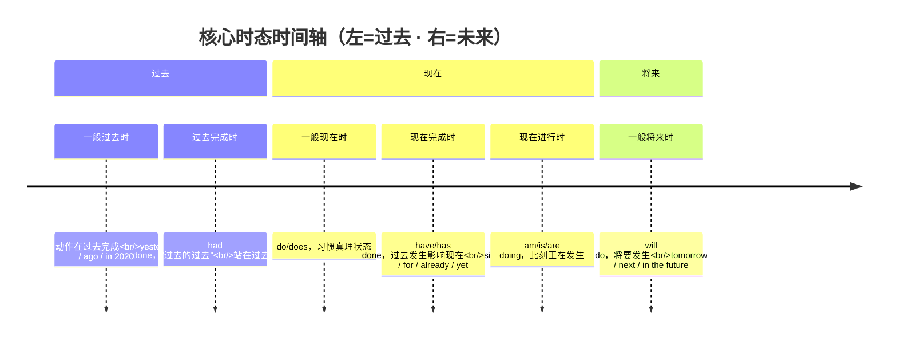
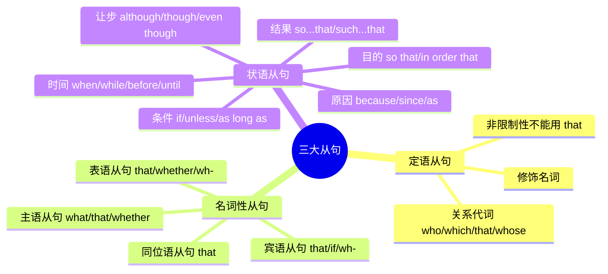
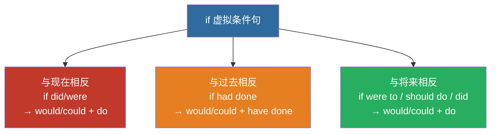
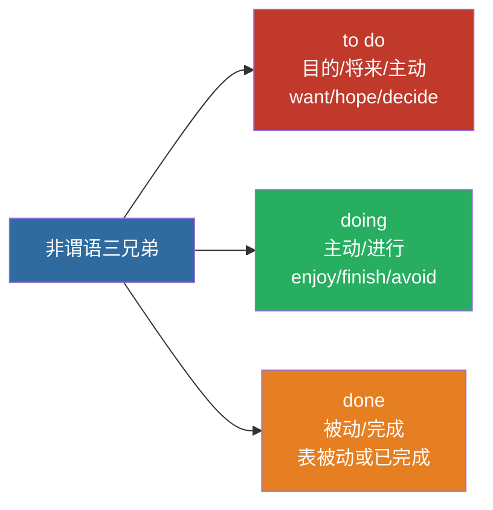

# 📐 语法考点精讲

> 专升本英语核心语法 | 时态/语态/从句/代词/虚拟语气/非谓语
>
> 📝 **真题专项**：[主谓一致 13-27 题（含答案与解析）](agreement-exercises)

---

## 一、动词时态（🔥 必考）

### ⏰ 三大核心时态

| 时态 | 结构 | 用法 | 标志词 |
|:---|:---|:---|:---|
| 一般现在时 | do/does | 习惯、真理、状态 | always, usually, often, every... |
| 一般过去时 | did | 过去发生的动作 | yesterday, last..., ago, in 2020 |
| 一般将来时 | will do | 将要发生的动作 | tomorrow, next..., soon, in the future |

### 🔥 完形/语法填空最高频时态

| 时态 | 结构 | 用法 |
|:---|:---|:---|
| 现在完成时 | have/has done | 过去发生对现在有影响 / 持续到现在 |
| 过去完成时 | had done | 过去的过去（站在过去看更早） |
| 现在进行时 | am/is/are doing | 此刻正在发生 |
| 过去进行时 | was/were doing | 过去某时刻正在发生 |
| 现在完成进行时 | have/has been doing | 从过去到现在一直持续 |

> **真题规律：** 80%的时态题在 **一般过去时**、**现在完成时**、**一般现在时** 三者之间选择



> 📌 **80% 时态题就考这三选**：一般过去（动作在过去的某时点）vs 现在完成（过去发生、对现在有影响，**不能用具体时间**）vs 一般现在（习惯/真理）。

### 📌 现在完成时 vs 一般过去时（必考辨析）

| 维度 | 现在完成时 | 一般过去时 |
|:---|:---|:---|
| 时间焦点 | 现在（关注结果） | 过去（关注动作本身） |
| 能否用具体时间 | ❌ 不能 | ✅ 可以 |
| 例句 | I have seen the movie.（现在知道内容） | I saw the movie last night. |

**标志词区分：**
- 完成时：already, yet, ever, never, just, recently, so far, since, for
- 过去时：yesterday, last..., ...ago, in 2020, when I was...

---

## 二、被动语态

### 结构公式

```text
be + done (过去分词)
```

### 各时态被动语态

| 时态 | 被动结构 |
|:---|:---|
| 一般现在时 | am/is/are + done |
| 一般过去时 | was/were + done |
| 一般将来时 | will be + done |
| 现在完成时 | have/has been + done |
| 过去完成时 | had been + done |
| 情态动词 | can/must/may + be + done |

### 易错点

- **主动表被动：** need/want/require + doing = need to be done
  - *The car needs **washing**.* = The car needs **to be washed**.
- **感官动词：** look, sound, feel, taste, smell + 形容词（主动表被动）
  - *The flower **smells good**.*

---

## 三、三大从句（🔥🔥 必考）



> 📌 记忆：**定语从句修饰名词（who/which/that）→ 名词性从句充当主语宾语（that/whether/what）→ 状语从句表时间条件原因让步（when/if/because/although）**。

### 1️⃣ 定语从句

| 先行词 | 人 | 物 | 人+物/所有格 |
|:---|:---|:---|:---|
| 主格 | who/that | which/that | that |
| 宾格 | who(m)/that | which/that | that |
| 所有格 | whose | whose/of which | whose |

**非限制性定语从句：** 不能用 that，用 which / who

> *The book, **which** I bought yesterday, is very interesting.*

### 2️⃣ 名词性从句

| 类型 | 引导词 | 例句 |
|:---|:---|:---|
| 主语从句 | that / whether / what | What he said is true. |
| 宾语从句 | that / if/whether / wh- | I think that he is right. |
| 表语从句 | that / whether / wh- | The question is whether we should go. |
| 同位语从句 | that | The news that he won surprised us. |

### 3️⃣ 状语从句

| 类型 | 引导词 |
|:---|:---|
| 时间 | when, while, as, before, after, until, as soon as |
| 条件 | if, unless, as long as, provided that |
| 原因 | because, since, as, now that |
| 让步 | although, though, even though, while, no matter... |
| 目的 | so that, in order that |
| 结果 | so...that, such...that |

---

## 四、代词（🔥 必考）

> **广东口径**（娜娜老师 `BV1QKbZ6xEea` **P4**）：「代词在我们往年的语法填空里**几乎都是每年会出一题**，而且大多是集中在**指示代词 `it` 跟反身代词**的用法里面。」
> **真题实测五年五考**：2022#45 `it` · 2023#43 `it` · 2024#45 `myself` · 2025#45 `myself` · **2026 `her`** —— 代词是语法填空里**频率最高的考点**。

### 第 0 步：给没给提示词？

| 情形 | 判断路径 |
|:---|:---|
| 无提示词 | 一般落在 介词 / 冠词 / 代词 / 连词 四类上；代词这块基本只有 `it` 和 `that`/`those` |
| 有提示词 | 走下面六条核心规则 |

### 代词表格（背）

| 人称 | 主格 | 宾格 | 形容词性物主 | 名词性物主 | 反身 |
|:---|:---|:---|:---|:---|:---|
| 第一人称单数 | I | me | my | mine | myself |
| 第二人称单数 | you | you | your | yours | yourself |
| 第三人称单数 | he / she / it | him / her / it | his / her / its | his / hers / its | himself / herself / itself |
| 第一人称复数 | we | us | our | ours | ourselves |
| 第二人称复数 | you | you | your | yours | yourselves |
| 第三人称复数 | they | them | their | theirs | themselves |

### 核心 1 · 人称代词：**动前主格，动/介后宾格**

> **判据只有一条：看它在动词前，还是动词/介词后。**

| 位置 | 用 | 例 |
|:---|:---|:---|
| 动词前（作主语） | 主格 | `They need to write a report.` |
| 动词后 / 介词后（作宾语） | 宾格 | `The coach gave it to them.` |

- 真题：`When a poem feels finished to ___, she often adds visual elements.` → **her**（`to` 是介词 ⇒ 宾格）· **2026 广东真题**
- 改错常考：`The teacher asked Tom and **I** to clean...` → 动词后必须用 **me**

### 核心 2 · 物主代词：看名字 + 看长短

| 类型 | 判据 | 空后有名？ |
|:---|:---|:---|
| 形容词性物主 | 名字带「形容词」⇒ 当形容词用 | 必须接名词 |
| 名词性物主 | 名字带「名词」⇒ 已含名词 | 不再接名词 |

- 两个辅助判据：**看名字** · **看长短**（名词性物主普遍更长：`my → mine` · `our → ours`）
- 📌 `hers = her opinion`。真题：`Your opinion ___ sounds ridiculous to me.` → **like hers**
- ⚠️ `its` 既可是形容词性也可是名词性物主（**没有撇号**）；`it's` = it is —— 差一个撇号，意思天差地别

### 核心 3 · 反身代词：两种用法 + 两步走

**什么时候用**

| 用法 | 判据 | 例 |
|:---|:---|:---|
| 动作回到自己身上 | 🔴 主语和宾语是同一个人 | `Lisa said to herself` · `I said to myself` |
| 强调「亲自」 | 放句末或主语后 | `He finished the work himself.` |
| 固定搭配 | 见下表 | `enjoy yourself` |

**用哪一个（两步）**
1. 有没有「**自己**」的意味？
2. 有 → **主语是谁，就还给谁**（I → myself · he → himself · they → themselves）

- 真题：`I would remind ___ of all those people I'm helping` → **myself**（2024#45）
- 真题：`All the positive comments made me feel really proud of ___` → **myself**（2025#45）
- ❌ 反例：老师对我 = `me`，不是 `myself`（主语 ≠ 宾语）

> 📌 记忆：**自己对自己做动作，才有 self。**

### 核心 4 · `it` 的五种用法（🔴 广东高频）

| 用法 | 结构 | 例 |
|:---|:---|:---|
| ① 指代前文 | 指前面出现的物 / 事 | `The hotel is clean. I like it.` |
| ② 形式主语 | `it is + adj + to do` / `it is + adj + that 从句` | `It is important to have good friends.` |
| ③ 形式宾语 | `sb find/make/think it + adj + to do` | `I find it useful to read a lot.` |
| ④ 强调句 | `It is/was + 被强调部分 + that` | `It was Tom that helped me.` |
| ⑤ 虚位主语 | 天气 / 时间 / 距离 | `It is raining.` · `It is 8 o'clock.` |

- 🔴 **强调句判据**：把 `it is/was ... that` **划掉**，剩下的还是完整句 ⇒ 就是强调句
- 🔴 **形式主/宾语不译作「它」**，它只是**占位**；真正的主语 / 宾语是后面的 `to do` 或 `that 从句`
- 真题：`Forget how important ___ is to have good people in our life.` → **it**（2023#43 · 形式主语）
- 真题：`I'd certainly advise anybody to give ___ a try.` → **it**（2022#45 · 固定搭配）
- 习题型：`I think ___ necessary to review grammar every week.` → **it**（形式宾语）

### 核心 5 · 指示代词与替代词（了解即可）

| 词 | 用法 | 例 |
|:---|:---|:---|
| this / these | 近指（这 / 这些） | — |
| that / those | 远指；🔴 比较结构中替代前文（用 that/those，不用 it） | `The weather here is warmer than that in Shanghai.` |
| one / ones | 同类但不同个（可数） | `I lost my pen, so I bought a new one.` |
| it | 同类同一个 | `The hotel is clean. I like it.` |

- 📌 常见结构：`a new one` · `a different one` · `an old one`

### 核心 6 · 不定代词（了解即可）

| 系列 | 判据 | 例 |
|:---|:---|:---|
| another / the other | 看范围：`another` = 三者以上中的另一个；`the other` = 两者中的另一个 | `One is a doctor, and the other is a teacher.` |
| others / the others | 看泛指还是特指剩余全部 | `Some are reading, others are talking.`（泛指一部分） |
| both / either / neither | 两者都 / 任一 / 都不 | `Both are OK.` · `Neither is OK.` |
| all / none | 三者及以上 都 / 都不 | — |

- 📌 两个必背结构：**`one ... the other`**（两者）· **`some ... others`**（泛指）

### 反身代词固定搭配（背）

| 搭配 | 意思 | 搭配 | 意思 |
|:---|:---|:---|:---|
| teach oneself | 自学 | help oneself | 请自便 |
| enjoy oneself | 玩得开心 | by oneself | 独自一人地 |
| lose oneself | 迷路 | for oneself | 替自己 |
| come to oneself | 苏醒 | in itself | 本身 |
| make oneself at home | 不受拘束 | of oneself | 自发地 |
| beside oneself | 发狂 | devote oneself to | 专心于 |
| between ourselves | 你知我知 | | |

---

## 五、虚拟语气（🔥 必考）

> **广东口径**（娜娜老师 **P12**）：**虚拟语气 5 年只考过 1 次**（2022#44）—— 频率低，但**必学**：阅读里要能辨、写作里要用。
> **🔑 核心概念：时间错位** —— 虚拟出来的情况跟**事实相反**，所以动词要**往后退一格**。

### 先认门类：四类虚拟

| # | 类型 | 引导 / 触发词 | 动词怎么变 |
|:--:|:---|:---|:---|
| 1 | `if` 虚拟条件句 | `if` | 从句退一格；主句固定用过去式情态动词 |
| 2 | 愿望类 | `wish` · `if only` · `would rather` | 从句退一格 |
| 3 | 建议要求类 | suggest / demand / insist… | `(should) do`（不倒退） |
| 4 | 含蓄虚拟 | `without` · `but for` · `otherwise` · `or` | 与 `if` 的主句一致 |

### 1️⃣ `if` 虚拟条件句

| 类型 | `if` 从句 | 主句 |
|:---|:---|:---|
| 与现在相反 | did / were | would/could/might + do |
| 与过去相反 | had done | would/could/might + have done |
| 与将来相反 | were to do / should do / did | would/could/might + do |

- 🔴 **主句的情态动词固定用过去式**（would / could / might / should）—— 不管哪种时间，**只变后面的 do**
- **与将来相反的从句三种形式，语感不同**：`were to do` 最正式（古英语沿用）· `should do` = 万一 / 碰巧 · `did` 语气最弱
- 📌 `If I **were** you, I would take the chance.` —— 「假如我是你」**直接填 `were`**，不用想



> 📌 记忆：**时态往后退一格** —— 现在→过去（did），过去→过去完成（had done），将来→were to / should。

**⚠️ 易错：别跟「普通条件句」混**

| | 普通条件句（主将从现） | 虚拟条件句 |
|:---|:---|:---|
| 假设的情况 | 客观上有可能发生 | 概率极低、基本不可能实现 |
| 主句 | `will do` | `would/could/might + do` |

### 2️⃣ 愿望类（`wish` / `if only` / `would rather`）

**`wish` / `if only`**（`if only` 语气更强）

| 愿望 | 从句动词 |
|:---|:---|
| 对现在 | `did` / `were` |
| 对过去（遗憾） | 🔴 `had done` |
| 对将来 | `would` / `could + do` |

- 真题：`I wish I ___ a marathon years ago.` → **had run**（2022#44 · 对过去的遗憾）

**`would rather`（`that` 可省）** —— 与 `wish` **有一处不同**

| 愿望 | 从句动词 |
|:---|:---|
| 对现在 / 将来 | 过去式（⚠️ 不是 `would do`） |
| 对过去 | `had done` |

### 3️⃣ 建议要求类：`(should) do`（should 可省）

| 类型 | 触发词 |
|:---|:---|
| 建议 | suggest · advise · recommend · propose |
| 要求 / 命令 | demand · require · request · order · insist |
| 必要 / 重要（形容词句式） | `It is necessary/important/essential + that + (should) do` |

- **也可用名词 / 形容词引出**：`It is my suggestion that...` · `It is advisable that...`
- 被动：`They required that the report **(should) be finished** today.`
- 🔴 **为什么这一类用原形、不倒退？** —— 因为这件事**还没发生**，不存在「已存在的事实」可对照，所以不倒退

**🔴🔴 两个必考例外（出现就是陷阱）**

| 动词 | 什么时候不用虚拟（用正常时态） | 例 |
|:---|:---|:---|
| insist | 表示「坚持认为某个事实」 | `He insisted that he left yesterday.` |
| suggest | 表示「暗示 / 表明」 | `His pale face suggests that he is ill.` |

### 4️⃣ 含蓄虚拟（没有 `if`）

| 触发词 | 意思 | 动词 |
|:---|:---|:---|
| without / but for | 如果没有 | 与 `if` 的主句一致（常用 `would have done`） |
| otherwise / or | 否则 | 同上 |
| It is (high) time that | 该做某事了 | 🔴 从句用过去式（`It's time that we left.`） |

- 例：`Without your help, I **would have failed**.` · `I missed the bus, otherwise I **would have arrived** earlier.`

### 其他虚拟触发词（顺手记）

| 考点 | 结构 | 例句 |
|:---|:---|:---|
| as if / though | 时态退一格 | `He talks as if he knew everything.` |

**动词清单（接 that 虚拟）：** suggest, advise, propose, recommend, insist, order, command, require, request, demand

## 六、非谓语动词（🔥🔥 必考）

| 形式 | 意义 | 用法 |
|:---|:---|:---|
| to do | 目的、将来 | 不定式：表示目的/主动/将来 |
| doing | 主动、进行 | 现在分词/动名词 |
| done | 被动、完成 | 过去分词表示被动/完成 |



> 📌 记忆：**to do 表目的将来、doing 表主动进行、done 表被动完成**——先看主被动，再看时态先后。

### 常考固定搭配

**只接 to do 的动词：**
> want, hope, wish, expect, decide, plan, refuse, promise, afford, agree

**只接 doing 的动词：**
> enjoy, finish, avoid, consider, practice, suggest, mind, keep, imagine

**既接 to do 又接 doing 意义不同：**

| 动词 | to do | doing |
|:---|:---|:---|
| remember | 记得要去做 | 记得做过 |
| forget | 忘记要去做 | 忘记做过 |
| stop | 停下来去做 | 停止做 |
| try | 努力去做 | 尝试做 |
| regret | 遗憾要去做 | 后悔做过 |

---

## 七、语法填空解题技巧

### 纯填空（无提示词）

| 空格位置 | 可能填的词 |
|:---|:---|
| 名词前 | 冠词(a/an/the)、限定词、介词 |
| 动词前 | 情态动词、助动词 |
| 两句之间 | 连词(and, but, or, when, because...) |
| 句中 | 关系词(who, which, that, where...) |

### 有提示词

| 提示词词性 | 可能变形成 |
|:---|:---|
| 动词 | 时态、语态、非谓语（to do/doing/done） |
| 形容词 | 副词(-ly)、比较级/最高级 |
| 名词 | 复数、词性转换（→形容词） |

---

## 速算口诀

> **时态看标志词，完成时找 since/for**
> **被动公式 be+done，主动表被动要记牢**
> **定语从句找先行，虚拟后退一个时**
> **非谓语三选一，to do 目的 doing 主动 done 被动**
> **代词先看动前动介后，主宾同一人才用 self**
> **虚拟四类先认门：if 退格 · wish 退格 · 建议原形 · 含蓄跟主句**
> **it 五用：指代 · 形式主宾 · 强调 · 虚位**

[VOICE: 语法重点抓三大从句、虚拟语气、非谓语动词，这三个板块占语法考题的七成以上，先把它们吃透！]
