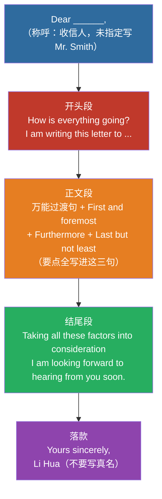

# ✍️ 作文模板与高分句型

> 广东普通专升本《公共英语》写作 | 应用文主攻 | 约 100 词

---

## 一、基础信息（广东专升本）

| 项目 | 要求 |
|:---|:---|
| 字数 | 约 100 词（建议实写 90–110） |
| 建议用时 | 25–30 分钟 |
| 满分 | 15 分 |
| 体裁优先级 | 书信 > 通知 > 其它应用文 ≫ 议论文/图表（广东极少） |
| 评分侧重 | 格式正确 + 要点写全 + 语言通顺 + 结构清楚 |
| 署名 | 题目未指定时用 Li Hua（切勿写真名） |

**考场提醒：**
1. 先把提示要点勾完，再套模板——漏一点就掉内容分  
2. 过渡句（`Taking all these factors...` 之类）**用一次就够**，别连用两三句空话占字数——字数要留给时间/地点/活动  
3. 写完 30 秒检查：称呼、落款、时态、拼写、要点是否全

---

## 二、必背模板（按你的原版保留，略作格式整理）

### 📌 模板 A：万能书信（主背 ★★★★★）

**适用：** 邀请 / 申请 / 感谢 / 道歉 / 建议 / 推荐 / 投诉等



> 📌 **书信格式四件套**：称呼（Dear...）→ 开头（目的句）→ 正文（要点三连）→ 落款（Yours sincerely, + 署名）。**格式正确是应用文评分第一关**，背熟框架再填内容。

```text
Dear _________ , (收信人，题目未指定则写 Mr. Smith 或 Mark)

How is everything going? I am writing this letter to express my earnest hope to / recommend _________(填入写信目的，如：invite you to our speech contest / apply for the position of English tutor).

Here are some relevant details about this matter.(万能过渡句)First and foremost, _________(填入细节一：如 the deadline is Nov. 10th).Furthermore, _________(填入细节二：如 it is highly beneficial to us).Last but not least, _________(填入细节三或升华句：如 it will be a meaningful and unforgettable experience).

Taking all these factors into consideration, I sincerely hope you can _________(填入期许，如：accept my invitation / give me an opportunity).I would be highly appreciative if you could take my request into consideration. I am looking forward to hearing from you soon.

Yours sincerely,
Li Hua
(注意：千万不要写自己的真实姓名)
```

#### 书信范文（邀请）

```text
Dear Peter,
How is everything going? I am writing this letter to invite you to the exhibition of Traditional Chinese Culture in our school.
Here are some relevant details about this matter. First and foremost, the exhibition will be held next Friday on the third floor of the school library. Furthermore, you can experience the art of paper-cutting yourself and watch a calligraphy show. Last but not least, it will be a meaningful and unforgettable experience.
Taking all these factors into consideration, I sincerely hope you can accept my invitation. I am looking forward to hearing from you soon.
Yours sincerely,
Li Hua
```

> **字数自检：** 本范文 **103 词**（数过），落在建议区间 90–110 内。若提示里有具体时间/地点，优先补进 First / Furthermore 两句，比堆 "meaningful" 更稳。

---

### 📌 模板 B：NOTICE 通知（主背 ★★★★★）

**适用场景：** 学校、学生会或俱乐部发布活动通知，如音乐周、运动会、英语演讲比赛等。

```text
(正中间大写) NOTICE

May I have your attention, please? To enrich our campus life, our school is going to organize _________(填入活动名称，如 a music week).

The event is scheduled to be held in _________(填入地点，如 the school hall)at _________(填入时间，如 2:00 p. m. next Friday).There are many exciting activities waiting for you.(万能凑字句)For one thing, _________(细节一：如 you can enjoy pop music).For another, _________(细节二：如 please bring your own instruments).

Those who are interested in it are highly welcome to participate.(高级句型：极其欢迎感兴趣的同学参加)If you have any questions, please feel free to contact us at 1234567.(万能结尾句)

(右下角发通知的组织，如) The Student Union
(右下角发通知的日期，如) Nov. 10th
```

**格式要点：**
- 标题 `NOTICE` 居中大写  
- 正文写清：活动名 / 时间 / 地点 / 内容 / 欢迎参加 / 联系方式  
- 右下角：组织 + 日期

---

### 📌 模板 C：图表 / 社会现象（拓展，广东极少考）

**适用场景：** 描述社会热点趋势或图表数据，如大学生沉迷手机、网购的流行、低碳出行等。

```text
As is clearly shown in the chart / As we can see in our daily life, the past few years have witnessed a dramatic change in _________(填入现象主题，如 using mobile phones / online shopping).Specifically, this trend is becoming increasingly popular among people.(万能现象补充句)

There are several reasons behind this phenomenon.(引出原因过渡句)First and foremost, _________(填入原因一：如 it is very convenient).Furthermore, _________(填入原因二：如 it saves us a lot of time / we can chat with friends anytime and anywhere).

Taking all these factors into consideration, we can naturally draw the conclusion that _________(填入趋势预测，如：this trend will continue).In my opinion, we should take a rational attitude towards it.(万能高分结尾呼吁：在我看来，我们应该对此采取理性的态度)
```

> ⚠️ **备考优先级：低。** 广东统招公共英语写作主考应用文；本模板仅作备用，冲刺阶段别占主背时间。

---

### 📌 模板 D：正反观点 / 建议类议论文（拓展，广东极少考）

**适用场景：** 给出两个对立观点让你选择，或者提出一个问题让你给出建议。如：团队合作 vs 独立工作、在校外租房 vs 住校内。

```text
Nowadays, there is a heated debate over _________(填入讨论的话题，如 whether students should work part-time).Opinions vary from person to person.(万能开场：如今关于...有激烈的讨论，人们的观点因人而异)

On the one hand, some people argue that _________(填入甲方观点：如 working part-time is beneficial).They believe that _________(解释甲方观点：如 it provides practical experience).On the other hand, others hold the opposite view.(转折句：另一方面，其他人持有相反观点)They point out that _________(填入乙方观点：如 it takes up too much study time).

As far as I am concerned, I am in favor of the former/latter opinion.(表明立场：就我而言，我赞同前者/后者的观点)The reason is that _________(给出自己的理由：如 practical skills are equally important for our future career).Therefore, we should find a proper balance.(万能结尾：因此，我们应该找到一个合适的平衡点)
```

> ⚠️ **备考优先级：低。** 同上，主背书信 + 通知即可。

---

## 三、高频写信目的开头（替换壳，提分用）

| 功能 | 开头句 |
|:---|:---|
| 邀请 | I am writing to invite you to... |
| 申请 | I am writing to apply for the position of... |
| 感谢 | I am writing to express my sincere thanks for... |
| 道歉 | I am writing to apologize for... |
| 建议 | I am writing to offer some suggestions on... |
| 推荐 | I am writing to recommend... to you. |
| 投诉 | I am writing to complain about... |
| 通知目的 | To enrich our campus life, ... is going to be held. |
| 欢迎参加 | Those who are interested are highly welcome to participate. |
| 期盼 | I am looking forward to hearing from you soon. / I am looking forward to your early reply. |

---

## 四、高分小替换（点缀即可，别堆）

| 低分词 | 可换 |
|:---|:---|
| important | crucial / vital / significant / essential |
| good | beneficial / positive |
| bad | harmful / negative |
| many | a large number of / various |
| more and more | increasingly / a growing number of |
| think | believe / hold / argue |
| so | therefore / as a result |
| solve | address / deal with |

### 常用连接

| 功能 | 词 |
|:---|:---|
| 顺承 | First and foremost / First of all / Furthermore / Last but not least |
| 因果 | Therefore / As a result / Thus |
| 举例 | For one thing... For another... / For example |
| 总结 | Taking all these factors into consideration / In conclusion |

---

## 五、写作流程（约 100 词）

```text
Step 1: 审题（2 分钟）——体裁、收信人/组织、要点清单
Step 2: 列点（2 分钟）——目的 1 句 + 细节 2–3 点 + 期许 1 句
Step 3: 套写（15–18 分钟）——直接填模板
Step 4: 检查（3–5 分钟）——格式 / 要点 / 时态 / 拼写 / 字数
```

---

## 六、从 9 分到 13 分：同一封邀请信的逐句批改

> 上面的范文是**成品**，看完只会觉得「写得真好」，但不知道自己写的那篇为什么只有 9 分。
> 这一节反过来：先给你一份**真实水平的中低分稿**，逐句指出扣在哪、为什么扣、怎么改。
> 分数为按常见五档评分制**粗估**（广东专升本作文 15 分，档位制，非逐点扣分），
> 目的是让你看见「同样写完了，分差在哪」，不是官方评分细则。

### 题目

> 你是李华，写信邀请外教 Peter 参加学校举办的中华传统文化展。
> 要点：① 时间：下周五 ② 地点：学校图书馆三楼 ③ 至少两项活动（剪纸体验、书法展示）④ 表达期待

### 低分稿（约 66 词，判 9 分）

```text
Dear Peter,
I am Li Hua. I want to tell you a thing. Our school will have an exhibition
about Chinese culture. It is very good. You should come.
The exhibition is next Friday. There have many activities. You can see
paper-cutting. It is very interesting and meaningful. I think you will like
it very much.
I hope you can come. Waiting for you.
Li Hua
```

### 逐句批改

| # | 原句 | 问题 | 改法 |
|:--:|:--|:--|:--|
| 1 | `I want to tell you a thing.` | 口语化 + 中式英语。`a thing` 指代不明，书信开头要有明确的写信目的句 | `I am writing to invite you to the exhibition of Traditional Chinese Culture in our school.` |
| 2 | `Our school will have an exhibition about Chinese culture.` | 不算错，但和第 1 句重复说了同一件事，白占字数 | 并入第 1 句的目的句 |
| 3 | `It is very good.` | 空话。评分看「内容是否具体」，`good` 不提供任何信息 | 删掉，字数让给第 6 句的细节 |
| 4 | `You should come.` | 语气像命令。邀请信要用 hope / would like to | `I sincerely hope you can come.`（放到结尾） |
| 5 | 缺「地点」 | 🔴 漏要点 = 直接掉内容分。题目 4 个要点只写了 3 个 | `It will be held on the third floor of the school library.` |
| 6 | `There have many activities.` | 🔴 硬语法错。`there be` 句型不能用 `have`（中文「有」的直译） | `There will be various activities.` |
| 7 | `You can see paper-cutting.` | 只写了 1 项活动，题目要求至少两项 | `You can try paper-cutting yourself and watch a calligraphy show.` |
| 8 | `It is very interesting and meaningful.` | 又是空话，且 `It` 指代不清（指剪纸还是展览？） | 删掉 |
| 9 | 缺落款 `Yours sincerely,` | 🔴 格式分。书信四件套缺一件 | 补 `Yours sincerely,` + `Li Hua` |
| 10 | 全篇 66 词 | 要求约 100 词，欠 30 多词 ⇒ 内容单薄，通常连带降档 | 补细节（活动具体内容、见面安排）撑到 95–105 |

**扣分归因（粗估）：**

| 维度 | 满分量级 | 本篇 | 原因 |
|:--|:--:|:--:|:--|
| 格式 | 3 | 2 | 缺 `Yours sincerely,` |
| 内容要点 | 5 | 3.5 | 漏「地点」；活动只写 1 项 |
| 语言 | 5 | 2.5 | `There have` 硬错 + 两处空话 + 口语化开头 |
| 结构与字数 | 2 | 1 | 无过渡词，66 词欠量 |

### 改后稿（103 词，判 13 分）

不用重写一遍 —— 改后稿**就是上面那篇范文**，只多了「地点」那半句。三处实质改动：

| 位置 | 改前（9 分稿） | 改后（13 分稿） | 涨分点 |
|:--|:--|:--|:--|
| 开头 | `I want to tell you a thing.` | `I am writing to invite you to the exhibition...` | 口语 → 书面目的句 |
| 正文 | `There have many activities.` | `There will be various activities.` + 补 `on the third floor of the school library` | 修硬错 + 补漏要点 |
| 结尾 | `Waiting for you.` / 无落款 | `I am looking forward to hearing from you soon.` + `Yours sincerely,` | 补格式四件套 |

> 注意：改后稿**不是重写，是在原稿上动三处**。这三处都不需要多背单词。

### 三句话总结这篇为什么能涨 4 分

1. **补回漏掉的要点**（地点）——这是唯一「不靠英语水平」就能拿的分。
2. **删掉所有空话**（`It is very good` / `very interesting and meaningful`），把省下的字数换成具体活动。
3. **修掉一个硬语法错**（`There have` → `There will be`）——这类错在阅卷时最刺眼，因为它一眼就能看出。

> 📌 **自查顺序**：先数要点（漏没漏）→ 再查格式（四件套齐没齐）→ 再数字数（够 90 没有）→ 最后才看语法。
> 前三项是「会不会」的问题，语法是「好不好」的问题。**先保底，再争分。**

---

## 速算口诀

> **广东作文约百词，书信通知最对口**  
> **要点写全格式对，套话少用细节够**  
> **署名只用 Li Hua，写完检查不扣分**

---

## 相关笔记

- [专升本英语考试概述与题型分析](/posts/english/notes/overview)
- [历年真题分类与讲解](/guide/sources)
- 高频词汇速记
- 英语知识库
