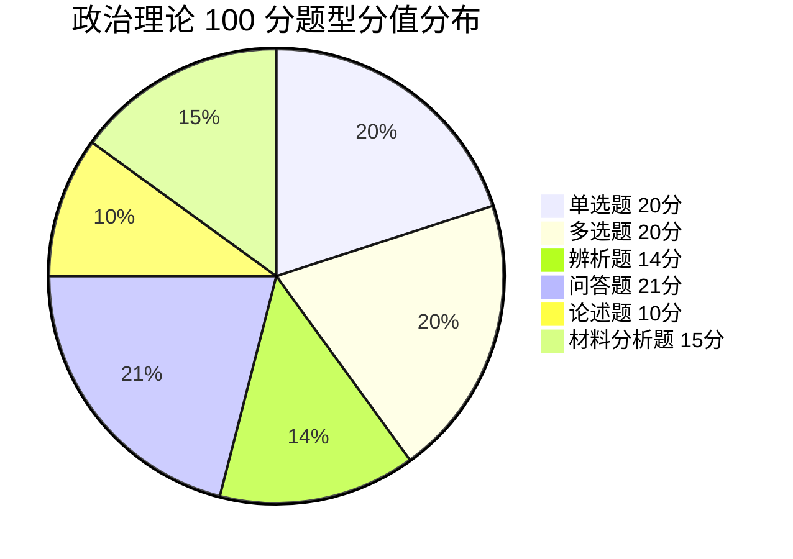

# 00 考试大纲与题型 · 挖空练习

> 同一段话剥三层。**先做 L3，做不动再往下退** —— 顺序反过来会骗自己：
> L1 做对了不代表记住了，只代表「这几个词有印象」。

| 层 | 挖了什么 | 什么时候用 |
|:--|:--|:--|
| L1 | 只有名词 | 第一次接触，或考前扫一遍 |
| L2 | 每句只留前半 | 判断「知不知道接哪半句」 |
| L3 | 只留标题和标点 | 检验能不能整段复述 |

本页挖空数：L1 **20** · L2 **160** · L3 **298**

---

## L1 · 只挖名词

> 🎯 **一句话**：广东普通专升本公共课《政治理论》· 满分 **100** · **120 分钟**
> 📅 考纲同步：2026 公开考试范围（以当年省考试院文件为准）

---

## 一、试卷结构（常见版本）

| 题型 | 题量 | 分值 | 备考要点 |
|:---|:---:|:---:|:---|
| 单项选择题 | 20 | 20 | 概念、时间、人物、表述正误 |
| 多项选择题 | 10 | 20 | 最易失分，无部分分 —— 见下方「⚠️ 多选策略」 |
| 辨析题 | 2 | 14 | 先判正误，再改错补全 |
| 问答题 | 3 | 21 | 分点 1.2.3.，专有名词写全 |
| 论述题 | 1 | 10 | 原理 + 展开 + 现实意义 |
| 材料分析题 | 1 | 15 | 观点 → 结合材料 → 结论 |
| 合计 | | 100 | |

> 📌 **多选题最易失分**（20 分）：**没有部分分，少选也是 0 分**；问答题+材料分析题占 36 分——**分点作答 + 结合材料**是拿分核心。

### ⚠️ 多选策略：别照抄「宁缺毋滥」

____：「未选、错选、多选或少选均无分」——____。

在这个规则下，「不确定就少选」并不天然更安全。把 2018–2026 共 9 年、90 道多选的官方答案全数过一遍：

| 答案项数 | 题数 | 占比 |
|:---:|:---:|:---:|
| 2 项 | 21 | 23.3% |
| 3 项 | 33 | 36.7% |
| 4 项（全选 ABCD） | 36 | 40.0% |

> 数据可复现：`npm run politics:mc`（`scripts/politics-mc-stats.mjs`），脚本会校验「每年恰好 10 题」，切段失败直接报错。

____

1. ____，圈不到 2 项说明这题没学过，别赌。
2. ____。只填 2 项命中率 23.3%、只填 3 项 36.7%，都低于补全的 40.0%。
3. ____。说不出具体错因、只是「感觉不对」的，留着。

> 反面提醒：第 2 条的前提是「圈进去的项本身是对的」。混了错项，补全和少选一样 0 分 —— 所以单选 20 分（概念/时间/人物）必须先打牢。

> 题型分值以**当年考试大纲**为准，跨年可能微调。

---

## 二、考试范围（2026 公开表述摘要）

1. 马克思主义中国化时代化的历史进程与理论成果
2. 毛泽东思想及其历史地位
3. 新民主主义革命理论
4. 社会主义改造理论
5. 社会主义建设道路初步探索的理论成果
6. 中国特色社会主义理论体系的形成发展
7. 邓小平理论 · “____”重要思想 · 科学发展观
8. ____（形成与历史地位、中国式现代化、党的全面领导、以人民为中心、全面深化改革开放、高质量发展、教育科技人才、全过程人民民主、全面依法治国、文化强国、民生社会建设、生态文明、国家安全、国防军队、“____”与祖国统一、大国外交与人类命运共同体、全面从严治党等）
9. ____（考前____国内外重大时事与重大路线方针政策）
   → 2027 届对应 ____。真题实测____（单选 1–4 + 多选 21–22，11 年零例外），
   不是考纲写的 15%。见 16-时事政治备考

---

## 三、参考书目

1. 《____》（____ 年版），高等教育出版社
2. 《____》，高等教育出版社、人民出版社，____ 年 8 月

---

## 四、本站笔记地图

| 模块 | 笔记 |
|:---|:---|
| 总纲 | 本页 |
| 毛中特主线 | 01-马克思主义中国化时代化 · 02-毛泽东思想 · 03-新民主主义革命 · 04-社会主义改造 · 05-建设道路初步探索 |
| 中国特色 | 06-中国特色社会主义理论体系 · 07-邓小平理论 · 08-三个代表与科学发展观 |
| 新时代 | 09-习思想形成与历史地位 · 10-中国式现代化 · 11-党的领导与以人民为中心 · 12-改革发展与五位一体 · 13-民主法治文化民生 · 14-生态安全国防统一外交 · 15-全面从严治党 |
| 得分技巧 | 16-时事政治备考 · 17-辨析论述材料题模板 · 18-必背金句与名词 |
| 时政（2026-10-24 建） | 16-时事政治备考（总纲）· 16a-时政速查表-2026（背诵版）· 16b-广东时政专项（11 年考 5 次）· 16c-时政配套题 · 16d-时政答案解析 |

---

## 五、三轮刷法

1. ____：按模块笔记过概念 + 闭卷默写金句
2. ____：按年演练页（2018–2024）限时
3. ____：材料题 / 论述题限时默写 + 对答案补表述

返回：[政治](/posts/politics/) · [_索引](/posts/politics/)

---

## L2 · 每句留前半

> 🎯 **一句话**：_________________ __ _______ _ _____ ____
> 📅 考纲同步：____ ___________________

---

## 一、试卷结构（常见版本）

| 题型 | 题量 | 分值 | 备考要点 |
|:---|:---:|:---:|:---|
| 单项选择题 | 20 | 20 | 概念、__________ |
| 多项选择题 | 10 | 20 | 最易失分，____ __ ______ _____ |
| 辨析题 | 2 | 14 | 先判正误，_____ |
| 问答题 | 3 | 21 | 分点 1.2.3.，______ |
| 论述题 | 1 | 10 | 原理 + 展开 + 现实意义 |
| 材料分析题 | 1 | 15 | 观点 → 结合材料 → 结论 |
| 合计 | | 100 | |

> 📌 **多选题最易失分**（20 分）：____________ _ ______________ __ _________ _ ____________

### ⚠️ 多选策略：别照抄「宁缺毋滥」

**评分规则（真题卷面原文）**：____________________________

在这个规则下，_________________ _________ _ _ ____ ______________

| 答案项数 | 题数 | 占比 |
|:---:|:---:|:---:|
| 2 项 | 21 | 23.3% |
| 3 项 | 33 | 36.7% |
| 4 项（全选 ABCD） | 36 | 40.0% |

> 数据可复现：____ ___ ________________________________________________________ __ ____________

**三条操作口径：__

1. **先圈「确定对的」**，___ _ ____________
2. **圈到 2–3 项、_____ _ _________ _ ____ ________ _ _ ____________ ______
3. **只有能说出「这个选项错在哪」时才排除它**。_____________________

> 反面提醒：_ _ ______________________________ _ _ __ ____ __ _________________

> 题型分值以**当年考试大纲**为准，_______

---

## 二、考试范围（2026 公开表述摘要）

1. 马克思主义中国化时代化的历史进程与理论成果
2. 毛泽东思想及其历史地位
3. 新民主主义革命理论
4. 社会主义改造理论
5. 社会主义建设道路初步探索的理论成果
6. 中国特色社会主义理论体系的形成发展
7. 邓小平理论 · “____”重要思想 · 科学发展观
8. **习近平新时代中国特色社会主义思想**（形成与历史地位、______________________________________________________________________________________________________________________
9. ____（考前____国内外重大时事与重大路线方针政策）
   → 2027 届对应 **2026.1.1–2026.12.31**。________ _ ______ ___ _ __ ________ ______
   不是考纲写的 15%。_ _________

---

## 三、参考书目

1. 《毛泽东思想和中国特色社会主义理论体系概论》（2023 年版），_______
2. 《习近平新时代中国特色社会主义思想概论》，__________________ _ _ _

---

## 四、本站笔记地图

| 模块 | 笔记 |
|:---|:---|
| 总纲 | 本页 |
| 毛中特主线 | 01-马克思主义中国化时代化 · 02-毛泽东思想 · 03-新民主主义革命 · 04-社会主义改造 · 05-建设道路初步探索 |
| 中国特色 | 06-中国特色社会主义理论体系 · 07-邓小平理论 · 08-三个代表与科学发展观 |
| 新时代 | 09-习思想形成与历史地位 · 10-中国式现代化 · 11-党的领导与以人民为中心 · 12-改革发展与五位一体 · 13-民主法治文化民生 · 14-生态安全国防统一外交 · 15-全面从严治党 |
| 得分技巧 | 16-时事政治备考 · 17-辨析论述材料题模板 · 18-必背金句与名词 |
| 时政（2026-10-24 建） | 16-时事政治备考（总纲）· 16a-时政速查表-2026（背诵版）· 16b-广东时政专项（11 年考 5 次）· 16c-时政配套题 · 16d-时政答案解析 |

---

## 五、三轮刷法

1. **第一轮**：________ _ ______
2. **第二轮**：__________________
3. **第三轮**：___ _ _______ _ ______

返回：______________________ _ _______________________

---

## L3 · 只留骨架

_ __ _______：_________________ __ _______ _ _____ ____
_ __ ____：____ ___________________

___

## 一、试卷结构（常见版本）

| 题型 | 题量 | 分值 | 备考要点 |
|:---|:---:|:---:|:---|
| _____ | __ | __ | _____________ |
| _____ | __ | __ | _________ __ ______ _____ |
| ___ | _ | __ | __________ |
| ___ | _ | __ | __ _____________ |
| ___ | _ | __ | __ _ __ _ ____ |
| _____ | _ | __ | __ _ ____ _ __ |
| __ | | ___ | |

_ __ ______________ __：_______，____ _ ___；__________ __ _________ _ ___________。

### ⚠️ 多选策略：别照抄「宁缺毋滥」

________________：___、__、____________________。

______，_______________。_ _________ _ _ _、__ _____________：

| 答案项数 | 题数 | 占比 |
|:---:|:---:|:---:|
| _ _ | __ | _____ |
| _ _ | __ | _____ |
| _ ____ _____ | __ | _____ |

_ _____：____ ___ _____________________________________________，__________ __ __，________。

________：__

1. ____________，___ _ ________，__。
2. ____ ___ _、_____ _ ______。__ _ ____ _____、__ _ _ _____，______ _____。
3. _______________________。_______、_________，__。

_ ____：_ _ _________________。____，_______ _ _ __ ____ __ ________________。

_ _________________，______。

___

## 二、考试范围（2026 公开表述摘要）

1. _____________________
2. ___________
3. _________
4. ________
5. _________________
6. _________________
7. _____ _ __________ _ _____
8. ____________________________、______、______、______、________、_____、______、_______、______、____、______、____、____、____、___________、____________、________
9. _____________________________________
   _ ____ ___ _______________________。________ _ ______ ___ _ __ _____，__ _____，
   ______ ___。_ _________

___

## 三、参考书目

1. ___________________________ ___，_______
2. ____________________，_______、_____，____ _ _ _

___

## 四、本站笔记地图

| 模块 | 笔记 |
|:---|:---|
| __ | __ |
| _____ | ______________ _ ________ _ __________ _ _________ _ ___________ |
| ____ | _______________ _ ________ _ _____________ |
| ___ | _____________ _ _________ _ ______________ _ ____________ _ ___________ _ _____________ _ _________ |
| ____ | _________ _ ____________ _ __________ |
| _____________ __ | ______________ ____________________ _____________ __ _ ___ _________ _ __________ |

___

## 五、三轮刷法

1. _______：________ _ ______
2. _______：__________________
3. _______：___ _ _______ _ ______

__：______________________ _ _______________________

---

## 原文

点开对照（先做完再看）

# 政治理论 · 考试大纲与题型

> 🎯 **一句话**：广东普通专升本公共课《政治理论》· 满分 **100** · **120 分钟**
> 📅 考纲同步：2026 公开考试范围（以当年省考试院文件为准）

---

## 一、试卷结构（常见版本）

| 题型 | 题量 | 分值 | 备考要点 |
|:---|:---:|:---:|:---|
| 单项选择题 | 20 | 20 | 概念、时间、人物、表述正误 |
| 多项选择题 | 10 | 20 | 最易失分，无部分分 —— 见下方「⚠️ 多选策略」 |
| 辨析题 | 2 | 14 | 先判正误，再改错补全 |
| 问答题 | 3 | 21 | 分点 1.2.3.，专有名词写全 |
| 论述题 | 1 | 10 | 原理 + 展开 + 现实意义 |
| 材料分析题 | 1 | 15 | 观点 → 结合材料 → 结论 |
| 合计 | | 100 | |

> 📌 **多选题最易失分**（20 分）：**没有部分分，少选也是 0 分**；问答题+材料分析题占 36 分——**分点作答 + 结合材料**是拿分核心。

### ⚠️ 多选策略：别照抄「宁缺毋滥」

**评分规则（真题卷面原文）**：「未选、错选、多选或少选均无分」——**少选不给分**。

在这个规则下，「不确定就少选」并不天然更安全。把 2018–2026 共 9 年、90 道多选的官方答案全数过一遍：

| 答案项数 | 题数 | 占比 |
|:---:|:---:|:---:|
| 2 项 | 21 | 23.3% |
| 3 项 | 33 | 36.7% |
| 4 项（全选 ABCD） | 36 | 40.0% |

> 数据可复现：`npm run politics:mc`（`scripts/politics-mc-stats.mjs`），脚本会校验「每年恰好 10 题」，切段失败直接报错。

**三条操作口径：**

1. **先圈「确定对的」**，圈不到 2 项说明这题没学过，别赌。
2. **圈到 2–3 项、剩下拿不准 → 倾向补全**。只填 2 项命中率 23.3%、只填 3 项 36.7%，都低于补全的 40.0%。
3. **只有能说出「这个选项错在哪」时才排除它**。说不出具体错因、只是「感觉不对」的，留着。

> 反面提醒：第 2 条的前提是「圈进去的项本身是对的」。混了错项，补全和少选一样 0 分 —— 所以单选 20 分（概念/时间/人物）必须先打牢。

> 题型分值以**当年考试大纲**为准，跨年可能微调。

---

## 二、考试范围（2026 公开表述摘要）

1. 马克思主义中国化时代化的历史进程与理论成果
2. 毛泽东思想及其历史地位
3. 新民主主义革命理论
4. 社会主义改造理论
5. 社会主义建设道路初步探索的理论成果
6. 中国特色社会主义理论体系的形成发展
7. 邓小平理论 · “三个代表”重要思想 · 科学发展观
8. **习近平新时代中国特色社会主义思想**（形成与历史地位、中国式现代化、党的全面领导、以人民为中心、全面深化改革开放、高质量发展、教育科技人才、全过程人民民主、全面依法治国、文化强国、民生社会建设、生态文明、国家安全、国防军队、“一国两制”与祖国统一、大国外交与人类命运共同体、全面从严治党等）
9. **时事政治**（考前**一个自然年**国内外重大时事与重大路线方针政策）
   → 2027 届对应 **2026.1.1–2026.12.31**。真题实测**固定 8 分**（单选 1–4 + 多选 21–22，11 年零例外），
   不是考纲写的 15%。见 16-时事政治备考

---

## 三、参考书目

1. 《毛泽东思想和中国特色社会主义理论体系概论》（2023 年版），高等教育出版社
2. 《习近平新时代中国特色社会主义思想概论》，高等教育出版社、人民出版社，2023 年 8 月

---

## 四、本站笔记地图

| 模块 | 笔记 |
|:---|:---|
| 总纲 | 本页 |
| 毛中特主线 | 01-马克思主义中国化时代化 · 02-毛泽东思想 · 03-新民主主义革命 · 04-社会主义改造 · 05-建设道路初步探索 |
| 中国特色 | 06-中国特色社会主义理论体系 · 07-邓小平理论 · 08-三个代表与科学发展观 |
| 新时代 | 09-习思想形成与历史地位 · 10-中国式现代化 · 11-党的领导与以人民为中心 · 12-改革发展与五位一体 · 13-民主法治文化民生 · 14-生态安全国防统一外交 · 15-全面从严治党 |
| 得分技巧 | 16-时事政治备考 · 17-辨析论述材料题模板 · 18-必背金句与名词 |
| 时政（2026-10-24 建） | 16-时事政治备考（总纲）· 16a-时政速查表-2026（背诵版）· 16b-广东时政专项（11 年考 5 次）· 16c-时政配套题 · 16d-时政答案解析 |

---

## 五、三轮刷法

1. **第一轮**：按模块笔记过概念 + 闭卷默写金句
2. **第二轮**：按年演练页（2018–2024）限时
3. **第三轮**：材料题 / 论述题限时默写 + 对答案补表述

返回：[政治](/posts/politics/) · [_索引](/posts/politics/)

