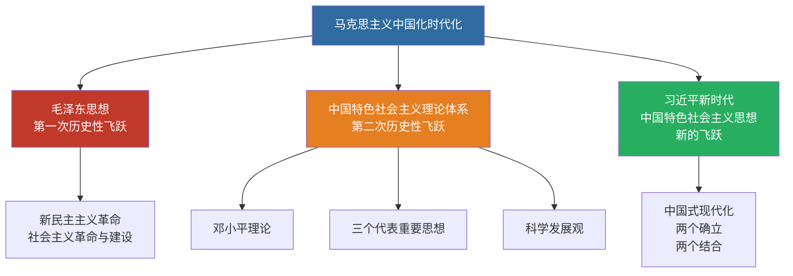

# 01 马克思主义中国化时代化 · 挖空练习

> 同一段话剥三层。**先做 L3，做不动再往下退** —— 顺序反过来会骗自己：
> L1 做对了不代表记住了，只代表「这几个词有印象」。

| 层 | 挖了什么 | 什么时候用 |
|:--|:--|:--|
| L1 | 只有名词 | 第一次接触，或考前扫一遍 |
| L2 | 每句只留前半 | 判断「知不知道接哪半句」 |
| L3 | 只留标题和标点 | 检验能不能整段复述 |

本页挖空数：L1 **10** · L2 **76** · L3 **141**

---

## L1 · 只挖名词

> 🎯 **一句话**：把马克思主义基本原理同中国具体实际、同中华优秀传统文化相结合（**两个结合**）。

---

## 一、核心知识

### 【是什么】
____：把马克思主义基本原理同中国具体实际相结合、同中华优秀传统文化相结合，不断推进马克思主义中国化时代化，用马克思主义观察时代、把握时代、引领时代。

### 【两个结合】
1. ____
2. ____

### 【理论成果主线】
| 阶段 | 成果 | 关键词 |
|:---|:---|:---|
| 新民主主义革命 / 社会主义革命与建设 | 毛泽东思想 | 实事求是、群众路线、独立自主 |
| 改革开放与现代化建设新时期 | 中国特色社会主义理论体系 | 邓三科（邓 + 三 + 科） |
| 中国特色社会主义新时代 | 习近平新时代中国特色社会主义思想 | 两个确立、中国式现代化 |

> 📌 记忆：**三次飞跃、两条主线**——毛泽东思想（第一次）、邓三科（第二次）、习思想（新时代新的飞跃）。

---

## 二、要点速记

- 马克思主义的____：与时俱进
- 马克思主义中国化的____：实事求是
- 第一次历史性飞跃：____
- 第二次历史性飞跃：中国特色社会主义理论体系
- 新时代的重大成果：____（当代中国马克思主义、二十一世纪马克思主义）

---

## 三、闭卷挑战

____ 什么是“____”？

> **点击查看答案与解析**
> 把马克思主义基本原理同中国具体实际相结合、同中华优秀传统文化相结合。

____ 简述马克思主义中国化时代化的历史进程与主要理论成果。

> **点击查看答案与解析**
> 1. 新民主主义革命和社会主义革命与建设时期 → 毛泽东思想
> 2. 改革开放新时期 → 中国特色社会主义理论体系（邓小平理论、“三个代表”、科学发展观）
> 3. 中国特色社会主义新时代 → 习近平新时代中国特色社会主义思想

返回：00-考试大纲与题型 · [政治](/posts/politics/)

---

## L2 · 每句留前半

> 🎯 **一句话**：_________________________________________

---

## 一、核心知识

### 【是什么】
**马克思主义中国化时代化**：_______________________________________________________________________

### 【两个结合】
1. ____
2. ____

### 【理论成果主线】
| 阶段 | 成果 | 关键词 |
|:---|:---|:---|
| 新民主主义革命 / 社会主义革命与建设 | 毛泽东思想 | 实事求是、_________ |
| 改革开放与现代化建设新时期 | 中国特色社会主义理论体系 | 邓三科（邓 + 三 + 科） |
| 中国特色社会主义新时代 | 习近平新时代中国特色社会主义思想 | 两个确立、______ |

> 📌 记忆：________________________________________________

---

## 二、要点速记

- 马克思主义的**理论品质**：____
- 马克思主义中国化的**精髓**：____
- 第一次历史性飞跃：_________
- 第二次历史性飞跃：____________
- 新时代的重大成果：_____________________________

---

## 三、闭卷挑战

____ 什么是“____”？

> ____
> 把马克思主义基本原理同中国具体实际相结合、_____________

____ 简述马克思主义中国化时代化的历史进程与主要理论成果。

> ____
> 1. 新民主主义革命和社会主义革命与建设时期 → 毛泽东思想
> 2. 改革开放新时期 → 中国特色社会主义理论体系（邓小平理论、_____________
> 3. 中国特色社会主义新时代 → 习近平新时代中国特色社会主义思想

返回：__________ _ ______________________

---

## L3 · 只留骨架

_ __ _______：_________________、______________________。

___

## 一、核心知识

### 【是什么】
_______________：____________________、____________，_______________，__________、____、____。

### 【两个结合】
1. ______________
2. ________________

### 【理论成果主线】
| 阶段 | 成果 | 关键词 |
|:---|:---|:---|
| _______ _ _________ | _____ | ______________ |
| _____________ | ____________ | _____ _ _ _ __ |
| ___________ | ________________ | ___________ |

_ __ __：______、__________________、________、____________。

___

## 二、要点速记

- ______________：____
- _______________：____
- ________：_________
- ________：____________
- ________：_________________、___________

___

## 三、闭卷挑战

______ _________？

_ _____________
_ ____________________、____________。

______ _________________________。

_ _____________
_ __ ___________________ _ _____
_ __ _______ _ __________________、______、______
_ __ ___________ _ ________________

__：__________ _ ______________________

---

## 原文

点开对照（先做完再看）

# 01 马克思主义中国化时代化

> 🎯 **一句话**：把马克思主义基本原理同中国具体实际、同中华优秀传统文化相结合（**两个结合**）。

---

## 一、核心知识

### 【是什么】
**马克思主义中国化时代化**：把马克思主义基本原理同中国具体实际相结合、同中华优秀传统文化相结合，不断推进马克思主义中国化时代化，用马克思主义观察时代、把握时代、引领时代。

### 【两个结合】
1. **同中国具体实际相结合**
2. **同中华优秀传统文化相结合**

### 【理论成果主线】
| 阶段 | 成果 | 关键词 |
|:---|:---|:---|
| 新民主主义革命 / 社会主义革命与建设 | 毛泽东思想 | 实事求是、群众路线、独立自主 |
| 改革开放与现代化建设新时期 | 中国特色社会主义理论体系 | 邓三科（邓 + 三 + 科） |
| 中国特色社会主义新时代 | 习近平新时代中国特色社会主义思想 | 两个确立、中国式现代化 |

> 📌 记忆：**三次飞跃、两条主线**——毛泽东思想（第一次）、邓三科（第二次）、习思想（新时代新的飞跃）。

---

## 二、要点速记

- 马克思主义的**理论品质**：与时俱进
- 马克思主义中国化的**精髓**：实事求是
- 第一次历史性飞跃：**毛泽东思想**
- 第二次历史性飞跃：中国特色社会主义理论体系
- 新时代的重大成果：**习思想**（当代中国马克思主义、二十一世纪马克思主义）

---

## 三、闭卷挑战

**1.** 什么是“两个结合”？

> **点击查看答案与解析**
> 把马克思主义基本原理同中国具体实际相结合、同中华优秀传统文化相结合。

**2.** 简述马克思主义中国化时代化的历史进程与主要理论成果。

> **点击查看答案与解析**
> 1. 新民主主义革命和社会主义革命与建设时期 → 毛泽东思想
> 2. 改革开放新时期 → 中国特色社会主义理论体系（邓小平理论、“三个代表”、科学发展观）
> 3. 中国特色社会主义新时代 → 习近平新时代中国特色社会主义思想

返回：00-考试大纲与题型 · [政治](/posts/politics/)

