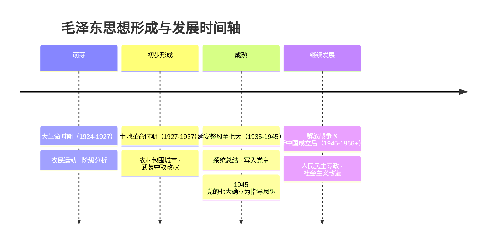

# 02 毛泽东思想 · 挖空练习

> 同一段话剥三层。**先做 L3，做不动再往下退** —— 顺序反过来会骗自己：
> L1 做对了不代表记住了，只代表「这几个词有印象」。

| 层 | 挖了什么 | 什么时候用 |
|:--|:--|:--|
| L1 | 只有名词 | 第一次接触，或考前扫一遍 |
| L2 | 每句只留前半 | 判断「知不知道接哪半句」 |
| L3 | 只留标题和标点 | 检验能不能整段复述 |

本页挖空数：L1 **9** · L2 **45** · L3 **98**

---

## L1 · 只挖名词

> 🎯 **一句话**：毛泽东思想是马克思主义中国化的**第一次历史性飞跃**。

---

## 一、形成与发展（时间轴）

| 阶段 | 标志 | 要点 |
|:---|:---|:---|
| 萌芽 | 大革命时期 | 农民运动、阶级分析 |
| 初步形成 | 土地革命时期 | 农村包围城市、武装夺取政权 |
| 成熟 | 延安整风至七大 | 系统总结，写入党章 |
| 继续发展 | 解放战争、新中国成立后 | 人民民主专政、社会主义改造等 |

____：确立毛泽东思想为党的指导思想。

> 📌 记忆口诀：**萌芽在大革命、形成在土地革命、成熟在延安（七大）、发展在新中国**。

---

## 二、活的灵魂（必背 3 条）

1. ____（精髓）
2. ____（根本工作路线）
3. ____（根本立足点）

---

## 三、历史地位

- 马克思主义中国化的____
- 中国革命和建设的科学指南
- 中国共产党和中国人民宝贵的精神财富
- 必须把毛泽东思想与毛泽东晚年错误____（十一届六中全会《____》精神）

---

## 四、闭卷挑战

____ 毛泽东思想活的灵魂是什么？

> **点击查看答案与解析**
> 实事求是、群众路线、独立自主。

____ 毛泽东思想何时被确立为党的指导思想？

> **点击查看答案与解析**
> 1945 年党的七大。

返回：01-马克思主义中国化时代化 · [政治](/posts/politics/)

---

## L2 · 每句留前半

> 🎯 **一句话**：____________________________

---

## 一、形成与发展（时间轴）

| 阶段 | 标志 | 要点 |
|:---|:---|:---|
| 萌芽 | 大革命时期 | 农民运动、____ |
| 初步形成 | 土地革命时期 | 农村包围城市、______ |
| 成熟 | 延安整风至七大 | 系统总结，____ |
| 继续发展 | 解放战争、______ | 人民民主专政、_______ |

**党的七大（1945）**：_______________

> 📌 记忆口诀：____________________________________

---

## 二、活的灵魂（必背 3 条）

1. ____（精髓）
2. ____（根本工作路线）
3. ____（根本立足点）

---

## 三、历史地位

- 马克思主义中国化的____
- 中国革命和建设的科学指南
- 中国共产党和中国人民宝贵的精神财富
- 必须把毛泽东思想与毛泽东晚年错误____（十一届六中全会《____》精神）

---

## 四、闭卷挑战

____ 毛泽东思想活的灵魂是什么？

> ____
> 实事求是、__________

____ 毛泽东思想何时被确立为党的指导思想？

> ____
> ____ 年党的七大。

返回：______________ _ ______________________

---

## L3 · 只留骨架

_ __ _______：___________________________。

___

## 一、形成与发展（时间轴）

| 阶段 | 标志 | 要点 |
|:---|:---|:---|
| __ | _____ | _________ |
| ____ | ______ | _____________ |
| __ | _______ | _________ |
| ____ | ___________ | ______________ |

______________：______________。

_ __ ____：________、_______、_________、________。

___

## 二、活的灵魂（必背 3 条）

1. ____________
2. ________________
3. _______________

___

## 三、历史地位

- _____________________
- ____________
- _________________
- _________________________________________

___

## 四、闭卷挑战

______ ____________？

_ _____________
_ ____、____、____。

______ _________________？

_ _____________
_ ____ _____。

__：______________ _ ______________________

---

## 原文

点开对照（先做完再看）

# 02 毛泽东思想及其历史地位

> 🎯 **一句话**：毛泽东思想是马克思主义中国化的**第一次历史性飞跃**。

---

## 一、形成与发展（时间轴）

| 阶段 | 标志 | 要点 |
|:---|:---|:---|
| 萌芽 | 大革命时期 | 农民运动、阶级分析 |
| 初步形成 | 土地革命时期 | 农村包围城市、武装夺取政权 |
| 成熟 | 延安整风至七大 | 系统总结，写入党章 |
| 继续发展 | 解放战争、新中国成立后 | 人民民主专政、社会主义改造等 |

**党的七大（1945）**：确立毛泽东思想为党的指导思想。

> 📌 记忆口诀：**萌芽在大革命、形成在土地革命、成熟在延安（七大）、发展在新中国**。

---

## 二、活的灵魂（必背 3 条）

1. **实事求是**（精髓）
2. **群众路线**（根本工作路线）
3. **独立自主**（根本立足点）

---

## 三、历史地位

- 马克思主义中国化的**第一次历史性飞跃**
- 中国革命和建设的科学指南
- 中国共产党和中国人民宝贵的精神财富
- 必须把毛泽东思想与毛泽东晚年错误**区别开来**（十一届六中全会《历史决议》精神）

---

## 四、闭卷挑战

**1.** 毛泽东思想活的灵魂是什么？

> **点击查看答案与解析**
> 实事求是、群众路线、独立自主。

**2.** 毛泽东思想何时被确立为党的指导思想？

> **点击查看答案与解析**
> 1945 年党的七大。

返回：01-马克思主义中国化时代化 · [政治](/posts/politics/)

