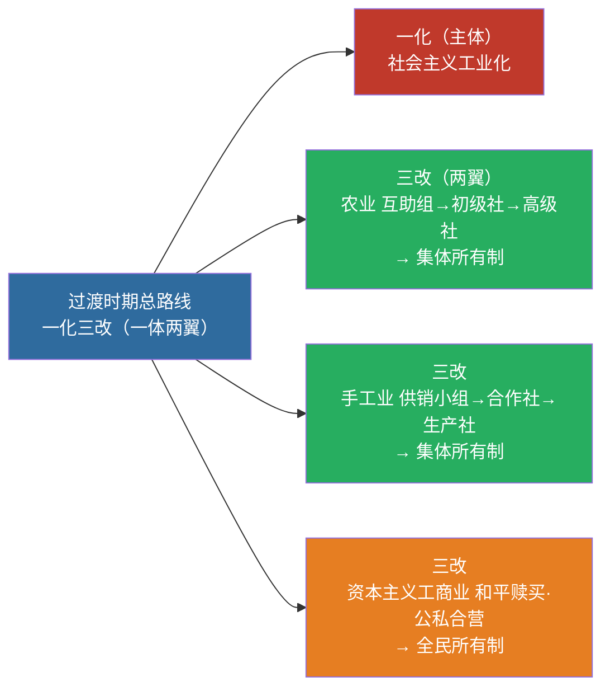

# 04 社会主义改造 · 挖空练习

> 同一段话剥三层。**先做 L3，做不动再往下退** —— 顺序反过来会骗自己：
> L1 做对了不代表记住了，只代表「这几个词有印象」。

| 层 | 挖了什么 | 什么时候用 |
|:--|:--|:--|
| L1 | 只有名词 | 第一次接触，或考前扫一遍 |
| L2 | 每句只留前半 | 判断「知不知道接哪半句」 |
| L3 | 只留标题和标点 | 检验能不能整段复述 |

本页挖空数：L1 **5** · L2 **69** · L3 **95**

---

## L1 · 只挖名词

> 🎯 **一句话**：过渡时期总路线 = **一化三改**（一体两翼）。

---

## 一、过渡时期总路线

____，这是一个过渡时期。党在这个过渡时期的总路线和总任务是：

> 要在一个相当长的时期内，逐步实现国家的**社会主义工业化**，并逐步实现国家对**农业、手工业和资本主义工商业**的社会主义改造。

| 名称 | 内容 |
|:---|:---|
| 一化 | 社会主义工业化（主体） |
| 三改 | 农业、手工业、资本主义工商业的社会主义改造（两翼） |

> 📌 1956 年底改造基本完成 → 社会主义基本制度确立。记忆：**一化是主体，三改是两翼；农业走互助组，资本主义走和平赎买**。

---

## 二、改造道路要点

| 对象 | 道路/形式 | 结果 |
|:---|:---|:---|
| 农业 | 互助组 → 初级社 → 高级社 | 集体所有制 |
| 手工业 | 供销小组 → 供销合作社 → 生产合作社 | 集体所有制 |
| 资本主义工商业 | 和平赎买；加工订货、公私合营等 | 全民所有制 |

____：社会主义改造基本完成 → 社会主义基本制度在中国确立。

---

## 三、闭卷挑战

____ “____”分别指什么？

> **点击查看答案与解析**
> 一化：社会主义工业化；三改：对农业、手工业、资本主义工商业的社会主义改造。

____ 社会主义基本制度在中国确立的标志性时间？

> **点击查看答案与解析**
> 1956 年底社会主义改造基本完成。

返回：03-新民主主义革命 · [政治](/posts/politics/)

---

## L2 · 每句留前半

> 🎯 **一句话**：_______ _ _______________

---

## 一、过渡时期总路线

**从中华人民共和国成立，_________________________________________

> 要在一个相当长的时期内，_____________________________________________________

| 名称 | 内容 |
|:---|:---|
| 一化 | 社会主义工业化（主体） |
| 三改 | 农业、______________________ |

> 📌 1956 年底改造基本完成 → 社会主义基本制度确立。____________________________________

---

## 二、改造道路要点

| 对象 | 道路/形式 | 结果 |
|:---|:---|:---|
| 农业 | 互助组 → 初级社 → 高级社 | 集体所有制 |
| 手工业 | 供销小组 → 供销合作社 → 生产合作社 | 集体所有制 |
| 资本主义工商业 | 和平赎买；__________ | 全民所有制 |

**1956 年底**：__________ _ ______________

---

## 三、闭卷挑战

____ “____”分别指什么？

> ____
> 一化：__________________________________

____ 社会主义基本制度在中国确立的标志性时间？

> ____
> ____ 年底社会主义改造基本完成。

返回：__________ _ ______________________

---

## L3 · 只留骨架

_ __ _______：_______ _ ______________。

___

## 一、过渡时期总路线

____________，_____________，________。_________________：

_ ___________，__________________，____________、____________________。

| 名称 | 内容 |
|:---|:---|
| __ | ___________ |
| __ | _________________________ |

_ __ ____ ________ _ __________。__：_______，_____；______，___________。

___

## 二、改造道路要点

| 对象 | 道路/形式 | 结果 |
|:---|:---|:---|
| __ | ___ _ ___ _ ___ | _____ |
| ___ | ____ _ _____ _ _____ | _____ |
| _______ | _______________ | _____ |

______ ____：__________ _ _____________。

___

## 三、闭卷挑战

______ ___________？

_ _____________
_ __：_______；__：___、___、______________。

______ ___________________？

_ _____________
_ ____ ____________。

__：__________ _ ______________________

---

## 原文

点开对照（先做完再看）

# 04 社会主义改造理论

> 🎯 **一句话**：过渡时期总路线 = **一化三改**（一体两翼）。

---

## 一、过渡时期总路线

**从中华人民共和国成立，到社会主义改造基本完成**，这是一个过渡时期。党在这个过渡时期的总路线和总任务是：

> 要在一个相当长的时期内，逐步实现国家的**社会主义工业化**，并逐步实现国家对**农业、手工业和资本主义工商业**的社会主义改造。

| 名称 | 内容 |
|:---|:---|
| 一化 | 社会主义工业化（主体） |
| 三改 | 农业、手工业、资本主义工商业的社会主义改造（两翼） |

> 📌 1956 年底改造基本完成 → 社会主义基本制度确立。记忆：**一化是主体，三改是两翼；农业走互助组，资本主义走和平赎买**。

---

## 二、改造道路要点

| 对象 | 道路/形式 | 结果 |
|:---|:---|:---|
| 农业 | 互助组 → 初级社 → 高级社 | 集体所有制 |
| 手工业 | 供销小组 → 供销合作社 → 生产合作社 | 集体所有制 |
| 资本主义工商业 | 和平赎买；加工订货、公私合营等 | 全民所有制 |

**1956 年底**：社会主义改造基本完成 → 社会主义基本制度在中国确立。

---

## 三、闭卷挑战

**1.** “一化三改”分别指什么？

> **点击查看答案与解析**
> 一化：社会主义工业化；三改：对农业、手工业、资本主义工商业的社会主义改造。

**2.** 社会主义基本制度在中国确立的标志性时间？

> **点击查看答案与解析**
> 1956 年底社会主义改造基本完成。

返回：03-新民主主义革命 · [政治](/posts/politics/)

