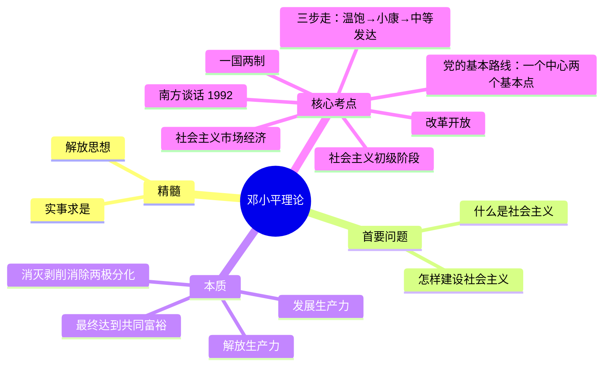

# 07 邓小平理论 · 挖空练习

> 同一段话剥三层。**先做 L3，做不动再往下退** —— 顺序反过来会骗自己：
> L1 做对了不代表记住了，只代表「这几个词有印象」。

| 层 | 挖了什么 | 什么时候用 |
|:--|:--|:--|
| L1 | 只有名词 | 第一次接触，或考前扫一遍 |
| L2 | 每句只留前半 | 判断「知不知道接哪半句」 |
| L3 | 只留标题和标点 | 检验能不能整段复述 |

本页挖空数：L1 **8** · L2 **65** · L3 **96**

---

## L1 · 只挖名词

> 🎯 **一句话**：解放思想、实事求是；搞清楚**什么是社会主义、怎样建设社会主义**。

---

## 一、精髓与首要问题

- ____：解放思想、实事求是
- ____：什么是社会主义、怎样建设社会主义
- ____：解放生产力，发展生产力，消灭剥削，消除两极分化，最终达到共同富裕

> 📌 南方谈话 1992：**社会主义本质 + 三个有利于 + 计划市场都是手段 + 发展才是硬道理**。

---

## 二、高频考点清单

| 考点 | 要点 |
|:---|:---|
| 社会主义初级阶段 | 基本国情；至少上百年 |
| 党的基本路线 | 一个中心、两个基本点 |
| 改革开放 | 决定当代中国命运的关键一招 |
| 社会主义市场经济 | 计划与市场都是手段 |
| 一国两制 | 实现祖国统一的构想 |
| “____” | 温饱 → 小康 → 中等发达 |

____：社会主义本质；“____”；计划市场都是经济手段；发展才是硬道理。

---

## 三、闭卷挑战

____ 社会主义的本质是什么？

> **点击查看答案与解析**
> 解放生产力，发展生产力，消灭剥削，消除两极分化，最终达到共同富裕。

____ 党在社会主义初级阶段的基本路线核心内容？

> **点击查看答案与解析**
> 以经济建设为中心，坚持四项基本原则，坚持改革开放（一个中心、两个基本点）。

返回：06-中国特色社会主义理论体系 · [政治](/posts/politics/)

---

## L2 · 每句留前半

> 🎯 **一句话**：__________________________________

---

## 一、精髓与首要问题

- **精髓**：_________
- **首要的基本理论问题**：________________
- **本质**：________________________________

> 📌 南方谈话 1992：________ _ _____ _ ________ _ __________

---

## 二、高频考点清单

| 考点 | 要点 |
|:---|:---|
| 社会主义初级阶段 | 基本国情；_____ |
| 党的基本路线 | 一个中心、_____ |
| 改革开放 | 决定当代中国命运的关键一招 |
| 社会主义市场经济 | 计划与市场都是手段 |
| 一国两制 | 实现祖国统一的构想 |
| “____” | 温饱 → 小康 → 中等发达 |

**南方谈话（1992）**：__________________________________

---

## 三、闭卷挑战

____ 社会主义的本质是什么？

> ____
> 解放生产力，___________________________

____ 党在社会主义初级阶段的基本路线核心内容？

> ____
> 以经济建设为中心，____________________________

返回：_______________ _ ______________________

---

## L3 · 只留骨架

_ __ _______：____、____；____________、__________。

___

## 一、精髓与首要问题

- ______：____、____
- _____________：_______、________
- ______：_____，_____，____，______，________

_ __ ____ ____：________ _ _____ _ ________ _ _________。

___

## 二、高频考点清单

| 考点 | 要点 |
|:---|:---|
| ________ | __________ |
| ______ | __________ |
| ____ | _____________ |
| ________ | _________ |
| ____ | _________ |
| _____ | __ _ __ _ ____ |

______________：______；_______；__________；_______。

___

## 三、闭卷挑战

______ __________？

_ _____________
_ _____，_____，____，______，________。

______ ___________________？

_ _____________
_ ________，________，___________、______。

__：_______________ _ ______________________

---

## 原文

点开对照（先做完再看）

# 07 邓小平理论

> 🎯 **一句话**：解放思想、实事求是；搞清楚**什么是社会主义、怎样建设社会主义**。

---

## 一、精髓与首要问题

- **精髓**：解放思想、实事求是
- **首要的基本理论问题**：什么是社会主义、怎样建设社会主义
- **本质**：解放生产力，发展生产力，消灭剥削，消除两极分化，最终达到共同富裕

> 📌 南方谈话 1992：**社会主义本质 + 三个有利于 + 计划市场都是手段 + 发展才是硬道理**。

---

## 二、高频考点清单

| 考点 | 要点 |
|:---|:---|
| 社会主义初级阶段 | 基本国情；至少上百年 |
| 党的基本路线 | 一个中心、两个基本点 |
| 改革开放 | 决定当代中国命运的关键一招 |
| 社会主义市场经济 | 计划与市场都是手段 |
| 一国两制 | 实现祖国统一的构想 |
| “三步走” | 温饱 → 小康 → 中等发达 |

**南方谈话（1992）**：社会主义本质；“三个有利于”；计划市场都是经济手段；发展才是硬道理。

---

## 三、闭卷挑战

**1.** 社会主义的本质是什么？

> **点击查看答案与解析**
> 解放生产力，发展生产力，消灭剥削，消除两极分化，最终达到共同富裕。

**2.** 党在社会主义初级阶段的基本路线核心内容？

> **点击查看答案与解析**
> 以经济建设为中心，坚持四项基本原则，坚持改革开放（一个中心、两个基本点）。

返回：06-中国特色社会主义理论体系 · [政治](/posts/politics/)

