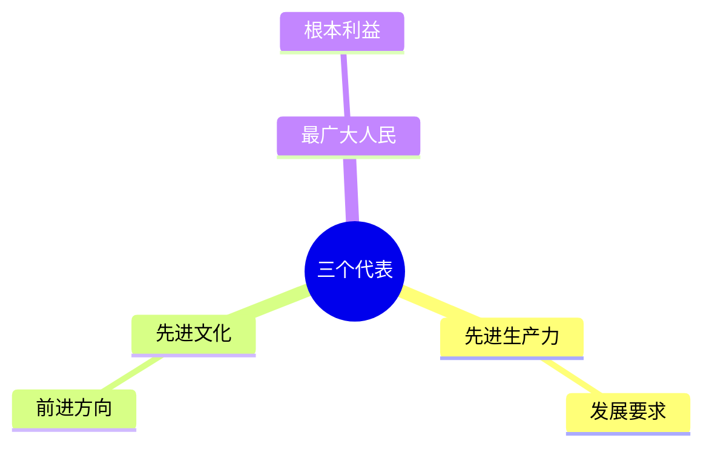
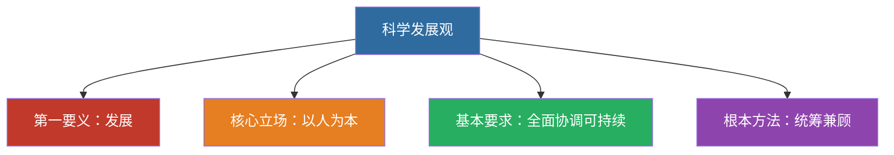

# 08 三个代表与科学发展观 · 挖空练习

> 同一段话剥三层。**先做 L3，做不动再往下退** —— 顺序反过来会骗自己：
> L1 做对了不代表记住了，只代表「这几个词有印象」。

| 层 | 挖了什么 | 什么时候用 |
|:--|:--|:--|
| L1 | 只有名词 | 第一次接触，或考前扫一遍 |
| L2 | 每句只留前半 | 判断「知不知道接哪半句」 |
| L3 | 只留标题和标点 | 检验能不能整段复述 |

本页挖空数：L1 **12** · L2 **53** · L3 **84**

---

## L1 · 只挖名词

---

## 一、“三个代表”重要思想

中国共产党必须始终：

1. 代表中国____的发展要求
2. 代表中国____的前进方向
3. 代表中国____的根本利益

____：立党为公、执政为民。

> 📌 本质：**立党为公、执政为民**。

---

## 二、科学发展观

- ____：发展
- ____：以人为本
- ____：全面协调可持续
- ____：统筹兼顾

> 📌 记忆：**发展（要义）→ 人本（立场）→ 全面协调可持续（要求）→ 统筹兼顾（方法）**。

____：马克思主义关于发展的世界观和方法论的集中体现；党的十七大写入党章，十八大列为指导思想。

---

## 三、闭卷挑战

____ 默写“____”完整表述。

> **点击查看答案与解析**
> 始终代表中国先进生产力的发展要求、中国先进文化的前进方向、中国最广大人民的根本利益。

____ 科学发展观的第一要义、核心立场、基本要求、根本方法？

> **点击查看答案与解析**
> 发展；以人为本；全面协调可持续；统筹兼顾。

返回：07-邓小平理论 · [政治](/posts/politics/)

---

## L2 · 每句留前半

---

## 一、“三个代表”重要思想

中国共产党必须始终：

1. 代表中国____的发展要求
2. 代表中国____的前进方向
3. 代表中国____的根本利益

**本质**：__________

> 📌 本质：______________

---

## 二、科学发展观

- **第一要义**：__
- **核心立场**：____
- **基本要求**：_______
- **根本方法**：____

> 📌 记忆：_________ _______ ____________ ___________

**历史地位**：___________________________________________

---

## 三、闭卷挑战

____ 默写“____”完整表述。

> ____
> 始终代表中国先进生产力的发展要求、_________________________

**2.** 科学发展观的第一要义、_______________

> ____
> 发展；__________________

返回：________ _ ______________________

---

## L3 · 只留骨架

___

## 一、“三个代表”重要思想

_________：

1. __________________
2. _________________
3. __________________

______：____、____。

_ __ __：______、______。

___

## 二、科学发展观

- ________：__
- ________：____
- ________：_______
- ________：____

_ __ __：_________ _______ ____________ __________。

________：______________________；_________，_________。

___

## 三、闭卷挑战

______ ____________。

_ _____________
_ ________________、___________、____________。

______ __________、____、____、____？

_ _____________
_ __；____；_______；____。

__：________ _ ______________________

---

## 原文

点开对照（先做完再看）

# 08 “三个代表”重要思想与科学发展观

---

## 一、“三个代表”重要思想

中国共产党必须始终：

1. 代表中国**先进生产力**的发展要求
2. 代表中国**先进文化**的前进方向
3. 代表中国**最广大人民**的根本利益

**本质**：立党为公、执政为民。

> 📌 本质：**立党为公、执政为民**。

---

## 二、科学发展观

- **第一要义**：发展
- **核心立场**：以人为本
- **基本要求**：全面协调可持续
- **根本方法**：统筹兼顾

> 📌 记忆：**发展（要义）→ 人本（立场）→ 全面协调可持续（要求）→ 统筹兼顾（方法）**。

**历史地位**：马克思主义关于发展的世界观和方法论的集中体现；党的十七大写入党章，十八大列为指导思想。

---

## 三、闭卷挑战

**1.** 默写“三个代表”完整表述。

> **点击查看答案与解析**
> 始终代表中国先进生产力的发展要求、中国先进文化的前进方向、中国最广大人民的根本利益。

**2.** 科学发展观的第一要义、核心立场、基本要求、根本方法？

> **点击查看答案与解析**
> 发展；以人为本；全面协调可持续；统筹兼顾。

返回：07-邓小平理论 · [政治](/posts/politics/)

