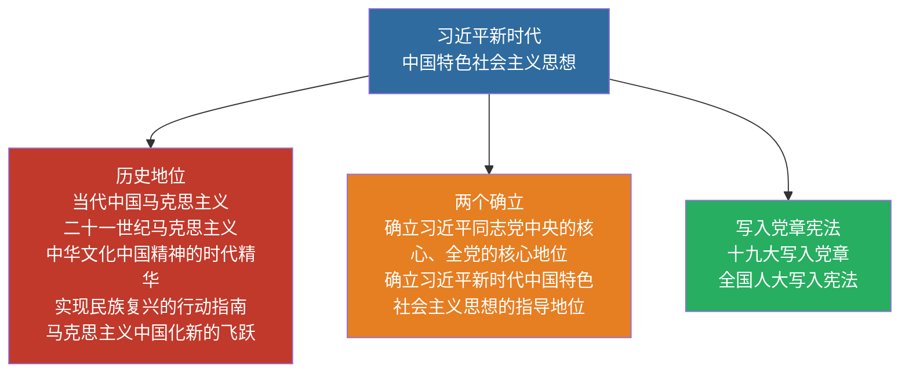

# 09 习思想形成与历史地位 · 挖空练习

> 同一段话剥三层。**先做 L3，做不动再往下退** —— 顺序反过来会骗自己：
> L1 做对了不代表记住了，只代表「这几个词有印象」。

| 层 | 挖了什么 | 什么时候用 |
|:--|:--|:--|
| L1 | 只有名词 | 第一次接触，或考前扫一遍 |
| L2 | 每句只留前半 | 判断「知不知道接哪半句」 |
| L3 | 只留标题和标点 | 检验能不能整段复述 |

本页挖空数：L1 **3** · L2 **52** · L3 **78**

---

## L1 · 只挖名词

> 🎯 **一句话**：当代中国马克思主义、二十一世纪马克思主义；中华文化和中国精神的时代精华。

---

## 一、形成背景（简记）

- 中国特色社会主义进入____
- 世界百年未有之大变局
- 中华民族伟大复兴战略全局
- 党面临的重大风险考验

____：确立习思想为党的指导思想并写入党章；十三届全国人大一次会议写入宪法。

---

## 二、历史地位（必背表述）

- 当代中国马克思主义、二十一世纪马克思主义
- 中华文化和中国精神的时代精华
- 实现中华民族伟大复兴的行动指南
- 马克思主义中国化时代化新的飞跃

---

## 三、“两个确立”（表述务必准确）

确立习近平同志党中央的核心、全党的核心地位；确立习近平新时代中国特色社会主义思想的指导地位。

---

## 四、闭卷挑战

____ 简述习思想的历史地位（至少写 3 点）。

> **点击查看答案与解析**
> 当代中国马克思主义、二十一世纪马克思主义；中华文化和中国精神的时代精华；实现中华民族伟大复兴的行动指南；马克思主义中国化时代化新的飞跃。

返回：08-三个代表与科学发展观 · [政治](/posts/politics/)

---

## L2 · 每句留前半

> 🎯 **一句话**：____________________________________

---

## 一、形成背景（简记）

- 中国特色社会主义进入____
- 世界百年未有之大变局
- 中华民族伟大复兴战略全局
- 党面临的重大风险考验

**党的十九大**：__________________________________

---

## 二、历史地位（必背表述）

- 当代中国马克思主义、__________
- 中华文化和中国精神的时代精华
- 实现中华民族伟大复兴的行动指南
- 马克思主义中国化时代化新的飞跃

---

## 三、“两个确立”（表述务必准确）

确立习近平同志党中央的核心、________________________________

---

## 四、闭卷挑战

____ 简述习思想的历史地位（至少写 3 点）。

> ____
> 当代中国马克思主义、__________________________________________________________

返回：_____________ _ ______________________

---

## L3 · 只留骨架

_ __ _______：_________、__________；______________。

___

## 一、形成背景（简记）

- _________________
- __________
- ____________
- __________

_________：_________________；_______________。

___

## 二、历史地位（必背表述）

- _________、__________
- ______________
- _______________
- _______________

___

## 三、“两个确立”（表述务必准确）

_____________、_______；_______________________。

___

## 四、闭卷挑战

______ ______________ _ __。

_ _____________
_ _________、__________；______________；_______________；_______________。

__：_____________ _ ______________________

---

## 原文

点开对照（先做完再看）

# 09 习近平新时代中国特色社会主义思想：形成与历史地位

> 🎯 **一句话**：当代中国马克思主义、二十一世纪马克思主义；中华文化和中国精神的时代精华。

---

## 一、形成背景（简记）

- 中国特色社会主义进入**新时代**
- 世界百年未有之大变局
- 中华民族伟大复兴战略全局
- 党面临的重大风险考验

**党的十九大**：确立习思想为党的指导思想并写入党章；十三届全国人大一次会议写入宪法。

---

## 二、历史地位（必背表述）

- 当代中国马克思主义、二十一世纪马克思主义
- 中华文化和中国精神的时代精华
- 实现中华民族伟大复兴的行动指南
- 马克思主义中国化时代化新的飞跃

---

## 三、“两个确立”（表述务必准确）

确立习近平同志党中央的核心、全党的核心地位；确立习近平新时代中国特色社会主义思想的指导地位。

---

## 四、闭卷挑战

**1.** 简述习思想的历史地位（至少写 3 点）。

> **点击查看答案与解析**
> 当代中国马克思主义、二十一世纪马克思主义；中华文化和中国精神的时代精华；实现中华民族伟大复兴的行动指南；马克思主义中国化时代化新的飞跃。

返回：08-三个代表与科学发展观 · [政治](/posts/politics/)

