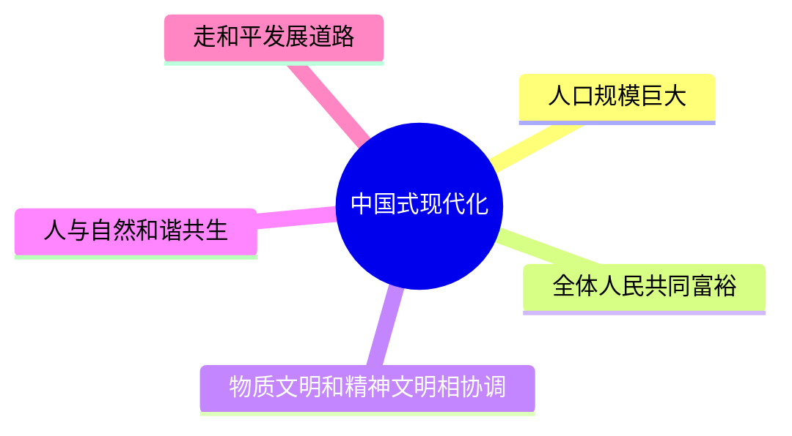
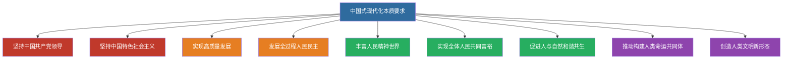

# 10 中国式现代化 · 挖空练习

> 同一段话剥三层。**先做 L3，做不动再往下退** —— 顺序反过来会骗自己：
> L1 做对了不代表记住了，只代表「这几个词有印象」。

| 层 | 挖了什么 | 什么时候用 |
|:--|:--|:--|
| L1 | 只有名词 | 第一次接触，或考前扫一遍 |
| L2 | 每句只留前半 | 判断「知不知道接哪半句」 |
| L3 | 只留标题和标点 | 检验能不能整段复述 |

本页挖空数：L1 **1** · L2 **84** · L3 **96**

---

## L1 · 只挖名词

> 🎯 **一句话**：以中国式现代化全面推进中华民族伟大复兴。

---

## 一、中国式现代化的中国特色（5 条必背）

1. 人口规模巨大的现代化
2. 全体人民共同富裕的现代化
3. 物质文明和精神文明相协调的现代化
4. 人与自然和谐共生的现代化
5. 走和平发展道路的现代化

> 📌 记忆口诀：**人、富、物精、人自、和平**——"一个最大（人口），两个协调（物质精神、人与自然），两个全体/共同（共同富裕、和平发展）"。

## 二、本质要求（简记框架）

坚持中国共产党领导，坚持中国特色社会主义，实现高质量发展，发展全过程人民民主，丰富人民精神世界，实现全体人民共同富裕，促进人与自然和谐共生，推动构建人类命运共同体，创造人类文明新形态。

> 📌 记忆分层：**两个坚持（党+社会主义）→ 四个实现（高质量、全过程民主、人民精神、共同富裕）→ 三个促进（人与自然、人类命运共同体、人类文明新形态）**。

## 三、中心任务

团结带领全国各族人民全面建成社会主义现代化强国、实现第二个百年奋斗目标，以中国式现代化全面推进中华民族伟大复兴。

---

## 四、闭卷挑战

____ 默写中国式现代化的五个中国特色。

> **点击查看答案与解析**
> 人口规模巨大；全体人民共同富裕；物质文明和精神文明相协调；人与自然和谐共生；走和平发展道路。

返回：09-习思想形成与历史地位 · [政治](/posts/politics/)

---

## L2 · 每句留前半

> 🎯 **一句话**：____________________

---

## 一、中国式现代化的中国特色（5 条必背）

1. 人口规模巨大的现代化
2. 全体人民共同富裕的现代化
3. 物质文明和精神文明相协调的现代化
4. 人与自然和谐共生的现代化
5. 走和平发展道路的现代化

> 📌 记忆口诀：________________________________________________________________

## 二、本质要求（简记框架）

坚持中国共产党领导，__________________________________________________________________________________

> 📌 记忆分层：_______________ __________________________ _____________________________

## 三、中心任务

团结带领全国各族人民全面建成社会主义现代化强国、________________________________

---

## 四、闭卷挑战

____ 默写中国式现代化的五个中国特色。

> ____
> 人口规模巨大；_______________________________________

返回：_____________ _ ______________________

---

## L3 · 只留骨架

_ __ _______：___________________。

___

## 一、中国式现代化的中国特色（5 条必背）

1. __________
2. ____________
3. ________________
4. ____________
5. ___________

_ __ ____：___、_、__、__、_______________，_________、_____，____________、______。

## 二、本质要求（简记框架）

_________，__________，_______，_________，________，__________，__________，___________，_________。

_ __ ____：_______________ ________、_____、____、______ _________、_______、__________。

## 三、中心任务

_______________________、___________，___________________。

___

## 四、闭卷挑战

______ _______________。

_ _____________
_ ______；________；____________；________；_______。

__：_____________ _ ______________________

---

## 原文

点开对照（先做完再看）

# 10 中国式现代化与中华民族伟大复兴

> 🎯 **一句话**：以中国式现代化全面推进中华民族伟大复兴。

---

## 一、中国式现代化的中国特色（5 条必背）

1. 人口规模巨大的现代化
2. 全体人民共同富裕的现代化
3. 物质文明和精神文明相协调的现代化
4. 人与自然和谐共生的现代化
5. 走和平发展道路的现代化

> 📌 记忆口诀：**人、富、物精、人自、和平**——"一个最大（人口），两个协调（物质精神、人与自然），两个全体/共同（共同富裕、和平发展）"。

## 二、本质要求（简记框架）

坚持中国共产党领导，坚持中国特色社会主义，实现高质量发展，发展全过程人民民主，丰富人民精神世界，实现全体人民共同富裕，促进人与自然和谐共生，推动构建人类命运共同体，创造人类文明新形态。

> 📌 记忆分层：**两个坚持（党+社会主义）→ 四个实现（高质量、全过程民主、人民精神、共同富裕）→ 三个促进（人与自然、人类命运共同体、人类文明新形态）**。

## 三、中心任务

团结带领全国各族人民全面建成社会主义现代化强国、实现第二个百年奋斗目标，以中国式现代化全面推进中华民族伟大复兴。

---

## 四、闭卷挑战

**1.** 默写中国式现代化的五个中国特色。

> **点击查看答案与解析**
> 人口规模巨大；全体人民共同富裕；物质文明和精神文明相协调；人与自然和谐共生；走和平发展道路。

返回：09-习思想形成与历史地位 · [政治](/posts/politics/)

