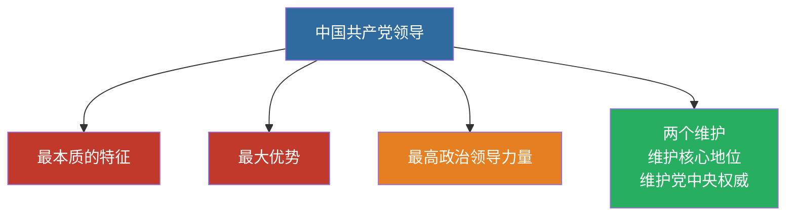

# 11 党的领导与以人民为中心 · 挖空练习

> 同一段话剥三层。**先做 L3，做不动再往下退** —— 顺序反过来会骗自己：
> L1 做对了不代表记住了，只代表「这几个词有印象」。

| 层 | 挖了什么 | 什么时候用 |
|:--|:--|:--|
| L1 | 只有名词 | 第一次接触，或考前扫一遍 |
| L2 | 每句只留前半 | 判断「知不知道接哪半句」 |
| L3 | 只留标题和标点 | 检验能不能整段复述 |

本页挖空数：L1 **7** · L2 **36** · L3 **69**

---

## L1 · 只挖名词

---

## 一、坚持党的全面领导

- 中国特色社会主义____是中国共产党领导
- 中国特色社会主义制度的____是中国共产党领导
- 党是最高政治领导力量
- ____：坚决维护习近平总书记党中央的核心、全党的核心地位；坚决维护党中央权威和集中统一领导

---

## 二、坚持以人民为中心

- 人民立场是中国共产党的____
- 江山就是人民，人民就是江山
- 发展为了人民、发展依靠人民、发展成果由人民共享
- 扎实推进共同富裕

---

## 三、闭卷挑战

____ 中国特色社会主义最本质的特征是什么？

> **点击查看答案与解析**
> 中国共产党领导。

____ “____”的完整表述？

> **点击查看答案与解析**
> 坚决维护习近平总书记党中央的核心、全党的核心地位；坚决维护党中央权威和集中统一领导。

返回：10-中国式现代化 · [政治](/posts/politics/)

---

## L2 · 每句留前半

---

## 一、坚持党的全面领导

- 中国特色社会主义____是中国共产党领导
- 中国特色社会主义制度的____是中国共产党领导
- 党是最高政治领导力量
- **两个维护**：_________________________________________

---

## 二、坚持以人民为中心

- 人民立场是中国共产党的____
- 江山就是人民，______
- 发展为了人民、________________
- 扎实推进共同富裕

---

## 三、闭卷挑战

____ 中国特色社会主义最本质的特征是什么？

> ____
> 中国共产党领导。

____ “____”的完整表述？

> ____
> 坚决维护习近平总书记党中央的核心、_________________________

返回：_________ _ ______________________

---

## L3 · 只留骨架

___

## 一、坚持党的全面领导

- __________________________
- ___________________________
- __________
- ________：________________、_______；________________

___

## 二、坚持以人民为中心

- _____________________
- ______，______
- ______、______、_________
- ________

___

## 三、闭卷挑战

______ _________________？

_ _____________
_ _______。

______ ___________？

_ _____________
_ ________________、_______；________________。

__：_________ _ ______________________

---

## 原文

点开对照（先做完再看）

# 11 坚持党的全面领导 · 坚持以人民为中心

---

## 一、坚持党的全面领导

- 中国特色社会主义**最本质的特征**是中国共产党领导
- 中国特色社会主义制度的**最大优势**是中国共产党领导
- 党是最高政治领导力量
- **两个维护**：坚决维护习近平总书记党中央的核心、全党的核心地位；坚决维护党中央权威和集中统一领导

---

## 二、坚持以人民为中心

- 人民立场是中国共产党的**根本政治立场**
- 江山就是人民，人民就是江山
- 发展为了人民、发展依靠人民、发展成果由人民共享
- 扎实推进共同富裕

---

## 三、闭卷挑战

**1.** 中国特色社会主义最本质的特征是什么？

> **点击查看答案与解析**
> 中国共产党领导。

**2.** “两个维护”的完整表述？

> **点击查看答案与解析**
> 坚决维护习近平总书记党中央的核心、全党的核心地位；坚决维护党中央权威和集中统一领导。

返回：10-中国式现代化 · [政治](/posts/politics/)

