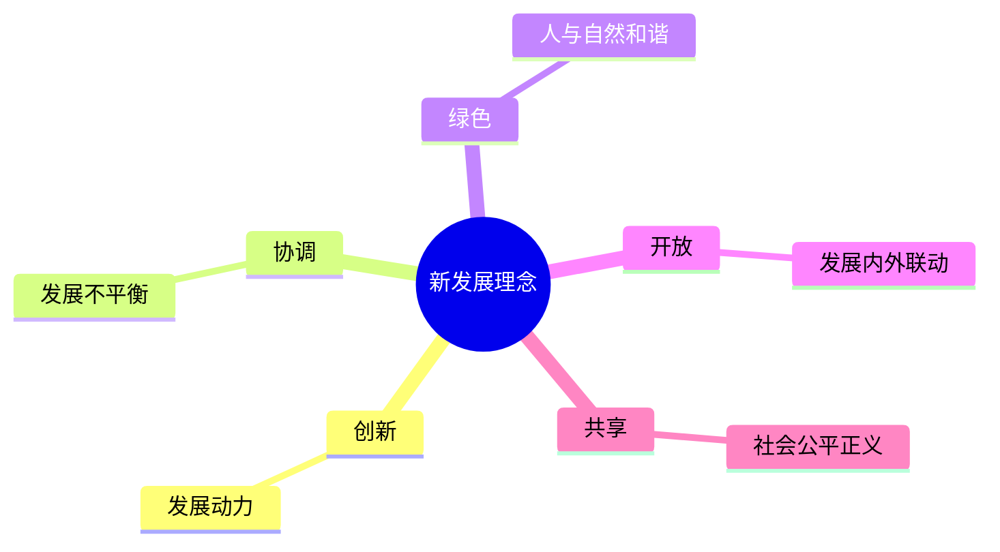

# 12 改革发展与五位一体 · 挖空练习

> 同一段话剥三层。**先做 L3，做不动再往下退** —— 顺序反过来会骗自己：
> L1 做对了不代表记住了，只代表「这几个词有印象」。

| 层 | 挖了什么 | 什么时候用 |
|:--|:--|:--|
| L1 | 只有名词 | 第一次接触，或考前扫一遍 |
| L2 | 每句只留前半 | 判断「知不知道接哪半句」 |
| L3 | 只留标题和标点 | 检验能不能整段复述 |

本页挖空数：L1 **6** · L2 **67** · L3 **91**

---

## L1 · 只挖名词

---

## 一、全面深化改革开放

- 改革开放是决定当代中国命运的关键一招，也是决定实现“____”奋斗目标、实现中华民族伟大复兴的关键一招
- 全面深化改革总目标：完善和发展中国特色社会主义制度，推进国家治理体系和治理能力现代化
- 使市场在资源配置中起____，更好发挥政府作用

---

## 二、新发展理念（5 个必背）

____

| 理念 | 解决什么问题 |
|:---|:---|
| 创新 | 发展动力 |
| 协调 | 发展不平衡 |
| 绿色 | 人与自然和谐 |
| 开放 | 发展内外联动 |
| 共享 | 社会公平正义 |

> 📌 记忆口诀：**创协绿开共 = 新协调绿开共**（动力、平衡、和谐、联动、公平）。

---

## 三、高质量发展

- 高质量发展是全面建设社会主义现代化国家的____
- 完整、准确、全面贯彻新发展理念
- 加快构建新发展格局（以国内大循环为主体、国内国际双循环相互促进）
- 教育、科技、人才是全面建设社会主义现代化国家的基础性、战略性支撑；科技是第一生产力、人才是第一资源、创新是第一动力

---

## 四、闭卷挑战

____ 默写新发展理念五个词。

> **点击查看答案与解析**
> 创新、协调、绿色、开放、共享。

____ 全面深化改革的总目标是什么？

> **点击查看答案与解析**
> 完善和发展中国特色社会主义制度，推进国家治理体系和治理能力现代化。

返回：11-党的领导与以人民为中心 · [政治](/posts/politics/)

---

## L2 · 每句留前半

---

## 一、全面深化改革开放

- 改革开放是决定当代中国命运的关键一招，_________________________________
- 全面深化改革总目标：________________________________
- 使市场在资源配置中起**决定性作用**，________

---

## 二、新发展理念（5 个必背）

**创新、_____________

| 理念 | 解决什么问题 |
|:---|:---|
| 创新 | 发展动力 |
| 协调 | 发展不平衡 |
| 绿色 | 人与自然和谐 |
| 开放 | 发展内外联动 |
| 共享 | 社会公平正义 |

> 📌 记忆口诀：_______ _ _________________________

---

## 三、高质量发展

- 高质量发展是全面建设社会主义现代化国家的____
- 完整、____________
- 加快构建新发展格局（以国内大循环为主体、____________
- 教育、______________________________________________________

---

## 四、闭卷挑战

____ 默写新发展理念五个词。

> ____
> 创新、____________

____ 全面深化改革的总目标是什么？

> ____
> 完善和发展中国特色社会主义制度，_________________

返回：______________ _ ______________________

---

## L3 · 只留骨架

___

## 一、全面深化改革开放

- __________________，_________________、_______________
- _________：_______________，________________
- ___________________，________

___

## 二、新发展理念（5 个必背）

____、__、__、__、____

| 理念 | 解决什么问题 |
|:---|:---|
| __ | ____ |
| __ | _____ |
| __ | ______ |
| __ | ______ |
| __ | ______ |

_ __ ____：_______ _ ___________、__、__、__、___。

___

## 三、高质量发展

- ____________________________
- __、__、_________
- ___________________、____________
- __、__、____________________、_____；________、_______、_______

___

## 四、闭卷挑战

______ __________。

_ _____________
_ __、__、__、__、__。

______ _____________？

_ _____________
_ _______________，________________。

__：______________ _ ______________________

---

## 原文

点开对照（先做完再看）

# 12 全面深化改革开放 · 推动高质量发展

---

## 一、全面深化改革开放

- 改革开放是决定当代中国命运的关键一招，也是决定实现“两个一百年”奋斗目标、实现中华民族伟大复兴的关键一招
- 全面深化改革总目标：完善和发展中国特色社会主义制度，推进国家治理体系和治理能力现代化
- 使市场在资源配置中起**决定性作用**，更好发挥政府作用

---

## 二、新发展理念（5 个必背）

**创新、协调、绿色、开放、共享**

| 理念 | 解决什么问题 |
|:---|:---|
| 创新 | 发展动力 |
| 协调 | 发展不平衡 |
| 绿色 | 人与自然和谐 |
| 开放 | 发展内外联动 |
| 共享 | 社会公平正义 |

> 📌 记忆口诀：**创协绿开共 = 新协调绿开共**（动力、平衡、和谐、联动、公平）。

---

## 三、高质量发展

- 高质量发展是全面建设社会主义现代化国家的**首要任务**
- 完整、准确、全面贯彻新发展理念
- 加快构建新发展格局（以国内大循环为主体、国内国际双循环相互促进）
- 教育、科技、人才是全面建设社会主义现代化国家的基础性、战略性支撑；科技是第一生产力、人才是第一资源、创新是第一动力

---

## 四、闭卷挑战

**1.** 默写新发展理念五个词。

> **点击查看答案与解析**
> 创新、协调、绿色、开放、共享。

**2.** 全面深化改革的总目标是什么？

> **点击查看答案与解析**
> 完善和发展中国特色社会主义制度，推进国家治理体系和治理能力现代化。

返回：11-党的领导与以人民为中心 · [政治](/posts/politics/)

