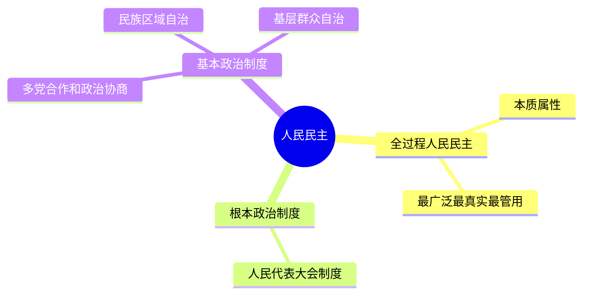
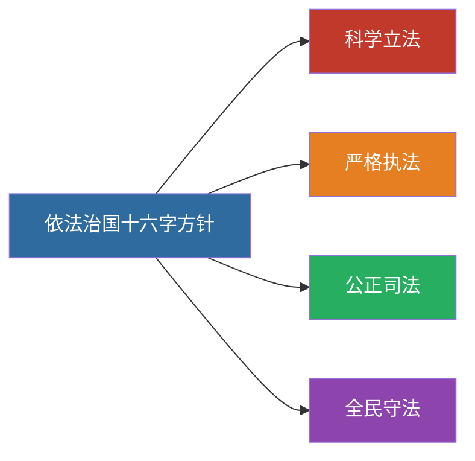

# 13 民主法治文化民生 · 挖空练习

> 同一段话剥三层。**先做 L3，做不动再往下退** —— 顺序反过来会骗自己：
> L1 做对了不代表记住了，只代表「这几个词有印象」。

| 层 | 挖了什么 | 什么时候用 |
|:--|:--|:--|
| L1 | 只有名词 | 第一次接触，或考前扫一遍 |
| L2 | 每句只留前半 | 判断「知不知道接哪半句」 |
| L3 | 只留标题和标点 | 检验能不能整段复述 |

本页挖空数：L1 **4** · L2 **51** · L3 **83**

---

## L1 · 只挖名词

---

## 一、发展全过程人民民主

- 人民民主是社会主义的生命
- 全过程人民民主是社会主义民主政治的本质属性
- 最广泛、最真实、最管用的民主
- 人民代表大会制度是我国的____
- 中国共产党领导的多党合作和政治协商制度、民族区域自治制度、基层群众自治制度是基本政治制度

---

## 二、全面依法治国

- 坚持党的领导、人民当家作主、依法治国有机统一
- 建设中国特色社会主义法治体系、建设社会主义法治国家
- 科学立法、严格执法、公正司法、全民守法

---

## 三、建设社会主义文化强国

- 坚持马克思主义在意识形态领域指导地位的根本制度
- 社会主义核心价值观：____（24 字）
- 坚定文化自信，建设中华民族现代文明

---

## 四、保障和改善民生

- 在发展中保障和改善民生
- 就业是最基本的民生
- 分配制度是促进共同富裕的基础性制度
- 健全社会保障体系；推进健康中国建设

---

## 五、闭卷挑战

____ 默写社会主义核心价值观 24 字。

> **点击查看答案与解析**
> 富强、民主、文明、和谐；自由、平等、公正、法治；爱国、敬业、诚信、友善。

____ 我国的根本政治制度是什么？

> **点击查看答案与解析**
> 人民代表大会制度。

返回：12-改革发展与五位一体 · [政治](/posts/politics/)

---

## L2 · 每句留前半

---

## 一、发展全过程人民民主

- 人民民主是社会主义的生命
- 全过程人民民主是社会主义民主政治的本质属性
- 最广泛、__________
- 人民代表大会制度是我国的____
- 中国共产党领导的多党合作和政治协商制度、________________________

---

## 二、全面依法治国

- 坚持党的领导、_______________
- 建设中国特色社会主义法治体系、__________
- 科学立法、______________

---

## 三、建设社会主义文化强国

- 坚持马克思主义在意识形态领域指导地位的根本制度
- 社会主义核心价值观：__________________________________________ __
- 坚定文化自信，__________

---

## 四、保障和改善民生

- 在发展中保障和改善民生
- 就业是最基本的民生
- 分配制度是促进共同富裕的基础性制度
- 健全社会保障体系；________

---

## 五、闭卷挑战

____ 默写社会主义核心价值观 24 字。

> ____
> 富强、_________________________________

____ 我国的根本政治制度是什么？

> ____
> 人民代表大会制度。

返回：____________ _ ______________________

---

## L3 · 只留骨架

___

## 一、发展全过程人民民主

- ____________
- _____________________
- ___、___、______
- ______________________
- ___________________、________、_______________

___

## 二、全面依法治国

- ______、______、________
- ______________、__________
- ____、____、____、____

___

## 三、建设社会主义文化强国

- _______________________
- _________：____、__、__、__；__、__、__、__；__、__、__、_______ __
- ______，__________

___

## 四、保障和改善民生

- ___________
- _________
- _________________
- ________；________

___

## 五、闭卷挑战

______ ___________ __ _。

_ _____________
_ __、__、__、__；__、__、__、__；__、__、__、__。

______ ____________？

_ _____________
_ ________。

__：____________ _ ______________________

---

## 原文

点开对照（先做完再看）

# 13 全过程人民民主 · 全面依法治国 · 文化强国 · 民生社会建设

---

## 一、发展全过程人民民主

- 人民民主是社会主义的生命
- 全过程人民民主是社会主义民主政治的本质属性
- 最广泛、最真实、最管用的民主
- 人民代表大会制度是我国的**根本政治制度**
- 中国共产党领导的多党合作和政治协商制度、民族区域自治制度、基层群众自治制度是基本政治制度

---

## 二、全面依法治国

- 坚持党的领导、人民当家作主、依法治国有机统一
- 建设中国特色社会主义法治体系、建设社会主义法治国家
- 科学立法、严格执法、公正司法、全民守法

---

## 三、建设社会主义文化强国

- 坚持马克思主义在意识形态领域指导地位的根本制度
- 社会主义核心价值观：**富强、民主、文明、和谐；自由、平等、公正、法治；爱国、敬业、诚信、友善**（24 字）
- 坚定文化自信，建设中华民族现代文明

---

## 四、保障和改善民生

- 在发展中保障和改善民生
- 就业是最基本的民生
- 分配制度是促进共同富裕的基础性制度
- 健全社会保障体系；推进健康中国建设

---

## 五、闭卷挑战

**1.** 默写社会主义核心价值观 24 字。

> **点击查看答案与解析**
> 富强、民主、文明、和谐；自由、平等、公正、法治；爱国、敬业、诚信、友善。

**2.** 我国的根本政治制度是什么？

> **点击查看答案与解析**
> 人民代表大会制度。

返回：12-改革发展与五位一体 · [政治](/posts/politics/)

