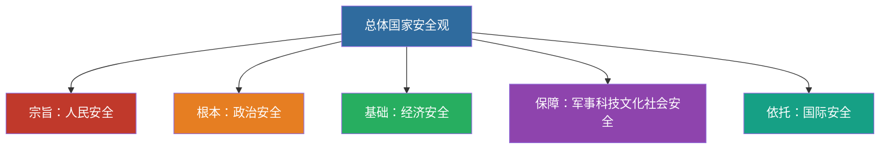

# 14 生态安全国防统一外交 · 挖空练习

> 同一段话剥三层。**先做 L3，做不动再往下退** —— 顺序反过来会骗自己：
> L1 做对了不代表记住了，只代表「这几个词有印象」。

| 层 | 挖了什么 | 什么时候用 |
|:--|:--|:--|
| L1 | 只有名词 | 第一次接触，或考前扫一遍 |
| L2 | 每句只留前半 | 判断「知不知道接哪半句」 |
| L3 | 只留标题和标点 | 检验能不能整段复述 |

本页挖空数：L1 **11** · L2 **52** · L3 **92**

---

## L1 · 只挖名词

---

## 一、建设社会主义生态文明

- ____
- 人与自然和谐共生
- 碳达峰碳中和（双碳）目标

---

## 二、维护和塑造国家安全

- ____
- 以人民安全为宗旨，以政治安全为根本，以经济安全为基础，以军事、科技、文化、社会安全为保障，以促进国际安全为依托

> 📌 记忆链：**宗旨人民 → 根本政治 → 基础经济 → 保障四个 → 依托国际**。

---

## 三、建设巩固国防和强大人民军队

- 党对人民军队的绝对领导是人民军队的建军之本、强军之魂
- 新时代强军目标：听党指挥、能打胜仗、作风优良

---

## 四、坚持“一国两制”和推进祖国完全统一

- “____”是中国特色社会主义的伟大创举
- “____”是实行“____”的前提和基础
- 解决台湾问题、实现祖国完全统一，是党矢志不渝的历史任务
- 坚持一个中国原则和“____”

---

## 五、中国特色大国外交

- 推动构建____
- 共商共建共享的全球治理观
- “____”倡议
- 独立自主的和平外交政策

---

## 六、闭卷挑战

____ 总体国家安全观“____”？

> **点击查看答案与解析**
> 以人民安全为宗旨，以政治安全为根本，以经济安全为基础。

____ 新时代的强军目标是什么？

> **点击查看答案与解析**
> 听党指挥、能打胜仗、作风优良。

返回：13-民主法治文化民生 · [政治](/posts/politics/)

---

## L2 · 每句留前半

---

## 一、建设社会主义生态文明

- ____
- 人与自然和谐共生
- 碳达峰碳中和（双碳）目标

---

## 二、维护和塑造国家安全

- ____
- 以人民安全为宗旨，______________________________________________

> 📌 记忆链：______ _ ____ _ ____ _ ____ _ _______

---

## 三、建设巩固国防和强大人民军队

- 党对人民军队的绝对领导是人民军队的建军之本、____
- 新时代强军目标：______________

---

## 四、坚持“一国两制”和推进祖国完全统一

- “____”是中国特色社会主义的伟大创举
- “____”是实行“____”的前提和基础
- 解决台湾问题、____________________
- 坚持一个中国原则和“____”

---

## 五、中国特色大国外交

- 推动构建____
- 共商共建共享的全球治理观
- “____”倡议
- 独立自主的和平外交政策

---

## 六、闭卷挑战

**1.** 总体国家安全观“以何为宗旨、_____________

> ____
> 以人民安全为宗旨，__________________

____ 新时代的强军目标是什么？

> ____
> 听党指挥、__________

返回：___________ _ ______________________

---

## L3 · 只留骨架

___

## 一、建设社会主义生态文明

- ______________
- ________
- ____________

___

## 二、维护和塑造国家安全

- ___________
- ________，________，________，___、__、__、_______，__________

_ __ ___：______ _ ____ _ ____ _ ____ _ ______。

___

## 三、建设巩固国防和强大人民军队

- _____________________、____
- _______：____、____、____

___

## 四、坚持“一国两制”和推进祖国完全统一

- ____________________
- _________________
- ______、________，___________
- _______________

___

## 五、中国特色大国外交

- _______________
- ____________
- ________
- ___________

___

## 六、闭卷挑战

______ _____________、_____、______？

_ _____________
_ ________，________，________。

______ ___________？

_ _____________
_ ____、____、____。

__：___________ _ ______________________

---

## 原文

点开对照（先做完再看）

# 14 生态文明 · 国家安全 · 国防军队 · 祖国统一 · 大国外交

---

## 一、建设社会主义生态文明

- **绿水青山就是金山银山**
- 人与自然和谐共生
- 碳达峰碳中和（双碳）目标

---

## 二、维护和塑造国家安全

- **总体国家安全观**
- 以人民安全为宗旨，以政治安全为根本，以经济安全为基础，以军事、科技、文化、社会安全为保障，以促进国际安全为依托

> 📌 记忆链：**宗旨人民 → 根本政治 → 基础经济 → 保障四个 → 依托国际**。

---

## 三、建设巩固国防和强大人民军队

- 党对人民军队的绝对领导是人民军队的建军之本、强军之魂
- 新时代强军目标：听党指挥、能打胜仗、作风优良

---

## 四、坚持“一国两制”和推进祖国完全统一

- “一国两制”是中国特色社会主义的伟大创举
- “一国”是实行“两制”的前提和基础
- 解决台湾问题、实现祖国完全统一，是党矢志不渝的历史任务
- 坚持一个中国原则和“九二共识”

---

## 五、中国特色大国外交

- 推动构建**人类命运共同体**
- 共商共建共享的全球治理观
- “一带一路”倡议
- 独立自主的和平外交政策

---

## 六、闭卷挑战

**1.** 总体国家安全观“以何为宗旨、以何为根本、以何为基础”？

> **点击查看答案与解析**
> 以人民安全为宗旨，以政治安全为根本，以经济安全为基础。

**2.** 新时代的强军目标是什么？

> **点击查看答案与解析**
> 听党指挥、能打胜仗、作风优良。

返回：13-民主法治文化民生 · [政治](/posts/politics/)

