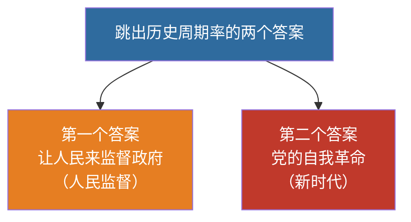

# 15 全面从严治党 · 挖空练习

> 同一段话剥三层。**先做 L3，做不动再往下退** —— 顺序反过来会骗自己：
> L1 做对了不代表记住了，只代表「这几个词有印象」。

| 层 | 挖了什么 | 什么时候用 |
|:--|:--|:--|
| L1 | 只有名词 | 第一次接触，或考前扫一遍 |
| L2 | 每句只留前半 | 判断「知不知道接哪半句」 |
| L3 | 只留标题和标点 | 检验能不能整段复述 |

本页挖空数：L1 **4** · L2 **42** · L3 **63**

---

## L1 · 只挖名词

> 🎯 **一句话**：办好中国的事情，关键在党；全面从严治党永远在路上。

---

## 一、核心要点

- 党的自我革命是跳出治乱兴衰历史周期率的____（第一个答案是人民监督）
- 坚持思想建党和制度治党同向发力
- 作风建设永远在路上；反腐败无禁区、全覆盖、零容忍
- 健全全面从严治党体系

> 📌 记忆：**人民监督是第一答案（传统），自我革命是第二答案（新时代）**——选择题高频。

---

## 二、与“两个确立”“两个维护”的关系

全面从严治党为做到“____”提供政治保证；“____”是党的最高政治原则和根本政治规矩。

---

## 三、闭卷挑战

____ 跳出历史周期率的两个答案分别是什么？

> **点击查看答案与解析**
> 第一个答案：让人民来监督政府（人民监督）；第二个答案：党的自我革命。

返回：14-生态安全国防统一外交 · [政治](/posts/politics/)

---

## L2 · 每句留前半

> 🎯 **一句话**：_________________________

---

## 一、核心要点

- 党的自我革命是跳出治乱兴衰历史周期率的____（第一个答案是人民监督）
- 坚持思想建党和制度治党同向发力
- 作风建设永远在路上；______________
- 健全全面从严治党体系

> 📌 记忆：________________________________________

---

## 二、与“两个确立”“两个维护”的关系

全面从严治党为做到“两个维护”提供政治保证；_______________________

---

## 三、闭卷挑战

____ 跳出历史周期率的两个答案分别是什么？

> ____
> 第一个答案：____________________________

返回：_____________ _ ______________________

---

## L3 · 只留骨架

_ __ _______：_______，____；___________。

___

## 一、核心要点

- ________________________________________
- _______________
- _________；______、___、___
- __________

_ __ __：_______________，_______________________。

___

## 二、与“两个确立”“两个维护”的关系

_____________________；______________________。

___

## 三、闭卷挑战

______ _________________？

_ _____________
_ _____：______________；_____：______。

__：_____________ _ ______________________

---

## 原文

点开对照（先做完再看）

# 15 全面从严治党

> 🎯 **一句话**：办好中国的事情，关键在党；全面从严治党永远在路上。

---

## 一、核心要点

- 党的自我革命是跳出治乱兴衰历史周期率的**第二个答案**（第一个答案是人民监督）
- 坚持思想建党和制度治党同向发力
- 作风建设永远在路上；反腐败无禁区、全覆盖、零容忍
- 健全全面从严治党体系

> 📌 记忆：**人民监督是第一答案（传统），自我革命是第二答案（新时代）**——选择题高频。

---

## 二、与“两个确立”“两个维护”的关系

全面从严治党为做到“两个维护”提供政治保证；“两个维护”是党的最高政治原则和根本政治规矩。

---

## 三、闭卷挑战

**1.** 跳出历史周期率的两个答案分别是什么？

> **点击查看答案与解析**
> 第一个答案：让人民来监督政府（人民监督）；第二个答案：党的自我革命。

返回：14-生态安全国防统一外交 · [政治](/posts/politics/)

