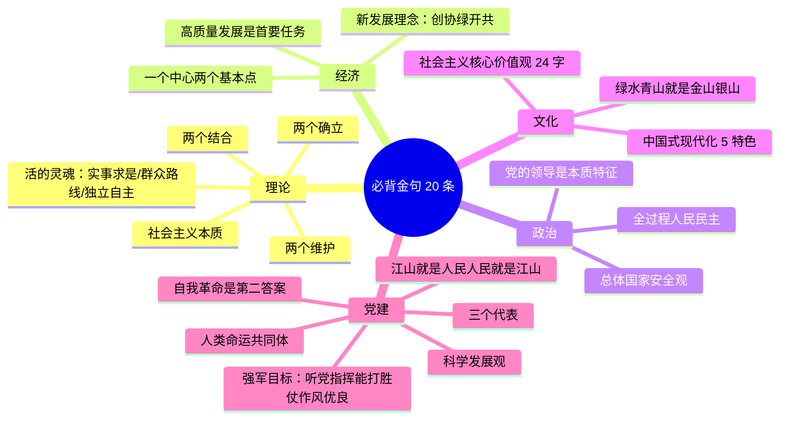

# 18 必背金句与名词 · 挖空练习

> 同一段话剥三层。**先做 L3，做不动再往下退** —— 顺序反过来会骗自己：
> L1 做对了不代表记住了，只代表「这几个词有印象」。

| 层 | 挖了什么 | 什么时候用 |
|:--|:--|:--|
| L1 | 只有名词 | 第一次接触，或考前扫一遍 |
| L2 | 每句只留前半 | 判断「知不知道接哪半句」 |
| L3 | 只留标题和标点 | 检验能不能整段复述 |

本页挖空数：L1 **1** · L2 **48** · L3 **105**

---

## L1 · 只挖名词

> 考前 7 天每天默写一遍。

---

## 一、金句 20 条（核心）

1. 马克思主义中国化时代化的____：两个结合
2. 毛泽东思想活的灵魂：实事求是、群众路线、独立自主
3. 社会主义本质（邓）
4. 一个中心、两个基本点
5. 三个代表完整表述
6. 科学发展观：第一要义发展、核心立场以人为本、基本要求全面协调可持续、根本方法统筹兼顾
7. 两个确立
8. 两个维护
9. 中国特色社会主义最本质的特征：中国共产党领导
10. 中国式现代化五个特色
11. 新发展理念：创新协调绿色开放共享
12. 高质量发展是首要任务
13. 全过程人民民主
14. 社会主义核心价值观 24 字
15. 绿水青山就是金山银山
16. 总体国家安全观（宗旨/根本/基础）
17. 强军目标：听党指挥、能打胜仗、作风优良
18. 人类命运共同体
19. 自我革命是第二个答案
20. 江山就是人民，人民就是江山

> 📌 考前 7 天每天默写一遍，**用词与官方表述一致**，不得漏字改写。

---

## 二、易混辨析

| 易混 | 正确区分 |
|:---|:---|
| 根本政治制度 vs 基本政治制度 | 人大 vs 政协/民区/基层 |
| 市场决定性作用 vs 政府作用 | 市场配置资源；政府更好发挥作用 |
| 两个结合 | 具体实际 + 中华优秀传统文化 |
| 主要矛盾（新时代） | 人民日益增长的美好生活需要和不平衡不充分的发展之间的矛盾 |

---

## 三、闭卷挑战

不看笔记，默写：新发展理念、24 字价值观、中国式现代化 5 特色、两个维护。

> **自检标准**
> 用词与官方表述一致；不得漏字改写（如“两个维护”必须完整）。

返回：17-辨析论述材料题模板 · [政治](/posts/politics/)

---

## L2 · 每句留前半

> 考前 7 天每天默写一遍。

---

## 一、金句 20 条（核心）

1. 马克思主义中国化时代化的**根本途径**：____
2. 毛泽东思想活的灵魂：______________
3. 社会主义本质（邓）
4. 一个中心、_____
5. 三个代表完整表述
6. 科学发展观：____________________________________
7. 两个确立
8. 两个维护
9. 中国特色社会主义最本质的特征：_______
10. 中国式现代化五个特色
11. 新发展理念：__________
12. 高质量发展是首要任务
13. 全过程人民民主
14. 社会主义核心价值观 24 字
15. 绿水青山就是金山银山
16. 总体国家安全观（宗旨/根本/基础）
17. 强军目标：______________
18. 人类命运共同体
19. 自我革命是第二个答案
20. 江山就是人民，______

> 📌 考前 7 天每天默写一遍，_____________________

---

## 二、易混辨析

| 易混 | 正确区分 |
|:---|:---|
| 根本政治制度 vs 基本政治制度 | 人大 vs 政协/民区/基层 |
| 市场决定性作用 vs 政府作用 | 市场配置资源；________ |
| 两个结合 | 具体实际 + 中华优秀传统文化 |
| 主要矛盾（新时代） | 人民日益增长的美好生活需要和不平衡不充分的发展之间的矛盾 |

---

## 三、闭卷挑战

不看笔记，___________ ___________ _ ________

> ____
> 用词与官方表述一致；____________________

返回：____________ _ ______________________

---

## L3 · 只留骨架

_ __ _ _______。

___

## 一、金句 20 条（核心）

1. ____________________：____
2. _________：____、____、____
3. _________
4. ____、_____
5. ________
6. _____：______、________、___________、________
7. ____
8. ____
9. ______________：_______
10. __________
11. _____：__________
12. __________
13. _______
14. _________ __ _
15. __________
16. _________________
17. ____：____、____、____
18. _______
19. __________
20. ______，______

_ __ __ _ _______，_____________，______。

___

## 二、易混辨析

| 易混 | 正确区分 |
|:---|:---|
| ______ __ ______ | __ __ ________ |
| _______ __ ____ | _______________ |
| ____ | ____ _ ________ |
| _________ | ____________________________ |

___

## 三、闭卷挑战

____，__：_____、__ ____、______ _ __、____。

_ ________
_ _________；___________________。

__：____________ _ ______________________

---

## 原文

点开对照（先做完再看）

# 18 必背金句与名词速查

> 考前 7 天每天默写一遍。

---

## 一、金句 20 条（核心）

1. 马克思主义中国化时代化的**根本途径**：两个结合
2. 毛泽东思想活的灵魂：实事求是、群众路线、独立自主
3. 社会主义本质（邓）
4. 一个中心、两个基本点
5. 三个代表完整表述
6. 科学发展观：第一要义发展、核心立场以人为本、基本要求全面协调可持续、根本方法统筹兼顾
7. 两个确立
8. 两个维护
9. 中国特色社会主义最本质的特征：中国共产党领导
10. 中国式现代化五个特色
11. 新发展理念：创新协调绿色开放共享
12. 高质量发展是首要任务
13. 全过程人民民主
14. 社会主义核心价值观 24 字
15. 绿水青山就是金山银山
16. 总体国家安全观（宗旨/根本/基础）
17. 强军目标：听党指挥、能打胜仗、作风优良
18. 人类命运共同体
19. 自我革命是第二个答案
20. 江山就是人民，人民就是江山

> 📌 考前 7 天每天默写一遍，**用词与官方表述一致**，不得漏字改写。

---

## 二、易混辨析

| 易混 | 正确区分 |
|:---|:---|
| 根本政治制度 vs 基本政治制度 | 人大 vs 政协/民区/基层 |
| 市场决定性作用 vs 政府作用 | 市场配置资源；政府更好发挥作用 |
| 两个结合 | 具体实际 + 中华优秀传统文化 |
| 主要矛盾（新时代） | 人民日益增长的美好生活需要和不平衡不充分的发展之间的矛盾 |

---

## 三、闭卷挑战

不看笔记，默写：新发展理念、24 字价值观、中国式现代化 5 特色、两个维护。

> **自检标准**
> 用词与官方表述一致；不得漏字改写（如“两个维护”必须完整）。

返回：17-辨析论述材料题模板 · [政治](/posts/politics/)

