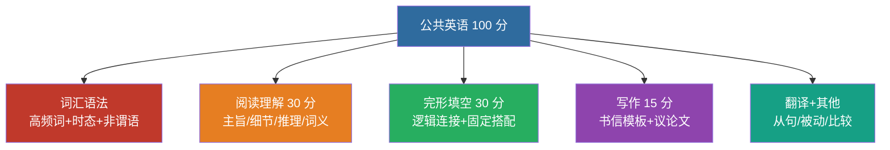

# 考试大纲与题型补强

> **这是什么**：英语 的**讲义页**（不是考点骨架，是「怎么讲」的完整版）
> **元信息**：难度 intermediate · 考频 medium · 掌握 review
> **一句话内容**：公共英语 · 考试大纲与题型补强
> **用法**：先贴 `0-教练规则` + 对应科目 `状态卡`，再贴本文件，说「按这一节教我」。
> **来源**：`docs/posts/english/notes/syllabus.md` · 导出于 2026-11-03

---

# 公共英语 · 考试大纲与题型补强

> 广东普通专升本公共课《英语》· 满分 **100** · **120** 分钟（以当年大纲为准）

---

## 常见题型板块

| 板块 | 训练重点 | 本库笔记 |
|:---|:---|:---|
| 词汇语法 | 高频词 + 时态语态非谓语 | 高频词汇速记 · 语法考点精讲 |
| 阅读理解 | 主旨 / 细节 / 推理 / 词义 | 阅读理解高分技巧 |
| 完形 / 填空 | 逻辑连接 + 固定搭配 | 结合真题年份页 |
| 翻译 | 定语从句、被动、比较 | 真题详解页 |
| 写作 | 书信 / 议论文模板 | 作文模板与高分句型 |

> 📌 每天词汇 30-50 + 1 篇阅读 → 每周 1 套真题限时 → 作文每周 1 篇对照模板改。

---

## 备考节奏

1. 每天词汇 30–50 + 1 篇阅读
2. 每周 1 套近三年真题限时
3. 作文每周 1 篇，对照模板改

详见：[专升本英语考试概述与题型分析](/posts/english/notes/overview) · [历年真题分类与讲解](/guide/sources)

返回：英语知识库 · [英语](/posts/english/)
