# 政治理论 · 全集

> **这是什么**：考点原文（按章）+ 讲义（按章）+ **64 篇默写册（默写区+答案区）** + 错题本 + 真题映射表 + 2012–2019 八年原卷。**100 分，0 起点，唯一瓶颈。**
> **体量**：约 **993503 字** / 2.28 MB。
> **怎么用**：
> - 平台有**项目 / 知识库 / 文件上传** → 把这个文件上传进去，**一次就够**，之后所有对话共享，不用再贴。
> - 平台只能**对话框粘贴** → **别贴这个**（太大，会截断）。改贴 `6-考点原文-按章贴` 或 `10-讲义-按节贴` 里的单份小文件。
> **导出于**：2026-11-03

---

## 目录

**第一部分　考点原文（按章）**（49 份）

- 毛中特-第00章.md
- 毛中特-第01章.md
- 毛中特-第02章-1of2.md
- 毛中特-第02章-2of2.md
- 毛中特-第03章.md
- 毛中特-第04章.md
- 毛中特-第05章-1of2.md
- 毛中特-第05章-2of2.md
- 毛中特-第06章-1of2.md
- 毛中特-第06章-2of2.md
- 毛中特-第07章-1of2.md
- 毛中特-第07章-2of2.md
- 毛中特-第08章-1of2.md
- 毛中特-第08章-2of2.md
- 习概-第00章.md
- 习概-第01章-1of2.md
- 习概-第01章-2of2.md
- 习概-第02章-1of2.md
- 习概-第02章-2of2.md
- 习概-第03章-1of2.md
- 习概-第03章-2of2.md
- 习概-第04章-1of2.md
- 习概-第04章-2of2.md
- 习概-第05章-1of2.md
- 习概-第05章-2of2.md
- 习概-第06章-1of2.md
- 习概-第06章-2of2.md
- 习概-第07章-1of2.md
- 习概-第07章-2of2.md
- 习概-第08章-1of2.md
- 习概-第08章-2of2.md
- 习概-第09章-1of2.md
- 习概-第09章-2of2.md
- 习概-第10章-1of2.md
- 习概-第10章-2of2.md
- 习概-第11章-1of2.md
- 习概-第11章-2of2.md
- 习概-第12章-1of2.md
- 习概-第12章-2of2.md
- 习概-第13章-1of2.md
- 习概-第13章-2of2.md
- 习概-第14章-1of2.md
- 习概-第14章-2of2.md
- 习概-第15章-1of2.md
- 习概-第15章-2of2.md
- 习概-第16章-1of2.md
- 习概-第16章-2of2.md
- 习概-第17章-1of2.md
- 习概-第17章-2of2.md

**第二部分　讲义（按章）**（19 份）

- 00-考试大纲与题型.md
- 01-马克思主义中国化时代化.md
- 02-毛泽东思想.md
- 03-新民主主义革命.md
- 04-社会主义改造.md
- 05-建设道路初步探索.md
- 06-中国特色社会主义理论体系.md
- 07-邓小平理论.md
- 08-三个代表与科学发展观.md
- 09-习思想形成与历史地位.md
- 10-中国式现代化.md
- 11-党的领导与以人民为中心.md
- 12-改革发展与五位一体.md
- 13-民主法治文化民生.md
- 14-生态安全国防统一外交.md
- 15-全面从严治党.md
- 16-时事政治备考.md
- 17-辨析论述材料题模板.md
- 18-必背金句与名词.md

**第三部分　A 档默写 64 篇**（64 份）

- 毛中特-篇01-毛1-2-2-毛泽东思想活的灵魂.md
- 毛中特-篇02-毛6-2-1-社会主义初级阶段理论和党的基本路线.md
- 毛中特-篇03-毛00-1-4-马克思主义中国化时代化理论成果及其关系.md
- 毛中特-篇04-毛4-2-2-初步探索的经验教训.md
- 毛中特-篇05-毛6-1-1-邓小平理论首要的基本的理论问题.md
- 毛中特-篇06-毛6-2-3-社会主义改革开放和社会主义市场经济理论.md
- 毛中特-篇07-毛8-1-2-以人为本是科学发展观的核心立场.md
- 毛中特-篇08-毛1-3-1-马克思主义中国化时代化的第一个重大理论成果.md
- 毛中特-篇09-毛1-3-2-中国革命和建设的科学指南.md
- 毛中特-篇10-毛2-1-1-近代中国国情和中国革命的时代特征.md
- 毛中特-篇11-毛2-3-2-新民主主义革命的三大法宝.md
- 毛中特-篇12-毛3-2-2-社会主义改造的历史经验.md
- 毛中特-篇13-毛3-3-2-确立社会主义基本制度的重大意义.md
- 毛中特-篇14-毛4-1-2-正确认识和处理社会主义社会矛盾的思想.md
- 毛中特-篇15-毛5-1-3-中国特色社会主义理论体系形成发展的实践基础.md
- 毛中特-篇16-毛6-2-4-两手抓，两手都要硬.md
- 毛中特-篇17-毛6-3-2-中国特色社会主义理论体系的开篇之作.md
- 毛中特-篇18-毛7-1-1-始终代表中国先进生产力的发展要求.md
- 毛中特-篇19-毛7-2-1-发展是党执政兴国的第一要务.md
- 毛中特-篇20-毛8-1-1-推动经济社会发展是科学发展观的第一要义.md
- 毛中特-篇21-毛8-2-3-推进社会主义文化强国建设.md
- 习概-篇01-习1-2-2-社会主要矛盾变化是关系全局的历史性变化.md
- 习概-篇02-习00-1-4-习近平新时代中国特色社会主义思想的历史地位.md
- 习概-篇03-习6-1-1-我国进入新发展阶段.md
- 习概-篇04-习2-1-3-全面建成社会主义现代化强国.md
- 习概-篇05-习3-3-3-健全党的全面领导制度.md
- 习概-篇06-习6-1-3-以新发展理念引领高质量发展.md
- 习概-篇07-习16-3-1-构建人类命运共同体是世界各国人民前途所在.md
- 习概-篇08-习17-3-2-坚持标本兼治开展反腐败斗争.md
- 习概-篇09-习1-2-1-中国特色社会主义新时代是我国发展新的历史方位.md
- 习概-篇10-习1-3-1-全面贯彻党的基本理论、基本路线、基本方略.md
- 习概-篇11-习1-3-2-统筹推进“五位一体”总体布局和协调推进“四个全面”战略布局.md
- 习概-篇12-习2-1-1-实现中华民族伟大复兴的中国梦.md
- 习概-篇13-习2-1-2-在中华大地上全面建成小康社会.md
- 习概-篇14-习2-2-2-中国式现代化的中国特色.md
- 习概-篇15-习2-3-1-推进中国式现代化需要牢牢把握的重大原则.md
- 习概-篇16-习3-1-1-中国最大的国情就是中国共产党的领导.md
- 习概-篇17-习3-1-2-中国共产党领导是中国特色社会主义制度的最大优势.md
- 习概-篇18-习3-2-1-中国共产党是最高政治领导力量.md
- 习概-篇19-习4-1-3-人民立场是中国共产党的根本政治立场.md
- 习概-篇20-习4-3-1-坚持和贯彻党的群众路线.md
- 习概-篇21-习4-3-3-推动全体人民共同富裕取得更为明显的实质性进展.md
- 习概-篇22-习5-1-1-改革开放是我们前进的重要法宝.md
- 习概-篇23-习5-2-1-坚持全面深化改革总目标.md
- 习概-篇24-习5-3-3-坚定不移扩大高水平对外开放.md
- 习概-篇25-习6-2-2-坚持两个毫不动摇.md
- 习概-篇26-习7-1-1-坚持教育发展、科技创新、人才培养一体推进.md
- 习概-篇27-习7-3-2-打赢关键核心技术攻坚战.md
- 习概-篇28-习9-1-1-全面依法治国是国家治理的一场深刻革命.md
- 习概-篇29-习10-1-1-文化繁荣兴盛是实现中华民族伟大复兴的必然要求.md
- 习概-篇30-习10-1-3-坚持中国特色社会主义文化发展道路.md
- 习概-篇31-习10-3-1-广泛践行社会主义核心价值观.md
- 习概-篇32-习11-2-1-完善分配制度.md
- 习概-篇33-习11-3-1-加强和创新社会治理.md
- 习概-篇34-习12-1-3-把生态文明建设摆在全局工作的突出位置.md
- 习概-篇35-习12-2-3-用最严格制度最严密法治保护生态环境.md
- 习概-篇36-习13-1-2-总体国家安全观是新时代国家安全工作的基本遵循.md
- 习概-篇37-习14-2-2-强军目标的科学内涵.md
- 习概-篇38-习15-1-1-一国两制是中国特色社会主义的伟大创举.md
- 习概-篇39-习15-1-2-准确把握一国两制的科学内涵.md
- 习概-篇40-习16-1-1-当今世界正经历百年未有之大变局.md
- 习概-篇41-习16-2-1-坚持走和平发展道路.md
- 习概-篇42-习16-2-2-推动构建新型国际关系.md
- 习概-篇43-习17-1-2-坚定不移全面从严治党.md

**第四部分　错题本**（2 份）

- 政治-毛中特错题本.md
- 政治-习概错题本.md

**第五部分　真题考点映射表**（1 份）

- 政治-真题考点映射表-2015至2025.md

**第六部分　真题原卷 2012–2019**（2 份）

- 政治-真题-2012至2015.md
- 政治-真题-2016至2019.md

---

# 第一部分　考点原文（按章）

<!-- 来源：6-考点原文-按章贴/政治/毛中特-第00章.md -->

## 政治 · 毛中特 第00章 导论

### 00-1-1-马克思主义中国化时代化的提出

```
【课程】01-毛中特
【章节】导论　马克思主义中国化时代化的历史进程与理论成果
【节】导论（全章第一节）
【考点】00-1-1　马克思主义中国化时代化的提出
【考频】★★★★☆
【题型】单选、多选、简答
============================================================

一、结论
------------------------------------------------------------
"马克思主义中国化"这个命题不是天生的，是被教条主义打出来的。
1938 年党的六届六中全会上，毛泽东在《论新阶段》报告中正式提出，
背景是 1931 年以来党内"左"倾错误把马克思主义教条化、把共产国际
决议和苏联经验神圣化，让中国革命吃了大亏。

二、必背要点
------------------------------------------------------------
1. 历史前提：1840 年鸦片战争后，中国逐步成为半殖民地半封建社会，
   国家蒙辱、人民蒙难、文明蒙尘。
2. 旧方案的失败：太平天国运动、洋务运动、戊戌变法、义和团运动、
   辛亥革命接连而起，都以失败告终。
3. 旧思潮的失败：改良主义、自由主义、社会达尔文主义、无政府主义、
   实用主义、民粹主义、工团主义等"你方唱罢我登场"，都未能解决
   中国的实际问题。
4. 新思想的传入：十月革命一声炮响，给中国送来了马克思列宁主义；
   五四运动促进了马克思主义在中国的广泛传播。
5. 主体的诞生：1921 年中国共产党成立，这是开天辟地的大事变，
   中国革命的面貌从此焕然一新。
6. 问题的出现：找到马克思主义不等于能解决中国问题，还有一个
   如何把马克思主义基本原理同中国具体实际相结合、同中华优秀
   传统文化相结合的问题。幼年时期的党走了弯路。
7. 命题的提出：1938 年党的六届六中全会，毛泽东作《论新阶段》
   报告，强调"没有抽象的马克思主义，只有具体的马克思主义"，
   标志着"马克思主义的中国化"这一命题正式提出。
8. 理论的确认：1945 年党的七大，刘少奇作《关于修改党章的报告》，
   从理论上进一步阐述，指出毛泽东思想是"中国化的马克思主义"。
9. 概念的扩展：马克思主义中国化同时包含着马克思主义时代化的
   意蕴。党的十八大以来，党中央明确提出不断推进马克思主义
   中国化时代化。

三、两个"为什么必须"（简答必背）
------------------------------------------------------------
第一，推进马克思主义中国化时代化，是马克思主义理论本身发展的
内在要求。
  · 马克思恩格斯在《共产党宣言》序言中指出，原理的实际运用
    "随时随地都要以当时的历史条件为转移"。
  · 恩格斯：马克思的整个世界观"不是教义，而是方法"，提供的
    不是现成的教条，而是进一步研究的出发点和供这种研究使用的
    方法。
  · 列宁：要求人们对每一个原理都要历史地、同其他原理联系起来、
    同具体的历史经验联系起来加以考察。
第二，推进马克思主义中国化时代化，是解决中国实际问题的客观需要。
  · 旧中国是半殖民地半封建的东方大国，农民占人口绝大多数，
    经济文化十分落后，靠简单套用一般原理和照搬外国经验不可能
    解决问题。

四、易错辨析
------------------------------------------------------------
× "马克思主义中国化"是毛泽东在党的七大提出的。
√ 七大是"确认"（刘少奇阐述），提出是 1938 年六届六中全会
  《论新阶段》。
× 马克思主义中国化就是马克思主义加中国例子。
√ 是运用立场观点方法解决中国实际问题 + 总结中国经验上升为理论
  + 用民族语言表达，三层缺一不可。
× 马克思主义中国化只讲"中国化"，不讲"时代化"。
√ 中国化同时包含时代化意蕴，二者是一体两面。

五、关键词 / 时间 / 人物 / 著作
------------------------------------------------------------
六届六中全会（1938）·《论新阶段》· 毛泽东 · 刘少奇 ·
《关于修改党章的报告》（1945）· 七大 · 半殖民地半封建社会 ·
十月革命 · 五四运动 · 开天辟地的大事变

六、可出题角度
------------------------------------------------------------
· 单选：命题正式提出的会议、报告、年份
· 单选：旧思潮名称的干扰项（把"实业救国"混入）
· 多选：两个"为什么必须"的具体内容
· 简答：马克思主义中国化时代化提出的历史必然性
· 材料题：给一段教条主义危害的材料，问为什么要中国化

============================================================
【原文锚点】《毛泽东思想和中国特色社会主义理论体系概论》导论
第一节"马克思主义中国化时代化的提出"
```

---

### 00-1-2-马克思主义中国化时代化的内涵

```
【课程】01-毛中特
【章节】导论　马克思主义中国化时代化的历史进程与理论成果
【节】导论（全章第一节）
【考点】00-1-2　马克思主义中国化时代化的内涵
【考频】★★★★★
【题型】单选、多选、简答、论述
============================================================

一、结论
------------------------------------------------------------
内涵就是三层：用马克思主义解决中国问题、把中国经验上升为理论、
用中国话讲马克思主义。毛泽东的原话是"解决中国问题"和"创造些
新的东西"，这两句就是内涵的源头。

二、必背要点（三层内涵，一字不能少）
------------------------------------------------------------
总定义：
马克思主义中国化时代化，就是立足中国国情和时代特点，坚持把
马克思主义基本原理同中国具体实际相结合、同中华优秀传统文化
相结合，深入研究和解决中国革命、建设、改革不同历史时期的
实际问题，真正搞懂面临的时代课题，不断吸收新的时代内容，
科学回答时代提出的重大理论和实践课题，创造新的理论成果。

第一层：运用马克思主义的立场、观点和方法，观察时代、把握时代、
引领时代，解决中国革命、建设、改革中的实际问题。
  · 理论的根本任务是回答并指导解决问题。
  · 要增强问题意识，站稳人民立场，洞察时代风云，把握时代大势。
  · 从理论和实践的结合上深入回答关系党和国家事业发展、党治国
    理政的重大时代课题。

第二层：总结和提炼中国革命、建设、改革的实践经验并将其上升为
理论，不断丰富和发展马克思主义的理论宝库，赋予马克思主义以
新的时代内涵。
  · 勇于进行理论探索和创新，敢于说前人没有说过的新话。
  · 以新的理论指导新的实践，不断开辟马克思主义新境界。

第三层：运用中国人民喜闻乐见的民族语言来阐述马克思主义，使其
植根于中华优秀传统文化的土壤之中，具有中国特色、中国风格、
中国气派。
  · 形成为人民所喜爱、所认同、所拥有的理论。

三、两个"相统一"（论述题核心）
------------------------------------------------------------
1. 坚持马克思主义与发展马克思主义相统一。
   习近平："把坚持马克思主义和发展马克思主义统一起来，结合
   新的实践不断作出新的理论创造，这是马克思主义永葆生机活力
   的奥妙所在。"
   · 坚持马克思主义，最重要的是坚持基本原理和贯穿其中的立场、
     观点、方法，任何时候任何情况下都不动摇。
   · 坚持马克思主义，一定要有发展的观点，以我们正在做的事情
     为中心。

2. 同中国具体实际相结合、同中华优秀传统文化相结合（"两个结合"）。
   · 坚持解放思想、实事求是、与时俱进、求真务实。
   · 不断回答中国之问、世界之问、人民之问、时代之问。
   · 坚定历史自信、文化自信，坚持古为今用、推陈出新。
   · 把马克思主义思想精髓同中华优秀传统文化精华贯通起来、
     同人民群众日用而不觉的共同价值观念融通起来。

四、两种错误态度（易考多选）
------------------------------------------------------------
1. 教条主义态度：什么都用经典作家语录说话，经典作家没说过就
   不能说。
2. 实用主义态度：根据需要找一大堆语录，生硬"裁剪"活生生的
   实践发展和创新。
两种都不是马克思主义的态度。

五、易错辨析
------------------------------------------------------------
× 内涵只包括"结合中国实际"。
√ 三层：解决实际问题、上升为理论、民族语言表达。
× "两个结合"只是习概的内容，与毛中特无关。
√ 内涵定义里已明确写入"同中华优秀传统文化相结合"，
  源头是毛泽东的"民族形式""中国作风和中国气派"。
× 坚持马克思主义就是照搬经典作家的每一句话。
√ 坚持的是基本原理和立场观点方法，不是个别词句。

六、关键词
------------------------------------------------------------
三层内涵 · 解决中国问题 · 创造些新的东西 · 两个结合 ·
立场观点方法 · 民族语言 · 中国作风中国气派 · 教条主义 ·
实用主义 · 四个之问

七、可出题角度
------------------------------------------------------------
· 单选：内涵三层中任意一层的准确表述
· 多选：两个"相统一"、两种错误态度
· 简答：马克思主义中国化时代化的科学内涵
· 论述：结合"两个结合"谈如何继续推进马克思主义中国化时代化

============================================================
【原文锚点】《毛泽东思想和中国特色社会主义理论体系概论》导论
第二节"马克思主义中国化时代化的内涵"
```

---

### 00-1-3-马克思主义中国化时代化的历史进程

```
【课程】01-毛中特
【章节】导论　马克思主义中国化时代化的历史进程与理论成果
【节】导论（全章第一节）
【考点】00-1-3　马克思主义中国化时代化的历史进程
【考频】★★★★★
【题型】单选、多选、简答、论述
============================================================

一、结论
------------------------------------------------------------
一条主线，三次飞跃。毛泽东思想是第一次历史性飞跃；改革开放以来
形成中国特色社会主义理论体系，实现新的飞跃；党的十八大以来创立
习近平新时代中国特色社会主义思想，实现新的飞跃。记住"三次飞跃"
和每次飞跃对应的时代课题，这一考点就通了。

二、必背要点（按时间轴）
------------------------------------------------------------
【第一阶段】新民主主义革命时期
· 以毛泽东同志为主要代表的中国共产党人，把马克思列宁主义基本
  原理同中国具体实际结合起来，对独创性经验作理论概括，开辟了
  农村包围城市、武装夺取政权的正确革命道路，创立了毛泽东思想。
· 伟大成就：建立人民当家作主的中华人民共和国，实现民族独立、
  人民解放；彻底结束了旧中国半殖民地半封建社会历史、极少数
  剥削者统治广大劳动人民的历史、旧中国一盘散沙的局面；彻底
  废除了列强强加的不平等条约和帝国主义在华特权。
· 实现中国从几千年封建专制政治向人民民主的伟大飞跃，
  为实现中华民族伟大复兴创造了根本社会条件。

【第二阶段】社会主义革命和建设时期
· 提出把马克思列宁主义基本原理同中国具体实际进行"第二次结合"。
· 提出关于社会主义建设的一系列重要思想，丰富和发展了毛泽东思想。
· 伟大成就：实现中华民族有史以来最为广泛而深刻的社会变革，
  一穷二白的东方大国大步迈进社会主义社会。
· 为实现中华民族伟大复兴奠定了根本政治前提和制度基础。
· 结论：毛泽东思想是马克思主义中国化时代化的第一次历史性飞跃。

【第三阶段】改革开放和社会主义现代化建设新时期
· 起点：1978 年党的十一届三中全会，实现新中国成立以来党的历史
  上具有深远意义的伟大转折。
· 邓小平理论：围绕"什么是社会主义、怎样建设社会主义"这一根本
  问题；作出把党和国家工作中心转移到经济建设上来、实行改革
  开放的历史性决策；揭示社会主义本质；确立社会主义初级阶段
  基本路线；制定"三步走"发展战略；成功开创中国特色社会主义。
· "三个代表"重要思想：党的十三届四中全会以后，加深了对"什么是
  社会主义、怎样建设社会主义"和"建设什么样的党、怎样建设党"的
  认识；确立社会主义市场经济体制的改革目标和基本框架；确立
  基本经济制度和分配制度；成功把中国特色社会主义推向 21 世纪。
· 科学发展观：党的十六大以后，深刻认识和回答"实现什么样的发展、
  怎样发展"；坚持以人为本、全面协调可持续发展；成功在新形势下
  坚持和发展了中国特色社会主义。
· 总概括：形成中国特色社会主义理论体系，实现马克思主义中国化
  时代化新的飞跃。
· 伟大成就：经济总量跃居世界第二；人民生活从温饱不足到总体
  小康、奔向全面小康；推进中华民族从站起来到富起来的伟大飞跃；
  为实现中华民族伟大复兴提供了充满新的活力的体制保证和快速
  发展的物质条件。

【第四阶段】中国特色社会主义新时代
· 党的十八大以来，以习近平同志为主要代表的中国共产党人，坚持
  "两个结合"，系统回答三个重大时代课题：
  ① 新时代坚持和发展什么样的中国特色社会主义、怎样坚持和发展
     中国特色社会主义；
  ② 建设什么样的社会主义现代化强国、怎样建设社会主义现代化强国；
  ③ 建设什么样的长期执政的马克思主义政党、怎样建设长期执政的
     马克思主义政党。
· 创立习近平新时代中国特色社会主义思想，实现马克思主义中国化
  时代化新的飞跃。
· 伟大成就：全面建成小康社会目标如期实现，党和国家事业取得
  历史性成就、发生历史性变革，迈上全面建设社会主义现代化国家
  新征程。
· 为实现中华民族伟大复兴提供了更为完善的制度保证、更为坚实的
  物质基础、更为主动的精神力量。
· 中华民族迎来了从站起来、富起来到强起来的伟大飞跃。

三、三次飞跃对照表（背这张表就够）
------------------------------------------------------------
第一次飞跃　毛泽东思想　　　革命 + 建设　　"站起来"
新的飞跃　　中国特色社会主义理论体系
            （邓小平理论、"三个代表"、科学发展观）　"富起来"
新的飞跃　　习近平新时代中国特色社会主义思想　"强起来"

四、易错辨析
------------------------------------------------------------
× 三次飞跃都叫"历史性飞跃"，表述完全一样。
√ 第一次是"第一次历史性飞跃"，后两次是"新的飞跃"。
× 中国特色社会主义理论体系只包括邓小平理论。
√ 包括邓小平理论、"三个代表"重要思想、科学发展观（十九大后
  还包括习思想，教材按"谱写了新篇章"表述）。
× 十一届三中全会是"伟大转折"，也是"新时代起点"。
√ 伟大转折指新中国成立以来党的历史上；新时代起点是党的十八大。
× 主要矛盾变化发生在十一届三中全会。
√ 1956 年八大、1981 年十一届六中全会、2017 年十九大，共三次表述。

五、关键词 / 时间 / 人物 / 著作
------------------------------------------------------------
1978 十一届三中全会 · 十三届四中全会 · 十六大 · 十八大 ·
"第二次结合" · 三步走 · 社会主义市场经济体制 · 总体小康 ·
全面建成小康社会 · 站起来富起来强起来

六、可出题角度
------------------------------------------------------------
· 单选：每次飞跃对应的理论成果、对应回答的时代课题
· 多选：新时代要回答的三个重大时代课题
· 简答：马克思主义中国化时代化的历史进程
· 论述：结合三次飞跃说明"马克思主义为什么行"

============================================================
【原文锚点】《毛泽东思想和中国特色社会主义理论体系概论》导论
第三节"马克思主义中国化时代化的历史进程"
```

---

### 00-1-4-理论成果及其关系

```
【课程】01-毛中特
【章节】导论　马克思主义中国化时代化的历史进程与理论成果
【节】导论（全章第一节）
【考点】00-1-4　马克思主义中国化时代化理论成果及其关系
【考频】★★★★☆
【题型】单选、多选、简答
============================================================

一、结论
------------------------------------------------------------
五大成果：毛泽东思想、邓小平理论、"三个代表"重要思想、
科学发展观、习近平新时代中国特色社会主义思想。
关系八个字：一脉相承、与时俱进。承的是立场观点方法，
进的是时代课题和理论内容。

二、必背要点
------------------------------------------------------------
【五大理论成果及各自定位】
1. 毛泽东思想
   · 马克思列宁主义在中国的运用和发展
   · 被实践证明了的关于中国革命和建设的正确的理论原则和经验总结
   · 中国共产党集体智慧的结晶
2. 邓小平理论
   · 中国特色社会主义理论体系的**开篇之作**
3. "三个代表"重要思想
   · 推动中国特色社会主义理论体系的**跨世纪发展**
4. 科学发展观
   · 实现中国特色社会主义理论体系在**新世纪新阶段的新发展**
5. 习近平新时代中国特色社会主义思想
   · 谱写了新时代中国特色社会主义**新篇章**

【"中国特色社会主义理论体系"概念的提出】
· 党的十七大提出这一科学概念，把邓小平理论、"三个代表"重要思想
  以及科学发展观等重大战略思想一道作为中国特色社会主义理论体系
  的重要组成部分。
· 标志着中国特色社会主义理论和实践的进一步成熟。

【一脉相承的表现（承什么）】
· 毛泽东思想活的灵魂——实事求是、群众路线、独立自主，这一具有
  中国共产党人特色的立场、观点和方法，贯穿于中国特色社会主义
  理论体系之中。
· 实事求是 → 开创中国特色社会主义道路、形成理论体系
· 群众路线 → 作为根本工作路线，坚持以人为本、执政为民，
  发展为了人民、发展依靠人民、发展成果由人民共享
· 独立自主 → 走自己的路、自力更生艰苦奋斗、独立自主和平外交
· 毛泽东思想关于社会主义建设的思想为开创和发展中国特色社会主义
  作了重要的理论准备，包括：社会主义社会是很长的历史阶段；
  严格区分和正确处理敌我矛盾和人民内部矛盾；正确处理十大关系；
  走适合国情的工业化道路；尊重价值规律；"长期共存、互相监督"；
  "百花齐放、百家争鸣"。

【与时俱进的表现（进什么）】
中国特色社会主义理论体系在新的历史条件下进一步丰富和发展了
毛泽东思想，例证（一一对应，多选常考）：
· 走自己的路、建设中国特色社会主义 → 丰富发展了社会主义建设
  道路理论
· 中国正处于并将长期处于社会主义初级阶段 → 丰富发展了社会
  主义发展阶段理论
· 中国式现代化，建设富强民主文明和谐美丽的社会主义现代化国家
  → 丰富发展了"四个现代化"理论
· 全面从严治党，推进党的建设新的伟大工程，以党的自我革命引领
  社会革命 → 丰富发展了党的建设理论
· 走和平发展道路，推动构建人类命运共同体 → 丰富发展了独立
  自主和平外交的理论

【共同点】
· 都是马克思列宁主义在中国的运用和发展
· 都以独创性的理论成果丰富和发展了马克思主义的理论宝库
· 都同马克思列宁主义一起，是党和国家必须长期坚持的指导思想，
  是全国各族人民团结奋斗的共同思想基础

三、易错辨析
------------------------------------------------------------
× 五大成果是并列关系，互相独立。
√ 是一脉相承又与时俱进的关系，前者为后者提供基本遵循。
× "中国特色社会主义理论体系"概念是十五大提出的。
√ 是党的十七大提出的。
× 邓小平理论是中国特色社会主义理论体系的"组成部分之一"，
  与其他并列无先后。
√ 邓小平理论是"开篇之作"，有明确的逻辑起点地位。
× 毛泽东思想只包括新民主主义革命和社会主义革命的正确思想。
√ 也包括关于社会主义建设的正确思想。

四、关键词
------------------------------------------------------------
一脉相承 · 与时俱进 · 开篇之作 · 跨世纪发展 · 新世纪新阶段的新发展 ·
新篇章 · 十七大 · 集体智慧的结晶 · 共同思想基础

五、可出题角度
------------------------------------------------------------
· 单选：五大成果各自的定位表述（开篇之作/跨世纪发展/新发展/
  新篇章）
· 单选："中国特色社会主义理论体系"概念提出的会议
· 多选：一脉相承的具体表现、与时俱进的具体例证
· 简答：马克思主义中国化时代化理论成果之间的关系

============================================================
【原文锚点】《毛泽东思想和中国特色社会主义理论体系概论》导论
第四节"马克思主义中国化时代化理论成果及其关系"
```

---

### 00-1-5-学习本课程的要求和方法

```
【课程】01-毛中特
【章节】导论　马克思主义中国化时代化的历史进程与理论成果
【节】导论（全章第一节）
【考点】00-1-5　学习本课程的要求和方法
【考频】★☆☆☆☆
【题型】简答（低频）
============================================================

一、结论
------------------------------------------------------------
考纲几乎不单独出题，但"三个把握"是万能答题框架，写作时套用很顺。

二、必背要点
------------------------------------------------------------
【课程目的（四个"更加"）】
· 对党领导人民进行革命、建设、改革的历史进程、历史变革、
  历史成就有更加全面的了解
· 对党坚持"两个结合"、不断推进马克思主义中国化时代化有更加
  深刻的理解
· 对马克思主义中国化时代化进程中形成的理论成果有更加准确的把握
· 对运用马克思主义立场、观点和方法认识问题、分析问题和解决
  问题的能力有明显的提升

【三个把握】
1. 掌握基本理论
   · 认识理论成果的时代意义、理论意义、世界意义
   · 理解科学内涵、理论体系、思想精髓、精神实质、实践要求
   · 把握"一脉相承又与时俱进"的理论品质
   · 坚定"四个自信"，增进政治认同、思想认同、情感认同
2. 培养理论思维
   · 把握理论背后的思想，思想之中的战略，战略之中蕴含的智慧
   · 读原著、学原文、悟原理，带着思考学、带着问题学
3. 坚持理论联系实际
   · 联系党史、新中国史、改革开放史、社会主义发展史、
     中华民族发展史
   · 联系伟大斗争、伟大工程、伟大事业、伟大梦想的伟大实践
   · 联系全面建设社会主义现代化国家的实际
   · 联系自己的思想实际

【教材结构（单选可考）】
· 导论 + 结束语 + 八章
· 第一章至第四章：毛泽东思想及其历史地位、新民主主义革命理论、
  社会主义改造理论、社会主义建设道路初步探索的理论成果
· 第五章至第八章：中国特色社会主义理论体系的形成发展，邓小平
  理论、"三个代表"重要思想、科学发展观的主要内容和历史地位
· 习近平新时代中国特色社会主义思想在《习近平新时代中国特色社会主义思想概论》
  教材中系统阐述

三、可出题角度
------------------------------------------------------------
· 单选：教材共几章、各章主题
· 简答：如何学好本课程（三个把握）
· 材料题：结合"读原著学原文悟原理"谈学习方法

============================================================
【原文锚点】《毛泽东思想和中国特色社会主义理论体系概论》导论
第五节"学习本课程的要求和方法"
```

---

<!-- 来源：6-考点原文-按章贴/政治/毛中特-第01章.md -->

## 政治 · 毛中特 第01章 毛泽东思想及其历史地位

### 1-1-1-形成发展的历史条件

```
【课程】01-毛中特
【章节】第一章　毛泽东思想及其历史地位
【节】第一节　毛泽东思想的形成和发展
【考点】1-1-1　毛泽东思想形成发展的历史条件
【考频】★★★☆☆
【题型】单选、多选、简答
============================================================

一、结论
------------------------------------------------------------
两个条件：时代条件（帝国主义和无产阶级革命时代，战争与革命
成为时代主题）+ 实践基础（中国共产党领导人民进行革命和建设
的成功实践）。

二、必背要点
------------------------------------------------------------
【时代条件（国际背景）】
1. 19 世纪中叶，马克思恩格斯在深入考察资本主义社会基本矛盾的
   基础上，提出唯物史观和剩余价值学说，为社会主义思想奠定科学
   理论基础，创立了科学社会主义。
2. 19 世纪末 20 世纪初，世界进入帝国主义和无产阶级革命时代，
   **战争与革命成为时代主题**。
3. 1917 年俄国十月革命的胜利，开辟了世界无产阶级社会主义革命
   的新时代，也给中国送来了马克思列宁主义，帮助中国的先进分子
   开始用无产阶级的世界观作为观察国家命运的工具。
4. 中国在革命取得胜利后，又经历了第二次世界大战后两大阵营的
   对立和斗争，西方国家不仅对中国实行持续的封锁禁运，还极力
   推行和平演变战略。

【实践基础（国内条件）】
· 中国共产党成立之后，为中国人民谋幸福、为中华民族谋复兴，
  经历了千辛万苦的奋斗历程，有成功的宝贵经验，也有失败的
  惨痛教训。
· 这些经验教训促使以毛泽东同志为主要代表的中国共产党人更深
  入地思考中国革命和建设问题。
· 没有中国革命和建设的丰富实践，没有对中国革命和建设经验的
  深刻总结，就不可能有毛泽东思想。
· 经过长期实践的反复比较，党和人民选择了毛泽东作为自己的
  领袖，选择了毛泽东思想作为自己的指导思想。

【关于殖民地半殖民地革命性质的判断（原文引毛泽东）】
任何殖民地半殖民地国家，如果发生了反对帝国主义，即反对国际
资产阶级、反对国际资本主义的革命，它就不再属于旧的世界资产
阶级民主主义革命的范畴，而属于新的范畴；不再是旧的资产阶级
和资本主义的世界革命的一部分，而是新的世界革命的一部分，
即无产阶级社会主义世界革命的一部分。

三、易错辨析
------------------------------------------------------------
× 毛泽东思想是毛泽东个人智慧的产物。
√ 是中国共产党集体智慧的结晶，实践基础是全党的革命和建设实践。
× 时代主题是"和平与发展"。
√ 毛泽东思想形成时期的时代主题是"战争与革命"；"和平与发展"
  是邓小平理论形成时期的时代主题判断。
× 毛泽东思想形成的历史条件只有国内条件。
√ 时代条件（国际）+ 实践基础（国内），两者缺一不可。

四、关键词 / 时间
------------------------------------------------------------
帝国主义和无产阶级革命时代 · 战争与革命 · 十月革命（1917）·
唯物史观 · 剩余价值学说 · 科学社会主义 · 和平演变 ·
集体智慧的结晶 · 实践基础

五、可出题角度
------------------------------------------------------------
· 单选：毛泽东思想形成的时代主题
· 多选：历史条件的两个方面及具体内容
· 简答：毛泽东思想形成发展的社会历史条件
· 材料题：给十月革命后中国思想界变化的材料，问毛泽东思想
  形成的时代条件

============================================================
【原文锚点】第一章第一节"一、毛泽东思想形成发展的历史条件"
```

---

### 1-1-2-形成发展的过程

```
【课程】01-毛中特
【章节】第一章　毛泽东思想及其历史地位
【节】第一节　毛泽东思想的形成和发展
【考点】1-1-2　毛泽东思想形成发展的过程
【考频】★★★★★
【题型】单选、多选、简答
============================================================

一、结论
------------------------------------------------------------
四阶段：萌芽（大革命时期）→ 初步形成（土地革命战争时期）→
成熟（遵义会议后至抗日战争时期）→ 继续发展（解放战争时期和
新中国成立后）。每阶段认准一个"标志"和几本"著作"。

二、必背要点（阶段 + 标志 + 著作，三者必须对应）
------------------------------------------------------------
【1. 萌芽——大革命时期】
· 标志：关于新民主主义革命基本思想的提出。
· 内容：分析中国社会各阶级在革命中的地位和作用；明确指出
  无产阶级领导农民斗争的极端重要性；强调无产阶级领导农民
  斗争在推翻反动政权、建立人民革命政权中的重大作用；解决了
  无产阶级领导权的中心问题，即如何领导农民斗争的问题。
· 著作：《中国社会各阶级的分析》《湖南农民运动考察报告》。

【2. 初步形成——土地革命战争时期】
· 背景：八七会议确定实行土地革命和武装起义的方针；敌我力量
  悬殊，不能照搬俄国十月革命先占中心城市的做法，从进攻大
  城市转为向农村进军，是中国革命具有决定意义的新起点。
· 斗争对象：同党内一度盛行的把马克思主义教条化、把共产国际
  决议和苏联经验神圣化的错误倾向作斗争。
· 标志：提出并深入阐述**农村包围城市、武装夺取政权**的思想。
· 著作：《中国的红色政权为什么能够存在？》《井冈山的斗争》
  《星星之火，可以燎原》《反对本本主义》。
· 核心内容：将党的工作重点从城市转入农村，在农村开展游击
  战争、进行土地革命、建立红色政权，把落后的农村变为先进的
  革命根据地；依托农村根据地去反对依靠城市进攻农村的强大
  敌人，以农村包围城市；在长期斗争中逐步锻炼、积累、发展
  革命力量，逐步削弱敌人力量；直到敌我力量强弱发生转化，
  再攻占中心城市，夺取全国政权。

【3. 成熟——遵义会议后至抗日战争时期】
· 转折点：遵义会议。在红军第五次反"围剿"失败和长征初期严重
  受挫的历史关头召开，事实上确立了毛泽东同志在党中央和红军
  的领导地位，开始确立以毛泽东同志为主要代表的马克思主义
  正确路线在党中央的领导地位，开始形成以毛泽东同志为核心的
  党的第一代中央领导集体，开启了党独立自主解决中国革命实际
  问题的新阶段，在最危急关头挽救了党、挽救了红军、挽救了中国
  革命。
· 哲学奠基：《实践论》《矛盾论》，运用马克思主义认识论和辩证法，
  系统分析党内"左"的和右的错误的思想根源。
· 理论建构：《〈共产党人〉发刊词》《中国革命和中国共产党》
  《新民主主义论》《改造我们的学习》《论联合政府》，科学阐述
  新民主主义革命的对象、动力、领导力量、性质和前途等基本问题，
  提出总路线，制定经济、政治、文化纲领。
· 标志：系统阐述了新民主主义革命理论，实现了马克思主义与中国
  革命实践相结合的历史性飞跃，**标志着毛泽东思想得到多方面
  展开而趋于成熟**。
· 确立为指导思想：六届七中全会通过《关于若干历史问题的决议》；
  1945 年党的七大通过的《中国共产党党章》明确规定，以毛泽东
  思想作为自己一切工作的指针。

【4. 继续发展——解放战争时期和新中国成立以后】
· 新提出：人民民主专政理论、社会主义改造理论、关于严格区分和
  正确处理两类矛盾的学说特别是正确处理人民内部矛盾的理论、
  适合我国国情的中国工业化道路理论。
· 重要任务：提出把马克思列宁主义基本原理同中国具体实际进行
  "第二次结合"，找出在中国怎样建设社会主义的道路。
· 著作：《在中国共产党第七届中央委员会第二次全体会议上的报告》
  《论人民民主专政》《论十大关系》《关于正确处理人民内部矛盾
  的问题》。

三、四阶段速记表
------------------------------------------------------------
时期            标志                        代表作
大革命时期      新民主主义革命基本思想       《中国社会各阶级的分析》
                                            《湖南农民运动考察报告》
土地革命战争    农村包围城市、武装夺取政权   《星星之火，可以燎原》
                                            《反对本本主义》
抗日战争时期    新民主主义革命理论系统化     《新民主主义论》
                                            《〈共产党人〉发刊词》
解放战争及以后  人民民主专政、社会主义改造   《论人民民主专政》
                                            《论十大关系》

四、易错辨析
------------------------------------------------------------
× 毛泽东思想在土地革命战争时期成熟。
√ 土地革命战争时期是"初步形成"，成熟在抗日战争时期。
× 遵义会议确立了毛泽东思想为党的指导思想。
√ 遵义会议是确立毛泽东的领导地位；七大（1945）才把毛泽东思想
  确立为党的指导思想。
× 《反对本本主义》标志着毛泽东思想成熟。
√ 属于初步形成时期的代表作。
× 毛泽东思想的成熟标志是《实践论》《矛盾论》的发表。
√ 两论是哲学论证；成熟标志是"新民主主义革命理论的系统阐述"。

五、关键词 / 时间 / 著作
------------------------------------------------------------
大革命时期 · 土地革命战争时期 · 八七会议 · 遵义会议（1935）·
六届七中全会 · 七大（1945）· 农村包围城市 · 三大法宝 ·
《反对本本主义》·《新民主主义论》·《论十大关系》

六、可出题角度
------------------------------------------------------------
· 单选：某本著作属于哪个阶段
· 单选：毛泽东思想成熟的标志
· 多选：遵义会议的历史意义（四个"开始/确立/挽救"）
· 简答：毛泽东思想形成发展的过程及各阶段标志

============================================================
【原文锚点】第一章第一节"二、毛泽东思想形成发展的过程"
```

---

### 1-2-1-主要内容

```
【课程】01-毛中特
【章节】第一章　毛泽东思想及其历史地位
【节】第二节　毛泽东思想的主要内容和活的灵魂
【考点】1-2-1　毛泽东思想的主要内容
【考频】★★★★☆
【题型】单选、多选、简答
============================================================

一、结论
------------------------------------------------------------
六大理论：新民主主义革命理论、社会主义革命和社会主义建设理论、
革命军队建设和军事战略的理论、政策和策略的理论、思想政治工作
和文化工作的理论、党的建设理论。记"革命—建设—军队—策略—
文化—党建"六字链。

二、必背要点（每块只抓"独有点"，不要平均用力）
------------------------------------------------------------
【1. 新民主主义革命理论】
· 创立了无产阶级领导的，工农联盟为基础的，人民大众的，
  反对帝国主义、封建主义和官僚资本主义的新民主主义革命理论。
· 两个基本点：
  ① 中国资产阶级分两部分——依附于帝国主义的大资产阶级，
     和既有革命要求又有动摇性的民族资产阶级。统一战线要争取
     民族资产阶级参加，面对外敌侵略时可以把一部分大地主大
     资产阶级也包括在内，以求最大限度地孤立最主要的敌人。
     同资产阶级结盟时要保持无产阶级独立性，实行又团结又斗争、
     以斗争求团结；被迫分裂时要敢于并善于进行坚决的武装斗争，
     同时继续争取民族资产阶级的同情或中立。
  ② 由于帝国主义侵略，加之中国没有资产阶级民主，中国革命
     只能以长期的武装斗争为主要形式。中国的武装斗争是无产
     阶级领导的以农民为主体的革命战争。农民是无产阶级最可靠
     的同盟军。通过建立农村根据地，进行长期革命斗争，发展和
     壮大革命力量，开创农村包围城市、最后夺取全国胜利的道路。
· 三大法宝：统一战线、武装斗争、党的建设。

【2. 社会主义革命和社会主义建设理论】
· 采取社会主义工业化和社会主义改造并举的方针，实行逐步改造
  生产资料私有制的具体政策。
· 解决了如何在中国这样一个占世界人口近 1/4、经济文化落后的
  大国建立社会主义制度的问题。
· 人民民主专政理论：把对人民内部的民主和对敌人的专政互相
  结合起来，丰富了马克思列宁主义关于无产阶级专政的学说。
· "第二次结合"：提出把马克思列宁主义基本原理同中国具体实际
  进行第二次结合，探索适合中国国情的社会主义建设道路。
· 一系列正确方针（多选高发）：
  社会主义社会可分为不发达的社会主义和比较发达的社会主义两个
  阶段；社会主义社会基本矛盾仍是生产关系和生产力之间、上层
  建筑和经济基础之间的矛盾；严格区分和正确处理敌我矛盾和人民
  内部矛盾；政治上"团结—批评—团结"；党与民主党派"长期共存、
  互相监督"；科学文化"百花齐放、百家争鸣"；经济工作"统筹兼顾、
  适当安排"；以工业为主导、以农业为基础，走中国工业化道路；
  处理好各种关系、注意综合平衡；发展商品生产、尊重价值规律；
  "两参一改三结合"（干部参加劳动、工人参加管理、改革不合理
  规章制度，工人群众、领导干部和技术人员三结合）；调动一切
  积极因素；造成"又有集中又有民主，又有纪律又有自由，又有统一
  意志又有个人心情舒畅、生动活泼"的政治局面。

【3. 革命军队建设和军事战略的理论】
· 解决了如何把以农民为主要成分的革命军队建设成为无产阶级性质
  的、具有严格纪律的、同人民群众保持亲密联系的新型人民军队。
· 党对军队绝对领导的原则：是党指挥枪而不是枪指挥党。
· 全心全意为人民服务是人民军队的唯一宗旨。
· 三大纪律、八项注意；政治、经济、军事三大民主；
  官兵一致、军民一致、瓦解敌军的原则。
· 人民战争思想：以人民军队为骨干，依靠广大人民群众，建立
  农村根据地。
· 游击战争提到战略地位：中国革命战争在长时期内的主要作战形式
  是游击战和带游击性的运动战。
· 战略的持久战和战役战斗的速决战；集中优势兵力、各个歼灭敌人；
  十大军事原则。
· 新中国成立后：加强国防，建设现代化革命武装力量，发展现代化
  国防技术。

【4. 政策和策略的理论】
· 政策和策略是党的生命。
· 弱小的革命力量在变化着的主客观条件下能够最终战胜强大的反动
  力量。
· 战略上要藐视敌人，战术上要重视敌人。
· 掌握斗争的主要方向，不要四面出击。
· 对敌人区别对待、分化瓦解，实行利用矛盾、争取多数、反对少数、
  各个击破，做到有理、有利、有节。
· 反动统治地区：公开斗争与秘密斗争结合，组织上隐蔽精干。
· 对被打倒的反动统治阶级成员，只要不造反、不捣乱，都给予生活
  出路，在劳动中改造为自食其力的劳动者。
· 实现对同盟者领导的两个条件：率领被领导者向共同敌人作坚决
  斗争并取得胜利；给被领导者物质利益，至少不损害其利益，
  同时给以政治教育。

【5. 思想政治工作和文化工作的理论】
· 一定的文化（当作观念形态的文化）是一定社会的政治和经济的
  反映，又给予伟大影响和作用于一定社会的政治和经济；经济是
  基础，政治则是经济的集中的表现。
· 掌握思想教育，是团结全党进行伟大政治斗争的中心环节。
· 思想政治工作是经济工作和其他一切工作的生命线。
· 政治和经济的统一、政治和技术的统一、又红又专的方针。
· 发展民族的、科学的、大众的文化；百花齐放、百家争鸣；
  古为今用、洋为中用、推陈出新。
· 知识分子要同工农相结合，树立无产阶级世界观。
· "为什么人的问题，是一个根本的问题，原则的问题"。

【6. 党的建设理论】
· 在无产阶级人数很少而战斗力很强、农民和其他小资产阶级占人口
  大多数的国家，建设一个具有广泛群众性的、马克思主义的无产
  阶级政党。
· 注重思想建党、理论强党；党员不但要在组织上入党，而且要在
  思想上入党。
· 三大作风：理论和实践相结合的作风、和人民群众紧密地联系在
  一起的作风、自我批评的作风——这是中国共产党区别于其他任何
  政党的显著标志。
· 党内斗争方针："惩前毖后、治病救人"。
· 整风形式：全党通过批评与自我批评进行马克思列宁主义思想教育。
· "两个务必"：务必使同志们继续地保持谦虚、谨慎、不骄、不躁
  的作风，务必使同志们继续地保持艰苦奋斗的作风。

三、易错辨析
------------------------------------------------------------
× 三大法宝是"统一战线、武装斗争、群众路线"。
√ 第三项是"党的建设"，群众路线是活的灵魂之一。
× "惩前毖后、治病救人"是处理人民内部矛盾的方针。
√ 是党内斗争的方针；人民内部矛盾在政治上用"团结—批评—团结"。
× 思想政治工作是经济工作的附属。
√ 是经济工作和其他一切工作的"生命线"。
× 三大作风包括"艰苦奋斗"。
√ 三大作风不含艰苦奋斗；"两个务必"才含艰苦奋斗。

四、关键词
------------------------------------------------------------
六大理论 · 三大法宝 · 人民民主专政 · 第二次结合 · 两参一改三结合 ·
长期共存互相监督 · 百花齐放百家争鸣 · 党指挥枪 · 十大军事原则 ·
生命线 · 又红又专 · 三大作风 · 惩前毖后治病救人 · 两个务必

五、可出题角度
------------------------------------------------------------
· 单选：六大理论中某一条的具体表述
· 多选：社会主义建设的方针群（极易混）
· 多选：三大作风、两个务必
· 简答：毛泽东思想的主要内容
· 论述：结合某一理论说明其对新时代的指导意义

============================================================
【原文锚点】第一章第二节"一、毛泽东思想的主要内容"
```

---

### 1-2-2-活的灵魂

```
【课程】01-毛中特
【章节】第一章　毛泽东思想及其历史地位
【节】第二节　毛泽东思想的主要内容和活的灵魂
【考点】1-2-2　毛泽东思想活的灵魂
【考频】★★★★★
【题型】单选、多选、辨析、简答、论述、材料
============================================================

一、结论
------------------------------------------------------------
三个基本方面：实事求是、群众路线、独立自主。这是贯穿毛泽东思想
各个组成部分的立场、观点和方法，是本章最高频、最容易出大题的点。
出处：1981 年党的十一届六中全会《关于建国以来党的若干历史问题
的决议》。

二、必背要点
------------------------------------------------------------
【总述】
毛泽东把辩证唯物主义和历史唯物主义运用于党的全部工作，在中国
革命和建设的长期艰苦奋斗中形成了具有中国共产党人特色的立场、
观点和方法。集中体现在《反对本本主义》《实践论》《矛盾论》
《〈农村调查〉的序言和跋》《关于领导方法的若干问题》《人的正确
思想是从哪里来的？》等著作中。

【（一）实事求是】
1. 定位：实事求是是毛泽东思想的基本点，是毛泽东思想的精髓；
   是中国共产党人认识世界、改造世界的根本要求，是中国共产党的
   思想路线；是马克思主义的根本观点，是党的基本思想方法、
   工作方法、领导方法。
2. 含义：一切从实际出发，理论联系实际，坚持在实践中检验真理
   和发展真理。
3. 形成脉络（时间线必背）：
   · 1930 年《反对本本主义》：强调调查研究是一切工作的第一步，
     提出"没有调查，没有发言权"。
   · 1937 年《实践论》《矛盾论》：深刻阐述理论对于实践的依赖
     关系、矛盾的普遍性和特殊性的关系，对党的思想路线作了系统
     的哲学论证。
   · 1938 年党的六届六中全会：借用我国传统文化中的"实事求是"
     命题，提倡马克思主义同中国实际相结合的科学态度。
   · 延安整风期间：对实事求是的科学含义作了马克思主义的界定。
   · 经过延安整风和党的七大，实事求是的思想路线在全党得到确立。
4. 科学含义（原文界定，辨析题常考）：
   "'实事'就是客观存在着的一切事物，'是'就是客观事物的内部
   联系，即规律性，'求'就是我们去研究。我们要从国内外、省内外、
   县内外、区内外的实际情况出发，从其中引出其固有的而不是臆造
   的规律性，即找出周围事变的内部联系，作为我们行动的向导。"
5. 形象比喻："有的放矢"——用马克思主义之"矢"射中国革命之"的"。
6. 三个"就要"：
   ① 深入实际了解事物的本来面貌，把握事物内在必然联系，按照
      客观规律办事；坚持实事求是不可能一劳永逸。
   ② 清醒认识和正确把握我国基本国情；避免超越现实、超越阶段
      急于求成，纠正因循守旧、故步自封。
   ③ 不断推进实践基础上的理论创新；马克思主义经典作家并没有
      穷尽真理，而是为不断寻求真理和发展真理开辟了道路。

【（二）群众路线】
1. 定位：党的根本工作路线；党的生命线和根本工作路线；党永葆
   青春活力和战斗力的重要传家宝。
2. 含义：一切为了群众，一切依靠群众，从群众中来，到群众中去，
   把党的正确主张变为群众的自觉行动。
3. 本质：体现马克思主义关于人民群众是历史的创造者这一基本原理。
4. 形成原因：中国革命的一个重要特点是敌人异常强大和残暴，
   革命力量却比较弱小；在敌我力量十分悬殊的情况下，先锋队更
   需要扎根于群众之中。
5. 三个"就要"：
   ① 坚持人民是推动历史发展的根本力量。尊重人民首创精神，
      调动最广大人民的积极性、主动性、创造性；自觉拜人民为师；
      正确行使人民给予的权力，自觉接受人民批评和监督。
   ② 坚持全心全意为人民服务的根本宗旨。这是党一切行动的根本
      出发点和落脚点，是党区别于其他一切政党的根本标志；检验
      党的一切工作的成效，最终要以最广大人民根本利益为最高标准。
   ③ 保持党同人民群众的血肉联系。党风问题、党同人民群众的
      联系问题关系党的生死存亡。
6. 关键引文："人民，只有人民，才是创造世界历史的动力。"
   "群众观点是共产党员革命的出发点与归宿。"

【（三）独立自主】
1. 定位：中华民族的优良传统；中国共产党、中华人民共和国立党
   立国的重要原则；中华民族精神之魂。
2. 含义：坚持独立思考，走自己的路；坚定不移地维护民族独立、
   捍卫国家主权，把立足点放在依靠自己力量的基础上，同时积极
   争取外援，开展国际经济文化交流，学习外国一切对我们有益的
   先进事物。
3. 最初表述：1930 年《反对本本主义》——"中国革命斗争的胜利
   要靠中国同志了解中国情况。"
4. 两个"就要"：
   ① 坚持中国的事情必须由中国人民自己作主张、自己来处理。
      人类历史上没有一个民族、一个国家可以通过依赖外部力量、
      照搬外国模式、跟在他人后面亦步亦趋实现强大和振兴。
   ② 坚持独立自主的和平外交政策，坚定不移走和平发展道路。
      恪守维护世界和平、促进共同发展的外交宗旨；坚持在和平
      共处五项原则基础上同各国友好相处；根据事情本身的是非
      曲直决定自己的立场和政策；反对霸权主义和强权政治；
      中国无论发展到什么程度都永远不称霸，永远不搞扩张。

三、三者关系（论述题升华段）
------------------------------------------------------------
实事求是是前提（认识路线），群众路线是根本（力量源泉），
独立自主是立足点（主体立场）。三者统一于"把马克思主义基本
原理同中国具体实际相结合"这一根本要求，是党进行革命、建设
和改革的出发点、根本点和立足点。

四、易错辨析
------------------------------------------------------------
× 毛泽东思想活的灵魂是"三大法宝"。
√ 活的灵魂是实事求是、群众路线、独立自主。
× "没有调查，没有发言权"出自《实践论》。
√ 出自 1930 年《反对本本主义》。
× 群众路线的核心是"一切依靠群众"。
√ 完整表述是四句，缺一不可；本质是人民是历史创造者。
× 独立自主就是闭关自守。
√ 是把立足点放在自己力量基础上，同时积极争取外援、
  学习外国有益的东西。
× 实事求是的思想路线在遵义会议确立。
√ 经过延安整风和党的七大在全党得到确立。

五、关键词 / 时间 / 著作
------------------------------------------------------------
十一届六中全会（1981）· 历史决议 · 精髓 · 思想路线 ·
《反对本本主义》（1930）·《实践论》《矛盾论》（1937）·
六届六中全会（1938）· 延安整风 · 有的放矢 · 生命线 ·
传家宝 · 精神之魂 · 和平共处五项原则

六、可出题角度
------------------------------------------------------------
· 单选：三个方面的定位表述（精髓 / 生命线 / 精神之魂）
· 单选：引文出处
· 多选：每个方面的"三个就要""两个就要"
· 辨析："独立自主就是自力更生，不需要外援"
· 简答：毛泽东思想活的灵魂及其现实意义
· 论述/材料：给脱贫攻坚、调查研究、科技自立自强的材料，
  要求用活的灵魂分析

============================================================
【原文锚点】第一章第二节"二、毛泽东思想活的灵魂"
```

---

### 1-3-1-第一个重大理论成果

```
【课程】01-毛中特
【章节】第一章　毛泽东思想及其历史地位
【节】第三节　毛泽东思想的历史地位
【考点】1-3-1　马克思主义中国化时代化的第一个重大理论成果
【考频】★★★☆☆
【题型】单选、简答
============================================================

一、结论
------------------------------------------------------------
三个身份、三个贡献：第一次历史性飞跃的理论成果；为中国特色
社会主义理论体系奠定理论基础；确立了马克思主义中国化时代化
的前进方向、基本原则和基本方法。

二、必背要点
------------------------------------------------------------
【人物定位】
· 毛泽东是马克思主义中国化时代化的**伟大开拓者**，是毛泽东思想
  的**主要创立者**。
· 在中国共产党历史上，毛泽东明确提出了马克思主义中国化时代化
  的重大任务，并为此进行了艰苦的探索。

【理论定位】
· 毛泽东思想是马克思主义中国化时代化**第一次历史性飞跃**的理论
  成果。
· 在新民主主义革命、社会主义革命和建设、军队和国防建设、
  政策和策略、思想政治工作和文化工作、外交工作和党的建设等
  方面，以独创性的理论丰富和发展了马克思列宁主义。
· 贯穿于毛泽东思想科学体系中的立场、观点和方法，是最能体现
  毛泽东思想理论本质特点的思想内容，属于哲学层面的概括和总结。
· 实事求是、群众路线、独立自主是党进行革命、建设和改革的
  出发点、根本点和立足点。

【对后世的三大贡献】
1. 为中国特色社会主义理论体系的形成**奠定了理论基础**，尤其是
   关于社会主义建设的理论，为开创和发展中国特色社会主义作了
   重要的理论准备。
2. 话语表达做到了理论的**通俗化**：强调"洋八股必须废止，空洞
   抽象的调头必须少唱，教条主义必须休息，而代之以新鲜活泼的、
   为中国老百姓所喜闻乐见的中国作风和中国气派"；主张马克思
   主义一定要"和民族的特点相结合，经过一定的民族形式"表现出来。
3. 所确立的马克思主义中国化时代化的**前进方向、基本原则和基本
   方法**，指导党不断开辟马克思主义中国化时代化新境界。

三、易错辨析
------------------------------------------------------------
× 毛泽东思想是"第二次历史性飞跃"的成果。
√ 是第一次历史性飞跃。
× 毛泽东思想只为新民主主义革命提供指导，与社会主义建设无关。
√ 也包括关于社会主义建设的正确思想，为中国特色社会主义作了
  理论准备。
× "中国作风和中国气派"是习近平提出的。
√ 是毛泽东提出的（《反对党八股》语境，教材在历史地位部分引用）。

四、关键词
------------------------------------------------------------
伟大开拓者 · 主要创立者 · 第一次历史性飞跃 · 理论基础 ·
通俗化 · 洋八股 · 中国作风中国气派 · 民族形式 ·
前进方向基本原则基本方法

五、可出题角度
------------------------------------------------------------
· 单选：毛泽东在马克思主义中国化时代化中的身份定位
· 多选：毛泽东思想对后世的贡献
· 简答：为什么说毛泽东思想是马克思主义中国化时代化的第一个
  重大理论成果

============================================================
【原文锚点】第一章第三节"一、马克思主义中国化时代化的第一个
重大理论成果"
```

---

### 1-3-2-中国革命和建设的科学指南

```
【课程】01-毛中特
【章节】第一章　毛泽东思想及其历史地位
【节】第三节　毛泽东思想的历史地位
【考点】1-3-2　中国革命和建设的科学指南
【考频】★★★☆☆
【题型】单选、多选、简答
============================================================

一、结论
------------------------------------------------------------
"科学指南"要落到三件实事上：找到新民主主义革命道路、找到向
社会主义过渡的道路、为开创中国特色社会主义提供宝贵经验、
理论准备、物质基础。三个"伟大飞跃"是标准表述。

二、必背要点
------------------------------------------------------------
【总判断】
毛泽东思想是被实践证明了的关于中国革命和建设的正确的理论原则
和经验总结。

【三大历史功绩（对应三个伟大飞跃）】
1. 找到新民主主义革命的正确道路
   · 完成反对帝国主义、封建主义、官僚资本主义的任务
   · 结束中国半殖民地半封建社会历史
   · 建立中华人民共和国
   · 实现中国从几千年封建专制政治向人民民主的伟大飞跃
2. 找到从新民主主义向社会主义过渡的道路
   · 确立社会主义基本制度
   · 实现中华民族有史以来最为广泛而深刻的社会变革
   · 实现一穷二白、人口众多的东方大国大步迈进社会主义社会的
     伟大飞跃
3. 对适合中国国情的社会主义道路进行艰辛探索
   · 取得独创性理论成果和巨大成就
   · 为在新的历史时期开创中国特色社会主义提供宝贵经验、
     理论准备、物质基础
   · 建立起独立的比较完整的工业体系和国民经济体系
   · 为社会主义现代化建设奠定重要的物质技术基础

【邓小平的评价（引文可作论据）】
"这个思想，从历史上证明了是好的。中国的革命，不是由别的思想
引导到胜利的，而是由毛泽东思想引导到胜利的。革命胜利以后，
也正是在毛泽东思想的指导下，我们的社会主义建设才获得了这样
伟大的成就，并且继续胜利地前进着。"

【仍具现实指导作用的思想（多选高发）】
· 关于正确认识和处理社会主义社会基本矛盾、两类不同性质的矛盾
  尤其是人民内部矛盾的思想
· 关于调动一切积极因素为社会主义事业服务的思想
· 关于走中国工业化道路的思想
· 关于完善社会主义政治制度、扩大社会主义民主等思想
· 关于实行百花齐放、百家争鸣的思想
· 关于从思想上建党、加强执政党建设等思想

三、易错辨析
------------------------------------------------------------
× 毛泽东思想只是革命理论，对建设没有指导作用。
√ 教材明确列举六类"仍具有重要现实指导作用"的建设思想。
× 三个伟大飞跃都发生在毛泽东时期。
√ 前两个在毛泽东时期（站起来），第三个"富起来"在改革开放
  时期，但物质技术基础是毛泽东时期奠定的。

四、关键词
------------------------------------------------------------
科学指南 · 三大历史功绩 · 人民民主的伟大飞跃 · 迈进社会主义
社会的伟大飞跃 · 宝贵经验理论准备物质基础 · 独立的比较完整的
工业体系 · 国民经济体系

五、可出题角度
------------------------------------------------------------
· 单选：三个伟大飞跃的对应内容
· 多选：至今仍有指导意义的思想
· 简答：如何理解毛泽东思想是中国革命和建设的科学指南
· 材料题：用工业化成就材料说明毛泽东思想的历史作用

============================================================
【原文锚点】第一章第三节"二、中国革命和建设的科学指南"
```

---

### 1-3-3-宝贵的精神财富

```
【课程】01-毛中特
【章节】第一章　毛泽东思想及其历史地位
【节】第三节　毛泽东思想的历史地位
【考点】1-3-3　中国共产党和中国人民宝贵的精神财富
【考频】★★★★☆
【题型】单选、辨析、简答、材料
============================================================

一、结论
------------------------------------------------------------
这一考点真正考的不是"精神财富"四个字，而是**如何科学评价毛泽东
和毛泽东思想**。核心口径：功绩是第一位的，错误是第二位的；
要把经过长期历史考验形成为科学理论的毛泽东思想，同毛泽东晚年
所犯的错误区别开来。

二、必背要点
------------------------------------------------------------
【为什么仍是精神财富】
· 毛泽东思想形成和发展的历史条件，与今天面临的形势和任务有
  很大不同，但这丝毫没有减弱和降低毛泽东思想的科学价值。
· 毛泽东追求和倡导的中华民族重新自立于世界民族之林的远大理想，
  实事求是的思想路线，全心全意为人民服务的根本宗旨，自力更生、
  艰苦奋斗的革命精神，依然是中国人民不断奋进的强大精神动力。

【科学评价的方法论（习近平论述，材料题金句）】
· 对历史人物的评价，应该放在其所处时代和社会的历史条件下去
  分析，不能离开对历史条件、历史过程的全面认识和对历史规律的
  科学把握，不能忽略历史必然性和历史偶然性的关系。
· 不能把历史顺境中的成功简单归功于个人，也不能把历史逆境中的
  挫折简单归咎于个人。
· 不能用今天的时代条件、发展水平、认识水平去衡量和要求前人，
  不能苛求前人干出只有后人才能干出的业绩来。

【必须反对的两种错误倾向】
1. 认为凡是毛泽东作出的一切决策、指示，都必须坚决维护、
   始终遵循。
2. 借口毛泽东晚年犯了严重错误，全面否定毛泽东的历史地位与
   毛泽东思想的科学价值和指导作用。
· 两种态度共同的错误：都没有把经过长期历史考验形成为科学理论
  的毛泽东思想，同毛泽东晚年所犯的错误区别开来。

【正确结论】
· 革命领袖是人不是神。
· 不能因为他们伟大就把他们像神那样顶礼膜拜，不容许提出并纠正
  他们的失误和错误；也不能因为他们有失误和错误就全盘否定，
  抹杀他们的历史功绩，陷入虚无主义的泥潭。
· 《关于建国以来党的若干历史问题的决议》指出：毛泽东是伟大的
  马克思主义者，伟大的无产阶级革命家、战略家和理论家。
· 他为中国共产党和中国人民解放军的创立和发展，为中国各族人民
  解放事业的胜利，为中华人民共和国的缔造和社会主义事业的发展，
  建立了不可磨灭的功勋，为世界被压迫民族的解放和人类进步事业
  作出了重大贡献。
· 总的说来，**毛泽东的功绩是第一位的，错误是第二位的**。他的
  错误是一个伟大的革命家、一个伟大的马克思主义者所犯的错误。

三、易错辨析
------------------------------------------------------------
× 毛泽东晚年犯了错误，说明毛泽东思想不科学。
√ 毛泽东思想是经过长期历史考验形成的科学理论，与晚年错误
  必须区别开来。
× "两个凡是"和"全面否定"这两种倾向性质相同。
√ 表现形式相反，但方法论错误相同：都没做"科学理论与个人
  晚年错误"的区分。
× 评价历史人物可以用今天的标准去衡量。
√ 必须放在其所处时代和社会的历史条件下去分析。

四、关键词
------------------------------------------------------------
精神财富 · 历史条件 · 历史必然性与历史偶然性 · 两种错误倾向 ·
区别开来 · 功绩第一位错误第二位 · 虚无主义 · 历史决议 ·
伟大的马克思主义者

五、可出题角度
------------------------------------------------------------
· 单选：功绩与错误的位次表述
· 辨析："既然毛泽东晚年犯了错误，就不能说毛泽东思想是科学
  理论。"（错）
· 简答：如何科学评价毛泽东和毛泽东思想
· 材料题：给一段历史评价材料，要求用科学评价方法论分析

============================================================
【原文锚点】第一章第三节"三、中国共产党和中国人民宝贵的精神
财富"
```

---

<!-- 来源：6-考点原文-按章贴/政治/毛中特-第02章-1of2.md -->

## 政治 · 毛中特 第02章 新民主主义革命理论

### 2-1-1-近代中国国情和时代特征

```
【课程】01-毛中特
【章节】第二章　新民主主义革命理论
【节】第一节　新民主主义革命理论形成的依据
【考点】2-1-1　近代中国国情和中国革命的时代特征
【考频】★★★★★
【题型】单选、多选、简答、材料
============================================================

一、结论
------------------------------------------------------------
一个国情（半殖民地半封建社会）、一对主要矛盾（帝国主义与中华
民族、封建主义与人民大众）、一个转变（旧民主主义革命转向新
民主主义革命，以五四运动为标志）、一个两步走（先民主革命后
社会主义革命）。

二、必背要点
------------------------------------------------------------
【前提判断】
认清中国国情，是解决中国革命问题的基本前提。毛泽东："认清中国
社会的性质，就是说，认清中国的国情，乃是认清一切革命问题的
基本的根据。"

【（一）近代中国国情：半殖民地半封建社会】
这是近代中国**最基本的国情**。它既不同于封建社会，也有别于
资本主义社会，蕴含着特殊的社会矛盾和革命要求。

1. 为什么没有变成资本主义（半封建方面）
· 经济上：封建制度的根基——地主阶级对农民的剥削依旧存在，
  并与买办资本和高利贷资本的剥削结合在一起，在社会经济生活中
  占据明显优势。
· 民族资本主义先天不足：虽有某些发展，在社会政治、文化生活中
  起了较大作用，但没有成为中国社会经济的主要形式；受外国资本、
  官僚资本和封建势力的多重压迫，不可能占据主导地位。
· 政治上：辛亥革命后封建专制政权被推翻，代之而起的是地主阶级
  军阀官僚的统治，接着是地主阶级和大资产阶级联盟的专政。
· 结论：既不是原来的封建社会，也没有变成资本主义社会，而是
  成了半封建社会。

2. 为什么沦为半殖民地（半殖民地方面）
· 帝国主义列强通过武装入侵和强迫清政府签订一系列不平等条约，
  不但操纵了中国的财政和经济命脉，而且操纵了中国的政治和军事
  力量。
· 具体手段：破坏领土完整、勒索巨额"战争赔款"、在中国驻兵、
  享有领事裁判权、控制海关、划分势力范围。
· 结果：中国实际上处在许多帝国主义国家的统治或半统治之下，
  长期处于不统一状态；经济、政治和文化的发展表现出极端的
  不平衡性。
· 中国人民尤其是广大农民日益贫困化以致大批破产，贫困和不自由
  程度是当时世界少有的。
· 结论：形式上保留独立，实际上受制于帝国主义列强，丧失了真正
  独立的地位。

3. 主要矛盾
· 占支配地位的主要矛盾：帝国主义和中华民族的矛盾、封建主义
  和人民大众的矛盾。
· 其中**帝国主义和中华民族的矛盾是最主要的矛盾**。

4. 根本任务
· 推翻帝国主义、封建主义和官僚资本主义的统治。
· 从根本上推翻反动腐朽的政治上层建筑，变革阻碍生产力发展的
  生产关系，为建设富强民主的国家、确立人民当家作主的政治制度、
  改善人民生活扫清障碍、创造前提。

【（二）中国革命的时代特征】
1. 性质判断：近代中国的社会性质和主要矛盾，决定了中国革命
   仍然是资产阶级民主革命；但经历了从旧民主主义革命向新民主
   主义革命的转变。
2. 分水岭：俄国十月革命。以此为标志，中国资产阶级民主革命的
   时代背景发生根本转换。
   · 十月革命改变了整个世界历史的方向，开辟了世界无产阶级
     社会主义革命的新纪元，标志着人类历史开始由资本主义向
     社会主义转变的进程。
   · 建立了从西方无产者经过俄国革命到东方被压迫民族的新的
     反对世界帝国主义的革命战线。
   · 中国资产阶级民主主义革命，从原来属于旧的世界资产阶级
     民主主义革命的范畴，转变为属于新的资产阶级民主主义革命
     的范畴；从旧的世界资产阶级民主主义革命的一部分，转变为
     世界无产阶级社会主义革命的一部分。
3. 转折点：五四运动。
   · 中国无产阶级开始作为独立的政治力量登上历史舞台，成为
     革命的领导力量。
   · 马克思列宁主义逐步成为中国革命的指导思想。
   · 中国革命进入新民主主义革命阶段。

【（三）新民主主义革命"新"在哪（三个不同）】
1. 与欧美民主革命不同：不是要建立资产阶级共和国、造成资产
   阶级专政，而是要造成各革命阶级在无产阶级领导之下的联合
   专政，建立各革命阶级联合专政的民主共和国，为进入社会主义
   社会做准备。
2. 与社会主义革命不同：只推翻帝国主义、封建主义和官僚资本
   主义的反动统治，而不破坏参加反帝反封建的资本主义成分。
3. 由此中国革命分两步走：第一步完成反帝反封建的新民主主义
   革命任务，第二步完成社会主义革命任务——性质不同但又相互
   联系的两个革命过程。

三、易错辨析
------------------------------------------------------------
× 近代中国是"半殖民地半资本主义社会"。
√ 是"半殖民地半封建社会"。
× 近代中国社会的主要矛盾是工人阶级和资产阶级的矛盾。
√ 是帝国主义和中华民族、封建主义和人民大众的矛盾；前者是最
  主要的。
× 新民主主义革命是无产阶级社会主义革命。
√ 性质是资产阶级民主主义革命，前途是社会主义。
× 新旧民主主义革命的区别在于是否反帝反封建。
√ 区别的根本标志是领导权掌握在无产阶级还是资产阶级手中。
× 十月革命是旧民主主义革命向新民主主义革命转变的标志。
√ 十月革命是时代背景转换的标志，五四运动才是中国革命进入
  新民主主义革命阶段的标志。

四、关键词
------------------------------------------------------------
半殖民地半封建社会 · 基本国情 · 买办资本 · 高利贷资本 ·
领事裁判权 · 极端不平衡性 · 最主要矛盾 · 三座大山 ·
十月革命 · 五四运动 · 两步走

五、可出题角度
------------------------------------------------------------
· 单选：最主要矛盾、革命性质、转折标志
· 多选：半殖民地半封建的具体表现、两步走的内容
· 简答：近代中国国情及其对革命的影响
· 材料题：给近代中国经济社会数据材料，要求分析革命对象与
  任务

============================================================
【原文锚点】第二章第一节"一、近代中国国情和中国革命的时代特征"
```

---

### 2-1-2-实践基础

```
【课程】01-毛中特
【章节】第二章　新民主主义革命理论
【节】第一节　新民主主义革命理论形成的依据
【考点】2-1-2　新民主主义革命理论的实践基础
【考频】★★★☆☆
【题型】单选、多选、简答
============================================================

一、结论
------------------------------------------------------------
两层实践基础：旧民主主义革命的失败"呼唤"新理论；党领导新民主
主义革命的艰辛探索"奠定"实践基础。理论来源于实践，四个"没有…
就没有"是标准论证结构。

二、必背要点
------------------------------------------------------------
【（一）旧民主主义革命的失败呼唤新的革命理论】
1. 太平天国运动、洋务运动、戊戌变法、义和团运动接连而起，
   各种救国方案轮番出台，都以失败告终。
2. 孙中山领导的辛亥革命推翻了统治中国几千年的君主专制制度，
   但未能改变中国半殖民地半封建的社会性质和中国人民的悲惨命运。
3. 结论：不触动封建根基的自强运动和改良主义、旧式的农民战争、
   资产阶级革命派领导的民主革命，以及照搬西方资本主义的其他
   种种方案，都不能完成反帝反封建的革命任务。
4. 旧民主主义革命的失败、近代中国革命形势的发展以及世界形势
   的新变化，迫切期待新的阶级及其政党领导新的革命，呼唤新的
   革命理论的诞生。

【（二）新民主主义革命的艰辛探索奠定实践基础】
1. 认识规律：从没有经验到有经验，从较少经验到较多经验，
   从未被认识的必然王国经过逐步克服盲目性，在认识上有一个
   飞跃，再到达自由王国。
2. 幼年时期：制定民主革命纲领，发动工人运动、青年运动、
   农民运动、妇女运动，推进并帮助国民党改组和国民革命军建立，
   领导全国反帝反封建伟大斗争，掀起大革命高潮。但由于缺乏
   经验、理论不成熟，在领导权、武装斗争、革命道路等问题上
   没有形成科学认识，遭受大革命失败的严重损失。
3. 关键转折：大革命失败及井冈山斗争后，党深刻认识到"没有
   革命的武装就无法战胜武装的反革命"，必须以武装的革命反对
   武装的反革命。毛泽东提出"须知政权是由枪杆子中取得的"著名
   论断和"工农武装割据"思想，探索出农村包围城市、武装夺取
   政权的革命道路。
4. 遵义会议后：逐步确立毛泽东同志在党中央和红军的领导地位，
   开始确立马克思主义正确路线在党中央的领导地位，开始形成
   第一代中央领导集体，开启党独立自主解决中国革命实际问题的
   新阶段。
5. 抗日战争时期：中日民族矛盾逐渐超越国内阶级矛盾上升为主要
   矛盾。党实行正确的抗日民族统一战线政策，坚持全面抗战路线，
   提出和实施持久战的战略总方针和一整套人民战争的战略战术，
   开辟广大敌后战场和抗日根据地，成为全民族抗战的中流砥柱。
   党开展延安整风，制定《关于若干历史问题的决议》，使全党对
   中国革命基本问题的认识达到一致。
6. 毛泽东的总结："在抗日时期，我们才制定了合乎情况的党的总
   路线和一整套具体政策。这时候，中国民主革命这个必然王国才
   被我们认识，我们才有了自由。"

【（三）四个"没有…就没有"（多选必背）】
· 没有两次国共合作的实践，就没有关于统一战线的理论。
· 没有建立和巩固农村根据地的实践，就不会有关于农村包围城市、
  武装夺取政权革命道路的理论。
· 没有革命战争的实践，就不会有建设人民军队和关于革命战争的
  理论。
· 没有在领导新民主主义革命历程中党由小到大、由弱到强的实践，
  就不会有党的建设的理论。

三、易错辨析
------------------------------------------------------------
× 新民主主义革命理论是毛泽东个人天才的产物。
√ 是在总结中国革命正反两方面实践经验的基础上形成的，是集体
  智慧的结晶。
× 党从一开始就认识到了武装斗争的重要性。
√ 是经历了大革命失败的惨痛教训后才深刻认识到的。
× 抗日战争时期中日民族矛盾一直是主要矛盾。
√ 是"逐渐超越国内阶级矛盾上升为主要矛盾"。

四、关键词
------------------------------------------------------------
旧民主主义革命失败 · 必然王国到自由王国 · 枪杆子里面出政权 ·
工农武装割据 · 延安整风 · 关于若干历史问题的决议 ·
中流砥柱 · 四个"没有…就没有"

五、可出题角度
------------------------------------------------------------
· 单选："须知政权是由枪杆子中取得的"提出的背景
· 多选：四个"没有…就没有"
· 简答：新民主主义革命理论形成的实践基础

============================================================
【原文锚点】第二章第一节"二、新民主主义革命理论的实践基础"
```

---

### 2-2-1-总路线

```
【课程】01-毛中特
【章节】第二章　新民主主义革命理论
【节】第二节　新民主主义革命的总路线和基本纲领
【考点】2-2-1　新民主主义革命的总路线
【考频】★★★★★
【题型】单选、多选、辨析、简答、论述、材料
============================================================

一、结论
------------------------------------------------------------
一句话总路线：无产阶级领导的，人民大众的，反对帝国主义、
封建主义和官僚资本主义的革命。
拆开就是五个要素：对象（三座大山）、动力（四个阶级）、
领导（无产阶级）、性质（资产阶级民主革命）、前途（社会主义）。

二、必背要点
------------------------------------------------------------
【概念与表述的演变（单选高发）】
· 1939 年《中国革命和中国共产党》：**第一次提出"新民主主义的
  革命"的科学概念**。
· 1948 年《在晋绥干部会议上的讲话》：**完整地总结和概括了
  新民主主义革命总路线**——无产阶级领导的，人民大众的，
  反对帝国主义、封建主义和官僚资本主义的革命。

【（一）革命的对象：三座大山】
分清敌友是革命的首要问题。
1. 帝国主义——**中国革命的首要对象**
   · 近代中国所遭受的最大的压迫是来自帝国主义的民族压迫。
   · 帝国主义发动的一系列侵略战争，使中国由独立的封建社会变成
     半殖民地半封建社会。
   · 是中国社会进步和发展的最大障碍，是近代中国贫困落后和一切
     灾难祸害的总根源。
   · 推翻帝国主义的压迫是中国走向独立和富强的前提。
2. 封建地主阶级
   · 是帝国主义统治中国和封建军阀实行专制统治的社会基础。
   · 是在政治上、经济上、文化上阻碍中国社会前进而没有丝毫进步
     作用的阶级。
   · 是中国经济现代化和政治民主化主要的、直接的障碍。
   · 反对封建主义，根本上就是经济上消灭封建土地所有制，政治上
     消灭封建的官僚军阀专制统治，消灭地主阶级，解放生产力。
3. 官僚资本主义
   · 定义：依靠帝国主义、勾结封建势力、利用国家政权力量而发展
     起来的买办的、封建的国家垄断资本主义。
   · 手段：通过国家垄断金融机构滥发纸币和国债侵吞社会财富；
     通过国家专卖制度控制商品物资牟取暴利；通过超经济特权垄断
     行业经营权压迫兼并私人资本主义企业。
   · 严重束缚中国社会生产力的发展，因此也是革命的对象。
4. 帝国主义与封建主义的关系
   · 相互勾结，残酷压迫和掠夺中国人民。
   · 中国革命"主要地就是打击这两个敌人，就是对外推翻帝国主义
     压迫的民族革命和对内推翻封建地主压迫的民主革命，而最主要
     的任务是推翻帝国主义的民族革命"。
   · 民族革命和民主革命既相互区别，又相互统一：帝国主义是封建
     地主阶级的靠山；地主阶级是帝国主义统治中国的主要社会基础。

【不同时期的主要对象（单选极易考）】
· 国共合作的大革命时期 → 帝国主义支持下的**北洋军阀**
· 土地革命战争时期 → **国民党新军阀**
· 抗日战争时期 → **日本帝国主义**
· 解放战争时期 → **美帝国主义支持下的国民党反动派**

【（二）革命的动力：四个阶级】
1. 无产阶级——**中国革命最基本的动力**
   · 伴随着中国民族工业的产生发展而产生，也伴随着外国资本主义
     在中国直接经营企业而产生，主要是铁路、矿山、海运、纺织、
     造船五种产业的工人。
   · 是新的社会生产力的代表，是近代中国最进步的阶级，是中国
     革命的领导力量。
2. 农民——**中国革命的主力军**
   · 占全国人口 80% 以上，深受三重压迫剥削，有强烈的反帝反封建
     革命要求。
   · 农民问题是中国革命的基本问题。
   · 新民主主义革命实质上就是党领导下的农民革命，中国革命战争
     实质上就是党领导下的农民战争。
   · 工人阶级只有与农民阶级结成巩固的联盟，才能形成强大力量；
     工人阶级对农民的领导，是实现革命领导权的基础。
3. 城市小资产阶级——**无产阶级的可靠同盟者**
   · 包括广大的知识分子、小商人、手工业者和自由职业者。
   · 同样受三重压迫和掠夺，日益走向破产和没落。
4. 民族资产阶级——**动力之一，但带两面性**
   · 革命性：既受帝国主义压迫，又受封建主义束缚，同二者有矛盾，
     有革命要求。
   · 动摇性：经济上政治上与帝国主义和封建主义有千丝万缕的联系，
     没有彻底的反帝反封建勇气；不愿同帝国主义完全分裂；同农村
     地租剥削有密切联系，关键时刻表现出明显动摇性。
   · 结论：既不可能充当革命的主要力量，更不可能是革命的领导
     力量。
   · 政策：经济上保护民族工商业，政治上争取，对其动摇性和妥协性
     进行批评和斗争，又斗争又联合。

【（三）革命的领导力量：无产阶级】
1. 定位：无产阶级的领导权是中国革命的**中心问题**，也是新民主
   主义革命理论的**核心问题**。
2. 根本标志：区别新旧两种不同范畴的民主主义革命的根本标志，
   是革命的领导权掌握在无产阶级手中还是掌握在资产阶级手中。
3. 为什么历史地落到无产阶级肩上（三个"由于"）：
   · 帝国主义不允许中国民族资产阶级建立独立的资产阶级共和国，
     而是要把中国变成它们的殖民地和半殖民地；
   · 中国民族资产阶级的软弱性和妥协性，不愿意也不能够彻底推翻
     帝国主义和封建势力；
   · 中国无产阶级的强大和革命的彻底性。
4. 中国无产阶级的三个特殊优点：
   · 身受外国资本主义、本国封建势力和资产阶级的三重压迫，严重性
     和残酷性是世界各民族中少见的，革命斗争比任何别的阶级都
     来得坚决和彻底；
   · 集中分布在少数大城市和大企业，有利于组织和团结，有利于
     革命思想的传播和强大革命力量的形成；
   · 成员中大部分出身于破产农民，和农民有天然联系，便于结成
     亲密联盟。
5. 如何实现领导权（四条，简答必背）：
   · 必须建立以工农联盟为基础的广泛的统一战线——**实现领导权的
     关键**；
   · 在同资产阶级建立统一战线时必须坚持独立自主原则，保持思想
     上、政治上和组织上的独立性，实行又联合又斗争的方针——
     **坚持领导权的基本策略**；
   · 必须建立和发展人民的革命武装力量，建立一支无产阶级领导的
     以农民为主体的强大的革命武装——**保证领导权的坚强支柱**；
   · 加强无产阶级政党的建设——**实现领导权的根本保证**。

【（四）革命的性质和前途】
1. 性质：不是无产阶级社会主义革命，而是**资产阶级民主主义革命**。
   · 原因：近代中国半殖民地半封建社会的性质和历史任务决定的；
     革命的锋芒不是向着一般的资本主义和资本主义的私有财产，
     而是向着帝国主义和封建主义。
2. 与旧民主主义革命相比的新特点（四条）：
   · 处于世界无产阶级社会主义革命的时代，是世界无产阶级社会
     主义革命的一部分；
   · 领导力量是中国无产阶级及其先锋队——中国共产党；
   · 指导思想是马克思列宁主义；
   · 前途是社会主义而不是资本主义。
3. 与社会主义革命的区别：
   · 新民主主义革命仍属资产阶级民主主义革命范畴；政治上争取和
     联合民族资产阶级反对共同敌人，经济上保护民族工商业，容许
     有利于国计民生的私人资本主义发展；建立的是无产阶级领导的
     各革命阶级的联合专政，而不是无产阶级专政。
   · 社会主义革命是无产阶级性质的革命，目标是消灭资本主义剥削
     制度和改造小生产的私有制。
4. 两者的联系：
   · 互相联系、紧密衔接，中间不容横插一个资产阶级专政。
   · 毛泽东的比喻："两篇文章，上篇与下篇，只有上篇做好，下篇
     才能做好。"
   · "民主主义革命是社会主义革命的必要准备，社会主义革命是
     民主主义革命的必然趋势。"

三、易错辨析
------------------------------------------------------------
× 新民主主义革命的对象是资本主义。
√ 是帝国主义、封建主义、官僚资本主义；对民族资本主义是保护。
× 民族资产阶级是新民主主义革命的领导力量之一。
√ 是动力之一，但不可能充当主要力量，更不可能是领导力量。
× 区别新旧民主主义革命的根本标志是革命对象不同。
√ 是领导权掌握在哪个阶级手中。
× 新民主主义革命的性质是社会主义革命。
√ 是资产阶级民主主义革命，前途是社会主义。
× 中国革命可以"毕其功于一役"。
√ 必须分两步走，中间不容横插一个资产阶级专政。

四、关键词
------------------------------------------------------------
1939《中国革命和中国共产党》· 1948《在晋绥干部会议上的讲话》·
三座大山 · 首要对象 · 最基本动力 · 主力军 · 可靠同盟者 ·
两面性 · 中心问题 · 核心问题 · 三重压迫 · 四个实现领导权的
条件 · 必要准备与必然趋势

五、可出题角度
------------------------------------------------------------
· 单选：概念首提与总路线完整概括的著作
· 单选：不同时期的主要对象
· 多选：四个动力及其定位、无产阶级的三个优点、实现领导权的
  四个条件
· 辨析："新民主主义革命就是无产阶级社会主义革命。"
· 简答：新民主主义革命总路线的内容
· 论述/材料：结合近代中国国情说明为什么革命必须由无产阶级
  领导

============================================================
【原文锚点】第二章第二节"一、新民主主义革命的总路线"
```

---

<!-- 来源：6-考点原文-按章贴/政治/毛中特-第02章-2of2.md -->

## 政治 · 毛中特 第02章 新民主主义革命理论

### 2-2-2-基本纲领

```
【课程】01-毛中特
【章节】第二章　新民主主义革命理论
【节】第二节　新民主主义革命的总路线和基本纲领
【考点】2-2-2　新民主主义的基本纲领
【考频】★★★★☆
【题型】单选、多选、简答
============================================================

一、结论
------------------------------------------------------------
三大纲领：政治（各革命阶级联合专政的共和国）、经济（两没收一
保护）、文化（民族的科学的大众的文化）。经济纲领里的"两没收
一保护"是多选高频题。

二、必背要点
------------------------------------------------------------
【纲领的地位】
· 一个政党的纲领，是公开树立起来的一面旗帜，是表明党的性质的
  重要标志。
· 1940 年《新民主主义论》阐述新民主主义的政治、经济和文化。
· 1945 年党的七大政治报告《论联合政府》进一步与党的基本纲领
  联系起来具体阐述。
· 基本纲领是总路线的进一步展开和体现，为革命指明具体奋斗目标。

【（一）政治纲领】
内容：推翻帝国主义和封建主义的统治，建立一个无产阶级领导的、
以工农联盟为基础的、各革命阶级联合专政的新民主主义的共和国。
1. 性质定位：一定历史时期的国家形式，是过渡的形式，既不同于
   欧美式的资产阶级专政的共和国，又和苏联式的无产阶级专政的
   社会主义共和国相区别。
2. 国体：无产阶级领导的以工农联盟为基础，包括小资产阶级、
   民族资产阶级和其他反帝反封建的人们在内的各革命阶级的联合
   专政。
3. 三种国家体制（毛泽东的分类）：资产阶级专政的共和国；
   无产阶级专政的共和国；几个革命阶级联合专政的共和国。
4. 政体：实行**民主集中制的人民代表大会制度**。
5. 关系：国体决定人民当家作主，由人民行使管理国家的一切权力，
   这是新民主主义国家制度的核心内容和基本准则；人民代表大会
   制度能最直接、最全面地体现这一核心内容和准则。

【（二）经济纲领：两没收一保护】
1. **没收封建地主阶级的土地归农民所有**——新民主主义革命的
   主要内容
   · 地主占有土地、出租给农民、收取地租剥削农民，土地制度极不
     合理。
   · 必须废除封建地主土地所有制，进行土地革命，实行"耕者有其
     田"，把土地变为农民的私产。
   · 土地革命路线：依靠贫雇农，团结中农，有步骤、有分别地消灭
     封建剥削制度，发展农业生产。
   · 土地改革所依靠的基本力量只能和必须是贫农；贫农加雇农占当时
     农村人口 70% 左右；主要和直接任务是满足贫雇农群众的要求。
2. **没收官僚资产阶级的垄断资本归新民主主义的国家所有**——
   题中应有之义
   · 反对官僚资本主义并非因为它是资本主义，而是因为：它同外国
     帝国主义、本国地主阶级和旧式富农密切结合，是一种买办的
     封建的国家垄断资本主义；它同大地主大资产阶级的反革命国家
     政权密切结合，成为国民党统治的经济基础；它对中国的经济
     发展和进步起严重阻碍作用。
   · **包含新民主主义革命和社会主义革命的双重性质**。
   · 通过没收官僚资本建立起来的具有社会主义性质的国营经济，
     在新民主主义社会的多种经济成分中居于领导地位，为建立国家
     政权、实现向社会主义过渡奠定坚实基础。
3. **保护民族工商业**——极具特色的一项内容
   · 由落后的生产力和新民主主义革命的性质所决定。
   · 革命对象是帝国主义、封建主义和官僚资本主义，不是一般地
     消灭资本主义和资产阶级；只推翻帝国主义和汉奸反动派在中国的
     统治，而不破坏任何尚能参加反帝反封建的资本主义成分。
   · 民族资本主义经济是与新生产力相联系的先进生产方式和经济
     成分，对发展现代技术、发展社会生产力有积极作用。
   · 让私人资本主义经济在不能操纵国计民生的范围内获得发展的
     便利，有益于社会向前发展。

【（三）文化纲领】
内容：无产阶级领导的人民大众的反帝反封建的文化，即**民族的
科学的大众的文化**。
1. 民族的：内容上反对帝国主义压迫，主张中华民族的尊严和独立；
   形式上具有鲜明的民族风格、民族形式和民族特色，要有中国作风
   和中国气派；同时要大量吸收外国的进步文化作为原料。
2. 科学的：反对一切封建思想和迷信思想，主张实事求是、客观真理
   及理论和实践的一致性；对封建时代创造的文化，剔除其封建性的
   糟粕，吸收其民主性的精华；尊重中国的历史，反对割裂历史，
   反对民族虚无主义。
3. 大众的：为全民族中绝大多数工人阶级和劳动群众服务，主张文化
   普及于大众又提高大众，因而也是民主的。
4. 作用：革命前是革命的思想准备，革命过程中是革命总战线中的
   一条必要和重要的战线。

【（四）三者的关系】
新民主主义的政治、经济和文化相结合，就是新民主主义的共和国。

三、易错辨析
------------------------------------------------------------
× 新民主主义经济纲领是"没收一切资本"。
√ 只没收官僚资本，保护民族工商业。
× 没收官僚资本只有新民主主义革命性质。
√ 包含新民主主义革命和社会主义革命的双重性质。
× 新民主主义共和国的政体是议会制。
√ 是民主集中制的人民代表大会制度。
× 新民主主义文化是"大众的"，所以不需要提高。
√ 是普及与提高相统一。
× 保护民族工商业是因为民族资产阶级是革命的领导力量。
√ 是因为民族资本主义经济是先进生产方式，且革命性质决定不一般
  地消灭资本主义。

四、关键词
------------------------------------------------------------
《新民主主义论》·《论联合政府》· 各革命阶级联合专政 ·
民主集中制 · 人民代表大会制度 · 两没收一保护 · 耕者有其田 ·
双重性质 · 民族的科学的大众的文化 · 中国作风中国气派

五、可出题角度
------------------------------------------------------------
· 单选：三大纲领的具体表述、国体与政体
· 多选：经济纲领三项内容、文化纲领三个特征
· 简答：新民主主义基本纲领的主要内容
· 辨析："没收官僚资本就是消灭资本主义。"

============================================================
【原文锚点】第二章第二节"二、新民主主义的基本纲领"
```

---

### 2-3-1-革命道路

```
【课程】01-毛中特
【章节】第二章　新民主主义革命理论
【节】第三节　新民主主义革命的道路和基本经验
【考点】2-3-1　新民主主义革命的道路
【考频】★★★★★
【题型】单选、多选、简答、论述、材料
============================================================

一、结论
------------------------------------------------------------
一条道路：农村包围城市、武装夺取政权。三个内容：土地革命
（基本内容）、武装斗争（主要形式）、农村革命根据地（战略阵地）。
两个"为什么"：为什么必须走（必然性）、为什么能走通（五个条件）。

二、必背要点
------------------------------------------------------------
【（一）道路的提出过程】
1. 党成立初期：首先把工作重心放在城市，领导工人阶级开展工人
   运动，有利于扩大党的阶级基础；但对发动农民参加革命、建立
   农村革命根据地的重要性缺乏足够认识。
2. 1927 年大革命失败后：党的工作重心开始转向农村。
3. 秋收起义失败后：毛泽东率领队伍开赴井冈山，创建井冈山革命
   根据地，把武装斗争的主攻方向首先指向农村。
4. 理论初步形成：毛泽东相继写下《中国的红色政权为什么能够
   存在？》《井冈山的斗争》《星星之火，可以燎原》，提出
   "工农武装割据"思想。
5. 理论丰富：红军长征到达陕北后，毛泽东深入分析近代中国所处的
   时代特点和国情，论述了中国革命的长期性和不平衡性等特点。
6. 正式确立：1938 年 11 月党的六届六中全会上，毛泽东明确指出：
   "共产党的任务，基本地不是经过长期合法斗争以进入起义和战争，
   也不是先占城市后取乡村，而是走相反的道路。"

【（二）道路形成的必然性（两个"另一方面"）】
1. 从革命形式看：
   在半殖民地半封建的中国社会，内无民主制度而受封建主义的压迫，
   外无民族独立而受帝国主义的压迫。无产阶级根本不可能像在资本
   主义国家那样，建立公开的合法组织，先在城市经过长期的、公开
   的合法斗争来教育人民、积蓄力量，然后再组织武装起义夺取政权。
   → 中国革命的主要斗争形式只能是武装斗争，以革命的武装消灭
     反革命的武装，相应的主要组织形式必然是军队。
2. 从阶级结构看：
   近代中国是一个农业大国，农民占全国人口的绝大多数，是无产
   阶级可靠的同盟军和革命的主力军。必须充分发动农民、凝聚农民
   阶级的革命力量，否则无法摧毁帝国主义和封建地主阶级反动统治
   的基础。
   → 无产阶级及其政党必须深入农村，从解决农民的土地问题入手，
     组织、发动和武装农民。

【（三）道路能够走通的条件（五个，多选必背）】
1. 近代中国是多个帝国主义间接统治的经济落后的半殖民地国家，
   社会政治经济发展极端不平衡，四分五裂，军阀割据，存在不少
   统治薄弱环节，为党在农村开展革命斗争、建设革命根据地提供了
   缝隙和可能；
2. 广大农村深受反动统治阶级的多重压迫和剥削，人民革命愿望强烈，
   加之经历过大革命的洗礼，革命的群众基础好；
3. 全国革命形势的继续向前发展，为在农村建设革命根据地提供了
   客观条件；
4. 相当力量正式红军的存在，为农村革命根据地的创立、巩固和发展
   提供了坚强后盾；
5. 党的领导的有力量及其政策的不错误，为农村革命根据地建设和
   发展提供了重要的主观条件。

【（四）道路的内容：三者关系（简答必背）】
根本在于处理好土地革命、武装斗争、农村革命根据地建设三者之间
的关系：
· **土地革命**是中国革命的**基本内容**；
· **武装斗争**是中国革命的**主要形式**，是农村根据地建设和土地
  革命的强有力保证；
· **农村革命根据地**是中国革命的**战略阵地**，是进行武装斗争和
  开展土地革命的依托。
三者在中国共产党的领导下实现密切结合和有机统一。

【（五）道路理论的意义】
1. 不是照抄照搬俄国十月革命的经验，而是从中国实际出发开辟的
   正确道路。
2. 是中国共产党运用马克思主义的立场、观点和方法，分析、研究和
   解决中国革命具体问题的**光辉典范**。
3. 反映了中国半殖民地半封建社会民主革命发展的客观规律，
   **独创性地发展了马克思列宁主义**。
4. 对于推进马克思主义中国化时代化具有重要的**方法论意义**。

三、易错辨析
------------------------------------------------------------
× 中国革命道路是"城市中心论"。
√ 是农村包围城市、武装夺取政权；"城市中心论"是"左"倾教条
  主义错误。
× 道路正式确立于井冈山时期。
√ 井冈山时期是初步形成，1938 年六届六中全会正式确立。
× 农村革命根据地是革命的主要形式。
√ 根据地是战略阵地，主要形式是武装斗争。
× 走农村包围城市道路是偶然选择。
√ 是由中国所处的时代特点和具体国情决定的必然选择。

四、关键词
------------------------------------------------------------
工农武装割据 · 井冈山 · 六届六中全会（1938）· 必然性 ·
五个条件 · 土地革命 · 武装斗争 · 战略阵地 · 光辉典范 ·
独创性发展

五、可出题角度
------------------------------------------------------------
· 单选：道路正式确立的会议、三者关系中的定位
· 多选：能够走通的五个条件
· 简答：中国革命走农村包围城市道路的必要性及意义
· 论述/材料：结合根据地建设材料说明"三位一体"的关系

============================================================
【原文锚点】第二章第三节"一、新民主主义革命的道路"
```

---

### 2-3-2-三大法宝

```
【课程】01-毛中特
【章节】第二章　新民主主义革命理论
【节】第三节　新民主主义革命的道路和基本经验
【考点】2-3-2　新民主主义革命的三大法宝
【考频】★★★★★
【题型】单选、多选、简答、论述
============================================================

一、结论
------------------------------------------------------------
三个法宝：统一战线、武装斗争、党的建设。出处是《〈共产党人〉
发刊词》。三者关系一句话：统一战线和武装斗争是两个基本武器，
党的组织是掌握这两个武器的英勇战士。

二、必背要点
------------------------------------------------------------
【出处与总述】
· 毛泽东在《〈共产党人〉发刊词》中，总结中国革命两次胜利和
  两次失败的经验教训，提出统一战线、武装斗争、党的建设是党在
  中国革命中战胜敌人的三个主要的法宝。
· "正确地理解了这三个问题及其相互关系，就等于正确地领导了
  全部中国革命。"

【（一）统一战线】
1. 为什么必须建立最广泛的统一战线（两个"决定"）：
   · 由中国半殖民地半封建社会的**阶级状况**决定："中国社会是
     一个两头小中间大的社会，无产阶级和地主大资产阶级都只占
     少数，最广大的人民是农民、城市小资产阶级以及其他的中间
     阶级。"
   · 由中国革命的**长期性、残酷性及其发展的不平衡性**决定。
2. 为什么有可能建立（三个客观条件）：
   · 近代中国社会最大的压迫是民族压迫，决定了无产阶级及其政党
     可以把一切爱国的、不愿受帝国主义奴役的人们团结在自己周围；
   · 民族资产阶级深受帝国主义和封建主义的压迫，能够在一定时期
     和一定程度上参加反帝反封建的革命斗争；
   · 当革命的锋芒主要是反对某一个帝国主义时，受别的帝国主义
     支持的官僚资产阶级集团也可能在一定程度上和一定时期内参加
     统一战线。
3. 四个历史时期：
   第一次国共合作的统一战线 → 工农民主统一战线 →
   抗日民族统一战线 → 人民民主统一战线
4. 两个联盟（重点，易混）：
   · 第一个联盟：工人阶级同农民阶级、广大知识分子及其他劳动者
     的联盟，主要是工农联盟。**是统一战线的基础，是基本的、
     主要的**。只有巩固工农联盟，才能实现党对统一战线的领导权。
   · 第二个联盟：工人阶级和非劳动人民的联盟，主要是与民族资产
     阶级的联盟。**是非基本的、辅助性的，但又是重要不可缺少的**。
     民族资产阶级是爱国的阶级，政治上有影响力，经济上和技术上
     有重要作用。
5. 四条经验：
   · 一要建立巩固的工农联盟；
   · 二要正确对待资产阶级，尤其是民族资产阶级——依据革命需要
     实行既联合又斗争的策略，联合中要在思想上、政治上、组织上
     进行必要的斗争；
   · 三要采取区别对待的方针——坚持发展进步势力、争取中间势力、
     孤立顽固势力的策略方针；
   · 四要坚持独立自主的原则——保持党在政治上、组织上和思想上
     的独立性。

【（二）武装斗争】
1. 定位：武装斗争是中国革命的**特点和优点之一**。
2. 原因：在半殖民地半封建的旧中国，无产阶级和广大人民群众
   无议会民主可以利用，无组织工人举行罢工的合法权利；帝国主义
   和封建主义总是凭借反革命暴力对革命人民实行残暴镇压。
3. 毛泽东的论断："在中国，离开了武装斗争，就没有无产阶级的
   地位，就没有人民的地位，就没有共产党的地位，就没有革命的
   胜利。"
4. 人民军队的定位："是一个执行革命的政治任务的武装集团"，
   "必须是服从于无产阶级思想领导的、服务于人民斗争和根据地
   建设的工具"。
5. 建设人民军队的四条经验：
   · 坚持党对军队的绝对领导——建设新型人民军队的**根本原则**，
     是保持人民军队无产阶级性质和建军宗旨的根本前提，也是毛泽东
     建军思想的**核心**；
   · 建设全心全意为人民服务的人民军队——为人民服务是**唯一
     宗旨**，是建设新型人民军队的基本前提，是人民军队一切行动
     的根本准则和一切工作的出发点与归宿；人民军队要担负打仗、
     做群众工作、生产等任务；
   · 开展革命的政治工作——官兵一致、军民一致、瓦解敌军和优待
     俘虏；
   · 坚持正确的战略战术原则——形成一整套以少胜多、以弱胜强的
     人民战争理论和战略战术原则。

【（三）党的建设】
1. 特殊困难：半殖民地半封建的中国是以农民为主体的国度，无产
   阶级人数很少，农民和其他小资产阶级占人口的大多数，农民和
   小资产阶级出身的党员占多数；各种非无产阶级思想特别是小资产
   阶级思想必然反映到党内来；党内无产阶级思想和非无产阶级思想
   之间的矛盾成为党内思想上的主要矛盾。
2. 毛泽东的判断："有许多党员，在组织上入了党，思想上并没有
   完全入党，甚至完全没有入党。"
3. 四条经验：
   · **必须把思想建设始终放在党的建设的首位**——关键是以无产
     阶级思想克服和改造各种非无产阶级思想；
   · 必须在任何时候都重视党的组织建设——根本是贯彻民主集中制
     这一根本组织原则，坚持在民主基础上的集中和在集中指导下的
     民主相结合，个人服从组织，少数服从多数，下级服从上级，
     全党服从中央；
   · 必须重视党的作风建设——逐步形成理论联系实际、密切联系
     群众、批评与自我批评相结合的三大优良作风，这是中国共产党
     区别于其他任何政党的显著标志；
   · 必须联系党的政治路线加强党的建设。

【（四）三者关系（论述题核心）】
· 统一战线和武装斗争是中国革命的**两个基本特点**，是战胜敌人的
  **两个基本武器**。
· 统一战线是实行武装斗争的统一战线；武装斗争是统一战线的
  **中心支柱**。
· 党的组织则是掌握统一战线和武装斗争这两个武器以实行对敌
  冲锋陷阵的**英勇战士**。
· 1949 年毛泽东在《论人民民主专政》中对新民主主义革命的基本
  经验作了集中概括。

三、易错辨析
------------------------------------------------------------
× 三大法宝是"统一战线、武装斗争、群众路线"。
√ 第三项是党的建设。
× 统一战线中工农联盟是辅助性的联盟。
√ 工农联盟是基本的、主要的；与民族资产阶级的联盟才是辅助性的。
× 党的建设中组织建设放首位。
√ 思想建设始终放在首位。
× 党对军队的绝对领导是建军宗旨。
√ 是根本原则；全心全意为人民服务才是唯一宗旨。

四、关键词
------------------------------------------------------------
《〈共产党人〉发刊词》· 两头小中间大 · 两个联盟 · 发展进步势力
争取中间势力孤立顽固势力 · 党指挥枪 · 唯一宗旨 · 三大优良作风 ·
民主集中制 · 中心支柱 · 英勇战士

五、可出题角度
------------------------------------------------------------
· 单选：三大法宝的出处、两个联盟的定位、党的建设首位
· 多选：统一战线的四条经验、人民军队建设四条、党的建设四条
· 简答：三大法宝及其相互关系
· 论述：结合新时代统一战线或全面从严治党说明三大法宝的现实意义

============================================================
【原文锚点】第二章第三节"二、新民主主义革命的三大法宝"
```

---

### 2-3-3-理论意义

```
【课程】01-毛中特
【章节】第二章　新民主主义革命理论
【节】第三节　新民主主义革命的道路和基本经验
【考点】2-3-3　新民主主义革命理论的意义
【考频】★★★☆☆
【题型】单选、多选、简答
============================================================

一、结论
------------------------------------------------------------
四个层面：理论层面（揭示规律、回答向何处去）、马克思主义中国化
层面（重要成果、开辟道路）、方法论层面（反对错误倾向、独立
自主分析）、实践层面（建立新中国、改变世界格局）。

二、必背要点
------------------------------------------------------------
【理论层面】
· 是以毛泽东同志为主要代表的中国共产党人，把马克思列宁主义
  基本原理同中国革命具体实践相结合，在认真总结中国革命实践经验
  基础上形成的具有**独创性**的革命理论。
· 揭示了近代中国革命发展的客观规律，解决了中国革命的一系列
  理论问题。
· 科学地回答了中国革命向何处去的问题，以及中国革命的发展阶段
  问题。
· 极大地丰富了马克思主义的理论宝库。

【马克思主义中国化层面】
· 是马克思主义中国化时代化的**重要理论成果**，开辟了马克思主义
  中国化时代化的**发展道路**。

【方法论层面】
· 是在反对各种错误思想倾向的过程中形成的。
· 从中国革命的具体实际出发，不拘泥于已有的结论，运用马克思
  主义的立场、观点和方法，**独立自主地**对中国革命实际问题作出
  分析和研究。
· 是对中国革命实践经验的概括和总结，是中国共产党集体智慧的
  结晶。

【实践层面】
· 在理论指导下，党团结带领人民经过浴血奋战，完成了新民主主义
  革命，1949 年建立中华人民共和国，实现了民族独立、人民解放。
· 中国人民从此站起来了，中华民族任人宰割、饱受欺凌的时代
  一去不复返了，中国发展从此开启了新纪元。
· 中国新民主主义革命的伟大胜利，是 20 世纪继俄国十月革命以后
  改变世界面貌的伟大历史事件。
· 极大改变了世界政治格局，鼓舞了全世界被压迫民族和被压迫人民
  争取解放的斗争，增强了他们反对帝国主义斗争的信心，增强了
  世界人民争取和平的力量。

三、易错辨析
------------------------------------------------------------
× 新民主主义革命理论的意义只在中国范围内。
√ 也是 20 世纪改变世界面貌的伟大历史事件，具有世界意义。
× 该理论是照搬马克思列宁主义结论的产物。
√ 是不拘泥于已有结论、独立自主分析中国实际问题的产物。

四、关键词
------------------------------------------------------------
独创性 · 客观规律 · 向何处去 · 发展阶段 · 重要理论成果 ·
发展道路 · 独立自主 · 集体智慧 · 新纪元 · 改变世界格局

五、可出题角度
------------------------------------------------------------
· 单选：该理论回答的核心问题
· 多选：理论意义的具体层次
· 简答：新民主主义革命理论的意义
· 材料题：结合新中国成立的意义谈理论价值

============================================================
【原文锚点】第二章第三节"三、新民主主义革命理论的意义"
```

---

<!-- 来源：6-考点原文-按章贴/政治/毛中特-第03章.md -->

## 政治 · 毛中特 第03章 社会主义改造理论

### 3-1-1-过渡性的社会

```
【课程】01-毛中特
【章节】第三章　社会主义改造理论
【节】第一节　从新民主主义到社会主义的转变
【考点】3-1-1　新民主主义社会是一个过渡性的社会
【考频】★★★★☆
【题型】单选、多选、辨析、简答
============================================================

一、结论
------------------------------------------------------------
一句话：新民主主义社会不是一个独立的社会形态，而是过渡性的
社会形态，属于社会主义体系。五个经济成分、三种主要经济成分、
两对矛盾、民族资产阶级两面性，是四个抓手。

二、必背要点
------------------------------------------------------------
【时间与性质】
· 从中华人民共和国成立到社会主义改造基本完成，是我国从新民主
  主义到社会主义的**过渡时期**。
· 这一时期我国社会的性质是**新民主主义社会**。
· 新民主主义社会不是一个独立的社会形态，而是由新民主主义向
  社会主义转变的**过渡性社会形态**。
· 新民主主义社会是**属于社会主义体系**的。

【五种经济成分】
1. 社会主义性质的国营经济
2. 半社会主义性质的合作社经济——是个体经济向社会主义集体经济
   过渡的形式
3. 农民和手工业者的个体经济
4. 私人资本主义经济
5. 国家资本主义经济——是私人资本主义经济向社会主义国营经济
   过渡的形式

【三种主要经济成分】
社会主义经济、个体经济、资本主义经济。
· 新民主主义社会要继续向前发展，就要不断扩大国营经济，同时
  逐步将资本主义经济和个体经济改变为社会主义经济，使社会主义
  经济逐步成为我国的经济基础。

【阶级构成与主要矛盾】
· 阶级构成：工人阶级、农民阶级和其他小资产阶级、民族资产阶级
  等基本的阶级力量。
· 农民和手工业者的个体经济既可以自发地走向资本主义，也可以被
  引导走向社会主义，其本身并不代表一种独立的发展方向。
· 三种基本经济成分及相联系的三种基本阶级力量之间的矛盾，集中
  表现为**社会主义和资本主义两条道路、工人阶级和资产阶级两个
  阶级的矛盾**。
· 随着土地改革的基本完成，**工人阶级和资产阶级的矛盾逐步成为
  我国社会的主要矛盾**。

【民族资产阶级的两面性（社会主义革命时期）】
· 既有剥削工人的一面，又有接受工人阶级及其政党领导的一面。
· 民族资产阶级与工人阶级的矛盾也具有两重性：既有剥削者与被
  剥削者的阶级利益相互对立的对抗性的一面，又有相互合作、具有
  相同利益的非对抗性的一面。
· 对工人阶级和社会主义革命来说，民族资产阶级作为一个剥削阶级，
  是被消灭的对象；作为可以接受工人阶级及其政党领导的社会力量，
  又是可以团结和改造的对象。

【社会主义因素与非社会主义因素的斗争】
· 社会主义因素不论在经济上还是在政治上都已经居于领导地位，
  但非社会主义因素仍有很大比重。
· 社会主义因素居于领导地位，加上当时有利于发展社会主义的国际
  条件，决定了社会主义因素将不断增长并获得最终胜利，非社会
  主义因素将不断受到限制和改造。
· 社会主义因素与资本主义因素之间不可避免地存在着限制与反限制、
  改造与反改造的斗争。

三、易错辨析
------------------------------------------------------------
× 新民主主义社会是一个独立的社会形态。
√ 是过渡性社会形态，属于社会主义体系。
× 新民主主义社会的主要矛盾始终是人民大众与三座大山的矛盾。
√ 土地改革基本完成后，工人阶级和资产阶级的矛盾逐步成为主要
  矛盾。
× 五种经济成分都是主要经济成分。
√ 主要经济成分是三种：社会主义经济、个体经济、资本主义经济；
  合作社经济和国家资本主义经济是过渡形式。
× 民族资产阶级在社会主义革命时期只有剥削性。
√ 有两面性：剥削工人 + 接受工人阶级及其政党领导。

四、关键词
------------------------------------------------------------
过渡时期 · 过渡性社会形态 · 五种经济成分 · 三种主要经济成分 ·
两条道路 · 两个阶级 · 土地改革基本完成 · 两面性 ·
限制与反限制 · 改造与反改造

五、可出题角度
------------------------------------------------------------
· 单选：新民主主义社会的性质、主要矛盾转变的节点
· 多选：五种经济成分、三种主要经济成分
· 辨析："新民主主义社会是独立的社会形态。"
· 简答：为什么说新民主主义社会是过渡性的社会

============================================================
【原文锚点】第三章第一节"一、新民主主义社会是一个过渡性的社会"
```

---

### 3-1-2-过渡时期总路线及其依据

```
【课程】01-毛中特
【章节】第三章　社会主义改造理论
【节】第一节　从新民主主义到社会主义的转变
【考点】3-1-2　党在过渡时期的总路线及其依据
【考频】★★★★★
【题型】单选、多选、简答、论述
============================================================

一、结论
------------------------------------------------------------
总路线 = "一化三改"：逐步实现国家的社会主义工业化，逐步实现
对农业、对手工业和对资本主义工商业的社会主义改造。"一化"是
主体，"三改"是两翼。这是一条社会主义建设和社会主义改造同时
并举的路线。

二、必背要点
------------------------------------------------------------
【（一）总路线的提出过程（时间线必背）】
1. 1949 年 3 月，党的七届二中全会提出使中国"稳步地由农业国
   转变为工业国，由新民主主义国家转变为社会主义国家"，即
   "两个转变"同时并举的思想。
2. 此前毛泽东提出：新民主主义革命取得全国胜利以后，大约还需
   要经过 10 年、15 年或 20 年再向社会主义过渡的设想。
3. 1951 年前后，党内大体形成共识：先用三个五年计划的时间搞
   工业化建设，再向社会主义过渡。
   · 过渡时间：需要一个相当长的新民主主义建设阶段，一般估计
     15 年到 20 年；
   · 转变条件：只有实现了国家工业化，才能实现私营工业国有化
     和农业集体化；
   · 步骤方式：当工业发展了、国营经济壮大了，就可以进一步实行
     资本主义工商业的国有化和个体农业的集体化。
4. 1949—1952 年：恢复国民经济，完成民主革命遗留任务（土地
   改革、镇压反革命、"三反""五反"、抗美援朝），没收官僚资本
   建立国营经济，农村开展互助合作，发展初级形式国家资本主义，
   为全面过渡奠定基础。
5. 1952 年 9 月，毛泽东提出：现在就要开始用 10 年到 15 年时间
   基本上完成向社会主义过渡，而不是 10 年以后才开始过渡。
   ——这是酝酿提出过渡时期总路线的开始。
6. 1953 年 6 月，毛泽东在中央政治局会议上**正式提出**过渡时期
   的总路线和总任务。
7. 1953 年 12 月，形成总路线的**完整表述**：
   "从中华人民共和国成立，到社会主义改造基本完成，这是一个
   过渡时期。党在这个过渡时期的总路线和总任务，是要在一个相当
   长的时期内，逐步实现国家的社会主义工业化，并逐步实现国家对
   农业、对手工业和对资本主义工商业的社会主义改造。"
8. 1954 年 2 月，党的七届四中全会通过决议，**正式批准**这条
   总路线。

【（二）为什么必须实现社会主义工业化】
· 要从根本上改变中国贫穷落后的面貌，把中国从一个落后的农业国
  变为一个先进的工业国，就必须实现国家的工业化。
· 这是近代以来无数仁人志士梦寐以求的理想，是党领导各族人民实现
  国家独立和富强、使中国能够自立于世界民族之林的必由之路。
· 从历史上看，实现工业化有两条道路：资本主义工业化道路和社会
  主义工业化道路。
· 毛泽东："资本主义道路，也可增产，但时间要长，而且是痛苦的
  道路。我们不搞资本主义，这是定了的。"
· 中国社会经济状况不允许走资本主义道路，搞资本主义只能成为
  帝国主义的附庸；时代条件和国际环境促使中国人民选择社会主义
  道路；中国革命的领导力量也决定了中国必然走社会主义道路。
· 中国实现工业化只能主要依靠内部积累。

【（三）"一化三改"的内部关系】
· "一化"即社会主义工业化，"三改"即对个体农业、手工业和资本
  主义工商业的社会主义改造。
· 相互联系，不可分离，可以比喻为鸟的"主体"和"两翼"：
  "一化"是"主体"，"三改"是"两翼"，两者相辅相成、相互促进。
· 是一条社会主义建设和社会主义改造**同时并举**的路线，体现了
  社会主义工业化和社会主义改造的紧密结合，体现了解放生产力与
  发展生产力、变革生产关系与发展生产力的有机统一。

【（四）理论依据】
1. 马克思恩格斯：
   · 《共产党宣言》："工人革命的第一步就是使无产阶级上升为统治
     阶级，争得民主。""无产阶级将利用自己的政治统治，一步一步地
     夺取资产阶级的全部资本……并且尽可能快地增加生产力的总量。"
   · 从资本主义社会到社会主义社会，需要经历一个从无产阶级夺取
     政权到利用国家政权对旧的生产关系进行革命性改造、逐步消灭
     私有制、确立公有制并大力发展生产力的过渡时期，这是一切走向
     共产主义的国家**不可逾越的发展阶段**。
   · 资产阶级革命只能是无产阶级革命的直接序幕，无产阶级要不停顿
     地把民主革命发展成为社会主义革命。
   · 曾设想用暴力没收与和平赎买两种方式变革所有制，认为能用赎买
     办法将是"最便宜不过了"。
2. 列宁：
   · 无产阶级不但应当以独立姿态参加资产阶级民主革命，而且要
     自觉担负起领导这一革命的重任；
   · 落后国家在先进国家无产阶级帮助下，"可以不经过资本主义发展
     阶段而过渡到苏维埃制度"；
   · "社会主义革命和资产阶级民主革命之间并没有隔着一道万里长城"；
   · 必须经过一个相当长的从资本主义到社会主义的过渡时期，根本
     任务是把剥削阶级的生产资料转化为公有财产，通过合作社使农民
     走上集体化道路，并把创造高于资本主义的劳动生产率的根本任务
     提到首位；
   · 曾设想通过国家资本主义对资产阶级进行和平赎买，认为这对无产
     阶级是最有利的事情（因俄国资产阶级选择国内战争反抗而未实现）。
3. 中国共产党：
   · 七届二中全会专门讨论建设新民主主义社会的问题，毛泽东分析了
     五种经济成分的性质、相互关系、发展趋势和前途；
   · 新中国成立后，依据中国具体情况适时制定总路线；
   · 1953 年 12 月《为动员一切力量把我国建设成为一个伟大的社会
     主义国家而斗争——关于党在过渡时期总路线的学习和宣传提纲》
     指出过渡时期之所以必要且需要相当长时间的两个原因：我国经济
     和文化的落后；我国有极其广大的个体农业和手工业及占很大比重
     的资本主义工商业，要求一个相当长的时期来改造它们。

【（五）现实依据（四条，多选必背）】
1. **物质基础**：已有相对强大和迅速发展的社会主义国营经济。
   · 现代工业固定资产中官僚资本占 80%，没收后建立起在国民经济
     中起领导作用的社会主义国营经济。
   · 国家已掌握重要的工矿企业、铁路、银行等国民经济命脉。
   · 到 1952 年，国营工业产值在全国工业总产值中的比重增加到
     56%，国营批发商业的营业额占全国批发商业营业总额的 60%。
2. **农民要求**：土地改革完成后，广大农民具有走互助合作道路的
   要求；互助合作组织与个体农业相比增产一般比较明显。
   · 毛泽东认为，中国工业化和农业机械化将是一个漫长的过程，
     农业合作化不能坐等工业化和机械化。
3. **经验积累**：调整工商业过程中出现了加工订货、经销代销、
   统购包销、公私合营等一系列从低级到高级的国家资本主义形式，
   成为对资本主义经济进行社会主义改造的最初步骤。
4. **国际环境**：资本主义国家很不景气，社会主义国家充满向上
   发展的活力；苏联社会主义的发展显示出相对于资本主义的优越性；
   朝鲜战争停战使世界形势开始和缓。

三、易错辨析
------------------------------------------------------------
× 过渡时期总路线是 1949 年七届二中全会提出的。
√ 七届二中全会提出"两个转变"；总路线 1953 年 6 月正式提出、
  1954 年 2 月七届四中全会正式批准。
× "一化三改"中"三改"是主体。
√ "一化"是主体，"三改"是两翼。
× 总路线只讲改造，不讲建设。
√ 是社会主义建设和社会主义改造同时并举。
× 中国可以先实现工业化再向社会主义过渡。
√ 毛泽东改变了原来的设想，认为现在就要开始过渡，因为工业化
  与改造必须同时并举。

四、关键词 / 时间
------------------------------------------------------------
七届二中全会（1949.3）· 1952.9 · 政治局会议（1953.6）·
完整表述（1953.12）· 七届四中全会（1954.2）· 一化三改 ·
主体与两翼 · 同时并举 · 不可逾越的发展阶段 · 最便宜不过 ·
万里长城 · 四马分肥（后续考点）

五、可出题角度
------------------------------------------------------------
· 单选：总路线正式提出/完整表述/正式批准的三个时间点
· 单选："一化""三改"的主体与两翼关系
· 多选：现实依据四条、理论依据中的引文
· 简答：党在过渡时期总路线的内容及其相互关系
· 论述：为什么说过渡时期总路线反映了历史的必然性

============================================================
【原文锚点】第三章第一节"二、党在过渡时期的总路线及其依据"
```

---

### 3-2-1-适合中国特点的改造道路

```
【课程】01-毛中特
【章节】第三章　社会主义改造理论
【节】第二节　社会主义改造道路和历史经验
【考点】3-2-1　适合中国特点的社会主义改造道路
【考频】★★★★★
【题型】单选、多选、简答、论述、材料
============================================================

一、结论
------------------------------------------------------------
三条路：农业（互助合作，三步走）、手工业（供销入手，三步走）、
资本主义工商业（和平赎买，三步走）。核心是三句：自愿互利、
循序渐进、和平赎买。

二、必背要点
------------------------------------------------------------
【（一）农业的社会主义改造（四条）】
1. **积极引导农民组织起来，走互助合作道路**
   · 土地改革完成后，农民有两种积极性：个体经济的积极性、
     互助合作的积极性。
   · 党中央要求：一方面不能挫伤个体经济的积极性；另一方面在
     条件比较成熟的地区提倡组织起来，重点发展土地入股的初级
     农业生产合作社。
2. **遵循自愿互利、典型示范和国家帮助的原则**
   · 农民既是私有者又是劳动者，对农民不能采取剥夺的办法，
     只能引导、说服和教育。
   · 自愿互利原则（1953 年 2 月《关于农业生产互助合作的决议》）：
     自愿——采取耐心说服教育、典型示范和国家帮助的方法；入社
     与否、何时加入取决于本人意愿，决不能剥夺和强迫命令。
     互利——合理处理生产资料入社的折价和收益补偿，处理好经济
     关系及生产收益分配，保证所有社员得到合理收益。
3. **正确分析农村的阶级和阶层状况，制定正确的阶级政策**
   · 土地改革后，贫农、雇农有半数人迅速上升为中农。
   · 毛泽东把中农分为上中农和下中农；贫农和下中农一起占农村
     人口的 60% 到 70%，是党在农村的依靠力量。
   · 农村阶级政策：依靠贫下中农，发展互助合作，由逐步限制到
     最后消灭富农剥削。
4. **坚持积极领导、稳步前进的方针，采取循序渐进的步骤**
   三个阶段：
   · 第一阶段：互助组（同时试办初级社）
     ——临时互助组（农忙换工，忙后解散，初级形式）；
        常年互助组（规模较大、组员稳定、全年劳动互助、有初步
        劳动分工，高级形式）。
     ——土地耕畜和其他生产资料仍归农民个人所有，生产上组织
        起来互帮互助，具有**社会主义萌芽性质**。
   · 第二阶段：初级农业生产合作社
     ——以土地入股，耕畜、农具作价入社，统一经营，社员参加
        集体劳动；
     ——分配采取按劳分配和土地入股分红相结合，扣除农业税、
        生产费、公积金、公益金和管理费用后，按劳动数量质量和
        入社生产资料多少分配；
     ——具有**半社会主义性质**。1956 年 90% 的农户加入合作社。
   · 第三阶段：高级农业生产合作社
     ——土地、耕畜、大型农具等生产资料归集体所有，取消土地
        报酬，实行按劳分配；
     ——**社会主义性质**的集体经济组织。到 1956 年底农业社会
        主义改造基本完成。

【（二）手工业的社会主义改造】
· 方针："积极领导、稳步前进"。
· 方法步骤：从供销合作入手，逐步发展到走生产合作的道路。
· 三个步骤：
  1. 手工业供销小组——没有改变生产资料私有制，但已把个体
     手工业者组织起来，开始脱离资本主义工商业的供销轨道，
     具有**社会主义萌芽性质**；
  2. 手工业供销合作社——统一供销业务，生产资料归社员个人所有，
     生产活动仍分散独立完成，后来逐步有部分生产资料公有，
     合作社对各户生产有一定干预，具有**半社会主义性质**；
  3. 手工业生产合作社——生产资料归社员集体所有，独立核算、
     自负盈亏，入社自愿、退社自由，民主管理和按劳分配，
     **社会主义性质**的集体经济组织。
· 方法：说服教育、典型示范和国家帮助。
· 到 1956 年底，手工业生产合作社占全部手工业合作组织的 70.5%，
  产值占 87.8%，对手工业的社会主义改造基本完成。

【（三）资本主义工商业的社会主义改造（三条）】
1. **用和平赎买的方法改造资本主义工商业**
   · 定义：国家有偿地将私营企业改变为国营企业，将资本主义
     私有制改变为社会主义公有制。
   · 赎买的具体方式：不是由国家支付一笔巨额补偿资金，而是让
     资本家在一定年限内从企业经营所得中获取一部分利润。
   · 意义（四个"有利于"）：有利于发挥私营工商业在国计民生方面
     的积极作用，促进国民经济发展；有利于争取和团结民族资产
     阶级，团结各民主党派和各界爱国民主人士，巩固和发展统一
     战线；有利于发挥民族资产阶级中大多数人的知识、才能、技术
     专长和管理经验；有利于争取和团结那些原来同资产阶级相联系
     的知识分子为社会主义建设服务。
   · 为什么能够和平赎买（三条原因）：
     ① 民族资产阶级具有两面性——社会主义革命时期，既有剥削
        工人取得利润的一面，又有拥护党的领导、拥护宪法、愿意
        接受社会主义改造的一面；对抗性矛盾"如果处理得当，可以
        转变为非对抗性的矛盾，可以用和平的方法解决"。
     ② 中国共产党与民族资产阶级长期保持着统一战线的关系，
        为把对抗性矛盾转化为非对抗性矛盾并按人民内部矛盾处理
        提供了前提。
     ③ 已有了以工人阶级为领导、工农联盟为基础的人民民主专政的
        国家政权，建立了强大的社会主义国营经济并掌握了国家经济
        命脉，造成私人资本主义在政治上、经济上对社会主义的依赖；
        加上统购统销和工人群众对资本家的监督。
2. **采取从低级到高级的国家资本主义的过渡形式**
   · 国家资本主义：在国家直接控制和支配下的资本主义经济。
     不是一种独立的经济形态，其性质取决于所在国家的性质。
   · 我国的国家资本主义经济："是在人民政府管理之下的，用各种
     形式和国营社会主义经济联系着的，并受工人监督的资本主义
     经济……主要地不是为了资本家的利润而存在，而是为了供应
     人民和国家的需要而存在"，是"带着很大的社会主义性质的"。
   · 初级形式：委托加工、计划订货、统购包销、经销代销。
     高级形式：公私合营（个别企业公私合营、全行业公私合营）。
   · 三个步骤：
     ① 初级形式的国家资本主义
        ——私营工业中实行委托加工、计划订货、统购包销（企业
          外部的合作）；私营商业中采取委托经销、代销。
        ——利润按国家所得税、企业公积金、工人福利费、资方红利
          四方面分配，即"**四马分肥**"；资方红利大体占 1/4，
          资本主义剥削受到限制，企业具有了社会主义因素。
     ② 个别企业的公私合营
        ——社会主义成分同资本主义成分在企业内部的合作；国家
          投资入股，生产资料由国家和资本家共同所有；公方代表
          居领导地位。
        ——利润分配仍为"四马分肥"，资方红利大体只占 1/4，
          企业已属于**半社会主义性质**。
     ③ 全行业公私合营
        ——1956 年进入高潮；年底全国私营工业户数的 99% 和私营
          商业户数的 82% 纳入公私合营或合作社轨道。
        ——国家清产核资、定股定息，委派人员管理，统一调配人
          财物，生产资料为国家所有；企业生产关系发生根本变化，
          基本上成为**社会主义国营性质**的企业。
3. **把资本主义工商业者改造成为自食其力的社会主义劳动者**
   · 对资方在职人员和资方代理人采取"包下来"的政策，以企业为
     基地，按"量才使用，适当照顾"的原则，政治上适当安排、
     工作上发挥作用、生活上妥善照顾。
   · 通过改造阶级成分的方式达到从整体上消灭资产阶级的目的。
   · 对企业的改造和对人的改造相结合，改造资本家个人与消灭他们
     所属的资产阶级相结合，既避免激烈的阶级对抗、减少阻力，
     又推动生产力发展和社会进步。

三、易错辨析
------------------------------------------------------------
× 农业改造第一步是初级社。
√ 第一步是互助组（社会主义萌芽），第二步初级社（半社会主义），
  第三步高级社（社会主义）。
× 赎买就是国家一次性给资本家一笔钱。
√ 是让资本家在一定年限内从企业经营所得中获取一部分利润。
× 初级形式国家资本主义已经是半社会主义性质。
√ 初级形式只是"具有社会主义因素"；个别企业公私合营才是半社会
  主义；全行业公私合营基本是社会主义国营性质。
× "四马分肥"的四马是国家所得税、企业公积金、工人工资、资方红利。
√ 第四项是"工人福利费"，不是"工人工资"。
× 对资本主义工商业改造只改造企业，不改造人。
√ 企业与人的改造相结合。

四、关键词
------------------------------------------------------------
自愿互利 · 典型示范 · 国家帮助 · 积极领导稳步前进 ·
互助组 · 初级社 · 高级社 · 供销小组 · 供销合作社 ·
生产合作社 · 和平赎买 · 四马分肥 · 定股定息 · 公私合营 ·
量才使用适当照顾 · 包下来

五、可出题角度
------------------------------------------------------------
· 单选：三个阶段/步骤的性质对应（萌芽/半社会主义/社会主义）
· 单选："四马分肥"的具体内容、赎买的具体方式
· 多选：农业改造的四条经验、和平赎买的三条原因
· 简答：适合中国特点的社会主义改造道路
· 论述/材料：结合材料说明为什么能对资产阶级实行和平赎买

============================================================
【原文锚点】第三章第二节"一、适合中国特点的社会主义改造道路"
```

---

### 3-2-2-历史经验

```
【课程】01-毛中特
【章节】第三章　社会主义改造理论
【节】第二节　社会主义改造道路和历史经验
【考点】3-2-2　社会主义改造的历史经验
【考频】★★★★☆
【题型】多选、简答、论述
============================================================

一、结论
------------------------------------------------------------
三条经验：同时并举、逐步过渡、和平方法。另加一条必须承认的
"失误与偏差"，这是主观题拿高分的地方——只讲成绩不给反思，
阅卷老师不会给满分。

二、必背要点
------------------------------------------------------------
【经验一：坚持社会主义工业化建设与社会主义改造同时并举】
· 毛泽东："我们现在不但正在进行关于社会制度方面的由私有制到
  公有制的革命，而且正在进行技术方面的由手工业生产到大规模
  现代化机器生产的革命，而这两种革命是结合在一起的。"
· 社会主义革命的目的是为了解放生产力。社会主义改造就是变革
  不适应工业化发展要求的生产关系，是围绕着社会主义工业化建设
  这个中心任务进行的。
· 引导个体农民、个体手工业者走集体化道路，改造私人资本主义
  工商业，目的都是为适应社会主义工业化建设的要求，更好地发展
  生产力。
· 党和政府采取的实际步骤，总是力求与促进工业化进程和经济
  发展的要求相适应，不允许对生产力造成破坏。
· 成果：社会主义改造全面推开从 1953 年开始，工业化建设也全面
  展开；到 1956 年改造基本完成时，"一五"计划主要指标已提前
  完成，1957 年各项指标均超额完成；以重工业为重点的社会主义
  工业化基础已初步建立。
· 意义：对于在深刻的社会变革中保持社会稳定、促进生产力发展、
  逐步改善人民生活、推动社会进步，都具有十分重要的意义。

【经验二：采取积极引导、逐步过渡的方式】
· 对农业、手工业和资本主义工商业的改造，都采取了区别对象、
  积极引导、逐步过渡的方式。
· 农业：创造出互助组、初级社、高级社等过渡形式。渐进的改造
  方式可以使农民亲身体会到组织起来力量大，可以增加生产、
  克服困难、抵抗灾害、防止两极分化，逐步提高农民觉悟、改变
  生活方式，并避免出现一些农民破坏生产资料的情况。
· 手工业：逐步过渡不仅保护和促进了手工业生产的发展，而且为
  手工业逐步进行技术改造创造了条件。
· 资本主义工商业：创造出从初级到高级的各种国家资本主义的过渡
  形式，实现了对资产阶级的和平赎买——不是由国家支付大笔赎金，
  而是在相当一段时期让资本家继续从企业分得一部分红利和股息。
· 结果：这场巨大而深刻的社会变革不仅没有对生产力发展造成破坏，
  而且促进了生产力的发展。

【经验三：用和平方法进行改造】
· 无论是资本主义工商业，还是农民和手工业者的个体所有制，都
  具有私有制性质，对其进行改造属于社会主义革命性质。
· 毛泽东："我们进行社会主义革命所用的方法是和平的方法。"
  "在我国的条件下，用和平的方法，即用说服教育的方法，不但
  可以改变个体的所有制为社会主义的集体所有制，而且可以改变
  资本主义所有制为社会主义所有制。"
· 意义：不仅保证了社会主义改造的顺利进行，而且维护了社会的
  稳定，极大地促进了社会主义事业的发展。

【必须承认的失误与偏差】
· 主要表现："在一九五五年夏季以后，农业合作化以及对手工业和
  个体商业的改造要求过急，工作过粗，改变过快，形式也过于简单
  划一，以致在长期间遗留了一些问题。一九五六年资本主义工商业
  改造基本完成以后，对于一部分原工商业者的使用和处理也不很
  适当。"
· 原因：
  ① 指导思想上急于求成、不够谨慎，工作方法上过于简单；
  ② 在社会主义经济模式的选择和理解上过于单一，追求纯粹的
     单一的社会主义经济成分；
  ③ 在公有制实现形式的选择和理解上过于简单化，只注意到集体
     所有制和全民所有制两种基本形式，对公有制经济可以和非公有
     制经济共同发展缺乏认识；
  ④ 当时党对我国社会主义发展阶段问题还没有形成科学的理论，
     对什么是社会主义还没有完全搞清楚。
· 结论：不能因为出现这些失误和偏差而否定社会主义改造的伟大
  意义。

【如何正确评价这段历史（论述题升华段）】
· 列宁："判断历史的功绩，不是根据历史活动家没有提供现代所
  要求的东西，而是根据他们比他们的前辈提供了新的东西。"
· 两个"罕见"：一是在几亿人口的大国中比较顺利地实现如此复杂、
  困难和深刻的社会变革，不仅没有造成生产力破坏，反而促进了
  工农业和整个国民经济的发展；二是这样的变革没有引起巨大的
  社会动荡，反而极大地加强了人民的团结，并且是在人民普遍拥护
  的情况下完成的。
· 邓小平："我们的社会主义改造是搞得成功的，很了不起。这是
  毛泽东同志对马克思列宁主义的一个重大贡献。"

三、易错辨析
------------------------------------------------------------
× 社会主义改造造成生产力破坏。
√ 改造期间生产力是发展的，"一五"计划提前完成。
× 和平方法只用于资本主义工商业。
√ 农业、手工业改造也用和平方法（说服教育、典型示范、国家帮助）。
× 改造中的失误说明改造整体失败。
√ 失误是局部的、方法层面的，不能否定整体意义。

四、关键词
------------------------------------------------------------
同时并举 · 逐步过渡 · 和平方法 · 说服教育 · 要求过急工作过粗
改变过快形式过于简单划一 · 庸俗生产力论（关联考点）·
两个"罕见" · 列宁论历史功绩

五、可出题角度
------------------------------------------------------------
· 多选：三条历史经验
· 简答：社会主义改造的历史经验
· 论述：如何正确评价社会主义改造（成绩 + 失误 + 结论）
· 材料题：给"一五"计划数据，说明改造与工业化同时并举的效果

============================================================
【原文锚点】第三章第二节"二、社会主义改造的历史经验"
```

---

### 3-3-1-制度确立及其理论根据

```
【课程】01-毛中特
【章节】第三章　社会主义改造理论
【节】第三节　社会主义基本制度在中国的确立
【考点】3-3-1　社会主义基本制度的确立及其理论根据
【考频】★★★★☆
【题型】单选、多选、简答
============================================================

一、结论
------------------------------------------------------------
1956 年底三大改造基本完成 → 经济结构根本变化 → 社会主义公有制
成为经济基础 → 社会主义基本制度确立。理论根据的关键词是
"反对庸俗生产力论"。

二、必背要点
------------------------------------------------------------
【（一）经济领域的确立】
· 1956 年底，对农业、手工业和资本主义工商业的社会主义改造基本
  完成。
· 农业、手工业个体所有制基本转变为劳动群众集体所有的公有制；
  资本主义私有制基本转变为国家所有即全民所有的公有制。
· 全民所有制和劳动群众集体所有制经济这两种社会主义经济成分
  已占绝对优势，社会主义公有制已成为我国社会的经济基础。
· 标志着中国历史上长达数千年的**阶级剥削制度的结束**和
  **社会主义基本制度的确立**。

【（二）政治领域的确立】
· 1954 年 9 月，第一届全国人民代表大会的召开和《中华人民共和国
  宪法》的制定及颁布施行。
· 意义：为各族人民参与国家政治生活提供必要条件和保证；为逐步
  健全和完善社会主义政治制度奠定坚实基础；成为我国社会主义
  民主政治建设的**里程碑**。
· 宪法明确规定我国**人民民主专政的国体**和**人民代表大会制度
  的政体**。
· 政治制度体系：
  ① 人民代表大会制度——**根本政治制度**；
  ② 中国共产党领导的多党合作和政治协商制度——基本政治制度；
  ③ 民族区域自治制度——基本政治制度。

【（三）阶级关系的根本变化】
· 帝国主义侵略势力已经被清除出中国大陆；
· 官僚资产阶级已经在中国内地被消灭；
· 原来的地主和富农正在被改造成为自食其力的劳动者；
· 民族资产阶级被改造成自食其力的社会主义劳动者；
· 工人阶级已经成为国家的领导阶级，队伍进一步壮大；
· 亿万农民和其他个体劳动者已经变成社会主义的集体劳动者；
· 知识界已经成为一支为社会主义服务的队伍。
· 广大劳动人民从此摆脱被剥削被奴役的地位，成为掌握生产资料的
  国家和社会的主人以及掌握自己命运的主人。

【（四）理论根据：反对"庸俗生产力论"】
1. 争论背景：对于经济文化比较落后的国家能不能够先于发达国家
   实行社会主义革命、建立社会主义制度，国际共产主义运动历史上
   曾有过激烈争论。
2. 第二国际机会主义者的观点：以还没有实行社会主义的经济前提
   来否定经济文化比较落后的国家可以走向社会主义。
3. 列宁的批判：
   · 批评这种观点是"**庸俗生产力论**"。
   · 世界历史发展的一般规律不仅丝毫不排斥个别发展阶段在发展的
     形式或顺序上表现出特殊性，反而以此为前提。
   · "既然建立社会主义需要有一定的文化水平……我们为什么不能
     首先用革命手段取得达到这个一定水平的前提，然后在工农政权
     和苏维埃制度的基础上赶上别国人民呢？"
   · 预言：在东方那些人口无比众多、社会情况无比复杂的国家里，
     今后的革命无疑会比俄国革命带有更多的特殊性。
4. 毛泽东的论证：用英、法、德、美、日等国家的历史发展说明
   "生产关系的革命，是生产力的一定发展所引起的。但是，生产力的
   大发展，总是在生产关系改变以后"。
5. 邓小平的论证："我们也是反对庸俗的生产力论"，"当时中国有了
   先进的无产阶级的政党，有了初步的资本主义经济，加上国际条件，
   所以在一个很不发达的中国能搞社会主义"。
6. 结论（两个方面）：
   · 一方面，中国可以在没有实现工业化的情况下进入社会主义，
     社会主义基本制度的确立正是为了推进中国的工业化、现代化
     建设；
   · 另一方面，由于经济文化还比较落后，中国的社会主义还只能是
     初级阶段的社会主义。不经过社会生产力的极大发展，是不可能
     超越这个阶段的。

三、易错辨析
------------------------------------------------------------
× 社会主义基本制度确立的标志是新中国成立。
√ 是 1956 年底三大改造基本完成。
× 1954 年宪法规定我国实行无产阶级专政。
√ 规定的是人民民主专政的国体。
× 民族区域自治制度是根本政治制度。
√ 人民代表大会制度是根本政治制度；多党合作和政治协商制度、
  民族区域自治制度是基本政治制度。
× 经济文化落后国家不能先建立社会主义制度。
√ 这是"庸俗生产力论"，教材明确批判。

四、关键词
------------------------------------------------------------
1956 年底 · 社会主义公有制 · 1954 年宪法 · 一届全国人大 ·
人民民主专政 · 根本政治制度 · 基本政治制度 · 阶级关系 ·
庸俗生产力论 · 生产关系改变以后 · 初级阶段

五、可出题角度
------------------------------------------------------------
· 单选：制度确立的标志、根本政治制度与基本政治制度的区分
· 多选：阶级关系的变化、政治制度体系
· 简答：社会主义基本制度确立的理论根据
· 辨析："经济文化落后就不能搞社会主义。"

============================================================
【原文锚点】第三章第三节"一、社会主义基本制度的确立及其理论根据"
```

---

### 3-3-2-重大意义

```
【课程】01-毛中特
【章节】第三章　社会主义改造理论
【节】第三节　社会主义基本制度在中国的确立
【考点】3-3-2　确立社会主义基本制度的重大意义
【考频】★★★★☆
【题型】单选、多选、简答、材料
============================================================

一、结论
------------------------------------------------------------
四个层次：制度基础（为当代中国一切发展进步奠定制度基础）、
人民地位（劳动人民真正成为国家主人）、世界意义（占世界人口
1/4 的东方大国进入社会主义）、理论意义（丰富发展科学社会主义）。

二、必背要点
------------------------------------------------------------
【总判断】
· 社会主义基本制度的确立是中国历史上**最深刻最伟大的社会变革**。
· 为当代中国一切发展进步**奠定了制度基础**。
· 为中国特色社会主义制度的创新和发展**提供了重要前提**。

【习近平对毛泽东贡献的评价（引文可作论据）】
毛泽东同志毕生最突出最伟大的贡献，就是领导我们党和人民找到了
新民主主义革命的正确道路，完成了反帝反封建的任务，建立了中华
人民共和国，确立了社会主义基本制度，取得了社会主义建设的基础性
成就，并为我们探索建设中国特色社会主义的道路积累了经验和提供
了条件。

【（一）为当代中国一切发展进步奠定了制度基础】
· 社会主义制度的建立极大地提高了工人阶级和广大劳动人民的
  积极性、创造性，极大地促进了我国社会生产力的发展。
· 社会主义基本制度以其与社会化大生产的一致性和能够在经济落后
  条件下尽可能地集中力量办大事的优势，为发展社会生产力开辟了
  广阔的道路。
· 数据（材料题可用）：
  1957 年工农业总产值达到 1241 亿元，按可比价格计算，比 1952 年
  增长 67.8%；其中工业总产值 704 亿元，增长 128.6%，所占比重由
  1952 年的 43.1% 上升到 56.7%；重工业产值在工业总产值中的比重
  由 1952 年的 35.5% 上升到 45%。
· 一大批旧中国没有的基础工业部门和大中型工业企业相继建立，
  工业技术水平和工程设计能力有了较大提高，奠定了我国社会主义
  工业化的初步基础。
· 1956 年全国居民消费水平比 1952 年提高了 21.3%，其中农民提高
  了 14.6%。
· 毛泽东："只有社会主义能够救中国。社会主义制度促进了我国
  生产力的突飞猛进的发展，这一点，甚至连国外的敌人也不能不
  承认了。"

【（二）使广大劳动人民真正成为国家的主人】
· 这是中国几千年来**阶级关系的最根本变革**。
· 极大地巩固和扩大了工人阶级领导的、以工农联盟为基础的人民
  民主专政国家政权的阶级基础和经济基础。
· "为当代中国一切发展进步奠定了根本政治前提和制度基础，实现了
  中华民族由近代不断衰落到根本扭转命运、持续走向繁荣富强的
  伟大飞跃。"

【（三）世界意义】
· 使占世界人口 1/4 的东方大国进入了社会主义社会，这是世界社会
  主义发展史上又一个历史性的伟大胜利。
· 进一步改变了世界政治经济格局，增强了社会主义的力量，对维护
  世界和平产生了积极影响。

【（四）理论意义】
· 是以毛泽东同志为主要代表的中国共产党人对一个脱胎于半殖民地
  半封建的东方大国如何进行社会主义革命问题的**系统回答和正确
  解决**。
· 是马克思列宁主义关于社会主义革命理论在中国的正确运用和
  **创造性发展**的结果。
· 不仅再次证明了马克思列宁主义的真理性，而且以其独创性的理论
  原则和经验总结**丰富和发展了科学社会主义理论**。

三、易错辨析
------------------------------------------------------------
× 社会主义基本制度确立只是中国的国内事件，没有世界意义。
√ 使占世界人口 1/4 的东方大国进入社会主义，是世界社会主义
  发展史上的历史性伟大胜利。
× 制度确立的意义主要在政治层面。
√ 包括经济（制度基础、生产力）、政治（人民地位）、世界、
  理论四个层面。

四、关键词
------------------------------------------------------------
最深刻最伟大的社会变革 · 制度基础 · 重要前提 · 集中力量办大事 ·
根本政治前提 · 阶级关系最根本变革 · 1/4 · 科学社会主义 ·
创造性发展

五、可出题角度
------------------------------------------------------------
· 单选：意义的定位表述
· 多选：意义的四个层面
· 简答：确立社会主义基本制度的重大意义
· 材料题：给"一五"数据，说明制度优势与生产力发展

============================================================
【原文锚点】第三章第三节"二、确立社会主义基本制度的重大意义"
```

---

<!-- 来源：6-考点原文-按章贴/政治/毛中特-第04章.md -->

## 政治 · 毛中特 第04章 初步探索的理论成果

### 4-1-1-调动一切积极因素

```
【课程】01-毛中特
【章节】第四章　社会主义建设道路初步探索的理论成果
【节】第一节　初步探索的重要理论成果
【考点】4-1-1　调动一切积极因素为社会主义事业服务
【考频】★★★★☆
【题型】单选、多选、简答
============================================================

一、结论
------------------------------------------------------------
一个方针（调动一切积极因素）、一个文件（《论十大关系》）、
一个前提（坚持党的领导）、一个保障（发展社会主义民主政治）。

二、必背要点
------------------------------------------------------------
【（一）背景：从"学苏联"到"以苏为鉴"】
· 新中国成立初期主要是学习苏联经验，这在当时是必要的，也取得
  了一定成效。但照抄照搬苏联经验不符合中国国情。
· 1956 年 4 月，毛泽东提出："最重要的是要独立思考，把马列主义
  的基本原理同中国革命和建设的具体实际相结合……现在是社会
  主义革命和建设时期，我们要进行**第二次结合**，找出在中国怎样
  建设社会主义的道路。"
· 此后毛泽东在中央政治局扩大会议和最高国务会议上作《论十大
  关系》的报告，初步总结我国社会主义建设的经验，明确提出要以
  苏为鉴，独立自主地探索适合中国情况的社会主义建设道路。
· 毛泽东："特别值得注意的是，最近苏联方面暴露了他们在建设
  社会主义过程中的一些缺点和错误，他们走过的弯路，你还想走？"
· **《论十大关系》标志着党探索中国社会主义建设道路的良好开端。**

【（二）基本方针】
"努力把党内党外、国内国外的一切积极的因素，直接的、间接的
积极因素，全部调动起来"，为社会主义建设服务。

【（三）十大关系（内容结构）】
前五条主要讨论经济问题，着眼于调动经济领域各个方面的积极因素：
1. 重工业和轻工业、农业的关系
2. 沿海工业和内地工业的关系
3. 经济建设和国防建设的关系
   ——前三条实际上是在论述如何开辟一条和苏联有所不同的中国
     工业化道路问题。
4. 国家、生产单位和生产者个人的关系
5. 中央和地方的关系
   ——第四、五条开始涉及经济体制改革，初步提出了中国社会主义
     经济建设的若干新方针、新思路。
后五条讲政治生活和思想文化生活领域如何调动各种积极因素：
6. 汉族和少数民族的关系
7. 党和非党的关系
8. 革命和反革命的关系
9. 是非关系
10. 中国和外国的关系

【（四）积极因素与消极因素的辩证关系】
· 社会主义建设中的积极因素与消极因素是一对矛盾，呈现出既统一
  又斗争的关系。
· 充分调动一切积极因素，尽可能地克服消极因素，并且努力化消极
  因素为积极因素，是社会主义事业前进的现实需要。
· 积极因素与消极因素的范围：既包括党内的因素，也包括党外的
  因素；既包括国内的因素，也包括国外的因素；既包括直接的因素，
  也包括间接的因素。
· 一般来说，积极因素是处于主导的、统治地位的，占有压倒的优势，
  这是社会主义事业不断前进的可靠保证。
· 二者在一定条件下可以互相转化：我们的任务是创造条件，大力
  促使消极因素比较多、比较快地向积极因素转化，并尽力防止积极
  因素向消极因素逆转。

【（五）两个"必须"】
1. **必须坚持中国共产党的领导**
   · 毛泽东："领导我们事业的核心力量是中国共产党。"
     "中国共产党是全中国人民的领导核心。没有这样一个核心，
     社会主义事业就不能胜利。"
   · 把"有利于巩固共产党的领导，而不是摆脱或者削弱这种领导"
     作为判断人们言论和行动是非的六条标准中最重要的标准之一。
   · 明确提出"党领导一切"的思想："工、农、商、学、兵、政、
     党这七个方面，党是领导一切的。"
2. **必须发展社会主义民主政治**
   · 党的八大提出：要扩大社会主义民主，开展反对官僚主义的斗争；
     加强对于国家工作的监督（党的监督、人大监督、政府上下级
     监督、群众监督）；着手系统地制定比较完备的法律，健全社会
     主义法制。
   · 毛泽东提出目标：造成一个又有集中又有民主，又有纪律又有
     自由，又有统一意志、又有个人心情舒畅、生动活泼，那样一种
     政治局面。

三、易错辨析
------------------------------------------------------------
× 《论十大关系》标志着社会主义制度在中国确立。
√ 三大改造完成才标志制度确立；《论十大关系》是探索建设道路的
  良好开端。
× 十大关系全部是经济问题。
√ 前五条经济，后五条政治和思想文化。
× "调动一切积极因素"只指国内因素。
√ 包括党内党外、国内国外、直接间接。
× 积极因素与消极因素固定不变。
√ 在一定条件下可以互相转化。

四、关键词
------------------------------------------------------------
第二次结合 · 以苏为鉴 · 《论十大关系》· 良好开端 ·
基本方针 · 十大关系 · 积极因素与消极因素 · 党领导一切 ·
六条标准 · 又有集中又有民主

五、可出题角度
------------------------------------------------------------
· 单选：《论十大关系》的历史定位、"第二次结合"提出时间
· 多选：十大关系的构成（前五后五）
· 简答：调动一切积极因素为社会主义事业服务的方针及其意义
· 材料题：给苏联模式弊端材料，问为什么要"以苏为鉴"

============================================================
【原文锚点】第四章第一节"一、调动一切积极因素为社会主义事业服务"
```

---

### 4-1-2-社会主义社会矛盾学说

```
【课程】01-毛中特
【章节】第四章　社会主义建设道路初步探索的理论成果
【节】第一节　初步探索的重要理论成果
【考点】4-1-2　正确认识和处理社会主义社会矛盾的思想
【考频】★★★★★
【题型】单选、多选、辨析、简答、论述、材料
============================================================

一、结论
------------------------------------------------------------
一个总判断（矛盾普遍存在）、一对基本矛盾（生产力与生产关系、
经济基础与上层建筑）、两类不同性质矛盾（敌我 / 人民内部）、
两种解决方法（专政 / 民主）、一系列具体方针。
文件出处：1957 年 2 月《关于正确处理人民内部矛盾的问题》。

二、必背要点
------------------------------------------------------------
【（一）历史背景】
· 社会主义改造完成后，国内社会矛盾和阶级关系发生重大变化，
  无产阶级同资产阶级之间的矛盾已经基本解决。
· 马克思恩格斯和列宁没有专门论述过社会主义社会的矛盾问题。
· 斯大林一开始不承认社会主义社会存在矛盾，后来又认为存在严重
  的阶级矛盾，在实践中造成严重后果。
· 苏共二十大后，东欧相继发生波兹南事件和匈牙利事件；1956 年
  秋冬我国一些农村、工厂、学校出现"闹事"情况。

【（二）矛盾普遍性】
· 矛盾是普遍存在的，社会主义社会同样充满着矛盾，正是这些矛盾
  推动着社会主义社会不断地向前发展。
· "矛盾不断出现，又不断解决，就是事物发展的辩证规律。"
· 提倡运用对立统一规律深刻分析社会主义社会的矛盾。

【（三）社会主义社会的基本矛盾（辨析题核心）】
· 毛泽东："在社会主义社会中，基本的矛盾仍然是生产关系和生产力
  之间的矛盾，上层建筑和经济基础之间的矛盾。"
· 但与以往社会的基本矛盾"具有根本不同的性质和情况"：
  · 以往社会：生产关系与生产力之间存在一定程度的对抗和冲突；
  · 社会主义社会：是在生产关系和生产力基本适应、上层建筑和
    经济基础基本适应条件下的矛盾，是在人民根本利益一致基础上
    的矛盾；
  · 因此不是对抗性的矛盾，而是**非对抗性的矛盾**。
· 运动特点："又相适应又相矛盾"。
  · 社会主义生产关系已经建立起来，和生产力的发展相适应；
  · 但它还很不完善，这些不完善的方面和生产力的发展又是相矛盾的；
  · 上层建筑和经济基础之间也存在又相适应又相矛盾的情况；
  · **相适应的一面是基本方面，相矛盾的一面是非基本方面**。
· 解决途径："它可以经过社会主义制度本身，不断地得到解决。"
· 理论贡献：分析了社会主义社会基本矛盾的性质、特点和解决途径，
  揭示了社会主义社会发展的一般规律。

【（四）我国社会的主要矛盾和根本任务（党的八大）】
· 八大判断：社会主义制度在我国已经基本上建立起来了；国内的主要
  矛盾已经不再是工人阶级和资产阶级的矛盾，而是**人民对于经济
  文化迅速发展的需要同当前经济文化不能满足人民需要的状况之间的
  矛盾**。
· 主要任务：集中力量发展社会生产力，实现国家工业化，逐步满足
  人民日益增长的物质和文化需要；把党和国家的工作重点转到技术
  革命和社会主义建设上来；全党要学科学、学技术、学新本领。

【（五）两类不同性质的矛盾】
1. 敌我矛盾
   · 人民同反抗社会主义革命、敌视和破坏社会主义建设的社会势力
     和社会集团的矛盾。
   · 根本利益对立基础上的矛盾，是**对抗性**的矛盾。
2. 人民内部矛盾
   · 包括：工人阶级内部的矛盾，农民阶级内部的矛盾，知识分子
     内部的矛盾，工农两个阶级之间的矛盾，工人、农民同知识分子
     之间的矛盾，工人阶级和其他劳动人民同民族资产阶级的矛盾；
     也包括政府和人民群众之间的矛盾，民主同集中的矛盾，领导
     同被领导之间的矛盾，国家机关某些工作人员的官僚主义作风同
     群众之间的矛盾等。
   · 一般说来是在人民根本利益一致基础上的矛盾，是**非对抗性**
     的矛盾。
   · 特别指出：在我国，由于民族资产阶级有两面性，工人阶级同
     民族资产阶级的矛盾属于人民内部的矛盾。
3. 两类矛盾的转化
   · 存在是客观的，但不是固定不变的，在一定条件下可以互相转化。
   · 一般情况下人民内部矛盾不是对抗性的，但如果处理不当，也
     可能发生对抗。
   · 有些本来是对抗性的矛盾，如果处理得当，可以转化为非对抗性
     的矛盾。
   · 必须严格区分和正确处理两类不同性质的矛盾，特别是要正确
     处理已经居于主导地位的人民内部矛盾。

【（六）解决两类矛盾的基本方法】
· 敌我之间：分清敌我的问题 → **专政**的方法。
  运用人民民主专政的国家机器，对于国家内部那些反抗社会主义
  改造、破坏社会主义建设的敌对分子和严重犯罪分子依法治罪，
  剥夺他们的政治权利，强迫他们从事劳动，并在劳动中尽量使他们
  改造成为新人。
· 人民内部：分清是非的问题 → **民主**的方法。
  讨论的方法、批评的方法、说服教育的方法。
· 毛泽东："在人民民主专政下面，解决敌我之间的和人民内部的这
  两类不同性质的矛盾，采用专政和民主这样两种不同的方法。"

【（七）正确处理人民内部矛盾的具体方针（多选必背）】
· 总方针：用民主的方法解决人民内部矛盾。
· 政治思想领域："团结—批评—团结"，坚持说服教育、讨论的方法。
· 物质利益、分配方面：统筹兼顾、适当安排，兼顾国家、集体和
  个人三方面利益。
· 人民群众和政府机关的矛盾：坚持民主集中制原则，努力克服政府
  机关的官僚主义，也要加强对群众的思想教育。
· 科学文化领域："百花齐放、百家争鸣"，通过自由讨论和科学实践、
  艺术实践去解决。
· 共产党和民主党派的矛盾：在坚持社会主义道路和共产党领导的前
  提下"长期共存、互相监督"。
· 民族之间的矛盾：民族平等、团结互助，着重反对大汉族主义，
  也要反对地方民族主义。

【（八）目的与意义】
· 目的："以便团结全国各族人民进行一场新的战争——向自然界
  开战，发展我们的经济，发展我们的文化"，"巩固我们的新制度，
  建设我们的新国家"。
· 主题：**关于正确处理人民内部矛盾的问题是社会主义国家政治
  生活的主题**。
· 根本着眼点：调动一切积极因素，团结一切可以团结的力量，把
  全党的注意力转到社会主义建设上来。
· 理论意义：科学揭示了社会主义社会发展的动力，以独创性的内容
  丰富了马克思主义的理论宝库；为正确处理社会主义社会各种矛盾、
  创造良好的社会环境和政治环境提供了基本的理论依据；为后来的
  社会主义改革奠定了理论基础。

三、易错辨析
------------------------------------------------------------
× 社会主义社会不存在矛盾。
√ 矛盾普遍存在，社会主义社会同样充满矛盾，正是矛盾推动社会
  向前发展。
× 社会主义社会的基本矛盾是对抗性的。
√ 是非对抗性的，可以经过社会主义制度本身不断得到解决。
× 工人阶级同民族资产阶级的矛盾属于敌我矛盾。
√ 属于人民内部矛盾（因民族资产阶级有两面性）。
× 解决人民内部矛盾也用专政的方法。
√ 人民内部用民主的方法（讨论、批评、说服教育）。
× "团结—批评—团结"适用于科学文化领域。
√ 适用于政治思想领域；科学文化领域是"百花齐放、百家争鸣"。

四、关键词
------------------------------------------------------------
《关于正确处理人民内部矛盾的问题》（1957.2）· 波兹南事件 ·
匈牙利事件 · 基本矛盾 · 又相适应又相矛盾 · 非对抗性 ·
八大 · 两类矛盾 · 专政与民主 · 团结批评团结 · 统筹兼顾适当安排 ·
百花齐放百家争鸣 · 长期共存互相监督 · 政治生活的主题

五、可出题角度
------------------------------------------------------------
· 单选：文件名称与时间、两类矛盾的划分标准
· 单选：各领域具体方针的对应
· 多选：人民内部矛盾的范围、具体方针群
· 辨析："社会主义社会的基本矛盾是对抗性矛盾。"
· 简答：社会主义社会两类不同性质矛盾及其解决方法
· 论述/材料：给群体性事件或民生矛盾材料，要求用矛盾学说分析

============================================================
【原文锚点】第四章第一节"二、正确认识和处理社会主义社会矛盾的思想"
```

---

### 4-1-3-中国工业化道路

```
【课程】01-毛中特
【章节】第四章　社会主义建设道路初步探索的理论成果
【节】第一节　初步探索的重要理论成果
【考点】4-1-3　走中国工业化道路的思想
【考频】★★★★☆
【题型】单选、多选、简答
============================================================
一、结论
------------------------------------------------------------
一条道路（有别于苏联的中国工业化道路）、一个总方针（以农业为
基础、以工业为主导、以农轻重为序）、一套"两条腿走路"、
四个配套（建设方针、所有制结构、经济体制、企业管理）。

二、必背要点
------------------------------------------------------------
【（一）问题的提出】
· 实现工业化是中国近代以来历史发展的必然要求，也是民族独立和
  国家富强的必要条件。
· 新中国刚建立时工业基础非常薄弱，很多工业领域还是空白，党把
  实现国家工业化确定为整个经济建设的主要任务。
· 受苏联工业化模式影响，一度过多强调重工业和基础设施建设，
  影响了农业和轻工业的发展，造成一定程度的比例失调。
· 毛泽东在《论十大关系》中论述的第一大关系就是重工业和轻工业、
  农业的关系。
· 在《关于正确处理人民内部矛盾的问题》中，毛泽东明确提出中国
  工业化道路的问题，**主要是指重工业和轻工业、农业的发展关系
  问题**，强调要走一条有别于苏联的中国工业化道路。

【（二）核心判断：以工业为主导，同时充分注意发展农业和轻工业】
· 以工业为主导，把重工业作为经济建设的重点，以逐步建立独立的
  比较完整的基础工业体系和国防工业体系——这是维护国家独立、
  统一和安全，实现国家富强所必需的，是毫无疑义、必须肯定的。
· 但同时必须充分注意发展农业和轻工业：
  · 我国是一个大农业国，农村人口占全国人口的 80% 以上；
  · 发展工业必须和发展农业同时并举，工业才有原料和市场，才有
    可能为建立强大的重工业积累较多资金；
  · 更多地发展农业、轻工业，既可以更好地供给人民生活需要，又
    可以增加资金积累和扩大市场；
  · 这不仅会使重工业发展得多些和快些，而且由于保障了人民生活
    需要，会使它发展的基础更加巩固。
· 总方针：**以农业为基础，以工业为主导，以农轻重为序发展国民
  经济**。
· "两条腿走路"的工业化发展思路：
  · 重工业和轻工业同时并举；
  · 中央工业和地方工业同时并举；
  · 沿海工业和内地工业同时并举；
  · 大型企业和中小型企业同时并举。

【（三）必须采取正确的经济建设方针】
· 党的八大提出：既反保守又反冒进、坚持在综合平衡中稳步前进的
  方针。
· 毛泽东多次阐述统筹兼顾的方针：正确处理国家、集体与个人的
  关系，生产两大部类的关系，中央与地方的关系，积累与消费的
  关系，长远利益与当前利益的关系；既要顾全大局、突出重点，
  也要统筹兼顾、全面安排、综合平衡。
· 在自力更生的基础上积极争取外援，开展与外国的经济交流，
  引进外国的先进技术、设备和资金，学习资本主义国家先进的科学
  技术和管理经验。

【（四）必须调整和完善所有制结构】
· 毛泽东、刘少奇、周恩来：把资本主义经济作为社会主义经济的
  补充的思想。
· 朱德：要注意发展手工业和农业多种经营的思想。
· 陈云："三个主体，三个补充"——
  ① 工商业经营方面：国家经营和集体经营是主体，一定数量的个体
     经营是补充；
  ② 生产计划方面：计划生产是主体，按照市场变化在国家计划许可
     范围内的自由生产是补充；
  ③ 社会主义的统一市场里：国家市场是主体，一定范围内国家领导
     的自由市场是补充。

【（五）必须积极探索适合我国情况的经济体制和运行机制】
· 毛泽东：发展商品生产、利用价值规律——商品生产在社会主义
  条件下还是一个不可缺少的、有利的工具，要有计划地大大地发展
  社会主义的商品生产。
· 刘少奇：使社会主义经济既有计划性又有多样性和灵活性的主张，
  以及按经济办法管理经济的思想。
· 陈云：建立"适合于我国情况和人民需要的社会主义的市场"的思想。
· 毛泽东：企业要建立合理的规章制度和严格的责任制，实行民主
  管理，实行"**两参一改三结合**"（干部参加劳动，工人参加管理，
  改革不合理的规章制度，工人群众、领导干部和技术人员三结合）。
· 邓小平：整顿工业企业，改善和加强企业管理，实行职工代表大会制。

三、易错辨析
------------------------------------------------------------
× 中国工业化道路就是优先发展重工业。
√ 是以工业为主导、以农业为基础、以农轻重为序，重工业是重点但
  必须同时发展农业和轻工业。
× "两条腿走路"只指重工业和轻工业同时并举。
√ 共四对同时并举。
× "三个主体，三个补充"是毛泽东提出的。
√ 是陈云提出的。
× "两参一改三结合"是邓小平提出的。
√ 是毛泽东主张的；邓小平提的是职工代表大会制等。

四、关键词
------------------------------------------------------------
以农业为基础 · 以工业为主导 · 农轻重为序 · 两条腿走路 ·
综合平衡 · 统筹兼顾 · 三个主体三个补充 · 价值规律 ·
两参一改三结合 · 职工代表大会制

五、可出题角度
------------------------------------------------------------
· 单选：中国工业化道路的实质（重工业与轻工业、农业的关系）
· 单选：各主张的提出者对应
· 多选："两条腿走路"四对并举、"三个主体三个补充"内容
· 简答：走中国工业化道路思想的主要内容
· 材料题：给产业结构数据，用农轻重关系分析

============================================================
【原文锚点】第四章第一节"三、走中国工业化道路的思想"
```

---

### 4-1-4-其他理论成果

```
【课程】01-毛中特
【章节】第四章　社会主义建设道路初步探索的理论成果
【节】第一节　初步探索的重要理论成果
【考点】4-1-4　初步探索的其他理论成果
【考频】★★★★☆
【题型】单选、多选
============================================================

一、结论
------------------------------------------------------------
六块内容：社会主义发展阶段、"四个现代化"战略目标、科学教育
文化和知识分子工作、国防建设、祖国统一、国际战略和外交工作、
执政党建设。这一考点以单选、多选为主，重记忆、重对应。

二、必背要点
------------------------------------------------------------
【（一）关于社会主义发展阶段的思想】
· 毛泽东："社会主义这个阶段，又可能分为两个阶段，第一个阶段是
  不发达的社会主义，第二个阶段是比较发达的社会主义。后一阶段
  可能比前一阶段需要更长的时间。"
· 到了物质产品、精神财富都极为丰富和人们的共产主义觉悟极大提高
  的时候，就可以进入共产主义社会。
· 强调：在我们这样的国家，社会主义建设具有艰难性、复杂性和
  长期性；必须大兴调查研究之风，总结正反两方面经验教训，找出
  社会主义建设的客观规律。

【（二）"四个现代化"战略目标的形成过程（时间线必背）】
· 1954 年 9 月，周恩来在一届全国人大一次会议政府工作报告中
  **第一次提出**"四个现代化"构想：现代化的工业、现代化的农业、
  现代化的交通运输业和现代化的国防。
· 1957 年 3 月，毛泽东提出要把我国建设成为"一个具有现代工业、
  现代农业和现代科学文化的社会主义国家"。
· 1959 年，毛泽东读苏联《政治经济学教科书》时指出："建设社会
  主义，原来要求是工业现代化，农业现代化，科学文化现代化，现在
  要加上国防现代化。"——形成"四个现代化"战略目标的**完整提法**。
· 1964 年底，周恩来在三届全国人大一次会议政府工作报告中**正式
  宣布**："把我国建设成为一个具有现代农业、现代工业、现代国防
  和现代科学技术的社会主义强国。"
· 战略步骤：从第三个五年计划开始，第一步建立独立的比较完整的
  工业体系和国民经济体系；第二步全面实现"四个现代化"，使中国
  的经济发展走在世界的前列。

【（三）科学教育文化和知识分子工作】
· 科技：提出"向科学进军"的口号；强调实现"四个现代化"关键在于
  科学技术现代化；实行重点发展、迎头赶上的科技发展战略。
  毛泽东：不搞科学技术，生产力就无法提高。
· 教育：毛泽东提出"我们的教育方针，应该使受教育者在德育、智育、
  体育几方面都得到发展，成为有社会主义觉悟的有文化的劳动者"。
  刘少奇提出实行"两种劳动制度、两种教育制度"（全日制与半工
  半读）。
· 文化："百花齐放、百家争鸣"。毛泽东："艺术上不同的形式和风格
  可以自由发展，科学上不同的学派可以自由争论。"利用行政力量
  强行推行或禁止一种风格、一种学派，不利于艺术与科学的发展。
· 知识分子：毛泽东提出要建设一支宏大的工人阶级知识分子队伍；
  周恩来提出知识分子中的绝大部分是工人阶级一部分的观点。

【（四）国防建设与"三线建设"】
· 20 世纪 60 年代前期国际形势动荡，备战问题摆到重要议程，
  经济建设战略重点向备战倾斜，"三线建设"开始布局。
· 1964 年 5、6 月间，毛泽东从经济建设和国防建设的战略布局考虑，
  将全国划分为一、二、三线。
· 一线：东北及沿海各省市；三线：云、贵、川、陕、甘、宁、青、
  晋、豫、鄂、湘 11 个省区（西南、西北俗称大三线）；二线：一、
  三线之间的中间地区；一、二线地区各自的腹地俗称小三线。
· 总目标：在纵深地区建立起一个工农业结合的、为国防和农业服务
  的比较完整的战略后方基地。
· 1966 年 3 月，毛泽东提出的关于"三五"计划的方针任务，后被
  概括为"**备战、备荒、为人民**"。

【（五）关于祖国统一】
· 新中国诞生之初明确提出武力解放台湾的方针；朝鲜战争爆发后
  计划被迫搁置。
· 20 世纪 50 年代中期，党及时调整对台政策，提出和平解放台湾的
  设想。
· 1956 年 4 月，毛泽东提出"和为贵""爱国一家""爱国不分先后"
  等政策主张。
· 具体方针要点：省亲会友、来去自由；既往不咎、立功受奖；
  国共合作、爱国一家；和平解放、互不破坏。
· 提出"联蒋抵美"，同国民党进行第三次合作的策略。
· 1958 年 10 月，毛泽东表示：台湾如果回归祖国，可以照他们自己
  的方式生活；台湾的军队也可以保存。
· 1960 年 5 月，毛泽东主持中央政治局常委会议研究对台工作，
  认为台湾宁可放在蒋氏父子手里，不可落到美国人手中。
· 周恩来将党提出的一系列和平解决台湾问题的思想、政策和主张
  归纳为"**一纲四目**"：
  · 一纲：只要台湾归回祖国，其他一切问题悉尊重台湾领导人意见
    妥善处理。
  · 四目：① 台湾归回祖国后，除外交必须统一于中央外，所有军政
    大权、人事安排等悉由台湾领导人全权处理；② 所有军政及建设
    费用，不足之数，悉由中央拨付；③ 台湾之社会改革，可以从缓，
    必俟条件成熟，并尊重台湾领导人意见协商决定，然后进行；
    ④ 双方互约不派人进行破坏对方团结之事。

【（六）国际战略和外交工作】
· 新中国成立之初，宣布站在社会主义阵营一边。
· 1953 年，提出在和平共处五项原则基础上发展同所有友好国家的
  关系。
· 20 世纪 50 年代中期至 60 年代中期，毛泽东提出两个"中间地带"
  战略思想：亚洲、非洲、拉丁美洲是第一个中间地带；欧洲、北美
  加拿大、大洋洲加上日本是第二个中间地带。
· 20 世纪 70 年代前期，形成关于"**三个世界划分**"的战略思想：
  苏美两个超级大国属于第一世界；苏美以外的西方发达国家和东欧
  国家属于第二世界；亚洲、非洲、拉丁美洲的广大发展中国家属于
  第三世界。
· 主要任务：反对超级大国的霸权主义和战争威胁；宣布中国永远
  不称霸；发展同第三世界各国和其他类型国家的友好合作关系；
  争取同包括美国在内的资本主义国家实现关系正常化。

【（七）关于执政党建设】
· 1956 年 9 月党的八大集中讨论执政党的建设问题：突出提出加强
  党的建设，反对党内主观主义、宗派主义、官僚主义；强调坚持
  民主集中制和集体领导制度；强调群众路线是党的组织工作中的
  根本问题。
· 毛泽东提出的一系列独创性思想：党必须坚持马克思主义的指导并
  使马克思主义中国化时代化；党的建设要密切联系党的政治路线；
  必须坚持民主集中制的组织原则；必须坚持理论联系实际、密切
  联系群众、批评和自我批评；必须正确处理党际关系等。

三、易错辨析
------------------------------------------------------------
× "四个现代化"是毛泽东 1954 年第一次提出的。
√ 是周恩来 1954 年在一届全国人大一次会议政府工作报告中第一次
  提出构想。
× "四个现代化"完整提法出自党的八大。
√ 是 1959 年毛泽东读苏联《政治经济学教科书》时形成完整提法；
  1964 年三届全国人大正式宣布。
× "一纲四目"是毛泽东提出的。
√ 是周恩来归纳的。
× "三个世界划分"是 20 世纪 50 年代提出的。
√ 是 20 世纪 70 年代前期。

四、关键词
------------------------------------------------------------
不发达的社会主义 · 比较发达的社会主义 · 四个现代化 ·
向科学进军 · 两种劳动制度两种教育制度 · 三线建设 ·
备战备荒为人民 · 一纲四目 · 中间地带 · 三个世界划分 ·
执政党建设

五、可出题角度
------------------------------------------------------------
· 单选：四个现代化提出/完整/宣布的三个时间与人物
· 单选："一纲四目"的内容、"三个世界"的划分
· 多选：科教文化方针、三线建设的范围
· 简答：初步探索的其他理论成果有哪些

============================================================
【原文锚点】第四章第一节"四、初步探索的其他理论成果"
```

---

### 4-2-1-初步探索的意义

```
【课程】01-毛中特
【章节】第四章　社会主义建设道路初步探索的理论成果
【节】第二节　初步探索的意义和经验教训
【考点】4-2-1　初步探索的意义
【考频】★★★☆☆
【题型】多选、简答
============================================================

一、结论
------------------------------------------------------------
三条意义：巩固和发展了社会主义制度；为开创中国特色社会主义
提供了宝贵经验、理论准备、物质基础；丰富了科学社会主义的理论
和实践。

二、必背要点
------------------------------------------------------------
【（一）巩固和发展了我国的社会主义制度】
· 社会主义制度建立后，如何巩固和发展这一制度是必须认真研究和
  解决的重大课题。
· 我国人口多、底子薄、经济文化比较落后，社会主义建设任务艰巨
  繁重；国际上以美国为首的西方国家采取敌视政策，进行封锁和
  遏制，企图颠覆社会主义制度。
· 党带领全国人民坚持独立自主、自力更生，开始大规模社会主义
  建设，在经济、政治、文化各方面取得重大成就。
· 这些成就体现了社会主义制度的优越性，增强了广大人民群众走
  社会主义道路的信心，社会主义制度也在实践中得到发展。

【（二）为开创中国特色社会主义提供了宝贵经验、理论准备、
物质基础（三个"提供"，多选必背）】
1. 宝贵经验：探索历经艰辛，积累了丰富经验，也留下深刻教训；
   无论成功经验还是失误教训，正确加以总结都是党的宝贵财富。
2. 理论准备：探索中形成的一些正确的和比较正确的思想观点、
   独创性理论成果，尤其是关于社会主义建设的正确理论原则和经验
   总结，丰富和发展了毛泽东思想，为开启新时期新道路奠定了重要
   思想基础。
3. 物质基础：
   · 建立起独立的比较完整的工业体系和国民经济体系；
   · 经济保持较快发展速度，经济实力显著增强，从根本上解决了
     工业化"从无到有"的问题；
   · 农业生产条件显著改变，教育、科学、文化、卫生、体育事业
     有很大发展；
   · "两弹一星"等国防尖端科技不断取得突破，国防工业从无到有
     逐步发展；
   · 人民解放军由单一的陆军发展成为包括海军、空军和其他技术
     兵种在内的合成军队；
   · 推动恢复我国在联合国的一切合法权利，打开对外工作新局面，
     推动形成国际社会坚持一个中国原则的格局。
· 中央决议的表述："中国人民不但善于破坏一个旧世界、也善于
  建设一个新世界，只有社会主义才能救中国，只有社会主义才能
  发展中国。"

【（三）丰富了科学社会主义的理论和实践】
· 在中国建设社会主义，其艰巨性、复杂性在世界社会主义发展史上
  都是没有先例的。
· 中国的社会主义，既不同于马克思恩格斯设想的在生产力高度发达
  基础上建立的社会主义，也不同于在资本主义有一定发展基础上建立
  的苏联社会主义。
· 党提出"以苏为鉴"的思想，并根据自己的实践形成许多独创性成果，
  深化了对社会主义的认识。
· 结论：**社会主义建设没有一个固定不变的模式，各个国家应该
  根据自己的国情，独立自主地选择适合自己的发展道路。**
· 这不仅丰富了中国社会主义的理论与实践，也丰富了科学社会主义
  的理论与实践，为其他国家的社会主义建设提供了经验和借鉴。

三、易错辨析
------------------------------------------------------------
× 初步探索只有教训，没有成就。
√ 成就是主要的，教训也是宝贵财富。
× 探索时期已经建立了完整的工业体系。
√ 是"独立的比较完整的工业体系和国民经济体系"，不是"完整"。
× 中国社会主义与苏联社会主义完全相同。
√ 既不同于马恩设想，也不同于苏联模式。

四、关键词
------------------------------------------------------------
巩固和发展 · 宝贵经验理论准备物质基础 · 独立的比较完整的工业
体系 · 两弹一星 · 合成军队 · 以苏为鉴 · 没有固定不变的模式 ·
只有社会主义才能救中国

五、可出题角度
------------------------------------------------------------
· 多选：三个"提供"的具体内容
· 简答：党对社会主义建设道路初步探索的重大意义
· 材料题：给"两弹一星"、工业体系材料，说明探索的历史作用

============================================================
【原文锚点】第四章第二节"一、初步探索的意义"
```

---

### 4-2-2-经验教训

```
【课程】01-毛中特
【章节】第四章　社会主义建设道路初步探索的理论成果
【节】第二节　初步探索的意义和经验教训
【考点】4-2-2　初步探索的经验教训
【考频】★★★★☆
【题型】多选、简答、论述
============================================================

一、结论
------------------------------------------------------------
六条教训，每条都是"必须 + 反面事实"的结构：
结合实际、抓住主要矛盾、不能急于求成、发展民主健全法制、
坚持民主集中制、坚持对外开放。

二、必背要点
------------------------------------------------------------
【背景事实】
· 党的八大形成的正确路线未能完全坚持下去，先后出现"大跃进"
  运动、人民公社化运动等错误，反右派斗争被严重扩大化，特别是
  后来发生的"文化大革命"，使社会主义建设遭受重大挫折，教训
  极其惨痛。

【教训一：必须把马克思主义与中国实际相结合，探索符合中国特点
的社会主义建设道路】
· 毛泽东在社会主义改造还未结束时，就明确提出要探索适合中国
  国情的社会主义建设道路。
· 失误原因：对马克思主义关于社会主义的一些基本原理理解不够
  深入；对中国的基本国情缺乏深刻认识；没有完全搞清楚什么是
  社会主义、怎样建设社会主义；没有完全摆脱苏联模式的影响；
  采取了一些脱离实际、超越发展阶段的政策和措施。
· 结论：只有科学理解马克思主义基本原理，准确把握中国基本国情，
  运用马克思主义立场观点方法分析解决实际问题，充分认识社会
  主义建设的长期性和复杂性，才能逐步掌握社会主义建设规律。

【教训二：必须正确认识社会主义社会的主要矛盾和根本任务，集中
力量发展生产力】
· 党曾对主要矛盾有较为正确的认识，据此提出根本任务是在新的
  生产关系下保护和发展生产力。
· 但这些认识没有很好地坚持下来：党的八大二次会议改变了八大
  关于主要矛盾的正确判断，错误地认为无产阶级与资产阶级的矛盾、
  社会主义道路与资本主义道路的矛盾始终是我国社会的主要矛盾。
  这是导致后来阶级斗争扩大化的重要原因。
· 结论：在社会主义初级阶段，要科学把握主要矛盾，以经济建设
  为中心，不断提高人民物质文化生活水平。对于一定范围内长期
  存在的阶级斗争，不能简单等同于全国范围的阶级斗争，不能搞
  大规模政治运动，更不能搞阶级斗争扩大化。

【教训三：必须从实际出发进行社会主义建设，建设规模和速度要与
国力相适应，不能急于求成】
· 全党全国人民都有迅速改变落后面貌的强烈愿望，这促进了建设，
  但也出现急躁冒进、急于求成的倾向。
· 主要表现：路线、方针、政策一度偏离社会主义初级阶段的实际，
  忽视经济计划、政策、措施的科学论证和生产建设、经营管理的
  经济效果，造成严重损失。
· 结论：社会主义建设必须采取科学态度，深入了解和分析实际情况，
  努力按照客观经济规律办事。
· 毛泽东："对于建设社会主义的规律的认识，必须有一个过程。
  必须从实践出发，从没有经验到有经验，从有较少的经验，到有
  较多的经验，从建设社会主义这个未被认识的必然王国，到逐步地
  克服盲目性、认识客观规律、从而获得自由，在认识上出现一个
  飞跃，到达自由王国。"

【教训四：必须发展社会主义民主，健全社会主义法制】
· 社会主义民主的本质是人民当家作主。新中国成立后制定了宪法，
  颁布了一系列法律，建立了大量规章制度。
· 但党对发展社会主义民主的经验不足，对什么是社会主义民主、
  怎样发展社会主义民主认识上也不是完全清楚，实践中出现很多
  违背人民民主的现象；虽然制定了法律，却没有树立起法律的权威。
· 后果：党内外关于社会主义建设的不同意见受到压制和打击，正确
  主张得不到采纳甚至被贴上资本主义标签遭到批判，错误决策得不到
  及时制止甚至被当作社会主义原则加以固守。
· 结论：必须大力发展人民民主，确保人民行使当家作主的权利；
  党必须在宪法和法律范围内活动，任何一级党组织和领导人都不能
  有超出法律之上的权力，各种制度和法律不能因领导人的改变而
  改变，不能因领导人看法和注意力的改变而改变。

【教训五：必须坚持党的民主集中制和集体领导制度，加强执政党
建设】
· 民主集中制是无产阶级政党的根本组织原则，是指导党内生活的
  基本准则。
· 由于社会主义基本制度刚刚建立，党和国家的领导制度还有许多
  不够完善的地方，特别是受苏联高度集中的政治体制影响，加之
  封建专制主义影响短期内难以消除，党的民主集中制和集体领导
  制度一度遭到严重破坏。
· 邓小平："党成为全国的执政党，特别是生产资料私有制的社会
  主义改造基本完成以后，党的中心任务已经不同于过去，社会主义
  建设的任务极为繁重复杂，权力过分集中，越来越不能适应社会
  主义事业的发展。"
· 结论：必须认真坚持民主集中制和集体领导原则，反对个人崇拜，
  不断加强党的自身建设，保证党的决策的科学化、民主化；必须
  大力发扬党内民主，确保党员的民主权利，避免少数人说了算、
  个人说了算的现象。

【教训六：必须坚持对外开放，借鉴和吸收人类文明成果建设社会
主义，不能关起门来搞建设】
· 社会主义代替资本主义，并不意味着要全盘否定和抛弃资本主义
  创造的一切成果，也不意味着不同资本主义发生任何联系。
· 社会主义要体现出相对于资本主义的优势并最终战胜资本主义，
  必须大胆借鉴和吸收包括资本主义文明在内的一切人类文明成果。
· 毛泽东曾多次指出，要在平等基础上开展同一切国家的经济技术
  交流，包括同一些资本主义国家发展经济贸易关系。
· 但帝国主义对我国实行敌视、封锁和禁运政策，加上我们自己后来
  发生的"左"的错误，导致一度关起门来搞建设，使我国与发达资本
  主义国家的差距进一步拉大。
· 结论：关起门来搞建设是不行的，发展不起来。
· 毛泽东："外国资产阶级的一切腐败制度和思想作风，我们要坚决
  抵制和批判。但是，这并不妨碍我们去学习资本主义国家的先进的
  科学技术和企业管理方法中合乎科学的方面。"

【（三）两个时期的关系（论述题升华，习近平论述）】
· "我们党领导人民进行社会主义建设，有改革开放前和改革开放后
  两个历史时期，这是两个相互联系又有重大区别的时期，但本质上
  都是我们党领导人民进行社会主义建设的实践探索。"
· 中国特色社会主义是在改革开放历史新时期开创的，但也是在新中国
  已经建立起社会主义基本制度、并进行了 20 多年建设的基础上开
  创的。
· 改革开放前的探索为改革开放后的探索积累了经验并准备了条件；
  改革开放后的探索是对前一个时期探索的坚持、改革、发展。
· 要坚持实事求是，分清主流和支流，坚持真理，修正错误，发扬
  经验，吸取教训。

三、易错辨析
------------------------------------------------------------
× 八大二次会议坚持了八大关于主要矛盾的正确判断。
√ 改变了八大的正确判断，这是阶级斗争扩大化的重要原因。
× 探索时期的错误说明社会主义制度本身有问题。
√ 是认识和工作层面的问题，社会主义制度在实践中不断完善。
× 改革开放前后两个时期是割裂的。
√ 相互联系又有重大区别，本质都是社会主义建设的实践探索。

四、关键词
------------------------------------------------------------
大跃进 · 人民公社化 · 文化大革命 · 八大二次会议 ·
急于求成 · 民主与法制 · 民主集中制 · 个人崇拜 ·
关起门来搞建设 · 两个历史时期 · 分清主流和支流

五、可出题角度
------------------------------------------------------------
· 多选：六条教训
· 简答：初步探索的经验教训
· 论述：如何正确认识改革开放前后两个历史时期
· 材料题：给"大跃进"或"文革"材料，问教训

============================================================
【原文锚点】第四章第二节"二、初步探索的经验教训"
```

---

<!-- 来源：6-考点原文-按章贴/政治/毛中特-第05章-1of2.md -->

## 政治 · 毛中特 第05章 理论体系的形成发展

### 5-1-1-国际背景

```
【课程】01-毛中特
【章节】第五章　中国特色社会主义理论体系的形成发展
【节】第一节　形成发展的社会历史条件
【考点】5-1-1　中国特色社会主义理论体系形成发展的国际背景
【考频】★★★☆☆
【题型】单选、多选、简答
============================================================

一、结论
------------------------------------------------------------
一条主线：时代主题从"战争与革命"转为"和平与发展"。围绕这条主线，
四代领导集体各自作出判断：邓小平判断时代主题转换、江泽民判断冷战
后局势、胡锦涛应对金融危机、习近平把握百年未有之大变局。

二、必背要点
------------------------------------------------------------
【总判断】
· 国际大局与国内大局紧密联系，把握世界大势才能运筹帷幄。
· 中国特色社会主义理论体系，是党在深刻洞察国际形势变化和世界
  发展趋势、科学判断时代主题和时代特征、深刻把握人类社会发展
  规律的基础上形成并不断发展的。

【（一）20 世纪 70 年代：时代主题的转换（邓小平）】
1. 世界大变动大调整，最显著的变化是**和平与发展成为时代主题**，
   世界多极化和经济全球化深入发展，综合国力竞争日趋激烈。
2. 具体表现：
   · 西方资本主义遭遇严重的经济危机，美苏两极对抗的冷战格局
     出现重大变化，各种力量出现新的分化和组合；
   · 局部战争仍有发生，但国际形势总体趋向缓和，短时期内爆发
     世界大战的可能性越来越小；
   · 新科技革命推动经济社会快速发展，各国人民更加珍惜发展机遇，
     求发展的愿望更加强烈；
   · 经济全球化使世界各国经济日益紧密联系，科技竞争成为综合
     国力竞争的焦点。
3. 邓小平的判断：敏锐把握国际形势重大变化，对时代主题的转换
   作出科学判断，指出"应当把发展问题提到全人类的高度来认识"；
   指出**当今世界是开放的世界、中国的发展离不开世界**。
4. 意义：为党一心一意搞社会主义现代化建设、实行对外开放以借鉴
   和吸收人类文明成果奠定了科学基础。

【（二）20 世纪 80 年代末 90 年代初：苏东剧变后的判断（江泽民）】
1. 重大事件：东欧剧变、苏联解体，国际共产主义运动遭受重大挫折。
2. 局势特点：
   · 美国作为唯一超级大国，极力使世界向单极化方向发展；
   · 霸权主义和强权政治导致世界很不安宁，恐怖主义危害上升；
   · 渗透与反渗透、遏制与反遏制、分裂与反分裂、颠覆与反颠覆的
     斗争将长期存在，并且异常尖锐、复杂；
   · 但和平与发展仍然是时代主题，世界多极化仍在曲折中发展，
     为我国带来难得的相对稳定的和平外部环境；
   · 经济全球化是历史发展不可阻挡的大趋势，积极参与经济全球化
     是包括我国在内的发展中国家实现现代化的必由之路。
3. 江泽民提出的重大论断：
   · 和平与发展仍然是当今时代主题；
   · 科学技术已经成为先进生产力的集中体现和主要标志；
   · 社会主义仍然代表人类未来发展方向。

【（三）进入 21 世纪：大发展大变革大调整（胡锦涛）】
1. 总体态势：和平与发展仍然是时代主题，世界多极化不可逆转，
   经济全球化深入发展，科技革命加速推进，各国相互依存加深，
   国际力量对比朝着有利于维护世界和平方向发展。
2. 问题面：国际环境中不稳定不确定因素增多；一些国家单纯追求
   经济增长或照搬别国模式，出现经济结构失衡、社会发展滞后、
   能源资源紧张、生态环境恶化、两极分化、失业增加、社会腐败、
   政治动荡等问题。
3. 2008 年国际金融危机：充分暴露了资本主义制度的固有矛盾，
   暴露了世界经济增长模式的弊端；推动强劲、可持续、平衡增长
   成为各国共同关注的重大问题。
4. 胡锦涛的应对：把中国的发展放到世界的大局中来思考，形成
   科学发展的新理念新观点新战略。

【（四）党的十八大以来：百年未有之大变局（习近平）】
1. 五个"前所未有"：
   · 世界经济版图发生的深刻变化前所未有；
   · 新一轮科技革命和产业变革带来的新陈代谢和激烈竞争前所未有；
   · 国际力量对比发生的革命性变化前所未有；
   · 全球治理体系的不适应、不对称前所未有；
   · 人类前途命运的休戚与共前所未有。
2. 挑战面：世纪疫情影响深远，逆全球化思潮抬头，单边主义、
   保护主义明显上升，世界经济复苏乏力，局部冲突和动荡频发；
   治理赤字、信任赤字、发展赤字、和平赤字问题越来越严重，
   世界进入新的动荡变革期。
3. 应对：统筹把握中华民族伟大复兴的战略全局和世界百年未有之
   大变局，提出原创性的治国理政新理念新思想新战略，为推动构建
   人类命运共同体作出独创性贡献。

三、易错辨析
------------------------------------------------------------
× 毛泽东思想形成时期的时代主题是和平与发展。
√ 是战争与革命；和平与发展是 20 世纪 70 年代以后才成为时代主题。
× 时代主题转换是江泽民判断的。
√ 是邓小平在 20 世纪 70 年代敏锐把握并作出科学判断的。
× 苏东剧变后时代主题改变了。
√ 和平与发展仍然是时代主题，只是世界多极化在曲折中发展。
× "五个前所未有"是胡锦涛提出的。
√ 是习近平对百年未有之大变局的概括。

四、关键词
------------------------------------------------------------
和平与发展 · 时代主题转换 · 开放的世界 · 苏东剧变 · 单极化 ·
经济全球化 · 四个如何认识（关联）· 2008 国际金融危机 ·
百年未有之大变局 · 五个前所未有 · 四大赤字 · 新的动荡变革期

五、可出题角度
------------------------------------------------------------
· 单选：时代主题转换的判断者、各阶段对应的领导人
· 多选：五个"前所未有"、四大赤字
· 简答：中国特色社会主义理论体系形成的国际背景
· 材料题：给国际格局变化材料，问理论创新的时代依据

============================================================
【原文锚点】第五章第一节"一、中国特色社会主义理论体系形成发展的
国际背景"
```

---

### 5-1-2-历史条件

```
【课程】01-毛中特
【章节】第五章　中国特色社会主义理论体系的形成发展
【节】第一节　形成发展的社会历史条件
【考点】5-1-2　中国特色社会主义理论体系形成发展的历史条件
【考频】★★★★☆
【题型】单选、多选、简答
============================================================

一、结论
------------------------------------------------------------
三个"对"：对历史经验的深刻总结、对历史方位的科学判断、对历史
任务的准确把握。落到史实上就是一条线：从"以苏为鉴"的探索，到
"文革"的教训，到十一届三中全会的纠正，再到新时代的方位判断。

二、必背要点
------------------------------------------------------------
【总判断】
· 历史发展是连续性和阶段性的统一，一个时期有一个时期的历史使命
  和任务。
· 中国特色社会主义理论体系，凝结了几代中国共产党人带领人民不懈
  探索实践的智慧和心血，充分汲取了百余年来党领导人民进行伟大
  奋斗积累的历史经验。
· 是在认真总结我国社会主义建设**正反两方面的历史经验**、科学
  判断党和国家发展所处**历史方位**的基础上形成并不断发展的。

【（一）1956 年后的探索：以苏为鉴】
· 社会主义基本制度建立后，"如何在中国这样一个经济文化比较落后
  的东方大国建设社会主义"成为崭新课题。
· 1956 年，苏共二十大召开和波匈事件发生，**苏联模式的弊端初步
  暴露**；党在"一五"计划实践中也觉察到这个模式的弊端。
· 毛泽东随即提出：要以苏为鉴，认真总结自己的经验，探索自己的
  建设社会主义的道路。
· 探索中逐步形成了一系列正确的和比较正确的理论观点、方针政策
  和实践经验——这是党和国家的一份珍贵的思想财富。

【（二）探索中的失误及其深层原因（简答必背）】
1. 主要失误：
   · 经济上：急于求成、盲目求纯、急于过渡；
   · 政治上：以阶级斗争为纲。
2. 深层原因两条：
   · 偏离了党的实事求是的思想路线，对国际国内形势、对我国社会
     主义发展所处历史阶段及其社会主要矛盾作出了错误的估量和判断；
   · 对什么是社会主义和如何建设社会主义的问题没有完全搞清楚，
     因而既不可能集中精力发展生产力，也不可能对社会主义的某些
     制度和体制进行有效的改革。
3. 后果："文化大革命"给党、国家、人民带来严重灾难，促使中国
   共产党人和中国人民进行深刻反思。

【（三）十一届三中全会后的纠偏与开创】
· 果断纠正错误，深刻分析错误出现的原因，同时坚决维护和继承过去
  在理论上和实践上所取得的一切积极成果。
· 鲜明指出：**建设社会主义没有固定的模式**，必须结合中国实际，
  在实践中不懈探索和回答"什么是社会主义、怎样建设社会主义"这一
  基本问题。
· 邓小平的基本结论："把马克思主义的普遍真理同我国的具体实际
  结合起来，走自己的道路，建设有中国特色的社会主义，这就是我们
  总结长期历史经验得出的基本结论。"

【（四）80 年代末 90 年代初：两大历史性课题】
· 背景：苏东剧变 + 国内严重政治风波，世界社会主义出现严重曲折。
· 党的历史方位发生两个转变：
  ① 从领导人民为夺取全国政权而奋斗的党 → 成为领导人民掌握全国
     政权并长期执政的党；
  ② 从受到外部封锁和实行计划经济条件下领导国家建设的党 → 成为
     对外开放和发展社会主义市场经济条件下领导国家建设的党。
· 队伍状况：进入整体性交接的关键时刻；一些党员和干部存在思想
  僵化、信念动摇、道德滑坡、组织涣散现象。
· 两大历史性课题：**进一步提高党的领导水平和执政水平、提高拒腐
  防变和抵御风险的能力**。
· 江泽民总结苏东剧变和"文革"教训得出的两条结论：
  ① 必须坚持社会主义；
  ② 必须进行社会主义改革，探索符合本国实际的社会主义发展道路。

【（五）新世纪新阶段：八个阶段性特征（多选高频）】
我国仍处于并将长期处于社会主义初级阶段的基本国情没有变，但经济
社会发展呈现一系列新的阶段性特征：
1. 经济实力显著增强，同时生产力水平总体上还不高，自主创新能力
   还不强，长期形成的结构性矛盾和粗放型增长方式尚未根本改变；
2. 社会主义市场经济体制初步建立，同时影响发展的体制机制障碍
   依然存在，改革攻坚面临深层次矛盾和问题；
3. 人民生活总体上达到小康水平，同时收入分配差距拉大趋势还未
   根本扭转，城乡贫困人口和低收入人口还有相当数量；
4. 协调发展取得显著成绩，同时农业基础薄弱、农村发展滞后的局面
   尚未改变；
5. 社会主义民主政治不断发展、依法治国基本方略扎实贯彻，同时
   民主法制建设与扩大人民民主和经济社会发展的要求还不完全适应；
6. 社会主义文化更加繁荣，同时人民精神文化需求日趋旺盛，人们
   思想活动的独立性、选择性、多变性、差异性明显增强；
7. 社会活力显著增强，同时社会结构、社会组织形式、社会利益格局
   发生深刻变化，社会建设和管理面临诸多新课题；
8. 对外开放日益扩大，同时面临的国际竞争日趋激烈，可以预见和
   难以预见的风险增多。
· 这八个特征是社会主义初级阶段基本国情在新世纪新阶段的具体表现。

【（六）党的十八大以来：新的历史方位】
· 中国特色社会主义进入新时代，这是我国发展新的历史方位。
· 新时代的五个"是"：
  ① 承前启后、继往开来、在新的历史条件下继续夺取中国特色社会主义
     伟大胜利的时代；
  ② 决胜全面建成小康社会、进而全面建设社会主义现代化国家的时代；
  ③ 全国各族人民团结奋斗、不断创造美好生活、逐步实现全体人民
     共同富裕的时代；
  ④ 全体中华儿女勠力同心、奋力实现中华民族伟大复兴中国梦的时代；
  ⑤ 我国不断为人类作出更大贡献的时代。
· 三个"意味着"：
  ① 近代以来久经磨难的中华民族迎来了从站起来、富起来到强起来的
     伟大飞跃；
  ② 科学社会主义在 21 世纪的中国焕发出强大生机活力；
  ③ 拓展了发展中国家走向现代化的途径，为解决人类问题贡献了
     中国智慧和中国方案。

三、易错辨析
------------------------------------------------------------
× 中国特色社会主义理论体系只总结正面经验。
√ 是"正反两方面的历史经验"。
× 探索时期的失误主要原因是社会主义制度本身有问题。
√ 是偏离实事求是思想路线 + 对什么是社会主义没完全搞清楚。
× "八个阶段性特征"说明我国已不处于社会主义初级阶段。
√ 恰恰是初级阶段基本国情在新世纪新阶段的具体表现。
× 新时代五个"是"就是三个"意味着"。
√ 五个"是"讲新时代是什么，三个"意味着"讲进入新时代的意义。

四、关键词
------------------------------------------------------------
以苏为鉴 · 苏共二十大 · 波匈事件 · 急于求成盲目求纯急于过渡 ·
以阶级斗争为纲 · 没有固定的模式 · 两个转变 · 两大历史性课题 ·
八个阶段性特征 · 新的历史方位 · 五个"是" · 三个"意味着"

五、可出题角度
------------------------------------------------------------
· 单选：两个转变、两大历史性课题
· 多选：八个阶段性特征、五个"是"、三个"意味着"
· 简答：中国特色社会主义理论体系形成发展的历史条件
· 论述：为什么说理论体系是正反两方面经验的总结

============================================================
【原文锚点】第五章第一节"二、中国特色社会主义理论体系形成发展的
历史条件"
```

---

### 5-1-3-实践基础

```
【课程】01-毛中特
【章节】第五章　中国特色社会主义理论体系的形成发展
【节】第一节　形成发展的社会历史条件
【考点】5-1-3　中国特色社会主义理论体系形成发展的实践基础
【考频】★★★★☆
【题型】单选、多选、简答、材料
============================================================

一、结论
------------------------------------------------------------
一句话：理论是从实践里长出来的，遵循"实践、认识、再实践、再认识"
的规律。四个时期各有标志性实践：小岗村（农村改革）、抗风险
（十三届四中全会后）、入世与科学发展（十六大后）、新时代变革
（十八大以来）。

二、必背要点
------------------------------------------------------------
【总判断】
· 实践是理论创新的源泉。实践发展永无止境，我们认识真理、进行
  理论创新就永无止境。
· 中国特色社会主义理论体系不是从天上掉下来的，而是在推进改革
  开放和社会主义现代化建设的伟大实践中，遵循**实践、认识、
  再实践、再认识**的规律，坚持不懈对实践经验进行科学总结的成果。
· 改革开放以来，时代变化和我国发展的广度和深度远远超出了马克思
  主义经典作家当时的想象；我国的社会主义还处在初级阶段，事业
  越发展，新情况新问题就越多。

【（一）邓小平时期：从农村突破到全面改革】
· 新时期党面临的主要任务：继续探索中国建设社会主义的正确道路，
  解放和发展社会生产力，使人民摆脱贫困、尽快富裕起来。
· 三个"重新/彻底/作出"：重新确立实事求是的思想路线；科学评价
  毛泽东和毛泽东思想，彻底否定"以阶级斗争为纲"的错误理论和
  实践；作出把党和国家工作中心转移到经济建设上来、实行改革
  开放的历史性决策。
· 改革路径：农村实行**家庭联产承包责任制**率先突破 → 转向城市
  经济体制改革并全面铺开 → 确立社会主义市场经济的改革方向 →
  探索公有制为主体、多种所有制经济共同发展，按劳分配为主体、
  多种分配方式并存的经济制度。
· 对外开放：确立为基本国策，兴办深圳、珠海、汕头、厦门、海南等
  经济特区，推动沿海港口城市开放。
· 邓小平的方法论："我们只能在干中学，在实践中摸索……关键在于
  不断地总结经验。"
· 典型案例：**小岗村包干到户**——1978 年冬，安徽省凤阳县小岗村
  18 户农民在包干契约上按下手印，"保证国家的，留足集体的，
  剩下都是自己的"，揭开了农村经济改革的序幕。

【（二）十三届四中全会后：在应对风险中推进】
· 国际局势风云变幻，党从容应对一系列关系我国主权和安全的国际
  突发事件，成功抵御**亚洲金融危机**冲击、战胜 **1998 年特大
  洪涝灾害**。
· 世纪之交：已实现现代化建设"三步走"战略前两步目标，进入全面
  建设小康社会、加快推进社会主义现代化新的发展阶段。
· 社会结构变化：社会经济成分、组织形式、就业方式、利益关系和
  分配方式日益多样化；除工人、农民、知识分子、干部等阶层外，
  出现了一些新的社会阶层。
· 面临压力：国际经济衰退、国内经济结构需要调整、部分国有企业
  发生较大困难、人口与资源环境关系紧张。
· 需要回答的一系列紧迫问题：如何正确处理社会主义现代化建设中的
  若干重大关系、如何完善社会主义市场经济体制、如何推进政治体制
  改革、如何解决经济发展与资源环境的矛盾、如何保持国民经济可
  持续发展。

【（三）十六大以后：抓住战略机遇期】
· 以加入**世界贸易组织**为契机，深化改革开放，着力推动科学发展、
  促进社会和谐。
· 区域战略：深入推进西部大开发，振兴东北地区等老工业基地，
  促进中部地区崛起，支持东部地区率先发展。
· 民生举措：推进以改善民生为重点的社会建设，**取消农业税**，
  推进学有所教、劳有所得、病有所医、老有所养、住有所居。
· 应对重大事件：成功应对国际金融危机严重冲击，在全球率先实现
  经济企稳回升；战胜**非典**疫情；成功举办北京奥运会、残奥会和
  上海世博会；夺取抗击**汶川特大地震**等严重自然灾害和灾后恢复
  重建重大胜利。
· 理论成果：形成涵盖改革发展稳定、内政外交国防、治党治国治军
  各个方面的系统科学理论。

【（四）十八大以来：新时代的实践变革】
· 党面临的主要任务：实现第一个百年奋斗目标，开启实现第二个百年
  奋斗目标新征程。
· 面临的突出问题：外部环境变化带来新的风险挑战；国内改革发展
  稳定面临不少长期没有解决的深层次矛盾；管党治党一度宽松软带来
  党内消极腐败现象蔓延、政治生态出现严重问题，党群干群关系受到
  损害。
· 应对：统筹国内国际两个大局，统揽伟大斗争、伟大工程、伟大事业、
  伟大梦想，创立习近平新时代中国特色社会主义思想。
· 成果：采取一系列战略性举措，推进一系列变革性实践，实现一系列
  突破性进展，取得一系列标志性成果，攻克了许多长期没有解决的
  难题，办成了许多事关长远的大事要事。

三、实践与理论的关系（论述题升华）
------------------------------------------------------------
· 实践提出课题 → 理论回答问题 → 理论指导新的实践 → 实践中产生
  新问题 → 理论继续发展。
· 习近平："要使党和人民事业不停顿，首先理论上不能停顿。我们要
  根据时代变化和实践发展，不断深化认识，不断总结经验，不断进行
  理论创新，坚持理论指导和实践探索辩证统一，实现理论创新和实践
  创新良性互动。"

四、易错辨析
------------------------------------------------------------
× 中国特色社会主义理论体系是事先设计好的一套理论。
√ 是在实践中逐步总结形成的，遵循实践、认识、再实践、再认识的
  规律。
× 改革首先从城市经济体制开始。
√ 从农村家庭联产承包责任制率先突破（小岗村），再转向城市。
× 取消农业税是邓小平时期的举措。
√ 是十六大以后（胡锦涛时期）的举措。
× 经济特区是江泽民时期兴办的。
√ 是邓小平时期兴办深圳、珠海、汕头、厦门、海南等经济特区。

五、关键词
------------------------------------------------------------
实践认识再实践再认识 · 家庭联产承包责任制 · 小岗村 · 经济特区 ·
亚洲金融危机 · 1998 特大洪涝 · 三步走前两步 · 新的社会阶层 ·
加入世界贸易组织 · 西部大开发 · 取消农业税 · 非典 · 汶川地震 ·
伟大斗争伟大工程伟大事业伟大梦想

六、可出题角度
------------------------------------------------------------
· 单选：各时期标志性事件与领导人的对应
· 多选：十六大以后的重大举措、新时代的"四个伟大"
· 简答：中国特色社会主义理论体系形成的实践基础
· 材料题：给小岗村或经济特区材料，问实践与理论的关系

============================================================
【原文锚点】第五章第一节"三、中国特色社会主义理论体系形成发展的
实践基础"
```

---

<!-- 来源：6-考点原文-按章贴/政治/毛中特-第05章-2of2.md -->

## 政治 · 毛中特 第05章 理论体系的形成发展

### 5-2-1-理论体系的形成

```
【课程】01-毛中特
【章节】第五章　中国特色社会主义理论体系的形成发展
【节】第二节　中国特色社会主义理论体系形成发展过程
【考点】5-2-1　中国特色社会主义理论体系的形成
【考频】★★★★★
【题型】单选、多选、简答
============================================================
一、结论
------------------------------------------------------------
一条时间轴：真理标准讨论 → 十一届三中全会 → 十二大命题 → 十三大
轮廓 → 南方谈话成熟 → 十四大体系化 → 十五大定名写入党章。
定位：邓小平理论是中国特色社会主义理论体系的**开篇之作**。

二、必背要点
------------------------------------------------------------
【（一）起点：思想解放】
· "文化大革命"结束后，"中国向何处去"成为头等重要的问题。
· 邓小平强调实事求是是毛泽东思想的精髓，**旗帜鲜明反对"两个
  凡是"**的错误观点，支持和领导开展真理标准问题的讨论，推动
  各方面的拨乱反正。
· 真理标准问题大讨论：1978 年 5 月 10 日《实践是检验真理的唯一
  标准》首先在中央党校内部刊物《理论动态》第 60 期发表；5 月
  11 日《光明日报》以特约评论员名义公开发表，新华社当天向全国
  转发；5 月 12 日《人民日报》等报纸全文转载。
· 意义：冲破了"两个凡是"的严重束缚，推动了各条战线拨乱反正的
  启动和开展，为十一届三中全会作了重要的思想准备。

【（二）转折：十一届三中全会（1978.12）】
· 重新确立了实事求是的思想路线；
· 彻底否定了"以阶级斗争为纲"的错误理论和实践；
· 确定把全党工作的着重点转移到社会主义现代化建设上来；
· 作出实行改革开放的重大决策；
· 实现了党的历史上具有深远意义的**伟大转折**。

【（三）命题：党的十二大（1982）】
· 邓小平在开幕词中明确提出：**走自己的道路，建设有中国特色的
  社会主义**。
· 从此，"中国特色社会主义"成为我们党的全部理论和实践创新的
  **主题**。
· 意义：这一重大命题的提出具有里程碑意义，是中国共产党人对
  科学社会主义发展的**开创性贡献**。

【（四）展开：十二大到十三大】
· 1984 年党的十二届三中全会作出《中共中央关于经济体制改革的
  决定》，提出**社会主义经济是在公有制基础上的有计划的商品
  经济**。
· 从农村改革到城市改革，由经济体制改革到各方面体制改革，形成
  一系列新的方针政策及相应的理论观点。

【（五）轮廓形成：党的十三大（1987）】
· 第一次比较系统地论述了我国**社会主义初级阶段理论**；
· 明确概括和全面阐发了党的"**一个中心、两个基本点**"的基本
  路线；
· 从马克思主义哲学、政治经济学和科学社会主义等方面，**第一次
  对中国特色社会主义理论的主要内容作了系统概括**（共十二条
  观点，包括解放思想实事求是、走自己的路、很长的初级阶段、
  根本任务是发展生产力、有计划的商品经济、改革是重要动力、
  民主政治和精神文明、两个基本点、一国两制、党风关系党的生死
  存亡、党际关系四原则、和平与发展是当代世界主题等）。
· 结论：这是我们党第一次对中国特色社会主义理论进行系统的概括，
  **标志着邓小平理论轮廓的形成**。

【（六）成熟：南方谈话（1992 年春）】
· 背景：针对人们思想中普遍存在的疑虑。
· 核心论断：
  · 社会主义的本质是解放生产力，发展生产力，消灭剥削，消除
    两极分化，最终达到共同富裕；
  · "三个有利于"标准；
  · 社会主义可以搞市场经济；
  · 革命是解放生产力，改革也是解放生产力；
  · 不坚持社会主义，不改革开放，不发展经济，不改善人民生活，
    就没有出路；
  · 改革开放胆子要大一些，敢于试验，看准了的，就大胆地试，
    大胆地闯；
  · 要提倡科学，靠科学才有希望；
  · 要坚持两手抓，一手抓改革开放，一手抓打击各种犯罪活动，
    这两只手都要硬。
· 意义：南方谈话是**邓小平理论的集大成之作**，推动改革开放和
  社会主义现代化建设进入新阶段，**邓小平理论也逐步走向成熟**。

【（七）体系化：党的十四大（1992.10）】
· 从**九个方面**概括了中国特色社会主义理论的主要内容；
· 强调这个理论第一次比较系统地初步回答了中国这样的经济文化比较
  落后的国家如何建设社会主义、如何巩固和发展社会主义的一系列
  基本问题；
· 系统阐释历史地位：是马克思列宁主义基本原理与当代中国实际和
  时代特征相结合的产物，是毛泽东思想的继承和发展，是全党全国
  人民集体智慧的结晶，是中国共产党和中国人民最可珍贵的精神财富；
· 高度评价邓小平是"我国社会主义改革开放和现代化建设的总设计师"。

【（八）定名：党的十五大（1997）】
· 正式提出"**邓小平理论**"这一概念；
· 深刻阐述其历史地位和指导意义；
· 郑重地把邓小平理论同马克思列宁主义、毛泽东思想一起，确立为
  党的指导思想并**写入党章**。
· 1999 年宪法修正案正式将邓小平理论**载入宪法**。

【（九）历史定位】
· 第一次比较系统地初步回答了在中国这样的经济文化比较落后的国家
  如何建设社会主义、如何巩固和发展社会主义的一系列基本问题；
· 用新的思想观点继承和发展了马克思主义，开拓了马克思主义新境界；
· 把对社会主义的认识提高到新的科学水平；
· 是中国特色社会主义理论体系的**开篇之作**。

三、易错辨析
------------------------------------------------------------
× 邓小平理论在党的十二大就形成了。
√ 十二大只是提出"中国特色社会主义"命题；十三大轮廓形成，
  南方谈话走向成熟，十五大定名。
× "邓小平理论"概念是十四大提出的。
√ 十四大是九个方面概括，十五大才正式提出概念。
× 真理标准问题讨论是十一届三中全会之后开展的。
√ 是 1978 年 5 月，为三中全会作了思想准备。
× 社会主义初级阶段理论是十三大第一次系统论述的。
√ 正确；这是十三大的标志性贡献之一。

四、关键词 / 时间 / 著作
------------------------------------------------------------
两个凡是 · 《实践是检验真理的唯一标准》· 十一届三中全会（1978.12）·
十二大（1982）· 有计划的商品经济（1984）· 十三大（1987）·
一个中心两个基本点 · 南方谈话（1992）· 三个有利于 · 十四大 ·
九个方面 · 十五大（1997）· 载入宪法（1999）· 开篇之作

五、可出题角度
------------------------------------------------------------
· 单选：各会议对应的事件与贡献（本章最高频题型）
· 单选："邓小平理论"概念首提的会议、载入宪法的年份
· 多选：南方谈话的核心论断
· 简答：邓小平理论形成的过程
· 材料题：给南方谈话材料，问其对改革的意义

============================================================
【原文锚点】第五章第二节"一、中国特色社会主义理论体系的形成"
```

---

### 5-2-2-跨世纪发展

```
【课程】01-毛中特
【章节】第五章　中国特色社会主义理论体系的形成发展
【节】第二节　中国特色社会主义理论体系形成发展过程
【考点】5-2-2　中国特色社会主义理论体系的跨世纪发展
【考频】★★★★☆
【题型】单选、多选、简答
============================================================
一、结论
------------------------------------------------------------
"三个代表"重要思想 = 跨世纪发展。核心是三句话（代表先进生产力的
发展要求、先进文化的前进方向、最广大人民的根本利益），关键是回答
"建设什么样的党、怎样建设党"。

二、必背要点
------------------------------------------------------------
【（一）形成背景与定位】
· 以江泽民同志为主要代表的中国共产党人，在开创全面改革开放新
  局面、推进党的建设新的伟大工程、成功把中国特色社会主义推向
  21 世纪的伟大实践中形成和发展起来。
· 是党继续拓展中国特色社会主义实践、探索中国特色社会主义规律的
  结果，是中国特色社会主义理论体系的**跨世纪发展**。
· 是一个完整的思想体系，经历了酝酿、形成到逐步深化的过程。
· 江泽民："在实行改革开放和发展社会主义市场经济的条件下，建设
  什么样的党、怎样建设党，是一个重大现实问题，直接关系到我们党
  和国家的前途命运。"

【（二）酝酿过程（时间线）】
· 党的十三届四中全会提出大力加强党的建设、坚决惩治腐败的要求；
· 1989 年 8 月，《中共中央关于加强党的建设的通知》发布；
· 1991 年 7 月，江泽民在庆祝中国共产党成立七十周年大会上对
  "进一步加强中国共产党的建设"作深刻论述；
· 党的十四大系统论述加强党的建设和改善党的领导问题，强调"坚持
  党要管党和从严治党"；
· 党的十四届四中全会通过《中共中央关于加强党的建设几个重大问题
  的决定》；
· 党的十五大把新时期党的建设新的伟大工程的总目标概括为：把党
  建设成为用邓小平理论武装起来、全心全意为人民服务、思想上政治
  上组织上完全巩固、能够经受住各种风险、始终走在时代前列、领导
  全国人民建设有中国特色社会主义的马克思主义政党。

【（三）提出与阐述（关键节点，单选高发）】
· **2000 年 2 月 25 日**，江泽民在**广东**考察工作时，从全面总结
  党的历史经验和如何适应新形势新任务的要求出发，**首次对"三个
  代表"进行了比较全面的阐述**。
· 2000 年 5 月 14 日，在江苏、浙江、上海党建工作座谈会上明确提出，
  推进党的思想建设、政治建设、组织建设、作风建设，都应该贯穿
  "三个代表"要求。
· 2000 年 6 月 9 日，在全国党校工作会议上**第一次指出**，"三个
  代表"重要思想所要回答和解决的正是"**建设什么样的党、怎样
  建设党**"的重大问题。
· 2000 年 6 月 28 日，在中央思想政治工作会议上提出"**四个如何
  认识**"：如何认识社会主义发展的历史进程，如何认识资本主义
  发展的历史进程，如何认识我国社会主义改革实践过程对人们思想的
  影响，如何认识当今的国际环境和国际政治斗争带来的影响。
  ——这"四个如何认识"深刻揭示了"三个代表"重要思想产生的历史
  起点和逻辑起点。
· 2000 年 10 月，党的十五届五中全会上强调："一个政权也好，一个
  政党也好，其前途命运最终取决于人心向背，不能赢得最广大人民的
  支持，就必然垮台。"
· **2001 年 7 月 1 日**，在庆祝中国共产党成立八十周年大会上的讲话
  中**全面阐述了"三个代表"重要思想的科学内涵和基本内容**。
· **2002 年 5 月**，在中央党校省部级干部进修班毕业典礼上阐述内在
  联系，提出："贯彻'三个代表'重要思想，**关键在坚持与时俱进，
  核心在坚持党的先进性，本质在坚持执政为民**。"
· **2002 年 11 月**，党的十六大全面阐述其时代背景、历史地位、
  精神实质和指导意义，同马克思列宁主义、毛泽东思想和邓小平理论
  一道确立为党必须长期坚持的指导思想，并**写入党章**。

【（四）三句话的内容】
中国共产党代表中国先进生产力的发展要求，代表中国先进文化的前进
方向，代表中国最广大人民的根本利益。
· 党作为中国工人阶级的先锋队和中国人民、中华民族的先锋队，
  通过制定正确的路线方针政策，为实现国家和人民的根本利益而不懈
  奋斗。
· 这是党始终保持先进性、不断获得新的生机和活力的根本所在。

【（五）历史地位与意义】
· 加深了对什么是社会主义、怎样建设社会主义和建设什么样的党、
  怎样建设党的认识，积累了治党治国新的宝贵经验；
· 反映了当代世界和中国的发展变化对党和国家工作的新要求；
· 是加强和改进党的建设、推进我国社会主义自我完善和发展的强大
  理论武器；
· 是中国共产党集体智慧的结晶，丰富和发展了中国特色社会主义
  理论体系；
· 始终做到"三个代表"，是我们党的**立党之本、执政之基、
  力量之源**；
· 在"三个代表"重要思想指导下，党在国内外形势十分复杂、世界
  社会主义出现严重曲折的严峻考验面前**捍卫了中国特色社会主义**，
  开创全面改革开放新局面，推进党的建设新的伟大工程，成功把中国
  特色社会主义**推向 21 世纪**。

三、易错辨析
------------------------------------------------------------
× "三个代表"重要思想首次全面阐述是在建党八十周年讲话。
√ 首次比较全面的阐述是 2000 年 2 月 25 日在广东考察；2001 年
  7 月 1 日讲话是"全面阐述科学内涵和基本内容"。
× "关键在与时俱进、核心在先进性、本质在执政为民"是十六大提出的。
√ 是 2002 年 5 月中央党校讲话提出的。
× "三个代表"回答的是"什么是社会主义、怎样建设社会主义"。
√ 创造性回答的是"建设什么样的党、怎样建设党"。
× "三个代表"是十六大写入党章的，也是十六大确立为指导思想。
√ 正确；但"立党之本、执政之基、力量之源"是其定位表述。

四、关键词
------------------------------------------------------------
跨世纪发展 · 党的建设新的伟大工程 · 广东考察（2000.2.25）·
四个如何认识 · 建党八十周年讲话（2001.7.1）· 与时俱进 ·
党的先进性 · 执政为民 · 十六大（2002.11）· 立党之本 ·
执政之基 · 力量之源

五、可出题角度
------------------------------------------------------------
· 单选：首次阐述的时间地点、三个"关键核心本质"、写入党章的会议
· 多选：四个如何认识、三句话的内容
· 简答："三个代表"重要思想的形成过程与历史地位

============================================================
【原文锚点】第五章第二节"二、中国特色社会主义理论体系的跨世纪发展"
```

---

### 5-2-3-新世纪新阶段的新发展

```
【课程】01-毛中特
【章节】第五章　中国特色社会主义理论体系的形成发展
【节】第二节　中国特色社会主义理论体系形成发展过程
【考点】5-2-3　中国特色社会主义理论体系在新世纪新阶段的新发展
【考频】★★★★☆
【题型】单选、多选、简答
============================================================
一、结论
------------------------------------------------------------
科学发展观 = 新世纪新阶段的新发展。起点是非典（2003），标志形成是
2004 年 3 月中央人口资源环境座谈会，写入党章是十七大，确立为指导
思想是十八大。核心四句：第一要义是发展、核心是以人为本、基本要求
是全面协调可持续、根本方法是统筹兼顾。

二、必背要点
------------------------------------------------------------
【（一）形成过程（时间线必背）】
1. **2003 年初非典疫情**：迅速蔓延，集中暴露出我国经济社会发展中
   存在的薄弱环节和突出问题（发展不够协调、公共卫生事业发展滞后、
   突发事件应急机制不健全）。
2. **2003 年 7 月**：胡锦涛在全面总结抗击非典斗争经验时指出，
   要更好坚持全面发展、协调发展、可持续发展的发展观。
3. **2003 年 10 月**：党的十六届三中全会通过《中共中央关于完善
   社会主义市场经济体制若干问题的决定》，指出"坚持以人为本，
   树立全面、协调、可持续的发展观，促进经济社会和人的全面发展"。
   ——这是**党的文件中第一次提出科学发展观**。
4. **2004 年 3 月**：胡锦涛在中央人口资源环境座谈会上发表重要讲话，
   深刻阐明科学发展观提出的背景、意义，明确界定"以人为本"
   "全面发展""协调发展""可持续发展"的深刻内涵和基本要求。
   ——**标志着科学发展观的形成**。
5. 2004 年 5 月：在江苏考察时指出，科学发展观揭示了经济社会
   发展的客观规律，对整个改革开放和现代化建设都具有重要指导意义。
6. 2004 年 9 月：党的十六届四中全会《中共中央关于加强党的执政
   能力建设的决定》，把树立和落实科学发展观作为提高党的执政能力
   的重要内容。
7. 2005 年 10 月：十六届五中全会强调以科学发展观统领经济社会发展
   全局。
8. 2006 年 3 月：十届全国人大四次会议通过的"十一五"规划纲要，
   明确以科学发展观统领经济社会发展全局。
9. **2007 年党的十七大**：对科学发展观的理论定位、理论依据、
   理论内涵作了全面阐述，并**写入党章**，科学发展观进一步走向成熟。
10. 2008 年国际金融危机后：最显著的成果是**加快转变经济发展方式**
    的战略思想和举措。
11. 2010 年 10 月：党的十七届五中全会强调，坚持发展是硬道理的本质
    要求就是坚持科学发展，更加注重以人为本、全面协调可持续发展、
    统筹兼顾、保障和改善民生，促进社会公平正义。
12. **2012 年党的十八大**：进一步把科学发展观**确立为党必须长期
    坚持的指导思想**。

【（二）十七大的理论定位（原文，多选高发）】
科学发展观：
· 是对党的三代中央领导集体关于发展的重要思想的继承和发展；
· 是马克思主义关于发展的世界观和方法论的集中体现；
· 是同马克思列宁主义、毛泽东思想、邓小平理论和"三个代表"重要
  思想既一脉相承又与时俱进的科学理论；
· 是我国经济社会发展的重要指导方针；
· 是发展中国特色社会主义必须坚持和贯彻的重大战略思想。

【（三）核心内容（四句话）】
· 第一要义是发展；
· 核心是以人为本；
· 基本要求是全面协调可持续；
· 根本方法是统筹兼顾。

【（四）历史地位】
· 是马克思主义同当代中国实际和时代特征相结合的产物；
· 是马克思主义关于发展的世界观和方法论的集中体现；
· 对新形势下"实现什么样的发展、怎样发展"等重大问题作出了新的
  科学回答；
· 把我们对中国特色社会主义规律的认识提高到新的水平；
· 在科学发展观指导下，党抓住重要战略机遇期，聚精会神搞建设，
  一心一意谋发展，成功在新的历史起点上坚持和发展了中国特色
  社会主义。

三、易错辨析
------------------------------------------------------------
× 科学发展观是党的十七大首次提出的。
√ 十六届三中全会（2003.10）党的文件中第一次提出；十七大是全面
  阐述并写入党章。
× 科学发展观形成的标志是十六届三中全会。
√ 三中全会是"第一次提出"，2004 年 3 月座谈会才"标志形成"。
× 科学发展观的核心是发展。
√ 第一要义是发展，核心是以人为本。
× 科学发展观在十七大被确立为党的指导思想。
√ 十七大写入党章，十八大才确立为党必须长期坚持的指导思想。

四、关键词
------------------------------------------------------------
非典（2003）· 十六届三中全会 · 中央人口资源环境座谈会（2004.3）·
以人为本 · 全面协调可持续 · 统筹兼顾 · 十七大 · 加快转变经济
发展方式 · 十八大 · 新世纪新阶段的新发展

五、可出题角度
------------------------------------------------------------
· 单选：首次提出的文件、标志形成的会议、写入党章与确立为指导思想
  的会议
· 多选：十七大的五句定位、四句核心内容
· 简答：科学发展观的形成过程与历史地位
· 材料题：给非典或金融危机材料，问科学发展观形成的实践依据

============================================================
【原文锚点】第五章第二节"三、中国特色社会主义理论体系在新世纪
新阶段的新发展"
```

---

### 5-2-4-新时代的新篇章

```
【课程】01-毛中特
【章节】第五章　中国特色社会主义理论体系的形成发展
【节】第二节　中国特色社会主义理论体系形成发展过程
【考点】5-2-4　中国特色社会主义理论体系在新时代的新篇章
【考频】★★★★★
【题型】单选、多选、简答、论述
============================================================
一、结论
------------------------------------------------------------
习思想 = 新时代新篇章。记三组数字："十个明确""十四个坚持"
"十三个方面成就"；记两个时间：2017 十九大写入党章、2018 载入宪法；
记五个定位。

二、必背要点
------------------------------------------------------------
【（一）创立背景】
· 党的十八大以来，国内外形势新变化和实践新要求，迫切需要从理论
  和实践的结合上深入回答关系党和国家事业发展、党治国理政的一系列
  重大时代课题。
· 以习近平同志为核心的党中央统筹把握中华民族伟大复兴战略全局和
  世界百年未有之大变局，坚持"两个结合"，坚持毛泽东思想、邓小平
  理论、"三个代表"重要思想、科学发展观，深刻总结并充分运用党
  成立以来的历史经验，从新的实际出发，创立了习近平新时代中国
  特色社会主义思想。

【（二）丰富内涵】
· 涵盖新时代坚持和发展中国特色社会主义的**总目标、总任务、总体
  布局、战略布局和发展方向、发展方式、发展动力、战略步骤、外部
  条件、政治保证**等基本问题。
· 并根据新的实践对经济、政治、法治、科技、文化、教育、民生、
  民族、宗教、社会、生态文明、国家安全、国防和军队、"一国两制"
  和祖国统一、统一战线、外交、党的建设等各方面作出新的理论概括
  和战略指引。

【（三）主要内容的三组概括（必背）】
· 党的**十九大**、**十九届六中全会**提出的"**十个明确**"
  "**十四个坚持**""**十三个方面成就**"，概括了习近平新时代
  中国特色社会主义思想的主要内容。

【（四）回答的三个重大时代课题】
1. 新时代坚持和发展什么样的中国特色社会主义、怎样坚持和发展
   中国特色社会主义；
2. 建设什么样的社会主义现代化强国、怎样建设社会主义现代化强国；
3. 建设什么样的长期执政的马克思主义政党、怎样建设长期执政的
   马克思主义政党。

【（五）确立为指导思想的两个节点】
· **2017 年党的十九大**：把习近平新时代中国特色社会主义思想确立
  为党必须长期坚持的指导思想并庄严地写入党章，实现了党的指导思想
  的与时俱进。
· **2018 年十三届全国人大一次会议**：通过的宪法修正案郑重地把
  习近平新时代中国特色社会主义思想载入宪法，实现了国家指导思想
  的与时俱进。

【（六）五个定位（多选必背）】
习近平新时代中国特色社会主义思想：
1. 是对马克思列宁主义、毛泽东思想、邓小平理论、"三个代表"重要
   思想、科学发展观的**继承和发展**；
2. 是**当代中国马克思主义、21 世纪马克思主义**；
3. 是**中华文化和中国精神的时代精华**；
4. 是党和人民实践经验和集体智慧的结晶；
5. 是中国特色社会主义理论体系的**重要组成部分**；
6. 是全党全国人民为实现中华民族伟大复兴而奋斗的**行动指南**。

【（七）本章收尾：理论体系的整体定位（论述题用）】
· 中国特色社会主义理论体系是中国共产党长期探索的伟大理论创造，
  同马克思列宁主义、毛泽东思想一脉相承又与时俱进，是马克思主义
  中国化时代化的重大理论成果。
· 它以全新的视野进一步深化和丰富了对**共产党执政规律、社会主义
  建设规律、人类社会发展规律**的认识，是内涵丰富、思想深刻、
  系统完整的科学理论体系。
· 是全党全国各族人民团结奋斗的共同思想基础；
· 是战胜来自政治、经济、社会和自然界等一切风险和挑战的精神支柱；
· 是坚持和发展中国特色社会主义的行动指南；
· 是全面推进中华民族伟大复兴的根本指针；
· 是党最可宝贵的政治和精神财富，必须长期坚持。
· 不仅深刻地改变了中国，也对世界社会主义和人类进步事业产生
  深远影响。

三、易错辨析
------------------------------------------------------------
× "十个明确""十四个坚持""十三个方面成就"是二十大提出的。
√ 是党的十九大、十九届六中全会提出的。
× 习思想是十九大写入党章、十八大载入宪法。
√ 十九大写入党章（2017），2018 年十三届全国人大一次会议载入宪法。
× 习思想只是中国特色社会主义理论体系之外的新理论。
√ 是中国特色社会主义理论体系的重要组成部分，同时是继承和发展。
× 习思想回答的时代课题只有一个。
√ 是三个：中国特色社会主义、社会主义现代化强国、长期执政的
  马克思主义政党。

四、关键词
------------------------------------------------------------
两个结合 · 十个明确 · 十四个坚持 · 十三个方面成就 · 三个重大
时代课题 · 十九大（2017）· 十三届全国人大一次会议（2018）·
当代中国马克思主义 · 21 世纪马克思主义 · 中华文化和中国精神的
时代精华 · 三大规律

五、可出题角度
------------------------------------------------------------
· 单选：三组概括的提出会议、写入党章/载入宪法的年份
· 多选：五个定位、三个重大时代课题、理论体系的整体定位
· 简答：习近平新时代中国特色社会主义思想的历史地位
· 论述：结合"两个结合"说明习思想的创立

============================================================
【原文锚点】第五章第二节"四、中国特色社会主义理论体系在新时代的
新篇章"
```

---

<!-- 来源：6-考点原文-按章贴/政治/毛中特-第06章-1of2.md -->

## 政治 · 毛中特 第06章 邓小平理论

### 6-1-1-首要的基本的理论问题

```
【课程】01-毛中特
【章节】第六章　邓小平理论
【节】第一节　邓小平理论首要的基本的理论问题和精髓
【考点】6-1-1　邓小平理论首要的基本的理论问题
【考频】★★★★★
【题型】单选、多选、辨析、简答、论述
============================================================

一、结论
------------------------------------------------------------
首要的基本的理论问题是"什么是社会主义、怎样建设社会主义"。
回答它的关键，是在坚持社会主义基本制度的基础上认清社会主义本质。
1992 年南方谈话的五句话，就是标准答案。

二、必背要点
------------------------------------------------------------
【（一）问题的提出】
· 在中国这样一个经济文化比较落后的国家**建设什么样的社会主义、
  怎样建设社会主义**，是一个首要的基本的理论问题。
· "老祖宗"没有讲过，马克思恩格斯没有提供现成的答案。
· 列宁探索了社会主义发展道路问题，但他逝世后逐渐形成的高度集中
  的苏联模式也出现很多弊端。
· 新中国成立后，以毛泽东同志为主要代表的中国共产党人在探索中
  提出了一系列关于社会主义建设的重要思想，取得巨大成就，积累了
  宝贵经验，但在探索中也出现了不少失误。
· 邓小平："我们建设社会主义的方向是完全正确的，但什么叫社会
  主义，怎样建设社会主义，还在摸索之中。"

【（二）破题的关键】
· 搞清楚"什么是社会主义，怎样建设社会主义"，关键是要在**坚持
  社会主义基本制度的基础上进一步认清社会主义的本质**。
· 邓小平指出：不能离开生产力抽象地谈论社会主义，把许多束缚
  生产力发展的、并不具有社会主义本质属性的东西当作"社会主义
  原则"加以固守；把许多在社会主义条件下有利于生产力发展的东西
  当作"资本主义复辟"加以反对。

【（三）社会主义本质论的提出过程（时间线必背）】
· **1980 年 5 月**：第一次提出"**社会主义的本质**"这个概念。
  在谈到怎样发挥社会主义制度优越性时指出："社会主义是一个很好
  的名词，但是如果搞不好，不能正确理解，不能采取正确的政策，
  那就体现不出社会主义的本质。"
  ——讲社会主义，首先就要使生产力发展；社会主义经济政策对不对，
  归根到底要看生产力是否发展、人民收入是否增加，这是压倒一切的
  标准。
· **1985 年 8 月**：会见外宾时重提社会主义本质，指出"对内搞活
  经济，是活了社会主义，没有伤害社会主义的本质"。
· **1986 年 9 月**："社会主义财富属于人民，社会主义的致富是全民
  共同致富。社会主义原则，第一是发展生产，第二是共同致富。"
· **1990 年 12 月**：社会主义不是少数人富起来、大多数人穷，
  社会主义最大的优越性就是共同富裕，这是体现社会主义本质的一个
  东西。
· **1992 年初南方谈话**：作出总结性的理论概括——
  "**社会主义的本质，是解放生产力，发展生产力，消灭剥削，
  消除两极分化，最终达到共同富裕。**"

【（四）五句话的两层结构（论述题骨架）】
这一概括既包括生产力问题，又包括生产关系问题，是一个有机整体。
1. 突出强调解放和发展生产力在社会主义社会发展中的重要地位。
   · 纠正了过去关于发展生产力的一些错误观念；
   · 反映了中国社会主义整个历史阶段尤其是初级阶段特别需要注重
     生产力发展的迫切要求；
   · 明确了社会主义基本制度建立后还要通过改革进一步解放生产力。
   · 邓小平："过去，只讲在社会主义条件下发展生产力，没有讲还要
     通过改革解放生产力，不完全。应该把解放生产力和发展生产力
     两个讲全了。"
2. 突出强调"消灭剥削，消除两极分化，最终达到共同富裕"，
   从生产关系和发展目标角度认识和把握社会主义本质。
   · 揭示了资本主义建立在生产资料私有制基础上，必然产生剥削和
     两极分化；消灭剥削、消除两极分化只有在坚持公有制和按劳分配
     为主体的条件下才能实现；
   · 阐明了社会主义社会发展生产力的目的不是为少数人谋利益，
     而是要使全体社会成员过上富裕幸福的生活，体现了发展手段和
     发展目的的统一；
   · 为坚持和完善公有制指出了明确方向。
   · 邓小平："在改革中，我们始终坚持两条根本原则，一是以社会
     主义公有制经济为主体，一是共同富裕。"

【（五）重大意义】
· 反映了人民的利益和时代的要求；
· 廓清了不合乎时代进步和社会发展规律的模糊观念；
· 摆脱了长期以来拘泥于具体模式而忽略社会主义本质的错误倾向；
· 把对社会主义的认识提高到**新的科学水平**；
· 对于在坚持社会主义基本制度的基础上推进改革、指导改革沿着
  合乎社会主义本质要求的方向发展，具有重大的政治意义、理论意义
  和实践意义。

三、易错辨析
------------------------------------------------------------
× 邓小平理论首要的基本理论问题是"建设什么样的党、怎样建设党"。
√ 那是"三个代表"回答的问题。邓小平理论回答的是"什么是社会
  主义、怎样建设社会主义"。
× 社会主义本质论只讲生产力，不讲生产关系。
√ 两层都讲：解放和发展生产力 + 消灭剥削、消除两极分化、
  最终达到共同富裕。
× "社会主义的本质"概念是 1992 年南方谈话首次提出的。
√ 1980 年 5 月首次提出概念，1992 年南方谈话是总结性概括。
× 社会主义本质就是公有制和按劳分配。
√ 公有制和按劳分配是基本制度特征，本质是五句话；本质论恰恰
  是要摆脱"拘泥于具体模式"的倾向。

四、关键词 / 时间 / 著作
------------------------------------------------------------
首要的基本的理论问题 · 社会主义本质 · 1980.5 · 南方谈话（1992）·
解放生产力 · 发展生产力 · 消灭剥削 · 消除两极分化 ·
共同富裕 · 两条根本原则 · 新的科学水平

五、可出题角度
------------------------------------------------------------
· 单选：社会主义本质五句话的完整表述、概念首次提出的年份
· 多选：本质论的两层结构、重大意义
· 辨析："社会主义本质就是公有制为主体。"
· 简答：如何理解邓小平理论首要的基本的理论问题
· 论述：结合共同富裕说明社会主义本质论的时代价值

============================================================
【原文锚点】第六章第一节"一、邓小平理论首要的基本的理论问题"
```

---

### 6-1-2-邓小平理论的精髓

```
【课程】01-毛中特
【章节】第六章　邓小平理论
【节】第一节　邓小平理论首要的基本的理论问题和精髓
【考点】6-1-2　邓小平理论的精髓
【考频】★★★★★
【题型】单选、多选、辨析、简答
============================================================

一、结论
------------------------------------------------------------
精髓是解放思想、实事求是。二者的关系是一句话：只有解放思想才能
达到实事求是，只有实事求是才是真正的解放思想。

二、必背要点
------------------------------------------------------------
【（一）什么是"精髓"】
· 所谓精髓，对于理论而言，指的是能使这一理论得以形成和发展并
  **贯穿始终**，同时又体现在这一理论中**最本质**的东西。
· 解放思想、实事求是，是邓小平理论的精髓。

【（二）为什么要重新确立思想路线】
· 毛泽东在新民主主义革命时期领导党克服了把马克思主义教条化、
  把共产国际决议和苏联经验神圣化的错误倾向，在全党确立了实事求
  是的思想路线，保证了新民主主义革命和社会主义改造的胜利。
· 但党没能始终如一坚持这条思想路线，在社会主义建设道路的探索中
  出现了曲折。
· 邓小平："一个党，一个国家，一个民族，如果一切从本本出发，
  思想僵化，迷信盛行，那它就不能前进，它的生机就停止了，就要
  亡党亡国。"
· 党的十一届三中全会以后，以邓小平同志为主要代表的中国共产党人
  重新确立并丰富发展了这一思想路线。

【（三）重新确立思想路线解决了四个重大问题（多选必背）】
1. 有力推动和保证了**拨乱反正**的进行。
   · 十一届三中全会批评了"两个凡是"的错误方针，果断作出把党和
     国家工作重点转移到社会主义现代化建设上来的战略决策。
   · 邓小平在为全会做准备的中央工作会议上发表《解放思想，实事求
     是，团结一致向前看》的重要讲话——这实际上是十一届三中全会
     的**主题报告**，是开辟新时期新道路的**宣言书**，标志着党重新
     确立了马克思主义的思想路线、政治路线和组织路线。
2. 破除了**僵化的社会主义模式观念**，坚持走自己的路。
   · "把马克思主义的普遍真理同我国的具体实际结合起来，走自己的
     道路，建设有中国特色的社会主义，这就是我们总结长期历史经验
     得出的基本结论。"
3. 一切从**社会主义初级阶段**的实际出发。
   · 我国处于并将长期处于社会主义初级阶段，"一切都要从这个实际
     出发，根据这个实际来制订规划"。
4. 坚持以"**三个有利于**"作为检验一切工作是非得失的根本标准。
   · 破除了在改革开放进程中离开发展生产力抽象谈论姓"社"姓"资"
     的思维定势。

【（四）解放思想的科学含义（辨析题常考）】
· 定义："我们讲解放思想，是指在马克思主义指导下打破习惯势力和
  主观偏见的束缚，研究新情况，解决新问题。"
· 两个必须：
  · 必须坚持以马克思主义为指导，而不是背离马克思主义的胡思乱想；
  · 必须敢于面对新情况新问题，把实践当作最高权威，不做习惯势力
    和主观偏见的奴隶。
· 两种情况：
  ① 对原先的认识进行再认识——既有对正确部分的坚持，也有对错误
     部分的纠正；
  ② 在研究新情况、解决新问题、总结新经验的基础上，形成新的正确
     认识。

【（五）解放思想与实事求是的辩证统一】
· 只有解放思想才能达到实事求是，只有实事求是才是真正的解放思想。
· 邓小平："解放思想，就是使思想和实际相符合，使主观和客观相
  符合，就是实事求是。"
· 必须坚持二者的统一，注意克服主观主义、盲目性、片面性和绝对化，
  掌握唯物辩证法，按客观规律办事。

【（六）实践成果（多选可用）】
在拨乱反正和改革开放中，党始终坚持解放思想和实事求是相统一：
· 科学地评价了毛泽东，维护了毛泽东思想的历史地位；
· 从社会主义初级阶段实际出发，确立了基本路线，成功找到了在中国
  建设社会主义的正确道路，开创了中国特色社会主义；
· 在实行家庭联产承包责任制、发展乡镇企业、创办经济特区、引进
  外资、提出社会主义市场经济理论等问题上，自觉地把思想认识从
  那些不合时宜的观念、做法和体制的束缚中解放出来，从对马克思
  主义的错误的和教条式的理解中解放出来，从主观主义和形而上学的
  桎梏中解放出来。

三、易错辨析
------------------------------------------------------------
× 邓小平理论的精髓是实事求是。
√ 完整表述是"解放思想、实事求是"，两者不可拆开。
× 解放思想就是想说什么说什么，不受约束。
√ 是在马克思主义指导下打破习惯势力和主观偏见的束缚，研究新
  情况、解决新问题，必须以马克思主义为指导。
× 解放思想与实事求是是两回事。
√ 二者辩证统一：只有解放思想才能达到实事求是，只有实事求是
  才是真正的解放思想。
× 《解放思想，实事求是，团结一致向前看》是十一届三中全会的
  正式决议。
√ 是邓小平在中央工作会议上的讲话，实际上是三中全会的主题报告。

四、关键词
------------------------------------------------------------
精髓 · 解放思想 · 实事求是 · 两个凡是 · 《解放思想，实事求是，
团结一致向前看》· 主题报告 · 宣言书 · 三个有利于 · 三个"解放
出来" · 主观主义 · 形而上学

五、可出题角度
------------------------------------------------------------
· 单选：精髓的完整表述、讲话的名称与定位
· 多选：重新确立思想路线解决的四个问题、解放思想的两种情况
· 辨析："解放思想就是不受任何约束地大胆想。"
· 简答：如何理解解放思想与实事求是的辩证统一

============================================================
【原文锚点】第六章第一节"二、邓小平理论的精髓"
```

---

### 6-2-1-初级阶段理论和基本路线

```
【课程】01-毛中特
【章节】第六章　邓小平理论
【节】第二节　邓小平理论的主要内容
【考点】6-2-1　社会主义初级阶段理论和党的基本路线
【考频】★★★★★
【题型】单选、多选、辨析、简答、论述
============================================================

一、结论
------------------------------------------------------------
一个判断（我国正处于并将长期处于社会主义初级阶段）、两层含义
（已经是社会主义 + 还处在初级阶段）、一条路线（一个中心、
两个基本点）。

二、必背要点
------------------------------------------------------------
【（一）为什么必须搞清楚发展阶段】
· 正确认识党和人民事业所处的历史方位和发展阶段，是党明确阶段性
  中心任务、制定路线方针政策的**根本依据**，也是党领导革命、建设、
  改革不断取得胜利的重要经验。

【（二）判断的形成过程（时间线必背）】
· 十一届三中全会以后，邓小平提出人口多、底子薄、生产力落后是
  中国的现实国情，强调中国的现代化建设必然是长期的过程。
· **1981 年 6 月**，党的十一届六中全会通过《关于建国以来党的若干
  历史问题的决议》，总结新中国成立以后党在认识社会主义发展阶段
  问题上的经验教训，提出"**我们的社会主义制度还是处于初级的
  阶段**"，它"由比较不完善到比较完善，必然要经历一个长久的过程"。
· 1982 年 9 月党的十二大报告、1986 年 9 月十二届六中全会通过的
  《中共中央关于社会主义精神文明建设指导方针的决议》，分别对
  这一阶段的内容作了进一步分析。
· 十三大召开前夕，邓小平指出："我们党的十三大要阐述中国社会
  主义是处在一个什么阶段，就是处在初级阶段，是初级阶段的社会
  主义。社会主义本身是共产主义的初级阶段，而我们中国又处在社会
  主义的初级阶段，就是不发达的阶段。一切都要从这个实际出发，
  根据这个实际来制订规划。"
· 邓小平**第一次把社会主义初级阶段作为事关全局的基本国情**加以
  把握，明确了这一基本国情是制定路线方针政策的出发点和根本依据。
· **1987 年党的十三大**系统地阐述了社会主义初级阶段的科学内涵。

【（三）科学内涵：两层含义（辨析题核心）】
第一，我国社会**已经是社会主义社会**。我们必须坚持而不能离开
社会主义。
第二，我国的社会主义社会**还处在初级阶段**。我们必须从这个实际
出发，而不能超越这个阶段。
· 第一层含义阐明初级阶段的社会性质，第二层含义阐明我国社会主义
  社会的发展程度。
· 两层含义不可分割，必须全面把握。只有把社会主义社会的性质同它
  的发展程度有机统一起来，才能够深刻理解和把握我国的基本国情。

【（四）长期性】
· 我国社会主义的初级阶段，**不是泛指任何国家进入社会主义都会
  经历的起始阶段**，而是特指我国在生产力落后、商品经济不发达
  条件下建设社会主义必然要经历的**特定阶段**。
· 我国的社会主义脱胎于半殖民地半封建社会，生产力水平远远落后于
  发达资本主义国家，这就决定了必须经历一个很长的初级阶段，去
  实现别的许多国家在资本主义条件下实现的工业化和生产的商品化、
  社会化、现代化。
· 邓小平在南方谈话中指出："我们搞社会主义才几十年，还处在初级
  阶段。巩固和发展社会主义制度，还需要一个很长的历史阶段，需要
  我们几代人、十几代人，甚至几十代人坚持不懈地努力奋斗。"

【（五）基本特征】
我国社会主义的初级阶段，既不同于社会主义经济基础尚未奠定的
过渡时期，又不同于已经实现社会主义现代化的阶段。总起来说：
· 是逐步摆脱贫穷、摆脱落后的阶段；
· 是由农业人口占多数的手工劳动为基础的农业国，逐步变为非农产业
  人口占多数的现代化的工业国的阶段；
· 是由自然经济半自然经济占很大比重，变为商品经济高度发达的阶段；
· 是通过改革和探索，建立和发展充满活力的社会主义经济、政治、
  文化体制的阶段；
· 是全民奋起，艰苦创业，实现中华民族伟大复兴的阶段。
· 1997 年党的十五大进一步概括了社会主义初级阶段的特征，强调现在
  处于并将长时期处于社会主义初级阶段是中国最大的实际。

【（六）理论意义】
· 基于对中国国情的准确把握，揭示了当代中国的历史方位；
· 是对马克思主义关于社会主义发展阶段理论的**重大发展和重大突破**；
· 为建设中国特色社会主义提供了**总依据**。

【（七）党在社会主义初级阶段的基本路线（1987 十三大提出）】
完整表述：
"领导和团结全国各族人民，以经济建设为中心，坚持四项基本原则，
坚持改革开放，自力更生，艰苦创业，为把我国建设成为富强、民主、
文明的社会主义现代化国家而奋斗。"

四个组成部分（简答必背）：
1. **奋斗目标**："富强、民主、文明的社会主义现代化国家"。
   富强、民主、文明分别是经济、政治、思想文化领域的目标和要求，
   三者在现实中表现为经济建设、政治建设、文化建设的统一。
2. **基本途径**："以经济建设为中心，坚持四项基本原则，坚持改革
   开放"。
   · 以经济建设为中心——回答了社会主义的**根本任务**问题；
   · 坚持四项基本原则——回答了解放和发展生产力的**政治保证**
     问题；
   · 坚持改革开放——回答了社会主义的**发展动力和外部条件**问题。
3. **领导力量和依靠力量**："领导和团结各族人民"。
   中国共产党是领导核心，中国特色社会主义事业要紧紧依靠全国各
   族人民。
4. **根本立足点**："自力更生，艰苦创业"。

【（八）"一个中心、两个基本点"的定位（多选必背）】
· 以经济建设为中心是党在改革开放和社会主义现代化建设新时期实现的
  最根本的拨乱反正，是**兴国之要**。能否坚持以经济建设为中心，
  关系到社会主义现代化的成败、关系到社会主义的前途和命运。
· 四项基本原则是**立国之本**，是党和国家生存发展的政治基石。
· 改革开放是**强国之路**，是党和国家发展进步的活力源泉。
· 二者关系：既要以四项基本原则保证改革开放的正确方向，又要通过
  改革开放赋予四项基本原则新的时代内涵。
· 党的基本路线是**国家的生命线、人民的幸福线**。

【（九）基本路线的充实完善】
· 党的十七大把"和谐"与"富强、民主、文明"一起写入了基本路线；
· 党的十九大提出"为把我国建设成为富强民主文明和谐美丽的社会主义
  现代化强国而奋斗"，进一步拓展了党的基本路线。

【（十）四项基本原则（1979.3《坚持四项基本原则》）】
· 邓小平在党的理论工作务虚会上发表《坚持四项基本原则》的讲话：
  必须在思想上政治上坚持社会主义道路、坚持无产阶级专政（后表述为
  人民民主专政）、坚持共产党的领导、坚持马列主义毛泽东思想。
· 这是"实现四个现代化的根本前提"。"如果动摇了这四项基本原则中的
  任何一项，那就动摇了整个社会主义事业，整个现代化建设事业。"

三、易错辨析
------------------------------------------------------------
× 社会主义初级阶段是泛指任何国家进入社会主义都会经历的起始阶段。
√ 是特指我国在生产力落后、商品经济不发达条件下建设社会主义必然
  要经历的特定阶段。
× 初级阶段只讲发展程度，不讲社会性质。
√ 两层含义：已经是社会主义（性质）+ 还处在初级阶段（程度）。
× 党的基本路线是十二大提出的。
√ 十三大提出；十七大加"和谐"，十九大加"美丽"和"强国"。
× 四项基本原则是强国之路。
√ 四项基本原则是立国之本；改革开放才是强国之路。
× "一个中心"是四项基本原则。
√ 一个中心是以经济建设为中心；两个基本点是四项基本原则和改革
  开放。

四、关键词 / 时间
------------------------------------------------------------
十一届六中全会（1981.6）· 十三大（1987）· 两层含义 · 特定阶段 ·
总依据 · 基本路线 · 富强民主文明 · 兴国之要 · 立国之本 ·
强国之路 · 生命线幸福线 · 十七大加和谐 · 十九大加美丽 ·
《坚持四项基本原则》（1979.3）

五、可出题角度
------------------------------------------------------------
· 单选：初级阶段理论首次提出的文件、基本路线完整表述
· 单选：一个中心两个基本点的三个定位（兴国之要/立国之本/强国之路）
· 多选：两层含义、基本路线四个组成部分
· 辨析："社会主义初级阶段就是社会主义的起始阶段。"
· 简答：党在社会主义初级阶段基本路线的内容及其内在关系
· 论述：结合基本路线的演变说明党的理论创新

============================================================
【原文锚点】第六章第二节"一、社会主义初级阶段理论和党的基本路线"
```

---

### 6-2-2-根本任务和发展战略

```
【课程】01-毛中特
【章节】第六章　邓小平理论
【节】第二节　邓小平理论的主要内容
【考点】6-2-2　社会主义根本任务和发展战略理论
【考频】★★★★☆
【题型】单选、多选、简答
============================================================

一、结论
------------------------------------------------------------
一个根本任务（发展生产力）、一句名言（发展才是硬道理）、一个
第一（科学技术是第一生产力）、一个战略（三步走）。

二、必背要点
------------------------------------------------------------
【（一）社会主义的根本任务是发展生产力】
1. 理论依据：生产力是社会发展的最根本的决定性因素。马克思、
   恩格斯在《共产党宣言》中就提出，无产阶级夺取政权以后，要
   大力发展生产力，"并且尽可能快地增加生产力的总量"。
2. 现实依据：在我国这样经济文化比较落后的条件下建设社会主义，
   发展生产力尤为重要和迫切。
3. 判断依据：社会主义的根本任务是发展生产力，党和国家的工作
   重点是经济建设，这是党对我国社会主义建设经验教训和社会主要
   矛盾进行科学分析得出的**最重要的结论**。
   · 1979 年 3 月，邓小平："我们的生产力发展水平很低，远远不能
     满足人民和国家的需要，这就是我们目前时期的主要矛盾，解决
     这个主要矛盾就是我们的中心任务。"
   · 1981 年 6 月，《关于建国以来党的若干历史问题的决议》进一步
     明确：在社会主义改造基本完成以后，我国所要解决的主要矛盾是
     **人民日益增长的物质文化需要同落后的社会生产之间的矛盾**。
4. 目的：必须大力发展生产力，不断满足人民日益增长的物质文化
   需要。"我们革命的目的就是解放生产力，发展生产力。离开了生产
   力的发展、国家的富强、人民生活的改善，革命就是空的。"
5. 优越性：社会主义制度优越性的根本表现，就是能够允许社会生产力
   以旧社会所没有的速度迅速发展。

【（二）"发展才是硬道理"（七个"离不开"，多选可用）】
邓小平从不同角度阐明发展的重要性：
· 维护世界和平，反对霸权主义，离不开发展；
· 振兴中华民族，使中国岿然屹立于世界民族之林，离不开发展；
· 坚持和完善社会主义制度，说服那些不相信社会主义优越性的人们，
  离不开发展；
· 解决国内各种问题，保持稳定局面，做到长治久安，离不开发展；
· 发展社会主义民主，健全社会主义法制，离不开发展；
· 加强精神文明建设，提高全社会的文明程度，离不开发展；
· 坚持"一国两制"方针，和平统一祖国，离不开发展。
· 归根到底，"**发展才是硬道理**"。

【（三）科学技术是第一生产力】
1. 1978 年 3 月全国科学大会开幕式：邓小平谈到社会生产力的巨大
   发展及劳动生产率的提高，最主要的就是靠科学的力量、技术的力量，
   进而提出"**四个现代化，关键是科学技术的现代化**"的主张。
2. 他对现代科技革命与生产力发展的新趋势作了深刻分析：现代科学
   技术正在经历着一场伟大的革命，几乎各个科学技术领域都发生了
   深刻变化，出现了新的飞跃。
3. 1988 年 9 月进一步强调："马克思讲过科学技术是生产力，这是
   非常正确的，现在看来这样说可能不够，恐怕是第一生产力。"
4. 南方谈话中再次明确了"**科学技术是第一生产力**"的观点。
5. 意义：继承发展了马克思主义关于科学技术是生产力的论点，反映
   了科学技术在当代发展的新形势和对我国现代化建设的新要求，为
   加快我国科技发展、推动经济社会大踏步赶上时代指明了方向。
6. 配套史实：**"863 计划"**——1986 年 3 月 3 日，王大珩、王淦昌、
   杨嘉墀、陈芳允四位科学家提出跟踪世界先进水平、发展中国高技术的
   建议；经邓小平批示，国务院批准《高技术研究发展计划（"八六三
   计划"）纲要》。

【（四）"三步走"发展战略】
1. 起点：新中国成立后，以毛泽东同志为主要代表的中国共产党人提出
   在 20 世纪内分两步把我国建设成为"四个现代化"的社会主义国家的
   发展战略。
2. 关键节点：
   · **1979 年 12 月**，邓小平在同日本首相大平正芳谈话中用"**小康**"
     来阐释"中国式的现代化"："我们要实现的四个现代化，是中国式
     的四个现代化……而是'小康之家'。"
   · 1980 年底中央工作会议：明确提出"经过二十年的时间，使我国
     现代化经济建设的发展达到小康水平，然后继续前进，逐步达到
     更高程度的现代化"。
   · **1987 年党的十三大**把邓小平提出的"小康社会"思想和"三步走"
     的发展战略构想确定下来。
3. 三步走内容（标准表述）：
   · 第一步：实现国民生产总值比 1980 年翻一番，解决人民的温饱
     问题（20 世纪 80 年代末）；
   · 第二步：到 20 世纪末，使国民生产总值再增长一倍，人民生活
     达到小康水平；
   · 第三步：到 21 世纪中叶，人均国民生产总值达到中等发达国家
     水平，人民生活比较富裕，基本实现现代化。
4. 意义：把我国社会主义现代化建设的目标具体化为切实可行的步骤，
   展现了美好的前景，统一了全党和全国人民的意志，成为全国人民
   团结奋斗的行动纲领。

三、易错辨析
------------------------------------------------------------
× "科学技术是第一生产力"是 1978 年全国科学大会提出的。
√ 1978 年提出"四个现代化，关键是科学技术的现代化"；1988 年 9 月
  才提出"恐怕是第一生产力"，南方谈话再次明确。
× "小康"是党的十三大提出的概念。
√ 1979 年 12 月邓小平同大平正芳谈话时用"小康"阐释中国式的现代化；
  十三大把"三步走"战略确定下来。
× "三步走"第三步目标是达到发达国家水平。
√ 是达到**中等发达国家**水平，基本实现现代化。
× 社会主义的根本任务是消灭剥削。
√ 根本任务是发展生产力；消灭剥削是社会主义本质的内容之一。

四、关键词 / 时间
------------------------------------------------------------
发展生产力 · 主要矛盾 · 发展才是硬道理 · 科学技术是第一生产力 ·
四个现代化关键是科学技术现代化 · 863 计划 · 小康 · 大平正芳 ·
三步走 · 十三大 · 中等发达国家

五、可出题角度
------------------------------------------------------------
· 单选："科学技术是第一生产力"的提出年份、"小康"的提出场合、
  三步走第三步的目标
· 多选：七个"离不开"、三步走的具体内容
· 简答：为什么说社会主义的根本任务是发展生产力
· 材料题：给科技成就材料，说明科技与生产力的关系

============================================================
【原文锚点】第六章第二节"二、社会主义根本任务和发展战略理论"
```

---

### 6-2-3-改革开放和市场经济理论

```
【课程】01-毛中特
【章节】第六章　邓小平理论
【节】第二节　邓小平理论的主要内容
【考点】6-2-3　社会主义改革开放和社会主义市场经济理论
【考频】★★★★★
【题型】单选、多选、辨析、简答、论述
============================================================

一、结论
------------------------------------------------------------
两块内容：改革（第二次革命 + 三个有利于 + 对外开放基本国策）、
市场经济（四次理论突破，1992 南方谈话定型）。

二、必背要点
------------------------------------------------------------
【（一）改革是一场新的革命】
1. 定性："改革是一场深刻的社会变革，是中国的**第二次革命**，
   是实现中国现代化的**必由之路**。"
   · 邓小平："改革的性质同过去的革命一样，也是为了扫除发展社会
     生产力的障碍，使中国摆脱贫穷落后的状态。从这个意义上说，
     改革也可以叫革命性的变革。"
2. 实质和目标：不是原有经济体制的细枝末节的修补，而是要从根本
   上改变束缚我国生产力发展的经济体制，建立充满生机和活力的
   社会主义新经济体制，同时相应地改革政治体制和其他方面的体制，
   以实现中国的社会主义现代化。
3. 边界（辨析必考）：改革不是一个阶级推翻另一个阶级那种原来意义
   上的革命，不是也不允许否定和抛弃我们建立起来的社会主义基本
   制度，而是**社会主义制度的自我完善和发展**。
4. 动力定位：改革是社会主义社会发展的**直接动力**。
   · 社会主义社会的基本矛盾仍然是生产关系和生产力、上层建筑和
     经济基础之间的矛盾，正是这些矛盾运动推动了社会主义社会的
     发展；
   · 通过改革扫除发展社会生产力的障碍、解放生产力、发展生产力，
     是社会主义社会基本矛盾运动规律的客观要求。

【（二）"三个有利于"标准】
· 判断改革和各方面是非得失，归根到底，主要看：
  ① 是否有利于发展社会主义社会的生产力；
  ② 是否有利于增强社会主义国家的综合国力；
  ③ 是否有利于提高人民生活水平。
· 内在统一：发展社会主义社会的生产力是**首要的也是最根本**的一条；
  增强综合国力和提高人民生活水平以生产力发展为前提，也是发展
  生产力的目的。

【（三）对外开放】
1. 定位：开放也是改革，对外开放是建设中国特色社会主义的一项
   **基本国策**，和改革一起成为新时期最鲜明的特征。
2. 提出过程：
   · 1980 年 12 月，邓小平在中央工作会议上的讲话中使用了"对外
     开放"这一表述；
   · 1984 年 10 月，党的十二届三中全会把实行对外开放作为基本国策。
3. 必然性：
   · 是对中国经济发展停滞落后历史教训深刻总结的结果——"任何
     国家要发达起来，闭关自守都不可能"；
   · 是对当代世界经济、科技发展和国际形势发展敏锐观察的结果——
     "现在的世界是开放的世界，中国的发展离不开世界"。
4. 范围：对世界所有国家的开放，包括发达国家和发展中国家；不仅是
   经济领域的开放，还包括科技、教育、文化等领域的开放。
5. 两个"特别强调"：
   · 要正确对待资本主义社会创造的现代文明成果——"社会主义要赢得
     与资本主义相比较的优势，就必须大胆吸收和借鉴人类社会创造的
     一切文明成果"；
   · 要高度珍惜并坚决维护中国人民经过长期奋斗得来的独立自主权利
     ——"中国的事情要按照中国的情况来办，要依靠中国人自己的力量
     来办。独立自主，自力更生，无论过去、现在和将来，都是我们的
     立足点。"

【（四）社会主义市场经济理论的四次突破（时间线必背）】
1. **1981 年十一届六中全会**：提出"**计划经济为主、市场调节为辅**"
   的方针，允许市场调节存在和发挥作用——为形成社会主义市场经济
   理论开辟了道路。
2. **1984 年十二届三中全会**：提出"**公有制基础上的有计划的商品
   经济**"的概念，《中共中央关于经济体制改革的决定》明确商品经济
   的充分发展是社会经济发展的不可逾越的阶段。不再把计划经济同
   商品经济对立起来，这是社会主义经济理论的**重大突破**。
   邓小平高度评价这个决定，称其是"马克思主义基本原理和中国社会
   主义实践相结合的政治经济学"。
3. **1987 年十三大**：提出社会主义有计划商品经济的体制应该是
   "**计划与市场内在统一的体制**"，"计划和市场的作用范围都是
   覆盖全社会的"，新的经济运行机制总体上应当是"**国家调节市场，
   市场引导企业**"的机制。
4. **1992 年南方谈话**（定型）：
   "计划多一点还是市场多一点，不是社会主义与资本主义的本质区别。
   计划经济不等于社会主义，资本主义也有计划；市场经济不等于资本
   主义，社会主义也有市场。计划和市场都是经济手段。"
   · 理论意义：突破了计划经济和市场经济是制度属性的观念，从根本上
     解除了把计划经济和市场经济看作属于社会基本制度范畴的思想束缚，
     标志着邓小平的社会主义市场经济理论的**形成**；
   · 为党的十四大明确把建立社会主义市场经济体制作为我国经济体制
     改革的目标奠定了理论基础。

【（五）社会主义市场经济理论的三个内涵（多选必背）】
1. 计划经济和市场经济**不是划分社会制度的标志**，计划经济不等于
   社会主义，市场经济也不等于资本主义；
2. 计划和市场**都是经济手段**，对经济活动的调节各有优劣，社会
   主义实行市场经济是要把两者优势结合起来；
3. 市场经济作为**资源配置手段本身不具有制度属性**，可以和不同
   的社会制度结合，从而表现出不同的性质。
· 结论：坚持社会主义制度与市场经济的结合，是社会主义市场经济的
  **特色所在、优势所在**。

【（六）理论意义】
· 实现了马克思主义政治经济学的重大创新；
· 是中国特色社会主义政治经济学的重要组成部分；
· 为社会主义市场经济体制改革目标的确立和中国特色社会主义经济
  建设提供了指南。

三、易错辨析
------------------------------------------------------------
× 改革就是否定社会主义制度。
√ 改革是社会主义制度的自我完善和发展，不是否定基本制度。
× 市场经济是资本主义特有的，计划经济是社会主义特有的。
√ 计划和市场都是经济手段，不具有制度属性。
× "有计划的商品经济"是南方谈话提出的。
√ 是 1984 年十二届三中全会提出的；南方谈话是"计划和市场都是
  经济手段"。
× "三个有利于"中增强综合国力是最根本的一条。
√ 最根本的是发展社会主义社会的生产力。

四、关键词 / 时间
------------------------------------------------------------
第二次革命 · 自我完善和发展 · 直接动力 · 三个有利于 ·
基本国策 · 开放的世界 · 计划经济为主市场调节为辅（1981）·
有计划的商品经济（1984）· 国家调节市场市场引导企业（1987）·
计划和市场都是经济手段（1992）· 十四大 · 特色所在优势所在

五、可出题角度
------------------------------------------------------------
· 单选：四次理论突破对应的会议与提法
· 单选："三个有利于"中最根本的一条
· 多选：社会主义市场经济理论的三个内涵、对外开放的两个强调
· 辨析："改革就是搞资本主义。"
· 简答：社会主义市场经济理论的形成过程与基本内涵
· 论述：结合改革开放成就说明"改革是中国的第二次革命"

============================================================
【原文锚点】第六章第二节"三、社会主义改革开放和社会主义市场经济
理论"
```

---

<!-- 来源：6-考点原文-按章贴/政治/毛中特-第06章-2of2.md -->

## 政治 · 毛中特 第06章 邓小平理论

### 6-2-4-两手抓两手都要硬

```
【课程】01-毛中特
【章节】第六章　邓小平理论
【节】第二节　邓小平理论的主要内容
【考点】6-2-4　"两手抓，两手都要硬"
【考频】★★★★☆
【题型】单选、多选、辨析、简答
============================================================

一、结论
------------------------------------------------------------
三个版本的两手抓：物质文明 + 精神文明（主版本）、建设 + 法制、
改革开放 + 惩治腐败。方法论是两点论和重点论的统一。

二、必背要点
------------------------------------------------------------
【（一）总判断】
· 社会主义精神文明是社会主义社会的**重要特征**，社会主义发展
  应实现物质文明与精神文明的共同进步。
· 邓小平："我们要在建设高度物质文明的同时，提高全民族的科学
  文化水平，发展高尚的丰富多彩的文化生活，建设高度的社会主义
  精神文明。"
· 针对党内外一定程度上存在的忽视精神文明建设的状况，邓小平阐明
  社会主义精神文明的重要地位，提出必须加强精神文明建设，努力
  纠正改革开放过程中出现的"**一手硬、一手软**"的倾向，强调
  **两个文明都搞好才是有中国特色的社会主义**。

【（二）精神文明的科学含义】
· "我们要建设的社会主义国家，不但要有高度的物质文明，而且要有
  高度的精神文明。"
· 所谓精神文明，不但指教育、科学、文化（这是完全必要的），而且
  指共产主义的思想、理想、信念、道德、纪律，革命的立场和原则，
  人与人的同志式关系，等等。
· "没有这种精神文明，没有共产主义思想，没有共产主义道德，怎么
  能建设社会主义？"

【（三）三个"强调"（简答骨架）】
1. 强调我们要建设的社会主义国家，不但要有高度的物质文明，而且
   要有高度的精神文明。
   · "我们现在搞两个文明建设，一是物质文明，一是精神文明。"
   · **不改革开放不搞现代化建设会葬送社会主义，不建设精神文明
     同样会葬送社会主义。**
2. 强调物质文明建设和精神文明建设**相辅相成、相互促进**。
   · 不加强精神文明的建设，物质文明的建设也要受破坏，走弯路。
   · "经济建设这一手我们搞得相当有成绩，形势喜人，这是我们国家
     的成功。但风气如果坏下去，经济搞成功又有什么意义？会在另一
     方面变质，反过来影响整个经济变质。"
   · 越是集中力量发展经济，越是加快改革开放的步伐，就越需要社会
     主义精神文明提供强大的精神动力和智力支持。
3. 强调**精神文明重在建设**。
   · 精神文明具有自身内在的发展规律，有着历史的继承性，它与物质
     文明有着不平衡性、不同步性的关系。
   · 所以要"抓"精神文明建设，不但要"抓"，并且要"硬"。

【（四）总体布局的形成】
· **1986 年 9 月，党的十二届六中全会**根据邓小平关于加强精神
  文明建设的思想，提出以经济建设为中心，坚定不移地进行经济体制
  改革，坚定不移地进行政治体制改革，坚定不移地加强精神文明建设，
  并且使这几个方面互相配合、互相促进，初步形成了我国社会主义
  现代化建设"**三位一体**"的总体布局。
· 全会总结了十一届三中全会以后关于社会主义精神文明建设的基本
  观点，勾画了有中国特色社会主义精神文明建设理论的总体框架，
  比较系统地阐述了社会主义精神文明建设的指导思想、战略地位、
  根本任务和基本方针。

【（五）其他"两手抓"（多选必背）】
1. **一手抓建设，一手抓法制**
   · 搞四个现代化一定要有两手，只有一手是不行的。
   · 《解放思想，实事求是，团结一致向前看》中强调："必须使民主
     制度化、法律化，使这种制度和法律不因领导人的改变而改变，
     不因领导人的看法和注意力的改变而改变。"
   · 《党和国家领导制度的改革》中阐明，必须改革党和国家的领导
     制度以及其他制度。
   · 社会主义民主和社会主义法制是不可分的，发展社会主义民主必须
     同健全社会主义法制紧密结合。
   · 十六字方针：**有法可依、有法必依、执法必严、违法必究**。
   · "民主和法制，这两个方面都应该加强……这好像两只手，任何
     一只手削弱都不行。"
2. **一手抓改革开放，一手抓惩治腐败**
   · "我们一手抓改革开放，一手抓惩治腐败，这两件事结合起来，
     对照起来，就可以使我们的政策更加明朗，更能获得人心。"
   · 南方谈话进一步指出："要坚持两手抓，一手抓改革开放，一手抓
     打击各种犯罪活动。这两只手都要硬。打击各种犯罪活动，扫除
     各种丑恶现象，手软不得。"
   · "在整个改革开放过程中都要反对腐败。对干部和共产党员来说，
     廉政建设要作为大事来抓。还是要靠法制，搞法制靠得住些。"

【（六）方法论意义】
· 邓小平的一系列"两手抓"，坚持了**辩证法的全面性**，坚持了
  **两点论和重点论的统一**；
· 有利于克服实际工作中存在的"一手硬、一手软"的问题；
· 为党的领导方法和工作方法充实了新的内容。

三、易错辨析
------------------------------------------------------------
× "两手抓"只指物质文明和精神文明。
√ 至少三个版本：物质文明+精神文明、建设+法制、改革开放+惩治腐败。
× 精神文明就是教育科学文化。
√ 还包括共产主义的思想、理想、信念、道德、纪律等。
× 物质文明上去了，精神文明自然就上去。
√ 二者相辅相成但不能相互替代，不加强精神文明建设，物质文明
  建设也要受破坏、走弯路。
× "三位一体"总体布局是十三大提出的。
√ 是 1986 年十二届六中全会初步形成的。

四、关键词 / 时间
------------------------------------------------------------
社会主义精神文明 · 一手硬一手软 · 两个文明都搞好 · 重在建设 ·
十二届六中全会（1986.9）· 三位一体 · 民主制度化法律化 ·
十六字方针 · 两点论和重点论 · 法制靠得住些

五、可出题角度
------------------------------------------------------------
· 单选：精神文明的科学含义、"三位一体"布局提出的会议
· 多选：三个版本的两手抓、精神文明的三个"强调"
· 辨析："物质文明搞好了，精神文明自然就好了。"
· 简答："两手抓，两手都要硬"思想的主要内容及方法论意义

============================================================
【原文锚点】第六章第二节"四、'两手抓，两手都要硬'"
```

---

### 6-2-5-一国两制与祖国统一

```
【课程】01-毛中特
【章节】第六章　邓小平理论
【节】第二节　邓小平理论的主要内容
【考点】6-2-5　"一国两制"与祖国统一
【考频】★★★★★
【题型】单选、多选、辨析、简答、论述
============================================================

一、结论
------------------------------------------------------------
五条基本内容：一个中国（核心）、两制并存、高度自治、尽最大努力
争取和平统一但不承诺放弃使用武力、寄希望于台湾人民。

二、必背要点
------------------------------------------------------------
【（一）问题的性质与分量】
· 实现祖国的完全统一，是国家繁荣富强和民族伟大复兴的基础，是
  海内外中华儿女的共同心愿，是中华民族的根本利益所在，是中国
  共产党和中国人民不可动摇的坚强意志。
· 邓小平：统一问题"首先是个民族问题，民族的感情问题。凡是中华
  民族子孙，都希望中国能统一，分裂状况是违背民族意志的"。
· 台湾问题是**国内战争遗留下来的问题，属于中国的内政，不容许
  外国干涉**。

【（二）构想的形成过程（时间线必背）】
· **1979 年元旦**：全国人大常委会发表《**告台湾同胞书**》，郑重
  宣示争取祖国和平统一的大政方针，指出一定要考虑现实情况，在
  解决统一问题时尊重台湾现状和台湾各界人士的意见，采取合情合理
  的政策和办法，不使台湾人民蒙受损失，并建议两岸尽快实现通航
  通邮。与此同时，人民解放军从当天起停止对金门等岛屿的炮击。
· **1979 年 1 月**：邓小平访问美国时指出："我们不再用'解放台湾'
  这个提法了。只要台湾回归祖国，我们将尊重那里的现实和现行制度。"
· **1981 年 9 月 30 日**：叶剑英发表关于台湾回归祖国、实现和平
  统一的方针政策的谈话，进一步阐明实现和平统一的**九条方针政策**。
  主要内容：建议举行国共两党对等谈判，实行第三次合作；建议双方
  共同为通邮、通商、通航、探亲、旅游及学术文化体育交流提供方便；
  国家实现统一后，台湾可作为特别行政区，享有高度自治权，并可
  保留军队，中央政府不干预台湾地方事务；台湾现行社会、经济制度
  不变，生活方式不变，同外国的经济、文化关系不变；台湾当局和
  各界代表人士可担任全国性政治机构的领导职务；台湾地方财政遇有
  困难时可由中央政府酌情补助等。
· **1982 年 1 月**：邓小平会见外宾时说："九条方针是以叶副主席的
  名义提出来的，实际上就是一个国家两种制度。"——构想内容开始
  **明晰化**。
· **1983 年 6 月**：邓小平提出祖国统一的**六条方针**：祖国统一后，
  台湾特别行政区可以有自己的独立性，可以实行同大陆不同的制度；
  司法独立，终审权不须到北京；台湾还可以有自己的军队，只是不能
  构成对大陆的威胁；大陆不派人驻台，不仅军队不去，行政人员也不
  去；台湾的党、政、军等系统都由台湾自己来管；中央政府还要给
  台湾留出名额。
· **1987 年 4 月**：邓小平指出"我们的社会主义制度是有中国特色的
  社会主义制度，这个特色，很重要的一个内容就是对香港、澳门、
  台湾问题的处理，就是'一国两制'"。——构想从解决台湾问题**扩展
  到**解决香港、澳门问题。
· 实践成果：
  · 1984 年 12 月签署中英两国政府关于香港问题的联合声明；
  · 1987 年 4 月签署中葡两国政府关于澳门问题的联合声明；
  · 1990 年 4 月，七届全国人大三次会议审议通过《中华人民共和国
    香港特别行政区基本法》；
  · 1993 年 3 月，八届全国人大一次会议审议通过《中华人民共和国
    澳门特别行政区基本法》。
  · 邓小平评价基本法："一部具有历史意义和国际意义的法律"，
    "是一个具有创造性的杰作"。

【（三）五条基本内容（简答必背）】
1. **坚持一个中国**——这是"和平统一、一国两制"的**核心**，是
   发展两岸关系和实现和平统一的基础；
2. **两制并存**——在祖国统一的前提下，国家的主体部分实行社会
   主义制度，同时在香港、澳门、台湾保持原有的社会制度和生活方式
   长期不变；
3. **高度自治**——祖国完全统一后，香港、澳门、台湾作为中央政府
   全面管辖下的特别行政区，享有不同于中国其他省、市、自治区的高度
   自治权，同胞各种合法权益将得到切实尊重和维护；
4. **尽最大努力争取和平统一，但不承诺放弃使用武力**；
5. **解决台湾问题，实现祖国完全统一，寄希望于台湾人民**。

【（四）几个重要判断】
· 和平统一不是"我吃掉你，也不是你吃掉我"。
· 要实现统一，就要有个适当方式，但**万万不可让外国插手**，那样
  只能意味着中国还未独立，后患无穷。
· 国家必须统一，任何制造"两个中国""一国两府""一中一台""台湾
  独立"的图谋都是包括台湾人民在内的全体中国人民坚决反对的。
· **不放弃使用武力，有利于促进和平解决。**
· 在香港、澳门特别行政区实行的政策，原则上都适用于台湾，而且
  根据台湾的实际情况，政策还可以更宽。

【（五）理论意义】
· 是邓小平运用辩证唯物主义和历史唯物主义，坚持实事求是，把
  和平共处原则用于解决一个国家的统一问题；
· 既体现了坚持祖国统一、维护国家主权的**原则性**，又体现了照顾
  历史实际和现实可能的**灵活性**；
· 是对**马克思主义国家学说的创造性发展**；
· 开辟了以和平方式实现祖国统一的新途径。

【（六）实践检验】
· 中国政府成功解决历史遗留的香港和澳门问题，相继恢复对香港、
  澳门行使主权，洗雪了中华民族百年屈辱；
· 坚持一个中国原则和"九二共识"，加强两岸经济文化交流合作，推动
  两岸关系和平发展，坚决反对和遏制"台独"分裂势力，牢牢掌握两岸
  关系发展主导权和主动权，形成新时代党解决台湾问题的总体方略；
· "一国两制"是经过实践反复检验了的，符合国家、民族根本利益，
  符合香港、澳门根本利益，得到 14 亿多祖国人民鼎力支持，得到
  香港、澳门居民一致拥护，也得到国际社会普遍赞同。**这样的好制度，
  没有任何理由改变，必须长期坚持。**

三、易错辨析
------------------------------------------------------------
× "一国两制"最初是为解决香港问题提出的。
√ 最初是为解决台湾问题提出的，后来扩展到港澳。
× "一国两制"意味着中央对特别行政区没有管辖权。
√ 特别行政区是中央政府全面管辖下的地方行政区域，享有高度自治权
  而非完全自治。
× 承诺和平统一就等于放弃使用武力。
√ 尽最大努力争取和平统一，但不承诺放弃使用武力；不放弃使用武力
  有利于促进和平解决。
× "九条方针"是邓小平提出的。
√ 是叶剑英提出的，邓小平说"实际上就是一个国家两种制度"。

四、关键词 / 时间
------------------------------------------------------------
《告台湾同胞书》（1979.1.1）· 九条方针（1981.9.30 叶剑英）·
六条方针（1983.6）· 一国两制 · 一个中国 · 两制并存 · 高度自治 ·
九二共识 · 中英联合声明（1984.12）· 中葡联合声明（1987.4）·
香港基本法（1990.4）· 澳门基本法（1993.3）· 马克思主义国家学说

五、可出题角度
------------------------------------------------------------
· 单选：构想的提出对象、九条方针的提出者、基本法通过的时间
· 多选：五条基本内容
· 辨析："一国两制就是中央不管、特别行政区完全自治。"
· 简答："一国两制"构想的基本内容及其意义
· 论述：结合港澳实践说明"一国两制"的制度优势

============================================================
【原文锚点】第六章第二节"五、'一国两制'与祖国统一"
```

---

### 6-2-6-外交和国际战略

```
【课程】01-毛中特
【章节】第六章　邓小平理论
【节】第二节　邓小平理论的主要内容
【考点】6-2-6　中国特色社会主义外交和国际战略
【考频】★★★★☆
【题型】单选、多选、简答
============================================================

一、结论
------------------------------------------------------------
一个判断（和平与发展是两大主题，东西南北四个字）、一个目标
（维护独立主权、促进和平发展）、五项原则（和平共处）、
四项党际原则、七句话方针（冷静观察……决不当头）。

二、必背要点
------------------------------------------------------------
【（一）时代主题的判断】
· 20 世纪 70 年代末以后，邓小平对世界形势的发展变化进行深入
  研究和分析，对时代主题逐渐形成新的判断：世界政治力量对比出现
  重要变化，和平因素增长超出战争因素增长，世界大战短期内打不
  起来，争取一个较长时期的国际和平发展环境是可能的。
· **1985 年**："现在世界上真正大的问题，带全球性的战略问题，
  一个是和平问题，一个是经济问题或者说发展问题。**和平问题是
  东西问题，发展问题是南北问题**。概括起来，就是东西南北四个字。
  **南北问题是核心问题**。"
· **1987 年党的十三大**确认了和平与发展是当今世界的两大主题这一
  深刻论断。

【（二）判断的四个基本点（多选必背）】
1. 世界大战在一个相当长的时期内可以避免，我们有可能争取较长
   时期的和平环境；
2. 从经济角度来说，和平与发展是当今世界两大带有全球性的战略
   问题，是东西方之间、发达国家与发展中国家之间矛盾全局的集中
   体现；
3. 和平与发展是相辅相成的——世界和平是促进各国共同发展的前提
   条件，各国的共同发展则是保持世界和平的重要基础；
4. 和平与发展成为时代主题，**并不意味着这两个问题已经解决**。
   当今世界这两大问题一个都没有得到解决，还需要各国人民长期
   不懈地共同努力。

【（三）为什么和平与发展成为时代主题（多选）】
· 两次世界大战的浩劫给人类留下深重灾难和沉痛教训，世界各国人民
  对和平的追求十分强烈，和平发展成为世界的潮流、民心所向；
· 世界经济的发展加深了各国利益的相互交织和相互依赖，冷战结束后
  多极化进程使世界各种主要力量彼此制衡，对霸权主义战争政策的
  牵制力量在增强；
· 广大发展中国家力量的发展，尤其是中国的发展壮大，对世界和平与
  发展起着不可低估的作用；
· 生存与发展是广大发展中国家的首要任务，继续发展和保持优势则是
  发达国家面临的问题，对内图稳、对外思和是多数国家的政策取向。

【（四）中国外交政策的基本目标】
· 明确**维护我国的独立和主权，促进世界的和平与发展**，是中国
  外交政策的基本目标。
· "我们奉行独立自主的正确的外交路线和对外政策，高举反对霸权
  主义、维护世界和平的旗帜，坚定地站在和平力量一边，谁搞霸权
  就反对谁，谁搞战争就反对谁。"
· 中国的和平对外政策是独立自主的，是**真正的不结盟**。不参加
  任何集团，同谁都来往，同谁都交朋友。中国不打别人的牌，也不
  允许任何人打中国牌。
· 我们不把自己的社会制度和意识形态强加于人，也决不允许别国把
  他们的社会制度和意识形态强加于我们。

【（五）建立国际新秩序】
· "世界上现在有两件事情要同时做，一个是建立国际政治新秩序，
  一个是建立国际经济新秩序。"
· 准则：**和平共处五项原则**（互相尊重主权和领土完整、互不侵犯、
  互不干涉内政、平等互利、和平共处）。
· 和平共处五项原则是最有生命力的、最经得住考验的，能够为不同
  制度的国家服务，能够为发达程度不同的国家服务，能够为左邻右舍
  服务。
· 主张：社会制度和意识形态的差别不应成为发展国家关系的障碍；
  国与国之间通过协商和平解决纠纷和争端，不应诉诸武力或以武力相
  威胁；发达国家不能用损害发展中国家经济利益的办法来谋求自己的
  利益。

【（六）党际关系四项原则】
· **独立自主、完全平等、互相尊重、互不干涉内部事务**。
· "任何大党、中党、小党，都要相互尊重对方的选择和经验，对别的
  党、别的国家的事情不应该随便指手画脚。"
· "我们反对人家对我们发号施令，我们也决不能对人家发号施令。
  这应该成为一条重要的原则。"

【（七）苏东剧变后的应对方针】
· 1989 年以后，国际局势风云变幻，世界社会主义事业出现严重曲折。
· 三句话："对于国际局势，概括起来就是三句话：第一句话，冷静
  观察；第二句话，稳住阵脚；第三句话，沉着应付。不要急，也急
  不得。"
· 完整方针：**冷静观察、稳住阵脚、沉着应付、韬光养晦、有所作为、
  善于守拙、决不当头**。
· "第一，他们没有资格制裁中国；第二，实践证明中国有抵抗制裁的
  能力。""中国永远不会接受别人干涉内政。"
· 处理国与国之间的关系，和平共处五项原则是最好的方式。其他方式，
  如"大家庭"方式、"集团政治"方式、"势力范围"方式，都会带来矛盾、
  激化国际局势。

【（八）外交工作的整体布局（多选）】
· 反对霸权主义，维护世界和平，为我国社会主义现代化建设争取一个
  较长时期的国际和平环境；
· 坚持在和平共处五项原则基础上发展同所有国家的友好合作关系；
· 高度重视第三世界国家的战略地位和作用，强调加强同它们的团结与
  合作；
· 主张积极推动建立和平稳定、公正合理的国际政治经济新秩序；
· 强调坚定不移地实行对外开放政策；
· 确定冷静观察、稳住阵脚、沉着应付、韬光养晦、有所作为、善于
  守拙、决不当头的方针；
· 确立党际关系"四项原则"，开创党的对外工作新局面；
· 强调中国是维护世界和平与稳定的力量，要对人类进步事业作出更大
  的贡献。

【附：党的建设理论（本节收尾内容，考点常与之交叉）】
· 总判断："建设中国特色社会主义，关键在于坚持、加强和改善党的
  领导。""没有中国共产党，就没有社会主义的新中国。"
· 五个方面：
  ① **思想理论建设**：重视马克思主义理论学习，增强工作中的原则性、
     系统性、预见性和创造性；
  ② **组织建设**：坚持和健全民主集中制（党的根本组织制度和领导
     制度，最重要的就是全党服从中央）、加强和改进党的基层组织
     建设、培养和选拔德才兼备的领导干部；
  ③ **领导班子建设**：干部队伍"**革命化、年轻化、知识化、专业化**"
     方针；
  ④ **党风建设**：执政党的党风关系党的生死存亡；坚持反腐败斗争，
     把反腐败摆在党风建设的突出位置；"端正党风，是端正社会风气
     的关键"；
  ⑤ **制度建设**：领导制度、组织制度问题更带有根本性、全局性、
     稳定性和长期性；党必须在宪法和法律的范围内活动；党章是最
     根本的党规党法；废除实际存在的干部领导职务终身制。

三、易错辨析
------------------------------------------------------------
× 邓小平提出"和平与发展"是 20 世纪 90 年代的判断。
√ 1985 年明确提出"东西南北"四个字，1987 年十三大确认。
× 和平与发展成为时代主题意味着这两个问题已经解决。
√ 恰恰相反，两大问题一个都没有得到解决。
× 中国外交是"不结盟"就是"不交朋友"。
√ 是真正的不结盟——不参加任何集团，同谁都来往，同谁都交朋友。
× 党际关系四项原则包括"互不干涉内政"。
√ 是"互不干涉**内部事务**"；"互不干涉内政"是和平共处五项原则
  的表述。

四、关键词
------------------------------------------------------------
和平与发展 · 东西南北 · 南北问题是核心 · 真正的不结盟 ·
和平共处五项原则 · 国际新秩序 · 党际关系四项原则 ·
冷静观察稳住阵脚沉着应付 · 韬光养晦有所作为 · 决不当头 ·
革命化年轻化知识化专业化

五、可出题角度
------------------------------------------------------------
· 单选：时代主题判断的年份与"东西南北"的对应
· 单选：党际关系四项原则与和平共处五项原则的区分
· 多选：四个基本点、外交工作整体布局
· 简答：邓小平关于时代主题判断的基本点及其意义
· 材料题：给国际局势材料，问中国外交方针

============================================================
【原文锚点】第六章第二节"六、中国特色社会主义外交和国际战略"
```

---

### 6-3-1-继承和发展

```
【课程】01-毛中特
【章节】第六章　邓小平理论
【节】第三节　邓小平理论的历史地位
【考点】6-3-1　马克思列宁主义、毛泽东思想的继承和发展
【考频】★★★★☆
【题型】单选、多选、简答
============================================================

一、结论
------------------------------------------------------------
三个"是"：是马克思列宁主义基本原理同当代中国实际和时代特征相
结合的产物；是对马克思列宁主义、毛泽东思想的继承和发展；是全党
全国人民集体智慧的结晶。关键在"既继承前人又突破陈规"。

二、必背要点
------------------------------------------------------------
【（一）基本定性】
· 邓小平理论是马克思列宁主义基本原理同当代中国实际和时代特征
  相结合的产物；
· 是对马克思列宁主义、毛泽东思想的**继承和发展**；
· 是全党全国人民**集体智慧的结晶**；
· 邓小平是我国改革开放和社会主义现代化建设的**总设计师**，对
  邓小平理论的创立作出了历史性的重大贡献。

【（二）"继承"继承什么】
· 坚持马克思列宁主义、毛泽东思想的基本原理；
· 坚持辩证唯物主义和历史唯物主义的立场观点方法；
· 坚持马克思主义的思想路线；
· 坚持解放思想、实事求是这一精髓。

【（三）"发展"发展什么】
· 在新的实践基础上**既继承前人又突破陈规**，开拓了马克思主义的
  新境界；
· 围绕"什么是社会主义、怎样建设社会主义"的问题，系统回答了在
  中国这样经济文化比较落后的东方大国建设、巩固和发展社会主义的
  一系列基本问题；
· 用一系列**独创性的思想、观点**，继承、丰富和发展了马克思列宁
  主义、毛泽东思想。

【（四）理解要点】
· "继承"不是照搬，"发展"不是背离。邓小平理论的每一个重大命题，
  都能在马克思主义基本原理中找到源头，又都针对中国的具体问题作出
  了新的回答。
· 判断标准：看它是否坚持了马克思主义的基本原理和立场观点方法，
  是否回答了时代提出的新问题。

三、易错辨析
------------------------------------------------------------
× 邓小平理论是对毛泽东思想的否定。
√ 是继承和发展。教材明确："既继承前人又突破陈规"。
× 邓小平理论是邓小平个人智慧的产物。
√ 是全党全国人民集体智慧的结晶，邓小平是主要创立者。
× 邓小平理论只是政策汇编，不是理论体系。
√ 它有贯穿始终的精髓（解放思想、实事求是），有系统回答的基本
  问题，是完整的科学体系。

四、关键词
------------------------------------------------------------
继承和发展 · 集体智慧的结晶 · 总设计师 · 既继承前人又突破陈规 ·
独创性 · 新境界 · 立场观点方法

五、可出题角度
------------------------------------------------------------
· 单选：邓小平的定位（总设计师）、理论定性
· 多选：继承什么、发展什么
· 简答：如何理解邓小平理论是对马克思列宁主义、毛泽东思想的
  继承和发展

============================================================
【原文锚点】第六章第三节"一、马克思列宁主义、毛泽东思想的继承
和发展"
```

---

### 6-3-2-开篇之作

```
【课程】01-毛中特
【章节】第六章　邓小平理论
【节】第三节　邓小平理论的历史地位
【考点】6-3-2　中国特色社会主义理论体系的开篇之作
【考频】★★★★★
【题型】单选、多选、简答
============================================================

一、结论
------------------------------------------------------------
"开篇之作"落在三件事上：确立了主题（中国特色社会主义）、搭起了
框架（一系列新概念新范畴）、形成了体系（第一次比较系统的回答）。

二、必背要点
------------------------------------------------------------
【（一）确立主题】
· 邓小平作为中国特色社会主义理论的**创立者**，紧紧抓住"什么是
  社会主义、怎样建设社会主义"这个基本问题；
· 响亮提出"**走自己的道路，建设有中国特色的社会主义**"的伟大
  号召；
· 从此，中国特色社会主义成为我们党全部理论和实践**一以贯之的
  主题**。

【（二）搭起框架】
· 深刻总结我国社会主义建设正反两方面经验，借鉴世界社会主义历史
  经验；
· 作出把党和国家的工作中心转移到经济建设上来、实行改革开放的
  历史性决策；
· 科学回答了建设中国特色社会主义的一系列基本问题，成功开创了
  中国特色社会主义；
· **开创性地提出**社会主义本质、社会主义初级阶段、党的基本路线、
  改革开放、"一国两制"等一系列具有浓厚中国特色的新概念新范畴，
  **建构了中国特色社会主义理论的基本框架**。

【（三）权威评价（引文可作论据）】
· 习近平："坚持和发展中国特色社会主义是一篇大文章，邓小平同志
  为它确定了**基本思路和基本原则**。"

【（四）形成体系：第一次比较系统的回答（九项内容，多选必背）】
邓小平理论第一次比较系统地初步回答了建设中国特色社会主义的
一系列基本问题，包括：
1. 社会主义初级阶段理论
2. 党在社会主义初级阶段的基本路线
3. 社会主义根本任务和发展战略
4. 社会主义改革开放理论
5. 社会主义市场经济理论
6. "两手抓，两手都要硬"
7. "一国两制"和实现祖国统一
8. 中国特色社会主义外交和国际战略
9. 党的建设理论
· 形成了一个**比较完备的科学体系**。

【（五）体系的覆盖面】
· 贯通**哲学、政治经济学、科学社会主义**等领域；
· 涵盖经济、政治、科技、教育、文化、民族、军事、外交、统一战线、
  党的建设等方面；
· 为坚持走自己的路、建设中国特色社会主义提供了**根本遵循**。

三、易错辨析
------------------------------------------------------------
× 中国特色社会主义理论体系的开篇之作是"三个代表"重要思想。
√ 是邓小平理论；"三个代表"是跨世纪发展。
× 邓小平理论只是提出了一些政策主张，没有形成体系。
√ 形成了比较完备的科学体系，贯通三大领域、涵盖十个方面。
× "中国特色社会主义"这个主题是邓小平理论首先确立的。
√ 正确——十二大提出命题，此后成为全部理论和实践一以贯之的主题。

四、关键词
------------------------------------------------------------
开篇之作 · 创立者 · 走自己的道路 · 一以贯之的主题 · 新概念新范畴 ·
基本框架 · 基本思路和基本原则 · 比较完备的科学体系 · 根本遵循

五、可出题角度
------------------------------------------------------------
· 单选：开篇之作的定位、习近平评价的原话
· 多选：九项基本问题、体系贯通与涵盖的领域
· 简答：为什么说邓小平理论是中国特色社会主义理论体系的开篇之作

============================================================
【原文锚点】第六章第三节"二、中国特色社会主义理论体系的开篇之作"
```

---

### 6-3-3-科学指南

```
【课程】01-毛中特
【章节】第六章　邓小平理论
【节】第三节　邓小平理论的历史地位
【考点】6-3-3　改革开放和社会主义现代化建设的科学指南
【考频】★★★★☆
【题型】单选、多选、简答
============================================================

一、结论
------------------------------------------------------------
"科学指南"要落到七个方面的具体指导上，再落到实践检验的结论上：
经过改革开放和现代化建设实践的检验，是系统的科学理论。

二、必背要点
------------------------------------------------------------
【（一）七个方面的具体指导（多选必背）】
邓小平理论指导了改革开放的伟大实践：
1. 强调必须坚持以经济建设为中心，坚持四项基本原则，坚持改革
   开放，领导我们党制定了党在社会主义初级阶段的基本路线；
2. 指导我们党正确认识我国所处的发展阶段和根本任务，制定了现代化
   建设"三步走"发展战略；
3. 突出强调"改革是中国的第二次革命"，领导我们党有步骤地展开
   各方面体制改革，勇敢打开对外开放的大门；
4. 反复强调"两手抓，两手都要硬"，必须抓好社会主义精神文明建设
   和民主法制建设，实现社会全面进步；
5. 创造性提出"一国两制"科学构想，指导我们实现香港、澳门平稳
   过渡和顺利回归，推动海峡两岸关系打开新局面；
6. 明确提出和平与发展是当代世界的两大主题，领导我们党及时调整
   各方面政策，为改革开放和社会主义现代化建设创造了难得历史机遇
   和良好外部环境；
7. 强调加强党的领导必须改善党的领导，必须聚精会神抓党的建设，
   使党的建设充满新的生机活力。

【（二）实践成效】
· 在邓小平理论指导下，改革开放后的中国发生天翻地覆的变化，迎来
  了思想的解放、经济的发展、政治的昌明、教育的勃兴、文艺的繁荣、
  科学的春天；
· 我国社会生产力、综合国力和人民生活都上了一个大台阶，社会主义
  中国巍然屹立在世界东方。
· 之所以能够如此，就在于以邓小平同志为主要代表的中国共产党人
  看清了世界和中国的发展大势，深刻了解中国人民和中华民族的深沉
  愿望，把握住了中国发展的历史规律。

【（三）对邓小平的评价】
· 邓小平同志对党和人民的贡献，是**历史性的，也是世界性的**；
· 正是由于有邓小平同志的卓越领导，正是由于有邓小平同志大力倡导
  和全力推进的改革开放，中国特色社会主义才能欣欣向荣，中国人民
  才能过上小康生活，中华民族和中华人民共和国才能以新的姿态屹立
  于世界东方。

【（四）三重定位（结论）】
· 邓小平理论是邓小平留给我们的**最重要的思想遗产**；
· 经过改革开放和现代化建设实践的检验，已经被证明是指导中国人民
  建设中国特色社会主义、保证中国在改革开放中实现国家繁荣富强和
  人民共同富裕的**系统的科学理论**；
· 是中国共产党和中国人民**宝贵的精神财富**，是改革开放和社会主义
  现代化建设的**科学指南**，是党和国家**必须长期坚持的指导思想**。

三、易错辨析
------------------------------------------------------------
× 邓小平理论已经过时，只适用于 20 世纪 80 年代。
√ 是党和国家必须长期坚持的指导思想，具有长远的指导意义。
× 邓小平理论只指导经济体制改革，不涉及其他领域。
√ 涵盖经济、政治、科技、教育、文化、民族、军事、外交、统一战线、
  党的建设等各方面。

四、关键词
------------------------------------------------------------
科学指南 · 七个方面 · 历史性的也是世界性的 · 最重要的思想遗产 ·
系统的科学理论 · 宝贵的精神财富 · 长期坚持的指导思想

五、可出题角度
------------------------------------------------------------
· 单选：邓小平理论的三重定位表述
· 多选：七个方面的具体指导
· 简答：如何理解邓小平理论是改革开放和社会主义现代化建设的
  科学指南

============================================================
【原文锚点】第六章第三节"三、改革开放和社会主义现代化建设的
科学指南"
```

---

<!-- 来源：6-考点原文-按章贴/政治/毛中特-第07章-1of2.md -->

## 政治 · 毛中特 第07章 三个代表重要思想

### 7-1-1-先进生产力的发展要求

```
【课程】01-毛中特
【章节】第七章　"三个代表"重要思想
【节】第一节　"三个代表"重要思想的核心观点
【考点】7-1-1　始终代表中国先进生产力的发展要求
【考频】★★★★★
【题型】单选、多选、简答
============================================================

一、结论
------------------------------------------------------------
"代表中国先进生产力的发展要求"，就是党的理论、路线、纲领、
方针、政策和各项工作，必须努力符合生产力发展的规律，体现不断
推动社会生产力的解放和发展的要求，尤其要体现推动先进生产力发
展的要求，通过发展生产力不断提高人民群众的生活水平。

二、必背要点
------------------------------------------------------------
【（一）根本任务定位】
· 社会主义的根本任务是发展社会生产力。
· 马克思主义执政党必须高度重视解放和发展生产力。
· 始终代表中国先进生产力的发展要求，大力促进先进生产力的发展，
  是我们党站在时代前列、保持先进性的**根本体现和根本要求**。

【（二）党的一切奋斗都是为了解放和发展生产力（历史三阶段）】
1. 新民主主义革命：目的是取消帝国主义在中国的特权，消灭地主
   阶级和官僚资产阶级的剥削和压迫，改变买办的封建的生产关系，
   以及改变建立在这种经济基础之上的腐朽的政治上层建筑，确立
   人民民主专政为核心的新的政治上层建筑，从根本上解放被束缚
   的生产力。
2. 社会主义改造：对农业、手工业和资本主义工商业进行社会主义
   改造，是为了确立社会主义生产关系，并在这种经济基础上进一步
   健全社会主义上层建筑，继续解放和发展生产力。
3. 改革开放：调整和改革社会主义生产关系中不适应生产力发展要求
   的部分，调整和改革社会主义上层建筑中不适应经济基础的部分，
   也是为了进一步解放和发展生产力。
· 一句话：党领导人民进行革命、建设和改革，都是为了促进生产力
  的解放和发展，实现人民的富裕、幸福。

【（三）社会主义现代化必须建立在发达生产力基础之上】
· 实现社会主义现代化，最根本的就是要通过改革，不断促进先进
  生产力的发展，使我国形成发达的生产力。
· 对落后生产方式的正确态度（辨析常考）：既不能脱离实际地简单化
  地加以排斥，也不能采取安于现状、保护落后的态度，而要立足实际，
  创造条件加以改造、改进和提高，通过长期努力，逐步使它们向先进
  适用的生产方式转变。

【（四）依靠力量（多选必背）】
· 广大工人、农民和知识分子始终是推动我国先进生产力发展和社会
  全面进步的根本力量。
· 知识分子是先进生产力的**开拓者**，在改革开放和现代化建设中
  有着特殊重要的作用。
· 新的社会阶层都是中国特色社会主义事业的**建设者**，包括：
  民营科技企业的创业人员和技术人员、受聘于外资企业的管理技术
  人员、个体户、私营企业主、中介组织的从业人员、自由职业人员。
· 人是生产力中最活跃的因素。

【（五）第一要务与人才战略】
· 不断提高工人、农民、知识分子和其他劳动群众以及全体人民的
  思想道德素质和科学文化素质，不断提高他们的劳动技能和创造才能，
  充分发挥他们的积极性、主动性、创造性，始终是我们党代表中国
  先进生产力发展要求必须履行的**第一要务**。
· 必须树立**人才资源是第一资源**的思想。
· 紧紧抓住培养人才、吸引人才、用好人才**三个环节**。
· 大力实施人才战略，加强人才队伍建设。

【（六）科学技术是第一生产力】
· "科学技术是第一生产力，是先进生产力的集中体现和主要标志。"
· 科技进步和创新是发展生产力的**决定因素**。
· 江泽民："振兴经济首先要振兴科技。"
· 江泽民："没有强大的科技实力，就没有社会主义现代化。"
· 方针：坚持有所为有所不为，瞄准世界科技发展的前沿，加强基础
  研究和高新技术研究，力争在有条件的领域实现突破。
· 战略举措：以信息化带动工业化、发挥后发优势、实现社会生产力
  跨越式发展。

【（七）发展生产力要依靠创新】
· 只有大力推进知识创新、科技创新，才能实现科学技术的跨越式发展。
· 没有自主创新，就没有我们在世界科技领域中的位置。
· 必须加强国家创新体系建设。
· 目标：在关键领域和若干科技发展前沿掌握核心技术和拥有一批
  自主知识产权。
· 方针：坚持经济建设依靠科学技术、科学技术面向经济建设。

【（八）生产力与生产关系、上层建筑的关系】
· 先进生产力的发展是同生产关系、上层建筑的不断完善密切联系在
  一起的。
· 促进先进生产力的发展，就要使生产关系和上层建筑的各个方面
  不断体现先进生产力的发展要求。
· 必须坚持以经济建设为中心，制定和实施正确的路线方针政策，
  不断完善社会主义的生产关系和上层建筑。

三、易错辨析
------------------------------------------------------------
× 知识分子是先进生产力的代表。
√ 知识分子是先进生产力的**开拓者**；党才是中国先进生产力的代表。
× 科学技术是生产力中最活跃的因素。
√ 人是生产力中最活跃的因素；科学技术是第一生产力，是先进
  生产力的集中体现和主要标志。
× 对落后生产方式应当坚决排斥、尽快淘汰。
√ 既不能简单化排斥，也不能保护落后，而要创造条件改造、改进
  和提高，逐步向先进适用的生产方式转变。
× 新社会阶层是社会主义的异己力量。
√ 都是中国特色社会主义事业的建设者。

四、关键词
------------------------------------------------------------
根本体现和根本要求 · 根本力量 · 开拓者 · 建设者 · 第一要务 ·
人才资源是第一资源 · 三个环节 · 科学技术是第一生产力 ·
决定因素 · 国家创新体系 · 自主知识产权 · 以信息化带动工业化

五、可出题角度
------------------------------------------------------------
· 单选："科学技术是第一生产力"的定位表述、知识分子的角色
· 多选：依靠力量构成、新社会阶层六类、人才三个环节
· 简答：如何理解始终代表中国先进生产力的发展要求
· 辨析："对落后生产方式要坚决排斥。"

============================================================
【原文锚点】第七章第一节"一、始终代表中国先进生产力的发展要求"
```

---

### 7-1-2-先进文化的前进方向

```
【课程】01-毛中特
【章节】第七章　"三个代表"重要思想
【节】第一节　"三个代表"重要思想的核心观点
【考点】7-1-2　始终代表中国先进文化的前进方向
【考频】★★★★★
【题型】单选、多选、简答
============================================================

一、结论
------------------------------------------------------------
"代表中国先进文化的前进方向"，就是党的理论、路线、纲领、
方针、政策和各项工作，必须努力体现发展面向现代化、面向世界、
面向未来的，民族的科学的大众的社会主义文化的要求，促进全民族
思想道德素质和科学文化素质的不断提高，为我国经济发展和社会
进步提供精神动力和智力支持。

二、必背要点
------------------------------------------------------------
【（一）战略定位】
· 发展先进文化，是实现社会主义现代化的**战略任务**。
· 当今世界，文化与经济和政治相互交融，文化的力量深深熔铸在
  民族的生命力、创造力和凝聚力之中，在综合国力竞争中的地位和
  作用越来越突出。
· 中国特色社会主义文化，是凝聚和激励全国各族人民的重要力量，
  是综合国力的重要标志。

【（二）发展先进文化＝发展中国特色社会主义文化＝建设社会主义
精神文明】
· 一个民族，物质上不能贫困，精神上也不能贫困，只有物质和精神
  都富有，才能自尊、自信、自强地屹立于世界民族之林。
· 江泽民："社会主义精神文明，是我们进行改革开放和现代化建设
  的重要目标，也是搞好改革开放和现代化建设的重要保证。"
· 精神文明建设搞好了，人心凝聚，精神振奋，经济建设和其他各项
  事业就会全面兴盛；搞不好，人心涣散，精神颓废，经济建设和其他
  各项事业也难以搞好。

【（三）指导地位与"二为""双百""四以"】
· 必须坚持马克思主义在意识形态领域的指导地位。
· 方向：为人民服务、为社会主义服务（二为）。
· 方针：百花齐放、百家争鸣（双百）。
· 江泽民："以科学的理论武装人，以正确的舆论引导人，以高尚的
  精神塑造人，以优秀的作品鼓舞人。"（四以，多选高频）
· 立足改革开放和现代化建设的实践，着眼世界文化发展的前沿，
  发扬民族文化的优秀传统，汲取世界各民族的长处，在内容和形式
  上积极创新。

【（四）弘扬主旋律与提倡多样化】
· 把弘扬主旋律和提倡多样化统一起来。
· 支持健康有益文化，努力改造落后文化，坚决抵制腐朽文化。
· 四个"大力倡导"：
  ① 一切有利于发扬爱国主义、集体主义、社会主义的思想和精神；
  ② 一切有利于改革开放和现代化建设的思想和精神；
  ③ 一切有利于民族团结、社会进步、人民幸福的思想和精神；
  ④ 一切用诚实劳动争取美好生活的思想和精神。

【（五）弘扬民族精神】
· 民族精神是一个民族赖以生存和发展的精神支撑。
· 中华民族形成了以**爱国主义为核心**的团结统一、爱好和平、
  勤劳勇敢、自强不息的伟大民族精神。
· 这个民族精神同我们党领导人民在长期革命、建设和改革中形成的
  优良传统和时代精神结合在一起，是中华民族生生不息、发展壮大
  的强大精神动力。
· 要求：把弘扬和培育民族精神纳入国民教育全过程，纳入精神文明
  建设全过程。

【（六）思想道德建设是中心环节】
· 加强社会主义思想道德建设，是发展先进文化的**重要内容和
  中心环节**。
· 以为人民服务为核心、以集体主义为原则、以诚实守信为重点。
· 加强社会公德、职业道德和家庭美德教育。
· 目标：建立与社会主义市场经济相适应、与社会主义法律规范相
  协调、与中华民族传统美德相承接的社会主义思想道德体系。

【（七）思想政治工作】
· 思想政治工作是经济工作和其他一切工作的**生命线**，是我们党
  和社会主义国家的重要政治优势。
· 越是发展经济，越是改革开放，越要重视思想政治工作。
· 一个重要任务：引导人们分清正确与谬误、文明与愚昧、真善美与
  假恶丑。
· 方法要求：把先进性要求与广泛性要求结合起来；把做群众思想
  工作与帮助群众解决实际问题结合起来；既讲道理又办实事；
  春风化雨、润物无声，切忌形式主义、教条主义，切忌简单生硬。

【（八）教育、哲学社会科学、新闻媒体、文艺、文化体制改革】
· 教育：是发展先进文化、建设物质文明和精神文明建设的基础工程；
  在现代化建设中具有**先导性全局性**作用；必须把教育摆在优先
  发展的战略地位。
· 哲学社会科学：四个"同样重要"——
  ① 哲学社会科学与自然科学同样重要；
  ② 培养高水平的哲学社会科学家与培养高水平的自然科学家同样重要；
  ③ 提高全民族的哲学社会科学素质与提高全民族的自然科学素质
     同样重要；
  ④ 任用好哲学社会科学人才并充分发挥他们的作用，与任用好自然
     科学人才并充分发挥他们的作用同样重要。
· 新闻媒体：报纸、广播、电视等新闻媒体是党、政府和人民的**喉舌**。
  江泽民："舆论导向正确，是党和人民之福；舆论导向错误，是党和
  人民之祸。"
· 文艺：文艺是民族精神的火炬，是人民奋进的号角。
· 文化体制改革：始终把**社会效益放在首位**，努力实现社会效益
  和经济效益的有机统一；一手抓繁荣、一手抓管理。

三、易错辨析
------------------------------------------------------------
× 新闻媒体是党、政府和人民的喉舌，因此只需体现党的意志。
√ 要把体现党的意志同反映人民的心声结合起来。
× 发展文化产业应把经济效益放在首位。
√ 始终把社会效益放在首位，努力实现社会效益和经济效益的有机统一。
× 民族精神的核心是改革创新。
√ 民族精神以**爱国主义**为核心；以改革创新为核心的是**时代精神**。
× 思想道德建设的重点是集体主义。
√ 核心是为人民服务，原则是集体主义，重点是诚实守信。
× 哲学社会科学不如自然科学重要。
√ 四个"同样重要"，两者同等重要。

四、关键词
------------------------------------------------------------
战略任务 · 民族的科学的大众的 · 二为方向 · 双百方针 · 四以 ·
弘扬主旋律 · 爱国主义为核心 · 中心环节 · 生命线 · 喉舌 ·
先导性全局性 · 四个同样重要 · 社会效益放在首位 · 一手抓繁荣
一手抓管理

五、可出题角度
------------------------------------------------------------
· 单选："四以"的具体内容、喉舌定位、民族精神核心
· 多选：四个大力倡导、四个同样重要、思想道德建设的核心原则重点
· 简答：如何理解始终代表中国先进文化的前进方向
· 辨析："发展文化产业要把经济效益放在首位。"

============================================================
【原文锚点】第七章第一节"二、始终代表中国先进文化的前进方向"
```

---

### 7-1-3-最广大人民的根本利益

```
【课程】01-毛中特
【章节】第七章　"三个代表"重要思想
【节】第一节　"三个代表"重要思想的核心观点
【考点】7-1-3　始终代表中国最广大人民的根本利益
【考频】★★★★★
【题型】单选、多选、简答、论述
============================================================

一、结论
------------------------------------------------------------
"代表中国最广大人民的根本利益"，就是党的理论、路线、纲领、
方针、政策和各项工作，必须坚持把人民的根本利益作为出发点和
归宿，充分发挥人民群众的积极性主动性创造性，在社会不断发展
进步的基础上，使人民群众不断获得切实的经济、政治、文化利益。

二、必背要点
------------------------------------------------------------
【（一）人民的历史地位】
· 人民是我们国家的主人，是决定我国前途和命运的根本力量，是
  历史的真正创造者。
· 建设中国特色社会主义，是我国各族人民实现自己利益、创造美好
  生活的共同事业，是亿万人民群众广泛参与的创造性事业。
· 我们全部工作的出发点和落脚点，就是不断实现好维护好发展好
  最广大人民的根本利益。

【（二）执政党面临的最根本课题（核心考点）】
· 我们党作为执政党，面临的最根本的课题，是能不能始终代表最广大
  人民的根本利益，始终全心全意为人民服务。
· 江泽民的历史总结：不少政治组织和政治集团，在夺取政权的阶段，
  其政策主张或多或少地代表了人民群众的利益，但在取得政权之后，
  就忘乎所以、骄傲起来，久而久之就脱离了人民群众，不再代表人民
  群众的利益，最后被人民群众所抛弃。
· 它们垮台的原因尽管很复杂，但**人心向背的变化是一个根本原因**。
· 江泽民："人心向背，是决定一个政党、一个政权兴亡的根本性因素。"
· 从根本上说，政治问题主要是对人民群众的态度问题、同人民群众
  的关系问题。
· 三个"一切"：一切为了群众，一切相信群众，一切依靠群众，我们党
  就能获得取之不尽的力量源泉。

【（三）三个"一致性"（多选高频）】
· 任何时候都必须坚持尊重社会发展规律与尊重人民历史主体地位的
  一致性；
· 坚持为崇高理想奋斗与为最广大人民谋利益的一致性；
· 坚持完成党的各项工作与实现人民利益的一致性。

【（四）利益关系处理】
· 在建设中国特色社会主义的进程中，全国人民的根本利益是一致的，
  各种具体的利益关系和内部矛盾可以在这个基础上进行调节。
· 人民群众的整体利益总是由各方面的具体利益构成的。
· 制定和贯彻党的方针政策，基本着眼点是要代表最广大人民的根本
  利益，正确反映和兼顾不同阶层、不同方面群众的利益，使全体人民
  朝着共同富裕的方向稳步前进。
· **最大多数人的利益是最紧要和最具有决定性的因素**——这始终关系
  党的执政的全局，关系国家经济政治文化发展的全局，关系全国各族
  人民的团结和社会安定的全局。
· 三个"统一和结合"：把个人利益与集体利益、局部利益与整体利益、
  当前利益与长远利益正确地统一和结合起来。

【（五）让群众共享发展成果】
· 要努力使工人、农民、知识分子和其他群众共同享受到经济社会
  发展的成果。
· 江泽民："在整个社会生产和建设发展的基础上，不断使全体人民
  得到并日益增加看得见的利益，始终是我们中国共产党人的神圣职责。"
· 一定要使群众得到应该得到的、看得见的物质利益，这样才能使群众
  愈来愈深刻地认识到实行改革开放和实现社会主义现代化是祖国的
  富强之道，也是自己的富裕之道。

【（六）落实到解决实际问题上】
· 关心群众、代表群众利益，必须十分具体地落实到解决群众生产和
  生活的实际问题上。
· 要时刻把人民群众的安危冷暖放在心上，倾听群众呼声，关心群众
  疾苦，为群众办实事、办好事。
· 要从群众最关心、最迫切需要解决的实际问题入手。
· 要特别关心那些工作和生活上暂时遇到困难的群众，把他们的事情
  摆上重要议事日程，重点考虑，重点解决，使他们的基本生活得到
  保障。

【（七）最高衡量标准（必背）】
· "人民，只有人民，才是我们工作价值的最高裁决者。"
· 根本的衡量尺度：人民拥护不拥护，人民赞成不赞成，人民高兴不
  高兴，人民答应不答应。
· 党和国家的一切工作和方针政策，都要以是否符合最广大人民群众
  的根本利益为最高衡量标准。

【（八）三者统一与贯彻要求（本章总纲，必背）】
· 集中概括："我们党必须始终代表中国先进生产力的发展要求，代表
  中国先进文化的前进方向，代表中国最广大人民的根本利益。"
· 三者是统一的整体，相互联系、相互促进：
  · 发展先进生产力，是发展先进文化、实现最广大人民根本利益的
    基础条件；
  · 人民群众是先进生产力和先进文化的创造主体，也是实现自身利益
    的根本力量；
  · 不断发展先进生产力和先进文化，归根到底都是为了满足人民群众
    日益增长的物质文化生活需要，不断实现最广大人民的根本利益。
· 贯彻要求（三字诀，单选必考）：**关键在坚持与时俱进，核心在
  坚持党的先进性，本质在坚持执政为民。**

三、易错辨析
------------------------------------------------------------
× 政治问题主要是经济发展问题。
√ 从根本上说，政治问题主要是对人民群众的态度问题、同人民群众
  的关系问题。
× 党的方针政策应首先代表工人农民的利益。
√ 要代表最广大人民的根本利益，正确反映和兼顾不同阶层、不同
  方面群众的利益；最大多数人的利益最紧要、最具决定性。
× 贯彻"三个代表"，核心在执政为民，本质在党的先进性。
√ 关键在坚持与时俱进，核心在坚持党的先进性，本质在坚持执政
  为民。三者位置不能颠倒。
× 人民群众只是先进生产力的受益者。
√ 人民群众是先进生产力和先进文化的**创造主体**，也是实现自身
  利益的根本力量。

四、关键词
------------------------------------------------------------
根本出发点 · 人心向背 · 根本性因素 · 三个"一切" · 三个一致性 ·
最大多数人的利益 · 三个"统一和结合" · 看得见的利益 ·
最高裁决者 · 四个"人民……不……" · 关键/核心/本质 ·
立党之本、执政之基、力量之源

五、可出题角度
------------------------------------------------------------
· 单选：贯彻"三个代表"的关键/核心/本质、"最高裁决者"表述
· 多选：三个一致性、四个"人民……不……"、三者关系的三句话
· 简答：为什么说人心向背是决定政党政权兴亡的根本性因素
· 论述：如何理解"三个代表"是统一的整体

============================================================
【原文锚点】第七章第一节"三、始终代表中国最广大人民的根本利益"
```

---

### 7-2-1-发展是第一要务

```
【课程】01-毛中特
【章节】第七章　"三个代表"重要思想
【节】第二节　"三个代表"重要思想的主要内容
【考点】7-2-1　发展是党执政兴国的第一要务
【考频】★★★★★
【题型】单选、多选、简答
============================================================

一、结论
------------------------------------------------------------
党要承担起推动中国社会进步的历史责任，必须始终紧紧抓住发展
这个执政兴国的第一要务，把坚持党的先进性和发挥社会主义制度的
优越性，落实到发展先进生产力、发展先进文化、实现最广大人民的
根本利益上来，推动社会全面进步，促进人的全面发展。

二、必背要点
------------------------------------------------------------
【（一）为什么是第一要务（四条理由，多选必背）】
1. 中国特色社会主义是靠发展来不断巩固和推进的。
   · 社会主义要强大，体现优越性，关键在发展。
   · 江泽民："发展是硬道理，这是我们必须始终坚持的一个战略思想。"
   · 离开发展，坚持党的先进性、发挥社会主义制度的优越性和实现
     民富国强都无从谈起。
2. 发展是国际竞争中赢得主动的需要。
   · 面对世界经济和科技前所未有的大发展，也面对前所未有的激烈
     国际竞争。这是一场全球范围的大竞争，任何国家、任何民族都
     回避不了。
   · 如同逆水行舟，不进则退。
3. 用发展的办法解决前进中的问题，是改革开放以来我们的一条
   重要经验。
   · 坚持以发展为主题，用发展的眼光、发展的思路、发展的办法
     解决前进中的问题。
4. 中国解决所有问题的关键在于依靠自己的发展。
   · 五个"要靠发展"：
     ① 进一步提高人民的物质文化生活水平，要靠发展；
     ② 增强我国的综合国力，实现中华民族的伟大复兴，要靠发展；
     ③ 实现祖国的完全统一，要靠发展；
     ④ 促进世界和平与发展的崇高事业，要靠发展；
     ⑤ 解决人们的思想认识问题，说服那些不相信社会主义的人，
        坚定对社会主义和祖国未来前途的信念和信心，最终也要靠发展。

【（二）抓住机遇】
· 江泽民："能不能抓住机遇，加快发展，是一个国家、一个民族赢得
  主动、赢得优势的关键所在。"
· 21 世纪头二十年，对我国来说，是一个必须紧紧抓住并且可以大有
  作为的**重要战略机遇期**。
· 要求：抓住机遇而不可丧失机遇，开拓进取而不可因循守旧，
  聚精会神搞建设，一心一意谋发展。

【（三）发展的内涵（四个层面，多选高频）】
1. 发展是社会主义物质文明、政治文明和精神文明的协调发展。
   · 三者彼此紧密联系而又有各自的发展规律，互为条件、互为目的、
     相辅相成。
   · 物质文明的发展处于**基础地位**；政治文明提供**政治保证和
     法律保障**；精神文明提供**思想保证、精神动力和智力支持**。
2. 发展包括促进人的全面发展。
   · 既要着眼于人民现实的物质文化生活需要，又要着眼于促进人民
     素质的提高。
   · 促进人的全面发展，同推进经济、政治、文化的发展和改善人民
     物质文化生活，是互为前提和基础的。
3. 发展要正确认识和处理改革、发展、稳定的关系（见下）。
4. 发展必须毫不动摇地坚持党在社会主义初级阶段的基本路线（见下）。

【（四）改革、发展、稳定的关系（必背，单选高频）】
· 基本方针：抓住机遇、深化改革、扩大开放、促进发展、保持稳定。
· **改革是动力，发展是目的，稳定是前提。**
· 没有改革，就不可能走出一条建设中国特色社会主义的正确道路；
  没有发展，就不可能实现现代化，也就不可能保持党和国家的长治
  久安；没有稳定，改革和发展都无从进行。
· 要把改革的力度、发展的速度和社会可承受的程度统一起来。
· 把不断改善人民生活作为处理改革发展稳定关系的**重要结合点**。
· 在社会稳定中推进改革发展，通过改革发展促进社会稳定。

【（五）坚持党的基本路线】
· 坚持党的基本路线不动摇，关键是坚持以经济建设为中心不动摇。
· 四项基本原则是**立国之本**；改革开放是**强国之路**。
· 把经济建设这个中心同四项基本原则、改革开放这两个基本点统一于
  建设中国特色社会主义的伟大实践。

三、易错辨析
------------------------------------------------------------
× 改革是目的，发展是动力。
√ 改革是动力，发展是目的，稳定是前提。
× 发展就是经济增长。
√ 发展是物质文明、政治文明、精神文明的协调发展，还包括促进
  人的全面发展。
× 处理改革发展稳定关系的结合点是保持社会稳定。
√ 重要结合点是不断改善人民生活。
× 坚持基本路线不动摇，关键是坚持改革开放不动摇。
√ 关键是坚持以经济建设为中心不动摇。
× 精神文明建设对物质文明只起辅助作用。
√ 提供思想保证、精神动力和智力支持，是不可替代的。

四、关键词
------------------------------------------------------------
第一要务 · 发展是硬道理 · 逆水行舟不进则退 · 重要战略机遇期 ·
聚精会神搞建设，一心一意谋发展 · 互为条件、互为目的、相辅相成 ·
基础地位 · 政治保证和法律保障 · 思想保证、精神动力和智力支持 ·
改革是动力，发展是目的，稳定是前提 · 重要结合点 · 立国之本 ·
强国之路

五、可出题角度
------------------------------------------------------------
· 单选：改革/发展/稳定三者定位、重要结合点、基本路线的关键
· 多选：五条"要靠发展"、发展内涵的四个层面、三者文明各自作用
· 简答：为什么说发展是党执政兴国的第一要务
· 论述：如何正确处理改革、发展、稳定的关系

============================================================
【原文锚点】第七章第二节"一、发展是党执政兴国的第一要务"
```

---

### 7-2-2-社会主义市场经济体制

```
【课程】01-毛中特
【章节】第七章　"三个代表"重要思想
【节】第二节　"三个代表"重要思想的主要内容
【考点】7-2-2　建立社会主义市场经济体制
【考频】★★★★★
【题型】单选、多选、简答
============================================================

一、结论
------------------------------------------------------------
在社会主义条件下发展市场经济，是改革开放新的历史性突破，是
前无古人的伟大创举，是中国共产党人对马克思主义发展作出的历史性
贡献。社会主义市场经济是同社会主义基本制度结合在一起的，既可以
发挥市场经济的长处，又可以发挥社会主义制度的优越性。

二、必背要点
------------------------------------------------------------
【（一）改革的方向与目标（时间线必背）】
· 江泽民根据邓小平南方谈话精神，明确提出使用"社会主义市场经济
  体制"这个提法。
· **党的十四大**正式把建立社会主义市场经济体制确立为我国经济体
  制改革的目标。
· **党的十四届三中全会**通过《中共中央关于建立社会主义市场经济
  体制若干问题的决定》，勾画了蓝图和基本框架。
· 到 20 世纪末，我国初步建立了社会主义市场经济体制。
· 要坚持社会主义市场经济的根本方向，使市场在国家宏观调控下对
  资源配置起**基础性作用**。

【（二）"社会主义"四个字不能没有（引文常考）】
· 我们搞的是社会主义市场经济，"社会主义"这几个字是不能没有的，
  这并非多余，并非"画蛇添足"，而恰恰相反，这是"**画龙点睛**"。
· 所谓"点睛"，就是点明我们市场经济的性质。

【（三）基本经济制度："两个毫不动摇"】
1. 必须毫不动摇地巩固和发展公有制经济。
   · 公有制经济不仅包括国有经济和集体经济，还包括混合所有制经济
     中的国有成分和集体成分。
   · 公有制的主体地位主要体现在：公有资产在社会总资产中占优势；
     国有经济控制国民经济命脉，对经济发展起主导作用。
   · 这是就全国而言，有的地方、有的产业可以有所差别。
   · 公有资产占优势，要有量的优势，更要注重质的提高。
2. 必须毫不动摇地鼓励、支持和引导非公有制经济发展。
   · 个体、私营等各种形式的非公有制经济是社会主义市场经济的
     **重要组成部分**。
· 要把坚持公有制为主体、促进非公有制经济发展，统一于社会主义
  现代化建设的进程中，不能把这两者对立起来。

【（四）公有制实现形式可以多样化】
· 一切反映社会化生产规律的经营方式和组织形式都可以大胆利用。
· 股份制是现代企业的一种资本组织形式，有利于所有权和经营权的
  分离、有利于提高企业和资本的运作效率，资本主义可以用，社会
  主义也可以用。
· 建立中国特色现代企业制度，要求：**产权清晰、权责明确、
  政企分开、管理科学**。
· 对国有大中型企业实行规范的公司制改革，使企业成为适应市场的
  法人实体和竞争主体。

【（五）市场机制与宏观调控】
· 健全**统一、开放、竞争、有序**的现代市场体系。
· 政府职能：经济调节、市场监管、社会管理、公共服务。
· 宏观调控的**四大目标**：促进经济增长，增加就业，稳定物价，
  保持国际收支平衡。
· 宏观调控主要运用**经济手段和法律手段**。
· 完善国家计划和财政政策、货币政策等相互配合的宏观调控体系。

【（六）分配制度】
· 确立劳动、资本、技术和管理等生产要素**按贡献参与分配**的原则。
· 完善**按劳分配为主体、多种分配方式并存**的分配制度。
· 既要提倡奉献精神，又要落实分配政策；既要反对平均主义，又要
  防止收入悬殊。
· **初次分配注重效率**，发挥市场的作用，鼓励一部分人通过诚实
  劳动、合法经营先富起来。
· **再分配注重公平**，加强政府对收入分配的调节职能，调节差距
  过大的收入。
· 规范分配秩序，合理调节少数垄断性行业的过高收入，取缔非法收入。
· 以共同富裕为目标，扩大中等收入者比重，提高低收入者收入水平。

【（七）社会保障体系】
· 建立和完善社会保障体系，是建立社会主义市场经济体制的重要
  内容。
· 建立健全同经济发展水平相适应的社会保障体系。
· 完善城镇职工基本养老保险制度和基本医疗保险制度，完善失业
  保险制度和城市居民最低生活保障制度，探索建立农村养老、医疗
  保险和最低生活保障制度。

三、易错辨析
------------------------------------------------------------
× 党的十三大确立了建立社会主义市场经济体制的改革目标。
√ 是党的**十四大**。十三大的贡献是提出社会主义初级阶段理论和
  基本路线。
× 非公有制经济是社会主义经济的重要组成部分。
√ 是社会主义**市场经济**的重要组成部分。社会主义经济指公有制
  经济，两者不能混。
× 公有制的主体地位主要体现在数量上占绝对优势。
√ 公有资产占优势要有量的优势，更要注重质的提高；国有经济控制
  国民经济命脉、起主导作用。
× 初次分配注重公平，再分配注重效率。
√ 初次分配注重效率，再分配注重公平。
× 宏观调控以行政手段为主。
√ 主要运用经济手段和法律手段。
× 股份制是资本主义特有的。
√ 股份制是资本组织形式，资本主义可以用，社会主义也可以用。

四、关键词
------------------------------------------------------------
十四大 · 十四届三中全会 · 基础性作用 · 画龙点睛 · 两个毫不动摇 ·
主体地位 · 主导作用 · 重要组成部分 · 产权清晰、权责明确、政企
分开、管理科学 · 统一开放竞争有序 · 四大目标 · 经济手段和法律
手段 · 按贡献参与分配 · 初次分配注重效率 · 再分配注重公平 ·
社会保障体系

五、可出题角度
------------------------------------------------------------
· 单选：确立目标的大会、"画龙点睛"、初次分配与再分配、宏观调控
  四大目标
· 多选：公有制主体地位的体现、现代企业制度四要求、社会保障构成
· 简答：如何理解社会主义市场经济体制是同社会主义基本制度结合
  在一起的
· 辨析："非公有制经济是社会主义经济的重要组成部分。"

============================================================
【原文锚点】第七章第二节"二、建立社会主义市场经济体制"
```

---

### 7-2-3-全面建设小康社会

```
【课程】01-毛中特
【章节】第七章　"三个代表"重要思想
【节】第二节　"三个代表"重要思想的主要内容
【考点】7-2-3　全面建设小康社会
【考频】★★★★☆
【题型】单选、多选、简答
============================================================

一、结论
------------------------------------------------------------
党的十六大深刻阐述了全面建设小康社会的奋斗目标：我们要在本世纪
头二十年，集中力量，全面建设惠及十几亿人口的更高水平的小康社会，
使经济更加发展、民主更加健全、科教更加进步、文化更加繁荣、
社会更加和谐、人民生活更加殷实。

二、必背要点
------------------------------------------------------------
【（一）起点：总体小康的"三个不"（必背）】
· 到 20 世纪末，我们已经胜利实现了现代化建设"三步走"战略的
  第一步、第二步目标，人民生活总体上达到小康水平。
· 这是社会主义制度的伟大胜利，是中华民族发展史上一个新的里程碑。
· 但是，这个小康还是**低水平的、不全面的、不平衡的**。

【（二）低水平、不全面、不平衡的具体表现（多选可用）】
· 低水平：我国人均生产的物质产品和社会财富较少，劳动生产率较低，
  人均占有及能够用于扩大再生产和消费的物质产品较少。
· 不全面：偏重于满足物质消费、生存性消费，而精神消费或文化消费，
  特别是发展性消费还得不到有效满足。
· 不平衡：城乡二元经济结构还没有改变，地区差距扩大的趋势尚未
  扭转，发展不平衡问题依然十分严峻，贫困人口还为数不少。
· 其他问题：人口总量继续增加，老龄人口比重上升，就业和社会保障
  压力增大；生态环境、自然资源和经济社会发展的矛盾日益突出；
  仍然面临发达国家在经济科技等方面占优势的压力；经济体制和其他
  方面的管理体制还不完善；民主法制建设和思想道德建设等方面还
  存在一些不容忽视的问题。

【（三）三步走战略第三步的具体化（十五大蓝图，时间点必背）】
党的十五大报告初步勾画了实现第三步战略目标的蓝图：
· 第一个十年：实现国民生产总值比 2000 年翻一番，使人民的小康
  生活更加宽裕，形成比较完善的社会主义市场经济体制；
· 再经过十年的努力，到**建党一百年**时，使国民经济更加发展，
  各项制度更加完善；
· 到**世纪中叶建国一百年**时，基本实现现代化，建成富强民主文明
  的社会主义国家。

【（四）十六大的定位】
· 党的十五届五中全会进一步提出，从新世纪开始，我国将进入全面
  建设小康社会、加快推进社会主义现代化的新的发展阶段。
· 党的十六大深刻阐述了全面建设小康社会的奋斗目标（六句话）：
  经济更加发展、民主更加健全、科教更加进步、文化更加繁荣、
  社会更加和谐、人民生活更加殷实。

【（五）阶段定位】
· 全面建设小康社会，是实现现代化建设第三步战略目标必经的
  **承上启下**的发展阶段，也是完善社会主义市场经济体制和扩大
  对外开放的关键阶段。
· 这是一个既体现时代精神、又具有中国特色，既实事求是、切实可行，
  又鼓舞人心、催人奋进的目标。
· 符合我国国情，符合人民愿望，有利于最广泛最充分调动一切积极
  因素为实现中华民族的伟大复兴而奋斗。

三、易错辨析
------------------------------------------------------------
× 20 世纪末我国已经全面建成小康社会。
√ 只是人民生活**总体上**达到小康水平，且是低水平的、不全面的、
  不平衡的。
× 全面建设小康社会的目标是党的十五大提出的。
√ 十五大是勾画第三步战略目标蓝图；**十六大**深刻阐述全面建设
  小康社会的奋斗目标。
× "两个一百年"中的第一个一百年是建国一百年。
√ 第一个一百年是**建党**一百年（2021），第二个是**建国**一百年
  （2049）。本题中"建党一百年时国民经济更加发展"是十五大表述。
× 全面建设小康社会只是经济目标。
√ 是经济、民主、科教、文化、社会、人民生活六方面的综合目标。

四、关键词
------------------------------------------------------------
三步走 · 总体小康 · 低水平、不全面、不平衡 · 十五大蓝图 ·
建党一百年 · 建国一百年 · 十五届五中全会 · 十六大 ·
惠及十几亿人口 · 承上启下 · 六个"更加"

五、可出题角度
------------------------------------------------------------
· 单选：总体小康的三个特点、十六大六句话中的某一句、两个一百年
  的时间节点
· 多选：低水平不全面不平衡的具体表现、六句话目标
· 简答：为什么说全面建设小康社会是承上启下的发展阶段

============================================================
【原文锚点】第七章第二节"三、全面建设小康社会"
```

---

<!-- 来源：6-考点原文-按章贴/政治/毛中特-第07章-2of2.md -->

## 政治 · 毛中特 第07章 三个代表重要思想

### 7-2-4-社会主义政治文明

```
【课程】01-毛中特
【章节】第七章　"三个代表"重要思想
【节】第二节　"三个代表"重要思想的主要内容
【考点】7-2-4　建设社会主义政治文明
【考频】★★★★★
【题型】单选、多选、简答、论述
============================================================

一、结论
------------------------------------------------------------
建设社会主义政治文明与物质文明、精神文明一起确立为社会主义
现代化全面发展的**三大基本目标**。建设社会主义政治文明，最根本
的就是要坚持**党的领导、人民当家作主和依法治国的有机统一**。

二、必背要点
------------------------------------------------------------
【（一）定位】
· 与物质文明、精神文明一起确立为社会主义现代化全面发展的三大
  基本目标，从而使中国特色社会主义的理论和实践进一步走向成熟
  和完善。
· 是我国改革开放和社会主义现代化建设发展的必然要求，是我们党
  领导人民坚持和发展人民民主长期实践的必然结论。

【（二）最根本：三者有机统一（必背，本章最重要的一句话）】
· 党的领导是人民当家作主和依法治国的**根本保证**；
· 人民当家作主是社会主义民主政治的**本质要求**；
· 依法治国是党领导人民治理国家的**基本方略**。
· 这是我国社会主义政治文明区别于资本主义政治文明的本质特征。

【（三）发展社会主义民主】
· 没有民主就没有社会主义，就没有社会主义的现代化。
· 社会主义愈发展，民主也愈发展。
· 内容：健全民主制度，丰富民主形式，扩大公民有序的政治参与，
  保证人民依法实行**民主选举、民主决策、民主管理、民主监督**，
  享有广泛的权利和自由。

【（四）坚持和完善中国特色社会主义政治制度（四项制度）】
1. 人民代表大会制度——保证人民通过人民代表大会行使国家权力，
   保证人民代表大会及其常委会依法履行职能，加强立法和监督工作。
2. 中国共产党领导的多党合作和政治协商制度——加强同民主党派
   合作共事；人民政协围绕**团结和民主**两大主题履行职能，发挥
   **政治协商、民主监督、参政议政**的作用。
3. 民族区域自治制度——把民族因素与区域因素相结合，把政治因素
   与经济因素相结合。
4. 基层民主——健全基层自治组织和民主管理制度，健全村党组织
   领导的充满活力的村民自治机制，建设管理有序、文明祥和的新型
   社区。

【（五）依法治国（定义必背，单选高频）】
· 十五大报告定义："依法治国，就是广大人民群众在党的领导下，
  依照宪法和法律规定，通过各种途径和形式管理国家事务，管理经济
  文化事业，管理社会事务，保证国家各项工作都依法进行，逐步实现
  社会主义民主的制度化、法律化，使这种制度和法律不因领导人的
  改变而改变，不因领导人看法和注意力的改变而改变。"
· 四个定位：是党领导人民治理国家的**基本方略**，是发展社会主义
  市场经济的**客观需要**，是社会文明进步的**重要标志**，是国家
  长治久安的**重要保障**。

【（六）依法治国与以德治国（必背，辨析高频）】
· 法治和德治，从来都是相辅相成、相互促进的。二者缺一不可，
  也不可偏废。
· 法治属于**政治建设**、属于**政治文明**；
· 德治属于**思想建设**、属于**精神文明**。
· 二者范畴不同，但其地位和功能都是非常重要的。
· 要把法制建设与道德建设紧密结合起来，把依法治国与以德治国
  紧密结合起来。

【（七）政治体制改革】
· 政治体制改革是社会主义政治制度的**自我完善和发展**。
· 要有利于增强党和国家的活力，体现和发挥社会主义制度的特点和
  优势，充分调动人民群众的积极性创造性，维护国家统一、民族团结
  和社会稳定，促进经济发展和社会全面进步。
· 要坚持从我国国情出发，总结实践经验，同时借鉴人类政治文明的
  有益成果，**绝不照搬西方政治制度的模式**。
· 要着重加强制度建设，实现社会主义民主政治的**制度化、规范化
  和程序化**。

【（八）决策科学化民主化与行政管理体制改革】
· 健全深入了解民情、充分反映民意、广泛集中民智、切实珍惜民力
  的决策机制。
· 行政管理体制目标：形成**行为规范、运转协调、公正透明、
  廉洁高效**的行政管理体制。
· 干部人事制度改革目标：形成**广纳群贤、人尽其才、能上能下、
  充满活力**的用人机制。

【（九）尊重和保障人权（多选高频）】
· 我们尊重国际社会关于人权的普遍性原则，但普遍性原则必须与
  各国国情相结合。
· 实现人权的根本途径是经济发展和社会进步。
· 对于发展中国家，**生存权、发展权**是最基本最重要的人权。
· 要把集体人权和个人人权，经济、社会、文化权利和公民政治权利
  统一起来加以推进。
· 人权是一个国家主权范围内的问题。人权要靠主权来保护，不是
  人权高于主权，而是**没有主权就没有人权**。
· 反对借口人权干涉一个国家的内政，也反对把人权作为实现对别国
  的某种政治企图的工具。

三、易错辨析
------------------------------------------------------------
× 人民当家作主是依法治国的根本保证。
√ 党的领导是根本保证，人民当家作主是本质要求，依法治国是基本
  方略。三者位置不能互换。
× 法治属于精神文明，德治属于政治文明。
√ 反了。法治属于政治建设、政治文明；德治属于思想建设、精神文明。
× 人权高于主权。
√ 没有主权就没有人权；人权是一个国家主权范围内的问题。
× 对发展中国家来说，公民政治权利是最基本最重要的人权。
√ 生存权、发展权是最基本最重要的人权。
× 政治体制改革可以借鉴西方模式。
√ 可以借鉴人类政治文明有益成果，但绝不照搬西方政治制度模式。
× 人民政协的主题是政治协商和民主监督。
√ 主题是**团结和民主**；政治协商、民主监督、参政议政是**职能**。

四、关键词
------------------------------------------------------------
三大基本目标 · 有机统一 · 根本保证 · 本质要求 · 基本方略 ·
四项政治制度 · 团结和民主 · 政治协商、民主监督、参政议政 ·
依法治国定义 · 四个定位 · 法治与德治 · 自我完善和发展 ·
制度化规范化程序化 · 行为规范、运转协调、公正透明、廉洁高效 ·
生存权、发展权 · 没有主权就没有人权

五、可出题角度
------------------------------------------------------------
· 单选：三者有机统一的各自定位、法治与德治的归属、人民政协的
  主题与职能、人权中最基本最重要的权利
· 多选：依法治国四个定位、人民政协三项职能、人权主张的要点
· 简答：为什么说党的领导、人民当家作主、依法治国是有机统一的
· 论述：如何理解依法治国与以德治国的关系

============================================================
【原文锚点】第七章第二节"四、建设社会主义政治文明"
```

---

### 7-2-5-引进来和走出去

```
【课程】01-毛中特
【章节】第七章　"三个代表"重要思想
【节】第二节　"三个代表"重要思想的主要内容
【考点】7-2-5　实施"引进来"和"走出去"相结合的对外开放战略
【考频】★★★★☆
【题型】单选、多选、简答
============================================================

一、结论
------------------------------------------------------------
对外开放是一项长期的基本国策。进入 20 世纪 90 年代，适应经济
全球化趋势的发展和加入世界贸易组织的新形势，我国以更加积极的
姿态走向世界，坚持"引进来"和"走出去"相结合，全面提高对外开放
水平，在更大范围、更广领域和更高层次上参与国际经济技术合作
和竞争。

二、必背要点
------------------------------------------------------------
【（一）开放格局与两个市场】
· 充分利用国际国内**两个市场、两种资源**，以开放促改革促发展。
· 继续推进**全方位、多层次、宽领域**的对外开放。
· 江泽民："我们搞现代化建设，必须到国际市场的大海中去游泳。"
· 我国有改革开放积累的经验，有巨大的国内市场，只要把握得当，
  发挥比较优势，趋利避害，就能在经济全球化进程中争取一个有利
  的发展地位。

【（二）加入世界贸易组织（三条原则必背，多选高频）】
· 加入 WTO 是以江泽民同志为主要代表的中国共产党人面对经济
  全球化趋势加快，从我国经济发展和改革开放的需要出发作出的
  重大战略决策，标志着我国对外开放进入了一个**新的阶段**。
· 三条原则：
  1. 中国加入世界贸易组织是中国经济发展和改革开放的需要，
     同样世界贸易组织也需要中国。没有中国参加，世界贸易组织
     是不完整的，也不利于世界经济的发展。
  2. 中国是一个发展中国家，社会生产力还不发达，只能以发展中国
     家的条件加入世界贸易组织。
  3. 中国加入世界贸易组织，权利和义务一定要平衡，中国不会接受
     过高的、超出中国承受能力的要价。
· 时间点：**2001 年 11 月**，在卡塔尔首都**多哈**举行的世界贸易
  组织第四届部长级会议通过中国加入世界贸易组织的决定；同年
  **12 月**，中国正式加入世界贸易组织。

【（三）经济特区】
· 经济特区要"增创新优势，更上一层楼"。
· 继续当好改革开放和现代化建设的**排头兵**。
· 继续争当建设中国特色社会主义的**示范地区**。
· 继续充分发挥**技术的窗口、管理的窗口、知识的窗口和对外政策
  的窗口**的作用（四个窗口，多选高频）。
· 鼓励经济特区和上海浦东新区在制度创新和扩大开放等方面走在
  前列。

【（四）"走出去"战略（核心引文必背）】
· 实行对外开放，既要向外国开放我们的市场，同时又要开拓国外市场，
  只进不出或只出不进，都不是完全的开放。
· "引进来"和"走出去"，是我们对外开放方针的两个紧密联系、
  相互促进的方面，缺一不可。
· 江泽民："'引进来'和'走出去'是对外开放的两个轮子，必须同时
  转动起来。"
· 实施"走出去"战略，是更好地利用国内外两个市场、两种资源的
  必然选择，是逐步形成我们自己的大型企业和跨国公司的**重要途径**。
· 要鼓励和支持有比较优势的各种所有制企业对外投资，带动商品和
  劳务出口，形成一批有实力的跨国企业和著名品牌。

【（五）对待资本主义的"两手""两点论"】
· 中国的发展和进步，离不开世界各国的文明成果。不管是哪种社会
  制度下创造的文明成果，只要是进步的优秀的东西，都应积极学习
  和运用。
· 既要看到对立和斗争的一面，也要充分看到学习、借鉴、合作和
  利用的一面。
· 既要大胆学习和借鉴资本主义国家的一切好东西，又要坚决抵制各种
  腐朽的东西和反映资本主义本质属性的东西。
· 江泽民："准备了'两手'，掌握了'两点论'，我们的学习和借鉴
  工作就会广泛正确地开展起来和长期坚持下去。"

【（六）开放中的安全与自力更生】
· 始终要注意维护国家的主权和经济社会安全，注意防范和化解国际
  风险的冲击。
· 抓紧完善相关法律法规，建立有效的监管机制，始终保持对关键行业、
  关键领域的控制力。
· 必须处理好扩大对外开放和坚持自力更生的关系，把**立足点放在
  依靠自己的力量上**。

三、易错辨析
------------------------------------------------------------
× 中国加入世界贸易组织是在 2000 年。
√ 2001 年 11 月多哈会议通过决定，同年 12 月正式加入。
× "走出去"就是对外投资，与"引进来"是替代关系。
√ 两者是两个紧密联系、相互促进的方面，是"两个轮子"，缺一不可。
× 经济特区的窗口作用是三个：技术、管理、知识。
√ 是四个窗口，还要加上"对外政策的窗口"。
× 对外开放就可以放弃自力更生。
√ 必须把立足点放在依靠自己的力量上。
× 对资本主义国家的东西要一概抵制。
√ 学习借鉴一切好东西，抵制腐朽的东西和反映资本主义本质属性的
  东西，是"两手""两点论"。

四、关键词
------------------------------------------------------------
基本国策 · 两个市场两种资源 · 全方位多层次宽领域 · 入世三原则 ·
多哈 · 2001 年 12 月 · 增创新优势 · 排头兵 · 示范地区 ·
四个窗口 · 两个轮子 · 走出去战略 · 两手 · 两点论 ·
关键行业关键领域 · 立足点放在依靠自己的力量上

五、可出题角度
------------------------------------------------------------
· 单选：入世时间与地点、四个窗口、"两个轮子"引文
· 多选：入世三条原则、经济特区的四个窗口作用
· 简答：如何理解"引进来"和"走出去"的关系
· 辨析："对外开放就意味着放弃自力更生。"

============================================================
【原文锚点】第七章第二节"五、实施'引进来'和'走出去'相结合的
对外开放战略"
```

---

### 7-2-6-党的建设新的伟大工程

```
【课程】01-毛中特
【章节】第七章　"三个代表"重要思想
【节】第二节　"三个代表"重要思想的主要内容
【考点】7-2-6　推进党的建设新的伟大工程
【考频】★★★★★
【题型】单选、多选、简答、论述
============================================================

一、结论
------------------------------------------------------------
办好中国的事情，关键取决于我们党。江泽民紧紧围绕**建设什么样的
党、怎样建设党**，进行了长期深入的思考，强调要以改革的精神研究
和解决党的建设面临的重大理论和现实问题，使党始终保持先进性和
纯洁性，充满创造力、凝聚力和战斗力，推进党的建设新的伟大工程。

二、必背要点
------------------------------------------------------------
【（一）党的性质与"两个先锋队"（必背）】
· 中国共产党是中国工人阶级的**先锋队**，同时是中国人民和中华民族
  的**先锋队**，是中国特色社会主义事业的领导核心。
· 高度重视和不断加强自身建设，是我们党从小到大、由弱到强，从
  挫折中奋起、在战胜困难中不断成熟的一大**法宝**。

【（二）坚持党的领导（五个"坚持"）】
· 坚持党在建设中国特色社会主义事业中的领导核心地位，发挥党
  **总揽全局、协调各方**的作用。
· 五个坚持：坚持党对国家大政方针和全局工作的政治领导；坚持党对
  军队和其他人民民主专政的国家机器的绝对领导；坚持党管干部的原则；
  坚持党对意识形态领域的领导；坚持共产党领导的多党合作。
· 增强党的**阶级基础**，扩大党的**群众基础**，不断提高党的社会
  影响力。
· 要重点做好在工人、农民、知识分子、军人和干部中发展党员的
  工作；要把承认党的纲领和章程、自觉为党的路线和纲领而奋斗、
  经过长期考验、符合党员条件的**其他社会阶层的先进分子**吸收到
  党内来。

【（三）核心是坚持党的先进性】
· 坚持党的先进性，要用时代发展的要求审视自己，以改革的精神
  加强和完善自己。
· 三个"相统一"：
  ① 坚持马克思主义基本原理和推进理论创新相统一；
  ② 坚持党的优良传统和弘扬时代精神相统一；
  ③ 坚持增强党的阶级基础和扩大党的群众基础相统一。

【（四）重点是加强党的执政能力建设（五种能力必背）】
· 不断提高**科学判断形势**的能力、**驾驭市场经济**的能力、
  **应对复杂局面**的能力、**依法执政**的能力、**总揽全局**的能力。
· 两大历史性课题：提高党的领导水平和执政水平、提高拒腐防变和
  抵御风险能力。
· 三个"一定要"：一定要坚持党要管党、从严治党的方针；一定要准确
  把握当代中国社会前进的脉搏，改革和完善党的领导方式和执政方式、
  领导体制和工作制度；一定要把思想建设、组织建设和作风建设有机
  结合起来，把制度建设贯穿其中。

【（五）坚持用马克思主义武装全党】
· 党在思想理论上的提高是党和国家事业不断发展的思想保证。
· 没有先进理论武装的党，不可能是先进的党；没有先进理论武装的
  共产党员，就不会有真正的党性。
· 要努力在改造客观世界的同时改造自己的主观世界，寓改造主观世界
  于改造客观世界的过程中。

【（六）最低纲领与最高纲领的统一（辨析高频）】
· 我们是最低纲领与最高纲领的**统一论者**。
· 既要树立共产主义的远大理想、坚定信念，更要脚踏实地地为实现
  党在现阶段的基本纲领而不懈努力。
· 江泽民："忘记远大理想而只顾眼前，就会失去前进方向；离开现实
  工作而空谈远大理想，就会脱离实际。"

【（七）社会主义初级阶段的基本纲领（十五大，三位一体）】
党的十五大确定了党在社会主义初级阶段的基本纲领：
· 经济：在社会主义条件下发展市场经济，不断解放和发展生产力。
· 政治：在中国共产党领导下，在人民当家作主的基础上，依法治国，
  发展社会主义民主政治。
· 文化：以马克思主义为指导，以培育有理想、有道德、有文化、
  有纪律的公民为目标，发展面向现代化、面向世界、面向未来的，
  民族的科学的大众的社会主义文化。

【（八）民主集中制】
· 民主集中制是我们党一贯坚持的**根本组织制度和领导制度**。
· **党内民主是党的生命**，对人民民主具有重要的示范和带动作用。
· 原则：**集体领导、民主集中、个别酝酿、会议决定**。
· 完善集体领导下的个人分工负责制。
· 坚决维护中央权威，保证中央的政令畅通。

【（九）干部队伍与"三讲"】
· 干部队伍方针：**革命化、年轻化、知识化、专业化**。
· "三讲"：**讲学习、讲政治、讲正气**。
  · 讲学习是**前提**；讲政治是**核心**；讲正气是政治本色与
    革命气节。
· 要树立正确的世界观、人生观、价值观和正确的权力观、地位观、
  利益观，做到自重、自省、自警、自励。

【（十）基层组织与从严治党】
· 党的基层组织是党的全部工作和战斗力的**基础**。基础不牢，
  地动山摇。
· 江泽民："治国必先治党，治党务必从严。治党始终坚强有力，
  治国必会正确有效。"
· 从严治党，最根本的就是党的各级组织和全体党员、干部，都要做到
  严格按照党章办事，按照党内政治生活准则和党的各项规定办事。
· 党的作风关系党的形象，关系人心向背，关系党的生命。

【（十一）"八个坚持、八个反对"（多选高频，记结构即可）】
1. 坚持解放思想、实事求是，反对因循守旧、不思进取；
2. 坚持理论联系实际，反对照抄照搬、本本主义；
3. 坚持密切联系群众，反对形式主义、官僚主义；
4. 坚持民主集中制原则，反对独断专行、软弱涣散；
5. 坚持党的纪律，反对自由主义；
6. 坚持清正廉洁，反对以权谋私；
7. 坚持艰苦奋斗，反对享乐主义；
8. 坚持任人唯贤，反对用人上的不正之风。
· 加强和改进党的作风建设，**核心问题是保持党同人民群众的血肉
  联系**。
· 我们党的最大政治优势是**密切联系群众**，党执政后的最大危险是
  **脱离群众**。
· 全心全意为人民服务，立党为公，执政为民，是我们党同一切剥削
  阶级政党的根本区别。
· 三个"不能"：与人民群众同呼吸共命运的立场不能变，全心全意
  为人民服务的宗旨不能忘，坚信群众是真正英雄的历史唯物主义
  观点不能丢。

【（十二）反腐败】
· 坚决反对和防止腐败是全党一项重大的**政治任务**，是关系党和
  国家生死存亡的严重政治斗争。
· 方针：**标本兼治、综合治理**，逐步加大治本的力度。
· 从源头上预防和解决腐败问题。

三、易错辨析
------------------------------------------------------------
× 中国共产党是中国工人阶级的先锋队。
√ 完整表述是"两个先锋队"：中国工人阶级的先锋队，同时是中国人民
  和中华民族的先锋队。
× 党的建设重点是思想建设。
√ 推进党的建设新的伟大工程，重点是加强党的**执政能力建设**。
× 党内民主是手段，人民民主是目的。
√ 党内民主是**党的生命**，对人民民主具有重要的示范和带动作用。
× "三讲"中讲政治是前提，讲学习是核心。
√ 讲学习是前提，讲政治是核心。
× 党的最大政治优势是执政地位。
√ 最大政治优势是密切联系群众；最大危险是脱离群众。
× 加强作风建设核心问题是反对腐败。
√ 核心问题是保持党同人民群众的血肉联系。
× 可以只要最高纲领不要最低纲领。
√ 是最低纲领与最高纲领的统一论者。

四、关键词
------------------------------------------------------------
两个先锋队 · 总揽全局、协调各方 · 阶级基础 · 群众基础 ·
五种能力 · 两大历史性课题 · 最低纲领与最高纲领的统一论者 ·
基本纲领三位一体 · 根本组织制度和领导制度 · 党内民主是党的生命 ·
集体领导、民主集中、个别酝酿、会议决定 · 四化方针 · 三讲 ·
八个坚持八个反对 · 最大政治优势 · 最大危险 · 标本兼治、综合治理

五、可出题角度
------------------------------------------------------------
· 单选："两个先锋队"表述、党的建设重点、"三讲"的前提与核心、
  最大政治优势/最大危险、民主集中制十六字原则
· 多选：五种执政能力、八个坚持八个反对、"三讲"内容
· 简答：如何理解最低纲领与最高纲领的统一
· 论述：为什么说推进党的建设新的伟大工程重点是加强执政能力建设

============================================================
【原文锚点】第七章第二节"六、推进党的建设新的伟大工程"
```

---

### 7-3-1-理论体系的丰富发展

```
【课程】01-毛中特
【章节】第七章　"三个代表"重要思想
【节】第三节　"三个代表"重要思想的历史地位
【考点】7-3-1　中国特色社会主义理论体系的丰富发展
【考频】★★★★☆
【题型】单选、多选、简答
============================================================

一、结论
------------------------------------------------------------
"三个代表"重要思想以新的思想、观点、论断，继承、丰富和发展了
马克思列宁主义、毛泽东思想、邓小平理论，实现了党在指导思想上的
**又一次与时俱进**，是中国特色社会主义理论体系的重要组成部分。

二、必背要点
------------------------------------------------------------
【（一）理论品格：三个"着眼于"】
· 坚持解放思想、实事求是、与时俱进，紧密结合时代发展的新形势，
  进一步把理论和实践、继承和发展结合起来。
· 坚持以我国改革开放和现代化建设的实际问题、以我们正在做的事情
  为中心。
· 三个"着眼于"：着眼于马克思主义理论的运用，着眼于对实际问题
  的理论思考，着眼于新的实践和新的发展。
· 创造性地运用了马克思列宁主义、毛泽东思想特别是邓小平理论，
  形成了富有独创性的新的理论成果。

【（二）丰富马克思主义唯物史观】
· 坚持把人民的根本利益作为出发点和归宿。
· 提出"最大多数人的利益是最紧要和最具有决定性的因素"。
· 时刻要把人民群众的安危冷暖放在心上，关心群众疾苦，努力为群众
  办好事、办实事。
· 进一步揭示了人民群众在人类历史发展中的重要地位和作用。

【（三）深化全面性认识】
· 强调社会主义社会是全面发展、全面进步的社会。
· 衡量党的方针政策的成败得失，必须坚持**全面性的标准**：
  ① 看是否代表中国先进生产力的发展要求，促进了社会生产力的发展；
  ② 看是否代表中国先进文化的发展方向，促进了中国特色社会主义
     文化建设的发展；
  ③ 看是否代表中国最广大人民的根本利益。
· 揭示了中国特色社会主义是社会主义物质文明、政治文明和精神文明
  的**有机统一**，体现了社会主义现代化建设的全面性、系统性。

【（四）丰富人的全面发展理论】
· 强调要努力促进人的全面发展。
· 阐明了社会主义经济、文化发展与人的全面发展的辩证关系：促进
  人的全面发展，同推进经济、文化的发展和改善人民物质文化生活，
  是**互为前提和基础**的。
· 丰富发展了马克思主义关于人的全面发展是建设社会主义新社会
  本质要求的思想。

【（五）形成崭新的马克思主义建党学说（本章最关键的理论贡献）】
· 把党的建设同世界的发展趋势，同我国社会主义的自我完善和发展，
  同实现中国特色社会主义的宏伟目标和各项任务联系起来。
· 抓住了新形势下提高党的执政能力、巩固党的执政地位、完成党的
  执政使命的根本。
· 科学地揭示了**执政党建设的规律**。
· 赋予了党的指导思想、党的宗旨和党的任务以鲜明的时代内容和
  时代特征。
· 科学回答了在充满希望与挑战的新世纪，**建设一个什么样的党、
  怎样建设党**这样一个重大时代课题。

【（六）三个定位（必背）】
· "三个代表"要求，是我们党的**立党之本、执政之基、力量之源**。
· 也是我们在新世纪全面推进党的建设，不断推进理论创新、制度创新
  和科技创新，不断夺取建设有中国特色社会主义事业新胜利的根本
  要求。

三、易错辨析
------------------------------------------------------------
× "三个代表"重要思想首次回答了"什么是社会主义、怎样建设社会主义"。
√ 这是邓小平理论回答的问题。"三个代表"是在此基础上创造性回答
  "建设什么样的党、怎样建设党"。
× "三个代表"重要思想是中国特色社会主义理论体系的开篇之作。
√ 开篇之作是邓小平理论。"三个代表"是这一理论体系的**丰富发展**，
  实现了指导思想上的又一次与时俱进。
× "三个代表"只讲党的建设，与经济、文化无关。
√ 它贯通经济、政治、文化、党建各领域，是完整的科学体系。
× 立党之本、执政之基、力量之源是描述科学发展观的。
√ 是描述"三个代表"重要思想的。

四、关键词
------------------------------------------------------------
又一次与时俱进 · 三个"着眼于" · 唯物史观 · 全面性的标准 ·
有机统一 · 互为前提和基础 · 执政党建设的规律 ·
建设什么样的党、怎样建设党 · 立党之本、执政之基、力量之源

五、可出题角度
------------------------------------------------------------
· 单选：三个定位的表述、"建设什么样的党、怎样建设党"是回答什么
  问题、"又一次与时俱进"指什么
· 多选：三个"着眼于"、全面性标准的三看
· 简答：如何理解"三个代表"重要思想对马克思主义建党学说的贡献
· 辨析："三个代表"重要思想是中国特色社会主义理论体系的开篇之作。

============================================================
【原文锚点】第七章第三节"一、中国特色社会主义理论体系的丰富发展"
```

---

### 7-3-2-强大理论武器

```
【课程】01-毛中特
【章节】第七章　"三个代表"重要思想
【节】第三节　"三个代表"重要思想的历史地位
【考点】7-3-2　加强和改进党的建设、推进中国特色社会主义事业的
强大理论武器
【考频】★★★★☆
【题型】单选、多选、简答、论述
============================================================

一、结论
------------------------------------------------------------
"三个代表"重要思想在邓小平理论的基础上，进一步回答了什么是
社会主义、怎样建设社会主义的问题，创造性地回答了建设什么样的党、
怎样建设党的问题，进一步深化了对中国特色社会主义的认识。它是
加强和改进党的建设、推进我国社会主义自我完善和发展的**强大理论
武器**，是党和国家必须长期坚持的指导思想。

二、必背要点
------------------------------------------------------------
【（一）揭示社会主义制度自我完善和发展的途径（三个层面必背）】
· 把发展先进生产力、发展先进文化和实现最广大人民的根本利益
  统一起来，从深层次上揭示了社会主义制度不断完善和发展的途径。
· 三个层面：
  ① 始终代表中国先进生产力的发展要求——体现了发展社会主义经济、
     建设社会主义**物质文明**的理想和价值目标（**物质基础**）；
  ② 始终代表中国先进文化的前进方向——体现了发展社会主义文化、
     建设社会主义**精神文明**的理想和价值目标（**文化支撑**）；
  ③ 始终代表中国最广大人民的根本利益——强调以人民群众的利益、
     要求和实践为最高价值标准和评价标准，体现了我们党的宗旨和
     我们国家的性质（**社会基础**）。
· 结论：只有具备雄厚的物质基础、强大的文化支撑和广泛的群众
  支持，社会主义制度的自我完善和发展才能够实现。

【（二）提出党的建设的新要求（四个"必须"必背）】
1. 必须使全党始终保持**与时俱进的精神状态**，不断开拓马克思主义
   理论发展的新境界；
2. 必须把**发展**作为党执政兴国的第一要务，不断开创现代化建设的
   新局面；
3. 必须最广泛最充分地**调动一切积极因素**，不断为中华民族伟大
   复兴增添新力量；
4. 必须以**改革的精神**推进党的建设，不断为党的肌体注入新活力。
· 这个新要求充分体现了共产党人的先进性和时代精神，为加强党的
  建设指明了方向。

【（三）改进党的领导方式和执政方式】
· 按照**总揽全局、协调各方**的原则，进一步加强和完善党的领导
  体制，改进党的领导方式和执政方式。
· 既保证党委的领导核心作用，又充分发挥人大、政府、政协以及
  人民团体和其他方面的职能作用。
· 三个"紧密结合"：紧密结合国内外形势的发展变化，紧密结合生产力
  发展和经济体制的深刻变革，紧密结合人民群众对提高物质文化生活
  的要求。
· 三个"提高"：不断提高驾驭市场的能力，提高运用民主法制办法
  开展工作的能力，提高按照科学规律办事的能力。

【（四）十三年的实践成就（多选可用，抓关键节点）】
从党的十三届四中全会到党的十六大的十三年中：
· 确立了**社会主义市场经济体制**的改革目标和基本框架；
· 确立了社会主义初级阶段**公有制为主体、多种所有制经济共同
  发展**的基本经济制度和**按劳分配为主体、多种分配方式并存**的
  分配制度；
· 实施**依法治国**基本方略；
· 坚持"和平统一、一国两制"的方针，实现**香港、澳门顺利回归**；
· 坚持独立自主的和平外交政策，打开外交工作崭新局面；
· 推进党的建设新的伟大工程；
· 成功把中国特色社会主义推向**二十一世纪**。

【（五）总的历史定位（本章总结句，必背）】
· "三个代表"重要思想在邓小平理论的基础上：
  · 进一步回答了**什么是社会主义、怎样建设社会主义**的问题；
  · 创造性地回答了**建设什么样的党、怎样建设党**的问题；
  · 进一步深化了对中国特色社会主义的认识。
· 反映了当代世界和中国的发展变化对党和国家工作的新要求。
· 是加强和改进党的建设、推进我国社会主义自我完善和发展的强大
  理论武器。
· 是党和国家必须长期坚持的指导思想，是党和人民的宝贵精神财富。

三、易错辨析
------------------------------------------------------------
× "三个代表"重要思想创造性回答了"实现什么样的发展、怎样发展"。
√ 那是科学发展观回答的。"三个代表"回答的是"建设什么样的党、
  怎样建设党"。
× "三个代表"只回答了党建问题。
√ 它同时进一步回答了"什么是社会主义、怎样建设社会主义"，
  并深化了对中国特色社会主义的认识。
× 三个代表分别对应政治文明、精神文明、物质文明。
√ 分别对应物质文明（物质基础）、精神文明（文化支撑）、
  社会基础（群众支持）。政治文明不在这一组对应中。
× 十三年的成就是"全面建设小康社会"。
√ 全面建设小康社会是十六大提出的目标；十三年的成就是"成功把
  中国特色社会主义推向二十一世纪"。

四、关键词
------------------------------------------------------------
强大理论武器 · 物质基础 · 文化支撑 · 社会基础 · 四个"必须" ·
与时俱进的精神状态 · 调动一切积极因素 · 改革的精神 ·
总揽全局、协调各方 · 三个"紧密结合" · 三个"提高" ·
推向二十一世纪 · 宝贵精神财富

五、可出题角度
------------------------------------------------------------
· 单选：三个"代表"对应的三个基础、改进党的领导方式的原则
· 多选：党的建设新要求的四个"必须"、十三年的主要成就
· 简答：为什么说"三个代表"是加强和改进党的建设的强大理论武器
· 论述：结合"三个代表"的主要内容，说明其历史地位

============================================================
【原文锚点】第七章第三节"二、加强和改进党的建设、推进中国特色
社会主义事业的强大理论武器"
```

---

<!-- 来源：6-考点原文-按章贴/政治/毛中特-第08章-1of2.md -->

## 政治 · 毛中特 第08章 科学发展观

### 8-1-1-第一要义

```
【课程】01-毛中特
【章节】第八章　科学发展观
【节】第一节　科学发展观的科学内涵
【考点】8-1-1　推动经济社会发展是科学发展观的第一要义
【考频】★★★★★
【题型】单选、多选、简答
============================================================

一、结论
------------------------------------------------------------
发展是人类文明进步的基础，也是马克思主义最基本的范畴之一。
我们党执政，首要任务就是带领人民推动经济社会发展。在当代中国，
坚持发展是硬道理的本质要求就是坚持科学发展。

二、必背要点
------------------------------------------------------------
【（一）为什么是第一要义】
· 发展是解决中国一切问题的"**总钥匙**"。
· 对于全面建设小康社会、加快推进社会主义现代化，对于开创中国
  特色社会主义事业新局面、实现中华民族伟大复兴，具有**决定性
  意义**。
· 胡锦涛："只有紧紧抓住和搞好发展，才能从根本上把握人民的愿望，
  把握社会主义现代化建设的本质，把握我们党执政兴国的关键。"

【（二）"五个既要……又要……"（多选高频，本章最典型的多选素材）】
· 既要关注发展规模和速度，又要注重发展质量和效益；
· 既要关注社会财富的创造和涌流，又要注重社会利益分配和调整；
· 既要关注经济实力增长，又要注重经济、政治、文化、社会以及生态
  等各方面的均衡发展；
· 既要关注开发和利用自然为人类造福，又要注重人与自然和谐发展；
· 既要关注群众基本需求的满足，又要注重生活质量的提高和人的
  全面发展。
· 胡锦涛："我们所谋求的发展必须是讲求质量和效益的发展，必须是
  以人为本、全面协调可持续的发展。"

【（三）加快转变经济发展方式（"五个把"必背）】
· 是一项紧迫而重大的战略任务，是顺应我国发展新的阶段性特征的
  必然要求，是我国经济社会领域的一场**深刻变革**。
· 五个"把"：
  ① 把**经济结构战略性调整**作为主攻方向；
  ② 把**科技进步和创新**作为重要支撑；
  ③ 把**保障和改善民生**作为出发点和落脚点；
  ④ 把**建设资源节约型、环境友好型社会**作为重要着力点；
  ⑤ 把**改革开放**作为强大动力。
· 做到在发展中促转变、在转变中谋发展。
· 三个"转变"（需求结构、产业结构、要素结构）：
  ① 促进经济增长由主要依靠投资、出口拉动向依靠消费、投资、出口
     协调拉动转变；
  ② 由主要依靠第二产业带动向依靠第一、第二、第三产业协同带动
     转变；
  ③ 由主要依靠增加物质资源消耗向主要依靠科技进步、劳动者素质
     提高、管理创新转变。

【（四）推动科学技术跨越式发展】
· 科学技术是经济社会发展中最活跃、最具革命性的因素，是先进
  生产力的集中体现和主要标志。
· 谁掌握了先进的科学技术，谁就掌握了经济社会发展的主动权。
· 重大战略思想：**建设创新型国家**。
· 提高自主创新能力、建设创新型国家，是国家发展战略的**核心**，
  是提高综合国力的**关键**。
· 方针：**自主创新、重点跨越、支撑发展、引领未来**。
· 大力实施**科教兴国战略**，把科技和教育摆在优先发展的战略地位。

【（五）培养高素质创新型人才】
· 胡锦涛："国以才立，政以才治，业以才兴。"
· 人才问题是关系党和国家事业发展的**关键问题**。
· 实施**人才强国战略**。
· 坚持**尊重劳动、尊重知识、尊重人才、尊重创造**（四个尊重）。
· 加快确立人才优先发展战略布局。
· 目标：造就数以亿计的高素质劳动者、数以千万计的专门人才和
  一大批拔尖创新人才；推动我国由人力资源大国向人才强国迈进。
· 开创**人人皆可成才、人人尽展其才**的生动局面。

【（六）抓住和用好重要战略机遇期】
· 党的十六大作出判断：21 世纪头二十年，对我国来说是一个必须
  紧紧抓住并且可以大有作为的**重要战略机遇期**。
· 胡锦涛："综观国际国内大势，我国发展仍处于可以大有作为的重要
  战略机遇期。"
· 我国发展重要战略机遇期存在的基本条件和我国发展机遇大于挑战的
  基本面，并没有因为国际国内形势新变化而发生根本性改变。

【（七）全面建成小康社会（本章特有的时间线）】
· 十六大：在本世纪头二十年，集中力量，全面建设惠及十几亿人口的
  更高水平的小康社会。
· 十七大：根据形势发展提出了实现全面建设小康社会奋斗目标的新要求。
· 十八大：明确提出了到 **2020 年全面建成小康社会**要努力实现的新
  要求——经济持续健康发展，人民民主不断扩大，文化软实力显著增强，
  人民生活水平全面提高，资源节约型、环境友好型社会建设取得重大
  进展。
· 注意：从"全面建设"到"全面建成"，一字之差，是十八大与十六大、
  十七大的关键区别。
· 补充史实：2005 年 12 月 29 日十届全国人大常委会第十九次会议决定，
  自 2006 年 1 月 1 日起废止《中华人民共和国农业税条例》，存在两千
  多年的农业税宣告终结。

三、易错辨析
------------------------------------------------------------
× 科学发展观的第一要义是经济发展。
√ 是"推动经济社会发展"，包含经济与社会两个方面，不能窄化为经济。
× 在当代中国，坚持发展是硬道理的本质要求就是坚持快速发展。
√ 本质要求是坚持**科学发展**。
× 建设创新型国家是国家发展战略的基础。
√ 是"核心"；提高综合国力的"关键"。
× 十六大提出到 2020 年"全面建成"小康社会。
√ 十六大是"全面建设"，十八大才提出"全面建成"。
× 人才强国战略的目标是由人口大国向人才强国迈进。
√ 是由**人力资源大国**向人才强国迈进。

四、关键词
------------------------------------------------------------
总钥匙 · 决定性意义 · 五个既要又要 · 五个"把" · 三个转变 ·
创新型国家 · 自主创新、重点跨越、支撑发展、引领未来 ·
科教兴国战略 · 国以才立 · 四个尊重 · 人才强国战略 ·
重要战略机遇期 · 全面建设 → 全面建成 · 农业税条例废止

五、可出题角度
------------------------------------------------------------
· 单选：第一要义的完整表述、创新型国家的定位、2020 年目标提出
  于哪次大会
· 多选：五个"既要又要"、五个"把"、三个转变、四个尊重
· 简答：为什么说推动经济社会发展是科学发展观的第一要义

============================================================
【原文锚点】第八章第一节"一、推动经济社会发展是科学发展观的
第一要义"
```

---

### 8-1-2-核心立场以人为本

```
【课程】01-毛中特
【章节】第八章　科学发展观
【节】第一节　科学发展观的科学内涵
【考点】8-1-2　以人为本是科学发展观的核心立场
【考频】★★★★★
【题型】单选、多选、辨析、简答、论述
============================================================

一、结论
------------------------------------------------------------
以人为本是科学发展观的核心立场，集中体现了马克思主义的基本原理，
体现了我们党全心全意为人民服务的根本宗旨和推动经济社会发展的
根本目的，是社会主义的本质特征。

二、必背要点
------------------------------------------------------------
【（一）"人"指谁（单选高频）】
· 以人为本的"人"，是指**人民群众**，就是以工人、农民、知识分子
  等劳动者为主体，包括社会各阶层人民在内的中国最广大人民。
· 不是指抽象的"个人"，也不是指某一部分人。

【（二）根本含义（胡锦涛原话，必背）】
· "我们提出以人为本的根本含义，就是坚持全心全意为人民服务，
  立党为公、执政为民，始终把最广大人民根本利益作为党和国家工作
  的根本出发点和落脚点。"
· 三个"一致性"：
  ① 坚持尊重社会发展规律和尊重人民历史主体地位的一致性；
  ② 坚持为崇高理想奋斗和为最广大人民谋利益的一致性；
  ③ 坚持完成党的各项工作和实现人民利益的一致性。
· 四个"人民"：**发展为了人民、发展依靠人民、发展成果由人民共享**。

【（三）与古代民本思想的区别（辨析高频）】
· 联系：继承了中国古代的民本思想。
· 区别：
  · 中国古代民本思想体现了朴素的重民价值取向，在一定程度上起到了
    缓和阶级矛盾、减轻人民负担的作用，但其本质是**为了维护封建
    统治者的统治地位**。
  · 二者是**根本区别**：以人为本坚持历史唯物主义，把人民利益放在
    首位；古代民本思想站在**唯心史观**立场上。

【（四）与西方人本主义的区别（辨析高频）】
· 联系：近代西方人本主义对于反对封建主义、推进人的解放起到过
  一定的积极作用。
· 区别：
  · 人本主义离开具体的历史条件，离开人的社会性，以抽象的、永恒
    不变的人性说明社会历史，在本质上是为**资产阶级取得和维护统治
    地位**服务的。
  · 二者是**根本区别**：以人为本坚持历史唯物主义；人本主义站在
    **唯心史观**立场上。
· 三者对照表（多选/辨析通用）：
  · 以人为本 —— 历史唯物主义 —— 人民利益放在首位
  · 古代民本 —— 唯心史观 —— 维护封建统治
  · 西方人本主义 —— 唯心史观 —— 服务资产阶级统治

【（五）理论依据】
· 人民群众是历史的创造者，是推动社会发展的**决定性力量**。
· 人民群众是生产力中最活跃、最革命的因素，创造了社会的物质财富
  和精神财富。
· 胡锦涛：相信谁、依靠谁、为了谁，是否始终站在最广大人民的立场上，
  是区分**唯物史观和唯心史观的分水岭**，也是判断**马克思主义政党
  的试金石**。

【（六）四个"就要"（多选必背，本章最完整的一组）】
1. 坚持**发展为了人民**，始终把最广大人民的根本利益放在第一位。
   · 我们推进发展的根本目的就是**造福人民**。
   · 把发展的目的真正落实到满足人民需要、实现人民利益上。
2. 坚持**发展依靠人民**，从人民群众的伟大创造中汲取智慧和力量。
   · 胡锦涛："每一个共产党员都要把人民放在心中最高位置，尊重
     人民主体地位，尊重人民首创精神，拜人民为师。"
   · 五个观点：牢固树立人民群众是历史创造者的观点、虚心向人民
     群众学习的观点、竭诚为最广大人民谋利益的观点、干部的权力
     是人民赋予的观点、对党负责和对人民负责相一致的观点。
   · 三个"问"：**问政于民、问需于民、问计于民**。
   · 五个环节：谋划发展思路向人民群众问计，查找发展中的问题听
     人民群众意见，改进发展措施向人民群众请教，落实发展任务靠
     人民群众努力，衡量发展成效由人民群众评判。
3. 坚持**发展成果由人民共享**，着力提高人民物质文化生活水平。
   · 三个"体现在"：体现在不断提高人民的生活质量和健康水平上；
     体现在不断提高人民的思想道德素质和科学文化素质上；体现在
     充分保障人民享有的经济、政治、文化、社会、生态等各方面
     权益上。
   · 把维护**社会公平**放到更加突出的位置。
   · 使发展成果更多更公平惠及全体人民，朝着共同富裕方向稳步前进。
4. 最终为了**实现人的全面发展**。
   · 把促进经济社会发展与促进人的全面发展统一起来。
   · 既着眼于人民现实的物质文化生活需要，又着眼于促进人民素质
     的提高。

【（七）党的根本宗旨的表述】
· 党除了最广大人民的利益，没有自己特殊的利益。
· 党的全部任务和责任，就是带领广大人民实现自己的根本利益。
· 真正做到**权为民所用、情为民所系、利为民所谋**（三为民）。

三、易错辨析
------------------------------------------------------------
× 以人为本的"人"是指每一个具体的个人。
√ 是指人民群众，以工人、农民、知识分子等劳动者为主体，包括
  社会各阶层人民在内的中国最广大人民。
× 以人为本就是中国古代的民本思想。
√ 继承了民本思想，但本质不同：民本思想维护封建统治，属唯心史观；
  以人为本坚持历史唯物主义。
× 以人为本与西方人本主义是一回事。
√ 西方人本主义以抽象人性说明社会历史，服务资产阶级统治；
  以人为本坚持历史唯物主义。
× 以人为本就是满足人的一切需要。
√ 是坚持发展为了人民、发展依靠人民、发展成果由人民共享，
  最终实现人的全面发展。
× 区分唯物史观和唯心史观的分水岭是是否承认阶级斗争。
√ 是相信谁、依靠谁、为了谁，是否始终站在最广大人民的立场上。

四、关键词
------------------------------------------------------------
核心立场 · 人民群众 · 三个一致性 · 四个"人民" · 民本思想 ·
人本主义 · 历史唯物主义 · 唯心史观 · 分水岭 · 试金石 ·
造福人民 · 拜人民为师 · 五个观点 · 三个"问" · 三个"体现在" ·
社会公平 · 人的全面发展 · 三为民

五、可出题角度
------------------------------------------------------------
· 单选："人"的所指、分水岭与试金石、三为民的表述
· 多选：三个一致性、四个"人民"、五个观点、三个"问"、
  三个"体现在"
· 辨析："以人为本就是中国古代的民本思想。"
· 论述：如何理解以人为本是科学发展观的核心立场

============================================================
【原文锚点】第八章第一节"二、以人为本是科学发展观的核心立场"
```

---

### 8-1-3-基本要求全面协调可持续

```
【课程】01-毛中特
【章节】第八章　科学发展观
【节】第一节　科学发展观的科学内涵
【考点】8-1-3　全面协调可持续是科学发展观的基本要求
【考频】★★★★★
【题型】单选、多选、简答
============================================================

一、结论
------------------------------------------------------------
全面协调可持续是科学发展观的基本要求。其中"全面"指发展要有
全面性、整体性；"协调"指发展要有协调性、均衡性；"可持续"指
发展要有持久性、连续性。

二、必背要点
------------------------------------------------------------
【（一）为什么强调全面协调可持续（两个"一方面"）】
· 一方面，经过长期发展，我们积累了较为雄厚的物质技术条件，
  可以在推进全面协调可持续发展上有更大作为；
· 另一方面，城乡区域发展不平衡、经济社会发展不协调、经济发展
  与人口资源环境不适应等问题更加突出地摆在我们面前。
· 只有更加自觉地推进全面协调可持续发展，才能更好化解制约我国
  发展的各种因素，确保实现我国发展的战略目标。

【（二）三个概念的科学界定（单选高频，必背）】
· **全面**：指发展要有全面性、整体性，不仅经济要发展，而且各个
  方面都要发展。
· **协调**：指发展要有协调性、均衡性，各个方面、各个环节的发展
  要相互适应、相互促进。
· **可持续**：指发展要有持久性、连续性，不仅当前要发展，而且要
  保证长远发展。

【（三）坚持全面发展：五大建设的定位（本章最精华的一组，必背）】
按照中国特色社会主义事业总体布局，经济建设、政治建设、文化建设、
社会建设、生态文明建设是相互联系、相互促进的有机统一体：
· 经济建设是**中心和基础**；
· 政治建设是**方向和保障**；
· 文化建设是**灵魂和血脉**；
· 社会建设是**支撑和归宿**；
· 生态文明建设是**根基和条件**。
· 三者要求：作为统一的任务来把握，作为统一的工作来部署，作为
  统一的目标来落实。

【（四）坚持协调发展】
· 协调好消费与投资，供给与需求，发展的速度和结构、质量、效益，
  科技进步与人力资源优势的充分发挥，市场机制与宏观调控等经济
  发展的重大问题。
· 正确处理六对重大关系：经济与社会发展、城市与农村发展、东中
  西部发展、人与自然界发展、国内发展和对外开放、改革发展稳定。
· 促进生产关系与生产力、上层建筑与经济基础相协调。

【（五）坚持可持续发展：文明发展道路（必背）】
· 道路表述：**生产发展、生活富裕、生态良好**的文明发展道路。
· 三者关系：以**生产发展为基础**，以**生活富裕为目的**，以
  **生态良好为条件**。
· 努力实现社会经济系统和自然生态系统的良性循环。
· 胡锦涛："实施可持续发展战略，促进人与自然的和谐，实现经济
  发展和人口、资源、环境相协调，坚持走生产发展、生活富裕、
  生态良好的文明发展道路，既是全面建设小康社会的必然要求，
  也是贯彻落实科学发展观的重要实践。"

【（六）建设生态文明（本章与第二节的接口）】
· 良好生态环境是经济社会可持续发展的重要条件，也是一个民族
  生存和发展的根本基础。
· 建设生态文明是对传统文明形态特别是**工业文明**进行深刻反思
  形成的认识成果，也是在建设物质文明过程中保护和改善生态环境
  的实践成果。
· 要求：把生态文明建设放在**突出地位**；正确处理经济建设、
  人口增长与资源利用、生态环境保护的关系。
· 目标：确保人们在享有现代物质文明成果的同时，又能保持和享有
  良好的生态文明成果。

三、易错辨析
------------------------------------------------------------
× "全面"就是经济、政治、文化三方面都发展。
√ 是经济、政治、文化、社会、生态文明五方面都发展（本章已含
  生态文明）。
× 经济建设是灵魂和血脉。
√ 经济建设是中心和基础；文化建设是灵魂和血脉。
× 社会建设是根基和条件。
√ 社会建设是支撑和归宿；生态文明建设是根基和条件。
× 可持续发展以生态良好为基础。
√ 以生产发展为基础，生活富裕为目的，生态良好为条件。
× 建设生态文明是对农业文明的反思。
√ 是对传统文明形态特别是**工业文明**的深刻反思。

四、关键词
------------------------------------------------------------
全面性整体性 · 协调性均衡性 · 持久性连续性 · 中心和基础 ·
方向和保障 · 灵魂和血脉 · 支撑和归宿 · 根基和条件 ·
生产发展、生活富裕、生态良好 · 基础/目的/条件 · 工业文明 ·
良性循环

五、可出题角度
------------------------------------------------------------
· 单选：五大建设各自的定位（五个词最容易互换考）
· 多选：三个概念的科学界定、六对重大关系
· 简答：如何理解全面协调可持续是科学发展观的基本要求
· 辨析："全面就是经济、政治、文化三方面都发展。"

============================================================
【原文锚点】第八章第一节"三、全面协调可持续是科学发展观的
基本要求"
```

---

### 8-1-4-根本方法统筹兼顾

```
【课程】01-毛中特
【章节】第八章　科学发展观
【节】第一节　科学发展观的科学内涵
【考点】8-1-4　统筹兼顾是科学发展观的根本方法
【考频】★★★★★
【题型】单选、多选、简答
============================================================

一、结论
------------------------------------------------------------
统筹兼顾是科学发展观的根本方法，深刻体现了唯物辩证法在发展问题
上的科学运用，深刻揭示了实现科学发展、促进社会和谐的基本途径，
是正确处理经济社会发展中重大关系的方针原则。

二、必背要点
------------------------------------------------------------
【（一）为什么是根本方法】
· 只有坚持统筹兼顾，我们才能真正处理好我国这样一个十几亿人口的
  发展中大国的改革发展稳定问题，真正处理好全体人民根本利益和
  各方面利益问题，真正把全体人民和各方面积极性、主动性、创造性
  充分发挥出来。
· 背景：经济体制深刻变革、社会结构深刻变动、利益格局深刻调整、
  思想观念深刻变化（"四个深刻"）。

【（二）"五个统筹"（必背，单选/多选高频）】
党的十六届三中全会提出，要统筹：
① 城乡发展；
② 区域发展；
③ 经济社会发展；
④ 人与自然和谐发展；
⑤ 国内发展和对外开放。
· 强调要坚持统筹兼顾、协调好改革进程中的各种利益关系。

【（三）十七大的"三个统筹"扩展（易与五个统筹混考）】
党的十七大在强调坚持"五个统筹"的同时，进一步强调要：
① 统筹**中央和地方**关系；
② 统筹**个人利益和集体利益、局部利益和整体利益、当前利益和
   长远利益**；
③ 统筹**国内国际两个大局**。

【（四）五个统筹的具体内容（简答素材）】
· 统筹城乡发展：增强农村发展活力，逐步缩小城乡差距，促进城乡
  共同繁荣，推动城乡发展一体化。
· 统筹区域发展：继续实施区域发展总体战略，充分发挥各地区比较
  优势，逐步形成东中西部相互促进、优势互补、共同发展的新格局。
· 统筹经济社会发展：加快科技、教育、就业、文化、卫生、体育、
  社会保障、社会管理等社会事业发展，实现经济发展与社会进步的
  有机统一。
· 统筹人与自然和谐发展：处理好经济建设、人口增长与资源利用、
  生态环境保护的关系，增强可持续发展的能力。
· 统筹国内发展和对外开放：统筹利用好国内国际两个市场、两种资源，
  统筹把握好国内产业发展和国际产业分工。

【（五）正确处理重大关系（四个"正确处理"）】
1. 正确处理中央和地方的关系——善于发挥两个积极性，既坚持全国
   一盘棋，保证中央政令畅通、令行禁止，又支持地方因地制宜、
   创造性地开展工作。
2. 正确处理个人利益和集体利益、局部利益和整体利益、当前利益和
   长远利益的关系，以及最广大人民的根本利益、现阶段群众的共同
   利益和不同群体的特殊利益的关系。
3. 正确处理人民内部矛盾——善于化解不和谐因素，形成各方面参与
   改革、推动发展、维护稳定的强大合力。
4. 正确处理国内国际两个大局的关系——善于从国际形势发展变化中
   把握发展机遇、应对风险挑战。

【（六）科学思想方法（三个思维必背）】
· 努力提高**战略思维、创新思维、辩证思维**能力。
· 以宽广的胸怀把握全局，以辩证的思维分析全局，以系统的方法
  谋划全局。
· 把中国特色社会主义伟大事业和党的建设新的伟大工程作为一个整体，
  统筹改革发展稳定、内政外交国防、治党治国治军各方面工作。
· 正确处理**重点和一般**的关系——善于在纷繁复杂的矛盾中抓住根本，
  做到以点带面、整体推进。

【（七）立足当前、着眼长远】
· 统筹考虑当前发展和未来发展的需要，既积极实现当前发展的目标，
  又为未来的发展创造有利条件。
· 坚持实现阶段性目标和促进可持续发展的有机统一。
· 正确把握经济社会发展中**平衡与不平衡**的辩证关系。
· 坚持因地制宜、因人制宜、因时制宜。

三、易错辨析
------------------------------------------------------------
× "五个统筹"是党的十七大提出的。
√ 是党的**十六届三中全会**提出的；十七大是在坚持"五个统筹"的
  同时进一步扩展了三个统筹。
× 统筹兼顾的根本方法是唯心辩证法的运用。
√ 是**唯物辩证法**在发展问题上的科学运用。
× 统筹兼顾就是平均用力、面面俱到。
√ 要正确处理重点和一般的关系，善于抓住根本，以点带面、整体推进。
× 五个统筹包括统筹中央和地方关系。
√ 统筹中央和地方关系是十七大的扩展内容，不在十六届三中全会的
  五个统筹之内。

四、关键词
------------------------------------------------------------
根本方法 · 唯物辩证法 · 四个深刻 · 五个统筹 · 十六届三中全会 ·
三个统筹扩展 · 城乡发展一体化 · 区域发展总体战略 · 两个积极性 ·
全国一盘棋 · 人民内部矛盾 · 战略思维、创新思维、辩证思维 ·
重点和一般 · 平衡与不平衡 · 因地制宜、因人制宜、因时制宜

五、可出题角度
------------------------------------------------------------
· 单选：五个统筹的提出会议、根本方法体现什么哲学原理
· 多选：五个统筹的具体内容、三个思维、四个"正确处理"
· 简答：如何理解统筹兼顾是科学发展观的根本方法
· 辨析："统筹兼顾就是面面俱到、平均用力。"

============================================================
【原文锚点】第八章第一节"四、统筹兼顾是科学发展观的根本方法"
```

---

### 8-2-1-加快转变经济发展方式

```
【课程】01-毛中特
【章节】第八章　科学发展观
【节】第二节　科学发展观的主要内容
【考点】8-2-1　加快转变经济发展方式
【考频】★★★★★
【题型】单选、多选、简答
============================================================

一、结论
------------------------------------------------------------
推动经济持续健康发展，必须坚持以科学发展为主题，以加快转变经济
发展方式为主线。这是关系我国发展全局的战略抉择，是赢得未来竞争
主动权的必然要求。

二、必背要点
------------------------------------------------------------
【（一）为什么"刻不容缓"】
· 改革开放后，我国经济以世界上少有的速度持续快速发展起来，但
  随着经济发展和对外开放水平不断提高，原有经济发展方式的弊端
  日益显现。
· 特别是 2008 年由美国次贷危机引发的波及全球的国际金融危机，
  使我国**内需外需不平衡、投资消费不协调、产业结构不合理、
  发展方式不可持续**的问题更加凸显。
· 胡锦涛："国际金融危机对我国经济的冲击，表面上是对经济增长
  速度的冲击，实质上是对**经济发展方式**的冲击。"
· 如果不加快转变，我国今后发展代价就会越来越大、空间就会越来越
  小、道路就会越走越艰难。

【（二）"四个着力"（必背）】
· 着力激发各类市场主体发展新活力；
· 着力增强创新驱动发展新动力；
· 着力构建现代产业发展新体系；
· 着力培育开放型经济发展新优势。
· 把推动发展的**立足点转到提高质量和效益上来**。

【（三）"五个更多依靠"（多选高频）】
要使经济发展：
① 更多依靠**内需特别是消费需求**拉动；
② 更多依靠**现代服务业和战略性新兴产业**带动；
③ 更多依靠**科技进步、劳动者素质提高、管理创新**驱动；
④ 更多依靠**节约资源和循环经济**推动；
⑤ 更多依靠**城乡区域发展协调互动**。

【（四）"三个不能"（辨析高频）】
· 不能以**牺牲环境**为代价去换取一时的经济增长；
· 不能以**眼前发展**损害长远利益；
· 不能用**局部发展**损害全局利益。

【（五）围绕转变方式的六项重要举措】
1. **全面深化经济体制改革**——是关键。
   · 影响发展的体制机制障碍是经济发展方式转变滞后的**最大症结**。
   · 经济体制改革的核心问题是处理好**政府和市场**的关系。
   · 一方面，更加尊重市场规律，充分发挥市场在资源配置中的基础性
     作用；另一方面，更好发挥政府作用，履行好经济调节、市场监管、
     社会管理、公共服务的职能。
2. **实施创新驱动发展战略**——是重大战略决策。
   · 自主创新是科技发展的灵魂，是一个民族发展的不竭动力，是支撑
     国家崛起的筋骨。
   · 把科技创新摆在国家发展全局的**核心位置**。
   · 提高原始创新、集成创新和引进消化吸收再创新能力，更加注重
     **协同创新**。
3. **推动经济结构战略性调整**——是主攻方向。
   · 是提升国民经济整体素质、赢得国际经济竞争主动权的根本途径。
   · 扩大内需是我国经济社会发展的**基本立足点和长期战略方针**，
     也是调整经济结构的**首要任务**。
   · 把扩大消费需求作为扩大内需的**战略重点**。
   · 推进产业结构调整是经济结构调整的**主要内容**——走中国特色
     新型工业化道路。
4. **促进区域协调发展**——重大战略。
   · 区域发展总体战略：振兴东北地区等老工业基地、促进中部地区
     崛起、实施西部大开发、鼓励东部地区率先发展。
5. **积极稳妥推进城镇化**。
   · 城镇化水平是一个国家工业化、现代化的**重要标志**。
   · 走中国特色城镇化道路，加快改革**户籍制度**，努力实现城镇
     基本公共服务常住人口全覆盖。
6. **推动城乡发展一体化**——是解决"三农"问题的**根本途径**。
   · 农业丰则基础强，农民富则国家盛，农村稳则社会安。
   · 方针：**工业反哺农业、城市支持农村和多予少取放活**。
   · 目标：形成以工促农、以城带乡、工农互惠、城乡一体的新型工农、
     城乡关系。

【（六）"四化"同步（必背）】
· 实现**工业化、信息化、城镇化、农业现代化**，是我国社会主义
  现代化建设的战略任务。
· 要求：推动信息化和工业化**深度融合**、工业化和城镇化**良性
  互动**、城镇化和农业现代化**相互协调**，促进"四化"同步发展。

三、易错辨析
------------------------------------------------------------
× 转变经济发展方式的主攻方向是扩大内需。
√ 主攻方向是**经济结构战略性调整**；扩大内需是调整经济结构的
  **首要任务**。
× 经济体制改革的核心问题是处理好中央和地方的关系。
√ 是处理好**政府和市场**的关系。
× 解决"三农"问题的根本途径是工业反哺农业。
√ 是**推动城乡发展一体化**；工业反哺农业、城市支持农村是方针。
× 扩大内需的战略重点是扩大投资。
√ 战略重点是扩大**消费需求**。
× "四化"是工业化、城镇化、市场化、农业现代化。
√ 是工业化、信息化、城镇化、农业现代化（没有市场化）。

四、关键词
------------------------------------------------------------
主题与主线 · 四个着力 · 五个更多依靠 · 三个不能 · 最大症结 ·
政府和市场 · 创新驱动发展战略 · 协同创新 · 主攻方向 ·
基本立足点和长期战略方针 · 首要任务 · 战略重点 · 区域发展
总体战略 · 户籍制度 · 根本途径 · 工业反哺农业 · 多予少取放活 ·
四化同步 · 深度融合、良性互动、相互协调

五、可出题角度
------------------------------------------------------------
· 单选：主攻方向/首要任务/战略重点/根本途径的对应关系、
  "四化"构成、经济体制改革核心问题
· 多选：四个着力、五个更多依靠、三个不能、区域发展总体战略
· 简答：如何加快转变经济发展方式
· 辨析："转变经济发展方式的主攻方向是扩大内需。"

============================================================
【原文锚点】第八章第二节"一、加快转变经济发展方式"
```

---

### 8-2-2-发展社会主义民主政治

```
【课程】01-毛中特
【章节】第八章　科学发展观
【节】第二节　科学发展观的主要内容
【考点】8-2-2　发展社会主义民主政治
【考频】★★★★☆
【题型】单选、多选、简答
============================================================

一、结论
------------------------------------------------------------
人民民主是社会主义的生命，是我们党始终高扬的光辉旗帜。社会主义
愈发展，民主也愈发展。社会主义民主政治的本质和核心是**人民当家
作主**。

二、必背要点
------------------------------------------------------------
【（一）政治发展道路（必背，与第 7 章一致）】
· 必须坚定不移地走中国特色社会主义政治发展道路。
· 世界上没有完全相同的政治模式，没有也不可能有一种放之四海而
  皆准的政治发展道路。
· 最根本的是要坚持**党的领导、人民当家作主、依法治国有机统一**：
  · 党的领导是根本保证；
  · 人民当家作主是本质和核心；
  · 依法治国是基本方略。

【（二）坚持和完善社会主义政治制度（四项制度定位）】
· **人民代表大会制度**是我国的**根本政治制度**，是全国各族人民
  当家作主的根本途径和最高实现形式，是中国社会主义民主政治
  最鲜明的特点。
· 中国共产党领导的多党合作和政治协商制度，是符合我国国情、
  具有鲜明中国特色的社会主义**新型政党制度**。
· 民族区域自治制度，是我们党解决民族问题的一个**重大创造**。
· 完善**基层群众自治制度**，发展基层民主，是社会主义民主政治
  建设的**基础**。

【（三）健全社会主义协商民主制度（本章新增亮点，必背）】
· 社会主义协商民主是中国共产党和中国人民在社会主义民主形式方面
  的**伟大创造**，是对马克思主义民主理论的丰富和发展。
· 充分体现了社会主义民主的**真实性、广泛性、包容性**。
· **选举民主与协商民主相结合，是中国社会主义民主的一大特点。**
· 两种重要形式：人民通过选举、投票行使权利；人民内部各方面在
  作出重大决策之前进行充分协商，尽可能取得一致意见。
· 意义：拓展了社会主义民主的深度和广度。
· 要求：推进协商民主**广泛、多层、制度化**发展。

【（四）坚定不移推进依法治国】
· 依法治国从制度上、法律上保证人民当家作主，保证党的执政地位。
· 前提是**有法可依**；基础是**提高全社会的法律意识和法制观念**；
  关键是**依法执政、依法行政、依法办事、公正司法**。
· 宪法是国家的根本法，是治国安邦的总章程。
· **依法治国首先要依宪治国，依法执政首先要依宪执政。**
· 胡锦涛："党领导人民制定宪法和法律，党必须在宪法和法律范围内
  活动。任何组织或者个人都不得有超越宪法和法律的特权，绝不允许
  以言代法、以权压法、徇私枉法。"

【（五）积极稳妥推进政治体制改革】
· 政治体制改革是社会主义政治制度的自我完善和发展。
· 必须坚持正确政治方向——"如果这一点把握不好、把握不牢，走偏了
  方向，不仅政治文明建设很难搞好，而且会给党和人民事业带来损害"。
· 三个"绝不"：绝不照搬西方政治制度模式，不搞**多党轮流执政**，
  不搞"**三权鼎立**"和两院制。
· 目标：以保证人民当家作主为根本，以增强党和国家活力、调动人民
  积极性为目标。
· 行政体制改革：按照建立中国特色社会主义行政体制目标，深入推进
  **政企分开、政资分开、政事分开、政社分开**；建设**职能科学、
  结构优化、廉洁高效、人民满意**的服务型政府。
· 健全制约和监督体系：坚持用制度管权管事管人，推进权力运行
  **公开化、规范化**，让人民监督权力，让权力在阳光下运行。

【（六）巩固和发展最广泛的爱国统一战线】
· 统一战线是凝聚各方面力量，促进**政党关系、民族关系、宗教关系、
  阶层关系、海内外同胞关系**的和谐，夺取中国特色社会主义新胜利
  的重要**法宝**。
· 要高举**爱国主义、社会主义**旗帜，巩固统一战线的思想政治基础，
  正确处理**一致性和多样性**的关系。
· 宗教工作：全面贯彻党的宗教工作基本方针，依法管理宗教事务。
· 新的社会阶层：坚持**充分尊重、广泛联系、加强团结、热情帮助、
  积极引导**的方针。
· 侨务：落实党的侨务政策，支持海外侨胞、归侨侨眷关心和参与祖国
  现代化建设与和平统一大业。

三、易错辨析
------------------------------------------------------------
× 人民代表大会制度是我国的基本政治制度。
√ 是**根本政治制度**。中国共产党领导的多党合作和政治协商制度、
  民族区域自治制度、基层群众自治制度是基本政治制度。
× 选举民主是中国社会主义民主的特有形式。
√ 选举民主与**协商民主相结合**才是中国社会主义民主的一大特点。
× 依法治国的关键是完善法律体系。
√ 前提是有法可依；基础是提高全社会的法律意识和法制观念；
  关键是依法执政、依法行政、依法办事、公正司法。
× 依法治国首先要依法行政。
√ 首先要**依宪治国**；依法执政首先要依宪执政。
× 政治体制改革可以借鉴西方模式。
√ 借鉴人类政治文明有益成果，但绝不照搬西方政治制度模式。

四、关键词
------------------------------------------------------------
人民民主是社会主义的生命 · 本质和核心 · 根本政治制度 ·
新型政党制度 · 重大创造 · 基础 · 伟大创造 · 真实性广泛性包容性 ·
选举民主与协商民主相结合 · 广泛多层制度化 · 有法可依 · 依宪治国 ·
依宪执政 · 三个"绝不" · 三权鼎立 · 四个分开 · 服务型政府 ·
权力在阳光下运行 · 五种关系 · 一致性和多样性 · 十六字方针

五、可出题角度
------------------------------------------------------------
· 单选：四项制度各自的定位、依法治国的前提/基础/关键、
  依宪治国、行政体制"四个分开"
· 多选：协商民主的三个特性、三个"绝不"、统一战线的五种关系
· 简答：为什么说人民代表大会制度是我国的根本政治制度
· 辨析："选举民主是中国社会主义民主的特有形式。"

============================================================
【原文锚点】第八章第二节"二、发展社会主义民主政治"
```

---

<!-- 来源：6-考点原文-按章贴/政治/毛中特-第08章-2of2.md -->

## 政治 · 毛中特 第08章 科学发展观

### 8-2-3-社会主义文化强国建设

```
【课程】01-毛中特
【章节】第八章　科学发展观
【节】第二节　科学发展观的主要内容
【考点】8-2-3　推进社会主义文化强国建设
【考频】★★★★☆
【题型】单选、多选、简答
============================================================

一、结论
------------------------------------------------------------
建设社会主义文化强国，是我们党把握时代和形势发展变化，积极回应
各族人民精神文化需求作出的重大战略决策。文化是民族的血脉，是
人民的精神家园。

二、必背要点
------------------------------------------------------------
【（一）三个"越来越成为"（必背，多选高频）】
· 文化越来越成为**民族凝聚力和创造力的重要源泉**；
· 越来越成为**综合国力竞争的重要因素**；
· 越来越成为**经济社会发展的重要支撑**。
· 丰富精神文化生活越来越成为我国人民的热切愿望。
· 胡锦涛："国家发展、民族振兴，不仅需要强大的经济力量，更需要
  强大的文化力量。"
· **物质贫乏不是社会主义，精神空虚也不是社会主义。**
· 中华民族伟大复兴必然伴随着中华文化繁荣兴盛。没有社会主义
  文化繁荣发展，就没有社会主义现代化。

【（二）文化强国的三个"相匹配/相适应/相承接"】
加快建设与我国深厚文化底蕴和丰富文化资源**相匹配**、与中国特色
社会主义事业总体布局**相适应**、与建设富强民主文明和谐的社会
主义现代化国家的目标**相承接**的社会主义文化强国。

【（三）中国特色社会主义文化发展道路（"两为""双百""三贴近"）】
· 坚持**为人民服务、为社会主义服务**的方向；
· 坚持**百花齐放、百家争鸣**的方针；
· 坚持**贴近实际、贴近生活、贴近群众**的原则。
· 建设面向现代化、面向世界、面向未来的，民族的科学的大众的
  社会主义文化。

【（四）建设社会主义核心价值体系（本章最重要考点，必背）】
· 定位：**兴国之魂**，决定着中国特色社会主义发展方向。
· 四个组成部分：
  ① **马克思主义指导思想**；
  ② **中国特色社会主义共同理想**；
  ③ 以**爱国主义**为核心的民族精神和以**改革创新**为核心的时代
     精神；
  ④ **社会主义荣辱观**。
· 它鲜明回答了在新的历史条件下，我们党用什么样的精神旗帜团结
  带领全体人民开拓前进、中华民族以什么样的精神风貌屹立于世界
  民族之林的重大问题。
· 要求：把社会主义核心价值体系融入**国民教育、精神文明建设
  和党的建设**全过程，贯穿改革开放和社会主义现代化建设各领域，
  体现到精神文化产品创作生产传播各方面。
· 目标：在全党全社会形成**统一指导思想、共同理想信念、强大精神
  力量、基本道德规范**。

【（五）社会主义核心价值观（24 字，必背）】
· 国家层面：**富强、民主、文明、和谐**
· 社会层面：**自由、平等、公正、法治**
· 个人层面：**爱国、敬业、诚信、友善**
· 要求：积极培育和践行社会主义核心价值观。

【（六）思想道德建设与思想政治工作】
· 加强**社会公德、职业道德、家庭美德、个人品德**教育（四德）。
· 深化群众性精神文明创建活动，广泛开展志愿服务。
· 推动学雷锋活动、学习宣传道德模范**常态化**。
· 加强和改进思想政治工作，注重**人文关怀和心理疏导**。
· 培育**自尊自信、理性平和、积极向上**的社会心态。

【（七）新闻宣传工作】
· 新闻舆论处在意识形态领域的**前沿**，对社会精神生活和人们思想
  意识有着重大影响。
· "舆论引导正确，利党利国利民；舆论引导错误，误党误国误民。"
· 坚持**团结稳定鼓劲、正面宣传为主**。
· 新闻媒体的重要作用：宣传党的主张、弘扬社会正气、通达社情民意、
  引导社会热点、疏导公众情绪、搞好舆论监督。
· 两个"统一"：把体现党的主张和反映人民心声统一起来；把坚持正确
  导向和通达社情民意统一起来。
· 提高舆论引导的**及时性、权威性和公信力、影响力**。
· 三个"多"：多报道人民群众的工作生活，多反映人民群众的利益要求，
  多宣传人民群众中涌现的先进典型。

【（八）繁荣文艺创作】
· 文艺是民族精神的**火炬**，是提高人民精神境界、培育人民高尚
  灵魂的重要力量。
· 一切进步的文艺创作都**源于人民、为了人民、属于人民**。
· 坚持以**人民为中心**的创作导向。
· 弘扬真善美，贬斥假恶丑。
· 推出更多具有**中国特色、中国风格、中国气派**的精品力作。

三、易错辨析
------------------------------------------------------------
× 社会主义核心价值体系是立国之本。
√ 是"**兴国之魂**"。立国之本是四项基本原则。
× 民族精神以改革创新为核心。
√ 民族精神以**爱国主义**为核心；**改革创新**是时代精神的核心。
× 社会主义核心价值观国家层面是"自由、平等、公正、法治"。
√ 国家层面是"富强、民主、文明、和谐"；"自由、平等、公正、法治"
  是社会层面。
× 文化是民族的血脉，是综合国力竞争的决定因素。
√ 是"重要因素"，不是决定因素。
× 文艺创作应坚持市场导向。
√ 坚持以**人民为中心**的创作导向。

四、关键词
------------------------------------------------------------
民族的血脉 · 精神家园 · 三个"越来越成为" · 物质贫乏不是社会主义 ·
兴国之魂 · 四个组成部分 · 爱国主义为核心 · 改革创新为核心 ·
社会主义荣辱观 · 24 字核心价值观 · 四德 · 人文关怀和心理疏导 ·
意识形态领域的前沿 · 正面宣传为主 · 六个重要作用 · 两个"统一" ·
民族精神的火炬 · 源于人民、为了人民、属于人民 · 三个"中国"

五、可出题角度
------------------------------------------------------------
· 单选：核心价值体系的定位、民族精神与时代精神的核心、
  24 字价值观的层次归属
· 多选：三个"越来越成为"、核心价值体系四部分、新闻媒体六个作用
· 简答：如何建设社会主义核心价值体系
· 辨析："民族精神以改革创新为核心。"

============================================================
【原文锚点】第八章第二节"三、推进社会主义文化强国建设"
```

---

### 8-2-4-构建社会主义和谐社会

```
【课程】01-毛中特
【章节】第八章　科学发展观
【节】第二节　科学发展观的主要内容
【考点】8-2-4　构建社会主义和谐社会
【考频】★★★★★
【题型】单选、多选、简答、论述
============================================================

一、结论
------------------------------------------------------------
社会和谐是中国特色社会主义的**本质属性**。科学发展和社会和谐是
内在统一的：没有科学发展就没有社会和谐，没有社会和谐也难以实现
科学发展。

二、必背要点
------------------------------------------------------------
【（一）重大判断（必背）】
· 党的十六大以后，我们党从中国特色社会主义事业总体布局和全面
  建设小康社会全局出发，提出构建社会主义和谐社会的重大战略任务。
· 胡锦涛："社会和谐是中国特色社会主义的**本质属性**。"
· 这个重大判断深刻总结了国内外社会主义建设的历史经验，深化了
  对社会主义本质的认识。

【（二）我们要构建的是什么样的和谐社会（三重区别，辨析高频）】
· 既不同于我国历史上一些思想家所憧憬的"**大同世界**"；
· 也不同于空想社会主义者所描绘的"**乌托邦**"；
· 而是在中国特色社会主义道路上，中国共产党领导全体人民**共同
  建设、共同享有**的和谐社会。
· 三个"是"：是经济建设、政治建设、文化建设、社会建设、生态文明
  建设协调发展的社会；是人与人、人与社会、人与自然整体和谐的
  社会。

【（三）总要求六项（必背，本章最典型的六项并列）】
1. **民主法治**——社会主义民主得到充分发扬，依法治国基本方略
   得到切实落实，各方面积极因素得到广泛调动。
2. **公平正义**——社会各方面的利益关系得到妥善协调，人民内部
   矛盾和其他社会矛盾得到正确处理，社会公平和正义得到切实维护
   和实现。
3. **诚信友爱**——全社会互帮互助、诚实守信，全体人民平等友爱、
   融洽相处。
4. **充满活力**——能够使一切有利于社会进步的创造愿望得到尊重，
   创造活动得到支持，创造才能得到发挥，创造成果得到肯定。
5. **安定有序**——社会组织机制健全，社会管理完善，社会秩序良好，
   人民群众安居乐业，社会保持安定团结。
6. **人与自然和谐相处**——生产发展，生活富裕，生态良好。

【（四）"大社会"与"小社会"（单选高频）】
· 从"**大社会**"着眼：把和谐社会建设落实到包括经济建设、政治
  建设、文化建设、社会建设和党的建设等在内的党和国家全部工作
  之中。
· 从"**小社会**"着手：以解决人民群众最关心最直接最现实的利益
  问题为重点，着力发展社会事业、促进社会公平正义、建设和谐文化、
  完善社会管理、增强社会创造活力，走共同富裕道路。

【（五）保障和改善民生（五方面必背）】
以保障和改善民生为重点，在**学有所教、劳有所得、病有所医、
老有所养、住有所居**上持续取得新进展。
1. **优先发展教育**——教育是民族振兴、社会进步的**基石**，是
   国家和民族发展最根本的事业。**强国必先强教**。把**立德树人**
   作为教育的根本任务。
2. **积极扩大就业**——就业是**民生之本**，是人民群众改善生活的
   基本前提和基本途径。实施就业优先战略和更加积极的就业政策。
3. **合理收入分配**——把社会财富"蛋糕"做大，也要通过合理的
   收入分配制度把"蛋糕"分好。
4. **完善社会保障**——社会保障是保障人民生活、调节社会分配的
   一项基本制度，是社会和谐稳定的**安全网**。方针：**全覆盖、
   保基本、多层次、可持续**；重点：增强公平性、适应流动性、
   保证可持续性。目标：全面建成覆盖城乡居民的社会保障体系。
5. **发展医药卫生**——坚持为人民健康服务的方向，坚持**预防为主、
   以农村为重点、中西医并重**。按照**保基本、强基层、建机制**
   要求，重点推进医疗保障、医疗服务、公共卫生、药品供应、监管
   体制综合改革。

【（六）加强和创新社会管理（四个"加快形成"）】
· 以解决影响社会和谐稳定的突出问题为突破口，提高社会管理科学化
  水平。
· 把加强政府管理和推动社会自治结合起来：既强化政府责任、发挥
  主导作用，又要改变政府大包大揽的做法，加强社会的自治能力。
· 四个"加快形成"：
  ① 加快形成**党委领导、政府负责、社会协同、公众参与、法治保障**
     的社会管理体制；
  ② 加快形成**政府主导、覆盖城乡、可持续**的基本公共服务体系；
  ③ 加快形成**政社分开、权责明确、依法自治**的现代社会组织体制；
  ④ 加快形成**源头治理、动态管理、应急处置**相结合的社会管理机制。

三、易错辨析
------------------------------------------------------------
× 社会和谐是社会主义的本质。
√ 是中国特色社会主义的**本质属性**。社会主义的本质是解放生产力、
  发展生产力、消灭剥削、消除两极分化、最终达到共同富裕（第 6 章）。
× 我们要构建的和谐社会就是古代的"大同世界"。
√ 与"大同世界"和"乌托邦"都有本质区别，是在中国特色社会主义
  道路上全体人民共同建设、共同享有的和谐社会。
× 就业是民生之本，教育是民生之基。
√ 表述正确，但要记牢：教育是民族振兴、社会进步的**基石**；
  就业是**民生之本**。
× 社会保障的方针是"广覆盖、保基本、多层次、可持续"。
√ 教材表述是"**全覆盖**、保基本、多层次、可持续"。一字之差。
× 社会管理体制是"党委领导、政府负责、社会协同、公众参与"。
√ 完整表述还要加上"**法治保障**"，共二十字。

四、关键词
------------------------------------------------------------
本质属性 · 内在统一 · 大同世界 · 乌托邦 · 共同建设、共同享有 ·
六项总要求 · 大社会 · 小社会 · 五个"有所" · 强国必先强教 ·
立德树人 · 民生之本 · 安全网 · 全覆盖、保基本、多层次、可持续 ·
预防为主、以农村为重点、中西医并重 · 保基本、强基层、建机制 ·
四个"加快形成" · 二十字社会管理体制

五、可出题角度
------------------------------------------------------------
· 单选：社会和谐是"本质属性"、教育/就业/社保各自的定位、
  二十字社会管理体制
· 多选：六项总要求、五个"有所"、四个"加快形成"
· 简答：如何以保障和改善民生为重点构建社会主义和谐社会
· 论述：如何理解社会和谐是中国特色社会主义的本质属性

============================================================
【原文锚点】第八章第二节"四、构建社会主义和谐社会"
```

---

### 8-2-5-推进生态文明建设

```
【课程】01-毛中特
【章节】第八章　科学发展观
【节】第二节　科学发展观的主要内容
【考点】8-2-5　推进生态文明建设
【考频】★★★★★
【题型】单选、多选、简答、论述
============================================================

一、结论
------------------------------------------------------------
建设生态文明，是关系人民福祉、关乎民族未来的长远大计。必须树立
尊重自然、顺应自然、保护自然的生态文明理念，把生态文明建设放在
突出地位，融入经济建设、政治建设、文化建设、社会建设各方面和
全过程，努力建设**美丽中国**，实现中华民族永续发展。

二、必背要点
------------------------------------------------------------
【（一）三重意义（必背）】
· 是对自然规律及人与自然关系**再认识的重要成果**；
· 是破解我国经济社会发展面临的资源环境瓶颈制约的**必然选择**；
· 是深入贯彻落实科学发展观、实现可持续发展的**内在要求**。
· 胡锦涛："自然界是包括人类在内的一切生物的摇篮，是人类赖以
  生存和发展的基本条件。保护自然就是保护人类，建设自然就是
  造福人类。"

【（二）基本国情判断】
· 我国**人口众多、资源短缺、环境容量有限、生态脆弱**。
· 如果生态环境受到严重破坏、人们的生产生活环境恶化，如果资源
  能源供应高度紧张、经济发展同资源能源矛盾尖锐，人与人的和谐、
  人与社会的和谐就难以实现。

【（三）生态文明建设的实质（单选高频，必背）】
· 实质上就是要建设以**资源环境承载力为基础**、以**自然规律为
  准则**、以**可持续发展为目标**的资源节约型、环境友好型社会。
· 三个"以"的顺序不能颠倒。

【（四）基本国策与方针】
· 坚持**节约资源和保护环境**的基本国策。
· 坚持**节约优先、保护优先、自然恢复为主**的方针。
· 着力推进**绿色发展、循环发展、低碳发展**（三发展）。
· 形成节约资源和保护环境的**空间格局、产业结构、生产方式、
  生活方式**（四格局）。

【（五）四项重点任务（必背，多选高频）】
1. **珍惜每一寸国土**
   · 国土是生态文明建设的**空间载体**。
   · 原则：人口资源环境相均衡、经济社会生态效益相统一。
   · 目标：生产空间**集约高效**、生活空间**宜居适度**、生态空间
     **山清水秀**。
   · 三个"留下"：给自然留下更多修复空间，给农业留下更多良田，
     给子孙后代留下天蓝、地绿、水净的美好家园。
   · 加快实施**主体功能区战略**，构建科学合理的城市化格局、
     农业发展格局、生态安全格局。
   · 提高海洋资源开发能力，发展海洋经济，保护海洋生态环境，
     坚决维护国家海洋权益，建设**海洋强国**。
2. **全面促进资源节约**
   · 资源只有节约才能持久利用。
   · 我国资源禀赋先天不足，石油、天然气、煤炭、铁矿石、淡水等
     战略性资源的人均拥有量远低于世界平均水平。
   · 推动能源生产和消费革命，控制能源消费总量。
   · 严守**耕地保护红线**。
   · 发展**循环经济**，促进生产、流通、消费过程的**减量化、
     再利用、资源化**（三化）。
3. **加大生态环境保护力度**
   · 良好生态环境是人和社会持续发展的根本基础。
   · 实施重大生态修复工程，增强**生态产品**生产能力。
   · 重点抓好**水污染防治**，保障城乡饮用水源安全；加快城市
     **大气污染**治理；加快**土壤污染**治理，保障食品安全。
   · 国际原则：坚持**共同但有区别的责任原则、公平原则、各自
     能力原则**，同国际社会一道积极应对全球气候变化。
4. **加快建立生态文明制度**
   · 生态文明建设是涉及生产方式和生活方式根本性变革的战略任务，
     实现这样的根本性变革，必须依靠**制度**。
   · 把资源消耗、环境损害、生态效益纳入经济社会发展**评价体系**。
   · 建立体现生态文明要求的**目标体系、考核办法、奖惩机制**。
   · 完善**最严格**的耕地保护制度、水资源管理制度、环境保护制度。
   · 深化资源性产品价格和税费改革，建立健全**资源有偿使用制度、
     排污权取得和交易制度以及生态补偿制度**。
   · 健全**生态环境保护责任追究制度和环境损害赔偿制度**。

【（六）生态文明宣传教育】
· 增强全民**节约意识、环保意识、生态意识**（三意识）。
· 形成合理消费的社会风尚，营造爱护生态环境的良好风气。
· 努力走向**社会主义生态文明新时代**。

三、易错辨析
------------------------------------------------------------
× 生态文明建设以可持续发展为基础。
√ 以资源环境承载力为基础，以自然规律为准则，以可持续发展为
  目标。
× 生态文明建设的方针是"节约优先、保护优先、开发为主"。
√ 是"节约优先、保护优先、**自然恢复为主**"。
× 国土是生态文明建设的根基。
√ 国土是生态文明建设的**空间载体**。
× 应对气候变化应坚持"共同责任原则"。
√ 是"共同但**有区别**的责任原则、公平原则、各自能力原则"。
× 生态文明建设主要靠宣传教育。
√ 根本性变革必须依靠**制度**；宣传教育是重要基础。

四、关键词
------------------------------------------------------------
美丽中国 · 永续发展 · 尊重自然、顺应自然、保护自然 ·
再认识的重要成果 · 资源环境承载力 · 自然规律为准则 ·
节约优先、保护优先、自然恢复为主 · 绿色发展、循环发展、低碳发展 ·
空间载体 · 集约高效、宜居适度、山清水秀 · 三个"留下" ·
主体功能区战略 · 海洋强国 · 耕地保护红线 · 减量化、再利用、
资源化 · 生态产品 · 共同但有区别的责任原则 · 生态补偿制度 ·
责任追究制度 · 三意识 · 社会主义生态文明新时代

五、可出题角度
------------------------------------------------------------
· 单选：生态文明建设的实质（三个"以"）、方针、国土的定位
· 多选：四项重点任务、三个"留下"、三发展、三化、三意识、
  应对气候变化的三个原则
· 简答：如何推进生态文明建设
· 论述：为什么说建设生态文明是关系人民福祉、关乎民族未来的
  长远大计

============================================================
【原文锚点】第八章第二节"五、推进生态文明建设"
```

---

### 8-2-6-提高党的建设科学化水平

```
【课程】01-毛中特
【章节】第八章　科学发展观
【节】第二节　科学发展观的主要内容
【考点】8-2-6　全面提高党的建设科学化水平
【考频】★★★★☆
【题型】单选、多选、简答
============================================================

一、结论
------------------------------------------------------------
党的建设是党领导的伟大事业不断取得胜利的重要法宝。形势的发展、
事业的开拓、人民的期待，都要求我们以改革创新精神全面推进党的
建设新的伟大工程，全面提高党的建设科学化水平。

二、必背要点
------------------------------------------------------------
【（一）"四大考验"与"四大危险"（必背，单选/多选高频）】
· 四大考验：**执政考验、改革开放考验、市场经济考验、外部环境
  考验**——是长期的、复杂的、严峻的。
· 四大危险：**精神懈怠危险、能力不足危险、脱离群众危险、消极
  腐败危险**——更加尖锐地摆在全党面前。
· 结论：加强党的自身建设任务比以往任何时候都更为繁重、更为紧迫。

【（二）总要求（本章最重要的党建表述，必背）】
· 牢牢把握加强党的**执政能力建设、先进性和纯洁性建设**这条**主线**；
· 坚持解放思想、改革创新；
· 坚持**党要管党、从严治党**；
· 全面加强党的**思想建设、组织建设、作风建设、反腐倡廉建设、
  制度建设**（五位一体党建布局）；
· 增强**自我净化、自我完善、自我革新、自我提高**能力（四自能力）；
· 建设**学习型、服务型、创新型**的马克思主义执政党；
· 确保党始终成为中国特色社会主义事业的坚强领导核心。

【（三）执政能力建设（五种能力，注意与第 7 章区别）】
· 执政能力建设是党执政后的一项**根本建设**。
· 执政能力的定义：党提出和运用正确的理论、路线、方针、政策和
  策略，领导制定和实施宪法和法律，采取科学的领导制度和领导方式，
  动员和组织人民依法管理国家和社会事务、经济和文化事业，有效
  治党治国治军，建设社会主义现代化国家的本领。
· 坚持**科学执政、民主执政、依法执政**（三个执政）。
· 五种能力（第 8 章版本）：
  ① 驾驭社会主义市场经济的能力；
  ② 发展社会主义民主政治的能力；
  ③ 建设社会主义先进文化的能力；
  ④ 构建社会主义和谐社会的能力；
  ⑤ 应对国际局势和处理国际事务的能力。
· 目标：使党的执政方略更加完善、执政体制更加健全、执政方式更加
  科学、执政基础更加巩固。

【（四）先进性建设与纯洁性建设】
· 保持和发展党的先进性是马克思主义政党自身建设的**根本任务和
  永恒课题**。
· 胡锦涛："先进性是马克思主义政党的本质属性，是马克思主义政党
  的生命所系、力量所在。"
· 党的先进性是**历史的具体的**，既是一以贯之的，又是与时俱进
  的。
· 党的纯洁性同先进性是一致的，**纯洁性是先进性的重要体现**。
· 纯洁性五个方面：思想纯洁、队伍纯洁、作风纯洁、清正廉洁。
· 四个意识：党的意识、政治意识、危机意识、责任意识。

【（五）党的优良作风】
· 我们党的根基在人民、血脉在人民、力量在人民。
· 为人民服务是党的根本宗旨，**以人为本、执政为民是检验党一切
  执政活动的最高标准**。
· 胡锦涛："密切联系群众是我们党的最大政治优势，脱离群众是我们
  党执政后的最大危险。"
· 胡锦涛："只有我们把群众放在心上，群众才会把我们放在心上；
  只有我们把群众当亲人，群众才会把我们当亲人。"
· 把**领导干部作风建设**作为党的作风建设的重点工作来抓。
· 八个方面的良好风气（多选素材，记结构即可）：
  勤奋好学、学以致用；心系群众、服务人民；真抓实干、务求实效；
  艰苦奋斗、勤俭节约；顾全大局、令行禁止；发扬民主、团结共事；
  秉公用权、廉洁从政；生活正派、情趣健康。
· 要下决心改进**文风会风**，着力整治**庸懒散奢**等不良风气，
  坚决克服形式主义、官僚主义。

【（六）其他领域的新观点】
以胡锦涛同志为主要代表的中国共产党人还在以下方面提出了一系列
新观点新论断：
· 推进全面深化改革；
· 推动国防和军队建设科学发展；
· 坚持"一国两制"、推进祖国统一；
· 推动建设持久和平、共同繁荣的和谐世界。
· 这些重要思想是科学发展观的重要组成部分，是科学发展观在内政
  外交国防、治党治国治军等领域的运用和展开。

三、易错辨析
------------------------------------------------------------
× 党的建设总体布局是思想、组织、作风、制度四个方面。
√ 是思想、组织、作风、**反腐倡廉**、制度五个方面。反腐倡廉建设
  是十七大新增的。
× 党的纯洁性是先进性的前提。
√ 纯洁性是先进性的**重要体现**；先进性是本质属性。
× 检验党一切执政活动的最高标准是生产力标准。
√ 是**以人为本、执政为民**。
× 四大危险是执政、改革开放、市场经济、外部环境。
√ 那是四大**考验**。四大危险是精神懈怠、能力不足、脱离群众、
  消极腐败。
× 党建主线是加强党的思想建设。
√ 主线是加强党的**执政能力建设、先进性和纯洁性建设**。

四、关键词
------------------------------------------------------------
重要法宝 · 四大考验 · 四大危险 · 主线 · 五位一体党建布局 ·
四自能力 · 学习型、服务型、创新型 · 根本建设 · 科学执政、民主
执政、依法执政 · 五种能力 · 根本任务和永恒课题 · 生命所系、
力量所在 · 历史的具体的 · 纯洁性是重要体现 · 最高标准 ·
最大政治优势 · 最大危险 · 八个方面良好风气 · 文风会风 ·
庸懒散奢

五、可出题角度
------------------------------------------------------------
· 单选：四大危险与四大考验的区分、党建主线、检验执政活动的
  最高标准
· 多选：五位一体党建布局、四自能力、五种执政能力、三个执政
· 简答：新形势下全面提高党的建设科学化水平的总要求是什么
· 辨析："党的纯洁性是先进性的前提。"

============================================================
【原文锚点】第八章第二节"六、全面提高党的建设科学化水平"
```

---

### 8-3-1-理论体系的接续发展

```
【课程】01-毛中特
【章节】第八章　科学发展观
【节】第三节　科学发展观的历史地位
【考点】8-3-1　中国特色社会主义理论体系在新世纪新阶段的接续发展
【考频】★★★★★
【题型】单选、多选、简答
============================================================

一、结论
------------------------------------------------------------
科学发展观是马克思主义关于发展的世界观和方法论的集中体现，
是中国特色社会主义理论体系的重要组成部分，是中国特色社会主义
理论体系在新世纪新阶段的**接续发展**。

二、必背要点
------------------------------------------------------------
【（一）哲学基础（四个"体现了"，多选高频）】
1. 强调坚持以经济建设为中心，把发展生产力作为首要任务，把经济
   发展作为一切发展的前提——体现了历史唯物主义关于**生产力是
   人类社会发展的基础**的观点。
2. 坚持以人为本，把人民群众作为推动发展的主体和基本力量，从最
   广大人民的根本利益出发谋发展、促发展——体现了历史唯物主义
   关于**人民是历史发展主体和人的全面发展**的观点。
3. 坚持全面发展和协调发展，强调全面推进五大建设，注重统筹——
   体现了唯物辩证法关于**事物之间普遍联系、辩证统一**的基本
   原理。
4. 坚持可持续发展，强调实现经济发展与人口、资源、环境相协调，
   保证一代接一代地永续发展——体现了辩证唯物主义关于**人与自然
   关系**的思想。
· 总括：把社会主义物质文明、政治文明、精神文明、和谐社会建设和
  人的全面发展看成相互联系的整体。

【（二）精神实质（必背，与第 6 章精髓的区别是必考点）】
· 科学发展观最鲜明的精神实质是：**解放思想、实事求是、与时俱进、
  求真务实**。
· 对比记忆：
  · 第 6 章邓小平理论的**精髓**：解放思想、实事求是（两句）。
  · 本章科学发展观的**精神实质**：解放思想、实事求是、与时俱进、
    求真务实（四句）。
· 这个精神实质充分体现了马克思列宁主义、毛泽东思想、邓小平理论、
  "三个代表"重要思想和科学发展观的历史逻辑和内在联系。

【（三）四个"一以贯之"（多选高频）】
科学发展观同邓小平理论、"三个代表"重要思想：
· 面对着**共同的时代课题**；
· 面临着**共同的历史任务**；
· 都贯穿了**中国特色社会主义**这个主题；
· 都坚持**辩证唯物主义和历史唯物主义**的世界观方法论；
· 都坚持党的**最高纲领和最低纲领的统一**；
· 都坚持**代表最广大人民根本利益**。
· 在**理论主题、思想基础、政治理想、根本立场**上一以贯之。

【（四）三大回答（本章最核心的一句，必背）】
科学发展观在邓小平理论和"三个代表"重要思想的基础上，用一系列
具有鲜明时代特点的新思想、新观点、新论断：
· **进一步回答了**什么是社会主义、怎样建设社会主义和建设什么样的
  党、怎样建设党的问题；
· **创造性地回答了**新形势下**实现什么样的发展、怎样发展**等重大
  问题；
· 形成了涵盖改革发展稳定、内政外交国防、治党治国治军各方面的
  系统科学理论，实现了我们党在指导思想上的**又一次与时俱进**，
  开辟了当代中国马克思主义发展新境界。
· 结论：科学发展观是对邓小平理论、"三个代表"重要思想的**创造性
  发展**，把中国特色社会主义理论体系推进到新境界。

三、易错辨析
------------------------------------------------------------
× 科学发展观的精神实质是解放思想、实事求是。
√ 那是邓小平理论的精髓。科学发展观的精神实质是解放思想、实事求是、
  **与时俱进、求真务实**。
× 科学发展观创造性回答了"建设什么样的党、怎样建设党"。
√ 那是"三个代表"回答的。科学发展观创造性回答的是"实现什么样的
  发展、怎样发展"。
× 科学发展观与邓小平理论面对不同的时代课题。
√ 面对的是**共同的时代课题**、共同的历史任务，都贯穿中国特色
  社会主义这个主题。
× 科学发展观是马克思主义中国化的首次飞跃。
√ 首次飞跃是毛泽东思想；科学发展观是马克思主义中国化时代化的
  **重大成果**，实现了指导思想上的又一次与时俱进。

四、关键词
------------------------------------------------------------
世界观和方法论的集中体现 · 接续发展 · 四个"体现了" ·
生产力是人类社会发展的基础 · 人民是历史发展主体 ·
普遍联系、辩证统一 · 精神实质 · 解放思想、实事求是、与时俱进、
求真务实 · 四个"一以贯之" · 三大回答 · 创造性发展 ·
又一次与时俱进 · 新境界

五、可出题角度
------------------------------------------------------------
· 单选：精神实质的完整表述、"实现什么样的发展、怎样发展"由谁
  回答、首次飞跃与"又一次与时俱进"的区分
· 多选：四个"体现了"、四个"一以贯之"
· 简答：为什么说科学发展观是中国特色社会主义理论体系的接续发展
· 辨析："科学发展观的精神实质是解放思想、实事求是。"

============================================================
【原文锚点】第八章第三节"一、中国特色社会主义理论体系在新世纪
新阶段的接续发展"
```

---

### 8-3-2-根本指针

```
【课程】01-毛中特
【章节】第八章　科学发展观
【节】第三节　科学发展观的历史地位
【考点】8-3-2　全面建设小康社会、加快推进社会主义现代化的根本指针
【考频】★★★★☆
【题型】单选、多选、简答
============================================================

一、结论
------------------------------------------------------------
科学发展观涉及生产力和生产关系、经济基础和上层建筑的各个环节，
贯通中国特色社会主义伟大事业和党的建设新的伟大工程的各个方面，
进一步深化了对共产党执政规律、社会主义建设规律和人类社会发展
规律的认识，是我们党执政理念的丰富和发展，是全面建设小康社会、
加快推进社会主义现代化的**根本指针**。

二、必背要点
------------------------------------------------------------
【（一）发展观的一般定义】
· 发展观是关于发展的**本质、目的、内涵和要求**的总体看法和
  根本观点。
· 决定了经济社会发展的**总体战略和基本模式**，对经济社会发展
  实践具有**根本性、全局性**的重大影响。

【（二）三个"不仅是……而且是……"（必背，单选高频）】
· 不仅是指导**经济建设**的理论，而且是指导**各方面建设**的理论；
· 不仅是指导**发展**的理论，而且是指导**党和国家全部工作**的
  理论；
· 不仅是指导实践、推动工作的**有力武器**，而且是帮助人们认识和
  把握社会发展规律的**世界观和方法论**。

【（三）四个方面的具体要求】
1. 要求正确处理经济发展与社会发展、发展速度与效益、市场机制与
   宏观调控、改革发展稳定等社会主义现代化建设中的一系列重大关系，
   在大力推进经济建设的同时促进政治、文化、社会共同发展。
2. 提出**统筹兼顾**的根本要求，把发展看作是相互推进、系统协调的
   过程，强调总揽全局、科学筹划、协调发展、兼顾各方。
3. 着眼于中华民族的**长远利益**，以前瞻的眼光创新发展模式、健全
   发展机制、提高发展质量，努力实现经济与社会、人与自然的良性
   互动。
4. 坚持正确处理**中心与全面、重点与非重点、平衡与不平衡**的关系，
   注重加强经济社会发展的薄弱环节。

【（四）三个规律（必背）】
· 进一步深化了对**共产党执政规律、社会主义建设规律和人类社会
  发展规律**的认识。
· 是我们党执政理念的丰富和发展。

【（五）实践成就（十六大到十八大的十年，多选素材）】
· 全面推进经济建设、政治建设、文化建设、社会建设、生态文明建设，
  为全面建成小康社会打下坚实基础。
· 三个"迈上一个大台阶"：
  ① 我国社会生产力、经济实力、科技实力迈上一个大台阶；
  ② 人民生活水平、居民收入水平、社会保障水平迈上一个大台阶；
  ③ 综合国力、国际竞争力、国际影响力迈上一个大台阶。
· 彰显了中国特色社会主义的巨大优越性和强大生命力。
· 实践充分证明，科学发展观是指导全面建设小康社会、发展中国
  特色社会主义的**正确理论**。

【（六）总的历史定位（本章总结句，必背）】
· 科学发展观是同马克思列宁主义、毛泽东思想、邓小平理论、
  "三个代表"重要思想**既一脉相承又与时俱进**的科学理论；
· 是马克思主义关于发展的世界观和方法论的**集中体现**；
· 是马克思主义中国化时代化的**重大成果**；
· 是中国共产党**集体智慧的结晶**；
· 是发展中国特色社会主义**必须长期坚持的指导思想**。

三、易错辨析
------------------------------------------------------------
× 科学发展观只指导经济建设。
√ 三个"不仅是……而且是……"：指导各方面建设、指导党和国家全部
  工作、是世界观和方法论。
× 科学发展观深化了对三个规律的认识，这三个规律是执政规律、
  建设规律、发展规律。
√ 是共产党**执政**规律、社会主义**建设**规律、人类**社会发展**
  规律。
× 科学发展观是马克思主义中国化的第一次飞跃。
√ 第一次飞跃是毛泽东思想。科学发展观是马克思主义中国化时代化的
  **重大成果**。
× 十六大到十八大的十年已经全面建成小康社会。
√ 是"为全面建成小康社会**打下坚实基础**"，全面建成是 2020 年
  的目标。

四、关键词
------------------------------------------------------------
根本指针 · 总体看法和根本观点 · 总体战略和基本模式 ·
根本性全局性 · 三个"不仅是……而且是……" · 统筹兼顾 ·
长远利益 · 中心与全面 · 三个规律 · 三个"迈上一个大台阶" ·
既一脉相承又与时俱进 · 集中体现 · 重大成果 · 集体智慧的结晶 ·
长期坚持的指导思想

五、可出题角度
------------------------------------------------------------
· 单选：三个"不仅是……而且是……"中的某一项、三个规律的内容、
  发展观的定义
· 多选：三个规律、三个"迈上一个大台阶"、四个方面要求
· 简答：为什么说科学发展观是全面建设小康社会的根本指针
· 论述：结合毛中特全书，说明科学发展观的历史地位

============================================================
【原文锚点】第八章第三节"二、全面建设小康社会、加快推进社会
主义现代化的根本指针"
```

---

<!-- 来源：6-考点原文-按章贴/政治/习概-第00章.md -->

## 政治 · 习概 第00章 导论

### 00-1-1-创立的时代背景

```
【课程】02-习概
【章节】第00章　导论
【节】导论（全章）
【考点】00-1-1　习近平新时代中国特色社会主义思想创立的时代背景
【考频】★★★★★
【题型】单选、多选、简答
============================================================

一、结论
------------------------------------------------------------
时代是思想之母，实践是理论之源。这一思想不是凭空产生的，而是在
世界百年未有之大变局、中华民族伟大复兴关键时期、中国式现代化全面
推进拓展、科学社会主义在21世纪的中国焕发新生机、中国共产党自我
革命开辟新境界这五个时代的交汇点上创立并不断丰富发展的。五个背景
各有落点，缺一不可，构成"为什么这个时代会产生这个思想"的完整回答。

二、必背要点
------------------------------------------------------------
1. 总判断：当代中国正经历着我国历史上最为广泛而深刻的社会变革，
   也正在进行着人类历史上最为宏大而独特的实践创新。这是一个需要
   思想理论的时代，是一个产生思想理论的时代，也是一个在伟大变革
   中不断推动思想理论向前发展的时代。

2. 世界背景——世界百年未有之大变局加速演进。
   · 世界之变、时代之变、历史之变正以前所未有的方式展开。
   · 新一轮科技革命和产业变革深入发展，国际体系和国际秩序深度调整。
   · 和平、发展、合作、共赢的历史潮流不可阻挡，"东升西降"的发展
     趋势日益显著。
   · 与此同时，世界进入新的动荡变革期：冷战思维和集团政治回潮，
     单边主义、保护主义抬头，经济全球化遭遇逆流，和平赤字、发展
     赤字、安全赤字、治理赤字加重，人类社会又一次站在历史的十字
     路口。
   · 党中央深刻把握中国和世界关系的历史性变化，深刻回答"人类社会
     何去何从"的历史之问，既在谋求我国发展中促进世界共同发展，又在
     世界共同发展中推进我国发展，为解决世界经济、国际安全、全球
     治理、人类文明发展等一系列重大问题提供了新的方向、新的方案、
     新的选择。

3. 民族背景——中华民族伟大复兴进入关键时期。
   · 我国发展站在了新的历史起点上，社会主要矛盾发生历史性变化，
     具备过去难以想象的良好发展条件，也面临许多前所未有的困难和
     问题，战略机遇和风险挑战并存、不确定难预料因素增多。
   · 这是"船到中流浪更急、人到半山路更陡"的关键时刻。
   · 党中央牢牢立足社会主义初级阶段这个基本国情、最大实际，如期
     全面建成小康社会，推动我国迈上全面建设社会主义现代化国家新
     征程。
   · 落点：中华民族迎来从站起来、富起来到强起来的伟大飞跃，实现
     中华民族伟大复兴进入不可逆转的历史进程。

4. 现代化背景——中国式现代化全面推进拓展。
   · 独特的文化传统、独特的历史命运、独特的基本国情，决定了中国
     必然走适合自己特点的现代化道路。
   · 用几十年时间走完了发达国家几百年走过的工业化历程。
   · 在理论和实践上实现一系列创新突破，丰富和发展了人类文明新形态。

5. 社会主义背景——科学社会主义在21世纪的中国焕发新的蓬勃生机。
   · 科学社会主义创立170多年来，深刻改变了世界历史的发展进程。
   · 20世纪80年代末90年代初，世界社会主义遭受严重曲折，但我们
     经受住了考验，科学社会主义在曲折中奋起。
   · 中国特色社会主义正成为21世纪科学社会主义发展的旗帜，成为
     振兴世界社会主义的中流砥柱。

6. 党的自身背景——中国共产党自我革命开辟新的境界。
   · 治理好我们这个大党和大国，必须坚持党的全面领导特别是党中央
     集中统一领导，发扬党的自我革命精神，解决好大党独有难题。
   · 找到了自我革命这个跳出治乱兴衰历史周期率的第二个答案。
   · 管党治党宽松软状况得到根本扭转，我们这个世界上最大的马克思
     主义执政党更加团结统一、更加坚强有力。

7. 创立主体：这一思想是党和人民实践经验和集体智慧的结晶，主要
   创立者是习近平。习近平以马克思主义政治家、思想家、战略家的
   历史主动精神、非凡理论勇气、卓越政治智慧、强烈使命担当，提出
   一系列治国理政新理念新思想新战略，为这一思想的创立和发展发挥
   了决定性作用、作出了决定性贡献。

三、易错辨析
------------------------------------------------------------
× 五个背景是并列罗列，随便答几条都行。
√ 五个背景分别对应世界、民族、现代化、社会主义、党的自身五个维度，
  答题时要按维度展开，漏一个维度就少一层论证。
× "东升西降"是说西方已经衰落到底。
√ 原文讲的是"发展趋势日益显著"，同时明确世界进入新的动荡变革期，
  两种判断并存，不能只讲一面。
× 这一思想是习近平个人智慧的产物。
√ 是党和人民实践经验和集体智慧的结晶，习近平是主要创立者，起
  决定性作用。
× 科学社会主义在20世纪80年代末90年代初一帆风顺。
√ 世界社会主义遭受严重曲折，我们经受住了考验，科学社会主义在
  曲折中奋起。

四、关键词 / 固定表述
------------------------------------------------------------
时代是思想之母，实践是理论之源 · 世界百年未有之大变局 · 世界之变、
时代之变、历史之变 · 东升西降 · 新的动荡变革期 · 四大赤字（和平、
发展、安全、治理）· 船到中流浪更急、人到半山路更陡 · 社会主义
初级阶段 · 站起来、富起来到强起来 · 不可逆转的历史进程 · 人类文明
新形态 · 中流砥柱 · 大党独有难题 · 第二个答案 · 决定性作用、决定性
贡献

五、可出题角度
------------------------------------------------------------
· 单选：五个背景中"科学社会主义"这一条的具体表述（旗帜、中流砥柱）
· 单选：跳出治乱兴衰历史周期率的"第二个答案"是什么
· 多选：世界百年未有之大变局的具体表现（四赤字、单边主义、保护主义）
· 多选：五个时代背景的完整列举
· 简答：为什么说这一思想是时代的产物
· 材料：给一段"两个大局"交织的材料，问这一思想创立的时代条件

============================================================
【原文锚点】第00章导论"习近平新时代中国特色社会主义思想创立的时代背景"
```

---

### 00-1-2-两个结合的重大成果

```
【课程】02-习概
【章节】第00章　导论
【节】导论（全章）
【考点】00-1-2　习近平新时代中国特色社会主义思想是“两个结合”的重大成果
【考频】★★★★★
【题型】单选、多选、简答、论述
============================================================

一、结论
------------------------------------------------------------
这一思想是马克思主义基本原理同中国具体实际相结合、同中华优秀传统
文化相结合的重大成果，是坚持"两个结合"的光辉典范。"两个结合"是
我们党在探索中国特色社会主义道路中得出的规律性认识，是我们取得
成功的最大法宝。讲清这个考点，要回答三层：为什么说是重大理论贡献、
"第一个结合"怎么结合、"第二个结合"怎么结合。

二、必背要点
------------------------------------------------------------
1. 定性：这一思想是"两个结合"的重大成果，是坚持"两个结合"的光辉
   典范；"两个结合"是规律性认识，是最大法宝。

2. "两个结合"是对坚持和发展马克思主义作出的重大理论贡献。
   · 我们党始终高度重视把马克思主义基本原理同中国具体实际相结合。
   · 毛泽东第一次系统阐述马克思主义基本原理同中国具体实际相结合
     的一系列重大问题，并提出要使马克思主义具有民族形式。
   · 习近平总结党百年来的理论创新经验，在强调坚持"第一个结合"的
     基础上，明确提出把马克思主义基本原理同中华优秀传统文化相结合
     的重大命题，这是又一次的思想解放。
   · 意义（三个"表明"）：让中国特色社会主义道路有了更加宏阔深远的
     历史纵深，拓展了中国特色社会主义道路的文化根基，开辟了广阔的
     理论和实践创新空间；表明我们党对中国道路、理论、制度的认识
     达到了新高度；表明我们党的历史自信、文化自信达到了新高度；
     表明我们党在传承中华优秀传统文化中推进理论创新的自觉性达到了
     新高度。
   · 结论句：只有坚持"两个结合"，才能正确回答时代和实践提出的重大
     问题，才能始终保持马克思主义的蓬勃生机和旺盛活力，不断开辟
     马克思主义中国化时代化新境界。

3. "第一个结合"：用马克思主义之"矢"射新时代中国之"的"。
   · 马克思主义理论不是教条，而是行动指南。
   · 能不能在实践中发挥作用，关键在于能否把马克思主义基本原理同
     中国实际和时代特征结合起来，关键在于能否运用其科学的世界观和
     方法论解决中国的问题。
   · 必须推进实践基础上的理论创新，在实践中发现真理、发展真理，
     用实践来实现真理、检验真理。
   · 坚持解放思想、实事求是、与时俱进、求真务实，一切从实际出发，
     着眼解决新时代改革开放和中国式现代化建设的实际问题。
   · 不断回答中国之问、世界之问、人民之问、时代之问。
   · 定性：是最现实、最鲜活的中国化时代化的马克思主义。

4. "第二个结合"：不断夯实马克思主义中国化时代化的历史基础和群众
   基础。
   · 只有植根本国、本民族历史文化沃土，马克思主义真理之树才能根深
     叶茂。
   · 中华优秀传统文化源远流长、博大精深，是中华文明的智慧结晶，
     同马克思主义具有高度契合性。
   · 坚定历史自信、文化自信，坚持古为今用、推陈出新。
   · 把马克思主义思想精髓同中华优秀传统文化精华贯通起来、同人民
     群众日用而不觉的共同价值观念融通起来。
   · 将中华民族的伟大精神和丰富智慧更深层次地注入马克思主义，
     聚变为新的理论优势，不断赋予科学理论鲜明的中国特色。
   · 落点：让马克思主义更深地扎根于中国的土地上、扎根于亿万人民的
     心中。

三、易错辨析
------------------------------------------------------------
× "两个结合"是毛泽东提出来的。
√ 毛泽东系统阐述的是"第一个结合"并提出民族形式；"第二个结合"是
  习近平明确提出的重大命题。
× "第二个结合"只是给马克思主义披一件传统文化的外衣。
√ 是"贯通""融通""注入""聚变"，是又一次思想解放，拓展了道路的
  文化根基。
× 讲"两个结合"就可以少讲甚至不讲"第一个结合"。
√ 是在强调坚持"第一个结合"的基础上提出"第二个结合"，两者不能
  偏废。
× 马克思主义是教条，背熟原理就能解决中国问题。
√ 马克思主义不是教条而是行动指南，关键在于同中国实际和时代特征
  结合、运用其世界观方法论解决中国问题。

四、关键词 / 固定表述
------------------------------------------------------------
两个结合 · 最大法宝 · 规律性认识 · 光辉典范 · 民族形式 · 又一次的
思想解放 · 三个"表明" · 之"矢"射之"的" · 行动指南 · 中国之问、
世界之问、人民之问、时代之问 · 高度契合性 · 古为今用、推陈出新 ·
日用而不觉 · 聚变为新的理论优势 · 历史基础和群众基础

五、可出题角度
------------------------------------------------------------
· 单选："第二个结合"的重大命题是谁在什么意义上提出的（又一次思想
  解放）
· 单选：中华优秀传统文化同马克思主义的关系定性（高度契合性）
· 多选：三个"表明"的完整内容
· 多选："第一个结合"的四个"之问"
· 简答：为什么说这一思想是"两个结合"的重大成果
· 论述：结合"魂脉""根脉"，谈"第二个结合"为什么是又一次思想解放

============================================================
【原文锚点】第00章导论"习近平新时代中国特色社会主义思想是'两个结合'的重大成果"
```

---

### 00-1-3-完整的科学体系

```
【课程】02-习概
【章节】第00章　导论
【节】导论（全章）
【考点】00-1-3　习近平新时代中国特色社会主义思想是完整的科学体系
【考频】★★★★★
【题型】单选、多选、简答、论述
============================================================

一、结论
------------------------------------------------------------
这一思想从理论和实践的结合上科学回答了三大时代课题，以"十个明确"
"十四个坚持""十三个方面成就""六个必须坚持"为主要内容，四者内在
贯通、有机统一，共同构成逻辑严密、内涵丰富、系统全面、博大精深的
科学体系。本考点是全章最容易出多选题的地方，四组数字必须能默写。

二、必背要点
------------------------------------------------------------
1. 三大时代课题（回答"是什么、怎么干"的三对）：
   · 新时代坚持和发展什么样的中国特色社会主义、怎样坚持和发展
     中国特色社会主义；
   · 建设什么样的社会主义现代化强国、怎样建设社会主义现代化强国；
   · 建设什么样的长期执政的马克思主义政党、怎样建设长期执政的
     马克思主义政党。

2. 四组概括的出处与定位（高频）：
   · "十个明确""十四个坚持""十三个方面成就"——党的十九大、十九届
     六中全会提出，概括了主要内容。
   · "六个必须坚持"——党的二十大提出，是这一思想的世界观、方法论
     和贯穿其中的立场观点方法的重要体现。

3. "十个明确"（主体内容，四梁八柱，发挥统摄作用）：
   ① 最本质特征是中国共产党领导，最大优势是中国共产党领导，党是
      最高政治领导力量，全党必须增强"四个意识"、坚定"四个自信"、
      做到"两个维护"；
   ② 总任务是实现社会主义现代化和中华民族伟大复兴，在全面建成
      小康社会的基础上，分两步走在本世纪中叶建成富强民主文明和谐
      美丽的社会主义现代化强国，以中国式现代化推进中华民族伟大复兴；
   ③ 新时代社会主要矛盾是人民日益增长的美好生活需要和不平衡不充分
      的发展之间的矛盾，坚持以人民为中心，发展全过程人民民主，推动
      人的全面发展、全体人民共同富裕取得更为明显的实质性进展；
   ④ 总体布局是"五位一体"，战略布局是"四个全面"；
   ⑤ 全面深化改革总目标是完善和发展中国特色社会主义制度、推进国家
      治理体系和治理能力现代化；
   ⑥ 全面推进依法治国总目标是建设中国特色社会主义法治体系、建设
      社会主义法治国家；
   ⑦ 坚持和完善社会主义基本经济制度，使市场在资源配置中起决定性
      作用、更好发挥政府作用，把握新发展阶段，贯彻创新、协调、
      绿色、开放、共享的新发展理念，构建新发展格局，推动高质量
      发展，统筹发展和安全；
   ⑧ 强军目标是建设一支听党指挥、能打胜仗、作风优良的人民军队，
      把人民军队建设成为世界一流军队；
   ⑨ 中国特色大国外交要服务民族复兴、促进人类进步，推动建设新型
      国际关系，推动构建人类命运共同体；
   ⑩ 全面从严治党的战略方针，提出新时代党的建设总要求，全面推进
      政治、思想、组织、作风、纪律建设，把制度建设贯穿其中，深入
      推进反腐败斗争，以伟大自我革命引领伟大社会革命。

4. "十四个坚持"（基本方略，14 条全列）：
   坚持党对一切工作的领导；坚持以人民为中心；坚持全面深化改革；
   坚持新发展理念；坚持人民当家作主；坚持全面依法治国；坚持社会
   主义核心价值体系；坚持在发展中保障和改善民生；坚持人与自然
   和谐共生；坚持总体国家安全观；坚持党对人民军队的绝对领导；
   坚持"一国两制"和推进祖国统一；坚持推动构建人类命运共同体；
   坚持全面从严治党。

5. "十三个方面成就"：坚持党的全面领导、全面从严治党、经济建设、
   全面深化改革开放、政治建设、全面依法治国、文化建设、社会建设、
   生态文明建设、国防和军队建设、维护国家安全、坚持"一国两制"和
   推进祖国统一、外交工作。定位：对新时代伟大实践的科学总结，全景式
   展示理论与实践成果。

6. "六个必须坚持"及其对应的哲学定性（多选高频）：
   · 必须坚持人民至上——根本价值立场，体现历史唯物主义群众史观；
   · 必须坚持自信自立——内在精神特质，体现客观规律性和主观能动性
     的有机结合；
   · 必须坚持守正创新——鲜明理论品格，体现变与不变、继承与发展的
     内在联系；
   · 必须坚持问题导向——重要实践要求，体现矛盾的普遍性和客观性；
   · 必须坚持系统观念——基本思想和工作方法，体现辩证唯物主义普遍
     联系的原理；
   · 必须坚持胸怀天下——中国共产党人的境界格局，体现马克思主义
     追求人类进步和解放的崇高理想。
   六个方面相互联系、彼此支撑，贯通了唯物论和辩证法、认识论和
   实践论、真理论和价值论。

7. 体系的整体特征：涵盖总目标、总任务、总体布局、战略布局和发展
   方向、发展方式、发展动力、战略步骤、外部条件、政治保证等基本
   问题；贯通马克思主义哲学、政治经济学、科学社会主义，贯通历史、
   现实、未来，贯通改革发展稳定、内政外交国防、治党治国治军。

三、易错辨析
------------------------------------------------------------
× "六个必须坚持"是党的十九大提出的。
√ "六个必须坚持"是党的二十大提出的；"十个明确"等是十九大、十九届
  六中全会提出的。
× "十四个坚持"是主要内容，"十个明确"是基本方略。
√ 说反了："十个明确"是主体内容、四梁八柱；"十四个坚持"是基本方略。
× "十三个方面成就"讲的是理论观点。
√ 讲的是历史性成就和历史性变革，是实践总结。
× "六个必须坚持"只是六条并列要求，彼此无关。
√ 相互联系、彼此支撑，贯通唯物论和辩证法、认识论和实践论、真理论
  和价值论。

四、关键词 / 固定表述
------------------------------------------------------------
三大时代课题 · 十个明确 · 十四个坚持 · 十三个方面成就 · 六个必须
坚持 · 四梁八柱 · 统摄作用 · 基本方略 · 世界观和方法论 · 立场观点
方法 · 两个大局 · 四个意识、四个自信、两个维护 · 分两步走 · 本世纪
中叶 · 三个贯通 · 逻辑严密、内涵丰富、系统全面、博大精深

五、可出题角度
------------------------------------------------------------
· 单选："六个必须坚持"的提出会议；"十个明确"的定位（四梁八柱）
· 单选："六个必须坚持"中体现历史唯物主义群众史观的是哪一条
· 多选："十四个坚持"的完整列举（易混入"坚持共同富裕"等非原文表述）
· 多选："六个必须坚持"与哲学定性的对应
· 简答：为什么说这一思想是完整的科学体系
· 论述：用"两个结合"和"六个必须坚持"说明这一思想的世界观方法论

============================================================
【原文锚点】第00章导论"习近平新时代中国特色社会主义思想是完整的科学体系"
```

---

### 00-1-4-历史地位

```
【课程】02-习概
【章节】第00章　导论
【节】导论（全章）
【考点】00-1-4　习近平新时代中国特色社会主义思想的历史地位
【考频】★★★★★
【题型】单选、多选、简答、论述
============================================================

一、结论
------------------------------------------------------------
历史地位可以用一句话锁定：这一思想是当代中国马克思主义、二十一
世纪马克思主义，是中华文化和中国精神的时代精华，实现了马克思主义
中国化时代化新的飞跃。前两句是定性，后一句是定位；定性回答"它是
什么样的理论"，定位回答"它在马克思主义发展史上处于什么位置"。

二、必背要点
------------------------------------------------------------
1. 两个"确立"的法定节点（必考时间）：
   · 2017年10月，党的十九大把习近平新时代中国特色社会主义思想确立
     为党必须长期坚持的指导思想并庄严地写入党章，实现了党的指导
     思想的与时俱进。
   · 2018年3月，十三届全国人大一次会议通过的宪法修正案，郑重地把
     这一思想载入宪法，实现了国家指导思想的与时俱进，反映了全国
     各族人民的共同意志和全社会的共同意愿。

2. 总定性（三句连用，答题直接抄）：
   当代中国马克思主义、二十一世纪马克思主义；中华文化和中国精神的
   时代精华；实现了马克思主义中国化时代化新的飞跃。

3. 第一层：开辟了马克思主义中国化时代化新境界。
   · 继承和发展马克思列宁主义、毛泽东思想、邓小平理论、"三个代表"
     重要思想、科学发展观，是马克思主义在当代中国发展的最新理论
     成果。
   · 坚持科学社会主义基本原则，深刻总结和充分运用党百年奋斗的
     历史经验。
   · 科学回答新时代坚持和发展什么样的中国特色社会主义、怎样坚持和
     发展中国特色社会主义等重大时代课题。
   · 以全新的视野深化了对共产党执政规律、社会主义建设规律、人类
     社会发展规律的认识。
   · 对马克思主义作出了整体的而不是局部的、系统的而不是零散的丰富
     发展。

4. 第二层：是中华文化和中国精神的时代精华。
   · 把"两个结合"落到实处，使马克思主义这个魂脉和中华优秀传统文化
     这个根脉内在贯通、相互成就。
   · 是中华民族的文化主体性最有力的体现。
   · 坚守中华文化立场，植根于5000多年中华文明深厚沃土，立足中华
     民族伟大复兴的现实要求。
   · 用中华文明充实马克思主义的文化生命，使马克思主义呈现鲜明的
     中国风格、中国气派；用马克思主义进一步激活中华文明的基因，
     使中华文明的现代形态实现新的发展。
   · 深刻揭示中华文明的突出特性、精神特质，深化了对中华文明发展
     规律的认识，具有强大的历史穿透力、文化感染力和精神感召力。
   · 落点：为建设中华民族现代文明、创造人类文明新形态提供了思想
     指引和精神动力。

5. 第三层：是行动指南和根本遵循。
   · 是全党全国各族人民为实现中华民族伟大复兴而奋斗的行动指南，
     是新时代党和国家事业发展的根本遵循。
   · 实践伟力：统揽伟大斗争、伟大工程、伟大事业、伟大梦想，开创了
     中国特色社会主义新时代，完成了脱贫攻坚、全面建成小康社会的
     历史任务，续写了经济快速发展和社会长期稳定两大奇迹，推动中华
     民族伟大复兴进入不可逆转的历史进程，为人类和平与发展崇高事业
     作出重大贡献。
   · 三个"是"：是全面建成社会主义现代化强国、以中国式现代化全面
     推进中华民族伟大复兴的科学指引；是我们应对各种风险挑战、战胜
     一切艰难险阻的根本指针；是全党全国各族人民团结奋斗、勇毅前行
     创造新的历史伟业的精神旗帜。

三、易错辨析
------------------------------------------------------------
× 这一思想是党的十九大写入党章、同年载入宪法。
√ 2017年10月十九大写入党章，2018年3月十三届全国人大一次会议通过
  宪法修正案载入宪法，中间隔了一次两会。
× 载入宪法是党中央的决定。
√ 是十三届全国人大一次会议通过宪法修正案，体现全国各族人民的共同
  意志和全社会的共同意愿。
× "二十一世纪马克思主义"是说它只适用于21世纪的中国。
√ 它既是当代中国马克思主义，也是二十一世纪马克思主义，具有世界
  意义，为人类和平与发展崇高事业作出贡献。
× 这一思想对马克思主义的发展是局部的、零散的。
√ 是整体的而不是局部的、系统的而不是零散的丰富发展。

四、关键词 / 固定表述
------------------------------------------------------------
当代中国马克思主义 · 二十一世纪马克思主义 · 中华文化和中国精神的
时代精华 · 新的飞跃 · 写入党章（2017.10）· 载入宪法（2018.3）·
魂脉 · 根脉 · 文化主体性 · 中华文明5000多年 · 中国风格、中国气派 ·
中华民族现代文明 · 三大规律 · 两大奇迹 · 不可逆转 · 行动指南 ·
根本遵循 · 科学指引 · 根本指针 · 精神旗帜

五、可出题角度
------------------------------------------------------------
· 单选：写入党章、载入宪法的会议与时间
· 单选：三大规律的具体表述（共产党执政规律、社会主义建设规律、
  人类社会发展规律）
· 多选：历史地位的完整表述（三句定性）
· 多选：实践伟力的具体成就（脱贫攻坚、全面小康、两大奇迹）
· 简答：如何理解"中华文化和中国精神的时代精华"
· 论述：从"魂脉""根脉"关系谈这一思想的历史地位

============================================================
【原文锚点】第00章导论"习近平新时代中国特色社会主义思想的历史地位"
```

---

### 00-1-5-两个确立的决定性意义

```
【课程】02-习概
【章节】第00章　导论
【节】导论（全章）
【考点】00-1-5　深刻领悟“两个确立”的决定性意义
【考频】★★★★★
【题型】单选、多选、简答、论述
============================================================

一、结论
------------------------------------------------------------
"两个确立"，即确立习近平同志党中央的核心、全党的核心地位，确立
习近平新时代中国特色社会主义思想的指导地位。它是党在新时代取得的
重大政治成果，对新时代党和国家事业发展、对推进中华民族伟大复兴
历史进程具有决定性意义。逻辑很硬：坚强的领导核心和科学的理论指导，
是关乎党和国家前途命运、党和人民事业成败的根本性问题。

二、必背要点
------------------------------------------------------------
1. 前提判断：坚强的领导核心和科学的理论指导是关乎党和国家前途
   命运、党和人民事业成败的根本性问题。

2. 三个会议、三步递进（时间线必须记牢）：
   · 党的十八届六中全会——明确了习近平同志党中央的核心、全党的
     核心地位。
   · 党的十九大——把习近平新时代中国特色社会主义思想确立为党必须
     长期坚持的指导思想。
   · 党的十九届六中全会——指出党确立习近平同志党中央的核心、全党
     的核心地位，确立习近平新时代中国特色社会主义思想的指导地位，
     反映了全党全军全国各族人民共同心愿。
   结论："两个确立"是党在新时代取得的重大政治成果。

3. 实践依据：党的十八大以来，党中央统筹中华民族伟大复兴战略全局
   和世界百年未有之大变局，团结带领全党全军全国各族人民全面贯彻
   党的基本理论、基本路线、基本方略，采取一系列战略性举措，推进
   一系列变革性实践，实现一系列突破性进展，取得一系列标志性成果，
   经受住了来自政治、经济、意识形态、自然界等方面的风险挑战考验，
   党和国家事业取得历史性成就、发生历史性变革，推动我国迈上全面
   建设社会主义现代化国家新征程。

4. 两个主体的作用：
   · 习近平作为党、国家和军队的最高领导人，在风云变幻中举旗定向、
     掌舵领航，在大战大考中指挥若定、运筹帷幄，在惊涛骇浪中力挽
     狂澜、砥柱中流，赢得全党全军全国各族人民衷心拥护，受到国际
     社会高度赞誉。
   · 这一思想植根于新时代坚持和发展中国特色社会主义的伟大实践，
     坚持理论指导和实践探索相统一，在指导实践、推动实践中展现出
     巨大真理力量和独特思想魅力，是经过实践检验、富有实践伟力的
     强大思想武器。

5. 三个"最大"（定性金句）：
   "两个确立"是新时代党和国家事业取得历史性成就、发生历史性变革的
   决定性因素，是党和人民应对一切不确定性的最大确定性、最大底气、
   最大保证。已经写在了新时代的伟大征程上、写在了全党全军全国各族
   人民的心坎上，必须倍加珍惜、坚定维护、长期坚持。

6. 实践要求：全面建成社会主义现代化强国、实现第二个百年奋斗目标，
   前进道路上仍然存在可以预料和难以预料的各种风险挑战，甚至会遇到
   难以想象的惊涛骇浪。必须深刻领悟"两个确立"的决定性意义，增强
   "四个意识"、坚定"四个自信"、做到"两个维护"，确保全党团结统一和
   行动一致，凝聚起万众一心、砥砺前行的磅礴力量。

三、易错辨析
------------------------------------------------------------
× "两个确立"是党的十九大首次提出的。
√ 十九大是"确立指导思想"；"两个确立"这一完整概括是党的十九届六中
  全会作出的。
× 确立核心地位是十八届六中全会，确立指导地位也是同一次全会。
√ 核心地位是十八届六中全会，指导地位是党的十九大，完整表述在
  十九届六中全会。
× "两个确立"只是政治表态，与事业发展没有因果关系。
√ 它是取得历史性成就、发生历史性变革的决定性因素，是最大确定性、
  最大底气、最大保证。
× "两个维护"就是维护个人。
√ 是维护党中央权威和集中统一领导、维护习近平总书记核心地位，属于
  政治要求，要与"四个意识""四个自信"连用。

四、关键词 / 固定表述
------------------------------------------------------------
两个确立 · 决定性意义 · 重大政治成果 · 根本性问题 · 十八届六中全会 ·
十九大 · 十九届六中全会 · 共同心愿 · 四个意识、四个自信、两个维护 ·
两个大局 · 四个"一系列" · 举旗定向、掌舵领航 · 砥柱中流 · 最大
确定性、最大底气、最大保证 · 第二个百年奋斗目标

五、可出题角度
------------------------------------------------------------
· 单选："两个确立"完整表述出自哪次全会
· 单选：明确核心地位的会议（十八届六中全会）
· 多选："两个确立"的具体内容；三个"最大"
· 多选：四个"一系列"（战略性举措、变革性实践、突破性进展、标志性
  成果）
· 简答：为什么说"两个确立"具有决定性意义
· 论述：结合新时代十年伟大变革，谈"两个确立"的实践依据

============================================================
【原文锚点】第00章导论"深刻领悟'两个确立'的决定性意义"
```

---

### 00-1-6-学好用好

```
【课程】02-习概
【章节】第00章　导论
【节】导论（全章）
【考点】00-1-6　学好用好习近平新时代中国特色社会主义思想
【考频】★★★☆☆
【题型】单选、多选、简答
============================================================

一、结论
------------------------------------------------------------
学习贯彻这一思想，是全党全国的根本政治任务，也是广大青年大学生
成为担当民族复兴大任时代新人的必然要求。课程目的是"掌握内容体系—
把握立场观点方法—增进四个认同—做到学思用贯通、知信行统一"，落点
在三个下功夫：坚定理想信念、提高理论水平、增强实践能力。

二、必背要点
------------------------------------------------------------
1. 课程定位与目的：
   · 学习贯彻这一思想，是全党全国的根本政治任务，也是广大青年
     大学生成为担当民族复兴大任时代新人的必然要求。
   · 开设"习近平新时代中国特色社会主义思想概论"课程，目的是帮助
     大学生系统掌握这一思想的主要内容和科学体系，把握这一思想的
     世界观、方法论和贯穿其中的立场观点方法，增进政治认同、思想
     认同、理论认同、情感认同，切实做到学思用贯通、知信行统一。

2. 教材结构（导论 + 结语 + 17章）：
   · 第一章至第五章：新时代坚持和发展中国特色社会主义、以中国式
     现代化全面推进中华民族伟大复兴、坚持党的全面领导、坚持以人民
     为中心、全面深化改革开放。
   · 第六章至第十二章：推动高质量发展、社会主义现代化建设的教育
     科技人才战略、发展全过程人民民主、全面依法治国、建设社会主义
     文化强国、以保障和改善民生为重点加强社会建设、建设社会主义
     生态文明。
   · 第十三章至第十七章：维护和塑造国家安全、建设巩固国防和强大
     人民军队、坚持"一国两制"和推进祖国完全统一、中国特色大国外交
     和推动构建人类命运共同体、全面从严治党。

3. 学习方法的总要求：注重把政治性和学理性、价值性和知识性、理论性
   和实践性统一起来。

4. 第一个下功夫——坚定理想信念。
   · 认识真理、掌握真理、信仰真理，是坚定理想信念的前提。
   · 深刻领会这一思想的真理力量和实践伟力。
   · 坚定对马克思主义的信仰、对中国特色社会主义的信念、对实现中华
     民族伟大复兴中国梦的信心（"三信"）。
   · 牢固树立与时代主题同心同向的理想信念，坚定不移听党话、跟党走，
     以坚定的理想信念筑牢精神之基。

5. 第二个下功夫——提高理论水平。
   · 理论修养是综合素质的核心。
   · 既要全面学习主要内容，又要整体把握科学体系，做到融会贯通；
     每一个新理念、新思想、新战略，都要放在整个科学体系中来认识和
     把握，避免碎片化、片面性。
   · 与读原著、学原文、悟原理结合，领悟其中的道理学理哲理，培养
     理论思维、增进思想智慧。
   · 同学习马克思主义基本原理贯通起来，同学习党史、新中国史、改革
     开放史、社会主义发展史、中华民族发展史结合起来（"五史"），
     做到知其言更知其义、知其然更知其所以然。

6. 第三个下功夫——增强实践能力。
   · 学习的目的全在于运用。
   · 密切联系思想实际和学习实际，做到学以致用、学用结合、有的放矢。
   · 把自己的思想、学习、生活摆进去，善于用这一思想观察社会、思考
     人生，把学习成效转化为走好青春之路的力量源泉。
   · 同了解中国国情和当代中国实际联系起来，深入调查研究，把个人的
     小我融入祖国的大我、人民的大我之中，增强社会责任感和历史使命
     感。
   · 落点：做有理想、敢担当、能吃苦、肯奋斗的新时代好青年。

三、易错辨析
------------------------------------------------------------
× 学这门课就是背结论、记提法。
√ 要掌握主要内容与科学体系、把握立场观点方法，做到学思用贯通、
  知信行统一。
× "四个认同"是政治认同、思想认同、理论认同、文化认同。
√ 是政治认同、思想认同、理论认同、情感认同。
× 理论学习可以碎片化地记热点。
√ 每个新理念新思想新战略都要放在整个科学体系中来把握，避免碎片化、
  片面性。
× 学理论是知识分子的事，与实践无关。
√ 学习的目的全在于运用，要学以致用、学用结合、有的放矢。

四、关键词 / 固定表述
------------------------------------------------------------
根本政治任务 · 时代新人 · 四个认同（政治、思想、理论、情感）·
学思用贯通、知信行统一 · 政治性和学理性、价值性和知识性、理论性和
实践性 · 三信（信仰、信念、信心）· 读原著、学原文、悟原理 · 道理
学理哲理 · 五史 · 知其言更知其义 · 学以致用 · 小我融入大我 ·
有理想、敢担当、能吃苦、肯奋斗

五、可出题角度
------------------------------------------------------------
· 单选：课程目的中的"四个认同"具体所指
· 单选："理论修养是综合素质的（核心）"
· 多选：三个下功夫的完整列举
· 多选："五史"的具体内容
· 简答：大学生应如何学好用好这一思想
· 材料：给一段青年成长材料，问如何把学习成效转化为实践

============================================================
【原文锚点】第00章导论"学好用好习近平新时代中国特色社会主义思想"
```

---

<!-- 来源：6-考点原文-按章贴/政治/习概-第01章-1of2.md -->

## 政治 · 习概 第01章 新时代坚持和发展中国特色社会主义

### 1-1-1-历史和人民的选择

```
【课程】02-习概
【章节】第01章　新时代坚持和发展中国特色社会主义
【节】第1节　方向决定道路，道路决定命运
【考点】1-1-1　中国特色社会主义是历史和人民的选择
【考频】★★★★★
【题型】单选、多选、简答、论述
============================================================

一、结论
--------------------------------------------------------------
道路问题是关系党的事业兴衰成败第一位的问题。中国特色社会主义不是
从天上掉下来的，是党和人民历经千辛万苦、付出巨大代价取得的根本
成就，是近代以来中国社会发展的必然选择，是历史和人民的选择。论证
这条道路为什么"选得对"，靠的是历史线索加"六个得来的"。

二、必背要点
--------------------------------------------------------------
1. 总判断：道路问题是关系党的事业兴衰成败第一位的问题。中国特色
   社会主义是中国共产党领导中国人民长期探索、始终坚持、接续发展的
   结果，是根植于中国大地、反映中国人民意愿、适应中国和时代发展
   进步要求的科学社会主义。
   · 三个"只有"：只有社会主义才能救中国，只有社会主义才能发展中国，
     只有坚持和发展中国特色社会主义才能实现中华民族伟大复兴。

2. 判断标准：一个国家实行什么样的主义，关键要看这个主义能否解决
   这个国家面临的历史性课题。

3. 历史起点：1840年鸦片战争以后，中国逐步成为半殖民地半封建社会，
   争取民族独立、人民解放和实现国家富强、人民幸福成为中国人民的
   历史任务。无数仁人志士前仆后继、苦苦求索，但都没能找到解决中国
   问题的正确道路。

4. 转折点：十月革命一声炮响，使中国先进分子看到了一条崭新的道路，
   燃起了实现民族独立和人民解放的新希望。中国人民和中华民族实现了
   伟大觉醒，中国共产党应运而生，担负起民族复兴的历史大任。

5. 四代接续探索（对应人物与贡献，不能错位）：
   · 毛泽东：把马克思列宁主义基本原理同中国具体实际相结合，提出
     经过新民主主义革命走向社会主义的正确理论；完成新民主主义革命，
     建立中华人民共和国，确立社会主义基本制度，对适合中国国情的
     社会主义道路进行初步探索，实现了中华民族有史以来最为广泛而
     深刻的社会变革。
   · 邓小平：在重大历史关头作出把党和国家工作中心转移到经济建设
     上来、实行改革开放的历史性决策，提出走自己的路、建设中国特色
     社会主义的科学论断，成功开创了中国特色社会主义。
   · 江泽民：加深了对什么是社会主义、怎样建设社会主义和建设什么样
     的党、怎样建设党的认识，成功把中国特色社会主义推向21世纪。
   · 胡锦涛：深刻认识和回答新形势下实现什么样的发展、怎样发展等
     重大问题，成功在新形势下坚持和发展了中国特色社会主义。
   · 成就：我国实现了从生产力相对落后的状况到经济总量跃居世界第二
     的历史性突破，实现了人民生活从温饱不足到总体小康、奔向全面
     小康的历史性跨越，中国大踏步赶上了时代。

6. 新时代的接续：党的十八大以来，以习近平同志为主要代表的中国
   共产党人，准确把握历史新方位、时代新变化、实践新要求，明确新
   时代坚持和发展中国特色社会主义的基本方略，作出新时代中国特色
   社会主义发展的战略安排，统揽伟大斗争、伟大工程、伟大事业、伟大
   梦想，推进总体布局和战略布局，开创了中国特色社会主义新时代。

7. "两个不能否定"（易考辨析）：不能用改革开放后的历史时期否定改革
   开放前的历史时期，也不能用改革开放前的历史时期否定改革开放后的
   历史时期。改革开放前的社会主义实践探索为改革开放后的实践探索
   积累了条件，改革开放后的实践探索是对前一个时期的坚持、改革、
   发展。

8. "六个得来的"（顺序不能乱，按时间跨度由近及远）：
   ① 改革开放40多年的伟大实践中得来的；
   ② 新中国成立70多年的持续探索中得来的；
   ③ 中国共产党领导人民进行伟大社会革命100多年的实践中得来的；
   ④ 近代以来中华民族由衰到盛180多年的历史进程中得来的；
   ⑤ 世界社会主义500多年波澜壮阔的发展历程中得来的；
   ⑥ 对中华文明5000多年的传承发展中得来的。
   结论：这是历史的结论、人民的选择。

9. 为什么科学社会主义能在中国扎根不是偶然：因为它回答了近代以来
   中华民族面临的历史性课题、指明了实现伟大复兴的正确道路，因为它
   同我国传承了几千年的优秀历史文化和广大人民日用而不觉的价值观念
   具有高度的契合性。

三、易错辨析
------------------------------------------------------------
× 中国特色社会主义是改革开放以后才有的新事物，与新中国成立前无关。
√ 它是在改革开放40多年、新中国成立70多年、党领导伟大社会革命
  100多年、近代以来180多年、世界社会主义500多年、中华文明5000多年
  的接续中得来的。
× 可以用改革开放后的成就否定改革开放前的探索。
√ 两个历史时期不能相互否定，前者为后者积累条件，后者是前者的
  坚持、改革、发展。
× 中国特色社会主义是照搬苏联模式。
√ 不是简单延续母版、套用模板、其他国家实践的再版、国外现代化的
  翻版。
× 选择社会主义只是偶然的历史机缘。
√ 关键看这个主义能否解决中国面临的历史性课题，且同中华优秀传统
  文化具有高度契合性。

四、关键词 / 固定表述
--------------------------------------------------------------
第一位的问题 · 三个"只有" · 历史性课题 · 半殖民地半封建社会 ·
伟大觉醒 · 应运而生 · 三大改造与社会主义基本制度 · 走自己的路 ·
经济总量跃居世界第二 · 总体小康 · 两个不能否定 · 六个得来的 ·
历史的结论、人民的选择 · 高度契合性

五、可出题角度
--------------------------------------------------------------
· 单选：道路问题被定位为"第几位"的问题
· 单选："六个得来的"中时间跨度最长的一项（中华文明5000多年）
· 多选：四代共产党人的贡献对应；"两个不能否定"
· 多选：三个"只有"的完整表述
· 简答：为什么说中国特色社会主义是历史和人民的选择
· 论述：用"六个得来的"说明这条道路的必然性

============================================================
【原文锚点】第01章第1节"中国特色社会主义是历史和人民的选择"
```

---

### 1-1-2-是社会主义不是其他什么主义

```
【课程】02-习概
【章节】第01章　新时代坚持和发展中国特色社会主义
【节】第1节　方向决定道路，道路决定命运
【考点】1-1-2　中国特色社会主义是社会主义而不是其他什么主义
【考频】★★★★★
【题型】单选、多选、辨析、简答
============================================================

一、结论
--------------------------------------------------------------
这一考点回答的是"姓社"问题：中国特色社会主义是科学社会主义理论
逻辑和中国社会发展历史逻辑的辩证统一，既坚持了科学社会主义基本
原则，又根据时代条件赋予其鲜明的中国特色。判断标准只有一条——
有没有丢掉科学社会主义基本原则。

二、必背要点
--------------------------------------------------------------
1. 总命题：中国特色社会主义是科学社会主义理论逻辑和中国社会发展
   历史逻辑的辩证统一。
   · 习近平指出："中国特色社会主义，既坚持了科学社会主义基本原则，
     又根据时代条件赋予其鲜明的中国特色。"

2. 什么是科学社会主义基本原则：
   · 科学社会主义是人类历史上的伟大创造，也是人类自我解放的伟大
     觉醒。
   · 马克思、恩格斯在批判旧世界的基础上，对未来社会的发展过程、
     发展方向和一般特征作出科学预测和设想，形成科学社会主义基本
     原则。科学社会主义基本原则是马克思主义的核心内容。
   · 文本形成脉络（顺序易考）：《共产党宣言》第一次得到全面阐述 →
     《资本论》及其手稿等一系列著作中得到充分展开和深入论证 →
     《哥达纲领批判》和《反杜林论》等著作中得到进一步总结和阐发。

3. 三个"没有变"（科学社会主义的真理性）：
   科学社会主义诞生170多年来，人类社会发生了翻天覆地的变化，世界
   资本主义和社会主义都发生了很大变化，但是：
   · 资本主义的基本矛盾没有变；
   · 工人阶级的历史使命没有变；
   · 科学社会主义的真理性没有变。
   · 习近平指出："《共产党宣言》虽然诞生于一百七十年前，但其阐述
     的基本原理没有过时，也不会过时。"
   · 定位：科学社会主义基本原则为中国特色社会主义奠定了思想前提和
     理论基础，必须始终坚持、毫不动摇。

4. 我们坚持了哪些基本原则（三个层面）：
   · 总路线层面：在中国共产党领导下，立足基本国情，以经济建设为
     中心，坚持四项基本原则，坚持改革开放，解放和发展社会生产力，
     建设社会主义市场经济、社会主义民主政治、社会主义先进文化、
     社会主义和谐社会、社会主义生态文明，促进人的全面发展，逐步
     实现全体人民共同富裕，建成富强民主文明和谐美丽的社会主义
     现代化强国。
   · 政治制度层面：坚持人民代表大会制度的根本政治制度，中国共产党
     领导的多党合作和政治协商制度、民族区域自治制度以及基层群众
     自治制度等基本政治制度，坚持中国特色社会主义法律体系。
   · 经济制度层面：坚持公有制为主体多种所有制经济共同发展、按劳
     分配为主体多种分配方式并存、社会主义市场经济体制等社会主义
     基本经济制度。
   · 底线判断：习近平指出，"这些都是在新的历史条件下体现科学社会
     主义基本原则的内容，如果丢掉了这些，那就不成其为社会主义了。"

5. 中国特色社会主义写出了科学社会主义的"新版本"——四个"不是"：
   · 不是简单延续我国历史文化的母版；
   · 不是简单套用马克思主义经典作家设想的模板；
   · 不是其他国家社会主义实践的再版；
   · 也不是国外现代化发展的翻版。
   · 结论：社会主义并没有定于一尊、一成不变的套路，只有把科学社会
     主义基本原则同我国具体实际、历史文化传统、时代要求紧密结合
     起来，在实践中不断探索总结，才能更好地坚持和发展中国特色社会
     主义。

三、易错辨析
------------------------------------------------------------
× 中国特色社会主义是"中国特色"为主、"社会主义"为辅。
√ 首先是社会主义，因为坚持了科学社会主义基本原则；特色是基本原则
  同中国实际结合的产物。
× 科学社会主义基本原则已经过时，只有中国经验才管用。
√ 三个"没有变"，《共产党宣言》的基本原理没有过时，也不会过时。
× 判断是不是社会主义，看生产力水平高低。
√ 看是否坚持科学社会主义基本原则，丢了这些"那就不成其为社会主义
  了"。
× "新版本"意味着可以另起炉灶。
√ 是"结合"出来的新版本，四个"不是"划清了界限，但不是否定基本
  原则。

四、关键词 / 固定表述
--------------------------------------------------------------
理论逻辑和历史逻辑的辩证统一 · 科学社会主义基本原则 · 马克思主义的
核心内容 ·《共产党宣言》·《资本论》·《哥达纲领批判》·《反杜林论》·
三个"没有变" · 思想前提和理论基础 · 四项基本原则 · 根本政治制度 ·
基本政治制度 · 社会主义基本经济制度 · 四个"不是" · 母版、模板、
再版、翻版 · 定于一尊 · "新版本"

五、可出题角度
--------------------------------------------------------------
· 单选：科学社会主义基本原则第一次得到全面阐述的著作
· 单选："四个不是"中"简单套用马克思主义经典作家设想的"对应哪个词
  （模板）
· 多选：三个"没有变"；社会主义基本经济制度的三个方面
· 辨析："中国特色社会主义就是中国特色的资本主义"
· 简答：为什么说中国特色社会主义是社会主义而不是其他什么主义
· 论述：结合"四个不是"，谈如何坚持科学社会主义基本原则

============================================================
【原文锚点】第01章第1节"中国特色社会主义是社会主义而不是其他什么主义"
```

---

### 1-1-3-坚定四个自信

```
【课程】02-习概
【章节】第01章　新时代坚持和发展中国特色社会主义
【节】第1节　方向决定道路，道路决定命运
【考点】1-1-3　坚定道路自信、理论自信、制度自信、文化自信
【考频】★★★★★
【题型】单选、多选、简答、论述
============================================================

一、结论
------------------------------------------------------------
改革开放以来我们取得一切成绩和进步的根本原因，归结起来就是开辟了
中国特色社会主义道路、形成了中国特色社会主义理论体系、确立了中国
特色社会主义制度、发展了中国特色社会主义文化。"四个自信"就建立
在这四者之上，来源于实践、来源于人民、来源于真理。

二、必背要点
------------------------------------------------------------
1. 根本原因（四句话对应四个自信）：
   开辟了中国特色社会主义道路，形成了中国特色社会主义理论体系，
   确立了中国特色社会主义制度，发展了中国特色社会主义文化。

2. 四者关系（高频，顺序不能换）：
   · 道路是实现途径；
   · 理论体系是行动指南；
   · 制度是根本保障；
   · 文化是精神力量；
   · 四者统一于中国特色社会主义伟大实践。

3. 四个自信的具体内涵：
   · 道路自信：坚信中国特色社会主义道路是我国实现社会主义现代化、
     创造人民美好生活的必由之路，是实现中华民族伟大复兴的必由之路。
     这条道路"三个既……又……"：既坚持以经济建设为中心，又全面
     推进经济、政治、文化、社会、生态文明建设以及其他各方面建设；
     既坚持四项基本原则，又坚持改革开放；既不断解放和发展社会
     生产力，又逐步实现全体人民共同富裕、促进人的全面发展。
   · 理论自信：坚信中国特色社会主义理论体系是指导党和人民实现中华
     民族伟大复兴的正确理论，是立足时代前沿、与时俱进的科学理论。
     这一理论体系紧密结合我国改革发展实际、紧密结合新的时代条件，
     科学回答了建设中国特色社会主义的一系列基本问题。
   · 制度自信：坚信中国特色社会主义制度是当代中国发展进步的根本
     制度保障，是具有明显制度优势、强大自我完善能力的先进制度。
     起四梁八柱作用的是根本制度、基本制度、重要制度；既坚持了社会
     主义的根本性质，又借鉴了古今中外制度建设的有益成果。
   · 文化自信：坚信中国特色社会主义文化积淀着中华民族最深层的精神
     追求，代表着中华民族独特的精神标识，是激励全党全国各族人民
     奋勇前进的强大精神力量。这一文化源自于中华民族5000多年文明
     历史所孕育的中华优秀传统文化，熔铸于党领导人民在革命、建设、
     改革中创造的革命文化和社会主义先进文化，植根于中国特色社会
     主义伟大实践。

4. 自信的三个来源：来源于实践、来源于人民、来源于真理。
   · 实践：是党和人民100多年奋斗、创造、积累的根本成就，是深刻
     总结世界社会主义发展正反两方面经验、经过长期实践探索取得的
     科学成果。
   · 人民：每一个新生事物的产生和发展、每一个方面经验的创造和积累、
     每一个困难挑战的克服和应对，无不依靠人民的实践探索、无不来自
     于人民的智慧结晶。
   · 真理：马克思主义深刻揭示了社会主义必然代替资本主义的客观规律，
     这是坚定"四个自信"的理论支撑和根本依据。习近平指出："理论上
     坚定清醒是思想政治上坚定清醒的前提，科学理论是理想信念坚定的
     基础。"

5. 深厚的根基和底气（三条）：
   · 有中国共产党的坚强领导——这是中国特色社会主义最本质的特征、
     中国特色社会主义制度的最大优势；
   · 有新中国成立、改革开放以来特别是党的十八大以来形成的更为完善
     的制度保证、更为坚实的物质基础、更为主动的精神力量，时与势在
     我们一边，这是中国特色社会主义所独具的发展优势；
   · 有连绵不绝的中华5000多年文明，这是中国特色社会主义的文化根脉
     和突出优势，是我们在世界风云激荡中站稳脚跟的根基。

6. 文化自信的特殊地位：
   · 坚定道路自信、理论自信、制度自信，说到底是要坚定文化自信。
   · 文化自信是更基础、更广泛、更深厚的自信，是一个国家、一个民族
     发展中最基本、最深沉、最持久的力量。
   · 三个"无比"：站立在960多万平方公里的广袤土地上，吸吮着中华
     民族漫长奋斗积累的文化养分，拥有14亿多中国人民聚合的磅礴
     之力，走中国特色社会主义道路具有无比广阔的时代舞台、无比深厚
     的历史底蕴、无比强大的前进定力。

三、易错辨析
----------------------------------------------------------
× "四个自信"中制度自信最根本，文化自信次之。
√ 四者统一于伟大实践，各有定位；但讲到底要坚定文化自信，文化自信
  是更基础、更广泛、更深厚的自信。
× 道路、理论体系、制度、文化是四件并列的事，没有内在关系。
√ 分别是实现途径、行动指南、根本保障、精神力量，统一于伟大实践。
× "四个自信"是主观感觉，靠宣传教育鼓劲。
√ 来源于实践、来源于人民、来源于真理，有马克思主义揭示的客观规律
  作理论支撑。
× 文化自信来自传统文化典籍的多少。
√ 源自中华优秀传统文化、熔铸于革命文化和社会主义先进文化、植根于
  中国特色社会主义伟大实践。

四、关键词 / 固定表述
------------------------------------------------------------
根本原因 · 实现途径 · 行动指南 · 根本保障 · 精神力量 · 必由之路 ·
正确理论 · 先进制度 · 精神标识 · 四梁八柱 · 根本制度、基本制度、
重要制度 · 来源于实践、来源于人民、来源于真理 · 最本质的特征 ·
最大优势 · 时与势在我们一边 · 文化根脉 · 更基础、更广泛、更深厚 ·
最基本、最深沉、最持久 · 960多万平方公里 · 14亿多 · 三个"无比"

五、可出题角度
------------------------------------------------------------
· 单选：道路、理论体系、制度、文化各自的定位（实现途径/行动指南/
  根本保障/精神力量）
· 单选：文化自信的定性（更基础、更广泛、更深厚）
· 多选：三个来源；三条底气
· 多选：中国特色社会主义文化的三个来源
· 简答：为什么要坚定"四个自信"
· 论述：结合"两个大局"，谈坚定"四个自信"的底气何在

============================================================
【原文锚点】第01章第1节"坚定道路自信、理论自信、制度自信、文化自信"
```

---

### 1-2-1-新的历史方位

```
【课程】02-习概
【章节】第01章　新时代坚持和发展中国特色社会主义
【节】第2节　中国特色社会主义进入新时代
【考点】1-2-1　中国特色社会主义新时代是我国发展新的历史方位
【考频】★★★★★
【题型】单选、多选、简答、论述
============================================================

一、结论
------------------------------------------------------------
新时代是我国发展新的历史方位，标志着中国特色社会主义事业进入了
新的发展阶段。把握这个考点要抓住"五个是""三个意味着""三个反映"：
"五个是"讲新时代是什么，"三个意味着"讲它意味着什么，"三个反映"
讲它凭什么作出这个判断。

二、必背要点
------------------------------------------------------------
1. 判断的性质：中国特色社会主义进入新时代，是长期以来特别是党的
   十八大以来我们党领导人民不懈奋斗的必然结果，是我们党在科学把握
   形势和实践发展变化基础上作出的重大判断。

2. 新时代的"五个是"（时代内涵，多选必考，一条不能少）：
   · 是承前启后、继往开来、在新的历史条件下继续夺取中国特色社会主义
     伟大胜利的时代；
   · 是决胜全面建成小康社会、进而全面建设社会主义现代化强国的时代；
   · 是全国各族人民团结奋斗、不断创造美好生活、逐步实现全体人民
     共同富裕的时代；
   · 是全体中华儿女勠力同心、奋力实现中华民族伟大复兴中国梦的时代；
   · 是我国不断为人类作出更大贡献的时代。

3. "三个意味着"（意义，答题按"中华民族—科学社会主义—发展中国家"
   三层展开）：
   · 意味着近代以来久经磨难的中华民族迎来了从站起来、富起来到强起来
     的伟大飞跃，迎来了实现中华民族伟大复兴的光明前景；
   · 意味着科学社会主义在21世纪的中国焕发出强大生机活力，在世界上
     高高举起了中国特色社会主义伟大旗帜；
   · 意味着中国特色社会主义道路、理论、制度、文化不断发展，拓展了
     发展中国家走向现代化的途径，给世界上那些既希望加快发展又希望
     保持自身独立性的国家和民族提供了全新选择，为解决人类问题贡献了
     中国智慧和中国方案。

4. "三个反映"（判断依据，逻辑主线）：
   ① 是我国社会主要矛盾发生新变化的反映。社会主要矛盾状况及其变化，
      是认识把握社会发展阶段性特征的重要依据。社会主要矛盾已由人民
      日益增长的物质文化需要同落后的社会生产之间的矛盾，转化为人民
      日益增长的美好生活需要和不平衡不充分的发展之间的矛盾。这一变化
      反映了我国社会主义初级阶段不断变化的新特点，是我们党作出新时代
      重大判断的基本依据。
   ② 是党的主要任务发生新变化的反映。我们党领导人民完成了新民主主义
      革命时期、社会主义革命和建设时期、改革开放和社会主义现代化建设
      新时期的主要任务。党的十八大后，党面临的主要任务是，实现第一个
      百年奋斗目标，开启实现第二个百年奋斗目标新征程，朝着实现中华
      民族伟大复兴的宏伟目标继续前进。这个主要任务是新时代我们党一切
      工作的指挥棒，是党和国家各个方面各个部门工作的统领。
   ③ 是中国和世界关系发生新变化的反映。世界进入新的动荡变革期，世界
      百年未有之大变局和中华民族伟大复兴战略全局相互交织、深度互动，
      中国同国际社会的联系空前紧密。中国对世界的依靠、对国际事务的
      参与在不断加深，世界对中国的依靠、对中国的影响也在不断加深。
      世界对中国特色社会主义的关注从未像今天这样广泛、深切、聚焦；
      中国特色社会主义对世界的影响也从未像今天这样全面、深刻、长远。

5. 实践要求：坚持和发展新时代中国特色社会主义，要牢牢把握国内国际
   两个大局，密切关注国际形势发展变化，始终扭住新时代党的主要任务，
   全面推进党和国家事业发展，以更加昂扬的姿态发展科学社会主义，为
   人类进步事业作出新的更大贡献。

三、易错辨析
----------------------------------------------------------
× 新时代是历史阶段的根本改变，意味着社会主义初级阶段已经结束。
√ 新时代是我国发展新的历史方位，社会主义初级阶段的基本国情没有变，
  是初级阶段内部阶段性特征的变化。
× "三个意味着"只讲中国，不讲世界。
√ 第二、第三个意味着分别讲科学社会主义和发展中国家现代化，具有
  世界意义。
× 新时代的判断是主观宣示。
√ 是科学把握形势和实践发展变化基础上作出的重大判断，有社会主要
  矛盾、党的主要任务、中国和世界关系三个客观依据。
× 党的十八大后党的主要任务仍是"实现第一个百年奋斗目标"一项。
√ 是实现第一个百年奋斗目标，开启实现第二个百年奋斗目标新征程，
  朝中华民族伟大复兴的宏伟目标继续前进。

四、关键词 / 固定表述
------------------------------------------------------------
新的历史方位 · 新的发展阶段 · 必然结果 · 重大判断 · 五个"是" ·
三个"意味着" · 三个"反映" · 站起来、富起来到强起来 · 光明前景 ·
高高举起伟大旗帜 · 全新选择 · 中国智慧和中国方案 · 指挥棒 · 统领 ·
两个大局 · 相互交织、深度互动

五、可出题角度
------------------------------------------------------------
· 单选：新时代的定性（我国发展新的历史方位）
· 单选：党的十八大后党的主要任务表述
· 多选："五个是"的完整列举（易混入"全面建成社会主义现代化强国
  的时代"等改动表述）
· 多选："三个意味着"的层次
· 简答：为什么说中国特色社会主义进入新时代
· 论述：结合社会主要矛盾变化，谈新时代的科学内涵

============================================================
【原文锚点】第01章第2节"中国特色社会主义新时代是我国发展新的历史方位"
```

---

### 1-2-2-社会主要矛盾变化

```
【课程】02-习概
【章节】第01章　新时代坚持和发展中国特色社会主义
【节】第2节　中国特色社会主义进入新时代
【考点】1-2-2　社会主要矛盾变化是关系全局的历史性变化
【考频】★★★★★
【题型】单选、多选、辨析、简答
============================================================

一、结论
------------------------------------------------------------
新时代我国社会主要矛盾已经转化为人民日益增长的美好生活需要和不
平衡不充分的发展之间的矛盾。这一变化是关系全局的历史性变化，但
它是在社会主义初级阶段中发生的变化，没有改变对我国社会主义所处
历史阶段的判断——"变"的是主要矛盾，"没有变"的是基本国情和国际
地位。

二、必背要点
------------------------------------------------------------
1. 基本原理：
   · 人类社会是在矛盾运动中不断向前发展的。
   · 社会主要矛盾是各种社会矛盾的主要根源和集中反映，在社会矛盾
     运动中居于主导地位。
   · 社会主要矛盾不是一成不变的，在一定条件下会发生转化。
   · 能否准确认识和把握社会主要矛盾及其变化，关系到党和国家事业
     能否沿着正确方向前进。

2. 历史经验：根据经济社会发展变化，适时对社会主要矛盾作出科学判断，
   并在此基础上提出党的中心任务，是推动党和国家事业不断向前发展的
   宝贵经验。
   · 改革开放后，我们党提出社会主要矛盾是人民日益增长的物质文化
     需要同落后的社会生产之间的矛盾，据此制定和坚持了正确的路线
     方针政策。
   · 党的十八大以来，经过科学分析，及时作出我国社会主要矛盾已经
     转化为人民日益增长的美好生活需要和不平衡不充分的发展之间的
     矛盾的重大战略判断。

3. 为什么"需要"这一头变了：
   · 人民对美好生活的向往更加强烈、需要日益广泛，不仅对物质文化
     生活提出更高要求，而且在民主、法治、公平、正义、安全、环境
     等方面的要求日益增长。
   · 人民对美好生活的向往总体上已经从"有没有"转向"好不好"。
   · 人民群众的需要呈现多样化、多层次、多方面的特点。
   · 再只讲"物质文化需要"已不能真实全面反映人民群众的愿望和要求。

4. 为什么"生产"这一头变了：
   · 我国社会生产力水平总体上显著提高，社会生产能力在很多方面进入
     世界前列。
   · 长期所处的短缺经济和供给不足状况已经发生根本性改变。
   · 再讲"落后的社会生产"已经不符合实际，更加突出的问题是发展不
     平衡不充分。

5. 两个概念的确切含义（易考）：
   · 发展不平衡，主要是各区域各领域各方面存在失衡现象，制约了整体
     发展水平提升；
   · 发展不充分，主要是我国全面实现社会主义现代化还有相当长的路要
     走，发展任务仍然很重。
   · 发展不平衡不充分问题，成为满足人民日益增长的美好生活需要的主要
     制约因素。

6. 新要求（关系全局的历史性变化）：
   · 在继续推动发展的基础上，着力解决好发展不平衡不充分问题，大力
     提升发展质量和效益。
   · 更好满足人民在经济、政治、文化、社会、生态等方面日益增长的
     需要，更好推动人的全面发展、社会全面进步。
   · 要有全局观，对各种矛盾做到了然于胸；同时紧紧围绕主要矛盾，
     优先解决主要矛盾和矛盾的主要方面，以此带动其他矛盾的解决。
   · 在整体推进中实现重点突破，以重点突破带动经济社会发展水平整体
     跃升。

7. 两个"没有变"（底线，必背）：
   · 我国仍处于并将长期处于社会主义初级阶段的基本国情没有变；
   · 我国是世界最大发展中国家的国际地位没有变。
   · 要求：始终牢牢把握我国发展的阶段性特征，毫不动摇贯彻党在
     社会主义初级阶段的基本路线，既不能落后于时代，也不能脱离实际、
     超越阶段。

三、易错辨析
----------------------------------------------------------
× 主要矛盾变了，说明社会主义初级阶段已经结束。
√ 变化是在社会主义初级阶段中发生的变化，基本国情和国际地位两个
  "没有变"。
× 主要矛盾变化是因为人民需要提高了，与生产力无关。
√ 是"需要"和"生产"两头都变了：需要从"有没有"转向"好不好"，生产
  水平显著提高、短缺经济根本改变。
× 不平衡不充分就是指东部与西部的差距。
√ 不平衡指各区域各领域各方面存在失衡现象；不充分指全面实现社会
  主义现代化还有相当长的路要走。
× 解决主要矛盾就可以暂时不管其他矛盾。
√ 要有全局观，同时优先解决主要矛盾和矛盾的主要方面，以此带动其他
  矛盾解决。

四、关键词 / 固定表述
------------------------------------------------------------
主要根源和集中反映 · 居于主导地位 · 一定条件下会发生转化 · 宝贵
经验 · 重大战略判断 · 有没有→好不好 · 多样化、多层次、多方面 ·
短缺经济 · 发展不平衡不充分 · 主要制约因素 · 关系全局的历史性变化 ·
全局观 · 主要矛盾和矛盾的主要方面 · 整体推进中实现重点突破 ·
两个"没有变" · 基本路线 · 不能落后于时代、不能超越阶段

五、可出题角度
------------------------------------------------------------
· 单选：新时代社会主要矛盾的完整表述
· 单选：发展不平衡、发展不充分各自的含义
· 多选：两个"没有变"；新要求的具体内容
· 辨析："社会主要矛盾变化意味着社会主义初级阶段结束"
· 简答：为什么说社会主要矛盾变化是关系全局的历史性变化
· 材料：给一段民生需求变化的材料，问主要矛盾转化的依据

============================================================
【原文锚点】第01章第2节"社会主要矛盾变化是关系全局的历史性变化"
```

---

<!-- 来源：6-考点原文-按章贴/政治/习概-第01章-2of2.md -->

## 政治 · 习概 第01章 新时代坚持和发展中国特色社会主义

### 1-2-3-伟大变革及里程碑意义

```
【课程】02-习概
【章节】第01章　新时代坚持和发展中国特色社会主义
【节】第2节　中国特色社会主义进入新时代
【考点】1-2-3　新时代伟大变革及其里程碑意义
【考频】★★★★★
【题型】单选、多选、简答、论述
============================================================

一、结论
------------------------------------------------------------
新时代伟大变革的讲法有固定套路：先摆十八大前的问题清单，再讲采取
的举措，然后列突破性进展，最后落在"五个史"的里程碑意义。核心一句
是"解决了许多长期想解决而没有解决的难题，办成了许多过去想办而
没有办成的大事"。

二、必背要点
------------------------------------------------------------
1. 总判断：进入新时代，党中央准确把握我国发展新的历史方位，不断
   深化对中国特色社会主义建设规律的认识，科学回答党和国家事业发展
   面临的一系列重大理论和实践问题，取得重大理论创新成果，解决了
   许多长期想解决而没有解决的难题，办成了许多过去想办而没有办成的
   大事，党和国家事业取得历史性成就、发生历史性变革，推动我国迈上
   全面建设社会主义现代化国家新征程。

2. 十八大前的形势与问题（问题清单，多选常考）：
   · 前提：改革开放和社会主义现代化建设取得巨大成就，党的建设新的
     伟大工程取得显著成效，为继续前进奠定了坚实基础、创造了良好
     条件、提供了重要保障。
   · 问题：党内存在不少落实党的领导弱化、虚化、淡化问题；一些地方
     和部门形式主义、官僚主义、享乐主义和奢靡之风屡禁不止，一些
     贪腐问题触目惊心；经济结构性体制性矛盾突出，发展不平衡、不
     协调、不可持续，传统发展模式难以为继；一些人对中国特色社会主义
     政治制度自信不足，有法不依、执法不严等问题严重存在；拜金主义、
     享乐主义、极端个人主义和历史虚无主义等错误思潮不时出现，网络
     舆论乱象丛生；民生保障存在不少薄弱环节；资源环境约束趋紧、
     环境污染等问题突出。
   · 定性：能否解决这些问题，关系党的长期执政、国家长治久安、人民
     幸福安康，党治国理政面临重大考验。

3. 突破性进展（按领域记，答题挑 5-6 条展开即可）：
   · 党的领导全面加强，党中央权威和集中统一领导得到有力保证，党的
     领导制度体系不断完善，全党思想上更加统一、政治上更加团结、
     行动上更加一致；
   · 全面从严治党不断深化，"四自"能力显著增强，管党治党宽松软状况
     得到根本扭转，反腐败斗争取得压倒性胜利并全面巩固；
   · 把握新发展阶段、贯彻新发展理念、构建新发展格局，经济迈上更高
     质量、更有效率、更加公平、更可持续、更为安全的发展之路；
   · 全面深化改革开放向广度和深度进军，制度更加成熟更加定型，国家
     治理体系和治理能力现代化水平明显提高；
   · 全过程人民民主得到全面发展，政治制度优越性更好发挥；
   · 全面依法治国扎实推进，法治中国建设开创新局面；
   · 新时代党的创新理论深入人心，社会主义核心价值观广泛传播，中华
     优秀传统文化得到创造性转化、创新性发展，意识形态领域形势发生
     全局性、根本性转变；
   · 人民生活全方位改善，获得感、幸福感、安全感显著增强；
   · 美丽中国建设迈出重大步伐，生态环境保护发生历史性、转折性、
     全局性变化；
   · 人民军队实现整体性革命性重塑；国家安全得到全面加强；
   · 香港进入由乱到治走向由治及兴的新阶段，坚决反对"台独"分裂行径
     和外部势力干涉；
   · 中国特色大国外交全面推进，构建人类命运共同体成为鲜明旗帜。

4. 里程碑意义（在党史、新中国史、改革开放史、社会主义发展史、中华
   民族发展史上），四层展开：
   · 党的层面：走过百年奋斗历程的中国共产党在革命性锻造中更加坚强
     有力，政治领导力、思想引领力、群众组织力、社会号召力显著增强，
     党同人民群众始终保持血肉联系；在世界形势深刻变化的历史进程中
     始终走在时代前列，在应对国内外各种风险考验的历史进程中始终
     成为全国人民的主心骨，在坚持和发展中国特色社会主义的历史进程
     中始终成为坚强领导核心。
   · 人民层面：中国人民的前进动力更加强大、奋斗精神更加昂扬、必胜
     信念更加坚定，焕发出更为强烈的历史自觉和主动精神。
   · 道路层面：改革开放和社会主义现代化建设深入推进，书写了经济
     快速发展和社会长期稳定两大奇迹新篇章，我国发展具备了更为坚实
     的物质基础、更为完善的制度保证，实现中华民族伟大复兴进入了
     不可逆转的历史进程。
   · 世界层面：科学社会主义在21世纪的中国焕发出新的蓬勃生机，中国
     式现代化为人类实现现代化提供了新的选择，为人类和平与发展崇高
     事业作出新的更大的贡献。

三、易错辨析
----------------------------------------------------------
× 新时代伟大变革只是经济总量的增长。
√ 是涵盖党的领导、从严治党、经济、改革、政治、法治、文化、民生、
  生态、军队、安全、"一国两制"、外交等各领域的历史性成就和变革。
× 里程碑意义只讲对中国的意义。
√ 还有世界意义：科学社会主义焕发生机、中国式现代化提供新选择。
× 十八大前没有问题，只有成就。
√ 成就是基础，同时一系列长期积累及新出现的突出矛盾和问题亟待解决。
× "两大奇迹"是脱贫攻坚和全面小康。
√ 两大奇迹是经济快速发展和社会长期稳定；脱贫攻坚、全面小康是完成
  的历史任务。

四、关键词 / 固定表述
------------------------------------------------------------
历史性成就、历史性变革 · 长期想解决而没有解决的难题 · 过去想办而
没有办成的大事 · 弱化、虚化、淡化 · 四风 · 压倒性胜利并全面巩固 ·
新发展阶段、新发展理念、新发展格局 · 更为安全 · 由乱到治、由治及兴 ·
五个"史" · 革命性锻造 · 政治领导力、思想引领力、群众组织力、
社会号召力 · 主心骨 · 坚强领导核心 · 两大奇迹 · 不可逆转 ·
中国式现代化新选择

五、可出题角度
------------------------------------------------------------
· 单选："两大奇迹"的准确表述
· 单选：反腐败斗争的阶段性表述（取得压倒性胜利并全面巩固）
· 多选：十八大前问题清单；突破性进展的领域
· 多选：里程碑意义的四个层面
· 简答：新时代伟大变革的里程碑意义
· 论述：结合新时代十年成就，说明"两个确立"的实践依据

============================================================
【原文锚点】第01章第2节"新时代伟大变革及其里程碑意义"
```

---

### 1-3-1-基本理论基本路线基本方略

```
【课程】02-习概
【章节】第01章　新时代坚持和发展中国特色社会主义
【节】第3节　新时代坚持和发展中国特色社会主义要一以贯之
【考点】1-3-1　全面贯彻党的基本理论、基本路线、基本方略
【考频】★★★★★
【题型】单选、多选、简答、论述
============================================================

一、结论
------------------------------------------------------------
党的基本理论、基本路线、基本方略，事关党的前途命运，事关中国
特色社会主义事业兴衰成败。三者是"指南—生命线—方略"的关系：
基本理论是行动指南，基本路线是国家的生命线、人民的幸福线，基本
方略是"十四个坚持"。历史和现实充分证明，三者是完全正确的，必须
长期坚持、全面贯彻。

二、必背要点
------------------------------------------------------------
1. 总定位：党的基本理论、基本路线、基本方略，事关党的前途命运，
   事关中国特色社会主义事业兴衰成败。我们党团结带领全国各族人民
   探索形成的党的基本理论、基本路线、基本方略是完全正确的，必须
   长期坚持、全面贯彻。

2. 党的基本理论——坚持和发展中国特色社会主义的行动指南。
   · 拥有马克思主义科学理论指导是我们党鲜明的政治品格和强大的政治
     优势，是我们党坚定信仰信念、把握历史主动的根本所在。
   · 党自成立以来就坚持把马克思主义写在自己的旗帜上，不断推进马克思
     主义中国化时代化，先后取得毛泽东思想、邓小平理论、"三个代表"
     重要思想、科学发展观、习近平新时代中国特色社会主义思想等重大
     理论成果。
   · 两个"归根到底"：中国共产党为什么能，中国特色社会主义为什么好，
     归根到底是马克思主义行，是中国化时代化的马克思主义行。
   · 习近平新时代中国特色社会主义思想是新时代中国共产党的思想旗帜，
     是新时代党和国家事业发展的根本遵循。
   · 要求：坚定马克思主义信仰，坚持马克思主义指导地位，坚持不懈用
     习近平新时代中国特色社会主义思想凝心铸魂，用党的基本理论指导
     实践、推动工作。

3. 党的基本路线——国家的生命线、人民的幸福线。
   · 形成依据：在深刻总结社会主义建设历史经验教训、科学分析社会
     主义初级阶段主要任务的基础上探索形成。
   · 完整表述（一字不能漏）：领导和团结全国各族人民，以经济建设为
     中心，坚持四项基本原则，坚持改革开放，自力更生，艰苦创业，
     为把我国建设成为富强民主文明和谐美丽的社会主义现代化强国而
     奋斗。
   · 这条基本路线明确了中国特色社会主义发展的历史方位、主体力量、
     兴国之要、立国之本、强国之路和奋斗目标，必须牢牢坚持、毫不
     动摇。

4. 党的基本方略——以"十四个坚持"为主要内容。
   · 党的十九大概括的基本方略，涵盖坚持党的全面领导和全面从严治党，
     涵盖"五位一体"总体布局和"四个全面"战略布局，涵盖国防和军队
     建设、维护国家安全、"一国两制"和祖国统一、对外战略等方面。
   · 反映了我们党对建设中国特色社会主义的规律性认识。
   · 要求：坚持党的最高纲领和基本纲领的统一，坚持党治国理政的重大
     方针政策和原则，为实现第二个百年奋斗目标、实现中华民族伟大
     复兴中国梦而不懈奋斗。

5. 三者关系（答题骨架）：基本理论管方向、管根本，是行动指南；基本
   路线管全局、管长远，是生命线和幸福线；基本方略管路径、管落实，
   是行动纲领。三者统一于新时代坚持和发展中国特色社会主义的伟大
   实践。

三、易错辨析
----------------------------------------------------------
× 基本路线只管经济，与政治、文化无关。
√ 基本路线以经济建设为中心，同时包含四项基本原则、改革开放、自力
  更生、艰苦创业和奋斗目标，是管总的。
× "十四个坚持"是基本理论。
√ "十四个坚持"是基本方略；基本理论指马克思主义中国化时代化的理论
  成果。
× 基本路线是改革开放以后才提出的权宜之计。
√ 是在深刻总结社会主义建设历史经验教训、科学分析社会主义初级阶段
  主要任务基础上探索形成的，必须长期坚持。
× 讲"马克思主义行"和"中国化时代化的马克思主义行"是一回事。
√ 教材是两个"归根到底"并列表述，二者不能互相替代。

四、关键词 / 固定表述
------------------------------------------------------------
行动指南 · 生命线 · 幸福线 · 兴国之要 · 立国之本 · 强国之路 ·
一个中心、两个基本点 · 自力更生、艰苦创业 · 富强民主文明和谐美丽 ·
凝心铸魂 · 思想旗帜 · 根本遵循 · 十四个坚持 · 基本方略 · 最高纲领和
基本纲领的统一 · 第二个百年奋斗目标 · 两个"归根到底"

五、可出题角度
------------------------------------------------------------
· 单选：基本路线的完整表述（易在"自力更生、艰苦创业"处设错）
· 单选：基本方略的主要内容（十四个坚持）
· 多选：基本路线明确的内容（历史方位、主体力量、兴国之要、立国之本、
  强国之路、奋斗目标）
· 多选：基本方略涵盖的范围
· 简答：如何全面贯彻党的基本理论、基本路线、基本方略
· 论述：结合"两个归根到底"，谈坚持党的基本理论的必要性

============================================================
【原文锚点】第01章第3节"全面贯彻党的基本理论、基本路线、基本方略"
```

---

### 1-3-2-五位一体与四个全面

```
【课程】02-习概
【章节】第01章　新时代坚持和发展中国特色社会主义
【节】第3节　新时代坚持和发展中国特色社会主义要一以贯之
【考点】1-3-2　统筹推进“五位一体”总体布局和协调推进“四个全面”战略布局
【考频】★★★★★
【题型】单选、多选、简答、论述
============================================================

一、结论
------------------------------------------------------------
"五位一体"总体布局和"四个全面"战略布局相互促进、统筹联动，从
全局上确立了新时代坚持和发展中国特色社会主义的战略规划和部署。
一个管"布局什么"，一个管"靠什么推进"；总体布局的演进史是"两个
文明→三位一体→四位一体→五位一体"，战略布局的关键变化是决胜全面
建成小康社会后，战略目标换成了"全面建设社会主义现代化国家"。

二、必背要点
------------------------------------------------------------
1. 总定位：中国特色社会主义事业是全面发展、全面进步的事业。党的
   十八大以来，我们党形成并统筹推进"五位一体"总体布局，形成并
   协调推进"四个全面"战略布局。二者相互促进、统筹联动，从全局上
   确立了新时代坚持和发展中国特色社会主义的战略规划和部署。

2. 总体布局的演进（顺序必考）：
   改革开放以来，随着经济社会发展和实践深入：
   · 物质文明、精神文明"两个文明"；
   · 经济、政治、文化建设"三位一体"；
   · 经济、政治、文化、社会建设"四位一体"；
   · 将生态文明建设纳入其中的"五位一体"。
   定性：这是重大理论和实践创新，更带来了发展理念和发展方式的深刻
   转变。

3. 总体布局的内在要求：
   · "五位一体"各方面相互联系、相互促进、不可分割，共同构筑起中国
     特色社会主义事业的全局。
   · 按照整体性目标要求，坚持以经济建设为中心，努力推动社会主义
     物质文明、政治文明、精神文明、社会文明、生态文明协调发展。
   · 不断推进和拓展中国式现代化，不断丰富和发展人类文明新形态。

4. "四个全面"战略布局的形成：
   · 党的十八届三中、四中、五中、六中全会相继就全面深化改革、全面
     依法治国、全面建成小康社会、全面从严治党进行专题研究，形成
     "四个全面"战略布局顶层设计。
   · 决胜全面建成小康社会后，我们党提出全面建设社会主义现代化国家，
     赋予"四个全面"新的时代内涵。
   · 定性：是新的时代条件下坚持和发展中国特色社会主义、推进改革
     开放和社会主义现代化建设的战略抉择。

5. "四个全面"的内在逻辑（一目标三举措）：
   · 既有战略目标又有战略举措，每个"全面"之间具有紧密的内在逻辑，
     是一个整体战略部署的有序展开。
   · 全面建设社会主义现代化国家是战略目标，在"四个全面"中居于引领
     地位。
   · 全面深化改革、全面依法治国、全面从严治党是三大战略举措，为
     全面建设社会主义现代化国家提供重要保障。
   · 要求：作为具有内在理论和实践逻辑关系的统一体来把握和推进，
     做到相辅相成、相互促进、相得益彰。

6. 新征程上的实践要求：
   · 紧紧扭住全面建设社会主义现代化国家这个战略目标不动摇；
   · 紧紧扭住全面深化改革、全面依法治国、全面从严治党三个战略举措
     不放松；
   · 在推动经济发展的基础上，建设社会主义市场经济、民主政治、先进
     文化、和谐社会、生态文明，协同推进人民富裕、国家强盛、中国
     美丽。

三、易错辨析
----------------------------------------------------------
× "四个全面"的第一项始终是"全面建成小康社会"。
√ 决胜全面建成小康社会后，已调整为"全面建设社会主义现代化国家"。
× "五位一体"就是五个方面平均用力、不分主次。
√ 各方面相互联系、相互促进、不可分割，同时坚持以经济建设为中心。
× "四个全面"是四个并列任务，没有目标与举措之分。
√ 全面建设社会主义现代化国家是战略目标、居于引领地位，其余三个是
  战略举措。
× 总体布局是突然提出的，没有历史演进。
√ 经历了"两个文明"→"三位一体"→"四位一体"→"五位一体"的演进。
× "五位一体"只讲建设内容，不涉及文明形态。
√ 要推动物质文明、政治文明、精神文明、社会文明、生态文明协调发展，
  丰富和发展人类文明新形态。

四、关键词 / 固定表述
------------------------------------------------------------
总体布局 · 战略布局 · 相互促进、统筹联动 · 战略规划和部署 ·
两个文明 · 三位一体 · 四位一体 · 五位一体 · 五个文明协调发展 ·
顶层设计 · 战略目标 · 三大战略举措 · 居于引领地位 · 重要保障 ·
相辅相成、相互促进、相得益彰 · 人民富裕、国家强盛、中国美丽 ·
人类文明新形态

五、可出题角度
------------------------------------------------------------
· 单选：总体布局演进的顺序（两个文明→三位一体→四位一体→五位一体）
· 单选："四个全面"中居于引领地位的是哪一项
· 多选："四个全面"的完整内容；三大战略举措
· 多选：新征程上"扭住"的目标与举措
· 简答：如何理解两个布局"相互促进、统筹联动"
· 论述：结合中国式现代化，谈统筹推进两个布局的意义

============================================================
【原文锚点】第01章第3节"统筹推进'五位一体'总体布局和协调推进'四个全面'战略布局"
```

---

### 1-3-3-不断开拓前进

```
【课程】02-习概
【章节】第01章　新时代坚持和发展中国特色社会主义
【节】第3节　新时代坚持和发展中国特色社会主义要一以贯之
【考点】1-3-3　推动中国特色社会主义不断开拓前进
【考频】★★★★☆
【题型】单选、多选、简答、论述
============================================================

一、结论
------------------------------------------------------------
社会主义是前无古人的伟大事业，没有现成方案可以遵循，必须随着时代、
实践和科学的发展不断探索前进。这个考点讲三件事：一代代接续奋斗
把"大文章"写下去；社会主义发展道路从来不是笔直的，要靠顽强斗争；
历史只会眷顾坚定者、奋进者、搏击者。

二、必背要点
------------------------------------------------------------
1. 根本依据：社会主义是前无古人的伟大事业，没有现成的方案可以
   遵循，必须随着时代、实践和科学的发展不断探索前进。
   · 恩格斯指出："所谓'社会主义社会'不是一种一成不变的东西，而
     应当和任何其他社会制度一样，把它看成是经常变化和改革的社会。"
   · 结论：要一以贯之地坚持和发展中国特色社会主义，不断开辟科学
     社会主义发展的新境界。

2. 接续奋斗——把"大文章"写下去：
   · 社会主义是一个不断发展和完善的实践过程，需要一代又一代人的
     接续奋斗。
   · 一代又一代中国共产党人，团结带领全国各族人民在艰难困苦中奋起、
     在艰辛探索中前进，开辟了中国特色社会主义的正确道路。
   · 习近平强调，"坚持和发展中国特色社会主义是一篇大文章"，"现在，
     我们这一代共产党人的任务，就是继续把这篇大文章写下去"。
   · 两个"不容置疑"：经过几十年的理论和实践探索，我们对社会主义的
     认识、对中国特色社会主义建设规律的把握，已经达到了一个前所未有
     的新的高度，这一点不容置疑；同时，我国社会主义还处在初级阶段，
     我们还面临很多没有弄清楚的问题和待解的难题，对许多重大问题的
     认识和处理都还处在不断深化的过程之中，这一点也不容置疑。
   · 态度：坚持马克思主义的发展观点，增强历史自觉、坚定历史自信，
     发挥历史的主动性和创造性，锐意进取、大胆探索，确保中国特色
     社会主义事业始终立于不败之地，并不断创造新的伟大奇迹。

3. 顽强斗争——依靠斗争打开事业发展新天地：
   · 社会主义发展道路从来都不是笔直的，始终充满着险阻曲折。
   · 中国特色社会主义是在斗争中开辟的，也是在斗争中前进的。我们党
     一路走来，能够战胜一切强大敌人、一切艰难险阻，取得举世瞩目的
     伟大成就，靠的就是一代又一代共产党人敢于担当、英勇斗争。
   · 斗争的性质界定（三个"不是"）：我们讲的斗争，不是为了斗争而
     斗争，也不是为一己私利而斗争，而是为了实现人民对美好生活的
     向往、实现中华民族伟大复兴知重负重、苦干实干、攻坚克难。
   · 定性：担当和斗争是一种精神、一种责任、一种格局，无私者才能
     无畏，无畏者才能担当和斗争。
   · 形势判断：今天，我们肩负使命任务的艰巨性、面对风险挑战的严峻
     性、进行伟大斗争形势的复杂性都是前所未有的。要敢于斗争、善于
     斗争。

4. 五个"凡是"（斗争对象，多选高频，必须背全）：
   凡是危害中国共产党领导和我国社会主义制度的各种风险挑战；
   凡是危害我国主权、安全、发展利益的各种风险挑战；
   凡是危害我国核心利益和重大原则的各种风险挑战；
   凡是危害我国人民根本利益的各种风险挑战；
   凡是危害我国实现第二个百年奋斗目标、实现中华民族伟大复兴的各种
   风险挑战。
   ——只要来了，我们就必须进行坚决斗争，毫不动摇、毫不退缩，敢于
   出击、敢战能胜。
   · 要求：把握新的伟大斗争的历史特点，发扬斗争精神，增强斗争本领，
     凝聚起全党全国各族人民的意志和力量，全力战胜一切可以预见和
     难以预见的风险挑战。

5. 历史态度（收尾金句）：
   · 社会主义、共产主义事业就像喷薄而出的朝阳，光芒四射、穿云破雾、
     生机勃勃、势不可挡。
   · 中国特色社会主义取得了巨大成就，书写了科学社会主义历史上最
     恢宏的史诗。
   · 昨天的成功并不代表着今后能够永远成功，过去的辉煌并不意味着
     未来可以永远辉煌。
   · 历史只会眷顾坚定者、奋进者、搏击者，而不会等待犹豫者、懈怠者、
     畏难者。
   · 要牢记空谈误国、实干兴邦，埋头苦干、踔厉奋发，不断开创中国
     特色社会主义事业新局面。

三、易错辨析
----------------------------------------------------------
× 社会主义制度一经建立就定型了，不需要改革。
√ 恩格斯讲社会主义社会是经常变化和改革的社会，需要不断探索前进。
× 讲斗争就是搞阶级斗争扩大化。
√ 斗争是为了实现人民对美好生活的向往、实现中华民族伟大复兴，不是
  为了斗争而斗争，也不是为一己私利。
× 我们已经完全把握了社会主义建设规律。
√ 认识达到前所未有的新高度不容置疑，但还有很多没有弄清楚的问题和
  待解的难题，这一点也不容置疑。
× 斗争只是勇气问题。
√ 要敢于斗争、善于斗争，发扬斗争精神、增强斗争本领。

四、关键词 / 固定表述
------------------------------------------------------------
前无古人的伟大事业 · 经常变化和改革的社会 · 一篇大文章 · 两个
"不容置疑" · 历史自觉、历史自信 · 锐意进取、大胆探索 · 险阻曲折 ·
在斗争中开辟、在斗争中前进 · 知重负重、苦干实干、攻坚克难 ·
一种精神、一种责任、一种格局 · 无私者才能无畏 · 五个"凡是" ·
敢于出击、敢战能胜 · 喷薄而出的朝阳 · 最恢宏的史诗 · 坚定者、
奋进者、搏击者 · 空谈误国、实干兴邦 · 踔厉奋发

五、可出题角度
------------------------------------------------------------
· 单选：恩格斯关于社会主义社会的引语（经常变化和改革的社会）
· 单选："担当和斗争是一种精神、一种责任、一种（格局）"
· 多选：五个"凡是"的完整列举
· 多选：两个"不容置疑"的内容
· 简答：为什么说坚持和发展中国特色社会主义要一以贯之
· 论述：结合"五个凡是"，谈新征程上如何发扬斗争精神

============================================================
【原文锚点】第01章第3节"推动中国特色社会主义不断开拓前进"
```

---

<!-- 来源：6-考点原文-按章贴/政治/习概-第02章-1of2.md -->

## 政治 · 习概 第02章 中国式现代化

### 2-1-1-中国梦

```
【课程】02-习概
【章节】第2章　以中国式现代化全面推进中华民族伟大复兴
【节】第1节　中华民族近代以来最伟大的梦想
【考点】2-1-1　实现中华民族伟大复兴的中国梦
【考频】★★★★★
【题型】单选、多选、简答
============================================================

一、结论
------------------------------------------------------------
中国梦是习近平 2012 年 11 月参观《复兴之路》展览时首次提出的重大命题，其内涵是实现中华民族伟大复兴；本质是国家富强、民族振兴、人民幸福。中国梦把国家、民族、个人三个层面的追求统一起来，是激励中华儿女团结奋进的精神旗帜。

二、必背要点
------------------------------------------------------------
1. 命题的提出。2012 年 11 月，习近平在参观《复兴之路》展览时首次提出"中国梦"："现在，大家都在讨论中国梦，我以为，实现中华民族伟大复兴，就是中华民族近代以来最伟大的梦想。"这个伟大梦想凝聚了几代中国人的夙愿，体现了中华民族和中国人民的整体利益，是每一个中华儿女的共同期盼。

2. 梦想的历史由来。中华民族是世界上伟大的民族，创造了灿烂的中华文明，长期走在世界前列，为人类文明进步作出了不可磨灭的贡献。明朝后期开始实行闭关锁国政策，后来又错失工业革命、科技革命机遇，中国在内部矛盾和西方现代化浪潮冲击下逐渐走向衰落。鸦片战争后，由于西方列强的入侵和封建统治的腐朽，中国逐渐陷入半殖民地半封建社会的黑暗深渊，国家蒙辱、人民蒙难、文明蒙尘，中华民族遭受了前所未有的劫难。从那时起，实现中华民族伟大复兴，就成为中国人民和中华民族最伟大的梦想。

3. 党的历史使命。中国共产党自成立之日起，就肩负起实现中华民族伟大复兴的历史使命。习近平指出："一百年来，中国共产党团结带领中国人民进行的一切奋斗、一切牺牲、一切创造，归结起来就是一个主题：实现中华民族伟大复兴。"

4. 四次伟大飞跃（按四个历史时期对应）。
（1）新民主主义革命时期：浴血奋战、百折不挠，推翻帝国主义、封建主义、官僚资本主义三座大山，完成新民主主义革命，建立中华人民共和国，实现中国从几千年封建专制政治向人民民主的伟大飞跃，中国人民从此站起来了。
（2）社会主义革命和建设时期：自力更生、发愤图强，进行社会主义革命，建立社会主义制度，推进社会主义建设，实现一穷二白、人口众多的东方大国大步迈进社会主义社会的伟大飞跃。
（3）改革开放和社会主义现代化建设新时期：解放思想、锐意进取，坚定不移推进改革开放，开创、坚持、捍卫、发展中国特色社会主义，极大解放和发展社会生产力，推进了中华民族从站起来到富起来的伟大飞跃。
（4）中国特色社会主义新时代：自信自强、守正创新，开创了中国特色社会主义新时代，全面建成小康社会、迈上全面建设社会主义现代化国家新征程，中华民族迎来了从站起来、富起来到强起来的伟大飞跃。

5. 中国梦的本质：国家富强、民族振兴、人民幸福。
（1）国家富强，就是要在全面建成小康社会基础上，全面建成富强民主文明和谐美丽的社会主义现代化强国。
（2）民族振兴，就是要使中华民族更加坚强有力地自立于世界民族之林，为人类作出新的更大的贡献。
（3）人民幸福，就是要坚持以人民为中心，增进人民福祉，促进人的全面发展，朝着共同富裕方向稳步前进。

6. 中国梦的三重属性。
（1）是国家的梦、民族的梦，也是每一个中国人的梦。中国梦把国家的追求、民族的向往、人民的期盼融为一体，就是要让每个人获得发展自我和奉献社会的机会，共同享有人生出彩的机会，共同享有梦想成真的机会，共同享有同祖国和时代一起成长与进步的机会。
（2）是和平、发展、合作、共赢的梦。中国人民愿意同各国人民在实现各自梦想的过程中相互支持、相互帮助，在推动实现持久和平、共同繁荣世界梦的崇高事业中作出更大贡献。
（3）是精神旗帜。奋力实现中华民族伟大复兴的中国梦，成为中国走向未来的鲜明指引，成为激励中华儿女万众一心、开拓前进的精神旗帜。

三、易错辨析
------------------------------------------------------------
× 中国梦只是一个国家的宏大叙事，与个人无关。
√ 中国梦是国家的梦、民族的梦，也是每一个中国人的梦，三者融为一体，个人梦想在国家民族发展中获得实现条件。

× 中国梦的本质是富强。
√ 中国梦的本质是国家富强、民族振兴、人民幸福三个方面，缺一不可；"富强"只是国家富强这一项中的目标定语。

× 中华民族的衰落是从鸦片战争才开始的。
√ 衰落有一个过程：明朝后期实行闭关锁国，后又错失工业革命、科技革命机遇，逐渐走向衰落；鸦片战争后陷入半殖民地半封建社会深渊，遭受前所未有的劫难。

× 中国梦是封闭排他的民族主义梦想。
√ 中国梦是和平、发展、合作、共赢的梦，愿意同各国人民相互支持、相互帮助。

四、关键词 / 固定表述
------------------------------------------------------------
· 2012 年 11 月参观《复兴之路》展览 · 中华民族近代以来最伟大的梦想 · 国家蒙辱、人民蒙难、文明蒙尘 · 三座大山 · 站起来、富起来、强起来 · 国家富强、民族振兴、人民幸福 · 人生出彩的机会 · 和平、发展、合作、共赢 · 精神旗帜

五、可出题角度
------------------------------------------------------------
· 单选：中国梦首次提出的时间、场合；中国梦的本质三项内容。
· 多选：中国梦的本质；四个历史时期对应的四次伟大飞跃；中国梦的三重属性。
· 简答：如何理解中国梦与个人梦的关系（教材课后题）。
· 材料：以近代以来中华民族的衰落与复兴为材料，考查"为什么说实现中华民族伟大复兴是近代以来最伟大的梦想"。

============================================================
【原文锚点】第2章第1节"实现中华民族伟大复兴的中国梦"
```

---

### 2-1-2-全面建成小康社会

```
【课程】02-习概
【章节】第2章　以中国式现代化全面推进中华民族伟大复兴
【节】第1节　中华民族近代以来最伟大的梦想
【考点】2-1-2　在中华大地上全面建成小康社会
【考频】★★★★★
【题型】单选、多选、简答、材料
============================================================

一、结论
------------------------------------------------------------
全面建成小康社会是实现中华民族伟大复兴中国梦的关键一步，是我国社会主义现代化进程中的一座重要里程碑。2021 年 7 月 1 日，习近平在庆祝中国共产党成立 100 周年大会上庄严宣告，在中华大地上全面建成了小康社会，历史性地解决了绝对贫困问题。

二、必背要点
------------------------------------------------------------
1. 战略沿革。
（1）改革开放之初，我们党在设计社会主义现代化蓝图时，结合中国实际提出从解决温饱、实现小康进而基本实现现代化的"三步走"发展战略。
（2）进入新世纪，在人民生活总体上达到小康水平之后，我们党进一步提出在本世纪头 20 年全面建设惠及十几亿人口的更高水平的小康社会。
（3）进入新时代，全面建成小康社会到了需要一鼓作气、决胜冲刺的关键时期。

2. "全面"二字的含义（高频考点）。习近平指出："全面建成小康社会，强调的不仅是'小康'，而且更重要的也是更难做到的是'全面'。'小康'讲的是发展水平，'全面'讲的是发展的平衡性、协调性、可持续性。"这赋予了"全面建成小康社会"更高的标准、更丰富的内涵、更全面的要求。

3. 实践路径。以习近平同志为核心的党中央锚定全面建成小康社会这个战略目标，紧扣我国社会主要矛盾变化，统筹推进经济建设、政治建设、文化建设、社会建设、生态文明建设，突出抓重点、补短板、强弱项，特别是坚决打好防范化解重大风险、精准脱贫、污染防治的攻坚战，夺取了全面建成小康社会的历史性胜利。

4. 宣告的时间与场合。2021 年 7 月 1 日，习近平在庆祝中国共产党成立 100 周年大会上庄严宣告："经过全党全国各族人民持续奋斗，我们实现了第一个百年奋斗目标，在中华大地上全面建成了小康社会，历史性地解决了绝对贫困问题，正在意气风发向着全面建成社会主义现代化强国的第二个百年奋斗目标迈进。"

5. 成就是全方位的（四个方面）。
（1）经济实力、科技实力、综合国力和人民生活水平跃上新的大台阶。国内生产总值从 2012 年的 53.9 万亿元跃升至 2020 年的 101.6 万亿元，经济总量占世界经济比重超过 17%，稳居世界第二大经济体，人均国内生产总值超过 1 万美元，实现从低收入国家到中等偏上收入国家的历史性跨越。我国已是世界第一制造业大国、全球货物贸易第一大国、外汇储备第一大国。
（2）科技实力跨越式发展，跻身创新型国家行列，正在从科技大国迈向科技强国，一大批战略高技术领域和前沿方向原创性研究取得重大突破。
（3）社会实现全面进步，人民民主不断扩大，社会公平正义不断彰显，文化更加繁荣发展，民生福祉显著提升，绿色发展方式和生活方式逐步形成。
（4）每一个中国人的生活都发生了实实在在的变化。

6. 里程碑意义（四条）。
（1）高质量完成了社会主义现代化建设"三步走"战略的第二步，使中华民族伟大复兴向前迈出新的一大步。
（2）兑现了党向人民、向历史作出的庄严承诺，践行了党为中国人民谋幸福、为中华民族谋复兴的初心使命。
（3）标志着第一个百年奋斗目标胜利实现，国家更富强、人民更幸福、社会更稳定、环境更优美，人民获得感幸福感安全感显著提升，中华民族实现了从大幅落后于时代到大踏步赶上时代的新跨越。
（4）极大彰显了中国特色社会主义制度的优势，极大提升了民族自信心自豪感，极大增强了实现中华民族伟大复兴的能量。

7. 世界意义。全面建成小康社会探索了人类解决贫困问题的新路径。打赢脱贫攻坚战使近 1 亿人摆脱贫困，几千年来困扰我国人民的绝对贫困问题一去不复返；我国提前 10 年实现联合国 2030 年可持续发展议程减贫目标，创造了人类有史以来规模最大、持续时间最长、惠及人口最多的减贫奇迹，为人类摆脱贫困、走向现代化提供了中国智慧和中国方案。

三、易错辨析
------------------------------------------------------------
× "小康"讲的是发展的平衡性、协调性、可持续性。
√ "小康"讲的是发展水平，"全面"讲的才是发展的平衡性、协调性、可持续性。二者不可互换。

× 全面建成小康社会是终点，可以歇一歇。
√ 全面建成小康社会不是终点，而是新生活、新奋斗的起点。

× 全面建成小康社会只是经济指标达标。
√ 它是"五位一体"全面进步，涵盖经济、科技、民主、文化、民生、生态等各方面，且历史性解决了绝对贫困问题。

× 脱贫攻坚只是国内意义。
√ 我国提前 10 年实现联合国 2030 年可持续发展议程减贫目标，为人类摆脱贫困提供了中国智慧和中国方案。

四、关键词 / 固定表述
------------------------------------------------------------
· 关键一步 · 三步走发展战略 · 更高水平的小康社会 · 发展的平衡性、协调性、可持续性 · 抓重点、补短板、强弱项 · 三大攻坚战（防范化解重大风险、精准脱贫、污染防治）· 2021 年 7 月 1 日 · 第一个百年奋斗目标 · 历史性地解决了绝对贫困问题 · 重要里程碑 · 减贫奇迹

五、可出题角度
------------------------------------------------------------
· 单选：宣告全面建成小康社会的时间与场合；"全面"的含义；GDP 数据与占比。
· 多选：全面建成小康社会的里程碑意义；三大攻坚战的内容。
· 简答：如何认识全面建成小康社会在我国社会主义现代化进程中的重大意义（教材课后题）。
· 材料：以脱贫攻坚数据为材料，考查全面建成小康社会的世界意义。

============================================================
【原文锚点】第2章第1节"在中华大地上全面建成小康社会"
```

---

### 2-1-3-全面建成社会主义现代化强国

```
【课程】02-习概
【章节】第2章　以中国式现代化全面推进中华民族伟大复兴
【节】第1节　中华民族近代以来最伟大的梦想
【考点】2-1-3　全面建成社会主义现代化强国
【考频】★★★★★
【题型】单选、多选、简答
============================================================

一、结论
------------------------------------------------------------
党的十九大作出从全面建成小康社会到基本实现社会主义现代化、再到全面建成社会主义现代化强国的战略安排；党的二十大进一步明确，总的战略安排是分两步走：从 2020 年到 2035 年基本实现社会主义现代化；从 2035 年到本世纪中叶把我国建成富强民主文明和谐美丽的社会主义现代化强国。

二、必背要点
------------------------------------------------------------
1. 总战略安排（必背，时间节点不能错）。
第一步：从 2020 年到 2035 年基本实现社会主义现代化。
第二步：从 2035 年到本世纪中叶，把我国建成富强民主文明和谐美丽的社会主义现代化强国。

2. 第一步（2035 年）的总体目标，共八个方面。
（1）经济实力、科技实力、综合国力大幅跃升，人均国内生产总值迈上新的大台阶，达到中等发达国家水平。
（2）实现高水平科技自立自强，进入创新型国家前列。
（3）建成现代化经济体系，形成新发展格局，基本实现新型工业化、信息化、城镇化、农业现代化。
（4）基本实现国家治理体系和治理能力现代化，全过程人民民主制度更加健全，基本建成法治国家、法治政府、法治社会。
（5）建成教育强国、科技强国、人才强国、文化强国、体育强国、健康中国，国家文化软实力显著增强。
（6）人民生活更加幸福美好，居民人均可支配收入再上新台阶，中等收入群体比重明显提高，基本公共服务实现均等化，农村基本具备现代生活条件，社会保持长期稳定，人的全面发展、全体人民共同富裕取得更为明显的实质性进展。
（7）广泛形成绿色生产生活方式，碳排放达峰后稳中有降，生态环境根本好转，美丽中国目标基本实现。
（8）国家安全体系和能力全面加强，基本实现国防和军队现代化。

3. 第二步（本世纪中叶）的目标。到那时，我国物质文明、政治文明、精神文明、社会文明、生态文明将全面提升，实现国家治理体系和治理能力现代化，成为综合国力和国际影响力领先的国家，全体人民共同富裕基本实现，我国人民将享有更加幸福安康的生活，中华民族将以更加昂扬的姿态屹立于世界民族之林。

4. 战略安排的重大意义（四条）。
（1）把基本实现社会主义现代化的时间提前了 15 年。
（2）提出了全面建设社会主义现代化国家、全面推进中华民族伟大复兴的更高目标。
（3）明确了全面建成社会主义现代化强国的时间表，为当前和今后一个历史时期我国发展指明了方向、规划了蓝图。
（4）丰富和拓展了全面建设社会主义现代化国家战略目标的内涵，与中华民族从站起来、富起来到强起来的历史逻辑高度契合，对动员全党全国各族人民万众一心实现中华民族伟大复兴的中国梦具有重大意义。

5. 实现梦想的现实要求。今天，我们比历史上任何时期都更接近、更有信心和能力实现中华民族伟大复兴的目标。行百里者半九十。伟大梦想绝不是轻轻松松、敲锣打鼓就能实现的，不是等得来、喊得来的，而是拼出来、干出来的，必须准备付出更为艰巨、更为艰苦的努力。我们要统揽伟大斗争、伟大工程、伟大事业、伟大梦想，勠力同心、接力奋斗，用实干托起中国梦。

三、易错辨析
------------------------------------------------------------
× 基本实现社会主义现代化是到本世纪中叶。
√ 基本实现社会主义现代化是到 2035 年；本世纪中叶是建成社会主义现代化强国。

× 战略安排把基本实现现代化的时间推后了 15 年。
√ 是提前了 15 年，体现了目标的进取性。

× "富强民主文明和谐美丽"对应的是基本实现现代化阶段的目标。
√ 这五个限定词对应的是本世纪中叶要建成的社会主义现代化强国的完整表述，与"五位一体"相对应。

× 伟大梦想可以等得来、喊得来。
√ 伟大梦想不是等得来、喊得来的，而是拼出来、干出来的。

四、关键词 / 固定表述
------------------------------------------------------------
· 两步走 · 2020—2035 · 2035—本世纪中叶 · 中等发达国家水平 · 高水平科技自立自强 · 新型工业化、信息化、城镇化、农业现代化 · 法治国家、法治政府、法治社会 · 教育强国、科技强国、人才强国、文化强国、体育强国、健康中国 · 碳排放达峰后稳中有降 · 行百里者半九十 · 统揽伟大斗争、伟大工程、伟大事业、伟大梦想

五、可出题角度
------------------------------------------------------------
· 单选：两步走的时间节点；基本实现现代化的目标年份；提前了多少年。
· 多选：2035 年总体目标的八个方面；战略安排的意义。
· 简答：如何理解全面建成社会主义现代化强国的战略安排。
· 材料：以"行百里者半九十"为引，考查实现中国梦为什么必须付出更为艰巨的努力。

============================================================
【原文锚点】第2章第1节"全面建成社会主义现代化强国"
```

---

### 2-2-1-长期探索重大成果

```
【课程】02-习概
【章节】第2章　以中国式现代化全面推进中华民族伟大复兴
【节】第2节　中国式现代化是强国建设、民族复兴的唯一正确道路
【考点】2-2-1　中国式现代化是党领导人民长期探索和实践的重大成果
【考频】★★★★☆
【题型】单选、多选、简答
============================================================

一、结论
------------------------------------------------------------
中国共产党团结带领中国人民追求民族复兴的历史，也是一部不断探索现代化道路的历史。中国式现代化是在新中国成立特别是改革开放以来长期探索和实践基础上，经过党的十八大以来在理论和实践上的创新突破，成功推进和拓展的。实践证明，中国式现代化走得通、行得稳。

二、必背要点
------------------------------------------------------------
1. 探索的起点与历史结论。孙中山领导辛亥革命试图以建立资产阶级共和国、振兴实业等方案来实现现代化，他的《建国方略》被称为近代中国谋求现代化的第一份蓝图。但在当时历史条件下，中国现代化没有也不可能取得成功。历史证明，没有代表中国人民根本利益的先进政治力量领导，实现现代化的任何蓝图都无法变为现实。探索中国现代化道路的重任，历史地落在了中国共产党身上。

2. 新民主主义革命时期：创造了根本社会条件。近代以来中国社会进步的最大阻碍是帝国主义和封建主义，谁能领导人民推翻帝国主义和封建主义的统治，谁就能赢得中国人民的拥护，谁就能赢得领导中国走向现代化的资格。我们党团结带领人民经过北伐战争、土地革命战争、抗日战争、解放战争，推翻一切反动势力，建立了人民当家作主的中华人民共和国，实现了民族独立、人民解放。毛泽东指出："没有中国共产党的努力，没有中国共产党人做中国人民的中流砥柱，中国的独立和解放是不可能的，中国的工业化和农业近代化也是不可能的。"

3. 社会主义革命和建设时期：奠定了根本政治前提和制度基础，提供了宝贵经验、理论准备、物质基础。新中国成立后，我们党团结带领人民进行社会主义革命，消灭在中国延续几千年的封建剥削压迫制度，确立社会主义基本制度，实现了中华民族有史以来最为广泛而深刻的社会变革。新中国成立初期，我国连日用的煤油、火柴、铁钉都称为洋油、洋火、洋钉。我们党提出要尽快改变我国工业化水平落后的状况，后来又提出努力把我国建设成为一个具有现代农业、现代工业、现代国防和现代科学技术的社会主义强国。经过长期努力，在旧中国一穷二白的基础上建立起独立的比较完整的工业体系和国民经济体系。

4. 改革开放和社会主义现代化建设新时期：提供了充满新的活力的体制保证和快速发展的物质条件。我们党作出把党和国家工作中心转移到经济建设上来、实行改革开放的历史性决策，开启了中国式现代化的新长征。我们党一开始就保持着清醒的头脑，并没有像一些发展中国家那样亦步亦趋地跟在西方国家后面简单模仿，而是强调从中国实际出发，走自己的现代化道路。邓小平指出，"中国式的现代化，必须从中国的特点出发"，"我们要实现的四个现代化，是中国式的四个现代化"。我们党实行社会主义市场经济体制，实现了从生产力相对落后的状况到经济总量跃居世界第二的历史性突破，实现了人民生活从温饱不足到总体小康、奔向全面小康的历史性跨越。

5. 进入新时代：成功推进和拓展了中国式现代化，体现在三个"不断"。
（1）在认识上不断深化：创立了习近平新时代中国特色社会主义思想，实现了马克思主义中国化时代化新的飞跃，为中国式现代化提供了根本遵循；进一步深化对中国式现代化的内涵和本质的认识，概括形成中国式现代化的中国特色、本质要求和重大原则，构建中国式现代化的理论体系，使中国式现代化更加清晰、更加科学、更加可感可行。
（2）在战略上不断完善：统筹推进"五位一体"总体布局，协调推进"四个全面"战略布局，确立了推进中国式现代化的战略规划和总体部署，深入实施科教兴国战略、人才强国战略、乡村振兴战略等一系列重大战略。
（3）在实践上不断丰富：推进一系列变革性实践，实现一系列突破性进展，取得一系列标志性成果，特别是消除了绝对贫困问题，全面建成小康社会，推动党和国家事业取得历史性成就、发生历史性变革，为中国式现代化提供了更为完善的制度保证、更为坚实的物质基础、更为主动的精神力量。

6. 基本结论。中国式现代化是我们党领导全国各族人民在长期探索和实践中历经千辛万苦、付出巨大代价取得的重大成果。实践证明，中国式现代化走得通、行得稳，我们必须倍加珍惜、始终坚持、不断拓展和深化。

三、易错辨析
------------------------------------------------------------
× 《建国方略》证明近代中国已经找到现代化道路。
√ 《建国方略》是近代中国谋求现代化的第一份蓝图，但在当时历史条件下没有也不可能取得成功，说明没有先进政治力量领导，蓝图无法变为现实。

× 中国式现代化是改革开放以后才开始的。
√ 探索贯穿四个历史时期：新民主主义革命创造根本社会条件，社会主义革命和建设奠定根本政治前提和制度基础，改革开放提供体制保证和物质条件，新时代实现创新突破。

× 中国式现代化是照搬西方模式的结果。
√ 我们党一开始就强调从中国实际出发、走自己的现代化道路，没有像一些发展中国家那样简单模仿西方。

× 新时代的贡献只是实践层面的。
√ 是认识上不断深化、战略上不断完善、实践上不断丰富三个层面同时推进。

四、关键词 / 固定表述
------------------------------------------------------------
· 唯一正确道路 · 《建国方略》· 第一份蓝图 · 根本社会条件 · 根本政治前提和制度基础 · 洋油、洋火、洋钉 · 独立的比较完整的工业体系和国民经济体系 · 中国式的四个现代化 · 新长征 · 认识上不断深化、战略上不断完善、实践上不断丰富 · 走得通、行得稳

五、可出题角度
------------------------------------------------------------
· 单选：《建国方略》的历史定位；邓小平关于"中国式的现代化"的论断。
· 多选：四个历史时期各自为中国式现代化提供的条件；新时代三个"不断"。
· 简答：为什么说中国式现代化是中国共产党领导人民长期探索和实践的重大成果。
· 材料：以近代各种救国方案失败为材料，论证"唯一正确道路"。

============================================================
【原文锚点】第2章第2节"中国式现代化是中国共产党领导人民长期探索和实践的重大成果"
```

---

### 2-2-2-中国特色

```
【课程】02-习概
【章节】第2章　以中国式现代化全面推进中华民族伟大复兴
【节】第2节　中国式现代化是强国建设、民族复兴的唯一正确道路
【考点】2-2-2　中国式现代化的中国特色
【考频】★★★★★
【题型】单选、多选、简答、论述
============================================================

一、结论
------------------------------------------------------------
习近平指出："中国式现代化，是中国共产党领导的社会主义现代化，既有各国现代化的共同特征，更有基于自己国情的中国特色。"党的二十大集中概括了中国式现代化五个方面的中国特色，深刻揭示了中国式现代化的科学内涵，这是理论概括，也是实践要求。

二、必背要点
------------------------------------------------------------
【总纲】五个中国特色：人口规模巨大、全体人民共同富裕、物质文明和精神文明相协调、人与自然和谐共生、走和平发展道路。五项一条不能少、顺序不能乱。

1. 中国式现代化是人口规模巨大的现代化。
（1）人口规模不同，现代化的任务就不同，其艰巨性和复杂性就不同，发展途径和推进方式也必然有自己的特点。
（2）我国全体人民整体迈进现代化，人口规模超过现有发达国家的总和，将极大改变现代化的世界版图。
（3）习近平指出："在我国这样一个十四亿人口的国家实现社会主义现代化，这是多么伟大、多么不易！"
（4）人口规模巨大，虽然能为我们提供充足的人力资源和超大规模市场，但也带来一系列难题和挑战，光是解决吃饭问题就是一个不小的挑战，还有就业、分配、教育、医疗、住房、养老、托幼等问题，哪一项解决起来都不容易，哪一项涉及的人群都是天文数字。
（5）要求：必须始终从具体国情出发想问题、作决策、办事情，既不好高骛远，也不因循守旧，保持历史耐心，坚持稳中求进、循序渐进、持续推进。

2. 中国式现代化是全体人民共同富裕的现代化。
（1）这是中国式现代化区别于西方现代化的显著标志。
（2）西方现代化的最大弊端，就是以资本为中心而不是以人民为中心，追求资本利益最大化而不是服务绝大多数人的利益，导致贫富差距大、两极分化严重。一些发展中国家长期处于停滞甚至倒退状态，重要原因之一也是没有解决好两极分化、阶层固化问题。
（3）中国式现代化坚持以人民为中心，突出现代化方向的人民性，在高质量发展中不断增进人民福祉，扎实推动全体人民共同富裕。
（4）要求：必须把实现人民对美好生活的向往作为现代化建设的出发点和落脚点，在推动高质量发展的同时，解决好地区差距、城乡差距、收入分配差距，着力维护和促进社会公平正义，坚决防止两极分化。

3. 中国式现代化是物质文明和精神文明相协调的现代化。
（1）物质贫困不是社会主义，精神贫乏也不是社会主义。物质富足、精神富有是社会主义现代化的根本要求。
（2）西方早期的现代化，一边是财富积累，一边是信仰缺失、物欲横流。今天，西方国家日渐陷入困境，一个重要原因就是无法遏制资本贪婪的本性，无法解决物质主义膨胀、精神贫乏等痼疾。
（3）中国式现代化既要物质财富极大丰富，也要精神财富极大丰富、在思想文化上自信自强。
（4）习近平指出："当高楼大厦在我国大地上遍地林立时，中华民族精神的大厦也应该巍然耸立。"
（5）要求：必须坚持两手抓、两手硬，不断厚植现代化的物质基础，不断夯实人民幸福生活的物质条件，同时大力发展社会主义先进文化，加强理想信念教育，传承中华文明，促进物的全面丰富和人的全面发展。

4. 中国式现代化是人与自然和谐共生的现代化。
（1）在世界现代化历史上，许多国家都经历了对自然资源肆意掠夺和生态环境恶性破坏的阶段，在创造巨大物质财富的同时，往往造成环境污染、资源枯竭等严重问题。
（2）中国式现代化坚持绿色发展，统筹推进经济社会发展和生态环境保护，确保可持续发展。
（3）习近平指出，"现代化越往前走、物质生活越丰富，人民群众越喜欢山清水秀的田园风光"。
（4）要求：必须牢固树立和践行绿水青山就是金山银山的理念，坚持节约优先、保护优先、自然恢复为主的方针，像保护眼睛一样保护自然和生态环境，坚定不移走生产发展、生活富裕、生态良好的文明发展道路，实现中华民族永续发展。

5. 中国式现代化是走和平发展道路的现代化。
（1）中华民族经历了西方列强侵略、凌辱的悲惨历史，深知决不能走西方依靠战争、殖民、掠夺等方式实现现代化的老路。
（2）中华民族有崇尚和平的文化基因，渴望和平、追求发展始终是中国人民的精神特征，历来强调"强不执弱""富不侮贫"，主张"协和万邦"。
（3）中国式现代化坚持独立自主、自力更生，依靠全体人民的辛勤劳动和创新创造发展壮大自己。
（4）要求：必须始终高举和平、发展、合作、共赢旗帜，奉行互利共赢的开放战略，为广大发展中国家提供力所能及的支持和帮助，以中国新发展为世界提供新机遇。

三、易错辨析
------------------------------------------------------------
× 中国式现代化只有中国特色，与各国现代化没有共同点。
√ 既有各国现代化的共同特征，更有基于自己国情的中国特色，是共性与个性的统一。

× "全体人民共同富裕"就是同步富裕、同等富裕。
√ 是在高质量发展中不断增进人民福祉、扎实推动共同富裕，着力解决地区差距、城乡差距、收入分配差距，坚决防止两极分化，不是平均主义。

× 物质文明和精神文明相协调，意味着先抓物质后抓精神。
√ 必须坚持两手抓、两手硬，二者同步推进，物质富足、精神富有都是社会主义现代化的根本要求。

× 走和平发展道路就是放弃独立自主、依赖外部力量。
√ 坚持独立自主、自力更生，依靠全体人民的辛勤劳动和创新创造发展壮大自己，同时高举和平、发展、合作、共赢旗帜。

四、关键词 / 固定表述
------------------------------------------------------------
· 五个中国特色 · 共同特征与中国特色 · 十四亿人口 · 全体人民共同富裕 · 区别于西方现代化的显著标志 · 物质富足、精神富有 · 两手抓、两手硬 · 中华民族精神的大厦 · 人与自然和谐共生 · 绿水青山就是金山银山 · 节约优先、保护优先、自然恢复为主 · 强不执弱、富不侮贫、协和万邦 · 和平、发展、合作、共赢

五、可出题角度
------------------------------------------------------------
· 单选：五个中国特色的准确表述；"区别于西方现代化的显著标志"指哪一条。
· 多选：五个中国特色全选；各条对应的具体要求。
· 简答：怎样理解中国式现代化的中国特色和本质要求（教材课后题）。
· 论述：结合五个中国特色，说明中国式现代化为什么不是西方现代化的翻版。

============================================================
【原文锚点】第2章第2节"中国式现代化的中国特色"
```

---

<!-- 来源：6-考点原文-按章贴/政治/习概-第02章-2of2.md -->

## 政治 · 习概 第02章 中国式现代化

### 2-2-3-本质要求

```
【课程】02-习概
【章节】第2章　以中国式现代化全面推进中华民族伟大复兴
【节】第2节　中国式现代化是强国建设、民族复兴的唯一正确道路
【考点】2-2-3　中国式现代化的本质要求
【考频】★★★★★
【题型】单选、多选、简答、论述
============================================================

一、结论
------------------------------------------------------------
中国式现代化的本质要求共九条：坚持中国共产党领导，坚持中国特色社会主义，实现高质量发展，发展全过程人民民主，丰富人民精神世界，实现全体人民共同富裕，促进人与自然和谐共生，推动构建人类命运共同体，创造人类文明新形态。其中"坚持中国共产党领导"是管总管根本的定性。

二、必背要点
------------------------------------------------------------
1. 本质要求的完整表述（九条，顺序不能错）。
（1）坚持中国共产党领导；
（2）坚持中国特色社会主义；
（3）实现高质量发展；
（4）发展全过程人民民主；
（5）丰富人民精神世界；
（6）实现全体人民共同富裕；
（7）促进人与自然和谐共生；
（8）推动构建人类命运共同体；
（9）创造人类文明新形态。

2. 为什么会有自己的本质要求。世界各国走向现代化，都有各自的理念指导、各自的社会历史条件、各自的现实基础，因而都会形成各自内在的质的规定性。中国式现代化是在中国共产党领导下，经过新民主主义革命走向社会主义，探索社会主义现代化建设，开辟中国特色社会主义历史进程中产生的；是在历史悠久、文化传承厚重、人口众多、国情复杂的基础上推进的，必然有着自身的本质要求。

3. 本质要求的理论定位。这一本质要求符合人类现代化的一般规律，阐明了中国式现代化的内在规定性，明确了中国式现代化的领导力量、发展道路和根本方向、总体布局和战略要求，以及对人类文明和世界发展的重大意义，是推进中国式现代化的重要遵循。

4. 定性：中国式现代化是中国共产党领导的社会主义现代化。这是对中国式现代化的定性，是管总、管根本的。习近平指出："为什么要强调党在中国式现代化建设中的领导地位？这是因为，党的领导直接关系中国式现代化的根本方向、前途命运、最终成败。"

5. 党的领导作用的四个方面（"四个决定/确保/激发/凝聚"）。
（1）党的领导决定中国式现代化的根本性质。党的性质宗旨、初心使命、信仰信念、政策主张决定了中国式现代化是社会主义现代化而不是别的什么现代化。
（2）党的领导确保中国式现代化锚定奋斗目标行稳致远。党坚持把远大理想和阶段性目标统一起来，保证奋斗目标一以贯之，一代一代地接力推进，不断取得举世瞩目的辉煌业绩。
（3）党的领导激发建设中国式现代化的强劲动力。党勇于改革创新，不断破除各方面体制机制弊端，为中国式现代化注入不竭动力。
（4）党的领导凝聚建设中国式现代化的磅礴力量。党紧紧依靠人民，尊重人民创造精神，汇集全体人民的智慧和力量，推动中国式现代化不断向前发展。

6. 中国特色社会主义的保障作用。我们党始终高举中国特色社会主义伟大旗帜，坚持和发展中国特色社会主义道路、理论、制度、文化，为中国式现代化提供科学思想指引、坚强制度保证和强大精神力量，确保中国式现代化在正确的轨道上顺利推进。

三、易错辨析
------------------------------------------------------------
× 本质要求共七条。
√ 共九条，从"坚持中国共产党领导"到"创造人类文明新形态"，中间不能漏掉"实现高质量发展""发展全过程人民民主""丰富人民精神世界"等项。

× 本质要求与五个中国特色是一回事。
√ 五个中国特色回答"中国式现代化是什么样子"，本质要求回答"中国式现代化的内在规定性是什么"，前者是特征描述，后者是质的规定。

× 本质要求中管总的是"实现高质量发展"。
√ 管总、管根本的是"坚持中国共产党领导"，这是对中国式现代化的定性。

× 党的领导只在中国式现代化的启动阶段起作用。
√ 党的领导直接关系根本方向、前途命运、最终成败，贯穿决定性质、确保方向、激发动力、凝聚力量全过程。

四、关键词 / 固定表述
------------------------------------------------------------
· 九条本质要求 · 内在规定性 · 质的规定性 · 管总、管根本 · 根本方向、前途命运、最终成败 · 全过程人民民主 · 丰富人民精神世界 · 人类命运共同体 · 人类文明新形态 · 重要遵循

五、可出题角度
------------------------------------------------------------
· 单选：本质要求的条数；管总管根本的那一条。
· 多选：九条本质要求全选；党的领导四个方面作用。
· 简答：怎样理解中国式现代化的本质要求。
· 论述：为什么说党的领导直接关系中国式现代化的根本方向、前途命运、最终成败。

============================================================
【原文锚点】第2章第2节"中国式现代化的本质要求"
```

---

### 2-2-4-人类文明新形态

```
【课程】02-习概
【章节】第2章　以中国式现代化全面推进中华民族伟大复兴
【节】第2节　中国式现代化是强国建设、民族复兴的唯一正确道路
【考点】2-2-4　中国式现代化创造了人类文明新形态
【考频】★★★★☆
【题型】单选、多选、简答、论述
============================================================

一、结论
------------------------------------------------------------
中国式现代化深深植根于中华优秀传统文化，体现科学社会主义的先进本质，借鉴吸收一切人类优秀文明成果，代表人类文明进步的发展方向，是一种全新的人类文明形态。它打破了"现代化＝西方化"的迷思，为发展中国家提供了全新选择。

二、必背要点
------------------------------------------------------------
1. 新形态的生成根据。在漫长的历史长河中，人类创造和发展了多姿多彩的文明，构成了波澜壮阔的文明图谱。中国式现代化，深深植根于中华优秀传统文化，体现科学社会主义的先进本质，借鉴吸收一切人类优秀文明成果，代表人类文明进步的发展方向，是一种全新的人类文明形态。

2. 提供了一种全新的现代化模式。
（1）人类文明是在生产力与生产关系矛盾运动中演进的。西方资本主义国家作为现代工业革命的先行者，开启了世界现代化的历史进程，加之当今世界的主要发达国家都是深受西方文明影响的资本主义国家。
（2）这就给人们一种错觉，似乎现代化就是西方化、西方文明就是现代文明。实践证明，人类走向现代化并不是只有一条路，西方的现代化暴露出许多问题，并不能奉为圭臬。
（3）中国式现代化，打破了"现代化＝西方化"的迷思，展现了不同于西方现代化的新图景。
（4）习近平指出：现代化不是少数国家的"专利品"，也不是非此即彼的"单选题"，不能搞简单的千篇一律、"复制粘贴"。一个国家走向现代化，既要遵循现代化一般规律，更要立足本国国情，具有本国特色。（2023 年 3 月 15 日，中国共产党与世界政党高层对话会主旨讲话）

3. 对西方式现代化理论和实践的重大超越。
（1）西方资本主义现代化，是建立在资本主义剥削制度基础上的，无法克服生产资料私有制和社会化大生产之间的矛盾。
（2）尽管资本主义制度和西方现代化模式也在不断演变，但始终无法改变资本至上、弱肉强食、两极分化、霸道强权的本性，给广大发展中国家带来深重苦难。
（3）中国式现代化作为科学社会主义的最新成果，坚持社会主义目标和方向，摒弃了以资本为中心的、两极分化的、物质主义膨胀的、对外扩张掠夺的西方现代化老路，打破了只有走资本主义道路才能实现现代化的神话，有效避免了西方现代化的矛盾弊端。
（4）中国式现代化蕴含的独特世界观、价值观、历史观、文明观、民主观、生态观等及其伟大实践，是对世界现代化理论和实践的重大创新。

4. 为广大发展中国家提供了全新选择。
（1）实现现代化是近代以来世界各国人民孜孜以求的目标，但许多发展中国家探索现代化的道路充满艰辛，有的虽然也一度实现快速发展，却由于不顾国情和历史条件，全盘照搬西方模式，结果水土不服，陷入经济长期停滞、社会政治动荡的困境。
（2）中国式现代化坚持从本国实际出发，独立自主制定实现现代化的路线方针政策和战略，坚持依靠本国力量、依靠广大人民群众的辛勤劳动来实现现代化，同时积极学习借鉴一切人类优秀文明成果，尽可能利用一切外部有利条件，始终把国家和民族发展进步的命运牢牢掌握在自己手中。
（3）中国式现代化的初步成功和取得的显著成就，新时代以来"东升西降""中治西乱"的鲜明对比，为广大发展中国家独立自主迈向现代化、探索现代化道路的多样性提供了全新选择。

三、易错辨析
------------------------------------------------------------
× 现代化就是西方化，西方文明就是现代文明。
√ 这是一种错觉。人类走向现代化并不是只有一条路，西方现代化暴露出许多问题，不能奉为圭臬。

× 中国式现代化只是落后国家追赶发达国家的另一种打法，理论上没有新东西。
√ 它蕴含独特的世界观、价值观、历史观、文明观、民主观、生态观，是对世界现代化理论和实践的重大创新。

× 中国式现代化关起门来搞建设。
√ 它借鉴吸收一切人类优秀文明成果，积极利用一切外部有利条件，同时把命运牢牢掌握在自己手中。

× 中国式现代化是可以被其他国家"复制粘贴"的模板。
√ 现代化不是"单选题"，不能搞千篇一律、"复制粘贴"；各国要立足本国国情，具有本国特色。

四、关键词 / 固定表述
------------------------------------------------------------
· 人类文明新形态 · 全新的人类文明形态 · 现代化＝西方化 · 迷思 · 专利品 · 单选题 · 复制粘贴 · 资本至上、弱肉强食、两极分化、霸道强权 · 科学社会主义的最新成果 · 六观（世界观、价值观、历史观、文明观、民主观、生态观）· 东升西降、中治西乱 · 全新选择

五、可出题角度
------------------------------------------------------------
· 单选：中国式现代化打破的"迷思"是什么；"六观"的具体内容。
· 多选：中国式现代化作为人类文明新形态的生成根据；对西方现代化的超越。
· 简答：为什么说中国式现代化创造了人类文明新形态（教材课后题）。
· 材料：以发展中国家照搬西方模式受挫为材料，考查中国式现代化的世界意义。

============================================================
【原文锚点】第2章第2节"中国式现代化创造了人类文明新形态"
```

---

### 2-3-1-重大原则

```
【课程】02-习概
【章节】第2章　以中国式现代化全面推进中华民族伟大复兴
【节】第3节　推进中国式现代化行稳致远
【考点】2-3-1　推进中国式现代化需要牢牢把握的重大原则
【考频】★★★★★
【题型】单选、多选、简答、论述
============================================================

一、结论
------------------------------------------------------------
以中国式现代化全面推进中华民族伟大复兴是一次新的长征，前途光明，任重道远。前进道路上必须牢牢把握五条重大原则：坚持和加强党的全面领导、坚持中国特色社会主义道路、坚持以人民为中心的发展思想、坚持深化改革开放、坚持发扬斗争精神。

二、必背要点
------------------------------------------------------------
【总纲】五条重大原则（顺序固定，一条不能漏）：
（1）坚持和加强党的全面领导；
（2）坚持中国特色社会主义道路；
（3）坚持以人民为中心的发展思想；
（4）坚持深化改革开放；
（5）坚持发扬斗争精神。

1. 坚持和加强党的全面领导。
（1）中国共产党是全面建设社会主义现代化国家的主心骨和领航者，具有严密的组织体系、强有力和广泛的社会动员能力。
（2）要求：必须坚决维护党中央权威和集中统一领导，把党的领导落实到党和国家事业各领域各方面各环节，使党始终成为风雨来袭时全体人民最可靠的主心骨。
（3）目的：确保我国社会主义现代化建设正确方向，确保拥有团结奋斗的强大政治凝聚力、发展自信心，集聚起万众一心、共克时艰的磅礴力量。

2. 坚持中国特色社会主义道路。
（1）中国式现代化举的是中国特色社会主义旗帜，走的是中国特色社会主义道路。
（2）要求：必须坚持以经济建设为中心，坚持四项基本原则，坚持改革开放，坚持独立自主、自力更生，坚持道不变、志不改。
（3）底线：既不走封闭僵化的老路，也不走改旗易帜的邪路，始终坚持和发展中国特色社会主义。

3. 坚持以人民为中心的发展思想。
（1）中国式现代化是造福人民的现代化。人民是推进现代化最坚实的根基、最深厚的力量。
（2）要求：必须维护人民根本利益，增进民生福祉，不断实现发展为了人民、发展依靠人民、发展成果由人民共享，让现代化建设成果更多更公平惠及全体人民。

4. 坚持深化改革开放。
（1）全面建设社会主义现代化国家、全面推进中华民族伟大复兴，动力在于全面深化改革开放。
（2）要求：必须深入推进改革创新，坚定不移扩大开放，着力破解深层次体制机制障碍。
（3）目的：不断彰显中国特色社会主义制度优势，不断增强社会主义现代化建设的动力和活力，把我国制度优势更好转化为国家治理效能。

5. 坚持发扬斗争精神。
（1）中国式现代化前景光明、任务艰巨，绝不会一帆风顺，不可避免地要进行新的伟大斗争。
（2）要求：必须增强全党全国各族人民的志气、骨气、底气，不信邪、不怕鬼、不怕压，知难而进、迎难而上，统筹发展和安全，全力战胜前进道路上各种困难和挑战。
（3）目的：依靠顽强斗争打开事业发展新天地。

三、易错辨析
------------------------------------------------------------
× 重大原则共六条，包含"坚持团结奋斗"。
√ 重大原则是五条。团结奋斗是推进中国式现代化的精神动力和必然要求，教材单列为第三节第三个考点，不在五条重大原则之列。

× "坚持中国特色社会主义道路"就是坚持封闭僵化的老路。
√ 恰恰相反，原则明确要求既不走封闭僵化的老路，也不走改旗易帜的邪路。

× 坚持以人民为中心，就是只讲共享不讲发展。
√ 是发展为了人民、发展依靠人民、发展成果由人民共享三者统一，让成果更多更公平惠及全体人民。

× 斗争精神只在对敌斗争中需要。
√ 推进中国式现代化不可避免地要进行新的伟大斗争，要统筹发展和安全，战胜前进道路上各种困难和挑战。

四、关键词 / 固定表述
------------------------------------------------------------
· 新的长征 · 五条重大原则 · 主心骨和领航者 · 道不变、志不改 · 封闭僵化的老路 / 改旗易帜的邪路 · 四项基本原则 · 最坚实的根基、最深厚的力量 · 发展为了人民、发展依靠人民、发展成果由人民共享 · 制度优势转化为国家治理效能 · 志气、骨气、底气 · 不信邪、不怕鬼、不怕压 · 统筹发展和安全

五、可出题角度
------------------------------------------------------------
· 单选：五条重大原则的准确表述；"道不变、志不改"的出处语境。
· 多选：五条重大原则全选；每条原则的具体要求。
· 简答：推进中国式现代化必须牢牢把握哪些重大原则。
· 论述：结合"新的长征"，说明为什么必须坚持和加强党的全面领导。

============================================================
【原文锚点】第2章第3节"推进中国式现代化需要牢牢把握的重大原则"
```

---

### 2-3-2-重大关系

```
【课程】02-习概
【章节】第2章　以中国式现代化全面推进中华民族伟大复兴
【节】第3节　推进中国式现代化行稳致远
【考点】2-3-2　推进中国式现代化需要正确处理的重大关系
【考频】★★★★★
【题型】单选、多选、简答、论述
============================================================

一、结论
------------------------------------------------------------
推进中国式现代化，需要统筹兼顾、系统谋划、整体推进，正确处理六个方面的重大关系：顶层设计与实践探索、战略与策略、守正与创新、效率与公平、活力与秩序、自立自强与对外开放。

二、必背要点
------------------------------------------------------------
【总纲】六个重大关系（成对记忆，顺序固定）：
（1）顶层设计与实践探索；
（2）战略与策略；
（3）守正与创新；
（4）效率与公平；
（5）活力与秩序；
（6）自立自强与对外开放。

1. 顶层设计与实践探索。
（1）中国式现代化是分阶段、分领域推进的，实现各个阶段发展目标、落实各个领域发展战略离不开顶层设计。
（2）顶层设计的要求：深刻洞察世界发展大势，准确把握人民群众共同愿望，深入探索经济社会发展规律，制定好规划和政策体系，做到远近结合、上下贯通、内容协调。
（3）同时要在实践中大胆探索，深入推进改革创新，寻求有效解决新矛盾新问题的思路和方法。

2. 战略与策略。
（1）战略是从全局、长远、大势上作出判断和决策，策略是在战略指导下为战略服务的，战略和策略是辩证统一的。
（2）增强战略的前瞻性：准确把握事物发展的必然趋势，敏锐洞悉前进道路上可能出现的机遇和挑战。
（3）增强战略的全局性：着眼于解决事关党和国家事业兴衰成败、牵一发而动全身的重大问题，谋划战略目标、制定战略举措、作出战略部署。
（4）增强战略的稳定性：战略一经形成就要长期坚持、一抓到底、善作善成。
（5）把战略的原则性和策略的灵活性有机结合起来，灵活机动、随机应变、临机决断，在因地制宜、因势而动、顺势而为中把握战略主动。

3. 守正与创新。
（1）中国式现代化的探索是一个在继承中发展、在守正中创新的历史过程。守正才能不迷失方向、不犯颠覆性错误，创新才能把握时代、引领时代。
（2）守正：守好中国式现代化的本和源、根和魂，毫不动摇坚持中国式现代化的中国特色、本质要求、重大原则，坚持党的基本理论、基本路线、基本方略，确保中国式现代化的正确方向。
（3）创新：把创新摆在国家发展全局的突出位置，顺应时代发展要求，不断开辟发展新领域新赛道，不断塑造发展新动能新优势。

4. 效率与公平。
（1）中国式现代化既要创造比资本主义更高的效率，又要更有效地维护社会公平，更好实现效率与公平相兼顾、相促进、相统一。
（2）举措：坚持和完善社会主义基本经济制度，构建全国统一大市场，加快建立社会公平保障体系，深入推进司法体制改革，健全基本公共服务体系，推动全体人民共同富裕取得更为明显的实质性进展。

5. 活力与秩序。
（1）一个现代化的社会，应该既充满活力又拥有良好秩序，呈现出活力和秩序有机统一。中国式现代化应当而且能够实现活而不乱、活跃有序的动态平衡。
（2）激发活力：激发全社会的创新潜能，充分调动各方面干事创业的积极性。
（3）维护秩序：健全国家安全体系，完善社会治理体系，正确处理新形势下人民内部矛盾，确保人民安居乐业。

6. 自立自强与对外开放。
（1）独立自主是中华民族精神之魂，是我们立党立国的重要原则。对外开放是中国的基本国策，任何时候都不能动摇。
（2）自立自强：坚持独立自主、自立自强，把国家和民族发展放在自己力量的基点上，把中国发展进步的命运牢牢掌握在自己手中。
（3）对外开放：坚定扩大对外开放，以开放促改革、促发展，用好国内国际两种资源，拓展中国式现代化的发展空间，在互利共赢中更好地开创未来。

三、易错辨析
------------------------------------------------------------
× 重大关系是五个方面。
√ 是六个方面，容易漏掉"活力与秩序"或"效率与公平"。

× 顶层设计做好了，就不需要基层探索。
√ 二者要结合：顶层设计提供规划政策体系，同时要在实践中大胆探索，寻求解决新矛盾新问题的思路和方法。

× 战略稳定性意味着策略也一成不变。
√ 战略要稳定，策略要灵活，把战略的原则性和策略的灵活性有机结合起来。

× 守正就是因循守旧、不思进取。
√ 守正守的是本和源、根和魂，即中国特色、本质要求、重大原则和党的基本理论、基本路线、基本方略；创新则要开辟新领域新赛道、塑造新动能新优势。

× 强调自立自强就可以收缩对外开放。
√ 对外开放是中国的基本国策，任何时候都不能动摇；要以开放促改革、促发展。

四、关键词 / 固定表述
------------------------------------------------------------
· 六个重大关系 · 统筹兼顾、系统谋划、整体推进 · 远近结合、上下贯通、内容协调 · 战略的前瞻性、全局性、稳定性 · 原则性与灵活性 · 本和源、根和魂 · 基本理论、基本路线、基本方略 · 新领域新赛道 / 新动能新优势 · 相兼顾、相促进、相统一 · 活而不乱、活跃有序 · 全国统一大市场 · 中华民族精神之魂 · 两种资源

五、可出题角度
------------------------------------------------------------
· 单选：六个重大关系的准确配对；"活而不乱、活跃有序"对应哪一对关系。
· 多选：六个重大关系全选；战略的"三性"。
· 简答：推进中国式现代化需要正确处理哪些重大关系。
· 论述：结合守正与创新的关系，说明如何既不走老路邪路又不断开辟新赛道。

============================================================
【原文锚点】第2章第3节"推进中国式现代化需要正确处理的重大关系"
```

---

### 2-3-3-团结奋斗

```
【课程】02-习概
【章节】第2章　以中国式现代化全面推进中华民族伟大复兴
【节】第3节　推进中国式现代化行稳致远
【考点】2-3-3　推进中国式现代化必须坚持团结奋斗
【考频】★★★★☆
【题型】单选、多选、简答
============================================================

一、结论
------------------------------------------------------------
团结就是力量，奋斗开创未来。团结奋斗是中国共产党和中国人民最显著的精神标识，是中国人民创造历史伟业的必由之路。推进中国式现代化，必须大力弘扬团结奋斗精神。

二、必背要点
------------------------------------------------------------
1. 基本定位。团结奋斗是中国共产党和中国人民最显著的精神标识，是中国人民创造历史伟业的必由之路。

2. 历史根基。中华民族是有着伟大团结奋斗精神的民族，团结奋斗的价值理念深深融入并深刻影响着中国人的精神世界。中国共产党继承和发扬中华民族团结奋斗的优良传统，不断结合形势任务发展变化提出团结奋斗的新要求，开创团结奋斗的新局面。今天，中国式现代化取得的令世人瞩目的发展成就，更是党领导人民同心同德、同心同向努力的结果。

3. 核心论断。习近平指出："我们靠团结奋斗创造了辉煌历史，还要靠团结奋斗开辟美好未来。"中国式现代化是一项伟大而艰巨的事业，前进道路必然风雨兼程，需要全党全国各族人民团结奋斗的步调更加一致、意志更加顽强。

4. 三个"要求我们持续团结奋斗"（必背三条理由）。
（1）目标的宏伟性要求我们持续团结奋斗。推进中国式现代化需要一代又一代人接力奋斗，只有始终保持团结的状态、奋进的姿态，咬定青山不放松，才能跑出属于我们这一代人的好成绩。
（2）任务的艰巨性要求我们持续团结奋斗。中国式现代化作为人类历史上最为宏大而独特的实践创新，已经积累了丰富经验、形成了规律性认识，但仍有大量改革难题、发展课题、矛盾问题需要破解，任务极其艰巨，难度世所罕见。只有把 14 亿多中国人民的积极性、主动性、创造性充分激发出来、凝聚起来，中国式现代化的宏伟蓝图才能一步步变成美好现实。
（3）形势的复杂性要求我们持续团结奋斗。我们今天所要创造的复兴伟业，不是在风平浪静下的马到成功，不是在鲜花掌声中的乐享其成，前进道路上必然会遇到各种可以预见和难以预见的风险挑战甚至是惊涛骇浪。只有凝聚全党全国各族人民的智慧和力量，准确识变、科学应变、主动求变，用团结奋斗筑起防范化解各种风险挑战的铜墙铁壁，才能打赢各类遭遇战、攻坚战、持久战。

5. 团结与奋斗的辩证关系。历史和现实告诉我们，围绕明确奋斗目标形成的团结才是最牢固的团结，依靠紧密团结进行的奋斗才是最有力的奋斗。

6. 实践要求。全面建设社会主义现代化国家、以中国式现代化全面推进中华民族伟大复兴，需要全国上下团结奋斗。要大力弘扬团结奋斗精神，不断巩固全国各族人民大团结，充分发挥亿万人民的创造伟力，形成同心共圆中国梦的强大合力，继续把中华民族伟大复兴的历史伟业推向前进。

三、易错辨析
------------------------------------------------------------
× 团结奋斗只是一句口号，不是规律性认识。
√ 教材明确它是中国共产党和中国人民最显著的精神标识，是中国人民创造历史伟业的必由之路。

× 团结奋斗只需强调"团结"，奋斗可以缓一缓。
√ 团结与奋斗相互依存：围绕明确奋斗目标形成的团结才是最牢固的团结，依靠紧密团结进行的奋斗才是最有力的奋斗。

× 中国式现代化已经有丰富经验，任务不再艰巨。
√ 仍有大量改革难题、发展课题、矛盾问题需要破解，任务极其艰巨，难度世所罕见。

× 强调团结奋斗就可以忽视风险挑战。
√ 正是形势的复杂性要求持续团结奋斗，要准确识变、科学应变、主动求变，筑起防范化解风险挑战的铜墙铁壁。

四、关键词 / 固定表述
------------------------------------------------------------
· 团结就是力量，奋斗开创未来 · 最显著的精神标识 · 必由之路 · 同心同德、同心同向 · 目标的宏伟性 / 任务的艰巨性 / 形势的复杂性 · 咬定青山不放松 · 14 亿多中国人民 · 准确识变、科学应变、主动求变 · 铜墙铁壁 · 遭遇战、攻坚战、持久战 · 同心共圆中国梦

五、可出题角度
------------------------------------------------------------
· 单选：团结奋斗被定位为什么（最显著的精神标识 / 必由之路）。
· 多选：三个"要求我们持续团结奋斗"的理由。
· 简答：为什么推进中国式现代化必须坚持团结奋斗。
· 材料：以风险挑战为背景，考查"用团结奋斗筑起铜墙铁壁"。

============================================================
【原文锚点】第2章第3节"推进中国式现代化必须坚持团结奋斗"
```

---

<!-- 来源：6-考点原文-按章贴/政治/习概-第03章-1of2.md -->

## 政治 · 习概 第03章 坚持党的全面领导

### 3-1-1-中国最大的国情

```
【课程】02-习概
【章节】第3章　坚持党的全面领导
【节】第1节　中国共产党领导是中国特色社会主义最本质的特征
【考点】3-1-1　中国最大的国情就是中国共产党的领导
【考频】★★★★★
【题型】单选、多选、简答
============================================================

一、结论
------------------------------------------------------------
中国特色社会主义有很多特点和特征，其中最本质的特征是中国共产党领导。这个最本质特征是在近代以来中国历史发展中形成的，是由中国最广大人民根本利益和实现中华民族伟大复兴历史任务决定的。习近平指出："中国最大的国情就是中国共产党的领导。什么是中国特色？这就是中国特色。"

二、必背要点
------------------------------------------------------------
1. 总判断。中国特色社会主义有很多特点和特征，其中最本质的特征是中国共产党领导。中国特色社会主义其他特点和特征都是由党的领导这一最本质特征决定的，都是在党的领导下形成发展、发挥作用、彰显优势的。

2. 党的领导地位是在历史奋斗中形成的。
（1）近代以来，为了拯救民族危亡，中国人民奋起反抗，仁人志士奔走呐喊，各种救国方案轮番出台，但都以失败告终。
（2）中国共产党的成立，使中国人民有了前进的主心骨和领路人，中华民族伟大复兴的梦想一步步成为现实。
（3）中国从四分五裂、一盘散沙到高度统一、民族团结，从积贫积弱、一穷二白到全面小康、繁荣富强，从被动挨打、饱受欺凌到独立自主、坚定自信，仅用几十年时间就走完发达国家几百年走过的工业化历程，创造了经济快速发展和社会长期稳定两大奇迹。
（4）历史和现实都证明，中国人民和中华民族之所以能够扭转近代以后的历史命运、取得今天的伟大成就，最根本的是有中国共产党的坚强领导。

3. 中国有了中国共产党执政，是中国、中国人民、中华民族的一大幸事。只要我们深入了解中国近代史、中国现代史、中国革命史，就不难发现，如果没有中国共产党领导，我们的国家、我们的民族不可能取得今天这样的成就，也不可能具有今天这样的国际地位。在坚持党的领导这个重大原则问题上，我们脑子要特别清醒、眼睛要特别明亮、立场要特别坚定，绝不能有任何含糊和动摇。（2015 年 12 月 11 日全国党校工作会议讲话）

4. 中国共产党领导是人民当家作主的可靠保障。
（1）人民当家作主是我们党领导人民长期奋斗的历史成果。我们党自成立之日起就致力于建设人民当家作主的新社会，并领导人民为之浴血奋斗，建立了人民当家作主的新中国。
（2）没有中国共产党的领导，人民当家作主的愿望就无法实现。习近平指出："中国共产党的领导，就是支持和保证人民实现当家作主。"
（3）党领导人民确立并不断巩固我们国家的国体、政体、根本制度、基本制度、重要制度和各方面的制度机制，形成了人民当家作主的制度体系。
（4）党领导人民大力推进社会主义民主政治建设，人民依法享有广泛、充分、真实的民主，真正成为国家、社会和自己命运的主人。

5. 中国共产党领导关系中国特色社会主义的性质、方向和命运。
（1）中国特色社会主义之所以是社会主义，究其根本就在于坚持科学社会主义基本原则，在于坚持中国共产党的领导。
（2）党坚持把马克思主义基本原理同中国具体实际相结合、同中华优秀传统文化相结合，坚持解放思想、实事求是、与时俱进、求真务实，既不走封闭僵化的老路，也不走改旗易帜的邪路。
（3）党的性质宗旨、理想信念、初心使命赋予中国特色社会主义事业以信仰的力量、真理的力量、团结奋斗的力量，决定着中国特色社会主义事业的前途命运。

6. 中国共产党领导是实现中华民族伟大复兴的根本保证。只有坚持中国共产党的领导，才能以坚定的必胜信念、强烈的历史自觉和主动精神，凝聚起全党全国各族人民为实现中华民族伟大复兴攻坚克难、团结奋斗的磅礴伟力，确保中华民族伟大复兴号巨轮劈波斩浪、扬帆远航。

三、易错辨析
------------------------------------------------------------
× 中国特色社会主义最本质的特征是公有制为主体。
√ 最本质的特征是中国共产党领导。公有制为主体是基本经济制度的内容，不是"最本质特征"。

× 党的领导地位是宪法赋予的，因而是自封的。
√ 党的领导地位是在近代以来中国历史奋斗中形成的，是由中国最广大人民根本利益和实现中华民族伟大复兴历史任务决定的。

× 党的领导与人民当家作主是两回事，甚至相互排斥。
√ 党的领导是人民当家作主的可靠保障，"中国共产党的领导，就是支持和保证人民实现当家作主"。

× "最本质的特征"和"最大优势"可以互换使用。
√ 前者讲中国特色社会主义的性质规定，后者讲中国特色社会主义制度的效能来源，问什么答什么。

四、关键词 / 固定表述
------------------------------------------------------------
· 最本质的特征 · 中国最大的国情 · 什么是中国特色？这就是中国特色 · 主心骨和领路人 · 两大奇迹（经济快速发展、社会长期稳定）· 一大幸事 · 脑子特别清醒、眼睛特别明亮、立场特别坚定 · 人民当家作主的可靠保障 · 国体、政体、根本制度、基本制度、重要制度 · 信仰的力量、真理的力量、团结奋斗的力量 · 根本保证

五、可出题角度
------------------------------------------------------------
· 单选："最本质的特征"是什么；"中国最大的国情"是什么。
· 多选：党的领导地位的决定因素；党的领导与人民当家作主的关系。
· 简答：如何认识中国最大的国情就是中国共产党的领导（教材课后题）。
· 材料：以近代各种救国方案失败为材料，论证党的领导地位的历史必然性。

============================================================
【原文锚点】第3章第1节"中国最大的国情就是中国共产党的领导"
```

---

### 3-1-2-制度的最大优势

```
【课程】02-习概
【章节】第3章　坚持党的全面领导
【节】第1节　中国共产党领导是中国特色社会主义最本质的特征
【考点】3-1-2　中国共产党领导是中国特色社会主义制度的最大优势
【考频】★★★★★
【题型】单选、多选、简答
============================================================

一、结论
------------------------------------------------------------
我国国家制度和国家治理体系具有多方面的显著优势，其中最大优势是中国共产党领导。这一优势是带有统领性的根本优势，贯穿于中国特色社会主义制度和国家治理体系其他方面显著优势中。

二、必背要点
------------------------------------------------------------
1. 定位。这一优势是带有统领性的根本优势，贯穿于中国特色社会主义制度和国家治理体系其他方面显著优势中。只有坚持党的领导，才能更好发挥党和国家的各方面优势，更好推动中国特色社会主义事业不断向前发展。

2. 理论优势：以马克思主义作为行动指南，不断推进马克思主义中国化时代化。
（1）习近平指出："实践证明，马克思主义是我们认识世界、把握规律、追求真理、改造世界的强大思想武器，是我们党和国家必须始终遵循的指导思想。"
（2）马克思主义为我们提供科学的世界观和方法论，是建立和完善中国特色社会主义制度的理论基础，是制定正确路线方针政策的科学指导，是解决改革发展稳定一系列重大问题的强大武器。
（3）中国共产党运用马克思主义及时科学解答时代新课题，不断推进马克思主义中国化时代化，是推动中国特色社会主义制度不断完善、确保中国特色社会主义事业始终充满生机活力的根本原因。

3. 组织优势：党的自身优势是中国特色社会主义制度优势的主要来源。
（1）中国共产党是中国工人阶级的先锋队，同时是中国人民和中华民族的先锋队，集中了全民族先进分子，具有广泛坚实的阶级基础、群众基础和社会基础，是中国特色社会主义事业的领导核心。
（2）党经受了长期历史考验和血与火的洗礼，形成了思想高度统一、组织体系严密、组织纪律严明的统一整体。
（3）党的基层组织和广大党员始终发挥着战斗堡垒和先锋模范作用。
（4）党始终坚持真理、修正错误，自我净化、自我完善、自我革新、自我提高，始终保持强大的创造力、凝聚力、战斗力。
（5）只有坚持党的领导，才能使党自身的优势充分彰显，不断转化为中国特色社会主义制度优势和国家治理效能。

4. 统筹优势：集中全党全国力量、凝聚全民族共同意志。
（1）中国共产党是中国式现代化的强有力的领导者和组织者，能够有效协调党和国家事业各领域重大关系，把全党全国各族人民的积极性调动起来，把各方面的资源和力量汇聚起来，集中力量办大事，集中力量解决人民群众最关心最直接最现实的利益问题。
（2）党始终代表最广大人民的根本利益，能够充分整合各民主党派、各团体、各民族、各阶层、各界人士的利益诉求，形成共同意志和奋斗目标，制定和执行正确的路线方针政策并保持稳定性和持续性。
（3）党是全国各族人民众望所归的领导核心，是保持社会稳定、推动国家发展、实现祖国统一、维护民族团结的强大领导力量。

三、易错辨析
------------------------------------------------------------
× 最大优势是人民代表大会制度。
√ 最大优势是中国共产党领导。人民代表大会制度是根本政治制度，二者不在同一层次上比较。

× 党的领导优势与其他方面优势是并列关系。
√ 它是带有统领性的根本优势，贯穿于其他方面显著优势之中。

× 党的自身优势与制度优势无关。
√ 党的自身优势是中国特色社会主义制度优势的主要来源，能不断转化为制度优势和国家治理效能。

× 集中力量办大事只是资源投入问题。
√ 其根源在党的领导：党能够协调各领域重大关系、整合各方面利益诉求、形成共同意志。

四、关键词 / 固定表述
------------------------------------------------------------
· 最大优势 · 统领性的根本优势 · 贯穿于其他方面显著优势之中 · 强大思想武器 · 两个先锋队（中国工人阶级的先锋队，中国人民和中华民族的先锋队）· 战斗堡垒和先锋模范作用 · 自我净化、自我完善、自我革新、自我提高 · 制度优势转化为国家治理效能 · 集中力量办大事 · 总揽全局、协调各方 · 众望所归的领导核心

五、可出题角度
------------------------------------------------------------
· 单选："最大优势"指什么；党的性质"两个先锋队"的完整表述。
· 多选：党的领导作为最大优势的具体体现（理论、组织、统筹三方面）。
· 简答：为什么说中国共产党领导是中国特色社会主义制度的最大优势。
· 材料：以集中力量办大事的案例为材料，考查制度优势的来源。

============================================================
【原文锚点】第3章第1节"中国共产党领导是中国特色社会主义制度的最大优势"
```

---

### 3-1-3-新时代坚强保证

```
【课程】02-习概
【章节】第3章　坚持党的全面领导
【节】第1节　中国共产党领导是中国特色社会主义最本质的特征
【考点】3-1-3　加强党的全面领导为新时代党和国家事业发展提供了坚强保证
【考频】★★★★☆
【题型】单选、多选、简答
============================================================

一、结论
------------------------------------------------------------
党的十八大以来，以习近平同志为核心的党中央坚持和加强党的全面领导，全党全国各族人民对坚持党的领导的认识不断深化，党的领导制度体系更加健全，党在应对各种风险挑战中发挥了中流砥柱的作用，为党和国家事业取得历史性成就、发生历史性变革提供了根本保证。

二、必背要点
------------------------------------------------------------
1. 使党的领导核心作用充分彰显。
（1）我们党高度重视加强和改善党的领导，为党和国家事业发展提供了根本政治保证，同时也一度存在对坚持党的领导的模糊认识，在实践中出现落实党的领导弱化、虚化、淡化等问题。
（2）习近平鲜明提出坚持和加强党的全面领导，强调"坚持和加强党的全面领导，关系党和国家前途命运，我们的全部事业都建立在这个基础之上，都根植于这个最本质特征和最大优势"。
（3）经过持续的思想教育和政治、组织、作风、纪律建设，特别是开展一系列集中学习教育，全党对坚持党的全面领导的认识达到了高度一致。
（4）坚持和加强党的领导的制度体系不断完善：明确党的领导制度是我国的根本领导制度，建立健全维护党中央权威和集中统一领导的各项制度，进一步完善党对重大工作的领导体制，完善各级党委（党组）工作制度，形成了横向到边、纵向到底的坚持党的全面领导制度体系。

2. 使党的"四力"显著增强（必背四分项）。
（1）政治领导力显著增强。政治领导力是马克思主义政党第一位的能力，全面加强党的领导大大提高了全党的政治判断力、政治领悟力、政治执行力，使广大党员干部增强"四个意识"、坚定"四个自信"、做到"两个维护"，自觉在思想上政治上行动上同以习近平同志为核心的党中央保持高度一致，确保党中央权威和集中统一领导，确保党发挥总揽全局、协调各方的领导核心作用。
（2）思想引领力显著增强。思想引领力是保证全党全国各族人民思想统一、步调一致的坚实基础，全面加强党的领导大大推进了思想建党、理论强党，党勇于进行理论探索和创新，创立了习近平新时代中国特色社会主义思想，并用这一思想武装头脑、指导实践、推动工作。
（3）群众组织力显著增强。群众组织力是我们党坚如磐石、坚不可摧的力量根基，全面加强党的领导大大增强了党同人民群众的血肉联系，人民群众更加紧密团结在党的周围，党联系群众、组织群众、动员群众的能力不断提高。
（4）社会号召力显著增强。社会号召力是党的先进性和感召力的重要体现，全面加强党的领导大大增进了党与社会各方面各阶层的联系，党在全社会的凝聚力和影响力进一步增强，形成了全国各族人民心往一处想、劲往一处使的生动局面。

3. 为推进新时代中国特色社会主义事业提供了政治保证，使党成为风雨来袭时中国人民最可靠的主心骨。全面加强党的领导，使我们有效应对严峻复杂的国际形势和接踵而至的巨大风险挑战，有力推进了党和国家各项事业的顺利发展，胜利实现了全面建成小康社会的战略目标，开启了全面建设社会主义现代化国家新征程。

4. 四个重大斗争中的充分彰显（必背四例）。
（1）反腐败：反腐败是最彻底的自我革命，我们党构建起反腐败工作新格局，实现了反腐败领导体制重塑，反腐败斗争取得压倒性胜利并全面巩固。
（2）脱贫攻坚：是一场必须打赢打好的硬仗，我们党形成和强化了中央统筹、省负总责、市县抓落实的工作机制，形成了五级书记抓扶贫、全党动员促攻坚的生动局面，确保了最终夺取脱贫攻坚战全面胜利。
（3）抗击新冠疫情：我们党统揽全局、果断决策，坚持人民至上、生命至上，第一时间调动全国力量，迅速打响疫情防控的人民战争、总体战、阻击战，党的基层组织全面动员，奋力夺取疫情防控重大决定性胜利。
（4）应对经贸摩擦：面对美西方挑起的经贸摩擦和各种极限施压，我们党坚持国家利益为重、国内政治优先，保持战略定力，发扬斗争精神，展示不畏强权的坚定意志，在斗争中维护国家尊严和核心利益，牢牢掌握了我国发展和安全主动权。

5. 结论。新时代的实践证明，坚持和加强党的全面领导，中国特色社会主义事业就能一往无前。

三、易错辨析
------------------------------------------------------------
× 党的领导一直是完美的，不存在任何弱化问题。
√ 教材明确，一度存在对坚持党的领导的模糊认识，实践中出现落实党的领导弱化、虚化、淡化等问题，正是针对这些问题提出坚持和加强党的全面领导。

× "四力"中排在第一位的是思想引领力。
√ 政治领导力是马克思主义政党第一位的能力。

× 反腐败只是党风廉政建设的局部工作。
√ 反腐败是最彻底的自我革命，实现了反腐败领导体制重塑，取得压倒性胜利并全面巩固。

× 脱贫攻坚的成功主要靠市场机制。
√ 靠的是中央统筹、省负总责、市县抓落实的工作机制，五级书记抓扶贫、全党动员促攻坚。

四、关键词 / 固定表述
------------------------------------------------------------
· 中流砥柱 · 弱化、虚化、淡化 · 横向到边、纵向到底 · 政治领导力、思想引领力、群众组织力、社会号召力 · 政治判断力、政治领悟力、政治执行力 · 四个意识、四个自信、两个维护 · 思想建党、理论强党 · 最彻底的自我革命 · 中央统筹、省负总责、市县抓落实 · 五级书记抓扶贫 · 人民至上、生命至上 · 战略定力

五、可出题角度
------------------------------------------------------------
· 单选："四力"中第一位的能力；脱贫攻坚的工作机制表述。
· 多选：四个重大斗争；"四力"的具体内涵。
· 简答：党的十八大以来坚持和加强党的全面领导取得了哪些成效。
· 材料：以脱贫攻坚或抗疫为材料，说明党的领导是"最可靠的主心骨"。

============================================================
【原文锚点】第3章第1节"加强党的全面领导为新时代党和国家事业发展提供了坚强保证"
```

---

### 3-2-1-最高政治领导力量

```
【课程】02-习概
【章节】第3章　坚持党的全面领导
【节】第2节　坚持党对一切工作的领导
【考点】3-2-1　中国共产党是最高政治领导力量
【考频】★★★★★
【题型】单选、多选、简答
============================================================

一、结论
------------------------------------------------------------
习近平明确指出："在当今中国，没有大于中国共产党的政治力量或其他什么力量。党政军民学，东西南北中，党是领导一切的，是最高的政治领导力量。"这一论断深刻阐明了中国共产党在国家政治生活中的领导核心地位。

二、必背要点
------------------------------------------------------------
1. 命题表述。党的领导是党和国家的根本所在、命脉所在，是全国各族人民的利益所系、命运所系。中国共产党是最高政治领导力量。

2. 得到广泛支持和拥护。中国共产党作为最高政治领导力量，得到了最广大人民群众的支持和拥护，得到了各民主党派、各团体、各民族、各阶层、各界人士的支持和拥护。

3. 是在历史发展中形成的（不是自封的）。
（1）在近代以来风云变幻的历史大潮中，中国共产党从各种政治力量中脱颖而出，成为众望所归的领导核心。
（2）1948 年在解放战争即将取得决定性胜利之际，中国共产党发布"五一口号"，号召迅速召开政治协商会议，成立民主联合政府，各民主党派以及无党派民主人士和海外华侨热烈响应，公开、自觉地接受中国共产党的领导。
（3）在中国革命、建设、改革的历史进程中，中国共产党团结带领全国各族人民为争取民族独立、人民解放和实现国家富强、人民幸福而不懈奋斗，从根本上改变了中国人民的前途命运，开辟了实现中华民族伟大复兴的正确道路，深刻影响了世界历史进程，成为推动中国历史前进无可替代的领导核心力量。
（4）在当代中国，没有任何政党和政治组织能够像中国共产党那样集中那么多全民族的先进分子，也没有任何政党和政治组织能够像中国共产党那样有着那么强大的领导力和凝聚力，更没有任何政党和政治组织能够像中国共产党那样为中华民族的伟大复兴付出那么大的牺牲、作出那么大的贡献。

4. 是由我国国家性质和政治制度体系决定的。
（1）我国是工人阶级领导的、以工农联盟为基础的人民民主专政的社会主义国家，工人阶级领导是通过其先锋队——中国共产党领导实现的。
（2）中国共产党是我国最高政治领导力量，党的领导制度在我国国家政治制度体系中居于统领地位。
（3）习近平指出："在国家治理体系的大棋局中，党中央是坐镇中军帐的'帅'，车马炮各展其长，一盘棋大局分明。"
（4）有了中国共产党的领导，各国家机关才能成为一个统一整体，既充分发扬民主又有效进行集中，既合理分工又密切协作，党、政、军、民、学既各司其职、各负其责又相互配合，这样治国理政才有方向、有章法、有力量。
（5）没有中国共产党的坚强领导，国家就会失去统一的政治领导核心，就无法克服西方政治制度那样议而不决、决而不行、相互掣肘、效率低下的弊端，也无法避免一些发展中国家出现的党派林立、各自为政、社会动荡、民不聊生的灾难性后果。

5. 是由中华民族伟大复兴事业决定的。
（1）近代以来，中华民族为实现伟大复兴的奋斗历史充分证明，没有一个用先进理论武装的坚强政治领导力量，实现伟大复兴的努力就会落空。
（2）现在，我国发展已站在一个新的历史起点上，开启了全面建设社会主义现代化国家新征程，无论前进道路上还要经历多少风风雨雨、遇到多少艰难险阻，只要有中国共产党的坚强领导，我们的奋斗目标就一定能够实现。
（3）一些西方敌对势力诋毁、攻击中国共产党和我国社会主义制度，就是企图否定中国共产党的领导，使我国失去领导核心力量，从而达到遏制、阻断中华民族伟大复兴进程的目的。
（4）坚持党作为最高政治领导力量，是国家和民族兴旺发达的根本所在，是全国各族人民幸福安康的根本所在，对于实现中华民族伟大复兴具有根本性意义。

三、易错辨析
------------------------------------------------------------
× "最高政治领导力量"是党自封的。
√ 不是自封的，而是在历史发展中形成的，得到了最广大人民群众和各民主党派、各团体、各民族、各阶层、各界人士的支持和拥护。

× 党的领导地位只由历史选择决定，与国体无关。
√ 由三重因素共同决定：历史发展、我国国家性质和政治制度体系、中华民族伟大复兴事业。

× 党直接包办国家机关的具体业务。
√ 有了党的领导，各国家机关才能成为统一整体，既合理分工又密切协作，党、政、军、民、学各司其职、各负其责又相互配合。

× 西方政治制度的弊端只是效率问题。
√ 还包括议而不决、决而不行、相互掣肘，以及一些发展中国家的党派林立、各自为政、社会动荡、民不聊生。

四、关键词 / 固定表述
------------------------------------------------------------
· 最高政治领导力量 · 党政军民学，东西南北中，党是领导一切的 · 根本所在、命脉所在 · 利益所系、命运所系 · 五一口号（1948 年）· 众望所归的领导核心 · 无可替代的领导核心力量 · 人民民主专政 · 坐镇中军帐的"帅" · 议而不决、决而不行、相互掣肘 · 根本性意义

五、可出题角度
------------------------------------------------------------
· 单选："最高政治领导力量"的完整表述；"五一口号"发布的年份。
· 多选：党作为最高政治领导力量的决定因素（历史、国体、复兴事业）。
· 简答：为什么说中国共产党是最高政治领导力量。
· 材料：以西方之乱与中国之治对比为材料，考查党的领导的制度效能。

============================================================
【原文锚点】第3章第2节"中国共产党是最高政治领导力量"
```

---

<!-- 来源：6-考点原文-按章贴/政治/习概-第03章-2of2.md -->

## 政治 · 习概 第03章 坚持党的全面领导

### 3-2-2-全面的系统的整体的

```
【课程】02-习概
【章节】第3章　坚持党的全面领导
【节】第2节　坚持党对一切工作的领导
【考点】3-2-2　党的领导是全面的、系统的、整体的
【考频】★★★★★
【题型】单选、多选、简答、论述
============================================================

一、结论
------------------------------------------------------------
中国共产党作为最高政治领导力量，在党和国家事业发展中居于中心地位。党的领导是全面的、系统的、整体的，必须贯穿到治国理政的方方面面。习近平指出："哪个领域、哪个方面、哪个环节缺失了弱化了，都会削弱党的力量，损害党和国家事业。"

二、必背要点
------------------------------------------------------------
1. 党的领导是全面的（四个维度，必背）。
（1）领导对象上：党领导人大、政府、政协、监察机关、审判机关、检察机关、武装力量、人民团体、企事业单位、基层群众性自治组织、社会组织等。
（2）领导内容上：党领导经济建设、政治建设、文化建设、社会建设、生态文明建设和国家安全、国防军队、祖国统一、外交工作、党的建设等。
（3）领导过程上：党既制定路线方针政策，又协调各方、督促落实，党的领导贯穿于立法、决策、执行、管理、监督等各项工作之中。
（4）领导方式上：党通过制定大政方针，提出立法建议，推荐重要干部，进行思想宣传，发挥党组织和党员的作用等，实施党对国家和社会的全面领导。

2. 党的领导是系统的。
（1）党在推进各项事业发展中发挥着把方向、谋大局、定政策、促改革的作用，通过总揽全局、协调各方，把党的领导落实到国家治理各领域各方面各环节。
（2）党通过改革和完善党和国家机构职能体系，完善党的领导体制和工作机制，完善党中央重大决策部署落实机制，完善党中央决策议事协调机构，加强党中央权威和集中统一领导。
（3）把党的领导系统地贯穿到国家政权的机构、体制、制度等的设计、安排、运行之中，以利于更好发挥党的政治保证和组织保障的重要作用。

3. 党的领导是整体的。
（1）党要完整发挥领导功能，无论是党的中央组织还是地方组织、基层组织，都要按照党章的规定发挥各自作用。
（2）党的领导作为一个统一整体是不可分割的，必须按照民主集中制原则，层层体现到治国理政的全过程各方面。
（3）党中央作出的决策部署，党的组织、宣传、统战、政法等部门要贯彻落实，人大、政府、政协、监委、法院、检察院、军队的党组织要贯彻落实，人民团体、企事业单位等的党组织也要贯彻落实。
（4）党委在同级各种组织中起领导核心作用，各方面都应该自觉向党委报告重大工作和重大情况，在党委统一领导下尽心尽力做好自身职责范围内的工作。

4. 重要界限（防错关键）。党的领导是全面的、系统的、整体的，并不是说党组织包揽包办一切、事无巨细什么都去管，而是在各级各种组织中发挥领导核心作用，既善于总揽全局，又善于协调各方，不断增强党组织的领导统筹能力，充分调动方方面面的工作积极性，使党的领导作用贯穿于工作全过程。

三、易错辨析
------------------------------------------------------------
× "全面的、系统的、整体的"意味着党包揽包办一切、事无巨细什么都管。
√ 教材专门划界：并不是包揽包办一切，而是在各级各种组织中发挥领导核心作用，既善于总揽全局，又善于协调各方。

× 党的领导只体现在领导对象上。
√ 全面性体现在领导对象、领导内容、领导过程、领导方式四个维度。

× "系统的"就是指组织层级多。
√ "系统的"指把党的领导贯穿到国家政权的机构、体制、制度的设计、安排、运行之中，靠体制机制和机构职能体系来保障。

× 只有中央组织要发挥领导作用，基层组织只管执行具体事务。
√ 中央组织、地方组织、基层组织都要按照党章的规定发挥各自作用，党的领导是不可分割的统一整体。

四、关键词 / 固定表述
------------------------------------------------------------
· 全面的、系统的、整体的 · 领导对象 / 领导内容 / 领导过程 / 领导方式 · 把方向、谋大局、定政策、促改革 · 总揽全局、协调各方 · 决策议事协调机构 · 民主集中制 · 党委在同级各种组织中起领导核心作用 · 包揽包办 · 领导统筹能力

五、可出题角度
------------------------------------------------------------
· 单选："全面的"四个维度中某一维度的具体内容；党的领导"三性"的准确表述。
· 多选：领导对象的范围；领导过程的环节（立法、决策、执行、管理、监督）。
· 简答：坚持党对一切工作的领导主要体现在哪些方面（教材课后题）。
· 论述：结合"不是包揽包办一切"，说明如何正确处理党的领导与各方面积极性之间的关系。

============================================================
【原文锚点】第3章第2节"党的领导是全面的、系统的、整体的"
```

---

### 3-2-3-维护党中央权威

```
【课程】02-习概
【章节】第3章　坚持党的全面领导
【节】第2节　坚持党对一切工作的领导
【考点】3-2-3　维护党中央权威和集中统一领导
【考频】★★★★★
【题型】单选、多选、简答、论述
============================================================

一、结论
------------------------------------------------------------
事在四方，要在中央。党中央集中统一领导是党的领导的最高原则，是党保持团结统一和强大战斗力、不断取得胜利的关键所在。加强和维护党中央权威和集中统一领导，是全党共同的政治责任，是党和国家事业发展的必然要求。

二、必背要点
------------------------------------------------------------
1. 是成熟的马克思主义执政党的重大建党原则。
（1）马克思、恩格斯在创建和领导无产阶级政党的实践中，明确提出无产阶级政党不是自由松散的俱乐部，而是肩负重大历史使命的新型政党，必须维护党的权威。
（2）恩格斯强调："没有权威，就不可能有任何的一致行动。"
（3）列宁认为："任何一个阶级，如果不推举出自己的善于组织运动和领导运动的政治领袖和先进代表，就不可能取得统治地位。"
（4）中国共产党立志于中华民族千秋伟业，致力于人类和平与发展崇高事业，要担负起这样的责任使命，就必须团结成"一块坚硬的钢铁"，就必须有坚强的领导核心。
（5）习近平指出："我们这么大一个党、这么大一个国家，如果没有党中央定于一尊的权威，党中央决定了的事都不去照办，还是各说各的话、各做各的事，那就什么事情也办不成了。"

2. 必须坚决贯彻党的理论、路线方针政策和党中央决策部署。
（1）这是坚持和加强党中央集中统一领导的必然要求，是各级党组织和全体党员的政治责任和应尽义务。
（2）党中央制定的理论和路线方针政策，是全党全国各族人民统一思想、统一意志、统一行动的依据和基础。
（3）党中央的权威首先体现在党的理论和路线方针政策能够不折不扣得到贯彻执行。要以实际行动维护党中央权威，确保党中央政令畅通、令行禁止。
（4）党员有对党的工作提出建议和倡议的权利，但党中央决定的事、党中央的决策部署，所有党组织和党员都必须坚决执行。

3. 对象是党中央而不是其他任何组织。各级地方和部门的党组织的权威来自党中央权威、服从服务于党中央权威。

4. 最关键的是坚决维护习近平同志党中央的核心、全党的核心地位。
（1）一个国家、一个政党，领导核心至关重要。我们这样一个有着 14 亿多人口的大国，必须有一个众望所归的领袖；我们这样一个有着 9800 多万名党员的大党，必须有一个坚强的领导核心。
（2）确立习近平同志党中央的核心、全党的核心地位，是党的十八大以来的重大政治成果和宝贵经验，是历史和人民的共同选择、郑重选择、必然选择。
（3）只有坚决维护习近平同志党中央的核心、全党的核心地位，坚决维护党中央权威和集中统一领导，才能更好凝聚全党全国各族人民的共同意志，推动党和国家事业胜利前进。

5. 同坚持党的民主集中制是完全一致的。
（1）中国共产党是以民主集中制为根本组织原则和领导制度的马克思主义政党。
（2）"四个服从"：党员个人服从党的组织，少数服从多数，下级组织服从上级组织，全党各个组织和全体党员服从党的全国代表大会和中央委员会；核心是全党各个组织和全体党员服从党的全国代表大会和中央委员会。
（3）习近平指出："我们强调坚持党中央权威和集中统一领导，不是说不要民主集中制了，不要发扬党内民主，把这两者对立起来是不对的。"
（4）民主集中制是民主和集中紧密结合的制度，民主和集中这两个方面中的任何一个方面都不能偏废。我们党实行的民主集中制，是又有集中又有民主、又有纪律又有自由、又有统一意志又有个人心情舒畅生动活泼的制度。
（5）这样做，既有利于做到科学决策、民主决策、依法决策，避免发生重大失误甚至颠覆性错误；又有利于克服分散主义、本位主义，避免议而不决、决而不行，形成推进党和国家事业发展的强大合力。

三、易错辨析
------------------------------------------------------------
× 维护党中央权威就是不要民主集中制、不要党内民主。
√ 二者完全一致。习近平明确指出把这两者对立起来是不对的，民主和集中任何一个方面都不能偏废。

× 维护党中央权威的对象包括各级党组织。
√ 对象是党中央而不是其他任何组织；各级地方和部门的党组织的权威来自党中央权威、服从服务于党中央权威。

× 党中央决定的事，党员有不同意见就可以不执行。
√ 党员有提出建议和倡议的权利，但党中央决定的事、决策部署，所有党组织和党员都必须坚决执行。

× "四个服从"的核心是少数服从多数。
√ 核心是全党各个组织和全体党员服从党的全国代表大会和中央委员会。

四、关键词 / 固定表述
------------------------------------------------------------
· 事在四方，要在中央 · 最高原则 · 重大建党原则 · 一块坚硬的钢铁 · 定于一尊的权威 · 政令畅通、令行禁止 · 对象是党中央 · 14 亿多人口 / 9800 多万名党员 · 共同选择、郑重选择、必然选择 · 四个服从 · 又有集中又有民主、又有纪律又有自由、又有统一意志又有个人心情舒畅生动活泼 · 分散主义、本位主义

五、可出题角度
------------------------------------------------------------
· 单选："四个服从"的核心；维护党中央权威的对象。
· 多选：民主集中制的完整表述；维护党中央权威与民主集中制的关系。
· 简答：如何理解党中央集中统一领导是党的领导的最高原则（教材课后题）。
· 论述：结合"事在四方，要在中央"，说明为什么必须坚决做到"两个维护"。

============================================================
【原文锚点】第3章第2节"维护党中央权威和集中统一领导"
```

---

### 3-3-1-根本领导制度

```
【课程】02-习概
【章节】第3章　坚持党的全面领导
【节】第3节　健全和完善党的领导制度体系
【考点】3-3-1　党的领导制度是我国的根本领导制度
【考频】★★★★★
【题型】单选、多选、简答
============================================================

一、结论
------------------------------------------------------------
坚持党的全面领导，必须依靠制度来保障。党的领导制度是我国的根本领导制度。习近平指出："中国特色社会主义制度是一个严密完整的科学制度体系，起四梁八柱作用的是根本制度、基本制度、重要制度，其中具有统领地位的是党的领导制度。"

二、必背要点
------------------------------------------------------------
1. 基本定位。中国共产党领导是国家治理体系的核心，党的领导制度是中国特色社会主义制度建设的关键。坚持和完善党的领导制度，事关国家治理的根本。

2. 党的领导制度体系涵盖六个方面的制度（必背六条，一条不能漏）。
（1）建立不忘初心、牢记使命的制度。形成长效机制，为坚持和完善党的领导制度体系奠定坚实基础。
（2）完善坚定维护党中央权威和集中统一领导的各项制度。坚决把维护习近平同志党中央的核心、全党的核心地位落到实处，明确这一制度体系必须坚持的最高原则。
（3）健全党的全面领导制度。确保党在各种组织中发挥领导作用，是这一制度体系的主体内容。
（4）健全为人民执政、靠人民执政各项制度。巩固党执政的阶级基础，厚植党执政的群众基础，反映这一制度体系的价值追求。
（5）健全提高党的执政能力和领导水平制度。提高党把方向、谋大局、定政策、促改革的能力，体现这一制度体系的实践要求。
（6）完善全面从严治党制度。贯彻新时代党的建设总要求，为坚持和完善这一制度体系提供坚强保证。

3. 六个方面的内在关系。这六个方面的制度彼此支撑、相互联系，共同构筑了党的领导制度体系大厦，是坚持和加强党对一切工作领导的根本制度保障。

4. 地位与作用。党的领导制度是党的领导核心地位的必然反映和内在要求，明确了我国政治生活的领导关系、领导主体、领导对象，是中国特色社会主义制度体系的核心，是国家治理体系和治理能力现代化的关键，发挥着提纲挈领、无可替代的作用。

5. 实践要求。要进一步坚定党的领导制度的制度自觉和制度自信，在实践中更好地坚持和巩固党的领导制度这个根本领导制度，推动党的领导优势转化为制度优势和治理效能，为全面建设社会主义现代化国家、全面推进中华民族伟大复兴提供坚强政治保障。

三、易错辨析
------------------------------------------------------------
× 党的领导制度是基本制度。
√ 是根本领导制度。中国特色社会主义制度体系中，起四梁八柱作用的是根本制度、基本制度、重要制度，其中具有统领地位的是党的领导制度。

× 党的领导制度体系只包括党的全面领导制度和全面从严治党制度。
√ 包括六个方面：不忘初心牢记使命的制度、坚定维护党中央权威和集中统一领导的各项制度、党的全面领导制度、为人民执政靠人民执政各项制度、提高党的执政能力和领导水平制度、全面从严治党制度。

× 六项制度是并列堆砌、互不相关。
√ 彼此支撑、相互联系，各有功能定位：奠定基础、明确最高原则、主体内容、价值追求、实践要求、坚强保证。

× 党的领导制度只约束党组织，与国家治理无关。
√ 它是中国特色社会主义制度体系的核心，是国家治理体系和治理能力现代化的关键。

四、关键词 / 固定表述
------------------------------------------------------------
· 根本领导制度 · 四梁八柱 · 根本制度、基本制度、重要制度 · 统领地位 · 六个方面 · 不忘初心、牢记使命的制度 · 主体内容 · 价值追求 · 实践要求 · 坚强保证 · 领导关系、领导主体、领导对象 · 提纲挈领、无可替代 · 制度优势转化为治理效能

五、可出题角度
------------------------------------------------------------
· 单选：党的领导制度的地位（根本领导制度）；六项制度中的"主体内容"是哪一项。
· 多选：党的领导制度体系六个方面全选；各项制度的功能定位。
· 简答：如何理解党的领导制度是我国的根本领导制度。
· 材料：以党内法规制度建设为材料，考查制度治党、依规治党。

============================================================
【原文锚点】第3章第3节"党的领导制度是我国的根本领导制度"
```

---

### 3-3-2-党中央对重大工作的领导体制

```
【课程】02-习概
【章节】第3章　坚持党的全面领导
【节】第3节　健全和完善党的领导制度体系
【考点】3-3-2　健全党中央对重大工作的领导体制
【考频】★★★★☆
【题型】单选、多选、简答
============================================================

一、结论
------------------------------------------------------------
党中央对重大工作的领导体制，是加强党的全面领导的制度安排，是实现党的全面领导的直接体现。加强党的全面领导，必须加强党中央对党和国家重大工作的领导。

二、必背要点
------------------------------------------------------------
1. 是党的优良传统和宝贵经验。
（1）早在土地革命战争时期，我们党就确立了各省委向中央报告的制度，要求各地及时向中央报告工作。
（2）1948 年初，毛泽东为中共中央起草《关于建立报告制度》的党内指示，推动建立健全全党全军向中央报告工作的制度，加强了党中央对重大工作的领导。

2. 党的十八大以来的制度建设。
（1）以习近平同志为核心的党中央进一步加强对重大工作的领导，建立健全深化改革、依法治国、经济、国家安全、网络信息、外交、审计等领域的决策议事协调机构，完善了党中央对国家重大工作的领导体制。
（2）习近平指出："决策议事协调机构重点是谋大事、议大事、抓大事，听取各方面的意见和建议，更好坚持民主集中制，提高决策的科学性。"
（3）党中央还作出一系列重大制度性安排：规定中央政治局全体同志每年向党中央和总书记书面述职；中央书记处和中央纪律检查委员会（国家监察委员会）、全国人大常委会党组、国务院党组、全国政协党组、最高人民法院党组、最高人民检察院党组每年向中央政治局常委会、中央政治局报告工作；各地区各部门党委（党组）加强向党中央报告工作，保证党中央集中统一领导更加坚强有力。

3. 必须完善党中央重大决策部署落实机制。
（1）党的中央委员会、中央政治局、中央政治局常委会，是党的领导决策核心。
（2）党中央作出的决策部署，党的各个部门，各类国家机关的党组织，人民团体、企事业单位等的党组织要贯彻落实。
（3）要完善贯彻党中央重大决策部署的任务分工、督办落实、定期报告、检查通报、跟踪问效、监督问责等全链条工作机制，确保党中央政令畅通、令行禁止。

三、易错辨析
------------------------------------------------------------
× 党中央对重大工作的领导体制是新时代才建立的。
√ 有深厚历史渊源：土地革命战争时期已确立各省委向中央报告的制度，1948 年初毛泽东起草《关于建立报告制度》的党内指示。新时代是进一步健全完善。

× 决策议事协调机构的职能是处理日常事务。
√ 重点是谋大事、议大事、抓大事，听取各方面意见建议，更好坚持民主集中制，提高决策科学性。

× 报告工作只是中央纪委等个别机构的事。
√ 中央书记处和中央纪委（国家监委）、全国人大常委会党组、国务院党组、全国政协党组、最高人民法院党组、最高人民检察院党组都要每年向中央政治局常委会、中央政治局报告工作。

× 落实机制只需督办一项。
√ 是全链条工作机制：任务分工、督办落实、定期报告、检查通报、跟踪问效、监督问责。

四、关键词 / 固定表述
------------------------------------------------------------
· 制度安排 · 直接体现 · 各省委向中央报告的制度 · 《关于建立报告制度》（1948 年初）· 决策议事协调机构 · 谋大事、议大事、抓大事 · 书面述职 · 党的领导决策核心（中央委员会、中央政治局、中央政治局常委会）· 全链条工作机制 · 政令畅通、令行禁止

五、可出题角度
------------------------------------------------------------
· 单选：《关于建立报告制度》的起草时间与起草人；党的领导决策核心的三个层级。
· 多选：决策议事协调机构涉及的领域；全链条工作机制的环节。
· 简答：为什么要健全党中央对重大工作的领导体制（教材课后题）。
· 材料：以党内请示报告制度为材料，考查"两个维护"的制度保障。

============================================================
【原文锚点】第3章第3节"健全党中央对重大工作的领导体制"
```

---

### 3-3-3-健全党的全面领导制度

```
【课程】02-习概
【章节】第3章　坚持党的全面领导
【节】第3节　健全和完善党的领导制度体系
【考点】3-3-3　健全党的全面领导制度
【考频】★★★★☆
【题型】单选、多选、简答
============================================================

一、结论
------------------------------------------------------------
坚持和加强党的全面领导，必须健全党的全面领导制度，发挥党在各种组织中总揽全局、协调各方的领导核心作用，把党的领导贯彻到党和国家所有机构履行职责全过程。

二、必背要点
------------------------------------------------------------
1. 必须完善党在各种组织中发挥领导作用的制度。
（1）党的全面领导要体现到各种组织中去，发挥好党在同级各种组织中的领导核心作用。
（2）党在各种组织中要加强政治领导，加强组织保障，加强思想引领。
（3）确保人大、政府、政协、监察机关、审判机关、检察机关、武装力量、人民团体、企事业单位、基层群众性自治组织、社会组织等在党组织统一领导下，各就其位、各司其职、各尽其责、有序协同。
（4）健全地方党委对同级人大常委会、政府、政协、法院、检察院党组实施领导的体制机制，完善党领导人民团体、企事业单位、基层群众性自治组织、社会组织的体制机制，确保各级党委在同级各种组织中更好发挥领导核心作用。

2. 必须完善党协调各方的机制。
（1）要深化党和国家机构改革，完善党和国家机构职能体系，加强统筹协调，理顺职责关系，形成党组织统一领导下各职能部门分工协作的工作机制，保证党实施集中统一领导，保证其他机构协同联动、高效运行。
（2）各级党委（党组）要从推动全局工作的要求出发，统筹协调好各部门各方面的工作，使工作部署得到更好贯彻落实。
（3）各部门各方面要充分发挥积极性、主动性、创造性，但绝不能自行其是、各自为政。
（4）各级党组织要不断提高科学执政、民主执政、依法执政的水平，增强总揽全局、协调各方的能力，保证党领导人民有效治理国家。

3. 必须完善党领导各项事业的具体制度。
（1）要健全党领导经济社会发展各方面重要工作的制度，把党的领导贯彻落实到统筹推进"五位一体"总体布局、协调推进"四个全面"战略布局各领域各方面各环节。
（2）健全党领导全面深化改革工作、全面依法治国工作、民族工作、宗教工作、教育工作、科技工作、社会主义精神文明建设工作、网络安全和信息化工作、生态文明建设工作等方面的制度，不断提高党的领导制度化规范化程序化水平。
（3）明确党组织的权责和工作方式，使党组织发挥作用制度化、具体化。
（4）要将党中央的重大决策部署转化为法律法规和政策政令，转化为领导体制、工作机制和管理方式方法，转化为推动经济社会发展的实际行动，使国家机关依法履行职责的过程同时成为坚持和加强党的全面领导的过程。

三、易错辨析
------------------------------------------------------------
× 健全党的全面领导制度就是让党组织代替国家机关行使职权。
√ 是确保各类组织在党组织统一领导下各就其位、各司其职、各尽其责、有序协同；国家机关依法履行职责的过程同时成为坚持和加强党的全面领导的过程。

× 党协调各方就是要求各部门被动听命。
√ 各部门各方面要充分发挥积极性、主动性、创造性，只是绝不能自行其是、各自为政。

× 党领导各项事业的制度只覆盖经济领域。
√ 覆盖"五位一体"总体布局、"四个全面"战略布局各领域各方面各环节，还包括民族、宗教、教育、科技、网信、生态文明等具体领域。

× 党的主张可以直接代替法律法规。
√ 要将党中央重大决策部署转化为法律法规和政策政令，通过法定程序实现，提高制度化规范化程序化水平。

四、关键词 / 固定表述
------------------------------------------------------------
· 总揽全局、协调各方 · 领导核心作用 · 政治领导、组织保障、思想引领 · 各就其位、各司其职、各尽其责、有序协同 · 党和国家机构职能体系 · 科学执政、民主执政、依法执政 · 五位一体、四个全面 · 制度化规范化程序化 · 三个"转化为" · 自行其是、各自为政

五、可出题角度
------------------------------------------------------------
· 单选：党在各种组织中发挥领导作用需要加强的三方面（政治领导、组织保障、思想引领）。
· 多选：健全党的全面领导制度的三个方面；三个"转化为"。
· 简答：如何健全党的全面领导制度。
· 论述：结合"各就其位、各司其职"，说明党的领导与国家机构依法履职的关系。

============================================================
【原文锚点】第3章第3节"健全党的全面领导制度"
```

---

<!-- 来源：6-考点原文-按章贴/政治/习概-第04章-1of2.md -->

## 政治 · 习概 第04章 坚持以人民为中心

### 4-1-1-人民是历史的创造者

```
【课程】02-习概
【章节】第4章　坚持以人民为中心
【节】第1节　江山就是人民，人民就是江山
【考点】4-1-1　人民是历史的创造者，是真正的英雄
【考频】★★★★★
【题型】单选、多选、简答
============================================================

一、结论
------------------------------------------------------------
人民是创造历史的真正动力，是历史发展和社会进步的主体力量。坚持以人民为中心，体现了
历史唯物主义基本原理，是我们党总结历史经验、把握历史规律得出的重要结论。这一考点是
整章的哲学基石，回答"为什么必须站在人民一边"。

二、必背要点
------------------------------------------------------------
1. 总判断。人民是创造历史的真正动力，是历史发展和社会进步的主体力量。坚持以人民为中
   心，体现了历史唯物主义基本原理，是我们党总结历史经验、把握历史规律得出的重要结论。

2. 理论上的第一次彻底解决。如何认识人民群众在历史上的作用，是社会历史观的重大问题。
   历史唯物主义群众史观认为，人民是历史的创造者，在创造历史中起决定性作用，第一次彻
   底解决了这个重大问题。马克思、恩格斯指出，"整个所谓世界历史不外是人通过人的劳动
   而诞生的过程"，"历史活动是群众的活动"。

3. 三重身份，一层不能少。
   （1）人民群众是社会物质财富的创造者。不仅创造了人们吃穿住行等必需的生活资料，也创
   造了人们进行生产和再生产活动的生产资料。
   （2）人民群众是社会精神财富的创造者。一切精神财富得以产生的最终源泉都植根于人民群
   众的实践活动，离开了人民群众的生产实践和生活实践，任何精神创造都必然会成为无源之
   水、无本之木。
   （3）人民群众是社会变革的决定力量。历史上一切生产关系的深刻变革、社会制度的兴亡更
   替，都是人民群众推动的，最终决定于人民群众的力量。

4. 结论性提法。习近平强调，"要牢记群众是真正的英雄"。一切成就都归功于人民，一切荣耀
   都归属于人民。

5. 百年党史的证明（七个历史场景，按时间顺序）。
   红军时期，人民群众就是党和人民军队的铜墙铁壁；抗日战争时期，我们党广泛发动群众，
   使日本侵略者陷入了人民战争的汪洋大海；淮海战役胜利是靠老百姓用小车推出来的，渡江
   战役胜利是靠老百姓用小船划出来的；社会主义革命和建设的成就是人民群众干出来的；改
   革开放的历史伟剧是亿万人民群众主演的；新时代的伟大变革更是离不开人民群众的不懈奋
   斗。

6. 根本原因。习近平指出："从建党的开天辟地，到新中国成立的改天换地，到改革开放的翻
   天覆地，再到党的十八大以来党和国家事业取得历史性成就、发生历史性变革，根本原因就
   在于我们党始终坚守了为中国人民谋幸福、为中华民族谋复兴的初心和使命。"

7. 落脚点。实践证明，始终同人民在一起，为人民利益而奋斗，紧紧依靠人民创造历史伟业，
   是我们党立于不败之地、从胜利走向胜利的根本原因。

三、易错辨析
------------------------------------------------------------
× 历史是由英雄人物、杰出领袖创造的，人民群众只是追随者。
√ 历史唯物主义群众史观认为，人民是历史的创造者，在创造历史中起决定性作用；群众是真
  正的英雄，一切成就都归功于人民。

× 人民群众只是社会物质财富的创造者，精神财富由知识分子独立创造。
√ 人民群众既是社会物质财富的创造者，也是社会精神财富的创造者，还是社会变革的决定力
  量。一切精神财富得以产生的最终源泉都植根于人民群众的实践活动。

× 尊重人民历史地位只是一种道德倡导、情感态度。
√ 尊重人民历史地位、充分发挥人民主体作用，是总结党的百年奋斗历史经验得出的重要结论，
  是历史规律，不是主观好恶。

× 讲"人民创造历史"只是对过去的总结，与新时代无关。
√ 新时代的伟大变革同样离不开人民群众的不懈奋斗；始终同人民在一起、紧紧依靠人民创造
  历史伟业，是党从胜利走向胜利的根本原因。

四、关键词 / 固定表述
------------------------------------------------------------
历史唯物主义群众史观 · 历史的创造者 · 起决定性作用 · 主体力量 · 真正的英雄 · 铜墙铁壁 ·
人民战争的汪洋大海 · 小车推出来 · 小船划出来 · 开天辟地 · 改天换地 · 翻天覆地 ·
无源之水、无本之木

五、可出题角度
------------------------------------------------------------
· 单选：人民群众在历史发展中的地位（创造者、决定性作用）；"历史活动是群众的活动"出自
  谁；淮海战役、渡江战役的比喻分别对应什么。
· 多选：人民群众是哪些方面的创造者（物质财富、精神财富、社会变革决定力量）；百年党史
  证明人民作用的具体史例。
· 简答：为什么说人民是历史的创造者？
· 材料：给出脱贫攻坚、抗疫等群众参与的材料，要求用群众史观分析"一切成就都归功于人
  民"。

============================================================
【原文锚点】第4章第1节"人民是历史的创造者，是真正的英雄"
```

---

### 4-1-2-守的是人民的心

```
【课程】02-习概
【章节】第4章　坚持以人民为中心
【节】第1节　江山就是人民，人民就是江山
【考点】4-1-2　打江山、守江山，守的是人民的心
【考频】★★★★★
【题型】单选、多选、辨析、简答
============================================================

一、结论
------------------------------------------------------------
民心是最大的政治，决定事业兴衰成败。党为人民夺取政权打江山，又为人民巩固政权守江山，
守的正是人民的心。这一考点从国家政权性质和党的性质宗旨两个角度，论证"江山就是人民，
人民就是江山"何以成立。

二、必背要点
------------------------------------------------------------
1. 核心命题。习近平指出："江山就是人民，人民就是江山。中国共产党领导人民打江山、守
   江山，守的是人民的心。"民心是最大的政治，决定事业兴衰成败。

2. 党的双重身份。中国共产党是人民的党，为人民而生，因人民而兴，既为人民夺取政权打江
   山，又为人民巩固政权守江山。只有紧紧依靠最广大人民群众，为人民执好政、掌好权，才
   能始终赢得人民群众衷心拥护，实现长期执政，带领人民创造更加美好的生活。

3. 角度一：政权性质决定人民地位。人民在一个国家的地位是由这个国家的政权性质决定的。
   在一切存在阶级压迫和剥削的社会中，国家政权始终是维护少数统治阶级利益的，人民处于
   无权和被压迫被剥削的地位。社会主义国家是由无产阶级建立和领导的，第一次真正实现了
   人民当家作主。

4. 恩格斯的论述。恩格斯指出，"工人阶级一旦取得统治权，就不能继续运用旧的国家机器来
   进行管理"，必须"以新的真正民主的国家政权来代替"。国家机关必须由社会主人变为社会
   公仆，接受人民监督。

5. 我国的国体与权力归属。我国是工人阶级领导的、以工农联盟为基础的人民民主专政的社会
   主义国家，国家一切权力属于人民。我国的各级国家机关和重要机构，都冠以"人民"的称
   号，反映了我国政权的基本定位。人民在我国的主人翁地位，决定了党和国家的一切工作都
   必须把人民放在最高位置。

6. 角度二：党的性质宗旨决定。马克思、恩格斯在《共产党宣言》中庄严宣告："过去的一切
   运动都是少数人的，或者为少数人谋利益的运动。无产阶级的运动是绝大多数人的，为绝大
   多数人谋利益的独立的运动。"不谋私利才能谋根本、谋大利。

7. "三个不代表"。中国共产党作为以马克思主义为指导的无产阶级政党，除了国家、民族、人
   民的利益，没有自己特殊的利益，从来不代表任何利益集团、任何权势团体、任何特权阶层
   的利益。

8. 宗旨的通俗表达。党代表最广大人民的根本利益，这就要求党必须始终坚持全心全意为人民
   服务的宗旨。习近平指出："我们讲宗旨，讲了很多话，说到底还是为人民服务这句话。"

9. 执政根基与长期执政。人民是党执政的最大底气，也是党执政最深厚的根基。党的执政地位
   不是一劳永逸、一成不变的，现在拥有不等于永远拥有。我们党要做到长期执政，就必须牢
   记党的根基在人民、血脉在人民、力量在人民，始终同人民群众想在一起、干在一起，风雨
   同舟、同甘共苦。

三、易错辨析
------------------------------------------------------------
× 江山就是人民，是说国家疆域等同于人口，讲的是地理与人口的关系。
√ 这是政治命题：政权来自人民、属于人民、为了人民，守江山守的是人民的心，讲的是政权
  与民心的关系。

× 人民在国家中的地位是由经济发展水平决定的。
√ 人民在一个国家的地位是由这个国家的政权性质决定的；社会主义国家第一次真正实现了人
  民当家作主。

× 党除了人民利益之外，还有自身特殊的组织利益。
√ 党除了国家、民族、人民的利益，没有自己特殊的利益，从来不代表任何利益集团、任何权
  势团体、任何特权阶层的利益。

× 党的执政地位一旦取得就会长期保持不变。
√ 党的执政地位不是一劳永逸、一成不变的，现在拥有不等于永远拥有；长期执政要靠始终同
  人民想在一起、干在一起。

四、关键词 / 固定表述
------------------------------------------------------------
民心是最大的政治 · 守的是人民的心 · 为人民而生、因人民而兴 · 人民当家作主 · 社会主人变
为社会公仆 · 国家一切权力属于人民 · 人民民主专政 · 三个不代表 · 全心全意为人民服务 ·
最大底气 · 最深厚的根基 · 风雨同舟、同甘共苦

五、可出题角度
------------------------------------------------------------
· 单选："守江山，守的是"什么（人民的心）；我国国家一切权力属于谁；"社会公仆"提法的
  出处（恩格斯）。
· 多选：党"从来不代表"的三类对象（利益集团、权势团体、特权阶层）；我国国体的完整表述。
· 辨析："党的执政地位是永久的、一劳永逸的。"
· 简答：如何理解"江山就是人民，人民就是江山"？

============================================================
【原文锚点】第4章第1节"打江山、守江山，守的是人民的心"
```

---

### 4-1-3-人民立场是根本政治立场

```
【课程】02-习概
【章节】第4章　坚持以人民为中心
【节】第1节　江山就是人民，人民就是江山
【考点】4-1-3　人民立场是中国共产党的根本政治立场
【考频】★★★★★
【题型】单选、多选、简答
============================================================

一、结论
------------------------------------------------------------
政治立场是一个政党观察、认识、处理政治问题的立足点。人民立场是中国共产党的根本政治
立场，是我们党区别于其他政党的显著标志。坚持这一立场，就要把以人民为中心的执政理念
贯穿于党和国家事业发展各方面，具体展开为牢记初心使命、保持血肉联系、热爱尊重敬畏人
民三条要求。

二、必背要点
------------------------------------------------------------
1. 什么是政治立场。政治立场是一个政党观察、认识、处理政治问题的立足点，反映了这个政
   党的世界观、方法论和执政理念，体现了这个政党的根本属性。

2. 定性。人民立场是中国共产党的根本政治立场，是我们党区别于其他政党的显著标志。坚持
   这一根本立场，就要坚持以人民为中心的执政理念，将其贯穿于党和国家事业发展各方面。

3. 要求之一：始终牢记党的初心和使命。
   （1）无论我们走得多远，都不能忘记来时的路。
   （2）为中国人民谋幸福，为中华民族谋复兴，是中国共产党人的初心和使命，是激励一代代
   中国共产党人前仆后继、英勇奋斗的根本动力。
   （3）我们党始终坚守初心和使命，并一以贯之体现到党的全部奋斗之中。忘记这个初心和使
   命，党就会改变性质、改变颜色，就会失去人民、失去未来。
   （4）三个"以"的路径：
   以坚定的理想信念坚守初心——牢记人民对美好生活的向往就是我们的奋斗目标；
   以真挚的人民情怀滋养初心——时刻不忘我们党来自人民、根植人民，人民群众的支持和拥护
   是我们胜利前进的不竭力量源泉；
   以牢固的公仆意识践行初心——永远铭记共产党人是人民的勤务员。

4. 要求之二：始终保持党同人民群众的血肉联系。
   （1）保持党同人民群众的血肉联系关系到党的生死存亡、兴旺发达。
   （2）两个"最大"：我们党的最大政治优势是密切联系群众，党执政后的最大危险是脱离群众。
   （3）习近平指出："坚持立党为公、执政为民，始终保持党同人民群众的血肉联系，是马克思
   主义政党与生俱来的政治品质和最高从政道德，是衡量党的先进性的根本标尺。"
   （4）三个"就没有"：只要我们始终保持同人民群众的血肉联系，紧紧依靠人民、不断造福人
   民、牢牢植根人民，就没有克服不了的困难，就没有越不过的险滩，就没有完成不了的任务。
   （5）具体要求：牢固树立群众观点，始终同人民群众打成一片，虚心向群众学习，与群众有
   福同享、有难同当，有盐同咸、无盐同淡。

5. 要求之三：热爱人民、尊重人民、敬畏人民。
   （1）坚持人民立场，凝结着中国共产党对中国人民的深厚情感，体现了深切真挚的人民情怀。
   （2）"人民"二字，在共产党人的心中位置最高、分量最重。
   （3）以百姓心为心，以群众事为事。习近平曾深情地说："对于我们共产党人来说，老百姓是
   我们的衣食父母。要像爱自己的父母那样爱老百姓，为老百姓谋利益，带老百姓奔好日子。"
   （4）要心中装着人民，牢记老百姓是天、老百姓是地，诚心诚意做人民的小学生，反映人民
   意愿、回应人民诉求，把对人民群众的热爱体现在具体工作中。

三、易错辨析
------------------------------------------------------------
× 人民立场只是一个工作方法、作风问题。
√ 人民立场是根本政治立场，反映政党的世界观、方法论和执政理念，体现政党的根本属性，
  是党区别于其他政党的显著标志。

× 我们党最大的政治优势是拥有严密的组织体系和强大的执政能力。
√ 我们党的最大政治优势是密切联系群众，党执政后的最大危险是脱离群众。

× 初心使命是对历史阶段的总结，已经完成。
√ 初心使命要一以贯之体现到党的全部奋斗之中；忘记这个初心和使命，党就会改变性质、改
  变颜色，就会失去人民、失去未来。

× 热爱人民属于情感范畴，与政治立场无关。
√ 坚持人民立场要求热爱人民、尊重人民、敬畏人民三者统一，把热爱体现在具体工作中，做
  到以百姓心为心、以群众事为事。

四、关键词 / 固定表述
------------------------------------------------------------
根本政治立场 · 显著标志 · 立足点 · 初心和使命 · 改变性质、改变颜色 · 血肉联系 · 最大政治
优势 · 最大危险 · 最高从政道德 · 根本标尺 · 人民的勤务员 · 有盐同咸、无盐同淡 · 衣食父母 ·
老百姓是天、老百姓是地 · 人民的小学生

五、可出题角度
------------------------------------------------------------
· 单选："人民立场是党的——"（根本政治立场）；"衡量党的先进性的根本标尺"指什么；"最高
  从政道德"的表述。
· 多选：坚持人民立场的三条要求；"三个以"分别对应什么（理想信念／人民情怀／公仆意识）。
· 简答：为什么说人民立场是中国共产党的根本政治立场？
· 材料：以"老百姓是天、老百姓是地"为引，分析党员干部应如何践行人民立场。

============================================================
【原文锚点】第4章第1节"人民立场是中国共产党的根本政治立场"
```

---

### 4-2-1-向往就是奋斗目标

```
【课程】02-习概
【章节】第4章　坚持以人民为中心
【节】第2节　坚持人民至上
【考点】4-2-1　人民对美好生活的向往就是党的奋斗目标
【考频】★★★★★
【题型】单选、多选、简答、材料
============================================================

一、结论
------------------------------------------------------------
坚持人民至上，是我们党百年奋斗的宝贵历史经验，也是新时代党治国理政的根本价值取向。
其中最基础的一条，是把人民对美好生活的向往作为党的奋斗目标。这一命题既是初心使然，
又体现我国社会主要矛盾转化对党和国家工作的新要求。

二、必背要点
------------------------------------------------------------
1. 总要求。坚持人民至上，必须始终把人民放在心中最高的位置，想人民之所想，行人民之所
   嘱。习近平指出："民之所忧，我必念之；民之所盼，我必行之。"

2. 命题本身。必须把人民对美好生活的向往作为党的奋斗目标，团结带领人民共同创造美好的
   未来。

3. 历史依据：四个"为了让人民过上好日子"。为人民谋幸福是党始终坚守的初心，让人民过上
   好日子是党一贯的追求。习近平指出："我们党团结带领人民进行革命、建设、改革，根本目
   的就是为了让人民过上好日子，无论面临多大挑战和压力，无论付出多大牺牲和代价，这一点
   都始终不渝、毫不动摇。"
   （1）为了让人民过上好日子，党团结带领人民实现民族独立、人民解放，建立了新中国；
   （2）为了让人民过上好日子，党团结带领人民建立社会主义制度、改变一穷二白的国家面貌；
   （3）为了让人民过上好日子，党团结带领人民实行改革开放，解放和发展社会生产力，解决
   温饱、实现总体小康、全面建设小康社会；
   （4）为了让人民过上好日子，党团结带领人民决胜全面建成小康社会，打赢脱贫攻坚战，迈
   上全面建设社会主义现代化国家新征程，人民对美好生活的向往不断变为现实。
   结论：我们党的百年奋斗归根到底就是让中国人民过上好日子，实现国家富强和民族振兴。

4. 现实依据：社会主要矛盾转化的新要求。进入新时代，我国社会主要矛盾发生了转化，人民
   的美好生活需要呈现出多样化、多层次、多方面的特点。
   （1）具体关切：食品安不安全、暖气热不热、雾霾能不能少一点、河湖能不能清一点、精神
   文化生活能不能更丰富、就业机会能不能更多、收入能不能更高等。
   （2）"七有"的更高期盼：幼有所育、学有所教、劳有所得、病有所医、老有所养、住有所
   居、弱有所扶。
   （3）更高要求：对民主、法治、公平、正义、安全、环境等提出了更高的要求。人民的美好
   生活需要有了更加丰富更加深刻的时代内涵。

5. 一以贯之。从"人民对美好生活的向往，就是我们的奋斗目标"的庄严宣示，到不断把人民对
   美好生活的向往变为现实的坚定决心，我们党坚持以人民为中心的价值追求始终如一。

6. 实践要求。必须牢牢把握我国社会主要矛盾的新变化，顺应人民对高品质生活的新期待，在
   高质量发展中努力为人民创造更美好、更幸福的生活。

三、易错辨析
------------------------------------------------------------
× 党的奋斗目标是实现现代化，改善民生只是阶段性任务。
√ 人民对美好生活的向往就是党的奋斗目标；党的百年奋斗归根到底就是让中国人民过上好日
  子，实现国家富强和民族振兴。

× "让人民过上好日子"只是新时代才提出的新要求。
√ 这是党一贯的追求，贯穿革命、建设、改革全过程，四个"为了让人民过上好日子"依次对应
  四个历史阶段。

× 人民的美好生活需要主要是物质需要，吃饱穿暖即可。
√ 美好生活需要呈现多样化、多层次、多方面特点，既有"七有"的更高期盼，也有对民主、法
  治、公平、正义、安全、环境的更高要求。

× 把握奋斗目标可以脱离社会主要矛盾。
√ 这一命题体现了我国社会主要矛盾转化对党和国家工作的新要求，必须牢牢把握主要矛盾新
  变化，在高质量发展中创造更美好生活。

四、关键词 / 固定表述
------------------------------------------------------------
人民至上 · 根本价值取向 · 最高位置 · 民之所忧，我必念之；民之所盼，我必行之 · 让人民过
上好日子 · 始终不渝、毫不动摇 · 多样化、多层次、多方面 · 七有 · 社会主要矛盾转化 · 高品
质生活 · 高质量发展

五、可出题角度
------------------------------------------------------------
· 单选："民之所忧，我必念之；民之所盼，我必行之"体现的理念；"七有"中任一表述的准确
  补全。
· 多选：人民美好生活需要的时代内涵包括哪些方面；四个"为了让人民过上好日子"对应的历史
  成就。
· 简答：如何理解人民对美好生活的向往是党的奋斗目标？
· 材料：给出民生领域具体诉求的材料，要求分析主要矛盾转化与奋斗目标的关系。

============================================================
【原文锚点】第4章第2节"人民对美好生活的向往就是党的奋斗目标"
```

---

### 4-2-2-依靠人民创造历史伟业

```
【课程】02-习概
【章节】第4章　坚持以人民为中心
【节】第2节　坚持人民至上
【考点】4-2-2　依靠人民创造历史伟业
【考频】★★★★☆
【题型】单选、多选、简答
============================================================

一、结论
------------------------------------------------------------
人民是我们党的生命之根、执政之基、力量之源。党靠人民赢得胜利，也要靠人民开创未来。
依靠人民创造历史伟业，具体落实为两条：尊重人民主体地位、尊重人民首创精神。

二、必背要点
------------------------------------------------------------
1. 总判断。人民是我们党的生命之根、执政之基、力量之源。一路走来，党紧紧依靠人民赢得
   胜利、取得成功。面向未来，党永远要依靠人民创造新的历史伟业。

2. 必须尊重人民主体地位。
   （1）习近平指出："坚持人民主体地位，充分调动人民积极性，始终是我们党立于不败之地的
   强大根基。"
   （2）两个"之所以"：中国共产党之所以能够发展壮大，中国特色社会主义之所以能够不断前
   进，正是因为依靠了人民。
   （3）两个"最"：谋划发展，最了解实际情况的是人民群众；推动改革，最大的依靠力量也是
   人民群众。
   （4）改革开放的三个"每一"：改革开放在认识和实践上的每一次突破和发展，改革开放中每
   一个新生事物的产生和发展，改革开放每一个方面经验的创造和积累，无不来自亿万人民的
   实践和智慧。
   （5）具体要求：必须自觉拜人民为师，亲身征询于田野，虚心问计于百姓，把握群众的所思
   所想所盼，凝聚民心民智民力，开创改革发展新局面。

3. 必须尊重人民首创精神。
   （1）基本定位：我们党历来尊重人民首创精神，始终把人民群众作为智慧和力量的源泉，始
   终把政治智慧的增长、执政本领的增强深深扎根于人民的创造性实践之中。
   （2）作用机制：正是因为我们党紧紧依靠人民推动国家发展，充分尊重人民首创精神，最大
   限度地激发人民的创造热情，我们的事业才能不断保持与时俱进的活力。
   （3）三个"就要"：
   尊重实践、尊重创造，坚持顶层设计和基层探索相统一，大胆探索、勇于开拓，鼓励创新、
   宽容失败；
   激发人民群众的创新创造活力，营造激励干事创业的浓厚氛围，健全创新的激励机制，打破
   阻碍创新的壁垒，把蕴藏于人民群众中的无穷创造力焕发出来；
   及时发现、总结、概括人民群众实践中形成的新鲜经验，使之上升为理论和政策，更好指导
   中国特色社会主义实践。

4. 目标指向。坚持人民至上，要"充分调动和激发全体人民的积极性主动性创造性，紧紧依靠人
   民创造新的历史伟业"。

三、易错辨析
------------------------------------------------------------
× 人民群众只是被动员、被组织的对象，改革的方案由上面设计好再交给群众执行。
√ 必须尊重人民主体地位，自觉拜人民为师，虚心问计于百姓；谋划发展最了解实际情况的是
  人民群众，推动改革最大的依靠力量也是人民群众。

× 改革开放的每一次突破主要靠领导层的决断，群众的作用是辅助性的。
√ 改革开放的每一次突破和发展、每一个新生事物的产生和发展、每一个方面经验的创造和积
  累，无不来自亿万人民的实践和智慧。

× 尊重首创精神就是放手让群众干，不需要理论提升和制度安排。
√ 尊重首创精神要求及时发现、总结、概括人民群众实践中形成的新鲜经验，使之上升为理论
  和政策，更好指导实践。

× 顶层设计与基层探索是二选一的关系。
√ 二者要相统一：坚持顶层设计和基层探索相统一，大胆探索、勇于开拓，鼓励创新、宽容失
  败。

四、关键词 / 固定表述
------------------------------------------------------------
生命之根 · 执政之基 · 力量之源 · 人民主体地位 · 立于不败之地的强大根基 · 拜人民为师 ·
征询于田野 · 问计于百姓 · 民心民智民力 · 首创精神 · 智慧和力量的源泉 · 顶层设计和基层探
索相统一 · 鼓励创新、宽容失败 · 上升为理论和政策

五、可出题角度
------------------------------------------------------------
· 单选："人民是我们党的——"（生命之根、执政之基、力量之源）；"始终是我们党立于不败之
  地的强大根基"指什么。
· 多选：尊重人民首创精神的三条要求；改革开放"三个每一"的完整表述。
· 简答：如何理解依靠人民创造历史伟业？
· 材料：以小岗村包干、基层治理创新等群众探索为背景（须结合教材"基层探索"表述），分析
  首创精神与顶层设计的关系。

============================================================
【原文锚点】第4章第2节"依靠人民创造历史伟业"
```

---

<!-- 来源：6-考点原文-按章贴/政治/习概-第04章-2of2.md -->

## 政治 · 习概 第04章 坚持以人民为中心

### 4-2-3-最高裁决者和最终评判者

```
【课程】02-习概
【章节】第4章　坚持以人民为中心
【节】第2节　坚持人民至上
【考点】4-2-3　人民是党的工作的最高裁决者和最终评判者
【考频】★★★★★
【题型】单选、多选、辨析、材料
============================================================

一、结论
------------------------------------------------------------
党的执政水平和执政成效不是由自己说了算，必须而且只能由人民来评判。人民是党的工作的
最高裁决者和最终评判者，检验标准是人民是否真正得到实惠、生活是否真正得到改善、权益
是否真正得到保障。由此引出树立和践行正确政绩观的要求。

二、必背要点
------------------------------------------------------------
1. 核心命题。我们党是全心全意为人民服务的党，党的执政水平和执政成效不是由自己说了算，
   必须而且只能由人民来评判。习近平指出："时代是出卷人，我们是答卷人，人民是阅卷人。"

2. 总要求。要始终把人民放在心中最高位置，树立正确的政绩观，以人民满意不满意作为检验
   工作的最终评判标准。

3. 为什么只能由人民评判。
   （1）让群众满意是我们党做好一切工作的价值取向和根本标准。
   （2）我们党是以辩证唯物主义和历史唯物主义作为世界观和方法论的党，人民在党的理论路
   线方针政策和一切工作中始终处于最高的地位，这决定了党的工作的最高裁决者和最终评判
   者只能是人民。

4. 检验标准（三个"是否"）。习近平指出："检验我们一切工作的成效，最终都要看人民是否真
   正得到了实惠，人民生活是否真正得到了改善，人民权益是否真正得到了保障。"

5. 评判的方法论。
   （1）人民群众的意见是最好的尺子，最能衡量我们工作的长短优劣。生活过得好不好，人民
   最有发言权。什么是好事实事，要看群众实际感受，由群众来评判。
   （2）要关注民情、顺应民意：人民群众赞成什么、期盼什么，就要坚持和推动什么；人民群
   众反对什么、痛恨什么，就要防范和纠正什么。
   （3）对群众的呼声，要做到件件有着落、事事有回音，用心用情为群众排忧解难，千方百计
   增进人民福祉。

6. 树立和践行正确政绩观。
   （1）三问：政绩为谁而树、树什么样的政绩、靠什么树政绩，是一个必须认真回答的重大问
   题。
   （2）习近平指出："中国共产党把为民办事、为民造福作为最重要的政绩，把为老百姓办了
   多少好事实事作为检验政绩的重要标准。"
   （3）坚持把好事实事做到群众心坎上，真正做到对历史和人民负责。
   （4）评价干部的标准：不仅要看纸面上的指标数据，更要看人民的生活好不好、看民生是否
   改善、看生态是否良好、看社会是否进步；不能简单以国内生产总值增长率论英雄，更不能
   搞脱离实际的盲目攀比，不搞劳民伤财的形象工程和政绩工程。
   （5）境界与担当：要以"功成不必在我"的精神境界和"功成必定有我"的历史担当，多做为后
   人作铺垫、打基础、利长远的好事，追求人民群众的好口碑、历史沉淀之后的真评价。

三、易错辨析
------------------------------------------------------------
× 党的执政成效主要由上级考核和统计数据来判定。
√ 党的执政水平和执政成效不是由自己说了算，必须而且只能由人民来评判，人民是最高裁决
  者和最终评判者。

× "阅卷人"是各级党组织和考核部门。
√ 时代是出卷人，我们是答卷人，人民是阅卷人。

× 检验工作成效主要看经济增速和指标排名。
√ 最终要看人民是否真正得到了实惠、生活是否真正得到了改善、权益是否真正得到了保障；
  不能简单以国内生产总值增长率论英雄。

× "功成不必在我"是消极无为、不担责任。
√ 它指精神境界，与"功成必定有我"的历史担当相统一，多做为后人作铺垫、打基础、利长远
  的好事。

四、关键词 / 固定表述
------------------------------------------------------------
最高裁决者 · 最终评判者 · 时代是出卷人，我们是答卷人，人民是阅卷人 · 最好的尺子 · 件件
有着落、事事有回音 · 正确政绩观 · 为民办事、为民造福 · 好事实事 · 不简单以国内生产总值
增长率论英雄 · 形象工程和政绩工程 · 功成不必在我 · 功成必定有我 · 真评价

五、可出题角度
------------------------------------------------------------
· 单选："时代是出卷人，我们是答卷人，人民是阅卷人"中"阅卷人"指谁；检验工作成效的三个
  "是否"。
· 多选：正确政绩观的要求；评价干部工作成效应看哪些方面。
· 辨析："干部政绩好不好，主要看国内生产总值增速。"
· 材料：给出一项民生工程群众不买账的案例，要求用"最高裁决者"原理分析。

============================================================
【原文锚点】第4章第2节"人民是党的工作的最高裁决者和最终评判者"
```

---

### 4-3-1-坚持和贯彻党的群众路线

```
【课程】02-习概
【章节】第4章　坚持以人民为中心
【节】第3节　全面落实以人民为中心的发展思想
【考点】4-3-1　坚持和贯彻党的群众路线
【考频】★★★★★
【题型】单选、多选、简答、材料
============================================================

一、结论
------------------------------------------------------------
群众路线是党的生命线和根本工作路线，是党永葆青春活力和战斗力的重要传家宝。贯彻群众
路线要把"知"与"行"统一起来，而调查研究是获得真知灼见的源头活水，是贯彻群众路线的有
效途径。

二、必背要点
------------------------------------------------------------
1. 定位。习近平指出："群众路线是我们党的生命线和根本工作路线，是我们党永葆青春活力
   和战斗力的重要传家宝。"我们党是在同人民群众的密切联系中成长、发展、壮大起来的，是
   靠宣传群众、组织群众、依靠群众起家的。

2. 基本内容。不论过去、现在和将来，我们都要坚持一切为了群众、一切依靠群众，从群众中
   来到群众中去，把党的正确主张变为群众的自觉行动，把群众路线贯彻到治国理政全部活动
   之中。

3. 为什么是根本工作方法。党的领导工作的正确方法就是：将群众意见集中起来形成正确的决
   策，又到群众中宣传解释，将决策化为群众的行动，并在群众实践中检验这些决策是否正确。

4. 知行合一。贯彻党的群众路线，"知"是基础、是前提，"行"是重点、是关键。必须以知促
   行、以行促知，做到知行合一，使群众路线落地稳、扎根深，融入经济社会发展全过程，贯
   穿到党的全部工作中。

5. 三个"善于"。善于通过提出和贯彻正确的路线方针政策带领人民前进；善于从群众的实践创
   造和发展要求中完善政策主张；善于从群众中寻找解决问题的方案和办法，使作出的决策和
   决策的执行充分体现民心民意。要深入研究新形势下群众工作的特点和规律，把暖民心、顺
   民意的工作做到群众心坎上；把党的优良传统和新技术新手段结合起来，走好网上群众路线，
   提高做好群众工作的本领。

6. 调查研究是贯彻群众路线的有效途径。
   （1）定性：调查研究是获得真知灼见的源头活水。习近平指出："开展调查研究就是走群众
   路线，没有调查就没有发言权，就没有决策权。"
   （2）作风要求：要扑下身子、沉到一线、深入基层，听真话、察实情，从人民的创造性实践
   中获得正确认识。
   （3）问题导向：坚持问题导向，增强问题意识，敢于正视问题，善于发现问题，真正把情况
   摸清、把问题找准、把对策提实。要到困难较多、情况复杂、矛盾尖锐的地方去把脉问诊，
   拿出破解难题的实招、硬招。
   （4）三个"出来"：在深入分析思考上下功夫，真正把群众面临的问题发现出来，把群众的意
   见反映上来，把群众创造的经验总结出来。

7. 党的十八大以来的实践印证。党中央将全面深入调查研究作为治国理政的重要方法。从加强
   党的全面领导、推进新时代党的建设新的伟大工程，到打好防范化解重大风险、精准脱贫、
   污染防治三大攻坚战，从推动京津冀协同发展、长三角一体化发展、粤港澳大湾区建设，到
   谋划长江经济带发展、黄河流域生态保护和高质量发展等，都是在深入调查研究基础上作出
   的重大战略决策。

8. 典型示范。在领导全党全国各族人民打赢脱贫攻坚战中，习近平先后 7 次主持召开中央扶贫
   工作座谈会，50 多次调研扶贫工作，跋山涉水走遍 14 个集中连片特困地区，面对面同贫困
   群众聊家常、算细账，提出精准扶贫、精准脱贫的基本方略，为全党大兴调查研究、走好新
   时代群众路线作出了表率。

三、易错辨析
------------------------------------------------------------
× 群众路线只是一般的工作作风要求，不是路线。
√ 群众路线是党的生命线和根本工作路线，是党永葆青春活力和战斗力的重要传家宝。

× 群众路线就是"从群众中来"，把群众意见收集上来即可。
√ 完整表述是"一切为了群众、一切依靠群众，从群众中来到群众中去"，还要把党的正确主张
  变为群众的自觉行动，并在群众实践中检验决策是否正确。

× 调查研究是了解情况的手段，与群众路线是两回事。
√ 开展调查研究就是走群众路线，没有调查就没有发言权，就没有决策权；调查研究是获得真
  知灼见的源头活水，是贯彻群众路线的有效途径。

× 有了网络平台就可以代替下基层。
√ 要把党的优良传统和新技术新手段结合起来，走好网上群众路线，同时仍要扑下身子、沉到
  一线、深入基层。

四、关键词 / 固定表述
------------------------------------------------------------
生命线 · 根本工作路线 · 重要传家宝 · 一切为了群众、一切依靠群众 · 从群众中来到群众中去 ·
自觉行动 · 知行合一 · 以知促行、以行促知 · 三个善于 · 网上群众路线 · 源头活水 · 没有调查
就没有发言权 · 把脉问诊 · 实招、硬招 · 7 次座谈会 · 14 个集中连片特困地区

五、可出题角度
------------------------------------------------------------
· 单选：群众路线的完整表述；"没有调查就没有发言权"的下一句；脱贫攻坚调研中 7 次座谈
  会、14 个片区的数字对应。
· 多选：三个"善于"；调查研究的具体要求（扑下身子、问题导向、三个"出来"）。
· 简答：为什么说群众路线是党的根本工作路线？
· 材料：给出干部下基层调研的案例，分析调查研究与群众路线的关系。

============================================================
【原文锚点】第4章第3节"坚持和贯彻党的群众路线"
```

---

### 4-3-2-为人民造福办好办实

```
【课程】02-习概
【章节】第4章　坚持以人民为中心
【节】第3节　全面落实以人民为中心的发展思想
【考点】4-3-2　把为人民造福的事情真正办好办实
【考频】★★★★☆
【题型】单选、多选、简答
============================================================

一、结论
------------------------------------------------------------
坚持以人民为中心的发展思想不是一句空洞口号，不能只停留在口头上、止步于思想环节，而
要落实到党和国家的各项事业中，体现到人民群众的切身感受上。办好办实，靠三条：落到各
领域、抓住最关心最直接最现实的利益问题、一件接着一件办并靠制度保障。

二、必背要点
------------------------------------------------------------
1. 总要求。坚持以人民为中心的发展思想，不是一句空洞口号，不能只停留在口头上、止步于
   思想环节，而是要落实到党和国家的各项事业中，体现到人民群众的切身感受上，把发展思
   想转化为发展实践。

2. 第一条：落实到新时代中国特色社会主义的各项事业、全部工作之中。教材按领域逐一展开：
   （1）经济高质量发展——不断破解发展不平衡、不协调、不可持续问题，更好满足人民群众
   个性化、多样化、不断升级的需求；
   （2）全面深化改革——确保改革发展成果更多更公平惠及全体人民；
   （3）民主政治建设——发展全过程人民民主，使国家政治生活和社会生活各环节、各方面都
   体现人民意愿、听到人民声音；
   （4）全面依法治国——努力让人民群众在每一个司法案件中感受到公平正义；
   （5）文化建设——不断满足人民日益增长的精神文化需求，使人民在精神生活上更加充盈；
   （6）民生建设——时刻把人民的安危冷暖放在心上，关心困难群众的疾苦，千方百计帮助他
   们排忧解难；
   （7）社会治理——坚持人人有责、人人尽责、人人享有，努力建设人民更满意的平安中国；
   （8）生态文明建设——解决好人民群众身边的突出生态环境问题，为人民创造天更蓝、山更
   绿、水更清的生活环境；
   （9）维护国家安全——坚持以人民安全为宗旨；
   （10）外交工作——坚持外交为民的理念。
   所有这些，都已经转化为具体行动，并取得实实在在的成效。

3. 第二条：着力解决好人民群众最关心最直接最现实的利益问题。
   （1）根本态度：人民群众是共产党的安身立命之本，共产党人永远不能脱离群众、轻视群众、
   漠视群众疾苦。
   （2）习近平指出，"要始终把人民安居乐业、安危冷暖放在心上，用心用情用力解决群众关心
   的就业、教育、社保、医疗、住房、养老、食品安全、社会治安等实际问题"。
   （3）工作要求：心中要有人民，眼里要有群众，想群众之所想，急群众之所急，解群众之所
   难，把群众的小事当作大事来办。
   （4）从最困难的群体入手：经常到他们家中走一走、看一看，关心他们的疾苦，多做雪中送
   炭的事情；建立健全困难群众帮扶工作机制，使人民群众不为基本生活发愁、得到基本保障，
   让他们感受到社会主义大家庭的温暖。
   （5）从最突出的问题着眼：从具体的工作抓起，聚焦解决人民群众看病难、上学难、就业难、
   住房难等操心事、烦心事、揪心事，聚焦群众亟待解决的痛点难点问题、长期未能解决的民
   生历史遗留问题，出实招、办实事、求实效。

4. 第三条：一件事情接着一件事情办，一年接着一年干。
   （1）客观依据：为民造福的事情面广量大，具有稳定性、连续性、累积性等特点，有的当下
   就可以解决，有的则相对复杂。
   （2）精神状态：需要发扬钉钉子精神，一锤一锤接着敲，钉牢一颗再钉下一颗，不断钉下去，
   合力攻坚、久久为功、一抓到底、抓出成效。

5. 制度保障。制度建设是持续为群众办实事的有力保障。要加强制度设计、制度安排，着力健
   全为人民执政靠人民执政各项制度、社会公平正义法治保障制度、人民文化权益保障制度、
   统筹城乡的民生保障制度、共建共治共享的社会治理制度、最严格的生态环境保护制度等，
   把以人民为中心的发展思想通过制度落到实处。

三、易错辨析
------------------------------------------------------------
× 以人民为中心是价值理念，属于思想层面的倡导。
√ 它是具体的、现实的，而不是抽象的、空泛的，必须体现在经济社会发展各个环节，体现在
  更好满足人民美好生活需要的实践当中。

× 为民造福主要是办好几件标志性的大工程。
√ 要把群众的小事当作大事来办，从最困难的群体入手、从最突出的问题着眼，出实招、办实
  事、求实效。

× 为群众办实事靠集中攻坚即可，不必讲制度。
√ 为民造福具有稳定性、连续性、累积性特点，要一件事情接着一件事情办、一年接着一年干，
  并以制度建设作为持续办实事的有力保障。

× 生态文明、国家安全、外交与"为民造福"无关。
√ 教材明确把解决身边突出生态环境问题、以人民安全为宗旨、坚持外交为民都纳入为人民造
  福的领域。

四、关键词 / 固定表述
------------------------------------------------------------
空洞口号 · 切身感受 · 发展实践 · 全过程人民民主 · 每一个司法案件 · 人人有责、人人尽责、
人人享有 · 平安中国 · 天更蓝、山更绿、水更清 · 人民安全为宗旨 · 外交为民 · 最关心最直接
最现实 · 安身立命之本 · 雪中送炭 · 操心事、烦心事、揪心事 · 钉钉子精神 · 久久为功 · 制度
保障

五、可出题角度
------------------------------------------------------------
· 单选："以人民为中心的发展思想"落地的最直接检验标准（群众切身感受）；"最关心最直接
  最现实"的利益问题指哪一类。
· 多选：为民造福要落实到的领域；"从最困难的群体入手"的具体举措。
· 简答：如何把为人民造福的事情真正办好办实？
· 材料：给出老旧小区改造、看病难等材料，要求分析"办实"与"制度保障"的关系。

============================================================
【原文锚点】第4章第3节"把为人民造福的事情真正办好办实"
```

---

### 4-3-3-全体人民共同富裕

```
【课程】02-习概
【章节】第4章　坚持以人民为中心
【节】第3节　全面落实以人民为中心的发展思想
【考点】4-3-3　推动全体人民共同富裕取得更为明显的实质性进展
【考频】★★★★★
【题型】单选、多选、辨析、论述
============================================================

一、结论
------------------------------------------------------------
共同富裕是中国特色社会主义的本质要求，是中国式现代化的重要特征。它不仅是经济问题，
而且是关系党的执政基础的重大政治问题。推进共同富裕要把握四原则、遵循一个总思路，并
与促进人的全面发展高度统一。

二、必背要点
------------------------------------------------------------
1. 定位。共同富裕是中国特色社会主义的本质要求，是中国式现代化的重要特征。坚持以人民
   为中心的发展思想，真正做到发展成果由人民共享，就必须落实到扎实推进全体人民共同富
   裕上，在推动共同富裕过程中促进人的全面发展。

2. 政治高度。实现共同富裕不仅是经济问题，而且是关系党的执政基础的重大政治问题。在中
   国共产党领导的社会主义中国，我们追求的发展是造福人民的发展，我们追求的富裕是全体
   人民共同富裕，决不能允许贫富差距越来越大。

3. "蛋糕"论。实现共同富裕，首先要通过全国人民共同奋斗把"蛋糕"做大做好，然后通过合理
   的制度安排正确处理增长和分配关系，把"蛋糕"切好分好，让人民群众真真切切感受到共同
   富裕不仅仅是一个口号，而是看得见、摸得着、真实可感的事实。

4. 已有基础。党的十八大以来，党中央始终把增进人民福祉放在重要位置，推动城乡区域协调
   发展，采取有力措施保障和改善民生，打赢脱贫攻坚战，全面建成小康社会，为促进共同富
   裕创造了良好条件。

5. 时间观。习近平强调："我们不能等实现了现代化再来解决共同富裕问题，而是要始终把满足
   人民对美好生活的新期待作为发展的出发点和落脚点，在实现现代化过程中不断地、逐步地
   解决好这个问题。"

6. 四个"不是"的界定（辨析题必用）。共同富裕是全体人民共同富裕，是人民群众物质生活和
   精神生活都富裕，不是少数人的富裕，也不是整齐划一的平均主义，不是所有人都同时富裕，
   也不是所有地区同时达到一个富裕水准。要处理好先富和共富的关系，允许一部分人先富起
   来，同时要积极推动先富带后富。

7. 长期性。实现全体人民共同富裕是一个长期的历史过程，不可能一蹴而就，必须保持历史耐
   心、进行不懈努力，根据现有条件把能做的事情尽量做起来，积小胜为大胜，不断推动全体
   人民共同富裕取得更为明显的实质性进展。

8. 四条原则。促进共同富裕，要把握好鼓励勤劳创新致富、坚持基本经济制度、尽力而为量力
   而行、坚持循序渐进的原则。

9. 总思路（一段话要能默写）。坚持以人民为中心的发展思想，在高质量发展中促进共同富裕，
   正确处理效率和公平的关系，构建初次分配、再分配、三次分配协调配套的基础性制度安排，
   加大税收、社保、转移支付等调节力度并提高精准性，扩大中等收入群体比重，增加低收入
   群体收入，合理调节高收入，取缔非法收入，形成中间大、两头小的橄榄型分配结构，促进
   社会公平正义，促进人的全面发展，使全体人民朝着共同富裕目标扎实迈进。

10. 与人的全面发展高度统一。《共产党宣言》确立了马克思主义政党的最高目标是实现共产主
    义，并把实现人的自由而全面发展作为共产主义的本质特征。按照马克思、恩格斯的构想，
    共产主义社会将彻底消除阶级之间、城乡之间、脑力劳动和体力劳动之间的对立和差别，
    实行各尽所能、按需分配，真正实现社会共享、实现每个人自由而全面的发展。习近平指
    出："现代化的最终目标是实现人自由而全面的发展。"推动全体人民共同富裕的过程，必须
    是人民的物质生活不断提升、精神世界不断丰富的过程，是不断促进人的全面发展的过程。
    要更加主动解决地区差距、城乡差距、收入差距等问题，不断提高整个社会的文明程度和
    人民的思想道德素质、科学文化素质、身心健康素质。

三、易错辨析
------------------------------------------------------------
× 共同富裕就是平均主义，人人均等、没有差别。
√ 共同富裕不是整齐划一的平均主义，也不是少数人的富裕；是全体人民共同富裕，是物质生
  活和精神生活都富裕。

× 共同富裕可以等现代化实现之后再解决。
√ 不能等实现了现代化再来解决共同富裕问题，而要在实现现代化过程中不断地、逐步地解决
  好这个问题。

× 共同富裕意味着所有人、所有地区同步富裕。
√ 不是所有人都同时富裕，也不是所有地区同时达到一个富裕水准；要允许一部分人先富起来，
  积极推动先富带后富。

× 共同富裕只是经济问题、分配问题。
√ 它不仅是经济问题，而且是关系党的执政基础的重大政治问题，并与促进人的全面发展高度
  统一。

四、关键词 / 固定表述
------------------------------------------------------------
本质要求 · 中国式现代化的重要特征 · 执政基础 · 做大做好 · 切好分好 · 看得见、摸得着、
真实可感 · 四个"不是" · 先富带后富 · 历史耐心 · 积小胜为大胜 · 四条原则 · 初次分配、再分
配、三次分配 · 橄榄型分配结构 · 中间大、两头小 · 人自由而全面的发展

五、可出题角度
------------------------------------------------------------
· 单选：共同富裕的战略定位（本质要求、重要特征）；分配结构的目标形态（橄榄型）；四原
  则之一。
· 多选：四个"不是"；总思路中的调节手段（税收、社保、转移支付）；与人的全面发展的关系。
· 辨析："共同富裕就是同步富裕、同等富裕。"
· 论述：结合"蛋糕"论，论述如何在高质量发展中促进共同富裕。

============================================================
【原文锚点】第4章第3节"推动全体人民共同富裕取得更为明显的实质性进展"
```

---

<!-- 来源：6-考点原文-按章贴/政治/习概-第05章-1of2.md -->

## 政治 · 习概 第05章 全面深化改革开放

### 5-1-1-改革开放是重要法宝

```
【课程】02-习概
【章节】第5章　全面深化改革开放
【节】第1节　改革开放是决定当代中国命运的关键一招
【考点】5-1-1　改革开放是我们前进的重要法宝
【考频】★★★★★
【题型】单选、多选、简答
============================================================

一、结论
------------------------------------------------------------
改革开放是党和人民大踏步赶上时代的重要法宝，是坚持和发展中国特色社会主义的必由之路，
也是完成新时代目标任务的必然要求。中国要前进，就要全面深化改革开放；除了全面深化改
革开放，别无他途。

二、必背要点
------------------------------------------------------------
1. 总定位。改革开放是当代中国最显著的特征、最壮丽的气象。进入新时代，改革开放到了一
   个新的重要关头。习近平强调："改革开放是决定当代中国命运的关键一招，也是决定实现
   '两个一百年'奋斗目标、实现中华民族伟大复兴的关键一招。"

2. 三重定位之一：重要法宝。改革开放是党和人民大踏步赶上时代的重要法宝。只有社会主义
   才能救中国，只有改革开放才能发展中国、发展社会主义、发展马克思主义。新时代坚持和
   发展中国特色社会主义，实现"两个一百年"奋斗目标、实现中华民族伟大复兴，必须以改革
   开放为强大动力。

3. 三重定位之二：必由之路。改革开放是坚持和发展中国特色社会主义的必由之路。党的十一
   届三中全会深刻把握党和国家前途命运，深刻总结社会主义革命和建设实践，深刻洞察时代
   潮流，深刻体悟人民群众的期盼和需要，作出实行改革开放的历史性决策，推动我国社会主
   义事业进入新时期。（四个"深刻"）

4. 必由之路的成就。改革开放使中国社会焕发出强大的生机活力，我国用几十年时间走完了发
   达国家几百年走过的工业化历程，创造了经济快速发展和社会长期稳定两大奇迹，极大改变
   了中国的面貌、中华民族的面貌、中国人民的面貌、中国共产党的面貌，中华民族以崭新姿
   态屹立于世界的东方。（两大奇迹、四个"面貌"）

5. 三重定位之三：必然要求。全面深化改革开放是完成新时代目标任务的必然要求。进入新时
   代，我国发展到了一个新的阶段，需要决胜全面建成小康社会、实现第一个百年奋斗目标、
   开启全面建设社会主义现代化国家新征程，机遇和挑战前所未有。

6. 形势判断。这一时期，我国改革进入攻坚期和深水区，发展中积累的问题和发展后的新问题、
   一般矛盾和深层次矛盾、有待完成的任务和新提出的任务交织叠加、错综复杂。（三组"交
   织叠加"）具体表现：发展中不平衡、不协调、不可持续问题依然突出，科技创新能力不强，
   产业结构不合理，发展方式依然粗放，城乡区域发展差距和居民收入分配差距依然较大，形
   式主义、官僚主义、享乐主义和奢靡之风问题突出，一些领域消极腐败现象易发多发，等等。
   要破解发展中面临的新的难题、化解来自各方面的新的风险挑战，推动各项事业全面进步和
   人的全面发展，必须全面深化改革开放。

7. 十八届三中全会的定位。2013 年 11 月，党的十八届三中全会通过《中共中央关于全面深化
   改革若干重大问题的决定》，对全面深化改革进行总体擘画，确定了全面深化改革的总目标、
   战略重点、优先顺序、主攻方向、工作机制、推进方式和时间表、路线图，实现了改革理论
   和政策的一系列新的重大突破。

8. 两个"划时代"。党的十一届三中全会是划时代的，开启了改革开放和社会主义现代化建设新
   时期。党的十八届三中全会也是划时代的，实现改革由局部探索、破冰突围到系统集成、全
   面深化的转变，开创了我国改革开放新局面。

三、易错辨析
------------------------------------------------------------
× "关键一招"只讲一次，即决定当代中国命运。
√ 是两个"关键一招"：决定当代中国命运的关键一招，也是决定实现"两个一百年"奋斗目标、
  实现中华民族伟大复兴的关键一招。

× 党的十一届三中全会和十八届三中全会都是"划时代"的，因此性质相同。
√ 十一届三中全会是"开启"改革开放和社会主义现代化建设新时期；十八届三中全会是实现改
  革由局部探索、破冰突围到系统集成、全面深化的转变，开创改革开放新局面。

× 改革开放只是历史阶段的政策，新时代主要靠科技创新。
√ 改革开放是坚持和发展中国特色社会主义的必由之路，是完成新时代目标任务的必然要求；
  中国要前进，就要全面深化改革开放，除了全面深化改革开放，别无他途。

× 我国改革已经走出攻坚期和深水区。
√ 改革进入攻坚期和深水区，问题矛盾交织叠加、错综复杂，必须全面深化改革开放。

四、关键词 / 固定表述
------------------------------------------------------------
最显著的特征 · 最壮丽的气象 · 关键一招 · 重要法宝 · 必由之路 · 强大动力 · 党的十一届三中
全会 · 历史性决策 · 两大奇迹 · 四个"面貌" · 攻坚期和深水区 · 交织叠加 · 2013 年 11 月 ·
十八届三中全会 · 总体擘画 · 划时代 · 系统集成、全面深化

五、可出题角度
------------------------------------------------------------
· 单选："关键一招"的完整表述；十八届三中全会召开时间与文件名称；"两大奇迹"指什么。
· 多选：改革开放的三重定位；四个"深刻"；四个"面貌"的改变。
· 简答：为什么说改革开放是决定当代中国命运的关键一招？
· 材料：给出改革开放成就数据，要求分析"必由之路"与"必然要求"的统一。

============================================================
【原文锚点】第5章第1节"改革开放是我们前进的重要法宝"
```

---

### 5-1-2-一场深刻革命

```
【课程】02-习概
【章节】第5章　全面深化改革开放
【节】第1节　改革开放是决定当代中国命运的关键一招
【考点】5-1-2　新时代全面深化改革开放是一场深刻革命
【考频】★★★★★
【题型】单选、多选、简答、论述
============================================================

一、结论
------------------------------------------------------------
新时代全面深化改革开放，就其艰巨性、复杂性和系统性来说，是一场深刻的革命。它是涉险
滩、闯难关的变革，是全面、系统、整体的制度创新，其成就具有历史性、革命性、开创性。

二、必背要点
------------------------------------------------------------
1. 定性。新时代全面深化改革开放，就其艰巨性、复杂性和系统性来说，是一场深刻的革命。
   习近平指出，"我们提出的一系列创新理论、采取的一系列重大举措、取得的一系列重大突
   破，都是革命性的"。这场革命取得了历史性成就，对中国特色社会主义事业发展产生了重
   大而深远的影响。

2. 为什么是"涉险滩、闯难关"的变革。
   （1）经过多年的改革开放，容易的、皆大欢喜的改革已经完成了，好吃的肉都吃掉了，剩下
   的都是难啃的硬骨头。
   （2）深层次矛盾加剧、利益固化的藩篱高筑、体制机制的弊病凸显，改革开放如逆水行舟，
   不进则退。
   （3）新时代的改革开放既深刻又复杂，各领域改革紧密联系、相互交融，任何一个领域的改
   革都会牵动其他领域；如果各领域改革不配套，改革和开放不协调，各地各部门改革开放措
   施相互掣肘，全面深化改革开放就很难推进下去。

3. 四个"必须勇于"。
   （1）必须勇于破除一切不合时宜的思维定势和固有观念，深入贯彻新理念新思想新战略，形
   成勇于变革、勇于突破、勇于创新的新思维方式。
   （2）必须勇于打破部门利益、行业利益、本位思想，坚持服从国家整体利益、服务改革发展
   稳定大局，形成有利于维护国家整体利益和最广大人民根本利益的新格局。
   （3）必须勇于跳出条条框框限制，破除深层次体制机制障碍和顽瘴痼疾，构建系统完备、科
   学规范、运行有效的制度体系。
   （4）必须勇于破解我国开放型经济体制建设中的突出问题，积极适应经济全球化新趋势、世
   界格局新变化和我国发展新要求，以对外开放的主动赢得经济发展的主动、赢得国际竞争的
   主动。

4. 党中央的推进方式。以巨大的政治勇气打响改革攻坚战，加强党对全面深化改革开放的集中
   统一领导，以全局观念和系统思维谋划推进改革，冲破思想观念束缚，突破利益固化藩篱，
   坚决破除各方面体制机制弊端，着力解决新矛盾、应对新挑战，把全面深化改革开放引向深
   入。

5. 四个"深刻变革"。全面深化改革开放是一场思想理论的深刻变革、改革组织方式的深刻变革、
   国家制度和治理体系的深刻变革、人民广泛参与的深刻变革。从夯基垒台、立柱架梁，到全
   面推进、积厚成势，再到加强系统集成、协同高效，蹄疾步稳、有力有序解决各领域各方面
   体制性障碍、机制性梗阻、政策性创新问题，推动许多领域实现历史性变革、系统性重塑、
   整体性重构。

6. 是一场全面、系统、整体的制度创新。全面深化改革开放是在多年改革开放基础上的深化。
   习近平指出："如果完全停留在旧的体制机制框架内，用老办法应对新情况新问题，或者用零
   敲碎打的方式来修修补补，是解决不了大问题的。"必须着眼改革的关联性、系统性、可行性，
   全面系统整体推进各方面改革。教材以七个"坚持和完善"展开：
   （1）坚持和完善社会主义基本经济制度——充分发挥市场在资源配置中的决定性作用，更好发
   挥政府作用，坚持以供给侧结构性改革为主线，加快建设现代化经济体系；
   （2）坚持和完善对外开放制度机制——完善涉外经济法律和规则体系，推动制度型开放，完善
   共建"一带一路"的制度保障，建设更高水平开放型经济新体制；
   （3）坚持和完善人民当家作主制度体系——积极发展全过程人民民主，深入推进国家治理体系
   和治理能力现代化，加快建设中国特色社会主义法治体系；
   （4）坚持和完善繁荣发展社会主义先进文化的制度——确立和坚持马克思主义在意识形态领域
   指导地位的根本制度，健全意识形态工作责任制，完善互联网管理领导体制，完善思想政治
   工作体系；
   （5）坚持和完善统筹城乡的民生保障制度和共建共治共享的社会治理制度——完善体现效率、
   促进公平的收入分配体系；
   （6）坚持和完善生态文明制度体系——污染防治攻坚向纵深推进，节约资源和保护环境的空间
   格局、产业结构、生产方式、生活方式加快形成；
   （7）坚持和完善党的领导和党的建设制度体系——健全党的全面领导制度，构建一体推进不敢
   腐、不能腐、不想腐的体制机制。

7. 成就定性。新时代的改革开放是全方位、深层次、根本性的，取得的成就是历史性、革命性、
   开创性的。放眼全世界，没有哪个国家和政党，能有这样的政治气魄和历史担当，敢于大刀
   阔斧、刀刃向内，也没有哪个国家和政党，能在这么短时间内推动这么大范围、这么大规模、
   这么大力度的改革，这体现了中国特色社会主义制度的鲜明特征和显著优势。

三、易错辨析
------------------------------------------------------------
× 改革是渐进改良，谈不上"革命"。
√ 就其艰巨性、复杂性和系统性来说，新时代全面深化改革开放是一场深刻的革命，一系列创新
  理论、重大举措、重大突破都是革命性的。

× 改革进入新时代后，容易改的改完了，难题可以通过"零敲碎打"逐步修补。
√ 用零敲碎打的方式来修修补补，是解决不了大问题的；必须着眼改革的关联性、系统性、可
  行性，全面系统整体推进。

× 全面深化改革主要是经济体制改革，其他领域可以缓一缓。
√ 各领域改革紧密联系、相互交融，任何一个领域的改革都会牵动其他领域；必须统筹推进，
  否则相互掣肘、难以推进。

× "刀刃向内"是说改革要削减群众利益。
√ 刀刃向内指敢于破除自身利益固化的藩篱、破除体制机制弊端，体现政治气魄和历史担当。

四、关键词 / 固定表述
------------------------------------------------------------
深刻革命 · 革命性 · 涉险滩、闯难关 · 难啃的硬骨头 · 逆水行舟，不进则退 · 四个"必须勇于" ·
夯基垒台、立柱架梁 · 积厚成势 · 系统集成、协同高效 · 历史性变革、系统性重塑、整体性重构 ·
四个"深刻变革" · 制度创新 · 七个"坚持和完善" · 大刀阔斧、刀刃向内 · 鲜明特征和显著优势

五、可出题角度
------------------------------------------------------------
· 单选："好吃的肉都吃掉了，剩下的都是难啃的硬骨头"说明改革处于什么阶段；四个"深刻变
  革"中的任意一项。
· 多选：四个"必须勇于"；全面深化改革开放的"三个性"（关联性、系统性、可行性）。
· 简答：为什么说新时代全面深化改革开放是一场深刻革命？
· 论述：结合七个"坚持和完善"，论述全面深化改革是系统整体的制度创新。

============================================================
【原文锚点】第5章第1节"新时代全面深化改革开放是一场深刻革命"
```

---

### 5-1-3-正确方向

```
【课程】02-习概
【章节】第5章　全面深化改革开放
【节】第1节　改革开放是决定当代中国命运的关键一招
【考点】5-1-3　坚持全面深化改革开放的正确方向
【考频】★★★★★
【题型】单选、多选、辨析、简答
============================================================

一、结论
------------------------------------------------------------
全面深化改革开放改什么、怎么改，是一个带有根本性的问题。我们的改革开放是有方向、有
立场、有原则的，必须保持战略定力，确保改革不改向、变革不变色。方向由三条构成：党的
领导和中国特色社会主义制度、以人民为中心、"三个进一步解放"。

二、必背要点
------------------------------------------------------------
1. 问题的提出。全面深化改革开放改什么、怎么改，这是一个带有根本性的问题。习近平强调：
   "我们的改革开放是有方向、有立场、有原则的。"要保持战略定力，牢牢把握全面深化改革
   开放的正确方向，确保改革不改向、变革不变色。

2. 方向之一：必须坚持和改善党的全面领导、坚持和完善中国特色社会主义制度。
   （1）性质界定：改革开放是对社会主义生产关系和上层建筑的调整，使之适应生产力和经济
   基础发展的新要求，是社会主义制度的自我完善和发展，而不是改弦易张。
   （2）核心一条：习近平强调，"这里面最核心的是坚持和改善党的领导、坚持和完善中国特色
   社会主义制度，偏离了这一条，那就南辕北辙了"。
   （3）针对性：一些敌对势力和别有用心的人，把改革定义为往西方政治制度的方向改，否则
   就是不改革，他们是醉翁之意不在酒。对此，我们要洞若观火，保持政治坚定性。
   （4）两个"不走"：全面深化改革开放既不走封闭僵化的老路，也不走改旗易帜的邪路，该改
   的、能改的就坚决改，不该改的、不能改的坚决不改。
   （5）根本标准：改什么、怎么改，必须以是否有利于坚持和改善党的全面领导、坚持和完善
   中国特色社会主义制度为根本标准，在这个问题上必须始终保持清醒、坚定。

3. 方向之二：必须坚持以人民为中心，促进社会公平正义、增进人民福祉。
   （1）出发点和落脚点：社会主义改革开放的出发点和落脚点，是为了更好实现和维护人民利
   益、为了让老百姓过上好日子。
   （2）新变化：新时代人民群众对美好生活的需要更加广泛，要求也更高；对改革的关注度，
   尤其是对涉及切身利益、涉及社会公平正义、涉及增进人民福祉的改革举措的关注度更高，
   积极参与热情更高。
   （3）要求：必须更加注重广泛汲取人民群众的智慧、赢得人民群众的支持；党和国家的一系列
   改革开放举措，都要坚持符合人民利益、反映人民需要、回应人民呼声。
   （4）依靠力量：改革开放是亿万人民自己的事业，没有人民的支持和参与，任何改革都不可能
   取得成功。
   （5）评判标准：要把人民满意不满意、高兴不高兴作为根本标准，审视我们的各项改革开放
   措施——哪里不符合人民需要，哪里就需要调整；哪个领域哪个环节不利于更好满足人民对
   美好生活需要，哪里就需要修正；哪些问题哪项改革不能适应人民群众的迫切期待、强烈要
   求，哪里就要作为工作的重点，切实实现好、维护好、发展好人民群众的利益。

4. 方向之三：必须有利于进一步解放思想、进一步解放和发展社会生产力、进一步解放和增强
   社会活力。习近平指出："这'三个进一步解放'既是改革的目的，又是改革的条件。"
   （1）解放思想——是开启改革开放事业的思想前提，也是新时代全面深化改革开放的思想前
   提；只有进一步解放思想，才能找准深化改革开放的着力点，以创新的思维和办法解决前进
   中的问题。
   （2）解放和发展社会生产力——是改革开放的鲜明特征和首要任务，也是新时代贯彻新发展
   理念、构建新发展格局、推动高质量发展的必然要求；只有紧紧围绕全面建成小康社会、实
   现社会主义现代化、实现中华民族伟大复兴的历史任务，才能把改革开放推向深入。
   （3）解放和增强社会活力——是社会主义改革的内在要求和基本目的，也是新时代全面深化改
   革的关键所在；只有激发全体人民的积极性、主动性、创造性，才能让一切劳动、知识、技
   术、管理、资本等要素的活力竞相迸发，让一切创造社会财富的源泉充分涌流。
   （4）落脚：要通过"三个进一步解放"，不断完善各领域各方面的制度机制，使社会主义生产
   关系更加适应生产力的发展要求，使社会主义上层建筑更加适应经济基础的发展需要。

三、易错辨析
------------------------------------------------------------
× 改革就是打破一切既有制度，推倒重来。
√ 改革开放是对社会主义生产关系和上层建筑的调整，是社会主义制度的自我完善和发展，而
  不是改弦易张。

× 只要经济搞上去了，改什么都可以试。
√ 改什么、怎么改，必须以是否有利于坚持和改善党的全面领导、坚持和完善中国特色社会主义
  制度为根本标准。

× 把改革定义为往西方政治制度方向改，也是一种改革主张。
√ 这是敌对势力和别有用心者的说法，醉翁之意不在酒；我们既不走封闭僵化的老路，也不走
  改旗易帜的邪路。

× "三个进一步解放"只是改革的目的。
√ 它既是改革的目的，又是改革的条件；三者分别对应思想前提、鲜明特征和首要任务、内在
  要求和关键所在。

四、关键词 / 固定表述
------------------------------------------------------------
有方向、有立场、有原则 · 战略定力 · 不改向、不变色 · 自我完善和发展 · 不是改弦易张 ·
南辕北辙 · 醉翁之意不在酒 · 洞若观火 · 封闭僵化的老路 · 改旗易帜的邪路 · 根本标准 ·
三个进一步解放 · 活力竞相迸发 · 源泉充分涌流

五、可出题角度
------------------------------------------------------------
· 单选："最核心的是"什么；"三个进一步解放"中被称为"关键所在"的是哪一项。
· 多选：正确方向的三条内容；两个"不走"；评判改革开放措施的根本标准。
· 辨析："改革开放就是要把西方政治制度搬过来。"
· 简答：如何把握全面深化改革开放的正确方向？

============================================================
【原文锚点】第5章第1节"坚持全面深化改革开放的正确方向"
```

---

### 5-2-1-全面深化改革总目标

```
【课程】02-习概
【章节】第5章　全面深化改革开放
【节】第2节　统筹推进各领域各方面改革开放
【考点】5-2-1　坚持全面深化改革总目标
【考频】★★★★★
【题型】单选、多选、简答、论述
============================================================

一、结论
------------------------------------------------------------
全面深化改革总目标是：完善和发展中国特色社会主义制度、推进国家治理体系和治理能力现
代化。两句话是一个有机整体，前者规定根本方向，后者明确鲜明指向和时代要求，两句话都
讲才是完整的、全面的。总目标通过"六个紧紧围绕"的路线图展开为各领域分目标。

二、必背要点
------------------------------------------------------------
1. 为什么要有"管总的目标"。新时代全面深化改革具有全面性、系统性、整体性的鲜明特点，
   必须将其作为一个系统工程来把握。习近平指出："全面深化改革，全面者，就是要统筹推进
   各领域改革，就需要有管总的目标，也要回答推进各领域改革最终是为了什么、要取得什么
   样的整体结果这个问题。"

2. 两个会议的分工。
   （1）党的十八届三中全会对全面深化改革进行了顶层设计、系统规划和总体部署，明确了全
   面深化改革的总目标和主要任务。
   （2）党的十九届四中全会系统总结了十八大以来改革开放的理论成果、制度成果、实践成果，
   勾勒出新时代全面深化改革开放更加清晰的蓝图。

3. 总目标（固定表述，须一字不差）。全面深化改革总目标是：完善和发展中国特色社会主义制
   度、推进国家治理体系和治理能力现代化。

4. 总目标的内在结构。这一总目标是一个内涵丰富的有机整体，两句话都讲，才是完整的、全
   面的。
   （1）"完善和发展中国特色社会主义制度"，规定了改革的根本方向，就是无论改什么、怎么
   改，都要坚持中国共产党领导、坚持中国特色社会主义，就是要通过改革推动中国特色社会
   主义制度更加成熟更加定型、更好发挥中国特色社会主义制度的优越性。
   （2）"推进国家治理体系和治理能力现代化"，明确了改革的鲜明指向和时代要求，就是要通
   过改革进一步增强我国制度活力，把制度优势转化为国家治理效能。

5. 提出总目标的意义。标志着我们党对社会主义建设规律和改革开放规律认识的深化，对于新
   时代统筹推进各领域各方面的改革，对于决胜全面建成小康社会、全面建设社会主义现代化
   国家、全面推进中华民族伟大复兴具有重大指导意义。

6. "六个紧紧围绕"的路线图。
   （1）紧紧围绕使市场在资源配置中起决定性作用和更好发挥政府作用，深化经济体制改革；
   （2）紧紧围绕坚持党的领导、人民当家作主、依法治国有机统一，深化政治体制改革；
   （3）紧紧围绕建设社会主义核心价值体系、社会主义文化强国，深化文化体制改革；
   （4）紧紧围绕更好保障和改善民生、促进社会公平正义，深化社会体制改革；
   （5）紧紧围绕建设美丽中国，深化生态文明体制改革；
   （6）紧紧围绕提高科学执政、民主执政、依法执政水平，深化党的建设制度改革。
   定位：这六个方面明确了经济、政治、文化、社会、生态文明体制和党的建设制度深化改革
   的分目标，规定了各领域各方面改革的主要任务，是落实全面深化改革总目标、推进各领域
   各方面改革的基本遵循，构建起新时代全面深化改革的系统工程。

7. 统筹推进的总要求。统筹推进各领域各方面改革开放，必须以全面深化改革总目标为引领，
   以制度建设为主线，以经济体制改革为重点，以重要领域和关键环节改革为突破口，使各方
   面改革协同推进、环环相扣、形成合力。

三、易错辨析
------------------------------------------------------------
× 全面深化改革总目标就是"完善和发展中国特色社会主义制度"一句话。
√ 总目标两句话都讲才是完整的、全面的：完善和发展中国特色社会主义制度、推进国家治理
  体系和治理能力现代化。

× 总目标中的"推进国家治理体系和治理能力现代化"只是手段，不具方向意义。
√ 它明确了改革的鲜明指向和时代要求，与前半句共同构成有机整体；前半句管根本方向，后
  半句管指向和要求。

× "六个紧紧围绕"就是总目标本身。
√ 它是总目标下的分目标体系，是落实总目标、推进各领域各方面改革的基本遵循，不能替代
  或并列于总目标。

× 总目标是十八届四中全会提出的。
√ 总目标由党的十八届三中全会明确；党的十九届四中全会是系统总结理论成果、制度成果、
  实践成果，勾勒更清晰的蓝图。

四、关键词 / 固定表述
------------------------------------------------------------
管总的目标 · 顶层设计、系统规划、总体部署 · 完善和发展中国特色社会主义制度 · 推进国家
治理体系和治理能力现代化 · 根本方向 · 鲜明指向和时代要求 · 制度活力 · 制度优势转化为国家
治理效能 · 六个紧紧围绕 · 分目标 · 基本遵循 · 制度建设为主线 · 经济体制改革为重点 · 重要领
域和关键环节为突破口

五、可出题角度
------------------------------------------------------------
· 单选：总目标的完整表述；"六个紧紧围绕"中深化经济体制改革的那一条；总目标由哪次全会
  明确。
· 多选：总目标两句话各自的定位；"六个紧紧围绕"涉及的领域。
· 简答：如何理解全面深化改革总目标是一个有机整体？
· 论述：结合"六个紧紧围绕"，论述如何以总目标引领各领域改革。

============================================================
【原文锚点】第5章第2节"坚持全面深化改革总目标"
```

---

<!-- 来源：6-考点原文-按章贴/政治/习概-第05章-2of2.md -->

## 政治 · 习概 第05章 全面深化改革开放

### 5-2-2-国家治理体系和治理能力现代化

```
【课程】02-习概
【章节】第5章　全面深化改革开放
【节】第2节　统筹推进各领域各方面改革开放
【考点】5-2-2　推进国家治理体系和治理能力现代化
【考频】★★★★★
【题型】单选、多选、辨析、简答
============================================================

一、结论
------------------------------------------------------------
国家治理体系和治理能力是一个国家制度和制度执行能力的集中体现，二者相辅相成、有机统
一。推进现代化要抓好三件事：坚定制度自信、更好发挥制度优势、把制度优势转化为国家治
理效能。

二、必背要点
------------------------------------------------------------
1. 制度需要不断成熟定型。中国特色社会主义制度是在实践中不断完善的。20 世纪 90 年代，
   邓小平曾经指出："恐怕再有三十年的时间，我们才会在各方面形成一整套更加成熟、更加定
   型的制度。"治理国家，制度是起根本性、全局性、长远性作用的，然而没有有效的治理能力，
   再好的制度也难以发挥作用。

2. 定位。国家治理体系和治理能力现代化，是一个国家现代化的重要标志。新时代全面深化改
   革开放，就是要使中国特色社会主义制度更加成熟更加定型，推进国家治理体系和治理能力
   现代化。

3. 一对定义（必须能准确区分）。
   （1）总判断：国家治理体系和治理能力是一个国家制度和制度执行能力的集中体现。
   （2）国家治理体系——是在党领导下管理国家的制度体系，包括经济、政治、文化、社会、
   生态文明和党的建设等各领域体制机制、法律法规安排，是一整套紧密相连、相互协调的国
   家制度。
   （3）国家治理能力——则是运用国家制度管理社会各方面事务的能力，包括改革发展稳定、
   内政外交国防、治党治国治军等各个方面。
   （4）二者关系：是一个有机整体，相辅相成，有了好的国家治理体系才能提高国家治理能力，
   提高国家治理能力才能充分发挥国家治理体系的效能。

4. 第一项要求：必须坚定中国特色社会主义制度自信。
   （1）决定因素：一个国家选择什么样的国家制度和国家治理体系，是由这个国家的历史文化、
   社会性质、经济发展水平决定的。
   （2）生成逻辑：中国特色社会主义制度和国家治理体系是在中国的社会土壤中生长起来的，
   是马克思主义国家理论指导我国制度建设实践的成果，是经过革命、建设、改革长期探索形
   成的，凝结着党和人民的智慧，具有深厚的理论渊源、历史基础、文化底蕴和现实依据。
   （3）反面对照：世界上不存在适用于一切国家的政治制度模式。照抄照搬他国的制度行不通，
   会水土不服，会画虎不成反类犬，甚至会把国家前途命运葬送掉。
   （4）自身优势：中国特色社会主义制度既坚持了社会主义的根本性质，又借鉴了古今中外制
   度建设的有益成果，符合我国国情，体现了中国特色社会主义的特点和优势，具有强大生命
   力。
   （5）定性：中国特色社会主义制度是当代中国发展进步的根本制度保障，是具有鲜明中国特
   色、明显制度优势、强大自我完善能力的先进制度。
   （6）自信与改革的关系：没有坚定的制度自信就不可能有全面深化改革的勇气，同样，离开
   不断改革，制度自信也不可能彻底、不可能久远。
   （7）任务：要突出坚持和完善支撑中国特色社会主义制度的根本制度、基本制度、重要制度，
   着力固根基、扬优势、补短板、强弱项，构建系统完备、科学规范、运行有效的制度体系，
   让各方面制度更加成熟更加定型。

5. 我国国家制度和国家治理体系 13 个方面的显著优势。
   （1）坚持党的集中统一领导，坚持党的科学理论，保持政治稳定，确保国家始终沿着社会主
   义方向前进的显著优势；
   （2）坚持人民当家作主，发展人民民主，密切联系群众，紧紧依靠人民推动国家发展的显著
   优势；
   （3）坚持全面依法治国，建设社会主义法治国家，切实保障社会公平正义和人民权利的显著
   优势；
   （4）坚持全国一盘棋，调动各方面积极性，集中力量办大事的显著优势；
   （5）坚持各民族一律平等，铸牢中华民族共同体意识，实现共同团结奋斗、共同繁荣发展的
   显著优势；
   （6）坚持公有制为主体、多种所有制经济共同发展和按劳分配为主体、多种分配方式并存，
   把社会主义制度和市场经济有机结合起来，不断解放和发展社会生产力的显著优势；
   （7）坚持共同的理想信念、价值理念、道德观念，弘扬中华优秀传统文化、革命文化、社会
   主义先进文化，促进全体人民在思想上精神上紧紧团结在一起的显著优势；
   （8）坚持以人民为中心的发展思想，不断保障和改善民生、增进人民福祉，走共同富裕道路
   的显著优势；
   （9）坚持改革创新、与时俱进，善于自我完善、自我发展，使社会始终充满生机活力的显著
   优势；
   （10）坚持德才兼备、选贤任能，聚天下英才而用之，培养造就更多更优秀人才的显著优势；
   （11）坚持党指挥枪，确保人民军队绝对忠诚于党和人民，有力保障国家主权、安全、发展利
   益的显著优势；
   （12）坚持"一国两制"，保持香港、澳门长期繁荣稳定，促进祖国和平统一的显著优势；
   （13）坚持独立自主和对外开放相统一，积极参与全球治理，为构建人类命运共同体不断作出
   贡献的显著优势。

6. 第二项要求：必须更好发挥中国特色社会主义制度优势。习近平指出，"我们全面深化改革，
   不是因为中国特色社会主义制度不好，而是要使它更好"。长期保持并不断增强这些优势，是
   我们在新时代坚持和完善中国特色社会主义制度、推进国家治理体系和治理能力现代化的努
   力方向。要使制度和国家治理体系更加科学严密、更有效率活力、更加成熟定型。

7. 第三项要求：必须把中国特色社会主义制度优势转化为国家治理效能。把制度坚持好完善好，
   最重要的是发挥好这个制度的作用。要适应时代变化，既改革不适应实践发展要求的体制机
   制、法律法规，又不断构建新的体制机制、法律法规，使各方面制度更加科学、更加完善，
   实现党、国家、社会各项事务治理制度化、规范化、程序化。要更加注重治理能力建设，增
   强按制度办事、依法办事意识，善于运用制度和法律治理国家，提高党科学执政、民主执政、
   依法执政水平。

三、易错辨析
------------------------------------------------------------
× 国家治理体系与国家治理能力是一回事，只是说法不同。
√ 前者是制度体系，后者是运用制度管理社会各方面事务的能力，是"制度"与"制度执行能力"
  的关系，相辅相成。

× 只要制度好，治理能力自然就强。
√ 没有有效的治理能力，再好的制度也难以发挥作用；有了好的体系才能提高能力，提高能力
  才能充分发挥体系效能。

× 我国制度还不够好，所以必须全面深化改革。
√ 全面深化改革不是因为中国特色社会主义制度不好，而是要使它更好。

× 推进国家治理现代化可以借鉴甚至照搬西方制度模式。
√ 世界上不存在适用于一切国家的政治制度模式，照抄照搬会水土不服、画虎不成反类犬，甚
  至葬送国家前途命运。

四、关键词 / 固定表述
------------------------------------------------------------
制度执行能力 · 集中体现 · 紧密相连、相互协调 · 有机整体 · 制度自信 · 社会土壤 · 画虎不成
反类犬 · 根本制度、基本制度、重要制度 · 固根基、扬优势、补短板、强弱项 · 13 个显著优势 ·
科学严密、有效率活力、成熟定型 · 治理效能 · 制度化、规范化、程序化 · 科学执政、民主执政、
依法执政

五、可出题角度
------------------------------------------------------------
· 单选：国家治理体系的定义；"制度是起——作用的"（根本性、全局性、长远性）；13 个优势
  中第一条的内容。
· 多选：制度自信的三点决定因素（历史文化、社会性质、经济发展水平）；制度优势转化的
  具体要求。
· 辨析："制度好，治理能力自然强。"
· 简答：如何推进国家治理体系和治理能力现代化？

============================================================
【原文锚点】第5章第2节"推进国家治理体系和治理能力现代化"
```

---

### 5-2-3-正确方法论

```
【课程】02-习概
【章节】第5章　全面深化改革开放
【节】第2节　统筹推进各领域各方面改革开放
【考点】5-2-3　全面深化改革开放要坚持正确方法论
【考频】★★★★★
【题型】单选、多选、简答、材料
============================================================

一、结论
------------------------------------------------------------
全面深化改革开放是一个复杂系统工程，正确的方法对于改革顺利推进、取得成功至关重要。
方法论共五条：增强系统性整体性协同性、顶层设计与摸着石头过河相结合、统筹改革发展稳
定、胆子要大步子要稳、重大改革于法有据。

二、必背要点
------------------------------------------------------------
1. 总论。习近平指出："改革开放是前无古人的崭新事业，必须坚持正确的方法论，在不断实践
   探索中推进。"

2. 第一条：增强全面深化改革的系统性、整体性、协同性。
   （1）依据：全面深化改革是一场深刻而全面的社会变革，涉及经济社会发展各个方面、各个
   领域，每一项改革都可能牵一发而动全身，对经济社会发展产生多方面影响。
   （2）要求：加强对改革的整体谋划、协同推进、系统集成，注重改革措施整体效果，避免各
   行其是、相互掣肘。要厘清重大改革的逻辑关系，打好改革"组合拳"，压茬推进重要改革，
   做到前后呼应、衔接配套。
   （3）三个"坚持"：
   坚持整体推进——增强各项措施的关联性和耦合性，防止畸重畸轻、单兵突进、顾此失彼；
   坚持重点突破——注重抓主要矛盾和矛盾的主要方面，注重抓重要领域和关键环节，避免平均
   用力、齐头并进；
   坚持协同配合——既抓改革方案协同，也抓改革落实协同，更抓改革效果协同，促进各项改革
   举措在政策取向上相互配合、在实施过程中相互促进、在改革成效上相得益彰。

3. 第二条：加强顶层设计和摸着石头过河相结合。
   （1）为什么加强顶层设计：新时代的改革同过去相比，广度和深度都大大拓展了，要把改革
   推向前进，必须加强顶层设计，以利于提高改革的科学性和协调性。
   （2）但加强顶层设计，并不是不要摸着石头过河。摸着石头过河，是富有中国特色、符合中
   国国情的改革方法。改革开放是全新的事业，没有现成的方案和经验可以借鉴，必须在实践
   中探索，摸着石头过河就是摸规律。
   （3）要求：把加强顶层设计和摸着石头过河统一起来，鼓励勇于探索、勇于突破，不断形成
   新经验、产生新认识。加强调查研究，把基层的鲜活经验上升到一般规律性认识，体现到改
   革开放的顶层设计和战略部署中。坚持问题导向和目标导向相统一，善于从群众关注的焦点、
   百姓生活的难点中寻找改革切入点，推动顶层设计和基层探索良性互动。

4. 第三条：统筹改革发展稳定。
   （1）定性：正确处理好改革发展稳定的关系，是我国改革开放的一条重要经验。改革发展稳
   定是我国社会主义现代化建设的三个重要支点。
   （2）各自定位：改革是经济社会发展的强大动力，发展是解决一切经济社会问题的关键，稳
   定是改革发展的前提。
   （3）反面对照：许多国家的发展实践表明，如果不能正确处理三者关系，就容易导致政局动
   荡、社会动乱，不仅难以抓住发展机遇，也会使已有的发展成果化为乌有。
   （4）辩证关系：只有社会稳定，改革发展才能不断推进；只有改革发展不断推进，社会稳定
   才能具有坚实基础。
   （5）操作要求：坚持稳中求进工作总基调，把改革的力度、发展的速度和社会可承受的程度
   统一起来，把改善人民生活作为正确处理改革发展稳定关系的结合点，在保持社会稳定中推
   进改革发展，通过改革发展促进社会稳定。

5. 第四条：胆子要大，步子要稳。
   （1）依据：全面深化改革开放面临的任务非常艰巨，没有大胆突破、勇于创新的精神就难以
   前进；同时，中国是一个国情复杂、人口众多的大国，改革必须慎之又慎。
   （2）胆子要大——就是改革再难也要向前推进，敢于担当，敢于啃硬骨头，敢于涉险滩。
   （3）步子要稳——就是方向一定要准，行驶一定要稳，尤其不能犯颠覆性错误。
   （4）辩证把握：搞改革不可能都是四平八稳、没有任何风险。只要经过充分论证和评估，是
   符合实际、必须做的，就要大胆地试、大胆地闯。胆子大不是蛮干，而是在深思熟虑后的突
   破、实践基础上的创新；步子要稳不是盲目保守，而是要在大胆突破中把准方向、科学决策。
   （5）节奏：对一些重大改革，不可能毕其功于一役，要稳扎稳打，做到蹄疾而步稳；对一些
   事关全局、影响长远的改革，既要敢于突破、不断推进，又要审慎稳妥、三思后行，保持改
   革的延续性和稳定性。

6. 第五条：坚持重大改革于法有据。
   （1）依据：全面深化改革是一场深刻的制度变革，制度的"立"和"破"都必须于法有据。
   （2）习近平指出："凡属重大改革要于法有据，需要修改法律的可以先修改法律，先立后破，
   有序进行。"
   （3）形象比喻：改革和法治如鸟之两翼、车之两轮，相辅相成、相伴而生。
   （4）要求：坚持改革决策和立法决策相统一、相衔接，做到改革和法治同步推进，增强改革
   的穿透力。充分运用法治思维和法治方式，积极发挥法治引导、推动、规范、保障改革的作
   用。加强对相关立法工作的协调，确保在法治轨道上推进改革。
   （5）三种处理：实践证明行之有效的，要及时上升为法律；实践条件还不成熟、需要先行先
   试的，要按照法定程序作出授权；对不适应改革要求的法律法规，要及时修改或废止。

三、易错辨析
----------------------------------------------------------
× 加强顶层设计意味着不再需要基层探索、不再"摸着石头过河"。
√ 加强顶层设计并不是不要摸着石头过河，二者要统一起来，推动顶层设计和基层探索良性互
  动。

× 改革发展稳定三者中，发展最重要，其他可以服从。
√ 三者是三个重要支点：改革是强大动力，发展是关键，稳定是前提，缺一不可。

× 胆子要大就可以先干起来、手续后补。
√ 胆子大不是蛮干，而是深思熟虑后的突破；重大改革必须于法有据，先立后破、有序进行。

× 改革要突破，法治会束缚改革。
√ 改革和法治如鸟之两翼、车之两轮，相辅相成；要用法治思维和法治方式引导、推动、规范、
  保障改革。

四、关键词 / 固定表述
------------------------------------------------------------
系统工程 · 牵一发而动全身 · 组合拳 · 压茬推进 · 整体推进 · 重点突破 · 协同配合 · 顶层设计 ·
摸着石头过河 · 摸规律 · 良性互动 · 三个重要支点 · 稳中求进 · 结合点 · 胆子要大、步子要稳 ·
颠覆性错误 · 蹄疾而步稳 · 于法有据 · 先立后破 · 鸟之两翼、车之两轮

五、可出题角度
------------------------------------------------------------
· 单选："改革和法治如——"（鸟之两翼、车之两轮）；三个重要支点中"前提"指什么。
· 多选：方法论的五条内容；三个"坚持"（整体推进、重点突破、协同配合）。
· 简答：全面深化改革开放要坚持哪些正确方法？
· 材料：给出某地改革试点先授权后推广的案例，分析"于法有据"与"摸着石头过河"的统一。

============================================================
【原文锚点】第5章第2节"全面深化改革开放要坚持正确方法论"
```

---

### 5-3-1-改革开放永无止境

```
【课程】02-习概
【章节】第5章　全面深化改革开放
【节】第3节　将改革开放进行到底
【考点】5-3-1　改革开放永无止境
【考频】★★★★☆
【题型】单选、多选、辨析、简答
============================================================

一、结论
------------------------------------------------------------
改革开放只有进行时，没有完成时，停顿和倒退没有出路。这一判断有三重依据：社会基本矛
盾运动规律的深刻反映、总结世界社会主义实践经验得出的重要结论、推进党和人民事业发展
的必然要求。

二、必背要点
------------------------------------------------------------
1. 核心论断。全面深化改革开放，是新时代坚持和发展中国特色社会主义的根本动力。习近平
   指出："实践发展永无止境，解放思想永无止境，改革开放也永无止境，改革开放只有进行
   时、没有完成时。这是历史唯物主义态度。"

2. 依据之一：社会基本矛盾运动规律的深刻反映。
   （1）改革开放说到底，就是要不断破除制约生产力发展、制约社会进步的障碍，推动经济社
   会更好更快发展。
   （2）历史唯物主义认为，生产力是推动人类社会发展最活跃最具有革命性的因素，生产力的
   不断发展客观上要求生产关系与之相适应，要求上层建筑与经济基础相适应。经济社会发展
   不停顿，改革开放就不止步。
   （3）经验证明：改革开放 40 多年来，我国经济社会发展取得重大成就，根本原因就是我们
   不断通过改革调整生产关系、完善上层建筑，使之适应我国生产力发展的要求，激发我国社
   会发展的强大活力。
   （4）现实判断：进入新时代，全面深化改革开放取得历史性成就，但改革开放的历史任务并
   没有完结，一些制约我国发展和稳定的体制机制障碍仍然存在，中国特色社会主义制度和国家
   治理体系还没有达到完全成熟定型的要求。生产力发展是永无止境的，调整生产关系、完善
   上层建筑的改革开放也是永无止境的。

3. 依据之二：总结世界社会主义实践经验得出的重要结论。
   （1）世界社会主义发展经验，特别是苏联和东欧社会主义国家的教训充分表明：社会主义是
   在开拓创新中前进的，固守旧有体制机制、不实行改革开放死路一条；不坚持科学社会主义
   基本原则，搞否定社会主义方向的"改革开放"也是死路一条。（两个"死路一条"）
   （2）习近平指出："如果没有一九七八年我们党果断决定实行改革开放，并坚定不移推进改革
   开放，坚定不移把握改革开放的正确方向，社会主义中国就不可能有今天这样的大好局面，
   就可能面临严重危机，就可能遇到像苏联、东欧国家那样的亡党亡国危机。"
   （3）结论：社会主义事业是一项全新事业，没有现成的方案和固定的模式，只有坚持科学社
   会主义基本原则，结合新的实际大胆探索创新，才能把社会主义事业推向前进。必须发挥历
   史主动性和创造性，以中国化时代化的马克思主义为指导，大力推进实践基础上的理论创新、
   制度创新、文化创新以及其他各方面创新。

4. 依据之三：推进党和人民事业发展的必然要求。
   （1）中国共产党立志于中华民族千秋伟业，为中国人民谋幸福、为中华民族谋复兴是我们党
   的初心和使命。
   （2）完成这一光荣的历史使命，就必须不断解放和发展生产力，不断发展社会主义经济、政
   治、文化、社会和生态文明，不断完善社会主义的各项制度，这一切都要求不断深化改革开
   放。
   （3）历史证明：回顾改革开放特别是党的十八大以来的历程，每一次重大改革都给党和人民
   事业发展注入新的活力、增添强大动力。党和人民事业是在改革开放中破浪前行的，也是在
   改革开放中突破发展的。
   （4）现实要求：今天，我们踏上了全面建设社会主义现代化国家新征程，前进中仍然有很多
   艰难险阻，仍然有许多障碍，都需要通过全面深化改革开放来解决问题、开辟道路。习近平
   指出，实现新时代新征程的目标任务，要把全面深化改革作为推进中国式现代化的根本动力，
   作为稳大局、应变局、开新局的重要抓手，把准方向、守正创新、真抓实干，在新征程上谱
   写改革开放新篇章。

三、易错辨析
------------------------------------------------------------
× 改革开放是特定历史阶段的产物，制度成熟定型后就不再需要改革。
√ 改革开放只有进行时，没有完成时；中国特色社会主义制度和国家治理体系还没有达到完全
  成熟定型的要求。

× 苏联、东欧的教训说明改革必然导致亡党亡国。
√ 教训是双面的：固守旧体制、不实行改革开放死路一条；不坚持科学社会主义基本原则、搞
  否定社会主义方向的"改革开放"也是死路一条。

× "永无止境"只是一种修辞，缺乏理论依据。
√ 它是社会基本矛盾运动规律的深刻反映：生产力不断发展客观上要求生产关系与之相适应、
  上层建筑与经济基础相适应。

× 改革开放只是解决眼前困难的手段。
√ 它是新时代坚持和发展中国特色社会主义的根本动力，是推进中国式现代化的根本动力，也
  是稳大局、应变局、开新局的重要抓手。

四、关键词 / 固定表述
------------------------------------------------------------
只有进行时、没有完成时 · 停顿和倒退没有出路 · 历史唯物主义态度 · 根本动力 · 最活跃最具
有革命性的因素 · 完全成熟定型 · 两个"死路一条" · 亡党亡国危机 · 千秋伟业 · 守正创新 ·
稳大局、应变局、开新局

五、可出题角度
------------------------------------------------------------
· 单选："改革开放只有进行时、没有完成时"被称为什么态度（历史唯物主义态度）；两个"死
  路一条"的完整表述。
· 多选：改革开放永无止境的三重依据；生产力发展对生产关系、上层建筑提出的客观要求。
· 辨析："改革任务完成了，就可以停一停。"
· 简答：为什么说改革开放永无止境？

============================================================
【原文锚点】第5章第3节"改革开放永无止境"
```

---

### 5-3-2-把改革引向深入

```
【课程】02-习概
【章节】第5章　全面深化改革开放
【节】第3节　将改革开放进行到底
【考点】5-3-2　坚定不移把全面深化改革引向深入
【考频】★★★★☆
【题型】单选、多选、简答、材料
============================================================

一、结论
------------------------------------------------------------
新时代全面深化改革取得巨大成就，但仍需持续推进。新征程上根本动力仍然是改革开放，要
继续用足用好这个关键一招，聚焦全面建设社会主义现代化国家中的重大问题，抓好重大改革
任务攻坚克难。改革推进到今天，比认识更重要的是决心，比方法更关键的是担当。

二、必背要点
------------------------------------------------------------
1. 形势判断。新时代全面深化改革取得了巨大成就，但仍然需要持续推进。习近平指出："改革
   道路上仍面临着很多复杂的矛盾和问题，我们已经啃下了不少硬骨头但还有许多硬骨头要啃，
   我们攻克了不少难关但还有许多难关要攻克。"必须适应时代和实践发展变化，坚定信心决心、
   坚持问题导向，把全面深化改革不断引向深入。

2. 根本动力没有变。在全面建设社会主义现代化国家新征程上，根本动力仍然是改革开放，要
   继续用足用好改革开放这个关键一招。

3. 党的二十大的新部署。党的二十大围绕全面建成社会主义现代化强国、以中国式现代化全面
   推进中华民族伟大复兴的中心任务，对全面深化改革开放作出新的部署。必须紧紧围绕全面
   建设社会主义现代化国家的目标，推出一批战略性、创造性、引领性改革举措，加强改革系
   统集成、协同高效，在重要领域和关键环节取得新突破。要坚持和加强党的领导，把准改革
   方向，明确目标任务，以科学的谋划、创新的魄力把各项工作抓好抓实。

4. 聚焦重大问题、抓好重大改革任务攻坚克难。要注重统筹全局、把握重点，在六个方面形成
   相应的体制机制：
   （1）深化社会主义市场经济体制改革——形成有利于贯彻新发展理念、构建新发展格局、推动
   高质量发展的体制机制；
   （2）深化人民当家作主制度体系改革——形成有利于发展全过程人民民主、建设中国特色社会
   主义法治体系、加快法治中国建设的体制机制；
   （3）深化文化体制改革——形成有利于建设具有强大凝聚力和引领力的社会主义意识形态、广
   泛践行社会主义核心价值观、提高全社会文明程度、繁荣发展文化事业和文化产业、增强中
   华文明传播力影响力的体制机制；
   （4）深化社会体制改革——形成有利于完善分配、促进就业、健全社会保障、推进健康中国建
   设的体制机制；
   （5）深化生态文明体制改革——形成有利于加快发展方式绿色转型、深入推进环境污染防治、
   提升生态系统多样性稳定性持续性的体制机制；
   （6）健全加强党的全面领导、全面从严治党制度体系——形成有利于坚持和加强党中央集中统
   一领导、坚持不懈用习近平新时代中国特色社会主义思想凝心铸魂、完善党的自我革命制度
   规范体系、建设高素质干部队伍的体制机制。

5. 精神状态。改革推进到今天，比认识更重要的是决心，比方法更关键的是担当。当前改革又
   到了一个新的历史关头，要立足新发展阶段、贯彻新发展理念、构建新发展格局、推动高质
   量发展，以一往无前的奋斗姿态推动全面深化改革迈出新步伐，不断增强社会主义现代化建
   设的动力和活力。

三、易错辨析
------------------------------------------------------------
× 全面深化改革已经取得历史性成就，主要任务基本完成，可以转向常规工作。
√ 改革道路上仍面临很多复杂的矛盾和问题，还有许多硬骨头要啃、许多难关要攻克，必须把
  全面深化改革不断引向深入。

× 新征程上，科技和创新取代改革开放成为根本动力。
√ 根本动力仍然是改革开放，要继续用足用好改革开放这个关键一招。

× 把改革引向深入主要是推出更多改革文件。
√ 要推出一批战略性、创造性、引领性改革举措，加强改革系统集成、协同高效，在重要领域
  和关键环节取得新突破。

× 改革攻坚主要靠方法技巧。
√ 比认识更重要的是决心，比方法更关键的是担当；要以科学的谋划、创新的魄力把各项工作
  抓好抓实。

四、关键词 / 固定表述
------------------------------------------------------------
硬骨头 · 难关 · 关键一招 · 中心任务 · 战略性、创造性、引领性 · 系统集成、协同高效 · 重要
领域和关键环节 · 统筹全局、把握重点 · 新发展理念 · 新发展格局 · 高质量发展 · 全过程人民民
主 · 法治中国 · 健康中国 · 绿色转型 · 凝心铸魂 · 自我革命 · 比认识更重要的是决心，比方法更
关键的是担当 · 一往无前

五、可出题角度
------------------------------------------------------------
· 单选："比认识更重要的是——，比方法更关键的是——"（决心／担当）；党的二十大对改革
  部署的"三性"举措（战略性、创造性、引领性）。
· 多选：把改革引向深入的六个领域；社会体制改革要形成的体制机制内容。
· 简答：新征程上如何把全面深化改革不断引向深入？
· 材料：给出某省改革攻坚的举措，要求分析"系统集成、协同高效"的要求。

============================================================
【原文锚点】第5章第3节"坚定不移把全面深化改革引向深入"
```

---

### 5-3-3-扩大高水平对外开放

```
【课程】02-习概
【章节】第5章　全面深化改革开放
【节】第3节　将改革开放进行到底
【考点】5-3-3　坚定不移扩大高水平对外开放
【考频】★★★★★
【题型】单选、多选、简答、材料
============================================================

一、结论
------------------------------------------------------------
开放也是改革。以开放促改革、促发展是我国发展不断取得新成就的宝贵经验。经济全球化的
历史大势不可逆转，中国开放的大门只会越开越大，永远不会关上。要构建更高水平开放型经
济新体制，稳步扩大制度型开放。

二、必背要点
------------------------------------------------------------
1. 基本判断。开放也是改革。以开放促改革、促发展是我国发展不断取得新成就的宝贵经验。
   改革不停顿、开放不止步。习近平强调："中国开放的大门只会越开越大，永远不会关上！"
   我们将坚定不移全面扩大开放，发展更高水平开放型经济，不断以中国新发展为世界提供新
   机遇。

2. 形势判断。近年来经济全球化遭遇逆流，单边主义、保护主义、孤立主义上升，世界经济低
   迷，国际贸易和投资大幅萎缩，但是开放合作仍然是历史潮流，经济全球化的历史大势不可
   逆转，世界决不会退回到相互封闭、彼此分割的状态。顺应大势才能赢得优势。

3. 已有成就。党的十八大以来，我们坚定不移扩大对外开放，实行更加积极主动的开放战略，
   坚持对内对外开放相互促进、"引进来"和"走出去"更好结合，推动贸易和投资自由化便利化，
   构建面向全球的高标准自由贸易区网络，共建"一带一路"成为当今世界深受欢迎的国际公共
   产品和国际合作平台，我国国际经济合作和竞争新优势不断增强。

4. 三个"决心不会变"。开放带来进步，封闭必然落后。中国扩大高水平开放的决心不会变，同
   世界分享发展机遇的决心不会变，推动经济全球化朝着更加开放、包容、普惠、平衡、共赢
   方向发展的决心也不会变。

5. 构建更高水平开放型经济新体制。习近平指出，"中国将坚持实施更大范围、更宽领域、更深
   层次对外开放，坚持走中国式现代化道路，建设更高水平开放型经济新体制"。具体任务：
   （1）依托我国超大规模市场优势，以国内大循环吸引全球资源要素，提升贸易投资合作质量
   和水平；
   （2）深化贸易投资领域体制机制改革，稳步扩大规则、规制、管理、标准等制度型开放；
   （3）推动货物贸易优化升级，创新服务贸易发展机制，发展数字贸易，加快建设贸易强国；
   （4）推动共建"一带一路"高质量发展；
   （5）优化区域开放布局，实施自由贸易试验区提升战略，形成陆海内外联动、东西双向互济
   的开放格局；
   （6）深度参与全球产业分工和合作，促进国际宏观经济政策协调，维护多元稳定的国际经济
   格局和经贸关系，共同营造有利于发展的国际环境。

6. 态度与立场。中国的发展离不开世界，世界的繁荣也需要中国。要坚持经济全球化正确方向，
   坚决反对保护主义，反对"筑墙设垒""脱钩断链"，反对单边制裁、极限施压。

7. 三个"不是要……而是要"。中国对外开放，不是要一家唱独角戏，而是要欢迎各方共同参与；
   不是要谋求势力范围，而是要支持各国共同发展；不是要营造自己的后花园，而是要建设各
   国共享的百花园。未来之中国，必将以更加开放的姿态拥抱世界，必将同世界形成更加良性
   的互动，带来更加进步和繁荣的中国和世界。

三、易错辨析
------------------------------------------------------------
× 开放与改革是两件事，开放属于对外政策，与改革无关。
√ 开放也是改革；以开放促改革、促发展是我国发展不断取得新成就的宝贵经验，改革不停顿、
  开放不止步。

× 经济全球化遭遇逆流，说明全球化大势已经逆转。
√ 开放合作仍然是历史潮流，经济全球化的历史大势不可逆转，世界决不会退回到相互封闭、
  彼此分割的状态。

× 扩大开放就是扩大货物贸易规模。
√ 要稳步扩大规则、规制、管理、标准等制度型开放，推动货物贸易优化升级、创新服务贸易
  发展机制、发展数字贸易，加快建设贸易强国。

× 中国扩大开放是要营造自己的后花园。
√ 不是要营造自己的后花园，而是要建设各国共享的百花园；不是要一家唱独角戏，而是要欢
  迎各方共同参与。

四、关键词 / 固定表述
------------------------------------------------------------
开放也是改革 · 以开放促改革、促发展 · 改革不停顿、开放不止步 · 越开越大，永远不会关上 ·
逆流 · 不可逆转 · 制度型开放 · 规则、规制、管理、标准 · 贸易强国 · 数字贸易 · 共建"一带
一路" · 自由贸易试验区提升战略 · 陆海内外联动、东西双向互济 · 筑墙设垒 · 脱钩断链 · 独角
戏 · 后花园 · 百花园

五、可出题角度
------------------------------------------------------------
· 单选："中国开放的大门只会越开越大"的下一句（永远不会关上）；制度型开放包含的四方面
  （规则、规制、管理、标准）。
· 多选：三个"决心不会变"；构建更高水平开放型经济新体制的具体任务。
· 简答：如何理解"开放也是改革"？
· 材料：给出进博会、自贸试验区、共建"一带一路"材料，分析高水平对外开放的意义与举措。

============================================================
【原文锚点】第5章第3节"坚定不移扩大高水平对外开放"
```

---

<!-- 来源：6-考点原文-按章贴/政治/习概-第06章-1of2.md -->

## 政治 · 习概 第06章 推动高质量发展

### 6-1-1-我国进入新发展阶段

```
【课程】02-习概
【章节】第六章　推动高质量发展
【节】第一节　完整、准确、全面贯彻新发展理念
【考点】6-1-1　我国进入新发展阶段
【考频】★★★★★
【题型】单选、多选、简答
============================================================

一、结论
------------------------------------------------------------
新发展阶段是我国发展的历史方位判断。我国经济已由高速增长阶段转向高质量发展阶段，这是新时代谋划一切经济工作的出发点。正确认识历史方位和发展阶段，是党明确各个阶段中心任务、制定正确路线方针政策的根本依据。

二、必背要点
------------------------------------------------------------
1. 认识发展阶段的重要性。正确认识历史方位和发展阶段，是我们党明确各个阶段中心任务、制定正确路线方针政策的根本依据，也是推进社会主义现代化建设事业、推动我国经济社会顺利发展的重要经验。

2. "三期叠加"与新常态的提出。针对国际金融危机后世界经济低迷、我国经济下行压力加大，党中央提出我国经济发展正处在增长速度换挡期、结构调整阵痛期、前期刺激政策消化期"三期叠加"阶段，进入了新常态。

3. 新常态的"两个没有改变"。习近平指出：我国经济发展进入新常态，没有改变我国发展仍处于可以大有作为的重要战略机遇期的判断，改变的是重要战略机遇期的内涵和条件；没有改变我国经济发展总体向好的基本面，改变的是经济发展方式和经济结构。

4. "四个转向"。我国经济增长速度从高速转向中高速；发展方式从规模速度型转向质量效率型；经济结构调整从增量扩能为主转向调整存量、做优增量并举；发展动力从主要依靠资源和低成本劳动力等要素投入转向创新驱动。经济社会发展向形态更高级、分工更优化、结构更合理的阶段演进。我国经济已由高速增长阶段转向高质量发展阶段。

5. 新发展阶段的定位（三个"是"）。新发展阶段是我国社会主义初级阶段历史进程中的一个重要阶段，是中国共产党带领人民迎来从站起来、富起来到强起来历史性跨越的新阶段，是全面建设社会主义现代化国家、向第二个百年奋斗目标进军的重要阶段。

6. 进入新发展阶段的形势判断。面对新的战略机遇、新的战略任务、新的战略要求、新的战略环境，需要解决的矛盾和问题比以往更加错综复杂。虽然我国发展仍然处于重要战略机遇期，但机遇和挑战都有新的发展变化，机遇和挑战之大都前所未有，总体上机遇大于挑战。

7. 新发展阶段的主要任务。我国经济发展的质量、效率、动力将发生重大变化，要以深化供给侧结构性改革为主线，加快经济结构优化升级、提升科技创新能力、深化改革开放、加快绿色发展、参与全球经济治理体系变革；要坚定不移抓机遇、用机遇，调动和运用好国内外形势变化带来的一切积极因素，充分发挥独特优势，抢占未来发展制高点。

三、易错辨析
------------------------------------------------------------
× 新发展阶段是一个独立于社会主义初级阶段之外的新阶段。
√ 新发展阶段是我国社会主义初级阶段历史进程中的一个重要阶段，初级阶段这个最大国情没有变。

× 进入新常态意味着重要战略机遇期已经结束。
√ 新常态没有改变我国发展仍处于可以大有作为的重要战略机遇期的判断，改变的是重要战略机遇期的内涵和条件。

× 新常态意味着经济基本面已经转坏。
√ 新常态没有改变我国经济发展总体向好的基本面，改变的是经济发展方式和经济结构。

× 我国经济已由高质量发展阶段转向高速增长阶段。
√ 方向恰好相反：我国经济已由高速增长阶段转向高质量发展阶段。

四、关键词 / 固定表述
------------------------------------------------------------
· 三期叠加 · 经济发展新常态 · 两个没有改变 · 四个转向 · 高速增长阶段转向高质量发展阶段 · 社会主义初级阶段历史进程中的一个重要阶段 · 站起来、富起来到强起来 · 重要战略机遇期 · 总体上机遇大于挑战 · 深化供给侧结构性改革为主线

五、可出题角度
------------------------------------------------------------
· 单选："三期叠加"指哪三期；我国经济由什么阶段转向什么阶段；新发展阶段在社会主义初级阶段中的定位。
· 多选："四个转向"的完整内容；新常态"两个没有改变"；新发展阶段的主要任务。
· 简答：如何理解我国进入新发展阶段这一历史方位判断。
· 材料：给出一段关于经济增速换挡的数据材料，要求分析我国经济发展阶段性特征的变化。

============================================================
【原文锚点】第六章第一节"我国进入新发展阶段"
```

---

### 6-1-2-贯彻新发展理念是一场深刻变革

```
【课程】02-习概
【章节】第六章　推动高质量发展
【节】第一节　完整、准确、全面贯彻新发展理念
【考点】6-1-2　贯彻新发展理念是关系我国发展全局的一场深刻变革
【考频】★★★★★
【题型】单选、多选、简答、论述
============================================================

一、结论
------------------------------------------------------------
新发展理念是创新、协调、绿色、开放、共享，是管全局、管根本、管方向、管长远的东西，是实现高质量发展的指导原则。贯彻新发展理念是关系我国发展全局的一场深刻变革，是新时代我国发展壮大的必由之路。

二、必背要点
------------------------------------------------------------
1. 发展理念的地位。发展理念是发展行动的先导，是管全局、管根本、管方向、管长远的东西，是发展思路、发展方式、发展着力点的集中体现。发展理念从根本上决定着发展成效乃至成败。党的十八大以来提出的诸多重大理论战略中，新发展理念是最重要、最主要的。

2. 新发展理念的五个方面（核心考点，五个必须完整记忆"定位＋解决的问题＋实践要求"）：
（1）创新是引领发展的第一动力。创新发展注重的是解决发展动力问题。必须坚持创新在我国现代化建设全局中的核心地位，让创新贯穿党和国家一切工作，全面提升创新能力和效率，把创新发展主动权牢牢掌握在自己手中。
（2）协调是持续健康发展的内在要求。协调发展注重的是解决发展不平衡问题。必须正确处理局部和全局、当前和长远、重点和非重点的关系，在发展中促进相对平衡，不断增强发展的整体性。
（3）绿色是永续发展的必要条件和人民对美好生活追求的重要体现。绿色发展注重的是解决人与自然和谐共生问题。必须实现经济社会发展和生态环境保护协同共进，加快发展方式绿色转型，推动形成绿色低碳的生产方式和生活方式。
（4）开放是国家繁荣发展的必由之路。开放发展注重的是解决发展内外联动问题。必须推动形成更大范围、更宽领域、更深层次对外开放格局，不断增强我国国际经济合作和竞争新优势。
（5）共享是中国特色社会主义的本质要求。共享发展注重的是解决社会公平正义问题。必须坚持全民共享、全面共享、共建共享、渐进共享，不断推进全体人民共同富裕。

3. 新发展理念是一个系统的理论体系。它回答了关于发展的目的、动力、方式、路径等一系列理论和实践问题，阐明了我们党关于发展的政治立场、价值导向、发展模式、发展道路等重大政治问题，深化了我们党对中国特色社会主义经济发展规律的认识，开拓了中国特色社会主义政治经济学新境界。

4. "三个把握"（完整、准确、全面理解和把握的方法）：
（1）从根本宗旨上把握。坚持以人民为中心的发展思想，坚持发展为了人民、发展依靠人民、发展成果由人民共享，把满足人民群众对美好生活的新期待作为发展的出发点和落脚点，让现代化建设成果更多更公平惠及全体人民。
（2）从问题导向上把握。切实解决发展不平衡不充分问题，切实解决影响构建新发展格局、实现高质量发展的重大问题，切实解决影响人民群众生产生活的突出问题，真正实现高质量发展。
（3）从忧患意识上把握。积极主动、未雨绸缪，见微知著、防微杜渐，下好先手棋，打好主动仗，敢于斗争、善于斗争，随时准备应对更加复杂困难的局面，牢牢守住安全发展的底线。

5. 新发展理念的功能定位。新发展理念是指挥棒、红绿灯，是引领我国发展全局深刻变革的科学指引，必须完整、准确、全面地理解和把握。

三、易错辨析
------------------------------------------------------------
× 创新解决的是发展不平衡问题。
√ 创新解决的是发展动力问题；协调解决的才是发展不平衡问题。

× 共享是永续发展的必要条件。
√ 绿色是永续发展的必要条件和人民对美好生活追求的重要体现；共享是中国特色社会主义的本质要求。

× 开放注重解决社会公平正义问题。
√ 开放注重解决发展内外联动问题；共享注重解决社会公平正义问题。

× 新发展理念只是一个口号，五个方面可以择要而行。
√ 新发展理念是一个系统的理论体系，必须完整、准确、全面贯彻，不能顾此失彼，也不能相互替代。

× 协调发展就是要求各地区各部门齐步走、平均发展。
√ 协调发展是正确处理局部和全局、当前和长远、重点和非重点的关系，在发展中促进相对平衡，增强发展的整体性。

四、关键词 / 固定表述
------------------------------------------------------------
· 指挥棒、红绿灯 · 第一动力 · 内在要求 · 必要条件 · 必由之路 · 本质要求 · 全民共享、全面共享、共建共享、渐进共享 · 管全局、管根本、管方向、管长远 · 根本宗旨 · 问题导向 · 忧患意识 · 政治经济学新境界

五、可出题角度
------------------------------------------------------------
· 单选：创新／协调／绿色／开放／共享各自的定位表述；新发展理念中"最重要、最主要的"理论成果。
· 多选：五大理念与各自解决问题的对应；"四个共享"；"三个把握"的具体内容。
· 简答：如何完整、准确、全面贯彻新发展理念。
· 论述：结合材料说明新发展理念为什么是关系我国发展全局的一场深刻变革。

============================================================
【原文锚点】第六章第一节"贯彻新发展理念是关系我国发展全局的一场深刻变革"
```

---

### 6-1-3-以新发展理念引领高质量发展

```
【课程】02-习概
【章节】第六章　推动高质量发展
【节】第一节　完整、准确、全面贯彻新发展理念
【考点】6-1-3　以新发展理念引领高质量发展
【考频】★★★★★
【题型】单选、多选、简答、材料
============================================================

一、结论
------------------------------------------------------------
高质量发展是全面建设社会主义现代化国家的首要任务，是遵循经济规律发展的必然要求。高质量发展就是体现新发展理念的发展，就是从"有没有"转向"好不好"。

二、必背要点
------------------------------------------------------------
1. 总定位。高质量发展是全面建设社会主义现代化国家的首要任务，是遵循经济规律发展的必然要求。推动高质量发展，必须以新发展理念为引领，深入推进发展方式、发展动力、发展领域、发展质量变革，实现更高质量、更有效率、更加公平、更可持续、更为安全的发展。

2. 高质量发展的内涵（"五个成为"）。高质量发展是能够很好满足人民日益增长的美好生活需要的发展，是体现新发展理念的发展，是创新成为第一动力、协调成为内生特点、绿色成为普遍形态、开放成为必由之路、共享成为根本目的的发展。

3. 五个观察维度（易考多选）：
（1）从供给看：产业体系比较完整，生产组织方式网络化、智能化，创新力、需求捕捉力、品牌影响力、核心竞争力强，产品和服务质量高。
（2）从需求看：不断满足人民群众个性化、多样化、不断升级的需求，引领供给体系和结构的变化，不断催生新的需求。
（3）从投入产出看：不断提高劳动效率、资本效率、土地效率、资源效率、环境效率，不断提升科技进步贡献率，不断提高全要素生产率。
（4）从分配看：实现投资有回报、企业有利润、员工有收入、政府有税收，并且充分反映各自按市场评价的贡献。
（5）从宏观经济循环看：实现生产、分配、流通、消费循环通畅，国民经济重大比例关系和空间布局比较合理，经济发展比较平稳，不出现大的起落。

4. 一句话概括。更明确地说，高质量发展，就是从"有没有"转向"好不好"。

5. 重大战略意义（三条）：
第一，高质量发展为全面建设社会主义现代化国家提供更为坚实的物质基础。
第二，高质量发展是不断满足人民对美好生活需要的重要保证。
第三，高质量发展是维护国家长治久安的必然要求。只有实现高质量发展，才能确保重要产业、基础设施、战略资源、重大科技等关键领域安全可控，有效防范和化解重大风险。

6. 实践要求。要更好统筹质的有效提升和量的合理增长，始终坚持质量第一、效益优先，以效率变革、动力变革促进质量变革，加快形成可持续的高质量发展体制机制，不断增强经济竞争力、创新力、抗风险能力。要保持经济社会发展稳定性，坚持稳中求进工作总基调，实行宏观政策要稳、产业政策要准、微观政策要活、改革政策要实、社会政策要托底的政策框架，以深化供给侧结构性改革为主线，以改革创新为根本动力，把实施扩大内需战略同深化供给侧结构性改革有机结合起来，加快构建新发展格局。

7. 历史性成就。我国国内生产总值突破百万亿元大关，人均国内生产总值超过1万美元，对世界经济增长的贡献率稳居首位，作为世界第二大经济体、第二大消费市场、制造业第一大国、货物贸易第一大国、外汇储备第一大国的地位进一步巩固提升；科技实力正在从量的积累迈向质的飞跃、从点的突破迈向系统能力提升，进入创新型国家行列。

三、易错辨析
------------------------------------------------------------
× 高质量发展就是不要速度、不要GDP。
√ 高质量发展是更好统筹质的有效提升和量的合理增长，始终坚持质量第一、效益优先，并非否定量的合理增长。

× 高质量发展只是经济领域的要求。
√ 高质量发展关系我国社会主义现代化建设全局，为现代化建设提供物质基础、满足人民美好生活需要、维护国家长治久安。

× "有没有"转向"好不好"是说产品质量问题。
√ 这是对发展阶段的整体概括：从解决"数量缺口"转向解决"质量优劣"，涵盖供给、需求、投入产出、分配、循环五个维度。

× 高质量发展与新发展理念是两回事。
√ 高质量发展就是体现新发展理念的发展，新发展理念是引领高质量发展的指导原则。

四、关键词 / 固定表述
------------------------------------------------------------
· 首要任务 · 五个"成为" · 质量第一、效益优先 · 质的有效提升和量的合理增长 · 更高质量、更有效率、更加公平、更可持续、更为安全 · 稳中求进工作总基调 · 宏观政策要稳、产业政策要准、微观政策要活、改革政策要实、社会政策要托底 · 全要素生产率 · "有没有"转向"好不好" · 百万亿元 · 创新型国家行列

五、可出题角度
------------------------------------------------------------
· 单选：高质量发展的"五个成为"中的具体表述；从"有没有"转向"好不好"；高质量发展的首要任务定位。
· 多选：高质量发展的五个观察维度；三条重大战略意义；政策框架五句话。
· 简答：如何理解高质量发展的科学内涵。
· 材料：给出我国GDP、全要素生产率、消费结构等数据，要求分析高质量发展的内涵与实践要求。

============================================================
【原文锚点】第六章第一节"以新发展理念引领高质量发展"
```

---

### 6-2-1-基本经济制度是高质量发展的保障

```
【课程】02-习概
【章节】第六章　推动高质量发展
【节】第二节　坚持和完善社会主义基本经济制度
【考点】6-2-1　坚持和完善社会主义基本经济制度是实现高质量发展的保障
【考频】★★★★★
【题型】单选、多选、简答、论述
============================================================

一、结论
------------------------------------------------------------
社会主义基本经济制度是中国特色社会主义制度的重要支柱，是新时代推动实现高质量发展的制度基础。它的新概括由三大支柱构成：公有制为主体、多种所有制经济共同发展；按劳分配为主体、多种分配方式并存；社会主义市场经济体制。

二、必背要点
------------------------------------------------------------
1. 理论依据。马克思主义认为，生产力和生产关系、经济基础和上层建筑的矛盾运动，支配着整个社会发展进程。进入新发展阶段，要自觉通过调整生产关系、完善上层建筑以适应新的发展要求。社会主义基本经济制度是我国生产关系在制度上的体现，在经济制度体系中具有基础性决定性地位。

2. 制度功能。它规定了我国经济关系的基本原则，明确人们在生产、分配、交换、消费中的地位及相互关系，是解放和发展社会生产力、改善人民生活、维护社会公平正义、推进共同富裕的制度基础。

3. 新概括的"三大支柱"（核心考点）：
（1）公有制为主体、多种所有制经济共同发展——这是所有制层面的规定，是基本经济制度的基础。
（2）按劳分配为主体、多种分配方式并存——这是分配制度层面的规定。
（3）社会主义市场经济体制——这是资源配置体制机制层面的规定。
党的十八大以来，党中央着眼于更好发挥社会主义制度优越性、推动高质量发展，将上述三个方面共同作为社会主义基本经济制度。这一基本经济制度，既体现了社会主义制度优越性，又同我国社会主义初级阶段社会生产力发展水平相适应，是党和人民的伟大创造。

4. 三者的内在关系（高频考点）。这一新概括包括所有制、分配制度、资源配置体制机制等方面，反映了我国社会主义经济活动的主要方面、主要过程，是相互联系、相互支持、相互促进的内在统一整体。所有制结构是基本经济制度的基础，决定分配方式和资源配置方式；合理有效的分配方式和资源配置方式有利于进一步完善所有制结构。这三个方面是经济制度体系中具有长期性和稳定性的部分，起着规范方向的作用，对经济制度属性和经济发展方式有决定性影响。

5. 新概括的重大意义。将按劳分配为主体、多种分配方式并存，社会主义市场经济体制上升为基本经济制度，是着眼于新的实践和发展需要作出的概括，具有科学的理论基础、广泛的实践基础和深厚的群众基础，对国家治理体系和治理能力现代化具有系统性影响。

6. 实践要求。完整、准确、全面贯彻新发展理念，实现高质量发展，必须坚持好、巩固好、完善好、发展好社会主义基本经济制度。

三、易错辨析
------------------------------------------------------------
× 社会主义基本经济制度只包括所有制一项。
√ 新概括包括所有制、分配制度、社会主义市场经济体制三个方面，是三位一体的内在统一整体。

× 分配方式和资源配置方式决定所有制结构。
√ 所有制结构是基本经济制度的基础，决定分配方式和资源配置方式；分配方式和资源配置方式反过来有利于进一步完善所有制结构。

× 社会主义市场经济体制只是经济体制，不属于基本经济制度。
√ 党的十八大以来，党中央对社会主义基本经济制度作出新概括，社会主义市场经济体制已与所有制、分配制度并列，共同作为社会主义基本经济制度。

× 基本经济制度是权宜之计，可以随政策需要灵活调整。
√ 这三个方面是经济制度体系中具有长期性和稳定性的部分，起着规范方向的作用。

四、关键词 / 固定表述
------------------------------------------------------------
· 重要支柱 · 制度基础 · 基础性决定性地位 · 三大支柱 · 内在统一整体 · 党和人民的伟大创造 · 规范方向 · 长期性和稳定性 · 系统性影响 · 坚持好、巩固好、完善好、发展好

五、可出题角度
------------------------------------------------------------
· 单选：社会主义基本经济制度新概括包含哪三个方面；三者中哪一项是基础。
· 多选：新概括的重大意义；三者相互关系；基本经济制度的制度功能。
· 简答：如何理解我国社会主义基本经济制度的新概括及其重大意义。
· 论述：结合材料说明坚持和完善基本经济制度为什么是实现高质量发展的保障。

============================================================
【原文锚点】第六章第二节"坚持和完善社会主义基本经济制度是实现高质量发展的保障"
```

---

### 6-2-2-坚持两个毫不动摇

```
【课程】02-习概
【章节】第六章　推动高质量发展
【节】第二节　坚持和完善社会主义基本经济制度
【考点】6-2-2　坚持"两个毫不动摇"
【考频】★★★★★
【题型】单选、多选、辨析、简答
============================================================

一、结论
------------------------------------------------------------
公有制经济和非公有制经济都是社会主义市场经济的重要组成部分，都是我国经济社会发展的重要基础。必须毫不动摇巩固和发展公有制经济，毫不动摇鼓励、支持、引导非公有制经济发展。

二、必背要点
------------------------------------------------------------
1. "两个毫不动摇"的完整表述。毫不动摇巩固和发展公有制经济，毫不动摇鼓励、支持、引导非公有制经济发展。

2. 公有制经济的构成与地位。公有制经济包括国有经济和集体经济，还包括混合所有制经济中的国有成分和集体成分。公有制经济是全体人民的宝贵财富，公有制主体地位不能动摇，国有经济主导作用不能动摇，这是我国各族人民共享发展成果的制度性保证，也是巩固党的执政地位、坚持我国社会主义制度的重要保证。

3. 公有制经济的改革要求。必须坚持公有制主体地位，探索公有制多种实现形式，发挥国有经济战略支撑作用，推进国有经济布局优化和结构调整，增强国有经济竞争力、创新力、控制力、影响力、抗风险能力。

4. 国有企业的地位。国有企业是中国特色社会主义的重要物质基础和政治基础，是我们党执政兴国的重要支柱和依靠力量。国有企业为我国经济社会发展、科技进步、国防建设、民生改善作出了历史性贡献。在中国共产党领导和我国社会主义制度下，国有企业不仅要，而且一定要办好。要坚持有利于国有资产保值增值、有利于提高国有经济竞争力、有利于放大国有资本功能的方针，深化国资国企改革，推动国有资本和国有企业做强做优做大。坚持党对国有企业的领导不动摇，把加强党的领导和完善公司治理统一起来，建设中国特色现代国有企业制度。

5. 非公有制经济的构成。包括个体经济、私营经济、港澳台投资经济、外商投资经济以及混合所有制经济中的非国有成分和非集体成分。

6. 非公有制经济的"六个重要"定位。是社会主义市场经济的重要组成部分，是稳定经济的重要基础，是国家税收的重要来源，是就业创业的重要领域，是技术创新的重要主体，是金融发展的重要依托，是经济持续健康发展的重要力量。

7. 非公有制经济"三个没有变"。非公有制经济在我国经济社会发展中的地位和作用没有变；毫不动摇鼓励、支持、引导非公有制经济发展的方针政策没有变；致力于为非公有制经济发展营造良好环境和提供更多机会的方针政策没有变。

8. 民营经济的定位。民营经济是非公有制经济的主要经济组织形式，是推进中国式现代化的生力军，是高质量发展的重要基础，是推动我国全面建成社会主义现代化强国、实现第二个百年奋斗目标的重要力量。我国民营经济只能壮大，不能弱化。要加快营造市场化、法治化、国际化一流营商环境，依法保护民营企业产权和企业家权益，全面构建亲清政商关系，使各种所有制经济依法平等使用生产要素、公平参与市场竞争、同等受到法律保护。

9. 两者关系的正确态度。公有制经济与非公有制经济具有不同的功能和优势，各自发挥着不可替代的作用，是相辅相成、相得益彰的。任何想把公有制经济否定掉或者想把非公有制经济否定掉的观点，都是不符合最广大人民根本利益的，都是错误的。要适应我国现阶段生产力发展的多层次性和不平衡性，坚持两点论和重点论的统一，积极推进混合所有制经济发展，把公有制经济发展和非公有制经济发展统一于社会主义基本经济制度之中。

三、易错辨析
------------------------------------------------------------
× "两个毫不动摇"是指毫不动摇发展公有制经济和毫不动摇发展非公有制经济。
√ 准确表述是：毫不动摇巩固和发展公有制经济，毫不动摇鼓励、支持、引导非公有制经济发展。后者的动词是"鼓励、支持、引导"。

× 公有制主体地位等同于国有经济主导作用。
√ 公有制主体地位讲的是公有制经济在所有制结构中的地位；国有经济主导作用讲的是国有经济在国民经济中的作用。二者并列提出，都不能动摇。

× 民营经济是公有制经济的补充。
√ 民营经济是推进中国式现代化的生力军，是高质量发展的重要基础，是重要力量，不是"补充"。

× 强调公有制主体地位就意味着可以限制非公有制经济。
√ 两种否定观点都是错误的。公有制经济与非公有制经济相辅相成、相得益彰，要统一于社会主义基本经济制度之中。

四、关键词 / 固定表述
------------------------------------------------------------
· 两个毫不动摇 · 六个重要 · 三个没有变 · 亲清政商关系 · 市场化、法治化、国际化一流营商环境 · 生力军 · 中国特色现代国有企业制度 · 做强做优做大 · 混合所有制经济 · 相辅相成、相得益彰 · 两点论和重点论

五、可出题角度
------------------------------------------------------------
· 单选：非公有制经济"三个没有变"的准确表述；民营经济的定位。
· 多选：公有制经济的构成；非公有制经济的构成；"六个重要"。
· 辨析：民营经济离场论；公有制与非公有制对立论。
· 简答：如何理解"两个毫不动摇"。

============================================================
【原文锚点】第六章第二节"坚持'两个毫不动摇'"
```

---

### 6-2-3-坚持按劳分配为主体多种分配方式并存

```
【课程】02-习概
【章节】第六章　推动高质量发展
【节】第二节　坚持和完善社会主义基本经济制度
【考点】6-2-3　坚持按劳分配为主体、多种分配方式并存
【考频】★★★★☆
【题型】单选、多选、简答
============================================================

一、结论
------------------------------------------------------------
按劳分配为主体、多种分配方式并存是我国的基本分配制度。它由我国社会主义性质和基本国情决定，是社会主义基本经济制度的三大支柱之一，有利于调动各方面积极性、实现效率和公平有机统一。

二、必背要点
------------------------------------------------------------
1. 分配与生产的关系。马克思主义政治经济学认为，分配决定于生产，又反作用于生产。参与生产的一定方式决定着参与分配的形式。

2. 基本分配制度的决定因素。基本分配制度是由我国社会主义性质和基本国情决定的。我国宪法明确规定，坚持按劳分配为主体、多种分配方式并存的分配制度。在社会主义初级阶段，我国实行的是公有制为主体、多种所有制经济共同发展的所有制，这种所有制决定了我国在分配制度上要坚持按劳分配为主体、多种分配方式并存。

3. 制度优势。实践证明，这一制度安排有利于调动各方面积极性，有利于实现效率和公平有机统一。

4. 劳动与要素的双重肯定。劳动是财富创造的活的源泉，劳动者是生产力发展的最活跃的因素，要坚持多劳多得，着重保护劳动所得，鼓励勤劳致富。同时，资本、土地、知识、技术、管理、数据等生产要素也发挥着重要作用，要允许和鼓励这些生产要素参与分配。

5. "两个同步"（高频考点）。要努力推动居民收入增长和经济增长同步、劳动报酬提高和劳动生产率提高同步。

6. 初次分配领域的改革举措：
（1）健全工资决定和正常增长机制，完善企业工资集体协商制度，强化工资收入支付保障制度；
（2）增加劳动者特别是一线劳动者劳动报酬，提高劳动报酬在初次分配中的比重；
（3）健全生产要素由市场评价贡献、按贡献决定报酬的机制；
（4）强化以增加知识价值为导向的收入分配政策，充分尊重科研、技术、管理人才；
（5）建立健全数据权属、公开、共享、交易规则，更好实现知识、技术、管理、数据等要素的价值。

7. 目标状态。让一切生产要素的活力竞相迸发，让一切创造社会财富的源泉充分涌流。

三、易错辨析
------------------------------------------------------------
× 分配决定生产。
√ 分配决定于生产，又反作用于生产。

× 按劳分配为主体意味着其他分配方式可有可无。
√ 要坚持按劳分配为主体、多种分配方式并存，允许和鼓励资本、土地、知识、技术、管理、数据等生产要素参与分配。

× "两个同步"是居民收入增长和财政收入增长同步。
√ 是居民收入增长和经济增长同步、劳动报酬提高和劳动生产率提高同步。

× 提高劳动报酬比重就是搞平均主义。
√ 是坚持多劳多得，着重保护劳动所得，鼓励勤劳致富，同时健全要素由市场评价贡献、按贡献决定报酬的机制。

四、关键词 / 固定表述
------------------------------------------------------------
· 基本分配制度 · 按劳分配为主体、多种分配方式并存 · 两个同步 · 初次分配 · 多劳多得 · 勤劳致富 · 市场评价贡献、按贡献决定报酬 · 知识价值导向 · 数据权属 · 活力竞相迸发、源泉充分涌流 · 效率和公平有机统一

五、可出题角度
------------------------------------------------------------
· 单选："两个同步"的准确内容；基本分配制度由什么决定。
· 多选：参与分配的生产要素有哪些；初次分配改革举措。
· 简答：如何坚持和完善我国基本分配制度。
· 材料：给出劳动报酬占GDP比重数据，要求分析如何提高劳动报酬在初次分配中的比重。

============================================================
【原文锚点】第六章第二节"坚持按劳分配为主体、多种分配方式并存"
```

---

### 6-2-4-构建高水平社会主义市场经济体制

```
【课程】02-习概
【章节】第六章　推动高质量发展
【节】第二节　坚持和完善社会主义基本经济制度
【考点】6-2-4　构建高水平社会主义市场经济体制
【考频】★★★★★
【题型】单选、多选、简答
============================================================

一、结论
------------------------------------------------------------
构建高水平社会主义市场经济体制，关键是要处理好政府和市场的关系。核心表述是：使市场在资源配置中起决定性作用，更好发挥政府作用，推动有效市场和有为政府更好结合。

二、必背要点
------------------------------------------------------------
1. 总定位。发展社会主义市场经济是我们党的一个伟大创造。把社会主义制度和市场经济有机结合起来，既发挥了市场经济的长处，又发挥了社会主义制度的优越性。党的二十大着眼全面建设社会主义现代化国家目标任务，坚持社会主义市场经济改革方向，作出构建高水平社会主义市场经济体制的战略部署。

2. 核心命题：政府与市场的关系。使市场在资源配置中起决定性作用，更好发挥政府作用，是我们党在理论和实践上的重大推进，是对中国特色社会主义建设规律认识的一个新突破。
（1）市场起决定性作用，就是把市场机制能有效调节的经济活动交给市场，推动资源配置实现效益最大化和效率最优化。
（2）更好发挥政府作用，就是在保证市场发挥决定性作用的前提下，管好那些市场管不了或管不好的事情。
（3）二者是有机统一的，不是相互否定的，不能把二者割裂开来、对立起来。要用好"看不见的手"和"看得见的手"，推动有效市场和有为政府更好结合。

3. 加快建设高标准市场体系。当今世界，最稀缺的资源是市场。市场资源是我国的巨大优势。建设统一开放、竞争有序、制度完备、治理完善的高标准市场体系，是充分发挥我国超大规模市场优势的现实需要和必然选择。要围绕夯实市场体系基础制度、推进要素资源高效配置、改善提升市场环境和质量、实施高水平市场开放、完善现代化市场监管机制等重点任务，畅通市场循环，疏通堵点。

4. 推进宏观经济治理体系和治理能力现代化。宏观调控是党和国家治理经济的重要方式，体现了中国特色社会主义制度的独特优势。宏观调控的主要任务是保持经济总量平衡，促进重大经济结构协调和生产力布局优化，减缓经济周期波动影响，防范区域性、系统性风险，稳定市场预期，实现经济持续健康发展。要健全以国家发展规划为战略导向，以财政政策和货币政策为主要手段，就业、产业、投资、消费、环保、区域等政策紧密配合，目标优化、分工合理、高效协同的宏观经济治理体系。

5. 依法规范和引导资本健康发展。在社会主义市场经济体制下，资本是带动各类生产要素集聚配置的重要纽带。同时，资本具有逐利本性，如不加以规范和约束，就会给经济社会发展带来危害。必须历史地、发展地、辩证地认识和把握我国社会存在的各类资本及其作用，发挥资本作为重要生产要素的积极作用，使之始终服从和服务于人民和国家利益。要深化资本市场改革，深入推进实施公平竞争政策，使各类资本机会平等、公平进入、有序竞争。为资本设立"红绿灯"，健全资本发展的法律制度，形成框架完整、逻辑清晰、制度完备的规则体系，健全事前引导、事中防范、事后监管相衔接的全链条资本治理体系。

三、易错辨析
------------------------------------------------------------
× 使市场起决定性作用就要弱化政府作用。
√ 二者有机统一，不是相互否定。政府要管好市场管不了或管不好的事情，推动有效市场和有为政府更好结合。

× 高标准市场体系的特征是"统一开放、竞争有序"。
√ 完整表述是统一开放、竞争有序、制度完备、治理完善，共十六个字四个方面。

× 资本只是消极因素，应当限制其发展。
√ 资本是带动各类生产要素集聚配置的重要纽带，要发挥其积极作用，同时为其设立"红绿灯"，依法规范和引导。

× 宏观调控的主要手段是行政手段。
√ 以国家发展规划为战略导向，以财政政策和货币政策为主要手段，就业、产业、投资、消费、环保、区域等政策紧密配合。

四、关键词 / 固定表述
------------------------------------------------------------
· 伟大创造 · 决定性作用 · 有效市场和有为政府 · 看不见的手、看得见的手 · 高标准市场体系 · 统一开放、竞争有序、制度完备、治理完善 · 宏观经济治理体系 · 资本"红绿灯" · 全链条资本治理体系 · 公平竞争政策

五、可出题角度
------------------------------------------------------------
· 单选：构建高水平社会主义市场经济体制的关键；高标准市场体系四特征。
· 多选：宏观调控的主要任务；资本治理体系的三个环节；高标准市场体系建设重点任务。
· 简答：如何理解使市场在资源配置中起决定性作用和更好发挥政府作用。
· 材料：结合平台经济治理案例，分析依法规范和引导资本健康发展的要求。

============================================================
【原文锚点】第六章第二节"构建高水平社会主义市场经济体制"
```

---

<!-- 来源：6-考点原文-按章贴/政治/习概-第06章-2of2.md -->

## 政治 · 习概 第06章 推动高质量发展

### 6-3-1-把握未来发展主动权的战略部署

```
【课程】02-习概
【章节】第六章　推动高质量发展
【节】第三节　加快构建新发展格局
【考点】6-3-1　把握未来发展主动权的战略部署
【考频】★★★★★
【题型】单选、多选、辨析、简答
============================================================

一、结论
------------------------------------------------------------
构建以国内大循环为主体、国内国际双循环相互促进的新发展格局，是根据我国发展阶段、发展环境、条件变化，特别是基于我国比较优势变化，审时度势作出的重大决策，是推动高质量发展的战略基点，是关系我国发展全局的重大战略任务。

二、必背要点
------------------------------------------------------------
1. 提出依据。根据我国发展阶段、发展环境、条件变化，特别是基于我国比较优势变化，审时度势作出的重大决策。构建新发展格局是事关全局的系统性、深层次变革，是立足当前、着眼长远的战略谋划，是适应我国发展新阶段要求、塑造国际合作和竞争新优势的必然选择。

2. 历史演变。改革开放以来特别是加入世界贸易组织后，我国深度参与国际分工，融入国际大循环，形成市场和资源"两头在外"的发展格局，对抓住经济全球化机遇快速提升经济实力、改善人民生活发挥了重要作用。2008年国际金融危机是我国发展格局演变的一个重要分水岭。面对严重的外部危机冲击，我国把扩大内需作为保持经济平稳较快发展的重要措施，推动经济发展向内需主导转变。近几年，逆全球化趋势加剧，有的国家大搞单边主义、保护主义，"两头在外"的国际大循环动能明显减弱，而国内大循环活力日益强劲。

3. 必然性。我国作为一个人口众多和超大市场规模的社会主义国家，在迈向现代化的历史进程中，必然要承受其他国家都不曾遇到的各种压力和严峻挑战。必须进一步把发展立足点放在国内，更多依靠国内市场实现经济发展。我们党提出构建新发展格局，是对我国客观经济规律和发展趋势的自觉把握。

4. 战略定位（三个"不是"与"是"）：
（1）是把握未来发展主动权的先手棋，不是被迫之举和权宜之计。从国际比较看，大国经济的特征都是内需为主导、内部可循环。
（2）是开放的国内国际双循环，不是封闭的国内单循环。我国经济已经深度融入世界经济，内外需市场本身是相互依存、相互促进的。
（3）是以全国统一大市场基础上的国内大循环为主体，不是各地都搞自我小循环。以国内大循环为主体，是针对全国而言的，不能各自为政、画地为牢。

5. 战略意义。立足国内、依托国内大市场优势，充分挖掘内需潜力，有利于化解外部冲击和外需下降带来的影响，也有利于在极端情况下保证我国经济基本正常运行和社会大局总体稳定。要在各种可以预见和难以预见的狂风暴雨、惊涛骇浪中，增强生存力、竞争力、发展力、持续力，确保中华民族伟大复兴进程不被迟滞甚至中断。

6. 地区要求。各地区要找准自己在国内大循环和国内国际双循环中的位置和比较优势，把构建新发展格局同实施区域重大战略等有机衔接起来，打造改革开放新高地。

三、易错辨析
------------------------------------------------------------
× 构建新发展格局是被迫之举、权宜之计。
√ 是把握未来发展主动权的先手棋，是对我国客观经济规律和发展趋势的自觉把握。

× 以国内大循环为主体就是闭关锁国、搞封闭的国内单循环。
√ 是开放的国内国际双循环。中国市场潜力将充分激发，开放的大门将进一步敞开。

× 以国内大循环为主体意味着各省各地都要搞自我小循环。
√ 是针对全国而言的，以全国统一大市场为基础，不能各自为政、画地为牢。

× 提出新发展格局的分水岭是加入世界贸易组织。
√ 2008年国际金融危机是我国发展格局演变的一个重要分水岭。

四、关键词 / 固定表述
------------------------------------------------------------
· 战略基点 · 先手棋 · 两头在外 · 2008年国际金融危机 · 内需主导、内部可循环 · 开放的国内国际双循环 · 全国统一大市场 · 生存力、竞争力、发展力、持续力 · 画地为牢 · 改革开放新高地

五、可出题角度
------------------------------------------------------------
· 单选：新发展格局的完整表述；我国发展格局演变的分水岭；新发展格局的战略定位。
· 多选：提出新发展格局的依据；三个"不是"；构建新发展格局的意义。
· 辨析：新发展格局等于封闭的国内循环。
· 简答：如何理解加快构建新发展格局的必然性。

============================================================
【原文锚点】第六章第三节"把握未来发展主动权的战略部署"
```

---

### 6-3-2-国内大循环为主体双循环相互促进

```
【课程】02-习概
【章节】第六章　推动高质量发展
【节】第三节　加快构建新发展格局
【考点】6-3-2　以国内大循环为主体、国内国际双循环相互促进
【考频】★★★★☆
【题型】单选、多选、简答
============================================================

一、结论
------------------------------------------------------------
构建新发展格局涉及我国经济发展的各个方面、各个领域，必须准确把握基本要求，加强整体协调和系统布局，推动国内循环和国际循环相互促进、良性互动。

二、必背要点
------------------------------------------------------------
1. 基本要求之一：必须具备强大的国内经济循环体系和稳固的基本盘。
要保持国内经济持续健康发展，巩固和发展我国经济的强大竞争力。国内经济运行越稳定、循环越顺畅，就越能形成对全球资源要素的引力场。要加强国内大循环在双循环中的主导作用，把稳定经济运行作为重点，积极推出有利于经济稳定的政策，政策发力适当靠前，兜住民生底线，确保增长、就业、物价不出现大的波动，确保金融不出现区域性系统性风险。

2. 基本要求之二：必须发挥比较优势，以国内大循环吸引全球资源要素。
要充分利用国内国际两个市场两种资源，积极促进内需和外需、进口和出口、引进外资和对外投资协调发展，促进国际收支基本平衡。要科学认识国内大循环和国内国际双循环的关系，主动作为、善于作为，实施更大范围、更宽领域、更深层次的对外开放，提升国内国际双循环的效率和水平。要通过参与国际市场竞争，增强我国出口产品和服务竞争力，推动我国产业转型升级。

3. 基本要求之三：必须保证经济循环的畅通无阻。
要实现生产、分配、流通、消费各环节有机衔接。如果经济循环顺畅，物质产品会增加，社会财富会积聚，人民福祉会增进，国家实力会增强，从而形成一个螺旋式上升的发展过程。

4. 循环受阻的两种表现（易考）：
（1）宏观上：增长速度下降、失业增加、风险积累、国际收支失衡。
（2）微观上：产能过剩、企业效益下降、居民收入下降。

5. 畅通循环的具体举措。要全面优化升级产业结构，建设现代流通体系，提升创新能力、竞争力和综合实力，增强供给体系的韧性，形成更高效率和更高质量的投入产出关系，实现经济在高水平上的动态平衡。

6. 两个"相互"的关系。国内大循环与国际循环不是对立的：国内市场和国际市场要更好联通，提高在全球配置资源能力，增强我国在全球产业链供应链创新链中的影响力；同时以国内大循环吸引全球资源要素，形成对全球资源要素的引力场。

三、易错辨析
------------------------------------------------------------
× 以国内大循环为主体，就是缩小对外开放。
√ 要实施更大范围、更宽领域、更深层次的对外开放，提升国内国际双循环的效率和水平。

× 经济循环是否顺畅只影响增长速度。
√ 循环受阻在宏观上表现为增长速度下降、失业增加、风险积累、国际收支失衡，在微观上表现为产能过剩、企业效益下降、居民收入下降。

× 国内大循环与国际循环是此消彼长的关系。
√ 二者相互依存、相互促进，要推动国内循环和国际循环相互促进、良性互动。

× 构建新发展格局只需抓好生产环节。
√ 要实现生产、分配、流通、消费各环节有机衔接，畅通经济循环全过程。

四、关键词 / 固定表述
------------------------------------------------------------
· 强大的国内经济循环体系 · 基本盘 · 引力场 · 两个市场两种资源 · 内需和外需、进口和出口、引进外资和对外投资 · 国际收支基本平衡 · 生产、分配、流通、消费 · 螺旋式上升 · 供给体系韧性 · 高水平上的动态平衡

五、可出题角度
------------------------------------------------------------
· 单选：经济循环受阻的宏观／微观表现；构建新发展格局的基本要求。
· 多选：畅通经济循环的举措；对外开放的"三个更"。
· 简答：如何把握构建新发展格局的基本要求。
· 材料：结合某地产业链堵点案例，分析如何保证经济循环畅通无阻。

============================================================
【原文锚点】第六章第三节"以国内大循环为主体、国内国际双循环相互促进"
```

---

### 6-3-3-大力推动构建新发展格局

```
【课程】02-习概
【章节】第六章　推动高质量发展
【节】第三节　加快构建新发展格局
【考点】6-3-3　大力推动构建新发展格局
【考频】★★★★☆
【题型】单选、多选、简答
============================================================

一、结论
------------------------------------------------------------
全面建成新发展格局任重道远，必须坚持问题导向和系统观念，着力破除制约加快构建新发展格局的主要矛盾和问题，从扩大内需与供给侧结构性改革结合、发展实体经济、科技自立自强、产业链供应链优化升级四个方面着力。

二、必背要点
------------------------------------------------------------
1. 着力推动实施扩大内需战略同深化供给侧结构性改革有机结合。
供给和需求是市场经济内在关系的两个基本方面，是既对立又统一的辩证关系，二者你离不开我、我离不开你，相互依存、互为条件。要坚持深化供给侧结构性改革这条主线，发挥创新第一动力作用，持续推动科技创新、制度创新，着力突破供给约束堵点，以自主可控、优质有效的供给满足和创造需求。要以满足国内需求为基本立足点，加快培育完整内需体系，着力提升供给体系对国内需求的适配性，形成需求牵引供给、供给创造需求的更高水平的供需良性循环和动态平衡。

2. 着力发展实体经济。
实体经济是一国经济的立身之本、财富之源，是构筑未来发展战略优势的重要支撑。要坚持把发展经济的着力点放在实体经济上，推动资源要素向实体经济集聚、政策措施向实体经济倾斜、工作力量向实体经济加强，营造脚踏实地、勤劳创业、实业致富的发展环境和社会氛围，把实体经济做实做强做优。坚持金融为实体经济服务，防止脱实向虚。完善中国特色现代企业制度，激发企业积极性、创造性，加快建设世界一流企业。

3. 着力加快科技自立自强。
构建新发展格局最本质的特征是实现高水平的自立自强。科技自立自强是我国经济生存和发展的基础，是畅通国内国际双循环、促进我国发展大局的关键。要打好关键核心技术攻坚战，发挥社会主义市场经济条件下新型举国体制优势，加快攻克重要领域"卡脖子"技术。要充分激发人才创新活力，加强基础研究、注重原始创新，构建体系化、全局性科技发展新格局，不断筑牢科技支撑。

4. 着力推动产业链供应链优化升级。
建立稳定的产业链供应链，是稳固国内大循环主体地位、增强在国际大循环中带动能力的迫切需要。要把增强产业链韧性和竞争力放在更加重要的位置，推动短板产业补链、优势产业延链、传统产业升链、新兴产业建链，保证重点产业在国内外有序转移，引导产业链关键环节留在国内，实现产业链供应链的自主可控、安全高效。

三、易错辨析
------------------------------------------------------------
× 扩大内需与供给侧结构性改革是两件互不相干的事。
√ 二者要有机结合。供给和需求相互依存、互为条件，要形成需求牵引供给、供给创造需求的更高水平供需良性循环。

× 构建新发展格局最本质的特征是扩大内需。
√ 最本质的特征是实现高水平的自立自强。

× 发展经济应更多依靠金融等虚拟经济。
√ 实体经济是一国经济的立身之本、财富之源，要坚持金融为实体经济服务，防止脱实向虚。

× 产业链供应链优化升级就是全部环节都留在国内、自给自足。
√ 是推动补链、延链、升链、建链，保证重点产业在国内外有序转移，引导关键环节留在国内，实现自主可控、安全高效。

四、关键词 / 固定表述
------------------------------------------------------------
· 问题导向和系统观念 · 需求牵引供给、供给创造需求的更高水平供需良性循环 · 立身之本、财富之源 · 脱实向虚 · 世界一流企业 · 最本质的特征 · 新型举国体制 · 卡脖子 · 补链、延链、升链、建链 · 自主可控、安全高效

五、可出题角度
------------------------------------------------------------
· 单选：构建新发展格局最本质的特征；实体经济的定位表述。
· 多选：大力推动构建新发展格局的四个着力点；产业链供应链"四链"举措。
· 简答：如何大力推动构建新发展格局。
· 材料：结合"卡脖子"技术攻关案例，分析科技自立自强对新发展格局的支撑作用。

============================================================
【原文锚点】第六章第三节"大力推动构建新发展格局"
```

---

### 6-4-1-建设现代化产业体系

```
【课程】02-习概
【章节】第六章　推动高质量发展
【节】第四节　建设现代化经济体系
【考点】6-4-1　建设现代化产业体系
【考频】★★★★★
【题型】单选、多选、简答
============================================================

一、结论
------------------------------------------------------------
现代化产业体系是国家经济现代化的重要标志。加快建设以实体经济为支撑的现代化产业体系，关系我们在未来发展和国际竞争中赢得战略主动。建设现代化经济体系是我国发展的战略目标，是推动高质量发展、全面提高经济整体竞争力的必然要求。

二、必背要点
------------------------------------------------------------
1. 现代化经济体系的七个体系（总纲，必背）。建设创新引领、协同发展的产业体系；建设统一开放、竞争有序的市场体系；建设体现效率、促进公平的收入分配体系；建设彰显优势、协调联动的城乡区域发展体系；建设资源节约、环境友好的绿色发展体系；建设多元平衡、安全高效的全面开放体系；建设充分发挥市场作用、更好发挥政府作用的经济体制。

2. 现代化产业体系的定位。现代化产业体系是国家经济现代化的重要标志。加快建设以实体经济为支撑的现代化产业体系，关系我们在未来发展和国际竞争中赢得战略主动。实现高质量发展，必然伴随着我国产业体系的不断发展壮大。

3. 建设现代化产业体系的六个方面（核心考点）：
（1）巩固优势产业领先地位。保持优势产业的领先地位，是支撑我国国际竞争力的基石。要实施产业基础再造工程，实施重大技术装备攻关工程，引导和支持传统产业加快应用先进适用技术，推动制造业高端化、智能化、绿色化发展，提升战略性资源供应保障能力。
（2）大力发展战略性新兴产业。战略性新兴产业具有先导性，代表新一轮科技革命和产业变革的方向，是引领国家未来产业发展的决定性力量。要推动战略性新兴产业融合集群发展，构建新一代信息技术、人工智能、生物技术、新能源、新材料、高端装备、绿色环保等一批新的增长引擎。
（3）构建优质高效的服务业新体系。现代服务业是现代化产业体系的重要支撑。要推动生产性服务业向专业化和价值链高端延伸，推动现代服务业同先进制造业、现代农业深度融合，推动生活性服务业向高品质和多样化发展。
（4）发展现代流通产业。流通连接生产和消费。高效顺畅的流通体系，是现代化产业体系必不可少的重要组成部分。要统筹推进现代流通体系硬件和软件建设，发展流通新技术新业态新模式，完善流通领域制度规范和标准，培育一批具有全球竞争力的现代流通企业。
（5）加快发展数字经济。数字化是新的时代特征，数字经济正在成为新一轮国际竞争的重点领域。要推进数字产业化和产业数字化，促进数字经济和实体经济深度融合，赋能传统产业转型升级，催生新产业新业态新模式，支持数字企业发展壮大，促进平台经济规范健康持续发展，打造具有国际竞争力的数字产业集群。
（6）构建现代化基础设施体系。基础设施是经济社会发展的重要支撑。要优化基础设施布局、结构、功能和系统集成，加强交通、能源、水利等网络型基础设施建设，加快5G网络、数据中心、人工智能、工业互联网、物联网等新型基础设施建设，形成万物互联、人机交互、天地一体的网络空间。

4. 目标指向。要瞄准世界科技革命和产业变革方向，立足我国国情，积极推进新型工业化，加快建设制造强国、质量强国、航天强国、交通强国、网络强国、数字中国。

三、易错辨析
------------------------------------------------------------
× 现代化经济体系就是现代化产业体系。
√ 现代化产业体系只是现代化经济体系七个体系之一；现代化经济体系还包括市场体系、收入分配体系、城乡区域发展体系、绿色发展体系、全面开放体系和经济体制。

× 战略性新兴产业具有基础性，是支撑国际竞争力的基石。
√ 战略性新兴产业具有先导性；"支撑我国国际竞争力的基石"指的是保持优势产业的领先地位。

× 发展数字经济就是发展虚拟经济、去实体化。
√ 要推进数字产业化和产业数字化，促进数字经济和实体经济深度融合，赋能传统产业转型升级。

× 现代流通产业只是物流运输。
√ 流通连接生产和消费，要统筹推进硬件和软件建设，发展新技术新业态新模式，完善制度规范和标准。

四、关键词 / 固定表述
------------------------------------------------------------
· 七个体系 · 国家经济现代化的重要标志 · 以实体经济为支撑 · 产业基础再造工程 · 重大技术装备攻关工程 · 高端化、智能化、绿色化 · 融合集群发展 · 增长引擎 · 生产性服务业、生活性服务业 · 数字产业化和产业数字化 · 平台经济 · 新型基础设施 · 万物互联、人机交互、天地一体 · 新型工业化 · 制造强国、质量强国、航天强国、交通强国、网络强国、数字中国

五、可出题角度
------------------------------------------------------------
· 单选：现代化产业体系的定位；战略性新兴产业的特征；现代化经济体系包括几个体系。
· 多选：现代化经济体系七个体系的完整表述；建设现代化产业体系的六个方面；新型基础设施的范围。
· 简答：如何建设现代化产业体系。
· 材料：结合新能源汽车、人工智能产业发展，分析如何培育壮大战略性新兴产业。

============================================================
【原文锚点】第六章第四节"建设现代化产业体系"
```

---

### 6-4-2-全面推进乡村振兴

```
【课程】02-习概
【章节】第六章　推动高质量发展
【节】第四节　建设现代化经济体系
【考点】6-4-2　全面推进乡村振兴
【考频】★★★★★
【题型】单选、多选、简答、材料
============================================================

一、结论
------------------------------------------------------------
农业强国是社会主义现代化强国的根基。没有农业强国就没有整个现代化强国；没有农业农村现代化，社会主义现代化就是不全面的。必须走中国特色社会主义乡村振兴道路，全面推进乡村振兴。

二、必背要点
------------------------------------------------------------
1. 战略定位。农业强国是社会主义现代化强国的根基。全面建设社会主义现代化国家，最艰巨最繁重的任务依然在农村，最广泛最深厚的基础依然在农村。

2. 实施乡村振兴战略的"四个总"（必背，高频）：
（1）总目标：农业农村现代化。
（2）总方针：坚持农业农村优先发展。
（3）总要求：产业兴旺、生态宜居、乡风文明、治理有效、生活富裕。
（4）制度保障：建立健全城乡融合发展体制机制和政策体系。

3. "五个振兴"。要坚持乡村全面振兴，实现乡村产业振兴、人才振兴、文化振兴、生态振兴、组织振兴，推动农业全面升级、农村全面进步、农民全面发展，让农业成为有奔头的产业，让农民成为有吸引力的职业，让农村成为安居乐业的美丽家园。

4. 立足国情的五条要求：
（1）把保障粮食和重要农产品稳定安全供给作为头等大事，坚持"藏粮于地、藏粮于技"，依靠自己力量端牢饭碗，增强农业产业链供应链韧性和稳定性。
（2）依托双层经营体制发展农业，以家庭经营为基础，坚持统分结合，积极培育新型农业经营主体，形成中国特色的农业适度规模经营。
（3）发展生态低碳农业，实现农业生产、农村建设、乡村生活生态良性循环，做到资源节约、环境友好，守住绿水青山。
（4）赓续农耕文明，做到乡村社会形态完整有效，文化基因、美好品德传承弘扬，农耕文明和城市文明交相辉映，物质文明和精神文明协调发展。
（5）扎实推进共同富裕，实现城乡融合发展、基本公共服务均等化，农村具备现代生活条件，农民全面发展、过上更加富裕更加美好的生活。

5. 统筹谋划的"四对关系"（易考多选）：
（1）处理好长期目标和短期目标的关系，遵循乡村建设规律，坚持科学规划、注重质量、从容建设。
（2）处理好顶层设计和基层探索的关系，发挥亿万农民的主体作用和首创精神。
（3）处理好充分发挥市场决定性作用和更好发挥政府作用的关系，发挥政府在规划引导、政策支持、市场监管、法治保障等方面的积极作用。
（4）处理好增强群众获得感和适应发展阶段的关系，既要补齐农村发展和民生短板，又要形成可持续发展的长效机制。

三、易错辨析
------------------------------------------------------------
× 乡村振兴的总目标是"产业兴旺、生态宜居、乡风文明、治理有效、生活富裕"。
√ 这是总要求；总目标是农业农村现代化。

× 乡村振兴的总方针是农业农村现代化。
√ 总方针是坚持农业农村优先发展。

× "藏粮于地、藏粮于技"是乡村振兴的总要求之一。
√ 它是保障粮食和重要农产品稳定安全供给的具体举措。

× 乡村振兴可以各地齐步走、按同一模式推进。
√ 要处理好顶层设计和基层探索的关系，制定符合自身实际的实施方案，从容建设。

四、关键词 / 固定表述
------------------------------------------------------------
· 农业强国是社会主义现代化强国的根基 · 四个总 · 五个振兴 · 藏粮于地、藏粮于技 · 端牢饭碗 · 双层经营体制 · 统分结合 · 农业适度规模经营 · 生态低碳农业 · 赓续农耕文明 · 四对关系 · 有奔头的产业、有吸引力的职业、安居乐业的美丽家园

五、可出题角度
------------------------------------------------------------
· 单选：乡村振兴的总目标／总方针／总要求／制度保障的对应；粮食安全"两个藏"。
· 多选："五个振兴"；全面推进乡村振兴的"四对关系"。
· 简答：如何全面推进乡村振兴、建设农业强国。
· 材料：给出某县产业帮扶、粮食生产数据，分析乡村振兴的总要求与实现路径。

============================================================
【原文锚点】第六章第四节"全面推进乡村振兴"
```

---

### 6-4-3-促进区域协调发展

```
【课程】02-习概
【章节】第六章　推动高质量发展
【节】第四节　建设现代化经济体系
【考点】6-4-3　促进区域协调发展
【考频】★★★★☆
【题型】单选、多选、简答
============================================================

一、结论
------------------------------------------------------------
促进区域协调发展，是贯彻新发展理念的重要内容，也是实现高质量发展的必然要求。总思路是按照客观经济规律调整完善区域政策体系，发挥各地区比较优势，形成主体功能明显、优势互补、高质量发展的区域经济布局。

二、必背要点
------------------------------------------------------------
1. 战略定位。促进区域协调发展，是贯彻新发展理念的重要内容，也是实现高质量发展的必然要求。我国幅员辽阔、人口众多，各地区自然资源禀赋差别之大在世界上是少有的，统筹区域发展从来都是一个重大问题。

2. 总思路（必背）。按照客观经济规律调整完善区域政策体系，发挥各地区比较优势，促进各类要素合理流动和高效集聚，增强创新发展动力，加快构建高质量发展的动力系统，增强中心城市和城市群等经济发展优势区域的经济和人口承载能力，增强其他地区在保障粮食安全、生态安全、边疆安全等方面的功能，形成主体功能明显、优势互补、高质量发展的区域经济布局。

3. 三大战略。要深入实施区域协调发展战略、区域重大战略、主体功能区战略。

4. 区域协调发展战略的具体部署：
（1）推动西部大开发形成新格局，推动东北全面振兴取得新突破，促进中部地区加快崛起，鼓励东部地区加快推进现代化。
（2）支持革命老区、民族地区加快发展，加强边疆地区建设，推进兴边富民、稳边固边。
（3）推进京津冀协同发展、长江经济带发展、粤港澳大湾区建设、长三角一体化发展，推动黄河流域生态保护和高质量发展。
（4）高标准、高质量建设雄安新区，推动成渝地区双城经济圈建设。
（5）健全主体功能区制度，逐步形成城市化地区、农产品主产区、生态功能区三大空间格局。
（6）发展海洋经济，保护海洋生态环境，加快建设海洋强国。

5. 新型城镇化。要推进以人为核心的新型城镇化，加快农业转移人口市民化。城镇化最基本的趋势是农村富余劳动力和农村人口向城镇转移，要把促进有能力在城镇稳定就业和生活的常住人口有序实现市民化作为首要任务。以城市群、都市圈为依托构建大中小城市协调发展格局，推进以县城为重要载体的城镇化建设。坚持人民城市人民建、人民城市为人民，提高城市规划、建设、治理水平，加快转变超大特大城市发展方式，实施城市更新行动，打造宜居、韧性、智慧城市。

6. 基本态度。促进区域协调发展，不能简单要求各地区在经济发展上达到同一水平，而是要根据各地区的条件，走合理分工、优化发展的路子。要加快形成统筹有力、竞争有序、绿色协调、共享共赢的区域协调发展新机制。

三、易错辨析
------------------------------------------------------------
× 促进区域协调发展就是让各地区在经济发展上达到同一水平。
√ 不能简单要求达到同一水平，要根据各地区条件走合理分工、优化发展的路子。

× 区域协调发展战略只有"四大板块"。
√ 要深入实施区域协调发展战略、区域重大战略、主体功能区战略三大战略，还包括革命老区、民族地区、边疆地区等特殊类型地区支持。

× 主体功能区三大空间格局是城市、农村、生态三类。
√ 是城市化地区、农产品主产区、生态功能区。

× 新型城镇化的首要任务是扩大城市建成区面积。
√ 首要任务是把促进有能力在城镇稳定就业和生活的常住人口有序实现市民化。

四、关键词 / 固定表述
------------------------------------------------------------
· 主体功能明显、优势互补、高质量发展的区域经济布局 · 三大战略 · 西部大开发、东北全面振兴、中部地区崛起、东部地区现代化 · 京津冀、长江经济带、粤港澳大湾区、长三角、黄河流域 · 雄安新区 · 成渝地区双城经济圈 · 三大空间格局 · 海洋强国 · 以人为核心的新型城镇化 · 宜居、韧性、智慧城市 · 统筹有力、竞争有序、绿色协调、共享共赢

五、可出题角度
------------------------------------------------------------
· 单选：促进区域协调发展的总思路；主体功能区三大空间格局；新型城镇化的首要任务。
· 多选：三大战略；区域重大战略的具体内容；新型城镇化举措。
· 简答：如何促进区域协调发展。
· 材料：结合某城市群发展规划，分析促进区域协调发展的思路与举措。

============================================================
【原文锚点】第六章第四节"促进区域协调发展"
```

---

<!-- 来源：6-考点原文-按章贴/政治/习概-第07章-1of2.md -->

## 政治 · 习概 第07章 教育科技人才战略

### 7-1-1-教育科技人才一体推进

```
【课程】02-习概
【章节】第七章　社会主义现代化建设的教育、科技、人才战略
【节】第一节　全面建设社会主义现代化国家的基础性、战略性支撑
【考点】7-1-1　坚持教育发展、科技创新、人才培养一体推进
【考频】★★★★★
【题型】单选、多选、简答、论述
============================================================

一、结论
------------------------------------------------------------
教育、科技、人才是全面建设社会主义现代化国家的基础性、战略性支撑。三者具有内在一致性和相互支撑性，必须一体推进教育强国、科技强国、人才强国建设。

二、必背要点
------------------------------------------------------------
1. 总判断。教育、科技、人才是全面建设社会主义现代化国家的基础性、战略性支撑。全面建设社会主义现代化国家，教育是根本，科技是关键，人才是基础。现代化强国，必定是教育强国、科技强国、人才强国。

2. 三个"坚持"。坚持教育发展、科技创新、人才培养良性循环；坚持科教兴国战略、人才强国战略、创新驱动发展战略有效联动；坚持教育强国、科技强国、人才强国一体推进。这样就能为全面推进中国式现代化开辟发展新领域新赛道、塑造发展新动能新优势。

3. 现实需要。我国已进入全面建设社会主义现代化国家新征程，比以往任何时候都更加需要加快推进教育现代化，需要大幅提升科技整体水平，需要建设世界重要人才中心和创新高地。必须把我国建设成为教育发达、科技进步、人才济济的现代化国家。

4. 历史脉络（易考时间线）：
（1）革命战争年代：党在革命根据地开展文化教育，强调没有知识分子参加的革命是不可能胜利的，提出中国应当建立自己的民族的、科学的、人民大众的新文化和新教育。
（2）新中国成立后：党发出"向科学进军"的号召，先后提出科学文化现代化、科学技术现代化等奋斗目标，"两弹一星"等国防尖端科技不断取得突破。
（3）改革开放以后：党坚持教育为本，提出"科学技术是第一生产力"的论断，深入实施知识创新工程、科教兴国战略、人才强国战略，不断完善国家创新体系、建设创新型国家。
（4）进入新时代：党提出创新是第一动力，全面实施创新驱动发展战略，统筹推进教育、科技、人才事业，召开全国教育大会、全国科技创新大会、中央人才工作会议等，制定《中国教育现代化2035》《国家创新驱动发展战略纲要》《关于深化人才发展体制机制改革的意见》等文件。

5. 已有基础（三个"历史性"）：
（1）已建成世界上规模最大的教育体系，教育现代化发展总体水平跨入世界中上国家行列，教育普及水平实现历史性跨越，教育面貌发生格局性变化。
（2）进入创新型国家行列，基础研究和原始创新不断加强，一些关键核心技术实现突破，科技事业实现了历史性、整体性、格局性重大变化。
（3）已经发展成为全球规模最宏大、门类最齐全的人才资源大国，人才效能持续提升，国家战略人才力量新格局正在形成。

6. 形势要求。当前全球科技创新进入空前密集活跃期，新一轮科技革命和产业变革正在重构全球创新版图、重塑全球经济结构。习近平指出："时代越是向前，知识和人才的重要性就愈发突出，教育的地位和作用就愈发凸显。""谁牵住了科技创新这个'牛鼻子'，谁走好了科技创新这步先手棋，谁就能占领先机、赢得优势。"

三、易错辨析
------------------------------------------------------------
× 教育、科技、人才三者可以分头推进、各自成篇。
√ 三者具有内在一致性和相互支撑性，必须一体推进，坚持良性循环、有效联动。

× 全面建设社会主义现代化国家，教育是关键，科技是根本。
√ 教育是根本，科技是关键，人才是基础。三者定位不可互换。

× 我国已进入创新型国家前列。
√ 教材表述是"进入创新型国家行列"，"前列"是更高目标，不可提前。

× "科学技术是第一生产力"是新中国成立初期提出的。
√ 是改革开放以后党提出的论断；新中国成立初期提出的是"向科学进军"的号召。

四、关键词 / 固定表述
------------------------------------------------------------
· 基础性、战略性支撑 · 教育是根本、科技是关键、人才是基础 · 良性循环 · 有效联动 · 一体推进 · 新领域新赛道、新动能新优势 · 向科学进军 · 两弹一星 · 科学技术是第一生产力 · 创新型国家行列 · 牛鼻子 · 先手棋

五、可出题角度
------------------------------------------------------------
· 单选：教育、科技、人才三者的定位（根本／关键／基础）；我国科技所处的行列。
· 多选：三个"坚持"；新时代召开的重要会议与出台的文件；已有基础的三个"历史性"。
· 简答：如何理解建设教育强国、科技强国、人才强国的内在一致性和相互支撑性。
· 论述：结合材料说明为什么必须一体推进教育、科技、人才事业发展。

============================================================
【原文锚点】第七章第一节"坚持教育发展、科技创新、人才培养一体推进"
```

---

### 7-1-2-深入实施三大战略

```
【课程】02-习概
【章节】第七章　社会主义现代化建设的教育、科技、人才战略
【节】第一节　全面建设社会主义现代化国家的基础性、战略性支撑
【考点】7-1-2　深入实施科教兴国战略、人才强国战略、创新驱动发展战略
【考频】★★★★★
【题型】单选、多选、简答
============================================================

一、结论
------------------------------------------------------------
实施科教兴国战略、人才强国战略、创新驱动发展战略，是增强综合国力、满足人民群众美好生活需要的必然要求，是建设教育强国、科技强国、人才强国的重大举措。三者既相互融合又各有侧重，要加强统筹、有效联动、系统集成。

二、必背要点
------------------------------------------------------------
1. 三大战略的共同定位。实施三大战略是增强综合国力、满足人民群众美好生活需要的必然要求，是建设教育强国、科技强国、人才强国的重大举措，对于全面建设社会主义现代化国家具有重要战略意义。三者既相互融合又各有侧重。

2. 科教兴国战略。
（1）内涵：就是要全面落实科学技术是第一生产力的思想，坚持教育优先发展，把科技和教育作为经济社会发展的重中之重，促进教育同经济、科技的密切结合，把经济建设转到依靠科技进步和提高劳动者素质的轨道上来，为实现经济发展提供科技支撑和人才保障。
（2）定位：科教兴国是我国的基本国策。
（3）要求：要把教育摆在优先发展的战略地位，把科技创新作为提高社会生产力和综合国力的战略支撑，完善党对教育、科技工作的领导体制机制，不断优化我国科教事业发展总体布局，深化科教体制改革，促进科技和教育成果向现实生产力转化。

3. 人才强国战略。
（1）内涵：就是要牢固树立人才资源是第一资源的理念，把人才队伍建设提升到国家战略的高度，营造良好人才创新生态环境，充分发挥各类人才的积极性、主动性和创造性，开创人才辈出、人尽其才的新局面，把我国由人口大国转化为人才资源强国。
（2）定位：人才强国战略是国家和民族长远发展大计。
（3）要求：要坚持党管人才原则，坚持尊重劳动、尊重知识、尊重人才、尊重创造，坚持各方面人才一起抓，实施更加积极、更加开放、更加有效的人才政策，完善人才战略布局，深化人才发展体制机制改革，加强国际人才交流。

4. 创新驱动发展战略。
（1）内涵：就是要坚持创新是第一动力，把创新驱动落实到现代化建设整个进程和各个方面，以创新推动经济转型发展，全面提升创新能力和效率，把创新发展主动权牢牢掌握在自己手中。
（2）定位：创新在国家发展全局中居于核心位置。
（3）要求：要坚持面向世界科技前沿、面向经济主战场、面向国家重大需求、面向人民生命健康，以国家战略需求为导向，坚持科技创新和体制机制创新双轮驱动，增强自主创新能力，集聚力量进行原创性引领性科技攻关，坚决打赢关键核心技术攻坚战。

三、易错辨析
------------------------------------------------------------
× 三大战略是相互独立、各自为政的。
√ 三者既相互融合又各有侧重，要加强统筹、有效联动、系统集成。

× 科教兴国战略的核心是人才队伍建设。
√ 科教兴国战略的核心是把科技和教育作为经济社会发展的重中之重；人才队伍建设是人才强国战略的核心。

× 创新驱动发展战略只讲科技创新。
√ 要坚持科技创新和体制机制创新双轮驱动。

× "四个面向"是面向世界科技前沿、面向经济主战场、面向国家重大需求、面向国际竞争前沿。
√ 第四个是面向人民生命健康。

四、关键词 / 固定表述
------------------------------------------------------------
· 基本国策 · 国家和民族长远发展大计 · 核心位置 · 人才资源是第一资源 · 党管人才 · 四尊重 · 四个面向 · 双轮驱动 · 系统集成 · 原创性引领性科技攻关 · 人尽其才 · 人口大国转化为人才资源强国

五、可出题角度
------------------------------------------------------------
· 单选：三大战略各自的定位（基本国策／长远发展大计／核心位置）；"四个面向"的准确内容。
· 多选：科教兴国战略的内涵；人才强国战略的要求；创新驱动发展战略的要求。
· 简答：如何深入实施科教兴国战略、人才强国战略、创新驱动发展战略。
· 材料：结合国家实验室建设、人才政策改革案例，分析三大战略的联动关系。

============================================================
【原文锚点】第七章第一节"深入实施科教兴国战略、人才强国战略、创新驱动发展战略"
```

---

### 7-1-3-教育优先发展科技自立自强人才引领驱动

```
【课程】02-习概
【章节】第七章　社会主义现代化建设的教育、科技、人才战略
【节】第一节　全面建设社会主义现代化国家的基础性、战略性支撑
【考点】7-1-3　坚持教育优先发展、科技自立自强、人才引领驱动
【考频】★★★★★
【题型】单选、多选、简答
============================================================

一、结论
------------------------------------------------------------
推进教育、科技、人才事业发展，要紧紧围绕全面建设社会主义现代化国家战略需求，尊重客观规律，坚持教育优先发展、科技自立自强、人才引领驱动。三者各有侧重：教育优先发展重在夯实人力资源深度开发基础，科技自立自强重在坚持独立自主开拓创新，人才引领驱动重在巩固发展优势赢得竞争主动。

二、必背要点
------------------------------------------------------------
1. 总要求。紧紧围绕全面建设社会主义现代化国家战略需求，尊重教育、科技、人才事业发展客观规律，坚持教育优先发展、科技自立自强、人才引领驱动。

2. 三者侧重的准确对应（高频考点）：
（1）教育优先发展——重在夯实人力资源深度开发基础。
（2）科技自立自强——重在坚持独立自主开拓创新。
（3）人才引领驱动——重在巩固发展优势赢得竞争主动。

3. 坚持教育优先发展。
（1）定位：教育优先发展是推动党和国家各项事业发展的重要先手棋。
（2）理念：要牢固树立抓教育就是抓发展、谋教育就是谋未来的理念，坚持教育在国家现代化全局中超前布局、优先部署。
（3）三个"优先"（必背）：经济社会发展规划优先安排教育发展；财政资金投入优先保障教育投入；公共资源配置优先满足教育和人力资源开发需要。
（4）在组织领导、发展规划、资源保障上为教育提供有力支持，推动健全优先发展教育事业的体制机制，使我国教育越办越好、越办越强。

4. 坚持科技自立自强。
（1）定位：科技自立自强是决定我国生存和发展的基础能力，对于更好掌握全球经济科技竞争先机具有战略意义。
（2）要求：坚持把国家和民族发展放在自己力量的基点上，坚持把科技自立自强作为国家发展的战略支撑，加快建立保障高水平科技自立自强的制度体系，集聚力量进行原创性引领性科技攻关，坚决攻克重要领域"卡脖子"技术，不断提升我国科技自主性、安全性。
（3）重要界限：科技自立自强不等于自我封闭、自我隔绝，要以更加开放的思维和举措推进国际科技交流合作，在开放合作中提升自身科技创新能力。

5. 坚持人才引领驱动。
（1）定位：人才引领驱动是经济社会发展和国家现代化的基本规律，对于应对激烈国际竞争、发挥我国发展潜在力量和后发优势具有基础性战略意义。
（2）要求：坚持把人才资源开发放在最优先位置，促进人才区域合理布局和协调发展，激发各类人才创新活力，按照创新规律培养和吸引人才，按照市场规律让人才自由流动。
（3）发挥重大人才工程牵引作用，加快建设国家战略人才力量，形成人才国际竞争的比较优势，建设全球人才高地。

三、易错辨析
------------------------------------------------------------
× 教育优先发展重在坚持独立自主开拓创新。
√ 教育优先发展重在夯实人力资源深度开发基础；科技自立自强才重在坚持独立自主开拓创新。

× 科技自立自强就是要关起门来自己搞。
√ 科技自立自强不等于自我封闭、自我隔绝，要在开放合作中提升自身科技创新能力。

× "三个优先"是指教育、科技、人才三者谁更优先。
√ 是指在教育内部：规划优先安排、财政资金优先保障、公共资源配置优先满足教育和人力资源开发需要。

× 人才引领驱动是权宜之计。
√ 它是经济社会发展和国家现代化的基本规律，具有基础性战略意义。

四、关键词 / 固定表述
------------------------------------------------------------
· 重要先手棋 · 抓教育就是抓发展、谋教育就是谋未来 · 超前布局、优先部署 · 三个优先 · 基础能力 · 自己力量的基点上 · 卡脖子 · 自主性、安全性 · 基本规律 · 最优先位置 · 全球人才高地 · 后发优势

五、可出题角度
------------------------------------------------------------
· 单选：三者各自"重在"什么；教育优先发展的定位表述。
· 多选："三个优先"的完整内容；人才引领驱动的举措。
· 简答：如何坚持教育优先发展、科技自立自强、人才引领驱动。
· 辨析：科技自立自强是否等于自我封闭。

============================================================
【原文锚点】第七章第一节"坚持教育优先发展、科技自立自强、人才引领驱动"
```

---

### 7-2-1-教育是民族振兴社会进步的基石

```
【课程】02-习概
【章节】第七章　社会主义现代化建设的教育、科技、人才战略
【节】第二节　加快建设教育强国
【考点】7-2-1　教育是民族振兴、社会进步的基石
【考频】★★★★★
【题型】单选、多选、简答
============================================================

一、结论
------------------------------------------------------------
教育是国之大计、党之大计，是民族振兴、社会进步的基石，在国家发展中始终具有基础性、先导性、全局性地位。建设教育强国是全面建成社会主义现代化强国的战略先导。

二、必背要点
------------------------------------------------------------
1. 教育强国的战略定位（四个"是"）。建设教育强国是全面建成社会主义现代化强国的战略先导，是实现高水平科技自立自强的重要支撑，是促进全体人民共同富裕的有效途径，是以中国式现代化全面推进中华民族伟大复兴的基础工程。

2. 教育的性质与分量。教育是国之大计、党之大计，是功在当代、利在千秋的德政工程，对提高人民综合素质、促进人的全面发展、增强中华民族创新创造活力、实现中华民族伟大复兴具有决定性意义。

3. 教育的地位。教育是国家经济社会发展的支撑力量，在国家发展中始终具有基础性、先导性、全局性地位。任何一个国家、任何一个社会，教育发展水平都是衡量其发展水平和发展潜力的重要标尺。教育兴则国家兴，教育强则国家强。

4. "四为"服务方针。必须坚持教育为人民服务，为中国共产党治国理政服务，为巩固和发展中国特色社会主义制度服务，为改革开放和社会主义现代化建设服务。

5. 三个"相适应、相契合、相匹配"。更好推动实现教育同党和国家事业发展要求相适应、同人民群众期待相契合、同我国综合国力和国际地位相匹配，以教育现代化推动社会主义现代化建设。

6. 办好中国特色社会主义教育的根本要求：
（1）必须坚持党对教育工作的全面领导，坚持党的教育方针，坚持社会主义办学方向。坚持党对教育工作的全面领导是办好教育的根本保证。要把教育工作领导权牢牢掌握在党的手里，建立健全党委统一领导、党政齐抓共管、部门各负其责的教育领导体制，形成落实党的领导纵到底、横到边、全覆盖的工作格局。
（2）党的教育方针是教育事业发展的根本遵循。要全面贯彻党的教育方针，坚持教育必须为社会主义现代化建设服务、为人民服务，必须与生产劳动和社会实践相结合，培养德智体美劳全面发展的社会主义建设者和接班人。
（3）我国是社会主义国家，办的是社会主义教育，必须始终坚持马克思主义指导地位，把立德树人作为教育的根本任务，牢牢掌握思想政治工作主导权。

7. 必须坚持扎根中国大地办教育。我国独特的历史、独特的文化、独特的国情决定了中国的教育不能跟在别人后面依样画葫芦，不能简单以国外教育作为标准和模式。必须立足中国国情、遵循教育规律，发展具有中国特色、世界水平的现代教育，走出一条扎根中国、融通中外，立足时代、面向未来的中国特色社会主义教育发展道路。

三、易错辨析
------------------------------------------------------------
× 教育的地位是基础性、战略性。
√ 教育的地位表述是基础性、先导性、全局性；"基础性、战略性支撑"是教育、科技、人才三者的共同定位。

× 办好教育的根本保证是加大教育投入。
√ 坚持党对教育工作的全面领导是办好教育的根本保证。

× 教育方针只讲"为社会主义现代化建设服务"。
√ 完整表述是"必须为社会主义现代化建设服务、为人民服务，必须与生产劳动和社会实践相结合"。

× 办教育可以直接照搬国外模式。
√ 必须扎根中国大地办教育，不能依样画葫芦，要走扎根中国、融通中外，立足时代、面向未来的道路。

四、关键词 / 固定表述
------------------------------------------------------------
· 国之大计、党之大计 · 德政工程 · 基础性、先导性、全局性 · 战略先导 · 基础工程 · 四为服务 · 三个相适应 · 纵到底、横到边、全覆盖 · 党的教育方针 · 德智体美劳全面发展 · 扎根中国、融通中外 · 立足时代、面向未来 · 马克思主义指导地位

五、可出题角度
------------------------------------------------------------
· 单选：教育强国四个战略定位中的具体表述；教育的"三个属性"；办好教育的根本保证。
· 多选："四为"服务；党的教育方针的完整内容；扎根中国大地办教育的要求。
· 简答：如何理解教育在国家发展中的基础性、先导性、全局性地位。
· 材料：结合某地推进教育现代化的做法，分析建设教育强国的战略意义。

============================================================
【原文锚点】第七章第二节"教育是民族振兴、社会进步的基石"
```

---

### 7-2-2-落实立德树人根本任务

```
【课程】02-习概
【章节】第七章　社会主义现代化建设的教育、科技、人才战略
【节】第二节　加快建设教育强国
【考点】7-2-2　落实立德树人根本任务
【考频】★★★★★
【题型】单选、多选、简答、材料
============================================================

一、结论
------------------------------------------------------------
育人的根本在于立德。落实立德树人根本任务，必须着力解决好培养什么人、怎样培养人、为谁培养人的问题，这是教育的根本问题，也是建设教育强国的核心课题。

二、必背要点
------------------------------------------------------------
1. 根本判断。育人的根本在于立德。培养什么人、怎样培养人、为谁培养人是教育的根本问题，也是建设教育强国的核心课题。

2. 建设教育强国的目的。就是要培养一代又一代德智体美劳全面发展的社会主义建设者和接班人，培养一代又一代在社会主义现代化建设中可堪大用、能担重任的栋梁之才，确保党的事业和社会主义现代化强国建设后继有人。

3. 思想引领。要坚持不懈抓好马克思主义理论教育，用习近平新时代中国特色社会主义思想铸魂育人，加强共产主义远大理想和中国特色社会主义共同理想教育，加强社会主义核心价值观宣传教育，深化爱国主义、集体主义、社会主义教育。

4. 着力解决好培养什么人的问题（四条要求）：
（1）坚定共产主义远大理想和中国特色社会主义共同理想，立志肩负起民族复兴的时代重任，永远听党话、跟党走，矢志奉献国家和人民。
（2）要有高尚的道德品质，厚植爱国主义情怀，把国家、人民、民族装在心中，积极践行社会主义核心价值观，养成良好的社会公德、职业道德、家庭美德、个人品德，自尊自信自立自强，具有昂扬向上的奋斗精神。
（3）要养成刻苦学习的习惯，不断增长知识见识、练就过硬本领、增强综合素质、培养创新思维，勇于求真理、悟道理、明事理，打牢基础知识、及时更新知识、积极掌握技能。
（4）要积极投身社会实践，在全面建设社会主义现代化国家的火热实践中、在社会的大学校里，掌握真才实学，增益其所不能。
关键判断：社会主义建设者和接班人，定语就是"社会主义"，这是对培养什么人的本质规定。

5. 着力解决好怎样培养人的问题：
（1）要坚持系统思维，整体规划育人各个环节，整合利用各种资源，统筹协调各方力量，发挥家庭、学校、社会协同育人机制的作用，实现全员育人、全过程育人、全方位育人。
（2）各级各类学校都要把立德树人作为教育的根本任务，融入思想道德教育、文化知识教育、专业知识教育、社会实践教育各环节，贯穿基础教育、职业教育、高等教育各领域，体现到学科体系、教学体系、教材体系、管理体系建设各方面，推进大中小学思想政治教育一体化建设。
（3）思想政治理论课是落实立德树人根本任务的关键课程。
（4）家庭是人生的第一所学校，家长是孩子的第一任老师，要给孩子讲好"人生第一课"，帮助扣好人生第一粒扣子。
（5）全社会都要担负起青少年成长成才的责任，构建各级党政机关、社会团体、企事业单位及街道、社区、镇村、家庭共同育人格局。

6. 着力解决好为谁培养人的问题：
每个国家都是按照自己的政治要求来培养人的。培养理想信念坚定的社会主义建设者和接班人，是巩固和发展社会主义制度、推动社会主义事业顺利发展的基本前提。必须坚持为党育人、为国育才，把立德树人放在教育工作的首要位置，把立德树人内化到教育各领域、各方面、各环节，作为检验教育工作的根本标准。

三、易错辨析
------------------------------------------------------------
× 立德树人是教育的中心工作，智育是根本任务。
√ 立德树人是教育的根本任务；育人的根本在于立德。

× 落实立德树人主要是学校的责任。
√ 要发挥家庭、学校、社会协同育人机制的作用，实现全员育人、全过程育人、全方位育人。

× 思政课是落实立德树人的一般课程。
√ 思想政治理论课是落实立德树人根本任务的关键课程。

× 培养什么人、怎样培养人、为谁培养人是教育的一般问题。
√ 这是教育的根本问题，也是建设教育强国的核心课题。

四、关键词 / 固定表述
------------------------------------------------------------
· 育人的根本在于立德 · 三问 · 核心课题 · 社会主义建设者和接班人 · 可堪大用、能担重任 · 铸魂育人 · 三全育人 · 大中小学思想政治教育一体化 · 关键课程 · 人生第一课、第一粒扣子 · 为党育人、为国育才 · 根本标准

五、可出题角度
------------------------------------------------------------
· 单选：教育的根本问题；落实立德树人根本任务的关键课程；家庭是人生的第一所学校。
· 多选："三全育人"；培养什么人的四条要求；怎样培养人的具体举措。
· 简答：如何落实立德树人根本任务。
· 材料：结合"大思政课"建设案例，分析怎样培养人。

============================================================
【原文锚点】第七章第二节"落实立德树人根本任务"
```

---

### 7-2-3-办好人民满意的教育

```
【课程】02-习概
【章节】第七章　社会主义现代化建设的教育、科技、人才战略
【节】第二节　加快建设教育强国
【考点】7-2-3　办好人民满意的教育
【考频】★★★★☆
【题型】单选、多选、简答
============================================================

一、结论
------------------------------------------------------------
人民满意是发展教育的根本尺度。加快建设教育强国，最终是办好人民满意的教育。要坚持以人民为中心发展教育，不断增强人民的教育获得感。

二、必背要点
------------------------------------------------------------
1. 根本尺度。人民满意是发展教育的根本尺度。要努力让每个人享有受教育的机会，获得发展自身、奉献社会、造福人民的能力，不断满足人民对更好教育的期盼。

2. 大力促进教育公平。
（1）教育公平是社会公平的重要基础。要坚持教育公益性原则，把教育公平作为国家基本教育政策，以教育公平促进社会公平正义。
（2）推动义务教育优质均衡发展和城乡一体化，优化区域教育资源配置，强化学前教育、特殊教育普惠发展，坚持高中阶段学校多样化发展，完善覆盖全学段学生资助体系。
（3）把促进教育公平融入深化教育领域综合改革的各方面各环节，缩小教育的城乡、区域、校际、群体差距，努力让每个孩子都能享有公平而有质量的教育，更好满足群众对"上好学"的需要。

3. 加快建设高质量教育体系。
（1）高质量发展是各级各类教育的生命线。
（2）把基础教育作为基点，夯实学生知识基础，激发学生崇尚科学、探索未知的兴趣，培养其探索性、创新性思维品质。
（3）把高等教育作为龙头，把加快建设中国特色、世界一流的大学和优势学科作为重中之重，大力加强基础学科、新兴学科、交叉学科建设，瞄准世界科技前沿和国家重大战略需求推进科研创新，不断提升原始创新能力和人才培养质量。
（4）在全社会树立科学的人才观、成才观、教育观，加快扭转教育功利化倾向，形成健康的教育环境和生态。
（5）建设全民终身学习的学习型社会、学习型大国。

4. 提升教育服务经济社会发展能力。
服务高质量发展是建设教育强国的重要任务。要进一步加强科学教育、工程教育，加强拔尖创新人才自主培养，为解决我国关键核心技术攻关提供人才支撑。聚焦国家重大战略需求，动态调整优化高等教育学科专业设置，有的放矢培养国家战略人才和急需紧缺人才，统筹职业教育、高等教育、继续教育，推进职普融通、产教融合、科教融汇，源源不断培养高素质技术技能人才、能工巧匠、大国工匠。

5. 坚持深化教育改革创新。
从教育大国到教育强国是一个系统性跃升和质变，必须以改革创新为动力。要坚持系统观念，统筹推进育人方式、办学模式、管理体制、保障机制改革，坚决破除一切制约教育高质量发展的思想观念束缚和体制机制弊端。深化新时代教育评价改革，构建多元主体参与、符合中国实际、具有世界水平的教育评价体系。进一步推进数字教育。完善教育对外开放战略策略，积极参与全球教育治理，使我国成为具有强大影响力的世界重要教育中心。

6. 坚持把教师队伍建设作为基础工作。
教育大计，教师为本。强教必先强师。要健全中国特色教师教育体系，大力培养造就一支师德高尚、业务精湛、结构合理、充满活力的高素质专业化教师队伍。弘扬尊师重教社会风尚，提高教师政治地位、社会地位、职业地位。加强师德师风建设，引导广大教师坚定理想信念、陶冶道德情操、涵养扎实学识、勤修仁爱之心。

三、易错辨析
------------------------------------------------------------
× 教育公平是国家的基本教育政策之一，可与其他政策并列。
√ 要把教育公平作为国家基本教育政策，坚持教育公益性原则。

× 高质量教育体系中，高等教育是基点，基础教育是龙头。
√ 基础教育是基点，高等教育是龙头。

× 教育强国建设主要靠增加投入。
√ 必须以改革创新为动力，统筹推进育人方式、办学模式、管理体制、保障机制改革。

× 教师队伍建设是教育工作的次要环节。
√ 教育大计，教师为本；强教必先强师，要把加强教师队伍建设作为建设教育强国最重要的基础工作来抓。

四、关键词 / 固定表述
------------------------------------------------------------
· 根本尺度 · 教育公益性 · 国家基本教育政策 · 优质均衡 · 覆盖全学段学生资助体系 · 上好学 · 生命线 · 基点、龙头 · 重中之重 · 学习型社会、学习型大国 · 职普融通、产教融合、科教融汇 · 能工巧匠、大国工匠 · 教育评价体系 · 强教必先强师

五、可出题角度
------------------------------------------------------------
· 单选：办好人民满意的教育的根本尺度；基础教育与高等教育的定位。
· 多选：促进教育公平的举措；教师队伍建设的目标要求。
· 简答：如何办好人民满意的教育。
· 材料：结合"双减"、县域义务教育优质均衡创建，分析促进教育公平的政策取向。

============================================================
【原文锚点】第七章第二节"办好人民满意的教育"
```

---

<!-- 来源：6-考点原文-按章贴/政治/习概-第07章-2of2.md -->

## 政治 · 习概 第07章 教育科技人才战略

### 7-3-1-科技强则国家强

```
【课程】02-习概
【章节】第七章　社会主义现代化建设的教育、科技、人才战略
【节】第三节　加快建设科技强国
【考点】7-3-1　科技强则国家强
【考频】★★★★☆
【题型】单选、多选、简答
============================================================

一、结论
------------------------------------------------------------
科技自立自强是国家强盛之基、安全之要。科技兴则民族兴，科技强则国家强。实现高水平科技自立自强，是国家强盛和民族复兴的战略基石、应对风险挑战和维护国家利益的必然选择、构建新发展格局和推动高质量发展的内在要求。

二、必背要点
------------------------------------------------------------
1. 总判断。科技兴则民族兴，科技强则国家强。科学技术从来没有像今天这样深刻影响着国家前途命运，从来没有像今天这样深刻影响着人民生活福祉。中国要强盛、民族要复兴，就一定要大力发展科学技术，加快实现高水平科技自立自强，努力成为世界主要科学中心和创新高地。

2. 重大意义之一：实现高水平科技自立自强是国家强盛和民族复兴的战略基石。
纵观人类发展史，创新始终是一个国家、一个民族发展的不竭动力。当今世界正经历百年未有之大变局，科技创新是其中一个关键变量。各主要国家纷纷把科技创新作为国际战略博弈的主要战场。全面建成社会主义现代化强国关键看科技自立自强，如果科技创新搞不上去，发展动力就不可能实现转换，我们在全球经济竞争中就会处于下风。

3. 重大意义之二：实现高水平科技自立自强是应对风险挑战和维护国家利益的必然选择。
当前国际环境错综复杂，世界经济陷入低迷，全球产业链供应链面临重塑。必须坚持科技自立自强，不断提升我国发展的独立性、自主性、安全性，增强抗压能力、应变能力、对冲能力和反制能力。我国科技发展正处在将强未强、不进则退的关键阶段。

4. 重大意义之三：实现高水平科技自立自强是构建新发展格局、推动高质量发展、满足人民美好生活需要的内在要求。
（1）构建新发展格局，畅通国内大循环和国内国际双循环，要求以强大科技作支撑，提高供给体系质量和水平，保障产业链供应链安全稳定。
（2）推动高质量发展，以质量变革、效率变革、动力变革推动现代化经济体系建设，要求以强大科技作支撑，提供新的发展空间、关键着力点和主要支撑体系。
（3）实现人民高品质生活，要求以强大科技作支撑，把惠民、利民、富民、改善民生作为科技创新的重要方向。

5. 科技的分量。科技是国之利器，国家赖之以强，企业赖之以赢，人民生活赖之以好。中国要强，中国人民生活要好，必须有强大科技。

6. 建设科技强国的总要求。必须坚持走中国特色自主创新道路，发挥新型举国体制优势，完善国家创新体系，加快关键核心技术攻关，实现高水平科技自立自强。

三、易错辨析
------------------------------------------------------------
× 科技自立自强只是应对外部打压的应急之策。
√ 它既是应对风险挑战和维护国家利益的必然选择，更是国家强盛和民族复兴的战略基石、构建新发展格局的内在要求。

× 我国科技发展已经进入全面领先阶段。
√ 我国科技发展正处在将强未强、不进则退的关键阶段。

× "科技是国之利器"只对国家有意义。
√ 科技是国之利器，国家赖之以强，企业赖之以赢，人民生活赖之以好。

× 科技创新与人民生活关系不大。
√ 要把惠民、利民、富民、改善民生作为科技创新的重要方向。

四、关键词 / 固定表述
------------------------------------------------------------
· 国家强盛之基、安全之要 · 科技兴则民族兴，科技强则国家强 · 战略基石 · 关键变量 · 主要战场 · 将强未强、不进则退 · 独立性、自主性、安全性 · 抗压能力、应变能力、对冲能力、反制能力 · 国之利器 · 世界主要科学中心和创新高地

五、可出题角度
------------------------------------------------------------
· 单选：科技自立自强的定位（国家强盛之基、安全之要）；我国科技发展所处阶段。
· 多选：实现高水平科技自立自强的三重意义；四种能力。
· 简答：如何理解实现高水平科技自立自强的重大意义。
· 材料：结合芯片等"卡脖子"领域，分析科技自立自强的战略意义。

============================================================
【原文锚点】第七章第三节"科技强则国家强"
```

---

### 7-3-2-打赢关键核心技术攻坚战

```
【课程】02-习概
【章节】第七章　社会主义现代化建设的教育、科技、人才战略
【节】第三节　加快建设科技强国
【考点】7-3-2　打赢关键核心技术攻坚战
【考频】★★★★★
【题型】单选、多选、简答、材料
============================================================

一、结论
------------------------------------------------------------
关键核心技术是国之重器，是要不来、买不来、讨不来的。只有把最关键最核心的技术掌握在自己手中，才能从根本上保障国家经济安全、国防安全和其他安全。必须发挥新型举国体制优势，打赢关键核心技术攻坚战。

二、必背要点
------------------------------------------------------------
1. 关键核心技术必须掌握在自己手中。
关键核心技术是要不来、买不来、讨不来的。核心技术受制于人是我们最大的隐患。在单边主义、保护主义上升的大背景下，不掌握核心技术，我们就会被"卡脖子""牵鼻子"。建设世界科技强国，需要标志性科技成就。在引进高新技术上不能抱任何幻想，不能总是指望依赖他人的科技成果来提高自己的科技水平，更不能做其他国家的技术附庸，永远跟在别人的后面亦步亦趋。

2. 突破方向与路径。要以关键共性技术、前沿引领技术、现代工程技术、颠覆性技术创新为突破口，敢于走前人没走过的路，牢牢掌握创新主动权。统筹推进补齐短板和锻造长板，针对产业薄弱环节，实施好关键核心技术攻关工程，在产业优势领域精耕细作，搞出更多独门绝技，加速科技成果向现实生产力转化，提升产业链水平。

3. 必须深入推进科技体制改革。
（1）科技领域的改革最紧迫的是要破除体制机制障碍，最大限度解放和激发科技作为第一生产力所蕴藏的巨大潜能。
（2）我国一直存在着科技成果向现实生产力转化不力、不顺、不畅的痼疾，一个重要症结就在于科技创新链条上存在着诸多体制机制关卡。
（3）科技体制改革要敢于啃硬骨头，敢于涉险滩、闯难关，破除一切制约科技创新的思想障碍和制度藩篱。
（4）要完善国家科技治理体系，优化国家科技规划体系和运行机制；改进科技项目组织管理方式，实行"揭榜挂帅"等制度；完善科技评价机制，扩大科研自主权，加强知识产权保护，提高科技成果转移转化成效；加大研发投入，健全政府投入为主、社会多渠道投入机制。

4. 发挥新型举国体制优势开展科技攻关。
（1）我国发挥新型举国体制优势，一大批重大创新工程取得突破性进展："神舟"飞天、"蛟龙"入海、"嫦娥"奔月、"墨子"传信、"北斗"组网、"天眼"巡空、"天问"探火。
（2）要健全新型举国体制，充分发挥国家作为重大科技创新组织者的作用，支持周期长、风险大、难度高、前景好的战略性科学计划和科学工程，抓系统布局、系统组织、跨界集成，把政府、市场、社会等各方面力量拧成一股绳。
（3）推动有效市场和有为政府更好结合，充分发挥市场在资源配置中的决定性作用，通过市场需求引导创新资源有效配置，形成推进科技创新的强大合力。

三、易错辨析
------------------------------------------------------------
× 关键核心技术可以通过引进、购买获得。
√ 关键核心技术是要不来、买不来、讨不来的，在引进高新技术上不能抱任何幻想。

× 新型举国体制就是回到计划经济、只靠政府投入。
√ 要推动有效市场和有为政府更好结合，发挥市场在资源配置中的决定性作用，形成政府、市场、社会合力。

× "揭榜挂帅"是人才评价制度。
√ 它是科技项目组织管理方式的改革举措；人才评价改革讲的是破除"四唯"、建立以创新能力、质量、贡献为导向的评价体系。

× 科技体制改革的关键是增加经费。
√ 最紧迫的是破除体制机制障碍，最大限度解放和激发科技作为第一生产力所蕴藏的巨大潜能。

四、关键词 / 固定表述
------------------------------------------------------------
· 国之重器 · 要不来、买不来、讨不来 · 卡脖子、牵鼻子 · 技术附庸 · 亦步亦趋 · 独门绝技 · 补短板、锻长板 · 揭榜挂帅 · 新型举国体制 · 拧成一股绳 · 神舟、蛟龙、嫦娥、墨子、北斗、天眼、天问 · 有效市场和有为政府

五、可出题角度
------------------------------------------------------------
· 单选："关键核心技术是要不来、买不来、讨不来的"；"揭榜挂帅"所属改革领域。
· 多选：科技体制改革举措；新型举国体制的要求；重大创新工程举例。
· 简答：如何打赢关键核心技术攻坚战。
· 材料：结合某"卡脖子"技术攻关成功案例，分析新型举国体制的优势。

============================================================
【原文锚点】第七章第三节"打赢关键核心技术攻坚战"
```

---

### 7-3-3-增强自主创新能力

```
【课程】02-习概
【章节】第七章　社会主义现代化建设的教育、科技、人才战略
【节】第三节　加快建设科技强国
【考点】7-3-3　增强自主创新能力
【考频】★★★★★
【题型】单选、多选、简答
============================================================

一、结论
------------------------------------------------------------
自力更生是中华民族自立于世界民族之林的奋斗基点，自主创新是我们攀登世界科技高峰的必由之路。实现高水平科技自立自强，必须增强自主创新能力，坚定不移走中国特色自主创新道路。

二、必背要点
------------------------------------------------------------
1. 自主创新的内涵。自主创新，就是从增强国家创新能力出发，加强原始创新、集成创新和开放创新，确保国家拥有自主可控的科技创新能力。抓住了自主创新，就抓住了科学技术发展的战略基点，就抓住了结构调整和增长方式转变的中心环节，就抓住了把握战略机遇期、实现经济长期稳定较快发展的关键。

2. 存在的问题。当前我国仍然面临着原始创新能力还不强、集成创新整体效能还不高、开放创新还需进一步加强等问题。

3. 方针与路径。要把增强自主创新能力放在重要战略位置，坚持自主创新、重点跨越、支撑发展、引领未来的方针，坚持原始创新、集成创新、开放创新一体设计、有效贯通，加快创新型国家建设步伐。

4. 基础研究是科技创新的源头。
（1）基础研究处于从研究到应用、再到生产的科研链条起始端，地基打得牢，科技事业大厦才能建得高。
（2）加强基础研究是科技自立自强的必然要求，是从未知到已知、从不确定性到确定性的必然选择。
（3）我国面临的很多"卡脖子"技术问题，根子是基础理论研究跟不上。
（4）要强化基础研究前瞻性、战略性、系统性布局，坚持目标导向和自由探索"两条腿走路"，有组织推进战略导向的体系化基础研究、前沿导向的探索性基础研究、市场导向的应用性基础研究。
（5）应用研究是基础研究转化为实际应用的桥梁。要把基础研究和应用研究结合起来，通过重大科技问题带动，在重大应用研究中抽象出理论问题，进而探索科学规律。

5. 国家战略科技力量是世界科技强国竞争的着力点。
国家实验室、国家科研机构、高水平研究型大学、科技领军企业都是国家战略科技力量的重要组成部分。要优化定位和布局，建立履职尽责、优势互补的协作机制，增强体系化创新能力。
（1）国家实验室要发挥引领作用，多出战略性、关键性重大科技成果。
（2）国家科研机构要发挥建制化组织作用，以国家战略需求为导向，着力解决影响制约国家发展全局和长远利益的重大科技问题，加快建设原始创新策源地。
（3）高水平研究型大学要发挥基础研究深厚、学科交叉融合的优势，成为基础研究的主力军和重大科技突破的生力军。
（4）企业是科技创新的主体，科技领军企业要发挥市场需求、集成创新、组织平台的优势，打通从科技强到企业强、产业强、经济强的通道。
（5）要统筹推进国际科技创新中心、区域科技创新中心建设，强化科技战略咨询。

三、易错辨析
------------------------------------------------------------
× 自主创新就是只搞原始创新。
√ 自主创新包括原始创新、集成创新、开放创新三个方面，要一体设计、有效贯通。

× 企业是国家战略科技力量之外的力量。
√ 企业是科技创新的主体，科技领军企业是国家战略科技力量的重要组成部分。

× 基础研究可以慢慢来，先搞应用技术。
√ 基础研究是科技创新的源头，很多"卡脖子"技术问题根子是基础理论研究跟不上。

× 基础研究只能靠自由探索。
√ 要坚持目标导向和自由探索"两条腿走路"。

四、关键词 / 固定表述
------------------------------------------------------------
· 奋斗基点 · 必由之路 · 原始创新、集成创新、开放创新 · 自主创新、重点跨越、支撑发展、引领未来 · 一体设计、有效贯通 · 源头 · 两条腿走路 · 体系化基础研究、探索性基础研究、应用性基础研究 · 着力点 · 四支力量 · 原始创新策源地 · 主力军、生力军 · 从科技强到企业强、产业强、经济强

五、可出题角度
------------------------------------------------------------
· 单选：自主创新包括哪三个方面；国家战略科技力量的"着力点"表述；基础研究的定位。
· 多选：国家战略科技力量的组成；四类主体各自的作用；基础研究的三种类型。
· 简答：如何增强自主创新能力。
· 材料：结合国家实验室、研究型大学、科技领军企业的协同案例，分析国家战略科技力量体系建设。

============================================================
【原文锚点】第七章第三节"增强自主创新能力"
```

---

### 7-4-1-培养人才是国家和民族长远发展大计

```
【课程】02-习概
【章节】第七章　社会主义现代化建设的教育、科技、人才战略
【节】第四节　加快建设人才强国
【考点】7-4-1　培养人才是国家和民族长远发展大计
【考频】★★★★☆
【题型】单选、多选、简答
============================================================

一、结论
------------------------------------------------------------
千秋基业，人才为先。国家发展靠人才，民族振兴靠人才。人才是实现民族振兴、赢得国际竞争主动的战略资源，实施人才强国战略、建设规模宏大、结构合理、素质优良的人才队伍，是我国社会主义现代化建设的必然选择。

二、必背要点
------------------------------------------------------------
1. 基本判断。千秋基业，人才为先。国家发展靠人才，民族振兴靠人才。实施人才强国战略，建设规模宏大、结构合理、素质优良的人才队伍，是我国社会主义现代化建设的必然选择。

2. 人才的内涵与地位。人才是人力资源中能力和素质较高的劳动者，在国家发展中具有重要战略地位。古往今来，人才都是富国之本、兴邦大计。信息化、知识经济和创新驱动的时代，人才已经成为推动社会发展最活跃、最积极的因素。

3. 竞争逻辑。谁拥有一流的人才，谁就拥有了发展的优势和主导权；哪个国家拥有人才上的优势，哪个国家最后就会拥有实力上的优势。当今世界，各国高度重视人才竞争，竞相将增强人才竞争优势上升为国家战略，构建国家核心竞争力。我们必须增强忧患意识，更加重视人才队伍建设，加快建立人才资源竞争优势。

4. 实践基础。党的十八大以来，党中央深刻把握人才工作规律，作出全方位培养、引进、使用人才的重大部署，有力地推动了人才队伍快速壮大、人才效能持续增强、人才比较优势稳步增强，为实施创新驱动发展战略、建设创新型国家发挥了重要支撑作用。

5. 新的更高要求。到本世纪中叶把我国建设成为综合国力和国际影响力领先的社会主义现代化强国，对人才队伍建设提出了新的更高要求。实现经济实力、科技实力、综合国力大幅跃升，实现高水平科技自立自强，建成现代化经济体系，实现国家治理体系和治理能力现代化，建成教育强国、科技强国、人才强国、文化强国、体育强国、健康中国，广泛形成绿色生产生活方式，让人民生活更加幸福美好，都需要建设规模宏大、结构合理、素质优良的人才队伍。

6. 总要求。必须坚持党管人才原则，尊重劳动、尊重知识、尊重人才、尊重创造，培养造就大批德才兼备的高素质人才，聚天下英才而用之，推动我国由人才大国迈向人才强国。

三、易错辨析
------------------------------------------------------------
× 人才队伍建设是教育部门的业务工作。
√ 培养人才是国家和民族长远发展大计，必须坚持党管人才原则。

× 我国已是人才强国。
√ 我国是人才大国，要推动由人才大国迈向人才强国；已成为全球规模最宏大、门类最齐全的人才资源大国。

× 人才就是高学历、高职称的人。
√ 人才是人力资源中能力和素质较高的劳动者，不能简单以学历、职称划线。

× 人才工作可以等到经济发展后再抓。
√ 谁拥有一流的人才，谁就拥有了发展的优势和主导权，必须增强忧患意识、加快建立人才资源竞争优势。

四、关键词 / 固定表述
------------------------------------------------------------
· 千秋基业，人才为先 · 战略资源 · 富国之本、兴邦大计 · 最活跃、最积极的因素 · 人才资源竞争优势 · 规模宏大、结构合理、素质优良 · 党管人才 · 四尊重 · 聚天下英才而用之 · 人才大国迈向人才强国 · 综合国力和国际影响力领先

五、可出题角度
------------------------------------------------------------
· 单选：人才在我国发展中的定位表述；我国人才队伍建设的现状判断。
· 多选：人才队伍建设的"十二字"要求；到本世纪中叶需要建成的一系列强国目标。
· 简答：为什么说培养人才是国家和民族长远发展大计。
· 材料：结合各地"人才新政"案例，分析人才竞争与国家核心竞争力的关系。

============================================================
【原文锚点】第七章第四节"培养人才是国家和民族长远发展大计"
```

---

### 7-4-2-培养造就大批德才兼备的高素质人才

```
【课程】02-习概
【章节】第七章　社会主义现代化建设的教育、科技、人才战略
【节】第四节　加快建设人才强国
【考点】7-4-2　培养造就大批德才兼备的高素质人才
【考频】★★★★★
【题型】单选、多选、简答
============================================================

一、结论
------------------------------------------------------------
功以才成，业由才广。必须完善人才战略布局，提高人才自主培养能力，抓好国家战略人才力量储备，建设世界重要人才中心和创新高地，培养造就大批德才兼备的高素质人才。

二、必背要点
------------------------------------------------------------
1. 基本判断。功以才成，业由才广。实现中华民族伟大复兴，人才越多越好，本事越大越好。

2. 需求特征。全面建设社会主义现代化国家任务非常艰巨，涉及的领域空前广泛，需要经济、政治、文化、社会、生态、科技、教育、军事、外交等多方面、各层次的高素质人才。经过长期努力，我国已经拥有一支规模宏大、素质优良、结构不断优化、作用日益突出的人才队伍，但同新形势新任务相比，还存在很多不适应的地方。

3. 人才工作方针（二十四字，必背）。按照服务发展、人才优先、以用为本、创新机制、高端引领、整体开发的方针，紧扣科教兴国、创新驱动发展等国家重大战略需求，把人才集聚和重大战略实施同步谋划、同步推进，做到重大战略部署到哪里，人才集聚就跟进到哪里。

4. 国家战略人才力量的构成。大力培养使用战略科学家，打造大批一流科技领军人才和创新团队，造就规模宏大的青年科技人才队伍，培养大批卓越工程师，不断壮大国家战略人才力量。

5. 走好人才自主培养之路。
中国是一个大国，对人才数量、质量、结构的需求是全方位的，满足这样庞大的人才需求必须主要依靠自己培养，提高人才供给自主可控能力。
（1）加强基础研究人才自主培养，建设一批基础学科培养基地，优化基础学科教育体系，建立交叉学科发展引导机制，实施基础研究人才专项，发挥高校基础研究人才培养主力军作用，源源不断地造就规模宏大的基础研究后备力量。
（2）全面加强哲学社会科学人才自主培养能力，造就大批哲学家、社会科学家、文学艺术家等各方面人才。

6. 加快建设世界重要人才中心和创新高地。
（1）基本判断：人类历史上，科技和人才总是向发展势头好、文明程度高、创新最活跃的地方集聚。我国正处于政治最稳定、经济最繁荣、创新最活跃的时期，具备有利条件。
（2）三步目标（高频考点）：
到 2025 年，全社会研发经费投入大幅增长，科技创新主力军队伍建设取得重要进展，顶尖科学家集聚水平明显提高，人才自主培养能力不断增强，在关键核心技术领域拥有一大批战略科技人才、一流科技领军人才和创新团队；
到 2030 年，适应高质量发展的人才制度体系基本形成，创新人才自主培养能力显著提升，对世界优秀人才的吸引力明显增强，在主要科技领域有一批领跑者，在新兴前沿交叉领域有一批开拓者；
到 2035 年，形成我国在诸多领域人才竞争比较优势，国家战略科技力量和高水平人才队伍位居世界前列。

三、易错辨析
------------------------------------------------------------
× 人才可以主要靠引进解决。
√ 中国是人才需求大国，必须主要依靠自己培养，提高人才供给自主可控能力，同时精准引进急需紧缺人才。

× 人才工作方针是"尊重劳动、尊重知识、尊重人才、尊重创造"。
√ 那是"四尊重"；人才工作方针是服务发展、人才优先、以用为本、创新机制、高端引领、整体开发。

× 世界重要人才中心和创新高地建设只有 2035 年一个目标。
√ 有 2025 年、2030 年、2035 年三步目标，分别对应队伍建设、制度体系、比较优势。

× 国家战略人才力量只指战略科学家。
√ 还包括一流科技领军人才和创新团队、青年科技人才队伍、卓越工程师。

四、关键词 / 固定表述
------------------------------------------------------------
· 功以才成，业由才广 · 二十四字方针 · 战略科学家 · 卓越工程师 · 人才自主培养 · 自主可控 · 基础学科培养基地 · 交叉学科 · 世界重要人才中心和创新高地 · 2025／2030／2035 · 领跑者、开拓者 · 位居世界前列

五、可出题角度
------------------------------------------------------------
· 单选：人才工作二十四字方针；世界重要人才中心和创新高地建设的三个阶段目标。
· 多选：国家战略人才力量的构成；人才自主培养的举措。
· 简答：如何培养造就大批德才兼备的高素质人才。
· 材料：结合某地建设人才高地的政策，分析人才自主培养与引进的关系。

============================================================
【原文锚点】第七章第四节"培养造就大批德才兼备的高素质人才"
```

---

### 7-4-3-把各方面优秀人才集聚到党和国家事业中来

```
【课程】02-习概
【章节】第七章　社会主义现代化建设的教育、科技、人才战略
【节】第四节　加快建设人才强国
【考点】7-4-3　把各方面优秀人才集聚到党和国家事业中来
【考频】★★★★☆
【题型】单选、多选、简答
============================================================

一、结论
------------------------------------------------------------
"水积而鱼聚，木茂而鸟集。"建设人才强国，要坚持人才引领发展的战略地位，深化人才发展体制机制改革，营造识才爱才敬才用才的环境，把各方面优秀人才集聚到党和国家事业中来。

二、必背要点
------------------------------------------------------------
1. 坚持党对人才工作的全面领导是做好人才工作的根本保证。
这是我国人才体系的鲜明政治优势，也是建设人才强国的"纲"和"本"。只有在党的领导下，培养造就大批德才兼备的高素质人才，才能确保人才强国建设沿着正确的方向前进。要以识才的慧眼、爱才的诚意、用才的胆识、容才的雅量、聚才的良方，着力把党内和党外、国内和国外各方面优秀人才集聚到党和人民的伟大奋斗中来。要把人才资源开发放在最优先位置，大胆使用人才，放开视野选人才、不拘一格用人才。

2. 坚持深化人才发展体制机制改革是做好人才工作的重要保障。
必须破除人才培养、使用、评价、服务、支持、激励等方面的体制机制障碍，破除唯论文、唯职称、唯学历、唯奖项的"四唯"现象，让各类人才的创造活力竞相迸发、聪明才智充分涌流。
（1）完善人才培养机制，遵循社会主义市场经济规律和人才成长规律，以国家发展需要和社会需求为导向，以培养人才创新精神和创新能力为重点。
（2）构建有效的人才引进机制，用好全球创新资源，精准引进急需紧缺人才。
（3）建立以信任为基础的人才使用机制，完善科学家本位的科研组织体系。
（4）改进人才评价机制，建立健全以创新能力、质量、贡献为导向的评价体系。
（5）创新人才流动机制，促进城乡、区域、行业和不同所有制之间人才协调发展，鼓励引导人才向艰苦边远地区和基层一线流动。
（6）健全人才激励机制，构建充分体现知识、技术等创新要素价值的收益分配机制。

3. 坚持营造识才爱才敬才用才的环境是做好人才工作的社会条件。
环境好，人才聚、事业兴；环境差，人才散、事业衰。必须积极营造尊重人才、求贤若渴的社会环境，公正平等、竞争择优的制度环境，待遇适当、保障有力的生活环境。
（1）大力弘扬科学家精神，教育引导各类人才矢志爱国奋斗、锐意开拓创新。
（2）在全社会积极营造鼓励大胆创新、勇于创新、包容创新的良好氛围，既要重视成功，更要宽容失败。
（3）大胆使用优秀青年人才，为青年人才施展才干提供更多机会和更大舞台。

三、易错辨析
------------------------------------------------------------
× 人才工作主要靠市场调节，党的领导不是关键。
√ 坚持党对人才工作的全面领导是做好人才工作的根本保证，是建设人才强国的"纲"和"本"。

× "四唯"是指唯分数、唯升学、唯文凭、唯论文。
√ 是唯论文、唯职称、唯学历、唯奖项。

× 人才评价应以论文数量和影响因子为主要标准。
√ 要建立健全以创新能力、质量、贡献为导向的评价体系。

× 人才流动应当只鼓励向发达地区集聚。
√ 要促进城乡、区域、行业和不同所有制之间人才协调发展，鼓励引导人才向艰苦边远地区和基层一线流动。

四、关键词 / 固定表述
------------------------------------------------------------
· 水积而鱼聚，木茂而鸟集 · 纲和本 · 识才的慧眼、爱才的诚意、用才的胆识、容才的雅量、聚才的良方 · 四唯 · 以信任为基础 · 科学家本位 · 创新能力、质量、贡献导向 · 科学家精神 · 宽容失败 · 不拘一格用人才

五、可出题角度
------------------------------------------------------------
· 单选：做好人才工作的根本保证；"四唯"的准确内容。
· 多选：人才发展体制机制改革的六个机制；人才环境的三个方面。
· 简答：如何把各方面优秀人才集聚到党和国家事业中来。
· 材料：结合破除"四唯"、青年人才挑大梁的案例，分析人才发展体制机制改革。

============================================================
【原文锚点】第七章第四节"把各方面优秀人才集聚到党和国家事业中来"
```

---

<!-- 来源：6-考点原文-按章贴/政治/习概-第08章-1of2.md -->

## 政治 · 习概 第08章 全过程人民民主

### 8-1-1-人民民主是社会主义的生命

```
【课程】02-习概
【章节】第8章　发展全过程人民民主
【节】第1节　坚定中国特色社会主义政治制度自信
【考点】8-1-1　人民民主是社会主义的生命
【考频】★★★★★
【题型】单选、多选、简答
============================================================

一、结论
------------------------------------------------------------
这一考点回答"为什么必须发展人民民主"。核心判断是：人民民主是社会主义的生命，
没有民主就没有社会主义，就没有社会主义的现代化，就没有中华民族伟大复兴。
论证分三层：民主的一般道理（民主是历史的、具体的、发展的）→ 党追求民主的历史进程
→ 人民民主的社会主义性质与现代化意义。

二、必背要点
------------------------------------------------------------
1. 民主的一般道理（四个判断，常考多选）
（1）民主是全人类共同价值，是人类政治文明发展的成果。
（2）民主是历史的。一个国家的民主制度是在这个国家的社会历史条件下形成的，
     植根于本国的历史文化传统，成长于本国人民的政治实践探索和智慧创造。
（3）民主是具体的。一个国家实行什么样的民主制度、走什么样的民主发展道路，
     必须与这个国家的国情相适应。实现民主的道路并非只有一条，社会性质不同、现实国情不同，
     则民主道路不同、民主形态各异。
（4）民主从来不是固定不变的，而是不断发展的。民主没有最好，只有更好，
     人类对民主的探索和实践永无止境。

2. 中国共产党追求民主的四个历史时期（顺序不能乱）
（1）新民主主义革命时期：党领导人民为争取民主、反抗压迫和剥削进行艰苦卓绝的斗争，
     成立新中国，实现了中国从几千年封建专制政治向人民民主的伟大飞跃，
     我国民主发展进入新纪元，人民当家作主从梦想变为现实。
（2）社会主义革命和建设时期：人民当家作主的政治架构、经济基础、法律原则、制度框架
     基本确立并不断发展，我国人民民主大厦巍然耸立。
（3）改革开放和社会主义现代化建设新时期：坚定不移推进社会主义民主法治建设，
     民主发展的政治制度保障和社会物质基础更加坚实。
（4）中国特色社会主义新时代：积极回应人民对民主的新要求新期盼，发展全过程人民民主，
     健全人民当家作主制度体系，我国社会主义民主发展取得新的历史性成就。

3. 人民民主是新型的社会主义民主（性质定位）
   人民民主建立在社会主义经济基础之上，体现了社会主义国家的性质，
   反映了社会主义制度的本质要求。具体展开为五个"必须"：
（1）国体：工人阶级领导的、以工农联盟为基础的人民民主专政的社会主义国家。
（2）政体：人民通过各级人民代表大会行使国家权力。
（3）国家建立健全法律制度和体制机制，保证人民依法通过各种途径和形式，
     管理国家事务，管理经济和文化事业，管理社会事务。
（4）一切国家机关和国家工作人员必须依靠人民支持，保持同人民密切联系，
     倾听人民意见和建议，接受人民监督，努力为人民服务。
（5）国家制定实施的法律法规和方针政策，必须体现人民意志、尊重人民意愿、得到人民拥护，
     维护最广大人民根本利益；国家各方面事业和工作必须坚持以人民为中心的发展思想。

4. 人民民主是全面建设社会主义现代化国家的应有之义
（1）发展社会主义民主政治，是全面建设社会主义现代化国家的内在要求和重要目标。
（2）社会主义现代化是全体人民的现代化，必然要求具有高度发达的民主政治，
     以解决最广大人民根本利益为出发点和落脚点。
（3）全面建成社会主义现代化强国，人民是决定性力量。
（4）民主的发展与国家治理的现代化相伴相生，相互作用，相互促进；
     人民民主具有完整的制度程序和完整的参与实践，支撑国家制度体系和治理体系，
     促进国家治理的高效能。

5. 落脚句（主观题必写）
   历史和实践证明，人民民主是社会主义的生命，没有民主就没有社会主义，
   就没有社会主义的现代化，就没有中华民族伟大复兴。社会主义愈发展，民主也愈发展。

三、易错辨析
------------------------------------------------------------
× 民主是普遍的，存在适用于一切国家的民主模式。
√ 民主是历史的、具体的，实现民主的道路并非只有一条，社会性质不同、现实国情不同，
  则民主道路不同、民主形态各异；民主没有最好，只有更好。

× 人民民主就是人民直接管理一切国家事务。
√ 人民通过各级人民代表大会行使国家权力（间接），同时通过村民委员会、居民委员会、
  职工代表大会等直接参与基层民主实践，是直接民主与间接民主的统一。

× 民主是手段，等经济发展好了再搞民主。
√ 人民民主是社会主义的生命，是全面建设社会主义现代化国家的应有之义；
  社会主义现代化是全体人民的现代化，必然要求具有高度发达的民主政治。

× 民主的发展可以脱离本国历史文化传统。
√ 民主制度植根于本国历史文化传统，成长于本国人民的政治实践探索和智慧创造，
  是在本国社会历史条件下形成的。

四、关键词 / 固定表述
------------------------------------------------------------
· 人民民主是社会主义的生命 · 全人类共同价值 · 民主是历史的、具体的 · 民主没有最好，只有更好
· 从几千年封建专制政治向人民民主的伟大飞跃 · 人民民主大厦巍然耸立 · 新型的社会主义民主
· 国家一切权力属于人民 · 人民民主专政 · 人民代表大会 · 应有之义 · 决定性力量

五、可出题角度
------------------------------------------------------------
· 单选：民主是全人类共同价值；"民主没有最好，只有更好"的出处含义；
  "从几千年封建专制政治向人民民主的伟大飞跃"对应哪个时期。
· 多选：民主的四个判断；党追求民主的四个历史时期；人民民主作为新型民主的表现。
· 简答：为什么说人民民主是社会主义的生命？
· 材料：给出一段"照搬他国民主模式导致社会动荡"的材料，要求用"民主是历史的、具体的"分析。

============================================================
【原文锚点】第8章第1节"人民民主是社会主义的生命"
```

---

### 8-1-2-政治制度行得通有生命力有效率

```
【课程】02-习概
【章节】第8章　发展全过程人民民主
【节】第1节　坚定中国特色社会主义政治制度自信
【考点】8-1-2　中国特色社会主义政治制度行得通、有生命力、有效率
【考频】★★★★★
【题型】单选、多选、简答
============================================================

一、结论
------------------------------------------------------------
这一考点回答"我们的政治制度凭什么自信"。教材先给理论前提——民主首先而且主要是一种国家制度；
再给制度结构——根本政治制度、基本政治制度、重要政治制度构成的"四梁八柱"；
再给形成逻辑——从中国社会土壤中生长起来；最后给实践优势——四个"能够有效"。

二、必背要点
------------------------------------------------------------
1. 理论前提
   马克思主义认为，民主首先而且主要是一种国家制度。
   中国特色社会主义政治制度是中国共产党带领中国人民在革命、建设、改革的长期实践中形成的，
   集中体现了我国人民民主的本质属性，是保证人民当家作主科学有效的制度安排。

2. 制度体系的三层结构（最高频考点，务必分清层级）
（1）根本政治制度：人民代表大会制度。它是坚持党的领导、人民当家作主、依法治国
     有机统一的根本政治制度安排。
（2）基本政治制度：中国共产党领导的多党合作和政治协商制度、民族区域自治制度、
     基层群众自治制度（共三项）。
（3）重要政治制度：在根本政治制度、基本政治制度基础之上形成的一系列具有中国特色的
     重要政治制度。
   三者共同构成中国特色社会主义政治制度的四梁八柱。

3. 为什么行得通、有生命力、有效率（形成逻辑）
   习近平指出，各国国情不同，每个国家的政治制度都是独特的，都是由这个国家的人民决定的，
   都是在这个国家历史传承、文化传统、经济社会发展的基础上长期发展、渐进改进、
   内生性演化的结果。中国特色社会主义政治制度之所以行得通、有生命力、有效率，
   就是因为它是从中国的社会土壤中生长起来的。
   这一制度既把握了长期形成的历史传承，又把握了走过的发展道路、积累的政治经验、
   形成的政治原则，还把握了现实要求、着眼解决现实问题，
   注重历史和现实、理论和实践、形式和内容有机统一，
   具有鲜明的中国特色、民族特色、时代特色。

4. 实践中的巨大优势（四个"能够有效"，多选必考）
（1）能够有效保证人民享有更加广泛、更加充实的权利和自由，保证人民广泛参加国家治理和社会治理。
（2）能够有效调节国家政治关系，发展充满活力的政党关系、民族关系、宗教关系、阶层关系、
     海内外同胞关系，增强民族凝聚力，形成安定团结的政治局面。
（3）能够集中力量办大事，有效促进社会生产力解放和发展，促进现代化建设各项事业，
     促进人民生活质量和水平不断提高。
（4）能够有效维护国家独立自主，有力维护国家主权、安全、发展利益，
     维护中国人民和中华民族的福祉。

5. 结论性判断
   习近平指出，一个国家的政治制度决定于这个国家的经济社会基础，同时又反作用于
   这个国家的经济社会基础，乃至于起到决定性作用。
   中国特色社会主义政治制度是中国共产党和中国人民的伟大创造，
   是具有强大自我完善和自我发展能力、强大生命力和显著优越性的先进制度。

6. 新时代的实践成就（可作材料题的佐证）
   坚持和完善根本政治制度、基本政治制度、重要政治制度，推进协商民主广泛多层制度化发展，
   基层民主活力增强，人民当家作主更为扎实；全面深化党和国家机构改革，
   党和国家机构职能实现系统性、整体性重构；完善大统战工作格局，爱国统一战线巩固拓展；
   把铸牢中华民族共同体意识作为党的民族工作主线；以保障人民生存权、发展权为首要
   推进人权事业全面发展；社会主义民主政治制度化、规范化、程序化全面推进。

三、易错辨析
------------------------------------------------------------
× 民族区域自治制度是我国的根本政治制度。
√ 我国的根本政治制度只有一项，即人民代表大会制度；民族区域自治制度属于基本政治制度。

× 基层群众自治制度是重要政治制度。
√ 基层群众自治制度与中国共产党领导的多党合作和政治协商制度、民族区域自治制度
  同属基本政治制度；重要政治制度是由根本和基本派生、体现在国家治理各领域各方面各环节的具体制度。

× 我国政治制度是从别国移植过来的。
√ 它是从中国的社会土壤中生长起来的，是在历史传承、文化传统、经济社会发展的基础上
  长期发展、渐进改进、内生性演化的结果。

× 讲制度自信就是认为现行制度完美无缺、不需要改革。
√ 教材明确：中国特色社会主义民主是个新事物，也是个好事物，但这并不是说中国政治制度
  就完美无缺了、就不需要完善和发展了，必须积极稳妥推进政治体制改革。

四、关键词 / 固定表述
------------------------------------------------------------
· 民主首先而且主要是一种国家制度 · 根本政治制度 · 基本政治制度 · 重要政治制度 · 四梁八柱
· 从中国的社会土壤中生长起来 · 长期发展、渐进改进、内生性演化 · 中国特色、民族特色、时代特色
· 集中力量办大事 · 安定团结的政治局面 · 自我完善和自我发展能力 · 先进制度

五、可出题角度
------------------------------------------------------------
· 单选：我国的根本政治制度是什么；"四梁八柱"指什么；制度自信首先是什么自信。
· 多选：基本政治制度包括哪三项；四个"能够有效"；制度特色的三个"特色"。
· 简答：为什么说中国特色社会主义政治制度行得通、有生命力、有效率？
· 材料：给出我国集中力量办大事的案例，要求用制度优势的四个"能够有效"分析。

============================================================
【原文锚点】第8章第1节"中国特色社会主义政治制度行得通、有生命力、有效率"
```

---

### 8-1-3-坚定不移走中国特色社会主义政治发展道路

```
【课程】02-习概
【章节】第8章　发展全过程人民民主
【节】第1节　坚定中国特色社会主义政治制度自信
【考点】8-1-3　坚定不移走中国特色社会主义政治发展道路
【考频】★★★★★
【题型】单选、多选、简答、材料
============================================================

一、结论
------------------------------------------------------------
这一考点回答"走什么路、怎么走路"。教材给出三条要求：坚持党的领导、人民当家作主、
依法治国有机统一（根本要求）；积极稳妥推进政治体制改革（动力）；始终保持政治定力（底线）。
其中"三者有机统一"是全书最高频的表述，也是连接第九章的枢纽。

二、必背要点
------------------------------------------------------------
1. 道路问题的分量
   以什么样的思路来谋划和推进中国社会主义民主政治建设，在国家政治生活中具有
   管根本、管全局、管长远的作用。对中国这样一个拥有悠久历史、56 个民族、14 亿多人口的
   发展中国家来说，坚持正确的政治发展道路是关系根本、关系全局的重大问题。
   中国特色社会主义政治发展道路，是近代以来中国人民长期奋斗历史逻辑、理论逻辑、
   实践逻辑的必然结果，是坚持党的本质属性、践行党的根本宗旨的必然要求。

2. 要求一：坚持党的领导、人民当家作主、依法治国有机统一（核心中的核心）
（1）党的领导是人民当家作主和依法治国的根本保证。
（2）人民当家作主是社会主义民主政治的本质特征。
（3）依法治国是党领导人民治理国家的基本方式。
（4）三者统一于我国社会主义民主政治伟大实践。
   走中国特色社会主义政治发展道路，最根本的是坚持党的领导。
   习近平指出："只有在党的领导下依法治国、厉行法治，人民当家作主才能充分实现，
   国家和社会生活法治化才能有序推进。"
   具体要求：加强党中央集中统一领导，改进党的领导方式和执政方式，
   扩大人民有序政治参与，维护国家法治统一、尊严、权威，保障我国社会主义民主政治制度有序运行。

3. 要求二：积极稳妥推进政治体制改革
   中国特色社会主义民主是个新事物，也是个好事物。但这并不是说，中国政治制度就完美无缺了，
   就不需要完善和发展了。改革开放以来，我们在坚持根本政治制度、基本政治制度的基础上，
   不断深化政治体制改革，推进制度体系完善和发展，为保持我国政治制度的活力提供了
   重要体制机制保障。要适应扩大人民民主、促进经济社会发展的新要求，
   持续推进社会主义民主政治制度化、规范化、程序化，巩固和发展生动活泼、安定团结的政治局面。

4. 要求三：始终保持政治定力
   如果这一点把握不好、把握不牢，走偏了方向，不仅社会主义民主很难发展好，
   而且会给党和人民的事业带来损害。古今中外，由于政治发展道路选择错误而导致社会动荡、
   国家分裂、人亡政息的例子比比皆是。
   必须反对两种简单化、片面因而都不正确的观点：
（1）看到别的国家有而我们没有就简单认为有欠缺，要搬过来；
（2）看到我们有而别的国家没有就简单认为是多余的，要去除掉。
   世界上不存在完全相同的政治制度，也不存在适用于一切国家的政治制度模式。
   不能用单一的标尺衡量世界丰富多彩的政治制度、用单调的眼光审视人类五彩缤纷的政治文明，
   也不能割断历史、想象突然就搬来一座政治制度上的"飞来峰"。

三、易错辨析
------------------------------------------------------------
× 人民当家作主是社会主义民主政治的根本保证。
√ 党的领导是根本保证；人民当家作主是本质特征；依法治国是基本方式。三者位置不能互换。

× 走中国特色社会主义政治发展道路，最根本的是扩大人民有序政治参与。
√ 最根本的是坚持党的领导。扩大人民有序政治参与是在党的领导下的具体要求。

× 坚持制度自信就不能讲政治体制改革。
√ 制度自信与制度改革统一于一体：坚持根本政治制度、基本政治制度的前提下，
  必须积极稳妥推进政治体制改革，推进制度体系完善和发展。

× 借鉴人类政治文明成果就是照搬西方政治制度。
√ 可以学习借鉴，但不能照搬；不能搬来一座政治制度上的"飞来峰"，
  也不能用单一标尺衡量世界丰富多彩的政治制度。

四、关键词 / 固定表述
------------------------------------------------------------
· 管根本、管全局、管长远 · 历史逻辑、理论逻辑、实践逻辑 · 根本保证 · 本质特征 · 基本方式
· 三者统一于我国社会主义民主政治伟大实践 · 最根本的是坚持党的领导 · 政治体制改革
· 制度化、规范化、程序化 · 生动活泼、安定团结 · 政治定力 · 战略定力
· 政治制度上的"飞来峰" · 不能用单一的标尺衡量

五、可出题角度
------------------------------------------------------------
· 单选：三者有机统一中"根本保证"是哪一项；走政治发展道路"最根本"的要求；
  "飞来峰"比喻批判的是什么做法。
· 多选：三者有机统一的具体定位；反对的两种简单化观点；推进政治体制改革的要求。
· 简答：怎样坚定不移走中国特色社会主义政治发展道路？
· 材料：给出某国照搬西方民主导致治理失效的材料，要求说明为什么不能搬来"飞来峰"。

============================================================
【原文锚点】第8章第1节"坚定不移走中国特色社会主义政治发展道路"
```

---

### 8-2-1-全过程人民民主是伟大创造

```
【课程】02-习概
【章节】第8章　发展全过程人民民主
【节】第2节　全过程人民民主是社会主义民主政治的本质属性
【考点】8-2-1　全过程人民民主是社会主义民主政治的伟大创造
【考频】★★★★★
【题型】单选、多选、简答
============================================================

一、结论
------------------------------------------------------------
这一考点解决"全过程人民民主从哪来、是什么"。前半段是提出脉络（一条时间线，考单选最多），
后半段是"四个统一"的结构性界定（考多选最多）。
一句话：它是新时代我国民主政治领域具有重大创新意义的标志性成果，
实现了过程民主和成果民主、程序民主和实质民主、直接民主和间接民主、人民民主和国家意志相统一。

二、必背要点
------------------------------------------------------------
1. 性质定位
   全过程人民民主，是中国共产党团结带领人民追求民主、发展民主、实现民主的伟大创造，
   是党不断推进中国民主理论创新、制度创新、实践创新的经验结晶。
   它植根于我国社会主义民主的长期实践，是中国特色社会主义民主政治理论和实践的重大成果，
   拓展了社会主义民主政治的理论和实践内涵，丰富了人类政治文明形态。

2. 提出与发展的时间线（务必记准年份与场合）
（1）2019 年 11 月，习近平在上海虹桥街道考察全国人大常委会法工委基层立法联系点时指出，
     "人民民主是一种全过程的民主"。
（2）2021 年 7 月，习近平在庆祝中国共产党成立 100 周年大会上的讲话中强调，
     要"发展全过程人民民主"。
（3）2021 年 10 月，习近平在中央人大工作会议上对全过程人民民主重大理念和实践要求
     作出系统阐述。
（4）党的十九届六中全会把"发展全过程人民民主"作为习近平新时代中国特色社会主义思想的
     重要内容。
（5）党的二十大提出"全过程人民民主是社会主义民主政治的本质属性"，
     对发展全过程人民民主、保障人民当家作主作出全面部署。

3. "四个统一"（结构性界定，多选高频）
（1）过程民主和成果民主的统一。
     始终将实现最广大人民根本利益作为民主政治建设的出发点和落脚点；
     当家作主的权利贯通依法管理国家事务、管理经济和文化事业、管理社会事务的
     各方面各环节全过程；在决策、执行、监督、落实各个环节都要倾听来自人民的声音，
     汇聚人民的智慧，使成果惠及广大人民。
（2）程序民主和实质民主的统一。
     具有完整的制度程序，构建了多样、畅通、有序的民主渠道，国家法律法规、方针政策
     都依照程序、经过民主酝酿，通过科学决策、民主决策产生；更加注重实质民主——
     不仅保障人民的投票权而且确保人民拥有广泛参与权，不仅重视政治承诺而且确保承诺得到实现，
     不仅完善权力运行规则和程序而且确保权力真正受到人民监督和制约，
     使民主从价值理念变成扎根中国大地的制度形态、治理机制和人民的生活方式。
（3）直接民主和间接民主的统一。
     既不断扩大直接民主又发展多种形式的间接民主。人民既可以通过选举各级人大代表、
     组成各级人民代表大会行使国家权力，间接参与国家和社会事务的管理；
     也可以通过村民委员会、居民委员会、职工代表大会等制度安排，直接参与基层的民主实践；
     还可以通过多种渠道和形式表达自己的诉求和意愿。
（4）人民民主和国家意志的统一。
     中华人民共和国的一切权力属于人民，国家权力是为人民服务的，
     人民行使国家权力的机关是全国人民代表大会和地方各级人民代表大会。
     这种民主制度既充分反映了人民的意愿，又充分体现了国家意志。
     党、国家和人民成为目标相同、利益一致、相互交融、同心同向的整体。

4. 政治意义
   全过程人民民主的提出、实践和发展，鲜明展示了我们党始终高举人民民主旗帜、
   实现人民当家作主的坚定立场，深刻彰显了我国人民民主的鲜明特色和显著优势。

三、易错辨析
------------------------------------------------------------
× "全过程人民民主"这一概念是 2021 年 10 月中央人大工作会议首次提出的。
√ 首次提出"人民民主是一种全过程的民主"是 2019 年 11 月在上海虹桥街道基层立法联系点；
  2021 年 10 月中央人大工作会议是"作出系统阐述"。

× 把"发展全过程人民民主"写入党的重要文献是党的二十大。
√ 党的十九届六中全会已把"发展全过程人民民主"作为习近平新时代中国特色社会主义思想的重要内容；
  党的二十大是提出"本质属性"这一判断。

× 全过程人民民主只讲程序，不讲实质。
√ 它是程序民主和实质民主的统一，而且"更加注重实质民主"。

× 直接民主优于间接民主，发展民主就是扩大直接民主。
√ 二者是统一的，既不断扩大直接民主，又发展多种形式的间接民主，不存在谁优谁劣的替代关系。

四、关键词 / 固定表述
------------------------------------------------------------
· 伟大创造 · 经验结晶 · 标志性成果 · 基层立法联系点 · 中央人大工作会议
· 过程民主和成果民主 · 程序民主和实质民主 · 直接民主和间接民主 · 人民民主和国家意志
· 制度形态、治理机制和人民的生活方式 · 目标相同、利益一致、相互交融、同心同向

五、可出题角度
------------------------------------------------------------
· 单选：全过程人民民主首次提出于何时何地；"本质属性"由党的哪次大会提出。
· 多选：四个统一的具体内容；提出脉络中的会议对应。
· 简答：如何理解全过程人民民主是社会主义民主政治的伟大创造？
· 材料：给出基层立法联系点征集意见的案例，要求说明其体现了哪种"统一"。

============================================================
【原文锚点】第8章第2节"全过程人民民主是社会主义民主政治的伟大创造"
```

---

### 8-2-2-全链条全方位全覆盖的民主

```
【课程】02-习概
【章节】第8章　发展全过程人民民主
【节】第2节　全过程人民民主是社会主义民主政治的本质属性
【考点】8-2-2　全过程人民民主是全链条、全方位、全覆盖的民主
【考频】★★★★★
【题型】单选、多选、简答
============================================================

一、结论
------------------------------------------------------------
这一考点回答"全过程人民民主的形态特征"。三个维度各有分工：
全链条讲时间（五个环节贯通），全方位讲空间（各层面各维度贯通，含五级人大），
全覆盖讲领域（"五位一体""四个全面"的方方面面）。三者合起来支撑"四性"。

二、必背要点
------------------------------------------------------------
1. 总判断
   全过程人民民主，既有完整的制度程序，也有完整的参与实践，
   把民主选举、民主协商、民主决策、民主管理、民主监督贯通起来，
   涵盖经济、政治、文化、社会、生态文明等各个方面，
   聚焦国家发展大事、社会治理难事、百姓日常琐事，
   具有时间上的连续性、内容上的整体性、运行上的协同性、
   人民参与上的广泛性和持续性。

2. 全链条的民主（五个环节，逐环节记主体与内容）
（1）民主选举：人民通过选举、投票行使权利，选出代表自己意愿的人来掌握并行使权力。
（2）民主协商：人民在重大决策之前和决策实施之中进行充分协商，
     尽可能就共同性问题取得一致意见。
（3）民主决策：人民通过多种方式广泛参与其中，越来越多的群众意见转化为党和政府的重大决策。
（4）民主管理：人民行使宪法赋予的各项权利、承担宪法赋予公民的责任义务，
     广泛参与国家政治生活和社会生活的管理。
（5）民主监督：建立健全各种监督制度，人民可以对各级国家工作人员履职情况进行监督，
     保证人民赋予的权力始终用来为人民谋利益。
   五个环节环环相扣、内在统一，是紧密联系、相互贯通、相辅相成的统一整体，
   形成全过程人民民主的完整链条。

3. 全方位的民主
   全过程人民民主贯通国家政治生活和社会生活各层面各维度。
   在中国这样一个人口数量巨大、社会结构复杂、利益诉求多元、发展任务艰巨的大国，
   只有广泛集中全体人民的智慧和意志，才能切实保障和实现社会利益的最大化。
   制度载体：我国有全国、省级、设区的市级、县级、乡镇级五级人民代表大会，
   各级人大代表都由民主选举产生、对人民负责、受人民监督，
   各级人大选举产生本级人大常委会、人民政府、监察机关、审判机关、检察机关领导人员和组成人员。
   各级国家机关坚持科学执政、民主执政、依法执政，
   保证国家治理成为充分体现人民意志、保障人民权益、激发人民创造活力的政治实践。

4. 全覆盖的民主
   全过程人民民主涵盖国家各项事业各项工作，贯穿"五位一体"总体布局和
   "四个全面"战略布局的方方面面，是各方面民主的有机统一。
   在国家政治生活和社会生活的各个领域、各个方面，都遵循民主的原则和方式，
   把反映人民意愿、体现人民意志作为决策、执行、监督的基本准则，
   使民主原则覆盖各类议题、各个领域、各个层级，既达成广泛的社会共识、
   促进社会共同利益最大化，又兼顾社会各方面合法利益诉求，
   充分保障各个阶层、各个方面人民群众的利益。

三、易错辨析
------------------------------------------------------------
× 全过程人民民主的"全"就是指选举环节全覆盖。
√ 全链条指民主选举、民主协商、民主决策、民主管理、民主监督五个环节贯通，
  选举只是第一环；协商在决策之前和决策实施之中都要进行。

× 全链条、全方位、全覆盖是同一意思的三种说法。
√ 三者分指时间、空间、领域三个维度：全链条＝时间连续性，全方位＝层面维度，
  全覆盖＝领域范围，分别对应"四性"中的不同侧面。

× 我国只有全国人大和地方各级人大两级。
√ 我国有全国、省级、设区的市级、县级、乡镇级五级人民代表大会。

× 民主监督是事后环节，与决策无关。
√ 五个环节环环相扣、内在统一，是紧密联系、相互贯通、相辅相成的统一整体。

四、关键词 / 固定表述
------------------------------------------------------------
· 完整的制度程序 · 完整的参与实践 · 五个环节贯通 · 时间上的连续性 · 内容上的整体性
· 运行上的协同性 · 广泛性和持续性 · 国家发展大事、社会治理难事、百姓日常琐事
· 五级人民代表大会 · 五位一体 · 四个全面 · 各类议题、各个领域、各个层级

五、可出题角度
------------------------------------------------------------
· 单选：全过程人民民主的五个环节中排在第二位的是什么；我国人大共几级。
· 多选：五个环节；"四性"的具体表述；全方位民主的制度载体。
· 简答：为什么说全过程人民民主是全链条、全方位、全覆盖的民主？
· 材料：给出"小院议事厅"或人大代表联络站的材料，要求判断属于哪个维度并说明理由。

============================================================
【原文锚点】第8章第2节"全过程人民民主是全链条、全方位、全覆盖的民主"
```

---

### 8-2-3-最广泛最真实最管用的民主

```
【课程】02-习概
【章节】第8章　发展全过程人民民主
【节】第2节　全过程人民民主是社会主义民主政治的本质属性
【考点】8-2-3　全过程人民民主是最广泛、最真实、最管用的民主
【考频】★★★★★
【题型】单选、多选、简答、论述
============================================================

一、结论
------------------------------------------------------------
这一考点回答"好在哪"，是本章的价值评判落点。
"最广泛"讲主体与权利的覆盖面，"最真实"讲从意愿到政策的转化链条，
"最管用"讲治理效能（用六个"切实防止"反向证明）。
评判标准是教材给出的两句话：实践最有说服力，人民最有发言权。

二、必背要点
------------------------------------------------------------
1. 评判标准
   评判一种民主形式好不好，实践最有说服力，人民最有发言权。
   全过程人民民主既能确保人民充分享有各方面权利，又能有效促进国家治理高效和社会和谐稳定，
   维护和保障人民群众的根本利益，是最广泛、最真实、最管用的民主。

2. 最广泛的民主（四个"既……又……"，多选高频）
（1）既充分享有民主选举权利，又充分享有民主协商、民主决策、民主管理、民主监督权利。
（2）既参与国家事务管理，又参与经济和文化事业以及社会事务管理。
（3）既参与国家发展顶层设计的意见建议征询，又参与地方公共事务治理。
（4）既通过党委、人大、政府、政协、监察机关、司法机关等渠道表达意愿，
     又通过人民团体、企事业单位、基层群众性自治组织、社会组织以及其他组织等渠道表达诉求。
   结论：是全体人民共同持续参与，各个民族共同平等享有，
   不同地域、不同领域、不同层级、不同群体均实现全面覆盖的民主体系。

3. 最真实的民主
   把党的主张、国家意志、人民意愿紧密融合在一起，充分彰显了人民的主体地位。
   真实反映人民的期盼、希望和诉求：从国家大政方针和社会治理，
   到百姓的收入、就业、医疗、教育、养老、住房等，都有地方说、说了有人听、听了有反馈，
   都能落实到党和政府的施政措施中。
   转化链条：人民的意愿和呼声 → 经过民主决策程序成为党和国家的方针政策 →
   通过政权体系顺利转化为实现人民意愿的具体实践。
   结果：人民的事人民管，人民的事人民办；获得感、幸福感、安全感不断提升，
   生存权、发展权、健康权得到充分保障。

4. 最管用的民主（六个"保证……，切实防止……"，必须完整背）
   习近平指出："民主不是装饰品，不是用来做摆设的，而是要用来解决人民要解决的问题的。"
（1）保证在党的领导下有效治理国家，切实防止出现群龙无首、一盘散沙的现象。
（2）保证人民依法行使权利，切实防止出现选举时漫天许诺、选举后无人过问的现象。
（3）加强社会各种力量的合作协调，切实防止出现党争纷沓、相互倾轧的现象。
（4）巩固平等团结互助和谐的社会主义民族关系，切实防止出现民族隔阂、民族冲突的现象。
（5）发展基层民主，切实防止出现人民形式上有权、实际上无权的现象。
（6）形成治国理政的强大合力，切实防止出现相互掣肘、内耗严重的现象。

5. 三者的关系（答题提示）
   教材对三者不作主次排序，而是从参与主体的广度、民主的真实程度、治理的实际效能
   三个侧面共同界定"什么是好民主"。答题时三者并列写出，不要只写其中一个；
   同时注意三者的证明方式不同：最广泛靠"四个既……又……"，最真实靠转化链条，
   最管用靠六个"切实防止"。

三、易错辨析
------------------------------------------------------------
× 最管用是指民主程序最完备。
√ 最管用讲的是治理效能——能有效治理国家、防止种种弊端；
  程序完备属于"全链条"和"程序民主"的内容。

× "最广泛"只指参与的人数多。
√ 还包括权利种类广（选举与协商、决策、管理、监督）、事务范围广（国家事务与
  经济文化事业、社会事务）、层级广（顶层设计与地方治理）、渠道广（政权机关与各类组织）。

× 民主是装饰品，主要用于展示制度优越性。
√ 民主不是装饰品，不是用来做摆设的，而是要用来解决人民要解决的问题的。

× 最真实的民主就是承诺多、口号响。
√ 最真实在于"说了有人听、听了有反馈"，
  意愿经过民主决策程序成为方针政策，再通过政权体系转化为具体实践。

四、关键词 / 固定表述
------------------------------------------------------------
· 最广泛、最真实、最管用 · 实践最有说服力，人民最有发言权 · 民主不是装饰品
· 群龙无首、一盘散沙 · 选举时漫天许诺、选举后无人过问 · 党争纷沓、相互倾轧
· 民族隔阂、民族冲突 · 形式上有权、实际上无权 · 相互掣肘、内耗严重
· 人民的事人民管，人民的事人民办 · 生存权、发展权、健康权

五、可出题角度
------------------------------------------------------------
· 单选："民主不是装饰品"出自何处、针对什么问题；三个"最"中讲治理效能的是哪一个。
· 多选：最广泛的四个"既……又……"；六个"切实防止"。
· 简答：怎样理解全过程人民民主是最广泛、最真实、最管用的民主？
· 论述：结合基层民主实践，说明全过程人民民主如何避免"形式上有权、实际上无权"。

============================================================
【原文锚点】第8章第2节"全过程人民民主是最广泛、最真实、最管用的民主"
```

---

<!-- 来源：6-考点原文-按章贴/政治/习概-第08章-2of2.md -->

## 政治 · 习概 第08章 全过程人民民主

### 8-3-1-加强人民当家作主制度保障

```
【课程】02-习概
【章节】第8章　发展全过程人民民主
【节】第3节　健全人民当家作主的制度体系
【考点】8-3-1　加强人民当家作主制度保障
【考频】★★★★★
【题型】单选、多选、简答
============================================================

一、结论
------------------------------------------------------------
这一考点是本章的"制度骨架"，必须把三层制度的分工与各自的具体要求背清。
总纲一句：我国的各项国家制度都是围绕人民当家作主构建的，
国家治理体系都是围绕实现人民当家作主运转的。
结构上按"根本—基本—重要"三层展开，最后落到"制度成熟定型是一个动态过程"。

二、必背要点
------------------------------------------------------------
1. 总要求
   人民当家作主必须通过一定的制度予以保障。这些制度坚持人民主体地位，
   真正把发展为了人民、发展依靠人民、发展成果由人民共享落到实处，
   构成了全面、广泛、有机衔接的人民当家作主制度体系。
   要不断坚持和完善我国根本政治制度、基本政治制度、重要政治制度，
   构建多样、畅通、有序的民主渠道，有效保证党的主张、国家意志、人民意愿相统一。

2. 根本政治制度：人民代表大会制度
（1）定位：是符合我国国情和实际、体现社会主义国家性质、保证人民当家作主、
     保障实现中华民族伟大复兴的好制度，是我们党领导人民在人类政治制度史上的伟大创造。
（2）三个"有效保证"：
     ① 坚持中国共产党领导，坚持马克思主义国家学说的基本原则，适应人民民主专政的国体，
        有效保证国家沿着社会主义道路前进；
     ② 坚持国家一切权力属于人民，最大限度保障人民当家作主，
        把党的领导、人民当家作主、依法治国有机统一起来，
        有效保证国家治理跳出治乱兴衰的历史周期率；
     ③ 正确处理事关国家前途命运的一系列重大政治关系，实现国家统一高效组织各项事业，
        维护国家统一和民族团结，有效保证国家政治生活既充满活力又安定有序。
（3）作为实现全过程人民民主的重要制度载体，要在党的领导下做好五件事：
     ① 不断扩大人民有序政治参与，保证人民依法享有广泛权利和自由，
        确保党和国家在决策、执行、监督、落实各个环节上都能听到来自人民的声音；
     ② 支持和保证人民通过人民代表大会行使国家权力，
        保证各级人大都由民主选举产生、对人民负责、受人民监督；
     ③ 支持和保证人大及其常委会依法行使立法权、监督权、决定权、任免权，
        健全人大对行政机关、监察机关、审判机关、检察机关监督制度；
     ④ 加强人大代表工作能力建设，密切人大代表同人民群众的联系；
     ⑤ 完善人大的民主民意表达平台和载体，健全吸纳民意、汇集民智工作机制。

3. 基本政治制度（三项，逐一记要点）
（1）中国共产党领导的多党合作和政治协商制度：是中国共产党、中国人民和各民主党派、
     无党派人士的伟大政治创造。在人民民主的共同旗帜下，中国共产党与各民主党派
     长期共存、互相监督、肝胆相照、荣辱与共，形成"共产党领导、多党派合作，
     共产党执政、多党派参政"这一具有鲜明中国特色的新型政党制度。
     中国人民政治协商会议是实行这一制度的重要机构。
（2）民族区域自治制度：是中国特色解决民族问题的正确道路的重要内容和制度保障。
     要坚持统一和自治相结合、民族因素和区域因素相结合，
     促进各民族共同团结奋斗、共同繁荣发展。
（3）基层群众自治制度：是社会主义民主政治建设的基础。
     要发展基层民主，保障人民依法直接行使民主权利，
     实现自我管理、自我服务、自我教育、自我监督。

4. 重要政治制度
   是建立在我国根本政治制度和基本政治制度基础上的、由根本政治制度和基本政治制度
   派生而来，体现在国家治理各领域各方面各环节的具体政治制度，
   与根本政治制度、基本政治制度相衔接，保障人民当家作主制度体系有效运行。
   要顺应中国式现代化建设的新要求、满足人民对民主的新期待、
   适应全过程人民民主制度健全新目标，不断推进重要政治制度体系完善和发展。

5. 制度成熟定型是一个动态过程
   当前民主制度建设同扩大人民民主和促进经济社会发展的要求还不完全适应，
   在体制、机制、程序、规范以及具体运行上还存在不够完善的地方。
   要在坚持三层制度的基础上，着力固根基、扬优势、补短板、强弱项，
   不断拓展民主渠道、丰富民主形式，实现民主发展与政治稳定、社会进步的良性互动。

三、易错辨析
------------------------------------------------------------
× 人民代表大会制度是我国的根本制度。
√ 教材的准确表述是"人民代表大会制度是我国的根本政治制度"，
  是坚持党的领导、人民当家作主、依法治国有机统一的根本政治制度安排。
  答题时"根本制度"与"根本政治制度"不能互换，也不能漏掉"政治"二字。

× 中国人民政治协商会议是国家权力机关。
√ 人民政协是实行中国共产党领导的多党合作和政治协商制度的重要机构，
  是专门协商机构，不是国家权力机关；人大才是国家权力机关。

× 民族区域自治就是民族自治，与区域无关。
√ 要坚持统一和自治相结合、民族因素和区域因素相结合。

× 基层群众自治是群众自我管理，不需要党的领导。
√ 基层群众自治制度是社会主义民主政治建设的基础，
  但必须把党的领导贯穿基层群众自治全过程和各方面。

四、关键词 / 固定表述
------------------------------------------------------------
· 围绕人民当家作主构建 · 全面、广泛、有机衔接 · 党的主张、国家意志、人民意愿相统一
· 人类政治制度史上的伟大创造 · 跳出治乱兴衰的历史周期率 · 既充满活力又安定有序
· 立法权、监督权、决定权、任免权 · 长期共存、互相监督、肝胆相照、荣辱与共
· 共产党领导、多党派合作，共产党执政、多党派参政 · 统一和自治相结合、民族因素和区域因素相结合
· 自我管理、自我服务、自我教育、自我监督 · 固根基、扬优势、补短板、强弱项

五、可出题角度
------------------------------------------------------------
· 单选：人大及其常委会的四项职权；人民政协的性质；基层群众自治的"四自"。
· 多选：基本政治制度三项；人大制度的三个"有效保证"；人大作为制度载体的五件事。
· 简答：如何健全人民当家作主的制度体系？
· 材料：给出人大代表联络站或政协协商会的材料，要求指出其对应的制度层级。

============================================================
【原文锚点】第8章第3节"加强人民当家作主制度保障"
```

---

### 8-3-2-全面发展协商民主

```
【课程】02-习概
【章节】第8章　发展全过程人民民主
【节】第3节　健全人民当家作主的制度体系
【考点】8-3-2　全面发展协商民主
【考频】★★★★★
【题型】单选、多选、简答、材料
============================================================

一、结论
------------------------------------------------------------
这一考点回答"协商民主是什么、为什么重要、怎么发展"。
核心定位两句：协商民主是实践全过程人民民主的重要形式；
是中国社会主义民主政治中独特的、独有的、独到的民主形式。
它与选举民主"相互补充、相得益彰"，绝不是相互替代。

二、必背要点
------------------------------------------------------------
1. 定义（按要素记）
   社会主义协商民主，是在中国共产党领导下，人民内部各方面围绕改革发展稳定重大问题和
   涉及群众切身利益的实际问题，在决策之前和决策实施之中开展广泛协商，
   努力形成共识的重要民主形式。
   要素：谁领导（中国共产党）、谁参与（人民内部各方面）、协商什么（改革发展稳定重大问题
   和涉及群众切身利益的实际问题）、什么时候协商（决策之前和决策实施之中）、目的（形成共识）。

2. 五个"源自"（文化与历史根基，多选高频）
（1）源自中华民族长期形成的天下为公、兼容并蓄、求同存异等优秀政治文化；
（2）源自近代以后中国政治发展的现实进程；
（3）源自中国共产党领导人民进行革命、建设、改革的长期实践；
（4）源自新中国成立后各党派、各团体、各民族、各阶层、各界人士在政治制度上
     共同实现的伟大创造；
（5）源自改革开放以来中国在政治体制上的不断创新。
   具有深厚的文化基础、理论基础、实践基础、制度基础。

3. 与选举民主的关系（最易出辨析）
   习近平指出："有事好商量，众人的事情由众人商量，找到全社会意愿和要求的最大公约数，
   是人民民主的真谛。"
   保证和支持人民当家作主，通过依法选举、让人民的代表来参与国家生活和社会生活的管理
   是十分重要的，通过选举以外的制度和方式让人民参与国家生活和社会生活的管理
   也是十分重要的。两种民主形式不是相互替代、相互否定的，而是相互补充、相得益彰的，
   共同构成了中国社会主义民主政治的制度特点和优势。

4. 独特、独有、独到（五个"广泛……，有效克服……"）
   我国协商民主坚持发扬民主和增进团结相互贯通、建言资政和凝聚共识双向发力：
（1）广泛达成决策和工作的最大共识，有效克服了党派和利益集团为自己的利益
     相互竞争甚至相互倾轧的弊端；
（2）广泛畅通各种利益要求和诉求进入决策程序的渠道，有效克服了不同政治力量为维护和
     争取自己的利益固执己见、排斥异己的弊端；
（3）广泛形成发现和改正失误和错误的机制，有效克服了决策中情况不明、自以为是的弊端；
（4）广泛形成人民群众参与各层次管理和治理的机制，有效克服了人民群众在国家政治生活
     和社会治理中无法表达、难以参与的弊端；
（5）广泛凝聚全社会推进改革发展的智慧和力量，有效克服了各项政策和工作共识不高、
     无以落实的弊端。
   作用：密切了党同人民群众的血肉联系，促进了科学决策、民主决策，
   凝聚了全社会共识，保障了人民有序政治参与。

5. 怎么发展
（1）不断完善协商民主体系，统筹推进政党协商、人大协商、政府协商、政协协商、
     人民团体协商、基层协商以及社会组织协商（七种渠道）。
（2）健全各种制度化协商平台，推进协商民主广泛多层制度化发展。
（3）坚持和完善中国共产党领导的多党合作和政治协商制度，
     坚持党的领导、统一战线、协商民主有机结合。
（4）发挥人民政协作为专门协商机构的作用，加强制度化、规范化、程序化等功能建设。
（5）提高深度协商互动、意见充分表达、广泛凝聚共识水平，
     完善人民政协民主监督和委员联系界别群众制度机制。

三、易错辨析
------------------------------------------------------------
× 协商民主可以替代选举民主。
√ 二者不是相互替代、相互否定的，而是相互补充、相得益彰的。

× 协商只在决策之前进行。
√ 是在决策之前和决策实施之中开展广泛协商。

× 人民政协是协商民主的唯一渠道。
√ 协商渠道有七种：政党协商、人大协商、政府协商、政协协商、人民团体协商、
  基层协商、社会组织协商；人民政协是专门协商机构。

× 协商民主是舶来品。
√ 它源自中华优秀政治文化、近代以来政治发展进程、党的长期实践、
  新中国成立后的制度创造和改革开放以来的体制创新，具有深厚根基。

四、关键词 / 固定表述
------------------------------------------------------------
· 重要民主形式 · 五个"源自" · 有事好商量，众人的事情由众人商量 · 最大公约数 · 人民民主的真谛
· 相互补充、相得益彰 · 独特的、独有的、独到的 · 发扬民主和增进团结相互贯通
· 建言资政和凝聚共识双向发力 · 七种协商渠道 · 专门协商机构 · 广泛多层制度化

五、可出题角度
------------------------------------------------------------
· 单选：协商民主的七种渠道中不包括哪一项；人民政协的定位；"人民民主的真谛"的表述。
· 多选：五个"源自"；五个"有效克服"；发展协商民主的具体举措。
· 简答：为什么说协商民主是实践全过程人民民主的重要形式？
· 材料：给出政协双周协商座谈会案例，要求分析协商民主的独特优势。

============================================================
【原文锚点】第8章第3节"全面发展协商民主"
```

---

### 8-3-3-积极发展基层民主

```
【课程】02-习概
【章节】第8章　发展全过程人民民主
【节】第3节　健全人民当家作主的制度体系
【考点】8-3-3　积极发展基层民主
【考频】★★★★☆
【题型】单选、多选、简答
============================================================

一、结论
------------------------------------------------------------
这一考点回答"民主如何落到最末端"。三个定位要记准：
基层民主是全过程人民民主的重要体现；发展基层民主是实现人民有效政治参与的重要渠道，
是人民当家作主的有效途径，是社会主义民主最广泛的实践。
落点是坚持和完善基层群众自治制度。

二、必背要点
------------------------------------------------------------
1. 定位与形式
   基层民主是全过程人民民主的重要体现。我国基层民主有多种多样的形式：
（1）以村民委员会为组织形态的农村村民自治；
（2）以社区居民委员会为组织形态的城市居民自治；
（3）以职工代表大会为组织依托的企事业单位职工自治等。
   广大人民群众最直接的政治参与主要在基层，最直观的当家作主感受也主要在基层。

2. 三重意义（三个"是"，常考多选）
（1）是实现人民有效政治参与的重要渠道；
（2）是人民当家作主的有效途径；
（3）是社会主义民主最广泛的实践。

3. 实践成效
   基层民主的建立和发展，保障了基层群众广泛、直接、有效行使民主权利，
   彰显了人民当家作主的广泛性、真实性、有效性。
   生动形式（可用于材料题举例）：
   从城乡社区里的村（居）民议事会、村（居）民论坛、民主恳谈会、民主听证会，
   到党代表、人大代表、政协委员联合进社区；
   从"小院议事厅"到"板凳民主"；从线下"圆桌会"到线上"议事群"。
   广大人民群众在火热的基层生活中，摸索创造了一个又一个充满烟火气的民主实现形式。
   作用：人民群众通过这些接地气、聚人气的民主实践，围绕涉及自身利益的实际问题，
   发表意见建议，进行广泛协商，利益得到协调，矛盾有效化解，
   为我国社会长期稳定提供了重要政治基础和制度保障。

4. 怎么坚持和完善基层群众自治制度（四条）
（1）把党的领导贯穿基层群众自治全过程和各方面，确保基层民主建设始终沿着正确道路前进。
（2）健全基层党组织领导的基层群众自治机制，加强基层组织建设，
     完善基层直接民主制度体系和工作体系，
     增强城乡社区群众自我管理、自我服务、自我教育、自我监督的实效。
（3）完善办事公开制度，拓宽基层各类群体有序参与基层治理渠道，
     保障人民依法管理基层公共事务和公益事业。
（4）全心全意依靠工人阶级，健全以职工代表大会为基本形式的企事业单位民主管理制度，
     维护职工合法权益。

三、易错辨析
------------------------------------------------------------
× 基层民主就是村民自治。
√ 基层民主包括农村村民自治、城市居民自治、企事业单位职工自治等多种形式，
  组织形态分别是村民委员会、社区居民委员会、职工代表大会。

× 基层群众自治意味着群众自己管自己，党组织不介入。
√ 必须把党的领导贯穿基层群众自治全过程和各方面；
  要健全基层党组织领导的基层群众自治机制。

× 基层民主只是民主的"训练场"，与国家治理无关。
√ 基层民主是全过程人民民主的重要体现，是人民当家作主的有效途径，
  为我国社会长期稳定提供了重要政治基础和制度保障。

× 企事业单位民主管理不是基层民主的内容。
√ 以职工代表大会为基本形式的企事业单位民主管理制度是基层民主的重要组成部分。

四、关键词 / 固定表述
------------------------------------------------------------
· 重要体现 · 重要渠道 · 有效途径 · 最广泛的实践 · 村民委员会 · 社区居民委员会 · 职工代表大会
· 最直接的政治参与 · 最直观的当家作主感受 · 小院议事厅 · 板凳民主 · 圆桌会 · 议事群
· 充满烟火气 · 接地气、聚人气 · 自我管理、自我服务、自我教育、自我监督 · 办事公开制度

五、可出题角度
------------------------------------------------------------
· 单选：基层民主的组织形态对应关系；基层群众自治的"四自"。
· 多选：基层民主的三种形式；发展基层民主的三重意义；完善基层群众自治制度的举措。
· 简答：如何积极发展基层民主？
· 材料：给出"板凳民主""小院议事厅"案例，要求说明基层民主在全过程人民民主中的地位。

============================================================
【原文锚点】第8章第3节"积极发展基层民主"
```

---

### 8-4-1-统一战线是强大法宝

```
【课程】02-习概
【章节】第8章　发展全过程人民民主
【节】第4节　巩固和发展新时代爱国统一战线
【考点】8-4-1　统一战线是凝聚人心、汇聚力量的强大法宝
【考频】★★★★★
【题型】单选、多选、简答
============================================================

一、结论
------------------------------------------------------------
这一考点是统战部分的总论，四个层次必须背全：
地位（两个"重要法宝"、三个"更加重要"）→ 本质（大团结大联合，解决人心和力量问题）
→ 方法（求同存异，一致性和多样性相统一，交朋友）→ 领导（党的领导是最鲜明的特征）。

二、必背要点
------------------------------------------------------------
1. 地位
   统一战线是中国共产党夺取革命、建设、改革事业胜利的重要法宝，
   也是实现中华民族伟大复兴的重要法宝。
   新时代，统一战线面临的时和势、肩负的使命和任务发生了重大变化：
（1）在维护国家主权、安全、发展利益上的作用更加重要；
（2）在围绕中心、服务大局上的作用更加重要；
（3）在增强党的阶级基础、扩大党的群众基础上的作用更加重要。
   越是变化大，越是要把统一战线发展好、把统战工作开展好。
   党的十八大以来，推动大统战工作格局逐步形成，
   统一战线呈现出团结、奋进、开拓、活跃的良好局面。
   统一战线的范围：由中国共产党领导的、以工农联盟为基础的，
   包括全体社会主义劳动者、社会主义事业的建设者、拥护社会主义的爱国者、
   拥护祖国统一和致力于中华民族伟大复兴的爱国者的广泛的爱国统一战线。

2. 本质要求
   统战工作的本质要求是大团结大联合，解决的就是人心和力量问题。
   统一战线因团结而生，靠团结而兴。
   工作范围（十二类）：民主党派成员，无党派人士，党外知识分子，少数民族人士，
   宗教界人士，非公有制经济人士，新的社会阶层人士，出国和归国留学人员，
   香港同胞、澳门同胞，台湾同胞及其在大陆的亲属，华侨、归侨及侨眷，
   其他需要联系和团结的人员。
   工作对象为党外人士，重点是其中的代表人士。
   目标：促进政党关系、民族关系、宗教关系、阶层关系、海内外同胞关系和谐。

3. 关键方法：求同存异
   发扬"团结—批评—团结"的优良传统，在尊重多样性中寻求一致性，
   找到最大公约数、画出最大同心圆。
   统一战线是一致性和多样性的统一体：
   只讲多样性、不讲一致性，统一战线就是"一盘散沙"，不能同心协力；
   只讲一致性、不讲多样性，统一战线就会变成"清一色"，失去应有作用。
   要做到：增进一致而不强求一律、尊重差异而不扩大分歧、包容多样而不弱化主导。

4. 做人的工作
   习近平指出："统一战线工作做得好不好，要看交到的朋友多不多、合格不合格、够不够铁。"
   "交朋友的面要广，朋友越多越好，特别是要交一些能说心里话的挚友诤友。
   想交到这样的朋友，不能做快餐，而是要做佛跳墙这样的功夫菜。"
   对党外人士，要多接触、多谈心、多帮助，讲尊重、讲平等、讲诚恳，
   也要坚持讲原则、讲纪律、讲规矩，出于公心为党交一大批肝胆相照的党外朋友。

5. 领导权问题（最易设陷）
   统一战线是党领导的统一战线。党的领导是统一战线最鲜明的特征，
   坚持党的领导是统一战线最核心最根本的问题。加强新时代统一战线工作，根本在于坚持党的领导。
   党对统一战线的领导主要是政治领导，即政治原则、政治方向、重大方针政策的领导，
   主要体现为党委领导而不是部门领导、集体领导而不是个人领导。
   要尊重、维护、照顾同盟者的利益，帮助党外人士排忧解难。
   统战工作是全党的工作，必须大家共同来做，
   构建党委统一领导、统战部门牵头协调、有关方面各负其责的大统战工作格局。

三、易错辨析
------------------------------------------------------------
× 党对统一战线的领导主要是组织领导。
√ 主要是政治领导，即政治原则、政治方向、重大方针政策的领导。

× 党对统一战线的领导主要体现为部门领导。
√ 主要体现为党委领导而不是部门领导、集体领导而不是个人领导。

× 统一战线就是团结一切人，不必讲原则。
√ 是一致性和多样性的统一体，只讲多样性会变成"一盘散沙"，
  只讲一致性会变成"清一色"；要增进一致而不强求一律。

× 统战工作是统战部门的事。
√ 统战工作是全党的工作，必须构建党委统一领导、统战部门牵头协调、
  有关方面各负其责的大统战工作格局。

四、关键词 / 固定表述
------------------------------------------------------------
· 重要法宝 · 三个"更加重要" · 大团结大联合 · 人心和力量问题 · 因团结而生，靠团结而兴
· 团结—批评—团结 · 最大公约数、最大同心圆 · 一盘散沙 · 清一色 · 挚友诤友 · 佛跳墙
· 政治领导 · 党委领导而不是部门领导、集体领导而不是个人领导 · 大统战工作格局

五、可出题角度
------------------------------------------------------------
· 单选：统战工作的本质要求；党对统一战线领导的属性；统战工作对象的主体。
· 多选：三个"更加重要"；十二类工作范围；一致性与多样性的三句要求。
· 简答：如何理解统一战线是凝聚人心、汇聚力量的强大法宝？
· 材料：给出某地新的社会阶层人士联谊会案例，要求分析统战工作的本质要求与方法。

============================================================
【原文锚点】第8章第4节"统一战线是凝聚人心、汇聚力量的强大法宝"
```

---

### 8-4-2-铸牢中华民族共同体意识

```
【课程】02-习概
【章节】第8章　发展全过程人民民主
【节】第4节　巩固和发展新时代爱国统一战线
【考点】8-4-2　铸牢中华民族共同体意识
【考频】★★★★★
【题型】单选、多选、简答
============================================================

一、结论
------------------------------------------------------------
这一考点含民族与宗教两块，主线是"意识—认同—行动"。
起点两句：民族团结是我国各族人民的生命线，中华民族共同体意识是民族团结之本。
核心一句：铸牢中华民族共同体意识，就是要引导各族人民牢固树立
休戚与共、荣辱与共、生死与共、命运与共的共同体理念。

二、必背要点
------------------------------------------------------------
1. 基本判断
（1）多民族是我国的一大特色，也是我国发展的一大有利因素。
（2）中华民族和各民族的关系，是一个大家庭和家庭成员的关系；
     各民族的关系是一个大家庭里不同成员的关系。
（3）中国是全国各族人民共同缔造的统一的多民族国家，
     中华民族共同体的形成是中华民族历史发展的必然结果。
（4）中华民族处于最孱弱的时期也没有分崩离析，靠的就是国土不可分、民族不可散、
     文明不可断的理念。
（5）对中华民族形成起决定作用的是对中华民族共同体的认同，
     而不是种族、血缘、地域、宗教等因素。

2. 为什么必须铸牢（三个"才能"）
（1）才能构建起维护国家统一和民族团结的坚固思想长城，
     推动各民族共同维护好国家安全和社会稳定；
（2）才能增进各民族对中华民族的自觉认同，夯实我国民族关系发展的思想基础，
     推动中华民族成为认同度更高、凝聚力更强的命运共同体；
（3）才能有效应对实现中华民族伟大复兴过程中民族领域可能发生的风险挑战，
     为党和国家兴旺发达、长治久安提供重要思想保证。

3. 铸牢的重点任务
（1）树立"四个与共"的共同体理念：休戚与共、荣辱与共、生死与共、命运与共。
（2）正确把握四对关系：共同性和差异性的关系、中华民族共同体意识和各民族意识的关系、
     中华文化和各民族文化的关系、物质和精神的关系。
（3）建设各民族共有精神家园，促进各民族共同繁荣共同发展。
（4）搞好民族团结宣传教育，引导各族群众牢固树立正确的祖国观、民族观、文化观、历史观，
     增进"五个认同"：对伟大祖国、中华民族、中华文化、中国共产党、中国特色社会主义的认同。
（5）加强现代文明教育，推广普及国家通用语言文字，
     科学保护各民族语言文字，尊重和保障少数民族语言文字学习和使用。
（6）增强各族群众法律意识，坚决反对大民族主义，反对大汉族主义和地方民族主义，
     自觉维护国家最高利益和民族团结大局。
（7）完善差别化区域支持政策，支持民族地区提升自我发展能力，
     推动各民族共同走向社会主义现代化。
（8）促进各民族交往交流交融，提升民族事务治理体系和治理能力现代化水平。
（9）坚持绵绵用力、久久为功，把铸牢中华民族共同体意识、加强中华民族共同体建设
     作为战略性、基础性、长远性工作来做。
   形象表述：促进各民族在中华民族大家庭中像石榴籽一样紧紧抱在一起。

4. 宗教工作（与民族工作并列，常一起考）
（1）宗教工作在党和国家工作全局中具有特殊重要性。习近平指出，宗教工作
     "关系中国特色社会主义事业发展，关系党的执政基础巩固，关系民族团结和社会安定，
     关系国家安全和祖国统一"（四个"关系"）。
（2）必须坚持我国宗教中国化方向，积极引导宗教与社会主义社会相适应，
     构建积极健康的宗教关系，支持宗教团体加强自身建设，提高宗教工作法治化水平。
（3）宗教工作本质上是群众工作。群众既有信仰宗教的自由，也有不信仰宗教的自由。
（4）要依法保障信教群众正常宗教需求，尊重信教群众的习俗，
     稳步拓宽信教群众正确掌握宗教常识的合法渠道。
（5）坚决抵御境外利用宗教进行渗透，自觉抵制非法宗教活动，防范宗教极端思想侵害。

三、易错辨析
------------------------------------------------------------
× 中华民族是各民族简单相加。
√ 中华民族和各民族是一个大家庭和家庭成员的关系；
  对中华民族形成起决定作用的是对中华民族共同体的认同，而不是种族、血缘、地域、宗教等因素。

× 铸牢中华民族共同体意识就是消除民族差异。
√ 要正确把握共同性和差异性的关系，既增进共同性又尊重和包容差异性；
  要科学保护各民族语言文字。

× 宗教工作就是管理宗教场所。
√ 宗教工作本质上是群众工作，必须坚持我国宗教中国化方向，
  积极引导宗教与社会主义社会相适应，提高宗教工作法治化水平。

× 推广国家通用语言文字与保护少数民族语言文字相冲突。
√ 二者并行：推广普及国家通用语言文字，同时科学保护各民族语言文字，
  尊重和保障少数民族语言文字学习和使用。

四、关键词 / 固定表述
------------------------------------------------------------
· 生命线 · 民族团结之本 · 大家庭和家庭成员 · 国土不可分、民族不可散、文明不可断
· 四个与共 · 四对关系 · 五个认同 · 祖国观、民族观、文化观、历史观 · 石榴籽
· 绵绵用力、久久为功 · 战略性、基础性、长远性 · 宗教中国化 · 宗教工作本质上是群众工作

五、可出题角度
------------------------------------------------------------
· 单选：民族团结之本是什么；"四个与共"的准确表述；宗教工作的本质。
· 多选：三个"才能"；四对关系；五个认同；宗教工作四个"关系"。
· 简答：为什么要铸牢中华民族共同体意识？怎样铸牢？
· 材料：给出民族地区共同现代化或互嵌式社区案例，要求用"四对关系"分析。

============================================================
【原文锚点】第8章第4节"铸牢中华民族共同体意识"
```

---

### 8-4-3-加强和促进海内外中华儿女大团结

```
【课程】02-习概
【章节】第8章　发展全过程人民民主
【节】第4节　巩固和发展新时代爱国统一战线
【考点】8-4-3　加强和促进海内外中华儿女大团结
【考频】★★★★☆
【题型】单选、多选、简答
============================================================

一、结论
------------------------------------------------------------
这一考点是统战部分的收口，回答"团结谁、怎么团结"。
总纲：促进中华儿女大团结，是新时代爱国统一战线的历史责任。
展开三条：举旗（爱国主义、社会主义）、抓重点领域（六个方面）、
辩证把握四方面关系（固守圆心和扩大共识、潜绩和显绩、原则性和灵活性、团结和斗争）。

二、必背要点
------------------------------------------------------------
1. 历史责任与精神标识
   促进中华儿女大团结，是新时代爱国统一战线的历史责任。
   团结奋斗是中国共产党和中国人民最显著的精神标识，
   能团结奋斗的民族才有前途，能团结奋斗的政党才能立于不败之地。

2. 高举两面旗帜
   爱国主义是中华民族精神的核心，维系着华夏大地上各个民族的团结统一，
   激励着一代又一代中华儿女为祖国发展繁荣而不懈奋斗。
   统一战线的性质就是爱国统一战线，新时代爱国统一战线具有空前的广泛性，
   在爱国主义和社会主义的基础上更加巩固和发展了。
   具体要求：
（1）动员全体中华儿女围绕实现中华民族伟大复兴一起来想、一起来干，
     坚决维护祖国统一和民族团结。
（2）坚决维护国家主权、安全、发展利益，促进宗教和顺、社会和谐、民族和睦，
     维护全国各族人民大团结的政治局面。
（3）讲好四个故事：中华民族的故事、中国共产党的故事、中华人民共和国的故事、
     中国特色社会主义的故事，特别是要讲好新时代的故事。
（4）不断增强中华儿女对伟大祖国的认同感、归属感和自豪感，
     激发全体人民爱党爱国爱社会主义的巨大热情。

3. 抓好重点领域统战工作（六个方面）
（1）民主党派和无党派人士工作：围绕发挥我国新型政党制度效能，
     健全完善符合民主党派特点、系统规范的参政党建设制度机制，
     推动新时代多党合作更加规范有序、生动活泼。
（2）党外知识分子和新的社会阶层人士统战工作：以完善组织方式为抓手，
     解决有成员无组织、有组织无活动、有活动无效果等突出问题。
（3）非公有制经济领域统战工作：围绕坚持"两个毫不动摇"，
     积极构建亲清政商关系，为促进民营经济高质量发展创造条件。
（4）港澳台海外统战工作和侨务工作：聚焦争取人心，多做团结争取工作，
     发展壮大爱国力量，画出最大同心圆。
（5）网络统战工作：把"面对面"和"键对键"结合起来，走好网络群众路线，
     支持网络人士为维护意识形态安全发挥正能量。
（6）统一战线"两支队伍"建设：培养高素质的党外代表人士队伍和统战干部队伍，
     为巩固和发展新时代爱国统一战线提供重要组织保证。

4. 辩证把握四方面关系（本章最易出多选与辨析）
（1）固守圆心和扩大共识的关系：以中国共产党领导为圆心，把团结根基筑牢靠，
     同时不断增进共识，扩大团结范围，形成更大的同心圆。
（2）潜绩和显绩的关系：坚持正确政绩观，既要做看得见的显绩，
     更要做打基础利长远的潜绩，脚踏实地、步步为营，持之以恒、久久为功。
（3）原则性和灵活性的关系：把方针政策的原则性与对策举措的灵活性结合起来，
     既站稳立场、在原则问题上寸步不让，又具体问题具体分析，
     拿捏好分寸，把握好尺度，做到宽严不误。
（4）团结和斗争的关系：把团结与斗争统一起来，既善于团结，
     达成有原则、负责任的团结，又善于斗争，在斗争中争取团结，
     努力形成牢不可破的真团结。
   方法论定位：这四方面关系既讲"两点论"又讲"重点论"，
   为把握统一战线的政治性和策略性、推动统战工作高质量发展提供了重要原则和方法。

三、易错辨析
------------------------------------------------------------
× 统一战线的圆心可以随形势调整。
√ 圆心是中国共产党的领导，必须固守；扩大的是共识和团结范围，不是圆心。

× 团结就是不讲斗争，斗争就会破坏团结。
√ 要把团结与斗争统一起来，既善于团结，又善于斗争，在斗争中争取团结，
  形成牢不可破的真团结。

× 统战工作只要做显绩、出成果。
√ 既要做看得见的显绩，更要做打基础利长远的潜绩，久久为功。

× 网络统战不属于统战工作范围。
√ 网络统战是重点领域之一，要把"面对面"和"键对键"结合起来，走好网络群众路线。

四、关键词 / 固定表述
------------------------------------------------------------
· 历史责任 · 最显著的精神标识 · 爱国主义是中华民族精神的核心 · 空前的广泛性
· 一起来想、一起来干 · 四个故事 · 认同感、归属感、自豪感 · 两个毫不动摇 · 亲清政商关系
· 有成员无组织、有组织无活动、有活动无效果 · 面对面和键对键 · 两支队伍
· 固守圆心和扩大共识 · 潜绩和显绩 · 原则性和灵活性 · 团结和斗争 · 两点论、重点论

五、可出题角度
------------------------------------------------------------
· 单选：统一战线的性质；网络统战的方法表述；四方面关系中最能体现方法论的是哪一对。
· 多选：重点领域六个方面；四方面关系的完整表述；四个故事。
· 简答：怎样加强和促进海内外中华儿女大团结？
· 材料：给出港澳台侨或网络人士统战案例，要求用"固守圆心和扩大共识"分析。

============================================================
【原文锚点】第8章第4节"加强和促进海内外中华儿女大团结"
```

---

<!-- 来源：6-考点原文-按章贴/政治/习概-第09章-1of2.md -->

## 政治 · 习概 第09章 全面依法治国

### 9-1-1-全面依法治国是深刻革命

```
【课程】02-习概
【章节】第9章　全面依法治国
【节】第1节　坚持中国特色社会主义法治道路
【考点】9-1-1　全面依法治国是国家治理的一场深刻革命
【考频】★★★★☆
【题型】单选、多选、简答
============================================================

一、结论
------------------------------------------------------------
这一考点回答"为什么必须全面依法治国"。三条论据：
法治是治国理政的基本方式（历史规律）；全面依法治国是坚持和发展中国特色社会主义的
本质要求和重要保障（制度逻辑）；全面依法治国为制度之治提供最基本最稳定最可靠的保障
（治理效能）。最后用党的十八大以来的成就作实证。

二、必背要点
------------------------------------------------------------
1. 总判断
   法律是治国之重器，法治是国家治理体系和治理能力的重要依托。
   党的十八届四中全会通过《中共中央关于全面推进依法治国若干重大问题的决定》，
   规划了全面依法治国的总蓝图、路线图、施工图。
   习近平指出："全面依法治国是国家治理的一场深刻革命，关系党执政兴国，
   关系人民幸福安康，关系党和国家长治久安。"（三个"关系"，多选必考）

2. 历史规律：法治兴则国兴，法治强则国强
   什么时候重视法治、法治昌明，什么时候就国泰民安；
   什么时候忽视法治、法治松弛，什么时候就国乱民怨。
（1）从我国古代看，凡属盛世都是法制相对健全的时期；
（2）从世界历史看，国家强盛往往同法治相伴而生；
（3）近代以来，一些国家虽然也一度实现快速发展，但并没有顺利迈进现代化的门槛，
     这在很大程度上与法治不彰有关。
   三条演进线索（常考对应）：
   从"五四宪法"到 2018 年新修订的宪法；
   从"社会主义法制"到"社会主义法治"；
   从"有法可依、有法必依、执法必严、违法必究"到"科学立法、严格执法、公正司法、全民守法"。
   结论：我们党越来越深刻认识到，法治是治国理政不可或缺的重要手段。

3. 制度逻辑
   全面依法治国，是完善和发展中国特色社会主义制度、推进国家治理体系和治理能力现代化的
   重要方面，是坚持和发展中国特色社会主义的本质要求和重要保障。
   法律是治国理政最大最重要的规矩。治理一个国家、一个社会，关键是要立规矩、讲规矩、守规矩。
   我们党在一个有着 14 亿多人口的大国长期执政，要保证国家统一、法制统一、政令统一、
   市场统一，要实现经济发展、政治清明、文化昌盛、社会公正、生态良好，
   必须把全面依法治国坚持好、贯彻好、落实好。
   没有全面依法治国，我们就治不好国、理不好政，我们的战略布局就会落空。

4. 治理效能
   全面依法治国为制度之治提供最基本最稳定最可靠的保障，
   通过宪法法律确认和巩固国家根本制度、基本制度、重要制度，并运用国家强制力保证实施，
   保障了国家治理体系的系统性、规范性、协调性、稳定性。

5. 实践成就（六项，可作材料）
（1）加强党对全面依法治国集中统一领导，完善顶层设计，全面依法治国总体格局基本形成。
（2）坚持依宪治国，与时俱进修改宪法，设立国家宪法日，建立宪法宣誓制度，
     推进合宪性审查工作，宪法实施和监督全面加强。
（3）完善立法体制，加强重点领域立法，中国特色社会主义法律体系日趋完善。
（4）推进法治政府建设，深化行政执法体制改革，执法更加严格规范公正文明。
（5）深化司法体制改革，坚决维护社会公平正义，司法质量、效率、公信力显著提高。
（6）实行国家机关"谁执法谁普法"普法责任制，将法治教育纳入国民教育体系；
     深入推进依规治党，形成比较完善的党内法规体系。
   结论：法治固根本、稳预期、利长远的保障作用进一步发挥，
   党运用法治方式领导和治理国家的能力显著增强。

三、易错辨析
------------------------------------------------------------
× 全面依法治国就是多立法、严执法。
√ 它是国家治理的一场深刻革命，是完善和发展中国特色社会主义制度、
  推进国家治理体系和治理能力现代化的重要方面，涉及制度、体制、机制的系统变革。

× 法治只是治国的手段，与制度属性无关。
√ 全面依法治国是坚持和发展中国特色社会主义的本质要求和重要保障；
  法律是治国理政最大最重要的规矩。

× "社会主义法制"与"社会主义法治"是一回事，只是用字不同。
√ 教材把从"法制"到"法治"列为一条演进线索，前者重静态制度与文本，
  后者重动态治理，是认识深化的标志。

× 全面依法治国可以替代其他战略布局。
√ 全面依法治国被纳入"四个全面"战略布局，是其中一环；
  没有全面依法治国，战略布局就会落空。

四、关键词 / 固定表述
------------------------------------------------------------
· 治国之重器 · 重要依托 · 一场深刻革命 · 三个"关系" · 法治兴则国兴，法治强则国强
· 立规矩、讲规矩、守规矩 · 国家统一、法制统一、政令统一、市场统一 · 战略布局就会落空
· 最基本最稳定最可靠的保障 · 系统性、规范性、协调性、稳定性 · 固根本、稳预期、利长远

五、可出题角度
------------------------------------------------------------
· 单选：全面依法治国"三个关系"的准确表述；十八届四中全会通过的文件名。
· 多选：法治演进的三条线索；党的十八大以来法治建设成就。
· 简答：为什么说全面依法治国是国家治理的一场深刻革命？
· 材料：给出"某地因法治不彰导致发展受阻"的材料，要求用"法治兴则国兴"分析。

============================================================
【原文锚点】第9章第1节"全面依法治国是国家治理的一场深刻革命"
```

---

### 9-1-2-全面依法治国的唯一正确道路

```
【课程】02-习概
【章节】第9章　全面依法治国
【节】第1节　坚持中国特色社会主义法治道路
【考点】9-1-2　全面依法治国的唯一正确道路
【考频】★★★★★
【题型】单选、多选、简答、论述
============================================================

一、结论
------------------------------------------------------------
这一考点是第九章的"方向论"，考频最高。结构极清晰：
一个判断（唯一正确道路）＋三句核心要义（党的领导、中国特色社会主义制度、法治理论）
＋五项原则（党的领导、以人民为中心、法律面前人人平等、依法治国和以德治国相结合、
从中国实际出发）。核心要义讲"靠什么保证方向"，五项原则讲"具体怎么做"。

二、必背要点
------------------------------------------------------------
1. 一个判断
   习近平指出："全面推进依法治国，必须走对路。如果路走错了，南辕北辙了，
   那再提什么要求和举措也都没有意义了。"
   我们党领导人民长期探索走出的中国特色社会主义法治道路，是全面依法治国的唯一正确道路。
   这条道路是由我国社会主义国家性质所决定的，本质上是中国特色社会主义道路在法治领域的
   具体体现。我国法治建设的成就可以列举出十几条、几十条，
   但归结起来就是开辟了中国特色社会主义法治道路这一条。
   在坚持和拓展中国特色社会主义法治道路这个根本问题上，必须树立自信、保持定力。

2. 核心要义（三句话，一字不能错）
（1）坚持党的领导。党的领导是中国特色社会主义最本质的特征，是社会主义法治最根本的保证。
（2）坚持中国特色社会主义制度。它是中国特色社会主义法治体系的根本制度基础，
     是全面推进依法治国的根本制度保障。
（3）贯彻中国特色社会主义法治理论。它是中国特色社会主义法治体系的理论指导和学理支撑，
     是全面推进依法治国的行动指南。
   三者规定和确保了中国特色社会主义法治体系的制度属性和前进方向。

3. 五项原则
（1）坚持中国共产党的领导。
     党的领导是中国特色社会主义法治之魂，是我们的法治同西方资本主义国家的法治
     最大的区别。三个"统一起来"：
     ① 把依法治国、依法执政、依法行政统一起来；
     ② 把党总揽全局、协调各方同人大、政府、政协、监察机关、审判机关、检察机关
        依法依章程履行职能、开展工作统一起来；
     ③ 把党领导人民制定和实施宪法法律同党坚持在宪法法律范围内活动统一起来。
     三个"善于"：善于使党的主张通过法定程序成为国家意志；
     善于使党组织推荐的人选通过法定程序成为国家政权机关的领导人员；
     善于通过国家政权机关实施党对国家和社会的领导。
（2）坚持以人民为中心。
     全面依法治国最广泛、最深厚的基础是人民，必须坚持法治为了人民、依靠人民、
     造福人民、保护人民。要把体现人民利益、反映人民愿望、维护人民权益、
     增进人民福祉落实到全面依法治国各领域全过程。
     推进全面依法治国，根本目的是依法保障人民权益。
     要加强人权法治保障，实现尊重和保障人权在立法、执法、司法、守法
     全链条、全过程、全方位覆盖，让人民群众在每一项法律制度、每一个执法决定、
     每一宗司法案件中都感受到公平正义。
（3）坚持法律面前人人平等。
     平等是社会主义法律的基本属性。任何组织和个人都必须尊重宪法法律权威，
     都必须在宪法法律范围内活动，都必须依照宪法法律行使权力或权利、履行职责或义务，
     都不得有超越宪法法律的特权。必须以规范和约束公权力为重点，加大监督力度，
     做到有权必有责、用权受监督、违法必追究。
（4）坚持依法治国和以德治国相结合。
     法安天下，德润人心。国家和社会治理需要法律和道德共同发挥作用。
     一手抓法治、一手抓德治，既重视发挥法律的规范作用，又重视发挥道德的教化作用；
     以法治体现道德理念、强化法律对道德建设的促进作用，
     以道德滋养法治精神、强化道德对法治文化的支撑作用。
（5）坚持从中国实际出发。
     突出法治的中国特色、实践特色、时代特色。
     要传承中华优秀传统法律文化，总结和运用党领导人民探索社会主义法治道路的成功经验，
     推进法治理论创新。中华法系在世界几大法系中独树一帜，中华法制文明博大精深，
     其智慧体现在：出礼入刑、隆礼重法的治国策略；民惟邦本、本固邦宁的民本理念；
     天下无讼、以和为贵的价值追求；德主刑辅、明德慎罚的慎刑思想；
     援法断罪、罚当其罪的平等观念；保护鳏寡孤独、老幼妇残的恤刑原则。
     坚持从中国实际出发，不等于关起门来搞法治，
     要学习借鉴世界上优秀的法治文明成果，坚持以我为主、为我所用，认真鉴别、合理吸收。

三、易错辨析
------------------------------------------------------------
× 中国特色社会主义法治道路的核心要义是"十六字方针"。
√ 核心要义是三句话：坚持党的领导、坚持中国特色社会主义制度、贯彻中国特色社会主义法治理论。
  "科学立法、严格执法、公正司法、全民守法"是法治中国建设的工作要求，不是核心要义。

× 党的领导与依法治国相互矛盾。
√ 二者是一致的：社会主义法治必须坚持党的领导，党的领导必须依靠社会主义法治；
  党领导人民制定和实施宪法法律，党自身也必须在宪法法律范围内活动。

× 坚持从中国实际出发就是拒绝借鉴外国法治经验。
√ 不等于关起门来搞法治，要学习借鉴世界上优秀的法治文明成果，
  坚持以我为主、为我所用，认真鉴别、合理吸收。

× 平等只是指适用法律上一律平等。
√ 还包括都必须尊重宪法法律权威、都在宪法法律范围内活动、
  都不得有超越宪法法律的特权。

四、关键词 / 固定表述
------------------------------------------------------------
· 唯一正确道路 · 南辕北辙 · 法治领域的具体体现 · 树立自信、保持定力 · 核心要义
· 最根本的保证 · 根本制度基础 · 理论指导和学理支撑 · 法治之魂 · 最大的区别
· 三个"统一起来" · 三个"善于" · 法安天下，德润人心 · 中华法系 · 以我为主、为我所用

五、可出题角度
------------------------------------------------------------
· 单选：核心要义的三句话；"法治之魂"指什么；我们的法治与西方法治最大的区别。
· 多选：五项原则；三个"统一起来"；中华法系的六项智慧。
· 简答：如何理解中国特色社会主义法治道路是全面依法治国的唯一正确道路？
· 论述：结合"党大还是法大"的伪命题，说明党的领导与依法治国的一致性。

============================================================
【原文锚点】第9章第1节"全面依法治国的唯一正确道路"
```

---

### 9-1-3-统筹处理全面依法治国的重大关系

```
【课程】02-习概
【章节】第9章　全面依法治国
【节】第1节　坚持中国特色社会主义法治道路
【考点】9-1-3　统筹处理全面依法治国的重大关系
【考频】★★★★★
【题型】单选、多选、简答
============================================================

一、结论
------------------------------------------------------------
这一考点讲"方法论"，四对关系必须成组记忆：政治和法治、改革和法治、
依法治国和以德治国、依法治国和依规治党。
每对关系都有固定结论句，考试常直接挖空。其中"党和法的关系"是政治和法治关系的集中反映，
是全面依法治国的一个根本问题。

二、必背要点
------------------------------------------------------------
1. 总纲
   全面依法治国涉及一系列重大关系、利益格局和体制机制问题。
   习近平指出："全面依法治国必须正确处理政治和法治、改革和法治、依法治国和以德治国、
   依法治国和依规治党的关系。"

2. 政治和法治的关系
   政治和法治相互依存，相互作用，密不可分。法治当中有政治，没有脱离政治的法治。
   每一种法治形态背后都有一套政治理论，每一种法治模式当中都有一种政治逻辑，
   每一条法治道路底下都有一种政治立场。
   党和法的关系是政治和法治关系的集中反映，是全面依法治国的一个根本问题，
   处理得好，则法治兴、党兴、国家兴；处理得不好，则法治衰、党衰、国家衰。
   党的领导和社会主义法治是一致的：社会主义法治必须坚持党的领导，
   党的领导必须依靠社会主义法治。离开了中国共产党的领导，
   中国特色社会主义法治体系、社会主义法治国家就建不起来。
   全面依法治国，绝不是要虚化、弱化甚至动摇、否定党的领导，
   而是为了进一步巩固党的执政地位、改善党的执政方式、提高党的执政能力，
   更好地完成党的执政使命。

3. 改革和法治的关系
   改革和法治相辅相成、相伴而生。要在法治下推进改革，在改革中完善法治。
   深化改革须臾离不开法治的规范，法治建设必须紧跟改革开放的步伐。
   改革进入攻坚期和深水区，处理好这一关系尤为重要。
   具体要求：
（1）坚持改革决策和立法决策相统一、相衔接，立法主动适应改革需要，
     积极发挥引导、推动、保障改革的作用，做到重大改革于法有据，改革和法治同步推进。
（2）对实践证明已经比较成熟的改革经验和行之有效的改革举措，要尽快上升为法律。
（3）对实践条件还不成熟、需要先行先试的，要按照法定程序作出授权，
     既不允许随意突破法律红线，也不允许简单以现行法律没有依据为由迟滞改革。
（4）对不适应改革要求的现行法律法规，要及时修改或废止，
     不能让一些过时的法律条款成为改革的"绊马索"。

4. 依法治国和以德治国的关系
   法治和德治都是治国理政不可或缺的重要手段。
   法律是成文的道德，道德是内心的法律。
   法律和道德都具有规范社会行为、维护社会秩序的作用，在国家治理中都有其地位和功能。
   法治和德治不可分离、不可偏废，国家治理需要法律和道德协同发力。
   两个"要"：
（1）要在道德体系中体现法治要求，努力使道德体系同社会主义法律规范相衔接、相协调、相促进。
（2）要在道德教育中突出法治内涵，注重培育人们的法律信仰、法治观念、规则意识，
     引导人们自觉履行法定义务、社会责任、家庭责任。

5. 依法治国和依规治党的关系
   依规治党深入党心，依法治国才能深入人心。
   必须坚持依法治国与制度治党、依规治党统筹推进、一体建设。
   党领导人民制定和执行宪法法律，党自身必须在宪法法律范围内活动。
   要发挥依法治国和依规治党的互补性作用，
   确保党既依据宪法法律治国理政，又依据党内法规管党治党、从严治党。
   要正确处理党的政策和国家法律的关系：两者都是人民根本意志的反映，在本质上是一致的；
   党的政策是国家法律的先导和指引，是立法的依据和执法司法的重要指导，
   要通过法律保障党的政策有效实施；党的政策成为国家法律后，
   实施法律就是贯彻党的意志，依法办事就是执行党的政策，
   不能把两者对立起来、割裂开来。

三、易错辨析
------------------------------------------------------------
× 法治应当去政治化，法律只讲技术不讲立场。
√ 法治当中有政治，没有脱离政治的法治；每一种法治形态背后都有一套政治理论。

× 改革要突破法律框架，先改后立法。
√ 重大改革于法有据；需要先行先试的按法定程序作出授权，
  既不允许随意突破法律红线，也不允许简单以现行法律没有依据为由迟滞改革。

× 以德治国可以替代依法治国。
√ 法治和德治不可分离、不可偏废，需要协同发力；法律是成文的道德，道德是内心的法律。

× 党的政策与国家法律是两回事，甚至相互冲突。
√ 两者都是人民根本意志的反映，在本质上是一致的；
  党的政策是国家法律的先导和指引，不能把两者对立起来、割裂开来。

四、关键词 / 固定表述
------------------------------------------------------------
· 法治当中有政治 · 法治形态、法治模式、法治道路 · 法治兴、党兴、国家兴 · 党和法的关系
· 在法治下推进改革，在改革中完善法治 · 于法有据 · 先行先试 · 绊马索
· 法律是成文的道德，道德是内心的法律 · 不可分离、不可偏废 · 协同发力
· 依规治党深入党心，依法治国才能深入人心 · 统筹推进、一体建设 · 先导和指引

五、可出题角度
------------------------------------------------------------
· 单选："法律是成文的道德，道德是内心的法律"对应哪一对关系；
  党和法的关系属于哪一对关系的集中反映。
· 多选：四对关系的完整表述；改革和法治关系的四条要求；两个"要"。
· 简答：全面依法治国必须正确处理哪些重大关系？
· 材料：给出某地"先改革后补法"或"以道德教化替代执法"的案例，要求指出问题并纠正。

============================================================
【原文锚点】第9章第1节"统筹处理全面依法治国的重大关系"
```

---

### 9-2-1-全面推进依法治国的总抓手

```
【课程】02-习概
【章节】第9章　全面依法治国
【节】第2节　建设中国特色社会主义法治体系
【考点】9-2-1　全面推进依法治国的总抓手
【考频】★★★★★
【题型】单选、多选、简答
============================================================

一、结论
------------------------------------------------------------
这一考点回答"抓什么"。一句话：建设中国特色社会主义法治体系，
既是全面推进依法治国的总目标的重要组成部分，也是总抓手。
必须记准"从法律体系到法治体系"这一认识飞跃，以及五大体系的完整名称。

二、必背要点
------------------------------------------------------------
1. 总抓手的提出
   全面依法治国是一个庞大的系统工程，涉及改革发展稳定、内政外交国防、
   党治国治军等各个方面。习近平指出："全面推进依法治国涉及很多方面，
   在实际工作中必须有一个总揽全局、牵引各方的总抓手，
   这个总抓手就是建设中国特色社会主义法治体系。依法治国各项工作都要围绕这个总抓手
   来谋划、来推进。"

2. 目标认识的深化过程（时间线，单选高频）
（1）党的十五大明确提出形成中国特色社会主义法律体系的重大任务。
（2）进入新时代，党的十八届四中全会将建设中国特色社会主义法治体系、
     建设社会主义法治国家确定为全面推进依法治国的总目标，
     将建设中国特色社会主义法治体系确定为全面推进依法治国的总抓手，
     并作出顶层设计和战略部署。
   意义：从形成中国特色社会主义法律体系到建设中国特色社会主义法治体系，
   是我们党深化对中国特色社会主义法治建设规律性认识形成的重大成果，
   为中国特色社会主义事业长远发展提供了有力法治支撑。

3. 五大体系的构成（必须完整、按序）
   中国特色社会主义法治体系是由法律规范体系、法治实施体系、法治监督体系、
   法治保障体系和党内法规体系构成的统一体。
   建设中国特色社会主义法治体系涵盖立法、执法、司法、守法各个环节，
   对推进全面依法治国具有纲举目张的重要意义。

4. 本质与定位
   中国特色社会主义法治体系，本质上是中国特色社会主义制度的法律表现形式。
   实践充分证明，建设中国特色社会主义法治体系、建设社会主义法治国家
   是实现国家治理体系和治理能力现代化的必然要求，也是全面深化改革的必然要求，
   有利于在法治轨道上推进国家治理体系和治理能力现代化，
   有利于在全面深化改革总体框架内推进全面依法治国各项工作，
   有利于在法治轨道上不断深化改革（三个"有利于"）。

5. 新时代的体系建设进展（可作材料）
   健全党的领导体制机制，加强人民当家作主制度建设，完成宪法部分内容修改，
   深化司法体制综合配套改革，建立国家监察制度，加强党内法规体系建设，
   中国特色社会主义法治体系不断完善。

三、易错辨析
------------------------------------------------------------
× 全面推进依法治国的总抓手是形成中国特色社会主义法律体系。
√ 总抓手是建设中国特色社会主义法治体系；"形成中国特色社会主义法律体系"
  是党的十五大提出的任务，属于"法律体系"阶段。

× 总目标和总抓手是两个不同的东西。
√ 十八届四中全会同时确定：总目标是建设中国特色社会主义法治体系、
  建设社会主义法治国家；总抓手是建设中国特色社会主义法治体系。
  同一表述承担两重功能。

× 法治体系只包括法律规范体系和法治实施体系。
√ 包括五大体系：法律规范、法治实施、法治监督、法治保障、党内法规。

× 法治体系只覆盖立法环节。
√ 涵盖立法、执法、司法、守法各个环节。

四、关键词 / 固定表述
------------------------------------------------------------
· 总揽全局、牵引各方的总抓手 · 总目标 · 十五大 · 十八届四中全会 · 顶层设计和战略部署
· 从法律体系到法治体系 · 纲举目张 · 法律表现形式 · 三个"有利于" · 国家监察制度

五、可出题角度
------------------------------------------------------------
· 单选：总抓手是什么；五大体系中排在最后的是哪一个；哪次大会提出"形成法律体系"。
· 多选：五大体系的完整名称；三个"有利于"；十八届四中全会的两项确定。
· 简答：为什么说建设中国特色社会主义法治体系是全面推进依法治国的总抓手？
· 材料：给出我国编纂民法典、建立监察制度等材料，要求说明其属于五大体系中的哪一项。

============================================================
【原文锚点】第9章第2节"全面推进依法治国的总抓手"
```

---

### 9-2-2-坚持依宪治国依宪执政

```
【课程】02-习概
【章节】第9章　全面依法治国
【节】第2节　建设中国特色社会主义法治体系
【考点】9-2-2　坚持依宪治国、依宪执政
【考频】★★★★★
【题型】单选、多选、简答
============================================================

一、结论
------------------------------------------------------------
这一考点讲"宪法在法治体系中的地位"。两个"首先要"是标志性表述；
两个"必须"是操作要求：坚持党的领导地位和国体政体不动摇、全面贯彻实施宪法。
特别要记住"同西方所谓'宪政'有着本质区别"这一界限。

二、必背要点
------------------------------------------------------------
1. 宪法的地位（五个定位，多选高频）
   宪法是国家的根本法，是治国安邦的总章程，是党和人民意志的集中体现，
   是国家各种制度和法律法规的总依据，具有最高的法律地位、法律权威、法律效力。

2. 两个"首先要"
   习近平强调："坚持依法治国首先要坚持依宪治国，坚持依法执政首先要坚持依宪执政。"
   建设社会主义法治国家，必须高度重视宪法在治国理政中的重要地位和作用，
   坚持依宪治国、依宪执政，把全面贯彻实施宪法作为首要任务。

3. 必须坚持党的领导地位和我国国体、政体不动摇
   我国宪法以国家根本法的形式，确认了中国共产党领导人民进行革命、建设、改革的
   伟大斗争和根本成就，确立了国家的根本任务、指导思想、领导核心、发展道路、奋斗目标，
   规定了一系列基本政治制度和重要原则，规定了国家一系列大政方针，
   体现出鲜明的社会主义性质。
   界限：习近平指出，"我们讲依宪治国、依宪执政，同西方所谓'宪政'有着本质区别，
   不能把二者混为一谈"。
   三个"不动摇"：坚持宪法确定的中国共产党领导地位不动摇，
   坚持宪法确定的人民民主专政的国体和人民代表大会制度的政体不动摇。

4. 必须全面贯彻实施宪法
   加强宪法实施，必须坚持维护宪法权威和尊严。
   我们党首先要带头尊崇和执行宪法，全国各族人民、一切国家机关和武装力量、
   各政党和各社会团体、各企业事业组织，都必须以宪法为根本活动准则，
   都负有维护宪法尊严、保证宪法实施的职责。
   宪法的生命在于实施，宪法的权威也在于实施。

5. 全面贯彻实施宪法的五条举措
（1）坚持和加强党对宪法工作的全面领导，更好发挥我国宪法制度的显著优势和重要作用；
（2）把宪法实施贯穿到治国理政各方面全过程，不断提高党依宪治国、依宪执政的能力；
（3）加快完善以宪法为核心的中国特色社会主义法律体系，
     不断增强法律规范体系的全面性、系统性、协调性；
（4）健全保证宪法全面实施的制度体系，不断提高宪法实施和监督水平；
（5）加强宪法理论研究和宣传教育，不断提升中国宪法理论和实践的说服力、影响力。

三、易错辨析
------------------------------------------------------------
× 依宪治国、依宪执政与西方"宪政"是同一概念的不同译法。
√ 二者有着本质区别，不能混为一谈。我们的依宪治国、依宪执政坚持宪法确定的
  中国共产党领导地位、人民民主专政的国体和人民代表大会制度的政体。

× 宪法是软法，主要靠宣传，不靠实施。
√ 宪法的生命在于实施，宪法的权威也在于实施；
  一切组织和个人都必须以宪法为根本活动准则。

× 维护宪法权威只是国家机关的职责。
√ 全国各族人民、一切国家机关和武装力量、各政党和各社会团体、
  各企业事业组织都负有维护宪法尊严、保证宪法实施的职责，党首先要带头尊崇和执行宪法。

× 依宪治国就是照搬宪法的条文办事，不需要党的领导。
√ 必须坚持和加强党对宪法工作的全面领导，
  坚持宪法确定的中国共产党领导地位不动摇。

四、关键词 / 固定表述
------------------------------------------------------------
· 国家的根本法 · 治国安邦的总章程 · 党和人民意志的集中体现 · 总依据
· 最高的法律地位、法律权威、法律效力 · 两个"首先要" · 首要任务 · 本质区别
· 三个"不动摇" · 根本活动准则 · 宪法的生命在于实施 · 合宪性审查

五、可出题角度
------------------------------------------------------------
· 单选：宪法的五个定位中"总章程"的准确表述；两个"首先要"。
· 多选：宪法地位的五个定位；全面贯彻实施宪法的五条举措；三个"不动摇"。
· 简答：如何坚持依宪治国、依宪执政？
· 材料：给出国家宪法日、宪法宣誓制度材料，要求说明其对宪法实施的意义。

============================================================
【原文锚点】第9章第2节"坚持依宪治国、依宪执政"
```

---

<!-- 来源：6-考点原文-按章贴/政治/习概-第09章-2of2.md -->

## 政治 · 习概 第09章 全面依法治国

### 9-2-3-更好推进法治体系建设

```
【课程】02-习概
【章节】第9章　全面依法治国
【节】第2节　建设中国特色社会主义法治体系
【考点】9-2-3　更好推进中国特色社会主义法治体系建设
【考频】★★★★★
【题型】单选、多选、简答
============================================================

一、结论
------------------------------------------------------------
这一考点是"五大体系"的展开版，答题必须"一体系一段"。
总纲：法治体系是国家治理体系的骨干工程。
五个体系各有定语，不能互换：完备的法律规范体系、高效的法治实施体系、
严密的法治监督体系、有力的法治保障体系、完善的党内法规体系。

二、必背要点
------------------------------------------------------------
1. 总纲
   法治体系是国家治理体系的骨干工程。必须加快形成完备的法律规范体系、
   高效的法治实施体系、严密的法治监督体系、有力的法治保障体系，
   形成完善的党内法规体系。

2. 完备的法律规范体系
   定义：以宪法为核心，由部门齐全、结构严谨、内部协调、体例科学、调整有效的
   法律规范所构成的有机整体。
   要求：
（1）抓住立法质量这个关键，深入推进科学立法、民主立法、依法立法，
     统筹立改废释纂，提高立法效率，增强立法系统性、整体性、协同性和时效性。
（2）总结编纂民法典的经验，适时推动条件成熟的立法领域法典编纂工作。
（3）研究丰富立法形式，增强立法的针对性、适用性、可操作性。
（4）推进合宪性审查工作，对一切违反宪法法律的法规、规范性文件必须坚决予以纠正和撤销。
（5）地方立法要有地方特色，关键是吃透党中央精神，从地方实际出发，解决突出问题。

3. 高效的法治实施体系
   范围：包括执法、司法、守法等各个环节的协调高效运转。
   判断：如果有了法律而不实施、束之高阁，或者实施不力、做表面文章，
   那制定再多法律也无济于事。
   要求：
（1）各级国家行政机关、监察机关、审判机关、检察机关是法律实施的重要主体，
     必须担负法律实施的法定职责。
（2）执法者必须忠实于法律，既不能以权压法、以身试法，也不能法外开恩、徇情枉法。
（3）把平等保护贯彻到立法、执法、司法、守法等各个环节，
     依法平等保护各类市场主体产权和合法权益。
（4）实施好民法典和相关法律法规，依法平等保护国有、民营、外资等各种所有制企业
     产权和自主经营权，完善各类市场主体公平竞争的法治环境。
（5）对滥用强制措施、把民事纠纷刑事化、搞选择性执法、偏向性司法的，要严肃追责问责。

4. 严密的法治监督体系
   重点：以规范和约束公权力的运行为重点。
   要求：坚持有权必有责、用权受监督、违法必追究，坚决纠正有法不依、执法不严、
   违法不究行为。习近平指出："只要公权力存在，就必须有制约和监督。
   不关进笼子，公权力就会被滥用。"
   要构建党统一领导、全面覆盖、权威高效的法治监督体系；
   坚持以党内监督为主导，推动人大监督、民主监督、行政监督、司法监督、审计监督、
   财会监督、统计监督、群众监督、舆论监督有机贯通、相互协调（九类监督）。

5. 有力的法治保障体系
   范围：包括政治、思想、组织、制度、队伍、科技等保障条件。
   要求：
（1）支持政法系统各单位依照宪法法律独立负责、协调一致开展工作。
（2）完善法治人才培养体系，加快发展律师、公证、司法鉴定、仲裁、调解等法律服务队伍，
     着力建设一支忠于党、忠于国家、忠于人民、忠于法律的社会主义法治工作队伍。
（3）深化执法司法人员管理体制改革，加强法治专门队伍管理、教育和培养。
（4）充分运用大数据、云计算、人工智能等现代科技手段，全面建设"智慧法治"，
     推进法治中国建设的数据化、网络化、智能化。

6. 完善的党内法规体系
   地位：把党内法规体系纳入中国特色社会主义法治体系，
   是我国法治区别于其他国家法治的鲜明特征。
   构成：以党章为根本，以民主集中制为核心，以准则、条例等中央党内法规为主干，
   以部委党内法规、地方党内法规为重要组成部分，由各领域各层级党内法规组成的
   有机统一整体。
   要求：构建内容科学、程序严密、配套完备、运行有效的党内法规体系；
   完善制定体制机制，提高制定质量；及时进行立、改、废；
   加大制定力度，补齐制度短板；把提高执行力摆在更加突出位置，
   把抓"关键少数"和管"绝大多数"统一起来。

三、易错辨析
------------------------------------------------------------
× 法治监督体系以监督公民守法为重点。
√ 以规范和约束公权力的运行为重点。

× 党内法规体系不属于中国特色社会主义法治体系。
√ 恰恰相反，把党内法规体系纳入法治体系是我国法治区别于其他国家法治的鲜明特征。

× 党内法规体系以民主集中制为根本。
√ 以党章为根本，以民主集中制为核心，以准则、条例等中央党内法规为主干。

× 法治保障体系只讲队伍和经费。
√ 包括政治、思想、组织、制度、队伍、科技等保障条件，还包括"智慧法治"。

四、关键词 / 固定表述
------------------------------------------------------------
· 骨干工程 · 完备、高效、严密、有力、完善 · 部门齐全、结构严谨、内部协调、体例科学、调整有效
· 立改废释纂 · 法典编纂 · 合宪性审查 · 束之高阁 · 以权压法、以身试法 · 法外开恩、徇情枉法
· 不关进笼子，公权力就会被滥用 · 党统一领导、全面覆盖、权威高效 · 九类监督
· 智慧法治 · 忠于党、忠于国家、忠于人民、忠于法律 · 关键少数 · 绝大多数

五、可出题角度
------------------------------------------------------------
· 单选：五大体系各自的定语；法治监督体系的重点；党内法规体系的"根本"与"核心"。
· 多选：法律规范体系的五项要求；法治保障体系的保障条件；九类监督。
· 简答：如何更好推进中国特色社会主义法治体系建设？
· 材料：给出"智慧法治"或"合宪性审查"案例，要求判断属于哪个体系并说明作用。

============================================================
【原文锚点】第9章第2节"更好推进中国特色社会主义法治体系建设"
```

---

### 9-3-1-法治中国建设的总体目标

```
【课程】02-习概
【章节】第9章　全面依法治国
【节】第3节　加快建设法治中国
【考点】9-3-1　法治中国建设的总体目标
【考频】★★★★☆
【题型】单选、多选、简答
============================================================

一、结论
------------------------------------------------------------
这一考点回答"建成什么样、什么时候建成"。三块内容：
提出脉络（十八届三中全会首次提出、2020 年规划印发）；总体目标的六句表述；
两个时间节点（2025 年、2035 年）。时间节点最容易记混，必须成对记。

二、必背要点
------------------------------------------------------------
1. 法治与国家现代化的关系
   法治是一个国家文明进步的重要标志。法治既是实现国家现代化的基本保障，
   也是国家现代化的重要内容，国家要走向现代化，必须实现法治化。
   习近平强调，"一个现代化国家必然是法治国家"。
   推进中国式现代化，全面建成社会主义现代化强国，必须加快法治中国建设，
   以更高程度的法治文明，筑牢中国之治的制度根基。

2. 提出脉络
（1）党的十八届三中全会首次提出"推进法治中国建设"的目标并作出重大任务部署，
     更加突出法治国家、法治政府、法治社会的有机统一，
     更加突出法治建设的整体性和系统性，
     更加突出推动法治建设各个环节相互配合、协同运转（三个"更加突出"）。
（2）2020 年，中共中央印发《法治中国建设规划（2020—2025 年）》，
     从全局和战略高度对法治中国建设作出系统部署，
     在党和国家法治建设史上具有重大意义。

3. 总体目标（六句，必须完整背）
   建设法治中国的总体目标，就是实现法律规范科学完备统一，执法司法公正高效权威，
   权力运行受到有效制约监督，人民合法权益得到充分尊重保障，法治信仰普遍确立，
   法治国家、法治政府、法治社会全面建成。

4. 两个时间节点（最易混，务必分清"初步形成"与"基本形成"）
（1）到 2025 年：党领导全面依法治国体制机制更加健全，
     以宪法为核心的中国特色社会主义法律体系更加完备，
     职责明确、依法行政的政府治理体系日益健全，
     相互配合、相互制约的司法权运行机制更加科学有效，
     法治社会建设取得重大进展，党内法规体系更加完善，
     中国特色社会主义法治体系初步形成。
（2）到 2035 年：法治国家、法治政府、法治社会基本建成，
     中国特色社会主义法治体系基本形成，
     人民平等参与、平等发展权利得到充分保障，
     国家治理体系和治理能力现代化基本实现。

三、易错辨析
------------------------------------------------------------
× 到 2025 年要基本建成法治国家、法治政府、法治社会。
√ 2025 年的目标是中国特色社会主义法治体系"初步形成"；
  "基本建成法治国家、法治政府、法治社会"是 2035 年目标。

× "推进法治中国建设"的目标是党的十八届四中全会首次提出的。
√ 首次提出是党的十八届三中全会；十八届四中全会是确定总目标、总抓手。

× 法治只是现代化的保障，不是现代化的内容。
√ 法治既是实现国家现代化的基本保障，也是国家现代化的重要内容。

× 法治中国建设只讲法治国家、法治政府，与法治社会无关。
√ 总体目标是法治国家、法治政府、法治社会全面建成，三者是有机统一的整体。

四、关键词 / 固定表述
------------------------------------------------------------
· 文明进步的重要标志 · 一个现代化国家必然是法治国家 · 筑牢中国之治的制度根基
· 十八届三中全会 · 《法治中国建设规划（2020—2025 年）》 · 三个"更加突出"
· 科学完备统一 · 公正高效权威 · 有效制约监督 · 充分尊重保障 · 法治信仰普遍确立
· 初步形成 · 基本形成 · 基本建成

五、可出题角度
------------------------------------------------------------
· 单选："推进法治中国建设"首次提出的会议；2025 年目标中法治体系的表述。
· 多选：总体目标的六句；三个"更加突出"；2035 年目标的具体内容。
· 简答：法治中国建设的总体目标是什么？
· 材料：给出某地法治建设规划指标，要求对照 2025/2035 节点判断是否达标。

============================================================
【原文锚点】第9章第3节"法治中国建设的总体目标"
```

---

### 9-3-2-法治中国建设的工作布局

```
【课程】02-习概
【章节】第9章　全面依法治国
【节】第3节　加快建设法治中国
【考点】9-3-2　法治中国建设的工作布局
【考频】★★★★★
【题型】单选、多选、简答
============================================================

一、结论
------------------------------------------------------------
这一考点讲"怎么布局"，是三组并列关系：
"依法治国、依法执政、依法行政共同推进"（主体维度）；
"法治国家、法治政府、法治社会一体建设"（对象维度）；
"统筹推进国内法治和涉外法治"（空间维度）。三组关系常混，必须各记各的定位。

二、必背要点
------------------------------------------------------------
1. 总要求
   加快建设法治中国，必须坚持统筹兼顾、把握重点、整体谋划，
   更加注重系统性、整体性、协同性。

2. 坚持依法治国、依法执政、依法行政共同推进（三种"方式"）
（1）依法治国是党领导人民治理国家的基本方式。必须保证人民在党的领导下，
     依照法律规定，通过各种途径和形式管理国家事务，管理经济和文化事业，管理社会事务，
     使国家各项工作都依法进行。
（2）依法执政是新的历史条件下我们党执政的基本方式。党通过法定程序将党的主张
     上升为国家意志，领导立法、保证执法、支持司法、带头守法，确保宪法法律实施。
（3）依法行政是法治状态下政府行为的基本原则和基本方式。基本要求是合法行政，
     法定职责必须为、法无授权不可为，做到严格规范公正文明执法。
   三者具有内涵的统一性、目标的一致性、成效的相关性，
   必须彼此协调、形成合力。

3. 坚持法治国家、法治政府、法治社会一体建设（三大支柱）
（1）法治国家是法治建设的目标。
（2）法治政府建设是全面依法治国的重点任务和主体工程。各级政府必须坚持在党的领导下、
     在法治轨道上开展工作，加快建设职能科学、权责法定、执法严明、公开公正、
     智能高效、廉洁诚信、人民满意的法治政府（二十四字）。
（3）法治社会是构筑法治国家的基础。全面依法治国需要全社会共同参与，
     建设信仰法治、公平正义、保障权利、守法诚信、充满活力、和谐有序的
     社会主义法治社会（二十四字）。
   三者相互联系、内在统一，是法治中国建设的三大支柱；
   必须同步规划、同步实施、一体建设。

4. 坚持统筹推进国内法治和涉外法治
   国内法治和涉外法治是法治中国建设的重要方面。
（1）加快涉外法治工作战略布局，协调推进国内治理和国际治理，
     更好维护国家主权、安全、发展利益。
（2）加快形成系统完备的涉外法律法规体系，提升涉外执法司法效能。
（3）善于运用法治思维和法治方式，有效应对挑战、防范风险，
     综合利用立法、执法、司法等手段开展国际斗争，坚决维护国家核心利益。
（4）三个"坚定维护"：坚定维护以联合国为核心的国际体系，
     坚定维护以国际法为基础的国际秩序，
     坚定维护以联合国宪章宗旨和原则为基础的国际法基本原则和国际关系基本准则。

三、易错辨析
------------------------------------------------------------
× 法治政府建设是法治建设的目标。
√ 法治国家是法治建设的目标；法治政府建设是全面依法治国的重点任务和主体工程；
  法治社会是构筑法治国家的基础。

× 依法行政就是"法无禁止即可为"。
√ 依法行政的基本要求是合法行政，"法定职责必须为、法无授权不可为"；
  "法无禁止即可为"是针对市场主体经营自主权的表述。

× 依法治国、依法执政、依法行政是三个平行、互不相关的概念。
√ 三者具有内涵的统一性、目标的一致性、成效的相关性，必须彼此协调、形成合力。

× 涉外法治是国内法治的附属，可以缓一缓。
√ 二者是法治中国建设的重要方面，要加快涉外法治工作战略布局，
  协调推进国内治理和国际治理。

四、关键词 / 固定表述
------------------------------------------------------------
· 统筹兼顾、把握重点、整体谋划 · 系统性、整体性、协同性 · 基本方式 · 基本原则和基本方式
· 领导立法、保证执法、支持司法、带头守法 · 法定职责必须为、法无授权不可为
· 重点任务和主体工程 · 三大支柱 · 同步规划、同步实施、一体建设
· 二十四字法治政府 · 二十四字法治社会 · 三个"坚定维护"

五、可出题角度
------------------------------------------------------------
· 单选：法治政府建设的定位；依法行政的基本要求；三大支柱中哪一个是基础。
· 多选：法治政府的二十四字；法治社会的二十四字；三个"坚定维护"。
· 简答：法治中国建设的工作布局包括哪些方面？
· 材料：给出涉外法治斗争（如反制裁立法）案例，要求说明统筹国内法治和涉外法治的意义。

============================================================
【原文锚点】第9章第3节"法治中国建设的工作布局"
```

---

### 9-3-3-建设更高水平的法治中国

```
【课程】02-习概
【章节】第9章　全面依法治国
【节】第3节　加快建设法治中国
【考点】9-3-3　建设更高水平的法治中国
【考频】★★★★★
【题型】单选、多选、简答、论述
============================================================

一、结论
------------------------------------------------------------
这一考点是本章的收口，按"十六字方针"四步展开：科学立法、严格执法、公正司法、全民守法。
每一步都有固定抓手：立法讲质量与重点领域，执法讲法治政府与行政执法体制改革，
司法讲司法责任制与制约监督，守法讲法治社会与法治宣传教育。

二、必背要点
------------------------------------------------------------
1. 总要求
   加快建设法治中国，必须适应全面建设社会主义现代化国家的要求，
   牢牢把握经济社会发展和人民群众对法治建设的需要，坚持系统观念，
   全面推进科学立法、严格执法、公正司法、全民守法。

2. 完善以宪法为核心的中国特色社会主义法律体系（科学立法）
   习近平指出："不是什么法都能治国，不是什么法都能治好国；
   越是强调法治，越是要提高立法质量。"
（1）全面发挥宪法在立法中的核心地位功能，每一个立法环节都把好宪法关，
     努力使每一项立法都符合宪法精神、体现宪法权威、保证宪法实施。
（2）加强重点领域立法：国家安全、科技创新、公共卫生、生物安全、生态文明、防范风险等
     重要领域；数字经济、互联网金融、人工智能、大数据、云计算等新兴领域；
     住房、就业、教育、卫生等民生领域；关系国家主权、安全、发展利益等涉外领域。
     补齐立法短板，以良法促进发展、保障善治。
（3）完善和加强备案审查制度，维护国家法制统一。
（4）坚持科学决策、民主决策、依法决策，全面落实重大决策程序制度。

3. 扎实推进依法行政（严格执法）
（1）构建职责明确、依法行政的政府治理体系，各级行政机关必须依法履行职责，
     实现政府各项工作法治化。
（2）转变政府职能，优化政府职责体系和组织结构，推进机构、职能、权限、程序、责任法定化，
     提高行政效率和公信力。
（3）深化行政执法体制改革，全面推进严格规范公正文明执法，
     加大关系群众切身利益的重点领域执法力度，完善行政执法程序，
     健全行政裁量基准，细化量化行政裁量标准。
（4）强化行政执法监督机制和能力建设，严格落实行政执法责任制和责任追究制度。
（5）完善基层综合执法体制机制，探索推动在食品药品安全、工商质检、公共卫生、
     安全生产等领域实行跨领域跨部门综合执法。
（6）全面贯彻落实《法治政府建设实施纲要（2021—2025 年）》，
     把法治作为行政决策、行政管理、行政监督的重要标尺。

4. 严格公正司法（公正司法）
   公正司法是维护社会公平正义的最后一道防线。
（1）深化司法体制综合配套改革，全面准确落实司法责任制，
     加快建设公正高效权威的社会主义司法制度。
（2）强化对司法活动的制约监督，规范司法权力运行，
     健全公安机关、检察机关、审判机关、司法行政机关各司其职、相互配合、
     相互制约的体制机制。
（3）深化司法权力运行机制改革，加快构建科学合理、规范有序、权责一致、监管有力的
     司法权运行机制，确保司法权行使严格精准、公正高效。
（4）加强检察机关法律监督工作，拓展监督领域，丰富监督手段，
     完善公益诉讼制度，提升监督精准性有效性。

5. 加快建设法治社会（全民守法）
（1）形成守法光荣、违法可耻的社会氛围，培育办事依法、遇事找法、解决问题用法、
     化解矛盾靠法的法治环境。
（2）加快建设覆盖城乡、便捷高效、均等普惠的现代公共法律服务体系，
     统筹研究律师、公证、法律援助、司法鉴定、调解、仲裁等工作改革方案。
（3）推进多层次多领域依法治理，更好运用法治手段解决平安建设、社会治理的重点难点问题，
     努力把重大矛盾隐患防范化解在基层。
（4）弘扬社会主义法治精神，发掘和传承中华法律文化精华，建设社会主义法治文化。
（5）深入开展法治宣传教育，在全社会树立法治观念；
     深化领导干部学法用法工作，发挥示范带头作用，推动尊法学法守法用法蔚然成风。
（6）加强青少年法治教育，引导广大青少年做社会主义法治的忠实崇尚者、
     自觉遵守者、坚定捍卫者。

三、易错辨析
------------------------------------------------------------
× 立法越多越好，速度越快越好。
√ 不是什么法都能治国，不是什么法都能治好国；越是强调法治，越是要提高立法质量，
  以良法促进发展、保障善治。

× 公正司法是维护社会公平正义的第一道防线。
√ 公正司法是"最后一道防线"。

× 法治社会建设就是多搞普法宣传。
√ 还包括现代公共法律服务体系、多层次多领域依法治理、法治文化、
  领导干部学法用法、青少年法治教育等。

× 行政执法改革的方向是减少程序、提高效率。
√ 要完善行政执法程序，健全行政裁量基准，强化执法监督，
  全面推进严格规范公正文明执法。

四、关键词 / 固定表述
------------------------------------------------------------
· 科学立法、严格执法、公正司法、全民守法 · 不是什么法都能治国 · 良法促进发展、保障善治
· 备案审查 · 机构、职能、权限、程序、责任法定化 · 行政裁量基准 · 跨领域跨部门综合执法
· 最后一道防线 · 司法责任制 · 科学合理、规范有序、权责一致、监管有力 · 公益诉讼
· 办事依法、遇事找法、解决问题用法、化解矛盾靠法 · 均等普惠
· 忠实崇尚者、自觉遵守者、坚定捍卫者

五、可出题角度
------------------------------------------------------------
· 单选："最后一道防线"指什么；"不是什么法都能治国"说明什么。
· 多选：重点领域立法的四类领域；依法行政的举措；法治社会建设的内容。
· 简答：怎样建设更高水平的法治中国？
· 论述：结合某一民生领域立法或司法纠错案例，说明科学立法与公正司法的关系。

============================================================
【原文锚点】第9章第3节"建设更高水平的法治中国"
```

---

<!-- 来源：6-考点原文-按章贴/政治/习概-第10章-1of2.md -->

## 政治 · 习概 第10章 文化强国

### 10-1-1-文化繁荣兴盛的必然要求

```
【课程】02-习概
【章节】第10章　建设社会主义文化强国
【节】第1节　文化是民族生存和发展的重要力量
【考点】10-1-1　文化繁荣兴盛是实现中华民族伟大复兴的必然要求
【考频】★★★★★
【题型】单选、多选、简答、材料
============================================================

一、结论
------------------------------------------------------------
这一考点用四个"必然要求"回答"为什么必须推动文化繁荣兴盛"：
它是民族复兴的精神支撑、是建设社会主义现代化强国的应有之义、
是满足人民美好生活需要的内在要求、是在世界文化激荡中站稳脚跟的前提基础。
四个层次依次是：民族—国家—人民—世界，答题时按这个顺序铺开，一条都不能少。

二、必背要点
------------------------------------------------------------
1. 总判断
   文化是一个国家、一个民族的灵魂。国家强大、民族兴盛、社会发展，
   不仅需要高度发达的物质文明，也需要高度繁荣的精神文明。
   习近平强调："没有先进文化的积极引领，没有人民精神世界的极大丰富，
   没有民族精神力量的不断增强，一个国家、一个民族不可能屹立于世界民族之林。"

2. 第一层：文化繁荣兴盛是实现中华民族伟大复兴的精神支撑
（1）中华民族创造了璀璨夺目的中华文化，为中华民族生生不息、发展壮大提供了丰厚滋养。
（2）中华民族之所以一次次凤凰涅槃、浴火重生，一个重要原因就是博大精深、
     灿烂辉煌的中华文化具有强大的生命力、凝聚力、创造力。
（3）近代以来中华民族从磨难中奋起、从民族危亡走向民族复兴的历程，
     也是中华文化焕发活力、走向复兴的历程。
（4）越是接近目标，越需要准备付出更为艰巨、更为艰苦的努力，越需要增强人民力量、
     振奋民族精神。
（5）只有推动文化繁荣兴盛，才能充分发挥文化在价值塑造、共识凝聚方面的重要作用，
     为全面推进中华民族伟大复兴提供更为主动、更为强大的精神力量。

3. 第二层：文化繁荣兴盛是建设社会主义现代化强国的应有之义
（1）中国特色社会主义是全面发展、全面进步的伟大事业，
     中国式现代化是物质文明和精神文明相协调的现代化，
     全面建成社会主义现代化强国必然要求建设社会主义文化强国。
（2）四个"重要"：统筹推进"五位一体"总体布局、协调推进"四个全面"战略布局，
     文化是重要内容；推动高质量发展，文化是重要支点；
     满足人民日益增长的美好生活需要，文化是重要因素；
     战胜前进道路上各种风险挑战，文化是重要力量源泉。
（3）只有推动文化繁荣兴盛，才能为推进中国式现代化建设、实现第二个百年奋斗目标
     提供思想保证、舆论支持、精神动力和文化条件。

4. 第三层：文化繁荣兴盛是满足人民日益增长的美好生活需要的内在要求
（1）随着我国社会主要矛盾的转化，人民对美好生活的向往越来越强烈，
     对精神文化生活更加看重，文化需求高品质、个性化的特点更加明显。
（2）三个"必须"：满足人民对美好生活的需要，必须满足人民对美好精神文化生活的需要；
     改善人民群众生活品质，必须改善人民精神文化生活品质；
     保障人民的各项权益，必须更好保障人民的文化权益。
（3）只有推动文化繁荣兴盛，才能更好满足人民群众多样化、多层次、多方面的
     精神文化需求，增强人民精神力量，促进人的全面发展。

5. 第四层：文化繁荣兴盛是在世界文化激荡中站稳脚跟的前提基础
（1）当今世界，各种思想文化相互激荡，文化在综合国力竞争中的地位和作用更加凸显。
（2）谁拥有了强大的文化软实力，谁就能够在激烈的国际竞争中掌握主动权、话语权。
（3）只有推动文化繁荣兴盛，才能形成与我国综合国力和国际地位相适应的国家文化软实力，
     增强中华文化影响力和吸引力。

6. 四层的记忆线索
   民族（精神支撑）→ 国家（强国应有之义）→ 人民（美好生活需要）→ 世界（站稳脚跟）。
   每层都用一个"只有……才能……"收尾，这是原文的统一句式，简答题照此写最稳。

三、易错辨析
------------------------------------------------------------
× 文化繁荣兴盛只是精神文明建设的事，与物质文明无关。
√ 国家强大、民族兴盛、社会发展，不仅需要高度发达的物质文明，
  也需要高度繁荣的精神文明；中国式现代化是物质文明和精神文明相协调的现代化。

× 文化在"五位一体""四个全面"中只是配合性的软任务。
√ 文化是重要内容、是重要支点、是重要因素、是重要力量源泉，
  四个"重要"分别对应总体布局、高质量发展、美好生活需要、风险挑战。

× 满足人民美好生活需要，主要是把物质生活水平提上去。
√ 满足人民对美好生活的需要，必须满足人民对美好精神文化生活的需要；
  改善生活品质，必须改善精神文化生活品质；保障各项权益，必须更好保障文化权益。

× 文化软实力是综合国力的附属品，硬实力上去了软实力自然就强。
√ 谁拥有了强大的文化软实力，谁就能够在激烈的国际竞争中掌握主动权、话语权；
  文化繁荣兴盛是在世界文化激荡中站稳脚跟的前提基础。

四、关键词 / 固定表述
------------------------------------------------------------
· 文化是一个国家、一个民族的灵魂 · 文化兴则国运兴，文化强则民族强
· 精神支撑 · 应有之义 · 内在要求 · 前提基础
· 生命力、凝聚力、创造力 · 凤凰涅槃、浴火重生 · 价值塑造、共识凝聚
· 物质文明和精神文明相协调的现代化 · 重要内容、重要支点、重要因素、重要力量源泉
· 思想保证、舆论支持、精神动力、文化条件 · 多样化、多层次、多方面
· 主动权、话语权 · 国家文化软实力

五、可出题角度
------------------------------------------------------------
· 单选：四个层次中某一层的定位表述；"文化是重要支点"对应的是哪一项工作（高质量发展）。
· 多选：文化繁荣兴盛的四个"必然要求"；四个"重要"；文化繁荣兴盛提供的四个条件。
· 简答：为什么说文化繁荣兴盛是实现中华民族伟大复兴的必然要求？
· 材料：给出文化建设成就或"文化软实力"相关材料，要求用"四个必然要求"分析其意义。

============================================================
【原文锚点】第10章第1节"文化繁荣兴盛是实现中华民族伟大复兴的必然要求"
```

---

### 10-1-2-坚定文化自信

```
【课程】02-习概
【章节】第10章　建设社会主义文化强国
【节】第1节　文化是民族生存和发展的重要力量
【考点】10-1-2　坚定中国特色社会主义文化自信
【考频】★★★★★
【题型】单选、多选、简答、论述
============================================================

一、结论
------------------------------------------------------------
文化自信是更基础、更广泛、更深厚的自信，是一个国家、一个民族发展中最基本、
最深沉、最持久的力量。建设社会主义文化强国、推动社会主义文化繁荣兴盛，
关键在于坚定中国特色社会主义文化自信。
文化自信来自三个基础：中华优秀传统文化（深厚基础）、革命文化和社会主义先进文化
（坚强基石）、中国特色社会主义伟大实践（现实基础）。

二、必背要点
------------------------------------------------------------
1. 总定位
   文化自信是更基础、更广泛、更深厚的自信，是一个国家、一个民族发展中最基本、
   最深沉、最持久的力量。建设社会主义文化强国、推动社会主义文化繁荣兴盛，
   关键在于坚定中国特色社会主义文化自信。
   习近平强调："没有高度的文化自信，没有文化的繁荣兴盛，就没有中华民族伟大复兴。"

2. 深厚基础：中华优秀传统文化
（1）中华文化博大精深、源远流长，中华文明是世界上唯一没有中断的文明。
（2）我国在新石器时代、青铜器时代、铁器时代等各个时代的古代文明发展成就上
     都走在世界前列。
（3）产生了老子、孔子、庄子、孟子、墨子、孙子、韩非子等闻名于世的伟大思想巨匠；
     发明了造纸术、火药、印刷术、指南针等深刻影响人类文明进程的伟大科技成果；
     创作了诗经、楚辞、汉赋、唐诗、宋词、元曲、明清小说等伟大文艺作品。
（4）中华民族创造的优秀传统文化是民族的根脉，根植在中国人内心，
     形成了中国人看待世界、看待社会、看待人生的独特价值体系、文化内涵和精神品质，
     这是我们区别于其他国家和民族的根本特征，也铸就了中华民族一以贯之的文化自信。

3. 坚强基石：革命文化和社会主义先进文化
（1）我们党领导各族人民在进行革命、建设和改革的历史实践中，
     创造了鲜明独特、奋发向上的革命文化和社会主义先进文化。
（2）它是激励人民投身革命和社会主义建设的强大精神力量，是我们文化发展的基础和优势。
（3）革命文化、社会主义先进文化以马克思主义为指导，与中华优秀传统文化一脉相承，
     贯通中华民族的过去、当下与未来，为中华文化注入符合中国实际、
     顺应时代发展要求的先进思想内涵。
（4）它是中国共产党价值追求和中华民族精神内涵最生动的象征，
     共同垒筑了中国人民精神上的万里长城，支撑起中国人文化自信的雄伟大厦。

4. 现实基础：中国特色社会主义伟大实践
（1）文化自信不仅来自于文化的积淀传承与创新发展，更来自于中国特色社会主义的伟大实践，
     来自于中华民族伟大复兴的光明前景。
（2）改革开放以来，我国经济实力、科技实力、国防实力、综合国力进入世界前列，
     中华民族以崭新姿态屹立于世界的东方，极大增强了中国人民的自信心和自豪感。
（3）党的十八大以来取得的历史性成就和发生的历史性变革，使中国人民的历史主动精神、
     历史创造精神极大焕发，文化主体性得到有力体现。

5. 坚定文化自信的首要任务
   立足中华民族伟大历史实践和当代实践，用中国道理总结好中国经验，
   把中国经验提升为中国理论，既不盲从各种教条，也不照搬外国理论，
   实现精神上的独立自主。

6. 三句支撑性引文（可直接用于主观题）
（1）"中华民族生生不息绵延发展、饱受挫折又不断浴火重生，都离不开中华文化的有力支撑。"
（2）"中华文化独一无二的理念、智慧、气度、神韵，增添了中国人民和中华民族内心深处的
     自信和自豪。"
（3）"没有高度的文化自信，没有文化的繁荣兴盛，就没有中华民族伟大复兴。"

三、易错辨析
------------------------------------------------------------
× 文化自信的深厚基础是中国特色社会主义伟大实践。
√ 深厚基础是中华优秀传统文化；伟大实践是现实基础；革命文化和社会主义先进文化
  是坚强基石。三个定语与三个对象必须严格对应。

× 中华文明是世界四大文明之一，与其他文明一样曾出现中断。
√ 中华文明是世界上唯一没有中断的文明，也是世界上唯一绵延不断且以国家形态
  发展至今的伟大文明。

× 坚定文化自信，就是要把外国理论拿来对照中国经验。
√ 首要任务是立足中华民族伟大历史实践和当代实践，用中国道理总结好中国经验，
  把中国经验提升为中国理论，既不盲从各种教条，也不照搬外国理论，
  实现精神上的独立自主。

× 文化自信只是对传统文化的自信。
√ 文化自信来自三个基础，其中革命文化和社会主义先进文化以马克思主义为指导，
  贯通中华民族的过去、当下与未来。

四、关键词 / 固定表述
------------------------------------------------------------
· 更基础、更广泛、更深厚 · 最基本、最深沉、最持久 · 深厚基础、坚强基石、现实基础
· 唯一没有中断的文明 · 民族的根脉 · 独特价值体系、文化内涵和精神品质
· 鲜明独特、奋发向上 · 一脉相承 · 精神上的万里长城 · 文化主体性
· 历史主动精神、历史创造精神 · 用中国道理总结好中国经验，把中国经验提升为中国理论
· 精神上的独立自主 · 理念、智慧、气度、神韵

五、可出题角度
------------------------------------------------------------
· 单选：文化自信三个基础与三个定语的对应；"唯一没有中断的文明"这一判断。
· 多选：文化自信的三个来源；中华优秀传统文化所包含的成果（思想巨匠、科技成果、
  文艺作品）；坚定文化自信的首要任务。
· 简答：为什么说文化自信是一个国家、一个民族发展中最基本、最深沉、最持久的力量？
· 论述：结合中华文明史和新时代成就，说明我们凭什么有文化自信。

============================================================
【原文锚点】第10章第1节"坚定中国特色社会主义文化自信"
```

---

### 10-1-3-文化发展道路

```
【课程】02-习概
【章节】第10章　建设社会主义文化强国
【节】第1节　文化是民族生存和发展的重要力量
【考点】10-1-3　坚持中国特色社会主义文化发展道路
【考频】★★★★★
【题型】单选、多选、简答
============================================================

一、结论
------------------------------------------------------------
中国特色社会主义文化发展道路，是推动社会主义文化繁荣兴盛的唯一正确道路。
这条道路的完整表述由"三个面向""三个属性""一个围绕"构成：
围绕举旗帜、聚民心、育新人、兴文化、展形象建设社会主义文化强国，
发展面向现代化、面向世界、面向未来的，民族的科学的大众的社会主义文化。
具体展开为三条：五个"举"、 "二为"方向与"双百"方针、激发全民族文化创新创造活力。

二、必背要点
------------------------------------------------------------
1. 总表述
   全面建设社会主义现代化国家，必须坚持中国特色社会主义文化发展道路，增强文化自信，
   围绕举旗帜、聚民心、育新人、兴文化、展形象建设社会主义文化强国，
   发展面向现代化、面向世界、面向未来的，民族的科学的大众的社会主义文化，
   激发全民族文化创新创造活力，增强实现中华民族伟大复兴的精神力量。

2. 五个"举"（使命任务，必须逐条记准）
（1）举旗帜——高举马克思主义、中国特色社会主义的旗帜，坚持不懈用习近平新时代
     中国特色社会主义思想武装全党、教育人民、推动工作，在学懂弄通做实上下功夫，
     推动当代中国马克思主义、二十一世纪马克思主义深入人心、落地生根。
（2）聚民心——牢牢把握正确舆论导向，唱响主旋律，壮大正能量，做大做强主流思想舆论，
     把全党全国人民士气鼓舞起来、精神振奋起来，朝着党中央确定的宏伟目标团结一心向前进。
（3）育新人——坚持立德树人、以文化人，建设社会主义精神文明，
     培育和践行社会主义核心价值观，提高人民思想觉悟、道德水准、文明素养，
     培养能够担当民族复兴大任的时代新人。
（4）兴文化——坚持中国特色社会主义文化发展道路，推动中华优秀传统文化
     创造性转化、创新性发展，继承革命文化，发展社会主义先进文化，
     激发全民族文化创新创造活力，建设社会主义文化强国。
（5）展形象——推进国际传播能力建设，讲好中国故事、传播好中国声音，
     向世界展现真实、立体、全面的中国，提高国家文化软实力和中华文化影响力。

3. "二为"方向
（1）坚持为人民服务、为社会主义服务的根本方向，是决定社会主义文化事业前途命运的
     关键。
（2）要坚持以人民为中心，尊重人民主体地位，保障人民文化权益，
     鼓励人民参与文化创新创造，实现满足人民文化需求和增强人民精神力量相统一。
（3）深刻把握新时代新征程的历史方位和民族复兴的时代主题，唱响昂扬的时代主旋律，
     充分发挥文化引领风尚、教育人民、服务社会、推动发展的作用。

4. "双百"方针
（1）坚持百花齐放、百家争鸣，是繁荣发展社会主义文化的重要方针。
（2）要发扬学术民主、艺术民主，鼓励解放思想、大胆探索，
     营造积极健康、宽松和谐的氛围。
（3）提倡不同观点和学派充分讨论，提倡体裁、题材、形式、手段充分发展，
     推动观念、内容、风格、流派切磋互鉴。

5. 激发全民族文化创新创造活力
（1）创新创造是文化的生命所在，是文化的本质特征。
（2）中国特色社会主义文化发展道路是改革创新之路，必须在全社会营造鼓励文化创造的
     良好氛围，让蕴藏于人民中的文化创造活力得到充分发挥。
（3）要从历史长河和时代大潮中把握文化创新推动文化进步、引领社会变革的重要作用，
     坚持不忘本来、吸收外来、面向未来，在继承中转化，在学习中超越，
     不断推动文化创新创造。
（4）要立足中国特色社会主义伟大实践，准确把握人民精神文化需求新变化，
     把改革创新贯穿文化建设各个方面，使中国特色社会主义文化始终保持旺盛的生机活力，
     使精神文化产品和社会文化生活更加丰富多彩。

三、易错辨析
------------------------------------------------------------
× 中国特色社会主义文化发展道路是文化繁荣兴盛的"重要路径之一"。
√ 它是推动社会主义文化繁荣兴盛的"唯一正确道路"。"唯一"二字不能改。

× "二为"方向是为人民服务、为经济建设服务。
√ "二为"是为人民服务、为社会主义服务。

× "双百"方针只适用于文艺创作，不包括学术研究。
√ 坚持百花齐放、百家争鸣，要发扬学术民主、艺术民主，
  提倡不同观点和学派充分讨论，同时提倡体裁、题材、形式、手段充分发展。

× 五个"举"中，"兴文化"讲的是对外传播。
√ "兴文化"讲的是推动创造性转化、创新性发展，继承革命文化，发展社会主义先进文化；
  讲对外传播、展现真实立体全面中国的是"展形象"。

四、关键词 / 固定表述
------------------------------------------------------------
· 唯一正确道路 · 举旗帜、聚民心、育新人、兴文化、展形象
· 面向现代化、面向世界、面向未来 · 民族的科学的大众的社会主义文化
· 立德树人、以文化人 · 担当民族复兴大任的时代新人
· "二为"方向 · "双百"方针 · 学术民主、艺术民主 · 百花齐放、百家争鸣
· 引领风尚、教育人民、服务社会、推动发展 · 创新创造是文化的生命所在
· 不忘本来、吸收外来、面向未来 · 在继承中转化，在学习中超越

五、可出题角度
------------------------------------------------------------
· 单选：五个"举"中某一项的具体内涵；"二为"方向的内容；文化发展道路的"三个面向"。
· 多选：五个"举"的完整表述；"双百"方针的两项"民主"；激发创新创造活力的要求。
· 简答：如何坚持中国特色社会主义文化发展道路？
· 材料：给出某地文艺创作或学术争鸣的案例，要求用"二为"方向、"双百"方针分析。

============================================================
【原文锚点】第10章第1节"坚持中国特色社会主义文化发展道路"
```

---

### 10-2-1-根本制度

```
【课程】02-习概
【章节】第10章　建设社会主义文化强国
【节】第2节　建设具有强大凝聚力和引领力的社会主义意识形态
【考点】10-2-1　坚持马克思主义在意识形态领域指导地位的根本制度
【考频】★★★★★
【题型】单选、多选、简答、论述
============================================================

一、结论
------------------------------------------------------------
意识形态关乎旗帜、关乎道路、关乎国家政治安全，决定文化前进方向和发展道路。
坚持马克思主义在意识形态领域指导地位的根本制度，是中国特色社会主义制度体系的
一项根本制度，是坚持和加强党对宣传思想文化工作全面领导的本质要求，
是发展社会主义先进文化的有力保障。这一制度的确立，是历史的结论，
也是坚持和巩固我国社会主义制度、保证我国文化建设正确方向的必然要求。

二、必背要点
------------------------------------------------------------
1. 总判断
（1）意识形态关乎旗帜、关乎道路、关乎国家政治安全，决定文化前进方向和发展道路。
（2）习近平强调："意识形态工作是为国家立心、为民族立魂的工作。"
（3）马克思主义是我们立党立国、兴党兴国的根本指导思想。
（4）坚持马克思主义在意识形态领域指导地位的制度，是中国特色社会主义制度体系的
     一项根本制度，是坚持和加强党对宣传思想文化工作全面领导的本质要求，
     是发展社会主义先进文化的有力保障。

2. 这是历史的结论
（1）马克思主义深刻揭示了人类社会发展规律，是来自人民、为了人民、造福人民的思想体系，
     是指引人民认识世界、改造世界的行动指南。
（2）近代以来，为拯救民族危亡，先进的中国人尝试寻觅过各种思想武器，
     但都不能解决中国问题。
（3）正是中国先进分子选择了马克思主义，才为谋求民族独立、人民解放和国家富强、
     人民幸福指明了方向。
（4）在长期艰辛探索中，中国共产党把马克思主义基本原理同中国具体实际相结合、
     同中华优秀传统文化相结合，领导人民走出漫漫长夜，建立了新中国，
     确立了社会主义制度，开辟了中国特色社会主义道路，推动中国特色社会主义进入新时代。
（5）马克思主义的命运早已同中国共产党的命运、中国人民的命运、中华民族的命运
     紧紧连在一起。把坚持马克思主义在意识形态领域的指导地位明确为一项根本制度，
     是关系党和国家事业长远发展、关系我国文化前进方向和发展道路的重大制度创新。

3. 这是必然要求
（1）马克思主义是社会主义意识形态的旗帜和灵魂，如果背离或放弃马克思主义，
     就会迷失方向、失去灵魂。
（2）面对世界范围内思想文化相互激荡，我国社会思想观念和价值取向日趋多样，
     各种社会思潮纷繁复杂的新变化，坚持马克思主义在意识形态领域的指导地位，
     巩固壮大奋进新时代的主流思想舆论，在多元中立主导、在多样中谋共识的任务更加凸显。
（3）只有坚持以马克思主义统领多样化思想文化发展，才能牢牢把握社会主义先进文化
     前进方向，夯实共同的思想基础，拉紧共同的精神纽带，
     促进全体人民在思想上精神上凝聚在一起。

4. 新时代的实践与要求
（1）党的十八大以来，以习近平同志为核心的党中央将意识形态工作作为党的一项
     极端重要的工作，就意识形态领域许多方向性、战略性问题作出部署，
     正本清源、守正创新，着力解决意识形态领域党的领导弱化问题，
     使我国意识形态领域形势发生了全局性、根本性转变。
（2）必须牢牢掌握党对意识形态工作领导权，坚持以立为本、立破并举，提高政治自觉。
（3）把意识形态阵地建设和管理工作摆在重要位置，全面落实意识形态工作责任制，
     压紧压实做好意识形态工作的政治责任。
（4）切实把坚持以马克思主义为指导体现到理论武装、舆论引导、思想道德建设、
     文化文艺等各方面，使全体人民在理想信念、价值理念、道德观念上紧紧团结在一起。

5. "两个结合"的定位
   把马克思主义基本原理同中国具体实际相结合、同中华优秀传统文化相结合，
   是党领导人民开辟中国特色社会主义道路的根本途径，
   也是马克思主义在中国落地生根、深入人心的根本原因。

三、易错辨析
------------------------------------------------------------
× 坚持马克思主义在意识形态领域的指导地位，只是一项具体工作要求。
√ 它是一项"根本制度"，属于中国特色社会主义制度体系，是重大制度创新。

× 意识形态工作主要是宣传部门的事，与文化建设的方向无关。
√ 意识形态关乎旗帜、关乎道路、关乎国家政治安全，决定文化前进方向和发展道路；
  背离或放弃马克思主义，就会迷失方向、失去灵魂。

× 强调马克思主义指导地位，就是要用行政手段统一思想、消除差异。
√ 是"在多元中立主导、在多样中谋共识"，以马克思主义统领多样化思想文化发展，
  夯实共同思想基础、拉紧共同精神纽带。

× 意识形态领域形势的转变是自然发生的。
√ 是党中央把意识形态工作作为党的一项极端重要的工作，正本清源、守正创新，
  着力解决党的领导弱化问题，才实现了全局性、根本性转变。

四、关键词 / 固定表述
------------------------------------------------------------
· 关乎旗帜、关乎道路、关乎国家政治安全 · 为国家立心、为民族立魂
· 立党立国、兴党兴国的根本指导思想 · 根本制度 · 本质要求 · 有力保障
· 来自人民、为了人民、造福人民 · 认识世界、改造世界
· 两个结合 · 多元中立主导、多样中谋共识 · 旗帜和灵魂
· 极端重要的工作 · 正本清源、守正创新 · 全局性、根本性转变
· 以立为本、立破并举 · 意识形态工作责任制 · 理想信念、价值理念、道德观念

五、可出题角度
------------------------------------------------------------
· 单选："意识形态工作是为国家立心、为民族立魂的工作"；这一制度的制度定位
  （根本制度）；"多元中立主导、多样中谋共识"。
· 多选：坚持这一根本制度的三重定位（根本制度、本质要求、有力保障）；
  新时代落实要求（领导权、立破并举、责任制、阵地管理）。
· 简答：如何理解意识形态工作是为国家立心、为民族立魂的工作？
· 论述：结合近代以来先进中国人寻找思想武器的历程，说明这一制度是历史的结论。

============================================================
【原文锚点】第10章第2节"坚持马克思主义在意识形态领域指导地位的根本制度"
```

---

### 10-2-2-马克思主义理论建设

```
【课程】02-习概
【章节】第10章　建设社会主义文化强国
【节】第2节　建设具有强大凝聚力和引领力的社会主义意识形态
【考点】10-2-2　大力加强马克思主义理论建设
【考频】★★★★☆
【题型】单选、多选、简答
============================================================

一、结论
------------------------------------------------------------
加强马克思主义理论建设，是不断巩固马克思主义在意识形态领域的指导地位、
不断巩固全党全国人民团结奋斗的共同思想基础的必然要求。
任务有三项：坚持用马克思主义特别是中国化时代化的马克思主义武装全党、教育人民、
指导实践；深化马克思主义理论研究和建设；加快构建中国特色哲学社会科学。

二、必背要点
------------------------------------------------------------
1. 总纲
   加强马克思主义理论建设，是不断巩固马克思主义在意识形态领域的指导地位、
   不断巩固全党全国人民团结奋斗的共同思想基础的必然要求。
   要加强马克思主义理论学习宣传教育，深化马克思主义理论研究和建设，
   加快构建中国特色哲学社会科学，为党和国家事业发展提供坚实的思想保证、
   精神力量和理论支撑。

2. 坚持用马克思主义特别是中国化时代化的马克思主义武装全党、教育人民、指导实践
（1）马克思主义始终是随着时代、实践、认识发展而发展的。
（2）习近平新时代中国特色社会主义思想是马克思主义中国化时代化最新成果，
     是当今时代最现实、最鲜活的马克思主义。
（3）要深入推进习近平新时代中国特色社会主义思想学习教育，引导人们全面系统掌握
     这一思想的基本观点、科学体系，把握好这一思想的世界观、方法论，
     坚持好、运用好贯穿其中的立场观点方法。
（4）把学习这一思想同学习马克思主义基本原理贯通起来，同学习党史、新中国史、
     改革开放史、社会主义发展史、中华民族发展史结合起来（"五史"）。
（5）坚持理论联系实际的学风，用马克思主义观察时代、把握时代、引领时代，
     增强对当代中国马克思主义、二十一世纪马克思主义的政治认同、思想认同、
     理论认同、情感认同（"四个认同"）。

3. 深化马克思主义理论研究和建设
（1）推进理论的体系化、学理化，是深化理论创新的内在要求和重要途径，
     是马克思主义理论研究和建设的重要任务。
（2）要加强体系化研究和学理化阐释，把习近平新时代中国特色社会主义思想的时代背景、
     科学体系、精神实质、实践要求研究深、阐释透，
     重点研究阐释好这一思想的原理性成果、原创性贡献。
（3）坚持需求导向和问题导向，聚焦五类问题：实践遇到的新问题、改革发展稳定存在的
     深层次问题、人民群众急难愁盼问题、国际变局中的重大问题、
     党的建设面临的突出问题，积极开展前瞻性、政策性、应用性研究。
（4）深入实施马克思主义理论研究和建设工程，切实把坚持以马克思主义为指导
     全面落实到思想理论建设、哲学社会科学研究和教育教学各方面。
（5）加大马克思主义经典著作编译力度，深化经典著作研究阐释，推进经典著作宣传普及。
（6）努力建设以马克思主义为指导的教材体系，推动马克思主义中国化时代化最新成果
     进教材、进课堂、进头脑，使党的创新理论全面融入教育教学之中。

4. 加快构建中国特色哲学社会科学
（1）定位：哲学社会科学是人们认识世界、改造世界的重要工具，
     是推动历史发展和社会进步的重要力量。
（2）根本标志：坚持以马克思主义为指导，是当代中国哲学社会科学区别于其他
     哲学社会科学的根本标志。
（3）研究导向：自觉把马克思主义中国化时代化最新成果贯穿研究阐释全过程，
     坚持以人民为中心的研究导向，自觉回答中国之问、世界之问、人民之问、时代之问，
     在研究解决事关党和国家全局性、根本性、关键性的重大问题上拿出真本事、
     取得好成果，把论文写在祖国大地上。
（4）建设思路：按照立足中国、借鉴国外，挖掘历史、把握当代，关怀人类、面向未来的思路，
     体现继承性、民族性，体现原创性、时代性，体现系统性、专业性，
     构建中国特色、中国风格、中国气派的学科体系、学术体系、话语体系。
（5）加快建构中国特色哲学社会科学自主的知识体系，不断推进知识创新、理论创新、
     方法创新，使中国特色哲学社会科学真正屹立于世界学术之林。
（6）强调民族性并不是要排斥其他国家的学术研究成果，我们既要立足本国实际，
     又要开门搞研究，对人类创造的有益理论观点和学术成果，应该吸收借鉴。

三、易错辨析
------------------------------------------------------------
× 加强理论建设就是把经典著作多印多读。
√ 包括三个层面：用中国化时代化的马克思主义武装全党教育人民、
  深化理论研究和建设、加快构建中国特色哲学社会科学。

× 构建中国特色哲学社会科学，强调民族性就要排斥国外学术成果。
√ 强调民族性并不是要排斥其他国家的学术研究成果，既要立足本国实际，
  又要开门搞研究，对人类创造的有益理论观点和学术成果应该吸收借鉴。

× 哲学社会科学研究可以超脱现实，追求纯学术。
√ 要坚持以人民为中心的研究导向，回答中国之问、世界之问、人民之问、时代之问，
  把论文写在祖国大地上。

× 理论学习只要学最新成果，不必与"五史"结合。
√ 要把学习这一思想同学习马克思主义基本原理贯通起来，
  同学习党史、新中国史、改革开放史、社会主义发展史、中华民族发展史结合起来。

四、关键词 / 固定表述
------------------------------------------------------------
· 共同思想基础 · 思想保证、精神力量、理论支撑
· 最现实、最鲜活的马克思主义 · 世界观、方法论 · 立场观点方法
· 五史 · 四个认同（政治、思想、理论、情感） · 体系化、学理化
· 原理性成果、原创性贡献 · 前瞻性、政策性、应用性研究
· 马克思主义理论研究和建设工程 · 进教材、进课堂、进头脑
· 中国之问、世界之问、人民之问、时代之问 · 把论文写在祖国大地上
· 立足中国、借鉴国外，挖掘历史、把握当代，关怀人类、面向未来
· 继承性、民族性，原创性、时代性，系统性、专业性
· 学科体系、学术体系、话语体系 · 自主的知识体系 · 中国气派

五、可出题角度
------------------------------------------------------------
· 单选：当代中国哲学社会科学区别于其他哲学社会科学的根本标志；
  马克思主义中国化时代化最新成果的定位（最现实、最鲜活的马克思主义）。
· 多选：深化理论研究的五类问题；"四个认同"；哲学社会科学建设的"三个体现"。
· 简答：如何大力加强马克思主义理论建设？
· 材料：给出某高校教材建设或智库研究案例，要求说明其体现了理论建设的哪项要求。

============================================================
【原文锚点】第10章第2节"大力加强马克思主义理论建设"
```

---

### 10-2-3-主流舆论新格局

```
【课程】02-习概
【章节】第10章　建设社会主义文化强国
【节】第2节　建设具有强大凝聚力和引领力的社会主义意识形态
【考点】10-2-3　积极塑造主流舆论新格局
【考频】★★★★☆
【题型】单选、多选、简答
============================================================

一、结论
------------------------------------------------------------
新闻舆论工作处在意识形态斗争前沿，是治国理政、定国安邦的大事。
舆论导向正确，就能凝聚人心、汇聚力量；舆论导向错误，就会动摇人心、瓦解斗志。
塑造主流舆论新格局，要抓住三条：坚持党性原则、坚持正确舆论导向；
加快媒体融合发展、做大做强主流舆论阵地；管好用好互联网这个主阵地、主战场、最前沿。

二、必背要点
------------------------------------------------------------
1. 总判断
（1）新闻舆论工作处在意识形态斗争前沿，是治国理政、定国安邦的大事。
（2）舆论导向正确，就能凝聚人心、汇聚力量，推动事业发展；
     舆论导向错误，就会动摇人心、瓦解斗志，危害党和人民事业。
（3）必须旗帜鲜明地坚持党管媒体，提高新闻舆论传播力、引导力、影响力、公信力（"四力"）。

2. 职责使命（48 字，必须背全）
   高举旗帜、引领导向，围绕中心、服务大局，团结人民、鼓舞士气，
   成风化人、凝心聚力，澄清谬误、明辨是非，联接中外、沟通世界。

3. 坚持正确政治方向是第一位要求
（1）新闻舆论工作有鲜明的意识形态属性，坚持正确的政治方向是做好新闻舆论工作的
     第一位要求。
（2）党性原则是新闻舆论工作的根本原则。要坚持正确的舆论导向，做到所有工作
     都有利于坚持中国共产党领导和我国社会主义制度，有利于推动改革发展，
     有利于增进全国各族人民团结，有利于维护社会和谐稳定（"四个有利于"）。
（3）坚持党性原则最根本的是坚持党对新闻舆论工作的领导，必须自觉在思想上政治上
     行动上同党中央保持高度一致，正确处理党性和人民性的关系，
     把对党负责和对人民负责统一起来。
（4）新闻观是新闻舆论工作的灵魂，要牢牢坚持马克思主义新闻观，引导广大新闻舆论
     工作者做党的政策主张的传播者、时代风云的记录者、社会进步的推动者、
     公平正义的守望者（"四个角色"）。
（5）团结稳定鼓劲、正面宣传为主是新闻舆论工作必须遵循的重要方针，
     要把握好时度效，唱响主旋律，弘扬正能量。

4. 推动媒体融合发展、建设全媒体
（1）新闻媒体是社会舆论的发射器和放大器，做大做强主流舆论阵地，
     对推进社会主义现代化事业的顺利发展具有重要意义。
（2）伴随着信息社会不断发展，新兴媒体影响越来越大，推动媒体融合发展、
     建设全媒体成为一项紧迫课题。
（3）要加快推动媒体融合发展，形成全方位、多层次、多声部的主流舆论矩阵。
（4）坚持一体化发展方向，实现各种媒介资源、生产要素有效整合，
     实现信息内容、技术应用、平台终端、管理手段共融互通，
     打造一批具有强大影响力、竞争力的新型主流媒体。
（5）统筹处理好四组关系：传统媒体和新兴媒体、中央媒体和地方媒体、
     主流媒体和商业平台、大众化媒体和专业性媒体，
     形成资源集约、结构合理、差异发展、协同高效的全媒体传播体系。

5. 管好用好互联网
（1）互联网是意识形态工作的主阵地、主战场、最前沿，管好用好互联网是新形势下
     做好新闻舆论工作的关键。
（2）习近平指出，"过不了互联网这一关，就过不了长期执政这一关"。
（3）必须切实肩负起五项使命任务：举旗帜聚民心、防风险保安全、强治理惠民生、
     增动能促发展、谋合作图共赢。
（4）科学认识网络传播规律，提高用网治网水平，推动互联网这个最大变量
     变成事业发展的最大增量。
（5）提高网络综合治理能力，形成党委领导、政府管理、企业履责、社会监督、
     网民自律等多主体参与，经济、法律、技术等多种手段相结合的综合治网格局，
     推动形成良好网络生态。
（6）依法加强网络空间治理，完善互联网管理的法律法规，坚持依法治网、依法办网、
     依法上网。
（7）坚持发展和治理相统一、网上和网下相融合，加强网络伦理、网络文明建设，
     培育积极健康、向上向善的网络文化，理直气壮唱响网上主旋律，
     旗帜鲜明抵制、批判网络上的各种错误思想和行为。

三、易错辨析
------------------------------------------------------------
× 新闻舆论工作只要做到真实客观，不必讲政治方向。
√ 新闻舆论工作有鲜明的意识形态属性，坚持正确的政治方向是第一位要求；
  党性原则是根本原则。

× 党性和人民性是对立的，强调党性就削弱人民性。
√ 要正确处理党性和人民性的关系，把对党负责和对人民负责统一起来。

× 互联网只是传播工具，不属于意识形态阵地。
√ 互联网是意识形态工作的主阵地、主战场、最前沿；
  "过不了互联网这一关，就过不了长期执政这一关"。

× 媒体融合就是把传统媒体搬到网上。
√ 坚持一体化发展方向，实现媒介资源、生产要素有效整合，
  实现信息内容、技术应用、平台终端、管理手段共融互通，
  形成资源集约、结构合理、差异发展、协同高效的全媒体传播体系。

四、关键词 / 固定表述
------------------------------------------------------------
· 意识形态斗争前沿 · 治国理政、定国安邦的大事 · 党管媒体
· 传播力、引导力、影响力、公信力 · 48 字职责使命 · 第一位要求
· 党性原则 · 四个有利于 · 马克思主义新闻观 · 四个角色
· 团结稳定鼓劲、正面宣传为主 · 时度效
· 发射器和放大器 · 全方位、多层次、多声部 · 一体化发展方向
· 资源集约、结构合理、差异发展、协同高效 · 新型主流媒体
· 主阵地、主战场、最前沿 · 最大变量变成最大增量
· 党委领导、政府管理、企业履责、社会监督、网民自律 · 依法治网、依法办网、依法上网

五、可出题角度
------------------------------------------------------------
· 单选：新闻舆论工作的根本原则（党性原则）；互联网的定位（主阵地、主战场、最前沿）；
  "过不了互联网这一关……"的出处含义。
· 多选：48 字职责使命；"四个有利于"；综合治网格局的五个主体；媒体融合要处理的四组关系。
· 简答：如何积极塑造主流舆论新格局？
· 材料：给出某地融媒体中心建设或网络生态治理案例，要求说明其做法对应哪项要求。

============================================================
【原文锚点】第10章第2节"积极塑造主流舆论新格局"
```

---

<!-- 来源：6-考点原文-按章贴/政治/习概-第10章-2of2.md -->

## 政治 · 习概 第10章 文化强国

### 10-3-1-践行核心价值观

```
【课程】02-习概
【章节】第10章　建设社会主义文化强国
【节】第3节　以社会主义核心价值观引领文化建设
【考点】10-3-1　广泛践行社会主义核心价值观
【考频】★★★★★
【题型】单选、多选、简答、材料
============================================================

一、结论
------------------------------------------------------------
核心价值观是一个民族赖以维系的精神纽带，是一个国家共同的思想道德基础。
社会主义核心价值观以 24 字为基本内容，把国家、社会、公民三个层面的价值要求融为一体，
回答了我们要建设什么样的国家、建设什么样的社会、培育什么样的公民的重大问题。
广泛践行，关键在"全方位贯穿、深层次融入"，靠教育引导、实践养成、制度保障三条路径，
并抓好重点人群。

二、必背要点
------------------------------------------------------------
1. 总判断
（1）核心价值观是一个民族赖以维系的精神纽带，是一个国家共同的思想道德基础。
（2）习近平指出："如果没有共同的核心价值观，一个民族、一个国家就会魂无定所、
     行无依归。"
（3）社会主义核心价值观集中体现着全体人民共同的价值追求，是凝聚人心、
     汇聚民力的强大力量。

2. 基本内容（24 字，三个层面，顺序不能乱）
（1）国家层面：富强、民主、文明、和谐。
（2）社会层面：自由、平等、公正、法治。
（3）公民层面：爱国、敬业、诚信、友善。
（4）它把涉及国家、社会、公民的价值要求融为一体，回答了我们要建设什么样的国家、
     建设什么样的社会、培育什么样的公民的重大问题。
（5）社会主义核心价值观既体现了社会主义本质要求，继承了中华优秀传统文化，
     也吸收了世界文明有益成果，体现了时代精神，对于巩固社会主义制度、
     推进国家繁荣发展、维系社会和谐稳定具有重要作用。

3. 三条融入路径
   社会主义核心价值观只有成为广泛的社会共识，内化为人们的精神追求，
   外化为人们的自觉行动，才能真正在社会生活中发挥作用。
（1）融入法治建设——发挥法律推动核心价值观建设的作用，注重在日常管理中体现价值导向，
     使符合核心价值观的行为得到鼓励、违背核心价值观的行为受到制约。
（2）融入社会发展——贯穿到日常形势宣传、成就宣传、主题宣传、典型宣传、
     热点引导和舆论监督中；发挥精神文化产品育人化人的重要功能，
     运用各类文化形式生动具体地表现社会主义核心价值观，
     告诉人们什么是真善美、什么是假恶丑。
（3）融入日常生活——强化教育引导、实践养成、制度保障，使社会主义核心价值观的影响
     像空气一样无所不在、无时不有，成为百姓日用而不觉的行为准则。

4. 四条具体抓手
（1）加强学校教育：推动社会主义核心价值观贯穿学前教育、初等教育、中等教育、
     高等教育各学段，渗透到学校教育教学和日常管理之中，做到进教材、进课堂、进头脑。
（2）注重发挥社会实践的养成作用：广泛开展道德实践、学雷锋志愿服务、
     群众性精神文明创建、各种形式的纪念庆典、公益广告传播等活动。
（3）发挥法律推动作用（见上）。
（4）抓好重点人群（见下）。

5. 区分层次、突出重点，抓好重点人群
（1）党员、干部——言行举止对社会有很强的示范作用，很大程度上影响着人民群众
     对核心价值观的认同，必须带头弘扬和践行，用模范行为和高尚人格感召群众、带动群众。
（2）公众人物、先进模范——在社会上有广泛影响，要发挥示范作用和表率作用，
     带动和引领广大人民群众自觉践行。
（3）青年——青年的价值取向决定了未来整个社会的价值取向，而青年又处在价值观
     形成和确立的时期，抓好这一时期的价值观养成十分重要。青年要从现在做起、
     从自己做起，在勤学、修德、明辨、笃实上下功夫，使社会主义核心价值观成为
     自己的基本遵循，成为能够担当民族复兴大任的时代新人。

6. 长期性要求
   核心价值观的养成绝非一日之功，要坚持由易到难、由近及远，努力把核心价值观的要求
   变成日常的行为准则，进而形成自觉奉行的信念理念。

三、易错辨析
------------------------------------------------------------
× 社会主义核心价值观的三个层面是：国家、集体、个人。
√ 是国家、社会、公民三个层面；社会层面的四个词是自由、平等、公正、法治。

× 社会主义核心价值观只继承中华优秀传统文化。
√ 既体现了社会主义本质要求，继承了中华优秀传统文化，也吸收了世界文明有益成果，
  体现了时代精神。

× 践行核心价值观主要靠宣传教育，制度是辅助。
√ 要强化教育引导、实践养成、制度保障，融入法治建设、融入社会发展、融入日常生活，
  使符合核心价值观的行为得到鼓励、违背核心价值观的行为受到制约。

× 重点人群只有党员干部。
√ 重点人群包括党员、干部，公众人物、先进模范，以及青年。
  青年处在价值观形成和确立的时期，抓好这一时期的价值观养成十分重要。

四、关键词 / 固定表述
------------------------------------------------------------
· 精神纽带 · 共同的思想道德基础 · 魂无定所、行无依归
· 富强、民主、文明、和谐；自由、平等、公正、法治；爱国、敬业、诚信、友善
· 建设什么样的国家、建设什么样的社会、培育什么样的公民
· 内化为精神追求、外化为自觉行动 · 全方位贯穿、深层次融入
· 教育引导、实践养成、制度保障 · 像空气一样无所不在、无时不有
· 日用而不觉 · 进教材、进课堂、进头脑 · 勤学、修德、明辨、笃实
· 由易到难、由近及远 · 担当民族复兴大任的时代新人

五、可出题角度
------------------------------------------------------------
· 单选：24 字中某一层面包含的词；"如果没有共同的核心价值观……"的完整表述；
  青年要在哪四个方面下功夫（勤学、修德、明辨、笃实）。
· 多选：三个层面的完整内容；三条融入路径；三类重点人群。
· 简答：如何广泛践行社会主义核心价值观？
· 材料：给出"核心价值观入法入规"或"校园文化建设"案例，要求判断属于哪条路径并说明理由。

============================================================
【原文锚点】第10章第3节"广泛践行社会主义核心价值观"
```

---

### 10-3-2-精神谱系

```
【课程】02-习概
【章节】第10章　建设社会主义文化强国
【节】第3节　以社会主义核心价值观引领文化建设
【考点】10-3-2　弘扬以伟大建党精神为源头的中国共产党人精神谱系
【考频】★★★★★
【题型】单选、多选、简答、论述
============================================================

一、结论
------------------------------------------------------------
人无精神则不立，国无精神则不强。100 多年前，中国共产党的先驱们创建了中国共产党，
形成了伟大建党精神。以伟大建党精神为源头的中国共产党人精神谱系，
是党带领人民战胜艰难险阻、取得一个又一个伟大胜利的精神丰碑，
是中华民族的宝贵精神财富，也是社会主义核心价值观的丰富滋养。

二、必背要点
------------------------------------------------------------
1. 总判断
（1）人无精神则不立，国无精神则不强。精神是一个民族赖以长久生存的灵魂，
     唯有精神上达到一定的高度，这个民族才能在历史的洪流中屹立不倒、奋勇向前。
（2）以伟大建党精神为源头的中国共产党人精神谱系，是党带领人民战胜艰难险阻、
     取得一个又一个伟大胜利的精神丰碑，是中华民族的宝贵精神财富。

2. 伟大建党精神（32 字，四组，必须逐字背准）
   坚持真理、坚守理想，践行初心、担当使命，不怕牺牲、英勇斗争，
   对党忠诚、不负人民。
   四组分别回答：信仰信念、初心使命、意志品格、政治立场。

3. 精神谱系的四个时期（每一时期至少记住所列精神的归属）
（1）新民主主义革命时期：井冈山精神、苏区精神、长征精神、遵义会议精神、延安精神、
     抗战精神、红岩精神、西柏坡精神等。
（2）社会主义革命和建设时期：抗美援朝精神、"两弹一星"精神、雷锋精神、焦裕禄精神、
     大庆精神（铁人精神）、红旗渠精神等。
（3）改革开放和社会主义现代化建设新时期：改革开放精神、特区精神、抗洪精神、
     抗击"非典"精神、抗震救灾精神、载人航天精神等。
（4）中国特色社会主义新时代：脱贫攻坚精神、抗疫精神、探月精神、新时代北斗精神等。

4. 精神谱系的内涵与地位
（1）集中体现了党的坚定信念、根本宗旨、优良作风。
（2）凝聚着中国共产党人艰苦奋斗、牺牲奉献、开拓进取的伟大品格。
（3）已经深深融入党、国家、民族、人民的血脉和灵魂。
（4）成为民族精神和时代精神的重要组成部分，成为社会主义核心价值观的丰富滋养。

5. 新时代的弘扬要求
（1）党的伟大精神和光荣传统跨越时空、历久弥新，是激励我们奋勇前进的强大精神动力。
（2）习近平指出："我们要继续弘扬光荣传统、赓续红色血脉，永远把伟大建党精神
     继承下去、发扬光大！"
（3）推进以伟大建党精神为源头的中国共产党人精神谱系教育常态化长效化，
     引导全社会从党的奋斗历程中汲取真理力量、人格力量、智慧力量。
（4）推动党史教育、爱国主义教育与重大纪念活动深度融合，用好红色资源，
     增强红色文化的表现力、传播力、影响力。
（5）加强革命传统教育、爱国主义教育，使青少年深刻领悟"四个来之不易"：
     红色政权来之不易、新中国来之不易、中国特色社会主义来之不易、
     今天的幸福生活来之不易，确保红色基因代代相传、红色江山永不变色。

三、易错辨析
------------------------------------------------------------
× 伟大建党精神是精神谱系中的一个组成部分，与其他精神并列。
√ 伟大建党精神是精神谱系的"源头"，其他伟大精神由它派生、
  在百余年接续奋斗中逐步铸就。

× 脱贫攻坚精神、抗疫精神属于改革开放新时期的精神。
√ 它们属于中国特色社会主义新时代铸就的伟大精神；
  改革开放新时期对应的是改革开放精神、特区精神、抗洪精神、抗击"非典"精神、
  抗震救灾精神、载人航天精神等。

× 精神谱系只是精神层面的东西，与现实建设无关。
√ 它已深深融入党、国家、民族、人民的血脉和灵魂，成为民族精神和时代精神的
  重要组成部分，成为社会主义核心价值观的丰富滋养。

× 弘扬伟大建党精神主要是纪念活动的事。
√ 要推进精神谱系教育常态化长效化，推动党史教育、爱国主义教育与重大纪念活动
  深度融合，用好红色资源，确保红色基因代代相传、红色江山永不变色。

四、关键词 / 固定表述
------------------------------------------------------------
· 人无精神则不立，国无精神则不强 · 精神丰碑 · 宝贵精神财富
· 坚持真理、坚守理想，践行初心、担当使命，不怕牺牲、英勇斗争，对党忠诚、不负人民
· 精神谱系 · 源头 · 坚定信念、根本宗旨、优良作风
· 艰苦奋斗、牺牲奉献、开拓进取 · 血脉和灵魂 · 丰富滋养
· 弘扬光荣传统、赓续红色血脉 · 常态化长效化
· 真理力量、人格力量、智慧力量 · 红色资源 · 四个来之不易
· 红色基因代代相传、红色江山永不变色

五、可出题角度
------------------------------------------------------------
· 单选：伟大建党精神 32 字中某一组的内容；某一精神所属的历史时期
  （如"脱贫攻坚精神"属于新时代）。
· 多选：精神谱系四个时期的代表精神；"四个来之不易"；精神谱系的内涵（三方面）。
· 简答：如何理解以伟大建党精神为源头的中国共产党人精神谱系是中华民族的宝贵精神财富？
· 论述：结合新时代伟大成就，说明为什么必须把伟大建党精神继承下去、发扬光大。

============================================================
【原文锚点】第10章第3节"弘扬以伟大建党精神为源头的中国共产党人精神谱系"
```

---

### 10-3-3-提高社会文明程度

```
【课程】02-习概
【章节】第10章　建设社会主义文化强国
【节】第3节　以社会主义核心价值观引领文化建设
【考点】10-3-3　提高全社会文明程度
【考频】★★★★☆
【题型】单选、多选、简答
============================================================

一、结论
------------------------------------------------------------
文明是现代化国家的显著标志。推动社会文明程度不断提高，是全面建设社会主义现代化国家的
重要目标，也是建设社会主义文化强国的重大任务。
必须坚持重在建设、以立为本，从三方面着力：广泛开展理想信念教育、
实施公民道德建设工程、培育时代新风新貌，努力形成适应新时代要求的思想观念、
精神面貌、文明风尚、行为规范。

二、必背要点
------------------------------------------------------------
1. 总判断
（1）文明是现代化国家的显著标志。
（2）推动社会文明程度不断提高，是全面建设社会主义现代化国家的重要目标，
     也是建设社会主义文化强国的重大任务。
（3）必须坚持重在建设、以立为本，努力推动形成适应新时代要求的思想观念、
     精神面貌、文明风尚、行为规范。

2. 广泛开展共产主义远大理想和中国特色社会主义共同理想教育
（1）这是团结全体人民共同奋斗的重要基础。人民有信仰，国家有力量，民族有希望。
（2）习近平指出："一个国家，一个民族，要同心同德迈向前进，必须有共同的理想信念
     作支撑。"
（3）要把理想信念教育作为基础性工程、战略性任务，做到常态化开展、制度化推进，
     不断筑牢全党全国各族人民团结奋进的共同思想基础。
（4）持续开展中国特色社会主义和中国梦宣传教育，引导人们深刻认识中国特色社会主义的
     强大生命力和巨大优越性，不断坚定中国特色社会主义共同理想，
     促进全体人民在思想上精神上紧紧团结在一起。
（5）完善青少年理想信念教育齐抓共管机制，调动各方面力量教育引导广大青少年
     树立正确的世界观、人生观、价值观。

3. 实施公民道德建设工程
（1）这是不断提高全体人民道德素质的灵魂工程。国无德不兴，人无德不立。
（2）要加强全社会的思想道德建设，引导人们讲道德、尊道德、守道德，
     激发人们形成善良的道德意愿、道德情感，培育正确的道德判断和道德责任，
     推动明大德、守公德、严私德，提高人民道德水准和文明素养。
（3）深入实施公民道德建设工程，推进社会公德、职业道德、家庭美德、个人品德建设
     （"四德"）。
（4）大力弘扬中华传统美德，利用好中华优秀传统文化中的宝贵道德资源，
     增强人们的价值判断力和道德责任感。
（5）深入开展宣传学习活动，把道德模范的榜样力量转化为亿万群众的生动实践，
     在全社会形成崇德向善、德行天下的浓厚氛围。

4. 培育时代新风新貌
（1）一个时代有一个时代的精神风貌，实现新时代新征程的目标任务对培育时代新风新貌
     提出了新的更高要求。
（2）要统筹推动文明培育、文明实践、文明创建，推动城乡文明建设融合发展。
（3）在全社会弘扬五种精神：劳动精神、奋斗精神、奉献精神、创造精神、勤俭节约精神。
（4）积极发挥党和国家功勋荣誉表彰的精神引领、典型示范作用，
     推动全社会见贤思齐、崇尚英雄、争做先锋。
（5）完善志愿服务制度和工作体系，广泛开展志愿服务关爱行动，
     使"我为人人、人人为我"在全社会蔚然成风。
（6）注重家庭、注重家教、注重家风，培育爱国爱家、相亲相爱、向上向善、
     共建共享的社会主义家庭文明新风尚。

三、易错辨析
------------------------------------------------------------
× 提高社会文明程度主要是提高受教育年限。
√ 文明是现代化国家的显著标志，重点在思想观念、精神面貌、文明风尚、行为规范，
  抓手是理想信念教育、公民道德建设、时代新风新貌。

× 理想信念教育是阶段性任务，抓一阵子即可。
√ 要把理想信念教育作为基础性工程、战略性任务，做到常态化开展、制度化推进。

× 公民道德建设就是宣传道德模范。
√ 包括引导讲道德尊道德守道德、培育道德判断和道德责任、推动明大德守公德严私德、
  推进"四德"建设、弘扬中华传统美德、发挥榜样力量等多个方面。

× 家庭文明新风尚是"爱国爱家、相亲相爱、向上向善、共建共享"之外的另一种表述。
√ 这十六个字就是社会主义家庭文明新风尚的固定表述，不能替换。

四、关键词 / 固定表述
------------------------------------------------------------
· 文明是现代化国家的显著标志 · 重在建设、以立为本
· 思想观念、精神面貌、文明风尚、行为规范 · 人民有信仰，国家有力量，民族有希望
· 基础性工程、战略性任务 · 常态化开展、制度化推进
· 国无德不兴，人无德不立 · 明大德、守公德、严私德
· 社会公德、职业道德、家庭美德、个人品德 · 崇德向善、德行天下
· 文明培育、文明实践、文明创建 · 劳动精神、奋斗精神、奉献精神、创造精神、勤俭节约精神
· 见贤思齐、崇尚英雄、争做先锋 · 我为人人、人人为我
· 爱国爱家、相亲相爱、向上向善、共建共享

五、可出题角度
------------------------------------------------------------
· 单选："文明是现代化国家的显著标志"；公民道德建设的"四德"内容；
  五种精神中不包含哪一项（干扰项可设为"斗争精神"）。
· 多选：提高社会文明程度的三个方面；理想信念教育的定位（基础性工程、战略性任务）；
  家庭文明新风尚的十六字。
· 简答：如何提高全社会文明程度？
· 材料：给出文明城市创建或志愿服务案例，要求说明其属于哪方面举措及其作用。

============================================================
【原文锚点】第10章第3节"提高全社会文明程度"
```

---

### 10-4-1-传承发展传统文化

```
【课程】02-习概
【章节】第10章　建设社会主义文化强国
【节】第4节　铸就社会主义文化新辉煌
【考点】10-4-1　传承发展中华优秀传统文化
【考频】★★★★★
【题型】单选、多选、简答、论述
============================================================

一、结论
------------------------------------------------------------
不忘本来才能开辟未来，善于继承才能更好创新。中华优秀传统文化是中华文明的智慧结晶和
精华所在，是中华民族的根和魂。
传承发展要抓住三条：深刻把握中华文明的五个突出特性；
推动创造性转化、创新性发展；保护好、传承好文化遗产。
其中"两个结合"是总纲，"创造性转化、创新性发展"是方法论，必须照录原文。

二、必背要点
------------------------------------------------------------
1. 总判断
（1）不忘本来才能开辟未来，善于继承才能更好创新。
（2）中华优秀传统文化是中华文明的智慧结晶和精华所在，是中华民族的根和魂。
（3）要坚持把马克思主义基本原理同中华优秀传统文化相结合，推动中华优秀传统文化
     创造性转化、创新性发展，让中华文明展现出永久魅力和时代风采。

2. 中华文明的五个突出特性（特性与"决定"必须一一对应）
   中华优秀传统文化有很多重要元素，共同塑造出中华文明连续性、创新性、统一性、
   包容性、和平性的突出特性。
（1）连续性——中华文明是世界上唯一绵延不断且以国家形态发展至今的伟大文明，
     连续性从根本上决定了中华民族必然走自己的路。
（2）创新性——中华文明强调苟日新日日新又日新、革故鼎新、与时俱进的思想，
     创新性从根本上决定了中华民族守正不守旧、尊古不复古的进取精神，
     决定了中华民族不惧新挑战、勇于接受新事物的无畏品格。
（3）统一性——中华文明在长期历史演进中形成多元一体的格局，
     统一性从根本上决定了中华民族各民族文化融为一体、即使遭遇重大挫折也牢固凝聚，
     决定了国土不可分、国家不可乱、民族不可散、文明不可断的共同信念，
     决定了国家统一永远是中国核心利益的核心，决定了一个坚强统一的国家是各族人民的
     命运所系。
（4）包容性——中华文明是由多元文化汇聚成的共同文化，具有无与伦比的包容性和吸纳力，
     包容性从根本上决定了中华民族交往交流交融的历史取向，
     决定了中国各宗教信仰多元并存的和谐格局，
     决定了中华文化对世界文明兼收并蓄的开放胸怀。
（5）和平性——中华文明历来崇尚"以和邦国""和而不同""以和为贵"，
     中华民族的血液中没有侵略他人、称王称霸的基因，和平性从根本上决定了中国始终是
     世界和平的建设者、全球发展的贡献者、国际秩序的维护者，
     决定了中国不断追求文明交流互鉴而不搞文化霸权，
     决定了中国不会把自己的价值观念与政治体制强加于人，
     决定了中国坚持合作、不搞对抗，决不搞"党同伐异"的小圈子。

3. 创造性转化、创新性发展（定义必须逐字记准）
（1）总要求：对历史最好的继承，就是创造新的历史。中国共产党既是中国先进文化的
     积极引领者和践行者，又是中华优秀传统文化的忠实传承者和弘扬者。
（2）方针：坚持马克思主义的立场观点方法，坚持古为今用、推陈出新，
     有鉴别地加以对待，有扬弃地予以继承。
（3）创造性转化——就是要按照时代特点和要求，对那些至今仍有借鉴价值的内涵和
     陈旧的表现形式加以改造，赋予其新的时代内涵和现代表达形式，激活其生命力。
（4）创新性发展——就是要按照时代的新进步新进展，对中华优秀传统文化的内涵加以补充、
     拓展、完善，增强其影响力和感召力。
（5）目标：使中华民族最基本的文化基因同当代中国相适应、同现代社会相协调、
     同现实文化相融通，把跨越时空、超越国界、富有永恒魅力、具有当代价值的
     文化精神弘扬起来。
（6）传承和弘扬中华优秀传统文化，并不意味着故步自封，要以更加博大的胸怀，
     更加广泛地开展同各国的文化交流，取长补短、择善而从，
     在不断汲取各种文明养分中丰富和发展中华文化。

4. 保护好、传承好文化遗产
（1）定位：文化遗产承载灿烂文明，传承历史文化，维系民族精神，
     是加强社会主义精神文明建设的深厚滋养，不仅要在物质形式上传承好，
     更要在心里传承好。
（2）党的十八大以来，党中央从留住文化根脉、守住民族之魂的战略高度出发，
     把历史文化遗产保护利用工作摆到更加突出的位置。
（3）保护好、传承好文化遗产是对历史负责、对人民负责，要坚持把保护放在第一位，
     增强对历史文物和文化遗产的敬畏之心，像爱惜自己的生命一样保护好文化遗产，
     守护好中华文脉。
（4）加强对文化遗产的研究和利用，挖掘文物和文化遗产多重价值，
     让收藏在博物馆里的文物、陈列在广阔大地上的遗产、书写在古籍里的文字都活起来。
（5）统筹好文化遗产保护利用与经济社会发展，保留城市历史文化记忆，
     深入挖掘、继承、创新优秀传统乡土文化，做到在保护中发展、在发展中保护。
（6）考古工作是展示和构建中华民族历史、中华文明瑰宝的重要文化事业，
     要加强考古能力建设和学科建设，加强考古成果和历史研究成果的传播，
     更好认识源远流长的中华文明，不断增强民族凝聚力、民族自豪感。

三、易错辨析
------------------------------------------------------------
× 创造性转化与创新性发展是一回事，可以互换使用。
√ 创造性转化针对"至今仍有借鉴价值的内涵和陈旧的表现形式"，办法是"改造"，
  赋予新的时代内涵和现代表达形式，目的是激活生命力；
  创新性发展针对"内涵"，办法是"补充、拓展、完善"，目的是增强影响力和感召力。

× 中华文明的连续性决定了中华民族守正不守旧、尊古不复古。
√ 那是创新性的决定作用；连续性决定的是中华民族必然走自己的路。

× 强调传承中华优秀传统文化，就要少与外国文化交流，防止被同化。
√ 传承和弘扬中华优秀传统文化并不意味着故步自封，要以更加博大的胸怀，
  更加广泛地开展同各国的文化交流，取长补短、择善而从。

× 文化遗产保护要让位于城市建设。
√ 要统筹好文化遗产保护利用与经济社会发展，保留城市历史文化记忆，
  做到在保护中发展、在发展中保护；坚持把保护放在第一位。

四、关键词 / 固定表述
------------------------------------------------------------
· 不忘本来才能开辟未来，善于继承才能更好创新 · 根和魂 · 智慧结晶和精华所在
· 连续性、创新性、统一性、包容性、和平性 · 多元一体 · 苟日新日日新又日新
· 守正不守旧、尊古不复古 · 国土不可分、国家不可乱、民族不可散、文明不可断
· 兼收并蓄 · 以和邦国、和而不同、以和为贵 · 党同伐异
· 创造性转化、创新性发展 · 古为今用、推陈出新 · 有鉴别地加以对待，有扬弃地予以继承
· 三个"同"：同当代中国相适应、同现代社会相协调、同现实文化相融通
· 像爱惜自己的生命一样保护好文化遗产 · 让文物活起来 · 在保护中发展、在发展中保护

五、可出题角度
------------------------------------------------------------
· 单选：五个突出特性各自的"决定"作用；创造性转化与创新性发展的定义区分；
  "唯一绵延不断且以国家形态发展至今的伟大文明"。
· 多选：中华文明五个突出特性；"两个结合"的内容；文化遗产保护的要求。
· 简答：如何推动中华优秀传统文化创造性转化、创新性发展？
· 论述：结合中华文明的五个突出特性，说明为什么说中华优秀传统文化是中华民族的根和魂。

============================================================
【原文锚点】第10章第4节"传承发展中华优秀传统文化"
```

---

### 10-4-2-文化事业和文化产业

```
【课程】02-习概
【章节】第10章　建设社会主义文化强国
【节】第4节　铸就社会主义文化新辉煌
【考点】10-4-2　繁荣发展文化事业和文化产业
【考频】★★★★☆
【题型】单选、多选、简答
============================================================

一、结论
------------------------------------------------------------
繁荣发展文化事业和文化产业，是满足人民精神文化需求、保障人民文化权益的基本途径。
要大力发展文化事业和文化产业，以文化人、以文育人、以文培元，增强人民精神力量、
促进人的全面发展。
具体分三块：抓好文艺创作、提升公共文化服务水平、发展文化产业。

二、必背要点
------------------------------------------------------------
1. 总判断
（1）繁荣发展文化事业和文化产业，是满足人民精神文化需求、保障人民文化权益的
     基本途径。
（2）要以文化人、以文育人、以文培元，增强人民精神力量、促进人的全面发展。

2. 文艺工作
（1）定位：文艺是民族精神的火炬，是时代前进的号角。举精神旗帜、立精神支柱、
     建精神家园，是当代中国文艺的崇高使命。弘扬中国精神、传播中国价值、
     凝聚中国力量，是文艺工作者的神圣职责。
（2）要牢固树立马克思主义文艺观，坚持以人民为中心的创作导向，
     生产出无愧于我们这个伟大民族、伟大时代的优秀作品。
（3）社会主义文艺是人民的文艺：要把满足人民精神文化需求作为文艺和文艺工作的
     出发点和落脚点，把人民作为文艺表现的主体，把人民作为文艺审美的鉴赏家和评判者，
     把为人民服务作为文艺工作者的天职。
（4）中国精神是社会主义文艺的灵魂。要发扬中国文艺追求向上向善的优良传统，
     努力创作生产更多传播当代中国价值观念、体现中华文化精神、反映中国人审美追求，
     思想性、艺术性、观赏性有机统一的作品。
（5）文艺工作者要自觉坚守艺术理想，讲品位，重艺德，为历史存正气，为世人弘美德，
     努力以高尚的职业操守、良好的社会形象、文质兼美的优秀作品赢得人民喜爱和欢迎。

3. 发展文化事业、提升公共文化服务水平
（1）定位：这是保障人民文化权益、改善人民生活品质、补齐文化发展短板的重要途径。
（2）原则：坚持政府主导、社会参与、重心下移、共建共享。
（3）推进城乡公共文化服务体系一体建设，优化城乡文化资源配置，
     完善农村文化基础设施网络，增加农村公共文化服务总量供给，
     缩小城乡公共文化服务差距。
（4）加强公共文化服务设施建设，实施国家文化数字化战略，
     提升公共文化服务数字化水平。
（5）实施重点文化惠民工程，推进广播电视村村通工程、全国文化信息资源共享工程等
     重点项目建设。

4. 发展文化产业
（1）文化产业在促进国民经济发展、满足人民文化需求等方面发挥着重要作用。
（2）衡量标准：衡量文化产业发展质量和水平，最重要的不是看经济效益，
     而是看能不能提供更多既能满足人民文化需求、又能增强人民精神力量的文化产品。
（3）方针：坚持把社会效益放在首位、社会效益和经济效益相统一，深化文化体制改革，
     完善文化经济政策，不断扩大优质文化产品供给。
（4）顺应数字产业化和产业数字化发展趋势，加快发展新型文化业态，
     改造提升传统文化业态，提高质量效益和核心竞争力。
（5）围绕国家重大区域发展战略，把握文化产业发展特点规律和资源要素条件，
     促进形成文化产业发展新格局。
（6）文化产业和旅游产业密不可分，要坚持以文塑旅、以旅彰文，推动文化和旅游融合发展，
     让人们在领略自然之美中感悟文化之美、陶冶心灵之美。

三、易错辨析
------------------------------------------------------------
× 衡量文化产业发展质量，主要看产值和利润。
√ 最重要的不是看经济效益，而是看能不能提供更多既能满足人民文化需求、
  又能增强人民精神力量的文化产品。

× 发展文化产业应以经济效益为先，社会效益兼顾。
√ 坚持把社会效益放在首位、社会效益和经济效益相统一。

× 公共文化服务应当完全交给市场，政府退出。
√ 要坚持政府主导、社会参与、重心下移、共建共享。

× 社会主义文艺的主体是文艺工作者，人民只是服务对象。
√ 社会主义文艺是人民的文艺，要把人民作为文艺表现的主体，
  把人民作为文艺审美的鉴赏家和评判者。

四、关键词 / 固定表述
------------------------------------------------------------
· 基本途径 · 以文化人、以文育人、以文培元 · 民族精神的火炬、时代前进的号角
· 举精神旗帜、立精神支柱、建精神家园 · 马克思主义文艺观 · 以人民为中心的创作导向
· 人民的文艺 · 中国精神是社会主义文艺的灵魂 · 思想性、艺术性、观赏性有机统一
· 讲品位，重艺德 · 为历史存正气，为世人弘美德 · 文质兼美
· 政府主导、社会参与、重心下移、共建共享 · 城乡一体建设
· 国家文化数字化战略 · 广播电视村村通、全国文化信息资源共享工程
· 社会效益放在首位、社会效益和经济效益相统一 · 新型文化业态
· 以文塑旅、以旅彰文

五、可出题角度
------------------------------------------------------------
· 单选：文艺的定位（民族精神的火炬、时代前进的号角）；衡量文化产业最重要的标准；
  公共文化服务的原则（政府主导、社会参与、重心下移、共建共享）。
· 多选：社会主义文艺是人民的文艺的三重含义；公共文化服务的举措；文化产业发展的要求。
· 简答：如何繁荣发展文化事业和文化产业？
· 材料：给出某地"文旅融合"或"农家书屋"案例，要求区分其属于文化事业还是文化产业
  并说明理由。

============================================================
【原文锚点】第10章第4节"繁荣发展文化事业和文化产业"
```

---

### 10-4-3-文化软实力

```
【课程】02-习概
【章节】第10章　建设社会主义文化强国
【节】第4节　铸就社会主义文化新辉煌
【考点】10-4-3　不断提升国家文化软实力和中华文化影响力
【考频】★★★★☆
【题型】单选、多选、简答、论述
============================================================

一、结论
------------------------------------------------------------
一个大国发展兴盛，必然要求文化传播力、文明影响力大幅提升，实现软实力和硬实力
相得益彰。文化软实力集中体现了一个国家基于文化而具有的凝聚力和生命力，
以及由此产生的吸引力和影响力。
提升的路径有两条：广泛传播当代中国价值观念、充分展示中华文化独特魅力；
加强国际传播能力建设，形成同我国综合国力和国际地位相匹配的国际话语权。

二、必背要点
------------------------------------------------------------
1. 总判断
（1）一个大国发展兴盛，必然要求文化传播力、文明影响力大幅提升，
     实现软实力和硬实力相得益彰。
（2）文化软实力集中体现了一个国家基于文化而具有的凝聚力和生命力，
     以及由此产生的吸引力和影响力。
（3）在一个国家的总体实力中，国家的硬实力固然具有标志性、基础性作用，
     但文化软实力同样具有不可替代的作用，是一种不可忽略的力量。

2. 现实短板："三个差"
   经过改革开放 40 多年的发展，我国综合国力大幅跃升，但我们在国际上还存在着
   信息流进流出的"逆差"、中国真实形象和西方主观印象的"反差"、
   软实力和硬实力的"落差"。
   提高我国文化软实力，不仅关系中国在世界文化格局中的定位，
   而且关系中国国际地位和国际影响力。

3. 根本所在
   一个国家的文化软实力，从根本上说，取决于其核心价值观的生命力、凝聚力、感召力。
   习近平指出："我国要提高国家文化软实力，就必须使当代中国价值观念走向世界。"

4. 讲好中国故事
（1）讲好"三个故事"：客观真实向世界讲好中国故事，讲好中国共产党故事，
     讲好我们正在经历的新时代故事。
（2）回答"三个为什么"：帮助国外民众了解中国共产党为什么能、马克思主义为什么行、
     中国特色社会主义为什么好。
（3）依托我国发展的生动实践，立足 5000 多年中华文明，全面阐述"七个观"：
     发展观、文明观、安全观、人权观、生态观、国际秩序观和全球治理观。
（4）坚守中华文化立场，提炼展示中华文明的精神标识和文化精髓，
     更好推动中华文化走出去，向世界阐释推介更多具有中国特色、体现中国精神、
     蕴藏中国智慧的优秀文化。
（5）推介中华文化，既要开放自信也要谦逊谦和，更好展现真实、立体、全面的中国，
     努力塑造可信、可爱、可敬的中国形象。

5. 加强国际传播能力建设
（1）全面提升国际传播效能，形成同我国综合国力和国际地位相匹配的国际话语权。
（2）讲好中国故事、传播好中国声音，根本在于传播理念，以我为主，以理服人，以情动人。
（3）加快构建中国话语和中国叙事体系，打造融通中外的新概念、新范畴、新表述，
     更加充分、更加鲜明地展现中国故事及其背后的思想力量和精神力量。
（4）加强顶层设计和研究布局，构建具有鲜明中国特色的战略传播体系，
     着力提高"五力"：国际传播影响力、中华文化感召力、中国形象亲和力、
     中国话语说服力、国际舆论引导力。
（5）掌握国际传播的规律，采用贴近不同区域、不同国家、不同群体受众的精准传播方式，
     推进中国故事和中国声音的全球化表达、区域化表达、分众化表达，
     增强国际传播的亲和力和实效性。
（6）提升重大问题对外发声能力，不断提高影响国际舆论场的能力和水平。

三、易错辨析
------------------------------------------------------------
× 文化软实力是硬实力的自然延伸，硬实力强了软实力自然强。
√ 硬实力具有标志性、基础性作用，但文化软实力同样具有不可替代的作用，
  是一种不可忽略的力量；我国仍存在"逆差""反差""落差"。

× 提升文化软实力，关键在于多办几场对外文艺演出。
√ 从根本上说取决于核心价值观的生命力、凝聚力、感召力，
  必须使当代中国价值观念走向世界，并加强国际传播能力建设。

× 对外传播要一味迎合海外受众的偏好。
√ 根本在于传播理念，以我为主，以理服人，以情动人；
  既要开放自信也要谦逊谦和。

× 国际传播只要把中国故事讲出去就行，不必管效果。
√ 要全面提升国际传播效能，掌握国际传播规律，采用精准传播方式，
  推进全球化表达、区域化表达、分众化表达，增强亲和力和实效性。

四、关键词 / 固定表述
------------------------------------------------------------
· 软实力和硬实力相得益彰 · 凝聚力、生命力、吸引力、影响力
· 标志性、基础性作用 · 不可替代 · 不可忽略的力量
· 三个"差"：逆差、反差、落差 · 世界文化格局中的定位
· 生命力、凝聚力、感召力 · 当代中国价值观念走向世界
· 三个故事 · 三个"为什么" · 七个观 · 精神标识和文化精髓
· 真实、立体、全面 · 可信、可爱、可敬 · 以我为主，以理服人，以情动人
· 中国话语和中国叙事体系 · 新概念、新范畴、新表述 · 战略传播体系
· 五力 · 全球化表达、区域化表达、分众化表达

五、可出题角度
------------------------------------------------------------
· 单选："三个差"的具体内容；文化软实力从根本上取决于什么；
  国际传播"五力"中某一力的名称。
· 多选：讲好"三个故事"；"七个观"；精准传播的三种表达方式。
· 简答：如何不断提升国家文化软实力和中华文化影响力？
· 论述：结合我国国际传播实践，说明为什么要"以我为主，以理服人，以情动人"。

============================================================
【原文锚点】第10章第4节"不断提升国家文化软实力和中华文化影响力"
```

---

<!-- 来源：6-考点原文-按章贴/政治/习概-第11章-1of2.md -->

## 政治 · 习概 第11章 民生与社会建设

### 11-1-1-民生是人民幸福之基

```
【课程】02-习概
【章节】第11章　以保障和改善民生为重点加强社会建设
【节】第1节　让人民生活幸福是"国之大者"
【考点】11-1-1　民生是人民幸福之基
【考频】★★★★★
【题型】单选、多选、简答、论述
============================================================

一、结论
------------------------------------------------------------
治国有常，利民为本。民生事关人民的生存生活生计，事关民心所向、民情所系、
民意所指，决定党的事业成败和国家命运兴衰。
增进民生福祉有三重定位：是坚持立党为公、执政为民的本质要求，
是社会主义生产的根本目的，是全面建设社会主义现代化国家的应有之义。

二、必背要点
------------------------------------------------------------
1. 总判断
（1）治国有常，利民为本。
（2）民生是老百姓最关心的问题，涉及分配、就业、教育、医疗、住房、社会保障等方面。
     随着经济社会的发展进步，人民生活品质的不断提高，民生内涵也在不断丰富。
（3）民生事关人民的生存生活生计，事关民心所向、民情所系、民意所指，
     决定党的事业成败和国家命运兴衰。

2. 第一重定位：增进民生福祉是坚持立党为公、执政为民的本质要求
（1）中国共产党是人民的党，任何时候都把群众利益放在第一位。
（2）在 100 多年的奋斗历程中，中国共产党始终坚守为中国人民谋幸福、
     为中华民族谋复兴的初心使命。
（3）无论在新民主主义革命时期、社会主义革命和建设时期、改革开放和社会主义现代化
     建设新时期，还是中国特色社会主义新时代，始终不渝为实现人民利益而奋斗，
     始终致力于实现好、维护好、发展好最广大人民根本利益，
     不断实现人民对美好生活的向往。

3. 第二重定位：增进民生福祉是社会主义生产的根本目的
（1）习近平指出："适应人民群众需求变化，努力办好各项民生事业，让老百姓的日子
     越过越好，是社会主义生产的根本目的。"
（2）马克思主义认为，在资本主义社会，生产表现为人的目的，而人并不是生产的目的。
（3）关注人本身的发展，是社会主义和资本主义的根本区别之一。
（4）社会主义社会是人民当家作主的社会，这就决定了社会主义生产要以增进民生福祉为
     根本目的。
（5）只有让人民共享经济、政治、文化、社会、生态等各方面发展成果，
     才能不断提高人民素质，促进人的全面发展。

4. 第三重定位：增进民生福祉是全面建设社会主义现代化国家的应有之义
（1）中国式现代化是造福人民的现代化，要求把不断增进民生福祉放在更加突出的位置。
（2）随着我国社会主要矛盾的变化，人民美好生活需要日益广泛，
     期盼有更好的教育、更稳定的工作、更满意的收入、更可靠的社会保障、
     更高水平的医疗卫生服务、更舒适的居住条件、更优美的环境（"七个更"），
     对增进民生福祉、提高生活品质提出了新的更高要求。
（3）必须始终坚持把实现人民对美好生活的向往作为现代化建设的出发点和落脚点，
     不断增进民生福祉，努力使人民生活更加幸福美好。

5. 总纲一句话
   全面建设社会主义现代化国家，出发点和落脚点是让人民生活越过越好。
   习近平指出，以人民为中心是我们党的根本执政理念，让人民生活幸福是"国之大者"。

三、易错辨析
------------------------------------------------------------
× 民生就是吃饱穿暖，主要指物质生活。
√ 民生涉及分配、就业、教育、医疗、住房、社会保障等方面，
  随着经济社会发展，民生内涵也在不断丰富。

× 增进民生福祉只是党的宗旨的要求，与生产目的无关。
√ 它既是立党为公、执政为民的本质要求，也是社会主义生产的根本目的，
  还是全面建设社会主义现代化国家的应有之义，三重定位缺一不可。

× 资本主义社会也把人的发展作为生产目的。
√ 马克思主义认为，在资本主义社会，生产表现为人的目的，而人并不是生产的目的；
  关注人本身的发展，是社会主义和资本主义的根本区别之一。

× 现代化建设的出发点是经济增长。
√ 必须始终坚持把实现人民对美好生活的向往作为现代化建设的出发点和落脚点。

四、关键词 / 固定表述
------------------------------------------------------------
· 治国有常，利民为本 · 国之大者 · 根本执政理念
· 生存生活生计 · 民心所向、民情所系、民意所指
· 立党为公、执政为民的本质要求 · 社会主义生产的根本目的 · 应有之义
· 为中国人民谋幸福、为中华民族谋复兴 · 实现好、维护好、发展好最广大人民根本利益
· 人并不是生产的目的 · 关注人本身的发展 · 人民当家作主
· 造福人民的现代化 · 七个"更" · 出发点和落脚点

五、可出题角度
------------------------------------------------------------
· 单选："让人民生活幸福是'国之大者'"；社会主义生产的根本目的；
  社会主义和资本主义的根本区别之一。
· 多选：增进民生福祉的三重定位；"七个更"的具体内容；民生涵盖的领域。
· 简答：如何理解让人民生活幸福是"国之大者"？
· 论述：结合我国社会主要矛盾变化，说明为什么要把增进民生福祉放在更加突出的位置。

============================================================
【原文锚点】第11章第1节"民生是人民幸福之基"
```

---

### 11-1-2-获得感幸福感安全感

```
【课程】02-习概
【章节】第11章　以保障和改善民生为重点加强社会建设
【节】第1节　让人民生活幸福是"国之大者"
【考点】11-1-2　人民获得感幸福感安全感更加充实、更有保障、更可持续
【考频】★★★★☆
【题型】单选、多选、简答、材料
============================================================

一、结论
------------------------------------------------------------
民生无小事，枝叶总关情。党的十八大以来，党中央注重加强普惠性、基础性、兜底性
民生建设，坚决打赢脱贫攻坚战，着力解决人民群众急难愁盼问题，扎实推进共同富裕，
不断增强人民获得感、幸福感、安全感。
这一考点是"成绩单"，由一条底线（脱贫攻坚）和六个重点领域（收入分配、就业、教育、
社会保障、医疗卫生、住房保障）构成，数据必须记准。

二、必背要点
------------------------------------------------------------
1. 总判断
（1）民生无小事，枝叶总关情。民生工作离老百姓最近，同老百姓生活最密切，
     解决发展问题、改善民生是我们的第一要务。
（2）党的十八大以来，党中央高度重视民生问题，注重加强普惠性、基础性、兜底性
     民生建设，坚决打赢脱贫攻坚战，着力解决人民群众急难愁盼问题，
     扎实推进共同富裕。

2. 打赢脱贫攻坚战
（1）定位：消除绝对贫困，是全面建成小康社会的底线任务，
     是必须抓紧抓好的第一民生工程。
（2）习近平指出，"小康不小康，关键看老乡，关键在贫困的老乡能不能脱贫"。
（3）我们党以坚定的决心、精准的思路、有力的措施，组织实施人类历史上规模最大、
     力度最强的脱贫攻坚战。
（4）实施精准扶贫方略，注重"六个精准"：扶持对象精准、项目安排精准、资金使用精准、
     措施到户精准、因村派人精准、脱贫成效精准。
（5）推进"五个一批"工程：发展生产脱贫一批、易地搬迁脱贫一批、生态补偿脱贫一批、
     发展教育脱贫一批、社会保障兜底一批。
（6）稳定实现贫困人口"两不愁三保障"：不愁吃、不愁穿，义务教育、基本医疗、
     住房安全有保障。
（7）省、市、县、乡、村层层压实脱贫攻坚责任，五级书记抓扶贫，
     确保各项扶贫举措扎实落地。
（8）成效：全国 832 个贫困县全部摘帽，12.8 万个贫困村全部出列，
     现行标准下近 1 亿农村贫困人口实现脱贫，历史性地解决了绝对贫困问题。
（9）脱贫摘帽不是终点，而是新生活、新奋斗的起点。把巩固拓展脱贫攻坚成果同乡村振兴
     有效衔接起来，把增加脱贫群众收入作为主攻方向，增强脱贫地区和脱贫群众内生发展动力，
     健全防止返贫动态监测和帮扶机制，努力让脱贫基础更加稳固、成效更可持续。

3. 聚焦民生重点领域（六个方面）
（1）收入分配——促进收入分配更合理、更有序，推动形成橄榄型分配格局。
（2）就业——把就业作为最大的民生工程，推动实现更加充分更高质量就业。
（3）教育——努力办好人民满意的教育，建成世界上规模最大的教育体系，
     以教育之力厚植人民幸福之本。
（4）社会保障——建成世界上规模最大的社会保障体系，
     公平性、流动性、可持续性不断增强。
（5）医疗卫生——全面推进健康中国建设，健全遍及城乡的公共卫生服务体系，
     建成世界上规模最大的医疗卫生体系；坚持人民至上、生命至上，
     高效统筹疫情防控和经济社会发展，取得疫情防控重大决定性胜利。
（6）住房保障——坚持房子是用来住的、不是用来炒的定位，加快建立多主体供给、
     多渠道保障、租购并举的住房制度，加大保障房建设投入力度，
     推进城镇棚户区和城乡危房改造，城乡居民住房条件明显改善。

4. 总体成效
   我国社会建设全面加强，幼有所育、学有所教、劳有所得、病有所医、老有所养、
   住有所居、弱有所扶得到更好实现（"七个有所"），
   人民安居乐业、社会安定有序的良好局面不断巩固发展，
   人民对美好生活的向往不断变为现实。

三、易错辨析
------------------------------------------------------------
× "两不愁三保障"是指不愁吃、不愁穿，保障义务教育、基本医疗、住房安全之外
  还包括保障就业。
√ 就是"不愁吃、不愁穿，义务教育、基本医疗、住房安全有保障"，没有"就业"。

× 脱贫攻坚是全面建成小康社会的"重要任务之一"。
√ 是全面建成小康社会的底线任务，是必须抓紧抓好的第一民生工程。

× 脱贫摘帽后工作就结束了。
√ 脱贫摘帽不是终点，而是新生活、新奋斗的起点，要做好巩固拓展脱贫攻坚成果
  同乡村振兴有效衔接，健全防止返贫动态监测和帮扶机制。

× 住房制度是"政府供给为主、多渠道保障、租购并举"。
√ 是多主体供给、多渠道保障、租购并举，并且坚持房子是用来住的、不是用来炒的定位。

四、关键词 / 固定表述
------------------------------------------------------------
· 民生无小事，枝叶总关情 · 普惠性、基础性、兜底性 · 急难愁盼 · 第一要务
· 底线任务 · 第一民生工程 · 小康不小康，关键看老乡
· 六个精准 · 五个一批 · 两不愁三保障 · 五级书记抓扶贫
· 832 个贫困县、12.8 万个贫困村、近 1 亿农村贫困人口
· 橄榄型分配格局 · 更加充分更高质量就业 · 世界上规模最大的教育体系
· 人民至上、生命至上 · 房子是用来住的、不是用来炒的 · 多主体供给、多渠道保障、
  租购并举 · 七个有所

五、可出题角度
------------------------------------------------------------
· 单选："六个精准"或"五个一批"中某一项的内容；"两不愁三保障"的准确表述；
  脱贫数据的对应（832 个贫困县）。
· 多选：脱贫攻坚的三项方略（六个精准、五个一批、两不愁三保障）；
  民生重点领域；"七个有所"。
· 简答：党的十八大以来保障和改善民生取得了哪些成就？
· 材料：给出某脱贫县产业帮扶案例，要求用"五个一批""六个精准"分析其做法。

============================================================
【原文锚点】第11章第1节"人民获得感幸福感安全感更加充实、更有保障、更可持续"
```

---

### 11-1-3-在发展中增进民生福祉

```
【课程】02-习概
【章节】第11章　以保障和改善民生为重点加强社会建设
【节】第1节　让人民生活幸福是"国之大者"
【考点】11-1-3　坚持在发展中增进民生福祉
【考频】★★★★★
【题型】单选、多选、简答、论述
============================================================

一、结论
------------------------------------------------------------
发展是解决民生问题的"总钥匙"，民生是发展的"指南针"。
要在发展过程中始终注重民生、保障民生、改善民生，根据经济发展和财力状况，
逐步提高人民生活水平。
这一考点给出四句话的方法论：正确把握民生和发展的关系（前提）、
坚守底线、突出重点、完善制度、引导预期（工作思路）、
解决最关心最直接最现实的利益问题（重中之重）、
尽力而为量力而行与人人尽责人人享有（方针与原则）。

二、必背要点
------------------------------------------------------------
1. 总判断
（1）发展是解决民生问题的"总钥匙"，民生是发展的"指南针"。
（2）要在发展过程中始终注重民生、保障民生、改善民生，根据经济发展和财力状况，
     逐步提高人民生活水平，让群众得到更多看得见、摸得着的实惠，
     不断厚植民生福祉。

2. 前提：正确把握民生和发展的关系
（1）发展是改善民生的物质基础，离开发展谈改善民生是无源之水、无本之木。
（2）如果发展不能回应人民的期待，不能让群众得到实际利益，这样的发展就失去意义，
     也不可能持续。
（3）民生连着内需、连着发展。抓民生也是抓发展，持续不断改善民生，
     能够有效解决群众后顾之忧，调动人们发展生产的积极性，增进社会消费预期，
     利于扩大内需，催生新的增长点。
（4）要全面把握民生和发展相互牵动、互为条件的关系，使民生改善和经济发展有效对接、
     相得益彰，形成改善民生与促进发展有机统一的长效机制。

3. 工作思路：坚守底线、突出重点、完善制度、引导预期
（1）坚守底线——形成以保障基本生活为主的社会公平保障体系，
     织牢民生安全网的"网底"，对困难群众实行应保尽保。
（2）突出重点——对重点群体和重点地区进行倾斜，特别是加大对革命老区、民族地区、
     边疆地区、相对贫困地区基本公共服务的支持力度。
（3）完善制度——形成系统全面的制度保障，使制度更加公平、普惠和可持续。
（4）引导预期——促进形成良好舆论氛围和社会预期，
     形成民生保障水平要与经济社会发展水平相适应的合理认识。

4. 重中之重：解决人民群众最关心最直接最现实的利益问题
（1）习近平指出，要"把人民群众安危冷暖放在心上，雪中送炭，纾难解困，
     扎扎实实解决好群众最关心最直接最现实的利益问题、最困难最忧虑最急迫的实际问题"。
（2）要及时准确地了解群众所思所忧所急所盼，把为人民排忧解难摆在党和政府工作的
     优先位置，理清思路、强化责任、明确要求，
     增强民生工作的针对性、实效性、可持续性。
（3）坚持把完善制度机制同解决群众急难愁盼问题相结合，既立足眼前解决好具体问题，
     又着眼长远完善体制机制，实现工作常态化、长效化。
（4）生活过得好不好，人民群众最有发言权。要从人民群众普遍关注、反映强烈、
     反复出现的问题出发，拿出更多改革创新举措，把就业、教育、医疗、社保、住房、
     养老、食品安全、生态环境、社会治安等问题一个一个解决好。

5. 方针：坚持尽力而为、量力而行
（1）民生工作直接同老百姓见面、对账，来不得半点虚假，承诺了就要兑现，做就要做好。
（2）要把人民群众的小事当作大事，从人民群众关心的事情做起，
     从让人民群众满意的事情做起，不能裹足不前、铢施两较、该花的钱也不花。
（3）同时，又要坚持从社会主义初级阶段的实际出发，不提出超越阶段的过高标准，
     将收入提高建立在劳动生产率提高的基础上，
     将福利水平提高建立在经济和财力可持续增长的基础上，
     不能好高骛远、寅吃卯粮。
（4）只有这样，才能保障民生建设具有可持续性，才能真正有利于实现人民的长远利益。

6. 原则：坚持人人尽责、人人享有
（1）让所有劳动者在推动发展中分享发展成果。
（2）改善民生既是党和政府工作的方向，也是人民群众自身奋斗的目标。
（3）对美好生活的向往，只有通过劳动才能实现；发展中的各种难题，只有通过劳动
     才能破解。
（4）要鼓励引导广大群众辛勤劳动、诚实劳动、创造性劳动，依靠共同奋斗创造美好生活。

三、易错辨析
------------------------------------------------------------
× 民生改善应当超前于经济发展，标准越高越好。
√ 要坚持尽力而为、量力而行，从社会主义初级阶段的实际出发，
  不提出超越阶段的过高标准，将福利水平提高建立在经济和财力可持续增长的基础上，
  不能好高骛远、寅吃卯粮。

× 抓民生会挤占发展资源，影响经济增长。
√ 民生连着内需、连着发展，抓民生也是抓发展，能够解决群众后顾之忧、
  增进社会消费预期、利于扩大内需、催生新的增长点。

× "坚守底线"就是提高低保标准、扩大福利范围。
√ 坚守底线是形成以保障基本生活为主的社会公平保障体系，
  织牢民生安全网的"网底"，对困难群众实行应保尽保。

× 改善民生完全是党和政府的责任，与群众自身奋斗无关。
√ 改善民生既是党和政府工作的方向，也是人民群众自身奋斗的目标；
  要坚持人人尽责、人人享有。

四、关键词 / 固定表述
------------------------------------------------------------
· 总钥匙 · 指南针 · 无源之水、无本之木 · 民生连着内需、连着发展
· 抓民生也是抓发展 · 相互牵动、互为条件 · 有效对接、相得益彰 · 长效机制
· 坚守底线、突出重点、完善制度、引导预期 · 民生安全网的"网底" · 应保尽保
· 革命老区、民族地区、边疆地区、相对贫困地区
· 雪中送炭，纾难解困 · 所思所忧所急所盼 · 针对性、实效性、可持续性
· 尽力而为、量力而行 · 铢施两较 · 寅吃卯粮 · 人人尽责、人人享有
· 辛勤劳动、诚实劳动、创造性劳动

五、可出题角度
------------------------------------------------------------
· 单选：十六字工作思路中某一项的含义；"发展是解决民生问题的总钥匙"；
  尽力而为、量力而行的具体要求。
· 多选：十六字工作思路的完整表述；民生与发展关系的判断；人人尽责人人享有的内涵。
· 简答：保障和改善民生应重点从哪些方面着手？
· 论述：结合"民生连着内需、连着发展"，说明为什么要在发展中增进民生福祉。

============================================================
【原文锚点】第11章第1节"坚持在发展中增进民生福祉"
```

---

### 11-2-1-完善分配制度

```
【课程】02-习概
【章节】第11章　以保障和改善民生为重点加强社会建设
【节】第2节　不断提高人民生活品质
【考点】11-2-1　完善分配制度
【考频】★★★★☆
【题型】单选、多选、简答
============================================================

一、结论
------------------------------------------------------------
收入分配是民生之源，是改善民生、实现发展成果由人民共享最重要最直接的方式。
分配制度是促进共同富裕的基础性制度。
完善的方向是构建初次分配、再分配、第三次分配协调配套的制度体系：
初次分配发挥基础性作用，再分配发挥调节作用，第三次分配靠公益慈善。

二、必背要点
------------------------------------------------------------
1. 总判断
（1）收入分配是民生之源，是改善民生、实现发展成果由人民共享最重要最直接的方式。
（2）分配制度是促进共同富裕的基础性制度。
（3）在社会再生产过程中，分配是联结生产与消费的重要纽带，
     对激励生产者的积极性和创造性、对保证和促进消费，具有重要作用。
（4）不断解放和发展社会生产力，创造更高的劳动生产率，就要正确处理生产和分配的关系，
     既要把"蛋糕"做大做好，又要把"蛋糕"切好分好，使全体人民共享改革发展的成果。

2. 党的十八大以来的成效（数据必记）
（1）居民人均可支配收入从 2012 年的 1.65 万元增加到 2021 年的 3.51 万元。
（2）农村居民人均可支配收入增速快于城镇居民，2013 年到 2021 年间农村居民年均收入
     增速比城镇居民快 1.7 个百分点。
（3）地区收入相对差距不断缩小，2012 年到 2021 年间东部、中部、西部和东北地区
     居民人均可支配收入年均增长分别为 8.6%、8.9%、9.3% 和 7.4%，
     西部地区增速最快，中部次之。
（4）收入分配格局明显改善，中等收入群体规模超过 4 亿人，
     形成了世界上规模最大的中等收入群体。
（5）同时，我国城乡、区域、不同群体间收入差距较大问题仍客观存在。

3. 初次分配：发挥基础性作用
（1）努力提高劳动报酬在初次分配中的比重。
（2）健全工资合理增长机制。
（3）探索通过土地、资本等要素使用权、收益权增加中低收入群体要素收入。
（4）切实保障劳动者待遇和权益，不断壮大中等收入群体。

4. 再分配：发挥调节作用
（1）加大税收、社保、转移支付等的调节力度。
（2）提高精准性。

5. 第三次分配
   建立健全第三次分配机制，引导、支持有意愿有能力的企业、社会组织和个人
   积极参与公益慈善事业。

6. 总体要求
   继续深化收入分配制度改革，进一步优化收入分配结构，
   构建初次分配、再分配、第三次分配协调配套的制度体系。

三、易错辨析
------------------------------------------------------------
× 分配制度是我国的根本经济制度。
√ 分配制度是促进共同富裕的基础性制度。我国的根本经济制度是公有制为主体、
  多种所有制经济共同发展等（属第6章内容，不要与本章混）。

× 初次分配靠税收调节，再分配靠市场机制。
√ 初次分配发挥基础性作用，靠提高劳动报酬比重、健全工资合理增长机制、
  增加要素收入；再分配发挥调节作用，靠税收、社保、转移支付。

× 第三次分配是政府主导的转移支付。
√ 第三次分配靠引导、支持有意愿有能力的企业、社会组织和个人积极参与公益慈善事业。

× 完善分配制度就是把"蛋糕"做大。
√ 既要把"蛋糕"做大做好，又要把"蛋糕"切好分好。

四、关键词 / 固定表述
------------------------------------------------------------
· 民生之源 · 最重要最直接的方式 · 促进共同富裕的基础性制度
· 联结生产与消费的重要纽带 · 做大做好、切好分好
· 初次分配、再分配、第三次分配协调配套的制度体系
· 基础性作用 · 调节作用 · 劳动报酬比重 · 工资合理增长机制
· 要素使用权、收益权 · 中等收入群体 · 橄榄型分配格局
· 税收、社保、转移支付 · 公益慈善事业

五、可出题角度
------------------------------------------------------------
· 单选：分配制度的定位（促进共同富裕的基础性制度）；收入分配是民生之源；
  中等收入群体规模（超过 4 亿人）。
· 多选：三次分配各自的着力点；初次分配的三项举措；收入分配领域取得的成效。
· 简答：如何完善分配制度？
· 材料：给出某省提高最低工资标准、开征相关税收、企业设立慈善基金会的材料，
  要求判断分别属于哪次分配。

============================================================
【原文锚点】第11章第2节"完善分配制度"
```

---

### 11-2-2-就业优先战略

```
【课程】02-习概
【章节】第11章　以保障和改善民生为重点加强社会建设
【节】第2节　不断提高人民生活品质
【考点】11-2-2　实施就业优先战略
【考频】★★★★☆
【题型】单选、多选、简答
============================================================

一、结论
------------------------------------------------------------
就业是最基本的民生，是劳动者赖以生存和发展的基础、共享经济发展成果的基本条件，
关系到亿万劳动者及其家庭的切身利益。
习近平指出："就业是最大的民生工程、民心工程、根基工程，必须抓紧抓实抓好。"
解决好就业问题，是民生改善的"温度计"，对国家长治久安具有重要支撑作用。

二、必背要点
------------------------------------------------------------
1. 总判断
（1）就业是最基本的民生，是劳动者赖以生存和发展的基础、共享经济发展成果的
     基本条件，关系到亿万劳动者及其家庭的切身利益。
（2）解决好就业问题，是民生改善的"温度计"，对国家长治久安具有重要支撑作用。
（3）习近平指出："就业是最大的民生工程、民心工程、根基工程，必须抓紧抓实抓好。"
（4）充分就业则民心安、社会稳，如果就业出了问题、大规模失业则民心浮、社会乱。
（5）劳动者只有拥有一份职业、一份工作，才能平等融入社会生活，也才更有尊严。

2. 战略意义
   实施就业优先战略，把就业摆在经济社会发展优先位置，
   突出就业作为基本民生的重要作用，有利于不断扩大就业容量、创造和增加收入、
   改善人民生活品质。

3. 现实状况
（1）进入新时代，党和国家持续实施就业优先战略和积极的就业政策，
     我国就业形势保持总体稳定。
（2）2012 年到 2021 年，城镇新增就业年均超过 1300 万人，城镇就业人数增长至 4.7 亿，
     重点群体就业平稳。
（3）同时，我国就业总量压力依然存在，结构性就业矛盾凸显。
     要加大民生保障力度，把稳就业提高到战略高度通盘考虑。

4. 主要举措
（1）强化就业优先政策，健全就业促进机制，促进高质量充分就业。
（2）健全就业公共服务体系，完善重点群体就业支持体系，扩大高校毕业生就业渠道，
     稳定农民工等重点群体就业，加强困难群体就业兜底帮扶。
（3）统筹城乡就业政策体系，破除妨碍劳动力、人才流动的体制和政策弊端，
     消除影响平等就业的不合理限制和就业歧视，
     使人人都有通过勤奋劳动实现自身发展的机会。
（4）健全终身职业技能培训制度，推动解决结构性就业矛盾。
（5）完善促进创业带动就业的保障制度，支持和规范发展新就业形态。
（6）健全劳动法律法规，完善劳动关系协商协调机制，完善劳动者权益保障制度，
     加强灵活就业和新就业形态劳动者权益保障。

三、易错辨析
------------------------------------------------------------
× 就业是"重要的民生问题之一"。
√ 就业是"最基本的民生"，是最大的民生工程、民心工程、根基工程。

× 当前我国就业问题主要是总量不足，结构性矛盾已缓解。
√ 就业总量压力依然存在，结构性就业矛盾凸显，两者并存。

× 解决结构性就业矛盾靠增加岗位数量。
√ 要健全终身职业技能培训制度，推动解决结构性就业矛盾；
  同时完善促进创业带动就业的保障制度，支持和规范发展新就业形态。

× 新就业形态劳动者不需要纳入劳动权益保障。
√ 要加强灵活就业和新就业形态劳动者权益保障，完善劳动者权益保障制度。

四、关键词 / 固定表述
------------------------------------------------------------
· 最基本的民生 · 最大的民生工程、民心工程、根基工程 · 民生改善的"温度计"
· 生存和发展的基础 · 共享经济发展成果的基本条件 · 民心安、社会稳
· 就业优先战略 · 优先位置 · 高质量充分就业
· 重点群体（高校毕业生、农民工、困难群体） · 兜底帮扶
· 平等就业 · 就业歧视 · 终身职业技能培训制度 · 结构性就业矛盾
· 创业带动就业 · 新就业形态 · 劳动关系协商协调机制

五、可出题角度
------------------------------------------------------------
· 单选：就业的定位（最基本的民生）；"最大的民生工程、民心工程、根基工程"；
  城镇新增就业年均数据（超过 1300 万人）。
· 多选：就业领域的主要举措；重点群体包括哪些；解决结构性就业矛盾的办法。
· 简答：为什么说就业是最基本的民生？如何实施就业优先战略？
· 材料：给出高校毕业生就业帮扶或平台骑手权益保障案例，要求对应到具体举措。

============================================================
【原文锚点】第11章第2节"实施就业优先战略"
```

---

<!-- 来源：6-考点原文-按章贴/政治/习概-第11章-2of2.md -->

## 政治 · 习概 第11章 民生与社会建设

### 11-2-3-健全社会保障体系

```
【课程】02-习概
【章节】第11章　以保障和改善民生为重点加强社会建设
【节】第2节　不断提高人民生活品质
【考点】11-2-3　健全社会保障体系
【考频】★★★★★
【题型】单选、多选、简答、论述
============================================================

一、结论
------------------------------------------------------------
社会保障是保障和改善民生、维护社会公平、增进人民福祉的基本制度保障，
是促进经济社会发展、实现广大人民群众共享改革发展成果的重要制度安排，
发挥着民生保障安全网、收入分配调节器、经济运行减震器的作用，是治国安邦的大问题。
健全的目标是覆盖全民、统筹城乡、公平统一、安全规范、可持续的多层次社会保障体系。

二、必背要点
------------------------------------------------------------
1. 概念与范围
（1）社会保障体系是由国家立法规定并以国家作为给付义务主体，
     为保障社会成员的基本生活和福利、对生活困难社会成员给予物质或服务帮助的
     各项措施的统称。
（2）主要涉及社会保险、社会救助、社会福利、社会优抚等方面。
（3）社会保障伴随着现代工业社会的发展而产生和发展，
     对于国家的经济社会发展有着重要的作用和影响。

2. 习近平的定位表述（三个"是"、三个"器"，必须背准）
（1）"社会保障是保障和改善民生、维护社会公平、增进人民福祉的基本制度保障，
     是促进经济社会发展、实现广大人民群众共享改革发展成果的重要制度安排，
     发挥着民生保障安全网、收入分配调节器、经济运行减震器的作用，
     是治国安邦的大问题。"
（2）记忆抓手：安全网、调节器、减震器——分别对应兜底、分配、稳经济。

3. 中国特色社会保障体系的来源与特点
（1）是在坚持社会主义原则、立足中国实际、总结我国社会保障实践经验、
     学习借鉴国外有益经验基础上建立起来的。
（2）注重发挥我国社会主义制度的政治优势，坚持人民至上，坚持共同富裕，
     把增进民生福祉、促进社会公平作为根本出发点和落脚点。

4. 建设成效
（1）坚持以增强公平性、适应流动性、保证可持续性为重点，
     推动我国社会保障体系建设进入快车道，
     基本建成以社会保险为主体、功能完备的社会保障体系。
（2）截至 2022 年底，我国基本养老保险参保人数达 10.5 亿，
     基本医疗保险参保率稳定在 95% 以上，
     织就了世界上规模最大的社会保障安全网，牢牢守护着亿万人民的美好生活。

5. 存在的问题与改革要求
（1）随着我国社会主要矛盾发生变化和城镇化、人口老龄化、就业方式多样化加快发展，
     我国社会保障体系仍存在不足，必须高度重视并切实加以解决。
（2）要全面深化社会保障制度改革，完善覆盖全民、统筹城乡、公平统一、安全规范、
     可持续的多层次社会保障体系。
（3）完善基本养老保险全国统筹制度，加快发展多层次、多支柱养老保险体系，
     健全基本养老、基本医疗保险筹资和待遇调整机制，扩大年金制度覆盖范围，
     规范发展第三支柱养老保险，积极发展商业医疗保险，
     更好满足人民群众多样化需求。
（4）推动基本医疗保险、失业保险省级统筹，完善工伤保险省级统筹。
（5）健全农民工、灵活就业人员、新业态就业人员参加社会保险制度，
     健全退役军人保障制度，健全老年人关爱服务体系，
     完善帮扶残疾人、孤儿等社会福利制度。

三、易错辨析
------------------------------------------------------------
× 社会保障体系只包括社会保险和社会救助。
√ 主要涉及社会保险、社会救助、社会福利、社会优抚四个方面，
  其中以社会保险为主体。

× 社会保障的作用是"民生保障安全网"一项。
√ 三项作用：民生保障安全网、收入分配调节器、经济运行减震器。

× 多层次社会保障体系的目标表述是"覆盖全民、统筹城乡、公平统一、权责清晰"。
√ 教材表述是"覆盖全民、统筹城乡、公平统一、安全规范、可持续的多层次社会保障体系"。

× 基本养老保险实行省级统筹。
√ 要完善基本养老保险全国统筹制度；推动基本医疗保险、失业保险省级统筹，
  完善工伤保险省级统筹。

四、关键词 / 固定表述
------------------------------------------------------------
· 基本制度保障 · 重要制度安排 · 治国安邦的大问题
· 民生保障安全网 · 收入分配调节器 · 经济运行减震器
· 社会保险、社会救助、社会福利、社会优抚 · 以社会保险为主体、功能完备
· 增强公平性、适应流动性、保证可持续性
· 覆盖全民、统筹城乡、公平统一、安全规范、可持续 · 多层次
· 基本养老保险全国统筹 · 第三支柱养老保险 · 商业医疗保险
· 10.5 亿 · 95% 以上 · 世界上规模最大的社会保障安全网
· 农民工、灵活就业人员、新业态就业人员 · 退役军人保障制度

五、可出题角度
------------------------------------------------------------
· 单选：社会保障的三个"器"中某一项；基本养老保险参保人数（10.5 亿）；
  社会保障体系的主体（社会保险）。
· 多选：社会保障的四个组成部分；多层次社会保障体系的五句定语；
  社保改革的具体举措。
· 简答：如何健全社会保障体系？
· 论述：结合"治国安邦的大问题"这一判断，说明健全社会保障体系的意义。

============================================================
【原文锚点】第11章第2节"健全社会保障体系"
```

---

### 11-2-4-健康中国建设

```
【课程】02-习概
【章节】第11章　以保障和改善民生为重点加强社会建设
【节】第2节　不断提高人民生活品质
【考点】11-2-4　推进健康中国建设
【考频】★★★★☆
【题型】单选、多选、简答
============================================================

一、结论
------------------------------------------------------------
人民健康是社会文明进步的基础，是民族昌盛和国家富强的重要标志，
是促进人的全面发展的必然要求。习近平指出，人民健康是社会主义现代化的重要标志。
推进健康中国建设，要把保障人民健康放在优先发展的战略位置，
坚持大卫生大健康理念，努力全方位、全周期保障人民健康。

二、必背要点
------------------------------------------------------------
1. 总判断
（1）人民健康是社会文明进步的基础，是民族昌盛和国家富强的重要标志，
     是促进人的全面发展的必然要求。
（2）习近平指出，人民健康是社会主义现代化的重要标志。
（3）卫生健康事业在经济社会发展中处于基础性地位，
     拥有健康的人民意味着拥有更强大的综合国力和可持续发展能力。
（4）加快提高卫生健康供给质量和服务水平，是适应我国社会主要矛盾变化、
     满足人民美好生活需要的要求，也是实现经济社会更高质量、更有效率、
     更加公平、更可持续、更为安全发展的基础。

2. 历史脉络
（1）我们党从成立起就把保障人民健康同争取民族独立、人民解放的事业紧紧联系在一起。
（2）新中国成立特别是改革开放以来，我国卫生与健康事业加快发展，
     人民健康水平显著提高。
（3）党的十八大以来，党中央坚持把人民群众的生命安全和身体健康放在第一位，
     不断深化医药卫生体制改革，老百姓健康获得感不断增强。
（4）人均预期寿命从 2012 年的 74.8 岁增长到 2021 年的 78.2 岁，
     主要健康指标居于中高收入国家前列。

3. 新期待
   当前，人民群众对健康有了更高期待和需求，要求看得上病、看得好病，
   看病更舒心、服务更体贴，更希望不得病、少得病。

4. 主要举措（九项，按"战略—人口—改革—公益—疾控—心理—中医药—行动"记）
（1）把保障人民健康放在优先发展的战略位置，坚持大卫生大健康理念，
     扎实推进健康中国建设，努力全方位、全周期保障人民健康。
（2）优化人口发展战略，建立生育支持政策体系。
（3）实施积极应对人口老龄化国家战略，发展养老事业和养老产业。
（4）深化医药卫生体制改革，促进医保、医疗、医药协同发展和治理。
（5）坚持基本医疗卫生事业公益属性，支持社会力量在医疗资源薄弱区域和短缺专科领域
     举办非营利性医疗机构。
（6）改革完善疾病预防控制体系，加强监测预警和应急反应能力，健全重大疫情救治体系，
     完善公共卫生法律法规，构建起强大的公共卫生体系。
（7）重视心理健康和精神卫生，推动心理健康和精神卫生防治体系建设。
（8）大力发展中医药事业，促进中医药传承创新发展，
     推动中医药和西医药相互补充、协调发展。
（9）深入开展健康中国行动和爱国卫生运动，倡导文明健康生活方式。

三、易错辨析
------------------------------------------------------------
× 推进健康中国建设就是多建医院、多培养医生。
√ 要坚持大卫生大健康理念，全方位、全周期保障人民健康，
  重点在预防、在疾控体系、在健康生活方式，而不只是治病。

× 基本医疗卫生事业可以完全市场化。
√ 坚持基本医疗卫生事业公益属性，同时支持社会力量在医疗资源薄弱区域和短缺专科领域
  举办非营利性医疗机构。

× 深化医改只是改医院。
√ 要促进医保、医疗、医药协同发展和治理（"三医联动"）。

× 人口老龄化问题属于社会保障范畴，与健康中国无关。
√ 推进健康中国建设要实施积极应对人口老龄化国家战略，
  发展养老事业和养老产业，优化人口发展战略，建立生育支持政策体系。

四、关键词 / 固定表述
------------------------------------------------------------
· 社会文明进步的基础 · 民族昌盛和国家富强的重要标志 · 社会主义现代化的重要标志
· 基础性地位 · 综合国力和可持续发展能力 · 大卫生大健康理念 · 全方位、全周期
· 74.8 岁 → 78.2 岁 · 中高收入国家前列
· 看得上病、看得好病，看病更舒心、服务更体贴，不得病、少得病
· 生育支持政策体系 · 积极应对人口老龄化国家战略 · 养老事业和养老产业
· 医保、医疗、医药协同发展和治理 · 公益属性 · 非营利性医疗机构
· 疾病预防控制体系 · 监测预警和应急反应能力 · 心理健康和精神卫生
· 中医药传承创新发展 · 相互补充、协调发展 · 爱国卫生运动 · 文明健康生活方式

五、可出题角度
------------------------------------------------------------
· 单选：人民健康的三个定位（基础、标志、必然要求）；人均预期寿命数据；
  "三医"协同的具体所指（医保、医疗、医药）。
· 多选：推进健康中国建设的举措；公共卫生体系的内容；中医药相关表述。
· 简答：如何推进健康中国建设？
· 材料：给出某地医共体建设或疾控体系改革案例，要求说明其对应的举措及意义。

============================================================
【原文锚点】第11章第2节"推进健康中国建设"
```

---

### 11-3-1-加强和创新社会治理

```
【课程】02-习概
【章节】第11章　以保障和改善民生为重点加强社会建设
【节】第3节　在共建共治共享中推进社会治理现代化
【考点】11-3-1　加强和创新社会治理
【考频】★★★★★
【题型】单选、多选、简答、论述
============================================================

一、结论
------------------------------------------------------------
社会治理是国家治理的重要领域，推进社会治理现代化是推进国家治理体系和治理能力
现代化的重要内容。
加强和创新社会治理，就是要在党的领导下，以政府为主导，以社会多元主体参与为基础，
以维护人民群众根本利益为核心，依法对社会事务、社会组织和社会生活进行引导和规范。
总要求是坚持系统治理、依法治理、综合治理、源头治理。

二、必背要点
------------------------------------------------------------
1. 总判断
（1）社会治理关系国家长治久安、社会安定有序、人民安居乐业。
（2）在我们这样一个有 14 亿多人口、社会结构正在发生深刻变化的国家，
     社会治理的任务尤其艰巨和繁重。
（3）社会治理是国家治理的重要领域，推进社会治理现代化是推进国家治理体系
     和治理能力现代化的重要内容。

2. 社会治理的完整定义（五个要素，必须记全）
   加强和创新社会治理，就是要在党的领导下，以政府为主导，以社会多元主体参与为基础，
   以维护人民群众根本利益为核心，通过合作、对话、协商、沟通等方式，
   依法对社会事务、社会组织和社会生活进行引导和规范，
   协调社会利益，化解社会矛盾，促进社会公平，推动社会稳定有序发展。

3. 从"社会管理"到"社会治理"的三次跃升（会议与提法必须对应）
（1）党的十八届三中全会提出创新社会治理体制，从"社会管理"到"社会治理"，
     虽然只是一字之差，却意味着社会建设理念、体制和方式的重大变革。
（2）党的十九大进一步提出打造共建共治共享的社会治理格局。
（3）党的十九届四中全会提出坚持和完善共建共治共享的社会治理制度，
     体现了我们党对社会运行和社会治理规律认识的不断深化。

4. 四个治理
   新时代加强和创新社会治理，要求坚持系统治理、依法治理、综合治理、源头治理，
   探索一条符合中国社会发展实际、更可持续的中国特色社会主义社会治理之路。
（1）系统治理——自觉把社会治理置于经济社会发展全局中来思考，
     放到推进国家治理体系和治理能力现代化的大局中来谋划，
     放到法治中国建设的战略布局中来推进。
（2）依法治理——以法治精神引领社会治理，用法治思维谋划社会治理，
     用法治方式破解社会治理难题，把社会治理纳入法治轨道。
（3）综合治理——健全落实综合治理领导责任制，坚持发挥党委领导核心作用、
     政府主导作用，发挥相关部门职能作用、社会各方面协同作用、广大群众主体作用，
     形成社会治理整体合力。
（4）源头治理——标本兼治、重在治本，推动社会治理向前端、向基层延伸，
     从源头和基础上解决影响社会和谐稳定的深层次问题。

5. 成效与挑战
（1）党的十八大以来，我国社会治理体系不断完善，共建共治共享的社会治理制度
     进一步健全，社会治理社会化、法治化、智能化、专业化水平大幅度提升
     （"四化"）。
（2）党在社会治理中总揽全局、协调各方的政治优势同政府的资源整合优势、
     企业的市场竞争优势、社会组织的群众动员优势有机结合，各类主体实现良性互动，
     各尽其能、各展其长，社会创造活力得到有效激发。
（3）同时要清醒看到，社会利益关系日趋复杂，社会阶层结构分化，
     特别是随着互联网的迅猛发展和广泛普及，人们的生产生活方式、思维方式、
     交往方式深刻改变，社会观念、社会心理、社会行为深刻变化。
（4）新形势下，需要进一步加强和创新社会治理，积极化解社会矛盾，更好维护社会稳定，
     切实把党的领导和我国社会主义制度优势转化为社会治理优势。

三、易错辨析
------------------------------------------------------------
× "社会管理"与"社会治理"只是用词不同，实质一样。
√ 从"社会管理"到"社会治理"虽然只是一字之差，却意味着社会建设理念、体制和方式
  的重大变革：主体从单一走向多元，方式从管控走向合作、对话、协商、沟通。

× 打造共建共治共享的社会治理格局是党的十九届四中全会首次提出的。
√ 党的十九大提出打造共建共治共享的社会治理格局；
  党的十九届四中全会提出坚持和完善共建共治共享的社会治理制度。

× 社会治理的主体是政府，其他主体只是配合。
√ 在党的领导下，以政府为主导，以社会多元主体参与为基础，
  以维护人民群众根本利益为核心。

× 源头治理就是出问题后追责。
√ 源头治理是标本兼治、重在治本，推动社会治理向前端、向基层延伸，
  从源头和基础上解决深层次问题。

四、关键词 / 固定表述
------------------------------------------------------------
· 国家治理的重要领域 · 14 亿多人口 · 社会结构深刻变化
· 党的领导下、政府为主导、多元主体参与为基础、维护人民群众根本利益为核心
· 合作、对话、协商、沟通 · 引导和规范 · 协调社会利益、化解社会矛盾、
  促进社会公平 · 稳定有序发展
· 十八届三中全会 · 从"社会管理"到"社会治理" · 一字之差
· 十九大：共建共治共享的社会治理格局 · 十九届四中全会：共建共治共享的社会治理制度
· 系统治理、依法治理、综合治理、源头治理 · 标本兼治、重在治本
· 社会化、法治化、智能化、专业化 · 各尽其能、各展其长
· 把制度优势转化为社会治理优势

五、可出题角度
------------------------------------------------------------
· 单选：从"社会管理"到"社会治理"的会议归属（十八届三中全会）；
  "打造共建共治共享的社会治理格局"的会议归属（十九大）；
  四个治理中"标本兼治、重在治本"对应哪一项（源头治理）。
· 多选：社会治理定义的要素；四个治理的完整表述；社会治理"四化"水平。
· 简答：如何加强和创新社会治理？
· 论述：结合"社会治理是一门科学"，说明为什么必须坚持系统治理、依法治理、
  综合治理、源头治理。

============================================================
【原文锚点】第11章第3节"加强和创新社会治理"
```

---

### 11-3-2-完善社会治理体系

```
【课程】02-习概
【章节】第11章　以保障和改善民生为重点加强社会建设
【节】第3节　在共建共治共享中推进社会治理现代化
【考点】11-3-2　完善社会治理体系
【考频】★★★★★
【题型】单选、多选、简答、论述
============================================================

一、结论
------------------------------------------------------------
社会治理体系是进行社会治理的基础，也是提高社会治理效能的保障。
党的十九届四中全会提出，要完善党委领导、政府负责、民主协商、社会协同、公众参与、
法治保障、科技支撑的社会治理体系。
完善路径三条：以理念为先导（共建共治共享）、以制度为保障（健全治理制度）、
以方式方法为内容（创新治理方式）。

二、必背要点
------------------------------------------------------------
1. 总判断
（1）社会治理体系是进行社会治理的基础，也是提高社会治理效能的保障。
（2）党的十九届四中全会提出，要完善党委领导、政府负责、民主协商、社会协同、
     公众参与、法治保障、科技支撑的社会治理体系（七项，28 字，顺序不能乱）。
（3）加快完善社会治理体系，是一项系统性工程，要根据社会治理实际和人民新期待，
     进一步创新社会治理理念，健全社会治理制度，改进社会治理方式，
     不断推进社会治理体系和治理能力现代化。

2. 理念是先导：坚持共建共治共享
（1）坚持共建共治共享，保障全体人民参与社会建设、社会治理的权利，
     维护全体人民享有社会治理成果的权益，是完善社会治理必须始终遵循的重要理念。
（2）共建——共同参与社会建设，要求突出制度和体系建设的基础性、战略性地位，
     是社会治理的基础。
（3）共治——共同参与社会治理，要求树立大社会观、大治理观，
     打造全民参与的开放治理体系，是社会治理的关键。
（4）共享——共同享有社会治理成果，要求社会治理的成效更多更公平惠及全体人民，
     是社会治理的目标。
（5）要坚持问题导向，把专项治理和系统治理、依法治理、综合治理、源头治理结合起来，
     建设人人有责、人人尽责、人人享有的社会治理共同体，
     确保社会治理过程人民参与、成效人民评判、成果人民共享。

3. 制度是保障：健全社会治理制度
（1）构建源头防控、排查梳理、纠纷化解、应急处置的社会矛盾综合治理机制，
     善于运用法治、民主、协商的办法正确处理新形势下人民内部矛盾和社会矛盾。
（2）坚持生命至上、安全第一，健全公共安全体制机制，
     编织全方位、立体化的公共安全网。
（3）完善社会治安综合治理体制机制，加快建设立体化、信息化社会治安防控体系。
（4）健全社会心理服务体系和疏导机制、危机干预机制，
     塑造自尊自信、理性平和、亲善友爱的社会心态。

4. 方式方法是重要内容：创新社会治理方式
（1）习近平指出："社会治理是一门科学，管得太死，一潭死水不行；
     管得太松，波涛汹涌也不行。"
（2）要讲究辩证法，树牢群众观点，正确处理好维稳与维权、活力与秩序的关系，
     充分调动一切积极因素，确保社会既充满生机活力又保持安定有序。
（3）运用法治思维和法治方式统筹社会力量、平衡社会利益、调节社会关系、
     规范社会行为、化解社会矛盾。
（4）强化互联网思维，利用互联网扁平化、交互式、快捷性优势，
     推进政府决策科学化、社会治理精准化、公共服务高效化。
（5）坚持系统思维，综合运用专业化工作方法提升社会治理效能，
     提高预测预警预防各类风险能力，增强社会治理预见性、精准性、高效性。

三、易错辨析
------------------------------------------------------------
× 社会治理体系的七项内容是"党委领导、政府负责、社会协同、公众参与、法治保障"。
√ 完整表述是"党委领导、政府负责、民主协商、社会协同、公众参与、法治保障、
  科技支撑"，共七项，不能漏"民主协商"和"科技支撑"。

× 共建是目标，共享是基础。
√ 共建是社会治理的基础，共治是社会治理的关键，共享是社会治理的目标。

× 社会治理要管得越严越好，宁可"一潭死水"也不能"波涛汹涌"。
√ 习近平指出，社会治理是一门科学，管得太死，一潭死水不行；
  管得太松，波涛汹涌也不行，要确保社会既充满生机活力又保持安定有序。

× 维稳与维权是对立的，讲维权就会影响稳定。
√ 要正确处理好维稳与维权、活力与秩序的关系，充分调动一切积极因素。

四、关键词 / 固定表述
------------------------------------------------------------
· 基础和保障 · 党委领导、政府负责、民主协商、社会协同、公众参与、法治保障、科技支撑
· 共建共治共享 · 基础、关键、目标 · 大社会观、大治理观
· 人人有责、人人尽责、人人享有 · 社会治理共同体
· 过程人民参与、成效人民评判、成果人民共享
· 源头防控、排查梳理、纠纷化解、应急处置 · 人民内部矛盾
· 生命至上、安全第一 · 全方位、立体化的公共安全网 · 立体化、信息化社会治安防控体系
· 自尊自信、理性平和、亲善友爱 · 一潭死水、波涛汹涌 · 维稳与维权、活力与秩序
· 扁平化、交互式、快捷性 · 科学化、精准化、高效化 · 预见性、精准性、高效性

五、可出题角度
------------------------------------------------------------
· 单选：社会治理体系七项内容中新增的两项（民主协商、科技支撑）；
  共建共治共享三者的定位（基础、关键、目标）。
· 多选：社会治理体系的完整表述；健全社会治理制度的四项举措；
  社会治理方式创新的要求。
· 简答：如何完善社会治理体系？为什么在推进社会治理现代化过程中要坚持共建共治共享？
· 论述：结合"社会治理是一门科学"，说明如何处理好活力与秩序的关系。

============================================================
【原文锚点】第11章第3节"完善社会治理体系"
```

---

### 11-3-3-加强城乡社区治理

```
【课程】02-习概
【章节】第11章　以保障和改善民生为重点加强社会建设
【节】第3节　在共建共治共享中推进社会治理现代化
【考点】11-3-3　加强城乡社区治理
【考频】★★★★☆
【题型】单选、多选、简答
============================================================

一、结论
------------------------------------------------------------
基础不牢，地动山摇。基层治理是国家治理的基石，城乡社区是社会治理最基本的单元，
是党和政府联系、服务居民群众的"最后一公里"。
社会治理的重心必须向基层下移，落实到城乡社区，努力打造和谐有序、绿色文明、
创新包容、共建共享的幸福家园。

二、必背要点
------------------------------------------------------------
1. 总判断
（1）基础不牢，地动山摇。习近平指出，基层强则国家强，基层安则天下安，
     必须抓好基层治理现代化这项基础性工作。
（2）基层治理是国家治理的基石，城乡社区是社会治理最基本的单元，
     是党和政府联系、服务居民群众的"最后一公里"。
（3）社会治理的重心必须向基层下移，落实到城乡社区，有效防范化解社会矛盾和风险，
     维护城乡社区群众和谐稳定的生活。

2. 目标
   努力打造和谐有序、绿色文明、创新包容、共建共享的幸福家园。

3. 健全党组织领导的城乡基层治理体系
   实现政府治理和社会调节、居民自治良性互动。
（1）充分发挥基层党组织领导核心作用，把党的领导贯穿社会治理全过程各环节。
（2）有效发挥基层政府主导作用，健全社区管理和服务机制。
（3）注重发挥基层群众性自治组织基础作用，加强基层群众性自治组织规范化建设，
     促进基层群众自治与网格化服务管理有效衔接。

4. 三治融合与社会力量协同
（1）发挥自治章程、村规民约、居民公约在城乡社区治理中的重要作用，弘扬公序良俗，
     促进法治、德治、自治有机融合。
（2）统筹发挥社会力量协同作用，积极引导社会各方面参与城乡社区治理，
     形成人人参与、人人尽责的良好局面。

5. 坚持和发展新时代"枫桥经验""浦江经验"
（1）完善正确处理新形势下人民内部矛盾机制。
（2）随着经济社会结构加速转型，大量流动人口出现，城乡社区成员构成越来越多样化，
     社会矛盾也越来越多样化，对基层社会治理和公共服务都提出了更高要求。
（3）要积极践行新时代"枫桥经验""浦江经验"，把干部主动下沉服务和激发群众自治活力
     结合起来，探索社会矛盾纠纷多元预防调处化解综合机制，
     畅通和规范群众诉求表达、利益协调、权益保障通道，
     及时把矛盾纠纷化解在基层、化解在萌芽状态。

6. 加快推进市域社会治理现代化
（1）市域是将风险隐患解决在基层、化解在萌芽状态的最直接、最有效力的治理层级，
     处于推进基层治理现代化的前线位置。
（2）社区社会治理成效很大程度取决于市域社会治理能力和水平。
（3）要适应共建共治共享社会治理新格局的要求，完善市域社会治理的组织架构和组织方式。
（4）适应社会主要矛盾变化的要求，尊重民意、汇聚民智、凝聚民力，
     不断满足人民群众对美好生活的需要。
（5）适应把重大风险防控化解在市域的要求，增强防控化解重大风险的统筹力、
     执行力和实效性。

三、易错辨析
------------------------------------------------------------
× 城乡社区是基层政府的下级机构。
√ 城乡社区是社会治理最基本的单元，是党和政府联系、服务居民群众的"最后一公里"；
  基层群众性自治组织发挥的是基础作用。

× 基层治理只要加强党的领导就够了，不需要居民自治。
√ 要健全党组织领导的城乡基层治理体系，实现政府治理和社会调节、
  居民自治良性互动，促进法治、德治、自治有机融合。

× "枫桥经验"的核心是把矛盾上交、由上级集中处理。
√ 是把干部主动下沉服务和激发群众自治活力结合起来，
  及时把矛盾纠纷化解在基层、化解在萌芽状态。

× 市域社会治理与基层治理是两个互不相干的层次。
√ 市域处于推进基层治理现代化的前线位置，
  社区社会治理成效很大程度取决于市域社会治理能力和水平。

四、关键词 / 固定表述
------------------------------------------------------------
· 基础不牢，地动山摇 · 基层强则国家强，基层安则天下安 · 基础性工作
· 国家治理的基石 · 最基本的单元 · "最后一公里" · 重心向基层下移
· 和谐有序、绿色文明、创新包容、共建共享的幸福家园
· 党组织领导的城乡基层治理体系 · 政府治理和社会调节、居民自治良性互动
· 领导核心作用、主导作用、基础作用 · 网格化服务管理
· 自治章程、村规民约、居民公约 · 公序良俗 · 法治、德治、自治有机融合
· 新时代"枫桥经验""浦江经验" · 多元预防调处化解综合机制 · 化解在基层、化解在萌芽状态
· 市域社会治理现代化 · 统筹力、执行力、实效性

五、可出题角度
------------------------------------------------------------
· 单选：城乡社区的定位（社会治理最基本的单元、"最后一公里"）；
  基层治理的定位（国家治理的基石）；"三治融合"的具体所指。
· 多选：党组织领导的基层治理体系中三类组织的作用；"枫桥经验""浦江经验"的要求；
  市域社会治理要适应的三方面要求。
· 简答：如何加强城乡社区治理？
· 材料：给出某社区"居民议事厅"或"网格员"案例，要求用自治、法治、德治融合分析。

============================================================
【原文锚点】第11章第3节"加强城乡社区治理"
```

---

<!-- 来源：6-考点原文-按章贴/政治/习概-第12章-1of2.md -->

## 政治 · 习概 第12章 生态文明

### 12-1-1-生态兴则文明兴

```
【课程】02-习概
【章节】第12章　建设社会主义生态文明
【节】第1节　坚持人与自然和谐共生
【考点】12-1-1　生态兴则文明兴
【考频】★★★★☆
【题型】单选、多选、简答
============================================================

一、结论
------------------------------------------------------------
这一考点回答"为什么必须建设生态文明"，用三重论证立论：
人与自然是生命共同体（本体论）；生态环境变化直接影响文明兴衰演替（历史规律）；
生态文明是人类文明发展的历史趋势（未来方向）。最后落到中国的现实紧迫性上。

二、必背要点
------------------------------------------------------------
1. 人与自然是生命共同体
   自然是生命之母，人来源于自然、依赖于自然，在同自然的互动中生产、生活与发展。
   人类友好保护自然时，自然的回报是慷慨的；人类粗暴掠夺自然时，自然的惩罚也是无情的。
   人类对大自然的伤害最终会伤及人类自身，这是无法抗拒的规律。
   结论：保护自然就是保护人类，建设生态文明就是造福人类。

2. 生态环境变化直接影响文明的兴衰演替
   习近平指出："生态兴则文明兴，生态衰则文明衰。"
   古代埃及、古代巴比伦、古代印度、古代中国四大文明古国，
   均发源于森林茂密、水量丰沛、田野肥沃的地区；
   而生态环境衰退特别是严重的土地荒漠化，则导致古代埃及、古代巴比伦衰落。
   恩格斯在《自然辩证法》中写道，美索不达米亚、希腊、小亚细亚以及其他各地的居民，
   为了得到耕地毁灭了森林，这些地方今天竟因此而成为不毛之地。
   我国也有惨痛教训：河西走廊、黄土高原都曾经水丰草茂，
   由于毁林开荒、乱砍滥伐，生态环境遭到严重破坏，加剧了经济衰落；
   唐代中叶以来我国经济中心逐步向东、向南转移，很大程度上同西部地区生态环境变迁有关。
   结论：人类文明的发展离不开良好生态环境这个根本基础。

3. 生态文明是人类文明发展的历史趋势
   人类经历了原始文明、农业文明、工业文明，人与自然的关系也相应变化。
   工业文明时代科学技术进步使自然界不再具有以往的神秘和威力，
   传统工业化在创造巨大物质财富的同时加速了对自然资源的攫取，
   打破了地球生态系统原有的循环和平衡，造成人与自然关系紧张。
   生态文明是工业文明发展到一定阶段的产物，是人类社会进步的重大成果；
   它强调协调人与自然关系，要求解决好工业文明带来的矛盾，
   把人类活动限制在生态环境能够承受的限度内，昭示着人类文明发展的未来。

4. 中华文明的生态文化根基
   中华民族向来尊重自然、热爱自然，绵延 5000 多年的中华文明孕育着丰富的生态文化。
   "天地与我并生，而万物与我为一"的"天人合一"思想，
   是中华文明的鲜明特色和独特标识。

5. 中国的现实紧迫性
   改革开放以来我国经济发展取得巨大成就，也积累了大量生态环境问题。
   我国环境容量有限、生态系统脆弱，资源环境约束趋紧、生态系统退化等问题越来越突出，
   各类环境污染、生态破坏呈高发态势。
   如果不抓紧扭转生态环境恶化趋势，必将付出极其沉重的代价。
   必须以对子孙万代负责、为长远发展谋的态度，
   坚定不移走生产发展、生活富裕、生态良好的文明发展道路。

三、易错辨析
------------------------------------------------------------
× 生态兴则文明兴，意思是生态环境好，经济就自然发展好。
√ 它讲的是文明兴衰的规律性判断：良好生态环境是文明发展的根本基础，
  生态环境衰退会直接导致文明衰落，不是经济增长的充分条件。

× 生态文明是取代工业文明、否定工业文明成果的文明形态。
√ 生态文明是工业文明发展到一定阶段的产物，是人类社会进步的重大成果；
  它要解决好工业文明带来的矛盾，而不是否定工业化积累的物质成果。

× 人与自然是两个可以分开对待的对象，人可以凌驾于自然之上。
√ 人与自然是生命共同体，人来源于自然、依赖于自然，
  对大自然的伤害最终会伤及人类自身。

× 我国生态环境问题主要是自然条件造成的。
√ 教材明确指出，河西走廊、黄土高原的生态破坏源于毁林开荒、乱砍滥伐；
  生态环境问题归根到底是经济发展方式和生活方式问题。

四、关键词 / 固定表述
------------------------------------------------------------
· 生命之母 · 人与自然是生命共同体 · 无法抗拒的规律 · 保护自然就是保护人类
· 生态兴则文明兴，生态衰则文明衰 · 四大文明古国 · 土地荒漠化 · 《自然辩证法》
· 原始文明、农业文明、工业文明、生态文明 · 天人合一 · 天地与我并生，而万物与我为一
· 生产发展、生活富裕、生态良好 · 为子孙万代计、为长远发展谋

五、可出题角度
------------------------------------------------------------
· 单选："生态兴则文明兴，生态衰则文明衰"的出处与含义；
  恩格斯论述出自哪部著作；四大文明古国中因土地荒漠化衰落的是哪两个。
· 多选：生态文明与工业文明的关系；我国生态环境问题的表现；
  中华优秀传统文化中的生态智慧。
· 简答：如何理解"生态兴则文明兴"？
· 材料：给出河西走廊或黄土高原生态变迁材料，要求用文明兴衰规律分析。

============================================================
【原文锚点】第12章第1节"生态兴则文明兴"
```

---

### 12-1-2-绿水青山就是金山银山

```
【课程】02-习概
【章节】第12章　建设社会主义生态文明
【节】第1节　坚持人与自然和谐共生
【考点】12-1-2　绿水青山就是金山银山
【考频】★★★★★
【题型】单选、多选、简答、论述
============================================================

一、结论
------------------------------------------------------------
这是本章的核心考点，也是习近平生态文明思想最具标识性的理念。
它回答经济发展与生态环境保护是什么关系：二者不是对立的两难，而是辩证统一、
相辅相成；保护生态环境就是保护生产力，改善生态环境就是发展生产力。

二、必背要点
------------------------------------------------------------
1. 定位：重要发展理念，也是推进现代化建设的重大原则
   生态环境问题归根到底是经济发展方式和生活方式问题。
   这一理念阐明了经济发展与生态环境保护之间的关系，
   揭示了保护生态环境就是保护生产力、改善生态环境就是发展生产力的道理，
   指明了实现发展和保护协同共生的新路径。

2. 核心表述（三层递进，必须按顺序完整背）
   习近平指出："我们既要绿水青山，也要金山银山。
   宁要绿水青山，不要金山银山，而且绿水青山就是金山银山。"
   第一层：两者都要，反对只顾一头；
   第二层：两难时守住生态底线，宁可不发展也不能破坏生态；
   第三层：二者本质统一，生态优势可以转化为经济优势。

3. 辩证统一的内在逻辑
   表面看，生态环境保护和经济发展是矛盾对立、鱼和熊掌不可兼得的两难选择；
   从根本上讲，二者是辩证统一、相辅相成的关系。
   发展经济不能对资源和生态环境竭泽而渔，
   生态环境保护也不是舍弃经济发展而缘木求鱼，
   而是要坚持在发展中保护、在保护中发展。
   实践证明：经济发展不能以破坏生态为代价，
   不能把生态环境保护和经济发展割裂开来，更不能对立起来。

4. 绿水青山的多重价值
   绿水青山既是自然财富、生态财富，又是社会财富、经济财富。
   "草木植成，国之富也。"巍巍高山、茫茫草原、茂密森林、碧海蓝天、洁净沙滩、
   湖泊湿地、冰天雪地等，都是大自然的慷慨馈赠，也是人类永续发展的最大本钱。
   绿水青山可带来金山银山，但金山银山却买不到绿水青山。
   绿水青山还是人民群众健康的重要保障，是人民群众的共有财富。
   坚持生态优先、绿色发展，把生态环境优势转化为生态农业、生态工业、生态旅游等
   生态经济优势，绿水青山就变成了金山银山。

5. 关键在人、关键在思路
   让绿水青山充分发挥经济社会效益，不是要把它破坏了，而是要把它保护得更好。
   新时代我国经济已由高速增长阶段转向高质量发展阶段，生态环境的支撑作用越来越明显。
   必须处理好高质量发展和高水平保护的关系，通过高水平环境保护，
   不断塑造发展的新动能、新优势，着力构建绿色低碳循环经济体系，
   有效降低发展的资源环境代价，持续增强发展的潜力和后劲。
   生态环境保护不好，最终将葬送经济发展前景。

6. 反对两种错误倾向
   不简单以国内生产总值增长率论英雄，不是不要发展了，
   而是要扭转只要经济增长不顾其他各项事业发展的思路，
   扭转为了经济增长数字不顾一切、不计后果、最后得不偿失的做法。
   不能因为经济发展遇到一点困难，就开始动铺摊子上项目、以牺牲环境换取经济增长的念头，
   甚至想方设法突破生态保护红线。
   坚持正确的发展理念，产业和生态完全可以相得益彰、和平共处，
   实现经济效益、社会效益、生态效益同步提升。

三、易错辨析
------------------------------------------------------------
× "宁要绿水青山，不要金山银山"是否定发展、主张停止增长。
√ 这是在两难取舍时的价值排序，强调生态底线不可突破；
  三层表述的最终落点是"绿水青山就是金山银山"，二者统一而非对立。

× 绿水青山只是生态财富，与经济无关。
√ 绿水青山既是自然财富、生态财富，又是社会财富、经济财富；
  生态优势可以转化为生态农业、生态工业、生态旅游等生态经济优势。

× 保护生态环境必然牺牲经济发展速度。
√ 二者辩证统一、相辅相成，要"在发展中保护、在保护中发展"，
  实现经济效益、社会效益、生态效益同步提升。

× 不简单以 GDP 增长率论英雄，就是不要 GDP 了。
√ 不是不要发展，而是要扭转只顾经济增长数字、不计后果的做法，
  转向高质量发展。

× 生态保护与产业发展无法兼顾。
√ 教材明确：坚持正确的发展理念，产业和生态完全可以相得益彰、和平共处。

四、关键词 / 固定表述
------------------------------------------------------------
· 绿水青山就是金山银山 · 既要…也要… · 宁要…不要… · 而且…就是…
· 保护生态环境就是保护生产力，改善生态环境就是发展生产力 · 协同共生
· 在发展中保护、在保护中发展 · 自然财富、生态财富、社会财富、经济财富
· 草木植成，国之富也 · 生态优先、绿色发展 · 生态经济优势
· 高质量发展和高水平保护 · 绿色低碳循环经济体系 · 三个效益同步提升
· 竭泽而渔 · 缘木求鱼 · 葬送经济发展前景

五、可出题角度
------------------------------------------------------------
· 单选："两山"理念三层表述的正确顺序；"草木植成，国之富也"的含义。
· 多选：绿水青山的四重财富属性；反对的错误做法；三个效益同步提升的内容。
· 简答：如何理解绿水青山就是金山银山？
· 论述：给出某地"卖石头"到"卖风景"的材料，要求用"两山"理念分析发展方式转变。

============================================================
【原文锚点】第12章第1节"绿水青山就是金山银山"
```

---

### 12-1-3-把生态文明建设摆在突出位置

```
【课程】02-习概
【章节】第12章　建设社会主义生态文明
【节】第1节　坚持人与自然和谐共生
【考点】12-1-3　把生态文明建设摆在全局工作的突出位置
【考频】★★★★☆
【题型】单选、多选、简答
============================================================

一、结论
------------------------------------------------------------
这一考点回答"生态文明建设摆到什么位置、靠什么摆上去"。
定位是三句话：重大经济问题、关系党的使命宗旨的重大政治问题、
关系民生福祉的重大社会问题。抓手是"从思想、法律、体制、组织、作风上全面发力"，
标志是六个"纳入"和四个"重大转变"。

二、必背要点
------------------------------------------------------------
1. 三重定位
   生态文明建设是重大经济问题，
   也是关系党的使命宗旨的重大政治问题、关系民生福祉的重大社会问题。
   习近平指出："良好的生态环境是最公平的公共产品，是最普惠的民生福祉。"

2. 全面发力的五个方面
   党的十八大以来，我们党把生态文明建设摆在全局工作的突出位置，
   从思想、法律、体制、组织、作风上全面发力，
   谋划开展了一系列根本性、开创性、长远性工作。

3. 四个"重大转变"（必须完整、按序）
   从解决突出生态环境问题入手，注重点面结合、标本兼治，
   实现由重点整治到系统治理的重大转变；
   坚持转变观念、压实责任，不断增强全党全国推进生态文明建设的自觉性主动性，
   实现由被动应对到主动作为的重大转变；
   紧跟时代、放眼世界，承担大国责任、展现大国担当，
   实现由全球环境治理参与者到引领者的重大转变；
   不断深化对生态文明建设规律的认识，形成习近平生态文明思想，
   实现由实践探索到科学理论指导的重大转变。

4. 战略地位更加凸显：六个"纳入"
   把"生态文明建设"纳入"五位一体"总体布局；
   把"坚持人与自然和谐共生"纳入新时代坚持和发展中国特色社会主义的基本方略；
   把"促进人与自然和谐共生"纳入中国式现代化的本质要求；
   把"美丽中国"纳入社会主义现代化强国目标；
   把"绿色"纳入新发展理念；
   把"污染防治"纳入决胜全面建成小康社会三大攻坚战。
   此外：党的十九大把"增强绿水青山就是金山银山的意识"等写入党章；
   2018 年 3 月十三届全国人大一次会议通过的宪法修正案把生态文明写入宪法。

5. 制度体系更加健全
   制定出台《中共中央国务院关于加快推进生态文明建设的意见》
   《生态文明体制改革总体方案》等纲领性文件，
   制定数十项涉及生态文明建设的改革方案，
   生态文明"四梁八柱"性质的制度体系基本形成。
   制定修订环境保护法、环境保护税法等 30 多部生态环境领域法律和行政法规，
   覆盖各类环境要素的法律法规体系基本建立。
   开展中央生态环境保护督察，坚决查处破坏生态环境的重大典型案件。

6. 污染防治和生态保护更加有力
   全方位、全地域、全过程加强生态环境保护，持续开展污染防治攻坚行动，
   深入实施大气、水、土壤污染防治三大行动计划，打好蓝天、碧水、净土保卫战。
   水源地保护有效加强，污染严重水体和不达标水体显著减少，
   土壤污染风险得到有效控制，我国成为全球大气环境质量改善速度最快的国家。
   开展农村人居环境整治，推行生活垃圾分类。
   优化国土空间开发布局，严守生态保护红线、环境质量底线、资源利用上线三条红线，
   以国家重点生态功能区为支撑，实施全国重要生态系统保护和修复重大工程，
   筑牢国家生态安全屏障。

7. 成就评价
   美丽中国建设迈出重大步伐，绿水青山就是金山银山理念深入人心，
   我国天更蓝、地更绿、水更清，绿色成为新时代中国的鲜明底色。
   人民享有更多、更普惠、更可持续的绿色福祉。
   新时代生态文明建设的成就举世瞩目，
   成为新时代党和国家事业取得历史性成就、发生历史性变革的显著标志。

三、易错辨析
------------------------------------------------------------
× 生态文明建设只是环保部门的业务工作。
√ 它是重大经济问题、重大政治问题、重大社会问题，
  要从思想、法律、体制、组织、作风上全面发力。

× 四个"重大转变"讲的是发展方式的转变。
√ 四个转变讲的是生态文明建设整体格局的转变：重点整治到系统治理、
  被动应对到主动作为、参与者到引领者、实践探索到科学理论指导。

× "良好生态环境是最普惠的民生福祉"是说生态环境可以替代民生保障。
√ 它强调的是生态环境的公共产品属性和普惠性，
  是民生福祉的重要内容而非全部。

× 生态文明写入宪法是在党的十九大。
√ 党的十九大把"增强绿水青山就是金山银山的意识"写入党章；
  生态文明写入宪法是 2018 年 3 月十三届全国人大一次会议通过的宪法修正案。

× 三条红线是国土空间规划的控制线。
√ 三条红线是生态保护红线、环境质量底线、资源利用上线；
  国土空间规划的三条控制线是生态保护红线、永久基本农田、城镇开发边界。

四、关键词 / 固定表述
------------------------------------------------------------
· 最公平的公共产品 · 最普惠的民生福祉 · 根本性、开创性、长远性
· 四个重大转变 · 六个"纳入" · 四梁八柱 · 中央生态环境保护督察
· 三大行动计划 · 蓝天、碧水、净土保卫战 · 三条红线 · 国家生态安全屏障
· 天更蓝、地更绿、水更清 · 绿色成为新时代中国的鲜明底色 · 绿色福祉

五、可出题角度
------------------------------------------------------------
· 单选：生态文明建设的三重定位；生态文明写入宪法的会议与年份；
  "四梁八柱"的所指。
· 多选：四个"重大转变"；六个"纳入"；污染防治三大行动计划与三大保卫战。
· 简答：党的十八大以来生态文明建设取得了哪些历史性成就？
· 材料：给出十年生态环境质量数据，要求概括成就并说明制度原因。

============================================================
【原文锚点】第12章第1节"把生态文明建设摆在全局工作的突出位置"
```

---

### 12-2-1-加快形成绿色生产方式和生活方式

```
【课程】02-习概
【章节】第12章　建设社会主义生态文明
【节】第2节　建设美丽中国
【考点】12-2-1　加快形成绿色生产方式和生活方式
【考频】★★★★★
【题型】单选、多选、简答、论述
============================================================

一、结论
------------------------------------------------------------
这一考点回答"生态环境问题从源头怎么解"。总判断：绿色发展是新发展理念的重要内容，
是发展观的一场深刻革命；要把绿色低碳发展作为解决生态环境问题的治本之策。
四条抓手：调结构、节约集约利用资源、积极稳妥推进"双碳"、健全保障体系，
最后落到全体人民自觉行动。

二、必背要点
------------------------------------------------------------
1. 总判断
   绿色发展是新发展理念的重要内容，是发展观的一场深刻革命。
   习近平指出："绿色发展，就其要义来讲，是要解决好人与自然和谐共生问题。"
   要加快推动发展方式绿色低碳转型，
   坚持把绿色低碳发展作为解决生态环境问题的治本之策，
   加快形成绿色生产方式和生活方式，厚植高质量发展的绿色底色。

2. 加快推动产业结构、能源结构、交通运输结构等调整优化
   调整优化经济结构是从源头推动发展方式绿色转型的重要任务，
   要抓住产业结构调整这个关键，促进产业结构变"轻"、发展模式变"绿"。
   一方面，运用绿色低碳技术加快传统产业改造升级，减少过剩和落后产能，
   推进能源革命，大力发展非化石能源，
   促进能源消耗、资源消耗突出的传统行业向绿色产业转型。
   另一方面，以绿色低碳技术创新和应用为重点，
   推动战略性新兴产业、高技术产业、现代服务业加快发展，增加新的增长动能。

3. 推进各类资源节约集约利用
   生态环境问题，归根到底是资源过度开发、粗放利用、奢侈消费造成的。
   要树立节约集约循环利用的资源观，
   实行最严格的耕地保护、水资源管理制度，
   更加重视资源利用的系统效率，
   更加重视在资源开发利用过程中减少对生态环境的损害，
   更加重视资源的再生循环利用，
   加快构建废弃物循环利用体系，推动各种废弃物和垃圾集中处理和资源化利用，
   实现生产系统和生活系统循环链接。
   全面推动吃、穿、住、行、用、游等各领域消费绿色转型升级，
   拒绝奢华和浪费，形成节约适度、绿色低碳、文明健康的生活方式和消费模式。

4. 积极稳妥推进碳达峰碳中和
   定位：推进"双碳"工作是破解资源环境约束突出问题、实现可持续发展的迫切需要，
   是一场广泛而深刻的经济社会系统性变革。
   习近平指出："实现'双碳'目标，不是别人让我们做，而是我们自己必须要做。"
   四对关系（必须完整背）：注重处理好发展和减排、整体和局部、
   长远目标和短期目标、政府和市场的关系；
   既坚定不移走绿色低碳发展的新路子，又不急于求成、偏激冒进。
   工作部署：把"双碳"工作纳入生态文明建设整体布局和经济社会发展全局，
   有计划分步骤实施碳达峰行动，深入推进能源、工业、建筑、交通等领域绿色低碳转型，
   提升生态系统碳汇能力，加快绿色低碳科技革命，完善绿色低碳政策体系。
   承诺与自主行动的关系：我国承诺的"双碳"目标是确定不移的，
   但达到这一目标的路径和方式、节奏和力度则应该而且必须由我们自己作主，
   决不受他人左右。

5. 健全绿色发展的保障体系
   统筹各领域资源，打好法治、市场、科技、政策"组合拳"。
   统筹推进生态环境、资源能源等领域相关法律制定修订和生态环境治理制度的完善实施；
   强化财政支持、税收政策支持、金融支持、价格政策支持，
   推动有效市场和有为政府更好结合；
   推进绿色低碳科技自立自强，把应对气候变化、新污染物治理等
   作为国家基础研究和科技创新重点领域，狠抓关键核心技术攻关，
   实施生态环境科技创新重大行动，培养高水平生态环境科技人才队伍，
   深化人工智能等数字技术应用，构建美丽中国数字化治理体系，
   建设绿色智慧的数字生态文明。

6. 坚持把建设美丽中国转化为全体人民自觉行动
   生态文明是人民群众共同参与共同建设共同享有的事业，
   每个人都是生态环境的保护者、建设者、受益者。
   在始终坚持用最严格制度最严密法治保护生态环境、保持常态化外部压力的同时，
   激发全社会共同呵护生态环境的内生动力，
   增强全民节约意识、环保意识、生态意识，培育生态道德和行为准则，
   开展全民绿色行动。

三、易错辨析
------------------------------------------------------------
× 绿色发展只是一项环保政策，属于生态环境部门的事。
√ 绿色发展是新发展理念的重要内容，是发展观的一场深刻革命，
  涉及产业结构、能源结构、交通运输结构、消费模式和科技政策的系统变革。

× "双碳"目标是外部压力强加给中国的。
√ "实现'双碳'目标，不是别人让我们做，而是我们自己必须要做"；
  承诺确定不移，但路径、方式、节奏、力度由我们自己作主，决不受他人左右。

× 推进"双碳"就要尽快压减产能、一步到位。
√ 要处理好发展和减排、整体和局部、长远目标和短期目标、政府和市场的关系，
  既坚定不移走绿色低碳发展新路，又不急于求成、偏激冒进。

× 生态环境问题主要是技术问题。
√ 教材指出，生态环境问题归根到底是资源过度开发、粗放利用、奢侈消费造成的，
  根子在发展方式和生活方式。

× 绿色转型只靠政府投入。
√ 要打好法治、市场、科技、政策"组合拳"，推动有效市场和有为政府更好结合。

四、关键词 / 固定表述
------------------------------------------------------------
· 发展观的一场深刻革命 · 治本之策 · 厚植高质量发展的绿色底色
· 产业结构变"轻"、发展模式变"绿" · 能源革命 · 非化石能源
· 节约集约循环利用的资源观 · 废弃物循环利用体系 · 生产系统和生活系统循环链接
· 节约适度、绿色低碳、文明健康 · "双碳" · 四对关系 · 碳汇能力
· 法治、市场、科技、政策"组合拳" · 有效市场和有为政府 · 绿色智慧的数字生态文明
· 保护者、建设者、受益者 · 内生动力 · 全民绿色行动

五、可出题角度
------------------------------------------------------------
· 单选："绿色发展，就其要义来讲"的完整表述；"双碳"工作中要处理好的四对关系之一；
  三大结构调整的对象。
· 多选：加快形成绿色生产方式和生活方式的举措；"组合拳"的四个方面；
  资源节约集约利用的具体制度。
· 简答：怎样加快发展方式绿色转型？
· 论述：给出某地传统产业绿色化改造材料，要求说明如何以绿色转型厚植高质量发展底色。

============================================================
【原文锚点】第12章第2节"加快形成绿色生产方式和生活方式"
```

---

<!-- 来源：6-考点原文-按章贴/政治/习概-第12章-2of2.md -->

## 政治 · 习概 第12章 生态文明

### 12-2-2-山水林田湖草沙一体化保护

```
【课程】02-习概
【章节】第12章　建设社会主义生态文明
【节】第2节　建设美丽中国
【考点】12-2-2　坚持山水林田湖草沙一体化保护和系统治理
【考频】★★★★☆
【题型】单选、多选、简答
============================================================

一、结论
------------------------------------------------------------
这一考点回答"生态系统怎么治"。总判断：山水林田湖草沙是一个生命共同体，
是不可分割的生态系统，必须按生态系统的整体性、系统性及其内在规律，
整体保护、系统修复、综合治理。五条具体路径：重大工程、自然保护地体系、
国土绿化与荒漠化治理、生物多样性保护、休养生息。

二、必背要点
------------------------------------------------------------
1. 生命共同体的内在逻辑（原文链条，必背）
   习近平指出："生态是统一的自然系统，是相互依存、紧密联系的有机链条。
   人的命脉在田，田的命脉在水，水的命脉在山，山的命脉在土，
   土的命脉在林和草，这个生命共同体是人类生存发展的物质基础。"
   方法论：坚持系统观念，按照生态系统的整体性、系统性及其内在规律，
   统筹考虑自然生态各要素、山上山下、地上地下、岸上水里、城市农村、
   陆地海洋以及流域上下游，进行整体保护、系统修复、综合治理，
   着力提高生态系统自我修复能力，增强生态系统循环能力，维护生态平衡，
   提升生态系统多样性、稳定性、持续性。

2. 加快实施重要生态系统保护和修复重大工程
   强化国土空间规划和用途管控，
   划定落实生态保护红线、永久基本农田、城镇开发边界三条控制线以及各类海域保护线。
   以国家重点生态功能区、自然保护地等为重点，突出对国家重大战略的生态支撑，
   加快推进"三区四带"生态屏障建设：
   青藏高原生态屏障区、黄河重点生态区、长江重点生态区；
   东北森林带、北方防沙带、南方丘陵山地带、海岸带。
   要处理好自然恢复和人工修复的关系，综合运用两种手段，
   因地因时制宜、分区分类施策，努力找到生态保护修复的最佳解决方案。

3. 推进自然保护地体系建设
   科学划定自然保护地保护范围及功能分区，
   构建以国家公园为主体、自然保护区为基础、各类自然公园为补充的自然保护地体系。
   逐步把自然生态系统最重要、自然景观最独特、自然遗产最精华、
   生物多样性最富集的区域纳入国家公园体系，
   建设好三江源、大熊猫、东北虎豹、海南热带雨林、武夷山等国家公园。

4. 科学推进荒漠化、石漠化、水土流失综合治理，持续开展大规模国土绿化行动
   科学选择植被恢复模式，合理配置林草植被类型和密度，坚持乔灌草相结合，
   营造防风固沙林网、林带及防风固沙沙漠锁边林草带等。
   森林既是水库、钱库、粮库，也是碳库。
   开展全民义务植树是推进国土绿化、建设美丽中国的生动实践。

5. 实施生物多样性保护重大工程
   加强国家重点保护和珍稀濒危野生动植物及其栖息地的保护修复，
   构筑生物多样性保护网络。
   优化就地保护体系，完善迁地保护体系，
   加强生物多样性保护优先区域的保护监管，
   填补重要区域和重要物种迁地保护空缺。
   加强生物安全管理，防治外来物种侵害。

6. 推行草原森林河流湖泊湿地休养生息
   降低人为活动对草原、森林、河流、湖泊、湿地资源的干扰强度，推动生态保护修复。
   加强长江、黄河等大江大河和重要湖泊湿地生态保护治理。
   落实禁牧、休牧和草畜平衡制度，促进草原永续利用。
   统筹水资源、水环境、水生态、水安全，加强河流和湿地生态流量管理。

三、易错辨析
------------------------------------------------------------
× 山水林田湖草沙是六个独立的生态系统，可以分头治理。
√ 它们是一个生命共同体，是不可分割的生态系统，
  必须整体保护、系统修复、综合治理。

× 生态修复就是尽量多造林、多人工干预。
√ 要处理好自然恢复和人工修复的关系，因地因时制宜、分区分类施策，
  科学选择植被恢复模式，坚持乔灌草相结合。

× 自然保护地体系以自然保护区为主体。
√ 以国家公园为主体、自然保护区为基础、各类自然公园为补充。

× "三区四带"指的是三个国家公园和四个自然保护区。
√ "三区"是青藏高原、黄河、长江三个重点生态区（屏障区），
  "四带"是东北森林带、北方防沙带、南方丘陵山地带、海岸带。

× 森林的功能只是提供木材。
√ 森林既是水库、钱库、粮库，也是碳库。

四、关键词 / 固定表述
------------------------------------------------------------
· 山水林田湖草沙 · 生命共同体 · 有机链条 · 人的命脉在田…土的命脉在林和草
· 整体保护、系统修复、综合治理 · 多样性、稳定性、持续性
· 三条控制线 · 三区四带 · 自然恢复和人工修复 · 分区分类施策
· 以国家公园为主体、自然保护区为基础、各类自然公园为补充
· 三江源、大熊猫、东北虎豹、海南热带雨林、武夷山
· 乔灌草相结合 · 沙漠锁边林草带 · 水库、钱库、粮库、碳库
· 就地保护、迁地保护 · 休养生息 · 禁牧、休牧、草畜平衡

五、可出题角度
------------------------------------------------------------
· 单选：自然保护地体系的构成；"三区四带"的具体名称；森林的"四库"表述。
· 多选：系统治理的统筹范围；重要生态系统保护修复重大工程的内容；
  生物多样性保护的措施。
· 简答：为什么必须坚持山水林田湖草沙一体化保护和系统治理？
· 材料：给出某流域上下游协同治理材料，要求用生命共同体理念分析。

============================================================
【原文锚点】第12章第2节"坚持山水林田湖草沙一体化保护和系统治理"
```

---

### 12-2-3-最严格制度最严密法治

```
【课程】02-习概
【章节】第12章　建设社会主义生态文明
【节】第2节　建设美丽中国
【考点】12-2-3　用最严格制度最严密法治保护生态环境
【考频】★★★★☆
【题型】单选、多选、简答
============================================================

一、结论
------------------------------------------------------------
这一考点回答"靠什么管住生态环境"。总判断：保护生态环境必须依靠制度、依靠法治；
只有实行最严格的制度、最严密的法治，才能为生态文明建设提供可靠保障。
制度体系分三块：最严格的生态环境保护制度、资源高效利用制度、生态环境保护责任制度。

二、必背要点
------------------------------------------------------------
1. 总判断
   保护生态环境必须依靠制度、依靠法治。
   习近平指出："只有实行最严格的制度、最严密的法治，
   才能为生态文明建设提供可靠保障。"
   必须把制度建设作为生态文明建设的重中之重，
   构建产权清晰、多元参与、激励约束并重、系统完整的生态文明制度体系，
   把生态文明建设纳入制度化、法治化轨道。

2. 实行最严格的生态环境保护制度
   健全源头预防、过程控制、损害赔偿、责任追究的生态环境保护体系。
   加快建立健全国土空间规划和用途统筹协调管控制度，完善主体功能区制度。
   完善绿色生产和消费的法律制度和政策导向，更加自觉地推动绿色循环低碳发展。
   构建以排污许可制为核心的固定污染源监管制度体系。
   健全生态保护和修复制度，加强对重要生态系统的保护和永续利用。
   完善生态环境保护法律体系和执法司法制度。
   完善生态文明领域统筹协调机制，
   健全党委领导、政府主导、企业主体、社会组织和公众共同参与的现代环境治理体系，
   构建一体谋划、一体部署、一体推进、一体考核的制度机制。

3. 全面建立资源高效利用制度
   推进自然资源统一确权登记法治化、规范化、标准化、信息化，
   健全自然资源产权制度，落实资源有偿使用制度，
   实行资源总量管理和全面节约制度。
   健全资源节约集约循环利用政策体系。
   普遍实行垃圾分类和资源化利用制度。
   推进能源革命，构建清洁低碳、安全高效的能源体系。
   健全海洋资源开发保护制度。
   加快建立自然资源统一调查、评价、监测制度，健全自然资源监管体制。

4. 严明生态环境保护责任制度
   建立生态文明建设目标评价考核制度，
   强化环境保护、自然资源管控、节能减排等约束性指标管理，
   严格落实企业主体责任和政府监管责任。
   开展领导干部自然资源资产离任审计。
   推进生态环境保护综合行政执法，落实中央生态环境保护督察制度。
   健全生态环境监测和评价制度，完善生态环境公益诉讼制度，
   落实生态补偿和生态环境损害赔偿制度，
   实行生态环境损害责任终身追究制。
   健全河湖长制、林长制等。

5. 制度的生命力在于执行
   制度的生命力在于执行，关键在真抓，靠的是严管。
   要牢固树立制度的刚性和权威，对已出台的生态环境保护制度必须认真执行，
   不得作选择、搞变通、打折扣。
   整合相关部门执法职责、队伍，强化生态环境行政执法与刑事司法衔接，
   强化对破坏生态环境违法犯罪行为的查处侦办。
   抓住破坏生态环境的反面典型，释放出严加惩处的强烈信号，
   明确在生态环境保护问题上不能越雷池一步。

三、易错辨析
------------------------------------------------------------
× 生态文明建设主要靠宣传教育，制度是辅助手段。
√ 保护生态环境必须依靠制度、依靠法治；
  只有实行最严格的制度、最严密的法治，才能为生态文明建设提供可靠保障。

× 生态文明制度体系的核心是行政命令。
√ 要构建产权清晰、多元参与、激励约束并重、系统完整的制度体系，
  固定污染源监管以排污许可制为核心。

× 责任追究只针对企业。
√ 严格落实企业主体责任和政府监管责任；
  开展领导干部自然资源资产离任审计，实行生态环境损害责任终身追究制。

× 制度出台了就等于落地了。
√ 制度的生命力在于执行，关键在真抓，靠的是严管；
  不得作选择、搞变通、打折扣。

× 生态环境执法只是环保部门一家的事。
√ 要整合相关部门执法职责、队伍，
  强化生态环境行政执法与刑事司法衔接。

四、关键词 / 固定表述
------------------------------------------------------------
· 最严格的制度、最严密的法治 · 重中之重 · 制度化、法治化轨道
· 产权清晰、多元参与、激励约束并重、系统完整
· 源头预防、过程控制、损害赔偿、责任追究 · 排污许可制 · 主体功能区制度
· 党委领导、政府主导、企业主体、社会组织和公众共同参与
· 一体谋划、一体部署、一体推进、一体考核
· 自然资源资产离任审计 · 中央生态环境保护督察 · 生态环境损害责任终身追究制
· 河湖长制、林长制 · 刚性 · 不得作选择、搞变通、打折扣 · 不能越雷池一步

五、可出题角度
------------------------------------------------------------
· 单选：生态文明制度体系的四个特征；固定污染源监管制度体系的核心；
  生态环境损害责任追究的制度名称。
· 多选：最严格的生态环境保护制度的内容；资源高效利用制度的内容；
  责任制度的构成。
· 简答：为什么说保护生态环境必须依靠制度、依靠法治？
· 材料：给出中央生态环境保护督察典型案例，要求分析制度的刚性与执行。

============================================================
【原文锚点】第12章第2节"用最严格制度最严密法治保护生态环境"
```

---

### 12-3-1-保护人类共同家园

```
【课程】02-习概
【章节】第12章　建设社会主义生态文明
【节】第3节　共谋全球生态文明建设之路
【考点】12-3-1　保护人类共同家园
【考频】★★★☆☆
【题型】单选、多选、简答
============================================================

一、结论
------------------------------------------------------------
这一考点回答"为什么生态问题必须全球合作"。核心判断：
地球是全人类赖以生存的唯一家园，保护生态环境、推动可持续发展是各国的共同责任；
面对生态环境挑战，人类是一荣俱荣、一损俱损的命运共同体，任何一国单打独斗都无法解决。

二、必背要点
------------------------------------------------------------
1. 唯一家园论
   地球是全人类赖以生存的唯一家园，珍爱和呵护地球是人类的唯一选择。
   习近平指出："人类只有一个地球，保护生态环境、推动可持续发展是各国的共同责任。"
   生态文明建设关乎人类未来，人类能不能在地球上幸福地生活，同生态环境有很大关系。

2. 传统发展方式难以为继
   当今世界，现代化进程加速推进，人口仍在持续增长，
   人类生活质量和水平大幅提高，地球上的不可再生资源越用越少，
   大量耗费物质资源的传统发展方式难以为继。
   探索人与自然和谐共生之路，促进经济发展与生态保护协调统一，
   才能守护好人类共同的地球家园。

3. 人终究是自然的一部分
   人类可以利用自然、改造自然，但归根结底是自然的一部分，
   必须呵护自然，不能凌驾于自然之上。
   要解决好工业文明带来的矛盾，以人与自然和谐相处为目标，
   实现世界的可持续发展和人的全面发展。

4. 命运共同体与"五个追求"
   生态环境问题是全人类共同面临的问题，
   保持良好生态环境是各国人民的共同心愿和共同责任。
   面对生态环境挑战，人类是一荣俱荣、一损俱损的命运共同体，
   任何一国想单打独斗都无法解决。
   国际社会应当秉持地球生命共同体理念，开展全球行动、全球应对、全球合作，
   追求人与自然和谐、追求绿色发展繁荣、追求热爱自然情怀、
   追求科学治理精神、追求携手合作应对。

5. 全球治理路径
   要站在对人类文明负责的高度，秉持共商共建共享的全球治理观，
   携手应对气候变化、海洋污染、生物保护等全球性环境问题，
   实现联合国 2030 年可持续发展目标，扎实推动全球生态文明之路行稳致远。

6. 结论性表述
   顺应自然、保护自然、绿色发展，人类才有美好的未来。
   唯有并肩同行，让资源节约、环境友好成为主流的生产生活方式，
   共同推动绿色循环低碳发展，共筑生态文明之基，共建清洁美丽世界，
   才能让子孙后代既能享有丰富的物质财富，
   又能遥望星空、看见青山、闻到花香。

三、易错辨析
------------------------------------------------------------
× 生态环境问题是一国国内事务，可以各自解决。
√ 人类是一荣俱荣、一损俱损的命运共同体，
  任何一国想单打独斗都无法解决，必须开展全球行动、全球应对、全球合作。

× 人可以凌驾于自然之上，按需改造自然。
√ 人类可以利用自然、改造自然，但归根结底是自然的一部分，
  必须呵护自然，不能凌驾于自然之上。

× 全球环境治理应当由少数大国主导。
√ 要秉持共商共建共享的全球治理观，秉持地球生命共同体理念。

× "五个追求"是共建清洁美丽世界的四个"坚持"。
√ "五个追求"是追求人与自然和谐、绿色发展繁荣、热爱自然情怀、
  科学治理精神、携手合作应对；四个"坚持"是以人为本、科学治理、
  多边主义、共同但有区别的责任原则。

四、关键词 / 固定表述
------------------------------------------------------------
· 唯一家园 · 人类只有一个地球 · 共同责任 · 不可再生资源
· 归根结底是自然的一部分 · 不能凌驾于自然之上
· 一荣俱荣、一损俱损 · 命运共同体 · 地球生命共同体
· 全球行动、全球应对、全球合作 · 五个追求
· 共商共建共享的全球治理观 · 联合国 2030 年可持续发展目标
· 遥望星空、看见青山、闻到花香

五、可出题角度
------------------------------------------------------------
· 单选："人类只有一个地球"后接的完整判断；"五个追求"中的任意一项。
· 多选：全球环境治理应秉持的理念与原则；传统发展方式难以为继的表现。
· 简答：为什么说生态环境问题必须依靠全球合作解决？
· 材料：给出跨境污染或全球气候事件材料，要求用命运共同体理念分析。

============================================================
【原文锚点】第12章第3节"保护人类共同家园"
```

---

### 12-3-2-共建清洁美丽世界

```
【课程】02-习概
【章节】第12章　建设社会主义生态文明
【节】第3节　共谋全球生态文明建设之路
【考点】12-3-2　共建清洁美丽世界
【考频】★★★★☆
【题型】单选、多选、简答
============================================================

一、结论
------------------------------------------------------------
这一考点回答"全球生态治理按什么原则来"。总判断：
建设人与自然和谐共生的地球家园，要以绿色转型为驱动，坚持多边主义，
推动全球环境治理体系更加公平合理。四条原则：以人为本、科学治理、
多边主义、共同但有区别的责任原则。

二、必背要点
------------------------------------------------------------
1. 总判断
   建设人与自然和谐共生的地球家园，要顺应世界各国人民对美好生态环境的需要，
   以绿色转型为驱动，坚持多边主义，推动全球环境治理体系更加公平合理，
   携手共建清洁美丽世界。

2. 坚持以人为本
   建设清洁美丽的世界，是为了造福世界各国人民。
   要把全球生态治理同促进世界各国可持续发展结合起来，
   探索保护环境和发展经济、创造就业、消除贫困的协同增效，
   采取绿色基建、绿色能源、绿色交通、绿色金融等一系列举措，
   使共建清洁美丽世界有利于增进世界各国人民特别是发展中国家人民的福祉，
   在绿色转型过程中努力实现社会公平正义。
   加强各国人民在生态领域的合作，发起绿色行动倡议，
   让生态环保思想成为社会生活中的主流文化。

3. 坚持科学治理
   要加深对自然规律的认识，自觉以对规律的认识指导行动。
   不仅要研究生态恢复治理防护的措施，而且要加深对生物多样性等科学规律的认识；
   不仅要从政策上加强管理和保护，而且要从全球变化、碳循环机理等方面加深认识，
   依靠科技创新破解绿色发展难题，形成人与自然和谐发展新格局。
   要顺应当代科技革命和产业变革大方向，抓住绿色转型带来的巨大发展机遇，
   以创新为驱动，大力推进经济、能源、产业结构转型升级，
   让良好生态环境成为全球经济社会可持续发展的支撑。

4. 坚持多边主义
   应对生态环境挑战，必须摒弃"单边主义""极端利己主义""甩锅推责"，
   打造多元共治的全球生态治理体系。
   有的国家囿于偏见和私利，不仅在国内环境保护政策上大开"倒车"，
   而且在履行《联合国气候变化框架公约》《生物多样性公约》等国际环境条约方面
   退群诿责，严重破坏全球生态治理合作、损害国际公平正义。
   必须坚持以国际法为基础、以公平正义为要旨、以有效行动为导向，
   维护以联合国为核心的国际体系，
   遵循国际社会关于生态环境保护的公约、协定和共识，
   在实现全球生态治理中加强绿色国际合作，消除绿色贸易壁垒。

5. 坚持共同但有区别的责任原则
   发达国家和发展中国家处于不同发展阶段，
   在环境问题上的历史责任和现实能力存在差异。
   在居民人均消费碳排放方面，发展中国家大多只是"生存型"排放，
   而发达国家早已是"奢侈型"或"浪费型"排放。
   必须充分考虑历史责任、各国国情和生态治理能力，
   坚持各尽所能、国家自主决定贡献的制度安排；
   必须充分肯定发展中国家应对气候变化所作的贡献，照顾其特殊困难和关切。
   发达国家应该主动承担历史责任，
   为发展中国家提供资金、技术、能力建设等方面支持。

三、易错辨析
------------------------------------------------------------
× 共同但有区别的责任原则意味着发展中国家不承担任何责任。
√ 它强调各尽所能、国家自主决定贡献，
  充分考虑历史责任、各国国情和生态治理能力；
  发展中国家也承担与其能力相适应的责任。

× 全球生态治理应当以个别国家的国内法为依据。
√ 必须坚持以国际法为基础、以公平正义为要旨、以有效行动为导向，
  维护以联合国为核心的国际体系。

× 绿色贸易壁垒是推动绿色发展的正当手段。
√ 教材明确要求消除绿色贸易壁垒，
  反对以环保为名的单边主义和极端利己主义。

× 科学治理就是加大生态修复工程投入。
√ 科学治理既包括生态恢复治理防护措施，
  也包括加深对生物多样性、全球变化、碳循环机理等规律的认识，
  依靠科技创新破解绿色发展难题。

四、关键词 / 固定表述
------------------------------------------------------------
· 以绿色转型为驱动 · 公平合理 · 以人为本 · 科学治理 · 多边主义
· 共同但有区别的责任原则 · 协同增效 · 绿色基建、绿色能源、绿色交通、绿色金融
· 单边主义、极端利己主义、甩锅推责 · 多元共治 · 大开"倒车" · 退群诿责
· 以国际法为基础、以公平正义为要旨、以有效行动为导向 · 绿色贸易壁垒
· 生存型排放 / 奢侈型、浪费型排放 · 各尽所能、国家自主决定贡献

五、可出题角度
------------------------------------------------------------
· 单选：共建清洁美丽世界四条原则中的任意一条的准确表述；
  "以国际法为基础、以公平正义为要旨、以有效行动为导向"的完整搭配。
· 多选：四个"坚持"；必须摒弃的三种错误倾向；发达国家应承担的责任。
· 简答：共建清洁美丽世界应坚持哪些原则？
· 材料：给出某国退出国际环境条约的材料，要求用多边主义和共同但有区别的
  责任原则分析。

============================================================
【原文锚点】第12章第3节"共建清洁美丽世界"
```

---

### 12-3-3-积极推动全球可持续发展

```
【课程】02-习概
【章节】第12章　建设社会主义生态文明
【节】第3节　共谋全球生态文明建设之路
【考点】12-3-3　积极推动全球可持续发展
【考频】★★★★☆
【题型】单选、多选、简答
============================================================

一、结论
------------------------------------------------------------
这一考点回答"中国在全球生态治理中做了什么"。
总判断：中国作为世界上最大的发展中国家，深度参与全球气候治理，
共同推进全球生物多样性治理，积极共建绿色"一带一路"，
是全球生态文明建设的重要参与者、贡献者、引领者。

二、必背要点
------------------------------------------------------------
1. 积极参与全球气候治理
   气候变化问题是全球生态环境治理领域的突出问题，是全人类共同面临的重大挑战。
   中国重信守诺，已经将应对气候变化全面融入国家经济社会发展战略，
   实施一系列应对气候变化的战略、措施和行动，
   努力推动构建公平合理、合作共赢的全球气候治理体系。
   已实现的成绩：提前完成 2020 年应对气候变化和设立自然保护区相关目标，
   人工林面积居全球第一，是对全球臭氧层保护贡献最大的国家。

2. 国家自主贡献承诺（数字必背）
   中国宣布提高国家自主贡献力度：
   到 2030 年，单位国内生产总值二氧化碳排放将比 2005 年下降 65% 以上，
   非化石能源占一次能源消费比重将达到 25% 左右；
   力争 2030 年前实现碳达峰，努力争取 2060 年前实现碳中和。

3. 积极推进全球生物多样性治理
   "万物各得其和以生，各得其养以成。"
   生物多样性使地球充满生机，也是人类生存和发展的基础。
   当前全球物种灭绝速度不断加快，
   生物多样性丧失和生态系统退化对人类生存和发展构成重大风险。
   中国成功承办联合国《生物多样性公约》第十五次缔约方大会，
   推动国际社会达成"昆明—蒙特利尔全球生物多样性框架"等
   一揽子具有里程碑意义的成果，为全球生物多样性治理确定了目标、明确了途径。
   中国积极落实联合国生态系统恢复十年行动计划，
   实施生物多样性保护修复重大工程，支持发展中国家生物多样性保护事业。

4. 积极打造绿色"一带一路"
   "一带一路"是一条绿色发展之路。
   习近平指出，要着力深化环保合作，践行绿色发展理念，
   加大生态环境保护力度，携手打造"绿色丝绸之路"。
   通过建设更紧密的绿色发展伙伴关系，完善"一带一路"绿色发展国际联盟；
   把支持联合国 2030 年可持续发展议程融入共建"一带一路"；
   同有关国家一道实施"一带一路"应对气候变化南南合作计划；
   统筹推进经济增长、社会发展、环境保护，让各国都从中受益。
   通过共建"一带一路"生态环保大数据服务平台，
   继续实施绿色丝路使者计划，推动"一带一路"绿色投资，
   为沿线国家和地区绿色发展提供有力支撑，让绿色切实成为共建"一带一路"的底色。

5. 总结性表述
   行而不辍，未来可期。
   继续促进可持续发展，把一个清洁美丽的世界留给子孙后代，需要国际社会加强合作，
   秉持生态文明理念，以绿色转型为驱动，以人民福祉为中心，以国际法为基础，
   共建地球生命共同体，共建清洁美丽世界。

三、易错辨析
------------------------------------------------------------
× 中国承诺"双碳"目标是被国际社会要求的。
√ 教材明确"不是别人让我们做，而是我们自己必须要做"；
  承诺确定不移，但路径、方式、节奏、力度由我们自己作主。

× 中国是全球最大的发展中国家，因此不承担减排责任。
√ 中国重信守诺，已将应对气候变化全面融入国家经济社会发展战略，
  并宣布提高国家自主贡献力度。

× "昆明—蒙特利尔全球生物多样性框架"是中国国内的政策文件。
√ 它是中国承办《生物多样性公约》第十五次缔约方大会推动国际社会达成的
  一揽子具有里程碑意义的成果。

× 绿色"一带一路"只是对外宣传口号。
√ 有具体载体：绿色发展国际联盟、生态环保大数据服务平台、
  绿色丝路使者计划、应对气候变化南南合作计划、绿色投资等。

× 中国对全球臭氧层保护贡献最大这一表述属于夸大。
√ 教材原文即为"是对全球臭氧层保护贡献最大的国家"，可原文引用。

四、关键词 / 固定表述
------------------------------------------------------------
· 最大发展中国家 · 重信守诺 · 公平合理、合作共赢的全球气候治理体系
· 人工林面积居全球第一 · 臭氧层保护贡献最大
· 65% 以上 · 25% 左右 · 2030 年前碳达峰 · 2060 年前碳中和
· 万物各得其和以生，各得其养以成 · 昆明—蒙特利尔全球生物多样性框架
· 联合国生态系统恢复十年行动计划 · 绿色丝绸之路 · 绿色发展国际联盟
· 生态环保大数据服务平台 · 绿色丝路使者计划 · 南南合作
· 行而不辍，未来可期 · 重要参与者、贡献者、引领者

五、可出题角度
------------------------------------------------------------
· 单选：2030 年单位 GDP 二氧化碳排放下降幅度；非化石能源消费比重目标；
  承办《生物多样性公约》第十五次缔约方大会达成的框架名称。
· 多选：中国参与全球气候治理的成就；绿色"一带一路"的具体举措。
· 简答：中国为全球环境治理作出了哪些重要贡献？
· 论述：给出中国"双碳"承诺与绿色"一带一路"材料，
  要求说明中国在全球生态文明建设中的角色。

============================================================
【原文锚点】第12章第3节"积极推动全球可持续发展"
```

---

<!-- 来源：6-考点原文-按章贴/政治/习概-第13章-1of2.md -->

## 政治 · 习概 第13章 国家安全

### 13-1-1-国家安全是民族复兴的根基

```
【课程】02-习概
【章节】第13章　维护和塑造国家安全
【节】第1节　坚持总体国家安全观
【考点】13-1-1　国家安全是民族复兴的根基
【考频】★★★★☆
【题型】单选、多选、简答
============================================================

一、结论
------------------------------------------------------------
这一考点回答"为什么安全是头等大事"。三条论据：
定义上，国家安全是政权、主权、统一和领土完整、人民福祉、经济社会可持续发展等
重大利益处于没有危险和不受内外威胁的状态及保障能力；
规律上，国家兴盛往往在安全最稳固时，衰落往往与安全政策失当相关；
形势上，新时代内外风险交织、联动效应凸显，越接近复兴目标越不能懈怠。

二、必背要点
------------------------------------------------------------
1. 定义（必须逐字掌握）
   国家安全是指国家政权、主权、统一和领土完整、人民福祉、
   经济社会可持续发展和国家其他重大利益相对处于没有危险和不受内外威胁的状态，
   以及保障持续安全状态的能力。
   "利莫大于治，害莫大于乱。"国家安全工作是党治国理政一项十分重要的工作，
   也是保障国泰民安一项十分重要的工作。

2. 总判断
   国家安全是民族复兴的根基，社会稳定是国家强盛的前提。
   纵览世界各国发展史，国家的兴盛往往是在国家安全最稳固的时候，
   国家的衰落往往与安全政策失当密切相关。

3. 历史脉络（四个阶段，常考对应）
   党诞生于国家内忧外患、民族危难之时，对国家安全的重要性有着刻骨铭心的认识。
   新民主主义革命时期：建立中华人民共和国，彻底废除了列强强加给中国的不平等条约
   和帝国主义在中国的一切特权。
   新中国成立后：把保卫新生的人民政权作为国家安全工作的首要任务，
   战胜帝国主义、霸权主义的侵略、破坏和武装挑衅，
   胜利进行农业、工业、国防和科学技术现代化建设。
   改革开放以来：把维护国家安全和社会安定作为党和国家的一项基础性工作，
   成功应对一系列重大风险挑战，保持了我国社会大局稳定。

4. 新时代的安全形势：三个"比历史上任何时候都要"
   习近平指出："当前我国国家安全内涵和外延比历史上任何时候都要丰富，
   时空领域比历史上任何时候都要宽广，内外因素比历史上任何时候都要复杂。"
   外部：世界战略格局、全球治理体系、综合国力竞争进入深度变迁的历史进程；
   气候变化、粮食安全、能源安全等全球性问题日趋尖锐复杂；
   地区热点和局部冲突此起彼伏，国际局势更加复杂动荡，
   和平与发展的时代主题面临严峻挑战。
   内部：重点领域关键环节改革任务仍然艰巨，科技创新能力存在卡点瓶颈，
   粮食、能源、资源、金融和产业链供应链安全面临重大考验，
   意识形态领域存在不少挑战，重点领域风险敞口加大。

5. 风险形态的四个"既有…又有…"
   既有显性风险又有隐性风险；既有周期性风险又有结构性风险；
   既有可以预料的风险又有难以预料的风险；
   既有"黑天鹅"事件又有"灰犀牛"事件。
   总的来看，各种风险关联度高、传导快、共振强，
   一定条件下很容易演化升级：小风险演变成大风险、局部风险演变成系统风险、
   经济社会风险演变成政治风险、国际风险演变成国内风险。

6. 战略判断
   当前我国正处于中华民族伟大复兴的关键时期，
   也处于从发展中大国迈向社会主义现代化强国的关键阶段。
   由大向强、将强未强之际往往是国家安全的高风险期；
   社会主义中国越发展壮大，一些敌视中国共产党领导和我国社会主义制度的势力
   就会越加处心积虑地破坏。
   距离实现中华民族伟大复兴的目标越近，我们越不能懈怠，
   越要准备经受风高浪急甚至惊涛骇浪的重大考验。

三、易错辨析
------------------------------------------------------------
× 国家安全就是军事安全和领土安全。
√ 国家安全涵盖国家政权、主权、统一和领土完整、人民福祉、
  经济社会可持续发展等重大利益，既包括状态也包括保障能力。

× 国家越发展，安全压力就越小。
√ 由大向强、将强未强之际往往是国家安全的高风险期；
  越发展壮大，面临的压力和阻力越大。

× "黑天鹅"与"灰犀牛"是一回事。
√ "黑天鹅"指难以预料的突发风险，"灰犀牛"指大概率且影响巨大的潜在风险；
  教材把二者并列为风险形态的四个"既有…又有…"之一。

× 风险是孤立发生的，可以逐个应对。
√ 各种风险关联度高、传导快、共振强，
  小风险可能演变成大风险、局部风险可能演变成系统风险。

四、关键词 / 固定表述
------------------------------------------------------------
· 民族复兴的根基 · 国家强盛的前提 · 头等大事 · 利莫大于治，害莫大于乱
· 刻骨铭心的认识 · 三个"比历史上任何时候都要" · 联动效应
· 显性风险 / 隐性风险 · 周期性风险 / 结构性风险 · 黑天鹅 / 灰犀牛
· 关联度高、传导快、共振强 · 由大向强、将强未强 · 高风险期
· 风高浪急甚至惊涛骇浪 · 国泰民安

五、可出题角度
------------------------------------------------------------
· 单选：国家安全的定义要素；"三个比历史上任何时候都要"的完整表述；
  由大向强、将强未强阶段的战略判断。
· 多选：新时代我国安全形势的外部与内部挑战；风险形态的四个"既有…又有…"。
· 简答：如何认识新时代我国国家安全形势的新变化？
· 材料：给出某领域风险传导案例，要求用"关联度高、传导快、共振强"分析。

============================================================
【原文锚点】第13章第1节"国家安全是民族复兴的根基"
```

---

### 13-1-2-总体国家安全观

```
【课程】02-习概
【章节】第13章　维护和塑造国家安全
【节】第1节　坚持总体国家安全观
【考点】13-1-2　总体国家安全观是新时代国家安全工作的基本遵循
【考频】★★★★★
【题型】单选、多选、简答、论述
============================================================

一、结论
------------------------------------------------------------
这是全章最核心的考点。总体国家安全观 2014 年 4 月 15 日在中央国家安全委员会
第一次会议上首次提出，其内容可概括为"五大要素＋五对关系＋一个'总体'"：
以人民安全为宗旨、以政治安全为根本、以经济安全为基础、
以军事科技文化社会安全为保障、以促进国际安全为依托；
统筹五对关系；关键在"总体"，强调"大安全"理念。

二、必背要点
------------------------------------------------------------
1. 提出与定位
   2014 年 4 月 15 日，习近平在中央国家安全委员会第一次会议上首次提出总体国家安全观，
   强调必须坚持总体国家安全观，走出一条中国特色国家安全道路。
   总体国家安全观运用系统思维将国家安全状态、能力及其过程作为一个有机系统，
   从战略和全局的高度看待国家各层面、各领域安全问题，
   统筹运用各方面资源和手段予以综合解决，
   实现国家安全多方面内容和要求的有机统一。

2. 五大要素（固定搭配，顺序不可错，必背必默）
   以人民安全为宗旨——坚持国家安全一切为了人民、一切依靠人民，
   始终把保护人民安全放在最重要的位置，充分发挥广大人民群众积极性、主动性、创造性，
   汇聚起维护国家安全的强大力量。
   以政治安全为根本——坚持把政治安全放在首要位置，完善政治安全工作体系，
   提高防范化解政治安全风险的能力和水平，
   实现政治安全、人民安全、国家利益至上有机统一。
   以经济安全为基础——加强经济安全风险预警、防控机制和能力建设，
   实现重要产业、基础设施、战略资源、重大科技等关键领域安全可控，
   运用发展成果夯实国家安全的实力基础。
   以军事、科技、文化、社会安全为保障——积极适应这些领域面临的新情况新问题，
   遵循不同领域的特点规律，建立完善强基固本、化险为夷的各项对策措施，
   为维护国家安全提供硬实力和软实力保障。
   以促进国际安全为依托——推动树立共同、综合、合作、可持续的全球安全观，
   加强国际安全合作，完善全球安全治理体系，
   共同构建普遍安全的人类命运共同体，营造良好外部安全环境。

3. 五对关系（"五个统筹"，必背必默）
   统筹外部安全和内部安全；
   统筹国土安全和国民安全；
   统筹传统安全和非传统安全；
   统筹自身安全和共同安全；
   统筹维护国家安全和塑造国家安全。
   目的：着力解决国家安全工作不平衡不充分的问题。

4. 关键在"总体"
   强调"大安全"理念，涵盖政治、军事、国土、经济、金融、文化、社会、科技、网络、
   粮食、生态、资源、核、海外利益、太空、深海、极地、生物、人工智能、数据等
   诸多领域，而且将随着社会发展不断动态调整。
   强调做好国家安全工作的系统思维和方法，加强科学统筹。
   强调维护国家安全要贯穿党和国家工作各方面全过程，绝非某一领域、单一部门的职责，
   必须把安全和发展置于同等重要地位，同步决策部署，同样积极落实。
   强调打总体战，形成汇聚党政军民学各战线各方面各层级的强大合力，
   全社会全政府全体系全手段应对重大国家安全风险挑战。

5. 理论意义
   总体国家安全观运用总体战略思维和宽广世界眼光把握国家安全，
   既回答了如何解决好大国发展进程中面临的共性安全问题，
   又回答了如何解决好中华民族伟大复兴关键时期面临的特殊安全问题，
   系统提出了一系列具有原创性、时代性的重要观点，
   为破解我国国家安全面临的难题、推进新时代国家安全工作提供了基本遵循。

6. 维护与塑造的统一
   维护国家安全和塑造国家安全是统一的，
   塑造是更高层次、更具前瞻性的维护。
   必须把保障国家安全的战略主动权牢牢掌握在自己手中。

三、易错辨析
------------------------------------------------------------
× 总体国家安全观以政治安全为宗旨、以人民安全为根本。
√ 恰恰相反：以人民安全为宗旨、以政治安全为根本。
  五个搭配（宗旨、根本、基础、保障、依托）不能互换。

× 总体国家安全观只涵盖政治、军事、国土等传统安全领域。
√ 它强调"大安全"理念，涵盖政治、军事、国土、经济、金融、文化、社会、科技、
  网络、粮食、生态、资源、核、海外利益、太空、深海、极地、生物、人工智能、
  数据等诸多领域，并随社会发展动态调整。

× 维护国家安全和塑造国家安全是两件并列的事。
√ 二者是统一的，塑造是更高层次、更具前瞻性的维护。

× 总体国家安全观是 2014 年 4 月 15 日在中央国家安全委员会第一次会议上
  与全民国家安全教育日同时确立的。
√ 2014 年 4 月 15 日首次提出总体国家安全观；
  全民国家安全教育日是把每年 4 月 15 日确定下来的制度安排，二者不是同一件事。

× 国家安全只是国家安全机关的职责。
√ 维护国家安全要贯穿党和国家工作各方面全过程，
  绝非某一领域、单一部门的职责，必须打总体战。

四、关键词 / 固定表述
------------------------------------------------------------
· 总体国家安全观 · 中国特色国家安全道路 · 有机系统 · 有机统一
· 宗旨—根本—基础—保障—依托 · 一切为了人民、一切依靠人民
· 政治安全、人民安全、国家利益至上有机统一 · 硬实力和软实力保障
· 共同、综合、合作、可持续的全球安全观 · 普遍安全的人类命运共同体
· 五个统筹 · 不平衡不充分 · 大安全 · 动态调整 · 打总体战
· 全社会全政府全体系全手段 · 原创性、时代性 · 基本遵循
· 塑造是更高层次、更具前瞻性的维护

五、可出题角度
------------------------------------------------------------
· 单选：五大要素中任意一项的准确搭配；总体国家安全观首次提出的时间与场合；
  "关键在'总体'"的具体所指。
· 多选：五大要素全部；五对统筹关系全部；"大安全"涵盖的重点领域。
· 简答：如何理解总体国家安全观的丰富内涵？
· 论述：给出传统安全与非传统安全交织的材料，
  要求用五大要素和五对关系分析如何统筹维护和塑造国家安全。

============================================================
【原文锚点】第13章第1节"总体国家安全观是新时代国家安全工作的基本遵循"
```

---

### 13-1-3-新时代国家安全得到全面加强

```
【课程】02-习概
【章节】第13章　维护和塑造国家安全
【节】第1节　坚持总体国家安全观
【考点】13-1-3　新时代国家安全得到全面加强
【考频】★★★☆☆
【题型】单选、多选、简答
============================================================

一、结论
------------------------------------------------------------
这一考点回答"新时代国家安全干成了什么"。总判断：
推动国家安全工作实现了从分散到集中、迟缓到高效、被动到主动的历史性变革，
牢牢掌握了维护国家安全的全局性主动。
五个方面：党的领导、体系能力、主权安全发展利益、平安中国、民心基础。

二、必背要点
------------------------------------------------------------
1. 总判断与"四个立足"
   党中央坚决贯彻总体国家安全观，
   立足国际秩序大变局来把握，立足我国发展机遇和挑战并存的大背景来谋划，
   立足防范风险的大前提来运筹，
   推动国家安全工作实现了从分散到集中、迟缓到高效、被动到主动的历史性变革，
   牢牢掌握了维护国家安全的全局性主动。

2. 党对国家安全工作的领导更加有力
   党中央成立中央国家安全委员会，建立集中统一、高效权威的国家安全领导体制，
   统筹协调国家安全重大事项和重要工作，
   充分发挥对国家安全事务决策、协调的"神经中枢"作用。
   制定实施《中国共产党领导国家安全工作条例》，
   进一步从制度上强化党对国家安全工作的绝对领导。
   全面落实党委（党组）国家安全责任制，明确各级党委（党组）维护国家安全的主体责任，
   推动地方党委国家安全系统全国基本覆盖。

3. 国家安全体系和能力建设取得突破性进展
   国家安全法律制度体系加快形成，以国家安全法为引领，
   制定出台国家情报法、反恐怖主义法、境外非政府组织境内活动管理法、反间谍法、
   网络安全法、核安全法、数据安全法等一系列国家安全法律法规。
   完善国家安全战略体系，制定实施《国家安全战略纲要》
   《国家安全战略（2021—2025 年）》。
   把国家安全保障能力建设纳入"十三五""十四五"发展规划纲要。

4. 国家主权、安全、发展利益得到全面维护
   坚持把安全发展贯穿国家发展各领域全过程，
   注重防范化解影响我国现代化进程的重大风险，
   坚定维护国家政权安全、制度安全、意识形态安全，
   推进兴边富民、稳边固边，妥善处置周边安全风险，
   严密防范和严厉打击敌对势力渗透、破坏、颠覆、分裂活动，
   顶住和反击外部极端打压遏制，
   开展涉港、涉台、涉疆、涉藏、涉海等斗争，加快建设海洋强国。

5. 平安中国建设迈向更高水平
   平安中国建设体制机制逐步完善，风险防控整体水平稳步提高，
   法律法规制度不断健全，共建共治共享工作格局初步形成，
   影响国家安全和社会稳定突出问题得到有效解决，
   扫黑除恶专项斗争取得阶段性成果，社会治安综合治理持续加强，
   社会治安状况处于历史最好水平。
   我国成为世界上最有安全感的国家之一，平安已成为我国一张靓丽的国家名片。

6. 维护国家安全的民心基础更加巩固
   坚持把强化人民群众的国家安全意识作为国家安全的固本之策和长久之计，
   将每年 4 月 15 日确定为全民国家安全教育日，
   把国家安全教育纳入国民教育和精神文明建设体系，
   持续深入开展国家安全教育进机关、进学校、进企业、进乡村、进社区、进军营、
   进网络活动，加强国家安全公益宣传。

三、易错辨析
------------------------------------------------------------
× 新时代国家安全工作的变化是从无到有。
√ 是"从分散到集中、迟缓到高效、被动到主动"的历史性变革，
  重点在体制机制的整合与效率提升。

× 中央国家安全委员会的作用是日常执法。
√ 它是统筹协调国家安全重大事项和重要工作、
  对国家安全事务决策协调发挥"神经中枢"作用的领导体制安排。

× 全民国家安全教育日是 4 月 15 日，与总体国家安全观提出日无关。
√ 二者同为 4 月 15 日，但性质不同：一个是提出时间，一个是教育日制度安排。

× 国家安全法治建设只有一部国家安全法。
√ 以国家安全法为引领，还包括国家情报法、反恐怖主义法、
  境外非政府组织境内活动管理法、反间谍法、网络安全法、核安全法、数据安全法等。

四、关键词 / 固定表述
------------------------------------------------------------
· 从分散到集中、迟缓到高效、被动到主动 · 全局性主动 · 四个"立足"
· 中央国家安全委员会 · 集中统一、高效权威 · 神经中枢
· 《中国共产党领导国家安全工作条例》 · 国家安全责任制
· 以国家安全法为引领 · 《国家安全战略纲要》 · 《国家安全战略（2021—2025 年）》
· 兴边富民、稳边固边 · 涉港、涉台、涉疆、涉藏、涉海
· 共建共治共享 · 扫黑除恶专项斗争 · 社会治安状况处于历史最好水平
· 最有安全感的国家之一 · 国家名片 · 固本之策和长久之计 · 全民国家安全教育日
· 进机关、进学校、进企业、进乡村、进社区、进军营、进网络

五、可出题角度
------------------------------------------------------------
· 单选：历史性变革的三个"从…到…"；全民国家安全教育日的日期；
  《国家安全战略（2021—2025 年）》的性质。
· 多选：新时代国家安全成就的五个方面；国家安全法律体系的构成；
  国家安全教育"七进"的具体渠道。
· 简答：新时代我国国家安全工作取得了哪些历史性成就？
· 材料：给出平安中国建设满意度数据，要求概括成就并说明原因。

============================================================
【原文锚点】第13章第1节"新时代国家安全得到全面加强"
```

---

### 13-2-1-统筹发展和安全

```
【课程】02-习概
【章节】第13章　维护和塑造国家安全
【节】第2节　构建统筹各领域安全的新安全格局
【考点】13-2-1　统筹发展和安全
【考频】★★★★★
【题型】单选、多选、简答、论述
============================================================

一、结论
------------------------------------------------------------
这一考点回答"发展和安全是什么关系"。总判断：
统筹发展和安全是党和国家的一项基础性工作，是我们党治国理政的一个重大原则。
发展解决动力问题，是解决安全问题的总钥匙；安全解决保障问题，是坚强柱石；
二者是一体之两翼、驱动之双轮，必须同步推进。

二、必背要点
------------------------------------------------------------
1. 定位与制度节点
   统筹发展和安全，是党和国家的一项基础性工作，是我们党治国理政的一个重大原则。
   党的十九届五中全会首次把统筹发展和安全纳入"十四五"时期我国经济社会发展的指导思想；
   党的二十大强调"统筹发展和安全"，并将其写入党章。
   党中央着眼统筹发展和安全、把握国家安全主动权，明确提出加快构建新安全格局。

2. 发展与安全各自的定位
   发展解决的是动力问题，是推动国家和民族赓续绵延的根本支撑；
   安全解决的是保障问题，是确保国家和民族行稳致远的坚强柱石。
   发展具有基础性、根本性，是解决安全问题的总钥匙，发展就是最大的安全。
   安全是发展的条件和保障，没有国家安全，发展只能是"镜花水月"，
   取得的成果也可能毁于一旦。
   习近平强调："推动创新发展、协调发展、绿色发展、开放发展、共享发展，
   前提都是国家安全、社会稳定。没有安全和稳定，一切都无从谈起。"

3. 二者关系
   发展和安全是一体之两翼、驱动之双轮，必须同步推进。
   要坚持发展和安全并重，把国家安全同经济社会发展一起谋划、一起部署，
   既善于运用发展成果夯实国家安全的实力基础，
   又善于塑造有利于经济社会发展的安全环境，
   以发展促安全、以安全保发展，努力建久安之势、成长治之业。

4. 以新安全格局保障新发展格局
   牢牢守住安全发展这条底线是构建新发展格局的重要前提和保障。
   只有以新安全格局保障新发展格局，把国家发展建立在更加安全、更为可靠的基础之上，
   才能夯实我国经济发展的根基、增强发展的安全性稳定性，
   才能在各种可以预见和难以预见的风险挑战中增强我国的
   生存力、竞争力、发展力、持续力，
   确保中华民族伟大复兴进程不被迟滞甚至中断，
   胜利实现全面建成社会主义现代化强国目标。

5. 实现路径
   必须统筹维护国家安全各类要素、各个领域、各方资源、各种手段，
   主动塑造于我有利的外部安全环境，推动发展和安全深度融合，
   实现高质量发展和高水平安全的良性互动。

三、易错辨析
------------------------------------------------------------
× 统筹发展和安全是权宜之计，是应对某一时期风险的临时安排。
√ 它是党和国家的一项基础性工作，是我们党治国理政的一个重大原则，
  并已写入党章。

× 安全优先于发展，必要时可以牺牲发展保安全。
√ 二者是一体之两翼、驱动之双轮，必须同步推进、并重，
  以发展促安全、以安全保发展，不能偏废。

× "发展就是最大的安全"意味着只要发展好了安全自然有保障。
√ 它强调的是发展具有基础性、根本性，是解决安全问题的总钥匙；
  同时安全是发展的条件和保障，没有国家安全，发展只能是"镜花水月"。

× 以新发展格局保障新安全格局。
√ 方向相反：以新安全格局保障新发展格局。

× 统筹发展和安全首次写入党章是在党的十九届五中全会。
√ 党的十九届五中全会首次把它纳入"十四五"时期经济社会发展的指导思想；
  党的二十大强调"统筹发展和安全"并将其写入党章。

四、关键词 / 固定表述
------------------------------------------------------------
· 基础性工作 · 治国理政的一个重大原则 · 动力问题 / 保障问题
· 赓续绵延 · 行稳致远 · 坚强柱石 · 总钥匙 · 发展就是最大的安全
· 镜花水月 · 一体之两翼、驱动之双轮 · 同步推进 · 一起谋划、一起部署
· 以发展促安全、以安全保发展 · 建久安之势、成长治之业
· 以新安全格局保障新发展格局 · 生存力、竞争力、发展力、持续力
· 高质量发展和高水平安全的良性互动

五、可出题角度
------------------------------------------------------------
· 单选："发展解决的是动力问题""安全解决的是保障问题"的对应；
  "一体之两翼、驱动之双轮"的完整表述；统筹发展和安全写入党章的会议。
· 多选：统筹发展和安全的制度节点；以新安全格局保障新发展格局的意义。
· 简答：为什么说统筹发展和安全是我们党治国理政的一个重大原则？
· 论述：给出某地在发展中忽视安全导致事故的材料，
  要求用"一体之两翼"和"以新安全格局保障新发展格局"分析。

============================================================
【原文锚点】第13章第2节"统筹发展和安全"
```

---

### 13-2-2-把维护政治安全放在首要位置

```
【课程】02-习概
【章节】第13章　维护和塑造国家安全
【节】第2节　构建统筹各领域安全的新安全格局
【考点】13-2-2　把维护政治安全放在首要位置
【考频】★★★★★
【题型】单选、多选、简答
============================================================

一、结论
------------------------------------------------------------
这一考点回答"新安全格局中哪个是首要"。总判断：政治安全是国家安全的根本，
构建统筹各领域安全的新安全格局，必须把维护政治安全作为应对各领域安全风险挑战的
首要任务。三个着力点：政权安全、制度安全、意识形态安全。

二、必背要点
------------------------------------------------------------
1. 定位：政治安全是国家安全的根本
   政治安全涉及国家主权、政权、制度和意识形态的稳固，
   是一个国家最根本的需求，是一切国家生存和发展的基础条件。
   政治安全决定和影响着国家的经济安全、军事安全、社会安全等各个领域的安全。
   形象地说，在国家安全这一肌体中，政治安全是心脏，
   心脏停止了跳动，再强壮的肌体也会失去生机。
   没有政治安全的保障，其他领域的安全就无从谈起，
   其他领域的安全问题最终也会反映到维护政治安全上来。

2. 维护政权安全
   就是要毫不动摇坚持和巩固党的领导和长期执政地位。
   我国是中国共产党执政、各民主党派参政，
   不搞三权分立、多党轮流坐庄那一套。
   我国宪法确认了中国共产党的领导地位，
   确认了党在国家政权结构中总揽全局、协调各方的核心地位。
   党的领导是做好党和国家各项工作的根本保证，
   是我国政治稳定、经济发展、民族团结、社会稳定的根本点。
   在坚持党的领导这个重大原则问题上，要始终把握正确政治方向，
   坚定政治立场和政治原则，绝不能犯战略性、颠覆性错误。

3. 维护制度安全
   就是要毫不动摇坚持和完善中国特色社会主义制度。
   制度稳则国家稳，社会主义制度是我国的根本制度，
   中国特色社会主义制度所具有的显著优势是抵御风险挑战、维护国家安全的根本保证。
   境内外敌对势力对我国的颠覆破坏，往往以颠覆我国的政治制度特别是政党制度为目标，
   企图把西方的政治制度和政党制度植入我国。
   我们要保持政治定力，坚定制度自信，确保中国特色社会主义制度安全。

4. 维护意识形态安全
   就是要毫不动摇坚持和巩固马克思主义在意识形态领域的指导地位，
   不断巩固全党全国人民团结奋斗的共同思想基础。
   意识形态事关举什么旗、走什么路的重大问题。
   搞乱一个社会、颠覆一个政权，往往先从意识形态领域打开缺口，
   先从搞乱对方思想入手；思想防线被攻破了，其他防线就很难守住。
   要把维护意识形态安全摆在极端重要位置，落实意识形态工作责任制，
   把意识形态工作的领导权、管理权、话语权牢牢掌握在党的手中。
   对各种政治性、原则性、导向性问题，要敢抓敢管、敢于亮剑。

5. 政治安全与人民安全、国家利益至上的有机统一
   政治安全是维护人民安全和国家利益的根本保证；
   人民安全居于中心地位，国家安全归根到底是保障人民利益；
   国家利益至上是实现政治安全和人民安全的要求和原则。
   要把三者统一起来，确保实现党的长期执政、人民安居乐业、国家长治久安。

三、易错辨析
------------------------------------------------------------
× 经济安全是国家安全的根本。
√ 政治安全是国家安全的根本；经济安全是国家安全的基础。
  二者在五大要素中的定位不同，不能混。

× 政治安全只讲政权安全，与制度、意识形态无关。
√ 政治安全涉及国家主权、政权、制度和意识形态的稳固，
  维护政治安全包括政权安全、制度安全、意识形态安全三个方面。

× 强调政治安全就可以放松其他领域安全。
√ 政治安全决定和影响其他各领域安全，
  其他领域的安全问题最终也会反映到维护政治安全上来，二者是统一的。

× 人民安全居于中心地位，所以政治安全不重要。
√ 教材表述为：政治安全是维护人民安全和国家利益的根本保证；
  人民安全居于中心地位；二者与"国家利益至上"是有机统一的。

× 意识形态安全是文化领域的事，不属于政治安全。
√ 意识形态安全是政治安全的重要内容，
  要把维护意识形态安全摆在极端重要位置，落实意识形态工作责任制。

四、关键词 / 固定表述
------------------------------------------------------------
· 国家安全的根本 · 首要位置 · 最根本的需求 · 心脏
· 政权安全 · 制度安全 · 意识形态安全
· 不搞三权分立、多党轮流坐庄 · 总揽全局、协调各方
· 制度稳则国家稳 · 显著优势 · 政治定力 · 制度自信
· 举什么旗、走什么路 · 打开缺口 · 思想防线 · 极端重要位置
· 领导权、管理权、话语权 · 敢抓敢管、敢于亮剑
· 政治安全、人民安全、国家利益至上有机统一 · 党的长期执政、人民安居乐业、国家长治久安

五、可出题角度
------------------------------------------------------------
· 单选：政治安全在国家安全中的定位（根本）；"心脏"这一比喻的指向；
  维护政治安全的三个方面的准确表述。
· 多选：政治安全涉及的领域；维护政治安全的具体要求；
  政治安全与人民安全、国家利益至上的关系。
· 简答：为什么要把维护政治安全放在维护国家安全的首要位置？
· 材料：给出意识形态领域斗争案例，要求说明为什么思想防线被攻破后
  其他防线很难守住。

============================================================
【原文锚点】第13章第2节"把维护政治安全放在首要位置"
```

---

<!-- 来源：6-考点原文-按章贴/政治/习概-第13章-2of2.md -->

## 政治 · 习概 第13章 国家安全

### 13-2-3-维护重点领域国家安全

```
【课程】02-习概
【章节】第13章　维护和塑造国家安全
【节】第2节　构建统筹各领域安全的新安全格局
【考点】13-2-3　维护重点领域国家安全
【考频】★★★★☆
【题型】单选、多选、简答
============================================================

一、结论
------------------------------------------------------------
这一考点回答"新安全格局抓哪些重点"。总判断：维护重点领域国家安全是主阵地、
主战场，要聚焦重点、抓纲带目。六个重点领域：国土安全、经济安全、
社会安全、网络人工智能数据安全、生物安全和公共卫生安全、外部安全。

二、必背要点
------------------------------------------------------------
1. 总要求
   构建统筹各领域安全的新安全格局，维护重点领域国家安全是主阵地、主战场。
   要聚焦重点、抓纲带目，统筹推进各重点领域国家安全工作。

2. 维护国土安全
   国土安全是立国之基，老祖宗留下来的领土一寸也不能丢，
   我们决不会坐视领土完整受到侵犯。
   我国既是陆地大国，也是海洋大国，拥有广泛的海洋战略利益。
   要提升维护国土安全能力，加强边防、海防、空防建设，
   坚决捍卫领土主权和海洋权益，
   有效遏制侵害我国国土安全的各种图谋和行为，筑牢国土安全的铜墙铁壁。
   坚决反对一切分裂祖国的活动，深入打击恐怖主义、分裂主义、极端主义"三股势力"，
   坚决防范"藏独""东突"，坚决粉碎任何"台独"分裂图谋，
   全力维护香港、澳门长期繁荣稳定。

3. 维护经济安全
   经济安全是国家安全的基础。
   要保证基本经济制度安全，维护社会主义市场经济秩序，
   保障关系国民经济命脉的重要行业和关键领域安全。
   加快建设现代化经济体系，提升产业链供应链韧性和安全水平。
   加强金融、地方债务风险防控，守住不发生系统性风险的底线。
   保障经济社会发展所需的资源能源持续、可靠和有效供给。
   全方位夯实粮食安全根基，牢牢守住 18 亿亩耕地红线，
   强化农业科技和装备支撑，确保中国人的饭碗牢牢端在自己手中。
   加强自主创新能力建设，加快发展自主可控的战略高新技术和重要领域关键核心技术，
   保障重大技术和工程的安全。

4. 维护社会安全
   社会安全与人民群众切身利益关系最密切，
   是人民群众安全感的晴雨表，是社会安定的风向标。
   习近平指出："平安是老百姓解决温饱后的第一需求，
   是极重要的民生，也是最基本的发展环境。"
   要着力防范管控各类社会风险，妥善处置影响国家安全的突发事件，确保社会安定有序。
   强化社会治安整体防控，编织全方位、立体化的公共安全网，
   推进扫黑除恶常态化，依法严惩群众反映强烈的各类违法犯罪活动，
   发展壮大群防群治力量。

5. 维护网络、人工智能、数据安全
   习近平指出："没有网络安全就没有国家安全，就没有经济社会稳定运行，
   广大人民群众利益也难以得到保障。"
   网络安全：深化网络综合治理，形成从技术到内容、从日常安全到打击犯罪的治理合力，
   不断增强网络安全防御能力和威慑能力。
   人工智能：发展可能带来改变就业结构、冲击法律和社会伦理、侵犯个人隐私、
   挑战国际准则等问题，要加快建立人工智能安全监管和评估体系，
   构建人工智能安全监测预警机制，确保人工智能安全、可靠、可控。
   数据：加强关键信息基础设施安全保护，强化国家关键数据资源保护能力，
   增强数据安全预警和溯源能力。

6. 维护生物安全和公共卫生安全
   生物安全问题已经成为全世界、全人类面临的重大生存和发展威胁之一，
   重大传染病和生物安全风险是事关国家安全和发展、事关社会大局稳定的重大风险挑战。
   要加强国家生物安全风险防控和治理体系建设，强化系统治理和全链条防控，
   织牢织密生物安全风险监测预警网络，切实筑牢国家生物安全屏障。
   我国是一个有着 14 亿多人口的大国，防范化解重大疫情和重大突发公共卫生风险，
   始终是须臾不可放松的大事。
   要健全国家重大疫情监控网络，提高应对重大突发公共卫生事件的能力和水平。

7. 维护外部安全
   安全问题早已超越国界，任何一个国家的安全问题积累到一定程度，
   都可能外溢成为区域性甚至全球性安全问题。
   要推进国际共同安全，高举合作、创新、法治、共赢的旗帜，
   不断完善参与国际和区域安全合作的机制，
   推动建设有关领域安全治理新机制新规则，为全球安全治理贡献智慧和力量。
   切实维护我国海外利益安全，保护海外中国公民、组织和机构的安全和正当权益，
   努力形成强有力的海外利益安全保障体系。

三、易错辨析
------------------------------------------------------------
× 国土安全就是陆地边界安全。
√ 我国既是陆地大国，也是海洋大国，
  国土安全包括领土主权和海洋权益，要同时加强边防、海防、空防建设。

× 经济安全的核心是增长速度。
√ 经济安全是国家安全的基础，重点是保证基本经济制度安全、
  产业链供应链韧性和安全水平、守住不发生系统性风险底线、
  粮食安全和关键核心技术自主可控。

× 18 亿亩是粮食产量的红线。
√ 18 亿亩是耕地红线，要求牢牢守住，确保中国人的饭碗牢牢端在自己手中。

× 人工智能安全只需管住技术风险。
√ 还要应对其改变就业结构、冲击法律和社会伦理、侵犯个人隐私、
  挑战国际准则等问题，建立安全监管和评估体系、监测预警机制，
  确保安全、可靠、可控。

× 外部安全只关乎对外关系，与国内安全无关。
√ 安全问题早已超越国界，
  任何一个国家的安全问题积累到一定程度都可能外溢为区域性甚至全球性问题。

四、关键词 / 固定表述
------------------------------------------------------------
· 主阵地、主战场 · 聚焦重点、抓纲带目 · 立国之基 · 铜墙铁壁
· 边防、海防、空防 · "三股势力" · "藏独""东突" · "台独"
· 经济安全是国家安全的基础 · 产业链供应链韧性 · 系统性风险底线
· 18 亿亩耕地红线 · 中国人的饭碗牢牢端在自己手中 · 自主可控
· 晴雨表 / 风向标 · 第一需求 · 公共安全网 · 扫黑除恶常态化 · 群防群治
· 没有网络安全就没有国家安全 · 安全、可靠、可控 · 预警和溯源
· 全链条防控 · 生物安全屏障 · 14 亿多人口 · 须臾不可放松
· 合作、创新、法治、共赢 · 海外利益安全保障体系

五、可出题角度
------------------------------------------------------------
· 单选：经济安全在国家安全中的定位（基础）；耕地红线数值；
  "平安是老百姓解决温饱后的第一需求"的完整表述。
· 多选：重点领域国家安全的构成；维护网络、人工智能、数据安全的要求；
  国土安全包括的范围。
· 简答：构建新安全格局应重点维护哪些领域的安全？
· 材料：给出粮食或产业链受制于人的材料，
  要求用经济安全是国家安全的基础进行分析。

============================================================
【原文锚点】第13章第2节"维护重点领域国家安全"
```

---

### 13-3-1-推进国家安全体系和能力现代化

```
【课程】02-习概
【章节】第13章　维护和塑造国家安全
【节】第3节　开创新时代国家安全工作新局面
【考点】13-3-1　推进国家安全体系和能力现代化
【考频】★★★★☆
【题型】单选、多选、简答
============================================================

一、结论
------------------------------------------------------------
这一考点回答"国家安全靠什么制度能力支撑"。总判断：
国家安全体系和能力是国家安全制度及其执行能力的集中体现；
推进其现代化，是新时代维护国家安全的迫切要求，
也是推进国家治理体系和治理能力现代化的重要工程。
两条主线：健全完善国家安全体系、增强维护国家安全能力。

二、必背要点
------------------------------------------------------------
1. 定位与必要性
   国家安全体系和能力是国家安全制度及其执行能力的集中体现。
   推进国家安全体系和能力现代化，是新时代维护国家安全的迫切要求，
   也是推进国家治理体系和治理能力现代化的重要工程。
   当前我国国家治理面临许多新任务，国家安全问题的复杂程度、艰巨程度明显加大。
   必须坚持以改革创新为动力，
   全面构建系统完备、科学规范、运行有效的国家安全制度体系，
   切实增强维护和塑造国家安全的能力。

2. 健全完善国家安全体系
   健全国家安全体系、加强国家安全制度建设，是保障国家安全的治本之策，
   是维护和塑造国家安全的重要支撑。
   坚持党中央对国家安全工作的集中统一领导，完善高效权威的国家安全领导体制，
   不折不扣把党中央关于国家安全工作的决策部署落到实处。
   强化国家安全工作协调机制，
   完善国家安全法治体系、战略体系、政策体系、风险监测预警体系、国家应急管理体系，
   完善重点领域安全保障体系和重要专项协调指挥体系，
   强化经济、重大基础设施、金融、网络、数据、生物、资源、核、太空、海洋等
   安全保障体系建设。
   加快涉外法治工作战略布局，健全反制裁、反干涉、反"长臂管辖"机制。
   完善国家安全力量布局，加快补短板、堵漏洞、强弱项，
   构建全域联动、立体高效的国家安全防护体系。

3. 增强维护国家安全能力
   国家安全能力建设具有基础性、根本性、长期性的意义。
   要从实现中华民族伟大复兴的战略高度，
   全面分析我国国家安全能力的需求所在，分清轻重缓急，有针对性地采取措施。
   着眼维护和塑造国家安全的战略需要，突出实战实用鲜明导向，
   更加注重协同高效、法治思维、科技赋能、基层基础，
   推动各方面建设有机衔接、联动集成。
   加强重点领域安全能力和海外安全保障能力建设，严密防范系统性安全风险。
   全面加强国家安全教育，提高各级领导干部统筹发展和安全能力，
   增强全民国家安全意识和素养，筑牢国家安全人民防线。

三、易错辨析
------------------------------------------------------------
× 国家安全体系就是国家安全法律制度体系。
√ 国家安全体系包括法治体系、战略体系、政策体系、风险监测预警体系、
  国家应急管理体系，以及重点领域安全保障体系和重要专项协调指挥体系等。

× 推进国家安全体系和能力现代化只是政法系统的事。
√ 它涉及经济、重大基础设施、金融、网络、数据、生物、资源、核、太空、海洋等
  各领域安全保障体系建设，是全党的共同任务。

× 国家安全能力建设可以缓一缓，先把体系建设好。
√ 国家安全能力建设具有基础性、根本性、长期性的意义，必须与体系建设同步推进。

× 国家安全教育只是面向社会公众的宣传。
√ 既要提高各级领导干部统筹发展和安全能力，
  又要增强全民国家安全意识和素养，筑牢国家安全人民防线。

四、关键词 / 固定表述
------------------------------------------------------------
· 国家安全制度及其执行能力 · 迫切要求 · 重要工程 · 改革创新为动力
· 系统完备、科学规范、运行有效 · 治本之策 · 重要支撑
· 高效权威的国家安全领导体制 · 法治体系、战略体系、政策体系、
  风险监测预警体系、国家应急管理体系
· 反制裁、反干涉、反"长臂管辖" · 补短板、堵漏洞、强弱项
· 全域联动、立体高效 · 基础性、根本性、长期性 · 实战实用
· 协同高效、法治思维、科技赋能、基层基础 · 人民防线

五、可出题角度
------------------------------------------------------------
· 单选：国家安全体系和能力的定义；健全国家安全体系的定位（治本之策）；
  "全域联动、立体高效"所修饰的对象。
· 多选：国家安全体系的构成；增强维护国家安全能力的要求；
  涉外法治工作战略布局的内容。
· 简答：怎样推进国家安全体系和能力现代化？
· 材料：给出某领域安全能力短板材料，要求提出体系建设与能力建设并举的对策。

============================================================
【原文锚点】第13章第3节"推进国家安全体系和能力现代化"
```

---

### 13-3-2-建设更高水平的平安中国

```
【课程】02-习概
【章节】第13章　维护和塑造国家安全
【节】第3节　开创新时代国家安全工作新局面
【考点】13-3-2　建设更高水平的平安中国
【考频】★★★★☆
【题型】单选、多选、简答
============================================================

一、结论
------------------------------------------------------------
这一考点回答"国家安全最终给老百姓什么感受"。总判断：
建设平安中国是全面建设社会主义现代化国家的重要内容和重要保障；
要全面提升平安中国建设科学化、社会化、法治化、智能化水平，
努力建设治理效能更强、安全稳定局面更巩固、人民更满意的平安中国。
三个"更"对应三条路径。

二、必背要点
------------------------------------------------------------
1. 定位与总要求
   建设平安中国，是全面建设社会主义现代化国家的重要内容和重要保障。
   要准确把握平安中国建设面临的新形势新任务，
   全面提升平安中国建设科学化、社会化、法治化、智能化水平，
   努力建设治理效能更强、安全稳定局面更巩固、人民更满意的平安中国。

2. 努力建设治理效能更强的平安中国
   必须聚焦影响国家安全和社会稳定的突出问题，
   绷紧社会稳定和安全生产这根弦，对症下药、靶向施策。
   坚持安全第一、预防为主，建立大安全大应急框架，完善公共安全体系，
   推动公共安全治理模式由以事后处置为主向以事前预防为主转型。
   安全生产：安全生产事故是人民群众生命财产的重要威胁，
   抓好安全生产工作是维护和塑造公共安全的重中之重，
   要推进安全生产风险专项整治，加强重点行业、重点领域安全监管。
   防灾减灾救灾：事关人民生命财产安全，事关社会和谐稳定，
   要坚持以防为主、防抗救相结合，坚持常态减灾和非常态救灾相统一，
   加强国家区域应急力量建设，全面提升全社会抵御自然灾害的综合防范能力。
   食品药品安全：关系每个人身体健康和生命安全，
   要通过严格监管、严厉处罚、严肃问责，确保人民群众"舌尖上的安全"。

3. 努力建设安全稳定局面更巩固的平安中国
   社会更加安全稳定有序，是检验更高水平的平安中国建设成效的重要标志。
   坚持源头防范，深入开展各类矛盾风险隐患源头治理，
   抓早抓小抓苗头，努力将矛盾风险发现处置在萌芽状态。
   坚持多元化解，健全社会矛盾纠纷多元预防调处化解综合机制，
   注重运用非诉讼纠纷解决机制。
   加强和改进信访工作，完善信访制度，
   健全和落实领导干部定期下访和接待群众机制，
   通过信访渠道摸清群众愿望和诉求，尽心尽力加以解决。
   善于运用新技术手段赋能基层社会治理，
   完善网格化管理、精细化服务、信息化支撑的基层治理平台，
   构建线上线下一体的矛盾纠纷多元化解平台、智能化公共服务平台。

4. 努力建设人民更满意的平安中国
   主动顺应人民群众对美好生活的向往，
   以更优的平安"供给"解决好老百姓急难愁盼问题，
   全方位提升守护群众平安、保障群众权益的层次和水平，
   让更高水平的平安中国以人民群众可见、可触、可感的方式实现。
   要以基层平安创建活动为载体，
   深入开展平安地区、平安行业、平安单位等多种形式的平安创建活动。
   聚焦保障人民安宁，坚持以群众期盼为导向，
   更快破大案、更多破小案、更准办好案、更好控发案，
   切实保护人民群众人身权、财产权、人格权。

三、易错辨析
------------------------------------------------------------
× 平安中国建设就是打击犯罪、维护治安。
√ 它包括公共安全治理模式转型、安全生产、防灾减灾救灾、食品药品安全、
  矛盾纠纷源头治理与多元化解、基层治理平台建设等多个方面。

× 公共安全治理仍然要以事后处置为主。
√ 要推动公共安全治理模式由以事后处置为主向以事前预防为主转型，
  坚持安全第一、预防为主。

× 防灾减灾救灾就是灾后救援。
√ 要坚持以防为主、防抗救相结合，
  坚持常态减灾和非常态救灾相统一。

× 信访工作是群众工作，与国家安全无关。
√ 要通过信访渠道摸清群众愿望和诉求、尽心尽力加以解决，
  这是源头防范矛盾风险的重要环节。

× 平安中国建设只需党委政府推动。
√ 要以基层平安创建活动为载体，开展平安地区、平安行业、平安单位等
  多种形式的创建活动，形成共建共治共享格局。

四、关键词 / 固定表述
------------------------------------------------------------
· 重要内容和重要保障 · 科学化、社会化、法治化、智能化
· 治理效能更强、安全稳定局面更巩固、人民更满意
· 安全第一、预防为主 · 大安全大应急框架 · 事后处置 → 事前预防
· 重中之重 · 防抗救相结合 · 常态减灾和非常态救灾相统一
· 舌尖上的安全 · 抓早抓小抓苗头 · 萌芽状态 · 多元化解 · 非诉讼纠纷解决机制
· 网格化管理、精细化服务、信息化支撑 · 可见、可触、可感
· 更快破大案、更多破小案、更准办好案、更好控发案 · 人身权、财产权、人格权

五、可出题角度
------------------------------------------------------------
· 单选：平安中国建设的三个"更"；公共安全治理模式转型的方向；
  "舌尖上的安全"对应的领域。
· 多选：建设治理效能更强的平安中国的举措；矛盾纠纷多元化解的机制；
  平安创建活动的形式。
· 简答：如何建设更高水平的平安中国？
· 材料：给出某地基层治理创新案例，要求说明其如何提升平安中国建设水平。

============================================================
【原文锚点】第13章第3节"建设更高水平的平安中国"
```

---

### 13-3-3-提高防范化解重大风险能力

```
【课程】02-习概
【章节】第13章　维护和塑造国家安全
【节】第3节　开创新时代国家安全工作新局面
【考点】13-3-3　提高防范化解重大风险能力
【考频】★★★★☆
【题型】单选、多选、简答
============================================================

一、结论
------------------------------------------------------------
这一考点回答"风险来了怎么应对"。总判断：
当前和今后一个时期是我国各类矛盾和风险易发期，
必须坚持底线思维和极限思维，从最坏处着眼、做最充分的准备、朝好的方向努力、
争取最好的结果。四条路径：全面分析形势、下好先手棋、运用制度威力、
完善风险防控机制。

二、必背要点
------------------------------------------------------------
1. 形势判断
   新形势下我国国家安全和社会稳定面临的威胁和挑战增多。
   当前和今后一个时期是我国各类矛盾和风险易发期，
   各种风险挑战不断积累甚至集中显露。
   我们面临的风险是多方面的：有外部风险，也有内部风险；
   有一般风险，也有重大风险。
   重大风险既包括国内的经济、政治、意识形态、社会风险以及来自自然界的风险，
   也包括国际经济、政治、军事风险等。
   各种矛盾风险挑战源、各类矛盾风险挑战点相互交织、相互作用，
   如果防范不及、应对不力，就会传导、叠加、演变、升级，
   最终危及党的执政地位、危及国家安全。

2. 坚持底线思维和极限思维
   从最坏处着眼，做最充分的准备，朝好的方向努力，争取最好的结果。
   要坚持全面分析国际国内形势，
   既要看到成绩和机遇，更要看到短板和不足、困难和挑战。
   高度重视短板，在补齐短板的同时，更要注重加固底板，
   防控和化解各种重大风险。
   各种风险都要防控，但重点是要防控那些可能迟滞甚至中断
   中华民族伟大复兴进程的全局性风险。
   必须把困难估计得更充分一些，把风险思考得更深入一些，
   用大概率思维应对小概率事件，牢牢守住不发生系统性风险的底线。

3. 下好先手棋、打好主动仗，力争把风险化解在源头
   面对波谲云诡的国际形势、艰巨繁重的改革发展稳定任务，
   既要高度警惕"黑天鹅"事件，也要防范"灰犀牛"事件；
   既要有防范风险的先手，也要有应对和化解风险挑战的高招；
   既要打好防范和抵御风险的有准备之战，
   也要打好化险为夷、转危为机的战略主动战，
   力争不出现重大风险或在出现重大风险时扛得住、过得去。
   在重大风险、强大对手面前，总想过太平日子、不想斗争是不切实际的，
   得"软骨病"、患"恐惧症"是无济于事的。
   要继续进行具有许多新的历史特点的伟大斗争，
   准备战胜一切艰难险阻。

4. 运用制度威力应对风险挑战的冲击
   发展环境越是严峻复杂，越要坚定不移深化改革，健全各方面制度，完善治理体系，
   促进制度建设和治理效能更好转化融合。
   要提高风险化解能力，善于引导群众、组织群众，
   善于整合各方力量、科学排兵布阵，有效予以处理。

5. 完善风险防控机制
   建立健全风险研判机制、决策风险评估机制、风险防控协同机制
   和风险防控责任机制，把防范化解重大风险工作做实做细做好。

三、易错辨析
------------------------------------------------------------
× 底线思维就是消极防守、无所作为。
√ 底线思维和极限思维要求从最坏处着眼、做最充分的准备、
  朝好的方向努力、争取最好的结果，是积极的战略谋划。

× 风险防控的重点是防范一般风险。
√ 各种风险都要防控，但重点是防控那些可能迟滞甚至中断
  中华民族伟大复兴进程的全局性风险。

× "用大概率思维应对小概率事件"是说小概率事件可以忽略。
√ 恰恰相反，正因小概率事件一旦发生影响巨大，
  才要用大概率思维去准备和应对，守住不发生系统性风险的底线。

× 防范风险主要靠应急处突，与制度改革无关。
√ 要运用制度威力应对风险挑战的冲击，
  发展环境越严峻复杂，越要坚定不移深化改革、健全制度、完善治理体系。

× 风险防控机制只有研判和处置两个环节。
√ 要建立健全风险研判机制、决策风险评估机制、风险防控协同机制、
  风险防控责任机制四项机制。

四、关键词 / 固定表述
------------------------------------------------------------
· 易发期 · 集中显露 · 外部风险 / 内部风险 · 一般风险 / 重大风险
· 传导、叠加、演变、升级 · 底线思维和极限思维 · 从最坏处着眼
· 补齐短板、加固底板 · 全局性风险 · 大概率思维应对小概率事件
· 系统性风险的底线 · 先手棋、主动仗 · 黑天鹅 / 灰犀牛
· 有准备之战 / 战略主动战 · 化险为夷、转危为机 · 软骨病 / 恐惧症
· 具有许多新的历史特点的伟大斗争 · 制度威力 · 科学排兵布阵
· 风险研判机制、决策风险评估机制、风险防控协同机制、风险防控责任机制

五、可出题角度
------------------------------------------------------------
· 单选："从最坏处着眼，做最充分的准备，朝好的方向努力，争取最好的结果"的
  完整表述；"软骨病""恐惧症"的所指。
· 多选：风险防控的四项机制；先手棋、主动仗的具体要求；
  我国面临风险的分类。
· 简答：如何提高防范化解重大风险能力？
· 论述：给出某领域风险叠加传导的材料，
  要求用底线思维和"运用制度威力"提出对策。

============================================================
【原文锚点】第13章第3节"提高防范化解重大风险能力"
```

---

<!-- 来源：6-考点原文-按章贴/政治/习概-第14章-1of2.md -->

## 政治 · 习概 第14章 国防和军队

### 14-1-1-国防和军队建设的坚强后盾作用

```
【课程】02-习概
【章节】第14章　建设巩固国防和强大人民军队
【节】第1节　强国必须强军，军强才能国安
【考点】14-1-1　国防和军队建设是捍卫国家主权、安全、发展利益的坚强后盾
【考频】★★★★★
【题型】单选、多选、简答、材料
============================================================

一、结论
------------------------------------------------------------
这一考点回答"为什么必须强军"。教材用三重论证：历史证明"国无防不立"，
现实证明"军事手段始终是保底手段"，形势证明"能战方能止战"。
三句话可以概括全篇：没有强大军队就没有强大祖国；军事实力是硬核实力；
越不能打越可能挨打。

二、必背要点
------------------------------------------------------------
1. 总论断
   建设同我国国际地位相称、同国家安全和发展利益相适应的巩固国防和强大人民军队，
   是新时代党和国家事业发展的必然要求。
   习近平指出："强国必须强军，军强才能国安。"这是洞察历史规律、把握时代大势
   作出的重大论断。（"两个相称/相适应"是常考的限定语，不能写成"超越"或"领先"）

2. 历史论证：国无防不立，民无兵不安
   没有一支强大的军队，就不可能有强大的祖国。
   近代以后，中国长期处于被动挨打、任人宰割的境地，饱受列强侵略之害、
   饱经战火蹂躏之苦，其重要原因就是国防落后、军队虚弱。
   新中国成立以来，我们党高度重视国防和军队建设，敢于在关键时刻捍卫国家民族利益，
   坚决顶住来自外部的各种压力，维护国家的独立、自主、安全、尊严。
   结论引毛泽东式的判断："西方侵略者几百年来只要在东方一个海岸上架起几尊大炮
   就可霸占一个国家的时代是一去不复返了。"

3. 现实论证：军事手段始终是保底手段
   中国越发展壮大，遇到的阻力和压力就会越大，面临的风险就会越多。
   习近平指出："我们捍卫和平、维护安全、慑止战争的手段和选择有多种多样，
   但军事手段始终是保底手段。"（"保底手段"是固定表述，不能写成"主要手段""唯一手段"）
   军事实力任何时候都是硬核实力。只有把这个硬核实力搞上去了，才能更好发挥
   塑造安全态势、遏控危机冲突、打赢局部战争的战略功能，才能筑牢国家安全的有力屏障。
   只有以强大军事实力为后盾，政治安全、国土安全等其他安全才能托底，
   国家的总体安全和人民的幸福生活才有保障，实现国家繁荣富强的主动权
   才能牢牢掌握在自己手中。

4. 形势论证：当今世界并不太平
（1）和平与发展仍然是时代主题，但并不太平。
（2）霸权主义、强权政治、冷战思维对世界和平与发展构成巨大威胁，
     霸权霸道霸凌行径有恃无恐，地区冲突和局部战争持续不断，
     国家安全面临的风险和挑战明显增多，家门口生乱生战的可能性增大。
（3）世界新军事革命步伐加快，国际军事竞争日趋激烈，各主要大国纷纷调整安全战略、
     军事战略，改革军队组织形态，发展新型作战力量，加快建设智能化军事体系，
     竞相抢占军事竞争战略制高点。
   面对严峻复杂的国家安全形势，必须对战争危险保持清醒头脑。

5. 结论句（必背）
   能战方能止战，准备打才可能不必打，越不能打越可能挨打。
   我们这样一个有着 14 亿多人口的社会主义大国，要在世界大变局中站住脚、迈开步，
   实现中华民族伟大复兴，就必须把军队搞得更强大。

三、易错辨析
------------------------------------------------------------
× 军事手段是解决安全问题的主要手段。
√ 军事手段始终是保底手段。手段和选择多种多样，但军事手段是托底的那一个。

× 国防和军队建设应当同我国国际地位"相适应"即可，不必"相称"。
√ 教材是"同我国国际地位相称、同国家安全和发展利益相适应"，两个限定语都要有，
  前者讲地位匹配，后者讲利益匹配。

× 和平与发展是时代主题，所以战争危险已经不大。
√ 和平与发展仍然是时代主题，但世界并不太平，家门口生乱生战的可能性增大，
  必须对战争危险保持清醒头脑。

× 只要经济发展上去了，国家安全自然有保障。
√ 只有以强大军事实力为后盾，政治安全、国土安全等其他安全才能托底，
  国家的总体安全才有保障。

× "能战方能止战"是黩武论。
√ 它是防御性国防政策的辩证表达：准备打才可能不必打，备战是为了止战。

四、关键词 / 固定表述
------------------------------------------------------------
· 强国必须强军，军强才能国安 · 国无防不立，民无兵不安 · 保底手段 · 硬核实力
· 塑造安全态势、遏控危机冲突、打赢局部战争 · 能战方能止战 · 准备打才可能不必打
· 越不能打越可能挨打 · 两个相称/相适应 · 战略支撑 · 智能化军事体系

五、可出题角度
------------------------------------------------------------
· 单选："军事手段始终是（保底手段）"；"强国必须强军"的下一句。
· 多选：国防和军队建设的战略功能三项；当今世界安全形势的表现。
· 简答：为什么说"强国必须强军，军强才能国安"？
· 材料：给出近代中国有国无防与新时代强军成就的对比材料，要求分析"国无防不立"。

============================================================
【原文锚点】第14章第1节"国防和军队建设是捍卫国家主权、安全、发展利益的坚强后盾"
```

---

### 14-1-2-新时代人民军队使命任务

```
【课程】02-习概
【章节】第14章　建设巩固国防和强大人民军队
【节】第1节　强国必须强军，军强才能国安
【考点】14-1-2　新时代人民军队使命任务
【考频】★★★★★
【题型】单选、多选、简答
============================================================

一、结论
------------------------------------------------------------
这一考点回答"强军干什么"。党中央着眼民族复兴这个国家和民族最高利益，
对人民军队使命任务作出新定位、提出新要求，概括起来就是"四个战略支撑"。
四个支撑由内到外：保党保制度、保主权保统一、保海外利益、保世界和平。
这是本章唯一有数字概括的考点，必须逐条背全、按序背准。

二、必背要点
------------------------------------------------------------
1. 总定位
   人民军队是执行党的政治任务的武装集团，党和人民所需就是军队使命任务所系。
   人民军队自成立起，就始终为争取民族独立、人民解放和实现国家富强、人民幸福
   而英勇奋斗。
   进入新时代，以习近平同志为核心的党中央着眼实现中华民族伟大复兴这个
   国家和民族最高利益，对人民军队使命任务作出新定位、提出新要求，
   概括起来就是"四个战略支撑"。

2. 第一个支撑：为巩固中国共产党领导和我国社会主义制度提供战略支撑
   理论依据：马克思主义认为，军队是政权建立和巩固的首要条件，执政必然要执军。
   任何政治力量要执掌好国家政权，都必须牢牢掌握军队这个"枪杆子"。
   反面教训：苏共弱化军队政治工作，放弃对军队的领导，导致军队在社会主义国家
   生死存亡关键时刻倒向反对派，加快了苏联解体和苏共垮台，教训极其深刻。
   实践要求：巩固党的长期执政地位，保证社会主义红色江山永不变色，
   人民军队担负着特殊使命、发挥着特殊作用。人民军队必须坚定站在党的旗帜下，
   坚决听党指挥，坚决保卫社会主义制度，坚决维护国家政权安全，
   坚决维护政治社会大局稳定。（四个"坚决"）

3. 第二个支撑：为捍卫国家主权、统一和领土完整提供战略支撑
   国情依据：我国拥有 2.2 万多千米陆地边界、1.8 万多千米大陆海岸线，
   是世界上邻国最多、陆地边界最长、海上安全环境十分复杂的国家之一。
   现实挑战：世界上仍然存在一些敌视和威胁我国的势力，我国还没有实现祖国完全统一，
   同周边有些国家存在领土主权和海洋权益争端，维护领土主权、海洋权益和国家统一的
   任务艰巨繁重。
   实践要求：人民军队始终是捍卫国家主权、统一和领土完整的坚强柱石，
   必须做好随时打硬仗的准备，坚决捍卫国家核心利益，
   决不后退一步，决不丢失一寸领土。（两个"决不"）

4. 第三个支撑：为维护我国海外利益提供战略支撑
   海外利益是我国国家利益的重要组成部分。随着我国全方位对外开放不断扩大，
   我国与世界各国的贸易往来、文化科技交流日趋频繁，越来越多的企业、机构和人员
   走出国门，使我国的国家利益快速向海外延伸。
   与此同时，来自政局动荡、恐怖袭击、自然灾害、意外事故等的各种风险和威胁迅速增多，
   海外安全保障问题更加凸显。
   核心命题：国家利益发展到哪里，安全保障就必须跟进到哪里。
   实践要求：有效维护海外中国公民、组织和机构的安全和正当权益，
   是人民军队担负的重要任务；在我国海外利益、公民安全遭受威胁时，
   人民军队必须肩负起提供强有力军事保障的责任。

5. 第四个支撑：为促进世界和平与发展提供战略支撑
   一个和平稳定繁荣的中国，是世界的机遇和福祉。
   一支强大的中国军队，是维护世界和平稳定、服务构建人类命运共同体的坚定力量。
   中国军队坚持积极防御的战略方针，我们从未主动挑起过任何一场战争和冲突，
   从未侵占别国一寸土地。（两个"从未"是防御性国防政策的最硬证据）
   实践要求：人民军队必须适应推动构建人类命运共同体的战略要求，
   积极履行同我国国际地位相称的责任和义务，
   为维护和平的国际环境和周边环境发挥更大作用。

6. 收束：三个"有信心、有能力"
   在全面建成社会主义现代化强国、实现第二个百年奋斗目标的历史进程中，
   人民军队始终是党和人民完全可以信赖的英雄军队，
   有信心、有能力维护国家主权、统一和领土完整，
   有信心、有能力为实现中华民族伟大复兴提供战略支撑，
   有信心、有能力为世界和平与发展作出更大贡献。

三、易错辨析
------------------------------------------------------------
× "四个战略支撑"的第一个是为维护国家主权、统一和领土完整提供战略支撑。
√ 第一个是为巩固中国共产党领导和我国社会主义制度提供战略支撑，
  讲的是"执军"逻辑，排在首位；主权统一领土完整排第二。

× 军队只是打仗的，与政权巩固无关。
√ 军队是政权建立和巩固的首要条件，执政必然要执军。苏共放弃对军队的领导，
  是苏联解体和苏共垮台的重要教训。

× 维护海外利益不属于人民军队的使命任务。
√ 海外利益是我国国家利益的重要组成部分，国家利益发展到哪里，
  安全保障就必须跟进到哪里，这是"四个战略支撑"之一。

× 中国军队的强大对世界是威胁。
√ 一支强大的中国军队，是维护世界和平稳定、服务构建人类命运共同体的坚定力量；
  中国军队坚持积极防御的战略方针，从未主动挑起战争，从未侵占别国一寸土地。

× 使命任务与强军目标是同一回事。
√ 使命任务回答"军队干什么"（四个战略支撑），强军目标回答"军队建成什么样"
  （听党指挥、能打胜仗、作风优良，世界一流军队）。前者是职能，后者是标准。

四、关键词 / 固定表述
------------------------------------------------------------
· 执行党的政治任务的武装集团 · 四个战略支撑 · 执政必然要执军 · 枪杆子
· 红色江山永不变色 · 坚强柱石 · 决不后退一步，决不丢失一寸领土
· 国家利益发展到哪里，安全保障就必须跟进到哪里 · 积极防御的战略方针
· 人类命运共同体 · 英雄军队 · 三个"有信心、有能力"

五、可出题角度
------------------------------------------------------------
· 单选："四个战略支撑"之首是哪一项；我国陆地边界／大陆海岸线长度。
· 多选：四个战略支撑的完整表述（四项全对是常见设置）。
· 简答：新时代人民军队的使命任务是什么？
· 材料：给出海外撤侨或维和行动材料，要求用"维护海外利益""促进世界和平"分析。

============================================================
【原文锚点】第14章第1节"新时代人民军队使命任务"
```

---

### 14-2-1-建设强大军队是接续奋斗的伟大事业

```
【课程】02-习概
【章节】第14章　建设巩固国防和强大人民军队
【节】第2节　实现党在新时代的强军目标
【考点】14-2-1　建设强大军队是接续奋斗的伟大事业
【考频】★★★☆☆
【题型】单选、简答
============================================================

一、结论
------------------------------------------------------------
这一考点讲强军目标提出的历史脉络与现实起点。两层：一是纵向讲"接力"，
建设强大军队是一代接一代干下来的事业；二是横向讲"起点"，
新时代国防和军队建设站在新起点上，但还背着"两个差距还很大""两个能力不够"。
正是这两条，才逼出了党在新时代的强军目标。

二、必背要点
------------------------------------------------------------
1. 纵向逻辑：一代人有一代人的使命
   建设强大的人民军队是我们党的不懈追求。在革命、建设、改革的不同历史时期，
   我们党都根据形势任务发展变化，明确提出人民军队建设发展的目标要求。
   正是在这些目标要求指引下，我军从小到大、由弱到强，不断向前发展，
   成为一支战无不胜的力量。
   习近平指出，建设强大军队是接续奋斗的伟大事业，一代人有一代人的使命，
   "现在，强军的责任历史地落在了我们肩上，要挑起这副担子"。

2. 横向逻辑：新起点上的"两个差距""两个能力不够"
   进入新时代，国防和军队建设站在一个新的历史起点上，
   但军队现代化水平与国家安全需求相比差距还很大，
   与世界先进军事水平相比差距还很大；
   打现代化战争能力不够，各级干部指挥现代化战争能力不够。
   这"两个差距还很大""两个能力不够"的问题很现实地摆在我们面前。
   如何把新时代国防和军队建设不断向前推进，是一个历史性考验。
   （记忆钩子：两个差距都落在"水平"上，一个对内比需求、一个对外比先进；
     两个能力都落在"打仗"上，一个讲部队、一个讲干部。）

3. 目标的提出过程（时间线，必背对应）
（1）2012 年 12 月中央军委扩大会议：习近平提出，走中国特色强军之路，
     为建设一支听党指挥、能打胜仗、作风优良的人民军队而奋斗。
（2）2013 年 3 月十二届全国人大一次会议：习近平进一步强调，
     建设一支听党指挥、能打胜仗、作风优良的人民军队。
（3）党的十九大：明确提出党在新时代的强军目标是建设一支听党指挥、能打胜仗、
     作风优良的人民军队，把人民军队建设成为世界一流军队。
     注意"世界一流军队"是十九大正式加进来的，前两次提出时还没有这半句。

4. 提出目标的意义（三层）
   党在新时代的强军目标的提出，体现了我们党一以贯之的建军治军指导思想和方针原则，
   回答了为什么强军、强军强什么、怎样强军的重大课题，
   立起了人民军队作为大国军队、强国军队应有的样子。
   （"为什么强军—强军强什么—怎样强军"三问，是简答题的骨架）

5. 与下一考点的衔接
   强军目标是"建军治军的总方略"，为建设巩固国防和强大军队提供了战略指引。
   下一考点讲"科学内涵"，即把三句话拆开讲灵魂、核心、保证。

三、易错辨析
------------------------------------------------------------
× 党在新时代的强军目标是 2012 年中央军委扩大会议首次完整提出的。
√ 2012 年 12 月中央军委扩大会议提出的是"走中国特色强军之路，
  为建设一支听党指挥、能打胜仗、作风优良的人民军队而奋斗"；
  "把人民军队建设成为世界一流军队"是党的十九大明确加入的。

× "两个差距还很大"指的是经济实力和科技实力。
√ 指的是军队现代化水平与国家安全需求相比、与世界先进军事水平相比。

× "两个能力不够"指后勤保障能力和装备研发能力。
√ 指打现代化战争能力不够、各级干部指挥现代化战争能力不够。

× 强军目标是新时代才有的全新提法，与党以往的建军治军思想没有关系。
√ 它体现了我们党一以贯之的建军治军指导思想和方针原则，是接续奋斗中的新概括。

四、关键词 / 固定表述
------------------------------------------------------------
· 接续奋斗的伟大事业 · 一代人有一代人的使命 · 强军的责任历史地落在了我们肩上
· 两个差距还很大 · 两个能力不够 · 历史性考验 · 建军治军的总方略
· 为什么强军、强军强什么、怎样强军 · 大国军队、强国军队应有的样子

五、可出题角度
------------------------------------------------------------
· 单选：首次提出"走中国特色强军之路"的会议（2012 年 12 月中央军委扩大会议）；
  正式明确"世界一流军队"的会议（党的十九大）。
· 多选："两个差距""两个能力不够"的具体内容。
· 简答：党在新时代的强军目标是如何提出的？其提出有何重大意义？
· 材料：给出新起点上军队建设短板材料，要求说明为什么必须确立强军目标。

============================================================
【原文锚点】第14章第2节"建设强大军队是接续奋斗的伟大事业"
```

---

### 14-2-2-强军目标的科学内涵

```
【课程】02-习概
【章节】第14章　建设巩固国防和强大人民军队
【节】第2节　实现党在新时代的强军目标
【考点】14-2-2　强军目标的科学内涵
【考频】★★★★★
【题型】单选、多选、简答、论述
============================================================

一、结论
------------------------------------------------------------
这一考点是本章最核心的固定表述。强军目标三句话各有定位：
听党指挥是灵魂，决定军队建设的政治方向；能打胜仗是核心，反映军队的根本职能
和军队建设的根本指向；作风优良是保证，关系军队的性质、宗旨、本色。
三者相互联系、密不可分，抓住这三条就抓住了要害，能起到纲举目张的作用。
"灵魂—核心—保证"的对应关系，一个字都不能换。

二、必背要点
------------------------------------------------------------
1. 总述
   党在新时代的强军目标，是深刻总结我们党建军治军的成功经验，
   适应国际战略形势和国家安全环境发展的重大变化，
   着眼于解决军队建设所面临的突出矛盾和问题作出的战略决策。
   这一目标，谋的是民族复兴伟业，布的是强国强军大局，立的是发展安全之基，
   理论意蕴深邃，实践意义重大。（三个"谋/布/立"排比，论述题好用）

2. 听党指挥是灵魂，决定军队建设的政治方向
   坚持党对人民军队的绝对领导是人民军队永远不变的军魂。
   90 多年来，人民军队之所以能够始终保持强大的凝聚力向心力战斗力，
   经受住各种考验，不断从胜利走向胜利，最根本的就是靠党的坚强领导。
   这是一切敌人最惧怕的一点。
   实践证明，听党指挥是人民军队建设的首要，是人民军队的命脉所在。
   这一条丢了，其他工作再怎么做，最终也会全盘皆输。
   要求：必须铸牢听党指挥这个强军之魂，
   确保绝对忠诚、绝对纯洁、绝对可靠。（三个"绝对"）

3. 能打胜仗是核心，反映军队的根本职能和军队建设的根本指向
   军队首先是一个战斗队，是为打仗而存在的。能打仗、打胜仗是军队的根本价值所在。
   历史佐证：人民军队素以能征善战著称于世。新中国成立之前，
   人民军队先后打了 400 多场战役，将日本侵略者赶出了中国，打败了国民党反动集团；
   新中国成立后，人民军队在朝鲜战场上打败了武装到牙齿的对手，
   在多次边境自卫作战中捍卫了国家领土完整。人民军队因此赢得了世界各国军队的尊重。
   辩证提醒：能打胜仗的能力标准是随着战争实践发展而不断变化的，
   以前能打胜仗不等于现在能打胜仗。
   要求：必须牢固树立战斗力这个唯一的根本的标准，坚持一切建设和工作向能打胜仗聚焦，
   锻造召之即来、来之能战、战之必胜的精兵劲旅，
   确保一旦有事，敢于亮剑、果断出手、决战决胜。

4. 作风优良是保证，关系军队的性质、宗旨、本色
   古往今来，作风优良才能塑造英雄部队，作风松散可以搞垮常胜之师。
   在长期实践中，人民军队形成了一整套光荣传统和优良作风，
   这是人民军队的鲜明特色和政治优势，也是人民军队战无不胜、攻无不克的重要保证。
   现实警示：社会环境变化了，军队不是也不可能生活在真空中，
   社会上一些不良风气在部队会有所表现，一些"病菌"也在不断侵蚀部队的肌体。
   如果不能及时解决自身存在的问题，任其发展下去，就会自毁长城。
   要求：必须加强作风建设、纪律建设，坚定不移正风肃纪、反腐惩恶，
   做到信念不动摇、思想不松懈、斗志不衰退、作风不涣散，永葆人民军队政治本色。
   （四个"不"是固定搭配，易以乱序方式设错）

5. 三者的统一关系
   听党指挥、能打胜仗、作风优良，三者相互联系、密不可分，
   抓住了建设强大人民军队最根本、最紧要、最现实的问题，
   明确了加强军队建设的聚焦点和着力点，
   体现了坚持党的建军原则、人民军队根本职能、特有政治优势的高度统一。
   建军治军抓住这三条，就抓住了要害，就能起到纲举目张的作用。
   （对应关系：党的建军原则—听党指挥；根本职能—能打胜仗；特有政治优势—作风优良）

三、易错辨析
------------------------------------------------------------
× 能打胜仗是灵魂，听党指挥是核心。
√ 听党指挥是灵魂（管政治方向），能打胜仗是核心（管根本职能），
  作风优良是保证（管性质宗旨本色）。三者定位不可互换，这是最高频的偷换点。

× 作风优良关系军队的战斗力生成，所以它是核心。
√ 作风优良是保证，关系军队的性质、宗旨、本色；核心是能打胜仗。

× 听党指挥只要政治上表态即可。
√ 要铸牢强军之魂，确保绝对忠诚、绝对纯洁、绝对可靠，是制度、组织和行动上的要求。

× 以前能打胜仗，现在就一定能打胜仗。
√ 能打胜仗的能力标准随战争实践发展而不断变化，以前能打胜仗不等于现在能打胜仗。

× 强军目标就是"听党指挥、能打胜仗、作风优良"三句，与"世界一流军队"无关。
√ 完整表述还要加"把人民军队建设成为世界一流军队"，这是十九大明确的目标内涵。

四、关键词 / 固定表述
------------------------------------------------------------
· 灵魂—核心—保证 · 政治方向—根本职能和根本指向—性质宗旨本色
· 永远不变的军魂 · 命脉所在 · 全盘皆输 · 绝对忠诚、绝对纯洁、绝对可靠
· 战斗队 · 根本价值所在 · 唯一的根本的标准 · 召之即来、来之能战、战之必胜
· 敢于亮剑、果断出手、决战决胜 · 自毁长城 · 纲举目张
· 谋的是民族复兴伟业，布的是强国强军大局，立的是发展安全之基

五、可出题角度
------------------------------------------------------------
· 单选：能打胜仗在强军目标中的定位（核心）；作风优良关系军队的（性质、宗旨、本色）。
· 多选：三者各自的决定/反映/关系对象；"三个绝对"；"四个不"。
· 简答：如何理解党在新时代的强军目标的科学内涵？
· 论述：结合"灵魂、核心、保证"，论述为什么必须把听党指挥摆在首位。

============================================================
【原文锚点】第14章第2节"强军目标的科学内涵"
```

---

### 14-2-3-国防和军队现代化战略安排

```
【课程】02-习概
【章节】第14章　建设巩固国防和强大人民军队
【节】第2节　实现党在新时代的强军目标
【考点】14-2-3　全面推进国防和军队现代化的战略安排
【考频】★★★★★
【题型】单选、多选、简答
============================================================

一、结论
------------------------------------------------------------
这一考点讲"什么时候建成"。新"三步走"是三个硬节点：2027 年建军一百年奋斗目标、
2035 年基本实现国防和军队现代化、本世纪中叶全面建成世界一流军队。
三个节点对应三种状态："战略主动"、"四个现代化"、"三个建成"。
数字题、会议对应题几乎年年从这里出。

二、必背要点
------------------------------------------------------------
1. 战略安排的形成
   党的十八大以来，以习近平同志为核心的党中央把强军兴军融入强国复兴进程，
   谋篇布局、前瞻运筹、深远经略，对全面推进国防和军队现代化作出战略安排。
   党的十九大提出：确保到 2020 年基本实现机械化，信息化建设取得重大进展，
   战略能力有大的提升，力争到 2035 年基本实现国防和军队现代化，
   到本世纪中叶把人民军队全面建成世界一流军队。
   党的十九届五中全会进一步充实了国防和军队现代化的目标任务和发展步骤，
   明确提出确保 2027 年实现建军一百年奋斗目标。
   这形成了国防和军队现代化新"三步走"战略安排，体现了国防和军队现代化进程
   同国家现代化进程相适应的要求，体现了军事能力同实现中华民族伟大复兴的
   战略需求相适应的要求。（两个"相适应"）

2. 第一步：到 2027 年实现建军一百年奋斗目标
   基础判断：经过长期发展特别是党的十八大以来的接续奋斗，
   人民军队革命化现代化正规化建设全面加强，基本实现国防和军队建设 2020 年目标任务。
   时间依据：2027 年是人民军队建军 100 周年。
   提出依据：综合考虑国家安全和发展全局需要、人民军队现代化进程有序衔接等方面因素。
   目标指向：确保掌握捍卫国家主权、安全、发展利益的战略主动。
   四重意义：这是把握强国强军时代要求的重大决策，
   是关系国家安全和发展全局的重大任务，
   是国防和军队现代化新"三步走"十分紧要的一步，
   必将引领国防和军队现代化以更快速度向前推进，推动人民军队战略能力加速生成。

3. 第二步：到 2035 年基本实现国防和军队现代化
   关键在实现"四个现代化"：
（1）军事理论现代化——与时俱进创新战争和战略指导，健全新时代军事战略体系，
     发展先进作战理论，形成具有时代性、引领性、独特性的军事理论体系。
（2）军队组织形态现代化——健全和完善适应打赢信息化战争需要、具有人民军队特色的
     组织架构和力量体系，构建符合规律的科学制度机制。
（3）军事人员现代化——推动军事人员能力素质、结构布局、开发管理全面转型升级，
     贯彻新时代军事教育方针，加快培养联合作战指挥人才、新型作战力量人才、
     高层次科技创新人才、高水平战略管理人才，打造新型军事人才方阵。
（4）武器装备现代化——聚力国防科技自主创新、原始创新，加速战略性前沿性
     颠覆性技术发展，加速武器装备升级换代和智能化武器装备发展，
     为实现中国梦强军梦提供强大物质技术支撑。
   重要判断：这四个方面是一个综合体，哪一个方面滞后都会产生短板效应。

4. 第三步：到本世纪中叶把人民军队全面建成世界一流军队（三个"建成"）
（1）建成同我国强国地位相称的世界一流军队。
     国富军不强，就会成为强盗眼中的"肥肉"、任人宰割的"绵羊"。
     只有拥有世界一流军队，才能称得上真正的世界强国。
（2）建成能够全面有效维护国家安全的世界一流军队。
     "全面有效"，就是要求人民军队的军事能力要足以满足安全需求的提升、
     安全边界的拓展。离开这种过硬的军事实力，维护国家安全就是空谈。
（3）建成具备强大国际影响力的世界一流军队。
     这一能力标准，是与我国在国际安全领域的话语权和影响力相匹配的。
     到本世纪中叶，人民军队必定要履行同我国国际地位相称的国际责任和义务，
     为推动构建人类命运共同体贡献力量；同时，我们的军事理论、组织形态、
     战略战术、战斗精神、军事文化等软实力也将在世界军事文明中占据制高点。

三、易错辨析
------------------------------------------------------------
× 新"三步走"是 2020 年、2035 年、本世纪中叶。
√ 新"三步走"是 2027 年、2035 年、本世纪中叶。2020 年是十九大报告中
  "基本实现机械化"的前置目标，不属于新"三步走"的三个节点。

× 2027 年要基本实现国防和军队现代化。
√ 2027 年是实现建军一百年奋斗目标；基本实现国防和军队现代化是 2035 年。

× 新"三步走"是党的十九大一次性完整提出的。
√ 党的十九大提出 2020／2035／本世纪中叶的部署，
  党的十九届五中全会进一步充实，明确提出确保 2027 年实现建军一百年奋斗目标，
  才形成新"三步走"。

× 2035 年的关键是武器装备现代化，其他三个方面可以先后推进。
√ 关键是军事理论、军队组织形态、军事人员、武器装备"四个现代化"，
  四者是一个综合体，哪一个方面滞后都会产生短板效应。

× 世界一流军队的标准只是装备水平世界一流。
√ 三个"建成"：同强国地位相称、能够全面有效维护国家安全、具备强大国际影响力，
  既有硬实力也有软实力。

四、关键词 / 固定表述
------------------------------------------------------------
· 新"三步走" · 建军一百年奋斗目标 · 战略主动 · 战略能力加速生成
· 四个现代化（理论、组织形态、人员、装备） · 综合体 · 短板效应 · 新型军事人才方阵
· 三个"建成" · 全面有效 · 大国军队、强国军队 · 世界军事文明制高点
· 革命化现代化正规化 · 两个"相适应"

五、可出题角度
------------------------------------------------------------
· 单选：2027 年的目标表述；2035 年的目标表述；提出 2027 年目标的会议。
· 多选：2035 年"四个现代化"的内容；本世纪中叶三个"建成"。
· 简答：国防和军队现代化新"三步走"战略安排的内容及意义。
· 材料：给出建军百年节点材料，要求说明为什么 2027 年是"十分紧要的一步"。

============================================================
【原文锚点】第14章第2节"全面推进国防和军队现代化的战略安排"
```

---

<!-- 来源：6-考点原文-按章贴/政治/习概-第14章-2of2.md -->

## 政治 · 习概 第14章 国防和军队

### 14-3-1-坚持党对人民军队的绝对领导

```
【课程】02-习概
【章节】第14章　建设巩固国防和强大人民军队
【节】第3节　加快推进国防和军队现代化
【考点】14-3-1　坚持党对人民军队的绝对领导
【考频】★★★★★
【题型】单选、多选、简答、论述
============================================================

一、结论
------------------------------------------------------------
这一考点回答"强军的根本保证是什么"。核心判断三句：
党对人民军队的绝对领导是建军之本、强军之魂；
它必须有一整套制度作保证；
军委主席负责制是根本制度和根本实现形式，处于最高层次、居于统领地位。
制度清单（四项）和军委主席负责制的定位，是必考硬点。

二、必背要点
------------------------------------------------------------
1. 理论定位
   坚持党对人民军队的绝对领导，是马克思主义建党建军的一条基本原则。
   习近平指出："坚持党指挥枪、建设自己的人民军队，
   是党在血与火的斗争中得出的颠扑不破的真理。"
   必须着力提高坚持党对军队的绝对领导的政治自觉和实际能力，
   夯实坚持党对军队的绝对领导的制度保证。
   党对人民军队的绝对领导，是建军之本、强军之魂。

2. 历史证明：为什么绝对领导能打胜仗
   人民军队是党缔造的，一诞生便与党紧紧地联系在一起，始终在党的领导下行动和战斗。
   习近平指出，我们这支部队之所以是一支拖不垮、打不垮的钢铁部队，
   占领思想、铸牢军魂，这是我们的根本力量所在。
   一支武器装备远远落后于敌人的部队为什么能够所向披靡、战无不胜？
   秘诀就是党的绝对领导。
   党的绝对领导，造就了人民军队对党的赤胆忠心，
   造就了人民军队和人民的鱼水情意，
   造就了人民军队为党和人民冲锋陷阵的坚定意志，
   演出了一幕幕威武雄壮的战争活剧，创造了一个个惊天地、泣鬼神的英雄壮举，
   使我们党的政治优势转化成了军事上的胜势。（三个"造就"，一个"转化"）
   新的时代条件下，坚定不移听党话、跟党走，是人民军队战胜一切强敌、
   克服一切困难、抵住一切诱惑，永葆人民军队性质、宗旨、本色的根本保证。

3. 制度保证：四项制度（必背）
   坚持党对人民军队的绝对领导必须有一整套制度作保证。这些制度主要有：
（1）军队最高领导权和指挥权属于党中央、中央军委，中央军委实行主席负责制；
（2）实行党委制、政治委员制、政治机关制；
（3）实行党委（支部）统一的集体领导下的首长分工负责制；
（4）实行支部建在连上。
   这些制度是人民军队完全区别于一切旧军队的政治特质和根本优势。

4. 制度化的最新进展
   党的十八大以来，以习近平同志为核心的党中央把坚持党对人民军队的绝对领导
   上升为新时代坚持和发展中国特色社会主义的一条基本方略，
   把坚持和完善党对人民军队的绝对领导制度纳入新时代坚持和完善中国特色社会主义制度、
   推进国家治理体系和治理能力现代化一体部署，
   通过一系列体制设计和制度安排，把党对人民军队绝对领导的根本原则和制度
   进一步固化并加以完善，保证了党对人民军队绝对领导的有效落实。

5. 军委主席负责制（最高频考点）
   定位：是坚持党对人民军队绝对领导的根本制度和根本实现形式，
   在党领导军队的一整套制度体系中处于最高层次、居于统领地位。
   内涵：中央军委实行主席负责制，就是中央军委主席负责中央军委全面工作、
   领导指挥全国武装力量、决定国防和军队建设一切重大问题。（三个"负责/领导/决定"）
   意义：这一制度集中反映了我们党建军治军的先进理念、基因传承和制度结晶，
   保证了党牢牢掌控军队最高领导权和指挥权，
   是党和国家军事领导制度长期发展的重大成果。
   落实要求：全面深入贯彻军委主席负责制，是严肃而重大的政治责任。
   必须深刻领悟"两个确立"的决定性意义，增强"四个意识"、坚定"四个自信"、
   做到"两个维护"，不折不扣执行党中央、中央军委的决策部署，
   以勇于担当作为、忠实履职尽责的实际行动，
   以更高标准、更严要求把军委主席负责制落到实处。

三、易错辨析
------------------------------------------------------------
× 党对人民军队的绝对领导只是一条政治原则，不涉及具体制度。
√ 它必须有一整套制度作保证，包括军委主席负责制、党委制、政治委员制、
  政治机关制、党委（支部）统一的集体领导下的首长分工负责制、支部建在连上。

× 军委主席负责制是党领导军队制度体系中的一般制度。
√ 它是根本制度和根本实现形式，处于最高层次、居于统领地位。

× 军委主席负责制就是军委主席个人说了算，与集体领导对立。
√ 它是民主集中制在军事领导领域的实现形式，与党委制等制度构成完整体系，
  教材强调的是"负责中央军委全面工作、领导指挥全国武装力量、
  决定国防和军队建设一切重大问题"的法定职责。

× 支部建在连上是战争年代的临时做法。
√ 它是党对人民军队绝对领导制度体系中的基层制度，属于四项主要制度之一，
  是人民军队区别于一切旧军队的政治特质和根本优势。

× 听党指挥与提高打仗能力是两回事。
√ 党的绝对领导使我们党的政治优势转化成了军事上的胜势，
  是人民军队战胜一切强敌、克服一切困难、抵住一切诱惑的根本保证。

四、关键词 / 固定表述
------------------------------------------------------------
· 建军之本、强军之魂 · 颠扑不破的真理 · 拖不垮、打不垮的钢铁部队 · 占领思想、铸牢军魂
· 政治优势转化成军事上的胜势 · 四项制度 · 根本制度和根本实现形式
· 最高层次、统领地位 · 先进理念、基因传承、制度结晶 · 基本方略
· 两个确立、四个意识、四个自信、两个维护 · 听党话、跟党走

五、可出题角度
------------------------------------------------------------
· 单选：军委主席负责制的定位（根本制度和根本实现形式）；
  党对人民军队绝对领导被上升为（新时代坚持和发展中国特色社会主义的一条基本方略）。
· 多选：党对人民军队绝对领导四项主要制度（四项全对是典型设置）。
· 简答：为什么必须坚持党对人民军队的绝对领导？
· 论述：结合"建军之本、强军之魂"，论述如何把军委主席负责制落到实处。

============================================================
【原文锚点】第14章第3节"坚持党对人民军队的绝对领导"
```

---

### 14-3-2-五个强军

```
【课程】02-习概
【章节】第14章　建设巩固国防和强大人民军队
【节】第3节　加快推进国防和军队现代化
【考点】14-3-2　坚持政治建军、改革强军、科技强军、人才强军、依法治军
【考频】★★★★★
【题型】单选、多选、简答、论述
============================================================

一、结论
------------------------------------------------------------
这一考点回答"强军走什么路"。五个抓手并列，但每个的定位不同：
政治建军是立军之本，改革是关键一招，科技是核心战斗力，
人才是"强军之道，要在得人"，依法治军是我们党建军治军基本方式。
五个抓手的定位句是单选题的常客，必须一一对应，不能串位。

二、必背要点
------------------------------------------------------------
1. 总述
   新的征程上，开创国防和军队现代化新局面，必须全面推进政治建军、改革强军、
   科技强军、人才强军、依法治军，加快把人民军队建设成为世界一流军队，
   以更强大的能力、更可靠的手段捍卫国家主权、安全、发展利益。

2. 政治建军是人民军队的立军之本
   抓军队建设首先要从政治上看，坚持从思想上政治上建设和掌握部队，
   强化政治意识、大局意识、核心意识、看齐意识，
   确保枪杆子永远掌握在忠于党的可靠的人手中。
   实践：党中央领导人民军队扭住政治建军原则不放松，果断决策整肃人民军队政治纲纪，
   在古田召开全军政治工作会议，对新时代政治建军作出部署，以整风精神推进政治整训，
   人民军队政治生态根本好转，军心士气极大振奋，集聚起强军兴军的强大正能量。
   政治工作永远是人民军队的生命线，要充分发挥政治工作对强军兴军的生命线作用，
   培养有灵魂、有本事、有血性、有品德的新时代革命军人，
   锻造具有铁一般信仰、铁一般信念、铁一般纪律、铁一般担当的过硬部队。
   党的领导和党的建设是人民军队建设发展的关键，要着力抓好党的政治建设，
   深化党的创新理论武装，锻造坚强有力的党组织，
   增强各级党组织的领导力、组织力、执行力。
   军队越反腐越坚强、越纯洁、越有战斗力，必须把反腐败斗争引向深入。
   要把红色基因一代代传下去，让革命事业薪火相传、血脉永续。
   （"四有"军人＋"四铁"部队，是政治建军的两组固定概括）

3. 改革是决定人民军队发展壮大、制胜未来的关键一招
   新时代，我们党全面实施改革强军战略，大刀阔斧深化国防和军队改革：
（1）按照军委管总、战区主战、军种主建的总原则改革领导指挥体制，
     实现军队组织架构的历史性变革；
（2）推进军队规模结构和力量编成改革，构建中国特色现代军事力量体系，
     改变长期以来陆战型、国土防御型的力量结构和兵力布势；
（3）深化军队党的建设制度改革、创新军事力量运用政策制度、
     重塑军事力量建设政策制度、改革军事管理政策制度，
     建立健全中国特色社会主义军事政策制度体系。
   成效：人民军队实现整体性革命性重塑，体制一新、结构一新、格局一新、面貌一新。
   要求：必须继续全面实施改革强军战略，推动国防和军队改革走深走实。

4. 科技是核心战斗力，是军事发展中最活跃、最具革命性的因素
   军事科技的每一次突破，都极大提升了军队的作战能力。
   一流军队要求一流科技，必须全面实施科技强军战略，建设创新型人民军队，
   把科技创新这个强大引擎发动起来，增强科技认知力、创新力、运用力。
   要求：加强前瞻性、先导性、探索性、颠覆性技术研究，加快培育新的科技增长点，
   加快军事智能化发展；聚力攻关"卡脖子"关键核心技术，立足自主创新、自立自强，
   把发展命脉牢牢掌握在自己手中；强化军事价值、知识价值、创新贡献导向，
   把科技优势转化为能力优势、作战优势，让先进科学技术尽快转化为现实战斗力。

5. 人才强军：强军之道，要在得人
   人才是推动人民军队高质量发展、赢得军事竞争和未来战争主动的关键因素，
   必须实施新时代人才强军战略，锻造德才兼备的高素质、专业化新型军事人才。
（1）坚持政治标准是人民军队人才第一位的标准，牢牢把住政治关，
     确保培养和使用的人才政治上绝对过硬。
（2）坚持把能打仗、打胜仗作为人才工作出发点和落脚点，紧跟战争形态演变趋势，
     提高备战打仗人才供给能力和水平。
（3）坚持走好人才自主培养之路，落实院校优先发展战略，建强新型军事人才培养体系。
（4）加强现代科技特别是军事高技术知识学习，以科技素养提升促进能力素质升级。
（5）创新军事人力资源管理，形成激励担当作为的工作导向、政策导向、舆论导向，
     充分调动广大官兵积极性、主动性、创造性。

6. 依法治军是我们党建军治军基本方式
   一支现代化军队必然是法治军队。厉行法治、严肃军纪，是治军带兵的铁律，
   也是建设强大军队的基本规律。
   必须贯彻依法治军战略，紧紧围绕党在新时代的强军目标，
   着眼全面加强革命化现代化正规化建设，坚持"八个坚持"：
   坚持党对人民军队的绝对领导，坚持战斗力标准，坚持建设中国特色军事法治体系，
   坚持按照法治要求转变治军方式，坚持从严治军铁律，
   坚持抓住领导干部这个"关键少数"，坚持官兵主体地位，
   坚持贯彻全面依法治国要求。
   体系构建：形成系统完备、严密高效的军事法规制度体系、军事法治实施体系、
   军事法治监督体系、军事法治保障体系。（四大体系）
   治军方式"三个根本性转变"：
（1）从单纯依靠行政命令的做法向依法行政的根本性转变；
（2）从单纯靠习惯和经验开展工作的方式向依靠法规和制度开展工作的根本性转变；
（3）从突击式、运动式抓工作的方式向按条令条例办事的根本性转变。
   下大力气治松、治散、治虚、治软，着力推进全面从严治军，
   切实提高国防和军队建设法治化水平。

7. 全面加强军事治理
   全面加强军事治理是治军理念和方式的一场深刻变革，必须着力构建现代军事治理体系，
   以高水平治理推动我军高质量发展。坚持全局统筹、系统抓建、体系治理，
   加强国防和军队建设各项工作协调联动，确保同向发力、综合发力。
   把握新体制下军事系统运行特点要求，坚持用改革创新的思路和办法解决发展中的矛盾问题，
   不断优化工作运行机制，完善军事法规制度体系。
   创新加强战略管理，构建推动高质量发展的指标体系、标准体系、统计体系、
   评估体系、监管体系，促进发展模式转型，提高军队发展效能。

三、易错辨析
------------------------------------------------------------
× 科技强军是人民军队的立军之本。
√ 政治建军是立军之本；科技是核心战斗力；改革是关键一招；
  依法治军是我们党建军治军基本方式。四个定位不能互换。

× 改革强军的总原则是"党委管总、战区主战、军种主建"。
√ 是"军委管总、战区主战、军种主建"。一字之差，是典型偷换。

× 人才强军的第一位标准是军事素质。
√ 政治标准是人民军队人才第一位的标准，要牢牢把住政治关。

× 依法治军就是多立军规、多搞检查。
√ 依法治军要求实现治军方式的"三个根本性转变"，从行政命令、习惯经验、
  突击式运动式转向依法行政、依靠法规制度、按条令条例办事。

× 政治工作只是服务保障，与战斗力无关。
√ 政治工作永远是人民军队的生命线，要发挥其对强军兴军的生命线作用。

四、关键词 / 固定表述
------------------------------------------------------------
· 立军之本 · 关键一招 · 核心战斗力 · 强军之道，要在得人 · 建军治军基本方式
· 军委管总、战区主战、军种主建 · 体制一新、结构一新、格局一新、面貌一新
· 有灵魂、有本事、有血性、有品德 · 铁一般信仰、铁一般信念、铁一般纪律、铁一般担当
· 卡脖子 · 制高点 · 三个根本性转变 · 治松、治散、治虚、治软
· 军事法规制度体系、军事法治实施体系、军事法治监督体系、军事法治保障体系

五、可出题角度
------------------------------------------------------------
· 单选：五个抓手各自的定位（"立军之本""关键一招""核心战斗力"最常考）；
  改革强军总原则；依法治军"关键少数"。
· 多选："四有"新时代革命军人；"四铁"过硬部队；军事法治四大体系；
  治军方式三个根本性转变。
· 简答：怎样坚持政治建军、改革强军、科技强军、人才强军、依法治军？
· 论述：结合古田全军政治工作会议，论述政治建军是立军之本。

============================================================
【原文锚点】第14章第3节"坚持政治建军、改革强军、科技强军、人才强军、依法治军"
```

---

### 14-3-3-全面加强练兵备战

```
【课程】02-习概
【章节】第14章　建设巩固国防和强大人民军队
【节】第3节　加快推进国防和军队现代化
【考点】14-3-3　全面加强练兵备战
【考频】★★★★☆
【题型】单选、多选、简答
============================================================

一、结论
------------------------------------------------------------
这一考点回答"军队的主责主业怎么干"。四条：立标准（战斗力是唯一的根本的标准）、
抓训练（实战化军事训练）、谋指导（创新军事战略指导）、育精神（战斗精神）。
标准—训练—指导—精神，构成"能打胜仗"的落地链条。
其中"战斗力这个唯一的根本的标准"是全章出现频率最高的判断句。

二、必背要点
------------------------------------------------------------
1. 形势与能力基础
   党的十八大以来，习近平亲抓实抓练兵备战，亲自运筹指挥重大军事行动，
   引领人民军队形成更强大能力、更可靠手段。
   军种能力建设（常考对应）：
   陆军——机动作战、立体攻防能力显著增强；
   海军——加快推进由近海防御型向远海防卫型转变；
   空军——加速向空天一体、攻防兼备转型；
   火箭军——不断强化核常兼备、全域慑战能力；
   战略支援部队——全力推进关键领域跨越发展；
   联勤保障部队——深化一体化联勤保障能力建设；
   武警部队——全面加强执勤、处突、反恐、海上维权和行政执法、抢险救援等能力建设。
   结论：人民军队能打胜仗的核心能力进一步提升。
   必须下更大力气全面加强练兵备战，提高人民军队打赢能力。

2. 牢固树立战斗力这个唯一的根本的标准
   人民军队永远是战斗队，人民军队的生命力在于战斗力，主责主业是备战打仗。
   把战斗力作为唯一的根本的标准，是有效履行人民军队根本职能的要求，
   也是提高军队建设质量和效益的要求。
   要求：要强化战斗队思想，立起练兵备战鲜明导向，做到全部精力向打仗聚焦，
   各项工作向打仗用劲，全面提高新时代备战打仗能力；
   坚决破除"和平积弊"，以整风精神纠治备战打仗中的顽症痼疾；
   坚持把战斗力标准贯彻到全军各项建设和工作之中，
   坚持把提高战斗力作为全军各项建设的出发点和落脚点，
   坚持用是否有利于提高战斗力来衡量和检验各项工作，
   使各项建设和工作向实施一体化联合作战的要求聚焦，
   向形成基于网络信息体系的联合作战能力、全域作战能力聚焦。

3. 深入推进实战化军事训练
   军事训练是提高实战能力的重要途径和抓手，是最直接的军事斗争准备，
   必须坚定不移把军事训练摆在战略位置，
   坚持实战实训、联战联训、科技强训、依法治训。（四个"训"）
   打仗硬碰硬，训练必须实打实。要从实战需要出发从难从严训练部队，
   坚持仗怎么打兵就怎么练，打仗需要什么就苦练什么，部队最缺什么就专攻精练什么。
   军事训练实际上是未来战争的预演，来不得半点飘浮和虚假。
   要坚决贯彻战训一致原则，按照真、难、严、实的要求，
   深入纠治训风演风考风等方面存在的突出问题，
   坚决摒弃训为看、演为看等弄虚作假的训练恶习。
   战争充满着偶然性和不确定性，不是一厢情愿的事，也不可能等我们完全准备好了再去打。
   宁可备而不战，不可无备而战。
   要立足最困难、最复杂情况，做好随时打仗的充分准备，
   做到召之即来、来之能战、战之必胜。

4. 创新军事战略指导
   军事战略科学准确，就是最大的胜算。
   要增强军事战略指导的进取性和主动性，
   把备战与止战、威慑与实战、战争行动与和平时期军事力量运用作为一个整体加以运筹。
   具体要求：深化战争和作战筹划，研究掌握信息化智能化战争特点规律，
   打造强大战略威慑力量体系，增加新域新质作战力量比重，
   推进侦察预警、联合打击、战场支撑、综合保障体系和能力建设，
   构建适应打赢信息化战争、能有效履行使命任务的联合作战指挥体系，
   真正形成联合作战指挥能力。
   战法思想：善于运用战争的矛盾法则，搞清敌人优势在哪里、软肋在哪里，
   我们强在哪里、弱在哪里，瞄着敌人的软肋和死穴打，
   着眼于发挥我们的优势打，以能击不能。
   人民战争：信息化战争具有平战一体、前后方一体、军民一体的显著特点，
   实行人民战争具有广阔舞台。要把握新的时代条件下人民战争的新特点新要求，
   创新发展人民战争战略战术，充分发挥人民战争的整体威力。

5. 大力培育"一不怕苦、二不怕死"的战斗精神
   人民军队历来是打精气神的，以敢打敢拼闻名于世。
   敢于斗争、敢于胜利，一不怕苦、二不怕死，是人民军队血性胆魄的生动写照。
   在枪林弹雨的战场上，面对气焰嚣张的强大敌人，人民军队发出了"三个不相信"的
   英雄宣言：在革命战士面前，不相信有完不成的任务，
   不相信有克服不了的困难，不相信有战胜不了的敌人！
   过去我军钢少气多，现在钢多了，气要更多，骨头要更硬。
   培育路径：加强马克思主义战争观和人民军队根本职能教育，
   探索形成战斗精神培育的长效机制；
   结合各部队传统和任务特点，加强军事文化建设，打造强军文化，
   培养官兵大无畏的英雄气概和英勇顽强的战斗作风；
   从难从严从实战要求出发摔打部队，砥砺指挥员战斗员的意志品质；
   注重运用政策制度激发军人战斗精神，
   增强军事职业吸引力和军人使命感、荣誉感。

三、易错辨析
------------------------------------------------------------
× 战斗力是衡量军队建设的重要标准之一。
√ 战斗力是唯一的根本的标准。"唯一"二字不可省，是固定表述。

× 军事训练可以"以演代训""以考促训"，重点看演练效果。
√ 军事训练实际上是未来战争的预演，来不得半点飘浮和虚假，
  要坚决摒弃训为看、演为看等弄虚作假的训练恶习。

× 海军转型方向是由近海防御型向近岸防御型转变。
√ 是由近海防御型向远海防卫型转变。空军是向空天一体、攻防兼备转型；
  火箭军是核常兼备、全域慑战。

× 信息化战争是技术战，人民战争已经过时。
√ 信息化战争具有平战一体、前后方一体、军民一体的显著特点，
  实行人民战争具有广阔舞台，要创新发展人民战争战略战术。

× "钢少气多"的时代过去了，现在主要靠装备。
√ 过去我军钢少气多，现在钢多了，气要更多，骨头要更硬。

四、关键词 / 固定表述
------------------------------------------------------------
· 唯一的根本的标准 · 主责主业是备战打仗 · 和平积弊 · 实战实训、联战联训、科技强训、依法治训
· 仗怎么打兵就怎么练 · 战训一致 · 真、难、严、实 · 宁可备而不战，不可无备而战
· 以能击不能 · 新域新质作战力量 · 平战一体、前后方一体、军民一体
· 一不怕苦、二不怕死 · 三个不相信 · 钢少气多／钢多气更多

五、可出题角度
------------------------------------------------------------
· 单选：战斗力标准的准确表述；海军／空军／火箭军的转型方向。
· 多选：四个"训"；"三个不相信"的三句；人民战争的新特点。
· 简答：如何全面加强练兵备战、提高人民军队打赢能力？
· 材料：给出某部实战化演训材料，要求用"战训一致""破除和平积弊"分析。

============================================================
【原文锚点】第14章第3节"全面加强练兵备战"
```

---

### 14-3-4-一体化国家战略体系和能力

```
【课程】02-习概
【章节】第14章　建设巩固国防和强大人民军队
【节】第3节　加快推进国防和军队现代化
【考点】14-3-4　巩固提高一体化国家战略体系和能力
【考频】★★★★☆
【题型】单选、多选、简答
============================================================

一、结论
------------------------------------------------------------
这一考点回答"军民怎么合力"。总判断：这是党中央着眼于更好统筹发展和安全、
更好统筹经济建设和国防建设作出的战略部署。核心是"三个统一/统筹/统合"，
关键是"在一体化上下功夫"，路径是"三个体系＋四个方向＋军政军民团结"。
它是全章的收尾，把国防和军队现代化放进国家现代化的大盘子里讲。

二、必背要点
------------------------------------------------------------
1. 战略定位与依据
   巩固提高一体化国家战略体系和能力，是党中央把握强国强军面临的新形势新任务新要求，
   着眼于更好统筹发展和安全、更好统筹经济建设和国防建设作出的战略部署。
   时代依据：随着科学技术快速发展，国家战略竞争力、社会生产力、军队战斗力的
   耦合关联越来越紧。
   基本要求：必须把国防和军队现代化融入国家现代化，
   把国防和军队建设融入经济社会发展大体系，
   在国家总体战略中统一富国和强军两大目标、统筹发展和安全两件大事、
   统合经济和国防两种实力，
   系统提升我国应对战略风险、维护战略利益、实现战略目的的整体实力。
   （"两大目标、两件大事、两种实力"＋"三个战略"，是本节最硬的记忆点）

2. 关键：在一体化上下功夫
   巩固提高一体化国家战略体系和能力，关键是要在一体化上下功夫，
   实现国家战略能力最大化。
   坚持党中央集中统一领导，加强各领域战略布局一体融合、战略资源一体整合、
   战略力量一体运用，加强军地战略规划统筹、政策制度衔接、资源要素共享，
   努力形成"三个体系"：
（1）统一领导、军地协调、顺畅高效的组织管理体系；
（2）国家主导、需求牵引、市场运作相统一的工作运行体系；
（3）系统完备、衔接配套、有效激励的政策制度体系。
   发挥两大优势：更好发挥我国社会主义制度能够集中力量办大事的政治优势，
   发挥社会主义市场经济条件下新型举国体制优势，
   聚力加强自主创新、原始创新，加快推进高水平科技自立自强。

3. 四个着力方向
（1）强化国防科技工业服务强军胜战导向，加强国防科技工业能力建设，
     构建技术先进、布局合理、灵活反应、开放融合的国防科技工业体系，
     增强产业链供应链韧性。
（2）向重点领域聚焦用力，在基础设施建设、国防科技工业、武器装备采购、
     人才培养、军队保障社会化等领域，盘活用好存量资源，优化配置增量资源，
     打造一批龙头工程、精品工程，以点带面推动整体水平提升，
     促进国防实力和经济实力同步提升。
（3）向新兴领域不断拓展，加快提升海洋、太空、网信、生物、新能源等
     新兴领域战略能力，谋取国家发展和竞争新优势，
     形成多维一体、协同推进、跨越发展的格局。
（4）加快构建大国储备体系，提升国家储备维护国家安全的能力。

4. 军政军民团结
   军政军民团结是实现富国和强军相统一的重要政治保障。
   加强国防动员和后备力量建设，增强打赢未来战争的国防潜力。
   坚持军民合力共建边海空防，发挥党政军警民合力强边固防的独特优势，
   周密组织边境管控和海上维权行动，建设强大稳固的现代边海空防。
   深化全民国防教育，加强国防理论、国防知识、国防历史、国防法规、国防科技、
   国防形势与任务、国防技能学习教育（"七项教育"），
   增强全民国防意识和国防素养，
   使关心国防、热爱国防、建设国防、保卫国防成为全社会的思想共识和自觉行动。
   大力弘扬拥政爱民、拥军优属的光荣传统，巩固发展军政军民团结，
   为推进强国强军汇聚强大力量。

5. 全章收束（可直接作论述结尾）
   强国必须强军，军强才能国安。巩固国防和强大人民军队是新时代坚持和发展
   中国特色社会主义、实现中华民族伟大复兴的战略支撑。
   必须坚持党对人民军队的绝对领导，坚持政治建军、改革强军、科技强军、人才强军、
   依法治军，全面加强练兵备战，巩固提高一体化国家战略体系和能力，
   不断开创国防和军队现代化新局面。

三、易错辨析
------------------------------------------------------------
× 一体化国家战略体系和能力建设，就是让军队办企业、军队搞经营。
√ 它是把国防和军队现代化融入国家现代化、把国防和军队建设融入经济社会发展大体系，
  在国家总体战略中统一富国和强军两大目标、统筹发展和安全两件大事、
  统合经济和国防两种实力。

× 富国与强军是先后关系，先富国后强军。
√ 是"统一富国和强军两大目标"，同步推进、一体统筹，不是先后关系。

× 一体化建设主要靠市场运作。
√ 要形成"国家主导、需求牵引、市场运作相统一"的工作运行体系，
  并坚持党中央集中统一领导。

× 全民国防教育只是宣传部门的事。
√ 要深化全民国防教育，加强国防理论、国防知识、国防历史、国防法规、国防科技、
  国防形势与任务、国防技能学习教育，使"四个国防"成为全社会的思想共识和自觉行动。

× 军政军民团结只是政治工作，与战斗力无关。
√ 它是实现富国和强军相统一的重要政治保障，
  加强国防动员和后备力量建设可增强打赢未来战争的国防潜力。

四、关键词 / 固定表述
------------------------------------------------------------
· 一体化国家战略体系和能力 · 两大目标、两件大事、两种实力 · 在一体化上下功夫
· 战略布局一体融合、战略资源一体整合、战略力量一体运用 · 新型举国体制
· 龙头工程、精品工程 · 多维一体、协同推进、跨越发展 · 大国储备体系
· 党政军警民合力强边固防 · 现代边海空防 · 关心国防、热爱国防、建设国防、保卫国防
· 拥政爱民、拥军优属

五、可出题角度
------------------------------------------------------------
· 单选：一体化国家战略体系和能力的关键（在一体化上下功夫）；
  军政军民团结的定位（实现富国和强军相统一的重要政治保障）。
· 多选："两大目标、两件大事、两种实力"；"三个体系"；新兴领域五项。
· 简答：如何巩固提高一体化国家战略体系和能力？
· 材料：给出军民融合项目或边海空防材料，要求用"一体化"框架分析。

============================================================
【原文锚点】第14章第3节"巩固提高一体化国家战略体系和能力"
```

---

<!-- 来源：6-考点原文-按章贴/政治/习概-第15章-1of2.md -->

## 政治 · 习概 第15章 一国两制与祖国统一

### 15-1-1-一国两制是伟大创举

```
【课程】02-习概
【章节】第15章　坚持"一国两制"和推进祖国完全统一
【节】第1节　全面准确理解和贯彻"一国两制"方针
【考点】15-1-1　"一国两制"是中国特色社会主义的伟大创举
【考频】★★★★☆
【题型】单选、多选、简答
============================================================

一、结论
------------------------------------------------------------
这一考点回答"一国两制是什么、从哪来、有什么用"。三层定位：
对制度，是中国特色社会主义制度创新的重要成果；
对民族，是中国共产党领导人民实现祖国和平统一的伟大构想；
对世界，为国际社会解决类似问题提供了新思路新方案。
三层由内到外，正好对应简答题的三个层次。

二、必背要点
------------------------------------------------------------
1. 定义与制度内涵
   "一国两制"是中国特色社会主义制度创新的重要成果。
   作为一项基本国策，"一国两制"是指在统一的国家之内，国家主体实行社会主义制度，
   个别地区依法实行资本主义制度。
   这一制度以宪法和基本法为基础，保持香港、澳门原有的资本主义制度和生活方式不变、
   法律基本不变；
   作为直辖于中央人民政府的香港、澳门特别行政区，享有高度自治权，
   包括行政管理权、立法权、独立的司法权和终审权。
   评价："一国两制"立足中国国情，顺应时代潮流，观照人民福祉，
   把原则性和灵活性、现实性和长远性、一致性和差异性统一起来，
   凝结了中国共产党人为解决国家统一问题展现出的超凡勇气和卓越智慧，
   是前无古人的伟大创举。（三对"统一"，多选常考）

2. 对民族：实现祖国和平统一的伟大构想
   维护国家主权和领土完整，绝不容忍国家分裂的历史悲剧重演，
   是中国共产党对历史和人民的庄严承诺。
   历史脉络（重要）："一国两制"伟大构想，最早是针对台湾问题提出来的，
   首先运用于解决香港和澳门问题。
   这一构想获得了有关各方的一致认可，实现了港澳平稳过渡、和平回归，
   洗刷了民族百年耻辱，完成了实现祖国完全统一的重要一步。
   "一国两制"伟大构想，推动了两岸和平发展，有力维护了台海和平稳定，
   扎实推进了祖国统一进程。
   这一构想体现了中国共产党的政治智慧和开拓创新的勇气，
   体现了中华民族追求统一、反对分裂、爱好和平的精神特质
   和中国特色社会主义制度的先进性质。

3. 对世界：为国际社会解决类似问题提供新思路新方案
   "一国两制"包含了中华文化中的和合理念，体现了尊重差异、求同存异的思维方式，
   是中华民族为世界和平与发展作出的新贡献。
   在牢牢守护"一国"原则的前提下，国家主体实行社会主义制度，
   香港、澳门保持原有的资本主义制度长期不变，
   坚守"一国"之本，善用"两制"之利，
   既能把实行社会主义制度的内地建设好，也能把实行资本主义制度的香港、澳门建设好。
   "一国两制"是中国共产党和中国政府为国际社会解决类似问题提供的中国思路、中国方案，
   是解决类似历史遗留问题、促进世界和平与发展的好制度，
   是对人类政治文明作出的一大贡献。

4. 历史事实（时间线，必背对应）
   香港、澳门问题是历史上殖民主义侵略中国遗留下来的问题。
（1）中英谈判：党的十一届三中全会后，中国政府和英国政府从 1982 年 9 月到 1984 年 9 月，
     就解决香港问题进行了两个阶段的艰苦谈判，最终达成了协议。
（2）1984 年 12 月 19 日，中英两国政府领导人在北京正式签署了关于香港问题的
     联合声明及三个附件。
（3）1997 年 7 月 1 日，中国政府恢复对香港行使主权，香港回到了祖国的怀抱。
（4）中葡谈判：1985 年 5 月，中国政府和葡萄牙政府就举行谈判解决澳门问题达成协议。
     从 1986 年 6 月到 1987 年 3 月，中葡两国先后举行了四轮会谈。
（5）1987 年 4 月 13 日，中葡两国政府关于澳门问题的联合声明在北京正式签署。
（6）1999 年 12 月 20 日，澳门回到了祖国的怀抱。

三、易错辨析
------------------------------------------------------------
× "一国两制"最早是针对香港问题提出来的。
√ 最早是针对台湾问题提出来的，首先运用于解决香港和澳门问题。

× 特别行政区享有完全自治权。
√ 享有高度自治权，包括行政管理权、立法权、独立的司法权和终审权，
  但高度自治不是完全自治，也不是分权。

× "一国两制"意味着国家主体也可以实行资本主义。
√ 国家主体实行社会主义制度，个别地区依法实行资本主义制度，
  社会主义制度是中华人民共和国的根本制度。

× 香港、澳门问题是殖民主义侵略遗留下来的问题，与台湾问题性质完全相同。
√ 港澳问题是历史上殖民主义侵略中国遗留下来的问题；
  台湾问题因民族弱乱而产生，两者性质不同，不能混为一谈。

× "一国两制"只是权宜之计。
√ 它是国家的一项基本国策，是香港、澳门回归后保持长期繁荣稳定的最佳制度安排。

四、关键词 / 固定表述
------------------------------------------------------------
· 一项基本国策 · 前无古人的伟大创举 · 统一的国家之内 · 国家主体实行社会主义制度
· 个别地区依法实行资本主义制度 · 高度自治权 · 行政管理权、立法权、独立的司法权和终审权
· 原则性和灵活性、现实性和长远性、一致性和差异性 · 和合理念 · 求同存异
· 坚守"一国"之本，善用"两制"之利 · 中国思路、中国方案 · 人类政治文明

五、可出题角度
------------------------------------------------------------
· 单选："一国两制"最早针对什么问题提出（台湾问题）；
  中英联合声明签署时间（1984 年 12 月 19 日）；香港回归日（1997 年 7 月 1 日）。
· 多选：特别行政区高度自治权的内容；"一国两制"的三对"统一"。
· 简答：为什么说"一国两制"是中国特色社会主义的伟大创举？
· 材料：给出港澳回归历程材料，要求说明"一国两制"的历史意义与世界意义。

============================================================
【原文锚点】第15章第1节"'一国两制'是中国特色社会主义的伟大创举"
```

---

### 15-1-2-一国两制科学内涵

```
【课程】02-习概
【章节】第15章　坚持"一国两制"和推进祖国完全统一
【节】第1节　全面准确理解和贯彻"一国两制"方针
【考点】15-1-2　准确把握"一国两制"的科学内涵
【考频】★★★★★
【题型】单选、多选、简答、论述
============================================================

一、结论
------------------------------------------------------------
这一考点是全章理论密度最高的一节，五条内涵：
根本宗旨（维护国家主权、安全、发展利益，保持港澳长期繁荣稳定）、
"一国"与"两制"的关系、"一国"是根是本、中央全面管治权与高度自治权相统一、
"爱国者治港""爱国者治澳"、依法治港治澳。
其中"一国"与"两制"的关系、全面管治权与高度自治权的关系，是必考的两组关系。

二、必背要点
------------------------------------------------------------
1. 总述
   作为一项前无古人的开创性事业，"一国两制"的内涵随着实践的发展而不断丰富。
   党的十八大以来，以习近平同志为核心的党中央继承和发展我们党关于"一国两制"的
   科学理论，深刻总结"一国两制"的成功实践经验，
   系统阐发了新时代坚持和完善"一国两制"的基本立场和重大原则，
   对马克思主义国家学说作出了新贡献。

2. 牢牢把握"一国两制"的根本宗旨
   根本宗旨是维护国家主权、安全、发展利益，保持香港、澳门长期繁荣稳定。
   贯彻"一国两制"方针要坚持两点：一是坚定不移，确保不会变、不动摇；
   二是全面准确，确保不走样、不变形。
   "一国两制"既体现了实现祖国统一、维护国家主权的原则性，
   又充分考虑香港、澳门的历史和现实，体现了高度的灵活性，
   符合港澳居民利益和港澳繁荣稳定实际需要，符合国家根本利益和全国人民共同意愿。

3. 准确把握"一国"和"两制"的关系（核心）
   "一国两制"方针是一个完整的体系。
   维护国家主权、安全、发展利益是"一国两制"方针的最高原则，
   在这个前提下，香港、澳门保持原有的资本主义制度长期不变，享有高度自治权。
   "一国"是实行"两制"的前提和基础，"两制"从属和派生于"一国"，
   并统一于"一国"之内。
   习近平指出："'一国'是根，根深才能叶茂；'一国'是本，本固才能枝荣。"
   "一国"原则愈坚固，"两制"优势就愈彰显；"一国"底线越牢，"两制"空间就越大。
   '一国'之内的'两制'并非等量齐观、比肩并列，国家的主体必须实行社会主义制度。
   社会主义制度是中华人民共和国的根本制度，中国共产党领导是中国特色社会主义
   最本质的特征，特别行政区所有居民应该自觉尊重和维护国家的根本制度。
   在这个前提下，从实际出发，充分照顾到港澳地区的历史和现实情况，
   允许其保持资本主义制度长期不变。

4. 坚持中央全面管治权和保障特别行政区高度自治权相统一
   我国是单一制国家，中央对包括香港、澳门特别行政区在内的所有地方行政区域
   拥有全面管治权。全面管治权与高度自治权在本质上是统一的。
   关系定位：全面管治权是授权特别行政区高度自治的前提和基础，
   高度自治权是中央行使全面管治权的体现。它们之间是源与流、本与末的关系。
   性质界定：高度自治不是完全自治，也不是分权，而是中央授予的地方事务管理权。
   中央授予多少权力，特别行政区就享有多少权力，不存在所谓"剩余权力"。
   中央有权对特别行政区高度自治权行使情况进行监督，
   有权依法对违反"一国两制"和基本法的行为予以纠正。
   实践要求：必须始终维护中央全面管治权，在任何时候，
   都不能将全面管治权和高度自治权对立起来；在任何情况下，
   特别行政区行使高度自治权都不得损害国家主权和全面管治权，
   更不能以高度自治权对抗全面管治权。同时，中央充分尊重和坚定维护
   香港、澳门特别行政区依法享有的高度自治权。
   只有做到落实中央全面管治权和保障特别行政区高度自治权统一衔接，
   才能够把特别行政区治理好。

5. 坚定落实"爱国者治港""爱国者治澳"原则
   政权必须掌握在爱国者手中，这是世界通行的政治法则。
   世界上没有一个国家、一个地区的人民会允许不爱国甚至卖国、叛国的势力
   和人物掌握政权。
   定位：要始终坚持"爱国者治港""爱国者治澳"，把特别行政区管治权
   牢牢掌握在爱国者手中，这是事关国家主权、安全、发展利益，
   事关香港、澳门长期繁荣稳定的根本原则，是保证香港、澳门长治久安的必然要求，
   任何时候都不能动摇。
   爱国者的标准是客观的、清晰的：
（1）回归前——尊重自己民族，诚心诚意拥护祖国恢复行使对香港、澳门的主权，
     不损害香港、澳门的繁荣和稳定；
（2）回归后——必须真心维护国家主权、安全、发展利益，
     尊重和维护宪法和基本法确定的宪制秩序，维护香港、澳门的繁荣稳定。
   包容性：任何香港、澳门居民，只要秉持爱国爱港爱澳立场，
   不从事危害国家主权、安全、发展利益和港澳繁荣稳定的活动，
   都可以依法参与港澳的选举和治理。

6. 坚持依法治港治澳
   依法治理是最可靠、最稳定的治理。
   依法治港治澳，是全面依法治国的应有之义，是全面准确贯彻"一国两制"方针的必由之路。
   宪法和基本法共同构成特别行政区的宪制基础。
   宪法是国家根本大法，是特别行政区制度的法律渊源；
   基本法是根据宪法制定的基本法律，规定了在特别行政区实行的制度和政策，
   是"一国两制"方针的法律化、制度化，为"一国两制"实践提供了法律保障。
   宪法和基本法共同构成、共同实施，是"一国两制"下特别行政区制度的本质属性和
   基本特征，特别行政区不存在一个脱离国家宪法的"宪制"和"法治"。
   要求：严格依照宪法和基本法办事，完善与基本法实施相关的制度和机制；
   特别行政区的一切行政、立法、司法行为都必须符合宪法和基本法，
   以宪法和基本法的规定作为最高准则；
   全社会都应该自觉尊崇宪法和基本法、遵守宪法和基本法的规定、
   维护宪法和基本法的权威。

三、易错辨析
------------------------------------------------------------
× "一国"与"两制"是并列关系，同等重要。
√ "一国"是实行"两制"的前提和基础，"两制"从属和派生于"一国"，
  并统一于"一国"之内；"一国"之内的"两制"并非等量齐观、比肩并列。

× 高度自治就是完全自治，中央不应干预特区事务。
√ 高度自治不是完全自治，也不是分权，而是中央授予的地方事务管理权，
  不存在所谓"剩余权力"；中央有权监督并依法纠正违反"一国两制"和基本法的行为。

× 全面管治权与高度自治权是相互对立、此消彼长的关系。
√ 二者在本质上是统一的，是源与流、本与末的关系，
  不能将二者对立起来，更不能以高度自治权对抗全面管治权。

× 基本法是特区宪制基础，宪法只在国家层面适用。
√ 宪法和基本法共同构成特别行政区的宪制基础，宪法是特区制度的法律渊源，
  特别行政区不存在一个脱离国家宪法的"宪制"和"法治"。

× "爱国者治港"是政治口号，没有客观标准。
√ 爱国者的标准是客观的、清晰的，回归前后各有明确表述，
  且只要秉持爱国爱港爱澳立场、不从事危害国家主权安全发展利益和港澳繁荣稳定的活动，
  都可以依法参与港澳的选举和治理。

四、关键词 / 固定表述
------------------------------------------------------------
· 根本宗旨 · 不会变、不动摇／不走样、不变形 · 最高原则 · "一国"是根，"一国"是本
· 根深才能叶茂，本固才能枝荣 · 从属和派生 · 等量齐观、比肩并列 · 单一制国家
· 源与流、本与末 · 完全自治 · 分权 · 剩余权力 · 爱国者治港、爱国者治澳
· 宪法和基本法共同构成特别行政区的宪制基础 · 法律化、制度化

五、可出题角度
------------------------------------------------------------
· 单选："一国两制"的最高原则；全面管治权与高度自治权的关系（源与流、本与末）；
  "一国"是根，根深才能叶茂的下一句。
· 多选：贯彻"一国两制"方针的"两点"；高度自治权的三项内容；
  特别行政区不存在"剩余权力"的正确理解。
· 简答：如何准确把握"一国"和"两制"的关系？
· 论述：结合"爱国者治港"，论述中央全面管治权与高度自治权的统一。

============================================================
【原文锚点】第15章第1节"准确把握'一国两制'的科学内涵"
```

---

### 15-1-3-坚持和完善一国两制制度体系

```
【课程】02-习概
【章节】第15章　坚持"一国两制"和推进祖国完全统一
【节】第1节　全面准确理解和贯彻"一国两制"方针
【考点】15-1-3　坚持和完善"一国两制"制度体系
【考频】★★★★☆
【题型】单选、多选、简答
============================================================

一、结论
------------------------------------------------------------
这一考点回答"好制度怎么定型"。总判断："一国两制"作为党和国家的大政方针，
必须通过具体的制度体系、制度安排、制度规则呈现出来、落到实处。
三条路径：加强依法治理相关制度和机制建设、健全中央行使全面管治权的制度、
为落实爱国者治理提供制度保障。
三条路径分别对应"法治基础—中央权力—人的安排"，逻辑很整齐。

二、必背要点
------------------------------------------------------------
1. 总论
   "一国两制"作为党和国家的大政方针，必须通过具体的制度体系、制度安排、
   制度规则呈现出来、落到实处。
   经过长期实践，我们已经形成了一整套"一国两制"的制度体系。
   形势在发展，时代在前进，这一制度体系也要在实践中不断加以完善。

2. 加强依法治理相关制度和机制建设
   全面依法治国在港澳工作方面，集中体现为坚持依法治港治澳，
   巩固宪法和基本法共同构成的特别行政区宪制基础，
   维护宪法和基本法确定的特别行政区宪制秩序。
   要求：善于运用法治思维和法治方式进行治理，强化法治意识，
   完善与香港、澳门特别行政区基本法实施相配套的制度和法律体系，
   夯实依法治港治澳的制度基础。
   中央和特别行政区有责任在全面检视宪法和基本法实施情况的基础上，
   进一步完善相关制度和机制。

3. 健全中央行使全面管治权的制度
   全面准确贯彻"一国两制"方针，必须从有利于港澳长治久安的战略和全局高度
   进一步加强顶层设计，
   健全中央依照宪法和基本法对特别行政区行使全面管治权的制度。
   五项具体任务：
（1）依法行使宪法和基本法赋予中央的各项权力；
（2）建立健全特别行政区维护国家安全的法律制度和执行机制；
（3）健全特别行政区行政长官对中央政府负责的制度；
（4）完善港澳融入国家发展大局、同内地优势互补、协同发展机制；
（5）完善坚决防范和遏制外部势力干预港澳事务和进行分裂、颠覆、渗透、
     破坏活动的体制机制。
   工作方法：只有抓住事关港澳长治久安的重大问题，把该管的坚决管起来，
   把该纠正的坚决纠正过来，把该立的规矩坚决立起来，
   才能确保"一国两制"实践始终沿着正确方向前行。（三个"坚决"）

4. 为落实爱国者治理提供制度保障
   落实"爱国者治港""爱国者治澳"原则，要不断完善相关制度，拿出管用的办法，
   确保特别行政区行政、立法、司法机构的组成人员以及重要法定机构的负责人等，
   都由真正的爱国者担任。
   重点是完善有关选举制度，确保特别行政区管治权牢牢掌握在爱国者手中。
   统战要求：要继续发展壮大爱国爱港爱澳力量，增强港澳同胞的爱国精神，
   形成更广泛的国内外支持"一国两制"的统一战线，
   在爱国爱港爱澳旗帜下画出最大同心圆。
   精神要求：要增强港澳同胞的民族自豪感、主人翁意识和投身"一国两制"事业的
   责任感、使命感。

5. 三条路径的内在关系（简答可用）
   依法治港治澳解决"依据"问题——宪法和基本法共同构成宪制基础；
   健全中央全面管治权制度解决"权力"问题——把该管的管起来、该立的规矩立起来；
   落实爱国者治理解决"人"的问题——管治权掌握在爱国者手中。
   依据、权力、人三者合一，制度体系才闭合。

三、易错辨析
------------------------------------------------------------
× 制度体系已经成型，不需要再完善。
√ 已经形成了一整套"一国两制"的制度体系，但形势在发展、时代在前进，
  这一制度体系也要在实践中不断加以完善。

× 健全中央全面管治权制度就是收回特区高度自治权。
√ 是依法行使宪法和基本法赋予中央的各项权力，
  健全特区维护国家安全的法律制度和执行机制、行政长官对中央政府负责的制度等，
  中央同时充分尊重和坚定维护特区依法享有的高度自治权。

× "爱国者治港"只需把主要官员换成爱国者即可。
√ 要确保特别行政区行政、立法、司法机构的组成人员以及重要法定机构的负责人等，
  都由真正的爱国者担任，重点是完善有关选举制度。

× 完善"一国两制"制度体系只是中央的事。
√ 中央和特别行政区都有责任在全面检视宪法和基本法实施情况的基础上，
  进一步完善相关制度和机制。

四、关键词 / 固定表述
------------------------------------------------------------
· 制度体系、制度安排、制度规则 · 依法治港治澳 · 宪制基础 · 宪制秩序
· 顶层设计 · 全面管治权 · 行政长官对中央政府负责 · 分裂、颠覆、渗透、破坏
· 该管的坚决管起来、该纠正的坚决纠正过来、该立的规矩坚决立起来
· 真正的爱国者 · 最大同心圆 · 民族自豪感、主人翁意识、责任感、使命感

五、可出题角度
------------------------------------------------------------
· 单选：全面依法治国在港澳工作方面的集中体现（坚持依法治港治澳）；
  落实爱国者治理的制度保障重点（完善选举制度）。
· 多选：健全中央行使全面管治权制度的五项任务；三个"坚决"。
· 简答：如何坚持和完善"一国两制"制度体系？
· 材料：给出香港选举制度完善过程材料，要求用"爱国者治理的制度保障"分析。

============================================================
【原文锚点】第15章第1节"坚持和完善'一国两制'制度体系"
```

---

### 15-2-1-港澳保持长期稳定发展良好态势

```
【课程】02-习概
【章节】第15章　坚持"一国两制"和推进祖国完全统一
【节】第2节　保持香港、澳门长期繁荣稳定
【考点】15-2-1　香港、澳门保持长期稳定发展良好态势
【考频】★★★☆☆
【题型】单选、多选、简答
============================================================

一、结论
------------------------------------------------------------
这一考点讲"实践成效"，是本章的事实支撑部分。三条：
一是"一国两制"实践取得举世公认的成功，是好制度；
二是中央的态度一以贯之（2012 年"三个不会变"、2022 年"三个全力支持"）；
三是在中央支持下港澳独特优势巩固、发展成就具体可感，青少年工作是长远之基。

二、必背要点
------------------------------------------------------------
1. 总体判断
   推进强国建设、民族复兴，离不开香港、澳门长期繁荣稳定。
   香港、澳门回归祖国后，走上了同祖国内地优势互补、共同发展的宽广道路，
   "一国两制"实践取得举世公认的成功。
   实践充分证明，"一国两制"是保持港澳长期繁荣稳定的好制度，
   是保障港澳居民根本利益和福祉的好制度。

2. 中央态度：一以贯之、坚定不移
   党的十八大以来，习近平多次强调必须一如既往、坚定不移贯彻"一国两制"方针，
   保持香港、澳门长期繁荣稳定。
（1）2012 年 12 月，习近平在会见香港特别行政区行政长官时指出：
     中央贯彻落实"一国两制"、严格按照基本法办事的方针不会变；
     支持行政长官和特别行政区政府依法施政、履行职责的决心不会变；
     支持香港、澳门两个特别行政区发展经济、改善民生、推进民主、促进和谐的政策
     也不会变。（"三个不会变"）
（2）同月，在会见澳门特别行政区行政长官时，习近平提出三个"一如既往"：
     一如既往贯彻执行"一国两制"、"澳人治澳"、高度自治的方针和澳门基本法，
     一如既往支持行政长官和特别行政区政府依法施政，
     一如既往支持澳门特别行政区发展经济、改善民生、推进民主、促进和谐。
（3）2022 年 7 月，习近平在庆祝香港回归祖国 25 周年大会暨香港特别行政区
     第六届政府就职典礼上的讲话中强调"三个全力支持"：
     全力支持香港抓住国家发展带来的历史机遇，主动对接"十四五"规划、
     粤港澳大湾区建设和"一带一路"高质量发展等国家战略；
     全力支持香港同世界各地展开更广泛、更紧密的交流合作，
     吸引满怀梦想的创业者来此施展抱负；
     全力支持香港积极稳妥推进改革，破除利益固化藩篱，
     充分释放香港社会蕴藏的巨大创造力和发展活力。
   结论：党中央的鲜明态度和有力支持，为港澳保持长期繁荣稳定提供了坚强后盾。

3. 香港的发展态势（可作材料）
   在中央政府和祖国内地的大力支持下，港澳的独特地位和优势得到不断巩固，
   始终保持蓬勃发展的生机活力。中央政府大力支持香港、澳门发展经济、改善民生，
   巩固提升香港、澳门在国际金融、贸易、航运航空、创新科技、文化旅游等领域的地位，
   深化香港、澳门同各国各地区更加开放、更加密切的交往合作。
   具体表现：香港经济蓬勃发展，抵御了国际金融危机、新冠疫情等冲击，
   国际金融、航运、贸易中心地位稳固，各项事业取得长足进步，
   创新科技产业迅速兴起，营商环境世界一流，对外交往日益活跃，国际影响进一步扩大，
   自身的文化特色得以保持，"东方之珠"和"活力之都"的魅力更胜往昔。
   香港连续多次被评为全球最自由经济体第一位，在世界竞争力排名中长期位居前列。

4. 澳门的发展态势
   澳门在经济发展、民生改善、社会稳定、文化建设等各方面取得了长足的进步，
   走出一条具有澳门特色的"一国两制"成功实践道路。
   以宪法和澳门基本法为基础的特别行政区宪制秩序牢固确立，治理体系日益完善，
   民主政制有序发展，澳门居民依法享有的广泛权利和自由得到充分保障。
   经济实现跨越式发展，居民生活持续改善，人均收入水平稳居世界前列，
   社会保持稳定和谐，多元文化交相辉映，国际影响力不断提升。

5. 青少年工作：长远之基
   青少年是港澳长期繁荣稳定的希望和未来。
   香港、澳门特别行政区政府大力加强对香港、澳门社会特别是青少年的
   宪法和基本法教育、国情教育、中国历史和中华文化教育，
   增强香港、澳门青少年的国家意识和爱国精神，
   努力使爱国爱港爱澳光荣传统薪火相传，使"一国两制"事业后继有人，
   让香港、澳门同胞同祖国人民共担民族复兴的历史责任、共享祖国繁荣富强的伟大荣光。

三、易错辨析
------------------------------------------------------------
× "三个不会变"是 2017 年香港回归 20 周年时提出的。
√ 是 2012 年 12 月习近平会见香港特别行政区行政长官时提出的。

× "三个全力支持"是 2012 年提出的。
√ 是 2022 年 7 月在庆祝香港回归祖国 25 周年大会暨香港特别行政区
  第六届政府就职典礼上的讲话中提出的。

× 澳门走的是与香港完全相同的发展道路。
√ 澳门走出一条具有澳门特色的"一国两制"成功实践道路。

× 港澳繁荣稳定主要靠自身努力，与中央支持无关。
√ 党中央的鲜明态度和有力支持，为港澳保持长期繁荣稳定提供了坚强后盾；
  中央大力支持港澳发展经济、改善民生，巩固提升其国际地位。

× 青少年教育属于文化领域，与"一国两制"无关。
√ 青少年是港澳长期繁荣稳定的希望和未来，
  要增强港澳青少年的国家意识和爱国精神，使"一国两制"事业后继有人。

四、关键词 / 固定表述
------------------------------------------------------------
· 举世公认的成功 · 好制度 · 三个不会变 · 三个一如既往 · 三个全力支持
· 优势互补、共同发展 · 坚强后盾 · 东方之珠、活力之都 · 全球最自由经济体第一位
· 澳门特色 · 薪火相传、后继有人 · 国家意识和爱国精神

五、可出题角度
------------------------------------------------------------
· 单选："三个不会变"提出的时间（2012 年 12 月）；香港连续多次被评为（全球最自由经济体第一位）。
· 多选："三个全力支持"的内容；港澳青少年教育的三类内容。
· 简答：如何理解"一国两制"是保持港澳长期繁荣稳定的好制度？
· 材料：给出港澳经济数据材料，要求说明中央支持与港澳优势的关系。

============================================================
【原文锚点】第15章第2节"香港、澳门保持长期稳定发展良好态势"
```

---

<!-- 来源：6-考点原文-按章贴/政治/习概-第15章-2of2.md -->

## 政治 · 习概 第15章 一国两制与祖国统一

### 15-2-2-香港由乱到治走向由治及兴

```
【课程】02-习概
【章节】第15章　坚持"一国两制"和推进祖国完全统一
【节】第2节　保持香港、澳门长期繁荣稳定
【考点】15-2-2　推动香港进入由乱到治走向由治及兴的新阶段
【考频】★★★★★
【题型】单选、多选、简答、论述
============================================================

一、结论
------------------------------------------------------------
这一考点讲"重大转折"，是港澳部分的政治含量最高处。逻辑是：
底线不容触碰 → 香港一度出现严峻局面 → 中央采取标本兼治举措（三件事：
建立健全维护国家安全的法律制度和执行机制、完善选举制度、
坚持以行政长官为核心的行政主导体制）→ 实现由乱到治的重大转折，
正处在由治及兴的关键时期。
会议、文件、时间是必考密集区。

二、必背要点
------------------------------------------------------------
1. 底线判断
   "一国两制"的提出首先是为了实现和维护国家统一。
   任何危害国家主权安全、挑战中央权力和香港特别行政区基本法权威、
   利用香港对内地进行渗透破坏的活动，都是对底线的触碰，都是绝不能允许的。
   （三类行为：危害国家主权安全／挑战中央权力和基本法权威／利用香港渗透破坏）

2. 局势由来
   一个时期以来，受各种内外复杂因素影响，反中乱港活动猖獗，
   肆意挑战"一国两制"原则底线，香港局势一度出现严峻局面，
   危害国家安全、损害香港繁荣稳定。
   面对香港局势动荡变化，党中央审时度势，采取一系列标本兼治的举措，
   坚决维护以宪法和基本法为基础的特别行政区宪制秩序，
   推动香港局势实现由乱到治的重大转折。

3. 第一项举措：建立健全香港特别行政区维护国家安全的法律制度和执行机制
   责任划分：中央政府对香港特别行政区有关的国家安全事务负有根本责任，
   香港特别行政区负有维护国家安全的宪制责任。
   问题背景：香港基本法第二十三条本地立法迟迟没有完成，
   香港特别行政区在维护国家安全领域长期"不设防"。
   时间线（必背）：
（1）2020 年 5 月，十三届全国人大三次会议通过《全国人民代表大会关于建立健全
     香港特别行政区维护国家安全的法律制度和执行机制的决定》。
（2）同年 6 月，十三届全国人大常委会第二十次会议通过
     《中华人民共和国香港特别行政区维护国家安全法》，
     为香港特别行政区行政、立法和司法机关依法防范、制止和惩治危害国家安全的行为
     和活动提供了有力制度保障，筑牢了在香港特别行政区防控国家安全风险的制度屏障，
     成为维护香港稳定的"定海神针"。
（3）随后，中央人民政府依法设立驻香港特别行政区维护国家安全公署，
     香港特别行政区依法设立维护国家安全委员会，国家安全得到有力捍卫。
（4）2022 年 12 月，十三届全国人大常委会第三十八次会议通过
     《关于〈中华人民共和国香港特别行政区维护国家安全法〉第十四条和第四十七条的解释》，
     及时妥善解决香港国安法实施中遇到的实际问题，确保香港国安法正确有效实施。

4. 第二项举措：完善香港特别行政区选举制度
   目标：全面贯彻并落实"爱国者治港"原则，
   形成一套符合香港法律地位和实际情况的选举制度。
   时间线（必背）：
（1）2021 年 3 月，十三届全国人大四次会议通过《全国人民代表大会关于完善
     香港特别行政区选举制度的决定》；
（2）之后，十三届全国人大常委会第二十七次会议通过新修订的
     《中华人民共和国香港特别行政区基本法附件一香港特别行政区行政长官的产生办法》
     《中华人民共和国香港特别行政区基本法附件二香港特别行政区立法会的产生办法
     和表决程序》；
（3）同年 5 月，香港特别行政区立法会通过《2021 年完善选举制度（综合修订）条例草案》，
     体现"爱国者治港"原则的新选举制度得以全面确立和实行；
（4）根据新选举制度，香港特别行政区先后成功举行了选举委员会选举、
     第七届立法会选举、第六任行政长官选举；
（5）2023 年 7 月，《2023 年区议会（修订）条例》刊宪并实施，
     这是香港特别行政区全面落实"爱国者治港"的重要举措，
     对完善地区选举和治理工作具有重要意义。

5. 第三项举措：坚持以行政长官为核心的行政主导体制
   行政长官和特别行政区政府是香港的当家人，也是治理香港的第一责任人。
   中央坚定支持香港特别行政区依法止暴制乱、恢复秩序，
   坚决防范和遏制外部势力干预香港事务，
   严厉打击分裂、颠覆、渗透、破坏活动。
   全力支持行政、立法、司法机关依法履职，
   支持特别行政区政府团结带领全社会集中精力发展经济、切实有效改善民生、
   坚定不移守护法治、循序渐进推进民主、包容共济促进和谐。（五个"发展/改善/守护/推进/促进"）
   支持特别行政区政府积极回应社会发展新要求和广大居民新期待，
   着力破解影响香港经济社会发展和长治久安的深层次矛盾和突出问题，
   不断提高施政能力和管治水平，实现良政善治。
   完善特别行政区司法制度和法律体系，完善同宪法和基本法实施相关的制度和机制，
   夯实依法治港的制度基础。

6. 结论
   在中央政府、香港特别行政区政府和社会各界的共同努力下，
   香港已实现由乱到治的重大转折，正处在由治及兴的关键时期。
   深刻理解和准确把握"一国两制"的实践规律，全面准确贯彻"一国两制"方针，
   一个政治民主、法治健全、自由开放、包容和谐、繁荣稳定、胸怀祖国、面向世界的香港
   必将更好地呈现在世人面前。

三、易错辨析
------------------------------------------------------------
× 香港国安法是由香港特别行政区立法会自行制定的。
√ 2020 年 5 月十三届全国人大三次会议作出决定，同年 6 月十三届全国人大常委会
  第二十次会议通过香港国安法，属中央层面的制度安排；
  香港基本法第二十三条本地立法长期未完成，香港在维护国家安全领域长期"不设防"。

× 香港国安法是替代基本法第二十三条的。
√ 香港国安法筑牢了在香港特别行政区防控国家安全风险的制度屏障，
  是维护香港稳定的"定海神针"；香港特别行政区仍负有维护国家安全的宪制责任。

× 完善选举制度是 2020 年完成的。
√ 2020 年是香港国安法；完善选举制度是 2021 年 3 月十三届全国人大四次会议
  通过决定，同年 5 月香港立法会通过条例草案。

× 行政长官只是执行机构的首长，不是治理第一责任人。
√ 行政长官和特别行政区政府是香港的当家人，也是治理香港的第一责任人；
  要坚持以行政长官为核心的行政主导体制。

× 香港已经进入由治及兴的完成阶段。
√ 已实现由乱到治的重大转折，正处在由治及兴的关键时期。

四、关键词 / 固定表述
------------------------------------------------------------
· 底线 · 反中乱港 · 标本兼治 · 由乱到治、由治及兴 · 根本责任／宪制责任
· 不设防 · 定海神针 · 驻香港特别行政区维护国家安全公署 · 维护国家安全委员会
· 爱国者治港 · 行政主导体制 · 当家人、第一责任人 · 止暴制乱、恢复秩序
· 良政善治 · 政治民主、法治健全、自由开放、包容和谐、繁荣稳定、胸怀祖国、面向世界

五、可出题角度
------------------------------------------------------------
· 单选：香港国安法通过的时间与机关；"定海神针"指什么；
  完善选举制度的决定由哪次会议通过。
· 多选：中央采取的三项标本兼治举措；三类"触碰底线"的行为；
  特别行政区政府的五项工作要求。
· 简答：香港是如何实现由乱到治重大转折的？
· 论述：结合香港国安法与选举制度完善，论述"爱国者治港"的制度保障。

============================================================
【原文锚点】第15章第2节"推动香港进入由乱到治走向由治及兴的新阶段"
```

---

### 15-2-3-支持港澳融入国家发展大局

```
【课程】02-习概
【章节】第15章　坚持"一国两制"和推进祖国完全统一
【节】第2节　保持香港、澳门长期繁荣稳定
【考点】15-2-3　支持香港、澳门融入国家发展大局
【考频】★★★★☆
【题型】单选、多选、简答
============================================================

一、结论
------------------------------------------------------------
这一考点讲"往哪里走"。前提是"背靠祖国、联通世界"是港澳的显著优势；
判断是"一国两制"是最大优势、国家改革开放是最大舞台、
共建"一带一路"和粤港澳大湾区建设是新的重大机遇；
路径是四个"积极主动"：助力国家全面开放、参与粤港澳大湾区建设、
参与国家治理实践、促进国际人文交流。

二、必背要点
------------------------------------------------------------
1. 优势与定位
   背靠祖国、联通世界，是港澳得天独厚的显著优势。
   香港是我国内地最大的外资来源地、对外投资最大目的地、对外贸易最大转口地；
   澳门是我国双向开放特别是与葡语国家经贸往来的重要平台。
   新中国成立特别是改革开放以来，香港、澳门充分发挥高度自由开放、
   同国际规则顺畅衔接等优势，为国家发展和对外开放作出了重要贡献。
   在新时代国家改革开放进程中，香港、澳门仍然具有特殊地位和独特优势，
   发挥着不可替代的作用。
   三句判断（必背）：对香港、澳门来说，"一国两制"是最大的优势，
   国家改革开放是最大的舞台，
   共建"一带一路"、粤港澳大湾区建设等国家战略实施是新的重大机遇。

2. 第一个"积极主动"：助力国家全面开放
   在国家扩大对外开放的过程中，香港、澳门的地位和作用只会加强，不会减弱。
   要求：立足国家现代化建设总体要求，以"港澳所长"对接"国家所需"，
   加强对港澳角色的战略谋划，推动港澳更好服务国家事业发展全局；
   继续带头并带动资本、技术、人才等参与高质量发展和构建新发展格局。
   重点：把香港、澳门国际联系广泛、专业服务发达等优势同内地市场广阔、
   产业体系完整、科技实力较强等优势结合起来，
   提升香港国际金融、航运、贸易中心地位，加快建设香港国际创新科技中心，
   加强澳门世界旅游休闲中心、中葡商贸合作服务平台建设，
   努力把香港、澳门打造成国家双向开放的重要桥头堡。

3. 第二个"积极主动"：参与粤港澳大湾区建设
   建设粤港澳大湾区，是党中央立足全局和长远作出的重大决策，
   也是保持香港、澳门长期繁荣稳定的重大举措，
   对于香港、澳门探索发展新路向、开拓发展新空间、增添发展新动力具有十分重要的作用。
   特殊条件：粤港澳大湾区是在一个国家、两种制度、三个关税区、三种货币的条件下建设的，
   国际上没有先例，需要大胆闯、大胆试，开出一条新路来。
   已有成果：广深港高铁、港珠澳大桥和多个口岸相继建成开通，
   深圳前海、珠海横琴、广州南沙、河套深港等重大合作平台建设加快推进，
   内地与港澳规则衔接、机制对接不断深化，生产要素跨境流动更加快捷。
   目标：进一步创新体制机制，发挥粤港澳综合优势，
   打造国际一流湾区和世界级城市群，使粤港澳大湾区成为中国式现代化的引领地。

4. 第三个"积极主动"：参与国家治理实践
   香港、澳门回归祖国后，已纳入国家治理体系。
   要求：按照同"一国两制"相适应的要求，完善特别行政区同宪法和基本法实施相关的
   制度和机制，把有为政府同高效市场更好地结合起来，
   引导特别行政区政府转变治理理念、改进政府作风、强化基层基础、提高治理能力，
   更好地为广大居民办实事，用扎扎实实的工作成效展现良政善治新气象。
   要关心国家发展全局，维护国家政治体制，自觉维护国家安全。
   港澳人士有许多在国际社会发挥作用的优势，可以用多种方式支持国家参与全球治理。

5. 第四个"积极主动"：促进国际人文交流
   香港、澳门多元文化共存，是中西文化交流的重要纽带。
   要求：保持香港、澳门国际性城市的特色，利用香港、澳门对外联系广泛的有利条件，
   传播中华优秀文化，宣介国家方针政策，讲好当代中国故事，
   讲好"一国两制"成功实践的香港故事、澳门故事，
   发挥香港、澳门在促进东西方文化交流、文明互鉴、民心相通等方面的特殊作用。

6. 收束
   在中华民族伟大复兴的历史进程中，香港、澳门必将在融入国家发展大局中实现更好发展，
   为全面建设社会主义现代化国家发挥更大作用、作出更大贡献，
   共同谱写中华民族伟大复兴的时代篇章。

三、易错辨析
------------------------------------------------------------
× 港澳融入国家发展大局，就是让港澳"内地化"。
√ 是在保持"一国两制"、保持港澳原有资本主义制度和生活方式不变的前提下，
  以"港澳所长"对接"国家所需"，发挥其联通世界的独特优势。

× 粤港澳大湾区是"一个国家、一种制度、一个关税区"。
√ 是"一个国家、两种制度、三个关税区、三种货币"的条件下建设的，
  国际上没有先例，需要大胆闯、大胆试。

× 国家扩大对外开放，港澳的中介地位会被削弱。
√ 在国家扩大对外开放的过程中，香港、澳门的地位和作用只会加强，不会减弱。

× 港澳只需发展经济，不必参与国家治理实践。
√ 港澳已纳入国家治理体系，要完善同宪法和基本法实施相关的制度和机制，
  把有为政府同高效市场更好结合，关心国家发展全局，自觉维护国家安全。

× 港澳融入国家发展大局主要靠中央给政策。
√ 要靠港澳主动作为，四个"积极主动"是港澳自身的行动要求。

四、关键词 / 固定表述
------------------------------------------------------------
· 背靠祖国、联通世界 · 最大的优势／最大的舞台／新的重大机遇 · 港澳所长、国家所需
· 双向开放的重要桥头堡 · 国际创新科技中心 · 世界旅游休闲中心、中葡商贸合作服务平台
· 一个国家、两种制度、三个关税区、三种货币 · 国际一流湾区、世界级城市群
· 中国式现代化的引领地 · 有为政府同高效市场 · 文明互鉴、民心相通

五、可出题角度
------------------------------------------------------------
· 单选：粤港澳大湾区建设的特殊条件（三个关税区、三种货币）；
  "港澳所长"对接（"国家所需"）。
· 多选：四个"积极主动"；香港"三大中心"定位与新增的创新科技中心。
· 简答：如何支持香港、澳门融入国家发展大局？
· 材料：给出大湾区建设成果材料，要求分析港澳优势与国家战略的结合点。

============================================================
【原文锚点】第15章第2节"支持香港、澳门融入国家发展大局"
```

---

### 15-3-1-祖国完全统一是民族复兴的必然要求

```
【课程】02-习概
【章节】第15章　坚持"一国两制"和推进祖国完全统一
【节】第3节　推进祖国完全统一
【考点】15-3-1　实现祖国完全统一是中华民族伟大复兴的必然要求
【考频】★★★★★
【题型】单选、多选、简答、论述
============================================================

一、结论
------------------------------------------------------------
这一考点是涉台部分的总论，讲"为什么必然统一"。四条论据：
历史大势（时和势决定，不可阻挡）、法理事实（两岸同属一个中国）、
利益逻辑（台湾前途在于国家统一，台湾同胞福祉系于民族复兴）、
反面论证（"台独"是历史逆流，是绝路）。
涉台表述必须逐字照原文，不得改写。

二、必背要点
------------------------------------------------------------
1. 总论断
   解决台湾问题、实现祖国完全统一，是党矢志不渝的历史任务，
   是全体中华儿女的共同愿望，是实现中华民族伟大复兴的必然要求。
   实现祖国完全统一是由中华民族伟大复兴的时和势决定的，是不可阻挡的历史潮流。
   今天我们比历史上任何时期都更接近、更有信心和能力实现祖国完全统一的目标。
   习近平指出："实现祖国完全统一是全体中华儿女的共同愿望，是民族复兴的题中之义。"

2. 历史与文化根据
   民族复兴、国家统一是大势所趋、大义所在、民心所向。
   中华文明具有突出的统一性，国家统一永远是中国核心利益的核心。
   台湾问题因民族弱乱而产生，必将随着民族复兴而解决。
   台湾问题的历史经纬明明白白，两岸同属一个中国的事实和现状清清楚楚。
   中国的主权和领土完整从未分割，也不容分割。
   在中华民族的发展进程中，追求统一、反对分裂始终是全民族的主流价值观，
   这一价值观早已深深融入整个中华民族的精神血脉。
   两岸同胞都是中国人，血浓于水、守望相助的天然情感和民族认同，
   是任何人任何势力都无法改变的。两岸走近、同胞团圆是两岸同胞的共同心愿，
   没有什么力量能把我们割裂开来。

3. 利益逻辑：台湾前途在于国家统一，台湾同胞福祉系于民族复兴
   两岸关系和平发展是维护两岸和平、促进两岸共同发展、造福两岸同胞的正确道路。
   两岸关系和平发展要两岸同胞共同推动，靠两岸同胞共同维护，由两岸同胞共同分享。
   中国梦是两岸同胞共同的梦，民族复兴、国家强盛，两岸中国人才能过上富足美好的生活。
   和平统一之后，台湾将永保太平，民众将安居乐业。
   有强大祖国做依靠，台湾同胞的民生福祉会更好，发展空间会更大，
   在国际上腰杆会更硬、底气会更足，更加安全、更有尊严。
   在确保国家主权、安全、发展利益的前提下，
   台湾同胞的社会制度和生活方式等将得到充分尊重，
   台湾同胞的私人财产、宗教信仰、合法权益将得到充分保障。
   在中华民族走向伟大复兴的进程中，台湾同胞定然不会缺席。
   两岸同胞要携手同心，共圆中国梦，共担民族复兴的责任，共享民族复兴的荣耀。

4. 反面论证："台独"是历史逆流，是绝路
   统一是历史大势，是正道；"台独"是历史逆流，是绝路。
   对两岸关系和平发展的最大现实威胁是"台独"势力及其分裂活动。
   "台独"煽动两岸同胞敌意和对立，损害国家主权和领土完整，破坏台海和平稳定，
   阻挠两岸关系发展，只会给两岸同胞带来深重祸害。
   "台独"分裂是祖国统一的最大障碍，是民族复兴的严重隐患。
   我们坚决维护国家主权和领土完整，愿意为和平统一创造广阔空间，
   但绝不为各种形式的"台独"分裂活动留下任何空间。

5. 与后两考点的衔接
   本考点回答"为什么必然统一"；15-3-2 回答"用什么方略推进"（"十个坚持"）；
   15-3-3 回答"怎么把握主动"（政治基础、融合发展、不承诺放弃使用武力）。
   三个考点是"必然性—方略—路径"的关系，答题时不要互相串位。

三、易错辨析
------------------------------------------------------------
× 台湾问题是中国内战遗留问题，与民族复兴无关。
√ 台湾问题因民族弱乱而产生，必将随着民族复兴而解决；
  实现祖国完全统一是民族复兴的题中之义。

× 两岸同属一个中国是大陆单方面主张，事实与现状并不清楚。
√ 台湾问题的历史经纬明明白白，两岸同属一个中国的事实和现状清清楚楚；
  中国的主权和领土完整从未分割，也不容分割。

× 统一后台湾同胞的社会制度和生活方式将被改变。
√ 在确保国家主权、安全、发展利益的前提下，
  台湾同胞的社会制度和生活方式等将得到充分尊重，
  私人财产、宗教信仰、合法权益将得到充分保障。

× "台独"只是政治主张，不构成现实威胁。
√ 对两岸关系和平发展的最大现实威胁是"台独"势力及其分裂活动；
  "台独"分裂是祖国统一的最大障碍，是民族复兴的严重隐患。

× 愿意为和平统一创造广阔空间，意味着对"台独"也可以留有余地。
√ 愿意为和平统一创造广阔空间，但绝不为各种形式的"台独"分裂活动留下任何空间。

四、关键词 / 固定表述
------------------------------------------------------------
· 矢志不渝的历史任务 · 共同愿望 · 必然要求 · 时和势 · 不可阻挡的历史潮流
· 民族复兴的题中之义 · 大势所趋、大义所在、民心所向 · 中华文明具有突出的统一性
· 国家统一永远是中国核心利益的核心 · 历史经纬明明白白、事实和现状清清楚楚
· 历史大势、正道／历史逆流、绝路 · 最大现实威胁 · 最大障碍、严重隐患

五、可出题角度
------------------------------------------------------------
· 单选："实现祖国完全统一是全体中华儿女的共同愿望，是（民族复兴的题中之义）"；
  "台独"的性质定位（历史逆流、绝路）。
· 多选：统一后台湾同胞将得到保障的权益；"台独"的危害。
· 简答：为什么说祖国完全统一一定要实现，也一定能够实现？
· 论述：结合"台湾问题因民族弱乱而产生，必将随着民族复兴而解决"，
  论述统一与复兴的关系。

============================================================
【原文锚点】第15章第3节"实现祖国完全统一是中华民族伟大复兴的必然要求"
```

---

### 15-3-2-新时代党解决台湾问题的总体方略

```
【课程】02-习概
【章节】第15章　坚持"一国两制"和推进祖国完全统一
【节】第3节　推进祖国完全统一
【考点】15-3-2　坚持贯彻新时代党解决台湾问题的总体方略
【考频】★★★★★
【题型】单选、多选、简答、论述
============================================================

一、结论
------------------------------------------------------------
这一考点是全章第二个"数字概括"硬点："十个坚持"。
十个坚持不是并列堆砌，每一条都对应一个定位词：
根本保证、历史方位、战略思路、大政方针、政治基础、实践途径、
根本动力、必然要求、外部条件、战略支撑。
记法：按"领导—进程—基础—方针—政治—途径—民心—反独—反干涉—武力"顺序串。
定位词与内容的对应是选择题最爱设错的地方。

二、必背要点
------------------------------------------------------------
1. 方略的形成
   随着国际国内形势的深刻复杂变化，解决台湾问题、实现祖国完全统一，
   必须有新的思路和方略。
   党的十八大以来，以习近平同志为核心的党中央把握历史大势和时代变化，
   丰富和发展国家统一理论和对台方针政策，就对台工作提出一系列重要理念、
   重大政策主张，形成新时代党解决台湾问题的总体方略，
   为新时代解决台湾问题、实现祖国完全统一指明了方向。
   新时代党解决台湾问题的总体方略内涵丰富、逻辑严密、系统完备，
   深刻回答了推进祖国统一的一系列重大理论和实践问题，
   是我们党对台大政方针的继承发展和集大成。

2. "十个坚持"（逐条背，定位词不可换）
（1）坚持党中央对对台工作的集中统一领导——这是统一的根本保证；
（2）坚持在中华民族伟大复兴进程中推进祖国统一——这是统一的历史方位；
（3）坚持在祖国大陆发展进步基础上解决台湾问题——这是统一的战略思路；
（4）坚持"和平统一、一国两制"基本方针——这是统一的大政方针；
（5）坚持一个中国原则和"九二共识"——这是统一的政治基础；
（6）坚持推动两岸关系和平发展、融合发展——这是统一的实践途径；
（7）坚持团结台湾同胞、争取台湾民心——这是统一的根本动力；
（8）坚持粉碎"台独"分裂图谋——这是统一的必然要求；
（9）坚持反对外部势力干涉——这是统一的外部条件；
（10）坚持决不承诺放弃使用武力——这是统一的战略支撑。

3. 方略的地位与意义
   新时代党解决台湾问题的总体方略，科学回答了在民族复兴伟大进程中
   实现祖国完全统一的时代命题，标志着我们党的国家统一理论更加成熟，
   是我们党解决台湾问题、实现祖国统一的最新理论成果，
   是新时代新征程推进祖国统一大业的科学指南和行动纲领，
   必须长期坚持、全面贯彻。
   （四个定位：更加成熟／最新理论成果／科学指南和行动纲领／长期坚持全面贯彻）

4. 与前后的逻辑关系
   前承 15-3-1 的"必然性"：因为统一是历史大势，所以要有总体方略；
   后启 15-3-3 的"路径"：总体方略中的政治基础（一个中国原则和"九二共识"）、
   实践途径（和平发展、融合发展）、战略支撑（决不承诺放弃使用武力），
   正是下一考点展开的三条主线。

三、易错辨析
------------------------------------------------------------
× "十个坚持"中，坚持一个中国原则和"九二共识"是统一的根本保证。
√ 它是统一的政治基础；根本保证是坚持党中央对对台工作的集中统一领导。

× 坚持决不承诺放弃使用武力是权宜之计，不属于总体方略。
√ 它是"十个坚持"之一，是统一的战略支撑。

× 总体方略是党的十九大首次提出的。
√ 教材表述为党的十八大以来形成新时代党解决台湾问题的总体方略，
  未将提出时点单列于某次大会，答题不要自行绑定会议。

× 坚持在祖国大陆发展进步基础上解决台湾问题是统一的历史方位。
√ 它是统一的战略思路；历史方位是坚持在中华民族伟大复兴进程中推进祖国统一。

× 坚持团结台湾同胞、争取台湾民心是统一的实践途径。
√ 它是统一的根本动力；实践途径是坚持推动两岸关系和平发展、融合发展。

四、关键词 / 固定表述
------------------------------------------------------------
· 总体方略 · 内涵丰富、逻辑严密、系统完备 · 继承发展和集大成
· 根本保证／历史方位／战略思路／大政方针／政治基础／实践途径／根本动力／
  必然要求／外部条件／战略支撑
· "和平统一、一国两制"基本方针 · 一个中国原则和"九二共识"
· 时代命题 · 科学指南和行动纲领 · 长期坚持、全面贯彻

五、可出题角度
------------------------------------------------------------
· 单选：十个定位词的对应（如"统一的战略支撑"对应哪一条）。
· 多选："十个坚持"的完整表述（可四项全对）；总体方略的四个定位。
· 简答：新时代党解决台湾问题的总体方略包括哪些内容？
· 论述：为什么说总体方略是"对台大政方针的继承发展和集大成"？

============================================================
【原文锚点】第15章第3节"坚持贯彻新时代党解决台湾问题的总体方略"
```

---

### 15-3-3-把握两岸关系主导权和主动权

```
【课程】02-习概
【章节】第15章　坚持"一国两制"和推进祖国完全统一
【节】第三节　推进祖国完全统一
【考点】15-3-3　牢牢把握两岸关系主导权和主动权
【考频】★★★★☆
【题型】单选、多选、简答
============================================================

一、结论
------------------------------------------------------------
把握两岸关系主导权和主动权，推动两岸关系朝着正确方向发展，
必须坚持一个中国原则和"九二共识"，坚决反对"台独"分裂行径，
坚决反对外部势力干涉。

二、必背要点
------------------------------------------------------------
【（一）"和平统一、一国两制"是最佳方式（必背理由）】
· "和平统一、一国两制"方针是实现两岸统一的最佳方式。
· 三个"有利于"：
  ① 既充分考虑台湾现实情况；
  ② 又有利于统一后台湾长治久安；
  ③ 对两岸同胞和全民族最有利。
· 愿景：实现台海持久和平，达成国家统一愿景，我们的子孙后代将在
  祥和、安宁、繁荣、尊严的共同家园中生活成长。
· 和平统一，是**平等协商、共议统一**。
· 两岸同胞是一家人，两岸的事是两岸同胞的家里事，当然也应该由
  家里人商量着办。

【（二）协商路径】
· 坚持一个中国原则和"九二共识"，在此基础上推进同台湾各党派、
  各界别、各阶层人士就两岸关系和国家统一开展广泛深入协商。
· 坚持团结广大台湾同胞，**探索"两制"台湾方案**，丰富和平统一
  实践。
· 坚定支持岛内爱国统一力量，共同把握历史大势，坚守民族大义，
  坚定反"独"促统。

【（三）深化融合发展（"四通""三共通"必背）】
· 促进两岸经济文化交流合作，深化两岸各领域融合发展。
· 积极推进两岸经济合作制度化，打造两岸共同市场，壮大中华民族
  经济。
· 两岸要**应通尽通**，提升经贸合作畅通、基础设施联通、能源资源
  互通、行业标准共通。
· 率先实现金门、马祖同福建沿海地区**通水、通电、通气、通桥**。
· 完善增进台湾同胞福祉的制度和政策，对台湾同胞**一视同仁**，
  始终尊重、关爱、造福台湾同胞，为台湾同胞台湾企业提供**同等待遇**。
· 中华文化是两岸同胞心灵的**根脉和归属**。两岸同胞同根同源、
  同文同种，是血脉相连、血浓于水的一家人。
· 促进两岸同胞**心灵契合**，共同把世界上唯一没有中断的文明继续
  传承下去。

【（四）两岸交流合作的数据（材料题可用）】
· 1978 年两岸贸易额仅有 4600 万美元，2021 年增长至 3283.4 亿美元，
  增长了 7000 多倍。
· 大陆连续 **21 年**成为台湾最大出口市场，每年为台湾带来大量顺差。
· 大陆是台商岛外投资的第一大目的地。截至 2021 年底，台商投资
  大陆项目共计 123781 个、实际投资额 713.4 亿美元。
· 1987 年两岸人员往来不足 5 万人次，2019 年约 900 万人次。
· 结论：两岸和则两利、合则双赢。

【（五）不承诺放弃使用武力（辨析高频，必须完整表述）】
· 坚持以最大诚意、尽最大努力争取和平统一的前景，但**决不承诺
  放弃使用武力**。
· 确保国家主权和领土完整是国家核心利益，是一条**不可逾越的红线**。
· "台独"是分裂国家的严重罪行，必须坚决反对"台独"分裂、促进
  祖国和平统一。
· 我们不承诺放弃使用武力，保留采取一切必要措施的选项，**针对的
  是外部势力干涉和极少数"台独"分裂分子及其分裂活动，绝非针对
  广大台湾同胞**。
· 台湾是中国的台湾，解决台湾问题是中国人自己的事，要由中国人
  来决定。

【（六）最大底气（必背）】
· 中国特色社会主义事业取得的伟大成就；
· 我国经济、科技、国防实力的持续增强；
· 包括台湾人民在内的全国各族人民万众一心、同仇敌忾。
· 我们有坚定的意志、充分的信心、足够的能力挫败任何形式的
  "台独"分裂图谋。
· 绝不允许任何人、任何组织、任何政党、在任何时候、以任何形式、
  把任何一块中国领土从中国分裂出去（五个"任何"）。

三、易错辨析
------------------------------------------------------------
× 不承诺放弃使用武力是针对台湾同胞的。
√ 针对的是外部势力干涉和极少数"台独"分裂分子及其分裂活动，
  绝非针对广大台湾同胞。
× "和平统一、一国两制"是唯一方式。
√ 是**最佳方式**，不是"唯一方式"。我们争取和平统一前景，
  但决不承诺放弃使用武力。
× 两岸统一是国共两党之间的事。
√ 两岸同胞是一家人，两岸的事是两岸同胞的家里事，应由家里人
  商量着办；要推进同台湾各党派、各界别、各阶层人士广泛协商。
× 探索"两制"台湾方案就是照搬港澳模式。
√ 是探索"两制"台湾方案，充分考虑台湾现实情况，丰富和平统一
  实践，不是简单照搬。

四、关键词
------------------------------------------------------------
主导权和主动权 · 最佳方式 · 平等协商、共议统一 · 家里人商量着办 ·
"两制"台湾方案 · 应通尽通 · 四通 · 通水通电通气通桥 · 一视同仁 ·
同等待遇 · 根脉和归属 · 心灵契合 · 决不承诺放弃使用武力 ·
不可逾越的红线 · 绝非针对广大台湾同胞 · 最大底气 · 五个"任何" ·
和则两利、合则双赢

五、可出题角度
------------------------------------------------------------
· 单选："最佳方式"的定位、不承诺放弃武力的针对对象、两岸贸易
  数据的量级
· 多选：三个"有利于"、"四通"、五个"任何"、最大底气的三个方面
· 简答：为什么说"和平统一、一国两制"是实现两岸统一的最佳方式
· 辨析："不承诺放弃使用武力是针对台湾同胞的。"

============================================================
【原文锚点】第十五章第三节"三、牢牢把握两岸关系主导权和主动权"
```

---

<!-- 来源：6-考点原文-按章贴/政治/习概-第16章-1of2.md -->

## 政治 · 习概 第16章 大国外交

### 16-1-1-百年未有之大变局

```
【课程】02-习概
【章节】第16章　中国特色大国外交和推动构建人类命运共同体
【节】第1节　新时代中国外交在大变局中开创新局
【考点】16-1-1　当今世界正经历百年未有之大变局
【考频】★★★★★
【题型】单选、多选、简答、材料
============================================================

一、结论
------------------------------------------------------------
百年未有之大变局，是新时代中国外交所处的世界坐标。它既包含和平、发展、合作、共赢的
历史潮流不可阻挡这一基本面，也包含不稳定性不确定性突出、全球性问题加剧这一严峻面。
正确认识这一变局，是制定对外战略、开展对外工作的前提。

二、必背要点
------------------------------------------------------------
1. 总判断。放眼世界，我们面对的是百年未有之大变局。我们生活的世界充满希望也充满挑
   战，世界又一次站在历史的十字路口。

2. 变局的两面。
   （1）积极面：世界多极化、经济全球化、社会信息化、文化多样化深入发展，和平、发展、
   合作、共赢的历史潮流不可阻挡。
   （2）严峻面：世界面临的不稳定性不确定性突出，全球性问题加剧，人类处在一个危机交织
   叠加、风险日益增多的时代。

3. 变局的四个主要表现（多选高频）。
   （1）国际力量对比深刻变化。一大批新兴市场国家和发展中国家走上发展的快车道，正在加
   速走向现代化，多个发展中心在世界各地区逐渐形成；新兴市场国家和发展中国家群体性崛
   起，自身实力、自主发展能力、国际影响力不断增强，正在改变全球政治经济版图；发达国
   家内部矛盾重重、实力相对下降，"东升西降""中治西乱"更加鲜明。这是近代以来国际力量
   对比中最具革命性的变化。
   （2）新一轮科技革命和产业变革深入发展。人工智能、大数据、量子技术、基因工程等前沿
   科技不断取得突破，催生大量新产业、新业态、新模式，社会生产和消费从工业化向自动
   化、智能化转变，学科之间、科学和技术之间、技术之间、自然科学和人文社会科学之间日
   益呈现交叉融合趋势。
   （3）国际体系和国际秩序深度调整。数百年来，国际秩序一直是由少数国家或国家集团主导
   的；二战后建立的国际秩序和全球治理体系不适应的地方越来越多，西方发达国家主导的国
   际政治经济秩序越来越难以为继，发展中国家在国际事务中的代表性和发言权不断扩大；推
   动全球治理体系朝着更加公正合理方向发展的呼声越来越高，国际关系民主化不可阻挡。
   （4）世界之变、时代之变、历史之变正以前所未有的方式展开，世界百年未有之大变局加速
   演进，世界进入新的动荡变革期。世纪疫情影响深远，局部冲突硝烟又起，冷战思维和集团
   政治回潮，单边主义、保护主义抬头，经济全球化遭遇逆流，世界经济复苏步履维艰，和平
   赤字、发展赤字、安全赤字、治理赤字有增无减，公共卫生、恐怖主义、气候变化、网络安
   全等非传统安全威胁持续蔓延。

4. 时代之问。世界向何处去？和平还是战争？发展还是衰退？开放还是封闭？合作还是对抗？
   这是摆在我们面前的时代之问。如何回答这些问题，关乎各国利益，关乎人类前途命运。

5. 中国的回答。中国以世界眼光关注人类前途命运，从人类发展大潮流、世界变化大格局、中
   国发展大历史正确认识和处理同外部世界的关系，坚持主持公道、伸张正义，站在历史正确
   的一边，站在人类进步的一边，同世界各国人民一道，推动历史车轮向着光明的前途前进。

三、易错辨析
------------------------------------------------------------
× 百年未有之大变局就是世界进入战争与革命的时代。
√ 变局的基本面是和平、发展、合作、共赢的历史潮流不可阻挡；同时不稳定性不确定性突
  出、全球性问题加剧，世界进入新的动荡变革期，但并非战争与革命的时代。

× "东升西降""中治西乱"是说西方已经衰落、格局已经定型。
√ 原文表述是发达国家"实力相对下降"，新兴市场国家和发展中国家"群体性崛起"，这是近代
  以来国际力量对比中最具革命性的变化，是一个仍在展开的过程。

× 变局只是国际力量对比的变化，与科技、秩序无关。
√ 变局表现为国际力量对比深刻变化、新一轮科技革命和产业变革深入发展、国际体系和国际
  秩序深度调整三个方面，加上"世界之变、时代之变、历史之变"的总体判断。

× 面对变局，中国应当先解决国内问题，等强大后再参与全球事务。
√ 中国从人类发展大潮流、世界变化大格局、中国发展大历史三者的统一中认识和处理同外部
  世界的关系，站在历史正确的一边、站在人类进步的一边。

四、关键词 / 固定表述
------------------------------------------------------------
· 百年未有之大变局 · 历史的十字路口 · 世界多极化、经济全球化、社会信息化、文化多样化
· 和平、发展、合作、共赢的历史潮流 · 东升西降、中治西乱 · 群体性崛起 · 最具革命性的变化
· 世界之变、时代之变、历史之变 · 新的动荡变革期 · 和平赤字、发展赤字、安全赤字、治理赤字
· 时代之问 · 站在历史正确的一边，站在人类进步的一边

五、可出题角度
------------------------------------------------------------
· 单选：百年未有之大变局中"最具革命性的变化"指什么（国际力量对比深刻变化）。
· 单选：四个赤字的具体内容。
· 多选：变局的主要表现；时代之问的四个选项组合。
· 简答：为什么说当今世界百年未有之大变局加速演进。
· 材料：给出"东升西降"与"四个赤字"两段材料，分析中国如何回答时代之问。

============================================================
【原文锚点】第16章第1节"当今世界正经历百年未有之大变局"
```

---

### 16-1-2-中国特色大国外交

```
【课程】02-习概
【章节】第16章　中国特色大国外交和推动构建人类命运共同体
【节】第1节　新时代中国外交在大变局中开创新局
【考点】16-1-2　中国必须有自己特色的大国外交
【考频】★★★★★
【题型】单选、多选、简答、材料
============================================================

一、结论
------------------------------------------------------------
中国特色大国外交，是新时代中国外交的总形态。它以正确的历史观、大局观、角色观为认识
前提，以服务民族复兴、促进人类进步为主线，以五条原则要求为遵循，展现出四种独特风
范，回答的是"中国要办什么样的外交、怎样办外交"。

二、必背要点
------------------------------------------------------------
1. 提出背景。当代中国与外部世界的关系正在发生历史性变化，我国同国际社会的互联互动变
   得空前紧密。面对动荡变革的世界大局、复杂严峻的外部环境，中国始终为世界注入稳定性
   和正能量。要在总结实践经验的基础上，丰富和发展对外工作理念，使我国对外工作有鲜明
   的中国特色、中国风格、中国气派。

2. 认识前提：三观。观察形势、认识形势、掌握形势，是科学制定对外方针政策的前提。习近
   平指出："把握国际形势要树立正确的历史观、大局观、角色观。"
   （1）正确的历史观：不仅要看现在国际形势什么样，而且要端起历史望远镜回顾过去、总结
   历史规律，展望未来、把握历史前进大势。
   （2）正确的大局观：不仅要看到现象和细节怎么样，而且要把握本质和全局，抓住主要矛盾
   和矛盾的主要方面，避免在林林总总、纷纭多变的国际乱象中迷失方向、舍本逐末。
   （3）正确的角色观：不仅要冷静分析各种国际现象，而且要把自己摆进去，在中国同世界的
   关系中看问题，弄清楚在世界格局演变中中国的地位和作用，科学制定我国对外方针政策。

3. 一条主线：服务民族复兴、促进人类进步。中国共产党致力于为中国人民谋幸福、为中华民
   族谋复兴，同时也致力于为人类谋进步、为世界谋大同。
   围绕主线，中国特色大国外交为全面深化改革和对外开放提供全方位、全覆盖、高质量的服
   务，为实现中华民族伟大复兴营造和平安宁的国际环境、睦邻友好的周边环境、开放包容的
   合作环境、稳定有序的安全环境、客观友善的舆论环境（五个环境）。
   总目标是以推动构建人类命运共同体为总目标，始终坚持维护世界和平、促进共同发展的宗
   旨。

4. 五条原则要求（多选必考，一条不能漏）。
   （1）坚持和加强党对对外工作的集中统一领导，坚持外交大权在党中央，改革和完善对外工
   作体制机制。
   （2）坚持以中国特色社会主义为根本增强战略自信，始终高举中国特色社会主义伟大旗帜，
   更加自信地提出中国主张、中国智慧、中国方案，展现中国精神、中国价值、中国力量。
   （3）坚持以相互尊重、合作共赢为基础走和平发展道路，坚持独立自主的和平外交政策，始
   终不渝奉行互利共赢的开放战略，以共商共建共享为原则推动"一带一路"建设，始终做世界
   和平的建设者、全球发展的贡献者、国际秩序的维护者。
   （4）坚持以公平正义为理念引领全球治理体系改革，打造全球伙伴关系，维护多边主义，积
   极做全球治理变革进程的参与者、推动者、引领者。
   （5）坚持以国家核心利益为底线维护国家主权、安全、发展利益，坚决遏制和打击一切形式
   的分裂行径，积极保障经济金融安全，有效维护海外利益。

5. 四种独特风范。
   （1）守正创新的大国气派：坚持马克思主义立场观点方法，从中华优秀传统文化中汲取智慧
   启示，继承和弘扬新中国外交优良传统。
   （2）立己达人的世界情怀：坚持爱国主义同国际主义相结合，坚持中国人民利益同各国人民
   共同利益相结合；政治上主持公道、伸张正义，经济上合作共赢、共同发展，安全上守望相
   助、相互支持。
   （3）开放包容的宽广胸襟：倡导不同国家、不同民族、不同文明互学互鉴、共同进步，倡导
   不同社会制度和发展道路相互包容。
   （4）重情尚义的崇高品格：坚持诚信为本，始终恪守政治承诺，忠实履行责任义务，重视民
   间友好、民心相通，广交朋友、以诚相待。

三、易错辨析
------------------------------------------------------------
× 中国特色大国外交的"特色"主要是指外交礼仪和风格上的中国元素。
√ 特色在于以正确的历史观、大局观、角色观为认识前提，以服务民族复兴、促进人类进步为
  主线，以五条原则要求为遵循，形成中国特色、中国风格、中国气派。

× 大国外交的主线是维护世界和平、促进共同发展。
√ 主线是服务民族复兴、促进人类进步；维护世界和平、促进共同发展是始终坚持的宗旨，二
  者层次不同，不能互换。

× 强调"大国外交"就是要同大国结盟、搞势力均衡。
√ 中国特色大国外交坚持独立自主的和平外交政策，走对话而不对抗、结伴而不结盟的国与国
  交往新路，不搞结盟和势力范围。

× 树立角色观就是把中国的事情办好，不必考虑国际反响。
√ 角色观要求把自己摆进去，在中国同世界的关系中看问题，弄清楚在世界格局演变中中国的
  地位和作用，据此科学制定对外方针政策。

四、关键词 / 固定表述
------------------------------------------------------------
· 中国特色、中国风格、中国气派 · 历史观、大局观、角色观 · 服务民族复兴、促进人类进步
· 五个环境（和平安宁的国际环境、睦邻友好的周边环境、开放包容的合作环境、稳定有序的
安全环境、客观友善的舆论环境）· 为人类谋进步、为世界谋大同 · 外交大权在党中央
· 守正创新的大国气派、立己达人的世界情怀、开放包容的宽广胸襟、重情尚义的崇高品格

五、可出题角度
------------------------------------------------------------
· 单选：中国特色大国外交的主线是什么。
· 单选："三观"中要求"把自己摆进去"的是哪一个（角色观）。
· 多选：五条原则要求；四种风范；"五个环境"。
· 简答：简述中国特色大国外交的原则要求。
· 材料：以中国为世界注入稳定性与正能量为背景，分析中国特色大国外交的鲜明品格。

============================================================
【原文锚点】第16章第1节"中国必须有自己特色的大国外交"
```

---

### 16-1-3-三力显著提升

```
【课程】02-习概
【章节】第16章　中国特色大国外交和推动构建人类命运共同体
【节】第1节　新时代中国外交在大变局中开创新局
【考点】16-1-3　我国国际影响力、感召力、塑造力显著提升
【考频】★★★★☆
【题型】单选、多选、简答
============================================================

一、结论
------------------------------------------------------------
新时代中国特色大国外交是在国际局势风云变幻、各种严峻考验接踵而至的形势下进行的。党
中央统筹国内国际两个大局，办成了不少大事难事，推动外交工作取得全方位、开创性历史成
就，我国国际影响力、感召力、塑造力显著提升。

二、必背要点
------------------------------------------------------------
1. 总态势。以习近平同志为核心的党中央统筹国内国际两个大局，领导我国对外工作攻坚克
   难、砥砺前行，有效应对前所未有的变局乱局，坚决维护国家主权、安全、发展利益，坚决
   维护世界和平发展。

2. 牢牢把握大变局的发展方向。中国始终高举和平、发展、合作、共赢旗帜。成立中央外事工
   作委员会，巩固党总揽全局、协调各方的对外工作大协同局面。

3. 理念与倡议的创新（"一大理念＋一大倡议＋三大倡议"）。
   提出构建人类命运共同体重大理念，提出共建"一带一路"倡议，提出全球发展倡议、全球安
   全倡议、全球文明倡议，深刻回答"世界怎么了、我们怎么办"的时代课题。

4. 外交布局的拓展。
   坚定不移在和平共处五项原则基础上积极发展全球伙伴关系，以精彩纷呈的元首外交为外交
   全局提供战略引领，构建和平共处、总体稳定、均衡发展的大国关系格局，深入推进周边命
   运共同体建设，持续深化同发展中国家合作，推进多边合作，不断拓展全方位、多层次、立
   体化外交布局，打造遍布全球的朋友圈。

5. 全球治理与南南合作。积极推动全球治理，倡导共商共建共享的全球治理观，坚持真正的多
   边主义，推动全球治理体系变革，积极开展南南合作，坚定维护发展中国家的正当权益和发
   展空间。

6. 服务发展。加强经贸、投资、产能、科技、互联互通等领域对外合作，以共建"一带一路"推
   动建设合作共赢的开放体系，通过主场外交、国际展会、全球推介等平台支持地方开放发
   展。

7. 维护国家利益。面对无理讹诈和极限施压，保持战略定力，在原则问题上寸步不让，连续挫
   败利用台湾、涉疆、涉港、涉藏、涉疫、人权等问题对我国发动的各种攻击抹黑，有力维护
   国家核心利益和民族尊严。

8. 成就的标志性判断。经过持续努力，中国特色大国外交全面推进，构建人类命运共同体成为
   引领时代潮流和人类前进方向的鲜明旗帜，我国国际影响力、感召力、塑造力显著提升。构
   建人类命运共同体倡议已被多次写入联合国文件，正在从理念转化为行动。

9. 数据支撑。中国已经同180多个国家建立了外交关系，与110多个国家和地区组织建立了不同
   形式的伙伴关系，与有关国家缔结2万多项双边条约，加入了几乎所有普遍性政府间国际组织
   和600多项国际公约。中国在联合国、世界贸易组织、二十国集团、金砖国家、亚太经济合作
   组织、上海合作组织等多边机制中发挥越来越重要的作用。

三、易错辨析
------------------------------------------------------------
× "三力"是指经济实力、科技实力、综合国力。
√ "三力"是国际影响力、感召力、塑造力，讲的是外交领域的成就，不是综合国力指标。

× 新时代外交成就主要体现在双边关系数量增加上。
√ 成就的根本标志是构建人类命运共同体成为引领时代潮流和人类前进方向的鲜明旗帜，倡议
  多次写入联合国文件，正在从理念转化为行动。

× 成立中央外事工作委员会是外交体制机制改革，与党的领导无关。
√ 成立中央外事工作委员会正是为了巩固党总揽全局、协调各方的对外工作大协同局面，体现
  党对对外工作的集中统一领导。

× 面对极限施压，为维护大局应在原则问题上适当让步。
√ 中国保持战略定力，在原则问题上寸步不让，坚决维护国家核心利益和民族尊严。

四、关键词 / 固定表述
------------------------------------------------------------
· 国际影响力、感召力、塑造力 · 全方位、开创性历史成就 · 中央外事工作委员会
· 元首外交 · 和平共处、总体稳定、均衡发展的大国关系格局 · 周边命运共同体
· 全方位、多层次、立体化外交布局 · 遍布全球的朋友圈 · 南南合作 · 鲜明旗帜
· 180多个国家、110多个国家和地区组织、2万多项双边条约、600多项国际公约

五、可出题角度
------------------------------------------------------------
· 单选：我国国际影响力、感召力、塑造力"三力"的具体表述。
· 单选：构建人类命运共同体倡议多次写入哪一国际组织的文件（联合国）。
· 多选：新时代外交成就的表现；中国在其中发挥重要作用的多边机制。
· 简答：新时代中国特色大国外交取得了哪些历史性成就。
· 材料：以元首外交、主场外交为素材，说明我国国际塑造力的提升。

============================================================
【原文锚点】第16章第1节"我国国际影响力、感召力、塑造力显著提升"
```

---

### 16-2-1-走和平发展道路

```
【课程】02-习概
【章节】第16章　中国特色大国外交和推动构建人类命运共同体
【节】第2节　全面推进中国特色大国外交
【考点】16-2-1　坚持走和平发展道路
【考频】★★★★★
【题型】单选、多选、简答、材料
============================================================

一、结论
------------------------------------------------------------
坚持走和平发展道路，是我们党根据时代发展潮流和我国根本利益作出的战略抉择，是新时代
中国外交的基本原则。它不是权宜之计，更不是外交辞令，而是从历史、现实、未来的客观判
断中得出的结论，是思想自信和实践自觉的有机统一。

二、必背要点
------------------------------------------------------------
1. 定性。坚持走和平发展道路，是我们党根据时代发展潮流和我国根本利益作出的战略抉择，
   是新时代中国外交的基本原则。党的十八大以来，我们党对和平发展道路理念展开新探索、
   新思考，赋予这一理念新的时代意义和思想内涵。
   习近平指出："中国走和平发展道路，不是权宜之计，更不是外交辞令，而是从历史、现实、
   未来的客观判断中得出的结论，是思想自信和实践自觉的有机统一。"我们在政策上是这样规
   定的、制度上是这样设计的，在实践中也是一直这样做的。

2. 三条根本依据（为什么走和平发展道路）。
   （1）由中国共产党性质宗旨和我国社会主义制度决定。我国是社会主义国家，这就决定了
   我们决不以损害别国利益来实现自己的发展。中国始终倡导和坚持和平共处五项原则，一贯
   坚持独立自主的和平外交政策。
   （2）基于中国历史文化传统作出的必然选择。中华民族是爱好和平的民族，中华文明具有突
   出的和平性。中国自古就有"国虽大，好战必亡"的箴言，"以和为贵""和而不同""睦邻友邦"
   "天下大同"等理念世代相传。
   （3）符合历史潮流、顺应世界大势。追求和平发展是世界各国人民的共同心声。习近平指
   出："当今世界，殖民主义、霸权主义的老路还能走得通吗？答案是否定的。不仅走不通，而
   且一定会碰得头破血流。只有和平发展道路可以走得通。"

3. 政策要求：坚定奉行独立自主的和平外交政策。
   中国始终根据事情本身的是非曲直决定自己的立场和政策，维护国际关系基本准则，维护国
   际公平正义；尊重各国主权和领土完整，坚持国家不分大小、强弱、贫富一律平等，尊重各
   国人民自主选择的发展道路和社会制度；坚决反对一切形式的霸权主义和强权政治，反对冷
   战思维，反对干涉别国内政，反对搞双重标准。
   中国奉行防御性的国防政策，中国的发展是世界和平力量的增长，无论发展到什么程度，中
   国永远不称霸、永远不搞扩张。

4. 两个"通过"的辩证关系。
   既要通过维护世界和平发展自己，又要通过自身发展维护世界和平。没有和平，中国和世界
   都不可能顺利发展；没有发展，中国和世界也不可能有持久和平。中国集中力量办好自己的
   事，本身就是对世界和平发展的重大贡献。
   中国坚持以相互尊重、合作共赢为基础同世界各国交往，把本国利益同各国共同利益结合起
   来，努力扩大同各国利益的汇合点，既让中国更好利用世界的机遇，又让世界更好分享中国
   的机遇。

5. 落脚点。中国愿意同世界各国人民和睦相处、和谐发展，共谋和平、共护和平、共享和平，
   始终做国际和地区安全的维护者、建设者、贡献者。

三、易错辨析
------------------------------------------------------------
× 走和平发展道路是一种策略选择，形势变化时可以调整。
√ 它是战略抉择，不是权宜之计，更不是外交辞令；政策上这样规定、制度上这样设计、实践
  中一直这样做。

× 走和平发展道路意味着放弃使用武力、放弃国防建设。
√ 中国奉行防御性的国防政策，永远不称霸、永远不搞扩张；同时坚决维护国家主权、安全、
  发展利益，二者统一于和平发展。

× 和平发展道路只是对外宣示，与我国社会制度无关。
√ 走和平发展道路是由中国共产党性质宗旨和我国社会主义制度决定的，社会主义国家决不以
  损害别国利益来实现自己的发展。

× 中国发展强大后必然走向霸权。
√ 中国的发展是世界和平力量的增长，无论发展到什么程度，中国永远不称霸、永远不搞扩
  张；殖民主义、霸权主义的老路走不通。

四、关键词 / 固定表述
------------------------------------------------------------
· 战略抉择 · 新时代中国外交的基本原则 · 不是权宜之计，更不是外交辞令
· 思想自信和实践自觉的有机统一 · 和平共处五项原则 · 独立自主的和平外交政策
· 防御性国防政策 · 永远不称霸、永远不搞扩张 · 国虽大，好战必亡 · 以和为贵、和而不同
· 维护者、建设者、贡献者 · 利益的汇合点

五、可出题角度
------------------------------------------------------------
· 单选："中国走和平发展道路，不是权宜之计，更不是外交辞令"这一判断的依据。
· 单选：我国国防政策的性质（防御性）。
· 多选：走和平发展道路的决定因素（制度、文化、时代潮流）。
· 简答：为什么我国要坚定奉行独立自主的和平外交政策。
· 材料：以"国强必霸"论调为靶子，论述中国走和平发展道路的必然性。

============================================================
【原文锚点】第16章第2节"坚持走和平发展道路"
```

---

### 16-2-2-新型国际关系

```
【课程】02-习概
【章节】第16章　中国特色大国外交和推动构建人类命运共同体
【节】第2节　全面推进中国特色大国外交
【考点】16-2-2　推动构建新型国际关系
【考频】★★★★☆
【题型】单选、多选、简答
============================================================

一、结论
------------------------------------------------------------
推动构建新型国际关系，就是要秉持相互尊重、公平正义、合作共赢原则，走出一条对话而不
对抗、结伴而不结盟的国与国交往新路。这是新时代中国外交理论和实践的重要创新，具体展
开为大国、周边、发展中国家、政党四条线。

二、必背要点
------------------------------------------------------------
1. 核心表述。推动构建新型国际关系，就是要秉持相互尊重、公平正义、合作共赢原则，走出
   一条对话而不对抗、结伴而不结盟的国与国交往新路；中国坚持在和平共处五项原则基础上
   同各国发展友好合作，深化拓展平等、开放、合作的全球伙伴关系。

2. 总体要求。要推进大国协调合作，打造周边命运共同体，加强同发展中国家团结合作，不断
   完善我国全方位、多层次、立体化的外交布局，构建新型政党关系，开创国际关系新模式。

3. 大国：推进大国协调合作，构建和平共处、总体稳定、均衡发展的大国关系格局。
   大国拥有更多的资源，具备更强的能力，有责任也有义务为维护国际和平与安全发挥更大作
   用。大国之间和睦才有世界和平，大国相互合作才有全球发展。
   （1）中俄：新时代全面战略协作伙伴关系成熟、稳定、自主、坚韧；要以互信为基石，深化
   利益交融，促进民心相通，更加担当有为。
   （2）中美：中美关系是当今世界最重要的双边关系之一，当前正处于重要关口；要坚持相互
   尊重、和平共处、合作共赢的原则，在互惠互利基础上拓展合作，在相互尊重基础上管控分
   歧。
   （3）中欧：中国和欧盟都是世界多极化、经济全球化进程的重要参与者和塑造者，要始终从
   战略高度和长远角度看待和发展中欧关系，继续推进中欧和平、增长、改革、文明四大伙伴
   关系建设。

4. 周边：坚持亲诚惠容和与邻为善、以邻为伴周边外交方针，深化同周边国家友好互信和利益
   融合。
   周边是我国安身立命之所、发展繁荣之基，要始终将周边置于外交全局的首要位置。着力深
   化互利共赢格局，找准战略契合点，构建区域经济一体化新格局，深化区域金融合作；着力
   推进区域安全合作，坚持共同、综合、合作、可持续的亚洲安全观；着力加强对周边国家的
   公共外交和人文交流。

5. 发展中国家：秉持真实亲诚理念和正确义利观，加强同发展中国家团结合作。
   中国是世界上最大的发展中国家，广大发展中国家是我国在国际事务中的天然同盟军。

6. 政党：秉持求同存异、相互尊重、互学互鉴理念，构建新型政党关系。
   中国共产党愿在独立自主、完全平等、互相尊重、互不干涉内部事务原则基础上加强同各国
   政党和政治组织交流合作。要推动各国政党共同担负起五方面责任：引领方向的责任、凝聚
   共识的责任、促进发展的责任、加强合作的责任、完善治理的责任。
   要以建立新型政党关系助力构建新型国际关系，以夯实完善全球政党伙伴关系助力深化拓展
   全球伙伴关系。

三、易错辨析
------------------------------------------------------------
× 新型国际关系的核心是结盟，以增强集体安全。
√ 恰恰相反，是走对话而不对抗、结伴而不结盟的国与国交往新路，不搞军事同盟和阵营对抗。

× 新型国际关系的原则是相互尊重、公平正义、合作共赢，与和平共处五项原则相互替代。
√ 二者是继承与发展的关系：中国坚持在和平共处五项原则基础上同各国发展友好合作，新型
  国际关系是对这一基础的创新发展。

× 周边外交方针是"真实亲诚"，发展中国家外交理念是"亲诚惠容"。
√ 二者被写反了。周边是"亲诚惠容"、与邻为善、以邻为伴；发展中国家是"真实亲诚"和正确
  义利观。

× 构建新型政党关系就是输出中国模式、要求他国政党照搬中国做法。
√ 是在独立自主、完全平等、互相尊重、互不干涉内部事务原则基础上交流合作，求同存异、
  相互尊重、互学互鉴。

四、关键词 / 固定表述
------------------------------------------------------------
· 相互尊重、公平正义、合作共赢 · 对话而不对抗、结伴而不结盟 · 全球伙伴关系
· 和平共处、总体稳定、均衡发展的大国关系格局 · 亲诚惠容 · 与邻为善、以邻为伴
· 真实亲诚 · 正确义利观 · 天然同盟军 · 共同、综合、合作、可持续的亚洲安全观
· 求同存异、相互尊重、互学互鉴的新型政党关系 · 全方位、多层次、立体化外交布局

五、可出题角度
------------------------------------------------------------
· 单选：新型国际关系的三项原则；"结伴而不结盟"的完整表述。
· 单选：周边外交方针"亲诚惠容"与对发展中国家"真实亲诚"的区分。
· 多选：新型政党关系下各国政党应担负的五方面责任。
· 简答：如何推动构建新型国际关系。
· 材料：以中俄、中美、中欧关系为材料，分析大国关系格局的构建原则。

============================================================
【原文锚点】第16章第2节"推动构建新型国际关系"
```

---

### 16-2-3-维护国家核心利益

```
【课程】02-习概
【章节】第16章　中国特色大国外交和推动构建人类命运共同体
【节】第2节　全面推进中国特色大国外交
【考点】16-2-3　坚决维护国家主权、安全、发展利益
【考频】★★★★★
【题型】单选、多选、简答、材料
============================================================

一、结论
------------------------------------------------------------
维护国家主权、安全、发展利益是我国对外工作的出发点和落脚点，是中国外交的神圣使命。
中国走和平发展道路，但决不放弃正当权益、决不牺牲国家核心利益，必须敢于斗争、善于斗
争。

二、必背要点
------------------------------------------------------------
1. 定位。维护国家主权、安全、发展利益是我国对外工作的出发点和落脚点，是中国外交的神
   圣使命。无论国际形势如何变幻，维护国家利益这一我国对外工作的根本任务没有变，也不
   能变。

2. 底线宣示。习近平指出："我们要坚持走和平发展道路，但决不能放弃我们的正当权益，决不
   能牺牲国家核心利益。任何外国不要指望我们会拿自己的核心利益做交易，不要指望我们会
   吞下损害我国主权、安全、发展利益的苦果。"

3. 历史对照。我国外交工作始终站在维护国家利益和民族尊严的前线。中国在一穷二白的时候
   敢于维护国家利益、反对世界强权，从未在外来压力下弯过腰、低过头，现在中国发展强大
   了，更不会屈服于任何外来压力。

4. 四项具体要求。
   （1）坚决维护国家主权和领土完整，坚决反制任何侵犯我国主权、干涉我国内政的错误行
   径，决不允许任何人任何势力侵犯和分裂祖国的神圣领土。
   （2）在涉及国家核心利益的问题上亮明原则立场、划出红线、捍卫底线，综合运用各种外交
   手段，及时有力进行处置。
   （3）加强重大外交活动规划，积极向国际社会阐明我们的原则立场和正义要求，善于凝聚各
   方共识，赢得更多的理解和支持。
   （4）充分展示中国政府和人民维护国家利益的决心和意志。

5. 斗争要求。维护国家主权、安全、发展利益，必须敢于斗争、善于斗争。中国的和平发展不
   会一帆风顺。我们不惹事，但也不怕事。
   （1）在涉及中国共产党的领导地位、社会主义制度、国家根本利益和重大关切问题上，要敢
   于亮剑，坚决斗争。
   （2）坚决反对打着民主的旗号、利用人权的幌子干涉中国内政的行径，反对各种无理讹诈、
   单边制裁和极限施压。
   （3）把斗争精神和斗争艺术结合起来，不回避矛盾和问题，注重策略方法，坚持有理有利有
   节，妥善处理同相关国家的分歧，团结一切可以团结的力量，调动一切积极因素，在斗争中
   争取团结，在斗争中谋求合作，在斗争中争取共赢。

三、易错辨析
------------------------------------------------------------
× 维护国家利益与走和平发展道路是矛盾的，二者只能选其一。
√ 二者统一：走和平发展道路决不放弃正当权益、决不牺牲国家核心利益；维护国家利益正是
  和平发展的底线保障。

× 敢于斗争就是处处强硬、以对抗为主。
√ 是把斗争精神和斗争艺术结合起来，坚持有理有利有节，在斗争中争取团结、谋求合作、争
  取共赢。

× 国家核心利益仅指领土完整。
√ 还包括国家主权、国家安全、发展利益，涉及党的领导地位、社会主义制度、国家根本利益
  和重大关切等。

× 外交为民、维护海外利益不属于维护国家利益的范围。
√ 维护国家主权、安全、发展利益是对外工作的出发点和落脚点，保障经济金融安全、有效维
  护海外利益都在其中。

四、关键词 / 固定表述
------------------------------------------------------------
· 出发点和落脚点 · 神圣使命 · 核心利益 · 划出红线、捍卫底线 · 不惹事，也不怕事
· 敢于亮剑 · 有理有利有节 · 斗争精神与斗争艺术 · 单边制裁和极限施压 · 民族尊严
· 根本任务没有变，也不能变

五、可出题角度
------------------------------------------------------------
· 单选：我国对外工作的出发点和落脚点是什么。
· 单选："我们不惹事，但也不怕事"体现的外交要求。
· 多选：维护国家主权、安全、发展利益的具体要求。
· 简答：如何理解敢于斗争、善于斗争。
· 材料：以涉台、涉港、涉疆等外部干涉为背景，分析中国维护核心利益的立场与方法。

============================================================
【原文锚点】第16章第2节"坚决维护国家主权、安全、发展利益"
```

---

<!-- 来源：6-考点原文-按章贴/政治/习概-第16章-2of2.md -->

## 政治 · 习概 第16章 大国外交

### 16-2-4-外交为民

```
【课程】02-习概
【章节】第16章　中国特色大国外交和推动构建人类命运共同体
【节】第2节　全面推进中国特色大国外交
【考点】16-2-4　坚持外交为民
【考频】★★★☆☆
【题型】单选、多选、简答
============================================================

一、结论
------------------------------------------------------------
中国外交是人民的外交，始终坚定维护人民利益，坚持为了人民、服务人民。外交为民体现在
两条线上：一是维护海外公民和法人正当权益，二是积极开展民间外交、促进民心相通。

二、必背要点
------------------------------------------------------------
1. 根本定性。中国外交是人民的外交，始终坚定维护人民利益，坚持为了人民、服务人民。人
   民外交是中国共产党的一个创举，也是中国外交的力量源泉。
   习近平指出："坚持外交为民，全心全意为人民服务。"

2. 宗旨要求。中国外交始终坚守外交为民的宗旨，把为民服务、为民解忧作为重要职责，把人
   民的满意度作为重要标尺，坚持把中国人民的利益和全人类共同利益联系在一起，促进各国
   人民相互了解、相互支持、相互帮助。

3. 第一条线：坚定维护我国海外公民和法人正当权益。
   随着经济全球化的深化和对外开放的扩大，中国公民和企业走向海外的数量快速增长，保护
   海外公民、法人安全和合法权益的任务越来越繁重。要打造海外民生工程，切实保障中国公
   民和企业的海外安全与合法权益，让他们享有中国公民应有的荣耀与尊严。
   具体要求：为海外中国游客提供更安全的旅游环境，为中国留学生争取更好的学习环境，为
   中国商人营造更友善的兴业环境，为中国侨胞带去更温暖的关怀，为在海外的中国劳动者创
   造更好的工作与生活条件（五个"为"）。
   我国遍布全球的驻外使领馆是为中国公民和当地侨胞提供服务的亲民网点。同胞在海外走到
   哪里，领事保护和服务就跟随到哪里，让中国公民在世界各地都能感受到祖国的力量与温
   暖。

4. 第二条线：积极开展民间外交。
   民间外交是中国外交的优良传统和鲜明特色。习近平指出："国之交在于民相亲。人民的深厚
   友谊是国家关系发展的力量源泉。"
   人民友好是促进国家友好和世界和平与发展的基础，是实现合作共赢的基本前提，相互信
   任、平等相待是开展合作、实现互利互惠的先决条件。
   要多领域、多渠道、多层次开展民间外交，为加深人民友谊深耕细作，为促进国家关系铺路
   架桥，为推动国际合作穿针引线。
   要深化交流合作，加强民间组织往来，密切妇女、青年、残疾人等群体交流，全方位推进人
   文交流，深入开展旅游、科教、地方合作等友好交往。
   要广交朋友、广结善缘，坚持以诚感人、以心暖人、以情动人，使中外人民彼此更友善、更
   亲近、更认同、更支持，促进民心相通。

三、易错辨析
------------------------------------------------------------
× 外交是国家行为，与普通民众关系不大。
√ 中国外交是人民的外交，人民外交是党的一个创举，也是中国外交的力量源泉；人民的满意
  度是重要标尺。

× 领事保护就是外交为民的全部内容。
√ 外交为民既包括维护海外公民和法人正当权益、打造海外民生工程，也包括开展民间外交、
  促进民心相通。

× 民间外交只是文化娱乐活动，不承担服务国家关系的功能。
√ 民间外交为加深人民友谊深耕细作、为促进国家关系铺路架桥、为推动国际合作穿针引线，
  是国家关系发展的力量源泉。

× 强调"人民友好"就可以忽略相互信任、平等相待。
√ 人民友好是基础与前提，相互信任、平等相待是开展合作、实现互利互惠的先决条件。

四、关键词 / 固定表述
------------------------------------------------------------
· 人民的外交 · 外交为民 · 全心全意为人民服务 · 人民外交 · 海外民生工程 · 亲民网点
· 领事保护 · 国之交在于民相亲 · 民心相通 · 广交朋友、广结善缘 · 以诚感人、以心暖人、
以情动人 · 深耕细作、铺路架桥、穿针引线

五、可出题角度
------------------------------------------------------------
· 单选："国之交在于民相亲"出自本考点的哪一层论述（民间外交）。
· 单选：外交为民的重要标尺是什么（人民的满意度）。
· 多选：五个"为"的具体内容；民间外交的"三多"（多领域、多渠道、多层次）。
· 简答：如何理解中国外交是人民的外交。
· 材料：以海外撤侨、领事保护为素材，分析外交为民的实践要求。

============================================================
【原文锚点】第16章第2节"坚持外交为民"
```

---

### 16-3-1-人类命运共同体

```
【课程】02-习概
【章节】第16章　中国特色大国外交和推动构建人类命运共同体
【节】第3节　推动构建人类命运共同体
【考点】16-3-1　构建人类命运共同体是世界各国人民前途所在
【考频】★★★★★
【题型】单选、多选、简答、论述、材料
============================================================

一、结论
------------------------------------------------------------
构建人类命运共同体，是我们党审视当今世界发展趋势、针对当今世界面临的重大问题提出的
重要理念，是当代中国共产党人回答和解决关乎人类前途命运的时代之问的中国方案，是应对
人类共同挑战、建设更加繁荣美好世界的人间正道，也是新时代对外工作的总目标。

二、必背要点
------------------------------------------------------------
1. 基本前提。人类只有一个地球，各国共处一个世界。习近平指出："人类生活在同一个地球村
   里，生活在历史和现实交汇的同一个时空里，越来越成为你中有我、我中有你的命运共同
   体。"世界各国要顺应时代发展潮流，作出正确选择，齐心协力应对挑战，开展全球性协作。

2. 理论依据。随着近代以来资本主义大工业的发展，特别是人类经济社会交往的不断深化，各
   国相互联系和彼此依存的程度日益加深。马克思、恩格斯指出："各民族的原始封闭状态由于
   日益完善的生产方式、交往以及因交往而自然形成的不同民族之间的分工消灭得越是彻底，
   历史也就越是成为世界历史。"
   当今世界，无论近邻还是远交，无论大国还是小国，无论发达国家还是发展中国家，正日益
   形成利益交融、安危与共的利益共同体和命运共同体。没有哪个国家能够独自应对人类面临
   的各种挑战，也没有哪个国家能够退回到自我封闭的孤岛。

3. 科学内涵。人类命运共同体，顾名思义，就是每个民族、每个国家的前途命运都紧紧联系在
   一起，应该风雨同舟、荣辱与共，努力把我们生于斯、长于斯的这个星球建成一个和睦的大
   家庭，把世界各国人民对美好生活的向往变成现实。

4. 总目标："五个世界"。构建人类命运共同体，就是要携手世界各国人民共同建设持久和平、
   普遍安全、共同繁荣、开放包容、清洁美丽的世界。
   （1）持久和平的世界：坚持国家之间的对话协商，坚持大国小国一律平等，构建对话不对
   抗、结伴不结盟的伙伴关系，尊重彼此核心利益和重大关切，管控矛盾分歧，努力形成相互
   尊重、公平正义、合作共赢的新型国际关系。
   （2）普遍安全的世界：树立共同、综合、合作、可持续的安全观，统筹应对传统和非传统安
   全威胁，反对一切形式的恐怖主义，营造公道正义、共建共享的安全格局。
   （3）共同繁荣的世界：坚持你好我好大家好的理念，推进开放、包容、普惠、平衡、共赢的
   经济全球化，创造全人类共同发展的良好条件，让发展成果惠及世界各国。
   （4）开放包容的世界：坚持交流互鉴，促进和而不同、兼收并蓄的文明交流，不同文明之间
   要对话不要对立，要交流不要取代，要包容不要冲突，推动人类文明实现创造性发展。
   （5）清洁美丽的世界：倡导绿色、低碳、循环、可持续的生产生活方式，采取行动应对气候
   变化，构筑尊崇自然、绿色发展的生态体系，促进人与自然和谐共生，共建地球生命共同
   体。

5. 重大意义。构建人类命运共同体理念顺应了历史潮流，回应了时代要求，凝聚了各国共识，
   为人类社会实现共同发展、持续繁荣、长治久安绘制了蓝图，对中国的和平发展、世界的繁
   荣进步都具有重大而深远的意义。

6. 落脚点。世界命运握在各国人民手中，人类前途系于各国人民的抉择。中国人民同世界各国
   人民一起，在构建人类命运共同体这条人间正道上携手前行。

三、易错辨析
------------------------------------------------------------
× 人类命运共同体只是一个外交口号，没有理论依据。
√ 它建立在马克思、恩格斯关于"历史也就越是成为世界历史"的论述之上，是对各国相互联
  系、彼此依存日益加深这一客观趋势的自觉把握。

× "五个世界"是持久和平、普遍安全、共同繁荣、公平正义、清洁美丽。
√ 正确表述是持久和平、普遍安全、共同繁荣、开放包容、清洁美丽。"公平正义"是新型国际
  关系和全人类共同价值的内容，不属于"五个世界"。

× 构建人类命运共同体就是输出中国制度、建立统一的世界政府。
√ 是各国风雨同舟、荣辱与共，建设和睦大家庭；尊重彼此核心利益和重大关切，坚持对话不
  对抗、结伴不结盟，不搞制度输出。

× 建设开放包容的世界，就是要消除文明差异、形成单一文明。
√ 是促进和而不同、兼收并蓄的文明交流，要对话不要对立、要交流不要取代、要包容不要冲
  突。

四、关键词 / 固定表述
------------------------------------------------------------
· 地球村 · 你中有我、我中有你的命运共同体 · 利益共同体和命运共同体 · 风雨同舟、荣辱与共
· 和睦的大家庭 · 五个世界 · 对话不对抗、结伴不结盟 · 共同、综合、合作、可持续的安全观
· 开放、包容、普惠、平衡、共赢的经济全球化 · 和而不同、兼收并蓄 · 地球生命共同体
· 人间正道 · 新时代对外工作的总目标

五、可出题角度
------------------------------------------------------------
· 单选："五个世界"的完整表述；构建人类命运共同体的总目标定位。
· 单选：建设普遍安全的世界所倡导的安全观。
· 多选：五个世界的具体内容；建设开放包容的世界的"三要三不要"。
· 简答／论述：如何理解构建人类命运共同体是世界各国人民前途所在。
· 材料：以全球性挑战为背景，说明人类命运共同体的科学内涵与重大意义。

============================================================
【原文锚点】第16章第3节"构建人类命运共同体是世界各国人民前途所在"
```

---

### 16-3-2-全人类共同价值与三大倡议

```
【课程】02-习概
【章节】第16章　中国特色大国外交和推动构建人类命运共同体
【节】第3节　推动构建人类命运共同体
【考点】16-3-2　推动构建人类命运共同体的价值基础和重要依托
【考频】★★★★★
【题型】单选、多选、简答、材料
============================================================

一、结论
------------------------------------------------------------
理念引领行动，方向决定出路。推动构建人类命运共同体，必须弘扬全人类共同价值，落实全
球发展倡议、全球安全倡议、全球文明倡议，广泛凝聚共识、汇聚力量。前者是价值基础，后
者是重要依托。

二、必背要点
------------------------------------------------------------
1. 全人类共同价值（价值基础）。
   2015年9月，习近平在出席第七十届联合国大会一般性辩论时明确指出："和平、发展、公
   平、正义、民主、自由，是全人类的共同价值，也是联合国的崇高目标。"
   内涵定位：全人类共同价值包含当今时代人类价值观优秀成果，和平与发展是人类的共同事
   业，公平正义是人类的共同理想，民主自由是人类的共同追求。
   与各国价值观的关系：既相区别又相联系，它是从世界各国、各民族价值观中提炼出来的，
   同时又契合了时代发展的需要。

2. 全人类共同价值与西方"普世价值"的根本区别（高频辨析）。
   前者反映全人类的共同利益，体现不同文明的价值共识；后者仅代表部分西方国家的利益，
   依靠霸权强行输出。世界上不存在高人一等的"自由民主"，不存在唯我独尊的"普世价值"。
   全人类共同价值以联合国宪章为基础和行为准绳，其理论基础是共识性的、不是独断性的，
   实践基础是包容性的、不是排他性的，反映了世界各国人民普遍认同的价值理念的最大公约
   数。

3. 全球发展倡议（2021年9月，第七十六届联合国大会）。
   发展是人类社会的永恒主题。全球发展倡议倡导各国坚持发展优先，坚持以人民为中心，坚
   持普惠包容，坚持创新驱动，坚持人与自然和谐共生，坚持行动导向（六个坚持），共同推
   动全球发展迈向平衡协调包容新阶段。
   落实要求：塑造有利发展环境，提振全球发展伙伴关系，推动经济全球化进程，推动科技同
   经济深度融合，维护全球产业链供应链稳定，实现世界经济复苏。
   进展：得到联合国等国际组织和100多个国家响应和支持，正在稳步推进落地落实。

4. 全球安全倡议（2022年4月，博鳌亚洲论坛年会）。
   安全是发展的前提，是人类最基本最普遍的愿望，是各国人民根本利益所在。
   全球安全倡议倡导各国坚持共同、综合、合作、可持续的安全观，坚持尊重各国主权和领土
   完整、不干涉别国内政，坚持遵守联合国宪章宗旨和原则，坚持重视各国合理安全关切，坚
   持通过对话协商以和平方式解决国家间的分歧和争端，坚持统筹维护传统领域和非传统领域
   安全（六个坚持）。
   落实要求：积极参与全球安全规则制定，加强国际安全合作，构建均衡、有效、可持续的安
   全架构，共同构建普遍安全的人类命运共同体。

5. 全球文明倡议（2023年3月，中国共产党与世界政党高层对话会）。
   文明多样性是世界的基本特征，也是人类进步的源泉。
   全球文明倡议倡导尊重世界文明多样性，倡导弘扬全人类共同价值，倡导重视文明传承和创
   新，倡导加强国际人文交流合作（四个倡导）。
   落实要求：坚持文明平等、互鉴、对话、包容，以文明交流超越文明隔阂、文明互鉴超越文
   明冲突、文明包容超越文明优越；以宽广胸怀理解不同文明对价值内涵的认识，不将自己的
   价值观和模式强加于人，不搞意识形态对抗；充分挖掘各国历史文化的时代价值；探讨构建
   全球文明对话合作网络。

三、易错辨析
------------------------------------------------------------
× 全人类共同价值就是西方宣扬的"普世价值"，只是说法不同。
√ 二者是两个不同的概念，存在根本区别：前者反映全人类共同利益、体现不同文明的价值共
  识，以联合国宪章为基础；后者仅代表部分西方国家利益，依靠霸权强行输出。

× 三大倡议都是2021年提出的。
√ 全球发展倡议2021年9月在第七十六届联合国大会提出；全球安全倡议2022年4月在博鳌亚洲
  论坛年会提出；全球文明倡议2023年3月在中国共产党与世界政党高层对话会提出。

× 全人类共同价值的理论基础是普世主义的、实践基础是排他性的。
√ 恰恰相反，理论基础是共识性的、不是独断性的，实践基础是包容性的、不是排他性的。

× 三大倡议各自独立，与构建人类命运共同体无关。
√ 三者是推动构建人类命运共同体的重要依托，分别对应发展、安全、文明三个维度，共同服
  务于建设"五个世界"。

四、关键词 / 固定表述
------------------------------------------------------------
· 和平、发展、公平、正义、民主、自由 · 共同事业、共同理想、共同追求 · 最大公约数
· 普世价值 · 联合国宪章 · 全球发展倡议 · 全球安全倡议 · 全球文明倡议
· 发展优先、以人民为中心、普惠包容、创新驱动、人与自然和谐共生、行动导向
· 共同、综合、合作、可持续的安全观 · 文明平等、互鉴、对话、包容
· 文明交流超越文明隔阂、文明互鉴超越文明冲突、文明包容超越文明优越

五、可出题角度
------------------------------------------------------------
· 单选：全人类共同价值的具体内容（六个词）。
· 单选：三大倡议各自提出的时间与场合（高频对应题）。
· 多选：全球发展倡议的"六个坚持"；全球文明倡议的"四个倡导"。
· 简答：如何理解全人类共同价值与"普世价值"的区别。
· 材料：给出三大倡议原文，分析其如何为构建人类命运共同体提供依托。

============================================================
【原文锚点】第16章第3节"推动构建人类命运共同体的价值基础和重要依托"
```

---

### 16-3-3-全球治理体系改革

```
【课程】02-习概
【章节】第16章　中国特色大国外交和推动构建人类命运共同体
【节】第3节　推动构建人类命运共同体
【考点】16-3-3　积极参与全球治理体系改革和建设
【考频】★★★★☆
【题型】单选、多选、简答、材料
============================================================

一、结论
------------------------------------------------------------
推进全球治理体系改革和建设，是完善全球治理、增进世界各国人民福祉的客观要求，也是构
建人类命运共同体的内在要求。要秉持共商共建共享的全球治理观，坚持真正的多边主义，推
动全球治理体系朝着更加公正合理的方向发展。

二、必背要点
------------------------------------------------------------
1. 必要性与定位。当前，全球治理经历深刻变革，治理滞后问题突出，国际秩序面临严峻挑
   战。全球治理事关应对各种全球性挑战，事关给国际秩序和国际体系定规则、定方向，需要
   世界各国共同参与。秉持什么样的全球治理观，对世界的未来和人类的前途至关重要。

2. 全球治理观：共商共建共享。
   习近平指出："要秉持共商共建共享原则，倡导全球事务由各国一起商量着办，治理体系由大
   家携手建设，发展成果由各国人民共同分享。"
   要奉行双赢、多赢、共赢的新理念，扔掉我赢你输、赢者通吃的旧思维，摒弃冷战思维、零
   和博弈的旧理念，拒绝以邻为壑、自私自利的狭隘政策，抛弃垄断发展优势的片面做法。
   要坚持公正合理、互商互谅、同舟共济、互利共赢，携手破解和平赤字、发展赤字、安全赤
   字、治理赤字。

3. 真正的多边主义（"四个坚持"）。
   多边主义符合各国人民利益，是维护和平、促进发展的有效路径。多边主义最基本的道理，
   就是国际上的事情要由各国商量着办，要按大家同意的规矩办，要兼顾各国利益和关切。
   坚持开放包容，不搞封闭排他；坚持以国际法则为基础，不搞唯我独尊；坚持协商合作，不
   搞冲突对抗；坚持与时俱进，不搞故步自封。

4. 真多边主义与假多边主义的界限。
   要践行真正的多边主义，不能以多边主义之名、行单边主义之实，不能搞有选择的多边主
   义。坚持真正的多边主义，就要坚持以联合国宪章宗旨和原则为基础的国际关系基本准则，
   反对搞意识形态划线，反对搞针对特定国家的阵营化和排他性小圈子，反对一切形式的单边
   主义、脱钩、断供、人为造成相互隔离甚至隔绝等错误做法。

5. 改革的方向与原则。
   要坚定维护以联合国为核心的国际体系、以国际法为基础的国际秩序，维护和巩固第二次世
   界大战胜利成果，积极维护开放型世界经济体制，加强国际社会应对全球性挑战的能力。
   积极推进全球治理规则民主化和法治化，切实保障各国正当发展权益，促进权利平等、机会
   平等、规则平等，让各国人民共享发展机遇和治理成果。

6. 改革不是推倒重来。推进全球治理体系改革和建设，并不是推倒重来，也不是另起炉灶，而
   是与时俱进、创新完善，使之更好地反映国际格局的变化，反映大多数国家特别是新兴市场
   国家和发展中国家的意愿和利益，共同推动国际关系合理化。
   中国将继续发挥负责任大国作用，支持联合国发挥积极作用，支持扩大发展中国家在国际事
   务中的代表性和发言权。

三、易错辨析
------------------------------------------------------------
× 全球治理体系改革就是推倒重来、另起炉灶，建立新的国际组织。
√ 原文明确：并不是推倒重来，也不是另起炉灶，而是与时俱进、创新完善，使之更好反映国
  际格局变化和大多数国家的意愿与利益。

× 多边主义就是多数表决、少数服从多数。
√ 多边主义最基本的道理是国际上的事情由各国商量着办、按大家同意的规矩办、兼顾各国利
  益和关切，核心是平等协商而非简单票决。

× 只要打着多边主义旗号，就是真正的多边主义。
√ 不能以多边主义之名行单边主义之实，不能搞有选择的多边主义；真正的多边主义反对意识
  形态划线、阵营化和排他性小圈子。

× 全球治理体系改革应主要由发达国家主导。
√ 要推进全球治理规则民主化和法治化，反映大多数国家特别是新兴市场国家和发展中国家的
  意愿和利益，扩大发展中国家在国际事务中的代表性和发言权。

四、关键词 / 固定表述
------------------------------------------------------------
· 共商共建共享的全球治理观 · 全球事务由各国一起商量着办 · 真正的多边主义
· 四个坚持（开放包容、国际法则、协商合作、与时俱进）· 以联合国为核心的国际体系
· 以国际法为基础的国际秩序 · 权利平等、机会平等、规则平等 · 规则民主化和法治化
· 不是推倒重来，也不是另起炉灶 · 参与者、推动者、引领者 · 负责任大国

五、可出题角度
------------------------------------------------------------
· 单选：全球治理观的核心表述（共商共建共享）。
· 单选：全球治理体系改革"不是推倒重来，也不是另起炉灶"的完整表述。
· 多选：真正的多边主义的"四个坚持"；应反对的错误做法。
· 简答：如何坚持真正的多边主义、完善全球治理体系。
· 材料：以单边主义、脱钩断供为背景，分析全球治理体系改革的中国主张。

============================================================
【原文锚点】第16章第3节"积极参与全球治理体系改革和建设"
```

---

### 16-3-4-一带一路

```
【课程】02-习概
【章节】第16章　中国特色大国外交和推动构建人类命运共同体
【节】第3节　推动构建人类命运共同体
【考点】16-3-4　高质量共建"一带一路"
【考频】★★★★★
【题型】单选、多选、简答、论述、材料
============================================================

一、结论
------------------------------------------------------------
共建"一带一路"是对中国与世界实现开放共赢路径的顶层设计，是推动构建人类命运共同体的
实践平台。它根植历史、更面向未来，源于中国、更属于世界，追求的是发展，崇尚的是共
赢，传递的是希望。

二、必背要点
------------------------------------------------------------
1. 定位。构建人类命运共同体，就是为了造福各国人民，促进世界和平，实现共同繁荣和发
   展。共建"一带一路"是对中国与世界实现开放共赢路径的顶层设计，是推动构建人类命运共
   同体的实践平台。

2. 提出。2013年，习近平提出了共同建设"丝绸之路经济带"和"21世纪海上丝绸之路"的倡议，
   受到国际社会普遍欢迎。

3. 基本原则、理念与目标。
   秉持共商共建共享原则，坚持开放、绿色、廉洁理念，以高标准、可持续、惠民生为目标，
   全面推进政策沟通、设施联通、贸易畅通、资金融通、民心相通（"五通"），努力建设和平
   之路、繁荣之路、开放之路、绿色之路、创新之路、文明之路（"六路"）。

4. 核心内涵与最高目标。
   核心内涵：促进基础设施建设和互联互通，加强经济政策协调和发展战略对接，促进协同联
   动发展，实现共同繁荣。
   最高目标：在"一带一路"建设国际合作框架内，各方携手应对世界经济面临的挑战，开创发
   展新机遇，谋求发展新动力，拓展发展新空间，实现优势互补、互利共赢，不断朝着人类命
   运共同体方向迈进。

5. 四个"是"与四个"不是"（辨析高频）。
   是经济合作倡议，不是搞地缘政治联盟或军事同盟，不针对谁也不排除谁；
   是开放包容进程，不是要关起门来搞小圈子或者"中国俱乐部"；
   是中国同世界共享机遇、共谋发展的阳光大道，不是这样那样的所谓"陷阱"，不以意识形态
   划界，不搞零和游戏；
   是各方共同打造的国际公共产品，是世界各国人民携手迈向人类命运共同体的康庄大道。

6. 建设成效。经过中国和沿线国家的持续努力，"一带一路"倡议从夯基垒台、立柱架梁到落地
   生根、持久发展。把基础设施"硬联通"作为重要方向，把规则标准"软联通"作为重要支撑，
   把同共建国家人民"心联通"作为重要基础。
   通过共建"一带一路"，提高了国内各区域开放水平，拓展了对外开放领域，推动了制度型开
   放，构建了广泛的朋友圈，探索了促进共同发展的新路子，实现了共建国家的互利共赢。
   "一带一路"建设完成了总体布局，绘就了一幅"大写意"，正在合力绘制精谨细腻的"工笔画"。

7. 面向未来的要求。正确认识和把握共建"一带一路"面临的新形势，不断夯实发展根基，稳步
   拓展合作新领域，全面强化风险防控，注重加强统筹协调，更好服务构建新发展格局，推动
   共建"一带一路"沿着高质量发展方向不断前进。

三、易错辨析
------------------------------------------------------------
× 共建"一带一路"是地缘政治联盟，具有军事同盟性质。
√ 是经济合作倡议，不是搞地缘政治联盟或军事同盟，不针对谁也不排除谁，不以意识形态划
  界，不搞零和游戏。

× "一带一路"是中国的"马歇尔计划"，是所谓"债务陷阱"。
√ 是中国同世界共享机遇、共谋发展的阳光大道，不是这样那样的所谓"陷阱"，是各方共同打
  造的国际公共产品。

× "五通"是指政策沟通、道路联通、贸易畅通、货币流通、民心相通。
√ 规范表述是政策沟通、设施联通、贸易畅通、资金融通、民心相通。

× "一带一路"建设已经完成，只需巩固成果。
√ 已完成总体布局、绘就"大写意"，正在合力绘制精谨细腻的"工笔画"，要推动其沿着高质量
  发展方向不断前进。

四、关键词 / 固定表述
------------------------------------------------------------
· 顶层设计 · 实践平台 · 丝绸之路经济带、21世纪海上丝绸之路 · 共商共建共享
· 开放、绿色、廉洁 · 高标准、可持续、惠民生 · 五通 · 六路（和平、繁荣、开放、绿色、
创新、文明）· 硬联通、软联通、心联通 · 国际公共产品 · 大写意、工笔画 · 康庄大道
· 夯基垒台、立柱架梁、落地生根、持久发展

五、可出题角度
------------------------------------------------------------
· 单选："一带一路"倡议提出的年份（2013年）与"五通"的具体内容。
· 单选：共建"一带一路"的定位（顶层设计、实践平台）。
· 多选："六路"；四个"不是"；"三联通"。
· 简答／论述：为什么说共建"一带一路"是构建人类命运共同体的实践平台。
· 材料：以共建国家基础设施项目为素材，分析高质量共建"一带一路"的原则与目标。

============================================================
【原文锚点】第16章第3节"高质量共建'一带一路'"
```

---

<!-- 来源：6-考点原文-按章贴/政治/习概-第17章-1of2.md -->

## 政治 · 习概 第17章 全面从严治党

### 17-1-1-打铁必须自身硬

```
【课程】02-习概
【章节】第17章　全面从严治党
【节】第1节　全面从严治党是新时代党的建设的鲜明主题
【考点】17-1-1　打铁必须自身硬
【考频】★★★★☆
【题型】单选、多选、简答
============================================================

一、结论
------------------------------------------------------------
"打铁必须自身硬"是新时代党的建设的逻辑起点。它回答的是：党要领导人民完成伟大事业，
自身必须先过硬。从"打铁还需自身硬"到"打铁必须自身硬"，一字之变，反映出刀刃向内的非
凡勇气和高度清醒。

二、必背要点
------------------------------------------------------------
1. 命题由来。2012年11月，习近平在十八届中共中央政治局常委同中外记者见面时指出，我们
   党领导人民已经取得举世瞩目的成就，我们完全有理由因此而自豪，但我们决不会躺在过去
   的功劳簿上。我们仍然面临着许多艰巨任务和严峻挑战，"打铁还需自身硬"，必须从严治
   党，把我们党建设得更加坚强有力。2017年10月，习近平在党的十九大报告中进一步强调"打
   铁必须自身硬"。

2. 必要性之一：加强党的自身建设是新形势下推进伟大事业、进行伟大斗争、实现伟大梦想的
   必然要求。
   党面临实现第一个百年奋斗目标、开启实现第二个百年奋斗目标新征程、朝着实现中华民族
   伟大复兴的宏伟目标继续前进的主要任务，必然要推进一系列革命性变革，实现一系列根本
   性突破，应对来自政治、经济、意识形态、自然界等方面的风险挑战考验。
   我们党领导的伟大事业涵盖领域极其广泛；进行的伟大斗争极其尖锐复杂；实现伟大梦想既
   无比光荣又困难重重。必须把党建设得更加坚强有力，使党在世界形势深刻变化的历史进程
   中始终走在时代前列，在应对国内外各种风险和考验的历史进程中始终成为全国人民的主心
   骨，在坚持和发展中国特色社会主义的历史进程中始终成为坚强领导核心。

3. 必要性之二：加强党的自身建设是把党锻造成为坚强有力的马克思主义执政党的迫切需要。
   习近平指出："我们党作为世界第一大党，没有什么外力能够打倒我们，能够打倒我们的只有
   我们自己。"
   我们党是世界上最大的马克思主义执政党，管党治党任务繁重。自党成立以来，我们面临的
   最大风险是内部变质、变色、变味，丧失马克思主义政党的政治本色，失去最广大人民的支
   持和拥护。
   党面临的执政考验、改革开放考验、市场经济考验、外部环境考验将长期存在，精神懈怠危
   险、能力不足危险、脱离群众危险、消极腐败危险将长期存在（"四大考验""四种危险"）。
   如果管党不力、治党不严，人民群众反映强烈的党内突出问题得不到解决，那我们党迟早会
   失去执政资格，不可避免被历史淘汰。

4. 根本性问题。习近平指出："我们党作为百年大党，如何永葆先进性和纯洁性、永葆青春活
   力，如何永远得到人民拥护和支持，如何实现长期执政，是我们必须回答好、解决好的一个
   根本性问题。"

5. 落脚点。党要始终成为时代先锋、民族脊梁，实现长期执政，自身必须始终过硬，始终做到
   不忘初心、牢记使命，切实解决自身存在的突出问题，切实改进作风、密切联系群众，使自
   身永葆旺盛生命力和强大战斗力。

三、易错辨析
------------------------------------------------------------
× 从"打铁还需自身硬"到"打铁必须自身硬"只是文字润色，没有实质含义。
√ 由"还需"到"必须"，把自身过硬从一种需要变成一种刚性要求，充分表明我们党坚持刀刃向
  内的非凡勇气和高度清醒。

× 党面临的最大风险来自外部敌对势力的颠覆。
√ 自党成立以来，我们面临的最大风险是内部变质、变色、变味，丧失马克思主义政党的政治
  本色，失去最广大人民的支持和拥护；能够打倒我们的只有我们自己。

× "四大考验""四种危险"是新时代才出现的，过去不存在。
√ 原文表述是"将长期存在"，是对党长期执政条件下客观形势的判断，不是一时一地的新问
  题。

× 管党治党是中央的事，与基层党组织和普通党员关系不大。
√ 如果管党不力、治党不严，党迟早会失去执政资格；全面从严治党要求落实到每个党组织、
  每名党员。

四、关键词 / 固定表述
------------------------------------------------------------
· 打铁还需自身硬 → 打铁必须自身硬 · 刀刃向内 · 功劳簿 · 主心骨 · 坚强领导核心
· 四大考验（执政、改革开放、市场经济、外部环境）· 四种危险（精神懈怠、能力不足、脱
离群众、消极腐败）· 变质、变色、变味 · 时代先锋、民族脊梁 · 旺盛生命力、强大战斗力

五、可出题角度
------------------------------------------------------------
· 单选："打铁必须自身硬"首次进一步强调的场合（2017年10月党的十九大报告）。
· 单选：党面临的最大风险是什么（内部变质、变色、变味）。
· 多选："四大考验""四种危险"的具体内容。
· 简答：为什么说打铁必须自身硬。
· 材料：结合大党规模与管党治党任务，分析加强党的自身建设的紧迫性。

============================================================
【原文锚点】第17章第1节"打铁必须自身硬"
```

---

### 17-1-2-坚定不移全面从严治党

```
【课程】02-习概
【章节】第17章　全面从严治党
【节】第1节　全面从严治党是新时代党的建设的鲜明主题
【考点】17-1-2　坚定不移全面从严治党
【考频】★★★★★
【题型】单选、多选、简答、论述
============================================================

一、结论
------------------------------------------------------------
全面从严治党是党永葆生机活力、走好新的赶考之路的必由之路，是新时代党的建设的鲜明主
题。其内在规定性可以概括为：核心是加强党的领导，基础在全面，关键在严，要害在治；其
实践形态是构建全面从严治党体系。

二、必背要点
------------------------------------------------------------
1. 提出背景。从严治党是我们党的一贯方针，坚持从严治党取得了巨大成绩，但一些问题仍屡
   禁不绝。习近平指出："根子就在从严治党没有做到位。有些地方和单位看起来党在管党治
   党，但没有管到位上，没有严到份上。"必须在"全面从严"上下功夫，把从严治党的要求贯彻
   到党的建设各个方面。

2. 四句话的内在规定（必背，顺序不能乱）。
   全面从严治党，核心是加强党的领导，基础在全面，关键在严，要害在治。
   （1）核心是加强党的领导：党的领导是中国特色社会主义制度的最大优势，是党和国家各项
   事业发展的根本政治保证。全面从严治党，就是要克服党组织软弱涣散特别是腐败问题，始
   终保持党的先进性纯洁性，不断提高党的领导水平和执政能力。
   （2）基础在全面：把从严治党的要求落实到每个党组织每名党员，体现到党的政治建设、思
   想建设、组织建设、作风建设、纪律建设、制度建设、反腐败斗争各个领域，层层传导责任
   压力，让全面从严治党的要求真正落地生根。
   （3）关键在严：坚持严字当头，把严的要求贯穿党的建设全过程，做到真管真严、敢管敢
   严、长管长严，敢于动真格，不降标准，不图形式，不走过场，让一切违纪违规的言行无处
   遁形。
   （4）要害在治：真正解决问题、切实担起责任。从党中央到地方各级党委，从中央部委、国
   家机关部门党组（党委）到基层党支部，都要担负起主体责任，各级纪委要担负起监督责
   任，敢于瞪眼黑脸，勇于执纪问责，坚持标本兼治，拔"烂树"、治"病树"、正"歪树"，实现
   管党治党真正从宽松软走向严紧硬。

3. 全面从严治党体系（"四个全"）。
   全面从严治党是一项管党治党的系统工程，客观上需要一个布局合理、内容科学、要素齐
   备、统一高效的全面从严治党体系。要落实新时代党的建设总要求，把全的要求、严的基
   调、治的理念落实到全面从严治党全过程。
   （1）坚持内容上全涵盖：党的建设推进到哪里，全面从严治党体系就要构建到哪里。
   （2）坚持对象上全覆盖：面向党的各级组织和全体党员，做到管全党、治全党，不留任何死
   角和空白。
   （3）坚持责任上全链条：让每名党员、干部行使应有权利、履行应尽责任，巩固发展全党动
   手一起抓的良好局面。
   （4）坚持制度上全贯通：把制度建设要求体现到全面从严治党全过程、各方面、各层级，用
   制度促进全面从严治党体系贯通、联动，真正实现制度治党、依规治党。

三、易错辨析
------------------------------------------------------------
× 全面从严治党的"核心"是严，因为"严"字最关键。
√ 核心是加强党的领导；严是关键，治是要害，全面是基础。四者各有定位，不能互换。

× "全面"只是指覆盖全体党员，不包括党的建设各领域。
√ 基础在全面，既要求落实到每个党组织每名党员，也要求体现到政治、思想、组织、作风、
  纪律、制度建设以及反腐败斗争各个领域。

× "要害在治"就是出了问题从严处理。
√ 要害在治强调真正解决问题、切实担起责任，落实主体责任和监督责任，坚持标本兼治，实
  现管党治党从宽松软走向严紧硬。

× 全面从严治党是一项专项工作，抓一段就可以收尾。
√ 它是管党治党的系统工程，要构建布局合理、内容科学、要素齐备、统一高效的全面从严治
  党体系，内容全涵盖、对象全覆盖、责任全链条、制度全贯通。

四、关键词 / 固定表述
------------------------------------------------------------
· 鲜明主题 · 必由之路 · 新的赶考之路 · 核心是加强党的领导，基础在全面，关键在严，要害
在治 · 真管真严、敢管敢严、长管长严 · 不降标准、不图形式、不走过场
· 拔"烂树"、治"病树"、正"歪树" · 从宽松软走向严紧硬 · 主体责任、监督责任
· 全面从严治党体系：内容上全涵盖、对象上全覆盖、责任上全链条、制度上全贯通
· 制度治党、依规治党

五、可出题角度
------------------------------------------------------------
· 单选："全面从严治党"的四个定位（核心、基础、关键、要害）。
· 单选："拔烂树、治病树、正歪树"对应哪一要求（要害在治）。
· 多选：全面从严治党体系的"四个全"。
· 简答／论述：如何理解全面从严治党是新时代党的建设的鲜明主题。
· 材料：以"看起来在管、没管到位"的现象为材料，分析全面从严治党的实践要求。

============================================================
【原文锚点】第17章第1节"坚定不移全面从严治党"
```

---

### 17-1-3-历史性开创性成就

```
【课程】02-习概
【章节】第17章　全面从严治党
【节】第1节　全面从严治党是新时代党的建设的鲜明主题
【考点】17-1-3　全面从严治党取得历史性开创性成就
【考频】★★★★☆
【题型】单选、多选、简答
============================================================

一、结论
------------------------------------------------------------
党的十八大以来，党中央以真抓的实劲、敢抓的狠劲、善抓的巧劲、常抓的韧劲推进全面从严
治党，管党治党宽松软状况得到根本扭转，风清气正的党内政治生态不断形成和发展，取得历
史性、开创性成就，并积累了六条重要经验。

二、必背要点
------------------------------------------------------------
1. 总判断。党的十八大以来，以习近平同志为核心的党中央把全面从严治党贯穿中国特色社会主义事业全过程和党的建设各方面，采取一系列战略举措，持续推进全面从严治党。

2. 九项战略举措（按原文顺序）。
   （1）从制定和落实中央八项规定开局破题，牢牢抓住"关键少数"，坚持从中央做起、从领导
   干部抓起，以上率下。
   （2）坚持把政治建设放在首位，出台《中共中央政治局关于加强和维护党中央集中统一领导
   的若干规定》，坚决扭转一些地方和部门存在的党的领导弱化、党的建设缺失现象。
   （3）在全党开展集中学习教育活动：党的群众路线教育实践活动、"三严三实"专题教育、
   "两学一做"学习教育、"不忘初心、牢记使命"主题教育、党史学习教育、学习贯彻习近平新
   时代中国特色社会主义思想主题教育等。
   （4）提出和贯彻新时代党的组织路线，突出政治标准选贤任能，不断增强党组织政治功能和
   组织功能。
   （5）把巡视作为全面从严治党的战略性制度安排，突出政治巡视利剑作用，建立健全巡视巡
   察上下联动格局。
   （6）以钉钉子精神纠治"四风"，反对特权思想和特权现象，坚决整治群众身边的不正之风和
   腐败问题。
   （7）坚持把纪律挺在前面，以严明的纪律管党治党，坚持纪严于法、执纪执法贯通，使铁的
   纪律真正成为带电的高压线。
   （8）把制度建设贯穿党的建设各方面，形成比较完善的党内法规体系。
   （9）以"得罪千百人、不负十四亿"的坚定决心，开展了史无前例的反腐败斗争，不敢腐的目
   标初步实现，不能腐的笼子越扎越紧，不想腐的堤坝正在构筑，反腐败斗争取得压倒性胜利
   并全面巩固。

3. 六条重要经验（多选必考，一条不能漏）。
   一是坚持思想建党和制度治党相统一；二是坚持使命引领和问题导向相统一；三是坚持抓"关
   键少数"和管"绝大多数"相统一；四是坚持行使权力和担当责任相统一；五是坚持严格管理和
   关心信任相统一；六是坚持党内监督和群众监督相统一。

4. 成就的分量。经过不懈努力，管党治党宽松软状况得到根本扭转，风清气正的党内政治生态
   不断形成和发展，全面从严治党取得历史性、开创性成就，产生全方位、深层次影响。

5. 清醒判断。全面从严治党取得的成就来之不易，但还远未到大功告成的时候。习近平指出，
   "党和人民事业发展到什么阶段，全面从严治党就要跟进到什么阶段"。全面从严治党是党的
   长期战略、永恒课题，决不能有松劲歇脚、疲劳厌战的情绪，必须一刻不停地推进。

三、易错辨析
------------------------------------------------------------
× 全面从严治党以思想教育开局破题。
√ 党中央是从制定和落实中央八项规定开局破题的，牢牢抓住"关键少数"，以上率下。

× 六条经验之一是"坚持党的领导与人民当家作主相统一"。
√ 原文六条经验不含此项。正确表述是：思想建党和制度治党、使命引领和问题导向、抓"关
  键少数"和管"绝大多数"、行使权力和担当责任、严格管理和关心信任、党内监督和群众监督
  六个"相统一"。

× 反腐败斗争已经取得彻底胜利，可以松口气了。
√ 反腐败斗争取得压倒性胜利并全面巩固，但全面从严治党远未到大功告成的时候，是长期战
  略、永恒课题。

× "三严三实"专题教育就是"三会一课"制度。
√ 二者不同。"三严三实"专题教育是集中学习教育活动之一，"三会一课"是党内组织生活基本
  制度，本考点未涉及。

四、关键词 / 固定表述
------------------------------------------------------------
· 真抓的实劲、敢抓的狠劲、善抓的巧劲、常抓的韧劲 · 中央八项规定开局破题 · 关键少数
· 以上率下 · 政治巡视利剑 · 巡视巡察上下联动 · 钉钉子精神纠治"四风" · 带电的高压线
· 得罪千百人、不负十四亿 · 压倒性胜利并全面巩固 · 六条重要经验 · 长期战略、永恒课题
· 松劲歇脚、疲劳厌战

五、可出题角度
------------------------------------------------------------
· 单选：全面从严治党的"开局破题"之举（制定和落实中央八项规定）。
· 单选：反腐败斗争成效的规范表述（取得压倒性胜利并全面巩固）。
· 多选：六条重要经验；集中学习教育活动的名称。
· 简答：党的十八大以来全面从严治党取得了哪些历史性成就。
· 材料：以中央八项规定、巡视利剑为素材，分析全面从严治党的战略举措与经验。

============================================================
【原文锚点】第17章第1节"全面从严治党取得历史性开创性成就"
```

---

### 17-2-1-政治建设摆在首位

```
【课程】02-习概
【章节】第17章　全面从严治党
【节】第2节　以政治建设为统领深入推进党的建设
【考点】17-2-1　把党的政治建设摆在首位
【考频】★★★★★
【题型】单选、多选、简答、论述、材料
============================================================

一、结论
------------------------------------------------------------
党的政治建设是党的根本性建设。把政治建设纳入党的建设总体布局并摆在首位，是新时代我
们党对马克思主义党建理论的重大创新。其首要任务是保证全党服从中央，维护党中央权威和
集中统一领导。

二、必背要点
------------------------------------------------------------
1. 定性。党的政治建设是党的根本性建设。把政治建设纳入党的建设总体布局并摆在首位，是
   新时代我们党对马克思主义党建理论的重大创新，体现了我们党对共产党执政规律的深刻认
   识，有着充分的理论和实践依据。

2. 理论依据：旗帜鲜明讲政治是我们党作为马克思主义政党的根本要求。
   政党是特定阶级利益的代表，任何政党都有政治属性，都有自己的政治使命、政治目标、政
   治追求。马克思主义政党坚持以无产阶级和全人类的解放为己任，具有崇高政治理想、高尚
   政治追求、纯洁政治品质、严明政治纪律。如果马克思主义政党政治上的先进性丧失了，党
   的先进性和纯洁性就无从谈起。

3. 实践依据：党的政治建设决定党的建设方向和效果。
   不抓党的政治建设或背离党的政治建设指引的方向，党的其他建设就难以取得预期成效。党
   内存在的很多问题都同政治问题相关联，都是因为党的政治建设没有抓紧、没有抓实。只有
   党的政治建设抓好了，党的政治方向、政治立场、政治大局把握住了，党的政治能力提高
   了，党的建设才能夯基固本。

4. 首要任务：保证全党服从中央，维护党中央权威和集中统一领导。
   团结统一是党的生命，是党的力量所在。只有坚持和加强党中央权威和集中统一领导，才能
   使全党团结成"一块坚硬的钢铁"，才能把全国各族人民团结起来。
   要坚决维护习近平同志党中央的核心、全党的核心地位，坚决维护党中央权威和集中统一领
   导，始终在思想上政治上行动上同党中央保持高度一致。
   要坚持以党的旗帜为旗帜、以党的方向为方向、以党的意志为意志，做政治上的明白人。
   坚持党的民主集中制，既充分发扬民主，又善于集中统一，坚决防止和反对个人主义、分散
   主义、自由主义等，坚决防止和反对宗派主义、圈子文化、码头文化，坚决反对搞两面派、
   做两面人。

5. 统领性作用的四个着力点。
   （1）把准政治方向。政治方向是党生存发展第一位的问题，必须发挥政治指南针作用。
   （2）站稳政治立场。政治立场事关党的政治建设根本，必须始终坚定马克思主义立场，坚
   决站稳党性立场和人民立场。
   （3）营造良好政治生态。这是党的政治建设的基础性、经常性工作，必须严格执行新形势下
   党内政治生活若干准则，增强党内政治生活的政治性、时代性、原则性、战斗性。
   （4）提高政治能力。在领导干部的所有能力中政治能力是第一位的，必须善于从政治上分析
   问题、解决问题，不断增强政治判断力、政治领悟力、政治执行力。

三、易错辨析
------------------------------------------------------------
× 党的政治建设是党的基础性建设。
√ 政治建设是党的根本性建设；思想建设才是党的基础性建设。两者定位不同，不能混淆。

× 党的政治建设的首要任务是提高政治能力。
√ 首要任务是保证全党服从中央，维护党中央权威和集中统一领导；提高政治能力是发挥统领
  性作用的着力点之一。

× 政治方向、政治立场、政治生态、政治能力是并列的四项任务，无轻重之分。
√ 四者各有定位：政治方向是第一位的问题，政治立场事关根本，政治生态是基础性经常性工
  作，政治能力在领导干部所有能力中排第一位。

× 讲政治就是多喊口号、多表态。
√ 讲政治要落实到坚决维护党中央权威和集中统一领导、做政治上的明白人、增强政治判断
  力、政治领悟力、政治执行力上。

四、关键词 / 固定表述
------------------------------------------------------------
· 根本性建设 · 摆在首位 · 重大创新 · 旗帜鲜明讲政治 · 政治属性 · 首要任务
· 一块坚硬的钢铁 · 政治上的明白人 · 以党的旗帜为旗帜、以党的方向为方向、以党的意志为
意志 · 民主集中制 · 宗派主义、圈子文化、码头文化 · 两面派、两面人
· 政治指南针 · 政治性、时代性、原则性、战斗性 · 政治判断力、政治领悟力、政治执行力

五、可出题角度
------------------------------------------------------------
· 单选：党的政治建设的定位（根本性建设）与首要任务。
· 单选：领导干部的所有能力中第一位的能力（政治能力）。
· 多选：发挥政治建设统领性作用的四个方面；党内政治生活的"四性"。
· 简答／论述：为什么要把党的政治建设摆在首位。
· 材料：以党的领导弱化、党的建设缺失现象为材料，分析政治建设的统领作用。

============================================================
【原文锚点】第17章第2节"把党的政治建设摆在首位"
```

---

### 17-2-2-思想建设基础性

```
【课程】02-习概
【章节】第17章　全面从严治党
【节】第2节　以政治建设为统领深入推进党的建设
【考点】17-2-2　思想建设是党的基础性建设
【考频】★★★★☆
【题型】单选、多选、简答
============================================================

一、结论
------------------------------------------------------------
坚持思想建党、理论强党，是党的事业发展的重要法宝。深入推进全面从严治党，必须把思想
建设作为基础性建设，教育引导党员干部用习近平新时代中国特色社会主义思想凝心铸魂。

二、必背要点
------------------------------------------------------------
1. 定性。坚持思想建党、理论强党，坚持加强马克思主义武装，使全党始终保持统一的思想、
   坚定的意志、协调的行动、强大的战斗力，是党的事业发展的重要法宝。深入推进全面从严
   治党，必须把思想建设作为基础性建设，教育引导党员干部用习近平新时代中国特色社会主义思想凝心铸魂。

2. 三重意义（三个"是"）。
   （1）加强思想建设是坚守理想信念、坚定革命意志的前提。理想信念的坚定，来自思想理论
   的坚定。解决好世界观、人生观、价值观这个总开关问题，必须建立在对科学理论的理性认
   同、对历史规律的正确认识、对基本国情的准确把握上。
   （2）加强思想建设是保持政治上清醒坚定、行动上团结统一的要求。政治上坚强根源于思想
   上坚定，意志上凝聚决定于认识上统一。
   （3）加强思想建设是贯彻党的理论和路线方针政策、推进党和国家事业发展的重要保障。党
   的思想建设从来都是与革命、建设、改革实践和人民群众的斗争密切联系在一起的。

3. 具体路径之一：与党史学习教育相结合。
   要坚持理论武装同常态化长效化开展党史学习教育相结合，传承红色基因，赓续红色血脉，
   大力弘扬以伟大建党精神为源头的中国共产党人精神谱系，增加历史自信、增进团结统一、
   增强斗争精神。

4. 具体路径之二：用党的创新理论武装头脑。
   习近平指出："'欲事立，须是心立。'加强思想教育和理论武装，是党内政治生活的首要任
   务，是保证全党步调一致的前提。"
   要坚持用习近平新时代中国特色社会主义思想武装头脑，把全党全国各族人民的思想进一步
   统一起来、意志进一步凝聚起来，促进学习成果转化为增强"四个意识"、坚定"四个自信"、
   做到"两个维护"的政治自觉和行动自觉。

5. 具体路径之三：学思用贯通、知信行统一。
   要在学懂弄通做实上下功夫，在结合实际创造性贯彻落实上下功夫，使科学理论真正转化为
   指导实践、推动工作的强大力量。要将学习成果体现到推动高质量发展上，体现到增进民生
   福祉上，体现到增强斗争本领上，体现到弘扬清风正气上。

三、易错辨析
------------------------------------------------------------
× 思想建设是党的根本性建设。
√ 思想建设是党的基础性建设；党的政治建设才是根本性建设。

× 理想信念是情感问题，靠朴素的感情就能坚定。
√ 理想信念的坚定来自思想理论的坚定，必须建立在对科学理论的理性认同、对历史规律的正
  确认识、对基本国情的准确把握上。

× 思想建设就是读书学习，与贯彻落实党中央决策部署无关。
√ 加强思想教育是贯彻落实党中央决策部署、确保各项工作扎实推进的重要途径，学习成果要
  体现到高质量发展、民生福祉、斗争本领、清风正气上。

× "四个意识""四个自信""两个维护"是思想建设的目标本身。
√ 它们是学习成果转化所要形成的政治自觉和行动自觉，思想建设的根本是用党的创新理论凝
  心铸魂。

四、关键词 / 固定表述
------------------------------------------------------------
· 思想建党、理论强党 · 基础性建设 · 凝心铸魂 · 总开关 · 理性认同、正确认识、准确把握
· 欲事立，须是心立 · 党内政治生活的首要任务 · 红色基因、红色血脉 · 伟大建党精神
· 中国共产党人精神谱系 · 历史自信 · 学思用贯通、知信行统一 · 学懂弄通做实

五、可出题角度
------------------------------------------------------------
· 单选：党的基础性建设是什么（思想建设）。
· 单选："欲事立，须是心立"所强调的内容（思想教育和理论武装）。
· 多选：加强思想建设的三重意义；学习成果转化的四个"体现到"。
· 简答：为什么说思想建设是党的基础性建设。
· 材料：以主题教育、党史学习教育为素材，分析思想建党的实践路径。

============================================================
【原文锚点】第17章第2节"思想建设是党的基础性建设"
```

---

<!-- 来源：6-考点原文-按章贴/政治/习概-第17章-2of2.md -->

## 政治 · 习概 第17章 全面从严治党

### 17-2-3-新时代党的组织路线

```
【课程】02-习概
【章节】第17章　全面从严治党
【节】第2节　以政治建设为统领深入推进党的建设
【考点】17-2-3　贯彻新时代党的组织路线
【考频】★★★★☆
【题型】单选、多选、简答
============================================================

一、结论
------------------------------------------------------------
党的力量来自组织。贯彻新时代党的组织路线，重点是严密党的组织体系，关键是建设高素质
专业化干部队伍，目标是把党的各级组织都健全、都过硬，为建设长期执政的马克思主义政党
提供组织保证。

二、必背要点
------------------------------------------------------------
1. 总判断。党的力量来自组织，党的全面领导、党的全部工作要靠党的坚强组织体系去实现。
   党的十八大以来，我们党提出和坚持新时代党的组织路线，大力加强党的组织体系和干部队
   伍建设，为实现新时代党的历史使命提供坚强组织保证。

2. 重点：严密党的组织体系。
   我们党建立了包括党的中央组织、地方组织、基层组织在内的上下贯通、执行有力的严密组
   织体系，这是世界上任何其他政党都不具有的强大优势。
   （1）中央和国家机关是贯彻落实党中央决策部署的"最初一公里"，要建设成为讲政治、守纪
   律、负责任、有效率的模范机关。
   （2）地方党委是贯彻落实党中央决策部署的"中间段"，要建设成为坚决听从党中央指挥、管
   理严格、监督有力、班子团结、风气纯正的坚强组织。
   （3）基层党组织是贯彻落实党中央决策部署的"最后一公里"，要坚持大抓基层的鲜明导向，
   把各领域基层党组织建设成为宣传党的主张、贯彻党的决定、领导基层治理、团结动员群
   众、推动改革发展的坚强战斗堡垒。
   （4）党员是党的活动的主体，要提高党员发展质量，加强党员教育管理，使广大党员在改革
   发展稳定中充分发挥先锋模范作用。

3. 关键：建设高素质专业化干部队伍。
   忠诚干净担当是党对领导干部提出的政治要求。忠诚，就是要始终忠诚于党，自觉从思想上
   政治上行动上同党中央保持高度一致，服从组织、立志为民、襟怀坦白；干净，就是要做到
   克己奉公、以俭修身，永葆清正廉洁的政治本色；担当，就是要积极为党分忧、为国尽责、
   为民奉献，发扬斗争精神、增强斗争本领，敢于斗争、善于斗争。

4. 干部工作的制度支撑。
   要坚持党管干部原则，坚持"信念坚定、为民服务、勤政务实、敢于担当、清正廉洁"的新时
   代好干部标准，做好干部培育、选拔、管理、使用工作，建立健全五大体系：源头培养、跟
   踪培养、全程培养的素质培养体系；日常考核、分类考核、近距离考核的知事识人体系；以
   德为先、任人唯贤、人事相宜的选拔任用体系；管思想、管工作、管作风、管纪律的从严管
   理体系；崇尚实干、带动担当、加油鼓劲的正向激励体系。

三、易错辨析
------------------------------------------------------------
× 贯彻新时代党的组织路线，重点是建设高素质干部队伍。
√ 重点是严密党的组织体系，关键是建设高素质专业化干部队伍。二者位置不能颠倒。

× 基层党组织是贯彻落实党中央决策部署的"最初一公里"。
√ 中央和国家机关是"最初一公里"，地方党委是"中间段"，基层党组织是"最后一公里"。

× 新时代好干部标准是"德才兼备、以德为先"。
√ 新时代好干部标准是信念坚定、为民服务、勤政务实、敢于担当、清正廉洁；"以德为先、任
  人唯贤、人事相宜"是选拔任用体系的要求。

× 忠诚干净担当只是道德要求，与政治要求无关。
√ 它是党对领导干部提出的政治要求，三者各有具体内涵，统一于干部队伍建设。

四、关键词 / 固定表述
------------------------------------------------------------
· 党的力量来自组织 · 新时代党的组织路线 · 上下贯通、执行有力 · 最初一公里、中间段、最
后一公里 · 模范机关 · 坚强战斗堡垒 · 大抓基层 · 先锋模范作用 · 忠诚干净担当
· 新时代好干部标准 · 党管干部原则 · 五大体系（素质培养、知事识人、选拔任用、从严管
理、正向激励）

五、可出题角度
------------------------------------------------------------
· 单选：贯彻落实党中央决策部署的"最初一公里""最后一公里"分别指谁。
· 单选：新时代好干部标准的具体内容。
· 多选：干部工作五大体系；基层党组织的功能定位。
· 简答：如何贯彻新时代党的组织路线。
· 材料：以基层党建、干部选拔为素材，分析组织体系与干部队伍建设的关系。

============================================================
【原文锚点】第17章第2节"贯彻新时代党的组织路线"
```

---

### 17-2-4-正风肃纪

```
【课程】02-习概
【章节】第17章　全面从严治党
【节】第2节　以政治建设为统领深入推进党的建设
【考点】17-2-4　以严的基调强化正风肃纪
【考频】★★★★☆
【题型】单选、多选、简答
============================================================

一、结论
------------------------------------------------------------
党的作风就是党的形象，关系人心向背，关系党的生死存亡；纪律是管党治党的"戒尺"。党性
是根本，党风是表现，党纪是保障，必须坚持党性党风党纪一起抓，正风必须肃纪。

二、必背要点
------------------------------------------------------------
1. 定性与关系。党的作风就是党的形象，关系人心向背，关系党的生死存亡。纪律是管党治党
   的"戒尺"，也是党员干部约束自身行为的标准和遵循。
   习近平指出："党性、党风、党纪是有机整体，党性是根本，党风是表现，党纪是保障。"正
   风必须肃纪。党纪严明，就能有效防范和遏制不正之风的滋长；纪律松弛，则会纵容和助长
   不正之风的泛滥。要坚持党性党风党纪一起抓。

2. 作风建设的核心。作风问题核心是党同人民群众的关系问题。加强作风建设，必须紧紧围绕
   保持党同人民群众的血肉联系，增强群众观念和群众感情，不断厚植党执政的群众基础。
   要锲而不舍落实中央八项规定精神，持续深化纠治形式主义、官僚主义、享乐主义和奢靡之
   风（"四风"），反对特权思想和特权现象。
   要弘扬党的光荣传统和优良作风，涵养"三严三实"、清正廉洁的新风正气，促进党员干部特
   别是领导干部带头深入调查研究，扑下身子干实事、谋实招、求实效。
   作风问题具有顽固性和反复性，要扭住不放，持之以恒，抓住普遍发生、反复出现的问题深
   化整治，推进作风建设常态化长效化。

3. 纪律建设的定位。党要管党、从严治党，就要靠严明纪律和规矩。党的纪律和规矩是党的各
   级组织、全体党员必须遵守的行为准则。
   纪律是成文的规矩，一些未明文列入纪律的规矩是不成文的纪律；纪律是刚性的规矩，一些
   未明文列入纪律的规矩是自我约束的纪律。
   加强纪律建设是全面从严治党的治本之策，纪律严明是加强和规范党内政治生活的内在要求
   和重要保证。

4. 纪律建设的具体要求。
   必须把纪律建设摆在更加突出位置，坚持纪严于法、纪在法前，时刻绷紧纪律规矩这根弦。
   要把学习党章作为必修课，自觉学习党章、遵守党章、贯彻党章、维护党章，真正使党章内
   化于心、外化于行。
   要严格遵守政治纪律和政治规矩，决不允许在重大政治原则问题上、大是大非问题上同党中
   央唱反调，搞自由主义。
   强化纪律执行，让铁纪"长牙"、发威，使全党形成遵规守纪的高度自觉。

三、易错辨析
------------------------------------------------------------
× 党性、党风、党纪中，党纪是根本。
√ 党性是根本，党风是表现，党纪是保障，三者是有机整体。

× 作风问题属于个人修养，与人心向背无关。
√ 党的作风就是党的形象，关系人心向背，关系党的生死存亡；作风问题核心是党同人民群众
  的关系问题。

× 纪律建设是全面从严治党的"要害"。
√ 加强纪律建设是全面从严治党的治本之策；"要害在治"是全面从严治党四句话中的定位，二
  者不同层次。

× 纪律是成文的规矩，所以不成文的规矩不属于纪律范畴。
√ 纪律是成文的规矩，一些未明文列入纪律的规矩是不成文的纪律；纪律是刚性的规矩，未明
  文列入的是自我约束的纪律。

四、关键词 / 固定表述
------------------------------------------------------------
· 党的形象 · 人心向背 · 生死存亡 · 戒尺 · 党性是根本、党风是表现、党纪是保障
· 正风必须肃纪 · 党性党风党纪一起抓 · 血肉联系 · 中央八项规定精神 · 四风（形式主义、
官僚主义、享乐主义、奢靡之风）· 三严三实 · 常态化长效化 · 治本之策 · 纪严于法、纪在
法前 · 内化于心、外化于行 · 铁纪"长牙"、发威

五、可出题角度
------------------------------------------------------------
· 单选：党性、党风、党纪三者的定位关系。
· 单选：加强纪律建设在全面从严治党中的定位（治本之策）。
· 多选："四风"的具体内容；纪律与规矩的两组区分。
· 简答：如何理解坚持党性党风党纪一起抓。
· 材料：以纠治形式主义、官僚主义为素材，分析作风建设的核心与长效之策。

============================================================
【原文锚点】第17章第2节"以严的基调强化正风肃纪"
```

---

### 17-2-5-制度建设贯穿其中

```
【课程】02-习概
【章节】第17章　全面从严治党
【节】第2节　以政治建设为统领深入推进党的建设
【考点】17-2-5　把制度建设贯穿到党的各项建设之中
【考频】★★★★☆
【题型】单选、多选、简答
============================================================

一、结论
------------------------------------------------------------
法规制度带有根本性、全局性、稳定性、长期性。从严治党要靠思想教育，也要靠制度保障，
靠制度是长远之策、根本之策。要把制度建设贯穿到党的各项建设之中，坚持制度治党、依规
治党。

二、必背要点
------------------------------------------------------------
1. 定性。法规制度带有根本性、全局性、稳定性、长期性。习近平强调，从严治党要靠思想教
   育，也要靠制度保障，靠制度是长远之策、根本之策，这是一条重要经验。要把制度建设贯
   穿到党的各项建设之中，增强依规治党的自觉性和坚定性，完善制度规范体系，推动党的制
   度优势更好转化为治国理政的实际效能。

2. 核心要义：靠制度管权、管事、管人。
   党内法规是全面从严治党的重要制度支撑。党的十八大以来，党内法规建设力度空前，制度
   成果丰硕。截至2022年6月，全党现行有效党内法规3718部，实现党的领导和党的建设各方面
   党内法规制度的全覆盖，强大治理效能充分释放，政治保障功能充分彰显。

3. 制度体系建设的三个"以"。
   要坚持以党章为根本，以民主集中制为核心，以党的建设新形势新任务新要求为牵引，与时
   俱进制定和修订党内法规制度，及时将行之有效的措施制度化法规化，进一步完善内容科
   学、程序严密、配套完备、运行有效的党内法规制度体系。

4. 党内监督的定位。
   党内监督是永葆党的肌体健康的生命之源，在党和国家各种监督形式中是最根本的、第一位
   的。要按照党统一领导、全面覆盖、权威高效的要求，推动完善党和国家监督体系，完善权
   力监督制约机制，以党内监督为主导，促进各类监督贯通协调，让权力在阳光下运行。

5. 关键在落实。
   制定制度很重要，更重要的是抓落实。如果不抓落实，只是写在纸上、贴在墙上、锁在抽屉
   里，制度就会成为"稻草人"。
   习近平强调："我们总体上已进入有规可依的阶段，目前的主要问题是有规不依、落实不力。"
   要坚持制度面前人人平等、制度执行没有特权、制度约束没有例外，坚决维护制度的严肃性
   和权威性，坚决纠正有令不行、有禁不止的各种行为，引导广大党员干部牢固树立法治意
   识、制度意识、纪律意识，形成尊崇制度、遵守制度、捍卫制度的良好氛围。

三、易错辨析
------------------------------------------------------------
× 制度建设是党的建设总体布局中与政治建设并列的一项建设。
√ 正确表述是：全面推进政治建设、思想建设、组织建设、作风建设、纪律建设，把制度建设
  贯穿其中。制度建设是"贯穿其中"，不是并列的第六项。

× 从严治党主要靠思想教育，制度只是辅助。
√ 从严治党要靠思想教育，也要靠制度保障，靠制度是长远之策、根本之策，二者不可偏废。

× 党内监督只是监督形式之一，与其他监督平行。
√ 党内监督在党和国家各种监督形式中是最根本的、第一位的，要以党内监督为主导，促进各
  类监督贯通协调。

× 制度建设的重点是制定更多新制度。
√ 当前主要问题是有规不依、落实不力；要坚持制度面前人人平等、执行没有特权、约束没有
  例外，防止制度成为"稻草人"。

四、关键词 / 固定表述
------------------------------------------------------------
· 根本性、全局性、稳定性、长期性 · 长远之策、根本之策 · 制度治党、依规治党
· 靠制度管权、管事、管人 · 党内法规 · 3718部（截至2022年6月）· 以党章为根本、以民主
集中制为核心 · 内容科学、程序严密、配套完备、运行有效 · 生命之源 · 最根本的、第一位
的 · 稻草人 · 有规不依、落实不力 · 尊崇制度、遵守制度、捍卫制度

五、可出题角度
------------------------------------------------------------
· 单选：截至2022年6月全党现行有效党内法规的数量（3718部）。
· 单选：党内监督在党和国家各种监督形式中的定位。
· 多选：制度体系建设的"三个以"；落实制度的具体要求。
· 简答：为什么要把制度建设贯穿到党的各项建设之中。
· 材料：以"制度上墙不落地"现象为材料，分析制度治党的关键在落实。

============================================================
【原文锚点】第17章第2节"把制度建设贯穿到党的各项建设之中"
```

---

### 17-3-1-最大威胁

```
【课程】02-习概
【章节】第17章　全面从严治党
【节】第3节　坚定不移推进反腐败斗争
【考点】17-3-1　腐败是党长期执政面临的最大威胁
【考频】★★★★★
【题型】单选、多选、简答、材料
============================================================

一、结论
------------------------------------------------------------
腐败是危害党的生命力和战斗力的最大毒瘤，是党长期执政面临的最大威胁。反腐败是最彻底
的自我革命，是全面从严治党的"必答题"，是一场输不起也决不能输的重大斗争。

二、必背要点
------------------------------------------------------------
1. 总判断。腐败是危害党的生命力和战斗力的最大毒瘤，是党长期执政面临的最大威胁。习近
   平指出："我们党作为执政党，面临的最大威胁就是腐败。"反腐败是一场输不起也决不能输
   的重大斗争。

2. 危害之一：损害党和群众的关系，危及党的执政基础、国家长治久安。
   一个政党、一个政权，其前途命运最终取决于人心向背。中国历史上因为统治集团严重腐败
   导致人亡政息的例子比比皆是，当今世界上由于执政党腐化堕落、严重脱离群众导致失去政
   权的例子也不胜枚举。
   人民群众最痛恨各种腐败现象，最痛恨各种特权现象，这些现象对党同人民群众的血肉联系
   最具杀伤力。如果任其发展下去，最终必然严重脱离群众，失去人民的信任和支持，动摇甚
   至丧失党的执政基础。必须从关系党和国家生死存亡的战略高度，坚定不移开展反腐败斗
   争。

3. 危害之二：损害党的肌体健康，侵蚀党的先进性和纯洁性。
   我们党是始终代表最广大人民根本利益的马克思主义政党，同任何腐败现象水火不容。反对
   腐败是党一贯的政治立场，是保持党的先进性和纯洁性的必然要求。
   党员是党的肌体的细胞，党的先进性和纯洁性要靠千千万万党员的先进性和纯洁性来体现，
   保持每一名党员干部清正廉洁、甘当人民的公仆，事关全党事业的兴衰成败。
   习近平指出："一棵参天大树，如任蛀虫繁衍啃咬，最终必会逐渐枯萎。"

4. 斗争定性。开展反腐败斗争，坚决割除滋生在党的肌体上的毒瘤，是我们党永葆政治本色、
   始终具有强大战斗力和凝聚力的关键。

三、易错辨析
------------------------------------------------------------
× 党长期执政面临的最大威胁来自外部环境变化。
√ 习近平明确指出，我们党作为执政党，面临的最大威胁就是腐败。

× 腐败只是经济问题、作风问题，不影响政治根基。
√ 腐败严重侵蚀党的肌体，对党的执政基础破坏力最大、杀伤力也最大；一个政党的前途命运
  最终取决于人心向背。

× 反腐败是纪检监察机关的事，与普通党员无关。
√ 党员是党的肌体的细胞，党的先进性和纯洁性要靠千千万万党员的先进性和纯洁性来体现，
  保持每一名党员干部清正廉洁事关全党事业的兴衰成败。

× 反腐败可以等经济发展以后再集中进行。
√ 反腐败是一场输不起也决不能输的重大斗争，必须从关系党和国家生死存亡的战略高度坚定
  不移开展。

四、关键词 / 固定表述
------------------------------------------------------------
· 最大毒瘤 · 最大威胁 · 最彻底的自我革命 · 必答题 · 输不起也决不能输的重大斗争
· 人心向背 · 人亡政息 · 血肉联系 · 最具杀伤力 · 肌体的细胞 · 蛀虫 · 政治本色
· 先进性和纯洁性 · 甘当人民的公仆

五、可出题角度
------------------------------------------------------------
· 单选：我们党作为执政党面临的最大威胁是什么（腐败）。
· 单选：反腐败在自我革命中的定性（最彻底的自我革命）。
· 多选：腐败的两方面危害。
· 简答：为什么说腐败是党长期执政面临的最大威胁。
· 材料：以历史王朝兴衰与当代政党兴亡为材料，分析反腐败与人心向背的关系。

============================================================
【原文锚点】第17章第3节"腐败是党长期执政面临的最大威胁"
```

---

### 17-3-2-标本兼治

```
【课程】02-习概
【章节】第17章　全面从严治党
【节】第3节　坚定不移推进反腐败斗争
【考点】17-3-2　坚持标本兼治开展反腐败斗争
【考频】★★★★☆
【题型】单选、多选、简答
============================================================

一、结论
------------------------------------------------------------
标本兼治是新时代推进反腐败斗争的鲜明特征，既以治标遏制腐败势头，更注重治本夯实防腐
的基础。党中央坚持无禁区、全覆盖、零容忍，成功走出一条依靠制度优势、法治优势反腐败
之路。

二、必背要点
------------------------------------------------------------
1. 总特征。标本兼治是新时代推进反腐败斗争的鲜明特征。以习近平同志为核心的党中央坚持
   反腐败无禁区、全覆盖、零容忍，以雷霆之势、霹雳手段惩治腐败，对权力进行制约和监
   督，持续形成强大威慑。

2. 构建党全面领导的反腐败工作格局。
   健全党中央集中统一领导、各级党委统筹指挥、纪委监委组织协调、职能部门高效协同、人
   民群众参与支持的反腐败工作体制机制，实现了反腐败领导体制重塑、战略目标重塑、组织
   机构重塑、工作力量重塑、责任体系重塑（五个重塑）。
   构建党统一领导、全面覆盖、权威高效的监督体系，深化国家监察体制改革，组建监察委员
   会作为党统一领导的专门的反腐败工作机构，与党的纪律检查机关合署办公，实现了党内监
   督和国家监察、依规治党和依法治国有机统一。
   巡视是党章规定的重要监督方式，是党内监督的战略性制度安排，成为发现问题、形成震慑
   的一把利剑。派驻监督是党和国家监督体系的重要组成部分，各派驻机构不断增强"派"的权
   威和"驻"的优势。各级党委（党组）履行党内监督的主体责任，突出加强对"关键少数"特别
   是"一把手"和领导班子的监督。

3. "打虎""拍蝇""猎狐"多管齐下。
   坚持重遏制、强高压、长震慑，坚持受贿行贿一起查，坚持有案必查、有腐必惩。
   深化金融、国有企业、政法、粮食购销等重点领域反腐败工作，严肃查处阻碍党的理论和路
   线方针政策贯彻执行、严重损害党的执政根基的腐败问题，坚决清除对党阳奉阴违的两面
   人、不收敛不收手的腐败分子。
   "微腐败"看似不起眼，但严重损害老百姓切身利益，破坏基层群众对党的信任。严厉整治发
   生在群众身边的腐败问题，开展扶贫领域腐败和作风问题专项治理，坚决查处民生资金、教
   育医疗、低保养老等民生领域侵害群众利益问题。
   将国际追逃追赃作为遏制腐败蔓延的重要一环，连续组织开展"天网行动"。习近平强调："腐
   败分子即使逃到天涯海角，也要把他们追回来绳之以法，五年、十年、二十年都要追，要切
   断腐败分子的后路。"

4. 把权力关进制度的笼子里。
   反腐倡廉的核心是制度制约和监督权力。坚持运用法治思维和法治方式开展反腐败斗争，制
   定和完善一批对反腐败具有基础性、标志性、关键性的法规制度，先后修订并颁布实施《中
   国共产党党内监督条例》《中国共产党纪律处分条例》《中国共产党问责条例》等，形成一
   系列防范和惩治腐败的党内"铁规"，增强制度刚性，防止"破窗效应"。
   腐败的本质是权力出轨、越轨，许多腐败问题都与权力配置不科学、使用不规范、监督不到
   位有关。党中央全面加强授权、用权、制权等环节的法规制度建设，依纪依法设定权力、规
   范权力、制约权力、监督权力。

三、易错辨析
------------------------------------------------------------
× 标本兼治的重点是治标，先把腐败势头压下去再说。
√ 既以治标遏制腐败势头，更注重治本夯实防腐的基础，二者统一于一体推进。

× 国家监察委员会与党的纪律检查机关是两套完全独立的系统。
√ 监察委员会是党统一领导的专门的反腐败工作机构，与党的纪律检查机关合署办公，实现党
  内监督和国家监察、依规治党和依法治国有机统一。

× "微腐败"数额小、危害小，可以暂缓整治。
√ "微腐败"看似不起眼，但严重损害老百姓切身利益，破坏基层群众对党的信任，必须严厉整
  治发生在群众身边的腐败问题。

× 追逃追赃属于国际司法合作，与反腐败斗争总体部署无关。
√ 将国际追逃追赃作为遏制腐败蔓延的重要一环，纳入反腐败斗争总体部署，连续开展"天网
  行动"。

四、关键词 / 固定表述
------------------------------------------------------------
· 标本兼治 · 无禁区、全覆盖、零容忍 · 雷霆之势、霹雳手段 · 五个重塑 · 合署办公
· 巡视利剑 · "派"的权威和"驻"的优势 · 打虎、拍蝇、猎狐 · 重遏制、强高压、长震慑
· 受贿行贿一起查 · 微腐败 · 天网行动 · 避罪天堂 · 把权力关进制度的笼子里 · 破窗效应
· 授权、用权、制权 · 设定权力、规范权力、制约权力、监督权力

五、可出题角度
------------------------------------------------------------
· 单选：反腐败工作格局中"五个重塑"；国家监察委员会与纪委的关系。
· 单选：反腐倡廉的核心是什么（制度制约和监督权力）。
· 多选："打虎""拍蝇""猎狐"各自指向的对象；反腐"铁规"的具体条例。
· 简答：如何坚持标本兼治开展反腐败斗争。
· 材料：以重点领域反腐、天网行动为素材，分析一体推进不敢腐不能腐不想腐的实践。

============================================================
【原文锚点】第17章第3节"坚持标本兼治开展反腐败斗争"
```

---

# 第二部分　讲义（按章）

<!-- 来源：10-讲义-按节贴/政治/00-考试大纲与题型.md -->

## 00 考试大纲与题型

## 政治理论 · 考试大纲与题型

> 🎯 **一句话**：广东普通专升本公共课《政治理论》· 满分 **100** · **120 分钟**
> 📅 考纲同步：2026 公开考试范围（以当年省考试院文件为准）

---

### 一、试卷结构（常见版本）

| 题型 | 题量 | 分值 | 备考要点 |
|:---|:---:|:---:|:---|
| 单项选择题 | 20 | 20 | 概念、时间、人物、表述正误 |
| 多项选择题 | 10 | 20 | **最易失分**，无部分分 —— 见下方「⚠️ 多选策略」 |
| 辨析题 | 2 | 14 | 先判正误，再改错补全 |
| 问答题 | 3 | 21 | 分点 1.2.3.，专有名词写全 |
| 论述题 | 1 | 10 | 原理 + 展开 + 现实意义 |
| 材料分析题 | 1 | 15 | **观点 → 结合材料 → 结论** |
| **合计** | | **100** | |

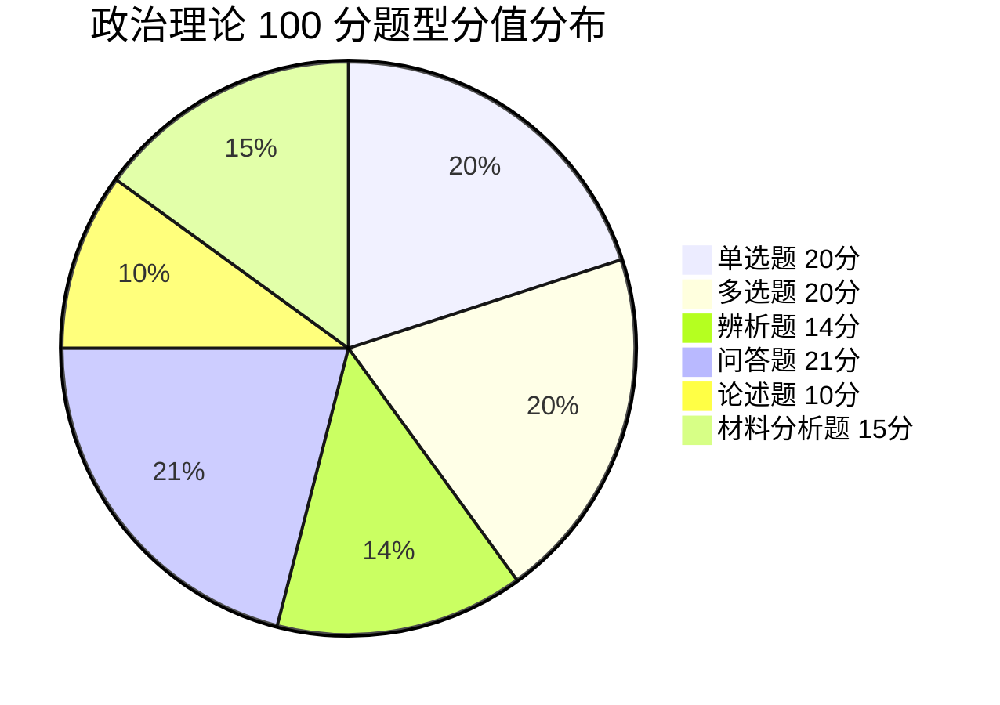

> 📌 **多选题最易失分**（20 分）：**没有部分分，少选也是 0 分**；问答题+材料分析题占 36 分——**分点作答 + 结合材料**是拿分核心。

#### ⚠️ 多选策略：别照抄「宁缺毋滥」

**评分规则（真题卷面原文）**：「未选、错选、多选或少选均无分」——**少选不给分**。

在这个规则下，「不确定就少选」并不天然更安全。把 2018–2026 共 9 年、90 道多选的官方答案全数过一遍：

| 答案项数 | 题数 | 占比 |
|:---:|:---:|:---:|
| 2 项 | 21 | 23.3% |
| 3 项 | 33 | 36.7% |
| **4 项（全选 ABCD）** | **36** | **40.0%** |

> 数据可复现：`npm run politics:mc`（`scripts/politics-mc-stats.mjs`），脚本会校验「每年恰好 10 题」，切段失败直接报错。

**三条操作口径：**

1. **先圈「确定对的」**，圈不到 2 项说明这题没学过，别赌。
2. **圈到 2–3 项、剩下拿不准 → 倾向补全**。只填 2 项命中率 23.3%、只填 3 项 36.7%，都低于补全的 40.0%。
3. **只有能说出「这个选项错在哪」时才排除它**。说不出具体错因、只是「感觉不对」的，留着。

> 反面提醒：第 2 条的前提是「圈进去的项本身是对的」。混了错项，补全和少选一样 0 分 —— 所以单选 20 分（概念/时间/人物）必须先打牢。

> 题型分值以**当年考试大纲**为准，跨年可能微调。

---

### 二、考试范围（2026 公开表述摘要）

1. 马克思主义中国化时代化的历史进程与理论成果
2. 毛泽东思想及其历史地位
3. 新民主主义革命理论
4. 社会主义改造理论
5. 社会主义建设道路初步探索的理论成果
6. 中国特色社会主义理论体系的形成发展
7. 邓小平理论 · “三个代表”重要思想 · 科学发展观
8. **习近平新时代中国特色社会主义思想**（形成与历史地位、中国式现代化、党的全面领导、以人民为中心、全面深化改革开放、高质量发展、教育科技人才、全过程人民民主、全面依法治国、文化强国、民生社会建设、生态文明、国家安全、国防军队、“一国两制”与祖国统一、大国外交与人类命运共同体、全面从严治党等）
9. **时事政治**（考前**一个自然年**国内外重大时事与重大路线方针政策）
   → 2027 届对应 **2026.1.1–2026.12.31**。真题实测**固定 8 分**（单选 1–4 + 多选 21–22，11 年零例外），
   不是考纲写的 15%。见 16-时事政治备考

---

### 三、参考书目

1. 《毛泽东思想和中国特色社会主义理论体系概论》（2023 年版），高等教育出版社
2. 《习近平新时代中国特色社会主义思想概论》，高等教育出版社、人民出版社，2023 年 8 月

---

### 四、本站笔记地图

| 模块 | 笔记 |
|:---|:---|
| 总纲 | 本页 |
| 毛中特主线 | 01-马克思主义中国化时代化 · 02-毛泽东思想 · 03-新民主主义革命 · 04-社会主义改造 · 05-建设道路初步探索 |
| 中国特色 | 06-中国特色社会主义理论体系 · 07-邓小平理论 · 08-三个代表与科学发展观 |
| 新时代 | 09-习思想形成与历史地位 · 10-中国式现代化 · 11-党的领导与以人民为中心 · 12-改革发展与五位一体 · 13-民主法治文化民生 · 14-生态安全国防统一外交 · 15-全面从严治党 |
| 得分技巧 | 16-时事政治备考 · 17-辨析论述材料题模板 · 18-必背金句与名词 |
| 时政（2026-10-24 建） | 16-时事政治备考（总纲）· 16a-时政速查表-2026（背诵版）· 16b-广东时政专项（11 年考 5 次）· 16c-时政配套题 · 16d-时政答案解析 |

---

### 五、三轮刷法

1. **第一轮**：按模块笔记过概念 + 闭卷默写金句
2. **第二轮**：按年演练页（2018–2024）限时
3. **第三轮**：材料题 / 论述题限时默写 + 对答案补表述

返回：[政治](/posts/politics/) · [_索引](/posts/politics/)

---

<!-- 来源：10-讲义-按节贴/政治/01-马克思主义中国化时代化.md -->

## 01 马克思主义中国化时代化

> 🎯 **一句话**：把马克思主义基本原理同中国具体实际、同中华优秀传统文化相结合（**两个结合**）。

---

### 一、核心知识

#### 【是什么】
**马克思主义中国化时代化**：把马克思主义基本原理同中国具体实际相结合、同中华优秀传统文化相结合，不断推进马克思主义中国化时代化，用马克思主义观察时代、把握时代、引领时代。

#### 【两个结合】
1. **同中国具体实际相结合**
2. **同中华优秀传统文化相结合**

#### 【理论成果主线】
| 阶段 | 成果 | 关键词 |
|:---|:---|:---|
| 新民主主义革命 / 社会主义革命与建设 | **毛泽东思想** | 实事求是、群众路线、独立自主 |
| 改革开放与现代化建设新时期 | **中国特色社会主义理论体系** | 邓三科（邓 + 三 + 科） |
| 中国特色社会主义新时代 | **习近平新时代中国特色社会主义思想** | 两个确立、中国式现代化 |

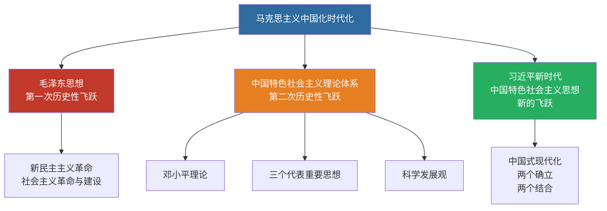

> 📌 记忆：**三次飞跃、两条主线**——毛泽东思想（第一次）、邓三科（第二次）、习思想（新时代新的飞跃）。

---

### 二、要点速记

- 马克思主义的**理论品质**：与时俱进
- 马克思主义中国化的**精髓**：实事求是
- 第一次历史性飞跃：**毛泽东思想**
- 第二次历史性飞跃：中国特色社会主义理论体系
- 新时代的重大成果：**习思想**（当代中国马克思主义、二十一世纪马克思主义）

---

### 三、闭卷挑战

**1.** 什么是“两个结合”？

> **点击查看答案与解析**
> 把马克思主义基本原理同中国具体实际相结合、同中华优秀传统文化相结合。

**2.** 简述马克思主义中国化时代化的历史进程与主要理论成果。

> **点击查看答案与解析**
> 1. 新民主主义革命和社会主义革命与建设时期 → 毛泽东思想
> 2. 改革开放新时期 → 中国特色社会主义理论体系（邓小平理论、“三个代表”、科学发展观）
> 3. 中国特色社会主义新时代 → 习近平新时代中国特色社会主义思想

返回：00-考试大纲与题型 · [政治](/posts/politics/)

---

<!-- 来源：10-讲义-按节贴/政治/02-毛泽东思想.md -->

## 02 毛泽东思想

## 02 毛泽东思想及其历史地位

> 🎯 **一句话**：毛泽东思想是马克思主义中国化的**第一次历史性飞跃**。

---

### 一、形成与发展（时间轴）

| 阶段 | 标志 | 要点 |
|:---|:---|:---|
| 萌芽 | 大革命时期 | 农民运动、阶级分析 |
| 初步形成 | 土地革命时期 | 农村包围城市、武装夺取政权 |
| 成熟 | 延安整风至七大 | 系统总结，写入党章 |
| 继续发展 | 解放战争、新中国成立后 | 人民民主专政、社会主义改造等 |

**党的七大（1945）**：确立毛泽东思想为党的指导思想。

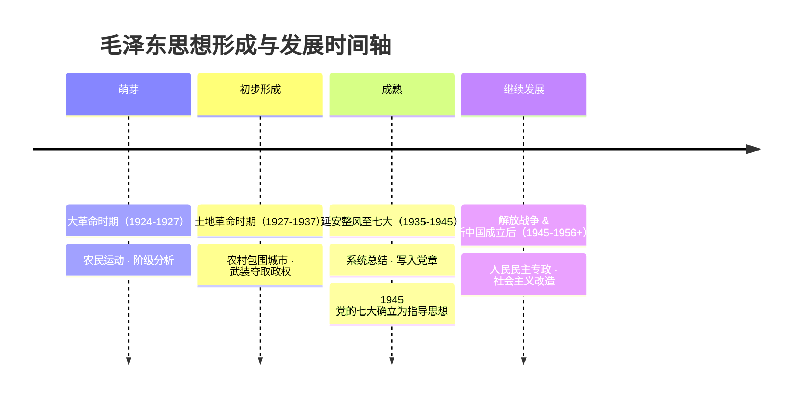

> 📌 记忆口诀：**萌芽在大革命、形成在土地革命、成熟在延安（七大）、发展在新中国**。

---

### 二、活的灵魂（必背 3 条）

1. **实事求是**（精髓）
2. **群众路线**（根本工作路线）
3. **独立自主**（根本立足点）

---

### 三、历史地位

- 马克思主义中国化的**第一次历史性飞跃**
- 中国革命和建设的科学指南
- 中国共产党和中国人民宝贵的精神财富
- 必须把毛泽东思想与毛泽东晚年错误**区别开来**（十一届六中全会《历史决议》精神）

---

### 四、闭卷挑战

**1.** 毛泽东思想活的灵魂是什么？

> **点击查看答案与解析**
> 实事求是、群众路线、独立自主。

**2.** 毛泽东思想何时被确立为党的指导思想？

> **点击查看答案与解析**
> 1945 年党的七大。

返回：01-马克思主义中国化时代化 · [政治](/posts/politics/)

---

<!-- 来源：10-讲义-按节贴/政治/03-新民主主义革命.md -->

## 03 新民主主义革命

## 03 新民主主义革命理论

> 🎯 **一句话**：无产阶级领导的，人民大众的，反对帝国主义、封建主义和官僚资本主义的革命。

---

### 一、总路线（必背）

**无产阶级领导的，人民大众的，反对帝国主义、封建主义和官僚资本主义的革命。**

#### 对象 / 动力 / 领导 / 性质 / 前途

| 要素 | 内容 |
|:---|:---|
| 对象 | 帝、封、官（三座大山） |
| 动力 | 工人阶级、农民阶级、城市小资产阶级、民族资产阶级 |
| 领导 | **工人阶级**（通过共产党）—— 区分新旧民主革命的根本标志 |
| 性质 | 资产阶级民主主义革命（新式） |
| 前途 | 社会主义 |

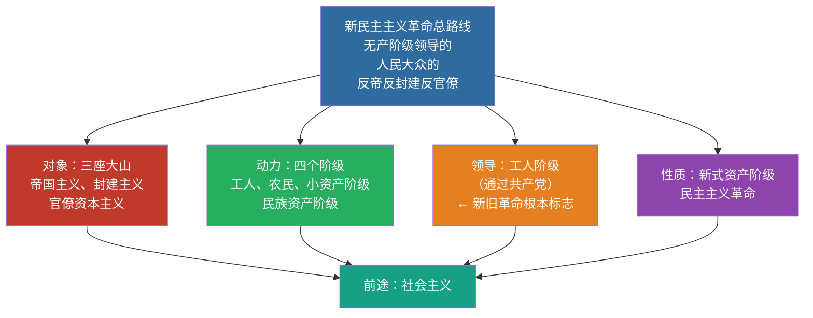

> 📌 记忆口诀：**对象三座山、动力四个级、领导无产党、性质新民主、前途是社会**。

---

### 二、三大法宝

1. **统一战线**
2. **武装斗争**
3. **党的建设**

---

### 三、道路与基本纲领

- **道路**：农村包围城市、武装夺取政权
- **政治纲领**：建立无产阶级领导的各革命阶级联合专政的民主共和国
- **经济纲领**：没收封建地主土地归农民；没收官僚资本归新民主主义国家；保护民族工商业
- **文化纲领**：民族的、科学的、大众的文化

---

### 四、闭卷挑战

**1.** 区分新旧民主主义革命的根本标志是什么？

> **点击查看答案与解析**
> 领导权是否掌握在无产阶级（共产党）手中。

**2.** 新民主主义革命的三大法宝是什么？

> **点击查看答案与解析**
> 统一战线、武装斗争、党的建设。

返回：02-毛泽东思想 · [政治](/posts/politics/)

---

<!-- 来源：10-讲义-按节贴/政治/04-社会主义改造.md -->

## 04 社会主义改造

## 04 社会主义改造理论

> 🎯 **一句话**：过渡时期总路线 = **一化三改**（一体两翼）。

---

### 一、过渡时期总路线

**从中华人民共和国成立，到社会主义改造基本完成**，这是一个过渡时期。党在这个过渡时期的总路线和总任务是：

> 要在一个相当长的时期内，逐步实现国家的**社会主义工业化**，并逐步实现国家对**农业、手工业和资本主义工商业**的社会主义改造。

| 名称 | 内容 |
|:---|:---|
| 一化 | 社会主义工业化（主体） |
| 三改 | 农业、手工业、资本主义工商业的社会主义改造（两翼） |

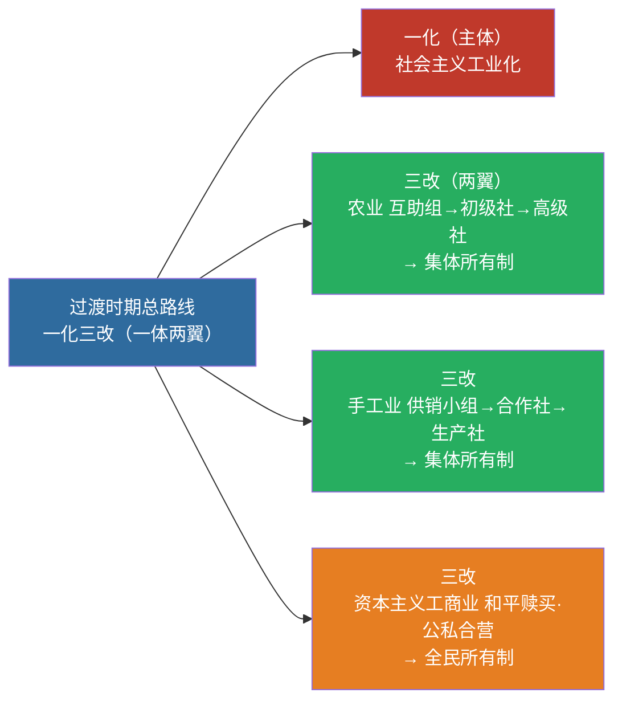

> 📌 1956 年底改造基本完成 → 社会主义基本制度确立。记忆：**一化是主体，三改是两翼；农业走互助组，资本主义走和平赎买**。

---

### 二、改造道路要点

| 对象 | 道路/形式 | 结果 |
|:---|:---|:---|
| 农业 | 互助组 → 初级社 → 高级社 | 集体所有制 |
| 手工业 | 供销小组 → 供销合作社 → 生产合作社 | 集体所有制 |
| 资本主义工商业 | 和平赎买；加工订货、公私合营等 | 全民所有制 |

**1956 年底**：社会主义改造基本完成 → 社会主义基本制度在中国确立。

---

### 三、闭卷挑战

**1.** “一化三改”分别指什么？

> **点击查看答案与解析**
> 一化：社会主义工业化；三改：对农业、手工业、资本主义工商业的社会主义改造。

**2.** 社会主义基本制度在中国确立的标志性时间？

> **点击查看答案与解析**
> 1956 年底社会主义改造基本完成。

返回：03-新民主主义革命 · [政治](/posts/politics/)

---

<!-- 来源：10-讲义-按节贴/政治/05-建设道路初步探索.md -->

## 05 建设道路初步探索

## 05 社会主义建设道路初步探索的理论成果

> 🎯 **一句话**：以苏为鉴，走自己的路；正确处理十大关系；正确处理人民内部矛盾。

---

### 一、重要文献与观点

| 文献/会议 | 核心观点 |
|:---|:---|
| 《论十大关系》（1956） | 调动一切积极因素为社会主义事业服务；以苏为鉴 |
| 党的八大（1956） | 主要矛盾：人民对于经济文化迅速发展的需要同当前经济文化不能满足人民需要的状况之间的矛盾；主要任务是发展生产力 |
| 《关于正确处理人民内部矛盾的问题》（1957） | 两类矛盾；人民内部矛盾用民主方法（团结—批评—团结） |

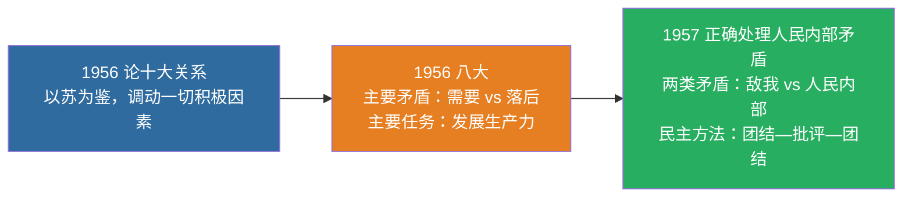

> 📌 记忆：**56 关系 + 56 八大 + 57 矛盾**——三年三件大事，构成社会主义建设初步探索的三大里程碑。

---

### 二、正反两方面

- **积极成果**：独立的比较完整的工业体系和国民经济体系；“两弹一星”等
- **曲折教训**：要科学判断国情与主要矛盾，坚持实事求是，按客观经济规律办事

---

### 三、闭卷挑战

**1.** 党的八大指出当时国内主要矛盾是什么？

> **点击查看答案与解析**
> 人民对于经济文化迅速发展的需要同当前经济文化不能满足人民需要的状况之间的矛盾。

**2.** 正确处理人民内部矛盾的基本方法是什么？

> **点击查看答案与解析**
> 民主的方法，即团结—批评—团结。

返回：04-社会主义改造 · [政治](/posts/politics/)

---

<!-- 来源：10-讲义-按节贴/政治/06-中国特色社会主义理论体系.md -->

## 06 中国特色社会主义理论体系

## 06 中国特色社会主义理论体系的形成发展

> 🎯 **一句话**：邓 + 三 + 科，是马克思主义中国化的**第二次历史性飞跃**（体系层面）。

---

### 一、体系构成

| 组成部分 | 主题/关键词 |
|:---|:---|
| 邓小平理论 | 什么是社会主义、怎样建设社会主义 |
| "三个代表"重要思想 | 建设什么样的党、怎样建设党 |
| 科学发展观 | 实现什么样的发展、怎样发展 |

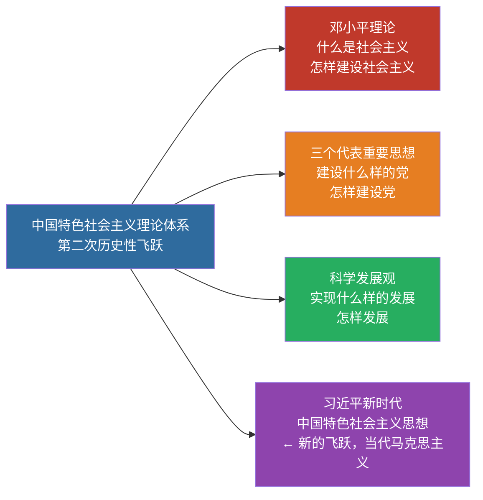

> 📌 记忆：**邓三科 + 习 = 中国特色社会主义理论体系的主力军**。邓答"社"、三答"党"、科答"发展"、习答"新时代"。

> 习近平新时代中国特色社会主义思想是马克思主义中国化时代化新的飞跃，是当代中国马克思主义、二十一世纪马克思主义（与上述体系既一脉相承又与时俱进）。

---

### 二、形成条件（简记）

- 时代主题：和平与发展
- 实践基础：改革开放和社会主义现代化建设
- 历史经验：国内外社会主义建设正反经验
- 思想渊源：马列主义、毛泽东思想

---

### 三、闭卷挑战

**1.** 中国特色社会主义理论体系主要包括哪些内容？

> **点击查看答案与解析**
> 邓小平理论、“三个代表”重要思想、科学发展观。

返回：05-建设道路初步探索 · [政治](/posts/politics/)

---

<!-- 来源：10-讲义-按节贴/政治/07-邓小平理论.md -->

## 07 邓小平理论

> 🎯 **一句话**：解放思想、实事求是；搞清楚**什么是社会主义、怎样建设社会主义**。

---

### 一、精髓与首要问题

- **精髓**：解放思想、实事求是
- **首要的基本理论问题**：什么是社会主义、怎样建设社会主义
- **本质**：解放生产力，发展生产力，消灭剥削，消除两极分化，最终达到共同富裕

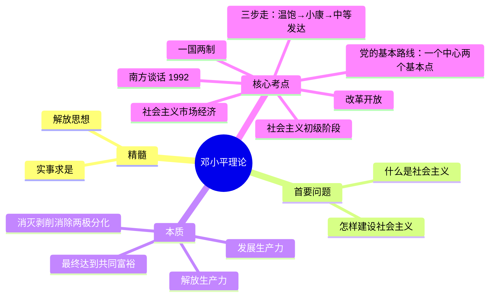

> 📌 南方谈话 1992：**社会主义本质 + 三个有利于 + 计划市场都是手段 + 发展才是硬道理**。

---

### 二、高频考点清单

| 考点 | 要点 |
|:---|:---|
| 社会主义初级阶段 | 基本国情；至少上百年 |
| 党的基本路线 | 一个中心、两个基本点 |
| 改革开放 | 决定当代中国命运的关键一招 |
| 社会主义市场经济 | 计划与市场都是手段 |
| 一国两制 | 实现祖国统一的构想 |
| “三步走” | 温饱 → 小康 → 中等发达 |

**南方谈话（1992）**：社会主义本质；“三个有利于”；计划市场都是经济手段；发展才是硬道理。

---

### 三、闭卷挑战

**1.** 社会主义的本质是什么？

> **点击查看答案与解析**
> 解放生产力，发展生产力，消灭剥削，消除两极分化，最终达到共同富裕。

**2.** 党在社会主义初级阶段的基本路线核心内容？

> **点击查看答案与解析**
> 以经济建设为中心，坚持四项基本原则，坚持改革开放（一个中心、两个基本点）。

返回：06-中国特色社会主义理论体系 · [政治](/posts/politics/)

---

<!-- 来源：10-讲义-按节贴/政治/08-三个代表与科学发展观.md -->

## 08 三个代表与科学发展观

## 08 “三个代表”重要思想与科学发展观

---

### 一、“三个代表”重要思想

中国共产党必须始终：

1. 代表中国**先进生产力**的发展要求
2. 代表中国**先进文化**的前进方向
3. 代表中国**最广大人民**的根本利益

**本质**：立党为公、执政为民。

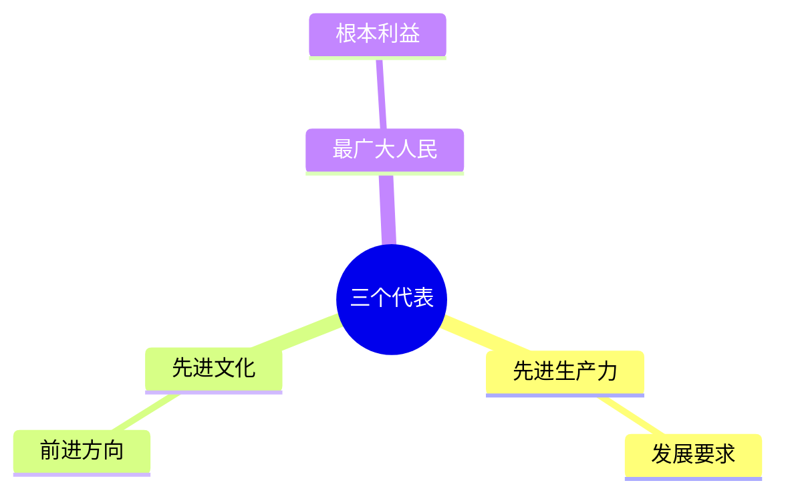

> 📌 本质：**立党为公、执政为民**。

---

### 二、科学发展观

- **第一要义**：发展
- **核心立场**：以人为本
- **基本要求**：全面协调可持续
- **根本方法**：统筹兼顾

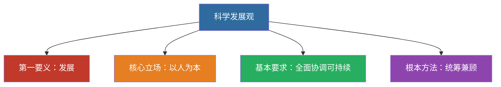

> 📌 记忆：**发展（要义）→ 人本（立场）→ 全面协调可持续（要求）→ 统筹兼顾（方法）**。

**历史地位**：马克思主义关于发展的世界观和方法论的集中体现；党的十七大写入党章，十八大列为指导思想。

---

### 三、闭卷挑战

**1.** 默写“三个代表”完整表述。

> **点击查看答案与解析**
> 始终代表中国先进生产力的发展要求、中国先进文化的前进方向、中国最广大人民的根本利益。

**2.** 科学发展观的第一要义、核心立场、基本要求、根本方法？

> **点击查看答案与解析**
> 发展；以人为本；全面协调可持续；统筹兼顾。

返回：07-邓小平理论 · [政治](/posts/politics/)

---

<!-- 来源：10-讲义-按节贴/政治/09-习思想形成与历史地位.md -->

## 09 习思想形成与历史地位

## 09 习近平新时代中国特色社会主义思想：形成与历史地位

> 🎯 **一句话**：当代中国马克思主义、二十一世纪马克思主义；中华文化和中国精神的时代精华。

---

### 一、形成背景（简记）

- 中国特色社会主义进入**新时代**
- 世界百年未有之大变局
- 中华民族伟大复兴战略全局
- 党面临的重大风险考验

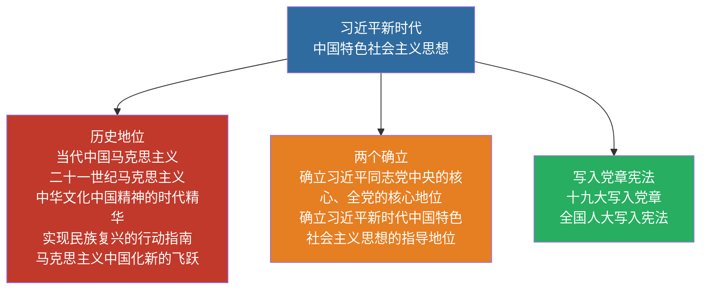

**党的十九大**：确立习思想为党的指导思想并写入党章；十三届全国人大一次会议写入宪法。

---

### 二、历史地位（必背表述）

- 当代中国马克思主义、二十一世纪马克思主义
- 中华文化和中国精神的时代精华
- 实现中华民族伟大复兴的行动指南
- 马克思主义中国化时代化新的飞跃

---

### 三、“两个确立”（表述务必准确）

确立习近平同志党中央的核心、全党的核心地位；确立习近平新时代中国特色社会主义思想的指导地位。

---

### 四、闭卷挑战

**1.** 简述习思想的历史地位（至少写 3 点）。

> **点击查看答案与解析**
> 当代中国马克思主义、二十一世纪马克思主义；中华文化和中国精神的时代精华；实现中华民族伟大复兴的行动指南；马克思主义中国化时代化新的飞跃。

返回：08-三个代表与科学发展观 · [政治](/posts/politics/)

---

<!-- 来源：10-讲义-按节贴/政治/10-中国式现代化.md -->

## 10 中国式现代化

## 10 中国式现代化与中华民族伟大复兴

> 🎯 **一句话**：以中国式现代化全面推进中华民族伟大复兴。

---

### 一、中国式现代化的中国特色（5 条必背）

1. 人口规模巨大的现代化
2. 全体人民共同富裕的现代化
3. 物质文明和精神文明相协调的现代化
4. 人与自然和谐共生的现代化
5. 走和平发展道路的现代化

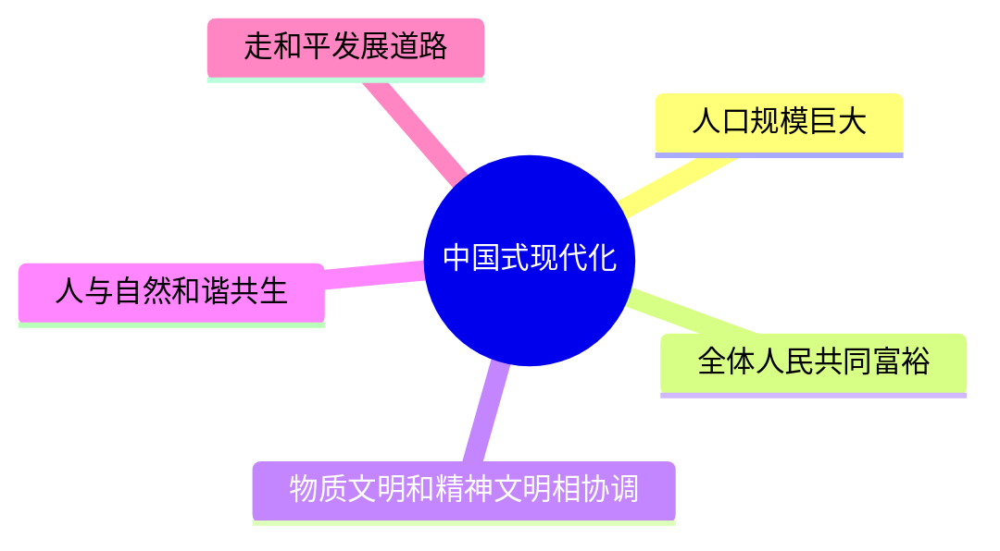

> 📌 记忆口诀：**人、富、物精、人自、和平**——"一个最大（人口），两个协调（物质精神、人与自然），两个全体/共同（共同富裕、和平发展）"。

### 二、本质要求（简记框架）

坚持中国共产党领导，坚持中国特色社会主义，实现高质量发展，发展全过程人民民主，丰富人民精神世界，实现全体人民共同富裕，促进人与自然和谐共生，推动构建人类命运共同体，创造人类文明新形态。

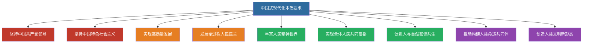

> 📌 记忆分层：**两个坚持（党+社会主义）→ 四个实现（高质量、全过程民主、人民精神、共同富裕）→ 三个促进（人与自然、人类命运共同体、人类文明新形态）**。

### 三、中心任务

团结带领全国各族人民全面建成社会主义现代化强国、实现第二个百年奋斗目标，以中国式现代化全面推进中华民族伟大复兴。

---

### 四、闭卷挑战

**1.** 默写中国式现代化的五个中国特色。

> **点击查看答案与解析**
> 人口规模巨大；全体人民共同富裕；物质文明和精神文明相协调；人与自然和谐共生；走和平发展道路。

返回：09-习思想形成与历史地位 · [政治](/posts/politics/)

---

<!-- 来源：10-讲义-按节贴/政治/11-党的领导与以人民为中心.md -->

## 11 党的领导与以人民为中心

## 11 坚持党的全面领导 · 坚持以人民为中心

---

### 一、坚持党的全面领导

- 中国特色社会主义**最本质的特征**是中国共产党领导
- 中国特色社会主义制度的**最大优势**是中国共产党领导
- 党是最高政治领导力量
- **两个维护**：坚决维护习近平总书记党中央的核心、全党的核心地位；坚决维护党中央权威和集中统一领导

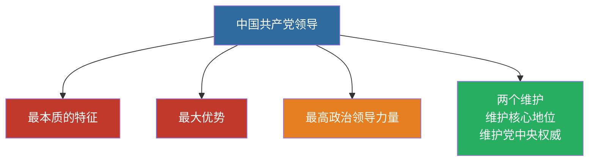

---

### 二、坚持以人民为中心

- 人民立场是中国共产党的**根本政治立场**
- 江山就是人民，人民就是江山
- 发展为了人民、发展依靠人民、发展成果由人民共享
- 扎实推进共同富裕

---

### 三、闭卷挑战

**1.** 中国特色社会主义最本质的特征是什么？

> **点击查看答案与解析**
> 中国共产党领导。

**2.** “两个维护”的完整表述？

> **点击查看答案与解析**
> 坚决维护习近平总书记党中央的核心、全党的核心地位；坚决维护党中央权威和集中统一领导。

返回：10-中国式现代化 · [政治](/posts/politics/)

---

<!-- 来源：10-讲义-按节贴/政治/12-改革发展与五位一体.md -->

## 12 改革发展与五位一体

## 12 全面深化改革开放 · 推动高质量发展

---

### 一、全面深化改革开放

- 改革开放是决定当代中国命运的关键一招，也是决定实现“两个一百年”奋斗目标、实现中华民族伟大复兴的关键一招
- 全面深化改革总目标：完善和发展中国特色社会主义制度，推进国家治理体系和治理能力现代化
- 使市场在资源配置中起**决定性作用**，更好发挥政府作用

---

### 二、新发展理念（5 个必背）

**创新、协调、绿色、开放、共享**

| 理念 | 解决什么问题 |
|:---|:---|
| 创新 | 发展动力 |
| 协调 | 发展不平衡 |
| 绿色 | 人与自然和谐 |
| 开放 | 发展内外联动 |
| 共享 | 社会公平正义 |

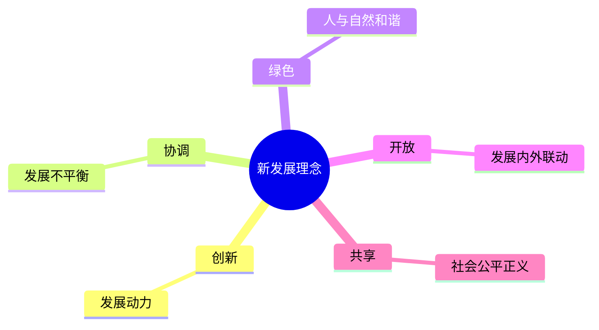

> 📌 记忆口诀：**创协绿开共 = 新协调绿开共**（动力、平衡、和谐、联动、公平）。

---

### 三、高质量发展

- 高质量发展是全面建设社会主义现代化国家的**首要任务**
- 完整、准确、全面贯彻新发展理念
- 加快构建新发展格局（以国内大循环为主体、国内国际双循环相互促进）
- 教育、科技、人才是全面建设社会主义现代化国家的基础性、战略性支撑；科技是第一生产力、人才是第一资源、创新是第一动力

---

### 四、闭卷挑战

**1.** 默写新发展理念五个词。

> **点击查看答案与解析**
> 创新、协调、绿色、开放、共享。

**2.** 全面深化改革的总目标是什么？

> **点击查看答案与解析**
> 完善和发展中国特色社会主义制度，推进国家治理体系和治理能力现代化。

返回：11-党的领导与以人民为中心 · [政治](/posts/politics/)

---

<!-- 来源：10-讲义-按节贴/政治/13-民主法治文化民生.md -->

## 13 民主法治文化民生

## 13 全过程人民民主 · 全面依法治国 · 文化强国 · 民生社会建设

---

### 一、发展全过程人民民主

- 人民民主是社会主义的生命
- 全过程人民民主是社会主义民主政治的本质属性
- 最广泛、最真实、最管用的民主
- 人民代表大会制度是我国的**根本政治制度**
- 中国共产党领导的多党合作和政治协商制度、民族区域自治制度、基层群众自治制度是基本政治制度

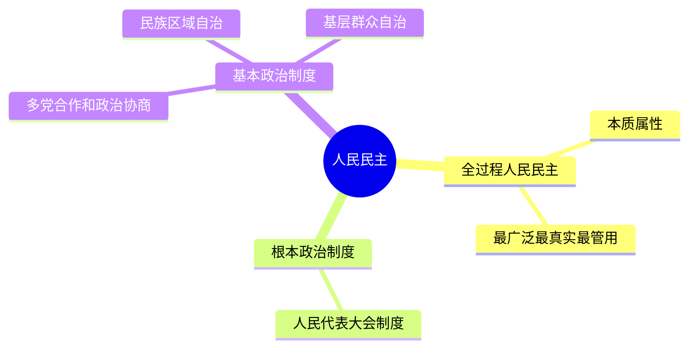

---

### 二、全面依法治国

- 坚持党的领导、人民当家作主、依法治国有机统一
- 建设中国特色社会主义法治体系、建设社会主义法治国家
- 科学立法、严格执法、公正司法、全民守法

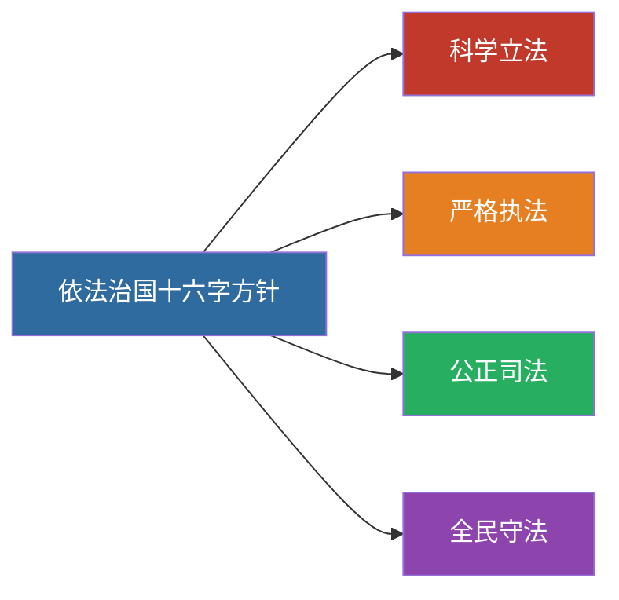

---

### 三、建设社会主义文化强国

- 坚持马克思主义在意识形态领域指导地位的根本制度
- 社会主义核心价值观：**富强、民主、文明、和谐；自由、平等、公正、法治；爱国、敬业、诚信、友善**（24 字）
- 坚定文化自信，建设中华民族现代文明

---

### 四、保障和改善民生

- 在发展中保障和改善民生
- 就业是最基本的民生
- 分配制度是促进共同富裕的基础性制度
- 健全社会保障体系；推进健康中国建设

---

### 五、闭卷挑战

**1.** 默写社会主义核心价值观 24 字。

> **点击查看答案与解析**
> 富强、民主、文明、和谐；自由、平等、公正、法治；爱国、敬业、诚信、友善。

**2.** 我国的根本政治制度是什么？

> **点击查看答案与解析**
> 人民代表大会制度。

返回：12-改革发展与五位一体 · [政治](/posts/politics/)

---

<!-- 来源：10-讲义-按节贴/政治/14-生态安全国防统一外交.md -->

## 14 生态安全国防统一外交

## 14 生态文明 · 国家安全 · 国防军队 · 祖国统一 · 大国外交

---

### 一、建设社会主义生态文明

- **绿水青山就是金山银山**
- 人与自然和谐共生
- 碳达峰碳中和（双碳）目标

---

### 二、维护和塑造国家安全

- **总体国家安全观**
- 以人民安全为宗旨，以政治安全为根本，以经济安全为基础，以军事、科技、文化、社会安全为保障，以促进国际安全为依托

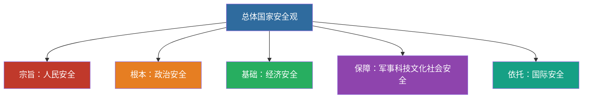

> 📌 记忆链：**宗旨人民 → 根本政治 → 基础经济 → 保障四个 → 依托国际**。

---

### 三、建设巩固国防和强大人民军队

- 党对人民军队的绝对领导是人民军队的建军之本、强军之魂
- 新时代强军目标：听党指挥、能打胜仗、作风优良

---

### 四、坚持“一国两制”和推进祖国完全统一

- “一国两制”是中国特色社会主义的伟大创举
- “一国”是实行“两制”的前提和基础
- 解决台湾问题、实现祖国完全统一，是党矢志不渝的历史任务
- 坚持一个中国原则和“九二共识”

---

### 五、中国特色大国外交

- 推动构建**人类命运共同体**
- 共商共建共享的全球治理观
- “一带一路”倡议
- 独立自主的和平外交政策

---

### 六、闭卷挑战

**1.** 总体国家安全观“以何为宗旨、以何为根本、以何为基础”？

> **点击查看答案与解析**
> 以人民安全为宗旨，以政治安全为根本，以经济安全为基础。

**2.** 新时代的强军目标是什么？

> **点击查看答案与解析**
> 听党指挥、能打胜仗、作风优良。

返回：13-民主法治文化民生 · [政治](/posts/politics/)

---

<!-- 来源：10-讲义-按节贴/政治/15-全面从严治党.md -->

## 15 全面从严治党

> 🎯 **一句话**：办好中国的事情，关键在党；全面从严治党永远在路上。

---

### 一、核心要点

- 党的自我革命是跳出治乱兴衰历史周期率的**第二个答案**（第一个答案是人民监督）
- 坚持思想建党和制度治党同向发力
- 作风建设永远在路上；反腐败无禁区、全覆盖、零容忍
- 健全全面从严治党体系

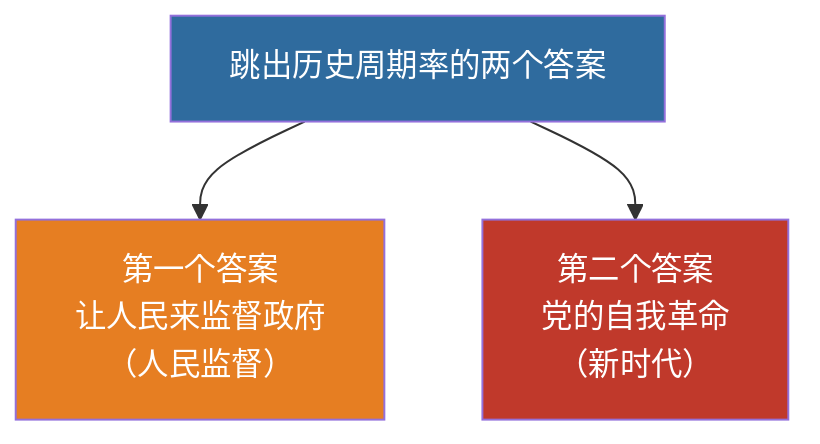

> 📌 记忆：**人民监督是第一答案（传统），自我革命是第二答案（新时代）**——选择题高频。

---

### 二、与“两个确立”“两个维护”的关系

全面从严治党为做到“两个维护”提供政治保证；“两个维护”是党的最高政治原则和根本政治规矩。

---

### 三、闭卷挑战

**1.** 跳出历史周期率的两个答案分别是什么？

> **点击查看答案与解析**
> 第一个答案：让人民来监督政府（人民监督）；第二个答案：党的自我革命。

返回：14-生态安全国防统一外交 · [政治](/posts/politics/)

---

<!-- 来源：10-讲义-按节贴/政治/16-时事政治备考.md -->

## 16 时事政治备考

## 16 时事政治备考指南

> 🎯 **一句话**：时政在真题里是**固定 8 分的客观题**（单选 1–4 + 多选 21–22，11 年零例外），
> 但这 8 分**不靠教材、只靠考前突击**，是全卷投入产出比最高的一块。

---

### 一、先纠三个口径错误（很多资料写错，背错方向）

#### 错误 1：时政是 15 分 → 实际是 8 分

考纲写「时事政治约 15%」，但**真题实测 11 年**：

| 年份 | 单选时政题号 | 多选时政题号 | 时政分值 |
|:--|:--|:--|--:|
| 2015 / 2016 / 2017 | 1,2,3,4,5,6 | 21,22 | 10 |
| 2020 | 1,2,3,4,17,18 | 21,22 | 10 |
| 2018 / 2019 / 2021–2025 | 1,2,3,4 | 21,22 | **8** |

**结论：按 8 分准备，不是 15 分。** 考纲的 15% 把材料分析题里用到的时政材料也算进去了，
但材料分析题的答案仍在教材里（原理 + 结合材料），不额外吃时政背诵量。
详见 `资料/电子书蒸馏/00-政治真题考点映射表-2015至2025.md` §三。

#### 错误 2：考试区间是「考前 12 个月」→ 实际是「上一个自然年」

**2027 年 3 月考试 → 考的是 2026.1.1 – 2026.12.31 的时事。**

不是「2026 年 3 月到 2027 年 2 月」。这个差别很关键：
**2026 年 1–2 月的事也在范围内**，别以为「去年的不用看」。

> 依据：考纲原文「考前一年度」。2026 年考试对应 2025.1.1–2025.12.31，
> 顺推 2027 年考试即 2026 全年。2026 年 12 月省考试院发布《2027 大纲》后以新文件为准。

#### 错误 3：以为「广东不考」→ 广东本地事件 11 年考了至少 5 次

2018 多选 21（习近平考察广东珠海清远深圳广州）、2020 单选 4（粤港澳大湾区发展规划纲要）、
2021 单选 3（深圳 5G 全覆盖）、2023 单选 2（华南国家植物园落户广州）、
2024 单选 3（港珠澳大桥旅游开放）。

**广东必须单列一栏**，见 `16b-广东时政专项.md`。

---

### 二、时政只考这四类（11 年题目归纳）

| 类型 | 具体抓什么 | 2026 年的对应 |
|:--|:--|:--|
| ① 会议 + 文件全名 | 中央全会、全国两会通过的文件名 | 二十届五中全会《决定》、2026 政府工作报告 |
| ② 重大科技/工程成就 | 名称 + 世界第几 / 中国第几 | 神舟二十三号、平陆运河、桥苑号 |
| ③ 主场外交 | 会议名 + 主题 + 地点 | **APEC 深圳峰会（11/18–19）** |
| ④ 周年纪念 | 整数周年 + 大会讲话 | 建党 105、长征 90、北伐 100、三大改造 70 |

**判断标准**：一条新闻值不值得背，只看它能不能落进这四类。落不进就跳过。
时政备考最大的浪费是「什么都看」——12 个月几千条新闻，真正会考的不到 60 条。

---

### 三、2026 全年已确认事件（截至 2026-10-24，逐条可背）

> 全部来自官方媒体（gov.cn / 12371.cn / people.com.cn / gd.gov.cn / sz.gov.cn），
> 未核实的**一律不写**。⚠️ 标记 = 尚未发生或尚未公布，考前必须回填。

#### ① 会议与文件

| 时间 | 事件 | 必背要点 |
|:--|:--|:--|
| 3/5 | **十四届全国人大四次会议**开幕，李强作《政府工作报告》 | 首次提出「十五五」时期主要目标 |
| 10/26–29 | ⚠️ **党的二十届五中全会**（北京） | 审议《中共中央关于持之以恒推进全面从严治党若干重大问题的决定》<br>**决定全文 10/29 后公布，必须回填** |

**2026 年政府工作报告主要预期目标（必背数字）**

- 经济增长 **4.5%–5%**（注意：**不再是「5% 左右」**，这是三年来的首次下调，最容易被出成干扰项）
- 城镇调查失业率 **5.5% 左右**
- 城镇新增就业 **1200 万人以上**
- 居民消费价格涨幅 **2% 左右**
- 粮食产量 **1.4 万亿斤左右**
- 单位国内生产总值二氧化碳排放 **降低 3.8%**
- 人均预期寿命 **79.25 岁**；劳动年龄人口平均受教育年限 **11.3 年**
- 粤港澳大湾区**连续 10 年**写入政府工作报告

##### ⚠️ 必辨：「建议」与「纲要」不是一回事

这是时政里最容易混的一对概念，也是绝佳的干扰项素材：

| | 文件 | 谁通过 | 时间 |
|:--|:--|:--|:--|
| **建议** | 《中共中央关于制定国民经济和社会发展第十五个五年规划的**建议**》 | **党的二十届四中全会** | **2025 年 10 月 20–23 日**（10/23 通过，10/28 全文发布） |
| **纲要** | 《中华人民共和国国民经济和社会发展第十五个五年规划**纲要**》 | **全国人民代表大会**（2026 年两会批准） | **2026 年 3 月** |

**记法：党的全会出「建议」，人民代表大会批「纲要」。**
出题套路：把「建议」说成人大通过，或把「纲要」说成四中全会通过。

> 注意年份：**四中全会是 2025 年**，不在 2027 届考纲区间（2026 全年）内。
> 但它定的「十五五」目标会在 2026 年两会上转成纲要，所以**逻辑链要懂，年份别搞错**。

#### ② 重大科技与工程成就

| 时间 | 成就 | 必背要点 |
|:--|:--|:--|
| 5/22 | **「桥苑号」**下水 | 新一代双体专业海洋工程勘察船，国内同型船中**体量最大**，填补深远海高端勘察装备短板 |
| 5/24 | **神舟二十三号**载人飞船发射成功 | 长征系列运载火箭 |
| 5 月 | **淮河入海水道二期淮安枢纽立交地涵**通过水下验收 | **世界规模最大的水上立交** |
| 7/1 | **水下焊接原位中子衍射研究装置**投用 | **世界首套**，装在中国散裂中子源工程材料谱仪上 |
| 9/16 | **平陆运河**建成通航 | **新中国成立以来首条**国家层面统筹建设的江海连通大运河；西部陆海新通道骨干工程；全长 **134.2 公里**；总投资约 **727 亿元**；西南货物出海缩短内河航程 **560 公里以上** |
| 10/10 | **长征十二号**运载火箭发射 | 海南商业航天发射场 |

> 记忆锚：2026 年科技成就的三个「最」——桥苑号（体量最大）、淮安立交（世界最大水上立交）、
> 平陆运河（首条江海连通大运河）。

#### ③ 主场外交

| 时间 | 事件 | 必背要点 |
|:--|:--|:--|
| 11/17–18 | ⚠️ **APEC 工商领导人峰会**（深圳） | 领导人非正式会议的配套活动 |
| 11/18–19 | ⚠️ **APEC 第三十三次领导人非正式会议**（深圳） | 主题「**建设亚太共同体，促进共同繁荣**」<br>三大优先领域「**开放、创新、合作**」<br>中国**第三次**担任 APEC 东道主（2001 上海 → 2014 北京 → 2026 深圳）<br>习近平主持 |
| 2026 年内 | ⚠️ **第二届中国—阿拉伯国家峰会** | 习近平在国内主持 |

**APEC 中国年其他必知细节**（都可能出客观题）

- **三次高官会**：2 月**广州**、5 月**上海**、8 月**大连**（大连那次规模最大，近 130 场活动、2300 余名代表）
- **全年活动**：300 多场，遍及全国多个城市
- **会标**：以**鲲鹏**为核心（深圳别称「鹏城」），主体由 **21 根**交织羽翼构成展翅大鹏，
  寓意「乘大势、共翱翔」；21 根对应 APEC **21 个成员**
- **主题与优先领域是「一致通过」的**：2025 年 12 月 11–12 日深圳非正式高官会上，
  各方一致通过中国提出的主题和三大优先领域

**为什么 APEC 深圳是本次时政的头号考点**：它同时命中 ③ 主场外交 + 广东本地事件两条线，
而广东本地事件 11 年考了 5 次。**这一条几乎必出题，且可能出在单选或多选。**

#### ④ 周年纪念（唯一「不用等新闻」的题型）

| 年份 | 事件 | 周年 |
|:--:|:--|:--:|
| 1921 | 中国共产党成立（7/1 举行**105 周年大会**，人民大会堂，习近平讲话） | 105 |
| 1926 | 北伐战争开始 | **100** ⭐ |
| 1936 | 红军长征胜利结束（10 月举行**90 周年大会**，习近平讲话） | **90** ⭐ |
| 1936 | 西安事变 | 90 |
| 1956 | 三大改造基本完成 / 社会主义制度确立 | **70** ⭐ |
| 1956 | 中国航天事业创建 | 70 |
| 1986 | 「863 计划」启动 | 40 |

> 背法：**「北伐 100、长征 90、三大改造 70、建党 105」**。
> 长征 90 周年大会 2026 年 10 月已开，习近平讲话中「伟大长征精神」的五个「就是」是标准表述，
> 可能直接出多选题 —— 见 `16a-时政速查表-2026.md`。

---

### 四、还没发生、必须回填的四件事

| 时间 | 事项 | 回填动作 |
|:--|:--|:--|
| 10/26–29 | 二十届五中全会 | 会后抄《决定》**全名** + 公报新表述 |
| 11/18–19 | APEC 深圳峰会 | 抄《深圳宣言》名称 + 主题 + 成果清单 |
| 12 月中 | 中央经济工作会议 | 抄次年经济工作总基调（会延续到 2027 备考） |
| 12 月底 | 省考试院《2027 大纲》 | 核对时政区间是否调整 |

**这四件是 2026 年时政的最后一块拼图**，考前必须补。其余月份的素材已经够 8 分了。

---

### 五、收集渠道（只用权威源）

1. **中国政府网** gov.cn —— 政策原文、会议公报
2. **共产党员网** 12371.cn —— 中央全会、政治局会议
3. **人民网 / 新华网** —— 讲话全文、成就报道
4. **广东省政府网** gd.gov.cn —— 广东本地政策
5. **深圳政府在线** sz.gov.cn —— 深圳/大湾区动态

> ⚠️ 不用自媒体改写版。时政选择题的干扰项经常只差几个字（「决定」vs「决议」、
> 「若干重大问题」vs「若干问题」），只有原文能保证不出错。

---

### 六、月度台账（发生了就登记，别攒到 12 月）

```
事件/会议：
时间：
一句话意义：
可能出题角度（单选/多选/材料）：
关联教材章节：
```

| 月份 | 已确认重大事件 | 状态 |
|:---:|:--|:--|
| 2026.01 | 《广东省促进粤港澳大湾区内地九市轨道交通发展条例》1/1 施行 | ✅ 已登记 |
| 2026.02 | — | 待核（暂无进入四类的国家级事件） |
| 2026.03 | 全国两会（3/5 政府工作报告）；王毅记者会宣布主场外交安排 | ✅ 已登记 |
| 2026.04 | 国务院批复广东暂时调整实施部分行政法规（4/2）；支持中山融入大湾区意见（4/17） | ✅ 已登记 |
| 2026.05 | 桥苑号下水（5/22）；神舟二十三号（5/24）；淮安立交水下验收；平陆运河枢纽主体完工（5/30 大湾区九市行政法规批复） | ✅ 已登记 |
| 2026.06 | — | 待核 |
| 2026.07 | 建党 105 周年大会（7/1）；水下焊接中子衍射装置投用（7/1） | ✅ 已登记 |
| 2026.08 | APEC 第三次高官会（大连，8/27）；倒计时 100 天 | ✅ 已登记 |
| 2026.09 | 平陆运河通航（9/16）；大湾区数据特区方案（9/17）；政治局定五中全会日期（9/21） | ✅ 已登记 |
| 2026.10 | 长征十二号（10/10）；长征胜利 90 周年大会（10 月）；**五中全会（10/26–29）** | ⚠️ 五中全会待回填 |
| 2026.11 | **APEC 深圳峰会（11/18–19）** | ⚠️ 待发生 |
| 2026.12 | 中央经济工作会议 | ⚠️ 待发生 |

---

### 七、怎么用这份材料（按剩余时间选）

**现在（2026-10，还有 155 天）**：不用背时政。时政一年一换，早背早忘。
只做一件事——**每月花 30 分钟把当月事件填进 §六 台账**，用 §二 的四类标准筛。

**考前 60 天（2027-01 起）**：把 `16a-时政速查表-2026.md` 过一遍，约 60 条，
每天 10 条，6 天一轮，考前过 5 轮。

**考前 7 天**：只背速查表里的**数字和全名**（GDP 目标、里程、投资额、文件全名）。
时政选择题的错误选项，80% 是在数字和文件后缀上做手脚。

**投入产出**：12 个月 × 30 分钟收集 + 考前 6 小时背诵 = 约 12 小时，换 8 分。
全卷性价比最高，但**绝不能提前背**。

---

### 八、闭卷自测

1. 2026 年政府工作报告的 GDP 增长预期目标是多少？和 2023–2025 年有什么不同？
2. 二十届五中全会审议的文件全名是什么？（考后自测）
3. APEC 第三十三次领导人非正式会议的主题、地点、时间？中国第几次担任东道主？
4. 平陆运河的三个数字：全长多少公里？总投资多少？缩短内河航程多少？
5. 2026 年有哪四个整数周年？分别是多少周年？
6. 2026 年广东有哪三件事最可能被出成时政题？

返回：[[15-全面从严治党]] · [[17-辨析论述材料题模板]]

---

### 附：本文件的两个配套文件

- `16a-时政速查表-2026.md` —— 纯背诵版，考前 7 天只看这个
- `16b-广东时政专项.md` —— 广东本地事件单列（11 年考 5 次）

数据依据：`资料/电子书蒸馏/00-政治真题考点映射表-2015至2025.md`（77 道主观题 + 11 年时政位置统计）

---

<!-- 来源：10-讲义-按节贴/政治/17-辨析论述材料题模板.md -->

## 17 辨析论述材料题模板

## 17 辨析题 · 问答题 · 论述题 · 材料分析题模板

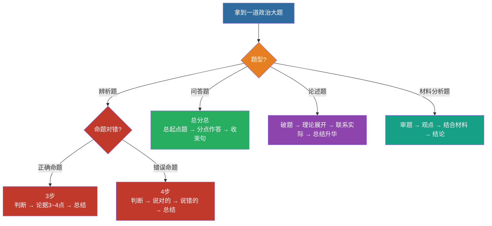

> 📌 **万能骨架**：观点（教材表述）→ 展开（分点）→ 材料（"材料中……体现了……"）→ 结论（回扣设问）。四类题共用这一骨架，只是侧重不同。
>
> ⚠️ **辨析题两个铁律**：① 第一句必须判断对错（漏了可能零分）；② 第一点必须抄正确题干（1~2 分显眼包）。展开见下文第五节。

---

### 一、辨析题（判 + 析 + 结）

1. **亮明态度**：正确 / 错误 / 片面
2. **正确部分肯定**（若有）
3. **错误在哪里**（缺条件、偷换概念、因果颠倒）
4. **补全正确表述**
5. **小结**一句

示例结构：
> 该说法是错误的（或片面的）。……（原理）……。正确的说法应当是……。

---

### 二、问答题（总分总 + 分点）

1. 总起句点题
2. **1. 2. 3.** 分点，每点：观点句 + 一句展开
3. 收束句（意义/要求）

---

### 三、论述题

1. 破题：点明原理
2. 理论展开（2–4 点）
3. 联系实际 / 新时代要求
4. 总结升华（勿喊空口号，扣题）

---

### 四、材料分析题（最高频得分公式）

| 步骤 | 写法 |
|:---|:---|
| ① 审题 | 圈问题：考哪个原理？几问？ |
| ② 观点 | 先写教材规范表述 |
| ③ 结合材料 | “材料中……体现了……” |
| ④ 结论 | 回扣设问，提对策/意义 |

**万能骨架**：
> 材料体现了……原理/思想。
> 第一，……（原理点 + 材料句）。
> 第二，……。
> 因此，我们要……。

---

### 五、辨析题进阶：三种考法 × 两套步骤

> 来源：欢姐《广东专插本政治 2025 年辨析题讲解》（`BV176gY6nEb3`，2026-09-18 整理）。
> 上面第一节的「判 + 析 + 结」是通用骨架；这里是把骨架拆成**可执行的分支**——
> 拿到题先判它属于哪一种，步骤不同，写法也不同。

#### 5.1 三种考法（先判类型）

| # | 考法 | 特征 | 真题锚点 |
|:--:|:---|:---|:---|
| ① | **教材原话 · 完全正确** | 直接从书上抽一句，一字不改 | 「以人为本是科学发展观的核心立场」（23 辨析） |
| ② | **张冠李戴 · 错误** | 把 A 的表述安到 B 头上，两个概念混搭 | 「毛泽东思想活的灵魂 = 统一战线、武装斗争、党的建设」（23 辨析） |
| ③ | **表述错误 · 错误** | 原句本身被篡改，常表现为**以偏概全** | 「毛泽东思想**只是**中国革命的科学指南」（20 辨析） |

> **为什么不能靠押题**：① 类就是原书原句，押不到。只能把知识点复习细。

#### 5.2 两套答题步骤（关键：正确 / 错误不一样）

**正确命题（3 步）**

1. 判断对错 —— 「题干说法正确」
2. 给出论据，阐述题干的正确性（3~4 点）
3. 总结 —— 「因此，题干说法正确」

**错误命题（4 步）**

1. 判断对错
2. 把**对的**说一遍
3. 把**错的**说一遍（张冠李戴的，要先把「张」分析完再分析「李」）
4. 总结 —— 「因此，题干说法错误」

> ⚠️ **第一步「判断对错」是生死线。** 漏掉它，改卷严一点**直接零分**——不是扣一分。
> 实在判断不出，也要写一句态度，写了总比空着强。

#### 5.3 ★「显眼包得分点」—— 最容易被省掉的分

**无论对错，第一点都要把「正确的题干原样抄一遍」，放在最显眼的位置。**

- **为什么**：阅卷老师手上**只有你的答卷，没有题干**。你不抄，他无法确认你在论证什么。
- **值多少**：1~2 分，白给。
- **常见误区**：觉得「抄题干不是废话吗」——**不是**，就是要抄。
- 顺序也重要：**必须放第一点**，不能塞在中间。

#### 5.4 关系题破题法（高频）

看到「**A 与 B 的关系**」这种设问，按这个顺序拆：

1. **「关系」必涉及两个主体** → 先把主体定位出来
   （例：「马克思主义中国化时代化的理论成果」→ 毛泽东思想 + 中国特色社会主义理论体系。
   教材名《毛泽东思想和中国特色社会主义理论体系概论》中间那个「**和**」字就是提示。）
2. **答个性**：前者为后者提供基本遵循 / 理论准备 / 理论前提；后者是对前者的丰富和发展
3. **答共性**：都是马克思列宁主义在中国的运用和发展……
4. **收尾回扣**：「因此，题干说法正确」

#### 5.5 完整范例：第 31 题（7 分）

> **题干**：马克思主义中国化时代化的理论成果是一脉相承又与时俱进的关系。

**答：题干说法正确。**（1 分）

1. 马克思主义中国化时代化的理论成果是一脉相承又与时俱进的关系。（2 分）
   —— *抄题干，拿满这 2 分*
2. 一方面，毛泽东思想为中国特色社会主义理论体系提供了基本遵循；另一方面，中国特色社会主义理论体系进一步丰富和发展了毛泽东思想。（2 分）
   —— *个性*
3. 毛泽东思想和中国特色社会主义理论体系，都是马克思列宁主义在中国的运用和发展，都以独创性的理论成果丰富和发展了马克思主义的理论宝库，同马克思列宁主义一起，都是党和国家必须长期坚持的指导思想，是全国各族人民团结奋斗的共同思想基础。**因此，题干说法正确。**（2 分）
   —— *共性 + 总结*

**结构复盘的三个钩子**：判断（1 分）→ 抄题干 + 个性 + 共性（各 2 分）→ 总结句。

#### 5.6 自查清单（写完对一遍）

- [ ] 第一句写了「题干说法正确 / 错误」吗？（漏 = 可能零分）
- [ ] 第一点抄了正确题干吗？（1~2 分的显眼包）
- [ ] 正确命题写满 3 点了吗？错误命题「对的」「错的」都说了吗？
- [ ] 最后有「因此，题干说法…… 」收尾吗？
- [ ] 分点标号了吗？（1. 2. 3. 让阅卷老师好找）

---

### 六、闭卷挑战

限时 15 分钟：任选一则时政材料，按四步写完整答案，对照教材表述改错字与漏点。

返回：16-时事政治备考 · [政治](/posts/politics/)

---

<!-- 来源：10-讲义-按节贴/政治/18-必背金句与名词.md -->

## 18 必背金句与名词

## 18 必背金句与名词速查

> 考前 7 天每天默写一遍。

---

### 一、金句 20 条（核心）

1. 马克思主义中国化时代化的**根本途径**：两个结合
2. 毛泽东思想活的灵魂：实事求是、群众路线、独立自主
3. 社会主义本质（邓）
4. 一个中心、两个基本点
5. 三个代表完整表述
6. 科学发展观：第一要义发展、核心立场以人为本、基本要求全面协调可持续、根本方法统筹兼顾
7. 两个确立
8. 两个维护
9. 中国特色社会主义最本质的特征：中国共产党领导
10. 中国式现代化五个特色
11. 新发展理念：创新协调绿色开放共享
12. 高质量发展是首要任务
13. 全过程人民民主
14. 社会主义核心价值观 24 字
15. 绿水青山就是金山银山
16. 总体国家安全观（宗旨/根本/基础）
17. 强军目标：听党指挥、能打胜仗、作风优良
18. 人类命运共同体
19. 自我革命是第二个答案
20. 江山就是人民，人民就是江山

```mermaid
mindmap
  root((必背金句 20 条))
    理论
      两个结合
      活的灵魂：实事求是/群众路线/独立自主
      社会主义本质
      两个确立
      两个维护
    经济
      一个中心两个基本点
      新发展理念：创协绿开共
      高质量发展是首要任务
    政治
      党的领导是本质特征
      全过程人民民主
      总体国家安全观
    文化
      社会主义核心价值观 24 字
      中国式现代化 5 特色
      绿水青山就是金山银山
    党建
      三个代表
      科学发展观
      自我革命是第二答案
      强军目标：听党指挥能打胜仗作风优良
      江山就是人民人民就是江山
      人类命运共同体
```

> 📌 考前 7 天每天默写一遍，**用词与官方表述一致**，不得漏字改写。

---

### 二、易混辨析

| 易混 | 正确区分 |
|:---|:---|
| 根本政治制度 vs 基本政治制度 | 人大 vs 政协/民区/基层 |
| 市场决定性作用 vs 政府作用 | 市场配置资源；政府更好发挥作用 |
| 两个结合 | 具体实际 + 中华优秀传统文化 |
| 主要矛盾（新时代） | 人民日益增长的美好生活需要和不平衡不充分的发展之间的矛盾 |

---

### 三、闭卷挑战

不看笔记，默写：新发展理念、24 字价值观、中国式现代化 5 特色、两个维护。

> **自检标准**
> 用词与官方表述一致；不得漏字改写（如“两个维护”必须完整）。

返回：17-辨析论述材料题模板 · [政治](/posts/politics/)

---

# 第三部分　A 档默写 64 篇

<!-- 来源：8-政治默写-按篇贴/毛中特-篇01-毛1-2-2-毛泽东思想活的灵魂.md -->

## 政治默写 · 毛中特 · 第 01 篇 · 毛 1-2-2 毛泽东思想活的灵魂

### 一、默写区（只给标签和字数）

`考频 ★★★★★` ｜ `题型 单选、多选、辨析、简答、论述、材料` ｜ `第一章 毛泽东思想及其历史地位`

**真题回放**（这 11 年考过 4 次）

| 年份-题号 | 题型/分 | 原题 | 位置 |
|:---|:---|:---|:---|
| 2025-33 | 简答/7 | 如何坚持实事求是 | 主 |
| 2024-33 | 简答/7 | 独立自主的科学内涵 | 主 |
| 2023-31 | 辨析/7 | 毛泽东思想的活的灵魂是统一战线、武装斗争、党的建设（错，这是三大法宝） | 主 |
| 2018-33 | 简答/7 | 毛泽东思想的活的灵魂 | 主 |

#### 第一遍　骨架默写

> 只给要点标签与句数/字数，请在纸上默写全部内容。写完对「答案区」同一编号。


**【总述】** · 135 字

**【（一）实事求是】**
1. 定位 · 91 字
2. 含义 · 31 字
3. 形成脉络（时间线必背）
　　· ①
　　· ②
　　· ③
　　· ④
　　· ⑤
4. 科学含义（原文界定，辨析题常考） · 119 字
5. 形象比喻 · 28 字
6. 三个"就要"
　　①
　　②
　　③

**【（二）群众路线】**
1. 定位 · 40 字
2. 含义 · 43 字
3. 本质 · 27 字
4. 形成原因 · 60 字
5. 三个"就要"
　　①
　　②
　　③
6. 关键引文 · 43 字

**【（三）独立自主】**
1. 定位 · 42 字
2. 含义 · 86 字
3. 最初表述 · 40 字
4. 两个"就要"
　　①
　　②

#### 第二遍　辨析判断

> 逐条判断对错；错的写出改正要点。**不要假设「一对一错」**——2021/2022/2025 都出现过两对，2024 两错。

1. 毛泽东思想活的灵魂是"三大法宝"。
　　□对　□错　　改正：__________________________________
2. 实事求是是毛泽东思想的基本点，是毛泽东思想的精髓；是中国共产党人认识世界、改造世界的根本要求，是中国共产党的思想路线；是马克思主义的根本观点，是党的基本思想方法、工作方法、领导方法。
　　□对　□错　　改正：__________________________________
3. "没有调查，没有发言权"出自《实践论》。
　　□对　□错　　改正：__________________________________
4. 人民，只有人民，才是创造世界历史的动力。
　　□对　□错　　改正：__________________________________
5. 群众路线的核心是"一切依靠群众"。
　　□对　□错　　改正：__________________________________
6. 坚持独立思考，走自己的路；坚定不移地维护民族独立、捍卫国家主权，把立足点放在依靠自己力量的基础上，同时积极争取外援，开展国际经济文化交流，学习外国一切对我们有益的先进事物。
　　□对　□错　　改正：__________________________________
7. 独立自主就是闭关自守。
　　□对　□错　　改正：__________________________________
8. 实事求是的思想路线在遵义会议确立。
　　□对　□错　　改正：__________________________________

---

---

### 二、答案区（我默完再给我看）

#### 第一遍　必背要点（原文）

【总述】
毛泽东把辩证唯物主义和历史唯物主义运用于党的全部工作，在中国
革命和建设的长期艰苦奋斗中形成了具有中国共产党人特色的立场、
观点和方法。集中体现在《反对本本主义》《实践论》《矛盾论》
《〈农村调查〉的序言和跋》《关于领导方法的若干问题》《人的正确
思想是从哪里来的？》等著作中。

【（一）实事求是】
1. 定位：实事求是是毛泽东思想的基本点，是毛泽东思想的精髓；
   是中国共产党人认识世界、改造世界的根本要求，是中国共产党的
   思想路线；是马克思主义的根本观点，是党的基本思想方法、
   工作方法、领导方法。
2. 含义：一切从实际出发，理论联系实际，坚持在实践中检验真理
   和发展真理。
3. 形成脉络（时间线必背）：
   · 1930 年《反对本本主义》：强调调查研究是一切工作的第一步，
     提出"没有调查，没有发言权"。
   · 1937 年《实践论》《矛盾论》：深刻阐述理论对于实践的依赖
     关系、矛盾的普遍性和特殊性的关系，对党的思想路线作了系统
     的哲学论证。
   · 1938 年党的六届六中全会：借用我国传统文化中的"实事求是"
     命题，提倡马克思主义同中国实际相结合的科学态度。
   · 延安整风期间：对实事求是的科学含义作了马克思主义的界定。
   · 经过延安整风和党的七大，实事求是的思想路线在全党得到确立。
4. 科学含义（原文界定，辨析题常考）：
   "'实事'就是客观存在着的一切事物，'是'就是客观事物的内部
   联系，即规律性，'求'就是我们去研究。我们要从国内外、省内外、
   县内外、区内外的实际情况出发，从其中引出其固有的而不是臆造
   的规律性，即找出周围事变的内部联系，作为我们行动的向导。"
5. 形象比喻："有的放矢"——用马克思主义之"矢"射中国革命之"的"。
6. 三个"就要"：
   ① 深入实际了解事物的本来面貌，把握事物内在必然联系，按照
      客观规律办事；坚持实事求是不可能一劳永逸。
   ② 清醒认识和正确把握我国基本国情；避免超越现实、超越阶段
      急于求成，纠正因循守旧、故步自封。
   ③ 不断推进实践基础上的理论创新；马克思主义经典作家并没有
      穷尽真理，而是为不断寻求真理和发展真理开辟了道路。

【（二）群众路线】
1. 定位：党的根本工作路线；党的生命线和根本工作路线；党永葆
   青春活力和战斗力的重要传家宝。
2. 含义：一切为了群众，一切依靠群众，从群众中来，到群众中去，
   把党的正确主张变为群众的自觉行动。
3. 本质：体现马克思主义关于人民群众是历史的创造者这一基本原理。
4. 形成原因：中国革命的一个重要特点是敌人异常强大和残暴，
   革命力量却比较弱小；在敌我力量十分悬殊的情况下，先锋队更
   需要扎根于群众之中。
5. 三个"就要"：
   ① 坚持人民是推动历史发展的根本力量。尊重人民首创精神，
      调动最广大人民的积极性、主动性、创造性；自觉拜人民为师；
      正确行使人民给予的权力，自觉接受人民批评和监督。
   ② 坚持全心全意为人民服务的根本宗旨。这是党一切行动的根本
      出发点和落脚点，是党区别于其他一切政党的根本标志；检验
      党的一切工作的成效，最终要以最广大人民根本利益为最高标准。
   ③ 保持党同人民群众的血肉联系。党风问题、党同人民群众的
      联系问题关系党的生死存亡。
6. 关键引文："人民，只有人民，才是创造世界历史的动力。"
   "群众观点是共产党员革命的出发点与归宿。"

【（三）独立自主】
1. 定位：中华民族的优良传统；中国共产党、中华人民共和国立党
   立国的重要原则；中华民族精神之魂。
2. 含义：坚持独立思考，走自己的路；坚定不移地维护民族独立、
   捍卫国家主权，把立足点放在依靠自己力量的基础上，同时积极
   争取外援，开展国际经济文化交流，学习外国一切对我们有益的
   先进事物。
3. 最初表述：1930 年《反对本本主义》——"中国革命斗争的胜利
   要靠中国同志了解中国情况。"
4. 两个"就要"：
   ① 坚持中国的事情必须由中国人民自己作主张、自己来处理。
      人类历史上没有一个民族、一个国家可以通过依赖外部力量、
      照搬外国模式、跟在他人后面亦步亦趋实现强大和振兴。
   ② 坚持独立自主的和平外交政策，坚定不移走和平发展道路。
      恪守维护世界和平、促进共同发展的外交宗旨；坚持在和平
      共处五项原则基础上同各国友好相处；根据事情本身的是非
      曲直决定自己的立场和政策；反对霸权主义和强权政治；
      中国无论发展到什么程度都永远不称霸，永远不搞扩张。

#### 第二遍　辨析答案

1. **错**　改正：活的灵魂是实事求是、群众路线、独立自主。
2. **对**　（原文表述，无需改正）
3. **错**　改正：出自 1930 年《反对本本主义》。
4. **对**　（原文表述，无需改正）
5. **错**　改正：完整表述是四句，缺一不可；本质是人民是历史创造者。
6. **对**　（原文表述，无需改正）
7. **错**　改正：是把立足点放在自己力量基础上，同时积极争取外援、学习外国有益的东西。
8. **错**　改正：经过延安整风和党的七大在全党得到确立。

#### 自查清单（关键词 / 固定表述）

十一届六中全会（1981） · 历史决议 · 精髓 · 思想路线 · 《反对本本主义》（1930） · 《实践论》《矛盾论》（1937） · 六届六中全会（1938） · 延安整风 · 有的放矢 · 生命线 · 传家宝 · 精神之魂 · 和平共处五项原则

#### 附　三者关系（论述题升华段）

实事求是是前提（认识路线），群众路线是根本（力量源泉），
独立自主是立足点（主体立场）。三者统一于"把马克思主义基本
原理同中国具体实际相结合"这一根本要求，是党进行革命、建设
和改革的出发点、根本点和立足点。

---

---

<!-- 来源：8-政治默写-按篇贴/毛中特-篇02-毛6-2-1-社会主义初级阶段理论和党的基本路线.md -->

## 政治默写 · 毛中特 · 第 02 篇 · 毛 6-2-1 社会主义初级阶段理论和党的基本路线

### 一、默写区（只给标签和字数）

`考频 ★★★★★` ｜ `题型 单选、多选、辨析、简答、论述` ｜ `第六章 邓小平理论`

**真题回放**（这 11 年考过 3 次）

| 年份-题号 | 题型/分 | 原题 | 位置 |
|:---|:---|:---|:---|
| 2019-33 | 简答/7 | 党在社会主义初级阶段的基本路线 | 主 |
| 2017-32 | 辨析/7 | 社会主义初级阶段是特指我国进入社会主义所必然经历的特定历史阶段（对） | 主 |
| 2015-31 | 辨析/7 | 我国社会主义初级阶段的主要矛盾是生产力与生产关系的矛盾（错） | 主 |

#### 第一遍　骨架默写

> 只给要点标签与句数/字数，请在纸上默写全部内容。写完对「答案区」同一编号。


**【（一）为什么必须搞清楚发展阶段】**
　　· ①

**【（二）判断的形成过程（时间线必背）】**
　　· ①
　　· ②
　　· ③
　　· ④
　　· ⑤
　　· ⑥

**【（三）科学内涵：两层含义（辨析题核心）】** · 83 字
　　· ①
　　· ②

**【（四）长期性】**
　　· ①
　　· ②
　　· ③

**【（五）基本特征】**
　　· ①
　　· ②
　　· ③
　　· ④
　　· ⑤
　　· ⑥

**【（六）理论意义】**
　　· ①
　　· ②
　　· ③

**【（七）党在社会主义初级阶段的基本路线（1987 十三大提出）】**
1. **奋斗目标** · 78 字
2. **基本途径** · 27 字
　　· ①
　　· ②
　　· ③
3. **领导力量和依靠力量** · 45 字
4. **根本立足点** · 12 字

**【（八）"一个中心、两个基本点"的定位（多选必背）】**
　　· ①
　　· ②
　　· ③
　　· ④
　　· ⑤

**【（九）基本路线的充实完善】**
　　· ①
　　· ②

**【（十）四项基本原则（1979.3《坚持四项基本原则》）】**
　　· ①
　　· ②

#### 第二遍　辨析判断

> 逐条判断对错；错的写出改正要点。**不要假设「一对一错」**——2021/2022/2025 都出现过两对，2024 两错。

1. 社会主义初级阶段是泛指任何国家进入社会主义都会经历的起始阶段。
　　□对　□错　　改正：__________________________________
2. 我国社会主义的初级阶段，**不是泛指任何国家进入社会主义都会经历的起始阶段**，而是特指我国在生产力落后、商品经济不发达条件下建设社会主义必然要经历的**特定阶段**。
　　□对　□错　　改正：__________________________________
3. 初级阶段只讲发展程度，不讲社会性质。
　　□对　□错　　改正：__________________________________
4. 富强、民主、文明的社会主义现代化国家"。
　　□对　□错　　改正：__________________________________
5. 党的基本路线是十二大提出的。
　　□对　□错　　改正：__________________________________
6. 1982 年 9 月党的十二大报告、1986 年 9 月十二届六中全会通过的《中共中央关于社会主义精神文明建设指导方针的决议》，分别对这一阶段的内容作了进一步分析。
　　□对　□错　　改正：__________________________________
7. 四项基本原则是强国之路。
　　□对　□错　　改正：__________________________________
8. "一个中心"是四项基本原则。
　　□对　□错　　改正：__________________________________

---

---

### 二、答案区（我默完再给我看）

#### 第一遍　必背要点（原文）

【（一）为什么必须搞清楚发展阶段】
· 正确认识党和人民事业所处的历史方位和发展阶段，是党明确阶段性
  中心任务、制定路线方针政策的**根本依据**，也是党领导革命、建设、
  改革不断取得胜利的重要经验。

【（二）判断的形成过程（时间线必背）】
· 十一届三中全会以后，邓小平提出人口多、底子薄、生产力落后是
  中国的现实国情，强调中国的现代化建设必然是长期的过程。
· **1981 年 6 月**，党的十一届六中全会通过《关于建国以来党的若干
  历史问题的决议》，总结新中国成立以后党在认识社会主义发展阶段
  问题上的经验教训，提出"**我们的社会主义制度还是处于初级的
  阶段**"，它"由比较不完善到比较完善，必然要经历一个长久的过程"。
· 1982 年 9 月党的十二大报告、1986 年 9 月十二届六中全会通过的
  《中共中央关于社会主义精神文明建设指导方针的决议》，分别对
  这一阶段的内容作了进一步分析。
· 十三大召开前夕，邓小平指出："我们党的十三大要阐述中国社会
  主义是处在一个什么阶段，就是处在初级阶段，是初级阶段的社会
  主义。社会主义本身是共产主义的初级阶段，而我们中国又处在社会
  主义的初级阶段，就是不发达的阶段。一切都要从这个实际出发，
  根据这个实际来制订规划。"
· 邓小平**第一次把社会主义初级阶段作为事关全局的基本国情**加以
  把握，明确了这一基本国情是制定路线方针政策的出发点和根本依据。
· **1987 年党的十三大**系统地阐述了社会主义初级阶段的科学内涵。

【（三）科学内涵：两层含义（辨析题核心）】
第一，我国社会**已经是社会主义社会**。我们必须坚持而不能离开
社会主义。
第二，我国的社会主义社会**还处在初级阶段**。我们必须从这个实际
出发，而不能超越这个阶段。
· 第一层含义阐明初级阶段的社会性质，第二层含义阐明我国社会主义
  社会的发展程度。
· 两层含义不可分割，必须全面把握。只有把社会主义社会的性质同它
  的发展程度有机统一起来，才能够深刻理解和把握我国的基本国情。

【（四）长期性】
· 我国社会主义的初级阶段，**不是泛指任何国家进入社会主义都会
  经历的起始阶段**，而是特指我国在生产力落后、商品经济不发达
  条件下建设社会主义必然要经历的**特定阶段**。
· 我国的社会主义脱胎于半殖民地半封建社会，生产力水平远远落后于
  发达资本主义国家，这就决定了必须经历一个很长的初级阶段，去
  实现别的许多国家在资本主义条件下实现的工业化和生产的商品化、
  社会化、现代化。
· 邓小平在南方谈话中指出："我们搞社会主义才几十年，还处在初级
  阶段。巩固和发展社会主义制度，还需要一个很长的历史阶段，需要
  我们几代人、十几代人，甚至几十代人坚持不懈地努力奋斗。"

【（五）基本特征】
我国社会主义的初级阶段，既不同于社会主义经济基础尚未奠定的
过渡时期，又不同于已经实现社会主义现代化的阶段。总起来说：
· 是逐步摆脱贫穷、摆脱落后的阶段；
· 是由农业人口占多数的手工劳动为基础的农业国，逐步变为非农产业
  人口占多数的现代化的工业国的阶段；
· 是由自然经济半自然经济占很大比重，变为商品经济高度发达的阶段；
· 是通过改革和探索，建立和发展充满活力的社会主义经济、政治、
  文化体制的阶段；
· 是全民奋起，艰苦创业，实现中华民族伟大复兴的阶段。
· 1997 年党的十五大进一步概括了社会主义初级阶段的特征，强调现在
  处于并将长时期处于社会主义初级阶段是中国最大的实际。

【（六）理论意义】
· 基于对中国国情的准确把握，揭示了当代中国的历史方位；
· 是对马克思主义关于社会主义发展阶段理论的**重大发展和重大突破**；
· 为建设中国特色社会主义提供了**总依据**。

【（七）党在社会主义初级阶段的基本路线（1987 十三大提出）】
完整表述：
"领导和团结全国各族人民，以经济建设为中心，坚持四项基本原则，
坚持改革开放，自力更生，艰苦创业，为把我国建设成为富强、民主、
文明的社会主义现代化国家而奋斗。"

四个组成部分（简答必背）：
1. **奋斗目标**："富强、民主、文明的社会主义现代化国家"。
   富强、民主、文明分别是经济、政治、思想文化领域的目标和要求，
   三者在现实中表现为经济建设、政治建设、文化建设的统一。
2. **基本途径**："以经济建设为中心，坚持四项基本原则，坚持改革
   开放"。
   · 以经济建设为中心——回答了社会主义的**根本任务**问题；
   · 坚持四项基本原则——回答了解放和发展生产力的**政治保证**
     问题；
   · 坚持改革开放——回答了社会主义的**发展动力和外部条件**问题。
3. **领导力量和依靠力量**："领导和团结各族人民"。
   中国共产党是领导核心，中国特色社会主义事业要紧紧依靠全国各
   族人民。
4. **根本立足点**："自力更生，艰苦创业"。

【（八）"一个中心、两个基本点"的定位（多选必背）】
· 以经济建设为中心是党在改革开放和社会主义现代化建设新时期实现的
  最根本的拨乱反正，是**兴国之要**。能否坚持以经济建设为中心，
  关系到社会主义现代化的成败、关系到社会主义的前途和命运。
· 四项基本原则是**立国之本**，是党和国家生存发展的政治基石。
· 改革开放是**强国之路**，是党和国家发展进步的活力源泉。
· 二者关系：既要以四项基本原则保证改革开放的正确方向，又要通过
  改革开放赋予四项基本原则新的时代内涵。
· 党的基本路线是**国家的生命线、人民的幸福线**。

【（九）基本路线的充实完善】
· 党的十七大把"和谐"与"富强、民主、文明"一起写入了基本路线；
· 党的十九大提出"为把我国建设成为富强民主文明和谐美丽的社会主义
  现代化强国而奋斗"，进一步拓展了党的基本路线。

【（十）四项基本原则（1979.3《坚持四项基本原则》）】
· 邓小平在党的理论工作务虚会上发表《坚持四项基本原则》的讲话：
  必须在思想上政治上坚持社会主义道路、坚持无产阶级专政（后表述为
  人民民主专政）、坚持共产党的领导、坚持马列主义毛泽东思想。
· 这是"实现四个现代化的根本前提"。"如果动摇了这四项基本原则中的
  任何一项，那就动摇了整个社会主义事业，整个现代化建设事业。"

#### 第二遍　辨析答案

1. **错**　改正：是特指我国在生产力落后、商品经济不发达条件下建设社会主义必然要经历的特定阶段。
2. **对**　（原文表述，无需改正）
3. **错**　改正：两层含义：已经是社会主义（性质）+ 还处在初级阶段（程度）。
4. **对**　（原文表述，无需改正）
5. **错**　改正：十三大提出；十七大加"和谐"，十九大加"美丽"和"强国"。
6. **对**　（原文表述，无需改正）
7. **错**　改正：四项基本原则是立国之本；改革开放才是强国之路。
8. **错**　改正：一个中心是以经济建设为中心；两个基本点是四项基本原则和改革开放。

#### 自查清单（关键词 / 固定表述）

十一届六中全会（1981.6） · 十三大（1987） · 两层含义 · 特定阶段 · 总依据 · 基本路线 · 富强民主文明 · 兴国之要 · 立国之本 · 强国之路 · 生命线幸福线 · 十七大加和谐 · 十九大加美丽 · 《坚持四项基本原则》（1979.3）

---

---

<!-- 来源：8-政治默写-按篇贴/毛中特-篇03-毛00-1-4-马克思主义中国化时代化理论成果及其关系.md -->

## 政治默写 · 毛中特 · 第 03 篇 · 毛 00-1-4 马克思主义中国化时代化理论成果及其关系

### 一、默写区（只给标签和字数）

`考频 ★★★★☆` ｜ `题型 单选、多选、简答` ｜ `导论 马克思主义中国化时代化的历史进程与理论成果`

**真题回放**（这 11 年考过 2 次）

| 年份-题号 | 题型/分 | 原题 | 位置 |
|:---|:---|:---|:---|
| 2025-31 | 辨析/7 | 马克思主义中国化时代化的理论成果是一脉相承与时俱进的关系（对） | 主 |
| 2015-33 | 简答/7 | 马克思主义中国化两大理论成果的关系 | 主 |

#### 第一遍　骨架默写

> 只给要点标签与句数/字数，请在纸上默写全部内容。写完对「答案区」同一编号。


**【五大理论成果及各自定位】**
1. 毛泽东思想
　　· ①
　　· ②
　　· ③
2. 邓小平理论
　　· ①
3. "三个代表"重要思想
　　· ①
4. 科学发展观
　　· ①
5. 习近平新时代中国特色社会主义思想
　　· ①

**【"中国特色社会主义理论体系"概念的提出】**
　　· ①
　　· ②

**【一脉相承的表现（承什么）】**
　　· ①
　　· ②
　　· ③
　　· ④
　　· ⑤

**【与时俱进的表现（进什么）】**
　　· ①
　　· ②
　　· ③
　　· ④
　　· ⑤

**【共同点】**
　　· ①
　　· ②
　　· ③

#### 第二遍　辨析判断

> 逐条判断对错；错的写出改正要点。**不要假设「一对一错」**——2021/2022/2025 都出现过两对，2024 两错。

1. 五大成果是并列关系，互相独立。
　　□对　□错　　改正：__________________________________
2. 党的十七大提出这一科学概念，把邓小平理论、"三个代表"重要思想以及科学发展观等重大战略思想一道作为中国特色社会主义理论体系的重要组成部分。
　　□对　□错　　改正：__________________________________
3. "中国特色社会主义理论体系"概念是十五大提出的。
　　□对　□错　　改正：__________________________________
4. 标志着中国特色社会主义理论和实践的进一步成熟。
　　□对　□错　　改正：__________________________________
5. 邓小平理论是中国特色社会主义理论体系的"组成部分之一"，与其他并列无先后。
　　□对　□错　　改正：__________________________________
6. 毛泽东思想只包括新民主主义革命和社会主义革命的正确思想。
　　□对　□错　　改正：__________________________________

---

---

### 二、答案区（我默完再给我看）

#### 第一遍　必背要点（原文）

【五大理论成果及各自定位】
1. 毛泽东思想
   · 马克思列宁主义在中国的运用和发展
   · 被实践证明了的关于中国革命和建设的正确的理论原则和经验总结
   · 中国共产党集体智慧的结晶
2. 邓小平理论
   · 中国特色社会主义理论体系的**开篇之作**
3. "三个代表"重要思想
   · 推动中国特色社会主义理论体系的**跨世纪发展**
4. 科学发展观
   · 实现中国特色社会主义理论体系在**新世纪新阶段的新发展**
5. 习近平新时代中国特色社会主义思想
   · 谱写了新时代中国特色社会主义**新篇章**

【"中国特色社会主义理论体系"概念的提出】
· 党的十七大提出这一科学概念，把邓小平理论、"三个代表"重要思想
  以及科学发展观等重大战略思想一道作为中国特色社会主义理论体系
  的重要组成部分。
· 标志着中国特色社会主义理论和实践的进一步成熟。

【一脉相承的表现（承什么）】
· 毛泽东思想活的灵魂——实事求是、群众路线、独立自主，这一具有
  中国共产党人特色的立场、观点和方法，贯穿于中国特色社会主义
  理论体系之中。
· 实事求是 → 开创中国特色社会主义道路、形成理论体系
· 群众路线 → 作为根本工作路线，坚持以人为本、执政为民，
  发展为了人民、发展依靠人民、发展成果由人民共享
· 独立自主 → 走自己的路、自力更生艰苦奋斗、独立自主和平外交
· 毛泽东思想关于社会主义建设的思想为开创和发展中国特色社会主义
  作了重要的理论准备，包括：社会主义社会是很长的历史阶段；
  严格区分和正确处理敌我矛盾和人民内部矛盾；正确处理十大关系；
  走适合国情的工业化道路；尊重价值规律；"长期共存、互相监督"；
  "百花齐放、百家争鸣"。

【与时俱进的表现（进什么）】
中国特色社会主义理论体系在新的历史条件下进一步丰富和发展了
毛泽东思想，例证（一一对应，多选常考）：
· 走自己的路、建设中国特色社会主义 → 丰富发展了社会主义建设
  道路理论
· 中国正处于并将长期处于社会主义初级阶段 → 丰富发展了社会
  主义发展阶段理论
· 中国式现代化，建设富强民主文明和谐美丽的社会主义现代化国家
  → 丰富发展了"四个现代化"理论
· 全面从严治党，推进党的建设新的伟大工程，以党的自我革命引领
  社会革命 → 丰富发展了党的建设理论
· 走和平发展道路，推动构建人类命运共同体 → 丰富发展了独立
  自主和平外交的理论

【共同点】
· 都是马克思列宁主义在中国的运用和发展
· 都以独创性的理论成果丰富和发展了马克思主义的理论宝库
· 都同马克思列宁主义一起，是党和国家必须长期坚持的指导思想，
  是全国各族人民团结奋斗的共同思想基础

#### 第二遍　辨析答案

1. **错**　改正：是一脉相承又与时俱进的关系，前者为后者提供基本遵循。
2. **对**　（原文表述，无需改正）
3. **错**　改正：是党的十七大提出的。
4. **对**　（原文表述，无需改正）
5. **错**　改正：邓小平理论是"开篇之作"，有明确的逻辑起点地位。
6. **错**　改正：也包括关于社会主义建设的正确思想。

#### 自查清单（关键词 / 固定表述）

一脉相承 · 与时俱进 · 开篇之作 · 跨世纪发展 · 新世纪新阶段的新发展 · 新篇章 · 十七大 · 集体智慧的结晶 · 共同思想基础

---

---

<!-- 来源：8-政治默写-按篇贴/毛中特-篇04-毛4-2-2-初步探索的经验教训.md -->

## 政治默写 · 毛中特 · 第 04 篇 · 毛 4-2-2 初步探索的经验教训

### 一、默写区（只给标签和字数）

`考频 ★★★★☆` ｜ `题型 多选、简答、论述` ｜ `第四章 社会主义建设道路初步探索的理论成果`

**真题回放**（这 11 年考过 2 次）

| 年份-题号 | 题型/分 | 原题 | 位置 |
|:---|:---|:---|:---|
| 2023-36 | 论述/10 | 党对社会主义建设道路初步探索的经验教训 | 主 |
| 2017-36 | 论述/10 | 社会主义建设道路初步探索的经验教训 | 主 |

#### 第一遍　骨架默写

> 只给要点标签与句数/字数，请在纸上默写全部内容。写完对「答案区」同一编号。


**【背景事实】**
　　· ①
　　· ②
　　· ③
　　· ④
　　· ⑤
　　· ⑥
　　· ⑦
　　· ⑧
　　· ⑨
　　· ⑩
　　· ⑪

**【教训四：必须发展社会主义民主，健全社会主义法制】**
　　· ①
　　· ②
　　· ③
　　· ④
　　· ⑤
　　· ⑥
　　· ⑦
　　· ⑧
　　· ⑨
　　· ⑩
　　· ⑪
　　· ⑫
　　· ⑬
　　· ⑭

**【（三）两个时期的关系（论述题升华，习近平论述）】**
　　· ①
　　· ②
　　· ③
　　· ④

#### 第二遍　辨析判断

> 逐条判断对错；错的写出改正要点。**不要假设「一对一错」**——2021/2022/2025 都出现过两对，2024 两错。

1. 八大二次会议坚持了八大关于主要矛盾的正确判断。
　　□对　□错　　改正：__________________________________
2. 由于社会主义基本制度刚刚建立，党和国家的领导制度还有许多不够完善的地方，特别是受苏联高度集中的政治体制影响，加之封建专制主义影响短期内难以消除，党的民主集中制和集体领导制度一度遭到严重破坏。
　　□对　□错　　改正：__________________________________
3. 探索时期的错误说明社会主义制度本身有问题。
　　□对　□错　　改正：__________________________________
4. 民主集中制是无产阶级政党的根本组织原则，是指导党内生活的基本准则。
　　□对　□错　　改正：__________________________________
5. 改革开放前后两个时期是割裂的。
　　□对　□错　　改正：__________________________________

---

---

### 二、答案区（我默完再给我看）

#### 第一遍　必背要点（原文）

【背景事实】
· 党的八大形成的正确路线未能完全坚持下去，先后出现"大跃进"
  运动、人民公社化运动等错误，反右派斗争被严重扩大化，特别是
  后来发生的"文化大革命"，使社会主义建设遭受重大挫折，教训
  极其惨痛。

【教训一：必须把马克思主义与中国实际相结合，探索符合中国特点
的社会主义建设道路】
· 毛泽东在社会主义改造还未结束时，就明确提出要探索适合中国
  国情的社会主义建设道路。
· 失误原因：对马克思主义关于社会主义的一些基本原理理解不够
  深入；对中国的基本国情缺乏深刻认识；没有完全搞清楚什么是
  社会主义、怎样建设社会主义；没有完全摆脱苏联模式的影响；
  采取了一些脱离实际、超越发展阶段的政策和措施。
· 结论：只有科学理解马克思主义基本原理，准确把握中国基本国情，
  运用马克思主义立场观点方法分析解决实际问题，充分认识社会
  主义建设的长期性和复杂性，才能逐步掌握社会主义建设规律。

【教训二：必须正确认识社会主义社会的主要矛盾和根本任务，集中
力量发展生产力】
· 党曾对主要矛盾有较为正确的认识，据此提出根本任务是在新的
  生产关系下保护和发展生产力。
· 但这些认识没有很好地坚持下来：党的八大二次会议改变了八大
  关于主要矛盾的正确判断，错误地认为无产阶级与资产阶级的矛盾、
  社会主义道路与资本主义道路的矛盾始终是我国社会的主要矛盾。
  这是导致后来阶级斗争扩大化的重要原因。
· 结论：在社会主义初级阶段，要科学把握主要矛盾，以经济建设
  为中心，不断提高人民物质文化生活水平。对于一定范围内长期
  存在的阶级斗争，不能简单等同于全国范围的阶级斗争，不能搞
  大规模政治运动，更不能搞阶级斗争扩大化。

【教训三：必须从实际出发进行社会主义建设，建设规模和速度要与
国力相适应，不能急于求成】
· 全党全国人民都有迅速改变落后面貌的强烈愿望，这促进了建设，
  但也出现急躁冒进、急于求成的倾向。
· 主要表现：路线、方针、政策一度偏离社会主义初级阶段的实际，
  忽视经济计划、政策、措施的科学论证和生产建设、经营管理的
  经济效果，造成严重损失。
· 结论：社会主义建设必须采取科学态度，深入了解和分析实际情况，
  努力按照客观经济规律办事。
· 毛泽东："对于建设社会主义的规律的认识，必须有一个过程。
  必须从实践出发，从没有经验到有经验，从有较少的经验，到有
  较多的经验，从建设社会主义这个未被认识的必然王国，到逐步地
  克服盲目性、认识客观规律、从而获得自由，在认识上出现一个
  飞跃，到达自由王国。"

【教训四：必须发展社会主义民主，健全社会主义法制】
· 社会主义民主的本质是人民当家作主。新中国成立后制定了宪法，
  颁布了一系列法律，建立了大量规章制度。
· 但党对发展社会主义民主的经验不足，对什么是社会主义民主、
  怎样发展社会主义民主认识上也不是完全清楚，实践中出现很多
  违背人民民主的现象；虽然制定了法律，却没有树立起法律的权威。
· 后果：党内外关于社会主义建设的不同意见受到压制和打击，正确
  主张得不到采纳甚至被贴上资本主义标签遭到批判，错误决策得不到
  及时制止甚至被当作社会主义原则加以固守。
· 结论：必须大力发展人民民主，确保人民行使当家作主的权利；
  党必须在宪法和法律范围内活动，任何一级党组织和领导人都不能
  有超出法律之上的权力，各种制度和法律不能因领导人的改变而
  改变，不能因领导人看法和注意力的改变而改变。

【教训五：必须坚持党的民主集中制和集体领导制度，加强执政党
建设】
· 民主集中制是无产阶级政党的根本组织原则，是指导党内生活的
  基本准则。
· 由于社会主义基本制度刚刚建立，党和国家的领导制度还有许多
  不够完善的地方，特别是受苏联高度集中的政治体制影响，加之
  封建专制主义影响短期内难以消除，党的民主集中制和集体领导
  制度一度遭到严重破坏。
· 邓小平："党成为全国的执政党，特别是生产资料私有制的社会
  主义改造基本完成以后，党的中心任务已经不同于过去，社会主义
  建设的任务极为繁重复杂，权力过分集中，越来越不能适应社会
  主义事业的发展。"
· 结论：必须认真坚持民主集中制和集体领导原则，反对个人崇拜，
  不断加强党的自身建设，保证党的决策的科学化、民主化；必须
  大力发扬党内民主，确保党员的民主权利，避免少数人说了算、
  个人说了算的现象。

【教训六：必须坚持对外开放，借鉴和吸收人类文明成果建设社会
主义，不能关起门来搞建设】
· 社会主义代替资本主义，并不意味着要全盘否定和抛弃资本主义
  创造的一切成果，也不意味着不同资本主义发生任何联系。
· 社会主义要体现出相对于资本主义的优势并最终战胜资本主义，
  必须大胆借鉴和吸收包括资本主义文明在内的一切人类文明成果。
· 毛泽东曾多次指出，要在平等基础上开展同一切国家的经济技术
  交流，包括同一些资本主义国家发展经济贸易关系。
· 但帝国主义对我国实行敌视、封锁和禁运政策，加上我们自己后来
  发生的"左"的错误，导致一度关起门来搞建设，使我国与发达资本
  主义国家的差距进一步拉大。
· 结论：关起门来搞建设是不行的，发展不起来。
· 毛泽东："外国资产阶级的一切腐败制度和思想作风，我们要坚决
  抵制和批判。但是，这并不妨碍我们去学习资本主义国家的先进的
  科学技术和企业管理方法中合乎科学的方面。"

【（三）两个时期的关系（论述题升华，习近平论述）】
· "我们党领导人民进行社会主义建设，有改革开放前和改革开放后
  两个历史时期，这是两个相互联系又有重大区别的时期，但本质上
  都是我们党领导人民进行社会主义建设的实践探索。"
· 中国特色社会主义是在改革开放历史新时期开创的，但也是在新中国
  已经建立起社会主义基本制度、并进行了 20 多年建设的基础上开
  创的。
· 改革开放前的探索为改革开放后的探索积累了经验并准备了条件；
  改革开放后的探索是对前一个时期探索的坚持、改革、发展。
· 要坚持实事求是，分清主流和支流，坚持真理，修正错误，发扬
  经验，吸取教训。

#### 第二遍　辨析答案

1. **错**　改正：改变了八大的正确判断，这是阶级斗争扩大化的重要原因。
2. **对**　（原文表述，无需改正）
3. **错**　改正：是认识和工作层面的问题，社会主义制度在实践中不断完善。
4. **对**　（原文表述，无需改正）
5. **错**　改正：相互联系又有重大区别，本质都是社会主义建设的实践探索。

#### 自查清单（关键词 / 固定表述）

大跃进 · 人民公社化 · 文化大革命 · 八大二次会议 · 急于求成 · 民主与法制 · 民主集中制 · 个人崇拜 · 关起门来搞建设 · 两个历史时期 · 分清主流和支流

---

---

<!-- 来源：8-政治默写-按篇贴/毛中特-篇05-毛6-1-1-邓小平理论首要的基本的理论问题.md -->

## 政治默写 · 毛中特 · 第 05 篇 · 毛 6-1-1 邓小平理论首要的基本的理论问题

### 一、默写区（只给标签和字数）

`考频 ★★★★★` ｜ `题型 单选、多选、辨析、简答、论述` ｜ `第六章 邓小平理论`

**真题回放**（这 11 年考过 2 次）

| 年份-题号 | 题型/分 | 原题 | 位置 |
|:---|:---|:---|:---|
| 2025-34 | 简答/7 | 社会主义的本质 | 主 |
| 2020-35 | 简答/7 | 社会主义的本质 | 主 |

#### 第一遍　骨架默写

> 只给要点标签与句数/字数，请在纸上默写全部内容。写完对「答案区」同一编号。


**【（一）问题的提出】**
　　· ①
　　· ②
　　· ③
　　· ④
　　· ⑤

**【（二）破题的关键】**
　　· ①
　　· ②

**【（三）社会主义本质论的提出过程（时间线必背）】**
　　· ①
　　· ②
　　· ③
　　· ④
　　· ⑤

**【（四）五句话的两层结构（论述题骨架）】** · 31 字
1. 突出强调解放和发展生产力在社会主义社会发展中的重要地位。
　　· ①
　　· ②
　　· ③
　　· ④
2. 突出强调"消灭剥削，消除两极分化，最终达到共同富裕"， · 24 字
　　· ①
　　· ②
　　· ③
　　· ④

**【（五）重大意义】**
　　· ①
　　· ②
　　· ③
　　· ④
　　· ⑤

#### 第二遍　辨析判断

> 逐条判断对错；错的写出改正要点。**不要假设「一对一错」**——2021/2022/2025 都出现过两对，2024 两错。

1. 邓小平理论首要的基本理论问题是"建设什么样的党、怎样建设党"。
　　□对　□错　　改正：__________________________________
2. 新中国成立后，以毛泽东同志为主要代表的中国共产党人在探索中提出了一系列关于社会主义建设的重要思想，取得巨大成就，积累了宝贵经验，但在探索中也出现了不少失误。
　　□对　□错　　改正：__________________________________
3. 社会主义本质论只讲生产力，不讲生产关系。
　　□对　□错　　改正：__________________________________
4. 从生产关系和发展目标角度认识和把握社会主义本质。
　　□对　□错　　改正：__________________________________
5. "社会主义的本质"概念是 1992 年南方谈话首次提出的。
　　□对　□错　　改正：__________________________________
6. 社会主义本质就是公有制和按劳分配。
　　□对　□错　　改正：__________________________________

---

---

### 二、答案区（我默完再给我看）

#### 第一遍　必背要点（原文）

【（一）问题的提出】
· 在中国这样一个经济文化比较落后的国家**建设什么样的社会主义、
  怎样建设社会主义**，是一个首要的基本的理论问题。
· "老祖宗"没有讲过，马克思恩格斯没有提供现成的答案。
· 列宁探索了社会主义发展道路问题，但他逝世后逐渐形成的高度集中
  的苏联模式也出现很多弊端。
· 新中国成立后，以毛泽东同志为主要代表的中国共产党人在探索中
  提出了一系列关于社会主义建设的重要思想，取得巨大成就，积累了
  宝贵经验，但在探索中也出现了不少失误。
· 邓小平："我们建设社会主义的方向是完全正确的，但什么叫社会
  主义，怎样建设社会主义，还在摸索之中。"

【（二）破题的关键】
· 搞清楚"什么是社会主义，怎样建设社会主义"，关键是要在**坚持
  社会主义基本制度的基础上进一步认清社会主义的本质**。
· 邓小平指出：不能离开生产力抽象地谈论社会主义，把许多束缚
  生产力发展的、并不具有社会主义本质属性的东西当作"社会主义
  原则"加以固守；把许多在社会主义条件下有利于生产力发展的东西
  当作"资本主义复辟"加以反对。

【（三）社会主义本质论的提出过程（时间线必背）】
· **1980 年 5 月**：第一次提出"**社会主义的本质**"这个概念。
  在谈到怎样发挥社会主义制度优越性时指出："社会主义是一个很好
  的名词，但是如果搞不好，不能正确理解，不能采取正确的政策，
  那就体现不出社会主义的本质。"
  ——讲社会主义，首先就要使生产力发展；社会主义经济政策对不对，
  归根到底要看生产力是否发展、人民收入是否增加，这是压倒一切的
  标准。
· **1985 年 8 月**：会见外宾时重提社会主义本质，指出"对内搞活
  经济，是活了社会主义，没有伤害社会主义的本质"。
· **1986 年 9 月**："社会主义财富属于人民，社会主义的致富是全民
  共同致富。社会主义原则，第一是发展生产，第二是共同致富。"
· **1990 年 12 月**：社会主义不是少数人富起来、大多数人穷，
  社会主义最大的优越性就是共同富裕，这是体现社会主义本质的一个
  东西。
· **1992 年初南方谈话**：作出总结性的理论概括——
  "**社会主义的本质，是解放生产力，发展生产力，消灭剥削，
  消除两极分化，最终达到共同富裕。**"

【（四）五句话的两层结构（论述题骨架）】
这一概括既包括生产力问题，又包括生产关系问题，是一个有机整体。
1. 突出强调解放和发展生产力在社会主义社会发展中的重要地位。
   · 纠正了过去关于发展生产力的一些错误观念；
   · 反映了中国社会主义整个历史阶段尤其是初级阶段特别需要注重
     生产力发展的迫切要求；
   · 明确了社会主义基本制度建立后还要通过改革进一步解放生产力。
   · 邓小平："过去，只讲在社会主义条件下发展生产力，没有讲还要
     通过改革解放生产力，不完全。应该把解放生产力和发展生产力
     两个讲全了。"
2. 突出强调"消灭剥削，消除两极分化，最终达到共同富裕"，
   从生产关系和发展目标角度认识和把握社会主义本质。
   · 揭示了资本主义建立在生产资料私有制基础上，必然产生剥削和
     两极分化；消灭剥削、消除两极分化只有在坚持公有制和按劳分配
     为主体的条件下才能实现；
   · 阐明了社会主义社会发展生产力的目的不是为少数人谋利益，
     而是要使全体社会成员过上富裕幸福的生活，体现了发展手段和
     发展目的的统一；
   · 为坚持和完善公有制指出了明确方向。
   · 邓小平："在改革中，我们始终坚持两条根本原则，一是以社会
     主义公有制经济为主体，一是共同富裕。"

【（五）重大意义】
· 反映了人民的利益和时代的要求；
· 廓清了不合乎时代进步和社会发展规律的模糊观念；
· 摆脱了长期以来拘泥于具体模式而忽略社会主义本质的错误倾向；
· 把对社会主义的认识提高到**新的科学水平**；
· 对于在坚持社会主义基本制度的基础上推进改革、指导改革沿着
  合乎社会主义本质要求的方向发展，具有重大的政治意义、理论意义
  和实践意义。

#### 第二遍　辨析答案

1. **错**　改正：那是"三个代表"回答的问题。邓小平理论回答的是"什么是社会主义、怎样建设社会主义"。
2. **对**　（原文表述，无需改正）
3. **错**　改正：两层都讲：解放和发展生产力 + 消灭剥削、消除两极分化、最终达到共同富裕。
4. **对**　（原文表述，无需改正）
5. **错**　改正：1980 年 5 月首次提出概念，1992 年南方谈话是总结性概括。
6. **错**　改正：公有制和按劳分配是基本制度特征，本质是五句话；本质论恰恰是要摆脱"拘泥于具体模式"的倾向。

#### 自查清单（关键词 / 固定表述）

首要的基本的理论问题 · 社会主义本质 · 1980.5 · 南方谈话（1992） · 解放生产力 · 发展生产力 · 消灭剥削 · 消除两极分化 · 共同富裕 · 两条根本原则 · 新的科学水平

---

---

<!-- 来源：8-政治默写-按篇贴/毛中特-篇06-毛6-2-3-社会主义改革开放和社会主义市场经济理论.md -->

## 政治默写 · 毛中特 · 第 06 篇 · 毛 6-2-3 社会主义改革开放和社会主义市场经济理论

### 一、默写区（只给标签和字数）

`考频 ★★★★★` ｜ `题型 单选、多选、辨析、简答、论述` ｜ `第六章 邓小平理论`

**真题回放**（这 11 年考过 2 次）

| 年份-题号 | 题型/分 | 原题 | 位置 |
|:---|:---|:---|:---|
| 2024-36 | 论述/10 | 邓小平社会主义市场经济理论的主要内容 | 主 |
| 2017-31 | 辨析/7 | 坚持公有制主体地位，就是公有制经济在全国所有地方和所有产业上都占优势（错） | 主 |

#### 第一遍　骨架默写

> 只给要点标签与句数/字数，请在纸上默写全部内容。写完对「答案区」同一编号。


**【（一）改革是一场新的革命】**
1. 定性 · 47 字
　　· ①
2. 实质和目标 · 95 字
3. 边界（辨析必考） · 74 字
4. 动力定位 · 21 字
　　· ①
　　· ②

**【（二）"三个有利于"标准】**
　　· ①
　　①
　　②
　　③
　　· ②

**【（三）对外开放】**
1. 定位 · 51 字
2. 提出过程
　　· ①
　　· ②
3. 必然性
　　· ①
　　· ②
4. 范围 · 53 字
5. 两个"特别强调"
　　· ①
　　· ②

**【（四）社会主义市场经济理论的四次突破（时间线必背）】**
1. **1981 年十一届六中全会**：提出"**计划经济为主、市场调节为辅**" · 38 字
2. **1984 年十二届三中全会**：提出"**公有制基础上的有计划的商品 · 135 字
3. **1987 年十三大** · 96 字
4. **1992 年南方谈话**（定型）： · 86 字
　　· ①
　　· ②

**【（五）社会主义市场经济理论的三个内涵（多选必背）】**
1. 计划经济和市场经济**不是划分社会制度的标志**，计划经济不等于 · 18 字
2. 计划和市场**都是经济手段**，对经济活动的调节各有优劣，社会 · 20 字
3. 市场经济作为**资源配置手段本身不具有制度属性**，可以和不同 · 19 字
　　· ①

**【（六）理论意义】**
　　· ①
　　· ②
　　· ③

#### 第二遍　辨析判断

> 逐条判断对错；错的写出改正要点。**不要假设「一对一错」**——2021/2022/2025 都出现过两对，2024 两错。

1. 改革就是否定社会主义制度。
　　□对　□错　　改正：__________________________________
2. 不是原有经济体制的细枝末节的修补，而是要从根本上改变束缚我国生产力发展的经济体制，建立充满生机和活力的社会主义新经济体制，同时相应地改革政治体制和其他方面的体制，以实现中国的社会主义现代化。
　　□对　□错　　改正：__________________________________
3. 市场经济是资本主义特有的，计划经济是社会主义特有的。
　　□对　□错　　改正：__________________________________
4. 的社会制度结合，从而表现出不同的性质。
　　□对　□错　　改正：__________________________________
5. "有计划的商品经济"是南方谈话提出的。
　　□对　□错　　改正：__________________________________
6. "三个有利于"中增强综合国力是最根本的一条。
　　□对　□错　　改正：__________________________________

---

---

### 二、答案区（我默完再给我看）

#### 第一遍　必背要点（原文）

【（一）改革是一场新的革命】
1. 定性："改革是一场深刻的社会变革，是中国的**第二次革命**，
   是实现中国现代化的**必由之路**。"
   · 邓小平："改革的性质同过去的革命一样，也是为了扫除发展社会
     生产力的障碍，使中国摆脱贫穷落后的状态。从这个意义上说，
     改革也可以叫革命性的变革。"
2. 实质和目标：不是原有经济体制的细枝末节的修补，而是要从根本
   上改变束缚我国生产力发展的经济体制，建立充满生机和活力的
   社会主义新经济体制，同时相应地改革政治体制和其他方面的体制，
   以实现中国的社会主义现代化。
3. 边界（辨析必考）：改革不是一个阶级推翻另一个阶级那种原来意义
   上的革命，不是也不允许否定和抛弃我们建立起来的社会主义基本
   制度，而是**社会主义制度的自我完善和发展**。
4. 动力定位：改革是社会主义社会发展的**直接动力**。
   · 社会主义社会的基本矛盾仍然是生产关系和生产力、上层建筑和
     经济基础之间的矛盾，正是这些矛盾运动推动了社会主义社会的
     发展；
   · 通过改革扫除发展社会生产力的障碍、解放生产力、发展生产力，
     是社会主义社会基本矛盾运动规律的客观要求。

【（二）"三个有利于"标准】
· 判断改革和各方面是非得失，归根到底，主要看：
  ① 是否有利于发展社会主义社会的生产力；
  ② 是否有利于增强社会主义国家的综合国力；
  ③ 是否有利于提高人民生活水平。
· 内在统一：发展社会主义社会的生产力是**首要的也是最根本**的一条；
  增强综合国力和提高人民生活水平以生产力发展为前提，也是发展
  生产力的目的。

【（三）对外开放】
1. 定位：开放也是改革，对外开放是建设中国特色社会主义的一项
   **基本国策**，和改革一起成为新时期最鲜明的特征。
2. 提出过程：
   · 1980 年 12 月，邓小平在中央工作会议上的讲话中使用了"对外
     开放"这一表述；
   · 1984 年 10 月，党的十二届三中全会把实行对外开放作为基本国策。
3. 必然性：
   · 是对中国经济发展停滞落后历史教训深刻总结的结果——"任何
     国家要发达起来，闭关自守都不可能"；
   · 是对当代世界经济、科技发展和国际形势发展敏锐观察的结果——
     "现在的世界是开放的世界，中国的发展离不开世界"。
4. 范围：对世界所有国家的开放，包括发达国家和发展中国家；不仅是
   经济领域的开放，还包括科技、教育、文化等领域的开放。
5. 两个"特别强调"：
   · 要正确对待资本主义社会创造的现代文明成果——"社会主义要赢得
     与资本主义相比较的优势，就必须大胆吸收和借鉴人类社会创造的
     一切文明成果"；
   · 要高度珍惜并坚决维护中国人民经过长期奋斗得来的独立自主权利
     ——"中国的事情要按照中国的情况来办，要依靠中国人自己的力量
     来办。独立自主，自力更生，无论过去、现在和将来，都是我们的
     立足点。"

【（四）社会主义市场经济理论的四次突破（时间线必背）】
1. **1981 年十一届六中全会**：提出"**计划经济为主、市场调节为辅**"
   的方针，允许市场调节存在和发挥作用——为形成社会主义市场经济
   理论开辟了道路。
2. **1984 年十二届三中全会**：提出"**公有制基础上的有计划的商品
   经济**"的概念，《中共中央关于经济体制改革的决定》明确商品经济
   的充分发展是社会经济发展的不可逾越的阶段。不再把计划经济同
   商品经济对立起来，这是社会主义经济理论的**重大突破**。
   邓小平高度评价这个决定，称其是"马克思主义基本原理和中国社会
   主义实践相结合的政治经济学"。
3. **1987 年十三大**：提出社会主义有计划商品经济的体制应该是
   "**计划与市场内在统一的体制**"，"计划和市场的作用范围都是
   覆盖全社会的"，新的经济运行机制总体上应当是"**国家调节市场，
   市场引导企业**"的机制。
4. **1992 年南方谈话**（定型）：
   "计划多一点还是市场多一点，不是社会主义与资本主义的本质区别。
   计划经济不等于社会主义，资本主义也有计划；市场经济不等于资本
   主义，社会主义也有市场。计划和市场都是经济手段。"
   · 理论意义：突破了计划经济和市场经济是制度属性的观念，从根本上
     解除了把计划经济和市场经济看作属于社会基本制度范畴的思想束缚，
     标志着邓小平的社会主义市场经济理论的**形成**；
   · 为党的十四大明确把建立社会主义市场经济体制作为我国经济体制
     改革的目标奠定了理论基础。

【（五）社会主义市场经济理论的三个内涵（多选必背）】
1. 计划经济和市场经济**不是划分社会制度的标志**，计划经济不等于
   社会主义，市场经济也不等于资本主义；
2. 计划和市场**都是经济手段**，对经济活动的调节各有优劣，社会
   主义实行市场经济是要把两者优势结合起来；
3. 市场经济作为**资源配置手段本身不具有制度属性**，可以和不同
   的社会制度结合，从而表现出不同的性质。
· 结论：坚持社会主义制度与市场经济的结合，是社会主义市场经济的
  **特色所在、优势所在**。

【（六）理论意义】
· 实现了马克思主义政治经济学的重大创新；
· 是中国特色社会主义政治经济学的重要组成部分；
· 为社会主义市场经济体制改革目标的确立和中国特色社会主义经济
  建设提供了指南。

#### 第二遍　辨析答案

1. **错**　改正：改革是社会主义制度的自我完善和发展，不是否定基本制度。
2. **对**　（原文表述，无需改正）
3. **错**　改正：计划和市场都是经济手段，不具有制度属性。
4. **对**　（原文表述，无需改正）
5. **错**　改正：是 1984 年十二届三中全会提出的；南方谈话是"计划和市场都是经济手段"。
6. **错**　改正：最根本的是发展社会主义社会的生产力。

#### 自查清单（关键词 / 固定表述）

第二次革命 · 自我完善和发展 · 直接动力 · 三个有利于 · 基本国策 · 开放的世界 · 计划经济为主市场调节为辅（1981） · 有计划的商品经济（1984） · 国家调节市场市场引导企业（1987） · 计划和市场都是经济手段（1992） · 十四大 · 特色所在优势所在

---

---

<!-- 来源：8-政治默写-按篇贴/毛中特-篇07-毛8-1-2-以人为本是科学发展观的核心立场.md -->

## 政治默写 · 毛中特 · 第 07 篇 · 毛 8-1-2 以人为本是科学发展观的核心立场

### 一、默写区（只给标签和字数）

`考频 ★★★★★` ｜ `题型 单选、多选、辨析、简答、论述` ｜ `第八章 科学发展观`

**真题回放**（这 11 年考过 3 次）

| 年份-题号 | 题型/分 | 原题 | 位置 |
|:---|:---|:---|:---|
| 2024-34 | 简答/7 | 如何坚持科学发展 | 兼 |
| 2023-32 | 辨析/7 | 以人为本是科学发展观的核心立场（对） | 主 |
| 2019-35 | 简答/7 | 以人为本是科学发展观的核心立场 | 主 |

#### 第一遍　骨架默写

> 只给要点标签与句数/字数，请在纸上默写全部内容。写完对「答案区」同一编号。


**【（一）"人"指谁（单选高频）】**
　　· ①
　　· ②

**【（二）根本含义（胡锦涛原话，必背）】**
　　· ①
　　· ②
　　①
　　②
　　③
　　· ③

**【（三）与古代民本思想的区别（辨析高频）】**
　　· ①
　　· ②
　　· ③
　　· ④

**【（四）与西方人本主义的区别（辨析高频）】**
　　· ①
　　· ②
　　· ③
　　· ④
　　· ⑤
　　· ⑥
　　· ⑦
　　· ⑧

**【（五）理论依据】**
　　· ①
　　· ②
　　· ③

**【（六）四个"就要"（多选必背，本章最完整的一组）】**
1. 坚持**发展为了人民**，始终把最广大人民的根本利益放在第一位。
　　· ①
　　· ②
2. 坚持**发展依靠人民**，从人民群众的伟大创造中汲取智慧和力量。
　　· ①
　　· ②
　　· ③
　　· ④
3. 坚持**发展成果由人民共享**，着力提高人民物质文化生活水平。
　　· ①
　　· ②
　　· ③
4. 最终为了**实现人的全面发展**。
　　· ①
　　· ②

**【（七）党的根本宗旨的表述】**
　　· ①
　　· ②
　　· ③

#### 第二遍　辨析判断

> 逐条判断对错；错的写出改正要点。**不要假设「一对一错」**——2021/2022/2025 都出现过两对，2024 两错。

1. 以人为本的"人"是指每一个具体的个人。
　　□对　□错　　改正：__________________________________
2. 中国古代民本思想体现了朴素的重民价值取向，在一定程度上起到了缓和阶级矛盾、减轻人民负担的作用，但其本质是**为了维护封建统治者的统治地位**。
　　□对　□错　　改正：__________________________________
3. 以人为本就是中国古代的民本思想。
　　□对　□错　　改正：__________________________________
4. 把维护**社会公平**放到更加突出的位置。
　　□对　□错　　改正：__________________________________
5. 以人为本与西方人本主义是一回事。
　　□对　□错　　改正：__________________________________
6. 我们提出以人为本的根本含义，就是坚持全心全意为人民服务，立党为公、执政为民，始终把最广大人民根本利益作为党和国家工作的根本出发点和落脚点。
　　□对　□错　　改正：__________________________________
7. 以人为本就是满足人的一切需要。
　　□对　□错　　改正：__________________________________
8. 区分唯物史观和唯心史观的分水岭是是否承认阶级斗争。
　　□对　□错　　改正：__________________________________

---

---

### 二、答案区（我默完再给我看）

#### 第一遍　必背要点（原文）

【（一）"人"指谁（单选高频）】
· 以人为本的"人"，是指**人民群众**，就是以工人、农民、知识分子
  等劳动者为主体，包括社会各阶层人民在内的中国最广大人民。
· 不是指抽象的"个人"，也不是指某一部分人。

【（二）根本含义（胡锦涛原话，必背）】
· "我们提出以人为本的根本含义，就是坚持全心全意为人民服务，
  立党为公、执政为民，始终把最广大人民根本利益作为党和国家工作
  的根本出发点和落脚点。"
· 三个"一致性"：
  ① 坚持尊重社会发展规律和尊重人民历史主体地位的一致性；
  ② 坚持为崇高理想奋斗和为最广大人民谋利益的一致性；
  ③ 坚持完成党的各项工作和实现人民利益的一致性。
· 四个"人民"：**发展为了人民、发展依靠人民、发展成果由人民共享**。

【（三）与古代民本思想的区别（辨析高频）】
· 联系：继承了中国古代的民本思想。
· 区别：
  · 中国古代民本思想体现了朴素的重民价值取向，在一定程度上起到了
    缓和阶级矛盾、减轻人民负担的作用，但其本质是**为了维护封建
    统治者的统治地位**。
  · 二者是**根本区别**：以人为本坚持历史唯物主义，把人民利益放在
    首位；古代民本思想站在**唯心史观**立场上。

【（四）与西方人本主义的区别（辨析高频）】
· 联系：近代西方人本主义对于反对封建主义、推进人的解放起到过
  一定的积极作用。
· 区别：
  · 人本主义离开具体的历史条件，离开人的社会性，以抽象的、永恒
    不变的人性说明社会历史，在本质上是为**资产阶级取得和维护统治
    地位**服务的。
  · 二者是**根本区别**：以人为本坚持历史唯物主义；人本主义站在
    **唯心史观**立场上。
· 三者对照表（多选/辨析通用）：
  · 以人为本 —— 历史唯物主义 —— 人民利益放在首位
  · 古代民本 —— 唯心史观 —— 维护封建统治
  · 西方人本主义 —— 唯心史观 —— 服务资产阶级统治

【（五）理论依据】
· 人民群众是历史的创造者，是推动社会发展的**决定性力量**。
· 人民群众是生产力中最活跃、最革命的因素，创造了社会的物质财富
  和精神财富。
· 胡锦涛：相信谁、依靠谁、为了谁，是否始终站在最广大人民的立场上，
  是区分**唯物史观和唯心史观的分水岭**，也是判断**马克思主义政党
  的试金石**。

【（六）四个"就要"（多选必背，本章最完整的一组）】
1. 坚持**发展为了人民**，始终把最广大人民的根本利益放在第一位。
   · 我们推进发展的根本目的就是**造福人民**。
   · 把发展的目的真正落实到满足人民需要、实现人民利益上。
2. 坚持**发展依靠人民**，从人民群众的伟大创造中汲取智慧和力量。
   · 胡锦涛："每一个共产党员都要把人民放在心中最高位置，尊重
     人民主体地位，尊重人民首创精神，拜人民为师。"
   · 五个观点：牢固树立人民群众是历史创造者的观点、虚心向人民
     群众学习的观点、竭诚为最广大人民谋利益的观点、干部的权力
     是人民赋予的观点、对党负责和对人民负责相一致的观点。
   · 三个"问"：**问政于民、问需于民、问计于民**。
   · 五个环节：谋划发展思路向人民群众问计，查找发展中的问题听
     人民群众意见，改进发展措施向人民群众请教，落实发展任务靠
     人民群众努力，衡量发展成效由人民群众评判。
3. 坚持**发展成果由人民共享**，着力提高人民物质文化生活水平。
   · 三个"体现在"：体现在不断提高人民的生活质量和健康水平上；
     体现在不断提高人民的思想道德素质和科学文化素质上；体现在
     充分保障人民享有的经济、政治、文化、社会、生态等各方面
     权益上。
   · 把维护**社会公平**放到更加突出的位置。
   · 使发展成果更多更公平惠及全体人民，朝着共同富裕方向稳步前进。
4. 最终为了**实现人的全面发展**。
   · 把促进经济社会发展与促进人的全面发展统一起来。
   · 既着眼于人民现实的物质文化生活需要，又着眼于促进人民素质
     的提高。

【（七）党的根本宗旨的表述】
· 党除了最广大人民的利益，没有自己特殊的利益。
· 党的全部任务和责任，就是带领广大人民实现自己的根本利益。
· 真正做到**权为民所用、情为民所系、利为民所谋**（三为民）。

#### 第二遍　辨析答案

1. **错**　改正：是指人民群众，以工人、农民、知识分子等劳动者为主体，包括社会各阶层人民在内的中国最广大人民。
2. **对**　（原文表述，无需改正）
3. **错**　改正：继承了民本思想，但本质不同：民本思想维护封建统治，属唯心史观；以人为本坚持历史唯物主义。
4. **对**　（原文表述，无需改正）
5. **错**　改正：西方人本主义以抽象人性说明社会历史，服务资产阶级统治；以人为本坚持历史唯物主义。
6. **对**　（原文表述，无需改正）
7. **错**　改正：是坚持发展为了人民、发展依靠人民、发展成果由人民共享，最终实现人的全面发展。
8. **错**　改正：是相信谁、依靠谁、为了谁，是否始终站在最广大人民的立场上。

#### 自查清单（关键词 / 固定表述）

核心立场 · 人民群众 · 三个一致性 · 四个"人民" · 民本思想 · 人本主义 · 历史唯物主义 · 唯心史观 · 分水岭 · 试金石 · 造福人民 · 拜人民为师 · 五个观点 · 三个"问" · 三个"体现在" · 社会公平 · 人的全面发展 · 三为民

---

---

<!-- 来源：8-政治默写-按篇贴/毛中特-篇08-毛1-3-1-马克思主义中国化时代化的第一个重大理论成果.md -->

## 政治默写 · 毛中特 · 第 08 篇 · 毛 1-3-1 马克思主义中国化时代化的第一个重大理论成果

### 一、默写区（只给标签和字数）

`考频 ★★★☆☆` ｜ `题型 单选、简答` ｜ `第一章 毛泽东思想及其历史地位`

**真题回放**（这 11 年考过 1 次）

| 年份-题号 | 题型/分 | 原题 | 位置 |
|:---|:---|:---|:---|
| 2021-33 | 简答/7 | 毛泽东思想的历史地位 | 主 |

#### 第一遍　骨架默写

> 只给要点标签与句数/字数，请在纸上默写全部内容。写完对「答案区」同一编号。


**【人物定位】**
　　· ①
　　· ②

**【理论定位】**
　　· ①
　　· ②
　　· ③
　　· ④

**【对后世的三大贡献】**
1. 为中国特色社会主义理论体系的形成**奠定了理论基础**，尤其是 · 36 字
2. 话语表达做到了理论的**通俗化**：强调"洋八股必须废止，空洞 · 88 字
3. 所确立的马克思主义中国化时代化的**前进方向、基本原则和基本 · 27 字

#### 第二遍　辨析判断

> 逐条判断对错；错的写出改正要点。**不要假设「一对一错」**——2021/2022/2025 都出现过两对，2024 两错。

1. 毛泽东思想是"第二次历史性飞跃"的成果。
　　□对　□错　　改正：__________________________________
2. 抽象的调头必须少唱，教条主义必须休息，而代之以新鲜活泼的、为中国老百姓所喜闻乐见的中国作风和中国气派"；主张马克思主义一定要"和民族的特点相结合，经过一定的民族形式"表现出来。
　　□对　□错　　改正：__________________________________
3. 毛泽东思想只为新民主主义革命提供指导，与社会主义建设无关。
　　□对　□错　　改正：__________________________________
4. 方法**，指导党不断开辟马克思主义中国化时代化新境界。
　　□对　□错　　改正：__________________________________
5. "中国作风和中国气派"是习近平提出的。
　　□对　□错　　改正：__________________________________

---

---

### 二、答案区（我默完再给我看）

#### 第一遍　必背要点（原文）

【人物定位】
· 毛泽东是马克思主义中国化时代化的**伟大开拓者**，是毛泽东思想
  的**主要创立者**。
· 在中国共产党历史上，毛泽东明确提出了马克思主义中国化时代化
  的重大任务，并为此进行了艰苦的探索。

【理论定位】
· 毛泽东思想是马克思主义中国化时代化**第一次历史性飞跃**的理论
  成果。
· 在新民主主义革命、社会主义革命和建设、军队和国防建设、
  政策和策略、思想政治工作和文化工作、外交工作和党的建设等
  方面，以独创性的理论丰富和发展了马克思列宁主义。
· 贯穿于毛泽东思想科学体系中的立场、观点和方法，是最能体现
  毛泽东思想理论本质特点的思想内容，属于哲学层面的概括和总结。
· 实事求是、群众路线、独立自主是党进行革命、建设和改革的
  出发点、根本点和立足点。

【对后世的三大贡献】
1. 为中国特色社会主义理论体系的形成**奠定了理论基础**，尤其是
   关于社会主义建设的理论，为开创和发展中国特色社会主义作了
   重要的理论准备。
2. 话语表达做到了理论的**通俗化**：强调"洋八股必须废止，空洞
   抽象的调头必须少唱，教条主义必须休息，而代之以新鲜活泼的、
   为中国老百姓所喜闻乐见的中国作风和中国气派"；主张马克思
   主义一定要"和民族的特点相结合，经过一定的民族形式"表现出来。
3. 所确立的马克思主义中国化时代化的**前进方向、基本原则和基本
   方法**，指导党不断开辟马克思主义中国化时代化新境界。

#### 第二遍　辨析答案

1. **错**　改正：是第一次历史性飞跃。
2. **对**　（原文表述，无需改正）
3. **错**　改正：也包括关于社会主义建设的正确思想，为中国特色社会主义作了理论准备。
4. **对**　（原文表述，无需改正）
5. **错**　改正：是毛泽东提出的（《反对党八股》语境，教材在历史地位部分引用）。

#### 自查清单（关键词 / 固定表述）

伟大开拓者 · 主要创立者 · 第一次历史性飞跃 · 理论基础 · 通俗化 · 洋八股 · 中国作风中国气派 · 民族形式 · 前进方向基本原则基本方法

---

---

<!-- 来源：8-政治默写-按篇贴/毛中特-篇09-毛1-3-2-中国革命和建设的科学指南.md -->

## 政治默写 · 毛中特 · 第 09 篇 · 毛 1-3-2 中国革命和建设的科学指南

### 一、默写区（只给标签和字数）

`考频 ★★★☆☆` ｜ `题型 单选、多选、简答` ｜ `第一章 毛泽东思想及其历史地位`

**真题回放**（这 11 年考过 2 次）

| 年份-题号 | 题型/分 | 原题 | 位置 |
|:---|:---|:---|:---|
| 2021-33 | 简答/7 | 毛泽东思想的历史地位 | 兼 |
| 2020-31 | 辨析/7 | 毛泽东思想只是中国革命的科学指南（错，还有建设） | 主 |

#### 第一遍　骨架默写

> 只给要点标签与句数/字数，请在纸上默写全部内容。写完对「答案区」同一编号。


**【总判断】** · 36 字

**【三大历史功绩（对应三个伟大飞跃）】**
1. 找到新民主主义革命的正确道路
　　· ①
　　· ②
　　· ③
　　· ④
2. 找到从新民主主义向社会主义过渡的道路
　　· ①
　　· ②
　　· ③
3. 对适合中国国情的社会主义道路进行艰辛探索
　　· ①
　　· ②
　　· ③
　　· ④

**【邓小平的评价（引文可作论据）】** · 106 字

**【仍具现实指导作用的思想（多选高发）】**
　　· ①
　　· ②
　　· ③
　　· ④
　　· ⑤
　　· ⑥

#### 第二遍　辨析判断

> 逐条判断对错；错的写出改正要点。**不要假设「一对一错」**——2021/2022/2025 都出现过两对，2024 两错。

1. 毛泽东思想只是革命理论，对建设没有指导作用。
　　□对　□错　　改正：__________________________________
2. 毛泽东思想是被实践证明了的关于中国革命和建设的正确的理论原则和经验总结。
　　□对　□错　　改正：__________________________________
3. 三个伟大飞跃都发生在毛泽东时期。
　　□对　□错　　改正：__________________________________

---

---

### 二、答案区（我默完再给我看）

#### 第一遍　必背要点（原文）

【总判断】
毛泽东思想是被实践证明了的关于中国革命和建设的正确的理论原则
和经验总结。

【三大历史功绩（对应三个伟大飞跃）】
1. 找到新民主主义革命的正确道路
   · 完成反对帝国主义、封建主义、官僚资本主义的任务
   · 结束中国半殖民地半封建社会历史
   · 建立中华人民共和国
   · 实现中国从几千年封建专制政治向人民民主的伟大飞跃
2. 找到从新民主主义向社会主义过渡的道路
   · 确立社会主义基本制度
   · 实现中华民族有史以来最为广泛而深刻的社会变革
   · 实现一穷二白、人口众多的东方大国大步迈进社会主义社会的
     伟大飞跃
3. 对适合中国国情的社会主义道路进行艰辛探索
   · 取得独创性理论成果和巨大成就
   · 为在新的历史时期开创中国特色社会主义提供宝贵经验、
     理论准备、物质基础
   · 建立起独立的比较完整的工业体系和国民经济体系
   · 为社会主义现代化建设奠定重要的物质技术基础

【邓小平的评价（引文可作论据）】
"这个思想，从历史上证明了是好的。中国的革命，不是由别的思想
引导到胜利的，而是由毛泽东思想引导到胜利的。革命胜利以后，
也正是在毛泽东思想的指导下，我们的社会主义建设才获得了这样
伟大的成就，并且继续胜利地前进着。"

【仍具现实指导作用的思想（多选高发）】
· 关于正确认识和处理社会主义社会基本矛盾、两类不同性质的矛盾
  尤其是人民内部矛盾的思想
· 关于调动一切积极因素为社会主义事业服务的思想
· 关于走中国工业化道路的思想
· 关于完善社会主义政治制度、扩大社会主义民主等思想
· 关于实行百花齐放、百家争鸣的思想
· 关于从思想上建党、加强执政党建设等思想

#### 第二遍　辨析答案

1. **错**　改正：教材明确列举六类"仍具有重要现实指导作用"的建设思想。
2. **对**　（原文表述，无需改正）
3. **错**　改正：前两个在毛泽东时期（站起来），第三个"富起来"在改革开放时期，但物质技术基础是毛泽东时期奠定的。

#### 自查清单（关键词 / 固定表述）

科学指南 · 三大历史功绩 · 人民民主的伟大飞跃 · 迈进社会主义 · 社会的伟大飞跃 · 宝贵经验理论准备物质基础 · 独立的比较完整的 · 工业体系 · 国民经济体系

---

---

<!-- 来源：8-政治默写-按篇贴/毛中特-篇10-毛2-1-1-近代中国国情和中国革命的时代特征.md -->

## 政治默写 · 毛中特 · 第 10 篇 · 毛 2-1-1 近代中国国情和中国革命的时代特征

### 一、默写区（只给标签和字数）

`考频 ★★★★★` ｜ `题型 单选、多选、简答、材料` ｜ `第二章 新民主主义革命理论`

**真题回放**（这 11 年考过 1 次）

| 年份-题号 | 题型/分 | 原题 | 位置 |
|:---|:---|:---|:---|
| 2021-31 | 辨析/7 | 帝国主义是近代中国贫困落后和一切灾难祸害的总根源（对） | 主 |

#### 第一遍　骨架默写

> 只给要点标签与句数/字数，请在纸上默写全部内容。写完对「答案区」同一编号。


**【前提判断】** · 67 字

**【（一）近代中国国情：半殖民地半封建社会】** · 54 字
1. 为什么没有变成资本主义（半封建方面）
　　· ①
　　· ②
　　· ③
　　· ④
2. 为什么沦为半殖民地（半殖民地方面）
　　· ①
　　· ②
　　· ③
　　· ④
　　· ⑤
3. 主要矛盾
　　· ①
　　· ②
4. 根本任务
　　· ①
　　· ②

**【（二）中国革命的时代特征】**
1. 性质判断 · 58 字
2. 分水岭 · 35 字
　　· ①
　　· ②
　　· ③
3. 转折点 · 5 字
　　· ①
　　· ②
　　· ③

**【（三）新民主主义革命"新"在哪（三个不同）】**
1. 与欧美民主革命不同 · 78 字
2. 与社会主义革命不同 · 44 字
3. 由此中国革命分两步走 · 54 字

#### 第二遍　辨析判断

> 逐条判断对错；错的写出改正要点。**不要假设「一对一错」**——2021/2022/2025 都出现过两对，2024 两错。

1. 近代中国是"半殖民地半资本主义社会"。
　　□对　□错　　改正：__________________________________
2. 不是要建立资产阶级共和国、造成资产阶级专政，而是要造成各革命阶级在无产阶级领导之下的联合专政，建立各革命阶级联合专政的民主共和国，为进入社会主义社会做准备。
　　□对　□错　　改正：__________________________________
3. 近代中国社会的主要矛盾是工人阶级和资产阶级的矛盾。
　　□对　□错　　改正：__________________________________
4. 马克思列宁主义逐步成为中国革命的指导思想。
　　□对　□错　　改正：__________________________________
5. 新民主主义革命是无产阶级社会主义革命。
　　□对　□错　　改正：__________________________________
6. 从根本上推翻反动腐朽的政治上层建筑，变革阻碍生产力发展的生产关系，为建设富强民主的国家、确立人民当家作主的政治制度、改善人民生活扫清障碍、创造前提。
　　□对　□错　　改正：__________________________________
7. 新旧民主主义革命的区别在于是否反帝反封建。
　　□对　□错　　改正：__________________________________
8. 十月革命是旧民主主义革命向新民主主义革命转变的标志。
　　□对　□错　　改正：__________________________________

---

---

### 二、答案区（我默完再给我看）

#### 第一遍　必背要点（原文）

【前提判断】
认清中国国情，是解决中国革命问题的基本前提。毛泽东："认清中国
社会的性质，就是说，认清中国的国情，乃是认清一切革命问题的
基本的根据。"

【（一）近代中国国情：半殖民地半封建社会】
这是近代中国**最基本的国情**。它既不同于封建社会，也有别于
资本主义社会，蕴含着特殊的社会矛盾和革命要求。

1. 为什么没有变成资本主义（半封建方面）
· 经济上：封建制度的根基——地主阶级对农民的剥削依旧存在，
  并与买办资本和高利贷资本的剥削结合在一起，在社会经济生活中
  占据明显优势。
· 民族资本主义先天不足：虽有某些发展，在社会政治、文化生活中
  起了较大作用，但没有成为中国社会经济的主要形式；受外国资本、
  官僚资本和封建势力的多重压迫，不可能占据主导地位。
· 政治上：辛亥革命后封建专制政权被推翻，代之而起的是地主阶级
  军阀官僚的统治，接着是地主阶级和大资产阶级联盟的专政。
· 结论：既不是原来的封建社会，也没有变成资本主义社会，而是
  成了半封建社会。

2. 为什么沦为半殖民地（半殖民地方面）
· 帝国主义列强通过武装入侵和强迫清政府签订一系列不平等条约，
  不但操纵了中国的财政和经济命脉，而且操纵了中国的政治和军事
  力量。
· 具体手段：破坏领土完整、勒索巨额"战争赔款"、在中国驻兵、
  享有领事裁判权、控制海关、划分势力范围。
· 结果：中国实际上处在许多帝国主义国家的统治或半统治之下，
  长期处于不统一状态；经济、政治和文化的发展表现出极端的
  不平衡性。
· 中国人民尤其是广大农民日益贫困化以致大批破产，贫困和不自由
  程度是当时世界少有的。
· 结论：形式上保留独立，实际上受制于帝国主义列强，丧失了真正
  独立的地位。

3. 主要矛盾
· 占支配地位的主要矛盾：帝国主义和中华民族的矛盾、封建主义
  和人民大众的矛盾。
· 其中**帝国主义和中华民族的矛盾是最主要的矛盾**。

4. 根本任务
· 推翻帝国主义、封建主义和官僚资本主义的统治。
· 从根本上推翻反动腐朽的政治上层建筑，变革阻碍生产力发展的
  生产关系，为建设富强民主的国家、确立人民当家作主的政治制度、
  改善人民生活扫清障碍、创造前提。

【（二）中国革命的时代特征】
1. 性质判断：近代中国的社会性质和主要矛盾，决定了中国革命
   仍然是资产阶级民主革命；但经历了从旧民主主义革命向新民主
   主义革命的转变。
2. 分水岭：俄国十月革命。以此为标志，中国资产阶级民主革命的
   时代背景发生根本转换。
   · 十月革命改变了整个世界历史的方向，开辟了世界无产阶级
     社会主义革命的新纪元，标志着人类历史开始由资本主义向
     社会主义转变的进程。
   · 建立了从西方无产者经过俄国革命到东方被压迫民族的新的
     反对世界帝国主义的革命战线。
   · 中国资产阶级民主主义革命，从原来属于旧的世界资产阶级
     民主主义革命的范畴，转变为属于新的资产阶级民主主义革命
     的范畴；从旧的世界资产阶级民主主义革命的一部分，转变为
     世界无产阶级社会主义革命的一部分。
3. 转折点：五四运动。
   · 中国无产阶级开始作为独立的政治力量登上历史舞台，成为
     革命的领导力量。
   · 马克思列宁主义逐步成为中国革命的指导思想。
   · 中国革命进入新民主主义革命阶段。

【（三）新民主主义革命"新"在哪（三个不同）】
1. 与欧美民主革命不同：不是要建立资产阶级共和国、造成资产
   阶级专政，而是要造成各革命阶级在无产阶级领导之下的联合
   专政，建立各革命阶级联合专政的民主共和国，为进入社会主义
   社会做准备。
2. 与社会主义革命不同：只推翻帝国主义、封建主义和官僚资本
   主义的反动统治，而不破坏参加反帝反封建的资本主义成分。
3. 由此中国革命分两步走：第一步完成反帝反封建的新民主主义
   革命任务，第二步完成社会主义革命任务——性质不同但又相互
   联系的两个革命过程。

#### 第二遍　辨析答案

1. **错**　改正：是"半殖民地半封建社会"。
2. **对**　（原文表述，无需改正）
3. **错**　改正：是帝国主义和中华民族、封建主义和人民大众的矛盾；前者是最主要的。
4. **对**　（原文表述，无需改正）
5. **错**　改正：性质是资产阶级民主主义革命，前途是社会主义。
6. **对**　（原文表述，无需改正）
7. **错**　改正：区别的根本标志是领导权掌握在无产阶级还是资产阶级手中。
8. **错**　改正：十月革命是时代背景转换的标志，五四运动才是中国革命进入新民主主义革命阶段的标志。

#### 自查清单（关键词 / 固定表述）

半殖民地半封建社会 · 基本国情 · 买办资本 · 高利贷资本 · 领事裁判权 · 极端不平衡性 · 最主要矛盾 · 三座大山 · 十月革命 · 五四运动 · 两步走

---

---

<!-- 来源：8-政治默写-按篇贴/毛中特-篇11-毛2-3-2-新民主主义革命的三大法宝.md -->

## 政治默写 · 毛中特 · 第 11 篇 · 毛 2-3-2 新民主主义革命的三大法宝

### 一、默写区（只给标签和字数）

`考频 ★★★★★` ｜ `题型 单选、多选、简答、论述` ｜ `第二章 新民主主义革命理论`

**真题回放**（这 11 年考过 1 次）

| 年份-题号 | 题型/分 | 原题 | 位置 |
|:---|:---|:---|:---|
| 2017-33 | 简答/7 | 新民主主义革命时期中国共产党加强自身建设中积累的经验 | 主 |

#### 第一遍　骨架默写

> 只给要点标签与句数/字数，请在纸上默写全部内容。写完对「答案区」同一编号。


**【出处与总述】**
　　· ①
　　· ②

**【（一）统一战线】**
1. 为什么必须建立最广泛的统一战线（两个"决定"）：
　　· ①
　　· ②
2. 为什么有可能建立（三个客观条件）
　　· ①
　　· ②
　　· ③
3. 四个历史时期 · 44 字
4. 两个联盟（重点，易混）
　　· ①
　　· ②
5. 四条经验
　　· ①
　　· ②
　　· ③
　　· ④

**【（二）武装斗争】**
1. 定位 · 22 字
2. 原因 · 79 字
3. 毛泽东的论断 · 53 字
4. 人民军队的定位 · 55 字
5. 建设人民军队的四条经验
　　· ①
　　· ②
　　· ③
　　· ④

**【（三）党的建设】**
1. 特殊困难 · 127 字
2. 毛泽东的判断 · 36 字
3. 四条经验
　　· ①
　　· ②
　　· ③
　　· ④

**【（四）三者关系（论述题核心）】**
　　· ①
　　· ②
　　· ③
　　· ④

#### 第二遍　辨析判断

> 逐条判断对错；错的写出改正要点。**不要假设「一对一错」**——2021/2022/2025 都出现过两对，2024 两错。

1. 三大法宝是"统一战线、武装斗争、群众路线"。
　　□对　□错　　改正：__________________________________
2. 在半殖民地半封建的旧中国，无产阶级和广大人民群众无议会民主可以利用，无组织工人举行罢工的合法权利；帝国主义和封建主义总是凭借反革命暴力对革命人民实行残暴镇压。
　　□对　□错　　改正：__________________________________
3. 统一战线中工农联盟是辅助性的联盟。
　　□对　□错　　改正：__________________________________
4. 武装斗争是中国革命的**特点和优点之一**。
　　□对　□错　　改正：__________________________________
5. 党的建设中组织建设放首位。
　　□对　□错　　改正：__________________________________
6. 党对军队的绝对领导是建军宗旨。
　　□对　□错　　改正：__________________________________

---

---

### 二、答案区（我默完再给我看）

#### 第一遍　必背要点（原文）

【出处与总述】
· 毛泽东在《〈共产党人〉发刊词》中，总结中国革命两次胜利和
  两次失败的经验教训，提出统一战线、武装斗争、党的建设是党在
  中国革命中战胜敌人的三个主要的法宝。
· "正确地理解了这三个问题及其相互关系，就等于正确地领导了
  全部中国革命。"

【（一）统一战线】
1. 为什么必须建立最广泛的统一战线（两个"决定"）：
   · 由中国半殖民地半封建社会的**阶级状况**决定："中国社会是
     一个两头小中间大的社会，无产阶级和地主大资产阶级都只占
     少数，最广大的人民是农民、城市小资产阶级以及其他的中间
     阶级。"
   · 由中国革命的**长期性、残酷性及其发展的不平衡性**决定。
2. 为什么有可能建立（三个客观条件）：
   · 近代中国社会最大的压迫是民族压迫，决定了无产阶级及其政党
     可以把一切爱国的、不愿受帝国主义奴役的人们团结在自己周围；
   · 民族资产阶级深受帝国主义和封建主义的压迫，能够在一定时期
     和一定程度上参加反帝反封建的革命斗争；
   · 当革命的锋芒主要是反对某一个帝国主义时，受别的帝国主义
     支持的官僚资产阶级集团也可能在一定程度上和一定时期内参加
     统一战线。
3. 四个历史时期：
   第一次国共合作的统一战线 → 工农民主统一战线 →
   抗日民族统一战线 → 人民民主统一战线
4. 两个联盟（重点，易混）：
   · 第一个联盟：工人阶级同农民阶级、广大知识分子及其他劳动者
     的联盟，主要是工农联盟。**是统一战线的基础，是基本的、
     主要的**。只有巩固工农联盟，才能实现党对统一战线的领导权。
   · 第二个联盟：工人阶级和非劳动人民的联盟，主要是与民族资产
     阶级的联盟。**是非基本的、辅助性的，但又是重要不可缺少的**。
     民族资产阶级是爱国的阶级，政治上有影响力，经济上和技术上
     有重要作用。
5. 四条经验：
   · 一要建立巩固的工农联盟；
   · 二要正确对待资产阶级，尤其是民族资产阶级——依据革命需要
     实行既联合又斗争的策略，联合中要在思想上、政治上、组织上
     进行必要的斗争；
   · 三要采取区别对待的方针——坚持发展进步势力、争取中间势力、
     孤立顽固势力的策略方针；
   · 四要坚持独立自主的原则——保持党在政治上、组织上和思想上
     的独立性。

【（二）武装斗争】
1. 定位：武装斗争是中国革命的**特点和优点之一**。
2. 原因：在半殖民地半封建的旧中国，无产阶级和广大人民群众
   无议会民主可以利用，无组织工人举行罢工的合法权利；帝国主义
   和封建主义总是凭借反革命暴力对革命人民实行残暴镇压。
3. 毛泽东的论断："在中国，离开了武装斗争，就没有无产阶级的
   地位，就没有人民的地位，就没有共产党的地位，就没有革命的
   胜利。"
4. 人民军队的定位："是一个执行革命的政治任务的武装集团"，
   "必须是服从于无产阶级思想领导的、服务于人民斗争和根据地
   建设的工具"。
5. 建设人民军队的四条经验：
   · 坚持党对军队的绝对领导——建设新型人民军队的**根本原则**，
     是保持人民军队无产阶级性质和建军宗旨的根本前提，也是毛泽东
     建军思想的**核心**；
   · 建设全心全意为人民服务的人民军队——为人民服务是**唯一
     宗旨**，是建设新型人民军队的基本前提，是人民军队一切行动
     的根本准则和一切工作的出发点与归宿；人民军队要担负打仗、
     做群众工作、生产等任务；
   · 开展革命的政治工作——官兵一致、军民一致、瓦解敌军和优待
     俘虏；
   · 坚持正确的战略战术原则——形成一整套以少胜多、以弱胜强的
     人民战争理论和战略战术原则。

【（三）党的建设】
1. 特殊困难：半殖民地半封建的中国是以农民为主体的国度，无产
   阶级人数很少，农民和其他小资产阶级占人口的大多数，农民和
   小资产阶级出身的党员占多数；各种非无产阶级思想特别是小资产
   阶级思想必然反映到党内来；党内无产阶级思想和非无产阶级思想
   之间的矛盾成为党内思想上的主要矛盾。
2. 毛泽东的判断："有许多党员，在组织上入了党，思想上并没有
   完全入党，甚至完全没有入党。"
3. 四条经验：
   · **必须把思想建设始终放在党的建设的首位**——关键是以无产
     阶级思想克服和改造各种非无产阶级思想；
   · 必须在任何时候都重视党的组织建设——根本是贯彻民主集中制
     这一根本组织原则，坚持在民主基础上的集中和在集中指导下的
     民主相结合，个人服从组织，少数服从多数，下级服从上级，
     全党服从中央；
   · 必须重视党的作风建设——逐步形成理论联系实际、密切联系
     群众、批评与自我批评相结合的三大优良作风，这是中国共产党
     区别于其他任何政党的显著标志；
   · 必须联系党的政治路线加强党的建设。

【（四）三者关系（论述题核心）】
· 统一战线和武装斗争是中国革命的**两个基本特点**，是战胜敌人的
  **两个基本武器**。
· 统一战线是实行武装斗争的统一战线；武装斗争是统一战线的
  **中心支柱**。
· 党的组织则是掌握统一战线和武装斗争这两个武器以实行对敌
  冲锋陷阵的**英勇战士**。
· 1949 年毛泽东在《论人民民主专政》中对新民主主义革命的基本
  经验作了集中概括。

#### 第二遍　辨析答案

1. **错**　改正：第三项是党的建设。
2. **对**　（原文表述，无需改正）
3. **错**　改正：工农联盟是基本的、主要的；与民族资产阶级的联盟才是辅助性的。
4. **对**　（原文表述，无需改正）
5. **错**　改正：思想建设始终放在首位。
6. **错**　改正：是根本原则；全心全意为人民服务才是唯一宗旨。

#### 自查清单（关键词 / 固定表述）

《〈共产党人〉发刊词》 · 两头小中间大 · 两个联盟 · 发展进步势力 · 争取中间势力孤立顽固势力 · 党指挥枪 · 唯一宗旨 · 三大优良作风 · 民主集中制 · 中心支柱 · 英勇战士

---

---

<!-- 来源：8-政治默写-按篇贴/毛中特-篇12-毛3-2-2-社会主义改造的历史经验.md -->

## 政治默写 · 毛中特 · 第 12 篇 · 毛 3-2-2 社会主义改造的历史经验

### 一、默写区（只给标签和字数）

`考频 ★★★★☆` ｜ `题型 多选、简答、论述` ｜ `第三章 社会主义改造理论`

**真题回放**（这 11 年考过 1 次）

| 年份-题号 | 题型/分 | 原题 | 位置 |
|:---|:---|:---|:---|
| 2022-34 | 简答/7 | 社会主义改造的历史经验 | 主 |

#### 第一遍　骨架默写

> 只给要点标签与句数/字数，请在纸上默写全部内容。写完对「答案区」同一编号。


**【经验一：坚持社会主义工业化建设与社会主义改造同时并举】**
　　· ①
　　· ②
　　· ③
　　· ④
　　· ⑤
　　· ⑥

**【经验二：采取积极引导、逐步过渡的方式】**
　　· ①
　　· ②
　　· ③
　　· ④
　　· ⑤

**【经验三：用和平方法进行改造】**
　　· ①
　　· ②
　　· ③

**【必须承认的失误与偏差】**
　　· ①
　　· ②
　　①
　　②
　　③
　　④
　　· ③

**【如何正确评价这段历史（论述题升华段）】**
　　· ①
　　· ②
　　· ③

#### 第二遍　辨析判断

> 逐条判断对错；错的写出改正要点。**不要假设「一对一错」**——2021/2022/2025 都出现过两对，2024 两错。

1. 社会主义改造造成生产力破坏。
　　□对　□错　　改正：__________________________________
2. 引导个体农民、个体手工业者走集体化道路，改造私人资本主义工商业，目的都是为适应社会主义工业化建设的要求，更好地发展生产力。
　　□对　□错　　改正：__________________________________
3. 和平方法只用于资本主义工商业。
　　□对　□错　　改正：__________________________________
4. 社会主义革命的目的是为了解放生产力。
　　□对　□错　　改正：__________________________________
5. 改造中的失误说明改造整体失败。
　　□对　□错　　改正：__________________________________

---

---

### 二、答案区（我默完再给我看）

#### 第一遍　必背要点（原文）

【经验一：坚持社会主义工业化建设与社会主义改造同时并举】
· 毛泽东："我们现在不但正在进行关于社会制度方面的由私有制到
  公有制的革命，而且正在进行技术方面的由手工业生产到大规模
  现代化机器生产的革命，而这两种革命是结合在一起的。"
· 社会主义革命的目的是为了解放生产力。社会主义改造就是变革
  不适应工业化发展要求的生产关系，是围绕着社会主义工业化建设
  这个中心任务进行的。
· 引导个体农民、个体手工业者走集体化道路，改造私人资本主义
  工商业，目的都是为适应社会主义工业化建设的要求，更好地发展
  生产力。
· 党和政府采取的实际步骤，总是力求与促进工业化进程和经济
  发展的要求相适应，不允许对生产力造成破坏。
· 成果：社会主义改造全面推开从 1953 年开始，工业化建设也全面
  展开；到 1956 年改造基本完成时，"一五"计划主要指标已提前
  完成，1957 年各项指标均超额完成；以重工业为重点的社会主义
  工业化基础已初步建立。
· 意义：对于在深刻的社会变革中保持社会稳定、促进生产力发展、
  逐步改善人民生活、推动社会进步，都具有十分重要的意义。

【经验二：采取积极引导、逐步过渡的方式】
· 对农业、手工业和资本主义工商业的改造，都采取了区别对象、
  积极引导、逐步过渡的方式。
· 农业：创造出互助组、初级社、高级社等过渡形式。渐进的改造
  方式可以使农民亲身体会到组织起来力量大，可以增加生产、
  克服困难、抵抗灾害、防止两极分化，逐步提高农民觉悟、改变
  生活方式，并避免出现一些农民破坏生产资料的情况。
· 手工业：逐步过渡不仅保护和促进了手工业生产的发展，而且为
  手工业逐步进行技术改造创造了条件。
· 资本主义工商业：创造出从初级到高级的各种国家资本主义的过渡
  形式，实现了对资产阶级的和平赎买——不是由国家支付大笔赎金，
  而是在相当一段时期让资本家继续从企业分得一部分红利和股息。
· 结果：这场巨大而深刻的社会变革不仅没有对生产力发展造成破坏，
  而且促进了生产力的发展。

【经验三：用和平方法进行改造】
· 无论是资本主义工商业，还是农民和手工业者的个体所有制，都
  具有私有制性质，对其进行改造属于社会主义革命性质。
· 毛泽东："我们进行社会主义革命所用的方法是和平的方法。"
  "在我国的条件下，用和平的方法，即用说服教育的方法，不但
  可以改变个体的所有制为社会主义的集体所有制，而且可以改变
  资本主义所有制为社会主义所有制。"
· 意义：不仅保证了社会主义改造的顺利进行，而且维护了社会的
  稳定，极大地促进了社会主义事业的发展。

【必须承认的失误与偏差】
· 主要表现："在一九五五年夏季以后，农业合作化以及对手工业和
  个体商业的改造要求过急，工作过粗，改变过快，形式也过于简单
  划一，以致在长期间遗留了一些问题。一九五六年资本主义工商业
  改造基本完成以后，对于一部分原工商业者的使用和处理也不很
  适当。"
· 原因：
  ① 指导思想上急于求成、不够谨慎，工作方法上过于简单；
  ② 在社会主义经济模式的选择和理解上过于单一，追求纯粹的
     单一的社会主义经济成分；
  ③ 在公有制实现形式的选择和理解上过于简单化，只注意到集体
     所有制和全民所有制两种基本形式，对公有制经济可以和非公有
     制经济共同发展缺乏认识；
  ④ 当时党对我国社会主义发展阶段问题还没有形成科学的理论，
     对什么是社会主义还没有完全搞清楚。
· 结论：不能因为出现这些失误和偏差而否定社会主义改造的伟大
  意义。

【如何正确评价这段历史（论述题升华段）】
· 列宁："判断历史的功绩，不是根据历史活动家没有提供现代所
  要求的东西，而是根据他们比他们的前辈提供了新的东西。"
· 两个"罕见"：一是在几亿人口的大国中比较顺利地实现如此复杂、
  困难和深刻的社会变革，不仅没有造成生产力破坏，反而促进了
  工农业和整个国民经济的发展；二是这样的变革没有引起巨大的
  社会动荡，反而极大地加强了人民的团结，并且是在人民普遍拥护
  的情况下完成的。
· 邓小平："我们的社会主义改造是搞得成功的，很了不起。这是
  毛泽东同志对马克思列宁主义的一个重大贡献。"

#### 第二遍　辨析答案

1. **错**　改正：改造期间生产力是发展的，"一五"计划提前完成。
2. **对**　（原文表述，无需改正）
3. **错**　改正：农业、手工业改造也用和平方法（说服教育、典型示范、国家帮助）。
4. **对**　（原文表述，无需改正）
5. **错**　改正：失误是局部的、方法层面的，不能否定整体意义。

#### 自查清单（关键词 / 固定表述）

同时并举 · 逐步过渡 · 和平方法 · 说服教育 · 要求过急工作过粗 · 改变过快形式过于简单划一 · 庸俗生产力论（关联考点） · 两个"罕见" · 列宁论历史功绩

---

---

<!-- 来源：8-政治默写-按篇贴/毛中特-篇13-毛3-3-2-确立社会主义基本制度的重大意义.md -->

## 政治默写 · 毛中特 · 第 13 篇 · 毛 3-3-2 确立社会主义基本制度的重大意义

### 一、默写区（只给标签和字数）

`考频 ★★★★☆` ｜ `题型 单选、多选、简答、材料` ｜ `第三章 社会主义改造理论`

**真题回放**（这 11 年考过 1 次）

| 年份-题号 | 题型/分 | 原题 | 位置 |
|:---|:---|:---|:---|
| 2020-33 | 简答/7 | 确立社会主义基本制度的重大意义 | 主 |

#### 第一遍　骨架默写

> 只给要点标签与句数/字数，请在纸上默写全部内容。写完对「答案区」同一编号。


**【总判断】**
　　· ①
　　· ②
　　· ③

**【习近平对毛泽东贡献的评价（引文可作论据）】** · 125 字

**【（一）为当代中国一切发展进步奠定了制度基础】**
　　· ①
　　· ②
　　· ③
　　· ④
　　· ⑤
　　· ⑥

**【（二）使广大劳动人民真正成为国家的主人】**
　　· ①
　　· ②
　　· ③

**【（三）世界意义】**
　　· ①
　　· ②

**【（四）理论意义】**
　　· ①
　　· ②
　　· ③

#### 第二遍　辨析判断

> 逐条判断对错；错的写出改正要点。**不要假设「一对一错」**——2021/2022/2025 都出现过两对，2024 两错。

1. 社会主义基本制度确立只是中国的国内事件，没有世界意义。
　　□对　□错　　改正：__________________________________
2. 一大批旧中国没有的基础工业部门和大中型工业企业相继建立，工业技术水平和工程设计能力有了较大提高，奠定了我国社会主义工业化的初步基础。
　　□对　□错　　改正：__________________________________
3. 制度确立的意义主要在政治层面。
　　□对　□错　　改正：__________________________________
4. 这是中国几千年来**阶级关系的最根本变革**。
　　□对　□错　　改正：__________________________________

---

---

### 二、答案区（我默完再给我看）

#### 第一遍　必背要点（原文）

【总判断】
· 社会主义基本制度的确立是中国历史上**最深刻最伟大的社会变革**。
· 为当代中国一切发展进步**奠定了制度基础**。
· 为中国特色社会主义制度的创新和发展**提供了重要前提**。

【习近平对毛泽东贡献的评价（引文可作论据）】
毛泽东同志毕生最突出最伟大的贡献，就是领导我们党和人民找到了
新民主主义革命的正确道路，完成了反帝反封建的任务，建立了中华
人民共和国，确立了社会主义基本制度，取得了社会主义建设的基础性
成就，并为我们探索建设中国特色社会主义的道路积累了经验和提供
了条件。

【（一）为当代中国一切发展进步奠定了制度基础】
· 社会主义制度的建立极大地提高了工人阶级和广大劳动人民的
  积极性、创造性，极大地促进了我国社会生产力的发展。
· 社会主义基本制度以其与社会化大生产的一致性和能够在经济落后
  条件下尽可能地集中力量办大事的优势，为发展社会生产力开辟了
  广阔的道路。
· 数据（材料题可用）：
  1957 年工农业总产值达到 1241 亿元，按可比价格计算，比 1952 年
  增长 67.8%；其中工业总产值 704 亿元，增长 128.6%，所占比重由
  1952 年的 43.1% 上升到 56.7%；重工业产值在工业总产值中的比重
  由 1952 年的 35.5% 上升到 45%。
· 一大批旧中国没有的基础工业部门和大中型工业企业相继建立，
  工业技术水平和工程设计能力有了较大提高，奠定了我国社会主义
  工业化的初步基础。
· 1956 年全国居民消费水平比 1952 年提高了 21.3%，其中农民提高
  了 14.6%。
· 毛泽东："只有社会主义能够救中国。社会主义制度促进了我国
  生产力的突飞猛进的发展，这一点，甚至连国外的敌人也不能不
  承认了。"

【（二）使广大劳动人民真正成为国家的主人】
· 这是中国几千年来**阶级关系的最根本变革**。
· 极大地巩固和扩大了工人阶级领导的、以工农联盟为基础的人民
  民主专政国家政权的阶级基础和经济基础。
· "为当代中国一切发展进步奠定了根本政治前提和制度基础，实现了
  中华民族由近代不断衰落到根本扭转命运、持续走向繁荣富强的
  伟大飞跃。"

【（三）世界意义】
· 使占世界人口 1/4 的东方大国进入了社会主义社会，这是世界社会
  主义发展史上又一个历史性的伟大胜利。
· 进一步改变了世界政治经济格局，增强了社会主义的力量，对维护
  世界和平产生了积极影响。

【（四）理论意义】
· 是以毛泽东同志为主要代表的中国共产党人对一个脱胎于半殖民地
  半封建的东方大国如何进行社会主义革命问题的**系统回答和正确
  解决**。
· 是马克思列宁主义关于社会主义革命理论在中国的正确运用和
  **创造性发展**的结果。
· 不仅再次证明了马克思列宁主义的真理性，而且以其独创性的理论
  原则和经验总结**丰富和发展了科学社会主义理论**。

#### 第二遍　辨析答案

1. **错**　改正：使占世界人口 1/4 的东方大国进入社会主义，是世界社会主义发展史上的历史性伟大胜利。
2. **对**　（原文表述，无需改正）
3. **错**　改正：包括经济（制度基础、生产力）、政治（人民地位）、世界、理论四个层面。
4. **对**　（原文表述，无需改正）

#### 自查清单（关键词 / 固定表述）

最深刻最伟大的社会变革 · 制度基础 · 重要前提 · 集中力量办大事 · 根本政治前提 · 阶级关系最根本变革 · 1/4 · 科学社会主义 · 创造性发展

---

---

<!-- 来源：8-政治默写-按篇贴/毛中特-篇14-毛4-1-2-正确认识和处理社会主义社会矛盾的思想.md -->

## 政治默写 · 毛中特 · 第 14 篇 · 毛 4-1-2 正确认识和处理社会主义社会矛盾的思想

### 一、默写区（只给标签和字数）

`考频 ★★★★★` ｜ `题型 单选、多选、辨析、简答、论述、材料` ｜ `第四章 社会主义建设道路初步探索的理论成果`

**真题回放**（这 11 年考过 1 次）

| 年份-题号 | 题型/分 | 原题 | 位置 |
|:---|:---|:---|:---|
| 2019-36 | 论述/10 | 毛泽东《关于正确处理人民内部矛盾的问题》对社会主义社会矛盾的系统分析 | 主 |

#### 第一遍　骨架默写

> 只给要点标签与句数/字数，请在纸上默写全部内容。写完对「答案区」同一编号。


**【（一）历史背景】**
　　· ①
　　· ②
　　· ③
　　· ④

**【（二）矛盾普遍性】**
　　· ①
　　· ②
　　· ③

**【（三）社会主义社会的基本矛盾（辨析题核心）】**
　　· ①
　　· ②
　　· ③
　　· ④
　　· ⑤
　　· ⑥
　　· ⑦
　　· ⑧
　　· ⑨
　　· ⑩
　　· ⑪
　　· ⑫

**【（四）我国社会的主要矛盾和根本任务（党的八大）】**
　　· ①
　　· ②

**【（五）两类不同性质的矛盾】**
1. 敌我矛盾
　　· ①
　　· ②
2. 人民内部矛盾
　　· ①
　　· ②
　　· ③
3. 两类矛盾的转化
　　· ①
　　· ②
　　· ③
　　· ④

**【（六）解决两类矛盾的基本方法】**
　　· ①
　　· ②
　　· ③

**【（七）正确处理人民内部矛盾的具体方针（多选必背）】**
　　· ①
　　· ②
　　· ③
　　· ④
　　· ⑤
　　· ⑥
　　· ⑦

**【（八）目的与意义】**
　　· ①
　　· ②
　　· ③
　　· ④

#### 第二遍　辨析判断

> 逐条判断对错；错的写出改正要点。**不要假设「一对一错」**——2021/2022/2025 都出现过两对，2024 两错。

1. 社会主义社会不存在矛盾。
　　□对　□错　　改正：__________________________________
2. 苏共二十大后，东欧相继发生波兹南事件和匈牙利事件；1956 年秋冬我国一些农村、工厂、学校出现"闹事"情况。
　　□对　□错　　改正：__________________________________
3. 社会主义社会的基本矛盾是对抗性的。
　　□对　□错　　改正：__________________________________
4. 提倡运用对立统一规律深刻分析社会主义社会的矛盾。
　　□对　□错　　改正：__________________________________
5. 工人阶级同民族资产阶级的矛盾属于敌我矛盾。
　　□对　□错　　改正：__________________________________
6. 社会主义改造完成后，国内社会矛盾和阶级关系发生重大变化，无产阶级同资产阶级之间的矛盾已经基本解决。
　　□对　□错　　改正：__________________________________
7. 解决人民内部矛盾也用专政的方法。
　　□对　□错　　改正：__________________________________
8. "团结—批评—团结"适用于科学文化领域。
　　□对　□错　　改正：__________________________________

---

---

### 二、答案区（我默完再给我看）

#### 第一遍　必背要点（原文）

【（一）历史背景】
· 社会主义改造完成后，国内社会矛盾和阶级关系发生重大变化，
  无产阶级同资产阶级之间的矛盾已经基本解决。
· 马克思恩格斯和列宁没有专门论述过社会主义社会的矛盾问题。
· 斯大林一开始不承认社会主义社会存在矛盾，后来又认为存在严重
  的阶级矛盾，在实践中造成严重后果。
· 苏共二十大后，东欧相继发生波兹南事件和匈牙利事件；1956 年
  秋冬我国一些农村、工厂、学校出现"闹事"情况。

【（二）矛盾普遍性】
· 矛盾是普遍存在的，社会主义社会同样充满着矛盾，正是这些矛盾
  推动着社会主义社会不断地向前发展。
· "矛盾不断出现，又不断解决，就是事物发展的辩证规律。"
· 提倡运用对立统一规律深刻分析社会主义社会的矛盾。

【（三）社会主义社会的基本矛盾（辨析题核心）】
· 毛泽东："在社会主义社会中，基本的矛盾仍然是生产关系和生产力
  之间的矛盾，上层建筑和经济基础之间的矛盾。"
· 但与以往社会的基本矛盾"具有根本不同的性质和情况"：
  · 以往社会：生产关系与生产力之间存在一定程度的对抗和冲突；
  · 社会主义社会：是在生产关系和生产力基本适应、上层建筑和
    经济基础基本适应条件下的矛盾，是在人民根本利益一致基础上
    的矛盾；
  · 因此不是对抗性的矛盾，而是**非对抗性的矛盾**。
· 运动特点："又相适应又相矛盾"。
  · 社会主义生产关系已经建立起来，和生产力的发展相适应；
  · 但它还很不完善，这些不完善的方面和生产力的发展又是相矛盾的；
  · 上层建筑和经济基础之间也存在又相适应又相矛盾的情况；
  · **相适应的一面是基本方面，相矛盾的一面是非基本方面**。
· 解决途径："它可以经过社会主义制度本身，不断地得到解决。"
· 理论贡献：分析了社会主义社会基本矛盾的性质、特点和解决途径，
  揭示了社会主义社会发展的一般规律。

【（四）我国社会的主要矛盾和根本任务（党的八大）】
· 八大判断：社会主义制度在我国已经基本上建立起来了；国内的主要
  矛盾已经不再是工人阶级和资产阶级的矛盾，而是**人民对于经济
  文化迅速发展的需要同当前经济文化不能满足人民需要的状况之间的
  矛盾**。
· 主要任务：集中力量发展社会生产力，实现国家工业化，逐步满足
  人民日益增长的物质和文化需要；把党和国家的工作重点转到技术
  革命和社会主义建设上来；全党要学科学、学技术、学新本领。

【（五）两类不同性质的矛盾】
1. 敌我矛盾
   · 人民同反抗社会主义革命、敌视和破坏社会主义建设的社会势力
     和社会集团的矛盾。
   · 根本利益对立基础上的矛盾，是**对抗性**的矛盾。
2. 人民内部矛盾
   · 包括：工人阶级内部的矛盾，农民阶级内部的矛盾，知识分子
     内部的矛盾，工农两个阶级之间的矛盾，工人、农民同知识分子
     之间的矛盾，工人阶级和其他劳动人民同民族资产阶级的矛盾；
     也包括政府和人民群众之间的矛盾，民主同集中的矛盾，领导
     同被领导之间的矛盾，国家机关某些工作人员的官僚主义作风同
     群众之间的矛盾等。
   · 一般说来是在人民根本利益一致基础上的矛盾，是**非对抗性**
     的矛盾。
   · 特别指出：在我国，由于民族资产阶级有两面性，工人阶级同
     民族资产阶级的矛盾属于人民内部的矛盾。
3. 两类矛盾的转化
   · 存在是客观的，但不是固定不变的，在一定条件下可以互相转化。
   · 一般情况下人民内部矛盾不是对抗性的，但如果处理不当，也
     可能发生对抗。
   · 有些本来是对抗性的矛盾，如果处理得当，可以转化为非对抗性
     的矛盾。
   · 必须严格区分和正确处理两类不同性质的矛盾，特别是要正确
     处理已经居于主导地位的人民内部矛盾。

【（六）解决两类矛盾的基本方法】
· 敌我之间：分清敌我的问题 → **专政**的方法。
  运用人民民主专政的国家机器，对于国家内部那些反抗社会主义
  改造、破坏社会主义建设的敌对分子和严重犯罪分子依法治罪，
  剥夺他们的政治权利，强迫他们从事劳动，并在劳动中尽量使他们
  改造成为新人。
· 人民内部：分清是非的问题 → **民主**的方法。
  讨论的方法、批评的方法、说服教育的方法。
· 毛泽东："在人民民主专政下面，解决敌我之间的和人民内部的这
  两类不同性质的矛盾，采用专政和民主这样两种不同的方法。"

【（七）正确处理人民内部矛盾的具体方针（多选必背）】
· 总方针：用民主的方法解决人民内部矛盾。
· 政治思想领域："团结—批评—团结"，坚持说服教育、讨论的方法。
· 物质利益、分配方面：统筹兼顾、适当安排，兼顾国家、集体和
  个人三方面利益。
· 人民群众和政府机关的矛盾：坚持民主集中制原则，努力克服政府
  机关的官僚主义，也要加强对群众的思想教育。
· 科学文化领域："百花齐放、百家争鸣"，通过自由讨论和科学实践、
  艺术实践去解决。
· 共产党和民主党派的矛盾：在坚持社会主义道路和共产党领导的前
  提下"长期共存、互相监督"。
· 民族之间的矛盾：民族平等、团结互助，着重反对大汉族主义，
  也要反对地方民族主义。

【（八）目的与意义】
· 目的："以便团结全国各族人民进行一场新的战争——向自然界
  开战，发展我们的经济，发展我们的文化"，"巩固我们的新制度，
  建设我们的新国家"。
· 主题：**关于正确处理人民内部矛盾的问题是社会主义国家政治
  生活的主题**。
· 根本着眼点：调动一切积极因素，团结一切可以团结的力量，把
  全党的注意力转到社会主义建设上来。
· 理论意义：科学揭示了社会主义社会发展的动力，以独创性的内容
  丰富了马克思主义的理论宝库；为正确处理社会主义社会各种矛盾、
  创造良好的社会环境和政治环境提供了基本的理论依据；为后来的
  社会主义改革奠定了理论基础。

#### 第二遍　辨析答案

1. **错**　改正：矛盾普遍存在，社会主义社会同样充满矛盾，正是矛盾推动社会向前发展。
2. **对**　（原文表述，无需改正）
3. **错**　改正：是非对抗性的，可以经过社会主义制度本身不断得到解决。
4. **对**　（原文表述，无需改正）
5. **错**　改正：属于人民内部矛盾（因民族资产阶级有两面性）。
6. **对**　（原文表述，无需改正）
7. **错**　改正：人民内部用民主的方法（讨论、批评、说服教育）。
8. **错**　改正：适用于政治思想领域；科学文化领域是"百花齐放、百家争鸣"。

#### 自查清单（关键词 / 固定表述）

《关于正确处理人民内部矛盾的问题》（1957.2） · 波兹南事件 · 匈牙利事件 · 基本矛盾 · 又相适应又相矛盾 · 非对抗性 · 八大 · 两类矛盾 · 专政与民主 · 团结批评团结 · 统筹兼顾适当安排 · 百花齐放百家争鸣 · 长期共存互相监督 · 政治生活的主题

---

---

<!-- 来源：8-政治默写-按篇贴/毛中特-篇15-毛5-1-3-中国特色社会主义理论体系形成发展的实践基础.md -->

## 政治默写 · 毛中特 · 第 15 篇 · 毛 5-1-3 中国特色社会主义理论体系形成发展的实践基础

### 一、默写区（只给标签和字数）

`考频 ★★★★☆` ｜ `题型 单选、多选、简答、材料` ｜ `第五章 中国特色社会主义理论体系的形成发展`

**真题回放**（这 11 年考过 1 次）

| 年份-题号 | 题型/分 | 原题 | 位置 |
|:---|:---|:---|:---|
| 2022-31 | 辨析/7 | 改革开放和现代化建设的实践是邓小平理论形成的现实依据（对） | 主 |

#### 第一遍　骨架默写

> 只给要点标签与句数/字数，请在纸上默写全部内容。写完对「答案区」同一编号。


**【总判断】**
　　· ①
　　· ②
　　· ③

**【（一）邓小平时期：从农村突破到全面改革】**
　　· ①
　　· ②
　　· ③
　　· ④
　　· ⑤
　　· ⑥

**【（二）十三届四中全会后：在应对风险中推进】**
　　· ①
　　· ②
　　· ③
　　· ④
　　· ⑤

**【（三）十六大以后：抓住战略机遇期】**
　　· ①
　　· ②
　　· ③
　　· ④
　　· ⑤

**【（四）十八大以来：新时代的实践变革】**
　　· ①
　　· ②
　　· ③
　　· ④

#### 第二遍　辨析判断

> 逐条判断对错；错的写出改正要点。**不要假设「一对一错」**——2021/2022/2025 都出现过两对，2024 两错。

1. 中国特色社会主义理论体系是事先设计好的一套理论。
　　□对　□错　　改正：__________________________________
2. 中国特色社会主义理论体系不是从天上掉下来的，而是在推进改革开放和社会主义现代化建设的伟大实践中，遵循**实践、认识、再实践、再认识**的规律，坚持不懈对实践经验进行科学总结的成果。
　　□对　□错　　改正：__________________________________
3. 改革首先从城市经济体制开始。
　　□对　□错　　改正：__________________________________
4. 以加入**世界贸易组织**为契机，深化改革开放，着力推动科学发展、促进社会和谐。
　　□对　□错　　改正：__________________________________
5. 取消农业税是邓小平时期的举措。
　　□对　□错　　改正：__________________________________
6. 经济特区是江泽民时期兴办的。
　　□对　□错　　改正：__________________________________

---

---

### 二、答案区（我默完再给我看）

#### 第一遍　必背要点（原文）

【总判断】
· 实践是理论创新的源泉。实践发展永无止境，我们认识真理、进行
  理论创新就永无止境。
· 中国特色社会主义理论体系不是从天上掉下来的，而是在推进改革
  开放和社会主义现代化建设的伟大实践中，遵循**实践、认识、
  再实践、再认识**的规律，坚持不懈对实践经验进行科学总结的成果。
· 改革开放以来，时代变化和我国发展的广度和深度远远超出了马克思
  主义经典作家当时的想象；我国的社会主义还处在初级阶段，事业
  越发展，新情况新问题就越多。

【（一）邓小平时期：从农村突破到全面改革】
· 新时期党面临的主要任务：继续探索中国建设社会主义的正确道路，
  解放和发展社会生产力，使人民摆脱贫困、尽快富裕起来。
· 三个"重新/彻底/作出"：重新确立实事求是的思想路线；科学评价
  毛泽东和毛泽东思想，彻底否定"以阶级斗争为纲"的错误理论和
  实践；作出把党和国家工作中心转移到经济建设上来、实行改革
  开放的历史性决策。
· 改革路径：农村实行**家庭联产承包责任制**率先突破 → 转向城市
  经济体制改革并全面铺开 → 确立社会主义市场经济的改革方向 →
  探索公有制为主体、多种所有制经济共同发展，按劳分配为主体、
  多种分配方式并存的经济制度。
· 对外开放：确立为基本国策，兴办深圳、珠海、汕头、厦门、海南等
  经济特区，推动沿海港口城市开放。
· 邓小平的方法论："我们只能在干中学，在实践中摸索……关键在于
  不断地总结经验。"
· 典型案例：**小岗村包干到户**——1978 年冬，安徽省凤阳县小岗村
  18 户农民在包干契约上按下手印，"保证国家的，留足集体的，
  剩下都是自己的"，揭开了农村经济改革的序幕。

【（二）十三届四中全会后：在应对风险中推进】
· 国际局势风云变幻，党从容应对一系列关系我国主权和安全的国际
  突发事件，成功抵御**亚洲金融危机**冲击、战胜 **1998 年特大
  洪涝灾害**。
· 世纪之交：已实现现代化建设"三步走"战略前两步目标，进入全面
  建设小康社会、加快推进社会主义现代化新的发展阶段。
· 社会结构变化：社会经济成分、组织形式、就业方式、利益关系和
  分配方式日益多样化；除工人、农民、知识分子、干部等阶层外，
  出现了一些新的社会阶层。
· 面临压力：国际经济衰退、国内经济结构需要调整、部分国有企业
  发生较大困难、人口与资源环境关系紧张。
· 需要回答的一系列紧迫问题：如何正确处理社会主义现代化建设中的
  若干重大关系、如何完善社会主义市场经济体制、如何推进政治体制
  改革、如何解决经济发展与资源环境的矛盾、如何保持国民经济可
  持续发展。

【（三）十六大以后：抓住战略机遇期】
· 以加入**世界贸易组织**为契机，深化改革开放，着力推动科学发展、
  促进社会和谐。
· 区域战略：深入推进西部大开发，振兴东北地区等老工业基地，
  促进中部地区崛起，支持东部地区率先发展。
· 民生举措：推进以改善民生为重点的社会建设，**取消农业税**，
  推进学有所教、劳有所得、病有所医、老有所养、住有所居。
· 应对重大事件：成功应对国际金融危机严重冲击，在全球率先实现
  经济企稳回升；战胜**非典**疫情；成功举办北京奥运会、残奥会和
  上海世博会；夺取抗击**汶川特大地震**等严重自然灾害和灾后恢复
  重建重大胜利。
· 理论成果：形成涵盖改革发展稳定、内政外交国防、治党治国治军
  各个方面的系统科学理论。

【（四）十八大以来：新时代的实践变革】
· 党面临的主要任务：实现第一个百年奋斗目标，开启实现第二个百年
  奋斗目标新征程。
· 面临的突出问题：外部环境变化带来新的风险挑战；国内改革发展
  稳定面临不少长期没有解决的深层次矛盾；管党治党一度宽松软带来
  党内消极腐败现象蔓延、政治生态出现严重问题，党群干群关系受到
  损害。
· 应对：统筹国内国际两个大局，统揽伟大斗争、伟大工程、伟大事业、
  伟大梦想，创立习近平新时代中国特色社会主义思想。
· 成果：采取一系列战略性举措，推进一系列变革性实践，实现一系列
  突破性进展，取得一系列标志性成果，攻克了许多长期没有解决的
  难题，办成了许多事关长远的大事要事。

#### 第二遍　辨析答案

1. **错**　改正：是在实践中逐步总结形成的，遵循实践、认识、再实践、再认识的规律。
2. **对**　（原文表述，无需改正）
3. **错**　改正：从农村家庭联产承包责任制率先突破（小岗村），再转向城市。
4. **对**　（原文表述，无需改正）
5. **错**　改正：是十六大以后（胡锦涛时期）的举措。
6. **错**　改正：是邓小平时期兴办深圳、珠海、汕头、厦门、海南等经济特区。

#### 自查清单（关键词 / 固定表述）

实践认识再实践再认识 · 家庭联产承包责任制 · 小岗村 · 经济特区 · 亚洲金融危机 · 1998 特大洪涝 · 三步走前两步 · 新的社会阶层 · 加入世界贸易组织 · 西部大开发 · 取消农业税 · 非典 · 汶川地震 · 伟大斗争伟大工程伟大事业伟大梦想

#### 附　实践与理论的关系（论述题升华）

· 实践提出课题 → 理论回答问题 → 理论指导新的实践 → 实践中产生
  新问题 → 理论继续发展。
· 习近平："要使党和人民事业不停顿，首先理论上不能停顿。我们要
  根据时代变化和实践发展，不断深化认识，不断总结经验，不断进行
  理论创新，坚持理论指导和实践探索辩证统一，实现理论创新和实践
  创新良性互动。"

---

---

<!-- 来源：8-政治默写-按篇贴/毛中特-篇16-毛6-2-4-两手抓，两手都要硬.md -->

## 政治默写 · 毛中特 · 第 16 篇 · 毛 6-2-4 "两手抓，两手都要硬"

### 一、默写区（只给标签和字数）

`考频 ★★★★☆` ｜ `题型 单选、多选、辨析、简答` ｜ `第六章 邓小平理论`

**真题回放**（这 11 年考过 1 次）

| 年份-题号 | 题型/分 | 原题 | 位置 |
|:---|:---|:---|:---|
| 2023-33 | 简答/7 | 邓小平"两手抓，两手都要硬"的思想 | 主 |

#### 第一遍　骨架默写

> 只给要点标签与句数/字数，请在纸上默写全部内容。写完对「答案区」同一编号。


**【（一）总判断】**
　　· ①
　　· ②
　　· ③

**【（二）精神文明的科学含义】**
　　· ①
　　· ②
　　· ③

**【（三）三个"强调"（简答骨架）】**
1. 强调我们要建设的社会主义国家，不但要有高度的物质文明，而且 · 10 字
　　· ①
　　· ②
2. 强调物质文明建设和精神文明建设**相辅相成、相互促进**。
　　· ①
　　· ②
　　· ③
3. 强调**精神文明重在建设**。
　　· ①
　　· ②

**【（四）总体布局的形成】**
　　· ①
　　· ②

**【（五）其他"两手抓"（多选必背）】**
1. **一手抓建设，一手抓法制**
　　· ①
　　· ②
　　· ③
　　· ④
　　· ⑤
　　· ⑥
2. **一手抓改革开放，一手抓惩治腐败**
　　· ①
　　· ②
　　· ③

**【（六）方法论意义】**
　　· ①
　　· ②
　　· ③

#### 第二遍　辨析判断

> 逐条判断对错；错的写出改正要点。**不要假设「一对一错」**——2021/2022/2025 都出现过两对，2024 两错。

1. "两手抓"只指物质文明和精神文明。
　　□对　□错　　改正：__________________________________
2. 所谓精神文明，不但指教育、科学、文化（这是完全必要的），而且指共产主义的思想、理想、信念、道德、纪律，革命的立场和原则，人与人的同志式关系，等等。
　　□对　□错　　改正：__________________________________
3. 精神文明就是教育科学文化。
　　□对　□错　　改正：__________________________________
4. 为党的领导方法和工作方法充实了新的内容。
　　□对　□错　　改正：__________________________________
5. 物质文明上去了，精神文明自然就上去。
　　□对　□错　　改正：__________________________________
6. "三位一体"总体布局是十三大提出的。
　　□对　□错　　改正：__________________________________

---

---

### 二、答案区（我默完再给我看）

#### 第一遍　必背要点（原文）

【（一）总判断】
· 社会主义精神文明是社会主义社会的**重要特征**，社会主义发展
  应实现物质文明与精神文明的共同进步。
· 邓小平："我们要在建设高度物质文明的同时，提高全民族的科学
  文化水平，发展高尚的丰富多彩的文化生活，建设高度的社会主义
  精神文明。"
· 针对党内外一定程度上存在的忽视精神文明建设的状况，邓小平阐明
  社会主义精神文明的重要地位，提出必须加强精神文明建设，努力
  纠正改革开放过程中出现的"**一手硬、一手软**"的倾向，强调
  **两个文明都搞好才是有中国特色的社会主义**。

【（二）精神文明的科学含义】
· "我们要建设的社会主义国家，不但要有高度的物质文明，而且要有
  高度的精神文明。"
· 所谓精神文明，不但指教育、科学、文化（这是完全必要的），而且
  指共产主义的思想、理想、信念、道德、纪律，革命的立场和原则，
  人与人的同志式关系，等等。
· "没有这种精神文明，没有共产主义思想，没有共产主义道德，怎么
  能建设社会主义？"

【（三）三个"强调"（简答骨架）】
1. 强调我们要建设的社会主义国家，不但要有高度的物质文明，而且
   要有高度的精神文明。
   · "我们现在搞两个文明建设，一是物质文明，一是精神文明。"
   · **不改革开放不搞现代化建设会葬送社会主义，不建设精神文明
     同样会葬送社会主义。**
2. 强调物质文明建设和精神文明建设**相辅相成、相互促进**。
   · 不加强精神文明的建设，物质文明的建设也要受破坏，走弯路。
   · "经济建设这一手我们搞得相当有成绩，形势喜人，这是我们国家
     的成功。但风气如果坏下去，经济搞成功又有什么意义？会在另一
     方面变质，反过来影响整个经济变质。"
   · 越是集中力量发展经济，越是加快改革开放的步伐，就越需要社会
     主义精神文明提供强大的精神动力和智力支持。
3. 强调**精神文明重在建设**。
   · 精神文明具有自身内在的发展规律，有着历史的继承性，它与物质
     文明有着不平衡性、不同步性的关系。
   · 所以要"抓"精神文明建设，不但要"抓"，并且要"硬"。

【（四）总体布局的形成】
· **1986 年 9 月，党的十二届六中全会**根据邓小平关于加强精神
  文明建设的思想，提出以经济建设为中心，坚定不移地进行经济体制
  改革，坚定不移地进行政治体制改革，坚定不移地加强精神文明建设，
  并且使这几个方面互相配合、互相促进，初步形成了我国社会主义
  现代化建设"**三位一体**"的总体布局。
· 全会总结了十一届三中全会以后关于社会主义精神文明建设的基本
  观点，勾画了有中国特色社会主义精神文明建设理论的总体框架，
  比较系统地阐述了社会主义精神文明建设的指导思想、战略地位、
  根本任务和基本方针。

【（五）其他"两手抓"（多选必背）】
1. **一手抓建设，一手抓法制**
   · 搞四个现代化一定要有两手，只有一手是不行的。
   · 《解放思想，实事求是，团结一致向前看》中强调："必须使民主
     制度化、法律化，使这种制度和法律不因领导人的改变而改变，
     不因领导人的看法和注意力的改变而改变。"
   · 《党和国家领导制度的改革》中阐明，必须改革党和国家的领导
     制度以及其他制度。
   · 社会主义民主和社会主义法制是不可分的，发展社会主义民主必须
     同健全社会主义法制紧密结合。
   · 十六字方针：**有法可依、有法必依、执法必严、违法必究**。
   · "民主和法制，这两个方面都应该加强……这好像两只手，任何
     一只手削弱都不行。"
2. **一手抓改革开放，一手抓惩治腐败**
   · "我们一手抓改革开放，一手抓惩治腐败，这两件事结合起来，
     对照起来，就可以使我们的政策更加明朗，更能获得人心。"
   · 南方谈话进一步指出："要坚持两手抓，一手抓改革开放，一手抓
     打击各种犯罪活动。这两只手都要硬。打击各种犯罪活动，扫除
     各种丑恶现象，手软不得。"
   · "在整个改革开放过程中都要反对腐败。对干部和共产党员来说，
     廉政建设要作为大事来抓。还是要靠法制，搞法制靠得住些。"

【（六）方法论意义】
· 邓小平的一系列"两手抓"，坚持了**辩证法的全面性**，坚持了
  **两点论和重点论的统一**；
· 有利于克服实际工作中存在的"一手硬、一手软"的问题；
· 为党的领导方法和工作方法充实了新的内容。

#### 第二遍　辨析答案

1. **错**　改正：至少三个版本：物质文明+精神文明、建设+法制、改革开放+惩治腐败。
2. **对**　（原文表述，无需改正）
3. **错**　改正：还包括共产主义的思想、理想、信念、道德、纪律等。
4. **对**　（原文表述，无需改正）
5. **错**　改正：二者相辅相成但不能相互替代，不加强精神文明建设，物质文明建设也要受破坏、走弯路。
6. **错**　改正：是 1986 年十二届六中全会初步形成的。

#### 自查清单（关键词 / 固定表述）

社会主义精神文明 · 一手硬一手软 · 两个文明都搞好 · 重在建设 · 十二届六中全会（1986.9） · 三位一体 · 民主制度化法律化 · 十六字方针 · 两点论和重点论 · 法制靠得住些

---

---

<!-- 来源：8-政治默写-按篇贴/毛中特-篇17-毛6-3-2-中国特色社会主义理论体系的开篇之作.md -->

## 政治默写 · 毛中特 · 第 17 篇 · 毛 6-3-2 中国特色社会主义理论体系的开篇之作

### 一、默写区（只给标签和字数）

`考频 ★★★★★` ｜ `题型 单选、多选、简答` ｜ `第六章 邓小平理论`

**真题回放**（这 11 年考过 1 次）

| 年份-题号 | 题型/分 | 原题 | 位置 |
|:---|:---|:---|:---|
| 2021-34 | 简答/7 | 邓小平理论是中国特色社会主义理论体系的开篇之作 | 主 |

#### 第一遍　骨架默写

> 只给要点标签与句数/字数，请在纸上默写全部内容。写完对「答案区」同一编号。


**【（一）确立主题】**
　　· ①
　　· ②
　　· ③

**【（二）搭起框架】**
　　· ①
　　· ②
　　· ③
　　· ④

**【（三）权威评价（引文可作论据）】**
　　· ①

**【（四）形成体系：第一次比较系统的回答（九项内容，多选必背）】**
1. 社会主义初级阶段理论
2. 党在社会主义初级阶段的基本路线
3. 社会主义根本任务和发展战略
4. 社会主义改革开放理论
5. 社会主义市场经济理论
6. "两手抓，两手都要硬"
7. "一国两制"和实现祖国统一
8. 中国特色社会主义外交和国际战略
9. 党的建设理论
　　· ①

**【（五）体系的覆盖面】**
　　· ①
　　· ②
　　· ③

#### 第二遍　辨析判断

> 逐条判断对错；错的写出改正要点。**不要假设「一对一错」**——2021/2022/2025 都出现过两对，2024 两错。

1. 中国特色社会主义理论体系的开篇之作是"三个代表"重要思想。
　　□对　□错　　改正：__________________________________
2. **开创性地提出**社会主义本质、社会主义初级阶段、党的基本路线、改革开放、"一国两制"等一系列具有浓厚中国特色的新概念新范畴，**建构了中国特色社会主义理论的基本框架**。
　　□对　□错　　改正：__________________________________
3. 邓小平理论只是提出了一些政策主张，没有形成体系。
　　□对　□错　　改正：__________________________________
4. 形成了一个**比较完备的科学体系**。
　　□对　□错　　改正：__________________________________
5. "中国特色社会主义"这个主题是邓小平理论首先确立的。
　　□对　□错　　改正：__________________________________

---

---

### 二、答案区（我默完再给我看）

#### 第一遍　必背要点（原文）

【（一）确立主题】
· 邓小平作为中国特色社会主义理论的**创立者**，紧紧抓住"什么是
  社会主义、怎样建设社会主义"这个基本问题；
· 响亮提出"**走自己的道路，建设有中国特色的社会主义**"的伟大
  号召；
· 从此，中国特色社会主义成为我们党全部理论和实践**一以贯之的
  主题**。

【（二）搭起框架】
· 深刻总结我国社会主义建设正反两方面经验，借鉴世界社会主义历史
  经验；
· 作出把党和国家的工作中心转移到经济建设上来、实行改革开放的
  历史性决策；
· 科学回答了建设中国特色社会主义的一系列基本问题，成功开创了
  中国特色社会主义；
· **开创性地提出**社会主义本质、社会主义初级阶段、党的基本路线、
  改革开放、"一国两制"等一系列具有浓厚中国特色的新概念新范畴，
  **建构了中国特色社会主义理论的基本框架**。

【（三）权威评价（引文可作论据）】
· 习近平："坚持和发展中国特色社会主义是一篇大文章，邓小平同志
  为它确定了**基本思路和基本原则**。"

【（四）形成体系：第一次比较系统的回答（九项内容，多选必背）】
邓小平理论第一次比较系统地初步回答了建设中国特色社会主义的
一系列基本问题，包括：
1. 社会主义初级阶段理论
2. 党在社会主义初级阶段的基本路线
3. 社会主义根本任务和发展战略
4. 社会主义改革开放理论
5. 社会主义市场经济理论
6. "两手抓，两手都要硬"
7. "一国两制"和实现祖国统一
8. 中国特色社会主义外交和国际战略
9. 党的建设理论
· 形成了一个**比较完备的科学体系**。

【（五）体系的覆盖面】
· 贯通**哲学、政治经济学、科学社会主义**等领域；
· 涵盖经济、政治、科技、教育、文化、民族、军事、外交、统一战线、
  党的建设等方面；
· 为坚持走自己的路、建设中国特色社会主义提供了**根本遵循**。

#### 第二遍　辨析答案

1. **错**　改正：是邓小平理论；"三个代表"是跨世纪发展。
2. **对**　（原文表述，无需改正）
3. **错**　改正：形成了比较完备的科学体系，贯通三大领域、涵盖十个方面。
4. **对**　（原文表述，无需改正）
5. **错**　改正：正确——十二大提出命题，此后成为全部理论和实践一以贯之的主题。

#### 自查清单（关键词 / 固定表述）

开篇之作 · 创立者 · 走自己的道路 · 一以贯之的主题 · 新概念新范畴 · 基本框架 · 基本思路和基本原则 · 比较完备的科学体系 · 根本遵循

---

---

<!-- 来源：8-政治默写-按篇贴/毛中特-篇18-毛7-1-1-始终代表中国先进生产力的发展要求.md -->

## 政治默写 · 毛中特 · 第 18 篇 · 毛 7-1-1 始终代表中国先进生产力的发展要求

### 一、默写区（只给标签和字数）

`考频 ★★★★★` ｜ `题型 单选、多选、简答` ｜ `第七章 "三个代表"重要思想`

**真题回放**（这 11 年考过 1 次）

| 年份-题号 | 题型/分 | 原题 | 位置 |
|:---|:---|:---|:---|
| 2023-34 | 简答/7 | "三个代表"重要思想的核心观点 | 主 |

#### 第一遍　骨架默写

> 只给要点标签与句数/字数，请在纸上默写全部内容。写完对「答案区」同一编号。


**【（一）根本任务定位】**
　　· ①
　　· ②
　　· ③

**【（二）党的一切奋斗都是为了解放和发展生产力（历史三阶段）】**
1. 新民主主义革命 · 110 字
2. 社会主义改造 · 72 字
3. 改革开放 · 69 字
　　· ①

**【（三）社会主义现代化必须建立在发达生产力基础之上】**
　　· ①
　　· ②

**【（四）依靠力量（多选必背）】**
　　· ①
　　· ②
　　· ③
　　· ④

**【（五）第一要务与人才战略】**
　　· ①
　　· ②
　　· ③
　　· ④

**【（六）科学技术是第一生产力】**
　　· ①
　　· ②
　　· ③
　　· ④
　　· ⑤
　　· ⑥

**【（七）发展生产力要依靠创新】**
　　· ①
　　· ②
　　· ③
　　· ④
　　· ⑤

**【（八）生产力与生产关系、上层建筑的关系】**
　　· ①
　　· ②
　　· ③

#### 第二遍　辨析判断

> 逐条判断对错；错的写出改正要点。**不要假设「一对一错」**——2021/2022/2025 都出现过两对，2024 两错。

1. 知识分子是先进生产力的代表。
　　□对　□错　　改正：__________________________________
2. 对农业、手工业和资本主义工商业进行社会主义改造，是为了确立社会主义生产关系，并在这种经济基础上进一步健全社会主义上层建筑，继续解放和发展生产力。
　　□对　□错　　改正：__________________________________
3. 科学技术是生产力中最活跃的因素。
　　□对　□错　　改正：__________________________________
4. 大力实施人才战略，加强人才队伍建设。
　　□对　□错　　改正：__________________________________
5. 对落后生产方式应当坚决排斥、尽快淘汰。
　　□对　□错　　改正：__________________________________
6. 新社会阶层是社会主义的异己力量。
　　□对　□错　　改正：__________________________________

---

---

### 二、答案区（我默完再给我看）

#### 第一遍　必背要点（原文）

【（一）根本任务定位】
· 社会主义的根本任务是发展社会生产力。
· 马克思主义执政党必须高度重视解放和发展生产力。
· 始终代表中国先进生产力的发展要求，大力促进先进生产力的发展，
  是我们党站在时代前列、保持先进性的**根本体现和根本要求**。

【（二）党的一切奋斗都是为了解放和发展生产力（历史三阶段）】
1. 新民主主义革命：目的是取消帝国主义在中国的特权，消灭地主
   阶级和官僚资产阶级的剥削和压迫，改变买办的封建的生产关系，
   以及改变建立在这种经济基础之上的腐朽的政治上层建筑，确立
   人民民主专政为核心的新的政治上层建筑，从根本上解放被束缚
   的生产力。
2. 社会主义改造：对农业、手工业和资本主义工商业进行社会主义
   改造，是为了确立社会主义生产关系，并在这种经济基础上进一步
   健全社会主义上层建筑，继续解放和发展生产力。
3. 改革开放：调整和改革社会主义生产关系中不适应生产力发展要求
   的部分，调整和改革社会主义上层建筑中不适应经济基础的部分，
   也是为了进一步解放和发展生产力。
· 一句话：党领导人民进行革命、建设和改革，都是为了促进生产力
  的解放和发展，实现人民的富裕、幸福。

【（三）社会主义现代化必须建立在发达生产力基础之上】
· 实现社会主义现代化，最根本的就是要通过改革，不断促进先进
  生产力的发展，使我国形成发达的生产力。
· 对落后生产方式的正确态度（辨析常考）：既不能脱离实际地简单化
  地加以排斥，也不能采取安于现状、保护落后的态度，而要立足实际，
  创造条件加以改造、改进和提高，通过长期努力，逐步使它们向先进
  适用的生产方式转变。

【（四）依靠力量（多选必背）】
· 广大工人、农民和知识分子始终是推动我国先进生产力发展和社会
  全面进步的根本力量。
· 知识分子是先进生产力的**开拓者**，在改革开放和现代化建设中
  有着特殊重要的作用。
· 新的社会阶层都是中国特色社会主义事业的**建设者**，包括：
  民营科技企业的创业人员和技术人员、受聘于外资企业的管理技术
  人员、个体户、私营企业主、中介组织的从业人员、自由职业人员。
· 人是生产力中最活跃的因素。

【（五）第一要务与人才战略】
· 不断提高工人、农民、知识分子和其他劳动群众以及全体人民的
  思想道德素质和科学文化素质，不断提高他们的劳动技能和创造才能，
  充分发挥他们的积极性、主动性、创造性，始终是我们党代表中国
  先进生产力发展要求必须履行的**第一要务**。
· 必须树立**人才资源是第一资源**的思想。
· 紧紧抓住培养人才、吸引人才、用好人才**三个环节**。
· 大力实施人才战略，加强人才队伍建设。

【（六）科学技术是第一生产力】
· "科学技术是第一生产力，是先进生产力的集中体现和主要标志。"
· 科技进步和创新是发展生产力的**决定因素**。
· 江泽民："振兴经济首先要振兴科技。"
· 江泽民："没有强大的科技实力，就没有社会主义现代化。"
· 方针：坚持有所为有所不为，瞄准世界科技发展的前沿，加强基础
  研究和高新技术研究，力争在有条件的领域实现突破。
· 战略举措：以信息化带动工业化、发挥后发优势、实现社会生产力
  跨越式发展。

【（七）发展生产力要依靠创新】
· 只有大力推进知识创新、科技创新，才能实现科学技术的跨越式发展。
· 没有自主创新，就没有我们在世界科技领域中的位置。
· 必须加强国家创新体系建设。
· 目标：在关键领域和若干科技发展前沿掌握核心技术和拥有一批
  自主知识产权。
· 方针：坚持经济建设依靠科学技术、科学技术面向经济建设。

【（八）生产力与生产关系、上层建筑的关系】
· 先进生产力的发展是同生产关系、上层建筑的不断完善密切联系在
  一起的。
· 促进先进生产力的发展，就要使生产关系和上层建筑的各个方面
  不断体现先进生产力的发展要求。
· 必须坚持以经济建设为中心，制定和实施正确的路线方针政策，
  不断完善社会主义的生产关系和上层建筑。

#### 第二遍　辨析答案

1. **错**　改正：知识分子是先进生产力的**开拓者**；党才是中国先进生产力的代表。
2. **对**　（原文表述，无需改正）
3. **错**　改正：人是生产力中最活跃的因素；科学技术是第一生产力，是先进生产力的集中体现和主要标志。
4. **对**　（原文表述，无需改正）
5. **错**　改正：既不能简单化排斥，也不能保护落后，而要创造条件改造、改进和提高，逐步向先进适用的生产方式转变。
6. **错**　改正：都是中国特色社会主义事业的建设者。

#### 自查清单（关键词 / 固定表述）

根本体现和根本要求 · 根本力量 · 开拓者 · 建设者 · 第一要务 · 人才资源是第一资源 · 三个环节 · 科学技术是第一生产力 · 决定因素 · 国家创新体系 · 自主知识产权 · 以信息化带动工业化

---

---

<!-- 来源：8-政治默写-按篇贴/毛中特-篇19-毛7-2-1-发展是党执政兴国的第一要务.md -->

## 政治默写 · 毛中特 · 第 19 篇 · 毛 7-2-1 发展是党执政兴国的第一要务

### 一、默写区（只给标签和字数）

`考频 ★★★★★` ｜ `题型 单选、多选、简答` ｜ `第七章 "三个代表"重要思想`

**真题回放**（这 11 年考过 1 次）

| 年份-题号 | 题型/分 | 原题 | 位置 |
|:---|:---|:---|:---|
| 2019-31 | 辨析/7 | 人才是党执政兴国的第一要务（错，发展才是） | 主 |

#### 第一遍　骨架默写

> 只给要点标签与句数/字数，请在纸上默写全部内容。写完对「答案区」同一编号。


**【（一）为什么是第一要务（四条理由，多选必背）】**
1. 中国特色社会主义是靠发展来不断巩固和推进的。
　　· ①
　　· ②
　　· ③
2. 发展是国际竞争中赢得主动的需要。
　　· ①
　　· ②
3. 用发展的办法解决前进中的问题，是改革开放以来我们的一条 · 5 字
　　· ①
4. 中国解决所有问题的关键在于依靠自己的发展。
　　· ①
　　①
　　②
　　③
　　④
　　⑤

**【（二）抓住机遇】**
　　· ①
　　· ②
　　· ③

**【（三）发展的内涵（四个层面，多选高频）】**
1. 发展是社会主义物质文明、政治文明和精神文明的协调发展。
　　· ①
　　· ②
2. 发展包括促进人的全面发展。
　　· ①
　　· ②
3. 发展要正确认识和处理改革、发展、稳定的关系（见下）。
4. 发展必须毫不动摇地坚持党在社会主义初级阶段的基本路线（见下）。

**【（四）改革、发展、稳定的关系（必背，单选高频）】**
　　· ①
　　· ②
　　· ③
　　· ④
　　· ⑤
　　· ⑥

**【（五）坚持党的基本路线】**
　　· ①
　　· ②
　　· ③

#### 第二遍　辨析判断

> 逐条判断对错；错的写出改正要点。**不要假设「一对一错」**——2021/2022/2025 都出现过两对，2024 两错。

1. 改革是目的，发展是动力。
　　□对　□错　　改正：__________________________________
2. 没有改革，就不可能走出一条建设中国特色社会主义的正确道路；没有发展，就不可能实现现代化，也就不可能保持党和国家的长治久安；没有稳定，改革和发展都无从进行。
　　□对　□错　　改正：__________________________________
3. 发展就是经济增长。
　　□对　□错　　改正：__________________________________
4. **改革是动力，发展是目的，稳定是前提。
　　□对　□错　　改正：__________________________________
5. 处理改革发展稳定关系的结合点是保持社会稳定。
　　□对　□错　　改正：__________________________________
6. 物质文明的发展处于**基础地位**；政治文明提供**政治保证和法律保障**；精神文明提供**思想保证、精神动力和智力支持**。
　　□对　□错　　改正：__________________________________
7. 坚持基本路线不动摇，关键是坚持改革开放不动摇。
　　□对　□错　　改正：__________________________________
8. 精神文明建设对物质文明只起辅助作用。
　　□对　□错　　改正：__________________________________

---

---

### 二、答案区（我默完再给我看）

#### 第一遍　必背要点（原文）

【（一）为什么是第一要务（四条理由，多选必背）】
1. 中国特色社会主义是靠发展来不断巩固和推进的。
   · 社会主义要强大，体现优越性，关键在发展。
   · 江泽民："发展是硬道理，这是我们必须始终坚持的一个战略思想。"
   · 离开发展，坚持党的先进性、发挥社会主义制度的优越性和实现
     民富国强都无从谈起。
2. 发展是国际竞争中赢得主动的需要。
   · 面对世界经济和科技前所未有的大发展，也面对前所未有的激烈
     国际竞争。这是一场全球范围的大竞争，任何国家、任何民族都
     回避不了。
   · 如同逆水行舟，不进则退。
3. 用发展的办法解决前进中的问题，是改革开放以来我们的一条
   重要经验。
   · 坚持以发展为主题，用发展的眼光、发展的思路、发展的办法
     解决前进中的问题。
4. 中国解决所有问题的关键在于依靠自己的发展。
   · 五个"要靠发展"：
     ① 进一步提高人民的物质文化生活水平，要靠发展；
     ② 增强我国的综合国力，实现中华民族的伟大复兴，要靠发展；
     ③ 实现祖国的完全统一，要靠发展；
     ④ 促进世界和平与发展的崇高事业，要靠发展；
     ⑤ 解决人们的思想认识问题，说服那些不相信社会主义的人，
        坚定对社会主义和祖国未来前途的信念和信心，最终也要靠发展。

【（二）抓住机遇】
· 江泽民："能不能抓住机遇，加快发展，是一个国家、一个民族赢得
  主动、赢得优势的关键所在。"
· 21 世纪头二十年，对我国来说，是一个必须紧紧抓住并且可以大有
  作为的**重要战略机遇期**。
· 要求：抓住机遇而不可丧失机遇，开拓进取而不可因循守旧，
  聚精会神搞建设，一心一意谋发展。

【（三）发展的内涵（四个层面，多选高频）】
1. 发展是社会主义物质文明、政治文明和精神文明的协调发展。
   · 三者彼此紧密联系而又有各自的发展规律，互为条件、互为目的、
     相辅相成。
   · 物质文明的发展处于**基础地位**；政治文明提供**政治保证和
     法律保障**；精神文明提供**思想保证、精神动力和智力支持**。
2. 发展包括促进人的全面发展。
   · 既要着眼于人民现实的物质文化生活需要，又要着眼于促进人民
     素质的提高。
   · 促进人的全面发展，同推进经济、政治、文化的发展和改善人民
     物质文化生活，是互为前提和基础的。
3. 发展要正确认识和处理改革、发展、稳定的关系（见下）。
4. 发展必须毫不动摇地坚持党在社会主义初级阶段的基本路线（见下）。

【（四）改革、发展、稳定的关系（必背，单选高频）】
· 基本方针：抓住机遇、深化改革、扩大开放、促进发展、保持稳定。
· **改革是动力，发展是目的，稳定是前提。**
· 没有改革，就不可能走出一条建设中国特色社会主义的正确道路；
  没有发展，就不可能实现现代化，也就不可能保持党和国家的长治
  久安；没有稳定，改革和发展都无从进行。
· 要把改革的力度、发展的速度和社会可承受的程度统一起来。
· 把不断改善人民生活作为处理改革发展稳定关系的**重要结合点**。
· 在社会稳定中推进改革发展，通过改革发展促进社会稳定。

【（五）坚持党的基本路线】
· 坚持党的基本路线不动摇，关键是坚持以经济建设为中心不动摇。
· 四项基本原则是**立国之本**；改革开放是**强国之路**。
· 把经济建设这个中心同四项基本原则、改革开放这两个基本点统一于
  建设中国特色社会主义的伟大实践。

#### 第二遍　辨析答案

1. **错**　改正：改革是动力，发展是目的，稳定是前提。
2. **对**　（原文表述，无需改正）
3. **错**　改正：发展是物质文明、政治文明、精神文明的协调发展，还包括促进人的全面发展。
4. **对**　（原文表述，无需改正）
5. **错**　改正：重要结合点是不断改善人民生活。
6. **对**　（原文表述，无需改正）
7. **错**　改正：关键是坚持以经济建设为中心不动摇。
8. **错**　改正：提供思想保证、精神动力和智力支持，是不可替代的。

#### 自查清单（关键词 / 固定表述）

第一要务 · 发展是硬道理 · 逆水行舟不进则退 · 重要战略机遇期 · 聚精会神搞建设，一心一意谋发展 · 互为条件、互为目的、相辅相成 · 基础地位 · 政治保证和法律保障 · 思想保证、精神动力和智力支持 · 改革是动力，发展是目的，稳定是前提 · 重要结合点 · 立国之本 · 强国之路

---

---

<!-- 来源：8-政治默写-按篇贴/毛中特-篇20-毛8-1-1-推动经济社会发展是科学发展观的第一要义.md -->

## 政治默写 · 毛中特 · 第 20 篇 · 毛 8-1-1 推动经济社会发展是科学发展观的第一要义

### 一、默写区（只给标签和字数）

`考频 ★★★★★` ｜ `题型 单选、多选、简答` ｜ `第八章 科学发展观`

**真题回放**（这 11 年考过 1 次）

| 年份-题号 | 题型/分 | 原题 | 位置 |
|:---|:---|:---|:---|
| 2024-34 | 简答/7 | 如何坚持科学发展 | 主 |

#### 第一遍　骨架默写

> 只给要点标签与句数/字数，请在纸上默写全部内容。写完对「答案区」同一编号。


**【（一）为什么是第一要义】**
　　· ①
　　· ②
　　· ③

**【（二）"五个既要……又要……"（多选高频，本章最典型的多选素材）】**
　　· ①
　　· ②
　　· ③
　　· ④
　　· ⑤
　　· ⑥

**【（三）加快转变经济发展方式（"五个把"必背）】**
　　· ①
　　· ②
　　①
　　②
　　③
　　④
　　⑤
　　· ③
　　· ④
　　①
　　②
　　③

**【（四）推动科学技术跨越式发展】**
　　· ①
　　· ②
　　· ③
　　· ④
　　· ⑤
　　· ⑥

**【（五）培养高素质创新型人才】**
　　· ①
　　· ②
　　· ③
　　· ④
　　· ⑤
　　· ⑥
　　· ⑦

**【（六）抓住和用好重要战略机遇期】**
　　· ①
　　· ②
　　· ③

**【（七）全面建成小康社会（本章特有的时间线）】**
　　· ①
　　· ②
　　· ③
　　· ④
　　· ⑤

#### 第二遍　辨析判断

> 逐条判断对错；错的写出改正要点。**不要假设「一对一错」**——2021/2022/2025 都出现过两对，2024 两错。

1. 科学发展观的第一要义是经济发展。
　　□对　□错　　改正：__________________________________
2. 对于全面建设小康社会、加快推进社会主义现代化，对于开创中国特色社会主义事业新局面、实现中华民族伟大复兴，具有**决定性意义**。
　　□对　□错　　改正：__________________________________
3. 在当代中国，坚持发展是硬道理的本质要求就是坚持快速发展。
　　□对　□错　　改正：__________________________________
4. 做到在发展中促转变、在转变中谋发展。
　　□对　□错　　改正：__________________________________
5. 建设创新型国家是国家发展战略的基础。
　　□对　□错　　改正：__________________________________
6. 我国发展重要战略机遇期存在的基本条件和我国发展机遇大于挑战的基本面，并没有因为国际国内形势新变化而发生根本性改变。
　　□对　□错　　改正：__________________________________
7. 十六大提出到 2020 年"全面建成"小康社会。
　　□对　□错　　改正：__________________________________
8. 人才强国战略的目标是由人口大国向人才强国迈进。
　　□对　□错　　改正：__________________________________

---

---

### 二、答案区（我默完再给我看）

#### 第一遍　必背要点（原文）

【（一）为什么是第一要义】
· 发展是解决中国一切问题的"**总钥匙**"。
· 对于全面建设小康社会、加快推进社会主义现代化，对于开创中国
  特色社会主义事业新局面、实现中华民族伟大复兴，具有**决定性
  意义**。
· 胡锦涛："只有紧紧抓住和搞好发展，才能从根本上把握人民的愿望，
  把握社会主义现代化建设的本质，把握我们党执政兴国的关键。"

【（二）"五个既要……又要……"（多选高频，本章最典型的多选素材）】
· 既要关注发展规模和速度，又要注重发展质量和效益；
· 既要关注社会财富的创造和涌流，又要注重社会利益分配和调整；
· 既要关注经济实力增长，又要注重经济、政治、文化、社会以及生态
  等各方面的均衡发展；
· 既要关注开发和利用自然为人类造福，又要注重人与自然和谐发展；
· 既要关注群众基本需求的满足，又要注重生活质量的提高和人的
  全面发展。
· 胡锦涛："我们所谋求的发展必须是讲求质量和效益的发展，必须是
  以人为本、全面协调可持续的发展。"

【（三）加快转变经济发展方式（"五个把"必背）】
· 是一项紧迫而重大的战略任务，是顺应我国发展新的阶段性特征的
  必然要求，是我国经济社会领域的一场**深刻变革**。
· 五个"把"：
  ① 把**经济结构战略性调整**作为主攻方向；
  ② 把**科技进步和创新**作为重要支撑；
  ③ 把**保障和改善民生**作为出发点和落脚点；
  ④ 把**建设资源节约型、环境友好型社会**作为重要着力点；
  ⑤ 把**改革开放**作为强大动力。
· 做到在发展中促转变、在转变中谋发展。
· 三个"转变"（需求结构、产业结构、要素结构）：
  ① 促进经济增长由主要依靠投资、出口拉动向依靠消费、投资、出口
     协调拉动转变；
  ② 由主要依靠第二产业带动向依靠第一、第二、第三产业协同带动
     转变；
  ③ 由主要依靠增加物质资源消耗向主要依靠科技进步、劳动者素质
     提高、管理创新转变。

【（四）推动科学技术跨越式发展】
· 科学技术是经济社会发展中最活跃、最具革命性的因素，是先进
  生产力的集中体现和主要标志。
· 谁掌握了先进的科学技术，谁就掌握了经济社会发展的主动权。
· 重大战略思想：**建设创新型国家**。
· 提高自主创新能力、建设创新型国家，是国家发展战略的**核心**，
  是提高综合国力的**关键**。
· 方针：**自主创新、重点跨越、支撑发展、引领未来**。
· 大力实施**科教兴国战略**，把科技和教育摆在优先发展的战略地位。

【（五）培养高素质创新型人才】
· 胡锦涛："国以才立，政以才治，业以才兴。"
· 人才问题是关系党和国家事业发展的**关键问题**。
· 实施**人才强国战略**。
· 坚持**尊重劳动、尊重知识、尊重人才、尊重创造**（四个尊重）。
· 加快确立人才优先发展战略布局。
· 目标：造就数以亿计的高素质劳动者、数以千万计的专门人才和
  一大批拔尖创新人才；推动我国由人力资源大国向人才强国迈进。
· 开创**人人皆可成才、人人尽展其才**的生动局面。

【（六）抓住和用好重要战略机遇期】
· 党的十六大作出判断：21 世纪头二十年，对我国来说是一个必须
  紧紧抓住并且可以大有作为的**重要战略机遇期**。
· 胡锦涛："综观国际国内大势，我国发展仍处于可以大有作为的重要
  战略机遇期。"
· 我国发展重要战略机遇期存在的基本条件和我国发展机遇大于挑战的
  基本面，并没有因为国际国内形势新变化而发生根本性改变。

【（七）全面建成小康社会（本章特有的时间线）】
· 十六大：在本世纪头二十年，集中力量，全面建设惠及十几亿人口的
  更高水平的小康社会。
· 十七大：根据形势发展提出了实现全面建设小康社会奋斗目标的新要求。
· 十八大：明确提出了到 **2020 年全面建成小康社会**要努力实现的新
  要求——经济持续健康发展，人民民主不断扩大，文化软实力显著增强，
  人民生活水平全面提高，资源节约型、环境友好型社会建设取得重大
  进展。
· 注意：从"全面建设"到"全面建成"，一字之差，是十八大与十六大、
  十七大的关键区别。
· 补充史实：2005 年 12 月 29 日十届全国人大常委会第十九次会议决定，
  自 2006 年 1 月 1 日起废止《中华人民共和国农业税条例》，存在两千
  多年的农业税宣告终结。

#### 第二遍　辨析答案

1. **错**　改正：是"推动经济社会发展"，包含经济与社会两个方面，不能窄化为经济。
2. **对**　（原文表述，无需改正）
3. **错**　改正：本质要求是坚持**科学发展**。
4. **对**　（原文表述，无需改正）
5. **错**　改正：是"核心"；提高综合国力的"关键"。
6. **对**　（原文表述，无需改正）
7. **错**　改正：十六大是"全面建设"，十八大才提出"全面建成"。
8. **错**　改正：是由**人力资源大国**向人才强国迈进。

#### 自查清单（关键词 / 固定表述）

总钥匙 · 决定性意义 · 五个既要又要 · 五个"把" · 三个转变 · 创新型国家 · 自主创新、重点跨越、支撑发展、引领未来 · 科教兴国战略 · 国以才立 · 四个尊重 · 人才强国战略 · 重要战略机遇期 · 全面建设 → 全面建成 · 农业税条例废止

---

---

<!-- 来源：8-政治默写-按篇贴/毛中特-篇21-毛8-2-3-推进社会主义文化强国建设.md -->

## 政治默写 · 毛中特 · 第 21 篇 · 毛 8-2-3 推进社会主义文化强国建设

### 一、默写区（只给标签和字数）

`考频 ★★★★☆` ｜ `题型 单选、多选、简答` ｜ `第八章 科学发展观`

**真题回放**（这 11 年考过 1 次）

| 年份-题号 | 题型/分 | 原题 | 位置 |
|:---|:---|:---|:---|
| 2020-36 | 论述/10 | 建设社会主义文化强国 | 主 |

#### 第一遍　骨架默写

> 只给要点标签与句数/字数，请在纸上默写全部内容。写完对「答案区」同一编号。


**【（一）三个"越来越成为"（必背，多选高频）】**
　　· ①
　　· ②
　　· ③
　　· ④
　　· ⑤
　　· ⑥
　　· ⑦

**【（二）文化强国的三个"相匹配/相适应/相承接"】** · 92 字

**【（三）中国特色社会主义文化发展道路（"两为""双百""三贴近"）】**
　　· ①
　　· ②
　　· ③
　　· ④

**【（四）建设社会主义核心价值体系（本章最重要考点，必背）】**
　　· ①
　　· ②
　　①
　　②
　　③
　　④
　　· ③
　　· ④
　　· ⑤

**【（五）社会主义核心价值观（24 字，必背）】**
　　· ①
　　· ②
　　· ③
　　· ④

**【（六）思想道德建设与思想政治工作】**
　　· ①
　　· ②
　　· ③
　　· ④
　　· ⑤

**【（七）新闻宣传工作】**
　　· ①
　　· ②
　　· ③
　　· ④
　　· ⑤
　　· ⑥
　　· ⑦

**【（八）繁荣文艺创作】**
　　· ①
　　· ②
　　· ③
　　· ④
　　· ⑤

#### 第二遍　辨析判断

> 逐条判断对错；错的写出改正要点。**不要假设「一对一错」**——2021/2022/2025 都出现过两对，2024 两错。

1. 社会主义核心价值体系是立国之本。
　　□对　□错　　改正：__________________________________
2. 加快建设与我国深厚文化底蕴和丰富文化资源**相匹配**、与中国特色社会主义事业总体布局**相适应**、与建设富强民主文明和谐的社会主义现代化国家的目标**相承接**的社会主义文化强国。
　　□对　□错　　改正：__________________________________
3. 民族精神以改革创新为核心。
　　□对　□错　　改正：__________________________________
4. 坚持以**人民为中心**的创作导向。
　　□对　□错　　改正：__________________________________
5. 社会主义核心价值观国家层面是"自由、平等、公正、法治"。
　　□对　□错　　改正：__________________________________
6. 它鲜明回答了在新的历史条件下，我们党用什么样的精神旗帜团结带领全体人民开拓前进、中华民族以什么样的精神风貌屹立于世界民族之林的重大问题。
　　□对　□错　　改正：__________________________________
7. 文化是民族的血脉，是综合国力竞争的决定因素。
　　□对　□错　　改正：__________________________________
8. 文艺创作应坚持市场导向。
　　□对　□错　　改正：__________________________________

---

---

### 二、答案区（我默完再给我看）

#### 第一遍　必背要点（原文）

【（一）三个"越来越成为"（必背，多选高频）】
· 文化越来越成为**民族凝聚力和创造力的重要源泉**；
· 越来越成为**综合国力竞争的重要因素**；
· 越来越成为**经济社会发展的重要支撑**。
· 丰富精神文化生活越来越成为我国人民的热切愿望。
· 胡锦涛："国家发展、民族振兴，不仅需要强大的经济力量，更需要
  强大的文化力量。"
· **物质贫乏不是社会主义，精神空虚也不是社会主义。**
· 中华民族伟大复兴必然伴随着中华文化繁荣兴盛。没有社会主义
  文化繁荣发展，就没有社会主义现代化。

【（二）文化强国的三个"相匹配/相适应/相承接"】
加快建设与我国深厚文化底蕴和丰富文化资源**相匹配**、与中国特色
社会主义事业总体布局**相适应**、与建设富强民主文明和谐的社会
主义现代化国家的目标**相承接**的社会主义文化强国。

【（三）中国特色社会主义文化发展道路（"两为""双百""三贴近"）】
· 坚持**为人民服务、为社会主义服务**的方向；
· 坚持**百花齐放、百家争鸣**的方针；
· 坚持**贴近实际、贴近生活、贴近群众**的原则。
· 建设面向现代化、面向世界、面向未来的，民族的科学的大众的
  社会主义文化。

【（四）建设社会主义核心价值体系（本章最重要考点，必背）】
· 定位：**兴国之魂**，决定着中国特色社会主义发展方向。
· 四个组成部分：
  ① **马克思主义指导思想**；
  ② **中国特色社会主义共同理想**；
  ③ 以**爱国主义**为核心的民族精神和以**改革创新**为核心的时代
     精神；
  ④ **社会主义荣辱观**。
· 它鲜明回答了在新的历史条件下，我们党用什么样的精神旗帜团结
  带领全体人民开拓前进、中华民族以什么样的精神风貌屹立于世界
  民族之林的重大问题。
· 要求：把社会主义核心价值体系融入**国民教育、精神文明建设
  和党的建设**全过程，贯穿改革开放和社会主义现代化建设各领域，
  体现到精神文化产品创作生产传播各方面。
· 目标：在全党全社会形成**统一指导思想、共同理想信念、强大精神
  力量、基本道德规范**。

【（五）社会主义核心价值观（24 字，必背）】
· 国家层面：**富强、民主、文明、和谐**
· 社会层面：**自由、平等、公正、法治**
· 个人层面：**爱国、敬业、诚信、友善**
· 要求：积极培育和践行社会主义核心价值观。

【（六）思想道德建设与思想政治工作】
· 加强**社会公德、职业道德、家庭美德、个人品德**教育（四德）。
· 深化群众性精神文明创建活动，广泛开展志愿服务。
· 推动学雷锋活动、学习宣传道德模范**常态化**。
· 加强和改进思想政治工作，注重**人文关怀和心理疏导**。
· 培育**自尊自信、理性平和、积极向上**的社会心态。

【（七）新闻宣传工作】
· 新闻舆论处在意识形态领域的**前沿**，对社会精神生活和人们思想
  意识有着重大影响。
· "舆论引导正确，利党利国利民；舆论引导错误，误党误国误民。"
· 坚持**团结稳定鼓劲、正面宣传为主**。
· 新闻媒体的重要作用：宣传党的主张、弘扬社会正气、通达社情民意、
  引导社会热点、疏导公众情绪、搞好舆论监督。
· 两个"统一"：把体现党的主张和反映人民心声统一起来；把坚持正确
  导向和通达社情民意统一起来。
· 提高舆论引导的**及时性、权威性和公信力、影响力**。
· 三个"多"：多报道人民群众的工作生活，多反映人民群众的利益要求，
  多宣传人民群众中涌现的先进典型。

【（八）繁荣文艺创作】
· 文艺是民族精神的**火炬**，是提高人民精神境界、培育人民高尚
  灵魂的重要力量。
· 一切进步的文艺创作都**源于人民、为了人民、属于人民**。
· 坚持以**人民为中心**的创作导向。
· 弘扬真善美，贬斥假恶丑。
· 推出更多具有**中国特色、中国风格、中国气派**的精品力作。

#### 第二遍　辨析答案

1. **错**　改正：是"**兴国之魂**"。立国之本是四项基本原则。
2. **对**　（原文表述，无需改正）
3. **错**　改正：民族精神以**爱国主义**为核心；**改革创新**是时代精神的核心。
4. **对**　（原文表述，无需改正）
5. **错**　改正：国家层面是"富强、民主、文明、和谐"；"自由、平等、公正、法治"是社会层面。
6. **对**　（原文表述，无需改正）
7. **错**　改正：是"重要因素"，不是决定因素。
8. **错**　改正：坚持以**人民为中心**的创作导向。

#### 自查清单（关键词 / 固定表述）

民族的血脉 · 精神家园 · 三个"越来越成为" · 物质贫乏不是社会主义 · 兴国之魂 · 四个组成部分 · 爱国主义为核心 · 改革创新为核心 · 社会主义荣辱观 · 24 字核心价值观 · 四德 · 人文关怀和心理疏导 · 意识形态领域的前沿 · 正面宣传为主 · 六个重要作用 · 两个"统一" · 民族精神的火炬 · 源于人民、为了人民、属于人民 · 三个"中国"

---

---

<!-- 来源：8-政治默写-按篇贴/习概-篇01-习1-2-2-社会主要矛盾变化是关系全局的历史性变化.md -->

## 政治默写 · 习概 · 第 01 篇 · 习 1-2-2 社会主要矛盾变化是关系全局的历史性变化

### 一、默写区（只给标签和字数）

`考频 ★★★★★` ｜ `题型 单选、多选、辨析、简答` ｜ `第01章 新时代坚持和发展中国特色社会主义`

**真题回放**（这 11 年考过 2 次）

| 年份-题号 | 题型/分 | 原题 | 位置 |
|:---|:---|:---|:---|
| 2024-31 | 辨析/7 | 新时代主要矛盾是人民日益增长的物质文化需要同落后的社会生产之间的矛盾（错） | 主 |
| 2018-32 | 辨析/7 | 新时代我国社会的主要矛盾是人民日益增长的物质文化需要同落后的社会生产之间的矛盾（错） | 主 |

#### 第一遍　骨架默写

> 只给要点标签与句数/字数，请在纸上默写全部内容。写完对「答案区」同一编号。

1. 基本原理
　　· ①
　　· ②
　　· ③
　　· ④
2. 历史经验 · 63 字
　　· ①
　　· ②
3. 为什么"需要"这一头变了
　　· ①
　　· ②
　　· ③
　　· ④
4. 为什么"生产"这一头变了
　　· ①
　　· ②
　　· ③
5. 两个概念的确切含义（易考）
　　· ①
　　· ②
　　· ③
6. 新要求（关系全局的历史性变化）
　　· ①
　　· ②
　　· ③
　　· ④
7. 两个"没有变"（底线，必背）
　　· ①
　　· ②
　　· ③

#### 第二遍　辨析判断

> 逐条判断对错；错的写出改正要点。**不要假设「一对一错」**——2021/2022/2025 都出现过两对，2024 两错。

1. 主要矛盾变了，说明社会主义初级阶段已经结束。
　　□对　□错　　改正：__________________________________
2. 人民对美好生活的向往更加强烈、需要日益广泛，不仅对物质文化生活提出更高要求，而且在民主、法治、公平、正义、安全、环境等方面的要求日益增长。
　　□对　□错　　改正：__________________________________
3. 主要矛盾变化是因为人民需要提高了，与生产力无关。
　　□对　□错　　改正：__________________________________
4. 人类社会是在矛盾运动中不断向前发展的。
　　□对　□错　　改正：__________________________________
5. 不平衡不充分就是指东部与西部的差距。
　　□对　□错　　改正：__________________________________
6. 解决主要矛盾就可以暂时不管其他矛盾。
　　□对　□错　　改正：__________________________________

---

---

### 二、答案区（我默完再给我看）

#### 第一遍　必背要点（原文）

1. 基本原理：
   · 人类社会是在矛盾运动中不断向前发展的。
   · 社会主要矛盾是各种社会矛盾的主要根源和集中反映，在社会矛盾
     运动中居于主导地位。
   · 社会主要矛盾不是一成不变的，在一定条件下会发生转化。
   · 能否准确认识和把握社会主要矛盾及其变化，关系到党和国家事业
     能否沿着正确方向前进。

2. 历史经验：根据经济社会发展变化，适时对社会主要矛盾作出科学判断，
   并在此基础上提出党的中心任务，是推动党和国家事业不断向前发展的
   宝贵经验。
   · 改革开放后，我们党提出社会主要矛盾是人民日益增长的物质文化
     需要同落后的社会生产之间的矛盾，据此制定和坚持了正确的路线
     方针政策。
   · 党的十八大以来，经过科学分析，及时作出我国社会主要矛盾已经
     转化为人民日益增长的美好生活需要和不平衡不充分的发展之间的
     矛盾的重大战略判断。

3. 为什么"需要"这一头变了：
   · 人民对美好生活的向往更加强烈、需要日益广泛，不仅对物质文化
     生活提出更高要求，而且在民主、法治、公平、正义、安全、环境
     等方面的要求日益增长。
   · 人民对美好生活的向往总体上已经从"有没有"转向"好不好"。
   · 人民群众的需要呈现多样化、多层次、多方面的特点。
   · 再只讲"物质文化需要"已不能真实全面反映人民群众的愿望和要求。

4. 为什么"生产"这一头变了：
   · 我国社会生产力水平总体上显著提高，社会生产能力在很多方面进入
     世界前列。
   · 长期所处的短缺经济和供给不足状况已经发生根本性改变。
   · 再讲"落后的社会生产"已经不符合实际，更加突出的问题是发展不
     平衡不充分。

5. 两个概念的确切含义（易考）：
   · 发展不平衡，主要是各区域各领域各方面存在失衡现象，制约了整体
     发展水平提升；
   · 发展不充分，主要是我国全面实现社会主义现代化还有相当长的路要
     走，发展任务仍然很重。
   · 发展不平衡不充分问题，成为满足人民日益增长的美好生活需要的主要
     制约因素。

6. 新要求（关系全局的历史性变化）：
   · 在继续推动发展的基础上，着力解决好发展不平衡不充分问题，大力
     提升发展质量和效益。
   · 更好满足人民在经济、政治、文化、社会、生态等方面日益增长的
     需要，更好推动人的全面发展、社会全面进步。
   · 要有全局观，对各种矛盾做到了然于胸；同时紧紧围绕主要矛盾，
     优先解决主要矛盾和矛盾的主要方面，以此带动其他矛盾的解决。
   · 在整体推进中实现重点突破，以重点突破带动经济社会发展水平整体
     跃升。

7. 两个"没有变"（底线，必背）：
   · 我国仍处于并将长期处于社会主义初级阶段的基本国情没有变；
   · 我国是世界最大发展中国家的国际地位没有变。
   · 要求：始终牢牢把握我国发展的阶段性特征，毫不动摇贯彻党在
     社会主义初级阶段的基本路线，既不能落后于时代，也不能脱离实际、
     超越阶段。

#### 第二遍　辨析答案

1. **错**　改正：变化是在社会主义初级阶段中发生的变化，基本国情和国际地位两个"没有变"。
2. **对**　（原文表述，无需改正）
3. **错**　改正：是"需要"和"生产"两头都变了：需要从"有没有"转向"好不好"，生产水平显著提高、短缺经济根本改变。
4. **对**　（原文表述，无需改正）
5. **错**　改正：不平衡指各区域各领域各方面存在失衡现象；不充分指全面实现社会主义现代化还有相当长的路要走。
6. **错**　改正：要有全局观，同时优先解决主要矛盾和矛盾的主要方面，以此带动其他矛盾解决。

#### 自查清单（关键词 / 固定表述）

主要根源和集中反映 · 居于主导地位 · 一定条件下会发生转化 · 宝贵 · 经验 · 重大战略判断 · 有没有→好不好 · 多样化、多层次、多方面 · 短缺经济 · 发展不平衡不充分 · 主要制约因素 · 关系全局的历史性变化 · 全局观 · 主要矛盾和矛盾的主要方面 · 整体推进中实现重点突破 · 两个"没有变" · 基本路线 · 不能落后于时代、不能超越阶段

---

---

<!-- 来源：8-政治默写-按篇贴/习概-篇02-习00-1-4-习近平新时代中国特色社会主义思想的历史地位.md -->

## 政治默写 · 习概 · 第 02 篇 · 习 00-1-4 习近平新时代中国特色社会主义思想的历史地位

### 一、默写区（只给标签和字数）

`考频 ★★★★★` ｜ `题型 单选、多选、简答、论述` ｜ `第00章 导论`

**真题回放**（这 11 年考过 1 次）

| 年份-题号 | 题型/分 | 原题 | 位置 |
|:---|:---|:---|:---|
| 2021-32 | 辨析/7 | 习近平新时代中国特色社会主义思想是实现中华民族伟大复兴的行动指南（对） | 主 |

#### 第一遍　骨架默写

> 只给要点标签与句数/字数，请在纸上默写全部内容。写完对「答案区」同一编号。

1. 两个"确立"的法定节点（必考时间）：
　　· ①
　　· ②
2. 总定性（三句连用，答题直接抄） · 55 字
3. 第一层 · 18 字
　　· ①
　　· ②
　　· ③
　　· ④
　　· ⑤
4. 第二层 · 16 字
　　· ①
　　· ②
　　· ③
　　· ④
　　· ⑤
　　· ⑥
5. 第三层 · 11 字
　　· ①
　　· ②
　　· ③

#### 第二遍　辨析判断

> 逐条判断对错；错的写出改正要点。**不要假设「一对一错」**——2021/2022/2025 都出现过两对，2024 两错。

1. 这一思想是党的十九大写入党章、同年载入宪法。
　　□对　□错　　改正：__________________________________
2. 2018年3月，十三届全国人大一次会议通过的宪法修正案，郑重地把这一思想载入宪法，实现了国家指导思想的与时俱进，反映了全国各族人民的共同意志和全社会的共同意愿。
　　□对　□错　　改正：__________________________________
3. 载入宪法是党中央的决定。
　　□对　□错　　改正：__________________________________
4. 是中华民族的文化主体性最有力的体现。
　　□对　□错　　改正：__________________________________
5. "二十一世纪马克思主义"是说它只适用于21世纪的中国。
　　□对　□错　　改正：__________________________________
6. 这一思想对马克思主义的发展是局部的、零散的。
　　□对　□错　　改正：__________________________________

---

---

### 二、答案区（我默完再给我看）

#### 第一遍　必背要点（原文）

1. 两个"确立"的法定节点（必考时间）：
   · 2017年10月，党的十九大把习近平新时代中国特色社会主义思想确立
     为党必须长期坚持的指导思想并庄严地写入党章，实现了党的指导
     思想的与时俱进。
   · 2018年3月，十三届全国人大一次会议通过的宪法修正案，郑重地把
     这一思想载入宪法，实现了国家指导思想的与时俱进，反映了全国
     各族人民的共同意志和全社会的共同意愿。

2. 总定性（三句连用，答题直接抄）：
   当代中国马克思主义、二十一世纪马克思主义；中华文化和中国精神的
   时代精华；实现了马克思主义中国化时代化新的飞跃。

3. 第一层：开辟了马克思主义中国化时代化新境界。
   · 继承和发展马克思列宁主义、毛泽东思想、邓小平理论、"三个代表"
     重要思想、科学发展观，是马克思主义在当代中国发展的最新理论
     成果。
   · 坚持科学社会主义基本原则，深刻总结和充分运用党百年奋斗的
     历史经验。
   · 科学回答新时代坚持和发展什么样的中国特色社会主义、怎样坚持和
     发展中国特色社会主义等重大时代课题。
   · 以全新的视野深化了对共产党执政规律、社会主义建设规律、人类
     社会发展规律的认识。
   · 对马克思主义作出了整体的而不是局部的、系统的而不是零散的丰富
     发展。

4. 第二层：是中华文化和中国精神的时代精华。
   · 把"两个结合"落到实处，使马克思主义这个魂脉和中华优秀传统文化
     这个根脉内在贯通、相互成就。
   · 是中华民族的文化主体性最有力的体现。
   · 坚守中华文化立场，植根于5000多年中华文明深厚沃土，立足中华
     民族伟大复兴的现实要求。
   · 用中华文明充实马克思主义的文化生命，使马克思主义呈现鲜明的
     中国风格、中国气派；用马克思主义进一步激活中华文明的基因，
     使中华文明的现代形态实现新的发展。
   · 深刻揭示中华文明的突出特性、精神特质，深化了对中华文明发展
     规律的认识，具有强大的历史穿透力、文化感染力和精神感召力。
   · 落点：为建设中华民族现代文明、创造人类文明新形态提供了思想
     指引和精神动力。

5. 第三层：是行动指南和根本遵循。
   · 是全党全国各族人民为实现中华民族伟大复兴而奋斗的行动指南，
     是新时代党和国家事业发展的根本遵循。
   · 实践伟力：统揽伟大斗争、伟大工程、伟大事业、伟大梦想，开创了
     中国特色社会主义新时代，完成了脱贫攻坚、全面建成小康社会的
     历史任务，续写了经济快速发展和社会长期稳定两大奇迹，推动中华
     民族伟大复兴进入不可逆转的历史进程，为人类和平与发展崇高事业
     作出重大贡献。
   · 三个"是"：是全面建成社会主义现代化强国、以中国式现代化全面
     推进中华民族伟大复兴的科学指引；是我们应对各种风险挑战、战胜
     一切艰难险阻的根本指针；是全党全国各族人民团结奋斗、勇毅前行
     创造新的历史伟业的精神旗帜。

#### 第二遍　辨析答案

1. **错**　改正：2017年10月十九大写入党章，2018年3月十三届全国人大一次会议通过宪法修正案载入宪法，中间隔了一次两会。
2. **对**　（原文表述，无需改正）
3. **错**　改正：是十三届全国人大一次会议通过宪法修正案，体现全国各族人民的共同意志和全社会的共同意愿。
4. **对**　（原文表述，无需改正）
5. **错**　改正：它既是当代中国马克思主义，也是二十一世纪马克思主义，具有世界意义，为人类和平与发展崇高事业作出贡献。
6. **错**　改正：是整体的而不是局部的、系统的而不是零散的丰富发展。

#### 自查清单（关键词 / 固定表述）

当代中国马克思主义 · 二十一世纪马克思主义 · 中华文化和中国精神的 · 时代精华 · 新的飞跃 · 写入党章（2017.10） · 载入宪法（2018.3） · 魂脉 · 根脉 · 文化主体性 · 中华文明5000多年 · 中国风格、中国气派 · 中华民族现代文明 · 三大规律 · 两大奇迹 · 不可逆转 · 行动指南 · 根本遵循 · 科学指引 · 根本指针 · 精神旗帜

---

---

<!-- 来源：8-政治默写-按篇贴/习概-篇03-习6-1-1-我国进入新发展阶段.md -->

## 政治默写 · 习概 · 第 03 篇 · 习 6-1-1 我国进入新发展阶段

### 一、默写区（只给标签和字数）

`考频 ★★★★★` ｜ `题型 单选、多选、简答` ｜ `第六章 推动高质量发展`

**真题回放**（这 11 年考过 1 次）

| 年份-题号 | 题型/分 | 原题 | 位置 |
|:---|:---|:---|:---|
| 2016-35 | 简答/7 | 如何把握经济发展新常态 | 主 |

#### 第一遍　骨架默写

> 只给要点标签与句数/字数，请在纸上默写全部内容。写完对「答案区」同一编号。

1. 认识发展阶段的重要性。 · 79 字
2. "三期叠加"与新常态的提出。 · 82 字
3. 新常态的"两个没有改变"。 · 100 字
4. "四个转向"。 · 144 字
5. 新发展阶段的定位（三个"是"）。 · 96 字
6. 进入新发展阶段的形势判断。 · 106 字
7. 新发展阶段的主要任务。 · 141 字

#### 第二遍　辨析判断

> 逐条判断对错；错的写出改正要点。**不要假设「一对一错」**——2021/2022/2025 都出现过两对，2024 两错。

1. 新发展阶段是一个独立于社会主义初级阶段之外的新阶段。
　　□对　□错　　改正：__________________________________
2. 我国经济增长速度从高速转向中高速；发展方式从规模速度型转向质量效率型；经济结构调整从增量扩能为主转向调整存量、做优增量并举；发展动力从主要依靠资源和低成本劳动力等要素投入转向创新驱动。
　　□对　□错　　改正：__________________________________
3. 进入新常态意味着重要战略机遇期已经结束。
　　□对　□错　　改正：__________________________________
4. 面对新的战略机遇、新的战略任务、新的战略要求、新的战略环境，需要解决的矛盾和问题比以往更加错综复杂。
　　□对　□错　　改正：__________________________________
5. 新常态意味着经济基本面已经转坏。
　　□对　□错　　改正：__________________________________
6. 我国经济已由高质量发展阶段转向高速增长阶段。
　　□对　□错　　改正：__________________________________

---

---

### 二、答案区（我默完再给我看）

#### 第一遍　必背要点（原文）

1. 认识发展阶段的重要性。正确认识历史方位和发展阶段，是我们党明确各个阶段中心任务、制定正确路线方针政策的根本依据，也是推进社会主义现代化建设事业、推动我国经济社会顺利发展的重要经验。

2. "三期叠加"与新常态的提出。针对国际金融危机后世界经济低迷、我国经济下行压力加大，党中央提出我国经济发展正处在增长速度换挡期、结构调整阵痛期、前期刺激政策消化期"三期叠加"阶段，进入了新常态。

3. 新常态的"两个没有改变"。习近平指出：我国经济发展进入新常态，没有改变我国发展仍处于可以大有作为的重要战略机遇期的判断，改变的是重要战略机遇期的内涵和条件；没有改变我国经济发展总体向好的基本面，改变的是经济发展方式和经济结构。

4. "四个转向"。我国经济增长速度从高速转向中高速；发展方式从规模速度型转向质量效率型；经济结构调整从增量扩能为主转向调整存量、做优增量并举；发展动力从主要依靠资源和低成本劳动力等要素投入转向创新驱动。经济社会发展向形态更高级、分工更优化、结构更合理的阶段演进。我国经济已由高速增长阶段转向高质量发展阶段。

5. 新发展阶段的定位（三个"是"）。新发展阶段是我国社会主义初级阶段历史进程中的一个重要阶段，是中国共产党带领人民迎来从站起来、富起来到强起来历史性跨越的新阶段，是全面建设社会主义现代化国家、向第二个百年奋斗目标进军的重要阶段。

6. 进入新发展阶段的形势判断。面对新的战略机遇、新的战略任务、新的战略要求、新的战略环境，需要解决的矛盾和问题比以往更加错综复杂。虽然我国发展仍然处于重要战略机遇期，但机遇和挑战都有新的发展变化，机遇和挑战之大都前所未有，总体上机遇大于挑战。

7. 新发展阶段的主要任务。我国经济发展的质量、效率、动力将发生重大变化，要以深化供给侧结构性改革为主线，加快经济结构优化升级、提升科技创新能力、深化改革开放、加快绿色发展、参与全球经济治理体系变革；要坚定不移抓机遇、用机遇，调动和运用好国内外形势变化带来的一切积极因素，充分发挥独特优势，抢占未来发展制高点。

#### 第二遍　辨析答案

1. **错**　改正：新发展阶段是我国社会主义初级阶段历史进程中的一个重要阶段，初级阶段这个最大国情没有变。
2. **对**　（原文表述，无需改正）
3. **错**　改正：新常态没有改变我国发展仍处于可以大有作为的重要战略机遇期的判断，改变的是重要战略机遇期的内涵和条件。
4. **对**　（原文表述，无需改正）
5. **错**　改正：新常态没有改变我国经济发展总体向好的基本面，改变的是经济发展方式和经济结构。
6. **错**　改正：方向恰好相反：我国经济已由高速增长阶段转向高质量发展阶段。

#### 自查清单（关键词 / 固定表述）

三期叠加 · 经济发展新常态 · 两个没有改变 · 四个转向 · 高速增长阶段转向高质量发展阶段 · 社会主义初级阶段历史进程中的一个重要阶段 · 站起来、富起来到强起来 · 重要战略机遇期 · 总体上机遇大于挑战 · 深化供给侧结构性改革为主线

---

---

<!-- 来源：8-政治默写-按篇贴/习概-篇04-习2-1-3-全面建成社会主义现代化强国.md -->

## 政治默写 · 习概 · 第 04 篇 · 习 2-1-3 全面建成社会主义现代化强国

### 一、默写区（只给标签和字数）

`考频 ★★★★★` ｜ `题型 单选、多选、简答` ｜ `第2章 以中国式现代化全面推进中华民族伟大复兴`

**真题回放**（这 11 年考过 2 次）

| 年份-题号 | 题型/分 | 原题 | 位置 |
|:---|:---|:---|:---|
| 2021-35 | 简答/7 | 中国共产党的"两个一百年"奋斗目标 | 主 |
| 2018-35 | 简答/7 | 党的十九大报告关于我国从 2020 年到本世纪中叶的阶段安排 | 主 |

#### 第一遍　骨架默写

> 只给要点标签与句数/字数，请在纸上默写全部内容。写完对「答案区」同一编号。

1. 总战略安排（必背，时间节点不能错）。 · 77 字
2. 第一步（2035 年）的总体目标，共八个方面。
　　（1）
　　（2）
　　（3）
　　（4）
　　（5）
　　（6）
　　（7）
　　（8）
3. 第二步（本世纪中叶）的目标。 · 124 字
4. 战略安排的重大意义（四条）。
　　（1）
　　（2）
　　（3）
　　（4）
5. 实现梦想的现实要求。 · 154 字

#### 第二遍　辨析判断

> 逐条判断对错；错的写出改正要点。**不要假设「一对一错」**——2021/2022/2025 都出现过两对，2024 两错。

1. 基本实现社会主义现代化是到本世纪中叶。
　　□对　□错　　改正：__________________________________
2. 丰富和拓展了全面建设社会主义现代化国家战略目标的内涵，与中华民族从站起来、富起来到强起来的历史逻辑高度契合，对动员全党全国各族人民万众一心实现中华民族伟大复兴的中国梦具有重大意义。
　　□对　□错　　改正：__________________________________
3. 战略安排把基本实现现代化的时间推后了 15 年。
　　□对　□错　　改正：__________________________________
4. 实现高水平科技自立自强，进入创新型国家前列。
　　□对　□错　　改正：__________________________________
5. "富强民主文明和谐美丽"对应的是基本实现现代化阶段的目标。
　　□对　□错　　改正：__________________________________
6. 伟大梦想可以等得来、喊得来。
　　□对　□错　　改正：__________________________________

---

---

### 二、答案区（我默完再给我看）

#### 第一遍　必背要点（原文）

1. 总战略安排（必背，时间节点不能错）。
第一步：从 2020 年到 2035 年基本实现社会主义现代化。
第二步：从 2035 年到本世纪中叶，把我国建成富强民主文明和谐美丽的社会主义现代化强国。

2. 第一步（2035 年）的总体目标，共八个方面。
（1）经济实力、科技实力、综合国力大幅跃升，人均国内生产总值迈上新的大台阶，达到中等发达国家水平。
（2）实现高水平科技自立自强，进入创新型国家前列。
（3）建成现代化经济体系，形成新发展格局，基本实现新型工业化、信息化、城镇化、农业现代化。
（4）基本实现国家治理体系和治理能力现代化，全过程人民民主制度更加健全，基本建成法治国家、法治政府、法治社会。
（5）建成教育强国、科技强国、人才强国、文化强国、体育强国、健康中国，国家文化软实力显著增强。
（6）人民生活更加幸福美好，居民人均可支配收入再上新台阶，中等收入群体比重明显提高，基本公共服务实现均等化，农村基本具备现代生活条件，社会保持长期稳定，人的全面发展、全体人民共同富裕取得更为明显的实质性进展。
（7）广泛形成绿色生产生活方式，碳排放达峰后稳中有降，生态环境根本好转，美丽中国目标基本实现。
（8）国家安全体系和能力全面加强，基本实现国防和军队现代化。

3. 第二步（本世纪中叶）的目标。到那时，我国物质文明、政治文明、精神文明、社会文明、生态文明将全面提升，实现国家治理体系和治理能力现代化，成为综合国力和国际影响力领先的国家，全体人民共同富裕基本实现，我国人民将享有更加幸福安康的生活，中华民族将以更加昂扬的姿态屹立于世界民族之林。

4. 战略安排的重大意义（四条）。
（1）把基本实现社会主义现代化的时间提前了 15 年。
（2）提出了全面建设社会主义现代化国家、全面推进中华民族伟大复兴的更高目标。
（3）明确了全面建成社会主义现代化强国的时间表，为当前和今后一个历史时期我国发展指明了方向、规划了蓝图。
（4）丰富和拓展了全面建设社会主义现代化国家战略目标的内涵，与中华民族从站起来、富起来到强起来的历史逻辑高度契合，对动员全党全国各族人民万众一心实现中华民族伟大复兴的中国梦具有重大意义。

5. 实现梦想的现实要求。今天，我们比历史上任何时期都更接近、更有信心和能力实现中华民族伟大复兴的目标。行百里者半九十。伟大梦想绝不是轻轻松松、敲锣打鼓就能实现的，不是等得来、喊得来的，而是拼出来、干出来的，必须准备付出更为艰巨、更为艰苦的努力。我们要统揽伟大斗争、伟大工程、伟大事业、伟大梦想，勠力同心、接力奋斗，用实干托起中国梦。

#### 第二遍　辨析答案

1. **错**　改正：基本实现社会主义现代化是到 2035 年；本世纪中叶是建成社会主义现代化强国。
2. **对**　（原文表述，无需改正）
3. **错**　改正：是提前了 15 年，体现了目标的进取性。
4. **对**　（原文表述，无需改正）
5. **错**　改正：这五个限定词对应的是本世纪中叶要建成的社会主义现代化强国的完整表述，与"五位一体"相对应。
6. **错**　改正：伟大梦想不是等得来、喊得来的，而是拼出来、干出来的。

#### 自查清单（关键词 / 固定表述）

两步走 · 2020—2035 · 2035—本世纪中叶 · 中等发达国家水平 · 高水平科技自立自强 · 新型工业化、信息化、城镇化、农业现代化 · 法治国家、法治政府、法治社会 · 教育强国、科技强国、人才强国、文化强国、体育强国、健康中国 · 碳排放达峰后稳中有降 · 行百里者半九十 · 统揽伟大斗争、伟大工程、伟大事业、伟大梦想

---

---

<!-- 来源：8-政治默写-按篇贴/习概-篇05-习3-3-3-健全党的全面领导制度.md -->

## 政治默写 · 习概 · 第 05 篇 · 习 3-3-3 健全党的全面领导制度

### 一、默写区（只给标签和字数）

`考频 ★★★★☆` ｜ `题型 单选、多选、简答` ｜ `第3章 坚持党的全面领导`

**真题回放**（这 11 年考过 2 次）

| 年份-题号 | 题型/分 | 原题 | 位置 |
|:---|:---|:---|:---|
| 2022-35 | 简答/7 | 确保党始终总揽全局协调各方 | 主 |
| 2015-35 | 简答/7 | 当前改善党的领导必须着力解决的问题 | 主 |

#### 第一遍　骨架默写

> 只给要点标签与句数/字数，请在纸上默写全部内容。写完对「答案区」同一编号。

1. 必须完善党在各种组织中发挥领导作用的制度。
　　（1）
　　（2）
　　（3）
　　（4）
2. 必须完善党协调各方的机制。
　　（1）
　　（2）
　　（3）
　　（4）
3. 必须完善党领导各项事业的具体制度。
　　（1）
　　（2）
　　（3）
　　（4）

#### 第二遍　辨析判断

> 逐条判断对错；错的写出改正要点。**不要假设「一对一错」**——2021/2022/2025 都出现过两对，2024 两错。

1. 健全党的全面领导制度就是让党组织代替国家机关行使职权。
　　□对　□错　　改正：__________________________________
2. 要将党中央的重大决策部署转化为法律法规和政策政令，转化为领导体制、工作机制和管理方式方法，转化为推动经济社会发展的实际行动，使国家机关依法履行职责的过程同时成为坚持和加强党的全面领导的过程。
　　□对　□错　　改正：__________________________________
3. 党协调各方就是要求各部门被动听命。
　　□对　□错　　改正：__________________________________
4. 党在各种组织中要加强政治领导，加强组织保障，加强思想引领。
　　□对　□错　　改正：__________________________________
5. 党领导各项事业的制度只覆盖经济领域。
　　□对　□错　　改正：__________________________________
6. 党的主张可以直接代替法律法规。
　　□对　□错　　改正：__________________________________

---

---

### 二、答案区（我默完再给我看）

#### 第一遍　必背要点（原文）

1. 必须完善党在各种组织中发挥领导作用的制度。
（1）党的全面领导要体现到各种组织中去，发挥好党在同级各种组织中的领导核心作用。
（2）党在各种组织中要加强政治领导，加强组织保障，加强思想引领。
（3）确保人大、政府、政协、监察机关、审判机关、检察机关、武装力量、人民团体、企事业单位、基层群众性自治组织、社会组织等在党组织统一领导下，各就其位、各司其职、各尽其责、有序协同。
（4）健全地方党委对同级人大常委会、政府、政协、法院、检察院党组实施领导的体制机制，完善党领导人民团体、企事业单位、基层群众性自治组织、社会组织的体制机制，确保各级党委在同级各种组织中更好发挥领导核心作用。

2. 必须完善党协调各方的机制。
（1）要深化党和国家机构改革，完善党和国家机构职能体系，加强统筹协调，理顺职责关系，形成党组织统一领导下各职能部门分工协作的工作机制，保证党实施集中统一领导，保证其他机构协同联动、高效运行。
（2）各级党委（党组）要从推动全局工作的要求出发，统筹协调好各部门各方面的工作，使工作部署得到更好贯彻落实。
（3）各部门各方面要充分发挥积极性、主动性、创造性，但绝不能自行其是、各自为政。
（4）各级党组织要不断提高科学执政、民主执政、依法执政的水平，增强总揽全局、协调各方的能力，保证党领导人民有效治理国家。

3. 必须完善党领导各项事业的具体制度。
（1）要健全党领导经济社会发展各方面重要工作的制度，把党的领导贯彻落实到统筹推进"五位一体"总体布局、协调推进"四个全面"战略布局各领域各方面各环节。
（2）健全党领导全面深化改革工作、全面依法治国工作、民族工作、宗教工作、教育工作、科技工作、社会主义精神文明建设工作、网络安全和信息化工作、生态文明建设工作等方面的制度，不断提高党的领导制度化规范化程序化水平。
（3）明确党组织的权责和工作方式，使党组织发挥作用制度化、具体化。
（4）要将党中央的重大决策部署转化为法律法规和政策政令，转化为领导体制、工作机制和管理方式方法，转化为推动经济社会发展的实际行动，使国家机关依法履行职责的过程同时成为坚持和加强党的全面领导的过程。

#### 第二遍　辨析答案

1. **错**　改正：是确保各类组织在党组织统一领导下各就其位、各司其职、各尽其责、有序协同；国家机关依法履行职责的过程同时成为坚持和加强党的全面领导的过程。
2. **对**　（原文表述，无需改正）
3. **错**　改正：各部门各方面要充分发挥积极性、主动性、创造性，只是绝不能自行其是、各自为政。
4. **对**　（原文表述，无需改正）
5. **错**　改正：覆盖"五位一体"总体布局、"四个全面"战略布局各领域各方面各环节，还包括民族、宗教、教育、科技、网信、生态文明等具体领域。
6. **错**　改正：要将党中央重大决策部署转化为法律法规和政策政令，通过法定程序实现，提高制度化规范化程序化水平。

#### 自查清单（关键词 / 固定表述）

总揽全局、协调各方 · 领导核心作用 · 政治领导、组织保障、思想引领 · 各就其位、各司其职、各尽其责、有序协同 · 党和国家机构职能体系 · 科学执政、民主执政、依法执政 · 五位一体、四个全面 · 制度化规范化程序化 · 三个"转化为" · 自行其是、各自为政

---

---

<!-- 来源：8-政治默写-按篇贴/习概-篇06-习6-1-3-以新发展理念引领高质量发展.md -->

## 政治默写 · 习概 · 第 06 篇 · 习 6-1-3 以新发展理念引领高质量发展

### 一、默写区（只给标签和字数）

`考频 ★★★★★` ｜ `题型 单选、多选、简答、材料` ｜ `第六章 推动高质量发展`

**真题回放**（这 11 年考过 2 次）

| 年份-题号 | 题型/分 | 原题 | 位置 |
|:---|:---|:---|:---|
| 2023-37 | 材料/15 | 如何推动高质量发展 | 主 |
| 2021-37 | 材料/15 | 如何深化供给侧结构性改革 | 主 |

#### 第一遍　骨架默写

> 只给要点标签与句数/字数，请在纸上默写全部内容。写完对「答案区」同一编号。

1. 总定位。 · 116 字
2. 高质量发展的内涵（"五个成为"）。 · 90 字
3. 五个观察维度（易考多选）
　　（1）
　　（2）
　　（3）
　　（4）
　　（5）
4. 一句话概括。 · 28 字
5. 重大战略意义（三条） · 140 字
6. 实践要求。 · 219 字
7. 历史性成就。 · 145 字

#### 第二遍　辨析判断

> 逐条判断对错；错的写出改正要点。**不要假设「一对一错」**——2021/2022/2025 都出现过两对，2024 两错。

1. 高质量发展就是不要速度、不要GDP。
　　□对　□错　　改正：__________________________________
2. 高质量发展是能够很好满足人民日益增长的美好生活需要的发展，是体现新发展理念的发展，是创新成为第一动力、协调成为内生特点、绿色成为普遍形态、开放成为必由之路、共享成为根本目的的发展。
　　□对　□错　　改正：__________________________________
3. 高质量发展只是经济领域的要求。
　　□对　□错　　改正：__________________________________
4. 更明确地说，高质量发展，就是从"有没有"转向"好不好"。
　　□对　□错　　改正：__________________________________
5. "有没有"转向"好不好"是说产品质量问题。
　　□对　□错　　改正：__________________________________
6. 高质量发展与新发展理念是两回事。
　　□对　□错　　改正：__________________________________

---

---

### 二、答案区（我默完再给我看）

#### 第一遍　必背要点（原文）

1. 总定位。高质量发展是全面建设社会主义现代化国家的首要任务，是遵循经济规律发展的必然要求。推动高质量发展，必须以新发展理念为引领，深入推进发展方式、发展动力、发展领域、发展质量变革，实现更高质量、更有效率、更加公平、更可持续、更为安全的发展。

2. 高质量发展的内涵（"五个成为"）。高质量发展是能够很好满足人民日益增长的美好生活需要的发展，是体现新发展理念的发展，是创新成为第一动力、协调成为内生特点、绿色成为普遍形态、开放成为必由之路、共享成为根本目的的发展。

3. 五个观察维度（易考多选）：
（1）从供给看：产业体系比较完整，生产组织方式网络化、智能化，创新力、需求捕捉力、品牌影响力、核心竞争力强，产品和服务质量高。
（2）从需求看：不断满足人民群众个性化、多样化、不断升级的需求，引领供给体系和结构的变化，不断催生新的需求。
（3）从投入产出看：不断提高劳动效率、资本效率、土地效率、资源效率、环境效率，不断提升科技进步贡献率，不断提高全要素生产率。
（4）从分配看：实现投资有回报、企业有利润、员工有收入、政府有税收，并且充分反映各自按市场评价的贡献。
（5）从宏观经济循环看：实现生产、分配、流通、消费循环通畅，国民经济重大比例关系和空间布局比较合理，经济发展比较平稳，不出现大的起落。

4. 一句话概括。更明确地说，高质量发展，就是从"有没有"转向"好不好"。

5. 重大战略意义（三条）：
第一，高质量发展为全面建设社会主义现代化国家提供更为坚实的物质基础。
第二，高质量发展是不断满足人民对美好生活需要的重要保证。
第三，高质量发展是维护国家长治久安的必然要求。只有实现高质量发展，才能确保重要产业、基础设施、战略资源、重大科技等关键领域安全可控，有效防范和化解重大风险。

6. 实践要求。要更好统筹质的有效提升和量的合理增长，始终坚持质量第一、效益优先，以效率变革、动力变革促进质量变革，加快形成可持续的高质量发展体制机制，不断增强经济竞争力、创新力、抗风险能力。要保持经济社会发展稳定性，坚持稳中求进工作总基调，实行宏观政策要稳、产业政策要准、微观政策要活、改革政策要实、社会政策要托底的政策框架，以深化供给侧结构性改革为主线，以改革创新为根本动力，把实施扩大内需战略同深化供给侧结构性改革有机结合起来，加快构建新发展格局。

7. 历史性成就。我国国内生产总值突破百万亿元大关，人均国内生产总值超过1万美元，对世界经济增长的贡献率稳居首位，作为世界第二大经济体、第二大消费市场、制造业第一大国、货物贸易第一大国、外汇储备第一大国的地位进一步巩固提升；科技实力正在从量的积累迈向质的飞跃、从点的突破迈向系统能力提升，进入创新型国家行列。

#### 第二遍　辨析答案

1. **错**　改正：高质量发展是更好统筹质的有效提升和量的合理增长，始终坚持质量第一、效益优先，并非否定量的合理增长。
2. **对**　（原文表述，无需改正）
3. **错**　改正：高质量发展关系我国社会主义现代化建设全局，为现代化建设提供物质基础、满足人民美好生活需要、维护国家长治久安。
4. **对**　（原文表述，无需改正）
5. **错**　改正：这是对发展阶段的整体概括：从解决"数量缺口"转向解决"质量优劣"，涵盖供给、需求、投入产出、分配、循环五个维度。
6. **错**　改正：高质量发展就是体现新发展理念的发展，新发展理念是引领高质量发展的指导原则。

#### 自查清单（关键词 / 固定表述）

首要任务 · 五个"成为" · 质量第一、效益优先 · 质的有效提升和量的合理增长 · 更高质量、更有效率、更加公平、更可持续、更为安全 · 稳中求进工作总基调 · 宏观政策要稳、产业政策要准、微观政策要活、改革政策要实、社会政策要托底 · 全要素生产率 · "有没有"转向"好不好" · 百万亿元 · 创新型国家行列

---

---

<!-- 来源：8-政治默写-按篇贴/习概-篇07-习16-3-1-构建人类命运共同体是世界各国人民前途所在.md -->

## 政治默写 · 习概 · 第 07 篇 · 习 16-3-1 构建人类命运共同体是世界各国人民前途所在

### 一、默写区（只给标签和字数）

`考频 ★★★★★` ｜ `题型 单选、多选、简答、论述、材料` ｜ `第16章 中国特色大国外交和推动构建人类命运共同体`

**真题回放**（这 11 年考过 2 次）

| 年份-题号 | 题型/分 | 原题 | 位置 |
|:---|:---|:---|:---|
| 2023-35 | 简答/7 | 人类命运共同体的内涵 | 主 |
| 2019-37 | 材料/15 | 世界各国如何共商共建人类命运共同体 | 主 |

#### 第一遍　骨架默写

> 只给要点标签与句数/字数，请在纸上默写全部内容。写完对「答案区」同一编号。

1. 基本前提。 · 116 字
2. 理论依据。 · 236 字
3. 科学内涵。 · 98 字
4. 总目标 · 60 字
　　（1）
　　（2）
　　（3）
　　（4）
　　（5）
5. 重大意义。 · 90 字
6. 落脚点。 · 63 字

#### 第二遍　辨析判断

> 逐条判断对错；错的写出改正要点。**不要假设「一对一错」**——2021/2022/2025 都出现过两对，2024 两错。

1. 人类命运共同体只是一个外交口号，没有理论依据。
　　□对　□错　　改正：__________________________________
2. 构建人类命运共同体理念顺应了历史潮流，回应了时代要求，凝聚了各国共识，为人类社会实现共同发展、持续繁荣、长治久安绘制了蓝图，对中国的和平发展、世界的繁荣进步都具有重大而深远的意义。
　　□对　□错　　改正：__________________________________
3. "五个世界"是持久和平、普遍安全、共同繁荣、公平正义、清洁美丽。
　　□对　□错　　改正：__________________________________
4. 人类只有一个地球，各国共处一个世界。
　　□对　□错　　改正：__________________________________
5. 构建人类命运共同体就是输出中国制度、建立统一的世界政府。
　　□对　□错　　改正：__________________________________
6. 建设开放包容的世界，就是要消除文明差异、形成单一文明。
　　□对　□错　　改正：__________________________________

---

---

### 二、答案区（我默完再给我看）

#### 第一遍　必背要点（原文）

1. 基本前提。人类只有一个地球，各国共处一个世界。习近平指出："人类生活在同一个地球村
   里，生活在历史和现实交汇的同一个时空里，越来越成为你中有我、我中有你的命运共同
   体。"世界各国要顺应时代发展潮流，作出正确选择，齐心协力应对挑战，开展全球性协作。

2. 理论依据。随着近代以来资本主义大工业的发展，特别是人类经济社会交往的不断深化，各
   国相互联系和彼此依存的程度日益加深。马克思、恩格斯指出："各民族的原始封闭状态由于
   日益完善的生产方式、交往以及因交往而自然形成的不同民族之间的分工消灭得越是彻底，
   历史也就越是成为世界历史。"
   当今世界，无论近邻还是远交，无论大国还是小国，无论发达国家还是发展中国家，正日益
   形成利益交融、安危与共的利益共同体和命运共同体。没有哪个国家能够独自应对人类面临
   的各种挑战，也没有哪个国家能够退回到自我封闭的孤岛。

3. 科学内涵。人类命运共同体，顾名思义，就是每个民族、每个国家的前途命运都紧紧联系在
   一起，应该风雨同舟、荣辱与共，努力把我们生于斯、长于斯的这个星球建成一个和睦的大
   家庭，把世界各国人民对美好生活的向往变成现实。

4. 总目标："五个世界"。构建人类命运共同体，就是要携手世界各国人民共同建设持久和平、
   普遍安全、共同繁荣、开放包容、清洁美丽的世界。
   （1）持久和平的世界：坚持国家之间的对话协商，坚持大国小国一律平等，构建对话不对
   抗、结伴不结盟的伙伴关系，尊重彼此核心利益和重大关切，管控矛盾分歧，努力形成相互
   尊重、公平正义、合作共赢的新型国际关系。
   （2）普遍安全的世界：树立共同、综合、合作、可持续的安全观，统筹应对传统和非传统安
   全威胁，反对一切形式的恐怖主义，营造公道正义、共建共享的安全格局。
   （3）共同繁荣的世界：坚持你好我好大家好的理念，推进开放、包容、普惠、平衡、共赢的
   经济全球化，创造全人类共同发展的良好条件，让发展成果惠及世界各国。
   （4）开放包容的世界：坚持交流互鉴，促进和而不同、兼收并蓄的文明交流，不同文明之间
   要对话不要对立，要交流不要取代，要包容不要冲突，推动人类文明实现创造性发展。
   （5）清洁美丽的世界：倡导绿色、低碳、循环、可持续的生产生活方式，采取行动应对气候
   变化，构筑尊崇自然、绿色发展的生态体系，促进人与自然和谐共生，共建地球生命共同
   体。

5. 重大意义。构建人类命运共同体理念顺应了历史潮流，回应了时代要求，凝聚了各国共识，
   为人类社会实现共同发展、持续繁荣、长治久安绘制了蓝图，对中国的和平发展、世界的繁
   荣进步都具有重大而深远的意义。

6. 落脚点。世界命运握在各国人民手中，人类前途系于各国人民的抉择。中国人民同世界各国
   人民一起，在构建人类命运共同体这条人间正道上携手前行。

#### 第二遍　辨析答案

1. **错**　改正：它建立在马克思、恩格斯关于"历史也就越是成为世界历史"的论述之上，是对各国相互联系、彼此依存日益加深这一客观趋势的自觉把握。
2. **对**　（原文表述，无需改正）
3. **错**　改正：正确表述是持久和平、普遍安全、共同繁荣、开放包容、清洁美丽。"公平正义"是新型国际关系和全人类共同价值的内容，不属于"五个世界"。
4. **对**　（原文表述，无需改正）
5. **错**　改正：是各国风雨同舟、荣辱与共，建设和睦大家庭；尊重彼此核心利益和重大关切，坚持对话不对抗、结伴不结盟，不搞制度输出。
6. **错**　改正：是促进和而不同、兼收并蓄的文明交流，要对话不要对立、要交流不要取代、要包容不要冲突。

#### 自查清单（关键词 / 固定表述）

地球村 · 你中有我、我中有你的命运共同体 · 利益共同体和命运共同体 · 风雨同舟、荣辱与共 · 和睦的大家庭 · 五个世界 · 对话不对抗、结伴不结盟 · 共同、综合、合作、可持续的安全观 · 开放、包容、普惠、平衡、共赢的经济全球化 · 和而不同、兼收并蓄 · 地球生命共同体 · 人间正道 · 新时代对外工作的总目标

---

---

<!-- 来源：8-政治默写-按篇贴/习概-篇08-习17-3-2-坚持标本兼治开展反腐败斗争.md -->

## 政治默写 · 习概 · 第 08 篇 · 习 17-3-2 坚持标本兼治开展反腐败斗争

### 一、默写区（只给标签和字数）

`考频 ★★★★☆` ｜ `题型 单选、多选、简答` ｜ `第17章 全面从严治党`

**真题回放**（这 11 年考过 2 次）

| 年份-题号 | 题型/分 | 原题 | 位置 |
|:---|:---|:---|:---|
| 2025-37 | 材料/15 | 坚持标本兼治开展反腐败斗争 | 主 |
| 2016-34 | 简答/7 | 如何加强党的廉政建设和反腐败斗争 | 主 |

#### 第一遍　骨架默写

> 只给要点标签与句数/字数，请在纸上默写全部内容。写完对「答案区」同一编号。

1. 总特征。 · 86 字
2. 构建党全面领导的反腐败工作格局。 · 344 字
3. "打虎""拍蝇""猎狐"多管齐下。 · 324 字
4. 把权力关进制度的笼子里。 · 247 字

#### 第二遍　辨析判断

> 逐条判断对错；错的写出改正要点。**不要假设「一对一错」**——2021/2022/2025 都出现过两对，2024 两错。

1. 标本兼治的重点是治标，先把腐败势头压下去再说。
　　□对　□错　　改正：__________________________________
2. 坚持重遏制、强高压、长震慑，坚持受贿行贿一起查，坚持有案必查、有腐必惩。
　　□对　□错　　改正：__________________________________
3. 国家监察委员会与党的纪律检查机关是两套完全独立的系统。
　　□对　□错　　改正：__________________________________
4. 反腐倡廉的核心是制度制约和监督权力。
　　□对　□错　　改正：__________________________________
5. "微腐败"数额小、危害小，可以暂缓整治。
　　□对　□错　　改正：__________________________________
6. 追逃追赃属于国际司法合作，与反腐败斗争总体部署无关。
　　□对　□错　　改正：__________________________________

---

---

### 二、答案区（我默完再给我看）

#### 第一遍　必背要点（原文）

1. 总特征。标本兼治是新时代推进反腐败斗争的鲜明特征。以习近平同志为核心的党中央坚持
   反腐败无禁区、全覆盖、零容忍，以雷霆之势、霹雳手段惩治腐败，对权力进行制约和监
   督，持续形成强大威慑。

2. 构建党全面领导的反腐败工作格局。
   健全党中央集中统一领导、各级党委统筹指挥、纪委监委组织协调、职能部门高效协同、人
   民群众参与支持的反腐败工作体制机制，实现了反腐败领导体制重塑、战略目标重塑、组织
   机构重塑、工作力量重塑、责任体系重塑（五个重塑）。
   构建党统一领导、全面覆盖、权威高效的监督体系，深化国家监察体制改革，组建监察委员
   会作为党统一领导的专门的反腐败工作机构，与党的纪律检查机关合署办公，实现了党内监
   督和国家监察、依规治党和依法治国有机统一。
   巡视是党章规定的重要监督方式，是党内监督的战略性制度安排，成为发现问题、形成震慑
   的一把利剑。派驻监督是党和国家监督体系的重要组成部分，各派驻机构不断增强"派"的权
   威和"驻"的优势。各级党委（党组）履行党内监督的主体责任，突出加强对"关键少数"特别
   是"一把手"和领导班子的监督。

3. "打虎""拍蝇""猎狐"多管齐下。
   坚持重遏制、强高压、长震慑，坚持受贿行贿一起查，坚持有案必查、有腐必惩。
   深化金融、国有企业、政法、粮食购销等重点领域反腐败工作，严肃查处阻碍党的理论和路
   线方针政策贯彻执行、严重损害党的执政根基的腐败问题，坚决清除对党阳奉阴违的两面
   人、不收敛不收手的腐败分子。
   "微腐败"看似不起眼，但严重损害老百姓切身利益，破坏基层群众对党的信任。严厉整治发
   生在群众身边的腐败问题，开展扶贫领域腐败和作风问题专项治理，坚决查处民生资金、教
   育医疗、低保养老等民生领域侵害群众利益问题。
   将国际追逃追赃作为遏制腐败蔓延的重要一环，连续组织开展"天网行动"。习近平强调："腐
   败分子即使逃到天涯海角，也要把他们追回来绳之以法，五年、十年、二十年都要追，要切
   断腐败分子的后路。"

4. 把权力关进制度的笼子里。
   反腐倡廉的核心是制度制约和监督权力。坚持运用法治思维和法治方式开展反腐败斗争，制
   定和完善一批对反腐败具有基础性、标志性、关键性的法规制度，先后修订并颁布实施《中
   国共产党党内监督条例》《中国共产党纪律处分条例》《中国共产党问责条例》等，形成一
   系列防范和惩治腐败的党内"铁规"，增强制度刚性，防止"破窗效应"。
   腐败的本质是权力出轨、越轨，许多腐败问题都与权力配置不科学、使用不规范、监督不到
   位有关。党中央全面加强授权、用权、制权等环节的法规制度建设，依纪依法设定权力、规
   范权力、制约权力、监督权力。

#### 第二遍　辨析答案

1. **错**　改正：既以治标遏制腐败势头，更注重治本夯实防腐的基础，二者统一于一体推进。
2. **对**　（原文表述，无需改正）
3. **错**　改正：监察委员会是党统一领导的专门的反腐败工作机构，与党的纪律检查机关合署办公，实现党内监督和国家监察、依规治党和依法治国有机统一。
4. **对**　（原文表述，无需改正）
5. **错**　改正："微腐败"看似不起眼，但严重损害老百姓切身利益，破坏基层群众对党的信任，必须严厉整治发生在群众身边的腐败问题。
6. **错**　改正：将国际追逃追赃作为遏制腐败蔓延的重要一环，纳入反腐败斗争总体部署，连续开展"天网行动"。

#### 自查清单（关键词 / 固定表述）

标本兼治 · 无禁区、全覆盖、零容忍 · 雷霆之势、霹雳手段 · 五个重塑 · 合署办公 · 巡视利剑 · "派"的权威和"驻"的优势 · 打虎、拍蝇、猎狐 · 重遏制、强高压、长震慑 · 受贿行贿一起查 · 微腐败 · 天网行动 · 避罪天堂 · 把权力关进制度的笼子里 · 破窗效应 · 授权、用权、制权 · 设定权力、规范权力、制约权力、监督权力

---

---

<!-- 来源：8-政治默写-按篇贴/习概-篇09-习1-2-1-中国特色社会主义新时代是我国发展新的历史方位.md -->

## 政治默写 · 习概 · 第 09 篇 · 习 1-2-1 中国特色社会主义新时代是我国发展新的历史方位

### 一、默写区（只给标签和字数）

`考频 ★★★★★` ｜ `题型 单选、多选、简答、论述` ｜ `第01章 新时代坚持和发展中国特色社会主义`

**真题回放**（这 11 年考过 1 次）

| 年份-题号 | 题型/分 | 原题 | 位置 |
|:---|:---|:---|:---|
| 2018-36 | 论述/10 | 中国特色社会主义进入了新时代 | 主 |

#### 第一遍　骨架默写

> 只给要点标签与句数/字数，请在纸上默写全部内容。写完对「答案区」同一编号。

1. 判断的性质 · 75 字
2. 新时代的"五个是"（时代内涵，多选必考，一条不能少）：
　　· ①
　　· ②
　　· ③
　　· ④
　　· ⑤
3. "三个意味着"（意义，答题按"中华民族—科学社会主义—发展中国家"
　　· ①
　　· ②
　　· ③
4. "三个反映"（判断依据，逻辑主线）：
　　①
　　②
　　③
5. 实践要求 · 104 字

#### 第二遍　辨析判断

> 逐条判断对错；错的写出改正要点。**不要假设「一对一错」**——2021/2022/2025 都出现过两对，2024 两错。

1. 新时代是历史阶段的根本改变，意味着社会主义初级阶段已经结束。
　　□对　□错　　改正：__________________________________
2. 中国特色社会主义进入新时代，是长期以来特别是党的十八大以来我们党领导人民不懈奋斗的必然结果，是我们党在科学把握形势和实践发展变化基础上作出的重大判断。
　　□对　□错　　改正：__________________________________
3. "三个意味着"只讲中国，不讲世界。
　　□对　□错　　改正：__________________________________
4. 是我国社会主要矛盾发生新变化的反映。
　　□对　□错　　改正：__________________________________
5. 新时代的判断是主观宣示。
　　□对　□错　　改正：__________________________________
6. 党的十八大后党的主要任务仍是"实现第一个百年奋斗目标"一项。
　　□对　□错　　改正：__________________________________

---

---

### 二、答案区（我默完再给我看）

#### 第一遍　必背要点（原文）

1. 判断的性质：中国特色社会主义进入新时代，是长期以来特别是党的
   十八大以来我们党领导人民不懈奋斗的必然结果，是我们党在科学把握
   形势和实践发展变化基础上作出的重大判断。

2. 新时代的"五个是"（时代内涵，多选必考，一条不能少）：
   · 是承前启后、继往开来、在新的历史条件下继续夺取中国特色社会主义
     伟大胜利的时代；
   · 是决胜全面建成小康社会、进而全面建设社会主义现代化强国的时代；
   · 是全国各族人民团结奋斗、不断创造美好生活、逐步实现全体人民
     共同富裕的时代；
   · 是全体中华儿女勠力同心、奋力实现中华民族伟大复兴中国梦的时代；
   · 是我国不断为人类作出更大贡献的时代。

3. "三个意味着"（意义，答题按"中华民族—科学社会主义—发展中国家"
   三层展开）：
   · 意味着近代以来久经磨难的中华民族迎来了从站起来、富起来到强起来
     的伟大飞跃，迎来了实现中华民族伟大复兴的光明前景；
   · 意味着科学社会主义在21世纪的中国焕发出强大生机活力，在世界上
     高高举起了中国特色社会主义伟大旗帜；
   · 意味着中国特色社会主义道路、理论、制度、文化不断发展，拓展了
     发展中国家走向现代化的途径，给世界上那些既希望加快发展又希望
     保持自身独立性的国家和民族提供了全新选择，为解决人类问题贡献了
     中国智慧和中国方案。

4. "三个反映"（判断依据，逻辑主线）：
   ① 是我国社会主要矛盾发生新变化的反映。社会主要矛盾状况及其变化，
      是认识把握社会发展阶段性特征的重要依据。社会主要矛盾已由人民
      日益增长的物质文化需要同落后的社会生产之间的矛盾，转化为人民
      日益增长的美好生活需要和不平衡不充分的发展之间的矛盾。这一变化
      反映了我国社会主义初级阶段不断变化的新特点，是我们党作出新时代
      重大判断的基本依据。
   ② 是党的主要任务发生新变化的反映。我们党领导人民完成了新民主主义
      革命时期、社会主义革命和建设时期、改革开放和社会主义现代化建设
      新时期的主要任务。党的十八大后，党面临的主要任务是，实现第一个
      百年奋斗目标，开启实现第二个百年奋斗目标新征程，朝着实现中华
      民族伟大复兴的宏伟目标继续前进。这个主要任务是新时代我们党一切
      工作的指挥棒，是党和国家各个方面各个部门工作的统领。
   ③ 是中国和世界关系发生新变化的反映。世界进入新的动荡变革期，世界
      百年未有之大变局和中华民族伟大复兴战略全局相互交织、深度互动，
      中国同国际社会的联系空前紧密。中国对世界的依靠、对国际事务的
      参与在不断加深，世界对中国的依靠、对中国的影响也在不断加深。
      世界对中国特色社会主义的关注从未像今天这样广泛、深切、聚焦；
      中国特色社会主义对世界的影响也从未像今天这样全面、深刻、长远。

5. 实践要求：坚持和发展新时代中国特色社会主义，要牢牢把握国内国际
   两个大局，密切关注国际形势发展变化，始终扭住新时代党的主要任务，
   全面推进党和国家事业发展，以更加昂扬的姿态发展科学社会主义，为
   人类进步事业作出新的更大贡献。

#### 第二遍　辨析答案

1. **错**　改正：新时代是我国发展新的历史方位，社会主义初级阶段的基本国情没有变，是初级阶段内部阶段性特征的变化。
2. **对**　（原文表述，无需改正）
3. **错**　改正：第二、第三个意味着分别讲科学社会主义和发展中国家现代化，具有世界意义。
4. **对**　（原文表述，无需改正）
5. **错**　改正：是科学把握形势和实践发展变化基础上作出的重大判断，有社会主要矛盾、党的主要任务、中国和世界关系三个客观依据。
6. **错**　改正：是实现第一个百年奋斗目标，开启实现第二个百年奋斗目标新征程，朝中华民族伟大复兴的宏伟目标继续前进。

#### 自查清单（关键词 / 固定表述）

新的历史方位 · 新的发展阶段 · 必然结果 · 重大判断 · 五个"是" · 三个"意味着" · 三个"反映" · 站起来、富起来到强起来 · 光明前景 · 高高举起伟大旗帜 · 全新选择 · 中国智慧和中国方案 · 指挥棒 · 统领 · 两个大局 · 相互交织、深度互动

---

---

<!-- 来源：8-政治默写-按篇贴/习概-篇10-习1-3-1-全面贯彻党的基本理论、基本路线、基本方略.md -->

## 政治默写 · 习概 · 第 10 篇 · 习 1-3-1 全面贯彻党的基本理论、基本路线、基本方略

### 一、默写区（只给标签和字数）

`考频 ★★★★★` ｜ `题型 单选、多选、简答、论述` ｜ `第01章 新时代坚持和发展中国特色社会主义`

**真题回放**（这 11 年考过 1 次）

| 年份-题号 | 题型/分 | 原题 | 位置 |
|:---|:---|:---|:---|
| 2016-31 | 辨析/7 | 建设中国特色社会主义，总依据是社会主义初级阶段（对） | 主 |

#### 第一遍　骨架默写

> 只给要点标签与句数/字数，请在纸上默写全部内容。写完对「答案区」同一编号。

1. 总定位 · 96 字
2. 党的基本理论——坚持和发展中国特色社会主义的行动指南。
　　· ①
　　· ②
　　· ③
　　· ④
　　· ⑤
3. 党的基本路线——国家的生命线、人民的幸福线。
　　· ①
　　· ②
　　· ③
4. 党的基本方略——以"十四个坚持"为主要内容。
　　· ①
　　· ②
　　· ③
5. 三者关系（答题骨架） · 84 字

#### 第二遍　辨析判断

> 逐条判断对错；错的写出改正要点。**不要假设「一对一错」**——2021/2022/2025 都出现过两对，2024 两错。

1. 基本路线只管经济，与政治、文化无关。
　　□对　□错　　改正：__________________________________
2. 党的十九大概括的基本方略，涵盖坚持党的全面领导和全面从严治党，涵盖"五位一体"总体布局和"四个全面"战略布局，涵盖国防和军队建设、维护国家安全、"一国两制"和祖国统一、对外战略等方面。
　　□对　□错　　改正：__________________________________
3. "十四个坚持"是基本理论。
　　□对　□错　　改正：__________________________________
4. 反映了我们党对建设中国特色社会主义的规律性认识。
　　□对　□错　　改正：__________________________________
5. 基本路线是改革开放以后才提出的权宜之计。
　　□对　□错　　改正：__________________________________
6. 讲"马克思主义行"和"中国化时代化的马克思主义行"是一回事。
　　□对　□错　　改正：__________________________________

---

---

### 二、答案区（我默完再给我看）

#### 第一遍　必背要点（原文）

1. 总定位：党的基本理论、基本路线、基本方略，事关党的前途命运，
   事关中国特色社会主义事业兴衰成败。我们党团结带领全国各族人民
   探索形成的党的基本理论、基本路线、基本方略是完全正确的，必须
   长期坚持、全面贯彻。

2. 党的基本理论——坚持和发展中国特色社会主义的行动指南。
   · 拥有马克思主义科学理论指导是我们党鲜明的政治品格和强大的政治
     优势，是我们党坚定信仰信念、把握历史主动的根本所在。
   · 党自成立以来就坚持把马克思主义写在自己的旗帜上，不断推进马克思
     主义中国化时代化，先后取得毛泽东思想、邓小平理论、"三个代表"
     重要思想、科学发展观、习近平新时代中国特色社会主义思想等重大
     理论成果。
   · 两个"归根到底"：中国共产党为什么能，中国特色社会主义为什么好，
     归根到底是马克思主义行，是中国化时代化的马克思主义行。
   · 习近平新时代中国特色社会主义思想是新时代中国共产党的思想旗帜，
     是新时代党和国家事业发展的根本遵循。
   · 要求：坚定马克思主义信仰，坚持马克思主义指导地位，坚持不懈用
     习近平新时代中国特色社会主义思想凝心铸魂，用党的基本理论指导
     实践、推动工作。

3. 党的基本路线——国家的生命线、人民的幸福线。
   · 形成依据：在深刻总结社会主义建设历史经验教训、科学分析社会
     主义初级阶段主要任务的基础上探索形成。
   · 完整表述（一字不能漏）：领导和团结全国各族人民，以经济建设为
     中心，坚持四项基本原则，坚持改革开放，自力更生，艰苦创业，
     为把我国建设成为富强民主文明和谐美丽的社会主义现代化强国而
     奋斗。
   · 这条基本路线明确了中国特色社会主义发展的历史方位、主体力量、
     兴国之要、立国之本、强国之路和奋斗目标，必须牢牢坚持、毫不
     动摇。

4. 党的基本方略——以"十四个坚持"为主要内容。
   · 党的十九大概括的基本方略，涵盖坚持党的全面领导和全面从严治党，
     涵盖"五位一体"总体布局和"四个全面"战略布局，涵盖国防和军队
     建设、维护国家安全、"一国两制"和祖国统一、对外战略等方面。
   · 反映了我们党对建设中国特色社会主义的规律性认识。
   · 要求：坚持党的最高纲领和基本纲领的统一，坚持党治国理政的重大
     方针政策和原则，为实现第二个百年奋斗目标、实现中华民族伟大
     复兴中国梦而不懈奋斗。

5. 三者关系（答题骨架）：基本理论管方向、管根本，是行动指南；基本
   路线管全局、管长远，是生命线和幸福线；基本方略管路径、管落实，
   是行动纲领。三者统一于新时代坚持和发展中国特色社会主义的伟大
   实践。

#### 第二遍　辨析答案

1. **错**　改正：基本路线以经济建设为中心，同时包含四项基本原则、改革开放、自力更生、艰苦创业和奋斗目标，是管总的。
2. **对**　（原文表述，无需改正）
3. **错**　改正："十四个坚持"是基本方略；基本理论指马克思主义中国化时代化的理论成果。
4. **对**　（原文表述，无需改正）
5. **错**　改正：是在深刻总结社会主义建设历史经验教训、科学分析社会主义初级阶段主要任务基础上探索形成的，必须长期坚持。
6. **错**　改正：教材是两个"归根到底"并列表述，二者不能互相替代。

#### 自查清单（关键词 / 固定表述）

行动指南 · 生命线 · 幸福线 · 兴国之要 · 立国之本 · 强国之路 · 一个中心、两个基本点 · 自力更生、艰苦创业 · 富强民主文明和谐美丽 · 凝心铸魂 · 思想旗帜 · 根本遵循 · 十四个坚持 · 基本方略 · 最高纲领和 · 基本纲领的统一 · 第二个百年奋斗目标 · 两个"归根到底"

---

---

<!-- 来源：8-政治默写-按篇贴/习概-篇11-习1-3-2-统筹推进“五位一体”总体布局和协调推进“四个全面”战略布局.md -->

## 政治默写 · 习概 · 第 11 篇 · 习 1-3-2 统筹推进“五位一体”总体布局和协调推进“四个全面”战略布局

### 一、默写区（只给标签和字数）

`考频 ★★★★★` ｜ `题型 单选、多选、简答、论述` ｜ `第01章 新时代坚持和发展中国特色社会主义`

**真题回放**（这 11 年考过 1 次）

| 年份-题号 | 题型/分 | 原题 | 位置 |
|:---|:---|:---|:---|
| 2016-36 | 论述/10 | 论"四个全面"战略布局及意义 | 主 |

#### 第一遍　骨架默写

> 只给要点标签与句数/字数，请在纸上默写全部内容。写完对「答案区」同一编号。

1. 总定位 · 115 字
2. 总体布局的演进（顺序必考）
　　· ①
　　· ②
　　· ③
　　· ④
3. 总体布局的内在要求
　　· ①
　　· ②
　　· ③
4. "四个全面"战略布局的形成
　　· ①
　　· ②
　　· ③
5. "四个全面"的内在逻辑（一目标三举措）：
　　· ①
　　· ②
　　· ③
　　· ④
6. 新征程上的实践要求
　　· ①
　　· ②
　　· ③

#### 第二遍　辨析判断

> 逐条判断对错；错的写出改正要点。**不要假设「一对一错」**——2021/2022/2025 都出现过两对，2024 两错。

1. "四个全面"的第一项始终是"全面建成小康社会"。
　　□对　□错　　改正：__________________________________
2. 党的十八届三中、四中、五中、六中全会相继就全面深化改革、全面依法治国、全面建成小康社会、全面从严治党进行专题研究，形成"四个全面"战略布局顶层设计。
　　□对　□错　　改正：__________________________________
3. "五位一体"就是五个方面平均用力、不分主次。
　　□对　□错　　改正：__________________________________
4. 将生态文明建设纳入其中的"五位一体"。
　　□对　□错　　改正：__________________________________
5. "四个全面"是四个并列任务，没有目标与举措之分。
　　□对　□错　　改正：__________________________________
6. 在推动经济发展的基础上，建设社会主义市场经济、民主政治、先进文化、和谐社会、生态文明，协同推进人民富裕、国家强盛、中国美丽。
　　□对　□错　　改正：__________________________________
7. 总体布局是突然提出的，没有历史演进。
　　□对　□错　　改正：__________________________________
8. "五位一体"只讲建设内容，不涉及文明形态。
　　□对　□错　　改正：__________________________________

---

---

### 二、答案区（我默完再给我看）

#### 第一遍　必背要点（原文）

1. 总定位：中国特色社会主义事业是全面发展、全面进步的事业。党的
   十八大以来，我们党形成并统筹推进"五位一体"总体布局，形成并
   协调推进"四个全面"战略布局。二者相互促进、统筹联动，从全局上
   确立了新时代坚持和发展中国特色社会主义的战略规划和部署。

2. 总体布局的演进（顺序必考）：
   改革开放以来，随着经济社会发展和实践深入：
   · 物质文明、精神文明"两个文明"；
   · 经济、政治、文化建设"三位一体"；
   · 经济、政治、文化、社会建设"四位一体"；
   · 将生态文明建设纳入其中的"五位一体"。
   定性：这是重大理论和实践创新，更带来了发展理念和发展方式的深刻
   转变。

3. 总体布局的内在要求：
   · "五位一体"各方面相互联系、相互促进、不可分割，共同构筑起中国
     特色社会主义事业的全局。
   · 按照整体性目标要求，坚持以经济建设为中心，努力推动社会主义
     物质文明、政治文明、精神文明、社会文明、生态文明协调发展。
   · 不断推进和拓展中国式现代化，不断丰富和发展人类文明新形态。

4. "四个全面"战略布局的形成：
   · 党的十八届三中、四中、五中、六中全会相继就全面深化改革、全面
     依法治国、全面建成小康社会、全面从严治党进行专题研究，形成
     "四个全面"战略布局顶层设计。
   · 决胜全面建成小康社会后，我们党提出全面建设社会主义现代化国家，
     赋予"四个全面"新的时代内涵。
   · 定性：是新的时代条件下坚持和发展中国特色社会主义、推进改革
     开放和社会主义现代化建设的战略抉择。

5. "四个全面"的内在逻辑（一目标三举措）：
   · 既有战略目标又有战略举措，每个"全面"之间具有紧密的内在逻辑，
     是一个整体战略部署的有序展开。
   · 全面建设社会主义现代化国家是战略目标，在"四个全面"中居于引领
     地位。
   · 全面深化改革、全面依法治国、全面从严治党是三大战略举措，为
     全面建设社会主义现代化国家提供重要保障。
   · 要求：作为具有内在理论和实践逻辑关系的统一体来把握和推进，
     做到相辅相成、相互促进、相得益彰。

6. 新征程上的实践要求：
   · 紧紧扭住全面建设社会主义现代化国家这个战略目标不动摇；
   · 紧紧扭住全面深化改革、全面依法治国、全面从严治党三个战略举措
     不放松；
   · 在推动经济发展的基础上，建设社会主义市场经济、民主政治、先进
     文化、和谐社会、生态文明，协同推进人民富裕、国家强盛、中国
     美丽。

#### 第二遍　辨析答案

1. **错**　改正：决胜全面建成小康社会后，已调整为"全面建设社会主义现代化国家"。
2. **对**　（原文表述，无需改正）
3. **错**　改正：各方面相互联系、相互促进、不可分割，同时坚持以经济建设为中心。
4. **对**　（原文表述，无需改正）
5. **错**　改正：全面建设社会主义现代化国家是战略目标、居于引领地位，其余三个是战略举措。
6. **对**　（原文表述，无需改正）
7. **错**　改正：经历了"两个文明"→"三位一体"→"四位一体"→"五位一体"的演进。
8. **错**　改正：要推动物质文明、政治文明、精神文明、社会文明、生态文明协调发展，丰富和发展人类文明新形态。

#### 自查清单（关键词 / 固定表述）

总体布局 · 战略布局 · 相互促进、统筹联动 · 战略规划和部署 · 两个文明 · 三位一体 · 四位一体 · 五位一体 · 五个文明协调发展 · 顶层设计 · 战略目标 · 三大战略举措 · 居于引领地位 · 重要保障 · 相辅相成、相互促进、相得益彰 · 人民富裕、国家强盛、中国美丽 · 人类文明新形态

---

---

<!-- 来源：8-政治默写-按篇贴/习概-篇12-习2-1-1-实现中华民族伟大复兴的中国梦.md -->

## 政治默写 · 习概 · 第 12 篇 · 习 2-1-1 实现中华民族伟大复兴的中国梦

### 一、默写区（只给标签和字数）

`考频 ★★★★★` ｜ `题型 单选、多选、简答` ｜ `第2章 以中国式现代化全面推进中华民族伟大复兴`

**真题回放**（这 11 年考过 1 次）

| 年份-题号 | 题型/分 | 原题 | 位置 |
|:---|:---|:---|:---|
| 2015-34 | 简答/7 | 中国梦的核心内容 | 主 |

#### 第一遍　骨架默写

> 只给要点标签与句数/字数，请在纸上默写全部内容。写完对「答案区」同一编号。

1. 命题的提出。 · 134 字
2. 梦想的历史由来。 · 219 字
3. 党的历史使命。 · 98 字
4. 四次伟大飞跃（按四个历史时期对应）。
　　（1）
　　（2）
　　（3）
　　（4）
5. 中国梦的本质 · 15 字
　　（1）
　　（2）
　　（3）
6. 中国梦的三重属性。
　　（1）
　　（2）
　　（3）

#### 第二遍　辨析判断

> 逐条判断对错；错的写出改正要点。**不要假设「一对一错」**——2021/2022/2025 都出现过两对，2024 两错。

1. 中国梦只是一个国家的宏大叙事，与个人无关。
　　□对　□错　　改正：__________________________________
2. 中华民族是世界上伟大的民族，创造了灿烂的中华文明，长期走在世界前列，为人类文明进步作出了不可磨灭的贡献。
　　□对　□错　　改正：__________________________________
3. 中国梦的本质是富强。
　　□对　□错　　改正：__________________________________
4. 是国家的梦、民族的梦，也是每一个中国人的梦。
　　□对　□错　　改正：__________________________________
5. 中华民族的衰落是从鸦片战争才开始的。
　　□对　□错　　改正：__________________________________
6. 中国梦是封闭排他的民族主义梦想。
　　□对　□错　　改正：__________________________________

---

---

### 二、答案区（我默完再给我看）

#### 第一遍　必背要点（原文）

1. 命题的提出。2012 年 11 月，习近平在参观《复兴之路》展览时首次提出"中国梦"："现在，大家都在讨论中国梦，我以为，实现中华民族伟大复兴，就是中华民族近代以来最伟大的梦想。"这个伟大梦想凝聚了几代中国人的夙愿，体现了中华民族和中国人民的整体利益，是每一个中华儿女的共同期盼。

2. 梦想的历史由来。中华民族是世界上伟大的民族，创造了灿烂的中华文明，长期走在世界前列，为人类文明进步作出了不可磨灭的贡献。明朝后期开始实行闭关锁国政策，后来又错失工业革命、科技革命机遇，中国在内部矛盾和西方现代化浪潮冲击下逐渐走向衰落。鸦片战争后，由于西方列强的入侵和封建统治的腐朽，中国逐渐陷入半殖民地半封建社会的黑暗深渊，国家蒙辱、人民蒙难、文明蒙尘，中华民族遭受了前所未有的劫难。从那时起，实现中华民族伟大复兴，就成为中国人民和中华民族最伟大的梦想。

3. 党的历史使命。中国共产党自成立之日起，就肩负起实现中华民族伟大复兴的历史使命。习近平指出："一百年来，中国共产党团结带领中国人民进行的一切奋斗、一切牺牲、一切创造，归结起来就是一个主题：实现中华民族伟大复兴。"

4. 四次伟大飞跃（按四个历史时期对应）。
（1）新民主主义革命时期：浴血奋战、百折不挠，推翻帝国主义、封建主义、官僚资本主义三座大山，完成新民主主义革命，建立中华人民共和国，实现中国从几千年封建专制政治向人民民主的伟大飞跃，中国人民从此站起来了。
（2）社会主义革命和建设时期：自力更生、发愤图强，进行社会主义革命，建立社会主义制度，推进社会主义建设，实现一穷二白、人口众多的东方大国大步迈进社会主义社会的伟大飞跃。
（3）改革开放和社会主义现代化建设新时期：解放思想、锐意进取，坚定不移推进改革开放，开创、坚持、捍卫、发展中国特色社会主义，极大解放和发展社会生产力，推进了中华民族从站起来到富起来的伟大飞跃。
（4）中国特色社会主义新时代：自信自强、守正创新，开创了中国特色社会主义新时代，全面建成小康社会、迈上全面建设社会主义现代化国家新征程，中华民族迎来了从站起来、富起来到强起来的伟大飞跃。

5. 中国梦的本质：国家富强、民族振兴、人民幸福。
（1）国家富强，就是要在全面建成小康社会基础上，全面建成富强民主文明和谐美丽的社会主义现代化强国。
（2）民族振兴，就是要使中华民族更加坚强有力地自立于世界民族之林，为人类作出新的更大的贡献。
（3）人民幸福，就是要坚持以人民为中心，增进人民福祉，促进人的全面发展，朝着共同富裕方向稳步前进。

6. 中国梦的三重属性。
（1）是国家的梦、民族的梦，也是每一个中国人的梦。中国梦把国家的追求、民族的向往、人民的期盼融为一体，就是要让每个人获得发展自我和奉献社会的机会，共同享有人生出彩的机会，共同享有梦想成真的机会，共同享有同祖国和时代一起成长与进步的机会。
（2）是和平、发展、合作、共赢的梦。中国人民愿意同各国人民在实现各自梦想的过程中相互支持、相互帮助，在推动实现持久和平、共同繁荣世界梦的崇高事业中作出更大贡献。
（3）是精神旗帜。奋力实现中华民族伟大复兴的中国梦，成为中国走向未来的鲜明指引，成为激励中华儿女万众一心、开拓前进的精神旗帜。

#### 第二遍　辨析答案

1. **错**　改正：中国梦是国家的梦、民族的梦，也是每一个中国人的梦，三者融为一体，个人梦想在国家民族发展中获得实现条件。
2. **对**　（原文表述，无需改正）
3. **错**　改正：中国梦的本质是国家富强、民族振兴、人民幸福三个方面，缺一不可；"富强"只是国家富强这一项中的目标定语。
4. **对**　（原文表述，无需改正）
5. **错**　改正：衰落有一个过程：明朝后期实行闭关锁国，后又错失工业革命、科技革命机遇，逐渐走向衰落；鸦片战争后陷入半殖民地半封建社会深渊，遭受前所未有的劫难。
6. **错**　改正：中国梦是和平、发展、合作、共赢的梦，愿意同各国人民相互支持、相互帮助。

#### 自查清单（关键词 / 固定表述）

2012 年 11 月参观《复兴之路》展览 · 中华民族近代以来最伟大的梦想 · 国家蒙辱、人民蒙难、文明蒙尘 · 三座大山 · 站起来、富起来、强起来 · 国家富强、民族振兴、人民幸福 · 人生出彩的机会 · 和平、发展、合作、共赢 · 精神旗帜

---

---

<!-- 来源：8-政治默写-按篇贴/习概-篇13-习2-1-2-在中华大地上全面建成小康社会.md -->

## 政治默写 · 习概 · 第 13 篇 · 习 2-1-2 在中华大地上全面建成小康社会

### 一、默写区（只给标签和字数）

`考频 ★★★★★` ｜ `题型 单选、多选、简答、材料` ｜ `第2章 以中国式现代化全面推进中华民族伟大复兴`

**真题回放**（这 11 年考过 1 次）

| 年份-题号 | 题型/分 | 原题 | 位置 |
|:---|:---|:---|:---|
| 2020-37 | 材料/15 | 如何决胜全面建成小康社会 | 主 |

#### 第一遍　骨架默写

> 只给要点标签与句数/字数，请在纸上默写全部内容。写完对「答案区」同一编号。

1. 战略沿革。
　　（1）
　　（2）
　　（3）
2. "全面"二字的含义（高频考点）。 · 116 字
3. 实践路径。 · 136 字
4. 宣告的时间与场合。 · 139 字
5. 成就是全方位的（四个方面）。
　　（1）
　　（2）
　　（3）
　　（4）
6. 里程碑意义（四条）。
　　（1）
　　（2）
　　（3）
　　（4）
7. 世界意义。 · 158 字

#### 第二遍　辨析判断

> 逐条判断对错；错的写出改正要点。**不要假设「一对一错」**——2021/2022/2025 都出现过两对，2024 两错。

1. "小康"讲的是发展的平衡性、协调性、可持续性。
　　□对　□错　　改正：__________________________________
2. 标志着第一个百年奋斗目标胜利实现，国家更富强、人民更幸福、社会更稳定、环境更优美，人民获得感幸福感安全感显著提升，中华民族实现了从大幅落后于时代到大踏步赶上时代的新跨越。
　　□对　□错　　改正：__________________________________
3. 全面建成小康社会是终点，可以歇一歇。
　　□对　□错　　改正：__________________________________
4. 每一个中国人的生活都发生了实实在在的变化。
　　□对　□错　　改正：__________________________________
5. 全面建成小康社会只是经济指标达标。
　　□对　□错　　改正：__________________________________
6. 脱贫攻坚只是国内意义。
　　□对　□错　　改正：__________________________________

---

---

### 二、答案区（我默完再给我看）

#### 第一遍　必背要点（原文）

1. 战略沿革。
（1）改革开放之初，我们党在设计社会主义现代化蓝图时，结合中国实际提出从解决温饱、实现小康进而基本实现现代化的"三步走"发展战略。
（2）进入新世纪，在人民生活总体上达到小康水平之后，我们党进一步提出在本世纪头 20 年全面建设惠及十几亿人口的更高水平的小康社会。
（3）进入新时代，全面建成小康社会到了需要一鼓作气、决胜冲刺的关键时期。

2. "全面"二字的含义（高频考点）。习近平指出："全面建成小康社会，强调的不仅是'小康'，而且更重要的也是更难做到的是'全面'。'小康'讲的是发展水平，'全面'讲的是发展的平衡性、协调性、可持续性。"这赋予了"全面建成小康社会"更高的标准、更丰富的内涵、更全面的要求。

3. 实践路径。以习近平同志为核心的党中央锚定全面建成小康社会这个战略目标，紧扣我国社会主要矛盾变化，统筹推进经济建设、政治建设、文化建设、社会建设、生态文明建设，突出抓重点、补短板、强弱项，特别是坚决打好防范化解重大风险、精准脱贫、污染防治的攻坚战，夺取了全面建成小康社会的历史性胜利。

4. 宣告的时间与场合。2021 年 7 月 1 日，习近平在庆祝中国共产党成立 100 周年大会上庄严宣告："经过全党全国各族人民持续奋斗，我们实现了第一个百年奋斗目标，在中华大地上全面建成了小康社会，历史性地解决了绝对贫困问题，正在意气风发向着全面建成社会主义现代化强国的第二个百年奋斗目标迈进。"

5. 成就是全方位的（四个方面）。
（1）经济实力、科技实力、综合国力和人民生活水平跃上新的大台阶。国内生产总值从 2012 年的 53.9 万亿元跃升至 2020 年的 101.6 万亿元，经济总量占世界经济比重超过 17%，稳居世界第二大经济体，人均国内生产总值超过 1 万美元，实现从低收入国家到中等偏上收入国家的历史性跨越。我国已是世界第一制造业大国、全球货物贸易第一大国、外汇储备第一大国。
（2）科技实力跨越式发展，跻身创新型国家行列，正在从科技大国迈向科技强国，一大批战略高技术领域和前沿方向原创性研究取得重大突破。
（3）社会实现全面进步，人民民主不断扩大，社会公平正义不断彰显，文化更加繁荣发展，民生福祉显著提升，绿色发展方式和生活方式逐步形成。
（4）每一个中国人的生活都发生了实实在在的变化。

6. 里程碑意义（四条）。
（1）高质量完成了社会主义现代化建设"三步走"战略的第二步，使中华民族伟大复兴向前迈出新的一大步。
（2）兑现了党向人民、向历史作出的庄严承诺，践行了党为中国人民谋幸福、为中华民族谋复兴的初心使命。
（3）标志着第一个百年奋斗目标胜利实现，国家更富强、人民更幸福、社会更稳定、环境更优美，人民获得感幸福感安全感显著提升，中华民族实现了从大幅落后于时代到大踏步赶上时代的新跨越。
（4）极大彰显了中国特色社会主义制度的优势，极大提升了民族自信心自豪感，极大增强了实现中华民族伟大复兴的能量。

7. 世界意义。全面建成小康社会探索了人类解决贫困问题的新路径。打赢脱贫攻坚战使近 1 亿人摆脱贫困，几千年来困扰我国人民的绝对贫困问题一去不复返；我国提前 10 年实现联合国 2030 年可持续发展议程减贫目标，创造了人类有史以来规模最大、持续时间最长、惠及人口最多的减贫奇迹，为人类摆脱贫困、走向现代化提供了中国智慧和中国方案。

#### 第二遍　辨析答案

1. **错**　改正："小康"讲的是发展水平，"全面"讲的才是发展的平衡性、协调性、可持续性。二者不可互换。
2. **对**　（原文表述，无需改正）
3. **错**　改正：全面建成小康社会不是终点，而是新生活、新奋斗的起点。
4. **对**　（原文表述，无需改正）
5. **错**　改正：它是"五位一体"全面进步，涵盖经济、科技、民主、文化、民生、生态等各方面，且历史性解决了绝对贫困问题。
6. **错**　改正：我国提前 10 年实现联合国 2030 年可持续发展议程减贫目标，为人类摆脱贫困提供了中国智慧和中国方案。

#### 自查清单（关键词 / 固定表述）

关键一步 · 三步走发展战略 · 更高水平的小康社会 · 发展的平衡性、协调性、可持续性 · 抓重点、补短板、强弱项 · 三大攻坚战（防范化解重大风险、精准脱贫、污染防治） · 2021 年 7 月 1 日 · 第一个百年奋斗目标 · 历史性地解决了绝对贫困问题 · 重要里程碑 · 减贫奇迹

---

---

<!-- 来源：8-政治默写-按篇贴/习概-篇14-习2-2-2-中国式现代化的中国特色.md -->

## 政治默写 · 习概 · 第 14 篇 · 习 2-2-2 中国式现代化的中国特色

### 一、默写区（只给标签和字数）

`考频 ★★★★★` ｜ `题型 单选、多选、简答、论述` ｜ `第2章 以中国式现代化全面推进中华民族伟大复兴`

**真题回放**（这 11 年考过 1 次）

| 年份-题号 | 题型/分 | 原题 | 位置 |
|:---|:---|:---|:---|
| 2022-32 | 辨析/7 | 中国式现代化有别于资本主义的现代化（对） | 主 |

#### 第一遍　骨架默写

> 只给要点标签与句数/字数，请在纸上默写全部内容。写完对「答案区」同一编号。


**【总纲】** · 67 字
1. 中国式现代化是人口规模巨大的现代化。
　　（1）
　　（2）
　　（3）
　　（4）
　　（5）
2. 中国式现代化是全体人民共同富裕的现代化。
　　（1）
　　（2）
　　（3）
　　（4）
3. 中国式现代化是物质文明和精神文明相协调的现代化。
　　（1）
　　（2）
　　（3）
　　（4）
　　（5）
4. 中国式现代化是人与自然和谐共生的现代化。
　　（1）
　　（2）
　　（3）
　　（4）
5. 中国式现代化是走和平发展道路的现代化。
　　（1）
　　（2）
　　（3）
　　（4）

#### 第二遍　辨析判断

> 逐条判断对错；错的写出改正要点。**不要假设「一对一错」**——2021/2022/2025 都出现过两对，2024 两错。

1. 中国式现代化只有中国特色，与各国现代化没有共同点。
　　□对　□错　　改正：__________________________________
2. 在世界现代化历史上，许多国家都经历了对自然资源肆意掠夺和生态环境恶性破坏的阶段，在创造巨大物质财富的同时，往往造成环境污染、资源枯竭等严重问题。
　　□对　□错　　改正：__________________________________
3. "全体人民共同富裕"就是同步富裕、同等富裕。
　　□对　□错　　改正：__________________________________
4. 这是中国式现代化区别于西方现代化的显著标志。
　　□对　□错　　改正：__________________________________
5. 物质文明和精神文明相协调，意味着先抓物质后抓精神。
　　□对　□错　　改正：__________________________________
6. 走和平发展道路就是放弃独立自主、依赖外部力量。
　　□对　□错　　改正：__________________________________

---

---

### 二、答案区（我默完再给我看）

#### 第一遍　必背要点（原文）

【总纲】五个中国特色：人口规模巨大、全体人民共同富裕、物质文明和精神文明相协调、人与自然和谐共生、走和平发展道路。五项一条不能少、顺序不能乱。

1. 中国式现代化是人口规模巨大的现代化。
（1）人口规模不同，现代化的任务就不同，其艰巨性和复杂性就不同，发展途径和推进方式也必然有自己的特点。
（2）我国全体人民整体迈进现代化，人口规模超过现有发达国家的总和，将极大改变现代化的世界版图。
（3）习近平指出："在我国这样一个十四亿人口的国家实现社会主义现代化，这是多么伟大、多么不易！"
（4）人口规模巨大，虽然能为我们提供充足的人力资源和超大规模市场，但也带来一系列难题和挑战，光是解决吃饭问题就是一个不小的挑战，还有就业、分配、教育、医疗、住房、养老、托幼等问题，哪一项解决起来都不容易，哪一项涉及的人群都是天文数字。
（5）要求：必须始终从具体国情出发想问题、作决策、办事情，既不好高骛远，也不因循守旧，保持历史耐心，坚持稳中求进、循序渐进、持续推进。

2. 中国式现代化是全体人民共同富裕的现代化。
（1）这是中国式现代化区别于西方现代化的显著标志。
（2）西方现代化的最大弊端，就是以资本为中心而不是以人民为中心，追求资本利益最大化而不是服务绝大多数人的利益，导致贫富差距大、两极分化严重。一些发展中国家长期处于停滞甚至倒退状态，重要原因之一也是没有解决好两极分化、阶层固化问题。
（3）中国式现代化坚持以人民为中心，突出现代化方向的人民性，在高质量发展中不断增进人民福祉，扎实推动全体人民共同富裕。
（4）要求：必须把实现人民对美好生活的向往作为现代化建设的出发点和落脚点，在推动高质量发展的同时，解决好地区差距、城乡差距、收入分配差距，着力维护和促进社会公平正义，坚决防止两极分化。

3. 中国式现代化是物质文明和精神文明相协调的现代化。
（1）物质贫困不是社会主义，精神贫乏也不是社会主义。物质富足、精神富有是社会主义现代化的根本要求。
（2）西方早期的现代化，一边是财富积累，一边是信仰缺失、物欲横流。今天，西方国家日渐陷入困境，一个重要原因就是无法遏制资本贪婪的本性，无法解决物质主义膨胀、精神贫乏等痼疾。
（3）中国式现代化既要物质财富极大丰富，也要精神财富极大丰富、在思想文化上自信自强。
（4）习近平指出："当高楼大厦在我国大地上遍地林立时，中华民族精神的大厦也应该巍然耸立。"
（5）要求：必须坚持两手抓、两手硬，不断厚植现代化的物质基础，不断夯实人民幸福生活的物质条件，同时大力发展社会主义先进文化，加强理想信念教育，传承中华文明，促进物的全面丰富和人的全面发展。

4. 中国式现代化是人与自然和谐共生的现代化。
（1）在世界现代化历史上，许多国家都经历了对自然资源肆意掠夺和生态环境恶性破坏的阶段，在创造巨大物质财富的同时，往往造成环境污染、资源枯竭等严重问题。
（2）中国式现代化坚持绿色发展，统筹推进经济社会发展和生态环境保护，确保可持续发展。
（3）习近平指出，"现代化越往前走、物质生活越丰富，人民群众越喜欢山清水秀的田园风光"。
（4）要求：必须牢固树立和践行绿水青山就是金山银山的理念，坚持节约优先、保护优先、自然恢复为主的方针，像保护眼睛一样保护自然和生态环境，坚定不移走生产发展、生活富裕、生态良好的文明发展道路，实现中华民族永续发展。

5. 中国式现代化是走和平发展道路的现代化。
（1）中华民族经历了西方列强侵略、凌辱的悲惨历史，深知决不能走西方依靠战争、殖民、掠夺等方式实现现代化的老路。
（2）中华民族有崇尚和平的文化基因，渴望和平、追求发展始终是中国人民的精神特征，历来强调"强不执弱""富不侮贫"，主张"协和万邦"。
（3）中国式现代化坚持独立自主、自力更生，依靠全体人民的辛勤劳动和创新创造发展壮大自己。
（4）要求：必须始终高举和平、发展、合作、共赢旗帜，奉行互利共赢的开放战略，为广大发展中国家提供力所能及的支持和帮助，以中国新发展为世界提供新机遇。

#### 第二遍　辨析答案

1. **错**　改正：既有各国现代化的共同特征，更有基于自己国情的中国特色，是共性与个性的统一。
2. **对**　（原文表述，无需改正）
3. **错**　改正：是在高质量发展中不断增进人民福祉、扎实推动共同富裕，着力解决地区差距、城乡差距、收入分配差距，坚决防止两极分化，不是平均主义。
4. **对**　（原文表述，无需改正）
5. **错**　改正：必须坚持两手抓、两手硬，二者同步推进，物质富足、精神富有都是社会主义现代化的根本要求。
6. **错**　改正：坚持独立自主、自力更生，依靠全体人民的辛勤劳动和创新创造发展壮大自己，同时高举和平、发展、合作、共赢旗帜。

#### 自查清单（关键词 / 固定表述）

五个中国特色 · 共同特征与中国特色 · 十四亿人口 · 全体人民共同富裕 · 区别于西方现代化的显著标志 · 物质富足、精神富有 · 两手抓、两手硬 · 中华民族精神的大厦 · 人与自然和谐共生 · 绿水青山就是金山银山 · 节约优先、保护优先、自然恢复为主 · 强不执弱、富不侮贫、协和万邦 · 和平、发展、合作、共赢

---

---

<!-- 来源：8-政治默写-按篇贴/习概-篇15-习2-3-1-推进中国式现代化需要牢牢把握的重大原则.md -->

## 政治默写 · 习概 · 第 15 篇 · 习 2-3-1 推进中国式现代化需要牢牢把握的重大原则

### 一、默写区（只给标签和字数）

`考频 ★★★★★` ｜ `题型 单选、多选、简答、论述` ｜ `第2章 以中国式现代化全面推进中华民族伟大复兴`

**真题回放**（这 11 年考过 1 次）

| 年份-题号 | 题型/分 | 原题 | 位置 |
|:---|:---|:---|:---|
| 2024-37 | 材料/15 | 推进中国式现代化需要把握哪些重大原则 | 主 |

#### 第一遍　骨架默写

> 只给要点标签与句数/字数，请在纸上默写全部内容。写完对「答案区」同一编号。


**【总纲】**
　　（1）
　　（2）
　　（3）
　　（4）
　　（5）
1. 坚持和加强党的全面领导。
　　（1）
　　（2）
　　（3）
2. 坚持中国特色社会主义道路。
　　（1）
　　（2）
　　（3）
3. 坚持以人民为中心的发展思想。
　　（1）
　　（2）
4. 坚持深化改革开放。
　　（1）
　　（2）
　　（3）
5. 坚持发扬斗争精神。
　　（1）
　　（2）
　　（3）

#### 第二遍　辨析判断

> 逐条判断对错；错的写出改正要点。**不要假设「一对一错」**——2021/2022/2025 都出现过两对，2024 两错。

1. 重大原则共六条，包含"坚持团结奋斗"。
　　□对　□错　　改正：__________________________________
2. 中国共产党是全面建设社会主义现代化国家的主心骨和领航者，具有严密的组织体系、强有力和广泛的社会动员能力。
　　□对　□错　　改正：__________________________________
3. "坚持中国特色社会主义道路"就是坚持封闭僵化的老路。
　　□对　□错　　改正：__________________________________
4. 中国式现代化举的是中国特色社会主义旗帜，走的是中国特色社会主义道路。
　　□对　□错　　改正：__________________________________
5. 坚持以人民为中心，就是只讲共享不讲发展。
　　□对　□错　　改正：__________________________________
6. 斗争精神只在对敌斗争中需要。
　　□对　□错　　改正：__________________________________

---

---

### 二、答案区（我默完再给我看）

#### 第一遍　必背要点（原文）

【总纲】五条重大原则（顺序固定，一条不能漏）：
（1）坚持和加强党的全面领导；
（2）坚持中国特色社会主义道路；
（3）坚持以人民为中心的发展思想；
（4）坚持深化改革开放；
（5）坚持发扬斗争精神。

1. 坚持和加强党的全面领导。
（1）中国共产党是全面建设社会主义现代化国家的主心骨和领航者，具有严密的组织体系、强有力和广泛的社会动员能力。
（2）要求：必须坚决维护党中央权威和集中统一领导，把党的领导落实到党和国家事业各领域各方面各环节，使党始终成为风雨来袭时全体人民最可靠的主心骨。
（3）目的：确保我国社会主义现代化建设正确方向，确保拥有团结奋斗的强大政治凝聚力、发展自信心，集聚起万众一心、共克时艰的磅礴力量。

2. 坚持中国特色社会主义道路。
（1）中国式现代化举的是中国特色社会主义旗帜，走的是中国特色社会主义道路。
（2）要求：必须坚持以经济建设为中心，坚持四项基本原则，坚持改革开放，坚持独立自主、自力更生，坚持道不变、志不改。
（3）底线：既不走封闭僵化的老路，也不走改旗易帜的邪路，始终坚持和发展中国特色社会主义。

3. 坚持以人民为中心的发展思想。
（1）中国式现代化是造福人民的现代化。人民是推进现代化最坚实的根基、最深厚的力量。
（2）要求：必须维护人民根本利益，增进民生福祉，不断实现发展为了人民、发展依靠人民、发展成果由人民共享，让现代化建设成果更多更公平惠及全体人民。

4. 坚持深化改革开放。
（1）全面建设社会主义现代化国家、全面推进中华民族伟大复兴，动力在于全面深化改革开放。
（2）要求：必须深入推进改革创新，坚定不移扩大开放，着力破解深层次体制机制障碍。
（3）目的：不断彰显中国特色社会主义制度优势，不断增强社会主义现代化建设的动力和活力，把我国制度优势更好转化为国家治理效能。

5. 坚持发扬斗争精神。
（1）中国式现代化前景光明、任务艰巨，绝不会一帆风顺，不可避免地要进行新的伟大斗争。
（2）要求：必须增强全党全国各族人民的志气、骨气、底气，不信邪、不怕鬼、不怕压，知难而进、迎难而上，统筹发展和安全，全力战胜前进道路上各种困难和挑战。
（3）目的：依靠顽强斗争打开事业发展新天地。

#### 第二遍　辨析答案

1. **错**　改正：重大原则是五条。团结奋斗是推进中国式现代化的精神动力和必然要求，教材单列为第三节第三个考点，不在五条重大原则之列。
2. **对**　（原文表述，无需改正）
3. **错**　改正：恰恰相反，原则明确要求既不走封闭僵化的老路，也不走改旗易帜的邪路。
4. **对**　（原文表述，无需改正）
5. **错**　改正：是发展为了人民、发展依靠人民、发展成果由人民共享三者统一，让成果更多更公平惠及全体人民。
6. **错**　改正：推进中国式现代化不可避免地要进行新的伟大斗争，要统筹发展和安全，战胜前进道路上各种困难和挑战。

#### 自查清单（关键词 / 固定表述）

新的长征 · 五条重大原则 · 主心骨和领航者 · 道不变、志不改 · 封闭僵化的老路 / 改旗易帜的邪路 · 四项基本原则 · 最坚实的根基、最深厚的力量 · 发展为了人民、发展依靠人民、发展成果由人民共享 · 制度优势转化为国家治理效能 · 志气、骨气、底气 · 不信邪、不怕鬼、不怕压 · 统筹发展和安全

---

---

<!-- 来源：8-政治默写-按篇贴/习概-篇16-习3-1-1-中国最大的国情就是中国共产党的领导.md -->

## 政治默写 · 习概 · 第 16 篇 · 习 3-1-1 中国最大的国情就是中国共产党的领导

### 一、默写区（只给标签和字数）

`考频 ★★★★★` ｜ `题型 单选、多选、简答` ｜ `第3章 坚持党的全面领导`

**真题回放**（这 11 年考过 1 次）

| 年份-题号 | 题型/分 | 原题 | 位置 |
|:---|:---|:---|:---|
| 2019-32 | 辨析/7 | 党的领导是中国特色社会主义最本质的特征（对） | 主 |

#### 第一遍　骨架默写

> 只给要点标签与句数/字数，请在纸上默写全部内容。写完对「答案区」同一编号。

1. 总判断。 · 91 字
2. 党的领导地位是在历史奋斗中形成的。
　　（1）
　　（2）
　　（3）
　　（4）
3. 中国有了中国共产党执政，是中国、中国人民、中华民族的一大幸事。只要我们深入了解中国近代史、中国现代史、中国革命史，就不难发现，如果没有中国共产党领导，我们的国家、我们的民族不可能取得今天这样的成就，也不可能具有今天这样的国际地位。在坚持党的领导这个重大原则问题上，我们脑子要特别清醒、眼睛要特别明亮、立场要特别坚定，绝不能有任何含糊和动摇。（2015 年 12 月 11 日全国党校工作会议讲话）
4. 中国共产党领导是人民当家作主的可靠保障。
　　（1）
　　（2）
　　（3）
　　（4）
5. 中国共产党领导关系中国特色社会主义的性质、方向和命运。
　　（1）
　　（2）
　　（3）
6. 中国共产党领导是实现中华民族伟大复兴的根本保证。只有坚持中国共产党的领导，才能以坚定的必胜信念、强烈的历史自觉和主动精神，凝聚起全党全国各族人民为实现中华民族伟大复兴攻坚克难、团结奋斗的磅礴伟力，确保中华民族伟大复兴号巨轮劈波斩浪、扬帆远航。

#### 第二遍　辨析判断

> 逐条判断对错；错的写出改正要点。**不要假设「一对一错」**——2021/2022/2025 都出现过两对，2024 两错。

1. 中国特色社会主义最本质的特征是公有制为主体。
　　□对　□错　　改正：__________________________________
2. 党坚持把马克思主义基本原理同中国具体实际相结合、同中华优秀传统文化相结合，坚持解放思想、实事求是、与时俱进、求真务实，既不走封闭僵化的老路，也不走改旗易帜的邪路。
　　□对　□错　　改正：__________________________________
3. 党的领导地位是宪法赋予的，因而是自封的。
　　□对　□错　　改正：__________________________________
4. 人民当家作主是我们党领导人民长期奋斗的历史成果。
　　□对　□错　　改正：__________________________________
5. 党的领导与人民当家作主是两回事，甚至相互排斥。
　　□对　□错　　改正：__________________________________
6. "最本质的特征"和"最大优势"可以互换使用。
　　□对　□错　　改正：__________________________________

---

---

### 二、答案区（我默完再给我看）

#### 第一遍　必背要点（原文）

1. 总判断。中国特色社会主义有很多特点和特征，其中最本质的特征是中国共产党领导。中国特色社会主义其他特点和特征都是由党的领导这一最本质特征决定的，都是在党的领导下形成发展、发挥作用、彰显优势的。

2. 党的领导地位是在历史奋斗中形成的。
（1）近代以来，为了拯救民族危亡，中国人民奋起反抗，仁人志士奔走呐喊，各种救国方案轮番出台，但都以失败告终。
（2）中国共产党的成立，使中国人民有了前进的主心骨和领路人，中华民族伟大复兴的梦想一步步成为现实。
（3）中国从四分五裂、一盘散沙到高度统一、民族团结，从积贫积弱、一穷二白到全面小康、繁荣富强，从被动挨打、饱受欺凌到独立自主、坚定自信，仅用几十年时间就走完发达国家几百年走过的工业化历程，创造了经济快速发展和社会长期稳定两大奇迹。
（4）历史和现实都证明，中国人民和中华民族之所以能够扭转近代以后的历史命运、取得今天的伟大成就，最根本的是有中国共产党的坚强领导。

3. 中国有了中国共产党执政，是中国、中国人民、中华民族的一大幸事。只要我们深入了解中国近代史、中国现代史、中国革命史，就不难发现，如果没有中国共产党领导，我们的国家、我们的民族不可能取得今天这样的成就，也不可能具有今天这样的国际地位。在坚持党的领导这个重大原则问题上，我们脑子要特别清醒、眼睛要特别明亮、立场要特别坚定，绝不能有任何含糊和动摇。（2015 年 12 月 11 日全国党校工作会议讲话）

4. 中国共产党领导是人民当家作主的可靠保障。
（1）人民当家作主是我们党领导人民长期奋斗的历史成果。我们党自成立之日起就致力于建设人民当家作主的新社会，并领导人民为之浴血奋斗，建立了人民当家作主的新中国。
（2）没有中国共产党的领导，人民当家作主的愿望就无法实现。习近平指出："中国共产党的领导，就是支持和保证人民实现当家作主。"
（3）党领导人民确立并不断巩固我们国家的国体、政体、根本制度、基本制度、重要制度和各方面的制度机制，形成了人民当家作主的制度体系。
（4）党领导人民大力推进社会主义民主政治建设，人民依法享有广泛、充分、真实的民主，真正成为国家、社会和自己命运的主人。

5. 中国共产党领导关系中国特色社会主义的性质、方向和命运。
（1）中国特色社会主义之所以是社会主义，究其根本就在于坚持科学社会主义基本原则，在于坚持中国共产党的领导。
（2）党坚持把马克思主义基本原理同中国具体实际相结合、同中华优秀传统文化相结合，坚持解放思想、实事求是、与时俱进、求真务实，既不走封闭僵化的老路，也不走改旗易帜的邪路。
（3）党的性质宗旨、理想信念、初心使命赋予中国特色社会主义事业以信仰的力量、真理的力量、团结奋斗的力量，决定着中国特色社会主义事业的前途命运。

6. 中国共产党领导是实现中华民族伟大复兴的根本保证。只有坚持中国共产党的领导，才能以坚定的必胜信念、强烈的历史自觉和主动精神，凝聚起全党全国各族人民为实现中华民族伟大复兴攻坚克难、团结奋斗的磅礴伟力，确保中华民族伟大复兴号巨轮劈波斩浪、扬帆远航。

#### 第二遍　辨析答案

1. **错**　改正：最本质的特征是中国共产党领导。公有制为主体是基本经济制度的内容，不是"最本质特征"。
2. **对**　（原文表述，无需改正）
3. **错**　改正：党的领导地位是在近代以来中国历史奋斗中形成的，是由中国最广大人民根本利益和实现中华民族伟大复兴历史任务决定的。
4. **对**　（原文表述，无需改正）
5. **错**　改正：党的领导是人民当家作主的可靠保障，"中国共产党的领导，就是支持和保证人民实现当家作主"。
6. **错**　改正：前者讲中国特色社会主义的性质规定，后者讲中国特色社会主义制度的效能来源，问什么答什么。

#### 自查清单（关键词 / 固定表述）

最本质的特征 · 中国最大的国情 · 什么是中国特色？这就是中国特色 · 主心骨和领路人 · 两大奇迹（经济快速发展、社会长期稳定） · 一大幸事 · 脑子特别清醒、眼睛特别明亮、立场特别坚定 · 人民当家作主的可靠保障 · 国体、政体、根本制度、基本制度、重要制度 · 信仰的力量、真理的力量、团结奋斗的力量 · 根本保证

---

---

<!-- 来源：8-政治默写-按篇贴/习概-篇17-习3-1-2-中国共产党领导是中国特色社会主义制度的最大优势.md -->

## 政治默写 · 习概 · 第 17 篇 · 习 3-1-2 中国共产党领导是中国特色社会主义制度的最大优势

### 一、默写区（只给标签和字数）

`考频 ★★★★★` ｜ `题型 单选、多选、简答` ｜ `第3章 坚持党的全面领导`

**真题回放**（这 11 年考过 1 次）

| 年份-题号 | 题型/分 | 原题 | 位置 |
|:---|:---|:---|:---|
| 2021-36 | 论述/10 | 中国共产党的领导是中国特色社会主义制度的最大优势 | 主 |

#### 第一遍　骨架默写

> 只给要点标签与句数/字数，请在纸上默写全部内容。写完对「答案区」同一编号。

1. 定位。 · 93 字
2. 理论优势 · 29 字
　　（1）
　　（2）
　　（3）
3. 组织优势 · 25 字
　　（1）
　　（2）
　　（3）
　　（4）
　　（5）
4. 统筹优势 · 19 字
　　（1）
　　（2）
　　（3）

#### 第二遍　辨析判断

> 逐条判断对错；错的写出改正要点。**不要假设「一对一错」**——2021/2022/2025 都出现过两对，2024 两错。

1. 最大优势是人民代表大会制度。
　　□对　□错　　改正：__________________________________
2. 党始终代表最广大人民的根本利益，能够充分整合各民主党派、各团体、各民族、各阶层、各界人士的利益诉求，形成共同意志和奋斗目标，制定和执行正确的路线方针政策并保持稳定性和持续性。
　　□对　□错　　改正：__________________________________
3. 党的领导优势与其他方面优势是并列关系。
　　□对　□错　　改正：__________________________________
4. 集中全党全国力量、凝聚全民族共同意志。
　　□对　□错　　改正：__________________________________
5. 党的自身优势与制度优势无关。
　　□对　□错　　改正：__________________________________
6. 集中力量办大事只是资源投入问题。
　　□对　□错　　改正：__________________________________

---

---

### 二、答案区（我默完再给我看）

#### 第一遍　必背要点（原文）

1. 定位。这一优势是带有统领性的根本优势，贯穿于中国特色社会主义制度和国家治理体系其他方面显著优势中。只有坚持党的领导，才能更好发挥党和国家的各方面优势，更好推动中国特色社会主义事业不断向前发展。

2. 理论优势：以马克思主义作为行动指南，不断推进马克思主义中国化时代化。
（1）习近平指出："实践证明，马克思主义是我们认识世界、把握规律、追求真理、改造世界的强大思想武器，是我们党和国家必须始终遵循的指导思想。"
（2）马克思主义为我们提供科学的世界观和方法论，是建立和完善中国特色社会主义制度的理论基础，是制定正确路线方针政策的科学指导，是解决改革发展稳定一系列重大问题的强大武器。
（3）中国共产党运用马克思主义及时科学解答时代新课题，不断推进马克思主义中国化时代化，是推动中国特色社会主义制度不断完善、确保中国特色社会主义事业始终充满生机活力的根本原因。

3. 组织优势：党的自身优势是中国特色社会主义制度优势的主要来源。
（1）中国共产党是中国工人阶级的先锋队，同时是中国人民和中华民族的先锋队，集中了全民族先进分子，具有广泛坚实的阶级基础、群众基础和社会基础，是中国特色社会主义事业的领导核心。
（2）党经受了长期历史考验和血与火的洗礼，形成了思想高度统一、组织体系严密、组织纪律严明的统一整体。
（3）党的基层组织和广大党员始终发挥着战斗堡垒和先锋模范作用。
（4）党始终坚持真理、修正错误，自我净化、自我完善、自我革新、自我提高，始终保持强大的创造力、凝聚力、战斗力。
（5）只有坚持党的领导，才能使党自身的优势充分彰显，不断转化为中国特色社会主义制度优势和国家治理效能。

4. 统筹优势：集中全党全国力量、凝聚全民族共同意志。
（1）中国共产党是中国式现代化的强有力的领导者和组织者，能够有效协调党和国家事业各领域重大关系，把全党全国各族人民的积极性调动起来，把各方面的资源和力量汇聚起来，集中力量办大事，集中力量解决人民群众最关心最直接最现实的利益问题。
（2）党始终代表最广大人民的根本利益，能够充分整合各民主党派、各团体、各民族、各阶层、各界人士的利益诉求，形成共同意志和奋斗目标，制定和执行正确的路线方针政策并保持稳定性和持续性。
（3）党是全国各族人民众望所归的领导核心，是保持社会稳定、推动国家发展、实现祖国统一、维护民族团结的强大领导力量。

#### 第二遍　辨析答案

1. **错**　改正：最大优势是中国共产党领导。人民代表大会制度是根本政治制度，二者不在同一层次上比较。
2. **对**　（原文表述，无需改正）
3. **错**　改正：它是带有统领性的根本优势，贯穿于其他方面显著优势之中。
4. **对**　（原文表述，无需改正）
5. **错**　改正：党的自身优势是中国特色社会主义制度优势的主要来源，能不断转化为制度优势和国家治理效能。
6. **错**　改正：其根源在党的领导：党能够协调各领域重大关系、整合各方面利益诉求、形成共同意志。

#### 自查清单（关键词 / 固定表述）

最大优势 · 统领性的根本优势 · 贯穿于其他方面显著优势之中 · 强大思想武器 · 两个先锋队（中国工人阶级的先锋队，中国人民和中华民族的先锋队） · 战斗堡垒和先锋模范作用 · 自我净化、自我完善、自我革新、自我提高 · 制度优势转化为国家治理效能 · 集中力量办大事 · 总揽全局、协调各方 · 众望所归的领导核心

---

---

<!-- 来源：8-政治默写-按篇贴/习概-篇18-习3-2-1-中国共产党是最高政治领导力量.md -->

## 政治默写 · 习概 · 第 18 篇 · 习 3-2-1 中国共产党是最高政治领导力量

### 一、默写区（只给标签和字数）

`考频 ★★★★★` ｜ `题型 单选、多选、简答` ｜ `第3章 坚持党的全面领导`

**真题回放**（这 11 年考过 1 次）

| 年份-题号 | 题型/分 | 原题 | 位置 |
|:---|:---|:---|:---|
| 2020-32 | 辨析/7 | 中国共产党是中国最高政治领导力量（对） | 主 |

#### 第一遍　骨架默写

> 只给要点标签与句数/字数，请在纸上默写全部内容。写完对「答案区」同一编号。

1. 命题表述。 · 53 字
2. 得到广泛支持和拥护。 · 65 字
3. 是在历史发展中形成的（不是自封的）。
　　（1）
　　（2）
　　（3）
　　（4）
4. 是由我国国家性质和政治制度体系决定的。
　　（1）
　　（2）
　　（3）
　　（4）
　　（5）
5. 是由中华民族伟大复兴事业决定的。
　　（1）
　　（2）
　　（3）
　　（4）

#### 第二遍　辨析判断

> 逐条判断对错；错的写出改正要点。**不要假设「一对一错」**——2021/2022/2025 都出现过两对，2024 两错。

1. "最高政治领导力量"是党自封的。
　　□对　□错　　改正：__________________________________
2. 一些西方敌对势力诋毁、攻击中国共产党和我国社会主义制度，就是企图否定中国共产党的领导，使我国失去领导核心力量，从而达到遏制、阻断中华民族伟大复兴进程的目的。
　　□对　□错　　改正：__________________________________
3. 党的领导地位只由历史选择决定，与国体无关。
　　□对　□错　　改正：__________________________________
4. 党的领导是党和国家的根本所在、命脉所在，是全国各族人民的利益所系、命运所系。
　　□对　□错　　改正：__________________________________
5. 党直接包办国家机关的具体业务。
　　□对　□错　　改正：__________________________________
6. 西方政治制度的弊端只是效率问题。
　　□对　□错　　改正：__________________________________

---

---

### 二、答案区（我默完再给我看）

#### 第一遍　必背要点（原文）

1. 命题表述。党的领导是党和国家的根本所在、命脉所在，是全国各族人民的利益所系、命运所系。中国共产党是最高政治领导力量。

2. 得到广泛支持和拥护。中国共产党作为最高政治领导力量，得到了最广大人民群众的支持和拥护，得到了各民主党派、各团体、各民族、各阶层、各界人士的支持和拥护。

3. 是在历史发展中形成的（不是自封的）。
（1）在近代以来风云变幻的历史大潮中，中国共产党从各种政治力量中脱颖而出，成为众望所归的领导核心。
（2）1948 年在解放战争即将取得决定性胜利之际，中国共产党发布"五一口号"，号召迅速召开政治协商会议，成立民主联合政府，各民主党派以及无党派民主人士和海外华侨热烈响应，公开、自觉地接受中国共产党的领导。
（3）在中国革命、建设、改革的历史进程中，中国共产党团结带领全国各族人民为争取民族独立、人民解放和实现国家富强、人民幸福而不懈奋斗，从根本上改变了中国人民的前途命运，开辟了实现中华民族伟大复兴的正确道路，深刻影响了世界历史进程，成为推动中国历史前进无可替代的领导核心力量。
（4）在当代中国，没有任何政党和政治组织能够像中国共产党那样集中那么多全民族的先进分子，也没有任何政党和政治组织能够像中国共产党那样有着那么强大的领导力和凝聚力，更没有任何政党和政治组织能够像中国共产党那样为中华民族的伟大复兴付出那么大的牺牲、作出那么大的贡献。

4. 是由我国国家性质和政治制度体系决定的。
（1）我国是工人阶级领导的、以工农联盟为基础的人民民主专政的社会主义国家，工人阶级领导是通过其先锋队——中国共产党领导实现的。
（2）中国共产党是我国最高政治领导力量，党的领导制度在我国国家政治制度体系中居于统领地位。
（3）习近平指出："在国家治理体系的大棋局中，党中央是坐镇中军帐的'帅'，车马炮各展其长，一盘棋大局分明。"
（4）有了中国共产党的领导，各国家机关才能成为一个统一整体，既充分发扬民主又有效进行集中，既合理分工又密切协作，党、政、军、民、学既各司其职、各负其责又相互配合，这样治国理政才有方向、有章法、有力量。
（5）没有中国共产党的坚强领导，国家就会失去统一的政治领导核心，就无法克服西方政治制度那样议而不决、决而不行、相互掣肘、效率低下的弊端，也无法避免一些发展中国家出现的党派林立、各自为政、社会动荡、民不聊生的灾难性后果。

5. 是由中华民族伟大复兴事业决定的。
（1）近代以来，中华民族为实现伟大复兴的奋斗历史充分证明，没有一个用先进理论武装的坚强政治领导力量，实现伟大复兴的努力就会落空。
（2）现在，我国发展已站在一个新的历史起点上，开启了全面建设社会主义现代化国家新征程，无论前进道路上还要经历多少风风雨雨、遇到多少艰难险阻，只要有中国共产党的坚强领导，我们的奋斗目标就一定能够实现。
（3）一些西方敌对势力诋毁、攻击中国共产党和我国社会主义制度，就是企图否定中国共产党的领导，使我国失去领导核心力量，从而达到遏制、阻断中华民族伟大复兴进程的目的。
（4）坚持党作为最高政治领导力量，是国家和民族兴旺发达的根本所在，是全国各族人民幸福安康的根本所在，对于实现中华民族伟大复兴具有根本性意义。

#### 第二遍　辨析答案

1. **错**　改正：不是自封的，而是在历史发展中形成的，得到了最广大人民群众和各民主党派、各团体、各民族、各阶层、各界人士的支持和拥护。
2. **对**　（原文表述，无需改正）
3. **错**　改正：由三重因素共同决定：历史发展、我国国家性质和政治制度体系、中华民族伟大复兴事业。
4. **对**　（原文表述，无需改正）
5. **错**　改正：有了党的领导，各国家机关才能成为统一整体，既合理分工又密切协作，党、政、军、民、学各司其职、各负其责又相互配合。
6. **错**　改正：还包括议而不决、决而不行、相互掣肘，以及一些发展中国家的党派林立、各自为政、社会动荡、民不聊生。

#### 自查清单（关键词 / 固定表述）

最高政治领导力量 · 党政军民学，东西南北中，党是领导一切的 · 根本所在、命脉所在 · 利益所系、命运所系 · 五一口号（1948 年） · 众望所归的领导核心 · 无可替代的领导核心力量 · 人民民主专政 · 坐镇中军帐的"帅" · 议而不决、决而不行、相互掣肘 · 根本性意义

---

---

<!-- 来源：8-政治默写-按篇贴/习概-篇19-习4-1-3-人民立场是中国共产党的根本政治立场.md -->

## 政治默写 · 习概 · 第 19 篇 · 习 4-1-3 人民立场是中国共产党的根本政治立场

### 一、默写区（只给标签和字数）

`考频 ★★★★★` ｜ `题型 单选、多选、简答` ｜ `第4章 坚持以人民为中心`

**真题回放**（这 11 年考过 1 次）

| 年份-题号 | 题型/分 | 原题 | 位置 |
|:---|:---|:---|:---|
| 2025-35 | 简答/7 | 坚持人民立场 | 主 |

#### 第一遍　骨架默写

> 只给要点标签与句数/字数，请在纸上默写全部内容。写完对「答案区」同一编号。

1. 什么是政治立场。 · 60 字
2. 定性。 · 77 字
3. 要求之一 · 12 字
　　（1）
　　（2）
　　（3）
　　（4）
4. 要求之二 · 16 字
　　（1）
　　（2）
　　（3）
　　（4）
　　（5）
5. 要求之三 · 15 字
　　（1）
　　（2）
　　（3）
　　（4）

#### 第二遍　辨析判断

> 逐条判断对错；错的写出改正要点。**不要假设「一对一错」**——2021/2022/2025 都出现过两对，2024 两错。

1. 人民立场只是一个工作方法、作风问题。
　　□对　□错　　改正：__________________________________
2. 要心中装着人民，牢记老百姓是天、老百姓是地，诚心诚意做人民的小学生，反映人民意愿、回应人民诉求，把对人民群众的热爱体现在具体工作中。
　　□对　□错　　改正：__________________________________
3. 我们党最大的政治优势是拥有严密的组织体系和强大的执政能力。
　　□对　□错　　改正：__________________________________
4. 无论我们走得多远，都不能忘记来时的路。
　　□对　□错　　改正：__________________________________
5. 初心使命是对历史阶段的总结，已经完成。
　　□对　□错　　改正：__________________________________
6. 热爱人民属于情感范畴，与政治立场无关。
　　□对　□错　　改正：__________________________________

---

---

### 二、答案区（我默完再给我看）

#### 第一遍　必背要点（原文）

1. 什么是政治立场。政治立场是一个政党观察、认识、处理政治问题的立足点，反映了这个政
   党的世界观、方法论和执政理念，体现了这个政党的根本属性。

2. 定性。人民立场是中国共产党的根本政治立场，是我们党区别于其他政党的显著标志。坚持
   这一根本立场，就要坚持以人民为中心的执政理念，将其贯穿于党和国家事业发展各方面。

3. 要求之一：始终牢记党的初心和使命。
   （1）无论我们走得多远，都不能忘记来时的路。
   （2）为中国人民谋幸福，为中华民族谋复兴，是中国共产党人的初心和使命，是激励一代代
   中国共产党人前仆后继、英勇奋斗的根本动力。
   （3）我们党始终坚守初心和使命，并一以贯之体现到党的全部奋斗之中。忘记这个初心和使
   命，党就会改变性质、改变颜色，就会失去人民、失去未来。
   （4）三个"以"的路径：
   以坚定的理想信念坚守初心——牢记人民对美好生活的向往就是我们的奋斗目标；
   以真挚的人民情怀滋养初心——时刻不忘我们党来自人民、根植人民，人民群众的支持和拥护
   是我们胜利前进的不竭力量源泉；
   以牢固的公仆意识践行初心——永远铭记共产党人是人民的勤务员。

4. 要求之二：始终保持党同人民群众的血肉联系。
   （1）保持党同人民群众的血肉联系关系到党的生死存亡、兴旺发达。
   （2）两个"最大"：我们党的最大政治优势是密切联系群众，党执政后的最大危险是脱离群众。
   （3）习近平指出："坚持立党为公、执政为民，始终保持党同人民群众的血肉联系，是马克思
   主义政党与生俱来的政治品质和最高从政道德，是衡量党的先进性的根本标尺。"
   （4）三个"就没有"：只要我们始终保持同人民群众的血肉联系，紧紧依靠人民、不断造福人
   民、牢牢植根人民，就没有克服不了的困难，就没有越不过的险滩，就没有完成不了的任务。
   （5）具体要求：牢固树立群众观点，始终同人民群众打成一片，虚心向群众学习，与群众有
   福同享、有难同当，有盐同咸、无盐同淡。

5. 要求之三：热爱人民、尊重人民、敬畏人民。
   （1）坚持人民立场，凝结着中国共产党对中国人民的深厚情感，体现了深切真挚的人民情怀。
   （2）"人民"二字，在共产党人的心中位置最高、分量最重。
   （3）以百姓心为心，以群众事为事。习近平曾深情地说："对于我们共产党人来说，老百姓是
   我们的衣食父母。要像爱自己的父母那样爱老百姓，为老百姓谋利益，带老百姓奔好日子。"
   （4）要心中装着人民，牢记老百姓是天、老百姓是地，诚心诚意做人民的小学生，反映人民
   意愿、回应人民诉求，把对人民群众的热爱体现在具体工作中。

#### 第二遍　辨析答案

1. **错**　改正：人民立场是根本政治立场，反映政党的世界观、方法论和执政理念，体现政党的根本属性，是党区别于其他政党的显著标志。
2. **对**　（原文表述，无需改正）
3. **错**　改正：我们党的最大政治优势是密切联系群众，党执政后的最大危险是脱离群众。
4. **对**　（原文表述，无需改正）
5. **错**　改正：初心使命要一以贯之体现到党的全部奋斗之中；忘记这个初心和使命，党就会改变性质、改变颜色，就会失去人民、失去未来。
6. **错**　改正：坚持人民立场要求热爱人民、尊重人民、敬畏人民三者统一，把热爱体现在具体工作中，做到以百姓心为心、以群众事为事。

#### 自查清单（关键词 / 固定表述）

根本政治立场 · 显著标志 · 立足点 · 初心和使命 · 改变性质、改变颜色 · 血肉联系 · 最大政治 · 优势 · 最大危险 · 最高从政道德 · 根本标尺 · 人民的勤务员 · 有盐同咸、无盐同淡 · 衣食父母 · 老百姓是天、老百姓是地 · 人民的小学生

---

---

<!-- 来源：8-政治默写-按篇贴/习概-篇20-习4-3-1-坚持和贯彻党的群众路线.md -->

## 政治默写 · 习概 · 第 20 篇 · 习 4-3-1 坚持和贯彻党的群众路线

### 一、默写区（只给标签和字数）

`考频 ★★★★★` ｜ `题型 单选、多选、简答、材料` ｜ `第4章 坚持以人民为中心`

**真题回放**（这 11 年考过 1 次）

| 年份-题号 | 题型/分 | 原题 | 位置 |
|:---|:---|:---|:---|
| 2022-33 | 简答/7 | 坚持党的群众路线 | 主 |

#### 第一遍　骨架默写

> 只给要点标签与句数/字数，请在纸上默写全部内容。写完对「答案区」同一编号。

1. 定位。习近平指出 · 91 字
2. 基本内容。 · 78 字
3. 为什么是根本工作方法。 · 70 字
4. 知行合一。 · 86 字
5. 三个"善于"。 · 167 字
6. 调查研究是贯彻群众路线的有效途径。
　　（1）
　　（2）
　　（3）
　　（4）
7. 党的十八大以来的实践印证。 · 155 字
8. 典型示范。 · 133 字

#### 第二遍　辨析判断

> 逐条判断对错；错的写出改正要点。**不要假设「一对一错」**——2021/2022/2025 都出现过两对，2024 两错。

1. 群众路线只是一般的工作作风要求，不是路线。
　　□对　□错　　改正：__________________________________
2. 善于通过提出和贯彻正确的路线方针政策带领人民前进；善于从群众的实践创造和发展要求中完善政策主张；善于从群众中寻找解决问题的方案和办法，使作出的决策和决策的执行充分体现民心民意。
　　□对　□错　　改正：__________________________________
3. 群众路线就是"从群众中来"，把群众意见收集上来即可。
　　□对　□错　　改正：__________________________________
4. 党中央将全面深入调查研究作为治国理政的重要方法。
　　□对　□错　　改正：__________________________________
5. 调查研究是了解情况的手段，与群众路线是两回事。
　　□对　□错　　改正：__________________________________
6. 有了网络平台就可以代替下基层。
　　□对　□错　　改正：__________________________________

---

---

### 二、答案区（我默完再给我看）

#### 第一遍　必背要点（原文）

1. 定位。习近平指出："群众路线是我们党的生命线和根本工作路线，是我们党永葆青春活力
   和战斗力的重要传家宝。"我们党是在同人民群众的密切联系中成长、发展、壮大起来的，是
   靠宣传群众、组织群众、依靠群众起家的。

2. 基本内容。不论过去、现在和将来，我们都要坚持一切为了群众、一切依靠群众，从群众中
   来到群众中去，把党的正确主张变为群众的自觉行动，把群众路线贯彻到治国理政全部活动
   之中。

3. 为什么是根本工作方法。党的领导工作的正确方法就是：将群众意见集中起来形成正确的决
   策，又到群众中宣传解释，将决策化为群众的行动，并在群众实践中检验这些决策是否正确。

4. 知行合一。贯彻党的群众路线，"知"是基础、是前提，"行"是重点、是关键。必须以知促
   行、以行促知，做到知行合一，使群众路线落地稳、扎根深，融入经济社会发展全过程，贯
   穿到党的全部工作中。

5. 三个"善于"。善于通过提出和贯彻正确的路线方针政策带领人民前进；善于从群众的实践创
   造和发展要求中完善政策主张；善于从群众中寻找解决问题的方案和办法，使作出的决策和
   决策的执行充分体现民心民意。要深入研究新形势下群众工作的特点和规律，把暖民心、顺
   民意的工作做到群众心坎上；把党的优良传统和新技术新手段结合起来，走好网上群众路线，
   提高做好群众工作的本领。

6. 调查研究是贯彻群众路线的有效途径。
   （1）定性：调查研究是获得真知灼见的源头活水。习近平指出："开展调查研究就是走群众
   路线，没有调查就没有发言权，就没有决策权。"
   （2）作风要求：要扑下身子、沉到一线、深入基层，听真话、察实情，从人民的创造性实践
   中获得正确认识。
   （3）问题导向：坚持问题导向，增强问题意识，敢于正视问题，善于发现问题，真正把情况
   摸清、把问题找准、把对策提实。要到困难较多、情况复杂、矛盾尖锐的地方去把脉问诊，
   拿出破解难题的实招、硬招。
   （4）三个"出来"：在深入分析思考上下功夫，真正把群众面临的问题发现出来，把群众的意
   见反映上来，把群众创造的经验总结出来。

7. 党的十八大以来的实践印证。党中央将全面深入调查研究作为治国理政的重要方法。从加强
   党的全面领导、推进新时代党的建设新的伟大工程，到打好防范化解重大风险、精准脱贫、
   污染防治三大攻坚战，从推动京津冀协同发展、长三角一体化发展、粤港澳大湾区建设，到
   谋划长江经济带发展、黄河流域生态保护和高质量发展等，都是在深入调查研究基础上作出
   的重大战略决策。

8. 典型示范。在领导全党全国各族人民打赢脱贫攻坚战中，习近平先后 7 次主持召开中央扶贫
   工作座谈会，50 多次调研扶贫工作，跋山涉水走遍 14 个集中连片特困地区，面对面同贫困
   群众聊家常、算细账，提出精准扶贫、精准脱贫的基本方略，为全党大兴调查研究、走好新
   时代群众路线作出了表率。

#### 第二遍　辨析答案

1. **错**　改正：群众路线是党的生命线和根本工作路线，是党永葆青春活力和战斗力的重要传家宝。
2. **对**　（原文表述，无需改正）
3. **错**　改正：完整表述是"一切为了群众、一切依靠群众，从群众中来到群众中去"，还要把党的正确主张变为群众的自觉行动，并在群众实践中检验决策是否正确。
4. **对**　（原文表述，无需改正）
5. **错**　改正：开展调查研究就是走群众路线，没有调查就没有发言权，就没有决策权；调查研究是获得真知灼见的源头活水，是贯彻群众路线的有效途径。
6. **错**　改正：要把党的优良传统和新技术新手段结合起来，走好网上群众路线，同时仍要扑下身子、沉到一线、深入基层。

#### 自查清单（关键词 / 固定表述）

生命线 · 根本工作路线 · 重要传家宝 · 一切为了群众、一切依靠群众 · 从群众中来到群众中去 · 自觉行动 · 知行合一 · 以知促行、以行促知 · 三个善于 · 网上群众路线 · 源头活水 · 没有调查 · 就没有发言权 · 把脉问诊 · 实招、硬招 · 7 次座谈会 · 14 个集中连片特困地区

---

---

<!-- 来源：8-政治默写-按篇贴/习概-篇21-习4-3-3-推动全体人民共同富裕取得更为明显的实质性进展.md -->

## 政治默写 · 习概 · 第 21 篇 · 习 4-3-3 推动全体人民共同富裕取得更为明显的实质性进展

### 一、默写区（只给标签和字数）

`考频 ★★★★★` ｜ `题型 单选、多选、辨析、论述` ｜ `第4章 坚持以人民为中心`

**真题回放**（这 11 年考过 1 次）

| 年份-题号 | 题型/分 | 原题 | 位置 |
|:---|:---|:---|:---|
| 2018-31 | 辨析/7 | 共同富裕是中国特色社会主义的根本原则（对） | 主 |

#### 第一遍　骨架默写

> 只给要点标签与句数/字数，请在纸上默写全部内容。写完对「答案区」同一编号。

1. 定位。 · 99 字
2. 政治高度。 · 96 字
3. "蛋糕"论。 · 106 字
4. 已有基础。 · 84 字
5. 时间观。习近平强调 · 80 字
6. 四个"不是"的界定（辨析题必用）。 · 120 字
7. 长期性。 · 95 字
8. 四条原则。 · 48 字
9. 总思路（一段话要能默写）。 · 183 字
10. 与人的全面发展高度统一。 · 290 字

#### 第二遍　辨析判断

> 逐条判断对错；错的写出改正要点。**不要假设「一对一错」**——2021/2022/2025 都出现过两对，2024 两错。

1. 共同富裕就是平均主义，人人均等、没有差别。
　　□对　□错　　改正：__________________________________
2. 实现全体人民共同富裕是一个长期的历史过程，不可能一蹴而就，必须保持历史耐心、进行不懈努力，根据现有条件把能做的事情尽量做起来，积小胜为大胜，不断推动全体人民共同富裕取得更为明显的实质性进展。
　　□对　□错　　改正：__________________________________
3. 共同富裕可以等现代化实现之后再解决。
　　□对　□错　　改正：__________________________________
4. 共同富裕是中国特色社会主义的本质要求，是中国式现代化的重要特征。
　　□对　□错　　改正：__________________________________
5. 共同富裕意味着所有人、所有地区同步富裕。
　　□对　□错　　改正：__________________________________
6. 共同富裕只是经济问题、分配问题。
　　□对　□错　　改正：__________________________________

---

---

### 二、答案区（我默完再给我看）

#### 第一遍　必背要点（原文）

1. 定位。共同富裕是中国特色社会主义的本质要求，是中国式现代化的重要特征。坚持以人民
   为中心的发展思想，真正做到发展成果由人民共享，就必须落实到扎实推进全体人民共同富
   裕上，在推动共同富裕过程中促进人的全面发展。

2. 政治高度。实现共同富裕不仅是经济问题，而且是关系党的执政基础的重大政治问题。在中
   国共产党领导的社会主义中国，我们追求的发展是造福人民的发展，我们追求的富裕是全体
   人民共同富裕，决不能允许贫富差距越来越大。

3. "蛋糕"论。实现共同富裕，首先要通过全国人民共同奋斗把"蛋糕"做大做好，然后通过合理
   的制度安排正确处理增长和分配关系，把"蛋糕"切好分好，让人民群众真真切切感受到共同
   富裕不仅仅是一个口号，而是看得见、摸得着、真实可感的事实。

4. 已有基础。党的十八大以来，党中央始终把增进人民福祉放在重要位置，推动城乡区域协调
   发展，采取有力措施保障和改善民生，打赢脱贫攻坚战，全面建成小康社会，为促进共同富
   裕创造了良好条件。

5. 时间观。习近平强调："我们不能等实现了现代化再来解决共同富裕问题，而是要始终把满足
   人民对美好生活的新期待作为发展的出发点和落脚点，在实现现代化过程中不断地、逐步地
   解决好这个问题。"

6. 四个"不是"的界定（辨析题必用）。共同富裕是全体人民共同富裕，是人民群众物质生活和
   精神生活都富裕，不是少数人的富裕，也不是整齐划一的平均主义，不是所有人都同时富裕，
   也不是所有地区同时达到一个富裕水准。要处理好先富和共富的关系，允许一部分人先富起
   来，同时要积极推动先富带后富。

7. 长期性。实现全体人民共同富裕是一个长期的历史过程，不可能一蹴而就，必须保持历史耐
   心、进行不懈努力，根据现有条件把能做的事情尽量做起来，积小胜为大胜，不断推动全体
   人民共同富裕取得更为明显的实质性进展。

8. 四条原则。促进共同富裕，要把握好鼓励勤劳创新致富、坚持基本经济制度、尽力而为量力
   而行、坚持循序渐进的原则。

9. 总思路（一段话要能默写）。坚持以人民为中心的发展思想，在高质量发展中促进共同富裕，
   正确处理效率和公平的关系，构建初次分配、再分配、三次分配协调配套的基础性制度安排，
   加大税收、社保、转移支付等调节力度并提高精准性，扩大中等收入群体比重，增加低收入
   群体收入，合理调节高收入，取缔非法收入，形成中间大、两头小的橄榄型分配结构，促进
   社会公平正义，促进人的全面发展，使全体人民朝着共同富裕目标扎实迈进。

10. 与人的全面发展高度统一。《共产党宣言》确立了马克思主义政党的最高目标是实现共产主
    义，并把实现人的自由而全面发展作为共产主义的本质特征。按照马克思、恩格斯的构想，
    共产主义社会将彻底消除阶级之间、城乡之间、脑力劳动和体力劳动之间的对立和差别，
    实行各尽所能、按需分配，真正实现社会共享、实现每个人自由而全面的发展。习近平指
    出："现代化的最终目标是实现人自由而全面的发展。"推动全体人民共同富裕的过程，必须
    是人民的物质生活不断提升、精神世界不断丰富的过程，是不断促进人的全面发展的过程。
    要更加主动解决地区差距、城乡差距、收入差距等问题，不断提高整个社会的文明程度和
    人民的思想道德素质、科学文化素质、身心健康素质。

#### 第二遍　辨析答案

1. **错**　改正：共同富裕不是整齐划一的平均主义，也不是少数人的富裕；是全体人民共同富裕，是物质生活和精神生活都富裕。
2. **对**　（原文表述，无需改正）
3. **错**　改正：不能等实现了现代化再来解决共同富裕问题，而要在实现现代化过程中不断地、逐步地解决好这个问题。
4. **对**　（原文表述，无需改正）
5. **错**　改正：不是所有人都同时富裕，也不是所有地区同时达到一个富裕水准；要允许一部分人先富起来，积极推动先富带后富。
6. **错**　改正：它不仅是经济问题，而且是关系党的执政基础的重大政治问题，并与促进人的全面发展高度统一。

#### 自查清单（关键词 / 固定表述）

本质要求 · 中国式现代化的重要特征 · 执政基础 · 做大做好 · 切好分好 · 看得见、摸得着、 · 真实可感 · 四个"不是" · 先富带后富 · 历史耐心 · 积小胜为大胜 · 四条原则 · 初次分配、再分 · 配、三次分配 · 橄榄型分配结构 · 中间大、两头小 · 人自由而全面的发展

---

---

<!-- 来源：8-政治默写-按篇贴/习概-篇22-习5-1-1-改革开放是我们前进的重要法宝.md -->

## 政治默写 · 习概 · 第 22 篇 · 习 5-1-1 改革开放是我们前进的重要法宝

### 一、默写区（只给标签和字数）

`考频 ★★★★★` ｜ `题型 单选、多选、简答` ｜ `第5章 全面深化改革开放`

**真题回放**（这 11 年考过 1 次）

| 年份-题号 | 题型/分 | 原题 | 位置 |
|:---|:---|:---|:---|
| 2016-33 | 简答/7 | 如何正确认识改革开放前后两个历史阶段的相互关系 | 主 |

#### 第一遍　骨架默写

> 只给要点标签与句数/字数，请在纸上默写全部内容。写完对「答案区」同一编号。

1. 总定位。 · 105 字
2. 三重定位之一 · 122 字
3. 三重定位之二 · 130 字
4. 必由之路的成就。 · 135 字
5. 三重定位之三 · 102 字
6. 形势判断。 · 256 字
7. 十八届三中全会的定位。 · 129 字
8. 两个"划时代"。 · 93 字

#### 第二遍　辨析判断

> 逐条判断对错；错的写出改正要点。**不要假设「一对一错」**——2021/2022/2025 都出现过两对，2024 两错。

1. "关键一招"只讲一次，即决定当代中国命运。
　　□对　□错　　改正：__________________________________
2. 这一时期，我国改革进入攻坚期和深水区，发展中积累的问题和发展后的新问题、一般矛盾和深层次矛盾、有待完成的任务和新提出的任务交织叠加、错综复杂。
　　□对　□错　　改正：__________________________________
3. 党的十一届三中全会和十八届三中全会都是"划时代"的，因此性质相同。
　　□对　□错　　改正：__________________________________
4. 改革开放是当代中国最显著的特征、最壮丽的气象。
　　□对　□错　　改正：__________________________________
5. 改革开放只是历史阶段的政策，新时代主要靠科技创新。
　　□对　□错　　改正：__________________________________
6. 我国改革已经走出攻坚期和深水区。
　　□对　□错　　改正：__________________________________

---

---

### 二、答案区（我默完再给我看）

#### 第一遍　必背要点（原文）

1. 总定位。改革开放是当代中国最显著的特征、最壮丽的气象。进入新时代，改革开放到了一
   个新的重要关头。习近平强调："改革开放是决定当代中国命运的关键一招，也是决定实现
   '两个一百年'奋斗目标、实现中华民族伟大复兴的关键一招。"

2. 三重定位之一：重要法宝。改革开放是党和人民大踏步赶上时代的重要法宝。只有社会主义
   才能救中国，只有改革开放才能发展中国、发展社会主义、发展马克思主义。新时代坚持和
   发展中国特色社会主义，实现"两个一百年"奋斗目标、实现中华民族伟大复兴，必须以改革
   开放为强大动力。

3. 三重定位之二：必由之路。改革开放是坚持和发展中国特色社会主义的必由之路。党的十一
   届三中全会深刻把握党和国家前途命运，深刻总结社会主义革命和建设实践，深刻洞察时代
   潮流，深刻体悟人民群众的期盼和需要，作出实行改革开放的历史性决策，推动我国社会主
   义事业进入新时期。（四个"深刻"）

4. 必由之路的成就。改革开放使中国社会焕发出强大的生机活力，我国用几十年时间走完了发
   达国家几百年走过的工业化历程，创造了经济快速发展和社会长期稳定两大奇迹，极大改变
   了中国的面貌、中华民族的面貌、中国人民的面貌、中国共产党的面貌，中华民族以崭新姿
   态屹立于世界的东方。（两大奇迹、四个"面貌"）

5. 三重定位之三：必然要求。全面深化改革开放是完成新时代目标任务的必然要求。进入新时
   代，我国发展到了一个新的阶段，需要决胜全面建成小康社会、实现第一个百年奋斗目标、
   开启全面建设社会主义现代化国家新征程，机遇和挑战前所未有。

6. 形势判断。这一时期，我国改革进入攻坚期和深水区，发展中积累的问题和发展后的新问题、
   一般矛盾和深层次矛盾、有待完成的任务和新提出的任务交织叠加、错综复杂。（三组"交
   织叠加"）具体表现：发展中不平衡、不协调、不可持续问题依然突出，科技创新能力不强，
   产业结构不合理，发展方式依然粗放，城乡区域发展差距和居民收入分配差距依然较大，形
   式主义、官僚主义、享乐主义和奢靡之风问题突出，一些领域消极腐败现象易发多发，等等。
   要破解发展中面临的新的难题、化解来自各方面的新的风险挑战，推动各项事业全面进步和
   人的全面发展，必须全面深化改革开放。

7. 十八届三中全会的定位。2013 年 11 月，党的十八届三中全会通过《中共中央关于全面深化
   改革若干重大问题的决定》，对全面深化改革进行总体擘画，确定了全面深化改革的总目标、
   战略重点、优先顺序、主攻方向、工作机制、推进方式和时间表、路线图，实现了改革理论
   和政策的一系列新的重大突破。

8. 两个"划时代"。党的十一届三中全会是划时代的，开启了改革开放和社会主义现代化建设新
   时期。党的十八届三中全会也是划时代的，实现改革由局部探索、破冰突围到系统集成、全
   面深化的转变，开创了我国改革开放新局面。

#### 第二遍　辨析答案

1. **错**　改正：是两个"关键一招"：决定当代中国命运的关键一招，也是决定实现"两个一百年"奋斗目标、实现中华民族伟大复兴的关键一招。
2. **对**　（原文表述，无需改正）
3. **错**　改正：十一届三中全会是"开启"改革开放和社会主义现代化建设新时期；十八届三中全会是实现改革由局部探索、破冰突围到系统集成、全面深化的转变，开创改革开放新局面。
4. **对**　（原文表述，无需改正）
5. **错**　改正：改革开放是坚持和发展中国特色社会主义的必由之路，是完成新时代目标任务的必然要求；中国要前进，就要全面深化改革开放，除了全面深化改革开放，别无他途。
6. **错**　改正：改革进入攻坚期和深水区，问题矛盾交织叠加、错综复杂，必须全面深化改革开放。

#### 自查清单（关键词 / 固定表述）

最显著的特征 · 最壮丽的气象 · 关键一招 · 重要法宝 · 必由之路 · 强大动力 · 党的十一届三中 · 全会 · 历史性决策 · 两大奇迹 · 四个"面貌" · 攻坚期和深水区 · 交织叠加 · 2013 年 11 月 · 十八届三中全会 · 总体擘画 · 划时代 · 系统集成、全面深化

---

---

<!-- 来源：8-政治默写-按篇贴/习概-篇23-习5-2-1-坚持全面深化改革总目标.md -->

## 政治默写 · 习概 · 第 23 篇 · 习 5-2-1 坚持全面深化改革总目标

### 一、默写区（只给标签和字数）

`考频 ★★★★★` ｜ `题型 单选、多选、简答、论述` ｜ `第5章 全面深化改革开放`

**真题回放**（这 11 年考过 1 次）

| 年份-题号 | 题型/分 | 原题 | 位置 |
|:---|:---|:---|:---|
| 2015-36 | 论述/10 | 全面深化改革的重大意义和目标任务 | 主 |

#### 第一遍　骨架默写

> 只给要点标签与句数/字数，请在纸上默写全部内容。写完对「答案区」同一编号。

1. 为什么要有"管总的目标"。 · 121 字
2. 两个会议的分工。
　　（1）
　　（2）
3. 总目标（固定表述，须一字不差）。 · 44 字
4. 总目标的内在结构。 · 34 字
　　（1）
　　（2）
5. 提出总目标的意义。 · 95 字
6. "六个紧紧围绕"的路线图。
　　（1）
　　（2）
　　（3）
　　（4）
　　（5）
　　（6）
7. 统筹推进的总要求。 · 89 字

#### 第二遍　辨析判断

> 逐条判断对错；错的写出改正要点。**不要假设「一对一错」**——2021/2022/2025 都出现过两对，2024 两错。

1. 全面深化改革总目标就是"完善和发展中国特色社会主义制度"一句话。
　　□对　□错　　改正：__________________________________
2. 标志着我们党对社会主义建设规律和改革开放规律认识的深化，对于新时代统筹推进各领域各方面的改革，对于决胜全面建成小康社会、全面建设社会主义现代化国家、全面推进中华民族伟大复兴具有重大指导意义。
　　□对　□错　　改正：__________________________________
3. 总目标中的"推进国家治理体系和治理能力现代化"只是手段，不具方向意义。
　　□对　□错　　改正：__________________________________
4. 紧紧围绕提高科学执政、民主执政、依法执政水平，深化党的建设制度改革。
　　□对　□错　　改正：__________________________________
5. "六个紧紧围绕"就是总目标本身。
　　□对　□错　　改正：__________________________________
6. 总目标是十八届四中全会提出的。
　　□对　□错　　改正：__________________________________

---

---

### 二、答案区（我默完再给我看）

#### 第一遍　必背要点（原文）

1. 为什么要有"管总的目标"。新时代全面深化改革具有全面性、系统性、整体性的鲜明特点，
   必须将其作为一个系统工程来把握。习近平指出："全面深化改革，全面者，就是要统筹推进
   各领域改革，就需要有管总的目标，也要回答推进各领域改革最终是为了什么、要取得什么
   样的整体结果这个问题。"

2. 两个会议的分工。
   （1）党的十八届三中全会对全面深化改革进行了顶层设计、系统规划和总体部署，明确了全
   面深化改革的总目标和主要任务。
   （2）党的十九届四中全会系统总结了十八大以来改革开放的理论成果、制度成果、实践成果，
   勾勒出新时代全面深化改革开放更加清晰的蓝图。

3. 总目标（固定表述，须一字不差）。全面深化改革总目标是：完善和发展中国特色社会主义制
   度、推进国家治理体系和治理能力现代化。

4. 总目标的内在结构。这一总目标是一个内涵丰富的有机整体，两句话都讲，才是完整的、全
   面的。
   （1）"完善和发展中国特色社会主义制度"，规定了改革的根本方向，就是无论改什么、怎么
   改，都要坚持中国共产党领导、坚持中国特色社会主义，就是要通过改革推动中国特色社会
   主义制度更加成熟更加定型、更好发挥中国特色社会主义制度的优越性。
   （2）"推进国家治理体系和治理能力现代化"，明确了改革的鲜明指向和时代要求，就是要通
   过改革进一步增强我国制度活力，把制度优势转化为国家治理效能。

5. 提出总目标的意义。标志着我们党对社会主义建设规律和改革开放规律认识的深化，对于新
   时代统筹推进各领域各方面的改革，对于决胜全面建成小康社会、全面建设社会主义现代化
   国家、全面推进中华民族伟大复兴具有重大指导意义。

6. "六个紧紧围绕"的路线图。
   （1）紧紧围绕使市场在资源配置中起决定性作用和更好发挥政府作用，深化经济体制改革；
   （2）紧紧围绕坚持党的领导、人民当家作主、依法治国有机统一，深化政治体制改革；
   （3）紧紧围绕建设社会主义核心价值体系、社会主义文化强国，深化文化体制改革；
   （4）紧紧围绕更好保障和改善民生、促进社会公平正义，深化社会体制改革；
   （5）紧紧围绕建设美丽中国，深化生态文明体制改革；
   （6）紧紧围绕提高科学执政、民主执政、依法执政水平，深化党的建设制度改革。
   定位：这六个方面明确了经济、政治、文化、社会、生态文明体制和党的建设制度深化改革
   的分目标，规定了各领域各方面改革的主要任务，是落实全面深化改革总目标、推进各领域
   各方面改革的基本遵循，构建起新时代全面深化改革的系统工程。

7. 统筹推进的总要求。统筹推进各领域各方面改革开放，必须以全面深化改革总目标为引领，
   以制度建设为主线，以经济体制改革为重点，以重要领域和关键环节改革为突破口，使各方
   面改革协同推进、环环相扣、形成合力。

#### 第二遍　辨析答案

1. **错**　改正：总目标两句话都讲才是完整的、全面的：完善和发展中国特色社会主义制度、推进国家治理体系和治理能力现代化。
2. **对**　（原文表述，无需改正）
3. **错**　改正：它明确了改革的鲜明指向和时代要求，与前半句共同构成有机整体；前半句管根本方向，后半句管指向和要求。
4. **对**　（原文表述，无需改正）
5. **错**　改正：它是总目标下的分目标体系，是落实总目标、推进各领域各方面改革的基本遵循，不能替代或并列于总目标。
6. **错**　改正：总目标由党的十八届三中全会明确；党的十九届四中全会是系统总结理论成果、制度成果、实践成果，勾勒更清晰的蓝图。

#### 自查清单（关键词 / 固定表述）

管总的目标 · 顶层设计、系统规划、总体部署 · 完善和发展中国特色社会主义制度 · 推进国家 · 治理体系和治理能力现代化 · 根本方向 · 鲜明指向和时代要求 · 制度活力 · 制度优势转化为国家 · 治理效能 · 六个紧紧围绕 · 分目标 · 基本遵循 · 制度建设为主线 · 经济体制改革为重点 · 重要领 · 域和关键环节为突破口

---

---

<!-- 来源：8-政治默写-按篇贴/习概-篇24-习5-3-3-坚定不移扩大高水平对外开放.md -->

## 政治默写 · 习概 · 第 24 篇 · 习 5-3-3 坚定不移扩大高水平对外开放

### 一、默写区（只给标签和字数）

`考频 ★★★★★` ｜ `题型 单选、多选、简答、材料` ｜ `第5章 全面深化改革开放`

**真题回放**（这 11 年考过 1 次）

| 年份-题号 | 题型/分 | 原题 | 位置 |
|:---|:---|:---|:---|
| 2017-37 | 材料/15 | 如何全面提高对外开放水平 + 如何推动建立以合作共赢为核心的新型国际关系 | 主 |

#### 第一遍　骨架默写

> 只给要点标签与句数/字数，请在纸上默写全部内容。写完对「答案区」同一编号。

1. 基本判断。 · 119 字
2. 形势判断。 · 110 字
3. 已有成就。 · 148 字
4. 三个"决心不会变"。 · 83 字
5. 构建更高水平开放型经济新体制。
　　（1）
　　（2）
　　（3）
　　（4）
　　（5）
　　（6）
6. 态度与立场。 · 71 字
7. 三个"不是要……而是要"。 · 129 字

#### 第二遍　辨析判断

> 逐条判断对错；错的写出改正要点。**不要假设「一对一错」**——2021/2022/2025 都出现过两对，2024 两错。

1. 开放与改革是两件事，开放属于对外政策，与改革无关。
　　□对　□错　　改正：__________________________________
2. 中国对外开放，不是要一家唱独角戏，而是要欢迎各方共同参与；不是要谋求势力范围，而是要支持各国共同发展；不是要营造自己的后花园，而是要建设各国共享的百花园。
　　□对　□错　　改正：__________________________________
3. 经济全球化遭遇逆流，说明全球化大势已经逆转。
　　□对　□错　　改正：__________________________________
4. 中国的发展离不开世界，世界的繁荣也需要中国。
　　□对　□错　　改正：__________________________________
5. 扩大开放就是扩大货物贸易规模。
　　□对　□错　　改正：__________________________________
6. 中国扩大开放是要营造自己的后花园。
　　□对　□错　　改正：__________________________________

---

---

### 二、答案区（我默完再给我看）

#### 第一遍　必背要点（原文）

1. 基本判断。开放也是改革。以开放促改革、促发展是我国发展不断取得新成就的宝贵经验。
   改革不停顿、开放不止步。习近平强调："中国开放的大门只会越开越大，永远不会关上！"
   我们将坚定不移全面扩大开放，发展更高水平开放型经济，不断以中国新发展为世界提供新
   机遇。

2. 形势判断。近年来经济全球化遭遇逆流，单边主义、保护主义、孤立主义上升，世界经济低
   迷，国际贸易和投资大幅萎缩，但是开放合作仍然是历史潮流，经济全球化的历史大势不可
   逆转，世界决不会退回到相互封闭、彼此分割的状态。顺应大势才能赢得优势。

3. 已有成就。党的十八大以来，我们坚定不移扩大对外开放，实行更加积极主动的开放战略，
   坚持对内对外开放相互促进、"引进来"和"走出去"更好结合，推动贸易和投资自由化便利化，
   构建面向全球的高标准自由贸易区网络，共建"一带一路"成为当今世界深受欢迎的国际公共
   产品和国际合作平台，我国国际经济合作和竞争新优势不断增强。

4. 三个"决心不会变"。开放带来进步，封闭必然落后。中国扩大高水平开放的决心不会变，同
   世界分享发展机遇的决心不会变，推动经济全球化朝着更加开放、包容、普惠、平衡、共赢
   方向发展的决心也不会变。

5. 构建更高水平开放型经济新体制。习近平指出，"中国将坚持实施更大范围、更宽领域、更深
   层次对外开放，坚持走中国式现代化道路，建设更高水平开放型经济新体制"。具体任务：
   （1）依托我国超大规模市场优势，以国内大循环吸引全球资源要素，提升贸易投资合作质量
   和水平；
   （2）深化贸易投资领域体制机制改革，稳步扩大规则、规制、管理、标准等制度型开放；
   （3）推动货物贸易优化升级，创新服务贸易发展机制，发展数字贸易，加快建设贸易强国；
   （4）推动共建"一带一路"高质量发展；
   （5）优化区域开放布局，实施自由贸易试验区提升战略，形成陆海内外联动、东西双向互济
   的开放格局；
   （6）深度参与全球产业分工和合作，促进国际宏观经济政策协调，维护多元稳定的国际经济
   格局和经贸关系，共同营造有利于发展的国际环境。

6. 态度与立场。中国的发展离不开世界，世界的繁荣也需要中国。要坚持经济全球化正确方向，
   坚决反对保护主义，反对"筑墙设垒""脱钩断链"，反对单边制裁、极限施压。

7. 三个"不是要……而是要"。中国对外开放，不是要一家唱独角戏，而是要欢迎各方共同参与；
   不是要谋求势力范围，而是要支持各国共同发展；不是要营造自己的后花园，而是要建设各
   国共享的百花园。未来之中国，必将以更加开放的姿态拥抱世界，必将同世界形成更加良性
   的互动，带来更加进步和繁荣的中国和世界。

#### 第二遍　辨析答案

1. **错**　改正：开放也是改革；以开放促改革、促发展是我国发展不断取得新成就的宝贵经验，改革不停顿、开放不止步。
2. **对**　（原文表述，无需改正）
3. **错**　改正：开放合作仍然是历史潮流，经济全球化的历史大势不可逆转，世界决不会退回到相互封闭、彼此分割的状态。
4. **对**　（原文表述，无需改正）
5. **错**　改正：要稳步扩大规则、规制、管理、标准等制度型开放，推动货物贸易优化升级、创新服务贸易发展机制、发展数字贸易，加快建设贸易强国。
6. **错**　改正：不是要营造自己的后花园，而是要建设各国共享的百花园；不是要一家唱独角戏，而是要欢迎各方共同参与。

#### 自查清单（关键词 / 固定表述）

开放也是改革 · 以开放促改革、促发展 · 改革不停顿、开放不止步 · 越开越大，永远不会关上 · 逆流 · 不可逆转 · 制度型开放 · 规则、规制、管理、标准 · 贸易强国 · 数字贸易 · 共建"一带 · 一路" · 自由贸易试验区提升战略 · 陆海内外联动、东西双向互济 · 筑墙设垒 · 脱钩断链 · 独角 · 戏 · 后花园 · 百花园

---

---

<!-- 来源：8-政治默写-按篇贴/习概-篇25-习6-2-2-坚持两个毫不动摇.md -->

## 政治默写 · 习概 · 第 25 篇 · 习 6-2-2 坚持"两个毫不动摇"

### 一、默写区（只给标签和字数）

`考频 ★★★★★` ｜ `题型 单选、多选、辨析、简答` ｜ `第六章 推动高质量发展`

**真题回放**（这 11 年考过 1 次）

| 年份-题号 | 题型/分 | 原题 | 位置 |
|:---|:---|:---|:---|
| 2025-32 | 辨析/7 | 毫不动摇巩固和发展公有制经济，毫不动摇鼓励支持引导非公有制经济（对） | 主 |

#### 第一遍　骨架默写

> 只给要点标签与句数/字数，请在纸上默写全部内容。写完对「答案区」同一编号。

1. "两个毫不动摇"的完整表述。 · 36 字
2. 公有制经济的构成与地位。 · 128 字
3. 公有制经济的改革要求。 · 81 字
4. 国有企业的地位。 · 236 字
5. 非公有制经济的构成。 · 49 字
6. 非公有制经济的"六个重要"定位。 · 87 字
7. 非公有制经济"三个没有变"。 · 89 字
8. 民营经济的定位。 · 187 字
9. 两者关系的正确态度。 · 183 字

#### 第二遍　辨析判断

> 逐条判断对错；错的写出改正要点。**不要假设「一对一错」**——2021/2022/2025 都出现过两对，2024 两错。

1. "两个毫不动摇"是指毫不动摇发展公有制经济和毫不动摇发展非公有制经济。
　　□对　□错　　改正：__________________________________
2. 非公有制经济在我国经济社会发展中的地位和作用没有变；毫不动摇鼓励、支持、引导非公有制经济发展的方针政策没有变；致力于为非公有制经济发展营造良好环境和提供更多机会的方针政策没有变。
　　□对　□错　　改正：__________________________________
3. 公有制主体地位等同于国有经济主导作用。
　　□对　□错　　改正：__________________________________
4. 毫不动摇巩固和发展公有制经济，毫不动摇鼓励、支持、引导非公有制经济发展。
　　□对　□错　　改正：__________________________________
5. 民营经济是公有制经济的补充。
　　□对　□错　　改正：__________________________________
6. 强调公有制主体地位就意味着可以限制非公有制经济。
　　□对　□错　　改正：__________________________________

---

---

### 二、答案区（我默完再给我看）

#### 第一遍　必背要点（原文）

1. "两个毫不动摇"的完整表述。毫不动摇巩固和发展公有制经济，毫不动摇鼓励、支持、引导非公有制经济发展。

2. 公有制经济的构成与地位。公有制经济包括国有经济和集体经济，还包括混合所有制经济中的国有成分和集体成分。公有制经济是全体人民的宝贵财富，公有制主体地位不能动摇，国有经济主导作用不能动摇，这是我国各族人民共享发展成果的制度性保证，也是巩固党的执政地位、坚持我国社会主义制度的重要保证。

3. 公有制经济的改革要求。必须坚持公有制主体地位，探索公有制多种实现形式，发挥国有经济战略支撑作用，推进国有经济布局优化和结构调整，增强国有经济竞争力、创新力、控制力、影响力、抗风险能力。

4. 国有企业的地位。国有企业是中国特色社会主义的重要物质基础和政治基础，是我们党执政兴国的重要支柱和依靠力量。国有企业为我国经济社会发展、科技进步、国防建设、民生改善作出了历史性贡献。在中国共产党领导和我国社会主义制度下，国有企业不仅要，而且一定要办好。要坚持有利于国有资产保值增值、有利于提高国有经济竞争力、有利于放大国有资本功能的方针，深化国资国企改革，推动国有资本和国有企业做强做优做大。坚持党对国有企业的领导不动摇，把加强党的领导和完善公司治理统一起来，建设中国特色现代国有企业制度。

5. 非公有制经济的构成。包括个体经济、私营经济、港澳台投资经济、外商投资经济以及混合所有制经济中的非国有成分和非集体成分。

6. 非公有制经济的"六个重要"定位。是社会主义市场经济的重要组成部分，是稳定经济的重要基础，是国家税收的重要来源，是就业创业的重要领域，是技术创新的重要主体，是金融发展的重要依托，是经济持续健康发展的重要力量。

7. 非公有制经济"三个没有变"。非公有制经济在我国经济社会发展中的地位和作用没有变；毫不动摇鼓励、支持、引导非公有制经济发展的方针政策没有变；致力于为非公有制经济发展营造良好环境和提供更多机会的方针政策没有变。

8. 民营经济的定位。民营经济是非公有制经济的主要经济组织形式，是推进中国式现代化的生力军，是高质量发展的重要基础，是推动我国全面建成社会主义现代化强国、实现第二个百年奋斗目标的重要力量。我国民营经济只能壮大，不能弱化。要加快营造市场化、法治化、国际化一流营商环境，依法保护民营企业产权和企业家权益，全面构建亲清政商关系，使各种所有制经济依法平等使用生产要素、公平参与市场竞争、同等受到法律保护。

9. 两者关系的正确态度。公有制经济与非公有制经济具有不同的功能和优势，各自发挥着不可替代的作用，是相辅相成、相得益彰的。任何想把公有制经济否定掉或者想把非公有制经济否定掉的观点，都是不符合最广大人民根本利益的，都是错误的。要适应我国现阶段生产力发展的多层次性和不平衡性，坚持两点论和重点论的统一，积极推进混合所有制经济发展，把公有制经济发展和非公有制经济发展统一于社会主义基本经济制度之中。

#### 第二遍　辨析答案

1. **错**　改正：准确表述是：毫不动摇巩固和发展公有制经济，毫不动摇鼓励、支持、引导非公有制经济发展。后者的动词是"鼓励、支持、引导"。
2. **对**　（原文表述，无需改正）
3. **错**　改正：公有制主体地位讲的是公有制经济在所有制结构中的地位；国有经济主导作用讲的是国有经济在国民经济中的作用。二者并列提出，都不能动摇。
4. **对**　（原文表述，无需改正）
5. **错**　改正：民营经济是推进中国式现代化的生力军，是高质量发展的重要基础，是重要力量，不是"补充"。
6. **错**　改正：两种否定观点都是错误的。公有制经济与非公有制经济相辅相成、相得益彰，要统一于社会主义基本经济制度之中。

#### 自查清单（关键词 / 固定表述）

两个毫不动摇 · 六个重要 · 三个没有变 · 亲清政商关系 · 市场化、法治化、国际化一流营商环境 · 生力军 · 中国特色现代国有企业制度 · 做强做优做大 · 混合所有制经济 · 相辅相成、相得益彰 · 两点论和重点论

---

---

<!-- 来源：8-政治默写-按篇贴/习概-篇26-习7-1-1-坚持教育发展、科技创新、人才培养一体推进.md -->

## 政治默写 · 习概 · 第 26 篇 · 习 7-1-1 坚持教育发展、科技创新、人才培养一体推进

### 一、默写区（只给标签和字数）

`考频 ★★★★★` ｜ `题型 单选、多选、简答、论述` ｜ `第七章 社会主义现代化建设的教育、科技、人才战略`

**真题回放**（这 11 年考过 1 次）

| 年份-题号 | 题型/分 | 原题 | 位置 |
|:---|:---|:---|:---|
| 2024-32 | 辨析/7 | 全面建设社会主义现代化国家，教育是根本，科技是关键，人才是基础（错，教育是基础、人才是根本） | 主 |

#### 第一遍　骨架默写

> 只给要点标签与句数/字数，请在纸上默写全部内容。写完对「答案区」同一编号。

1. 总判断。 · 89 字
2. 三个"坚持"。 · 108 字
3. 现实需要。 · 105 字
4. 历史脉络（易考时间线）
　　（1）
　　（2）
　　（3）
　　（4）
5. 已有基础（三个"历史性"）
　　（1）
　　（2）
　　（3）
6. 形势要求。 · 139 字

#### 第二遍　辨析判断

> 逐条判断对错；错的写出改正要点。**不要假设「一对一错」**——2021/2022/2025 都出现过两对，2024 两错。

1. 教育、科技、人才三者可以分头推进、各自成篇。
　　□对　□错　　改正：__________________________________
2. 我国已进入全面建设社会主义现代化国家新征程，比以往任何时候都更加需要加快推进教育现代化，需要大幅提升科技整体水平，需要建设世界重要人才中心和创新高地。
　　□对　□错　　改正：__________________________________
3. 全面建设社会主义现代化国家，教育是关键，科技是根本。
　　□对　□错　　改正：__________________________________
4. 教育、科技、人才是全面建设社会主义现代化国家的基础性、战略性支撑。
　　□对　□错　　改正：__________________________________
5. 我国已进入创新型国家前列。
　　□对　□错　　改正：__________________________________
6. "科学技术是第一生产力"是新中国成立初期提出的。
　　□对　□错　　改正：__________________________________

---

---

### 二、答案区（我默完再给我看）

#### 第一遍　必背要点（原文）

1. 总判断。教育、科技、人才是全面建设社会主义现代化国家的基础性、战略性支撑。全面建设社会主义现代化国家，教育是根本，科技是关键，人才是基础。现代化强国，必定是教育强国、科技强国、人才强国。

2. 三个"坚持"。坚持教育发展、科技创新、人才培养良性循环；坚持科教兴国战略、人才强国战略、创新驱动发展战略有效联动；坚持教育强国、科技强国、人才强国一体推进。这样就能为全面推进中国式现代化开辟发展新领域新赛道、塑造发展新动能新优势。

3. 现实需要。我国已进入全面建设社会主义现代化国家新征程，比以往任何时候都更加需要加快推进教育现代化，需要大幅提升科技整体水平，需要建设世界重要人才中心和创新高地。必须把我国建设成为教育发达、科技进步、人才济济的现代化国家。

4. 历史脉络（易考时间线）：
（1）革命战争年代：党在革命根据地开展文化教育，强调没有知识分子参加的革命是不可能胜利的，提出中国应当建立自己的民族的、科学的、人民大众的新文化和新教育。
（2）新中国成立后：党发出"向科学进军"的号召，先后提出科学文化现代化、科学技术现代化等奋斗目标，"两弹一星"等国防尖端科技不断取得突破。
（3）改革开放以后：党坚持教育为本，提出"科学技术是第一生产力"的论断，深入实施知识创新工程、科教兴国战略、人才强国战略，不断完善国家创新体系、建设创新型国家。
（4）进入新时代：党提出创新是第一动力，全面实施创新驱动发展战略，统筹推进教育、科技、人才事业，召开全国教育大会、全国科技创新大会、中央人才工作会议等，制定《中国教育现代化2035》《国家创新驱动发展战略纲要》《关于深化人才发展体制机制改革的意见》等文件。

5. 已有基础（三个"历史性"）：
（1）已建成世界上规模最大的教育体系，教育现代化发展总体水平跨入世界中上国家行列，教育普及水平实现历史性跨越，教育面貌发生格局性变化。
（2）进入创新型国家行列，基础研究和原始创新不断加强，一些关键核心技术实现突破，科技事业实现了历史性、整体性、格局性重大变化。
（3）已经发展成为全球规模最宏大、门类最齐全的人才资源大国，人才效能持续提升，国家战略人才力量新格局正在形成。

6. 形势要求。当前全球科技创新进入空前密集活跃期，新一轮科技革命和产业变革正在重构全球创新版图、重塑全球经济结构。习近平指出："时代越是向前，知识和人才的重要性就愈发突出，教育的地位和作用就愈发凸显。""谁牵住了科技创新这个'牛鼻子'，谁走好了科技创新这步先手棋，谁就能占领先机、赢得优势。"

#### 第二遍　辨析答案

1. **错**　改正：三者具有内在一致性和相互支撑性，必须一体推进，坚持良性循环、有效联动。
2. **对**　（原文表述，无需改正）
3. **错**　改正：教育是根本，科技是关键，人才是基础。三者定位不可互换。
4. **对**　（原文表述，无需改正）
5. **错**　改正：教材表述是"进入创新型国家行列"，"前列"是更高目标，不可提前。
6. **错**　改正：是改革开放以后党提出的论断；新中国成立初期提出的是"向科学进军"的号召。

#### 自查清单（关键词 / 固定表述）

基础性、战略性支撑 · 教育是根本、科技是关键、人才是基础 · 良性循环 · 有效联动 · 一体推进 · 新领域新赛道、新动能新优势 · 向科学进军 · 两弹一星 · 科学技术是第一生产力 · 创新型国家行列 · 牛鼻子 · 先手棋

---

---

<!-- 来源：8-政治默写-按篇贴/习概-篇27-习7-3-2-打赢关键核心技术攻坚战.md -->

## 政治默写 · 习概 · 第 27 篇 · 习 7-3-2 打赢关键核心技术攻坚战

### 一、默写区（只给标签和字数）

`考频 ★★★★★` ｜ `题型 单选、多选、简答、材料` ｜ `第七章 社会主义现代化建设的教育、科技、人才战略`

**真题回放**（这 11 年考过 1 次）

| 年份-题号 | 题型/分 | 原题 | 位置 |
|:---|:---|:---|:---|
| 2025-36 | 论述/10 | 实现高水平科技自立自强的重大意义 | 主 |

#### 第一遍　骨架默写

> 只给要点标签与句数/字数，请在纸上默写全部内容。写完对「答案区」同一编号。

1. 关键核心技术必须掌握在自己手中。 · 168 字
2. 突破方向与路径。 · 137 字
3. 必须深入推进科技体制改革。
　　（1）
　　（2）
　　（3）
　　（4）
4. 发挥新型举国体制优势开展科技攻关。
　　（1）
　　（2）
　　（3）

#### 第二遍　辨析判断

> 逐条判断对错；错的写出改正要点。**不要假设「一对一错」**——2021/2022/2025 都出现过两对，2024 两错。

1. 关键核心技术可以通过引进、购买获得。
　　□对　□错　　改正：__________________________________
2. 推动有效市场和有为政府更好结合，充分发挥市场在资源配置中的决定性作用，通过市场需求引导创新资源有效配置，形成推进科技创新的强大合力。
　　□对　□错　　改正：__________________________________
3. 新型举国体制就是回到计划经济、只靠政府投入。
　　□对　□错　　改正：__________________________________
4. 关键核心技术是要不来、买不来、讨不来的。
　　□对　□错　　改正：__________________________________
5. "揭榜挂帅"是人才评价制度。
　　□对　□错　　改正：__________________________________
6. 科技体制改革的关键是增加经费。
　　□对　□错　　改正：__________________________________

---

---

### 二、答案区（我默完再给我看）

#### 第一遍　必背要点（原文）

1. 关键核心技术必须掌握在自己手中。
关键核心技术是要不来、买不来、讨不来的。核心技术受制于人是我们最大的隐患。在单边主义、保护主义上升的大背景下，不掌握核心技术，我们就会被"卡脖子""牵鼻子"。建设世界科技强国，需要标志性科技成就。在引进高新技术上不能抱任何幻想，不能总是指望依赖他人的科技成果来提高自己的科技水平，更不能做其他国家的技术附庸，永远跟在别人的后面亦步亦趋。

2. 突破方向与路径。要以关键共性技术、前沿引领技术、现代工程技术、颠覆性技术创新为突破口，敢于走前人没走过的路，牢牢掌握创新主动权。统筹推进补齐短板和锻造长板，针对产业薄弱环节，实施好关键核心技术攻关工程，在产业优势领域精耕细作，搞出更多独门绝技，加速科技成果向现实生产力转化，提升产业链水平。

3. 必须深入推进科技体制改革。
（1）科技领域的改革最紧迫的是要破除体制机制障碍，最大限度解放和激发科技作为第一生产力所蕴藏的巨大潜能。
（2）我国一直存在着科技成果向现实生产力转化不力、不顺、不畅的痼疾，一个重要症结就在于科技创新链条上存在着诸多体制机制关卡。
（3）科技体制改革要敢于啃硬骨头，敢于涉险滩、闯难关，破除一切制约科技创新的思想障碍和制度藩篱。
（4）要完善国家科技治理体系，优化国家科技规划体系和运行机制；改进科技项目组织管理方式，实行"揭榜挂帅"等制度；完善科技评价机制，扩大科研自主权，加强知识产权保护，提高科技成果转移转化成效；加大研发投入，健全政府投入为主、社会多渠道投入机制。

4. 发挥新型举国体制优势开展科技攻关。
（1）我国发挥新型举国体制优势，一大批重大创新工程取得突破性进展："神舟"飞天、"蛟龙"入海、"嫦娥"奔月、"墨子"传信、"北斗"组网、"天眼"巡空、"天问"探火。
（2）要健全新型举国体制，充分发挥国家作为重大科技创新组织者的作用，支持周期长、风险大、难度高、前景好的战略性科学计划和科学工程，抓系统布局、系统组织、跨界集成，把政府、市场、社会等各方面力量拧成一股绳。
（3）推动有效市场和有为政府更好结合，充分发挥市场在资源配置中的决定性作用，通过市场需求引导创新资源有效配置，形成推进科技创新的强大合力。

#### 第二遍　辨析答案

1. **错**　改正：关键核心技术是要不来、买不来、讨不来的，在引进高新技术上不能抱任何幻想。
2. **对**　（原文表述，无需改正）
3. **错**　改正：要推动有效市场和有为政府更好结合，发挥市场在资源配置中的决定性作用，形成政府、市场、社会合力。
4. **对**　（原文表述，无需改正）
5. **错**　改正：它是科技项目组织管理方式的改革举措；人才评价改革讲的是破除"四唯"、建立以创新能力、质量、贡献为导向的评价体系。
6. **错**　改正：最紧迫的是破除体制机制障碍，最大限度解放和激发科技作为第一生产力所蕴藏的巨大潜能。

#### 自查清单（关键词 / 固定表述）

国之重器 · 要不来、买不来、讨不来 · 卡脖子、牵鼻子 · 技术附庸 · 亦步亦趋 · 独门绝技 · 补短板、锻长板 · 揭榜挂帅 · 新型举国体制 · 拧成一股绳 · 神舟、蛟龙、嫦娥、墨子、北斗、天眼、天问 · 有效市场和有为政府

---

---

<!-- 来源：8-政治默写-按篇贴/习概-篇28-习9-1-1-全面依法治国是国家治理的一场深刻革命.md -->

## 政治默写 · 习概 · 第 28 篇 · 习 9-1-1 全面依法治国是国家治理的一场深刻革命

### 一、默写区（只给标签和字数）

`考频 ★★★★☆` ｜ `题型 单选、多选、简答` ｜ `第9章 全面依法治国`

**真题回放**（这 11 年考过 1 次）

| 年份-题号 | 题型/分 | 原题 | 位置 |
|:---|:---|:---|:---|
| 2015-37 | 材料/15 | 全面推进依法治国有什么重要意义（第 3 问） | 主 |

#### 第一遍　骨架默写

> 只给要点标签与句数/字数，请在纸上默写全部内容。写完对「答案区」同一编号。

1. 总判断 · 156 字
2. 历史规律 · 61 字
　　（1）
　　（2）
　　（3）
3. 制度逻辑 · 245 字
4. 治理效能 · 93 字
5. 实践成就（六项，可作材料）
　　（1）
　　（2）
　　（3）
　　（4）
　　（5）
　　（6）

#### 第二遍　辨析判断

> 逐条判断对错；错的写出改正要点。**不要假设「一对一错」**——2021/2022/2025 都出现过两对，2024 两错。

1. 全面依法治国就是多立法、严执法。
　　□对　□错　　改正：__________________________________
2. 全面依法治国为制度之治提供最基本最稳定最可靠的保障，通过宪法法律确认和巩固国家根本制度、基本制度、重要制度，并运用国家强制力保证实施，保障了国家治理体系的系统性、规范性、协调性、稳定性。
　　□对　□错　　改正：__________________________________
3. 法治只是治国的手段，与制度属性无关。
　　□对　□错　　改正：__________________________________
4. 法律是治国之重器，法治是国家治理体系和治理能力的重要依托。
　　□对　□错　　改正：__________________________________
5. "社会主义法制"与"社会主义法治"是一回事，只是用字不同。
　　□对　□错　　改正：__________________________________
6. 全面依法治国可以替代其他战略布局。
　　□对　□错　　改正：__________________________________

---

---

### 二、答案区（我默完再给我看）

#### 第一遍　必背要点（原文）

1. 总判断
   法律是治国之重器，法治是国家治理体系和治理能力的重要依托。
   党的十八届四中全会通过《中共中央关于全面推进依法治国若干重大问题的决定》，
   规划了全面依法治国的总蓝图、路线图、施工图。
   习近平指出："全面依法治国是国家治理的一场深刻革命，关系党执政兴国，
   关系人民幸福安康，关系党和国家长治久安。"（三个"关系"，多选必考）

2. 历史规律：法治兴则国兴，法治强则国强
   什么时候重视法治、法治昌明，什么时候就国泰民安；
   什么时候忽视法治、法治松弛，什么时候就国乱民怨。
（1）从我国古代看，凡属盛世都是法制相对健全的时期；
（2）从世界历史看，国家强盛往往同法治相伴而生；
（3）近代以来，一些国家虽然也一度实现快速发展，但并没有顺利迈进现代化的门槛，
     这在很大程度上与法治不彰有关。
   三条演进线索（常考对应）：
   从"五四宪法"到 2018 年新修订的宪法；
   从"社会主义法制"到"社会主义法治"；
   从"有法可依、有法必依、执法必严、违法必究"到"科学立法、严格执法、公正司法、全民守法"。
   结论：我们党越来越深刻认识到，法治是治国理政不可或缺的重要手段。

3. 制度逻辑
   全面依法治国，是完善和发展中国特色社会主义制度、推进国家治理体系和治理能力现代化的
   重要方面，是坚持和发展中国特色社会主义的本质要求和重要保障。
   法律是治国理政最大最重要的规矩。治理一个国家、一个社会，关键是要立规矩、讲规矩、守规矩。
   我们党在一个有着 14 亿多人口的大国长期执政，要保证国家统一、法制统一、政令统一、
   市场统一，要实现经济发展、政治清明、文化昌盛、社会公正、生态良好，
   必须把全面依法治国坚持好、贯彻好、落实好。
   没有全面依法治国，我们就治不好国、理不好政，我们的战略布局就会落空。

4. 治理效能
   全面依法治国为制度之治提供最基本最稳定最可靠的保障，
   通过宪法法律确认和巩固国家根本制度、基本制度、重要制度，并运用国家强制力保证实施，
   保障了国家治理体系的系统性、规范性、协调性、稳定性。

5. 实践成就（六项，可作材料）
（1）加强党对全面依法治国集中统一领导，完善顶层设计，全面依法治国总体格局基本形成。
（2）坚持依宪治国，与时俱进修改宪法，设立国家宪法日，建立宪法宣誓制度，
     推进合宪性审查工作，宪法实施和监督全面加强。
（3）完善立法体制，加强重点领域立法，中国特色社会主义法律体系日趋完善。
（4）推进法治政府建设，深化行政执法体制改革，执法更加严格规范公正文明。
（5）深化司法体制改革，坚决维护社会公平正义，司法质量、效率、公信力显著提高。
（6）实行国家机关"谁执法谁普法"普法责任制，将法治教育纳入国民教育体系；
     深入推进依规治党，形成比较完善的党内法规体系。
   结论：法治固根本、稳预期、利长远的保障作用进一步发挥，
   党运用法治方式领导和治理国家的能力显著增强。

#### 第二遍　辨析答案

1. **错**　改正：它是国家治理的一场深刻革命，是完善和发展中国特色社会主义制度、推进国家治理体系和治理能力现代化的重要方面，涉及制度、体制、机制的系统变革。
2. **对**　（原文表述，无需改正）
3. **错**　改正：全面依法治国是坚持和发展中国特色社会主义的本质要求和重要保障；法律是治国理政最大最重要的规矩。
4. **对**　（原文表述，无需改正）
5. **错**　改正：教材把从"法制"到"法治"列为一条演进线索，前者重静态制度与文本，后者重动态治理，是认识深化的标志。
6. **错**　改正：全面依法治国被纳入"四个全面"战略布局，是其中一环；没有全面依法治国，战略布局就会落空。

#### 自查清单（关键词 / 固定表述）

治国之重器 · 重要依托 · 一场深刻革命 · 三个"关系" · 法治兴则国兴，法治强则国强 · 立规矩、讲规矩、守规矩 · 国家统一、法制统一、政令统一、市场统一 · 战略布局就会落空 · 最基本最稳定最可靠的保障 · 系统性、规范性、协调性、稳定性 · 固根本、稳预期、利长远

---

---

<!-- 来源：8-政治默写-按篇贴/习概-篇29-习10-1-1-文化繁荣兴盛是实现中华民族伟大复兴的必然要求.md -->

## 政治默写 · 习概 · 第 29 篇 · 习 10-1-1 文化繁荣兴盛是实现中华民族伟大复兴的必然要求

### 一、默写区（只给标签和字数）

`考频 ★★★★★` ｜ `题型 单选、多选、简答、材料` ｜ `第10章 建设社会主义文化强国`

**真题回放**（这 11 年考过 1 次）

| 年份-题号 | 题型/分 | 原题 | 位置 |
|:---|:---|:---|:---|
| 2024-35 | 简答/7 | 文化繁荣兴盛是中华民族伟大复兴的必然要求 | 主 |

#### 第一遍　骨架默写

> 只给要点标签与句数/字数，请在纸上默写全部内容。写完对「答案区」同一编号。

1. 总判断 · 128 字
2. 第一层 · 22 字
　　（1）
　　（2）
　　（3）
　　（4）
　　（5）
3. 第二层 · 23 字
　　（1）
　　（2）
　　（3）
4. 第三层 · 27 字
　　（1）
　　（2）
　　（3）
5. 第四层 · 24 字
　　（1）
　　（2）
　　（3）
6. 四层的记忆线索 · 81 字

#### 第二遍　辨析判断

> 逐条判断对错；错的写出改正要点。**不要假设「一对一错」**——2021/2022/2025 都出现过两对，2024 两错。

1. 文化繁荣兴盛只是精神文明建设的事，与物质文明无关。
　　□对　□错　　改正：__________________________________
2. 中国特色社会主义是全面发展、全面进步的伟大事业，中国式现代化是物质文明和精神文明相协调的现代化，全面建成社会主义现代化强国必然要求建设社会主义文化强国。
　　□对　□错　　改正：__________________________________
3. 文化在"五位一体""四个全面"中只是配合性的软任务。
　　□对　□错　　改正：__________________________________
4. 谁拥有了强大的文化软实力，谁就能够在激烈的国际竞争中掌握主动权、话语权。
　　□对　□错　　改正：__________________________________
5. 满足人民美好生活需要，主要是把物质生活水平提上去。
　　□对　□错　　改正：__________________________________
6. 文化软实力是综合国力的附属品，硬实力上去了软实力自然就强。
　　□对　□错　　改正：__________________________________

---

---

### 二、答案区（我默完再给我看）

#### 第一遍　必背要点（原文）

1. 总判断
   文化是一个国家、一个民族的灵魂。国家强大、民族兴盛、社会发展，
   不仅需要高度发达的物质文明，也需要高度繁荣的精神文明。
   习近平强调："没有先进文化的积极引领，没有人民精神世界的极大丰富，
   没有民族精神力量的不断增强，一个国家、一个民族不可能屹立于世界民族之林。"

2. 第一层：文化繁荣兴盛是实现中华民族伟大复兴的精神支撑
（1）中华民族创造了璀璨夺目的中华文化，为中华民族生生不息、发展壮大提供了丰厚滋养。
（2）中华民族之所以一次次凤凰涅槃、浴火重生，一个重要原因就是博大精深、
     灿烂辉煌的中华文化具有强大的生命力、凝聚力、创造力。
（3）近代以来中华民族从磨难中奋起、从民族危亡走向民族复兴的历程，
     也是中华文化焕发活力、走向复兴的历程。
（4）越是接近目标，越需要准备付出更为艰巨、更为艰苦的努力，越需要增强人民力量、
     振奋民族精神。
（5）只有推动文化繁荣兴盛，才能充分发挥文化在价值塑造、共识凝聚方面的重要作用，
     为全面推进中华民族伟大复兴提供更为主动、更为强大的精神力量。

3. 第二层：文化繁荣兴盛是建设社会主义现代化强国的应有之义
（1）中国特色社会主义是全面发展、全面进步的伟大事业，
     中国式现代化是物质文明和精神文明相协调的现代化，
     全面建成社会主义现代化强国必然要求建设社会主义文化强国。
（2）四个"重要"：统筹推进"五位一体"总体布局、协调推进"四个全面"战略布局，
     文化是重要内容；推动高质量发展，文化是重要支点；
     满足人民日益增长的美好生活需要，文化是重要因素；
     战胜前进道路上各种风险挑战，文化是重要力量源泉。
（3）只有推动文化繁荣兴盛，才能为推进中国式现代化建设、实现第二个百年奋斗目标
     提供思想保证、舆论支持、精神动力和文化条件。

4. 第三层：文化繁荣兴盛是满足人民日益增长的美好生活需要的内在要求
（1）随着我国社会主要矛盾的转化，人民对美好生活的向往越来越强烈，
     对精神文化生活更加看重，文化需求高品质、个性化的特点更加明显。
（2）三个"必须"：满足人民对美好生活的需要，必须满足人民对美好精神文化生活的需要；
     改善人民群众生活品质，必须改善人民精神文化生活品质；
     保障人民的各项权益，必须更好保障人民的文化权益。
（3）只有推动文化繁荣兴盛，才能更好满足人民群众多样化、多层次、多方面的
     精神文化需求，增强人民精神力量，促进人的全面发展。

5. 第四层：文化繁荣兴盛是在世界文化激荡中站稳脚跟的前提基础
（1）当今世界，各种思想文化相互激荡，文化在综合国力竞争中的地位和作用更加凸显。
（2）谁拥有了强大的文化软实力，谁就能够在激烈的国际竞争中掌握主动权、话语权。
（3）只有推动文化繁荣兴盛，才能形成与我国综合国力和国际地位相适应的国家文化软实力，
     增强中华文化影响力和吸引力。

6. 四层的记忆线索
   民族（精神支撑）→ 国家（强国应有之义）→ 人民（美好生活需要）→ 世界（站稳脚跟）。
   每层都用一个"只有……才能……"收尾，这是原文的统一句式，简答题照此写最稳。

#### 第二遍　辨析答案

1. **错**　改正：国家强大、民族兴盛、社会发展，不仅需要高度发达的物质文明，也需要高度繁荣的精神文明；中国式现代化是物质文明和精神文明相协调的现代化。
2. **对**　（原文表述，无需改正）
3. **错**　改正：文化是重要内容、是重要支点、是重要因素、是重要力量源泉，四个"重要"分别对应总体布局、高质量发展、美好生活需要、风险挑战。
4. **对**　（原文表述，无需改正）
5. **错**　改正：满足人民对美好生活的需要，必须满足人民对美好精神文化生活的需要；改善生活品质，必须改善精神文化生活品质；保障各项权益，必须更好保障文化权益。
6. **错**　改正：谁拥有了强大的文化软实力，谁就能够在激烈的国际竞争中掌握主动权、话语权；文化繁荣兴盛是在世界文化激荡中站稳脚跟的前提基础。

#### 自查清单（关键词 / 固定表述）

文化是一个国家、一个民族的灵魂 · 文化兴则国运兴，文化强则民族强 · 精神支撑 · 应有之义 · 内在要求 · 前提基础 · 生命力、凝聚力、创造力 · 凤凰涅槃、浴火重生 · 价值塑造、共识凝聚 · 物质文明和精神文明相协调的现代化 · 重要内容、重要支点、重要因素、重要力量源泉 · 思想保证、舆论支持、精神动力、文化条件 · 多样化、多层次、多方面 · 主动权、话语权 · 国家文化软实力

---

---

<!-- 来源：8-政治默写-按篇贴/习概-篇30-习10-1-3-坚持中国特色社会主义文化发展道路.md -->

## 政治默写 · 习概 · 第 30 篇 · 习 10-1-3 坚持中国特色社会主义文化发展道路

### 一、默写区（只给标签和字数）

`考频 ★★★★★` ｜ `题型 单选、多选、简答` ｜ `第10章 建设社会主义文化强国`

**真题回放**（这 11 年考过 1 次）

| 年份-题号 | 题型/分 | 原题 | 位置 |
|:---|:---|:---|:---|
| 2020-36 | 论述/10 | 建设社会主义文化强国 | 兼 |

#### 第一遍　骨架默写

> 只给要点标签与句数/字数，请在纸上默写全部内容。写完对「答案区」同一编号。

1. 总表述 · 139 字
2. 五个"举"（使命任务，必须逐条记准）
　　（1）
　　（2）
　　（3）
　　（4）
　　（5）
3. "二为"方向
　　（1）
　　（2）
　　（3）
4. "双百"方针
　　（1）
　　（2）
　　（3）
5. 激发全民族文化创新创造活力
　　（1）
　　（2）
　　（3）
　　（4）

#### 第二遍　辨析判断

> 逐条判断对错；错的写出改正要点。**不要假设「一对一错」**——2021/2022/2025 都出现过两对，2024 两错。

1. 中国特色社会主义文化发展道路是文化繁荣兴盛的"重要路径之一"。
　　□对　□错　　改正：__________________________________
2. 要立足中国特色社会主义伟大实践，准确把握人民精神文化需求新变化，把改革创新贯穿文化建设各个方面，使中国特色社会主义文化始终保持旺盛的生机活力，使精神文化产品和社会文化生活更加丰富多彩。
　　□对　□错　　改正：__________________________________
3. "二为"方向是为人民服务、为经济建设服务。
　　□对　□错　　改正：__________________________________
4. 创新创造是文化的生命所在，是文化的本质特征。
　　□对　□错　　改正：__________________________________
5. "双百"方针只适用于文艺创作，不包括学术研究。
　　□对　□错　　改正：__________________________________
6. 五个"举"中，"兴文化"讲的是对外传播。
　　□对　□错　　改正：__________________________________

---

---

### 二、答案区（我默完再给我看）

#### 第一遍　必背要点（原文）

1. 总表述
   全面建设社会主义现代化国家，必须坚持中国特色社会主义文化发展道路，增强文化自信，
   围绕举旗帜、聚民心、育新人、兴文化、展形象建设社会主义文化强国，
   发展面向现代化、面向世界、面向未来的，民族的科学的大众的社会主义文化，
   激发全民族文化创新创造活力，增强实现中华民族伟大复兴的精神力量。

2. 五个"举"（使命任务，必须逐条记准）
（1）举旗帜——高举马克思主义、中国特色社会主义的旗帜，坚持不懈用习近平新时代
     中国特色社会主义思想武装全党、教育人民、推动工作，在学懂弄通做实上下功夫，
     推动当代中国马克思主义、二十一世纪马克思主义深入人心、落地生根。
（2）聚民心——牢牢把握正确舆论导向，唱响主旋律，壮大正能量，做大做强主流思想舆论，
     把全党全国人民士气鼓舞起来、精神振奋起来，朝着党中央确定的宏伟目标团结一心向前进。
（3）育新人——坚持立德树人、以文化人，建设社会主义精神文明，
     培育和践行社会主义核心价值观，提高人民思想觉悟、道德水准、文明素养，
     培养能够担当民族复兴大任的时代新人。
（4）兴文化——坚持中国特色社会主义文化发展道路，推动中华优秀传统文化
     创造性转化、创新性发展，继承革命文化，发展社会主义先进文化，
     激发全民族文化创新创造活力，建设社会主义文化强国。
（5）展形象——推进国际传播能力建设，讲好中国故事、传播好中国声音，
     向世界展现真实、立体、全面的中国，提高国家文化软实力和中华文化影响力。

3. "二为"方向
（1）坚持为人民服务、为社会主义服务的根本方向，是决定社会主义文化事业前途命运的
     关键。
（2）要坚持以人民为中心，尊重人民主体地位，保障人民文化权益，
     鼓励人民参与文化创新创造，实现满足人民文化需求和增强人民精神力量相统一。
（3）深刻把握新时代新征程的历史方位和民族复兴的时代主题，唱响昂扬的时代主旋律，
     充分发挥文化引领风尚、教育人民、服务社会、推动发展的作用。

4. "双百"方针
（1）坚持百花齐放、百家争鸣，是繁荣发展社会主义文化的重要方针。
（2）要发扬学术民主、艺术民主，鼓励解放思想、大胆探索，
     营造积极健康、宽松和谐的氛围。
（3）提倡不同观点和学派充分讨论，提倡体裁、题材、形式、手段充分发展，
     推动观念、内容、风格、流派切磋互鉴。

5. 激发全民族文化创新创造活力
（1）创新创造是文化的生命所在，是文化的本质特征。
（2）中国特色社会主义文化发展道路是改革创新之路，必须在全社会营造鼓励文化创造的
     良好氛围，让蕴藏于人民中的文化创造活力得到充分发挥。
（3）要从历史长河和时代大潮中把握文化创新推动文化进步、引领社会变革的重要作用，
     坚持不忘本来、吸收外来、面向未来，在继承中转化，在学习中超越，
     不断推动文化创新创造。
（4）要立足中国特色社会主义伟大实践，准确把握人民精神文化需求新变化，
     把改革创新贯穿文化建设各个方面，使中国特色社会主义文化始终保持旺盛的生机活力，
     使精神文化产品和社会文化生活更加丰富多彩。

#### 第二遍　辨析答案

1. **错**　改正：它是推动社会主义文化繁荣兴盛的"唯一正确道路"。"唯一"二字不能改。
2. **对**　（原文表述，无需改正）
3. **错**　改正："二为"是为人民服务、为社会主义服务。
4. **对**　（原文表述，无需改正）
5. **错**　改正：坚持百花齐放、百家争鸣，要发扬学术民主、艺术民主，提倡不同观点和学派充分讨论，同时提倡体裁、题材、形式、手段充分发展。
6. **错**　改正："兴文化"讲的是推动创造性转化、创新性发展，继承革命文化，发展社会主义先进文化；讲对外传播、展现真实立体全面中国的是"展形象"。

#### 自查清单（关键词 / 固定表述）

唯一正确道路 · 举旗帜、聚民心、育新人、兴文化、展形象 · 面向现代化、面向世界、面向未来 · 民族的科学的大众的社会主义文化 · 立德树人、以文化人 · 担当民族复兴大任的时代新人 · "二为"方向 · "双百"方针 · 学术民主、艺术民主 · 百花齐放、百家争鸣 · 引领风尚、教育人民、服务社会、推动发展 · 创新创造是文化的生命所在 · 不忘本来、吸收外来、面向未来 · 在继承中转化，在学习中超越

---

---

<!-- 来源：8-政治默写-按篇贴/习概-篇31-习10-3-1-广泛践行社会主义核心价值观.md -->

## 政治默写 · 习概 · 第 31 篇 · 习 10-3-1 广泛践行社会主义核心价值观

### 一、默写区（只给标签和字数）

`考频 ★★★★★` ｜ `题型 单选、多选、简答、材料` ｜ `第10章 建设社会主义文化强国`

**真题回放**（这 11 年考过 1 次）

| 年份-题号 | 题型/分 | 原题 | 位置 |
|:---|:---|:---|:---|
| 2018-34 | 简答/7 | 新时代如何加强思想道德建设 | 主 |

#### 第一遍　骨架默写

> 只给要点标签与句数/字数，请在纸上默写全部内容。写完对「答案区」同一编号。

1. 总判断
　　（1）
　　（2）
　　（3）
2. 基本内容（24 字，三个层面，顺序不能乱）
　　（1）
　　（2）
　　（3）
　　（4）
　　（5）
3. 三条融入路径 · 58 字
　　（1）
　　（2）
　　（3）
4. 四条具体抓手
　　（1）
　　（2）
　　（3）
　　（4）
5. 区分层次、突出重点，抓好重点人群
　　（1）
　　（2）
　　（3）
6. 长期性要求 · 63 字

#### 第二遍　辨析判断

> 逐条判断对错；错的写出改正要点。**不要假设「一对一错」**——2021/2022/2025 都出现过两对，2024 两错。

1. 社会主义核心价值观的三个层面是：国家、集体、个人。
　　□对　□错　　改正：__________________________________
2. 社会主义核心价值观既体现了社会主义本质要求，继承了中华优秀传统文化，也吸收了世界文明有益成果，体现了时代精神，对于巩固社会主义制度、推进国家繁荣发展、维系社会和谐稳定具有重要作用。
　　□对　□错　　改正：__________________________________
3. 社会主义核心价值观只继承中华优秀传统文化。
　　□对　□错　　改正：__________________________________
4. 核心价值观是一个民族赖以维系的精神纽带，是一个国家共同的思想道德基础。
　　□对　□错　　改正：__________________________________
5. 践行核心价值观主要靠宣传教育，制度是辅助。
　　□对　□错　　改正：__________________________________
6. 重点人群只有党员干部。
　　□对　□错　　改正：__________________________________

---

---

### 二、答案区（我默完再给我看）

#### 第一遍　必背要点（原文）

1. 总判断
（1）核心价值观是一个民族赖以维系的精神纽带，是一个国家共同的思想道德基础。
（2）习近平指出："如果没有共同的核心价值观，一个民族、一个国家就会魂无定所、
     行无依归。"
（3）社会主义核心价值观集中体现着全体人民共同的价值追求，是凝聚人心、
     汇聚民力的强大力量。

2. 基本内容（24 字，三个层面，顺序不能乱）
（1）国家层面：富强、民主、文明、和谐。
（2）社会层面：自由、平等、公正、法治。
（3）公民层面：爱国、敬业、诚信、友善。
（4）它把涉及国家、社会、公民的价值要求融为一体，回答了我们要建设什么样的国家、
     建设什么样的社会、培育什么样的公民的重大问题。
（5）社会主义核心价值观既体现了社会主义本质要求，继承了中华优秀传统文化，
     也吸收了世界文明有益成果，体现了时代精神，对于巩固社会主义制度、
     推进国家繁荣发展、维系社会和谐稳定具有重要作用。

3. 三条融入路径
   社会主义核心价值观只有成为广泛的社会共识，内化为人们的精神追求，
   外化为人们的自觉行动，才能真正在社会生活中发挥作用。
（1）融入法治建设——发挥法律推动核心价值观建设的作用，注重在日常管理中体现价值导向，
     使符合核心价值观的行为得到鼓励、违背核心价值观的行为受到制约。
（2）融入社会发展——贯穿到日常形势宣传、成就宣传、主题宣传、典型宣传、
     热点引导和舆论监督中；发挥精神文化产品育人化人的重要功能，
     运用各类文化形式生动具体地表现社会主义核心价值观，
     告诉人们什么是真善美、什么是假恶丑。
（3）融入日常生活——强化教育引导、实践养成、制度保障，使社会主义核心价值观的影响
     像空气一样无所不在、无时不有，成为百姓日用而不觉的行为准则。

4. 四条具体抓手
（1）加强学校教育：推动社会主义核心价值观贯穿学前教育、初等教育、中等教育、
     高等教育各学段，渗透到学校教育教学和日常管理之中，做到进教材、进课堂、进头脑。
（2）注重发挥社会实践的养成作用：广泛开展道德实践、学雷锋志愿服务、
     群众性精神文明创建、各种形式的纪念庆典、公益广告传播等活动。
（3）发挥法律推动作用（见上）。
（4）抓好重点人群（见下）。

5. 区分层次、突出重点，抓好重点人群
（1）党员、干部——言行举止对社会有很强的示范作用，很大程度上影响着人民群众
     对核心价值观的认同，必须带头弘扬和践行，用模范行为和高尚人格感召群众、带动群众。
（2）公众人物、先进模范——在社会上有广泛影响，要发挥示范作用和表率作用，
     带动和引领广大人民群众自觉践行。
（3）青年——青年的价值取向决定了未来整个社会的价值取向，而青年又处在价值观
     形成和确立的时期，抓好这一时期的价值观养成十分重要。青年要从现在做起、
     从自己做起，在勤学、修德、明辨、笃实上下功夫，使社会主义核心价值观成为
     自己的基本遵循，成为能够担当民族复兴大任的时代新人。

6. 长期性要求
   核心价值观的养成绝非一日之功，要坚持由易到难、由近及远，努力把核心价值观的要求
   变成日常的行为准则，进而形成自觉奉行的信念理念。

#### 第二遍　辨析答案

1. **错**　改正：是国家、社会、公民三个层面；社会层面的四个词是自由、平等、公正、法治。
2. **对**　（原文表述，无需改正）
3. **错**　改正：既体现了社会主义本质要求，继承了中华优秀传统文化，也吸收了世界文明有益成果，体现了时代精神。
4. **对**　（原文表述，无需改正）
5. **错**　改正：要强化教育引导、实践养成、制度保障，融入法治建设、融入社会发展、融入日常生活，使符合核心价值观的行为得到鼓励、违背核心价值观的行为受到制约。
6. **错**　改正：重点人群包括党员、干部，公众人物、先进模范，以及青年。青年处在价值观形成和确立的时期，抓好这一时期的价值观养成十分重要。

#### 自查清单（关键词 / 固定表述）

精神纽带 · 共同的思想道德基础 · 魂无定所、行无依归 · 富强、民主、文明、和谐；自由、平等、公正、法治；爱国、敬业、诚信、友善 · 建设什么样的国家、建设什么样的社会、培育什么样的公民 · 内化为精神追求、外化为自觉行动 · 全方位贯穿、深层次融入 · 教育引导、实践养成、制度保障 · 像空气一样无所不在、无时不有 · 日用而不觉 · 进教材、进课堂、进头脑 · 勤学、修德、明辨、笃实 · 由易到难、由近及远 · 担当民族复兴大任的时代新人

---

---

<!-- 来源：8-政治默写-按篇贴/习概-篇32-习11-2-1-完善分配制度.md -->

## 政治默写 · 习概 · 第 32 篇 · 习 11-2-1 完善分配制度

### 一、默写区（只给标签和字数）

`考频 ★★★★☆` ｜ `题型 单选、多选、简答` ｜ `第11章 以保障和改善民生为重点加强社会建设`

**真题回放**（这 11 年考过 1 次）

| 年份-题号 | 题型/分 | 原题 | 位置 |
|:---|:---|:---|:---|
| 2019-34 | 简答/7 | 新时代如何提高我国人民收入水平 | 主 |

#### 第一遍　骨架默写

> 只给要点标签与句数/字数，请在纸上默写全部内容。写完对「答案区」同一编号。

1. 总判断
　　（1）
　　（2）
　　（3）
　　（4）
2. 党的十八大以来的成效（数据必记）
　　（1）
　　（2）
　　（3）
　　（4）
　　（5）
3. 初次分配 · 7 字
　　（1）
　　（2）
　　（3）
　　（4）
4. 再分配 · 6 字
　　（1）
　　（2）
5. 第三次分配 · 45 字
6. 总体要求 · 51 字

#### 第二遍　辨析判断

> 逐条判断对错；错的写出改正要点。**不要假设「一对一错」**——2021/2022/2025 都出现过两对，2024 两错。

1. 分配制度是我国的根本经济制度。
　　□对　□错　　改正：__________________________________
2. 地区收入相对差距不断缩小，2012 年到 2021 年间东部、中部、西部和东北地区居民人均可支配收入年均增长分别为 8.6%、8.9%、9.3% 和 7.4%，西部地区增速最快，中部次之。
　　□对　□错　　改正：__________________________________
3. 初次分配靠税收调节，再分配靠市场机制。
　　□对　□错　　改正：__________________________________
4. 努力提高劳动报酬在初次分配中的比重。
　　□对　□错　　改正：__________________________________
5. 第三次分配是政府主导的转移支付。
　　□对　□错　　改正：__________________________________
6. 完善分配制度就是把"蛋糕"做大。
　　□对　□错　　改正：__________________________________

---

---

### 二、答案区（我默完再给我看）

#### 第一遍　必背要点（原文）

1. 总判断
（1）收入分配是民生之源，是改善民生、实现发展成果由人民共享最重要最直接的方式。
（2）分配制度是促进共同富裕的基础性制度。
（3）在社会再生产过程中，分配是联结生产与消费的重要纽带，
     对激励生产者的积极性和创造性、对保证和促进消费，具有重要作用。
（4）不断解放和发展社会生产力，创造更高的劳动生产率，就要正确处理生产和分配的关系，
     既要把"蛋糕"做大做好，又要把"蛋糕"切好分好，使全体人民共享改革发展的成果。

2. 党的十八大以来的成效（数据必记）
（1）居民人均可支配收入从 2012 年的 1.65 万元增加到 2021 年的 3.51 万元。
（2）农村居民人均可支配收入增速快于城镇居民，2013 年到 2021 年间农村居民年均收入
     增速比城镇居民快 1.7 个百分点。
（3）地区收入相对差距不断缩小，2012 年到 2021 年间东部、中部、西部和东北地区
     居民人均可支配收入年均增长分别为 8.6%、8.9%、9.3% 和 7.4%，
     西部地区增速最快，中部次之。
（4）收入分配格局明显改善，中等收入群体规模超过 4 亿人，
     形成了世界上规模最大的中等收入群体。
（5）同时，我国城乡、区域、不同群体间收入差距较大问题仍客观存在。

3. 初次分配：发挥基础性作用
（1）努力提高劳动报酬在初次分配中的比重。
（2）健全工资合理增长机制。
（3）探索通过土地、资本等要素使用权、收益权增加中低收入群体要素收入。
（4）切实保障劳动者待遇和权益，不断壮大中等收入群体。

4. 再分配：发挥调节作用
（1）加大税收、社保、转移支付等的调节力度。
（2）提高精准性。

5. 第三次分配
   建立健全第三次分配机制，引导、支持有意愿有能力的企业、社会组织和个人
   积极参与公益慈善事业。

6. 总体要求
   继续深化收入分配制度改革，进一步优化收入分配结构，
   构建初次分配、再分配、第三次分配协调配套的制度体系。

#### 第二遍　辨析答案

1. **错**　改正：分配制度是促进共同富裕的基础性制度。我国的根本经济制度是公有制为主体、多种所有制经济共同发展等（属第6章内容，不要与本章混）。
2. **对**　（原文表述，无需改正）
3. **错**　改正：初次分配发挥基础性作用，靠提高劳动报酬比重、健全工资合理增长机制、增加要素收入；再分配发挥调节作用，靠税收、社保、转移支付。
4. **对**　（原文表述，无需改正）
5. **错**　改正：第三次分配靠引导、支持有意愿有能力的企业、社会组织和个人积极参与公益慈善事业。
6. **错**　改正：既要把"蛋糕"做大做好，又要把"蛋糕"切好分好。

#### 自查清单（关键词 / 固定表述）

民生之源 · 最重要最直接的方式 · 促进共同富裕的基础性制度 · 联结生产与消费的重要纽带 · 做大做好、切好分好 · 初次分配、再分配、第三次分配协调配套的制度体系 · 基础性作用 · 调节作用 · 劳动报酬比重 · 工资合理增长机制 · 要素使用权、收益权 · 中等收入群体 · 橄榄型分配格局 · 税收、社保、转移支付 · 公益慈善事业

---

---

<!-- 来源：8-政治默写-按篇贴/习概-篇33-习11-3-1-加强和创新社会治理.md -->

## 政治默写 · 习概 · 第 33 篇 · 习 11-3-1 加强和创新社会治理

### 一、默写区（只给标签和字数）

`考频 ★★★★★` ｜ `题型 单选、多选、简答、论述` ｜ `第11章 以保障和改善民生为重点加强社会建设`

**真题回放**（这 11 年考过 1 次）

| 年份-题号 | 题型/分 | 原题 | 位置 |
|:---|:---|:---|:---|
| 2017-35 | 简答/7 | 如何创新社会治理体制 | 主 |

#### 第一遍　骨架默写

> 只给要点标签与句数/字数，请在纸上默写全部内容。写完对「答案区」同一编号。

1. 总判断
　　（1）
　　（2）
　　（3）
2. 社会治理的完整定义（五个要素，必须记全） · 129 字
3. 从"社会管理"到"社会治理"的三次跃升（会议与提法必须对应）
　　（1）
　　（2）
　　（3）
4. 四个治理 · 72 字
　　（1）
　　（2）
　　（3）
　　（4）
5. 成效与挑战
　　（1）
　　（2）
　　（3）
　　（4）

#### 第二遍　辨析判断

> 逐条判断对错；错的写出改正要点。**不要假设「一对一错」**——2021/2022/2025 都出现过两对，2024 两错。

1. "社会管理"与"社会治理"只是用词不同，实质一样。
　　□对　□错　　改正：__________________________________
2. 党在社会治理中总揽全局、协调各方的政治优势同政府的资源整合优势、企业的市场竞争优势、社会组织的群众动员优势有机结合，各类主体实现良性互动，各尽其能、各展其长，社会创造活力得到有效激发。
　　□对　□错　　改正：__________________________________
3. 打造共建共治共享的社会治理格局是党的十九届四中全会首次提出的。
　　□对　□错　　改正：__________________________________
4. 党的十九大进一步提出打造共建共治共享的社会治理格局。
　　□对　□错　　改正：__________________________________
5. 社会治理的主体是政府，其他主体只是配合。
　　□对　□错　　改正：__________________________________
6. 源头治理就是出问题后追责。
　　□对　□错　　改正：__________________________________

---

---

### 二、答案区（我默完再给我看）

#### 第一遍　必背要点（原文）

1. 总判断
（1）社会治理关系国家长治久安、社会安定有序、人民安居乐业。
（2）在我们这样一个有 14 亿多人口、社会结构正在发生深刻变化的国家，
     社会治理的任务尤其艰巨和繁重。
（3）社会治理是国家治理的重要领域，推进社会治理现代化是推进国家治理体系
     和治理能力现代化的重要内容。

2. 社会治理的完整定义（五个要素，必须记全）
   加强和创新社会治理，就是要在党的领导下，以政府为主导，以社会多元主体参与为基础，
   以维护人民群众根本利益为核心，通过合作、对话、协商、沟通等方式，
   依法对社会事务、社会组织和社会生活进行引导和规范，
   协调社会利益，化解社会矛盾，促进社会公平，推动社会稳定有序发展。

3. 从"社会管理"到"社会治理"的三次跃升（会议与提法必须对应）
（1）党的十八届三中全会提出创新社会治理体制，从"社会管理"到"社会治理"，
     虽然只是一字之差，却意味着社会建设理念、体制和方式的重大变革。
（2）党的十九大进一步提出打造共建共治共享的社会治理格局。
（3）党的十九届四中全会提出坚持和完善共建共治共享的社会治理制度，
     体现了我们党对社会运行和社会治理规律认识的不断深化。

4. 四个治理
   新时代加强和创新社会治理，要求坚持系统治理、依法治理、综合治理、源头治理，
   探索一条符合中国社会发展实际、更可持续的中国特色社会主义社会治理之路。
（1）系统治理——自觉把社会治理置于经济社会发展全局中来思考，
     放到推进国家治理体系和治理能力现代化的大局中来谋划，
     放到法治中国建设的战略布局中来推进。
（2）依法治理——以法治精神引领社会治理，用法治思维谋划社会治理，
     用法治方式破解社会治理难题，把社会治理纳入法治轨道。
（3）综合治理——健全落实综合治理领导责任制，坚持发挥党委领导核心作用、
     政府主导作用，发挥相关部门职能作用、社会各方面协同作用、广大群众主体作用，
     形成社会治理整体合力。
（4）源头治理——标本兼治、重在治本，推动社会治理向前端、向基层延伸，
     从源头和基础上解决影响社会和谐稳定的深层次问题。

5. 成效与挑战
（1）党的十八大以来，我国社会治理体系不断完善，共建共治共享的社会治理制度
     进一步健全，社会治理社会化、法治化、智能化、专业化水平大幅度提升
     （"四化"）。
（2）党在社会治理中总揽全局、协调各方的政治优势同政府的资源整合优势、
     企业的市场竞争优势、社会组织的群众动员优势有机结合，各类主体实现良性互动，
     各尽其能、各展其长，社会创造活力得到有效激发。
（3）同时要清醒看到，社会利益关系日趋复杂，社会阶层结构分化，
     特别是随着互联网的迅猛发展和广泛普及，人们的生产生活方式、思维方式、
     交往方式深刻改变，社会观念、社会心理、社会行为深刻变化。
（4）新形势下，需要进一步加强和创新社会治理，积极化解社会矛盾，更好维护社会稳定，
     切实把党的领导和我国社会主义制度优势转化为社会治理优势。

#### 第二遍　辨析答案

1. **错**　改正：从"社会管理"到"社会治理"虽然只是一字之差，却意味着社会建设理念、体制和方式的重大变革：主体从单一走向多元，方式从管控走向合作、对话、协商、沟通。
2. **对**　（原文表述，无需改正）
3. **错**　改正：党的十九大提出打造共建共治共享的社会治理格局；党的十九届四中全会提出坚持和完善共建共治共享的社会治理制度。
4. **对**　（原文表述，无需改正）
5. **错**　改正：在党的领导下，以政府为主导，以社会多元主体参与为基础，以维护人民群众根本利益为核心。
6. **错**　改正：源头治理是标本兼治、重在治本，推动社会治理向前端、向基层延伸，从源头和基础上解决深层次问题。

#### 自查清单（关键词 / 固定表述）

国家治理的重要领域 · 14 亿多人口 · 社会结构深刻变化 · 党的领导下、政府为主导、多元主体参与为基础、维护人民群众根本利益为核心 · 合作、对话、协商、沟通 · 引导和规范 · 协调社会利益、化解社会矛盾、 · 促进社会公平 · 稳定有序发展 · 十八届三中全会 · 从"社会管理"到"社会治理" · 一字之差 · 十九大：共建共治共享的社会治理格局 · 十九届四中全会：共建共治共享的社会治理制度 · 系统治理、依法治理、综合治理、源头治理 · 标本兼治、重在治本 · 社会化、法治化、智能化、专业化 · 各尽其能、各展其长 · 把制度优势转化为社会治理优势

---

---

<!-- 来源：8-政治默写-按篇贴/习概-篇34-习12-1-3-把生态文明建设摆在全局工作的突出位置.md -->

## 政治默写 · 习概 · 第 34 篇 · 习 12-1-3 把生态文明建设摆在全局工作的突出位置

### 一、默写区（只给标签和字数）

`考频 ★★★★☆` ｜ `题型 单选、多选、简答` ｜ `第12章 建设社会主义生态文明`

**真题回放**（这 11 年考过 1 次）

| 年份-题号 | 题型/分 | 原题 | 位置 |
|:---|:---|:---|:---|
| 2016-37 | 材料/15 | 为什么要建设生态文明 + 如何建立系统完整的生态文明制度体系 | 主 |

#### 第一遍　骨架默写

> 只给要点标签与句数/字数，请在纸上默写全部内容。写完对「答案区」同一编号。

1. 三重定位 · 81 字
2. 全面发力的五个方面 · 73 字
3. 四个"重大转变"（必须完整、按序） · 193 字
4. 战略地位更加凸显 · 222 字
5. 制度体系更加健全 · 178 字
6. 污染防治和生态保护更加有力 · 234 字
7. 成就评价 · 129 字

#### 第二遍　辨析判断

> 逐条判断对错；错的写出改正要点。**不要假设「一对一错」**——2021/2022/2025 都出现过两对，2024 两错。

1. 生态文明建设只是环保部门的业务工作。
　　□对　□错　　改正：__________________________________
2. 制定出台《中共中央国务院关于加快推进生态文明建设的意见》《生态文明体制改革总体方案》等纲领性文件，制定数十项涉及生态文明建设的改革方案，生态文明"四梁八柱"性质的制度体系基本形成。
　　□对　□错　　改正：__________________________________
3. 四个"重大转变"讲的是发展方式的转变。
　　□对　□错　　改正：__________________________________
4. 生态文明建设是重大经济问题，也是关系党的使命宗旨的重大政治问题、关系民生福祉的重大社会问题。
　　□对　□错　　改正：__________________________________
5. "良好生态环境是最普惠的民生福祉"是说生态环境可以替代民生保障。
　　□对　□错　　改正：__________________________________
6. 党的十八大以来，我们党把生态文明建设摆在全局工作的突出位置，从思想、法律、体制、组织、作风上全面发力，谋划开展了一系列根本性、开创性、长远性工作。
　　□对　□错　　改正：__________________________________
7. 生态文明写入宪法是在党的十九大。
　　□对　□错　　改正：__________________________________
8. 三条红线是国土空间规划的控制线。
　　□对　□错　　改正：__________________________________

---

---

### 二、答案区（我默完再给我看）

#### 第一遍　必背要点（原文）

1. 三重定位
   生态文明建设是重大经济问题，
   也是关系党的使命宗旨的重大政治问题、关系民生福祉的重大社会问题。
   习近平指出："良好的生态环境是最公平的公共产品，是最普惠的民生福祉。"

2. 全面发力的五个方面
   党的十八大以来，我们党把生态文明建设摆在全局工作的突出位置，
   从思想、法律、体制、组织、作风上全面发力，
   谋划开展了一系列根本性、开创性、长远性工作。

3. 四个"重大转变"（必须完整、按序）
   从解决突出生态环境问题入手，注重点面结合、标本兼治，
   实现由重点整治到系统治理的重大转变；
   坚持转变观念、压实责任，不断增强全党全国推进生态文明建设的自觉性主动性，
   实现由被动应对到主动作为的重大转变；
   紧跟时代、放眼世界，承担大国责任、展现大国担当，
   实现由全球环境治理参与者到引领者的重大转变；
   不断深化对生态文明建设规律的认识，形成习近平生态文明思想，
   实现由实践探索到科学理论指导的重大转变。

4. 战略地位更加凸显：六个"纳入"
   把"生态文明建设"纳入"五位一体"总体布局；
   把"坚持人与自然和谐共生"纳入新时代坚持和发展中国特色社会主义的基本方略；
   把"促进人与自然和谐共生"纳入中国式现代化的本质要求；
   把"美丽中国"纳入社会主义现代化强国目标；
   把"绿色"纳入新发展理念；
   把"污染防治"纳入决胜全面建成小康社会三大攻坚战。
   此外：党的十九大把"增强绿水青山就是金山银山的意识"等写入党章；
   2018 年 3 月十三届全国人大一次会议通过的宪法修正案把生态文明写入宪法。

5. 制度体系更加健全
   制定出台《中共中央国务院关于加快推进生态文明建设的意见》
   《生态文明体制改革总体方案》等纲领性文件，
   制定数十项涉及生态文明建设的改革方案，
   生态文明"四梁八柱"性质的制度体系基本形成。
   制定修订环境保护法、环境保护税法等 30 多部生态环境领域法律和行政法规，
   覆盖各类环境要素的法律法规体系基本建立。
   开展中央生态环境保护督察，坚决查处破坏生态环境的重大典型案件。

6. 污染防治和生态保护更加有力
   全方位、全地域、全过程加强生态环境保护，持续开展污染防治攻坚行动，
   深入实施大气、水、土壤污染防治三大行动计划，打好蓝天、碧水、净土保卫战。
   水源地保护有效加强，污染严重水体和不达标水体显著减少，
   土壤污染风险得到有效控制，我国成为全球大气环境质量改善速度最快的国家。
   开展农村人居环境整治，推行生活垃圾分类。
   优化国土空间开发布局，严守生态保护红线、环境质量底线、资源利用上线三条红线，
   以国家重点生态功能区为支撑，实施全国重要生态系统保护和修复重大工程，
   筑牢国家生态安全屏障。

7. 成就评价
   美丽中国建设迈出重大步伐，绿水青山就是金山银山理念深入人心，
   我国天更蓝、地更绿、水更清，绿色成为新时代中国的鲜明底色。
   人民享有更多、更普惠、更可持续的绿色福祉。
   新时代生态文明建设的成就举世瞩目，
   成为新时代党和国家事业取得历史性成就、发生历史性变革的显著标志。

#### 第二遍　辨析答案

1. **错**　改正：它是重大经济问题、重大政治问题、重大社会问题，要从思想、法律、体制、组织、作风上全面发力。
2. **对**　（原文表述，无需改正）
3. **错**　改正：四个转变讲的是生态文明建设整体格局的转变：重点整治到系统治理、被动应对到主动作为、参与者到引领者、实践探索到科学理论指导。
4. **对**　（原文表述，无需改正）
5. **错**　改正：它强调的是生态环境的公共产品属性和普惠性，是民生福祉的重要内容而非全部。
6. **对**　（原文表述，无需改正）
7. **错**　改正：党的十九大把"增强绿水青山就是金山银山的意识"写入党章；生态文明写入宪法是 2018 年 3 月十三届全国人大一次会议通过的宪法修正案。
8. **错**　改正：三条红线是生态保护红线、环境质量底线、资源利用上线；国土空间规划的三条控制线是生态保护红线、永久基本农田、城镇开发边界。

#### 自查清单（关键词 / 固定表述）

最公平的公共产品 · 最普惠的民生福祉 · 根本性、开创性、长远性 · 四个重大转变 · 六个"纳入" · 四梁八柱 · 中央生态环境保护督察 · 三大行动计划 · 蓝天、碧水、净土保卫战 · 三条红线 · 国家生态安全屏障 · 天更蓝、地更绿、水更清 · 绿色成为新时代中国的鲜明底色 · 绿色福祉

---

---

<!-- 来源：8-政治默写-按篇贴/习概-篇35-习12-2-3-用最严格制度最严密法治保护生态环境.md -->

## 政治默写 · 习概 · 第 35 篇 · 习 12-2-3 用最严格制度最严密法治保护生态环境

### 一、默写区（只给标签和字数）

`考频 ★★★★☆` ｜ `题型 单选、多选、简答` ｜ `第12章 建设社会主义生态文明`

**真题回放**（这 11 年考过 1 次）

| 年份-题号 | 题型/分 | 原题 | 位置 |
|:---|:---|:---|:---|
| 2016-37 | 材料/15 | 为什么要建设生态文明 + 如何建立系统完整的生态文明制度体系 | 兼 |

#### 第一遍　骨架默写

> 只给要点标签与句数/字数，请在纸上默写全部内容。写完对「答案区」同一编号。

1. 总判断 · 133 字
2. 实行最严格的生态环境保护制度 · 255 字
3. 全面建立资源高效利用制度 · 169 字
4. 严明生态环境保护责任制度 · 182 字
5. 制度的生命力在于执行 · 171 字

#### 第二遍　辨析判断

> 逐条判断对错；错的写出改正要点。**不要假设「一对一错」**——2021/2022/2025 都出现过两对，2024 两错。

1. 生态文明建设主要靠宣传教育，制度是辅助手段。
　　□对　□错　　改正：__________________________________
2. 推进自然资源统一确权登记法治化、规范化、标准化、信息化，健全自然资源产权制度，落实资源有偿使用制度，实行资源总量管理和全面节约制度。
　　□对　□错　　改正：__________________________________
3. 生态文明制度体系的核心是行政命令。
　　□对　□错　　改正：__________________________________
4. 保护生态环境必须依靠制度、依靠法治。
　　□对　□错　　改正：__________________________________
5. 责任追究只针对企业。
　　□对　□错　　改正：__________________________________
6. 建立生态文明建设目标评价考核制度，强化环境保护、自然资源管控、节能减排等约束性指标管理，严格落实企业主体责任和政府监管责任。
　　□对　□错　　改正：__________________________________
7. 制度出台了就等于落地了。
　　□对　□错　　改正：__________________________________
8. 生态环境执法只是环保部门一家的事。
　　□对　□错　　改正：__________________________________

---

---

### 二、答案区（我默完再给我看）

#### 第一遍　必背要点（原文）

1. 总判断
   保护生态环境必须依靠制度、依靠法治。
   习近平指出："只有实行最严格的制度、最严密的法治，
   才能为生态文明建设提供可靠保障。"
   必须把制度建设作为生态文明建设的重中之重，
   构建产权清晰、多元参与、激励约束并重、系统完整的生态文明制度体系，
   把生态文明建设纳入制度化、法治化轨道。

2. 实行最严格的生态环境保护制度
   健全源头预防、过程控制、损害赔偿、责任追究的生态环境保护体系。
   加快建立健全国土空间规划和用途统筹协调管控制度，完善主体功能区制度。
   完善绿色生产和消费的法律制度和政策导向，更加自觉地推动绿色循环低碳发展。
   构建以排污许可制为核心的固定污染源监管制度体系。
   健全生态保护和修复制度，加强对重要生态系统的保护和永续利用。
   完善生态环境保护法律体系和执法司法制度。
   完善生态文明领域统筹协调机制，
   健全党委领导、政府主导、企业主体、社会组织和公众共同参与的现代环境治理体系，
   构建一体谋划、一体部署、一体推进、一体考核的制度机制。

3. 全面建立资源高效利用制度
   推进自然资源统一确权登记法治化、规范化、标准化、信息化，
   健全自然资源产权制度，落实资源有偿使用制度，
   实行资源总量管理和全面节约制度。
   健全资源节约集约循环利用政策体系。
   普遍实行垃圾分类和资源化利用制度。
   推进能源革命，构建清洁低碳、安全高效的能源体系。
   健全海洋资源开发保护制度。
   加快建立自然资源统一调查、评价、监测制度，健全自然资源监管体制。

4. 严明生态环境保护责任制度
   建立生态文明建设目标评价考核制度，
   强化环境保护、自然资源管控、节能减排等约束性指标管理，
   严格落实企业主体责任和政府监管责任。
   开展领导干部自然资源资产离任审计。
   推进生态环境保护综合行政执法，落实中央生态环境保护督察制度。
   健全生态环境监测和评价制度，完善生态环境公益诉讼制度，
   落实生态补偿和生态环境损害赔偿制度，
   实行生态环境损害责任终身追究制。
   健全河湖长制、林长制等。

5. 制度的生命力在于执行
   制度的生命力在于执行，关键在真抓，靠的是严管。
   要牢固树立制度的刚性和权威，对已出台的生态环境保护制度必须认真执行，
   不得作选择、搞变通、打折扣。
   整合相关部门执法职责、队伍，强化生态环境行政执法与刑事司法衔接，
   强化对破坏生态环境违法犯罪行为的查处侦办。
   抓住破坏生态环境的反面典型，释放出严加惩处的强烈信号，
   明确在生态环境保护问题上不能越雷池一步。

#### 第二遍　辨析答案

1. **错**　改正：保护生态环境必须依靠制度、依靠法治；只有实行最严格的制度、最严密的法治，才能为生态文明建设提供可靠保障。
2. **对**　（原文表述，无需改正）
3. **错**　改正：要构建产权清晰、多元参与、激励约束并重、系统完整的制度体系，固定污染源监管以排污许可制为核心。
4. **对**　（原文表述，无需改正）
5. **错**　改正：严格落实企业主体责任和政府监管责任；开展领导干部自然资源资产离任审计，实行生态环境损害责任终身追究制。
6. **对**　（原文表述，无需改正）
7. **错**　改正：制度的生命力在于执行，关键在真抓，靠的是严管；不得作选择、搞变通、打折扣。
8. **错**　改正：要整合相关部门执法职责、队伍，强化生态环境行政执法与刑事司法衔接。

#### 自查清单（关键词 / 固定表述）

最严格的制度、最严密的法治 · 重中之重 · 制度化、法治化轨道 · 产权清晰、多元参与、激励约束并重、系统完整 · 源头预防、过程控制、损害赔偿、责任追究 · 排污许可制 · 主体功能区制度 · 党委领导、政府主导、企业主体、社会组织和公众共同参与 · 一体谋划、一体部署、一体推进、一体考核 · 自然资源资产离任审计 · 中央生态环境保护督察 · 生态环境损害责任终身追究制 · 河湖长制、林长制 · 刚性 · 不得作选择、搞变通、打折扣 · 不能越雷池一步

---

---

<!-- 来源：8-政治默写-按篇贴/习概-篇36-习13-1-2-总体国家安全观是新时代国家安全工作的基本遵循.md -->

## 政治默写 · 习概 · 第 36 篇 · 习 13-1-2 总体国家安全观是新时代国家安全工作的基本遵循

### 一、默写区（只给标签和字数）

`考频 ★★★★★` ｜ `题型 单选、多选、简答、论述` ｜ `第13章 维护和塑造国家安全`

**真题回放**（这 11 年考过 1 次）

| 年份-题号 | 题型/分 | 原题 | 位置 |
|:---|:---|:---|:---|
| 2022-37 | 材料/15 | 怎样坚持总体国家安全观 | 主 |

#### 第一遍　骨架默写

> 只给要点标签与句数/字数，请在纸上默写全部内容。写完对「答案区」同一编号。

1. 提出与定位 · 176 字
2. 五大要素（固定搭配，顺序不可错，必背必默） · 414 字
3. 五对关系（"五个统筹"，必背必默） · 88 字
4. 关键在"总体" · 248 字
5. 理论意义 · 143 字
6. 维护与塑造的统一 · 60 字

#### 第二遍　辨析判断

> 逐条判断对错；错的写出改正要点。**不要假设「一对一错」**——2021/2022/2025 都出现过两对，2024 两错。

1. 总体国家安全观以政治安全为宗旨、以人民安全为根本。
　　□对　□错　　改正：__________________________________
2. 2014 年 4 月 15 日，习近平在中央国家安全委员会第一次会议上首次提出总体国家安全观，强调必须坚持总体国家安全观，走出一条中国特色国家安全道路。
　　□对　□错　　改正：__________________________________
3. 总体国家安全观只涵盖政治、军事、国土等传统安全领域。
　　□对　□错　　改正：__________________________________
4. 维护国家安全和塑造国家安全是统一的，塑造是更高层次、更具前瞻性的维护。
　　□对　□错　　改正：__________________________________
5. 维护国家安全和塑造国家安全是两件并列的事。
　　□对　□错　　改正：__________________________________
6. 统筹外部安全和内部安全；统筹国土安全和国民安全；统筹传统安全和非传统安全；统筹自身安全和共同安全；统筹维护国家安全和塑造国家安全。
　　□对　□错　　改正：__________________________________
7. 总体国家安全观是 2014 年 4 月 15 日在中央国家安全委员会第一次会议上与全民国家安全教育日同时确立的。
　　□对　□错　　改正：__________________________________
8. 国家安全只是国家安全机关的职责。
　　□对　□错　　改正：__________________________________

---

---

### 二、答案区（我默完再给我看）

#### 第一遍　必背要点（原文）

1. 提出与定位
   2014 年 4 月 15 日，习近平在中央国家安全委员会第一次会议上首次提出总体国家安全观，
   强调必须坚持总体国家安全观，走出一条中国特色国家安全道路。
   总体国家安全观运用系统思维将国家安全状态、能力及其过程作为一个有机系统，
   从战略和全局的高度看待国家各层面、各领域安全问题，
   统筹运用各方面资源和手段予以综合解决，
   实现国家安全多方面内容和要求的有机统一。

2. 五大要素（固定搭配，顺序不可错，必背必默）
   以人民安全为宗旨——坚持国家安全一切为了人民、一切依靠人民，
   始终把保护人民安全放在最重要的位置，充分发挥广大人民群众积极性、主动性、创造性，
   汇聚起维护国家安全的强大力量。
   以政治安全为根本——坚持把政治安全放在首要位置，完善政治安全工作体系，
   提高防范化解政治安全风险的能力和水平，
   实现政治安全、人民安全、国家利益至上有机统一。
   以经济安全为基础——加强经济安全风险预警、防控机制和能力建设，
   实现重要产业、基础设施、战略资源、重大科技等关键领域安全可控，
   运用发展成果夯实国家安全的实力基础。
   以军事、科技、文化、社会安全为保障——积极适应这些领域面临的新情况新问题，
   遵循不同领域的特点规律，建立完善强基固本、化险为夷的各项对策措施，
   为维护国家安全提供硬实力和软实力保障。
   以促进国际安全为依托——推动树立共同、综合、合作、可持续的全球安全观，
   加强国际安全合作，完善全球安全治理体系，
   共同构建普遍安全的人类命运共同体，营造良好外部安全环境。

3. 五对关系（"五个统筹"，必背必默）
   统筹外部安全和内部安全；
   统筹国土安全和国民安全；
   统筹传统安全和非传统安全；
   统筹自身安全和共同安全；
   统筹维护国家安全和塑造国家安全。
   目的：着力解决国家安全工作不平衡不充分的问题。

4. 关键在"总体"
   强调"大安全"理念，涵盖政治、军事、国土、经济、金融、文化、社会、科技、网络、
   粮食、生态、资源、核、海外利益、太空、深海、极地、生物、人工智能、数据等
   诸多领域，而且将随着社会发展不断动态调整。
   强调做好国家安全工作的系统思维和方法，加强科学统筹。
   强调维护国家安全要贯穿党和国家工作各方面全过程，绝非某一领域、单一部门的职责，
   必须把安全和发展置于同等重要地位，同步决策部署，同样积极落实。
   强调打总体战，形成汇聚党政军民学各战线各方面各层级的强大合力，
   全社会全政府全体系全手段应对重大国家安全风险挑战。

5. 理论意义
   总体国家安全观运用总体战略思维和宽广世界眼光把握国家安全，
   既回答了如何解决好大国发展进程中面临的共性安全问题，
   又回答了如何解决好中华民族伟大复兴关键时期面临的特殊安全问题，
   系统提出了一系列具有原创性、时代性的重要观点，
   为破解我国国家安全面临的难题、推进新时代国家安全工作提供了基本遵循。

6. 维护与塑造的统一
   维护国家安全和塑造国家安全是统一的，
   塑造是更高层次、更具前瞻性的维护。
   必须把保障国家安全的战略主动权牢牢掌握在自己手中。

#### 第二遍　辨析答案

1. **错**　改正：恰恰相反：以人民安全为宗旨、以政治安全为根本。五个搭配（宗旨、根本、基础、保障、依托）不能互换。
2. **对**　（原文表述，无需改正）
3. **错**　改正：它强调"大安全"理念，涵盖政治、军事、国土、经济、金融、文化、社会、科技、网络、粮食、生态、资源、核、海外利益、太空、深海、极地、生物、人工智能、数据等诸多领域，并随社会发展动态调整。
4. **对**　（原文表述，无需改正）
5. **错**　改正：二者是统一的，塑造是更高层次、更具前瞻性的维护。
6. **对**　（原文表述，无需改正）
7. **错**　改正：2014 年 4 月 15 日首次提出总体国家安全观；全民国家安全教育日是把每年 4 月 15 日确定下来的制度安排，二者不是同一件事。
8. **错**　改正：维护国家安全要贯穿党和国家工作各方面全过程，绝非某一领域、单一部门的职责，必须打总体战。

#### 自查清单（关键词 / 固定表述）

总体国家安全观 · 中国特色国家安全道路 · 有机系统 · 有机统一 · 宗旨—根本—基础—保障—依托 · 一切为了人民、一切依靠人民 · 政治安全、人民安全、国家利益至上有机统一 · 硬实力和软实力保障 · 共同、综合、合作、可持续的全球安全观 · 普遍安全的人类命运共同体 · 五个统筹 · 不平衡不充分 · 大安全 · 动态调整 · 打总体战 · 全社会全政府全体系全手段 · 原创性、时代性 · 基本遵循 · 塑造是更高层次、更具前瞻性的维护

---

---

<!-- 来源：8-政治默写-按篇贴/习概-篇37-习14-2-2-强军目标的科学内涵.md -->

## 政治默写 · 习概 · 第 37 篇 · 习 14-2-2 强军目标的科学内涵

### 一、默写区（只给标签和字数）

`考频 ★★★★★` ｜ `题型 单选、多选、简答、论述` ｜ `第14章 建设巩固国防和强大人民军队`

**真题回放**（这 11 年考过 1 次）

| 年份-题号 | 题型/分 | 原题 | 位置 |
|:---|:---|:---|:---|
| 2017-34 | 简答/7 | 为什么要建设一支听党指挥能打胜仗作风优良的人民军队 | 主 |

#### 第一遍　骨架默写

> 只给要点标签与句数/字数，请在纸上默写全部内容。写完对「答案区」同一编号。

1. 总述 · 148 字
2. 听党指挥是灵魂，决定军队建设的政治方向 · 202 字
3. 能打胜仗是核心，反映军队的根本职能和军队建设的根本指向 · 305 字
4. 作风优良是保证，关系军队的性质、宗旨、本色 · 279 字
5. 三者的统一关系 · 173 字

#### 第二遍　辨析判断

> 逐条判断对错；错的写出改正要点。**不要假设「一对一错」**——2021/2022/2025 都出现过两对，2024 两错。

1. 能打胜仗是灵魂，听党指挥是核心。
　　□对　□错　　改正：__________________________________
2. 党在新时代的强军目标，是深刻总结我们党建军治军的成功经验，适应国际战略形势和国家安全环境发展的重大变化，着眼于解决军队建设所面临的突出矛盾和问题作出的战略决策。
　　□对　□错　　改正：__________________________________
3. 作风优良关系军队的战斗力生成，所以它是核心。
　　□对　□错　　改正：__________________________________
4. 军队首先是一个战斗队，是为打仗而存在的。
　　□对　□错　　改正：__________________________________
5. 听党指挥只要政治上表态即可。
　　□对　□错　　改正：__________________________________
6. 古往今来，作风优良才能塑造英雄部队，作风松散可以搞垮常胜之师。
　　□对　□错　　改正：__________________________________
7. 以前能打胜仗，现在就一定能打胜仗。
　　□对　□错　　改正：__________________________________
8. 强军目标就是"听党指挥、能打胜仗、作风优良"三句，与"世界一流军队"无关。
　　□对　□错　　改正：__________________________________

---

---

### 二、答案区（我默完再给我看）

#### 第一遍　必背要点（原文）

1. 总述
   党在新时代的强军目标，是深刻总结我们党建军治军的成功经验，
   适应国际战略形势和国家安全环境发展的重大变化，
   着眼于解决军队建设所面临的突出矛盾和问题作出的战略决策。
   这一目标，谋的是民族复兴伟业，布的是强国强军大局，立的是发展安全之基，
   理论意蕴深邃，实践意义重大。（三个"谋/布/立"排比，论述题好用）

2. 听党指挥是灵魂，决定军队建设的政治方向
   坚持党对人民军队的绝对领导是人民军队永远不变的军魂。
   90 多年来，人民军队之所以能够始终保持强大的凝聚力向心力战斗力，
   经受住各种考验，不断从胜利走向胜利，最根本的就是靠党的坚强领导。
   这是一切敌人最惧怕的一点。
   实践证明，听党指挥是人民军队建设的首要，是人民军队的命脉所在。
   这一条丢了，其他工作再怎么做，最终也会全盘皆输。
   要求：必须铸牢听党指挥这个强军之魂，
   确保绝对忠诚、绝对纯洁、绝对可靠。（三个"绝对"）

3. 能打胜仗是核心，反映军队的根本职能和军队建设的根本指向
   军队首先是一个战斗队，是为打仗而存在的。能打仗、打胜仗是军队的根本价值所在。
   历史佐证：人民军队素以能征善战著称于世。新中国成立之前，
   人民军队先后打了 400 多场战役，将日本侵略者赶出了中国，打败了国民党反动集团；
   新中国成立后，人民军队在朝鲜战场上打败了武装到牙齿的对手，
   在多次边境自卫作战中捍卫了国家领土完整。人民军队因此赢得了世界各国军队的尊重。
   辩证提醒：能打胜仗的能力标准是随着战争实践发展而不断变化的，
   以前能打胜仗不等于现在能打胜仗。
   要求：必须牢固树立战斗力这个唯一的根本的标准，坚持一切建设和工作向能打胜仗聚焦，
   锻造召之即来、来之能战、战之必胜的精兵劲旅，
   确保一旦有事，敢于亮剑、果断出手、决战决胜。

4. 作风优良是保证，关系军队的性质、宗旨、本色
   古往今来，作风优良才能塑造英雄部队，作风松散可以搞垮常胜之师。
   在长期实践中，人民军队形成了一整套光荣传统和优良作风，
   这是人民军队的鲜明特色和政治优势，也是人民军队战无不胜、攻无不克的重要保证。
   现实警示：社会环境变化了，军队不是也不可能生活在真空中，
   社会上一些不良风气在部队会有所表现，一些"病菌"也在不断侵蚀部队的肌体。
   如果不能及时解决自身存在的问题，任其发展下去，就会自毁长城。
   要求：必须加强作风建设、纪律建设，坚定不移正风肃纪、反腐惩恶，
   做到信念不动摇、思想不松懈、斗志不衰退、作风不涣散，永葆人民军队政治本色。
   （四个"不"是固定搭配，易以乱序方式设错）

5. 三者的统一关系
   听党指挥、能打胜仗、作风优良，三者相互联系、密不可分，
   抓住了建设强大人民军队最根本、最紧要、最现实的问题，
   明确了加强军队建设的聚焦点和着力点，
   体现了坚持党的建军原则、人民军队根本职能、特有政治优势的高度统一。
   建军治军抓住这三条，就抓住了要害，就能起到纲举目张的作用。
   （对应关系：党的建军原则—听党指挥；根本职能—能打胜仗；特有政治优势—作风优良）

#### 第二遍　辨析答案

1. **错**　改正：听党指挥是灵魂（管政治方向），能打胜仗是核心（管根本职能），作风优良是保证（管性质宗旨本色）。三者定位不可互换，这是最高频的偷换点。
2. **对**　（原文表述，无需改正）
3. **错**　改正：作风优良是保证，关系军队的性质、宗旨、本色；核心是能打胜仗。
4. **对**　（原文表述，无需改正）
5. **错**　改正：要铸牢强军之魂，确保绝对忠诚、绝对纯洁、绝对可靠，是制度、组织和行动上的要求。
6. **对**　（原文表述，无需改正）
7. **错**　改正：能打胜仗的能力标准随战争实践发展而不断变化，以前能打胜仗不等于现在能打胜仗。
8. **错**　改正：完整表述还要加"把人民军队建设成为世界一流军队"，这是十九大明确的目标内涵。

#### 自查清单（关键词 / 固定表述）

灵魂—核心—保证 · 政治方向—根本职能和根本指向—性质宗旨本色 · 永远不变的军魂 · 命脉所在 · 全盘皆输 · 绝对忠诚、绝对纯洁、绝对可靠 · 战斗队 · 根本价值所在 · 唯一的根本的标准 · 召之即来、来之能战、战之必胜 · 敢于亮剑、果断出手、决战决胜 · 自毁长城 · 纲举目张 · 谋的是民族复兴伟业，布的是强国强军大局，立的是发展安全之基

---

---

<!-- 来源：8-政治默写-按篇贴/习概-篇38-习15-1-1-一国两制是中国特色社会主义的伟大创举.md -->

## 政治默写 · 习概 · 第 38 篇 · 习 15-1-1 "一国两制"是中国特色社会主义的伟大创举

### 一、默写区（只给标签和字数）

`考频 ★★★★☆` ｜ `题型 单选、多选、简答` ｜ `第15章 坚持"一国两制"和推进祖国完全统一`

**真题回放**（这 11 年考过 1 次）

| 年份-题号 | 题型/分 | 原题 | 位置 |
|:---|:---|:---|:---|
| 2015-32 | 辨析/7 | "和平统一、一国两制"构想创造性地发展了马克思主义的国家学说（对） | 主 |

#### 第一遍　骨架默写

> 只给要点标签与句数/字数，请在纸上默写全部内容。写完对「答案区」同一编号。

1. 定义与制度内涵 · 294 字
2. 对民族 · 281 字
3. 对世界 · 267 字
4. 历史事实（时间线，必背对应） · 27 字
　　（1）
　　（2）
　　（3）
　　（4）
　　（5）
　　（6）

#### 第二遍　辨析判断

> 逐条判断对错；错的写出改正要点。**不要假设「一对一错」**——2021/2022/2025 都出现过两对，2024 两错。

1. "一国两制"最早是针对香港问题提出来的。
　　□对　□错　　改正：__________________________________
2. 为国际社会解决类似问题提供新思路新方案"一国两制"包含了中华文化中的和合理念，体现了尊重差异、求同存异的思维方式，是中华民族为世界和平与发展作出的新贡献。
　　□对　□错　　改正：__________________________________
3. 特别行政区享有完全自治权。
　　□对　□错　　改正：__________________________________
4. 一国两制"是中国特色社会主义制度创新的重要成果。
　　□对　□错　　改正：__________________________________
5. "一国两制"意味着国家主体也可以实行资本主义。
　　□对　□错　　改正：__________________________________
6. 实现祖国和平统一的伟大构想维护国家主权和领土完整，绝不容忍国家分裂的历史悲剧重演，是中国共产党对历史和人民的庄严承诺。
　　□对　□错　　改正：__________________________________
7. 香港、澳门问题是殖民主义侵略遗留下来的问题，与台湾问题性质完全相同。
　　□对　□错　　改正：__________________________________
8. "一国两制"只是权宜之计。
　　□对　□错　　改正：__________________________________

---

---

### 二、答案区（我默完再给我看）

#### 第一遍　必背要点（原文）

1. 定义与制度内涵
   "一国两制"是中国特色社会主义制度创新的重要成果。
   作为一项基本国策，"一国两制"是指在统一的国家之内，国家主体实行社会主义制度，
   个别地区依法实行资本主义制度。
   这一制度以宪法和基本法为基础，保持香港、澳门原有的资本主义制度和生活方式不变、
   法律基本不变；
   作为直辖于中央人民政府的香港、澳门特别行政区，享有高度自治权，
   包括行政管理权、立法权、独立的司法权和终审权。
   评价："一国两制"立足中国国情，顺应时代潮流，观照人民福祉，
   把原则性和灵活性、现实性和长远性、一致性和差异性统一起来，
   凝结了中国共产党人为解决国家统一问题展现出的超凡勇气和卓越智慧，
   是前无古人的伟大创举。（三对"统一"，多选常考）

2. 对民族：实现祖国和平统一的伟大构想
   维护国家主权和领土完整，绝不容忍国家分裂的历史悲剧重演，
   是中国共产党对历史和人民的庄严承诺。
   历史脉络（重要）："一国两制"伟大构想，最早是针对台湾问题提出来的，
   首先运用于解决香港和澳门问题。
   这一构想获得了有关各方的一致认可，实现了港澳平稳过渡、和平回归，
   洗刷了民族百年耻辱，完成了实现祖国完全统一的重要一步。
   "一国两制"伟大构想，推动了两岸和平发展，有力维护了台海和平稳定，
   扎实推进了祖国统一进程。
   这一构想体现了中国共产党的政治智慧和开拓创新的勇气，
   体现了中华民族追求统一、反对分裂、爱好和平的精神特质
   和中国特色社会主义制度的先进性质。

3. 对世界：为国际社会解决类似问题提供新思路新方案
   "一国两制"包含了中华文化中的和合理念，体现了尊重差异、求同存异的思维方式，
   是中华民族为世界和平与发展作出的新贡献。
   在牢牢守护"一国"原则的前提下，国家主体实行社会主义制度，
   香港、澳门保持原有的资本主义制度长期不变，
   坚守"一国"之本，善用"两制"之利，
   既能把实行社会主义制度的内地建设好，也能把实行资本主义制度的香港、澳门建设好。
   "一国两制"是中国共产党和中国政府为国际社会解决类似问题提供的中国思路、中国方案，
   是解决类似历史遗留问题、促进世界和平与发展的好制度，
   是对人类政治文明作出的一大贡献。

4. 历史事实（时间线，必背对应）
   香港、澳门问题是历史上殖民主义侵略中国遗留下来的问题。
（1）中英谈判：党的十一届三中全会后，中国政府和英国政府从 1982 年 9 月到 1984 年 9 月，
     就解决香港问题进行了两个阶段的艰苦谈判，最终达成了协议。
（2）1984 年 12 月 19 日，中英两国政府领导人在北京正式签署了关于香港问题的
     联合声明及三个附件。
（3）1997 年 7 月 1 日，中国政府恢复对香港行使主权，香港回到了祖国的怀抱。
（4）中葡谈判：1985 年 5 月，中国政府和葡萄牙政府就举行谈判解决澳门问题达成协议。
     从 1986 年 6 月到 1987 年 3 月，中葡两国先后举行了四轮会谈。
（5）1987 年 4 月 13 日，中葡两国政府关于澳门问题的联合声明在北京正式签署。
（6）1999 年 12 月 20 日，澳门回到了祖国的怀抱。

#### 第二遍　辨析答案

1. **错**　改正：最早是针对台湾问题提出来的，首先运用于解决香港和澳门问题。
2. **对**　（原文表述，无需改正）
3. **错**　改正：享有高度自治权，包括行政管理权、立法权、独立的司法权和终审权，但高度自治不是完全自治，也不是分权。
4. **对**　（原文表述，无需改正）
5. **错**　改正：国家主体实行社会主义制度，个别地区依法实行资本主义制度，社会主义制度是中华人民共和国的根本制度。
6. **对**　（原文表述，无需改正）
7. **错**　改正：港澳问题是历史上殖民主义侵略中国遗留下来的问题；台湾问题因民族弱乱而产生，两者性质不同，不能混为一谈。
8. **错**　改正：它是国家的一项基本国策，是香港、澳门回归后保持长期繁荣稳定的最佳制度安排。

#### 自查清单（关键词 / 固定表述）

一项基本国策 · 前无古人的伟大创举 · 统一的国家之内 · 国家主体实行社会主义制度 · 个别地区依法实行资本主义制度 · 高度自治权 · 行政管理权、立法权、独立的司法权和终审权 · 原则性和灵活性、现实性和长远性、一致性和差异性 · 和合理念 · 求同存异 · 坚守"一国"之本，善用"两制"之利 · 中国思路、中国方案 · 人类政治文明

---

---

<!-- 来源：8-政治默写-按篇贴/习概-篇39-习15-1-2-准确把握一国两制的科学内涵.md -->

## 政治默写 · 习概 · 第 39 篇 · 习 15-1-2 准确把握"一国两制"的科学内涵

### 一、默写区（只给标签和字数）

`考频 ★★★★★` ｜ `题型 单选、多选、简答、论述` ｜ `第15章 坚持"一国两制"和推进祖国完全统一`

**真题回放**（这 11 年考过 1 次）

| 年份-题号 | 题型/分 | 原题 | 位置 |
|:---|:---|:---|:---|
| 2020-34 | 简答/7 | 全面准确贯彻"一国两制"方针 | 主 |

#### 第一遍　骨架默写

> 只给要点标签与句数/字数，请在纸上默写全部内容。写完对「答案区」同一编号。

1. 总述 · 145 字
2. 牢牢把握"一国两制"的根本宗旨 · 177 字
3. 准确把握"一国"和"两制"的关系（核心） · 357 字
4. 坚持中央全面管治权和保障特别行政区高度自治权相统一 · 423 字
5. 坚定落实"爱国者治港""爱国者治澳"原则
　　① 25 字
　　② 41 字
　　③ 107 字
　　④ 15 字
　　（1）
　　（2）
6. 坚持依法治港治澳 · 361 字

#### 第二遍　辨析判断

> 逐条判断对错；错的写出改正要点。**不要假设「一对一错」**——2021/2022/2025 都出现过两对，2024 两错。

1. "一国"与"两制"是并列关系，同等重要。
　　□对　□错　　改正：__________________________________
2. 我国是单一制国家，中央对包括香港、澳门特别行政区在内的所有地方行政区域拥有全面管治权。
　　□对　□错　　改正：__________________________________
3. 高度自治就是完全自治，中央不应干预特区事务。
　　□对　□错　　改正：__________________________________
4. 政权必须掌握在爱国者手中，这是世界通行的政治法则。
　　□对　□错　　改正：__________________________________
5. 全面管治权与高度自治权是相互对立、此消彼长的关系。
　　□对　□错　　改正：__________________________________
6. 作为一项前无古人的开创性事业，"一国两制"的内涵随着实践的发展而不断丰富。
　　□对　□错　　改正：__________________________________
7. 基本法是特区宪制基础，宪法只在国家层面适用。
　　□对　□错　　改正：__________________________________
8. "爱国者治港"是政治口号，没有客观标准。
　　□对　□错　　改正：__________________________________

---

---

### 二、答案区（我默完再给我看）

#### 第一遍　必背要点（原文）

1. 总述
   作为一项前无古人的开创性事业，"一国两制"的内涵随着实践的发展而不断丰富。
   党的十八大以来，以习近平同志为核心的党中央继承和发展我们党关于"一国两制"的
   科学理论，深刻总结"一国两制"的成功实践经验，
   系统阐发了新时代坚持和完善"一国两制"的基本立场和重大原则，
   对马克思主义国家学说作出了新贡献。

2. 牢牢把握"一国两制"的根本宗旨
   根本宗旨是维护国家主权、安全、发展利益，保持香港、澳门长期繁荣稳定。
   贯彻"一国两制"方针要坚持两点：一是坚定不移，确保不会变、不动摇；
   二是全面准确，确保不走样、不变形。
   "一国两制"既体现了实现祖国统一、维护国家主权的原则性，
   又充分考虑香港、澳门的历史和现实，体现了高度的灵活性，
   符合港澳居民利益和港澳繁荣稳定实际需要，符合国家根本利益和全国人民共同意愿。

3. 准确把握"一国"和"两制"的关系（核心）
   "一国两制"方针是一个完整的体系。
   维护国家主权、安全、发展利益是"一国两制"方针的最高原则，
   在这个前提下，香港、澳门保持原有的资本主义制度长期不变，享有高度自治权。
   "一国"是实行"两制"的前提和基础，"两制"从属和派生于"一国"，
   并统一于"一国"之内。
   习近平指出："'一国'是根，根深才能叶茂；'一国'是本，本固才能枝荣。"
   "一国"原则愈坚固，"两制"优势就愈彰显；"一国"底线越牢，"两制"空间就越大。
   '一国'之内的'两制'并非等量齐观、比肩并列，国家的主体必须实行社会主义制度。
   社会主义制度是中华人民共和国的根本制度，中国共产党领导是中国特色社会主义
   最本质的特征，特别行政区所有居民应该自觉尊重和维护国家的根本制度。
   在这个前提下，从实际出发，充分照顾到港澳地区的历史和现实情况，
   允许其保持资本主义制度长期不变。

4. 坚持中央全面管治权和保障特别行政区高度自治权相统一
   我国是单一制国家，中央对包括香港、澳门特别行政区在内的所有地方行政区域
   拥有全面管治权。全面管治权与高度自治权在本质上是统一的。
   关系定位：全面管治权是授权特别行政区高度自治的前提和基础，
   高度自治权是中央行使全面管治权的体现。它们之间是源与流、本与末的关系。
   性质界定：高度自治不是完全自治，也不是分权，而是中央授予的地方事务管理权。
   中央授予多少权力，特别行政区就享有多少权力，不存在所谓"剩余权力"。
   中央有权对特别行政区高度自治权行使情况进行监督，
   有权依法对违反"一国两制"和基本法的行为予以纠正。
   实践要求：必须始终维护中央全面管治权，在任何时候，
   都不能将全面管治权和高度自治权对立起来；在任何情况下，
   特别行政区行使高度自治权都不得损害国家主权和全面管治权，
   更不能以高度自治权对抗全面管治权。同时，中央充分尊重和坚定维护
   香港、澳门特别行政区依法享有的高度自治权。
   只有做到落实中央全面管治权和保障特别行政区高度自治权统一衔接，
   才能够把特别行政区治理好。

5. 坚定落实"爱国者治港""爱国者治澳"原则
   政权必须掌握在爱国者手中，这是世界通行的政治法则。
   世界上没有一个国家、一个地区的人民会允许不爱国甚至卖国、叛国的势力
   和人物掌握政权。
   定位：要始终坚持"爱国者治港""爱国者治澳"，把特别行政区管治权
   牢牢掌握在爱国者手中，这是事关国家主权、安全、发展利益，
   事关香港、澳门长期繁荣稳定的根本原则，是保证香港、澳门长治久安的必然要求，
   任何时候都不能动摇。
   爱国者的标准是客观的、清晰的：
（1）回归前——尊重自己民族，诚心诚意拥护祖国恢复行使对香港、澳门的主权，
     不损害香港、澳门的繁荣和稳定；
（2）回归后——必须真心维护国家主权、安全、发展利益，
     尊重和维护宪法和基本法确定的宪制秩序，维护香港、澳门的繁荣稳定。
   包容性：任何香港、澳门居民，只要秉持爱国爱港爱澳立场，
   不从事危害国家主权、安全、发展利益和港澳繁荣稳定的活动，
   都可以依法参与港澳的选举和治理。

6. 坚持依法治港治澳
   依法治理是最可靠、最稳定的治理。
   依法治港治澳，是全面依法治国的应有之义，是全面准确贯彻"一国两制"方针的必由之路。
   宪法和基本法共同构成特别行政区的宪制基础。
   宪法是国家根本大法，是特别行政区制度的法律渊源；
   基本法是根据宪法制定的基本法律，规定了在特别行政区实行的制度和政策，
   是"一国两制"方针的法律化、制度化，为"一国两制"实践提供了法律保障。
   宪法和基本法共同构成、共同实施，是"一国两制"下特别行政区制度的本质属性和
   基本特征，特别行政区不存在一个脱离国家宪法的"宪制"和"法治"。
   要求：严格依照宪法和基本法办事，完善与基本法实施相关的制度和机制；
   特别行政区的一切行政、立法、司法行为都必须符合宪法和基本法，
   以宪法和基本法的规定作为最高准则；
   全社会都应该自觉尊崇宪法和基本法、遵守宪法和基本法的规定、
   维护宪法和基本法的权威。

#### 第二遍　辨析答案

1. **错**　改正："一国"是实行"两制"的前提和基础，"两制"从属和派生于"一国"，并统一于"一国"之内；"一国"之内的"两制"并非等量齐观、比肩并列。
2. **对**　（原文表述，无需改正）
3. **错**　改正：高度自治不是完全自治，也不是分权，而是中央授予的地方事务管理权，不存在所谓"剩余权力"；中央有权监督并依法纠正违反"一国两制"和基本法的行为。
4. **对**　（原文表述，无需改正）
5. **错**　改正：二者在本质上是统一的，是源与流、本与末的关系，不能将二者对立起来，更不能以高度自治权对抗全面管治权。
6. **对**　（原文表述，无需改正）
7. **错**　改正：宪法和基本法共同构成特别行政区的宪制基础，宪法是特区制度的法律渊源，特别行政区不存在一个脱离国家宪法的"宪制"和"法治"。
8. **错**　改正：爱国者的标准是客观的、清晰的，回归前后各有明确表述，且只要秉持爱国爱港爱澳立场、不从事危害国家主权安全发展利益和港澳繁荣稳定的活动，都可以依法参与港澳的选举和治理。

#### 自查清单（关键词 / 固定表述）

根本宗旨 · 不会变、不动摇／不走样、不变形 · 最高原则 · "一国"是根，"一国"是本 · 根深才能叶茂，本固才能枝荣 · 从属和派生 · 等量齐观、比肩并列 · 单一制国家 · 源与流、本与末 · 完全自治 · 分权 · 剩余权力 · 爱国者治港、爱国者治澳 · 宪法和基本法共同构成特别行政区的宪制基础 · 法律化、制度化

---

---

<!-- 来源：8-政治默写-按篇贴/习概-篇40-习16-1-1-当今世界正经历百年未有之大变局.md -->

## 政治默写 · 习概 · 第 40 篇 · 习 16-1-1 当今世界正经历百年未有之大变局

### 一、默写区（只给标签和字数）

`考频 ★★★★★` ｜ `题型 单选、多选、简答、材料` ｜ `第16章 中国特色大国外交和推动构建人类命运共同体`

**真题回放**（这 11 年考过 1 次）

| 年份-题号 | 题型/分 | 原题 | 位置 |
|:---|:---|:---|:---|
| 2022-36 | 论述/10 | 世界正经历百年未有之大变局 | 主 |

#### 第一遍　骨架默写

> 只给要点标签与句数/字数，请在纸上默写全部内容。写完对「答案区」同一编号。

1. 总判断。 · 52 字
2. 变局的两面。
　　（1）
　　（2）
3. 变局的四个主要表现（多选高频）。
　　（1）
　　（2）
　　（3）
　　（4）
4. 时代之问。 · 74 字
5. 中国的回答。 · 114 字

#### 第二遍　辨析判断

> 逐条判断对错；错的写出改正要点。**不要假设「一对一错」**——2021/2022/2025 都出现过两对，2024 两错。

1. 百年未有之大变局就是世界进入战争与革命的时代。
　　□对　□错　　改正：__________________________________
2. 世界之变、时代之变、历史之变正以前所未有的方式展开，世界百年未有之大变局加速演进，世界进入新的动荡变革期。
　　□对　□错　　改正：__________________________________
3. "东升西降""中治西乱"是说西方已经衰落、格局已经定型。
　　□对　□错　　改正：__________________________________
4. 放眼世界，我们面对的是百年未有之大变局。
　　□对　□错　　改正：__________________________________
5. 变局只是国际力量对比的变化，与科技、秩序无关。
　　□对　□错　　改正：__________________________________
6. 面对变局，中国应当先解决国内问题，等强大后再参与全球事务。
　　□对　□错　　改正：__________________________________

---

---

### 二、答案区（我默完再给我看）

#### 第一遍　必背要点（原文）

1. 总判断。放眼世界，我们面对的是百年未有之大变局。我们生活的世界充满希望也充满挑
   战，世界又一次站在历史的十字路口。

2. 变局的两面。
   （1）积极面：世界多极化、经济全球化、社会信息化、文化多样化深入发展，和平、发展、
   合作、共赢的历史潮流不可阻挡。
   （2）严峻面：世界面临的不稳定性不确定性突出，全球性问题加剧，人类处在一个危机交织
   叠加、风险日益增多的时代。

3. 变局的四个主要表现（多选高频）。
   （1）国际力量对比深刻变化。一大批新兴市场国家和发展中国家走上发展的快车道，正在加
   速走向现代化，多个发展中心在世界各地区逐渐形成；新兴市场国家和发展中国家群体性崛
   起，自身实力、自主发展能力、国际影响力不断增强，正在改变全球政治经济版图；发达国
   家内部矛盾重重、实力相对下降，"东升西降""中治西乱"更加鲜明。这是近代以来国际力量
   对比中最具革命性的变化。
   （2）新一轮科技革命和产业变革深入发展。人工智能、大数据、量子技术、基因工程等前沿
   科技不断取得突破，催生大量新产业、新业态、新模式，社会生产和消费从工业化向自动
   化、智能化转变，学科之间、科学和技术之间、技术之间、自然科学和人文社会科学之间日
   益呈现交叉融合趋势。
   （3）国际体系和国际秩序深度调整。数百年来，国际秩序一直是由少数国家或国家集团主导
   的；二战后建立的国际秩序和全球治理体系不适应的地方越来越多，西方发达国家主导的国
   际政治经济秩序越来越难以为继，发展中国家在国际事务中的代表性和发言权不断扩大；推
   动全球治理体系朝着更加公正合理方向发展的呼声越来越高，国际关系民主化不可阻挡。
   （4）世界之变、时代之变、历史之变正以前所未有的方式展开，世界百年未有之大变局加速
   演进，世界进入新的动荡变革期。世纪疫情影响深远，局部冲突硝烟又起，冷战思维和集团
   政治回潮，单边主义、保护主义抬头，经济全球化遭遇逆流，世界经济复苏步履维艰，和平
   赤字、发展赤字、安全赤字、治理赤字有增无减，公共卫生、恐怖主义、气候变化、网络安
   全等非传统安全威胁持续蔓延。

4. 时代之问。世界向何处去？和平还是战争？发展还是衰退？开放还是封闭？合作还是对抗？
   这是摆在我们面前的时代之问。如何回答这些问题，关乎各国利益，关乎人类前途命运。

5. 中国的回答。中国以世界眼光关注人类前途命运，从人类发展大潮流、世界变化大格局、中
   国发展大历史正确认识和处理同外部世界的关系，坚持主持公道、伸张正义，站在历史正确
   的一边，站在人类进步的一边，同世界各国人民一道，推动历史车轮向着光明的前途前进。

#### 第二遍　辨析答案

1. **错**　改正：变局的基本面是和平、发展、合作、共赢的历史潮流不可阻挡；同时不稳定性不确定性突出、全球性问题加剧，世界进入新的动荡变革期，但并非战争与革命的时代。
2. **对**　（原文表述，无需改正）
3. **错**　改正：原文表述是发达国家"实力相对下降"，新兴市场国家和发展中国家"群体性崛起"，这是近代以来国际力量对比中最具革命性的变化，是一个仍在展开的过程。
4. **对**　（原文表述，无需改正）
5. **错**　改正：变局表现为国际力量对比深刻变化、新一轮科技革命和产业变革深入发展、国际体系和国际秩序深度调整三个方面，加上"世界之变、时代之变、历史之变"的总体判断。
6. **错**　改正：中国从人类发展大潮流、世界变化大格局、中国发展大历史三者的统一中认识和处理同外部世界的关系，站在历史正确的一边、站在人类进步的一边。

#### 自查清单（关键词 / 固定表述）

百年未有之大变局 · 历史的十字路口 · 世界多极化、经济全球化、社会信息化、文化多样化 · 和平、发展、合作、共赢的历史潮流 · 东升西降、中治西乱 · 群体性崛起 · 最具革命性的变化 · 世界之变、时代之变、历史之变 · 新的动荡变革期 · 和平赤字、发展赤字、安全赤字、治理赤字 · 时代之问 · 站在历史正确的一边，站在人类进步的一边

---

---

<!-- 来源：8-政治默写-按篇贴/习概-篇41-习16-2-1-坚持走和平发展道路.md -->

## 政治默写 · 习概 · 第 41 篇 · 习 16-2-1 坚持走和平发展道路

### 一、默写区（只给标签和字数）

`考频 ★★★★★` ｜ `题型 单选、多选、简答、材料` ｜ `第16章 中国特色大国外交和推动构建人类命运共同体`

**真题回放**（这 11 年考过 1 次）

| 年份-题号 | 题型/分 | 原题 | 位置 |
|:---|:---|:---|:---|
| 2016-32 | 辨析/7 | 中国坚持走和平发展道路，就意味着为了和平我国可以放弃国家的正当权益（错） | 主 |

#### 第一遍　骨架默写

> 只给要点标签与句数/字数，请在纸上默写全部内容。写完对「答案区」同一编号。

1. 定性。 · 207 字
2. 三条根本依据（为什么走和平发展道路）。
　　（1）
　　（2）
　　（3）
3. 政策要求 · 211 字
4. 两个"通过"的辩证关系。 · 183 字
5. 落脚点。 · 59 字

#### 第二遍　辨析判断

> 逐条判断对错；错的写出改正要点。**不要假设「一对一错」**——2021/2022/2025 都出现过两对，2024 两错。

1. 走和平发展道路是一种策略选择，形势变化时可以调整。
　　□对　□错　　改正：__________________________________
2. 中国愿意同世界各国人民和睦相处、和谐发展，共谋和平、共护和平、共享和平，始终做国际和地区安全的维护者、建设者、贡献者。
　　□对　□错　　改正：__________________________________
3. 走和平发展道路意味着放弃使用武力、放弃国防建设。
　　□对　□错　　改正：__________________________________
4. 基于中国历史文化传统作出的必然选择。
　　□对　□错　　改正：__________________________________
5. 和平发展道路只是对外宣示，与我国社会制度无关。
　　□对　□错　　改正：__________________________________
6. 中国发展强大后必然走向霸权。
　　□对　□错　　改正：__________________________________

---

---

### 二、答案区（我默完再给我看）

#### 第一遍　必背要点（原文）

1. 定性。坚持走和平发展道路，是我们党根据时代发展潮流和我国根本利益作出的战略抉择，
   是新时代中国外交的基本原则。党的十八大以来，我们党对和平发展道路理念展开新探索、
   新思考，赋予这一理念新的时代意义和思想内涵。
   习近平指出："中国走和平发展道路，不是权宜之计，更不是外交辞令，而是从历史、现实、
   未来的客观判断中得出的结论，是思想自信和实践自觉的有机统一。"我们在政策上是这样规
   定的、制度上是这样设计的，在实践中也是一直这样做的。

2. 三条根本依据（为什么走和平发展道路）。
   （1）由中国共产党性质宗旨和我国社会主义制度决定。我国是社会主义国家，这就决定了
   我们决不以损害别国利益来实现自己的发展。中国始终倡导和坚持和平共处五项原则，一贯
   坚持独立自主的和平外交政策。
   （2）基于中国历史文化传统作出的必然选择。中华民族是爱好和平的民族，中华文明具有突
   出的和平性。中国自古就有"国虽大，好战必亡"的箴言，"以和为贵""和而不同""睦邻友邦"
   "天下大同"等理念世代相传。
   （3）符合历史潮流、顺应世界大势。追求和平发展是世界各国人民的共同心声。习近平指
   出："当今世界，殖民主义、霸权主义的老路还能走得通吗？答案是否定的。不仅走不通，而
   且一定会碰得头破血流。只有和平发展道路可以走得通。"

3. 政策要求：坚定奉行独立自主的和平外交政策。
   中国始终根据事情本身的是非曲直决定自己的立场和政策，维护国际关系基本准则，维护国
   际公平正义；尊重各国主权和领土完整，坚持国家不分大小、强弱、贫富一律平等，尊重各
   国人民自主选择的发展道路和社会制度；坚决反对一切形式的霸权主义和强权政治，反对冷
   战思维，反对干涉别国内政，反对搞双重标准。
   中国奉行防御性的国防政策，中国的发展是世界和平力量的增长，无论发展到什么程度，中
   国永远不称霸、永远不搞扩张。

4. 两个"通过"的辩证关系。
   既要通过维护世界和平发展自己，又要通过自身发展维护世界和平。没有和平，中国和世界
   都不可能顺利发展；没有发展，中国和世界也不可能有持久和平。中国集中力量办好自己的
   事，本身就是对世界和平发展的重大贡献。
   中国坚持以相互尊重、合作共赢为基础同世界各国交往，把本国利益同各国共同利益结合起
   来，努力扩大同各国利益的汇合点，既让中国更好利用世界的机遇，又让世界更好分享中国
   的机遇。

5. 落脚点。中国愿意同世界各国人民和睦相处、和谐发展，共谋和平、共护和平、共享和平，
   始终做国际和地区安全的维护者、建设者、贡献者。

#### 第二遍　辨析答案

1. **错**　改正：它是战略抉择，不是权宜之计，更不是外交辞令；政策上这样规定、制度上这样设计、实践中一直这样做。
2. **对**　（原文表述，无需改正）
3. **错**　改正：中国奉行防御性的国防政策，永远不称霸、永远不搞扩张；同时坚决维护国家主权、安全、发展利益，二者统一于和平发展。
4. **对**　（原文表述，无需改正）
5. **错**　改正：走和平发展道路是由中国共产党性质宗旨和我国社会主义制度决定的，社会主义国家决不以损害别国利益来实现自己的发展。
6. **错**　改正：中国的发展是世界和平力量的增长，无论发展到什么程度，中国永远不称霸、永远不搞扩张；殖民主义、霸权主义的老路走不通。

#### 自查清单（关键词 / 固定表述）

战略抉择 · 新时代中国外交的基本原则 · 不是权宜之计，更不是外交辞令 · 思想自信和实践自觉的有机统一 · 和平共处五项原则 · 独立自主的和平外交政策 · 防御性国防政策 · 永远不称霸、永远不搞扩张 · 国虽大，好战必亡 · 以和为贵、和而不同 · 维护者、建设者、贡献者 · 利益的汇合点

---

---

<!-- 来源：8-政治默写-按篇贴/习概-篇42-习16-2-2-推动构建新型国际关系.md -->

## 政治默写 · 习概 · 第 42 篇 · 习 16-2-2 推动构建新型国际关系

### 一、默写区（只给标签和字数）

`考频 ★★★★☆` ｜ `题型 单选、多选、简答` ｜ `第16章 中国特色大国外交和推动构建人类命运共同体`

**真题回放**（这 11 年考过 1 次）

| 年份-题号 | 题型/分 | 原题 | 位置 |
|:---|:---|:---|:---|
| 2017-37 | 材料/15 | 如何全面提高对外开放水平 + 如何推动建立以合作共赢为核心的新型国际关系 | 兼 |

#### 第一遍　骨架默写

> 只给要点标签与句数/字数，请在纸上默写全部内容。写完对「答案区」同一编号。

1. 核心表述。 · 105 字
2. 总体要求。 · 75 字
3. 大国 · 101 字
　　（1）
　　（2）
　　（3）
4. 周边 · 170 字
5. 发展中国家 · 66 字
6. 政党 · 185 字

#### 第二遍　辨析判断

> 逐条判断对错；错的写出改正要点。**不要假设「一对一错」**——2021/2022/2025 都出现过两对，2024 两错。

1. 新型国际关系的核心是结盟，以增强集体安全。
　　□对　□错　　改正：__________________________________
2. 要推进大国协调合作，打造周边命运共同体，加强同发展中国家团结合作，不断完善我国全方位、多层次、立体化的外交布局，构建新型政党关系，开创国际关系新模式。
　　□对　□错　　改正：__________________________________
3. 新型国际关系的原则是相互尊重、公平正义、合作共赢，与和平共处五项原则相互替代。
　　□对　□错　　改正：__________________________________
4. 秉持求同存异、相互尊重、互学互鉴理念，构建新型政党关系。
　　□对　□错　　改正：__________________________________
5. 周边外交方针是"真实亲诚"，发展中国家外交理念是"亲诚惠容"。
　　□对　□错　　改正：__________________________________
6. 构建新型政党关系就是输出中国模式、要求他国政党照搬中国做法。
　　□对　□错　　改正：__________________________________

---

---

### 二、答案区（我默完再给我看）

#### 第一遍　必背要点（原文）

1. 核心表述。推动构建新型国际关系，就是要秉持相互尊重、公平正义、合作共赢原则，走出
   一条对话而不对抗、结伴而不结盟的国与国交往新路；中国坚持在和平共处五项原则基础上
   同各国发展友好合作，深化拓展平等、开放、合作的全球伙伴关系。

2. 总体要求。要推进大国协调合作，打造周边命运共同体，加强同发展中国家团结合作，不断
   完善我国全方位、多层次、立体化的外交布局，构建新型政党关系，开创国际关系新模式。

3. 大国：推进大国协调合作，构建和平共处、总体稳定、均衡发展的大国关系格局。
   大国拥有更多的资源，具备更强的能力，有责任也有义务为维护国际和平与安全发挥更大作
   用。大国之间和睦才有世界和平，大国相互合作才有全球发展。
   （1）中俄：新时代全面战略协作伙伴关系成熟、稳定、自主、坚韧；要以互信为基石，深化
   利益交融，促进民心相通，更加担当有为。
   （2）中美：中美关系是当今世界最重要的双边关系之一，当前正处于重要关口；要坚持相互
   尊重、和平共处、合作共赢的原则，在互惠互利基础上拓展合作，在相互尊重基础上管控分
   歧。
   （3）中欧：中国和欧盟都是世界多极化、经济全球化进程的重要参与者和塑造者，要始终从
   战略高度和长远角度看待和发展中欧关系，继续推进中欧和平、增长、改革、文明四大伙伴
   关系建设。

4. 周边：坚持亲诚惠容和与邻为善、以邻为伴周边外交方针，深化同周边国家友好互信和利益
   融合。
   周边是我国安身立命之所、发展繁荣之基，要始终将周边置于外交全局的首要位置。着力深
   化互利共赢格局，找准战略契合点，构建区域经济一体化新格局，深化区域金融合作；着力
   推进区域安全合作，坚持共同、综合、合作、可持续的亚洲安全观；着力加强对周边国家的
   公共外交和人文交流。

5. 发展中国家：秉持真实亲诚理念和正确义利观，加强同发展中国家团结合作。
   中国是世界上最大的发展中国家，广大发展中国家是我国在国际事务中的天然同盟军。

6. 政党：秉持求同存异、相互尊重、互学互鉴理念，构建新型政党关系。
   中国共产党愿在独立自主、完全平等、互相尊重、互不干涉内部事务原则基础上加强同各国
   政党和政治组织交流合作。要推动各国政党共同担负起五方面责任：引领方向的责任、凝聚
   共识的责任、促进发展的责任、加强合作的责任、完善治理的责任。
   要以建立新型政党关系助力构建新型国际关系，以夯实完善全球政党伙伴关系助力深化拓展
   全球伙伴关系。

#### 第二遍　辨析答案

1. **错**　改正：恰恰相反，是走对话而不对抗、结伴而不结盟的国与国交往新路，不搞军事同盟和阵营对抗。
2. **对**　（原文表述，无需改正）
3. **错**　改正：二者是继承与发展的关系：中国坚持在和平共处五项原则基础上同各国发展友好合作，新型国际关系是对这一基础的创新发展。
4. **对**　（原文表述，无需改正）
5. **错**　改正：二者被写反了。周边是"亲诚惠容"、与邻为善、以邻为伴；发展中国家是"真实亲诚"和正确义利观。
6. **错**　改正：是在独立自主、完全平等、互相尊重、互不干涉内部事务原则基础上交流合作，求同存异、相互尊重、互学互鉴。

#### 自查清单（关键词 / 固定表述）

相互尊重、公平正义、合作共赢 · 对话而不对抗、结伴而不结盟 · 全球伙伴关系 · 和平共处、总体稳定、均衡发展的大国关系格局 · 亲诚惠容 · 与邻为善、以邻为伴 · 真实亲诚 · 正确义利观 · 天然同盟军 · 共同、综合、合作、可持续的亚洲安全观 · 求同存异、相互尊重、互学互鉴的新型政党关系 · 全方位、多层次、立体化外交布局

---

---

<!-- 来源：8-政治默写-按篇贴/习概-篇43-习17-1-2-坚定不移全面从严治党.md -->

## 政治默写 · 习概 · 第 43 篇 · 习 17-1-2 坚定不移全面从严治党

### 一、默写区（只给标签和字数）

`考频 ★★★★★` ｜ `题型 单选、多选、简答、论述` ｜ `第17章 全面从严治党`

**真题回放**（这 11 年考过 1 次）

| 年份-题号 | 题型/分 | 原题 | 位置 |
|:---|:---|:---|:---|
| 2018-37 | 材料/15 | 新时代如何全面从严治党 | 主 |

#### 第一遍　骨架默写

> 只给要点标签与句数/字数，请在纸上默写全部内容。写完对「答案区」同一编号。

1. 提出背景。 · 127 字
2. 四句话的内在规定（必背，顺序不能乱）。 · 33 字
　　（1）
　　（2）
　　（3）
　　（4）
3. 全面从严治党体系（"四个全"）。 · 97 字
　　（1）
　　（2）
　　（3）
　　（4）

#### 第二遍　辨析判断

> 逐条判断对错；错的写出改正要点。**不要假设「一对一错」**——2021/2022/2025 都出现过两对，2024 两错。

1. 全面从严治党的"核心"是严，因为"严"字最关键。
　　□对　□错　　改正：__________________________________
2. 全面从严治党是一项管党治党的系统工程，客观上需要一个布局合理、内容科学、要素齐备、统一高效的全面从严治党体系。
　　□对　□错　　改正：__________________________________
3. "全面"只是指覆盖全体党员，不包括党的建设各领域。
　　□对　□错　　改正：__________________________________
4. 全面从严治党，核心是加强党的领导，基础在全面，关键在严，要害在治。
　　□对　□错　　改正：__________________________________
5. "要害在治"就是出了问题从严处理。
　　□对　□错　　改正：__________________________________
6. 全面从严治党是一项专项工作，抓一段就可以收尾。
　　□对　□错　　改正：__________________________________

---

---

### 二、答案区（我默完再给我看）

#### 第一遍　必背要点（原文）

1. 提出背景。从严治党是我们党的一贯方针，坚持从严治党取得了巨大成绩，但一些问题仍屡
   禁不绝。习近平指出："根子就在从严治党没有做到位。有些地方和单位看起来党在管党治
   党，但没有管到位上，没有严到份上。"必须在"全面从严"上下功夫，把从严治党的要求贯彻
   到党的建设各个方面。

2. 四句话的内在规定（必背，顺序不能乱）。
   全面从严治党，核心是加强党的领导，基础在全面，关键在严，要害在治。
   （1）核心是加强党的领导：党的领导是中国特色社会主义制度的最大优势，是党和国家各项
   事业发展的根本政治保证。全面从严治党，就是要克服党组织软弱涣散特别是腐败问题，始
   终保持党的先进性纯洁性，不断提高党的领导水平和执政能力。
   （2）基础在全面：把从严治党的要求落实到每个党组织每名党员，体现到党的政治建设、思
   想建设、组织建设、作风建设、纪律建设、制度建设、反腐败斗争各个领域，层层传导责任
   压力，让全面从严治党的要求真正落地生根。
   （3）关键在严：坚持严字当头，把严的要求贯穿党的建设全过程，做到真管真严、敢管敢
   严、长管长严，敢于动真格，不降标准，不图形式，不走过场，让一切违纪违规的言行无处
   遁形。
   （4）要害在治：真正解决问题、切实担起责任。从党中央到地方各级党委，从中央部委、国
   家机关部门党组（党委）到基层党支部，都要担负起主体责任，各级纪委要担负起监督责
   任，敢于瞪眼黑脸，勇于执纪问责，坚持标本兼治，拔"烂树"、治"病树"、正"歪树"，实现
   管党治党真正从宽松软走向严紧硬。

3. 全面从严治党体系（"四个全"）。
   全面从严治党是一项管党治党的系统工程，客观上需要一个布局合理、内容科学、要素齐
   备、统一高效的全面从严治党体系。要落实新时代党的建设总要求，把全的要求、严的基
   调、治的理念落实到全面从严治党全过程。
   （1）坚持内容上全涵盖：党的建设推进到哪里，全面从严治党体系就要构建到哪里。
   （2）坚持对象上全覆盖：面向党的各级组织和全体党员，做到管全党、治全党，不留任何死
   角和空白。
   （3）坚持责任上全链条：让每名党员、干部行使应有权利、履行应尽责任，巩固发展全党动
   手一起抓的良好局面。
   （4）坚持制度上全贯通：把制度建设要求体现到全面从严治党全过程、各方面、各层级，用
   制度促进全面从严治党体系贯通、联动，真正实现制度治党、依规治党。

#### 第二遍　辨析答案

1. **错**　改正：核心是加强党的领导；严是关键，治是要害，全面是基础。四者各有定位，不能互换。
2. **对**　（原文表述，无需改正）
3. **错**　改正：基础在全面，既要求落实到每个党组织每名党员，也要求体现到政治、思想、组织、作风、纪律、制度建设以及反腐败斗争各个领域。
4. **对**　（原文表述，无需改正）
5. **错**　改正：要害在治强调真正解决问题、切实担起责任，落实主体责任和监督责任，坚持标本兼治，实现管党治党从宽松软走向严紧硬。
6. **错**　改正：它是管党治党的系统工程，要构建布局合理、内容科学、要素齐备、统一高效的全面从严治党体系，内容全涵盖、对象全覆盖、责任全链条、制度全贯通。

#### 自查清单（关键词 / 固定表述）

鲜明主题 · 必由之路 · 新的赶考之路 · 核心是加强党的领导，基础在全面，关键在严，要害 · 在治 · 真管真严、敢管敢严、长管长严 · 不降标准、不图形式、不走过场 · 拔"烂树"、治"病树"、正"歪树" · 从宽松软走向严紧硬 · 主体责任、监督责任 · 全面从严治党体系：内容上全涵盖、对象上全覆盖、责任上全链条、制度上全贯通 · 制度治党、依规治党

---

---

# 第四部分　错题本

<!-- 来源：7-错题本-按科贴/政治-毛中特错题本.md -->

## 政治-毛中特错题本

章 | 题号 | 题型 | 考点编号 | 错因类别 | 一句话错因 | 复盘次数 | 复盘日期
01 | 6 | 单选 | 1-2-2 | A | 把"三大法宝"当成活的灵魂 | 0 |
01 | 17 | 辨析 | 1-2-2 | D | 漏答"积极争取外援"这一层 | 0 |


二、已建账（示例，做题后自行替换）
------------------------------------------------------------
导论 | 自测2 | 单选 | 00-1-4 | A | 把「中国特色社会主义理论体系」概念的提出会议记成七大，应为十七大（2007）；七大是确立毛泽东思想为指导思想 | 0 | 2026-10-31
导论 | 自测3 | 单选 | 00-1-1 | A | 问「第一个重大理论成果」答成「1938年提出命题」，把命题提出年份当成果；成果是毛泽东思想，首次飞跃在新民主主义革命时期 | 0 | 2026-10-31
导论 | 自测4 | 简答 | 00-1-2 | B | 内涵三层与「两个结合」完全空白，只记得「结合中国实际」一句 | 0 | 2026-10-31
01 | 辨析3 | 辨析 | 1-2-2 | B | 「没有调查，没有发言权」出处记成《实践论》，实为 1930《反对本本主义》（同篇还有「中国革命斗争的胜利要靠中国同志了解中国情况」） | 0 | 2026-10-31
01 | 辨析5·6 | 辨析 | 1-2-2 | A | 两个概念边界反了：①以为群众路线「核心是一切依靠群众」（实为四句并列，无核心）②把独立自主判成「不能要外援」（实为立足自己+积极争取外援，对立面是依赖不是外援） | 0 | 2026-10-31
导论 | 2025辨析31 | 辨析 | 00-1-4 | A | **主体错位**：把「一脉相承」「与时俱进」（这是**关系的性质**）当成两个主体，填成「一脉相承提供基本遵循」。正解主体是**毛泽东思想**与**中国特色社会主义理论体系**——前者为后者提供基本遵循，后者丰富发展了前者。锚点：问「关系」，主语必须是名词（理论体系），不能是形容词 | 0 | 2026-10-31
导论 | 2025辨析31 | 辨析 | 00-1-4 | A | **源头错位**：共同点写成「都是**马克思主义中国化时代化理论**在中国的运用和发展」，把中国化理论本身当成源头。正解「都是**马克思列宁主义**在中国的运用和发展」。锚点：儿子不能是自己的爸爸——中国化成果是「运用发展马列主义」的产物，不是源头。另漏「**党**和国家必须长期坚持」的「党」 | 0 | 2026-10-31
导论 | 综合 | 单选/简答 | 00-1-1·00-1-3 | A | ⚠️ **模式化错因（已出现 2 次，重点盯）**：拿「时间/事件」去答「理论成果」。①10-31 把「改革开放」（时期）答成第二次飞跃成果，应为「中国特色社会主义理论体系」②10-30 把「1938年提出命题」（年份）答成「第一个重大理论成果」，应为「毛泽东思想」。**硬判据：问「成果」，答案里必须带「理论 / 思想 / 体系」三字之一，没有就是答错** | 0 | 2026-10-31


三、按考点归类的错题统计（做完每章题后填）
------------------------------------------------------------
章 | 总题数 | 错题数 | 错误率 | 错题集中的考点
01 | 20 |  |  |
02 | 20 |  |  |
03 | 20 |  |  |
04 | 20 |  |  |
05 | 20 |  |  |
06 | 20 |  |  |
07 | 20 |  |  |
08 | 20 |  |  |


四、四类错因的处理办法（照着做，不要凭感觉）
------------------------------------------------------------
A 概念混淆 → 把两个概念的笔记并排放在一起，手写一张对照表，
             只写差异点，贴在错题本上。常见混淆对：
             · 三大法宝 vs 活的灵魂
             · 基本矛盾 vs 两类矛盾
             · 五种经济成分 vs 三种主要经济成分
             · 根本政治制度 vs 基本政治制度
             · 开篇之作 vs 跨世纪发展 vs 新发展 vs 新篇章

B 记忆缺失 → 该考点笔记的"必背要点"朗读三遍 + 默写关键词，
             第二天再默一次。只背关键词，不背整段。

C 审题失误 → 做题时先圈出题干里的否定词和限定词（不属于、
             最主要、根本、首先、核心）。这一条靠习惯，不靠背。

D 表述不准 → 主观题对着答案解析的"得分点"逐条核对，缺哪条
             补哪条，把缺的那条抄在错题本上，不要抄整段答案。


五、二刷规则
------------------------------------------------------------
1. 第一次做错 → 当天回查考点笔记，记为复盘次数 1。
2. 隔 3 天重做该题 → 仍错，复盘次数 +1，并换一种记忆方式
   （画图、编口诀、讲给别人听）。
3. 隔 7 天再重做 → 仍错，说明该考点整块没通，回去重读整节笔记，
   不要只盯这一题。
4. 复盘次数达到 3 次的题，单独抄到一张纸上，考前只看这张纸。

============================================================
【配套】考点笔记目录：01-毛中特/考点笔记/
【配套】题目目录：01-毛中特/配套题/
【配套】解析目录：01-毛中特/答案解析/
```

---

<!-- 来源：7-错题本-按科贴/政治-习概错题本.md -->

## 政治-习概错题本

章 | 题号 | 题型 | 考点编号 | 错因类别 | 一句话错因 | 复盘次数 | 复盘日期
10 | 4 | 单选 | 10-1-2 | A | 把"两个结合"答成"两个务必" | 0 |
13 | 18 | 简答 | 13-2-1 | D | 漏答"总体国家安全观"的五大要素 | 0 |


二、已建账（示例，做题后自行替换）
------------------------------------------------------------
（空）


三、按考点归类的错题统计（做完每章题后填）
------------------------------------------------------------
章 | 总题数 | 错题数 | 错误率 | 错题集中的考点
01 | 20 |  |  |
02 | 20 |  |  |
03 | 20 |  |  |
04 | 20 |  |  |
05 | 20 |  |  |
06 | 20 |  |  |
07 | 20 |  |  |
08 | 20 |  |  |
09 | 20 |  |  |
10 | 20 |  |  |
11 | 20 |  |  |
12 | 20 |  |  |
13 | 20 |  |  |
14 | 20 |  |  |
15 | 20 |  |  |
16 | 20 |  |  |
17 | 20 |  |  |


四、四类错因的处理办法（照着做，不要凭感觉）
------------------------------------------------------------
A 概念混淆 → 把两个概念的笔记并排放在一起，手写一张对照表，
             只写差异点，贴在错题本上。常见混淆对：
             · 十个明确 vs 十四个坚持 vs 十三个方面成就
             · 中国式现代化五大特征 vs 本质要求
             · 新发展理念五个词 vs 新发展格局
             · 两个结合 vs 两个确立 vs 两个维护
             · 全过程人民民主 vs 协商民主
             · 总体国家安全观五大要素 vs 五对关系

B 记忆缺失 → 该考点笔记的"必背要点"朗读三遍 + 默写关键词，
             第二天再默一次。只背关键词，不背整段。

C 审题失误 → 做题时先圈出题干里的否定词和限定词（不属于、
             最主要、根本、首要、核心）。这一条靠习惯，不靠背。

D 表述不准 → 主观题对着答案解析的"得分点"逐条核对，缺哪条
             补哪条，把缺的那条抄在错题本上，不要抄整段答案。


五、二刷规则
------------------------------------------------------------
1. 第一次做错 → 当天回查考点笔记，记为复盘次数 1。
2. 隔 3 天重做该题 → 仍错，复盘次数 +1，并换一种记忆方式
   （画图、编口诀、讲给别人听）。
3. 隔 7 天再重做 → 仍错，说明该考点整块没通，回去重读整节笔记，
   不要只盯这一题。
4. 复盘次数达到 3 次的题，单独抄到一张纸上，考前只看这张纸。

============================================================
【配套】考点笔记目录：02-习概/考点笔记/
【配套】题目目录：02-习概/配套题/
【配套】解析目录：02-习概/答案解析/
```

---

# 第五部分　真题考点映射表

<!-- 来源：9-真题映射/政治-真题考点映射表-2015至2025.md -->

## 政治 · 真题映射表

政治理论 · 真题考点映射表（2015–2025，11 年）
================================================================================

来源：`历年真题/政治理论/Mayi政治-10年真题-ocr.md`（85,146 字，含 11 套原卷 + 官方答案及评分标准）
建表日期：2026-10-24
覆盖：2015 / 2016 / 2017 / 2018 / 2019 / 2020 / 2021 / 2022 / 2023 / 2024 / 2025
合计：11 套 × 37 题 = 407 道题，其中主观题 77 道（每年 31–37 共 7 道）

本表把每道主观题落到 `01-毛中特/考点笔记/` 或 `02-习概/考点笔记/` 的**具体文件**，
并把客观题归纳成「帽子题」清单。目的是回答一个问题：

    **249 篇政治笔记，到底该背哪几篇？**

答案：**64 篇**（见 §七）。


================================================================================
〇　这张表解决什么问题
================================================================================

建库时政治 249 篇笔记全部标了考频星级，但**那个星级是建库时批量填的，不是真题统计出来的**：

    统计结果：249 篇里 235 篇（94%）标 ★★★★ 以上
              习概 177 篇里 111 篇标 ★★★★★

分级等于没分级，不能用来减负。所以本表换一个依据——**真题实际出现过没有、出现过几次**。

于是有三个用途：

1. **砍范围**：11 年从没进过主观题、客观题也只出过 1 次的考点，可以直接放弃（§八）。
2. **定优先级**：主观题命中过的 64 篇是 A 级，必须能默写要点；其余按客观题频次排。
3. **预判时政**：时政固定 8 分，位置零例外（§三），这是全卷最稳的 8 分。


================================================================================
一　三条必须先知道的结论
================================================================================

【结论 1】主观题 60 分，只来自 64 个考点，且高度重复。

    11 年 77 道主观题，去重后只命中 **64 个考点**（毛中特 21 + 习概 43）。
    其中出现 ≥2 次的有 13 个，最高的是「毛泽东思想活的灵魂」，**4 年考了 4 次**。

    这意味着：主观题不是「249 篇里随机抽」，而是「64 个考点里反复抽」。
    背这 64 篇，60 分主观题的考点覆盖率是 100%。

【结论 2】时政固定 8 分，位置 11 年零例外。

    单选第 1–4 题（4 分）+ 多选第 21–22 题（4 分）= 8 分，年年如此。
    2015/2016/2017/2020 四年时政题更多（单选前 6 题都是时政），上限到 10 分。

    而这 8 分**完全不考教材**，只考「考前 12 个月的重大事件」。
    2025 年官方答案解析里，Mayi 逐题标注了「出自时政预测 7 页纸原题」——
    说明这 8 分是可以稳定拿满的送分题。

    ~~当前库内时政材料 = 0~~ → **2026-10-24 已建**：
    `政治理论/16-时事政治备考.md`（总纲）+ `16a-时政速查表-2026.md`（背诵版）
    + `16b-广东时政专项.md`（11 年考 5 次）+ `16c/16d`（30 道配套题 + 解析）。

【结论 3】教材部分 92 分，题型分布决定了背法。

    客观题 32 分（单选 16 题 + 多选 8 题）—— 考「帽子题」，认得出就行，不用背。
    主观题 60 分（辨析 14 + 问答 21 + 论述 10 + 材料 15）—— 必须能默写要点骨架。

    所以正确打法是**两条腿**：
    · 客观题：刷题 → 错题回查笔记 → 只走一遍（不背）
    · 主观题：只背 64 篇的「必背要点」骨架（约 1.5–2 万字）


================================================================================
二　11 年试卷结构核对（与 2026 考纲完全一致）
================================================================================

    题型        题量    单分    小计     考纲要求      11 年是否一致
    ------------------------------------------------------------------
    单项选择     20      1      20      20×1=20      一致，零例外
    多项选择     10      2      20      10×2=20      一致，零例外
    辨析          2      7      14       2×7=14      一致，零例外
    问答          3      7      21       3×7=21      一致，零例外
    论述          1     10      10       1×10=10     一致，零例外
    材料分析      1     15      15       1×15=15     一致，零例外
    ------------------------------------------------------------------
    合计         37      —     100        100        一致

结论：**政治是四科里题型最稳定的一科，11 年零变化。**
不需要为「题型改革」留任何缓冲，按上表准备即可。


================================================================================
三　时政：固定 8 分，位置零例外
================================================================================

【逐年时政题位置】

    年份   单选时政题号      多选时政题号     时政题数   时政分值
    ----------------------------------------------------------------
    2015   1,2,3,4,5,6      21,22            8         10
    2016   1,2,3,4,5,6      21,22            8         10
    2017   1,2,3,4,5,6      21,22            8         10
    2018   1,2,3,4          21,22            6          8
    2019   1,2,3,4          21,22            6          8
    2020   1,2,3,4,17,18    21,22            8         10
    2021   1,2,3,4          21,22            6          8
    2022   1,2,3,4          21,22            6          8
    2023   1,2,3,4          21,22            6          8
    2024   1,2,3,4          21,22            6          8
    2025   1,2,3,4          21,22            6          8
    ----------------------------------------------------------------
    合计                                     75 题     99 分 / 1100 分 = 9.0%

【规律】

1. **单选 1–4 题 + 多选 21–22 题 = 必考时政，11 年零例外。**
   这是全卷唯一可以用「位置」定位的送分区间。

2. 时政考什么（11 年题目归纳）：
   · 上一年度党和国家重要会议、文件名称（二十届三中全会决定、十九届六中全会决议…）
   · 上一年度重大科技/工程成就（嫦娥六号、港珠澳大桥、C919、空间站）
   · 上一年度主场外交与国际会议（读懂中国、G20 杭州、进博会、中阿峰会）
   · 上一年度国际事件（日本首相、韩国总统、美国退出某协定、金砖扩员）
   · 上一年度纪念日/周年（建党百年、建国 70 周年、共青团成立 100 周年）
   · 广东省本地事件（粤港澳大湾区规划纲要、港珠澳大桥、深圳 5G 全覆盖）

3. **广东省本地事件是隐性考点**：2018 多选 21（习近平考察广东珠海清远深圳广州）、
   2020 单选 4（粤港澳大湾区发展规划纲要）、2021 单选 3（深圳 5G 全覆盖）、
   2024 单选 3（港珠澳大桥旅游开放）、2023 单选 2（华南国家植物园落户广州）——
   11 年里至少 5 次。复习时政必须单列「广东」一栏。

【时政复习的正确做法】

    不需要买时政书。考前 3 个月（2026-12 起）开始，每月花 30 分钟整理：
   ① 本月党和国家重要会议 + 通过的文件全名（文件全名一定要背准，选项经常只差几个字）
   ② 本月重大科技成就（名称 + 世界第几 / 中国第几）
   ③ 本月主场外交（会议名 + 主题 + 地点）
   ④ 本月广东相关（大湾区、深圳、广州、港珠澳）
    累计约 12 个月 × 30 分钟 = 6 小时，换 8 分。投入产出比全卷最高。


================================================================================
四　主观题全清单（60 分）—— 77 题逐题映射
================================================================================

字段：年份-题号 | 题型/分值 | 题目 | 考点 | 笔记文件
辨析题在题目后标（对）或（错）。

------------------------------ 2015 年 ------------------------------

2015-31 | 辨析/7 | 我国社会主义初级阶段的主要矛盾是生产力与生产关系的矛盾（错） | 毛 6-2-1 | 6-2-1-初级阶段理论和基本路线.txt
2015-32 | 辨析/7 | "和平统一、一国两制"构想创造性地发展了马克思主义的国家学说（对） | 习 15-1-1 | 15-1-1-一国两制是伟大创举.txt
2015-33 | 简答/7 | 马克思主义中国化两大理论成果的关系 | 毛 00-1-4 | 00-1-4-理论成果及其关系.txt
2015-34 | 简答/7 | 中国梦的核心内容 | 习 2-1-1 | 2-1-1-中国梦.txt
2015-35 | 简答/7 | 当前改善党的领导必须着力解决的问题 | 习 3-3-3 | 3-3-3-健全党的全面领导制度.txt
2015-36 | 论述/10 | 全面深化改革的重大意义和目标任务 | 习 5-2-1 | 5-2-1-全面深化改革总目标.txt
2015-37 | 材料/15 | 全面推进依法治国有什么重要意义（第 3 问） | 习 9-1-1 | 9-1-1-全面依法治国是深刻革命.txt

------------------------------ 2016 年 ------------------------------

2016-31 | 辨析/7 | 建设中国特色社会主义，总依据是社会主义初级阶段（对） | 习 1-3-1 | 1-3-1-基本理论基本路线基本方略.txt
2016-32 | 辨析/7 | 中国坚持走和平发展道路，就意味着为了和平我国可以放弃国家的正当权益（错） | 习 16-2-1 | 16-2-1-走和平发展道路.txt
2016-33 | 简答/7 | 如何正确认识改革开放前后两个历史阶段的相互关系 | 习 5-1-1 | 5-1-1-改革开放是重要法宝.txt
2016-34 | 简答/7 | 如何加强党的廉政建设和反腐败斗争 | 习 17-3-2 | 17-3-2-标本兼治.txt
2016-35 | 简答/7 | 如何把握经济发展新常态 | 习 6-1-1 | 6-1-1-我国进入新发展阶段.txt
2016-36 | 论述/10 | 论"四个全面"战略布局及意义 | 习 1-3-2 | 1-3-2-五位一体与四个全面.txt
2016-37 | 材料/15 | 为什么要建设生态文明 + 如何建立系统完整的生态文明制度体系 | 习 12-1-3 + 12-2-3 | 12-1-3-把生态文明建设摆在突出位置.txt / 12-2-3-最严格制度最严密法治.txt

------------------------------ 2017 年 ------------------------------

2017-31 | 辨析/7 | 坚持公有制主体地位，就是公有制经济在全国所有地方和所有产业上都占优势（错） | 毛 6-2-3 | 6-2-3-改革开放和市场经济理论.txt
2017-32 | 辨析/7 | 社会主义初级阶段是特指我国进入社会主义所必然经历的特定历史阶段（对） | 毛 6-2-1 | 6-2-1-初级阶段理论和基本路线.txt
2017-33 | 简答/7 | 新民主主义革命时期中国共产党加强自身建设中积累的经验 | 毛 2-3-2 | 2-3-2-三大法宝.txt
2017-34 | 简答/7 | 为什么要建设一支听党指挥能打胜仗作风优良的人民军队 | 习 14-2-2 | 14-2-2-强军目标的科学内涵.txt
2017-35 | 简答/7 | 如何创新社会治理体制 | 习 11-3-1 | 11-3-1-加强和创新社会治理.txt
2017-36 | 论述/10 | 社会主义建设道路初步探索的经验教训 | 毛 4-2-2 | 4-2-2-经验教训.txt
2017-37 | 材料/15 | 如何全面提高对外开放水平 + 如何推动建立以合作共赢为核心的新型国际关系 | 习 5-3-3 + 16-2-2 | 5-3-3-扩大高水平对外开放.txt / 16-2-2-新型国际关系.txt

------------------------------ 2018 年 ------------------------------

2018-31 | 辨析/7 | 共同富裕是中国特色社会主义的根本原则（对） | 习 4-3-3 | 4-3-3-全体人民共同富裕.txt
2018-32 | 辨析/7 | 新时代我国社会的主要矛盾是人民日益增长的物质文化需要同落后的社会生产之间的矛盾（错） | 习 1-2-2 | 1-2-2-社会主要矛盾变化.txt
2018-33 | 简答/7 | 毛泽东思想的活的灵魂 | 毛 1-2-2 | 1-2-2-活的灵魂.txt
2018-34 | 简答/7 | 新时代如何加强思想道德建设 | 习 10-3-1 | 10-3-1-践行核心价值观.txt
2018-35 | 简答/7 | 党的十九大报告关于我国从 2020 年到本世纪中叶的阶段安排 | 习 2-1-3 | 2-1-3-全面建成社会主义现代化强国.txt
2018-36 | 论述/10 | 中国特色社会主义进入了新时代 | 习 1-2-1 | 1-2-1-新的历史方位.txt
2018-37 | 材料/15 | 新时代如何全面从严治党 | 习 17-1-2 | 17-1-2-坚定不移全面从严治党.txt

------------------------------ 2019 年 ------------------------------

2019-31 | 辨析/7 | 人才是党执政兴国的第一要务（错，发展才是） | 毛 7-2-1 | 7-2-1-发展是第一要务.txt
2019-32 | 辨析/7 | 党的领导是中国特色社会主义最本质的特征（对） | 习 3-1-1 | 3-1-1-中国最大的国情.txt
2019-33 | 简答/7 | 党在社会主义初级阶段的基本路线 | 毛 6-2-1 | 6-2-1-初级阶段理论和基本路线.txt
2019-34 | 简答/7 | 新时代如何提高我国人民收入水平 | 习 11-2-1 | 11-2-1-完善分配制度.txt
2019-35 | 简答/7 | 以人为本是科学发展观的核心立场 | 毛 8-1-2 | 8-1-2-核心立场以人为本.txt
2019-36 | 论述/10 | 毛泽东《关于正确处理人民内部矛盾的问题》对社会主义社会矛盾的系统分析 | 毛 4-1-2 | 4-1-2-社会主义社会矛盾学说.txt
2019-37 | 材料/15 | 世界各国如何共商共建人类命运共同体 | 习 16-3-1 | 16-3-1-人类命运共同体.txt

------------------------------ 2020 年 ------------------------------

2020-31 | 辨析/7 | 毛泽东思想只是中国革命的科学指南（错，还有建设） | 毛 1-3-2 | 1-3-2-中国革命和建设的科学指南.txt
2020-32 | 辨析/7 | 中国共产党是中国最高政治领导力量（对） | 习 3-2-1 | 3-2-1-最高政治领导力量.txt
2020-33 | 简答/7 | 确立社会主义基本制度的重大意义 | 毛 3-3-2 | 3-3-2-重大意义.txt
2020-34 | 简答/7 | 全面准确贯彻"一国两制"方针 | 习 15-1-2 | 15-1-2-一国两制科学内涵.txt
2020-35 | 简答/7 | 社会主义的本质 | 毛 6-1-1 | 6-1-1-首要的基本的理论问题.txt
2020-36 | 论述/10 | 建设社会主义文化强国 | 毛 8-2-3（兼 习 10-1-3） | 8-2-3-社会主义文化强国建设.txt / 10-1-3-文化发展道路.txt
2020-37 | 材料/15 | 如何决胜全面建成小康社会 | 习 2-1-2 | 2-1-2-全面建成小康社会.txt

------------------------------ 2021 年 ------------------------------

2021-31 | 辨析/7 | 帝国主义是近代中国贫困落后和一切灾难祸害的总根源（对） | 毛 2-1-1 | 2-1-1-近代中国国情和时代特征.txt
2021-32 | 辨析/7 | 习近平新时代中国特色社会主义思想是实现中华民族伟大复兴的行动指南（对） | 习 00-1-4 | 00-1-4-历史地位.txt
2021-33 | 简答/7 | 毛泽东思想的历史地位 | 毛 1-3-1（兼 1-3-2 / 1-3-3） | 1-3-1-第一个重大理论成果.txt
2021-34 | 简答/7 | 邓小平理论是中国特色社会主义理论体系的开篇之作 | 毛 6-3-2 | 6-3-2-开篇之作.txt
2021-35 | 简答/7 | 中国共产党的"两个一百年"奋斗目标 | 习 2-1-3 | 2-1-3-全面建成社会主义现代化强国.txt
2021-36 | 论述/10 | 中国共产党的领导是中国特色社会主义制度的最大优势 | 习 3-1-2 | 3-1-2-制度的最大优势.txt
2021-37 | 材料/15 | 如何深化供给侧结构性改革 | 习 6-1-3 | 6-1-3-以新发展理念引领高质量发展.txt

------------------------------ 2022 年 ------------------------------

2022-31 | 辨析/7 | 改革开放和现代化建设的实践是邓小平理论形成的现实依据（对） | 毛 5-1-3 | 5-1-3-实践基础.txt
2022-32 | 辨析/7 | 中国式现代化有别于资本主义的现代化（对） | 习 2-2-2 | 2-2-2-中国特色.txt
2022-33 | 简答/7 | 坚持党的群众路线 | 习 4-3-1 | 4-3-1-坚持和贯彻党的群众路线.txt
2022-34 | 简答/7 | 社会主义改造的历史经验 | 毛 3-2-2 | 3-2-2-历史经验.txt
2022-35 | 简答/7 | 确保党始终总揽全局协调各方 | 习 3-3-3 | 3-3-3-健全党的全面领导制度.txt
2022-36 | 论述/10 | 世界正经历百年未有之大变局 | 习 16-1-1 | 16-1-1-百年未有之大变局.txt
2022-37 | 材料/15 | 怎样坚持总体国家安全观 | 习 13-1-2 | 13-1-2-总体国家安全观.txt

------------------------------ 2023 年 ------------------------------

2023-31 | 辨析/7 | 毛泽东思想的活的灵魂是统一战线、武装斗争、党的建设（错，这是三大法宝） | 毛 1-2-2 | 1-2-2-活的灵魂.txt
2023-32 | 辨析/7 | 以人为本是科学发展观的核心立场（对） | 毛 8-1-2 | 8-1-2-核心立场以人为本.txt
2023-33 | 简答/7 | 邓小平"两手抓，两手都要硬"的思想 | 毛 6-2-4 | 6-2-4-两手抓两手都要硬.txt
2023-34 | 简答/7 | "三个代表"重要思想的核心观点 | 毛 7-1-1（兼 7-1-2 / 7-1-3） | 7-1-1-先进生产力的发展要求.txt
2023-35 | 简答/7 | 人类命运共同体的内涵 | 习 16-3-1 | 16-3-1-人类命运共同体.txt
2023-36 | 论述/10 | 党对社会主义建设道路初步探索的经验教训 | 毛 4-2-2 | 4-2-2-经验教训.txt
2023-37 | 材料/15 | 如何推动高质量发展 | 习 6-1-3 | 6-1-3-以新发展理念引领高质量发展.txt

------------------------------ 2024 年 ------------------------------

2024-31 | 辨析/7 | 新时代主要矛盾是人民日益增长的物质文化需要同落后的社会生产之间的矛盾（错） | 习 1-2-2 | 1-2-2-社会主要矛盾变化.txt
2024-32 | 辨析/7 | 全面建设社会主义现代化国家，教育是根本，科技是关键，人才是基础（错，教育是基础、人才是根本） | 习 7-1-1 | 7-1-1-教育科技人才一体推进.txt
2024-33 | 简答/7 | 独立自主的科学内涵 | 毛 1-2-2 | 1-2-2-活的灵魂.txt
2024-34 | 简答/7 | 如何坚持科学发展 | 毛 8-1-1（兼 8-1-2 / 8-1-3 / 8-1-4） | 8-1-1-第一要义.txt
2024-35 | 简答/7 | 文化繁荣兴盛是中华民族伟大复兴的必然要求 | 习 10-1-1 | 10-1-1-文化繁荣兴盛的必然要求.txt
2024-36 | 论述/10 | 邓小平社会主义市场经济理论的主要内容 | 毛 6-2-3 | 6-2-3-改革开放和市场经济理论.txt
2024-37 | 材料/15 | 推进中国式现代化需要把握哪些重大原则 | 习 2-3-1 | 2-3-1-重大原则.txt

------------------------------ 2025 年 ------------------------------

2025-31 | 辨析/7 | 马克思主义中国化时代化的理论成果是一脉相承与时俱进的关系（对） | 毛 00-1-4 | 00-1-4-理论成果及其关系.txt
2025-32 | 辨析/7 | 毫不动摇巩固和发展公有制经济，毫不动摇鼓励支持引导非公有制经济（对） | 习 6-2-2 | 6-2-2-坚持两个毫不动摇.txt
2025-33 | 简答/7 | 如何坚持实事求是 | 毛 1-2-2 | 1-2-2-活的灵魂.txt
2025-34 | 简答/7 | 社会主义的本质 | 毛 6-1-1 | 6-1-1-首要的基本的理论问题.txt
2025-35 | 简答/7 | 坚持人民立场 | 习 4-1-3 | 4-1-3-人民立场是根本政治立场.txt
2025-36 | 论述/10 | 实现高水平科技自立自强的重大意义 | 习 7-3-2 | 7-3-2-打赢关键核心技术攻坚战.txt
2025-37 | 材料/15 | 坚持标本兼治开展反腐败斗争 | 习 17-3-2 | 17-3-2-标本兼治.txt


================================================================================
五　主观题考点频次排行
================================================================================

【出现 ≥2 次的考点（13 个，占主观题命中的 36%）】

    次数  考点        笔记文件                            出现年份·题号
    ------------------------------------------------------------------------------
    4    毛 1-2-2    1-2-2-活的灵魂.txt                  2018-33 / 2023-31 / 2024-33 / 2025-33
    3    毛 6-2-1    6-2-1-初级阶段理论和基本路线.txt    2015-31 / 2017-32 / 2019-33
    2    毛 00-1-4   00-1-4-理论成果及其关系.txt         2015-33 / 2025-31
    2    毛 4-2-2    4-2-2-经验教训.txt                  2017-36 / 2023-36
    2    毛 6-1-1    6-1-1-首要的基本的理论问题.txt      2020-35 / 2025-34
    2    毛 6-2-3    6-2-3-改革开放和市场经济理论.txt    2017-31 / 2024-36
    2    毛 8-1-2    8-1-2-核心立场以人为本.txt          2019-35 / 2023-32
    2    习 1-2-2    1-2-2-社会主要矛盾变化.txt          2018-32 / 2024-31
    2    习 2-1-3    2-1-3-全面建成社会主义现代化强国.txt 2018-35 / 2021-35
    2    习 3-3-3    3-3-3-健全党的全面领导制度.txt      2015-35 / 2022-35
    2    习 6-1-3    6-1-3-以新发展理念引领高质量发展.txt 2021-37 / 2023-37
    2    习 16-3-1   16-3-1-人类命运共同体.txt           2019-37 / 2023-35
    2    习 17-3-2   17-3-2-标本兼治.txt                 2016-34 / 2025-37
    ------------------------------------------------------------------------------

【出现 1 次的考点（51 个）】

    毛中特 14 个：1-3-1、1-3-2、2-1-1、2-3-2、3-2-2、3-3-2、4-1-2、5-1-3、
                 6-2-4、6-3-2、7-1-1、7-2-1、8-1-1、8-2-3
    习概   37 个：00-1-4、1-2-1、1-3-1、1-3-2、2-1-1、2-1-2、2-2-2、2-3-1、
                 3-1-1、3-1-2、3-2-1、4-1-3、4-3-1、4-3-3、5-1-1、5-2-1、
                 5-3-3、6-1-1、6-2-2、7-1-1、7-3-2、9-1-1、10-1-1、10-1-3、
                 10-3-1、11-2-1、11-3-1、12-1-3、12-2-3、13-1-2、14-2-2、
                 15-1-1、15-1-2、16-1-1、16-2-1、16-2-2、17-1-2

    （13 + 51 = 64，与 §七 A 级清单一致）

【一个反直觉的分布】

    毛中特 72 篇 → 主观题命中 21 篇（29%）
    习概  177 篇 → 主观题命中 43 篇（24%）

    习概篇数是毛中特的 2.5 倍，但主观题命中只多 1 倍。
    原因：习概 177 篇里大量是「具体举措类」（如 11-2-2 就业优先战略、
    11-2-3 健全社会保障体系、12-2-2 山水林田湖草沙一体化保护），
    这些只出客观题，从不出主观题。

    **所以习概的复习重心不是"每篇都背"，而是"认出哪些是举措类"**——
    举措类只要认得关键词，考多选能选出来即可。

【辨析题的年度正误规律（重要）】

    2015 错/对   2016 对/错   2017 错/对   2018 对/错   2019 错/对
    2020 错/对   2021 对/对   2022 对/对   2023 错/对   2024 错/错   2025 对/对

    2015–2020 六年全部是「一对一错」，2021 起开始出现「两对」（2021/2022/2025）
    和「两错」（2024）。

    **结论：不要靠"一对一错"去蒙。** 2021 年之后这个规律已经破了。
    辨析题必须逐题判断——但判断标准很固定，见 §六末「辨析题的四类错法」。


================================================================================
六　客观题高频「帽子题」清单（40 分）
================================================================================

政治客观题的本质是**「帽子题」**：一个主体配一顶唯一正确的帽子。
11 年真题里，同一顶帽子反复出现。下面按考频排序，★ 后为出现次数。

【毛中特部分】

★★★★★ 新民主主义社会性质 / 五种经济成分
    2021 单选 6、2023 单选 8、2016 单选 10、2015 多选 24、2021 多选 23 → 5 次
    笔记：毛 3-1-1-过渡性的社会.txt
    帽子：1949–1956 = 新民主主义社会（不是社会主义，不是过渡时期）

★★★★ 《论十大关系》= 探索中国社会主义建设道路的良好开端
    2022 单选 8、2018 单选 17、2024 单选 7 → 3 次
    笔记：毛 4-1-1-调动一切积极因素.txt
    同章帽子：《论十大关系》第一大关系 = 重工业、轻工业与农业的关系（2019 单选 8）
            《论十大关系》基本方针 = 调动一切积极因素为社会主义事业服务（2017 单选 13、2016 单选 9）

★★★★ 时代主题 = 和平与发展
    2021 单选 18、2018 单选 19、2025 单选 8 → 3 次
    笔记：毛 6-2-6-外交和国际战略.txt
    演变：战争与革命 → 和平与发展（邓小平提出）

★★★ 社会主义市场经济体制的提出
    2020 单选 8、2019 单选 11 → 2 次（都是"党的十四大确立"）
    笔记：毛 6-2-3-改革开放和市场经济理论.txt
    同章帽子：计划和市场都是资源配置方式，不是社会制度标志（2015 单选 13）
            判断改革是非得失 = 三个有利于（2019 多选 24）
            使市场在资源配置中起决定性作用 = 十八届三中全会（2018 单选 11、2017 单选 16）

★★★ 社会主义根本任务 = 解放和发展生产力
    2018 单选 10、2016 单选 12 → 2 次
    笔记：毛 6-2-2-根本任务和发展战略.txt

★★★ 社会主义改造完成后居于主导地位的矛盾 = 人民内部矛盾
    2023 单选 9、2018 单选 8 → 2 次
    笔记：毛 4-1-2-社会主义社会矛盾学说.txt

★★★ 科学发展观四要素
    第一要义 = 推动经济社会发展（2022 单选 11、2021 单选 16）
    核心立场 = 以人为本（2020 单选 14）
    基本要求 = 全面协调可持续
    根本方法 = 统筹兼顾（2019 单选 12）
    精神实质 = 解放思想、实事求是、与时俱进、求真务实（2022 多选 27）
    笔记：毛 8-1-1 / 8-1-2 / 8-1-3 / 8-1-4

★★★ 社会主义核心价值体系（四部分）
    2019 多选 30、2025 多选 25、2015 多选 28 → 3 次
    笔记：毛 8-2-3-社会主义文化强国建设.txt
    帽子：马克思主义指导思想（灵魂）+ 中国特色社会主义共同理想（主题）
          + 民族精神与时代精神（精髓）+ 社会主义荣辱观（基础）

★★★ 近代中国最基本的国情 = 逐渐成为半殖民地半封建社会
    2023 单选 7、2019 多选 23 → 2 次
    笔记：毛 2-1-1-近代中国国情和时代特征.txt
    同章帽子：近代中国贫困落后的总根源 = 帝国主义（2020 单选 6、2021 辨析 31）

★★★ 一国两制与九二共识
    2016 单选 18、2017 单选 18、2015 单选 16 → 3 次
    笔记：毛 6-2-5-一国两制与祖国统一.txt
    帽子：九二共识核心 = 海峡两岸均坚持一个中国原则
          一国两制核心 = 一个中国
          "一纲四目"的"一纲" = 台湾必须统一于中国（2017 单选 18）

★★★ 社会主义改造相关（三个高频）
    和平赎买对象 = 资本主义工商业（2016 单选 8）
    农业初级社性质 = 半社会主义性质（2015 单选 9）
    手工业改造方针 = 自愿互利、典型示范、积极引导、稳步前进（2025 多选 23）
    笔记：毛 3-2-1-适合中国特点的改造道路.txt

★★★ 毛泽东思想活的灵魂 = 实事求是、群众路线、独立自主
    2017 多选 25（直接考）+ 4 次主观题
    笔记：毛 1-2-2-活的灵魂.txt
    **这是全卷最高频考点，没有之一。**

★★ 其他高频单点（各 2 次以内，背关键词即可）
    · 马克思主义中国化命题正式提出 = 党的六届六中全会（2023 单选 5）
    · 第一个提出"马克思主义中国化"的人 = 毛泽东（2019 单选 5）
    · 马克思主义中国化历史性飞跃 = 两次（2019 单选 9，注：现表述为三次，以教材为准）
    · 两大理论成果的理论基础 = 马克思列宁主义（2016 单选 7）
    · 毛泽东思想形成发展的实践基础 = 党领导的革命和建设的实践（2017 单选 7）
    · 新民主主义革命进入新阶段的标志 = 五四运动（2020 单选 5、2024 单选 5）
    · 资产阶级民主革命时代背景根本转换的标志 = 俄国十月革命（2025 单选 5）
    · 新民主主义革命动力 = 无产阶级、农民阶级、城市小资产阶级、民族资产阶级（2017 单选 10、2024 多选 23）
    · 三大法宝 = 统一战线、武装斗争、党的建设（2017 单选 12）
    · 邓小平理论回答的基本问题 = 什么是社会主义、怎样建设社会主义（2023 单选 10）
    · 邓小平理论的精髓 = 解放思想、实事求是（2021 单选 7）
    · 邓小平理论形成的现实依据 = 改革开放和现代化建设的实践（2019 单选 10、2022 辨析 31）
    · "三个代表"首次全面阐述 = 广东考察工作时（2023 单选 11）
    · 贯彻"三个代表"关键在坚持与时俱进（2025 单选 9）
    · 党执政兴国的第一要务 = 发展（2020 单选 9、2024 单选 10、2019 辨析 31）
    · 首次提出"中国特色社会主义理论体系"概念 = 党的十七大（2023 单选 12）
    · 四个现代化构想首次提出 = 周恩来（2025 单选 7）
    · 社会和谐是中国特色社会主义的本质属性（2016 单选 19、2015 单选 11）

【习概部分】

★★★★★ 党的领导 = 中国特色社会主义最本质的特征
    2018 单选 5、2024 单选 11、2019 辨析 32 → 3 次
    笔记：习 3-1-1-中国最大的国情.txt
    关联帽子：党的领导 = 最大优势（2021 论述 36、2023 单选 13）
              党 = 最高政治领导力量（2020 辨析 32）
              根本领导制度 = 党的领导制度（2023 单选 19）

★★★★ 中国特色社会主义进入新时代（十九大重大政治论断）
    2022 单选 12、2021 单选 10、2024 单选 9 → 3 次
    笔记：习 1-2-1-新的历史方位.txt
    同章帽子：新时代最鲜明的特点 = 改革开放（2022 单选 9）

★★★★ 人民代表大会制度 = 根本政治制度
    2023 单选 15、2021 单选 11 → 2 次
    笔记：习 8-1-2-政治制度行得通有生命力有效率.txt
    关联帽子：基本政治制度 = 多党合作和政治协商 + 民族区域自治 + 基层群众自治
              （2022 多选 29、2024 多选 27，注意人代会是"根本"不是"基本"）
              协商民主 = 独特、独有、独到的民主形式（2022 单选 14、2018 单选 20）

★★★★ 党的建设首位 = 政治建设
    2020 单选 19、2018 单选 16、2024 单选 20 → 3 次
    笔记：习 17-2-1-政治建设摆在首位.txt
    同章帽子：政治建设首要任务 = 保证全党服从中央、坚持党中央权威和集中统一领导
              （2021 单选 12、2019 单选 20）
              思想建设 = 基础性建设（2024 单选 20）
              长远之策根本之策 = 制度建设（2023 单选 20）
              作风建设核心 = 保持党同人民群众的血肉联系（2021 单选 20）

★★★★ 生态文明的核心 = 坚持人与自然和谐共生
    2021 单选 15、2019 单选 16 → 2 次
    笔记：习 12-1-1-生态兴则文明兴.txt
    同章帽子：生态文明新理念 = 尊重自然、顺应自然、保护自然（2018 多选 27）

★★★★ 人民军队相关（三个高频）
    立军之本 = 政治建军（2020 单选 16、2025 单选 19）→ 2 次
    反映军队根本职能和根本指向 = 能打胜仗（2023 单选 17、2024 单选 19）→ 2 次
    到 2035 年 = 基本实现国防和军队现代化（2019 单选 19）
    笔记：习 14-2-2 / 14-3-1

★★★★ 全面深化改革总目标
    2016 多选 27、2025 多选 27 → 2 次
    笔记：习 5-2-1-全面深化改革总目标.txt
    帽子：完善和发展中国特色社会主义制度 + 推进国家治理体系和治理能力现代化（两句缺一不可）

★★★★ 中国外交政策宗旨 = 维护世界和平、促进共同发展
    2022 单选 19、2021 单选 14 → 2 次
    笔记：习 16-2-1-走和平发展道路.txt
    关联帽子：新型国际关系 = 相互尊重、公平正义、合作共赢（2021 多选 30、2018 单选 14）
              全球治理观 = 共商共建共享（2018 单选 14）
              对外工作出发点落脚点 = 维护国家主权、安全、发展利益（2024 单选 18）

★★★ 中国梦本质 = 国家富强、民族振兴、人民幸福
    2023 多选 27、2016 多选 26 → 2 次
    笔记：习 2-1-1-中国梦.txt
    同章帽子：中国梦归根到底是人民的梦（2020 单选 11）
              近代以来最伟大的梦想 = 中华民族伟大复兴（2020 单选 10）

★★★ 两个一百年 / 两步走
    2021 单选 17、2018 简答 35 → 2 次
    笔记：习 2-1-3-全面建成社会主义现代化强国.txt

★★★ 社会主义基本经济制度（三部分）
    2024 多选 26 → 1 次，但极易错
    笔记：习 6-2-1-基本经济制度是高质量发展的保障.txt
    帽子：公有制为主体多种所有制共同发展 + 按劳分配为主体多种分配方式并存
          + 社会主义市场经济体制（"建设现代化经济体系"不是基本经济制度）

★★★ 其他高频单点（各 1–2 次，背关键词即可）
    · 首要任务 = 推动高质量发展（2024 单选 14）
    · 新发展格局 = 国内大循环为主体、国内国际双循环相互促进（2025 单选 13）
    · 新发展理念第一动力 = 创新（2022 单选 13）
    · 解决"三农"问题根本途径 = 推动城乡发展一体化（2025 单选 10）
    · 实体经济 = 一国经济的立国之本（2021 多选 26）
    · 教育是基础、科技是关键、人才是根本（2024 辨析 32）
    · 最活跃最积极的因素 = 人才（2025 单选 14）
    · 统一战线最鲜明特征 = 一致性和多样性的统一体（2025 单选 15）
    · 全面依法治国总抓手 = 建设中国特色社会主义法治体系（2024 单选 15）
    · 首次提出法治中国建设目标 = 十八届四中全会（2025 单选 20）
    · 增进民生福祉 = 发展的根本目的（2024 单选 16）
    · 最大民生 = 就业（2021 单选 17）
    · 社会治理的先导 = 理念（2025 单选 16）
    · 政治安全 = 国家安全中处于首要位置（2024 单选 17）
    · 解决台湾问题最佳方式 = 和平统一、一国两制（2022 单选 18）
    · 香港回归 = 1997 年 7 月 1 日（2025 单选 17）
    · 耕地红线 = 18 亿亩（2025 单选 18）
    · 人类命运共同体 = 回答时代之问的中国方案 + 人间正道（2025 多选 30）
    · 改革开放以来一切成绩进步的根本原因 = 道路 + 理论体系 + 制度 + 文化（2025 多选 29）
    · 共享发展内涵 = 全民共享、全面共享、共建共享、渐进共享（2022 多选 28、2019 多选 27）
    · 提高人民生活品质着力点 = 完善分配制度 + 就业优先 + 社会保障 + 健康中国（2024 多选 28）

【辨析题的四类错法（判断标准固定，背这四条就够）】

    类型 1  张冠李戴 —— 把 A 的帽子戴到 B 头上
            例：2023-31「活的灵魂是三大法宝」→ 错
                2024-32「教育是根本、人才是基础」→ 错（反了）
                2019-31「人才是第一要务」→ 错（发展才是）

    类型 2  以偏概全 —— 只说了一半
            例：2020-31「毛泽东思想只是中国革命的科学指南」→ 错（还有建设）
                2017-31「公有制主体地位 = 所有地方所有产业都占优势」→ 错（是主体，不是全部）

    类型 3  时代错位 —— 旧表述当新表述
            例：2018-32 / 2024-31「新时代主要矛盾是物质文化需要同落后社会生产」→ 错
                2015-31「主要矛盾是生产力与生产关系」→ 错

    类型 4  绝对化 —— 加了"只要…就""都是""唯一"这类词
            例：2016-32「为了和平可以放弃国家正当权益」→ 错

    剩下判断为"对"的，通常是**教材原句改写**（2021-32、2022-31、2025-31、2025-32）。
    所以辨析题的做法是：先扫有没有上面四类错法，没有就是"对"，然后展开说明。


================================================================================
七　三层背诵清单：249 篇 → 64 篇
================================================================================

【A 级：必背（主观题命中过，64 篇）】

背诵要求：能默写「必背要点」的**骨架**（要点标题 + 关键词），不要求逐字。
实际背诵量：64 篇 × 约 300 字骨架 ≈ **2 万字**（不是 64 篇全文的 14 万字）。

> **这 64 篇已经做成默写册，别再手工整理**：
> `00-政治默写册-毛中特21篇.md`（21 篇）/ `00-政治默写册-习概43篇.md`（43 篇）/
> `00-政治默写卡-64篇.tsv`（339 张 Anki 卡）。
> 每篇含「第一遍 骨架默写（只给标签与字数）+ 第二遍 辨析判断 + 答案区原文照抄 + 真题回放表」。
> 用法：每篇 8–10 分钟，写完对答案，默不出来的回 `考点笔记/<编号>-*.txt` 补。

  毛中特 21 篇
  ----------------------------------------
  00-1-4  理论成果及其关系              ★★（2 次）
  1-2-2   活的灵魂                      ★★★★（4 次，全卷最高）
  1-3-1   第一个重大理论成果
  1-3-2   中国革命和建设的科学指南
  2-1-1   近代中国国情和时代特征
  2-3-2   三大法宝
  3-2-2   历史经验
  3-3-2   重大意义
  4-1-2   社会主义社会矛盾学说
  4-2-2   经验教训                        ★★（2 次）
  5-1-3   实践基础
  6-1-1   首要的基本的理论问题            ★★（2 次）
  6-2-1   初级阶段理论和基本路线          ★★★（3 次）
  6-2-3   改革开放和市场经济理论          ★★（2 次）
  6-2-4   两手抓两手都要硬
  6-3-2   开篇之作
  7-1-1   先进生产力的发展要求
  7-2-1   发展是第一要务
  8-1-1   第一要义
  8-1-2   核心立场以人为本                ★★（2 次）
  8-2-3   社会主义文化强国建设

  习概 43 篇
  ----------------------------------------
  00-1-4  历史地位
  1-2-1   新的历史方位
  1-2-2   社会主要矛盾变化                ★★（2 次）
  1-3-1   基本理论基本路线基本方略
  1-3-2   五位一体与四个全面
  2-1-1   中国梦
  2-1-2   全面建成小康社会
  2-1-3   全面建成社会主义现代化强国      ★★（2 次）
  2-2-2   中国特色
  2-3-1   重大原则
  3-1-1   中国最大的国情
  3-1-2   制度的最大优势
  3-2-1   最高政治领导力量
  3-3-3   健全党的全面领导制度            ★★（2 次）
  4-1-3   人民立场是根本政治立场
  4-3-1   坚持和贯彻党的群众路线
  4-3-3   全体人民共同富裕
  5-1-1   改革开放是重要法宝
  5-2-1   全面深化改革总目标
  5-3-3   扩大高水平对外开放
  6-1-1   我国进入新发展阶段
  6-1-3   以新发展理念引领高质量发展      ★★（2 次）
  6-2-2   坚持两个毫不动摇
  7-1-1   教育科技人才一体推进
  7-3-2   打赢关键核心技术攻坚战
  9-1-1   全面依法治国是深刻革命
  10-1-1  文化繁荣兴盛的必然要求
  10-1-3  文化发展道路
  10-3-1  践行核心价值观
  11-2-1  完善分配制度
  11-3-1  加强和创新社会治理
  12-1-3  把生态文明建设摆在突出位置
  12-2-3  最严格制度最严密法治
  13-1-2  总体国家安全观
  14-2-2  强军目标的科学内涵
  15-1-1  一国两制是伟大创举
  15-1-2  一国两制科学内涵
  16-1-1  百年未有之大变局
  16-2-1  走和平发展道路
  16-2-2  新型国际关系
  16-3-1  人类命运共同体                  ★★（2 次）
  17-1-2  坚定不移全面从严治党
  17-3-2  标本兼治                        ★★（2 次）

【B 级：只需认得（客观题出现过，但从未进主观题）】

不背，只刷题。做题时能选出来即可，错了回查一次。
本表 §六 已把这类考点的「帽子」全部列出，直接当清单用。
**40 篇**，典型代表：
    毛 1-1-2 形成发展的过程、毛 2-2-1 总路线、毛 3-1-1 过渡性的社会、
    毛 3-1-2 过渡时期总路线及其依据、毛 3-2-1 适合中国特点的改造道路、
    毛 4-1-1 调动一切积极因素、毛 4-1-3 中国工业化道路、
    毛 6-1-2 邓小平理论的精髓、毛 6-2-2 根本任务和发展战略、
    毛 6-2-5 一国两制与祖国统一、毛 6-2-6 外交和国际战略、
    毛 7-3-1 理论体系的丰富发展、毛 8-1-3 基本要求、毛 8-1-4 根本方法、
    毛 8-2-4 构建社会主义和谐社会、
    习 5-2-2 国家治理体系和治理能力现代化、习 6-2-1 基本经济制度、
    习 6-3-2 国内大循环为主体双循环相互促进、习 6-4-1 建设现代化产业体系、
    习 6-4-2 全面推进乡村振兴、习 7-4-1 培养人才是长远发展大计、
    习 8-1-2 政治制度行得通有生命力有效率、习 8-3-2 全面发展协商民主、
    习 8-4-1 统一战线是强大法宝、习 9-2-1 全面推进依法治国的总抓手、
    习 9-3-1 法治中国建设的总体目标、习 11-1-3 在发展中增进民生福祉、
    习 11-2-2 就业优先战略、习 12-1-1 生态兴则文明兴、
    习 12-1-2 绿水青山就是金山银山、习 12-2-1 加快形成绿色生产方式、
    习 13-2-2 把维护政治安全放在首要位置、习 14-3-1 坚持党对人民军队的绝对领导、
    习 15-3-2 新时代党解决台湾问题的总体方略、习 16-3-3 全球治理体系改革、
    习 16-3-4 一带一路、习 17-2-1 政治建设摆在首位、
    习 17-2-2 思想建设基础性、习 17-2-4 正风肃纪、习 17-2-5 制度建设贯穿其中

【C 级：可以直接放弃】

11 年主观题零命中，且客观题也未出现过明确「帽子」的考点，**约 145 篇**。
典型特征：纯展开性、纯描述性、纯举措罗列，且不在 §六 清单里。

判断方法（自己就能判）：
    打开一篇笔记，看「可出题角度」这一栏。
    · 如果只有「多选」一种题型 → C 级，扫一眼关键词即可
    · 如果出现「简答 / 论述 / 材料」→ A 级，必须背
    · 如果只有「单选」→ B 级，认得就行

【总量核对】

    249 篇 = A 级 64 + B 级 40 + C 级约 145
    A 级实际背诵量 ≈ 2 万字骨架
    按高产日 3 小时、每小时背 1,500 字骨架算 → 约 13–14 小时背完第一遍
    加两遍复述 → **约 40 小时**，覆盖 60 分主观题


================================================================================
八　可以放弃的清单
================================================================================

【整块放弃：11 年零命中且非时政】

    毛中特：00-1-5 学习本课程的要求和方法（11 年零出现）
    习概：  00-1-6 学好用好（11 年零出现）

【低优先：只可能出多选，且 11 年只出现 1 次】

    · 纯举措罗列型（习概 11 章、12 章、7 章居多）
      例：11-2-2 就业优先战略、11-2-3 健全社会保障体系、11-2-4 健康中国建设、
          12-2-2 山水林田湖草沙一体化保护、7-2-3 办好人民满意的教育、
          7-3-3 增强自主创新能力、7-4-3 把各方面优秀人才集聚到党和国家事业中来
      处理：不背，考前一周扫一遍关键词，考多选时凭印象选。

    · 历史细节型（毛中特 5 章居多）
      例：5-2-1 理论体系的形成、5-2-2 跨世纪发展、5-2-3 新世纪新阶段的新发展
      处理：只记「谁在什么时候提出什么」这一句，不展开。

【明确不要做的事】

    1. 不要按建库时标的星级排序。那个星级 94% 是 ★★★★ 以上，等于没有信息。
    2. 不要 249 篇从头背到尾。这是最容易做、也最浪费时间的错法。
    3. 不要为了「覆盖全」去补建新的政治笔记。库已经够了，缺的是时政（见 §三）。
    4. 不要相信「辨析题一定一对一错」。2021 年之后这个规律已经破了（见 §五末）。


================================================================================
九　数据缺陷与使用注意
================================================================================

【缺陷 1】2015–2020 年与 2021–2025 年的教材版本不同

    2021 年起广东专升本政治改用 2021 版教材体系（毛概 2023 版 + 习概 2023 版），
    2015–2020 年考的是旧版教材（2018 版毛概，无习概独立教材）。
    表现：
    · 2015–2020 年的「习概」题目实际出自当时的「习近平新时代中国特色社会主义思想」
      章节，不是独立的《习概》教材
    · 旧版有些表述已改（如「马克思主义中国化历史性飞跃两次」→ 现表述为三次）
    处理：**考点本身是稳的，表述以 2023 版教材为准**。本表映射到现有笔记时已按
          2023 版口径归位，但遇到表述冲突以笔记为准。

【缺陷 2】OCR 质量问题（原卷，不是本表的问题）

    Mayi 那份 OCR 有系统性噪音：
    · 每页页眉「微信公众号/bilibili：Mayi专插本政治课堂…」+ 水印 "Mayi"/"IS"/"THING"/"HING"
    · 页码「第 X 页共 121 页」夹在选项中
    · 选项顺序错乱（2022 单选 8 的 C 选项「B.对话与对抗」跑到 A 后面）
    · 选项字母被 OCR 成数字（2024 单选 4 的 "8.雅万高铁" 应为 "B"）
    · 少量题目题干整段丢失（2021 单选 4、2021 单选 9 题干为空）
    处理：本表只提取「题目内容 + 考点」，不依赖选项字母，因此不受影响。
          但**如果要直接拿原卷刷题，需要人工校对选项**。

【缺陷 3】2015 年材料分析题第 2 问丢失

    原文 4802 行为 `()国()`，第 2 问完全损坏，只剩第 1、3 问。
    处理：该题仍按「全面推进依法治国」归到 习 9-1-1，不影响映射。

【缺陷 4】答案只核对了主观题正误，未逐题核对客观题答案

    客观题部分本表只标「考点 + 帽子」，**不标答案**。
    原因：OCR 的答案区严重损坏（如 2017 答案区只剩 "10 / 19" 两个数字）。
    处理：客观题答案以现有 `资料/政治选择题题库.md` 和做题时的标准答案为准。

【缺陷 5】时政题的具体内容未入库（已部分解决）

    本表只统计了时政题的**位置和数量**，没有整理时政题的**答案内容**。
    因为时政一年一换，往年的时政答案对 2027 年考试毫无价值。

    ⚠️ **区间口径修正（2026-10-24）**：原先写的「2026 年 3 月–2027 年 3 月」是**错的**。
    考纲原文是「考前一年度」，即**上一个自然年**——2027 年 3 月考试对应
    **2026.1.1–2026.12.31**，不是考前 12 个月滚动区间。**2026 年 1–2 月的事也在范围内。**
    处理：已建 `政治理论/16*` 四册，按 2026 全年收集，见 §三「时政复习的正确做法」。


================================================================================
附：本表与其它文件的关系
================================================================================

    总体规划      D:/专升本总库/07-学习计划/总体规划-2027-2026-10-24.md
                  本表是规划里「政治真题映射 P0」任务的产出

    章节地图      D:/专升本总库/07-学习计划/章节地图-2026-10-23.md
                  管现状进度；本表管「背哪几篇」

    计算机映射    03-计算机/00-真题考点映射表-2021至2026.md
                  同一套方法论，那份覆盖 177 题 / 4 年

    笔记本体      01-毛中特/考点笔记/（72 篇）
                  02-习概/考点笔记/（177 篇）
                  本表所有「笔记文件」列均指向这两个目录

    时政材料      政治理论/16-时事政治备考.md（总纲 + 2026 全年事件）
                  16a-时政速查表-2026.md（考前 7 天只看这个）
                  16b-广东时政专项.md（广东 11 年考 5 次）
                  16c/16d-时政配套题 + 解析（30 题，按真题 4 单选 + 2 多选结构）

---

# 第六部分　真题原卷 2012–2019

<!-- 来源：11-政治真题-按年贴/政治-真题-2012至2015.md -->

## 政治理论 · 历年真题 2012–2015

---

## 政治理论 · 历年真题（2012-2019）

> 📥 来源：公开真题资料库（ForestDeerDev/guangdong-zhuanshengben-resources）
> 📄 **同源 PDF**：本站 [`2012-2019-政治合集.pdf`](/papers/politics/2012-2019-政治合集.pdf)（41 页，带文字层）—— 本页即由该 PDF 誊录，**内容逐题一致**。
> ✅ **2026-09-21 已校**：用 `scripts/zhenti_pdf_answer_audit.py` 逐题核对八年答案键，**240 / 240 一致，0 冲突**。
> 🧹 **2026-09-21 已清理**：删掉 210 处 OCR 垃圾字母（`k`/`g`/`c`/`z`/`l`，多为页脚被识别成单个字母）。
> 其中 `2k8.ABCD` 曾把 **2013 年多选第 28 题**的答案拆散，`ll.C` 曾把 **2012 年第 11 题**写成 `ll`，均已修正为 `28.ABCD` / `11.C`。
> ⚠️ 这两处是 **PDF 文字层自带的错**，誊录时被忠实抄了下来 —— 引用该 PDF 时请留意。
> ⚠️ 说明：因近年毛概/新思想课本内容改动较大，**建议重点看近两三年的真题**；早年时政题（如 2012 年考 2011 年大运会）已过时，主要看理论考点与题型。

---

历年真题：
说明：因为近几年毛概课本内容改动较大，因此建议只看近二三年的真题。
广东省 2012 年普通高等学校本科插班生招生考试试题
政治理论
一、单项选择题（本大题共20小题，每小题1分，共20分。每小题只有一个选项最符合题目要求）
1．第二十六届世界大学生夏季运动会2011年8月12日在中国深圳市开幕，出席开幕布式并宣布本届
大运会开幕的中国国家领导人是
A．胡锦涛 B．温家宝
C．习近平 D．刘延东
2．2011年10月15日至18日，中国共产党十七届六中全会在北京举行，全会审议通过了中共中央
A．《关于深化教育体制改革、推动科教兴国和人才强国战略实施的决定》
B．《关于深化政治体制改革、推动社会主义民主政治发展的决定》
C．《关于深化文化体制改革、推动社会主义文化发展大繁荣若干重大问题的决定》
D．《关于深化经济体制改革、全面建设小康社会的决定》
3．2011年2月4日至7日，在柏威夏寺附近有争议的地区，有两国的军队先后爆发4次冲突，涉及武
装冲突的两个国家是
A．泰国与越南 B．泰国与老挝
C．泰国与柬埔寨 D．柬埔寨与缅甸
4．日本当地时间2011年3月11日下午2点46分（北京时间11日下午1点46分）左右，日本东北地
宫城县北部发生地震并引发海啸。据测定，此次地震的强度是
A．里氏8.0级 B．里氏8.5
C．里氏8.8级 D．里氏9.0级
5．与“天宫一号”两度完成“太.空之吻”的“神州八号”飞船，于2011年11月7日顺利回“家”，天
宫一号与神州八号空间交会对接任务获得圆满成功，标志着我国
A．为今后建造载人空间站奠定了坚实的技术基础
B．实现了由航天大国向航天强国的转变‘
C．实现了载人航天工程“三步走”的发展战略
D．载人航天技术已经完全成熟
6．2011 年 9 月 17 日，上千名示威者聚集在美国纽约曼哈顿，反对美国政治的权钱交易、两党政争以
及社会不公正。之后，抗议活动呈现升级趋势，成为席卷全美乃至影响全球的一次社会事件，该事件名
为
A．奥德赛黎明行动 B．占领华尔街活动
C．新社会主义运动 D．地址黑金政治活动
7．科学发展观是马克思主义中国化最新成果，是马克思主义关于发展的世界观和方法论的集中体现，
提出科学发张的重要借鉴是
A．我国社会主义初级阶段基本国情 B．我国在新世纪新阶段的阶段性特征
C．当代世界的发展实践和发展理念 D．社会主义社会存在的基本矛盾
8．邓小平理论形成和发展的现实根据是
A．社会主义建设正反两方面的经验
B．科技信息化和经济全球化
C．我国改革开放和社会主义现代化建设的时间
D．和平与发展成为时代的主题
9．马克思主义中国话理论成果的精髓同中国共产党思想路线的核心是完全一致的，都是实事求是。实
事求是是思想路线的前提和基础是
A．不断创新与发展 B．一切从实际出发
C．理论联系实习 D．在实践中检验真理和发展真理
10．1928 年 10 月和 11 月，毛泽东在《中国的红色政权为什么能够存在》？和《井冈山的斗争》等文
章中，分析了出于白色政权包围的环境中，农村革命根据地政权发展、发展的原因和条件。根据毛泽东
的分析，中国红色政权能够存在和发展的主观原因和条件是
A．近代中国政治经济文化发展不平衡
B．全国革命形势汹涌澎湃
C．人民群众发动起来了
D．相当力量正是红军的存在，党的领带与其正确的政策
11．我国在二十世纪50年代进行的社会主义改造的实质是
A．实行农业合作化 B．建立国营经济
C．改变生产资料私有制 D．恢复国民经济
12．我国科学技术发展的战略基点是
A．加强自主创新 B．充分发挥市场配置资源的基础性作用
C．加快科技人才的培养 D．加强科学管理，加速技术进步
13．全国建设小康社会进程中的关键问题是
A．民主与法制的问题 B．农业、农民、农村问题
C．自主创新问题 D．公平与效率问题
14．我国实行民族区域自治的政治基础是
A．我国近代以来在反抗外来侵略斗争中形成的爱国主义精神
B．我国是共产党领带的多民族的社会主义国家
C．我国是一个脱胎于殖民地和半殖民地的社会主义国家
D．统一的多民族国家的长期存在和发展
15．社会主义核心价值体系的精髓是
A．以马克思主义为指导思想 B．培养和弘扬民族精神与时代精神
C．解放思想、实事求是、与.时俱进 D．梳理和践行社会主义荣辱观
16．构建社会主义和谐社会的重点是
A．建设和谐文化，巩固社会和谐的思想道德基础
B．完善社会管理，保持社会安定有序
C．加强制度建设，保障社会公平正义
D．解决人民群众最关心、最直接、最现实的利益问题
17．维系中华民族团结和国家统一的牢固纽带是
A．社会主义制度的优越性 B．悠久的中华文化
C．中国共产党的领导 D. 人民代表大会制度
18．我国新世纪新阶段民族工作的主题是
A．尊重和保障人权
B．反对民族分裂
C．大力发展科技、教育文化、卫生保健事业
D．各民族的共同团结奋斗，共同繁荣发展
19．中国革命、建设和改革的重要法宝之一是
A．统一战线 B．武装斗争
C．以人为本 D. 艰苦奋斗
20．中国共产党执政后的最大危险是
A．经受不住权力、金钱、美色的考验 B．权力过于集中，搞个人崇拜
C．理想信念动摇、革命意志衰退 D. 脱离群众
二、多项选择题（本大题共 10 小题，每小题 2 分，共 20 分。每小题有两个或两个以上选项符合题目
要求，未选、错选、多选或少选均无分）
21.2011年7月1日，胡锦涛在庆祝建党90周年大会指出，90年来，我们党团结带领人民在中国这片
古老的土地上，书写了人类发展史上惊天地、泣鬼神的壮丽史诗，集中体现为完成和推进了几件大事。
这几件大事是
A．完成了新民主主义革命，实现了民族独立、人民解放
B．完成了社会主义革命，确立了社会主义基本制度
C．进行了改革开放新的伟大革命，开创、坚持、发展了中国特色社会主义
D．进行了伟大的社会主义建设，实现了国家统一富强、人民小康幸福
22. 2011年4月26日，胡锦涛在庆祝清华大学建校100周年大会上，给清华大学的同学们和全国青年
学生提出的希望是
A．把文化知识学习和思想品德修养紧密结合起来
B．把创新思维和社会实践紧密结合起来
C．把全面发展和个性发展紧密结合起来
D．把当前发展和未来发展紧密结合起来
23．对于革命、建设和改革都要走自己的路，以下说法正确的是
A．在思想方法上体现了矛盾的普遍性和特殊性的统一
B．在基本立场上体现了独立自主和对外开放的统一
C．在理论原则上体现了理论与实践的具体的历史的统一
D．在工作作风上体现了集中与民主的统一
24．社会主义初级阶段的长期性，从根本上是由中国进入社会主义的历史条件和建成社会主义所需要的
物质条件所决定的。这些条件是
A．近代中国特殊的历史条件
B．我国是从半殖民地、半封建的旧中国经过新民主主义社会走向社会主义社会
C．我国生产力落后、商品经济不发达的客观条件
D．中国共产党的执政地位
25．对于改革开放是建设中国特色社会主义的全新探索，以下表述正确的是
A．改革开放是决定当代中国.命运的关键抉择
B．改革开放是一个阶级推翻另一个阶级意义上的革命
C．改革开放是实现中华民族伟大复兴的必由之路
D．改革开放没有现成的模式可以照搬
26．走中国特色自主创新道路，必须坚持的指导方针是
A．自主创新、重点跨越 B．支撑发展、引领未来
C．引进、消化、吸收、创新 D. 产学研相结合
27．人民代表大会制度是中国人民当家作主的根本政治制度。经过60多年的历史，人民代表大会制度
有了很大发展，为进一步巩固和完善人民代表大会制度。以下表述正确的有
A．支持人民代表大会依法履行职能，善于使党的主张通过法定程序成为国家意志
B．保障人大代表依法行使职权，密切人大代表同人民的联系
C．建议逐步实行城乡按相同人口比例选举人大代表
D．加强人大常委会制度建设，优化组成人员知识结构和年龄结构
28．深化文化体制改革，要坚持一手抓公益性文化事业，一手抓经营性文化产业。发展经营性文化产业，
需要的是
A．充分发挥市场配置资源的基础性作用
B．加快文化产业基地和区域性特色文化产业群建设
C．贯彻“增加投入、转换机制、增强活力、改善服务”的方针
D．培育文化产业骨干企业和战略投资者
29．关于中国政府所主张的坚持一个中国的原则，以下说法正确的是
A．世界上只有一个中国 B．参与国际组织的只能是中华人民共和国
C．中国的主权和领土完整不容分割 D. 台、港、澳是中国不可分割的一部分
30．当前，党内存在不少不适应新形势新任务要求、不符合党的性质和宗旨的问题，因此，我们需加强
和改进党的建设。当前和今后一个时期我们要加强和改进党的建设的主要任务是
A．要建设马克思主义学习型政党、提高全党思想政治水平
B．坚持和健全党的民主集中制、积极发展党内民主
C．积极发展党内民主、深化干部人事制度改革
D．弘扬党的优良作风、保持党同人民群众的血肉联系
三、辨析题（本大题共2小题，每小题8分，共16分）
31．“发展才是硬道理”。
32．对外开放与独立自主、自力更生两者是完全对立的。
四、简答题（本大题共3小题，每小题6分，共18分）
33．简述科学发展观的主要内容。
34．如何正确理解社会主义社会的民主？
35．简答新世纪新阶段加强国防和人民军队建设的重要意义。
五、论述题（本题10分）
36．如何维护世界和平、促进共同发展？
六、材料分析题（本题16分）
37．阅读材料，回答问题
【材料一】2011年3月，十一届全国人大四次会议和全国政协十一届四次会议在北
京召开，每年两会是我国政治生活的盛事，代表委员纵谈国是。近年来两会代表委员最
关注的，正是老百姓最关心的、最直接的、最现实的利益问题，也是亟需政府着力解决
的国计民生问题。
——编自人民网资料2011年3月
【材料二】近几年来，我们在发展经济的同时，更加重视发展社会事业和改善民生，
经济发展与社会发展的协调性明显增强。我们取消农业税，结束了种田交税的历史；实
行真正免费的义务教育；建立覆盖城乡的社会保障制度框架；实施标准更高的扶贫开发
政策；制定和实施国家中长期科学.和技术发展规划纲要等，这些都是我国经济社会发展
中具有重要影响的大事。
——温家宝《关于发展社会事业和改善民生的几个问题》
《求是》杂志2 010年第7期2010年4月1日
【材料三】保障和改善民生，促进社会和谐，是实现全面建设小康社会宏伟目标的
必然要求。我们必须从维护最广大人民根本利益和实现国家长治久安的战略高度抓好社
会建设，推动社会建设与经济建设、政治建设、文化建设协调发展。
——胡锦涛：在庆祝中国共产党成立90周年大会上的讲话2011年7月1日
请结合材料回答：
(1)上述材料说明了什么？（7分）
(2)如何推进以改善民主为重点的社会建设？（9分）
广东省2012年普通高等学校本科插班生招生考试政治理论参考答案及评分标准
一、单项选择题（本大题共20小题，每小题1分，共20分）
1.A 2.C 3.C 4.D 5.A 6.B 7.C 8.C 9.B 10.D
11.C 12.A 13.B 14.A 15.B 16.D 17.B 18.D 19.A 20.D
二、多项选择题（本大题共10小题，每小题2分，共20分）
21. ABC 22. ABC 23. ABC 24. ABC 25. ACD 26. AB 27. ABCD 28. ABD 29. ACD 30. ABCD
三、辨析题（本大题共2小题，每小题8分，共16分）
31．正确。（1分）
邓小平在总结历史经验的基础上一再强调发展社会生产力的重要性。1992 年，他提出了“发展才
是硬道理”的著名论断。（1分）
第一，发展才是硬道理，把发展生产力作为社会主义的根本任务，符合马克思主义基本原理，是巩
固和发展社会主义制度的必然要求。（2分）
第二，发展才是硬道理，是对社会主义实践经验教训的深刻总结。（2分）
第三，发展才是硬道理，是适应时代主题变化的需要。（2分）
32．错误。（1分）
(1)对外开放和独立自主、自力更生是辩证统一的，不是绝对对立的。（2分）
(2)坚持独立自主、自力更生是我们的立足点，这是我国革命和建设的基本经验和重要原则。但坚
持独立自主、自力更生不是闭关自守，盲目排外。（2分）
(3)坚持独立自主、自力更生同对外开放是相辅相成的。独立自主、自力更生是实行对外开放的基
础，只有增强独立自主，自力更生的能力，才能在国际上获得较高的信誉，吸引更多的合作者，才能不
断扩大对外开放的深度和广度；对外开放是为了增强独立自主、自力更生的能力，加快我国经济的发展
和增强国家经济实力和综合国力。二者都是为了更好地推进社会主义现代化建设。因此，我们必须在坚
持独立自主、自力更生的基础上，积极实行对外开放，把二者统一起来。（3分）
四、简答题（本大题共3小题，每小题6分，共18分）
33．答：
(1)科学发展观的第一要义是发展，其核心是以人为本。
第一，以人为本就是以最广大人民的根本利益为本；第二，以人为本体现了立党为公、执政为
民的本质要求；第三，坚持发展为了人民、发展依靠人民、发展成果由人民共享；第四，把促进经济社
会发展与促进人的全面发展统一起来。（3分）
(2)科学发展观的基本要求是全面协调可持续发展。
第一，全面发展，就是要以经济建设为中心，全面推进经济、政治、文化和社会建设，实现经
济发展和社会全面进步；第二，协调发展，就是要努力做到“五个统筹”，推进生产力和生产关系、经
济基础和上层建筑相协调，推进经济、政治、文化和社会建设的各个环节、各个方面相协调；第三，可
持续发展，就是要坚持走生产发展、生活富裕、生态良好的文明发展道路，保证一代接一代地永续发展。
（3分）
34．答：
(1)人类政治文明发展的历史.和现实说明，任何一种民主的本质、内容和形式，都是随着本国经济
文化的发展而发展的。并不存在唯一的、普遍适用和绝对的民主模式。(1.5分)
(2)民主的形式是多样的，没有统一的标准。民主的形式同民主的实质相比，形式是第二位的。（1.5
分）
(3)社会主义的民主建立在生产资料公有制基础上，是为广大劳动人民所享有的民主。(1.5分)
(4)民主建设是逐步发展的历史过程，它的发展程度同一定的经济文化状况相关联。(1.5分)
35．答：人民解放军是保卫和建设中国特色社会主义的重要力量，加强人民军队建设是维护国家安
全统一和全面建设小康社会的重要保障。加强国防和人民军队建设，在中国特色社会主义事业总体布局
中占有重要地位。（1.5分）
第一、人民解放军是人民民主专政的坚强柱石。在我国，虽然阶段斗争已经不是主要矛盾，但阶级
斗争还将在一定范围内长期存在，在某种条件下还有可能会激化。（1.5分）
第二、人民解放军是捍卫社会主义祖国的钢铁长城。虽然和平与发展仍是当今时代的主题，但是国
际环境复杂多变，霸权主义和强权政治仍然存在，战争威胁并未根本消除。(1.5分)
第三、人民解放军是建设中国特设社会主义的重要力量。搞好军队建设，增强国防实力，是全面增
强国家综合国力的重要内容，是加快社会主义现代建设和全面建设小康社会的重要保障。(1.5分)
五、论述题（本题10分）
36．答：中国外交政策的宗旨是维护世界和平、促进共同发展。建设一个持久和平、共同繁荣的和
谐世界，是世界各国人民的共同心愿，是中国走和平道路的崇高目标。（2分）
第一、反对霸权主义和强权政治，维护世界和平与发展。中国反对霸权主义，也严格约束自己永远
不称霸。中国始终是发对霸权主义、维护世界和平与地区稳定的坚定力量。 (2分)
第二、维护世界多样性，促进国际关系民主化和发展模式多样化。各国文明的多样性，是人类社会
的基本特征，也是人类文明进步的动力。世界上的各种文明、不同昀社会制度和发展道路应彼此尊重，
在竞争比较中取长补短，在求同存异重共同发展。（2分）
第三、树立新的安全观念，努力营造长期稳定的国际和平环境。新安全观的核心是互信、互利、平
等和协作。和平共处五项原则以及其它公认的国际关系准则，是维护和平的政治基础；互利合作、共同
繁荣，是维护和平的经济保障；平等对话、协商和谈判，是解决争端、维护和平的正确途径。（2分）
第四、推动建设持久和平与共同繁荣的和谐世界。建设持久和平与共同繁荣的和谐世界，要坚持民
主平等、实现协调合作，坚持和睦互信、实现共同安全，坚持公正互利、实现共同发展，坚持包容开放、
实现文明对话。 （2分）
六、材料分析题（本题16分）
37．答：(1)上述材料说明了民生问题已引起社会各方面高度关注，成为上至中央高层、两会代表
委员，下至普通老百姓最关心的、最直接的、最现实的利益问题，也是亟需政府着力解决的国计民生问
题。（3 分）近几年来，政府已经制定并不断出台相关政策，采取有效措施，在改善民生上取得了明显
的进步。（2分）解决好民生问题，是社会和谐、稳定、发展、进步的重要条件。（2分）
(2)①优先发展教育，建设人力资源强国。（1.5分）
②实施扩大就业的发展战略，促进以创业带动就业。(1.5分)
⑧深化收入分配制度改革，增加城乡居民收入。(1.5分)
④加快建立覆盖城乡居民的社会保障体系，保障人民基本生活。 （1.5分）
⑤建立基本医疗卫生制度，提高全民健康水平。（1.5分）
⑥完善社会管理，维护社会安定团结。（1.5分）
广东省2013年普通高等学校本科插班生招生考试
政治理论
一、单项选择题（本大题共20小题，每小题1分，共20分。每小题只有一个选项最符合题目要求）
1．我国自主建设、独立运行的全球卫星导航系统于2012年12月27日起正式提供区域服务，范围覆盖
包括我国及周边地区在内的严太大部分地区。这个卫星导航系统叫
A．GPS全球卫星导航系统 B．北斗卫星导航系统
C．伽利略卫星导航系统 . D．神州卫星定位系统
2．2012 年 6 月 27 日，中国宣布在南海地区对外开放九个海上区块，供与外国公司合作勘探开发。此
外，海南省宣布将西沙群岛的四个区域划定为文化遗产保护区。这些决定联同设立三沙市构成了中国
加强在南海地区维护主权的“组合行动”。中国在南海问题上的一贯主张是
A.建立南海无核安全区 B.推动南海问题国际化
C.搁置争议，共同开发 D.建立南海经济合作区
3.2012年5月12日中国人莫言获得2012年诺贝尔
A.和平奖 B.文学奖
C.物理学奖 D.化学奖
4.2012年5月6日新华社报道，当选为新一任法国总统的是
A.罗德里格斯 B.查韦斯
C.尼古拉•萨科齐 D.佛朗索瓦•奥朗德
5.中国特色社会主义道路，就是在中国共产党领导下，立足基本国情，以经济建设为中心，坚持四项基
本原则，坚持改革开放，解放和发展社会生产力，巩固和完善社会主义制度，建设社会主义市场经济、
社会主义民主政治、社会主义先进文化、社会主义和谐社会，建设富强民主文明和谐的社会主义现代
化国家。中国共产党能够在新时期开创出中国特色社会主义道路，其现实依据是
A.国际形势和时代特性的科学把握
B.马克思列宁主义、毛泽东思想的科学继承
C.国内外建设社会主义正反两方面经验的科学总结
D.我国改革开放与社会主义现代化建设生动实践、对最广大人民共同愿望的科学认识
6.马克思主义中国化理论成果的精髓同中国共产党思想路线的核心是完全一致的，都是实事求是。实事
求是的基本涵义是
A.从客观存在的事物中，去研究事物的发展规律
B.找出事物的因果联系
C.发现事物本质与现象的区别
D.找出事物的必然与偶然的关系
7.1840年鸦片战争之前，中国的社会制度是
A.半殖民地半封建社会 B.资本主义社
C.封建社会 D.新民主主义社会
8.新民主主义革命时期，党内犯“左”倾错误的人提出了“毕其功于一役”的主张，搞所谓的“一次革
命论”，这种错误倾向的实质是
A.混淆了新民主主义革命和社会主义革命的区别
B.割裂了新民主主义革命和社会主义革命的区别
C.混淆了新民主主义革命和资产阶级革命的界限
D.割裂了新民主主义革命和资产阶级革命的联系
9.中国共产党制定和执行正确路线的主要内容被概括为“一化三改”，“一化”是指
A.社会主义集体化 B.社会主义现代化
C.社会主义市场化 D.社会主义工业化
10.中国共产党制定和执行正确路线、方针、政策的依据是
A.建设中国特色社会主义理论体系
B.与人为本、执政为民的理念
C.我国社会正处于并将长期处于社会主义初级阶段
D.全面建设小康社会的伟大实践
11.党的十一届三中全会后，我国形成的对外开放分格局是
A.逐步推进、全面展开的开放格局
B.全方位、多层次、宽领域的开放格局
C.有步骤、有重点的开放格局
D.有计划、有步骤、由沿海到内.地的开放格局
12.以中国共产党第十一届三中全会为标志，中国进入了改革开放的新时期。我国经济体制改革的一个
主要方面是正确认识和出理
A.社会主义和市场经济的关系
B.生产资料所有制的名义所有与实际所有的关系
C.国家、集体与个人利益的关系
D.对外开放与坚持四项基本原则的关系
13.现阶段，我国存在的“非公有制经济”是
A.社会主义市场经济的主体
B.社会主义市场经济必要的有益的补充
C.社会主义市场经济的重要组成部分
D.资本主义性质的经济
14.社会主义初级阶段实行按生产要素分配的必要性和根据是
A.我国存在着生产要素的多种所有制
B.我国生产力发展水平不高
C.我国建设资金不足
D.我国社会资源相对不足
15.名族区域自治是解决过国名族问题的基本政策，是国家的一项基本政治制度。实行这种制度，体现
了我国坚持实行各民族平等、团结、合作和共同繁荣的原则。我国实行民族区域自治的现实条件是
A.我国是一个统一的社会主义国家
B.我国是中国共产党领导的多民族的社会主义国家
C.各民族大杂居、小聚居的人口分布格局以及各地区资源条件和发展的差异
D.统一的多民族国家的长期存在和发展
16.文化作为一种软实力，体现着一个国家或地区的文化发展状况和建设成果，蕴涵着推动经济与社会
全面发展的精神动力和智力因素。中国特色社会主义文化建设的根本任务是
A.培育理想、有道德、有文化、有纪律的公民
B.提供丰富多彩文化产品
C.发展社会主义民主政治
D.普及公民的科学文化知识
17.社会主义核心价值体系是从中国共产党领导人民在长期实践中形成的丰富思想文化成果中提炼和概
括出来的精华。社会主义核心价值体系的主题是
A.马克思主义指导思想
B.中国特色社会主义共同理想
C.以爱国主义为核心的民族精神和以改革创新为核心的时代精神
D.社会主义荣辱观
18.“和平统一、一国两制”构想创造性地将和平共处原则用来处理
A.一个国家的统一问题
B.一个国家不同区域的平等互利
C.一个国家的民族矛盾问题
D.一个国家的历史遗留问题
19.首次指出“中国共产党是中国无产阶级的先锋队，同时又是全民族的先锋队”的会议是
A.古田会议 B.瓦窑堡会议
C.遵义会议 D.党的七大
20.中国共产党作出禁止给党的领导者祝寿和利用党的领导者的名字作地名等规定是
A.党的六届六中全会 B.党的七大
C.党的七届二中全会 D.党的八大
二、多选选择题（本大题共 10 小题，每小题 2 分，共 20 分。每小题有两个或者两个以上选项符合题
目要求，未选、错选、多选或少.选均无分）
21.多哈气候变化会议于2012年12月8日通过决议，从2013年开始实施《京都议定书》第二承诺期。
拒绝加入第二期承诺期的国家有
A.俄罗斯 B.日本
C.加拿大 D.新西兰
22.2012年6月1日，启动人民币对日元直接交易的国内外金融市场在
A.中国北京 B.中国上海
C.日本东京 D.日本名古屋
23.毛泽东概括中国共产新的工作作风是
A.理论和实践相结合的作风
B.和人民群众紧密联系在一起的作风
C.毫无利己、专门利人的作风
D.自我评价的作风
24.中国新民主主义革命理论形成的客观条件是
A.旧民主主义革命的失败
B.近代中国革命形势的发展
C.世界形势的新变化
D.第三世界国家和人民的觉醒
25.在进行社会主义改造、向社会主义过渡的进程中，中国共产党积累了丰富的历史经验。中国共产党
对资本主义工商业进行和平改造的道路包括
A.用和平赎买的方法改造资本主义工商业
B.采取从低级到高级的国家资本主义的过渡形式
C.把对企业的改造和对人的改造结合起来
D.没收官僚资本和民族资本
26.中国特色社会主义文化建设的基本方针是
A.坚持以马克思主义为指导，为人民服务，为社会主义服务
B.坚持百花齐放、百家争鸣的方针，坚持一手抓繁荣，一手抓管理
C.坚持贴近实际、贴近生活、贴近群众，不断推进文化创新
D.坚持立足当代又继承民族优秀文化传统，立足本国又充分吸收世界优秀文化成果
27.香港澳门顺利回归祖国
A.是中国共产党对中华民族的重大历史性贡献
B.是祖国和平统一大业进程中的重要里程碑
C.彻底结束了殖民主义在港澳的统治
D.标志着资本主义制度在港澳的终结
28.20世纪50年代，毛泽东、周恩来多次提出和品牌解放台湾的方针政策，概括起来主要有
A.省亲会友、来去自由 B.既往不咎、立功受奖
C.国共合作、爱国一家 D.和平解放、互不破坏
29在新世纪新阶段，加强国防和人民军队建设具有重要意义。新世纪新阶段人民军队的历史使命是
A.为党巩固执党地位提供重要的力量保证
B.为维护国家发展的重要战略机遇期提供坚强的安全保障
C.为维护国家利益提供有力的战略支撑
D.为维护世界和平与促进共同发展发挥重要作用
30.习近平说：“随着我国改革开放的深入，在社会利益多样化、价值观念多元化的情况下，
领导干部中存在着一些不符合甚至违背马克思主义立场的突出问题。有的脱离群众，对群众的感情淡
漠了，有的甚至与民争利，侵害群众利益。”执政党之所以容易脱离群众的原因在于执政党
A.手中有权
B.有资源的调配权
C.容易站在群众之上发号施令，.一切依靠命令行事
D.也是由有血有肉的个体组成
三、辨析题（本大题共2小题，每小题7分，共14分）
31.社会主义的根本任务是深化改革，扩大开放。
32.改革开放以来，我国工人阶级队伍发生了显著变化，工人阶级的地位和作用也发生了根本变化。
四、问答题（本大题共3小题，每小题7分，共21分）
33.简答马克思主义中国化的科学内涵。
34.简答建设社会主义生态文明必须做好的工作。
35.简答实行依法治国的重要意义。
五、论述题（本题10分）
36.论述构建社会主义和谐社会的重要性和科学含义。
六、材料分析题（本题15分）
37.阅读材料，回答问题。
【材料1】日本首相安倍晋三日前接受美国《华盛顿邮报》专访时称，中方频繁侵犯日本领海、领
口和防空识别区；中国为保持经济高速增长，开始努力寻求海洋资源，企图通过改变规则或高压胁迫手
段拿走别人的领土和领海；中方推行爱国主义教育，对民众灌输反日情绪，制造社会反日气氛，破坏日
中友好关系。
——摘自人民日报2013-2-23
【材料2】中国坚持在和平共处五项基本原则的基础上同所有国家发展友好合作。同发达国家加强
战略对话，增进战略互信，深化互利合作，妥善处理分歧，探索建立和发展新型大国关系，推动相互关
系长期稳定健康发展。坚持与邻为善、以邻为伴、睦邻友好的方针，发展同周边国家和亚洲其他国家的
友好合作关系，积极开展双边和区域合作，共同营造和平稳定、平等互信、合作共赢的地区环境。加强
同广大发展中国家的团结，深化传统友谊，扩大互利合作，通过援助和投资等方式，真诚帮助发展中国
家实现自主发展，维护发展中国家正当权益和共同利益。积极参与多边事务和全球性问题治理，承担相
应国际义务，发挥建设性作用，推动国际政治经济秩序朝着更加公正合理的方向发展。
——摘自国务院新闻办公室2011年9月6日发表的《中国的和平发展》白皮书
【资料3】中国将始终不渝走和平发展道路，坚定奉行独立自主的平外交政策。我们坚决维护国家
主权、安全、发展利益，决不会屈服于任何外来压力。我们根据事情本身的是非曲直决定自己的立场和
政策，秉持公道，伸张正义。中国主张和平解决国际争端和热点问题，发对动辄诉诸武力或以武力相威
胁，发对颠覆别国合法政权，发对一切形式的恐怖主义。中国将坚持把中国人民利益同各国利益结合起
来，以更加积极的姿态参与国际事务，发挥负责任大国作用，共同应对全球性挑战。
——摘自胡锦涛在中国共产党第十八次全国代表大会上的报告
请结合材料回答：
（1） 对材料1进行评价。（7分）
（2） 结合材料2和材料3，阐述中国坚定不移奉行独立自主和平外交政策的基本原则。（8分）
广东省2013年普通高等学校本科插班生招生考试政治理论参考答案及评分标准
一、单项选择题（本大题共20小题，每小题1分，共20分，未选、错选、多选均无分）
1.B 2.C 3.B 4.D 5.D 6.B 7.C 8.A 9.D 10.C
11.B 12.A 13.C 14.A 15.C 16.A 17.B 18.A 19.B 20.C
二、多项选择题（本大题共10小题，每小题2分，共20分，未选、错选、多选、少选均无分）
21.ABCD 22.BC 23.ABD 24.ABC 25.ABC 26.ABCD 27.ABC 28.ABCD 29.ABCD 30.ABC
三、辨析题（本大题共2小题，每小题7分，共14分）
31.错误。（1分）
社会主义根本任务是发展生产力。把发展生产力作为社会主义的根本任务是符合马克思主义基本原理
的，是巩固和发展社会主义制度的必然要求。（2 分）把发展生产力作为社会主义根本任务是根据我
国的国情和总结我国社会主义实践经验教训得出的必然结果。社会主义优越性的体现以及同资本主义
的较量中，能否不断的巩固和发展，关键体现在生产力发展上。（3 分）深化改革，扩大开放只是发
展社会主义生产力的手段之一，.不是社会主义的根本任务。（1分）
32.错误。（1分）
新时期我国工人阶段的状况确实发生了重大变化，但这种变化没有改变中国工人阶级作为国家主人的
地位。（2 分）工人阶级仍然是社会主义现代化的主要建设者，社会主义财富的主要创造者、先进生
产力的代表者，仍然是人民民主专政国家的领导阶级。中国工人阶级始终是推动中国社会发展的基本
力量。（4分）
四、问答题（本大题共3小题，每小题7分，共21分）
33.马克思主义中国化就是将马克思主义基本原理同中国具体实际相结合。（2 分）具体来讲，就是把马
克思主义的基本原则更进一步地同中国实践、中国历史、中国文化结合起来，使马克思主义在中国实
现具体化。包括运用马克思主义解决中国革命、建设和改革的实际问题，把中国革命、建设和改革的
实践经验和历史经验提升为理论，使马克思主义植根于中国优秀文化之中，不断赋予中国马克思主义
以鲜明的实践特色，民族特色和时代特色。（5分）
34.第一，坚持节约资源和保护环境的基本国策，着力推进绿色发展、循环发展、低碳发展，形成节约
资源和保护环境的空间格局、产业结构、生产方式、生活方式，加快形成可持续发展的体制机制和生
态文明制度建设。（3分）
第二，优化国土空间开发，全面促进资源节约。优先发展清洁能源和可再生能源，建设科学合理的能
源资源利用体系，提高能源利用效率。（2分）
第三，加大自然生态系统和环境保护力度，加大节能环保投入，重点加强水、大气和土壤等污染防治，
改善城乡人居环境。特别是加强水利、林业、草原建设，促进生态修复。（2分）
（注：本题只要答得言之有理可得分）
35.依法治国是社会文明进步的显著标志，是国家长治久安的重要保障，是建设中国特色社会主义经济、
政治、文化，构建和谐社会的必然要求。（3分）
第一，依法治国是中国共产党执政方式的重大转变，有利于加强和改善党的领导。（1 分）
第二，依法治国是发展社会主义民主、实现人民当家作主的根本保证。（1 分）
第三，依法治国是发展社会主义市场经济和扩大对外开放的客观需要。（1 分）
第四，依法治国是国家长治久安的重要保障。（1 分）
五、论述题（本题10分）
36.（1）重要性：构建社会主义和谐社会是社会主义建设的题中应有之义，社会和谐是中国特色社会主
义的本质属性，是国家富强、民族振兴、人民幸福的重要保证，是中国共产党带领人民把中国
特色社会主义伟大事业推向前进的必然选择。（4分）
（2）科学含义：我们所要建设的社会主义和谐社会，应该是民族法治、公平正义、诚信友爱、充满
活力、安定有序、人与自然和谐相处的社会。（3分）
准确把握社会主义和谐社会的科学内涵，必须把握以下几个方面：
一是要正确把握社会主义和谐社会的性质。社会主义和谐社会不是以往任何其他社会形态标榜
的社会协调与和谐，而是社会主义性质的和谐社会。（1分）
二是要正确把握建设社会主义和谐社会同建设社会主义物质文明、政治文明、精神文明的关系。
（1分）
三是要正确把握建设社会主义和谐社会与全面建设小康社会的关系。（1 分）
六、材料分析题（本题15分）
37.（1）①安倍晋三不顾历史事实，信口雌黄，大放厥词，攻击抹黑中国，煽动地区国家对立，以达到
日本继续侵占中国钓鱼岛的目的，这暴露了安倍晋极不负责任的政客阴暗心理。（3分）
②日本军国主义上世纪发动的侵略战争给邻国、尤其是中国人民带来了深重的灾难。日本政客
不仅不反省侵略历史，相反发表一些不利于国家之间正常交往的错误言论，日方说中方破坏
中日关系，完全是倒打一耙。中日关系出现今天的局面，完全是日方一手造成的。（2分）
③在对日关系问题上，中方始终保持克制，秉持最大诚意。但这绝不意味着中方坐视日方在领
土问题和历史问题上频频挑衅，绝不意味着任由日方抹黑中国国家形象。安倍晋必须纠正错
误言行，不要在破坏中.日关系的道路上越走越远。（2分）
（2）中国坚定不移奉行独立自主和平外交政策，是由我国的社会主义性质和在国际上的地位决定，
是我国对外交往活动的根本准则，是在外交工作实践中探索出来的处理对外关系的根本依据。
严格按照这一政策准则办事，既有利于维护世界和平，又有利于推动我国社会主义建设事业
的发展。（2分）
第一、坚持独立自主地处理一切国际事务的原则。独立自主是马克思主义的重要原则，是我
国改革和建设事业取得胜利的宝贵经验之一。独立自主，就是坚持从我国的实际情况出发，
依靠自己的力量，同任何国家友好相处，但不容许任何国家损害我国的尊严和主权。（2分）
第二、坚持和平共处五项原则为指导国家间关系的基本准则；它完全使用于发展同各类国家
之间政治、经济关系。（1分）
第三、坚持同发展中国家加强团结与合作的原则。中国是发展中国家，加强同发展中国家的
团结与合作是我国对外政策的基本立足点。中国同广大发展中国家的友好合作，有着坚实的
政治基础。（2分）
第四、坚持爱国主义与履行国际义务相统一的原则。（1 分）
广东省2014年普通班高等学校本科插班生招生考试
政 治 理 论
一、单项选择题（本大题共20小题，每小题1分，共20分。每小题只有一个选项最符合题目要求）
1. 北京时间2013年12月2日1时30分，我国在西昌卫星发射中心用“长征三号乙”运载火箭，成功
将我国月球探测器发射升空并于12月14日21时11分首次实现月球软着陆和月面巡逻勘察，为我国
探月工程开启新的征程。这个月球探测器名为
A.神州9号 B. 神州10号
C. 嫦娥二号 D. 嫦娥三号
2. 中国政府于2013年11月23日发表声明，宣布划设
A. 东海防空识别区 B. 渤海防空识别区
C. 黄海防空识别区 D. 南海防空识别区
3. 关系党的事业兴衰成败的首要问题是
A. 经济问题 B. 道路问题
C. 接班人问题 D. 教育问题
4. 创新是一个民族进步的灵魂，是一个国家兴旺发达的不竭动力，也是一个政党永葆生机的源泉。创
新包括理论创新、制度创新、技术创新、文化创新及其他各方面的创新。在各项创新中处于先导地位
的是
A. 制度创新 B. 理论创新
C. 技术创新 D. 文化创新
5. 马克思主义中国化理论成果的精髓同中国共产党思想路线的核心是完全一致的，都是实事求是。实
事求是思想路线的根本途径和方法是
A. 一切从实际出发 B. 理论联系实际
C. 尊重群众的利益和愿望 D. 在实践中检验真理和发展真理
6. 近代中国的社会性质和主要矛盾，决定了近代中国革命的性质是
A. 无产阶级革命 B. 旧民主主义革命
C. 资产阶级民主革命 D. 社会主义革命
7. 下列几种阶级中不存在于新民主主义社会的有
A. 工人阶级 B. 农民阶级
C. 民族资产阶级 D. 官僚资产阶级
8. 新民主主义社会向社会主义社会过渡时期总路线的主体是
A. 社会主义工业化 B. 农业社会主义改造
C. 资本主义工商业社会主义改造 D. 手工业社会主义改造
9. 认清中国的国情，最重要的是.认清
A. 中国所处的国际环境 B. 中国社会的性质和所处的发展阶段
C. 中国的经济社会状况 D. 中国的人口和资源状况
10. 新中国完成土地改革之后，国内的主要矛盾是
A. 资产阶级和工人阶级的矛盾
B. 人民日益增长的物质文化需要同落后的社会生产之间的矛盾
C. 农民阶级与地主阶级的矛盾
D. 帝国主义与中华民族的矛盾
11. 改革开放以来，党对公有制认识的一个重大突破，就是明确了公有制和公有制的实现形式是俩个不
同层次的问题。公有制的实现形式是指资产或资本的
A. 占有形式 B. 分配形式
C. 所有权归属 D. 组织形式和经营方式
12. 20世纪50年代末60年代初，有人提出要消灭商品生产、消灭货币。对此，毛泽东结合中国处在不
发达社会主义阶段的实际，继承列宁利用资本主义发展社会主义的理论，提出了关于经济发展的思想。
这一思想是
A. 可以消灭了资本主义，又搞资本主义
B. 要按经济办法管理经济
C. 要改善加强企业管理
D. 应实行“三个主体，三个补充”
13. 在社会主义初级阶段，多钟分配方式并存是收入分配制度的一大特点。按劳分配以外的多钟分配方
式，其实质就是
A. 按对生产要素的占有状况进行分配
B. 按劳动和经营收入状况进行分配
C. 按资产收益进行分配
D. 按劳动力价值进行分配
14. 党中央从全面建设小康社会、开创中国特色社会主义事业新局面的全局出发，综合分析世界发展大
势和我国所处历史阶段，作出了推进自主创新、建设创新型国家的重大决策。提高自主创新能力的
关键所在是
A. 科技人才 B. 转变政府职能
C. 产学研相结合 D. 推进产业结构调整
15. 党中央指出，坚持节约资源和保护环境的基本国策，关系人民群众切身利益和中华民族的生存发展，
必须把建设资源节约型、环境友好型社会放在工业化、现代化发展战略的突出位置。建设资源节约
型、环境友好型社会和实现可持续发展的重要途径是
A. 走资金密集型同劳动密集型相结合的发展道路
B. 发展循环经济
C. 发展外向型经济
D. 发展“三高”农业
16. 建设社会主义民主政治的基本方针是
A. 依法治国与以德治国相结合
B. 保障人民的生存权、发展权
C. 坚持党的领导、人民当家作主和依法治国有统一
D. 有法可依、有法必依、执法必严、违法必究
17. 我国历史上曾经有许多思想家论述社会和谐问题，其中提出“兼相爱”、“爱无差”思想的是
A. 孔子 B. 孟子
C. 庄子 D. 墨子
18. 党的十六届六中全会审议通过的《中共中央关于构建社会主义和谐社会若干重大问题的决定》，全
面、深刻地阐明了社会主义和谐社会的性质和定位，指明了构建社会主义和谐社会的指导思想、目
标任何、工作原则和重大部署.。构建社会主义和谐社会的重要保证是
A. 必须坚持民主法治 B. 必须坚持正确处理改革发展稳定的关系
C. 必须坚持科学发展 D. 必须坚持在党的领导下全社会共同建设
19. 建设中国特色社会主义需要一个稳定的国内环境，也需要一个和平的国际环境。制定和实施正确的
国际战略和外交政策，对于争取和平的国际环境极为重要。我国对外交往活动的根本表则是
A. 人不犯我，我不犯人，人若犯我，我必犯人
B. 投桃报李，礼尚往来
C. 广泛合作，互利共赢
D. 独立自主和平外交政策
20.中共中央总书记习近平强调，要坚定不移坚持和完善中国共产党领导的多党合作和政治协商制度，
支持民主党派更好履行参政党职能，人民政协的主要职能是
A. 政治协商、民主监督、参政议政 B. 政治协商、民主监督、长期共存
C. 政治协商、参政议政、互相制约 D. 民主监督、参政议政、轮流执政
二、多项选择题（本大题共 10 小题，每小题 2 分，共 20 分。每小题有两个或者两个以上选项符合题
目要求，未选、错选、多选或者少选均无分）
21. 党的十八大文件指出，科学发展观是
A. 中国特色社会主义理论体系最新成果
B. 中国共产党集体智慧的结晶
C. 指导党和国家全部工作的强大思想武器
D. 对我国革命和建设经验的总结
22. 金砖国家领导人第五次会议于2013年3月27日在南非德班举行，这次会议的主题是“致力于发展、
一体化和工业化的伙伴关系”，会议发表的主要文件是
A. 《德班宣言》 B. 《新德里宣言》
C. 《金砖国家贸易投资合作框架》 D. 《国际经济展望》
23. 2013年9月13日，上海合作组织成员国元首理事会第十三次会议在吉尔吉斯斯坦首都举行。习近
平主席和各国领导人就当前重大国际和地区问题交换意见，在一系列重大问题上达成共识。此次会
议取得的成果有
A. 签署《打击恐怖主义、分裂主义和极端主义上海公约》
B. 签署《上海合作组织成员国元首比什凯克宣言》
C. 批准《上海合作组织地区反恐怖机构理事会关于地区反恐怖机构2012年工作的报告》D. 发表《上
海合作组织成员国元首理事会会议新闻公报》
24. 毛泽东指出，近代中国社会阶级结构是“两头小中间大”，“两头”指的是
A. 农民阶级 B. 无产阶级
C. 城市小资产阶级 D. 大地主大资产阶级
25. 中共中央总书记习近平强调，改革开放只有进行时没有完成时，改革开放中的矛盾只能用改革开放
的办法来解决。改革开放是建设中国特色社会主义的全新探索，因为改革开放是
A. 农民阶级 B. 无产阶级
C. 城市小资产阶级 D. 大地主大资阶级
26. 独立自主、自力更生和对外开放的关系是
A. 独立自主、自力更生是对外开放的基础
B. 独立自主、自力更生和对外开放是相铺相成的
C. 独立自主、自力更生和对外开放是相互排斥的
D. 对外开放是为了增强独立自主、自力更生的能力
27、在社会化大生产和存在着复杂经济关系的条件下，市场经济对促进经济发展具有更强的适应性、更
显著的优势。但是，也要看到市场经济的自发性、盲目性会引发经济主体
A. 恶性竞争 B. 短期行为
C. 道德缺失 D. 效率低下
28. 在解决两岸关系时，中国共产.党和中国政府不承诺放弃使用武力，这
A. 是确保实现两岸“三通”有了坚实的基础
B. 决不是针对台湾同胞的
C. 是针对外国势力干涉中国统一图谋的
D. 是针对搞“台湾独立”图谋的
29. 依法治国是党领导人民治理国家的基本方略。深刻理解依法治国的科学内涵，应注意把握
A. 依法治国的主体是党领导下的人民群众
B. 依法治国的客体是国家事务、经济文化事业和社会事务
C. 依法治国所依的法，最重要的是宪法和法律
D. 依法治国的依靠的是暴力工具
30. 构建社会主义和谐社会是
A. 我们党坚持立党为公、执政为民的必然要求
B. 实现好、维护好、发展好最广大人民的根本利益的重要体现
C. 党实现执政历史任务的重要条件
D. 实现国家和平统一大业的前提
三、辨析题（本大题共2小题，每小题7分，共14分）
31. 毛泽东思想是毛泽东的全部个人思想的总和。
32. 在当代中国，爱国主义与社会主义在本质上是统一的。
四、问答题（本大题共3小题，每小题7分，共21分）
33. 如何深化我国收入分配制度改革，增加城乡居民收入？
34. 简述中国特色社会主义文化建设的主义内容。
35. 如何正确认识世界多极化的时代发展趋势？
五、论述题（本题10分）
36. 如何理解“四个尊重”是党和国家的一项重大方针？
六、材料分析题（本题15分）
37. 阅读材料，回答问题。
【材料 1】执政党的地位，很容易使我们的同志沾染上官僚主义习气。脱离实际和脱离群众的危
险，对于党组织和党员来说，不是比过去减少而是比过去增加了
——《邓小平文选》
【材料2】2012年12月4日，中共中央政治局在北京召开会议，审议中央政治局关于改进工作作
风、密切联系群众的八项规定。会议强调，领导干部特别是高级干部作风如何，对党风政风乃至整个社
会风气具有重要影响。抓作风建设，首先要从中央政治局做起，要求别人做到的自己先要做到，要求别
人不做的自己坚决不做，以良好党风带动政风民风，真正赢得群众信任和拥护。要下大决心改进作风，
切实解决群众反映强烈的问题，始终保持同人民群众的血肉联系。
——摘自新华网2012年12月04日
【材料3】中共中央政治局2013年4月19日召开会议，决定从2013年下半年开始，用一年左右
时间，在全党自上而下分批开展党的群众路线教育实践活动。会议强调，党的十八大明确提出，围绕保
持党的先进性和纯洁性，在全党深入开展以为民务实清廉为主要内容的党群众路线教育实践活动，这是
新形势下坚持党要管党、从严治党的重大决策，是顺应群众期盼、加强学习型服务型创新马克思主义执
政党建设的重大部署，是推进中国特色社会主义伟大事业的重大举措。会议指出：当前，党员干部贯彻
落实党的群众路线总体是好的，在联系服务人民群众方面做了大量富有成效的工作，但也存在着不符合
为民务实清廉要求的问题。特别是有的领导机关、领导班子和一下领导干部形式主义、官僚主义、享乐
主义突出，奢靡之风严重，主要表现在理想信念动摇，宗旨意识淡薄，精神懈怠；贪图名利，弄虚作假，
不务实效；脱离群众，脱离实际，不负责任；铺张浪费，奢靡享乐，甚至以权谋私、腐化堕落。这些问
题，严重损害党在人民群众中的形象，严重损害党群干群关系，必须认真加以解决。
——摘自新华网2013年04月19日
请结合材料回答：
（1） 上述材料说明了什么？（.4分）
（2） 党的群众路线的基本内容是什么？（3分）
（3） 新形势下任何加强党的先进性建设？（8分）
广东省2014年普通高等学校本科插班生招生考试政治理论参考答案及评分标准
一、单项选择题（本大题共20小题，每小题1分，共20分，未选、错选、多选均无分）
1. D 2. A 3.B 4. B 5. B 6. C 7. D 8. A 9. B 10.A
11. D 12. A 13. A 14. A 15. B 16. C 17. D 18. A 19. D 20. A
二、多项选择题（本大题共10小题，每小题2分，共20分，未选、错选、多选、少选均无分）
21. ABC 22. AC 23. BCD 24. BD 25. ACD 26. ABD 27. ABC 28. BCD 29. ABC 30. ABC
三、辨析题（本大题共2小题，每小题7分，共14分）
31. 答：错误。（1分）
毛泽东思想同毛泽东的个人思想，是既有联系又有严格区别的两个不同概念。（1分）
（1）毛泽东思想是中国共产党的指导思想，是被实践证明了的关于中国革命和建设的正确的理论原则
和经验总结。毛泽东的个人思想中有些是不正确的甚至是错误的，这些思想观点同毛泽东思想的科学体
系是有区别的。（3分）
（2）毛泽东思想是中国共产党集体智慧的结晶。毛泽东是毛泽东思想的主要创立者，毛泽东的科学著
作是毛泽东思想的集中概括；同时，毛泽东之外的中国共产党的其他许多卓越领导人对毛泽东思想的形
成和发展也做出了重要的贡献。（2分）
32. 答：正确（1分）
（1）爱国主义是人民群众对自己祖国深厚而诚挚的崇高感情的体现。爱国主义历来是运动员和鼓舞中
国人民团结奋斗的一面旗帜，是推动我国社会历史前进的巨大力量，是全国各族人民共同的精神
支柱，在维护祖国统一和民族团结，抵御外来侵略和推动社会进步的历程中，发挥了重大作用（2
分）
（2）爱国主义是一个历史范畴，在社会发展的不同阶段、不同时期有不同的内容。在当代中国，爱国
主义主要表现为热爱社会主义祖国，献身于改革开放和现代化建设的伟大事业，献身于祖国统一大业。
（2分）
（3）在当代中国只有把爱国主义和社会主义有机地统一建设中国特色的社会主义的伟大实践中，才能
在改革开放中顺利实现中国梦。（2分）
四、简答题
33. 答：
第一，坚持和完善按劳分配为主体，多钟分配方式并存的分配制度。初次分配和再分配都要处理好效率
和公平的关系，再分配更加注重公平。（2分）
第二，逐步提高居民收入在国民收入分配中的比重，提高劳动报酬在初次分配中的比重。（2分）
第三，加大个人收入分配调节力度，合理调整收入分配格局。①要着力提高收入者收入。②要努力扩大
中等收入者比重。③要切实对过高收入进行有效调节。④要取缔非法收入。⑤要规范垄断行业的收入。
（3分）
34. 答：
中国特色社会主义文化建设的主要内容包括思想道德建设和教育科学文化建设两方面。（1分）
（1）思想道德建设，解决的是整个中华民族的精神支柱和精神动力问题。加强思想道德建设，是建设
社会主义核心价值体系的必然要求，是中国特色社会主义文化建设的重要内容和中心环节。（3分）
（2）教育和科学是中国特色社会主义文化建设的重要内容，对于提高民族素质、提高社会文明程度、
促进经济发展和社会全面进步具有重要作用。要坚持科学技术是第一生产力，加强科学普及，提高全社
会的科学素质，尤其要繁荣哲学社会科学。要把教育摆在优先发展的位置，办好让人民群众满意的教育。
同时，要深化文化体制改革，解放和发展文化生产力，大力发展文化事业文化产业，坚持经济效益和社
会效益的统一。（3分）
35. 答：
世界多极化在曲折中发展。（1分）
① 世界格局多极化是国际关.系发展的必然结果，是不以人的意志为转移的客观趋势。冷战结束以
来，世界各种力量此消彼长，世界格局走向极化的趋势越来越清晰。（2分）
②国际格局走向多极化，是时代进步的要求，符合各国人民的利益。（1分）
③世界多极化的最终形成将经历一个漫长、曲折、复杂的演进过程。（1分）
④在世界格局多极化与单边主义的斗争中，军事力量仍然是关键因素。（1分）
⑤在日趋激烈的综合国力竞争中，经济技术的地位越来越重要。（1分）
五、论述题（本题10分）
36. 答：
（1）“四个尊重”是指尊重劳动、尊重知识、尊重人才、尊重创造。党和国家把“四个尊重”作为一项
重大方针，其着眼点在于坚持群众路线，最广泛最充分地调动一切积极因素，不断地推进中国特色社会
主义事业向前发展。（2分）
（2）在全社会认真贯彻执行“四个尊重”的方针，是时代发展对党和国家工作提出的新要求。“四个尊
重”是党在深刻认识和把握当代经济发展的本质特征，及其影响的基础上做出的积极回应，充分反映了
时代的精神，具有重大的现实意义。（2分）
（3）在全社会认真贯彻执行“四个尊重”的方针，是中国共产党代表中国先进生产力发展要求的本质
体现。生产力的发展是一个先进生产力不断代替落后生产力的动态过程。劳动、知识、人才、创造，是
推动当代
中国先进生产力发展的四个基本要素，也就抓住了发展生产力的关键。（2分）
（4）在全社会认真贯彻执行“四个尊重”的方针，目的在于最广泛最充分地调动一切积极因素，使党
获得取之不尽的力量源泉。贯彻执行“四个尊重”的方针，就是要在全社会形成与社会主义初级阶段基
本经济制度相适应的思想观念和创业机制，营造鼓励人们干事业、支持人们干成事业的社会氛围，让一
切创造社会财富的源泉充分涌流，以造福于人民。（2分）
（5）在全社会认知贯彻执行“四个尊重”的方针，有利于增强全社会的创造活力，形成万众一心共创
伟业的生动局面。（2分）
六．材料分析题（本题15分）
37. 答：
（1）材料 1说明中国共产党取得执政地位后，一些干部很容易沾染上官僚主义习气，产生脱离实际和
脱离群众的危险，（2分）
材料2、材料3说明中国共产党对加强党的先进性和纯洁性建设的高度重视。因此，党中央决定分
批开展党的群众路线实践教育活动，下大决心改进作风，切实解决群众反映强烈的问题，始终保持同人
民群众的血肉联系，努力取得人民群众满意的实效，把党建设成为民、务实、清廉的马克思主义政党。
（2分）
（2）党的群众路线的基本内容是一切为了群众，一切依靠群众，从群众中来，到群众中去。（3分）
（3）加强党的先进性建设，是加强和改进党的建设的长期任务和永恒课题。（1分）加强党的先进性建
设，就是要通过推进党的思想建设、组织建设、作风建设、制度建设和反腐倡廉建设，使党的理论和路
线、方针、政策顺应时代发展的潮流和我国社会发展进步的要求，反映全国各族人民的利益和愿望，使
各级党组织不断提高自身素质，始终发挥先锋模范作用，使我们党永葆与时俱进的品质、始终走在时代
前列，不断提高执政能力、巩固执政地位、完成执政使命。（2分）
第一、必须准备把握时代脉搏，保证党始终与时代同步伐。（1分）
第二、必须把实现好、维护好、发展好最广大人民的根本利益作为党全部工作的出发点和落脚点，保
证党始终与人民群众共命运；（1分）
第三、必须使党的理论和路线、方针、政策不断与时俱进，保证党的全部工作始终符合实际和社会发
展规律；（1分）
第四、必须围绕党的中心任务来进行，保证党始终引领中国社会发展进步；（1分）
第五、必须坚持党要管党、从严治党，保证党始终具备蓬勃生机和旺盛活力。（1分）
广东省 2015 年普通高等学校本科插班生招生考试
. 政治理论
一、单项选择题（本大题共20小题，每小题1分，共20分。每小题只有一个选项最符合题目要求）
1. 2014年3月16日至22日，国家教育督导检查组对某省市申报的17个义务教育发展基本均衡县（区）
进行督导检查，认为该省市义务教育均衡发展达到了国家规定标准，建议国务院教育督导委员认定其
整体通过国家义务教育均衡发展督导评估。该省市也因此成为全国第一个整体实现县城义务教育均衡
发展的省市。这一省市是
A. 北京市 B. 上海市
C. 广东省 D. 湖北省
2. 2014年3月1日晚9时20分，10余名统一着装的暴徒蒙面持刀在我国某城市火车站广场、售票厅等
处砍杀无辜群众，截至2014年3月2日1时，暴力案件已造成28名群众遇难、113名群众受伤。该
城市是
A. 昆明 B. 成都
C. 乌鲁木齐 D. 喀什
3. 2014年2月18日下午，中共中央总书记习近平在钓鱼台国宾馆会见中国国民党荣誉主席随访的台湾
各界人士时强调，希望两岸双方秉持“两岸一家亲”的理念，顺势而为，齐心协力，推动两岸关系和
平发展取得更好成果，造福两岸民众，共圆中华民族伟大复兴的中国梦。这位中国国民党荣誉主席是
A. 马英九 B. 吴伯雄
C. 汪丙坤 D. 连战
4. 2014年6月，中央政府第一次就“一国两制”在香港贯彻落实状况，发表了《“一国两制”在香港特
别行政区的实践》白皮书，强调中央政府对香港实行的各项方针政策的根本宗旨是
A. 维护国家主权、安全、发展利益，保持香港长期繁荣稳定
B. 贯彻“一国两制”、“港人治港”、完全自治的方针
C. 保障特别行政区高度自治权和管辖权
D. 提高香港自身竞争力
5. 2014年3月8日1时20分，某国际航班在越南胡志明空中管制区同管制部门失去通讯联络，同时失
去雷达信号。这架载有239人的飞机牵扯着无数人的心。航班的乘客中153人来自中国大陆，还有一
名中国台湾乘客。该国际航班为
A. 新航MH350 B. 斯行 MH360
C. 马航MH370 D. 南航MH380
6. 世界知识产权组织2014年3月13日在日内瓦发布报告称，2013年全球国际专利申请量首次突破20
万大关，其中中国专利申请数量按国家排名为世界
A. 第一 B. 第二
C. 第三 D. 第四
7. 实事求是思想路线在全党得到确立始于
A. 井冈山革命根据地时期 B. 延安整风和党的七大
C. 中华人民共和国成立后 D. 党的十一届三中全会后
8. 新民主主义革命是无产阶级领导的
A. 社会主义革命 B. 农民革命
C. 资产阶级民主主义革命 D. 新型民主革命
9. 在农业社会主义改造中建立起来的初级农业生产合作社属于
A. 新民主主义性质 B. 社会主义萌芽性质
C. 半社会主义性质 D. 社会主义性质
10. 1956年4-5月，毛泽东先后在中央政治局扩大会议和最高国务会议上作的《论十大关系》报告中指
出“最近苏联方面暴露了他们在建设社会主义过程中的一些缺点和错误，他们走过的弯路你还想走？
过去，我们就是鉴于他们的经验教训，少走了一些弯路，现在当然更要引以为戒”，这表明以毛泽东
为主要代表的中国共产党人
A. 实现了马克思主义同中国实.际的第二次结合
B. 开始探索本国的社会主义建设的道路
C. 初步找到一条中国现代化发展的道路
D. 已经突破了社会主义苏联模式的束缚
11. 党的十七大通过的党章把“和谐”与“富强、民主、文明”一起作为社会主义现代化建设的目标写
入社会主义初级阶段的基本路线。其原因在于社会和谐是
A. 中国特色社会主义的本质属性 B. 中国传统文化的价值取向
C. 社会建设的内在要求 D. 解决收入分配差距的重要途径
12. 坚持社会主义初级阶段基本路线一百年不动摇的关键是
A. 坚持四项基本原则不动摇 B. 坚持改革开放不动摇
C 坚持自力更生、艰苦创业不动摇 D. 坚持以经济建设为中心不动摇
13. 社会主义市场经济理论认为，计划经济和市场经济属于
A. 不同的资源配置方式 B. 不同的经济制度范畴
C. 不同的经济增长方式 D. 不同的生产关系范畴
14. 社会主义民主政治的本质是
A. 无产阶级政党的领导 B. 人民当家作主
C. 民主集中制 D. 维护社会主义制度
15. 建设社会主义生态文明的核心是正确处理
A. 人与人的关系 B. 人与自然的关系
C. 生产力与生产关系的关系 D. 经济基础与上层建筑的关系
16. “和平统一、一国两制”构想的核心是
A. 和平统一 B. 一个中国
C. 两种制度 D. 高度自治
17. 我国是一个统一的多民族国家，民族关系始终是国家至关重要的政治和社会关系，民族问题始终是
建设中国特色社会主义事业必须认真解决的一个重大问题。解决我国民族问题的基本政策是
A. 加快发展少数民族地区的经济 B. 尊重少数民族地区的民族特点
C. 实行民族区域自治 D. 传承少数民族地区的文化传统
18. 被雇佣于非公有制经济的雇佣劳动者取得的收入实质上是
A. 按经营成果得到的收入
B. 按劳分配得到的收入
C. 凭借自己的劳动所取得的收入
D. 劳动者出卖劳动力商品，按劳动力价值得到的收入
19. 下列人员中，属于新的社会阶层的是
A. 民营科技企业的创业人员和技术人员 B. 高校大学生
C. 国有企业的新员工 D. 政府机关的公务员
20. 判断一个政党是什么性质的党，主要看
A. 它的成员主要来自哪个阶级
B. 它生产的时代背景
C. 它的社会地位
D. 它的理论、纲领和行动究竟代表哪个阶级的利益
二、多项选择题（本大题巩 10 小题，每小题 2 分，共 20 分。每小题有两个或两个以上选项符合题目
要求，未选、错选、多选或少选均无分）
21. 2014年2月27日，十二届全国人大常委会第七次会议经表决通过决定，将每年
A. 8月15日确定为中国人民抗日战争胜利纪念日
B. 9月3日确定为中国人民抗日战争胜利纪念日
C. 12月13日确定为南京大屠杀死难者国家公祭日
D. 7月7日确定为中国人民全面抗战纪念日
22. 2014年12月26日，兰新、贵.广、南广三条高铁干线正式全线通车运营，填补了我国两个省份没有
高铁的空白。这两个省份是
A. 贵州 B. 新疆
C. 甘肃 D. 广东
23. 党的思想路线的内容是
A. 一切从实际出发 B. 理论联系实际
C. 实事求是 D. 在实践中检验真理和发展真理
24. 下列对新民主主义社会的说法中正确的是
A. 一个过渡性的社会形态
B. 一个完全独立的社会形态
C. 具有多种经济成分的社会
D. 非社会主义因素不断受到限制和改造的社会
25. 社会主义初级阶段含义是
A. 我国已经是社会主义社会
B. 我国的社会主义还处在初级阶段
C. 任何国家进入社会主义必须经历的起始阶段
D. 共产主义社会的前奏
26. 正确处理人民内部矛盾的方针是
A. “团结—批评—团结” B. “统筹兼顾、适当安排”
C. “百花齐放、百家争鸣” D. “长期共存、互相监督”
27. 改革、发展和稳定是辩证统一的关系，三者的关系是
A. 改革是动力 B. 发展是保证
C. 稳定是前提 D. 发展是目的
28. 社会主义核心价值体系的精髓是
A. 马克思主义指导思想 B. 中国特色社会主义共同理想
C. 以爱国主义为核心的民族精神 D. 以改革创新为核心的时代精神
29. 国际格局走向极化，有利于
A. 避免新的世界大战的爆发和遏制霸权主义和强权政治
B. 广大发展中国家抓住机遇、发展自己
C. 推动建立公正合理的国际政治经济新秩序
D. 实现各国人民对和平、稳定、繁荣的新世界的美好追求
30. 中国共产党的执政地位是
A. 共产国际的选择 B. 在长期革命斗争中逐步形成的
C. 近现代中国历史发展的必然 D. 人民的选择
三、辨析题（本大题共2小题，每小题7分，共14分）
31. 我国社会主义初级阶段的主义矛盾是生产力与生产关系的矛盾。
32. “和平统一、一国两制”构想创造性地发展了马克思主义的国家学说。
四、简答题（本大题共3小题，每小题7分，共21分）
33. 简答马克思主义中国化两大理论成果的关系。
34. 简答中国梦的核心内容。
35. 简答当前改善党的领导必须着力解决的问题。
五、论述题（本题10分）
36．论述全面深化改革的重大意义和目标任务。
六、材料分析题（本题15分）
37. 阅读下列材料，回答问题
【材料 1】邓小平指出：“必须巩固人民民主专政，完善国家宪法和法律，并使之成为任何人都必须
严格遵守的不可侵犯的力量，使社会主义法制成为维护人民权利，保障生产秩序、工作秩序、生活秩序，
制裁犯罪行为，打击阶级敌人破坏.的强大武器。”
——邓小平
【材料 2】“法令行则国治，法令驰则国乱”。法治是一个国家发展的重要保障，是治国理政的基本
方式，依法治国是我们党领导人民治理国家的基本方略。习近平强调，“要努力建设法治中国，以更好
发挥法治在国家治理和社会管理中的作用”
——摘自《习近平总书记系列重要讲话读本》
【材料 3】要全面推进依法治国，更好维护人民群众合法权益。对各类社会矛盾，要引导群众通过
法律程序、运用法律手段解决，推动形成办事依法、遇事找法、解决问题用法、化解矛盾靠法的良好环
境。
——习近平在2014年4月25日中央政治局第十四次集体学习时的讲话
【材料 4】2014年10月23日，中国共产党第十八届四中全会审议和通过了《中共中央关于全面推
动依法治国偌大重大问题的决定》，进一步明确了全面推进依法治国的总目标和总任务等。并要求在全
社会普遍开展宪法教育，弘扬宪法精神。建立宪法宣誓制度，凡经人大及其常委会选举或者决定任命的
国家工作人员正式就职时公开向宪法宣誓。
——摘自新华网2014年10月13日
请结合材料回答问题：
（1）上述材料说明了什么？（4分）
（2）如何理解依法治国的科学内涵？（5分）
（3）全面推进依法治国有什么重要意义？（6分）
广东省2015年普通高等学校本科插班生招生考试《政治理论》答案及评分标准
一、单项选择题（本大题共20小题，每小题1分，共20分）
1、B 2、A 3、D 4、A 5、C 6、C 7、B 8、C 9、C 10、B
11、A 12、D 13、A 14、B 15、B 16、B 17、C 18、D 19、A 20、D
二、多项选择题（本大题共10小题，每小题2分，共20分）
21、BC 22、AC 23、ABCD 24、ACD 25、AB
26、ABCD 27、ACD 28、CD 29、ABCD 30、BCD
三、辨析题（本大题共2小题，每小题7分，共14分）
31. 错误。（2分）
生产力与生产力关系的矛盾，是中国社会的基本矛盾而不是主要矛盾。（2 分）
我国社会主义初级阶段的主要矛盾是人民日益增长的物质文化生活需要同落后的社会生产之间的矛
盾，这个主要矛盾贯穿于我国社会主义初级阶段的整个过程和社会生活的各个方面。（2分）
命题混淆了基本矛盾与主要矛盾，所以是错误的。（1分）
32．正确。（2分）
马克思主义认为，国家是历史范畴，是阶段矛盾不可调和的产物。从这个意义上说，在一个国家内
一般只能有代表统治阶级利益的一种社会制度存在。（2分）
“一国两制”的国家结构形式，既不是传统的单一制，又不是通常的复合制，而是一种新型的国家
结构组织形式，即不仅在单一制的国家结构下带有某些复合制的特点，而且容纳了两种性质不同的经济、
政治和社会制度。（2分）所以说，“和平统一、一国两制”构想创造性地发展了马克思主义的国家学说。
（1分）
四、简答题（本大题共3小题，每小题7分，共21分）
33. 马克思主义中国化两大理论成果是毛泽东思想和中国特色社会主义理论体系。两者之间是一脉相承
又与时俱进的关系。（2分）
首先，毛泽东思想时中国特色社会主义理论体系的重要思想渊源；（2 分）其次，中国特色社会主义
理论体系在新的历史条件下进一步丰富和发展了毛泽东思想；（2分）最后，毛泽东思想和中国特色
社会主义理论体系都是马克思列宁主义在中国的运用和发展。（1分）
34.
实现中华民族伟大复兴的中国梦，包含着丰富的思想内涵，其中最核心的内容是国家富强、民族振
兴、人民幸福。（2分）
国家富强是指我国综合国力进.一步增强，中国特色社会主义事业进一步发展和完善。（1 分）
民族振兴就是通过自身的不断发展与强大，继承并创造中华民族的优秀文化以及先进文明成果并将
其传递给全世界，从而影响世界、改变世界、进而使中华民族再次处于领先的地位，再次以高昂的
姿态屹立于世界民族之林。（2分）
人民幸福就是人民权利保障更加充分，人人得享共同发展，生活在伟大祖国和伟大时代的中国人民，
共同享有生命出彩的机会，共同享有梦想成真的机会，共同享有同祖国和时代一起成长与进步的机
会。（2分）
35. 坚持党的领导必须改善党的领导，当前改善党的领导必须着力解决以下三个问题：
首先，要正确处理党的领导和依法治国的关系。依法治国是党领导人民治理国家的基本方略，党领
导人民制定宪法和法律，党必须在宪法和法律范围内活动。（3分）
其次，要改革、完善党和国家的领导制度，关键是要正确处理党政关系，解决党如何善于领导的问
题。（2分）
最后，要不断提供党的领导水平和执政水平，提高拒腐防变和抵御风险能力，解决好治国必先治党，
治党务必从严和提高党的建设科学化水平问题。（2分）
五、论述题（本题10分）
36. 全面深化改革是党和国家面对新形势新任务，解决发展进程中的各种难题，化解来自各方面的
风险和挑战，更好地发挥中国特色社会主义制度优势，在新的历史起点上作出的重大决策。（2分）
首先是实现党的十八大提出的战略目标和任务的要求。这就要求不失时机地深化各方面改革，
以实践基础上的理论创新推动制度创新。（2分）
其次是解决我国发展面临的一系列突出矛盾和问题，实现经济社会持续健康发展，不断改善人
民生活水平需要。（2分）
全面深化改革总的目标是完善和发展中国特色社会主义制度，推进国家治理体系和治理能力现
代化。这就必须更加注重改革的系统性、整体性、协同性，紧紧围绕使市场在资源配置中起决定性
作用深化经济体制改革，紧紧围绕坚持党的领导、人民当家作主、依法治国有机统一深化政治体制
改革，紧紧围绕建设社会主义核心价值体系、社会主义文化强国深化文化体制改革，紧紧围绕更好
保障和改善民生、促进社会公平正义深化社会体制改革，紧紧围绕建设美丽中国深化生态文明体制
改革，紧紧围绕提高科学执政、民主执政、依法执政水平深化党的建设制度改革等，以此完善和发
展中国特色社会主义制度，推进国家治理体系和治理能力现代化。（4分）
六、材料分析题（本题15分）
37. （1）法治是一个国家发展的重要保障，是一国治国理政的基本方式，也是我们党领导人民治理国
家的基本方略。（2分）完善国家宪法和法律，并使之成为任何人都必须严格遵守的不可侵犯的
力量，使人人遵守宪法和法律，按宪法和法律办事，有利于全国推进依法治国，更好地维护人
民群众合法权益。（2分）
（2）依法治国就是广大人民群众在党的领导下，依照宪法和法律规定，提高各种途径和形式管理国
家事务，管理经济文化事业、管理社会事务，保证国家各项工作依法进行，逐步实现社会主义
民主的法制化、制度化，使这种制度和法律不因领导人的改变而改变，不因领导人看法和注意
力的改变而改变。（5分）
（3）①依法治国是社会文明进步的显著标志，是社会主义民主政治基本要求。（2分）
②依法治国是中国共产党执政方式的重大转变，有利于加强和改善党的领导。（c1 分）
③依法治国是发展社会主义民主、实现人民当家作主的根本保证。（1 分）
④依法治国是发展社会主义市场经济和扩大对外开放的客观需要。有利于社会主义市场经济体制
的完善和发展，可以为扩大对外开放保驾护航。（1分）
⑤依法治国是国家长治久安的重要保障。（1分）

---

<!-- 来源：11-政治真题-按年贴/政治-真题-2016至2019.md -->

## 政治理论 · 历年真题 2016–2019

广东省 2016 年普通高等学校本科插班生招生考试
政治理论
一、单项选择题（本大题共20小.题，每小题1分，共20分。每小题只有一个选项最符合题目要求）
1. 2015年10月26日至29日，中国共产党第十八届中央委员会第五次全体会议在北京举行。全会审议
通过了
A.《中共中央关于全面推进依法治国若干重大问题的决定》
B.《中共中央关于建立社会主义市场经济体制若干问题的决定》
C.《中共中央关于制定国民经济和社会发展第十三个五年规划的建议》
D.《中共中央关于全面深化改革若干重大问题的决定》
2. 2015年4月7日，中国第二次湿地资源调查结果显示，湿地资源面积居全国第一位的省份（含自治
区）为
A. 青海省 B. 新疆维吾尔族自治区
C. 湖北省 D. 湖南省
3. 2015年11月30日，国际货币基金组织总裁拉加德在华盛顿举行新闻发布会宣布，国际货币基金组
织当日在其华盛顿总部举行执董会会议，会议决定纳入国际货币基金组织特别提款权货币篮子的新增
货币为
A. 泰铢 B. 欧元
C. 日元 D. 人民币
4. 2015年末，在正式签署《亚洲基础设施投资银行协定》最后截止时刻，一个国家给了世界一个意外，
签署了《亚洲基础设施投资银行协定》，成为亚投行第57个也是最后一个创始成员国。这个国家是
A. 日本 B. 菲律宾
C. 朝鲜 D. 越南
5. 我国正在安装建设的 500 米口径球面射电望远镜，是目前世界上在建的口径最大、最具威力的单天
线射电望远镜，建成后将成为世界级射电天文研究中心。该工程所在地是
A. 贵州黔南 B. 海南文昌
C. 西藏拉萨 D. 山东泰山
6. 2015年8月12日，某国政府发表声明称，将于13日起正式解除对伊朗相关经济制裁，成为伊朗问
题全面协议签署后第一个宣布取消对伊朗制裁的西方国家，这个国家是
A. 德国 B. 瑞士
C. 法国 D. 英国
7. 毛泽东思想和中国特色社会主义理论体系作为马克思主义中国化的两大理论成果的共同理论基础是
A. 新民主主义革命的基本理论 B. 社会主义改革开放理论
C. 马克思列宁主义 D. 悠久的中国传统文化
8. 在社会主义改造中，用和平赎买方法改造的对象是
A. 个体农业 B. 个体手工业
C. 资本主义工商业 D. 公私合营企业
9. 在社会主义改造完成之后，如何在中国这样一个经济文化落后的东方大国建设和巩固社会主义，是
党面临的一项崭新的课题。1956 年 4 月和 5 月，毛泽东在中央政治局扩大会议和最高国务会议上，
作了《论十大关系》的报告，明确提出了
A. 以苏为鉴，独立自主地探索适合中国情况的社会主义建设道路
B. 以农业为基础、工业为主导，以农轻重为序发展国民经济的总方针
C. “向科学进军”的口号
D. 统筹兼顾的方针，发展国民经济
10. 中华人民共和国的成立，标志着中国已从半殖民地半封建社会进入到
A. 资本主义社会 B. 社会主义社会
C. 新民主主义社会 D. 共产主义社会
11. 我国从新民主主义社会到社会主义社会的过渡期，国内的主要矛盾是
A. 帝国主义和中华民族的矛盾
B. 封建主义和人民大众的矛盾
C. 人民日益增长的物质文化需.要同落后的社会生产之间的矛盾
D. 工人阶级同资产阶级的矛盾、社会主义道路通资本主义道路的矛盾
12. 中国特色社会主义的根本任务是
A. 巩固人民民主专政 B. 解放和发展生产力
C. 先富带动后富，最终达到共同富裕 D. 满足人民日益增长的物质文化需要
13. 社会主义社会发展的直接动力是
A. 改革 B. 开发
C. 民主 D. 矛盾
14. 中国共产党与各民主党派合作的基本方针，正确的表述是
A. 长期共存、相互监督、肝胆相照、同心同德
B. 长期共存、相互监督、肝胆相照、荣誉与共
C. 长期共存、相互监督、同舟共济、鱼水之情
D. 长期共存、相互监督、同心同德、唇齿相依
15. 中华民族历史发展的主流是
A. 民族团结和国家统一 B. 统一与分裂并存
C. 侵略与反侵略 D. 内忧外患、闭关自守
16. 我国处理对外关系的基本准则是
A. 坚持大国是关键 B. 周边是首要
C. 和平共处五项原则 D. 发展中国家是基础
17. 民族区域自治制度是具有中国特色的一项基本政治制度。民族区域自治的核心是
A. 发展民族经济，实现共同繁荣
B. 主权归中央，治权归地方
C. 各民族一视同仁
D. 保障少数民族当家作主，管理本民族、本地方事务的权利
18. 1992年，大陆海协会和台湾海基会达成“九二共识”，“九二共识”的核心是
A. 国通合作、爱国一家 B. 海峡两岸均坚持一个中国原则
C. 互利互惠、共同发展 D. 平等对话，不首先使用武力
19. 社会和谐是中国特色社会主义的
A. 根本任务 B. 根本原则
C. 本质属性 D. 基本要求
20. 中国共产党作为马克思主义的执政党。最大的危险是
A. 经受不住权力、金钱、美色的考验 B. 理想信念动摇、革命意志衰退
C. 搞个人崇拜 D. 脱离群众
二、多项选择题（本大题共10小题，每小题2分，共20分。每小题有两个或两个以上选项符合题目要
求，未选、错选、多选或少选均无分）
21. 2015年10月16日，中国铁路总公司牵头组成的中国企业联合体与印度尼西亚维卡公司牵头的印尼
国企联合体正式签署组件中印尼合资公司协议，该公司将负责印度尼西亚雅加达至万隆高速铁路项
目的建设和运营。中国高铁走出国门、走向世界表明我国
A. 经济增长方式得到了根本性的转变 B. 自主创新能力显著提高
C. 国际投资合作水平日益提升 D. 参与国际竞争能力明显增强
22. 2015.年11月7日，中共中央总书记、国家主席习近平同台湾地区领导人马英九在新加坡会面。这
是1949年以来两岸领导人的首次会面，翻开了两岸关系历史性的一页。习近平就携手巩固两岸关系
和平发展大格局、让中华民族子孙后代共享美好未来提出来的主张是
A. 坚持同心实现中华民主伟大复兴 B. 坚持巩固深化两岸关系和平发展
C. 坚持为两岸同胞多谋福祉 D. 坚持两岸共同政治基础不动摇
23. 以毛泽东为主要代表的中国共产党人之所以提出马克思主义中国化的命题，原因在于
A. 马克思主义中国化是是对中国革命进程中正反两个方面的实践经验的科学总结
B. 马克思主义中国化是解决中.国革命问题的迫切需要
C. 马克思主义中国化是马克思主义理论发展的内在要求
D. 马克思主义为“解决中国问题”提供了具体方案
24. 毛泽东指出，只有认清民主主义革命和社会主义革命的区别和联系，才能正确的领导中国革命。这
两个革命之间的关系是
A. 两个革命可以“毕其功于一役”
B. 民主主义革命是社会主义革命的必要准备
C. 两个革命之间需要有一个漫长的资本主义的过渡阶段
D. 社会主义革命是民主主义革命的必然趋势
25. 我国社会主义改革的历史经验主要有
A. 坚持社会主义工业化建设与社会主义改造同时并举
B. 坚持以阶级斗争为纲
C. 采取积极引导、逐步过渡的方式
D. 用和平方法进行改造
26. 实现中华民族伟大复兴，就是中华民族近代以来最伟大的梦想。这个梦想，凝聚了几代中国人的夙
愿。中国梦包含了丰富的思想内涵，其中最核心的内容是
A. 国家富强 B. 世界大同
C. 民族振兴 D. 人民幸福
27. 党的十八届三中全会通过了《中共中央关于全面深化改革若干重大问题的决定》，对全面深化改革
作出了战略部署，提出了全面深化改革的总目标是
A. 完善和发展中国特色社会主义制度 B. 推进国家法治化
C. 推进国家治理体系和治理能力现代化 D. 完善社会主义市场经济制度
28. 台湾问题的实质是
A. 中国国内战争遗留下来的问题 B. 中国的内政问题
C. 殖民主义侵略中国遗留下来的问题 D. 日本统治台湾时期遗留下来的问题
29. 习近平在上海召开的外国专家座谈会上指出：“要实行更加开放的人才政策，不唯地域引进人才，
不求所有开发人才，不拘一格用好人才。”当前，我们之所以比历史任何时期都更加强调重视人才，
用好人才。因为人才是
A. 第一资源 B. 社会化大生产发展的产物
C. 知识资源的载体 D. 国家发展的战略资源
30. 围绕全面从严治党，习近平强调管治党一刻不能松懈，要以踏石留印、抓铁有痕的劲头抓作风建设，
发对
A. 形式主义 B. 官僚主义
C. 享乐主义 D. 奢靡之风
三、辨析题（先判断正误，再作简要分析。本大题共2小题，每小题7分，共14分）
31. 建设中国特色社会主义，总依据是社会主义初级阶段。
32. 中国坚持走和平发展道路，就意味着为了和平我国可以放弃国家的正当权益。
四、简答题（本大题共3小题，每小题7分，共21分）
33. 如何正确认识改革开放前后两个历史阶段的相互关系？
34. 如何加强党的廉政建设和反腐败斗争？
35. 如何把握经济发展新常态？
五、论述题（本大题10分）
36. 论“四个全面”战略布局及意义。
六、材料分析题（本大题15分）
37. 阅读下列材料，回答问题
［材料1］2013年5月24日上午，中共中央政治局就大力推进生态文明建设进行第六次集体学习。
中共中央总书记习近平在主持学习时强调，生态环境保护是功在当代、利在千秋的事业。要清醒认识保
护生态环境、治理环境污染的紧迫.性和艰巨性，清醒认识加强生态文明建设的重要性和必要性，以对人
民群众、对子孙后代高度负责的态度和责任，真正下决心把环境污染治理好、把生态环境建设好，努力
走向社会主义生态文明新时代，为人民创造良好生产生活环境。
［材料2］2013年9月7日，习总书记在哈萨克坦纳扎尔巴耶夫大学发表演讲后回答学生提问时，
指出“我们既要绿水青山，也要金山银山。宁要绿水青山，不要金山银山，而且绿水青山就是金山银山。”
［材料 3］中国共产党十八届三中全会提出，紧紧围绕建设美丽中国深化生态文明体制改革，加快
建立生态文明制度，健全国土空间开发、资源节约利用、生态环境保护的体制机制，推动形成人与自然
和谐发展现代化建设新格局。
［材料 4］中国共产党十八届五中全会强调，实现“十三五”时期发展目标，破解发展难题，厚植
发展优势，必须牢固树立并切实贯彻创新、协调、绿色、开放、共享的发展理念。这是关系我国发展全
局的一场深刻变革。
全会提出，坚持绿色发展，必须坚持节约资源和保护环境的基本国策，坚持可持续发展，坚定走生
产发展、生活富裕、生态良好的文明发展道路，加快建设资源节约型、环境友好型社会，形成人与自然
和谐发展现代化建设新格局，推进美丽中国建设，为全球生态安全作出新贡献。
请结合材料回答：
（1）上述材料说明了什么？（4分）
（2）为什么要建设生态文明？（5分）
（3）如何建立系统完整的生态文明制度体系？（6分）
广东省2016年普通高等学校本科插班生招生考试政治理论参考答案及评分标准
一、单项选择题
1.、C 2、A. 3、D 4、B 5、A 6、B 7、C 8、C 9、A 10、C
11、D 12、B 13、A 14、B 15、A 16、C 17、D 18、B 19、C 20、D
二、多项选择题
21、BCD 22、ABCD 23、BC 24、BD 25、ACD
26、ACDE 27、AC 28、AB 29、ACD 30、ABCD
三、辨析题
31. 正确。（2分）
认清中国国情，乃是认清一切革命问题的基本的根据。认清国情，最重要的是搞清楚社会的性质和
发展阶段，认识社会主要矛盾及其变化。（3分）
社会主义初级阶段的基本国情，是从实际出发建设中国特色社会主义的最大“实际”。（2分）
32. 错误。（2分）
中国坚持走和平发展道路，是中国人民的真诚愿望和不懈追求，是中华民族优秀文化传统的传承和
发展，也是中国人民从近代以来的苦难遭遇中得出的必然结论，同时也基于中国特色社会主义和当今世
界发展的必然选择（2分）
中国坚持走和平发展之路，决不意味着要放弃我国的正当权益，特别是牺牲我国的核心利益。中国
的发展决不以牺牲别国利益为代价，但也不会吞下损害我国主权、安全、发展利益的苦果（3分）
四、简答题
33. 我国的社会主义建设分为改革开放前后两个历史时期，这是两个相互联系又有重大区别的时
期。（1分）
第一，如果没有 1978 年以来我党实行改革开放并坚定不移地推进改革开放，坚定不移把握改
革开放的正确方向，社会主义中国就不可能有今天这样的大好局面；同时，如果没有 1949 年建立
新中国并进行社会主义革命和建设，积累了重要的思想、物质、制度条件，积累了正反两方面经验，
改革开放也很难顺利推进。（2分）
第二，尽管两个历史时期在进行社会主义建设的思想指导、方针政策、实际工作有很大差别，
但两者决不是彼此割裂的，更不是根本对立的。（2分）
第三，改革开放前的社会主义实践探索为改革开放后的社会主义探索积累了条件；改革开放后
的社会主义实践探索是对前一个时期的坚持、改革、发展。（2分）
34. 加强廉政建设和反腐败斗.争，是从严治党的重中之重，它关系到党的生死 反腐败，建设廉
洁政治，保持党的肌体健康，始终是我党一贯坚持的鲜明 建设和反腐败斗争，是广大干部群
众始终关注得重大政治问题。因此党的十八大以来，我党坚持以零容忍态度，坚持“老虎”“苍蝇”
一起打，重拳反腐败。（3分）
第一，建立健全惩治和预防腐败体系。（1 分）
第二，坚持惩治不放松（1 分）
第三，加强反腐倡廉教育。（1 分）
第四，推进反腐败体制机制创新。（1 分）
35. 经济发展新常态是指从高速增长转为中高速增长，从要素驱动、投资驱动转向创新驱动，经济
结构不断优化升级（2分）
必须转变经济发展方式，实现发展理念变革、模式转型、路径创新的综合性、系统性、战略性
转变；必须坚持走中国特色新型工业化、信息化、城镇化、农业现代化道路，推动四化同步发展；
必须坚持走中国特色自主创新道路，实施创新驱动发展战略，全面依靠创新驱动发展，提高经济质
量和效益；必须健全城乡发展一体化体制机制，统筹城乡发展，缩小城乡差距。（5分）
五、论述题
36. “四个全面”，即全面建成小康社会、全面深化改革、全面依法治国、全面从严治党。（2分）
“四个全面”战略布局的提出，是以习近平为总书记的党中央，为夺取中国特色社会主义新
胜利，立足我国的发展实际，顺应人民群众的热切期盼，从破解我国面临的突出矛盾和问题出发，
在深入总结实践基础上逐步提出来的。（2分）
首先，“四个全面”战略布局适应了我国发展的现实需要。是我国全面建成小康社会进入决定
性阶段，改革开放进入攻坚期和深水区，法治国家建设进入新征程，从严治国进入关键阶段，站在
时代前沿进行的战略思考，战略谋划、战略部署。（2分）
其次，“四个全面”战略布局，顺应了人民群众的愿望期盼，是基于全国各族人民的共同愿望
和根本利益提出来的。（1分）
最后，“四个全面”战略布局，是为了解决我国当前和当今一段时期所面临的突出矛盾和问题，
以问题为导向提出来的攻坚克难得行动纲领。（1分）
总之，“四个全面”战略布局是党坚持和发展中国特色社会主义的新实践新成果，是党治国理
政实践经验的科学总结和丰富发展。集中体现了时代和实践发展对党和国家工作的新要求，是实现
中华民族伟大复兴的中国梦，续写中国特色社会主义新篇章的行动纲领。（2分）
六、材料分析题
37. （1）上述材料说明面对资源约束趋紧、环境污染严重、生态系统退化的严峻形势，以习近平总为
总书记的党中央和中国政府站在中国特色社会主义全面发展和中华民族永续发展的高度，把生
态文明放在突出位置，纳入社会主义现代化建设总体布局，进一步强调了生态文明建设的地位
和作用，进一步昭示了党中央和中国政府加强生态文明建设的意志和决心（4分）
（2）建设生态文明，是关系人民福祉、关乎民族未来的长远大计，是实现中华民族伟大复兴中国
梦的重要内容。生态文明的核心是正确处理人与自然的关系。生态文明建设是指人类在利用和改
造自然的过程中，主动保护自然，积极改善和优化人与自然的关系，建设健康有序的生态运行机
制和良好的生态环境。（5分）
（3）第一，要完善经济社会发展考核评价体系。建立系统完整的生态文明制度体系，最重要的是
把资源消耗、环境损害、生态效益等体现生态文明建设状况的指标纳入经济社会发展评价体系，
使之成为推进生态文明建设的重要导向和约束。（2分）
第二，划定生态保护红线，建立责任追究制度。生态红线就是国家生态安全的底线和生态线，
这个红线不能突破，一旦突破必将危机生态安全、人民生产生活和国家可持续发展。（2分）
第三，健全法律法规，完善生态环境保护管理制度。要加快“立改废”进程，尽快完善生态
环境、徒弟、矿产、森林、草原等方面保护和管理的法律制度，要改革生态环境保护管理体制，
建立和完善严格监管所有污染物排放的环境保护管理制度。（2分）
广东省2017g年普通高等学校本科插班生招生考试
. 政治理论
一、单项选择题（本大题共20小题，每小题1分，共20分。每小题只有一个选项最符合题目要求）
1. 2016年11月30日，联合国教科文组织保护非物质文化遗产政府间委员会第十一届会议审议，通过
了中国申报的列入联合国教科文组织人类非物质文化遗产代表作名录项目的是
A. 二十四节气 B. 春节
C. 太极拳 D. 客家居民建造技术
2. 2016年3月20日，我国首个开展空间引力波探测的重大基础科研项目，正式在中山大学珠海校区启
动其基础设施工程建设。这个科研项目的名称是
A. 天眼计划 B. 射电望远镜计划
C. 天琴计划 D. 引力透镜计划
3. 2016年1月12日，迄今中国企业在海外的最大的文化产业并购签约仪式在京举行。万达集团宣布以
不超过35亿美元现金（约230亿元人民币）收购
A. 美国米老鼠影业公司 B. 美国好莱坞影业公司
C. 意大利佛罗伦萨影业公司 D. 美国传奇影业公司
4. 2016年9月4日，二十国集团领导人峰会在中国杭州举行。这次峰会的主题是
A. 构建创新、活力、联动、包容的世界经济
B. 树立创新、协调、绿色、开放、共享五大发展理念
C. 携手建设和平稳定可持续发展的世界
D. 共同行动以实现包容和稳健增长
5. 2016年9月15日，英国政府宣布批准欣克利角核电项目，这是英国近20年来建设的首座核电站，
由三国合作建造。这三国是
A. 美国、英国、德国 B. 中国、英国、法国
C. 中国、英国、美国 D. 中国、英国、德国
6. 2016年1月11日，关于阿富汗问题的四方机制首次会议在伊斯兰堡举行闭门磋商，这是四国就阿富
汗和平与和解进程举行的首轮对话。这四国是
A. 美国、俄罗斯、中国、阿富汗 B. 美国、俄罗斯、中国、伊朗
C. 巴基斯坦、阿富汗、中国、美国 D. 美国、俄罗斯、中国、巴基斯坦
7. 毛泽东思想形成和发展的实践基础是
A. 帝国主义战争和无产阶级革命 B. 党领导的革命和建设的实践
C. 社会主义社会存在的基本矛盾 D. 半殖民地半封建社会的性质
8. 正式使用“邓小平理论”概念，并作为党的指导思想写进党章的是
A. 党的十二大 B. 党的十三大
C. 党的十四大 D. 党的十五大
9. 实事求是思想路线的验证条件和目的是
A. 一切从实际出发 B. 尊重群众的利益和愿望
C. 改革开放 D. 在实践中检验真理和发展真理
10. 中国新民主主义革命的动力包括
A. 无产阶级、农民阶级、知识分子、小商人、独立的手工业者
B. 工人、贫雇农、中农、民族资产阶级、自由职业者
C. 无产阶级、农民阶级、城市小资产阶级、民族资产阶级
D. 农民阶级、城市小资产阶级、民族资产阶级和其他中间势力
11. 中国新民主主义革命的性质之所以是资产阶级民主革命，原因在于
A. 资产阶级是中国革命的动力之一
B. 革命的任务是反对帝国主义、封建主义，而不是一般的反对资本主义
C. 革命的领导权仍然掌握在资产阶级手里
D. 革命的指导思想是资产阶级民族主义而不是马克思主义
12. 新民主主义革命的三大法宝是.
A. 统一战线、武装斗争、党的建设
B. 实事求是、群众路线、独立自主
C. 武装斗争、土地革命、根据地建设
D. 理论联系实际、密切联系群众、批评和自我批评
13. 1956年4月，毛泽东作的《论十大关系》报告，在初步总结我国社会主义建设经验的基础上，从十
个方面论述了我国社会主义建设需要重点把握的重大关系。“十大关系”所围绕的基本方针是
A. 正确把握人民内部矛盾
B. 调动一切积极因素为社会主义事设服务
C. 既反保守又反冒进、在综合平衡中稳步前进
D. 集中力量向科学进军
14. 中国共产党提出使中国“稳步地由农业国转变为工业国，由新民主主义国家转变为社会主义国家”，
即“两个转变”同时并举的思想是在
A. 党的七大 B. 党的七届二中全会
C. 党的七届三中全会 D. 党的八大
15. 新时期搞好民族工作，最重要的是要积极创造条件，加快发展少数民族地区的经济和科学文化事业。
解决民族问题的根本出发点和归宿是
A. 民族大融合 B. 民族区域自治
C. 各民族的共同繁荣 D. 民族平等
16. 经过党的十四大到党的十八届三中全会20多年的实践，党对政府和市场的关系有了新的科学定位，
提出使市场在资源配置中起
A. 辅助性作用 B. 决定性作用 C. 基础性作用 D. 补充性作用
17. 社会主义初级阶段基本经济制度，既包括公有制经济，也包括非非公有制经济。把非公有制经济纳
入社会主义初级阶段基本经济制度中，因为非公有制经济是
A. 社会主义性质的经济成分 B. 社会主义市场经济的重要组成部分
C. 为社会主义服务的经济成分 D. 社会主义经济的新型模式
18. 20世纪50年代，周恩来将我们党提出的一系列和平解决台湾问题的思想、政策和主张归纳为“一
纲四目”。“一纲”是指
A. 台湾必须统一于中国 B. 炎黄子孙、爱国一家
C. 和平解放、互不破坏 D. 既往不咎、立功受奖
19. 社会主义时期我国民族问题的实质是
A. 阶级矛盾和阶级斗争问题
B. 各民族人民根本利益一致基础上的矛盾，是各民族人民的内部矛盾
C. 民族地区和非民族地区之间的矛盾
D. 国外敌对势力的分裂活动与人民反分裂活动之间的矛盾
20. 坚持党要管党，从严治党，是我们党的一个重要经验。从严治党的根本之道在于
A. 思想建党 B. 作风建党 C. 组织建党 D. 制度建党
二、多项选择题（本大题共 10 小题，每小题 2 分，共 20 分。每小题有两个或两个以上选项符合题目
要求，未选、错选、多选或少选均无分）
21. 2016年1月，习近平针对食品安全问题作出重要指示，强调确保食品安全是
A. 民生工程 B. 民心工程
C. 各级党委、政府义不容辞之责 D. 光彩工程
22. 2016年10月24日，中国共产党第十八届六中全会在北京举行，会议审议通过了
A.《关于新形势下党内政治生活的若干准则》
B.《中共中央关于制定国民经济和社会发展第十三个五年规划建议》
C.《关于改进工作作风密切联系群众的八项规定》
D.《中国共产党党内监督条例》
23. 中国特色社会主义理论体系从.整体上进一步深化和丰富了中国共产党人对
A. 共产党执政规律的认识 B. 社会主义建设规律的认识
C. 人类社会发展规律的认识 D. 对立统一规律的认识
24. 坚持改革的正确方向，最核心的是在改革中
A. 坚持和完善党的领导
B. 坚持和发展中国特色社会主义制度
C. 坚持和完善人民代表大会制度
D. 坚持和完善中国共产党领导的多党合作制度
25. 毛泽东思想的活的灵魂是
A. 实事求是 B. 自力更生 C. 群众路线 D. 独立自主
26. 我国对资本主义工商业进行和平改造的道路包括
A. 用和平赎买的方法改造资本主义工商业
B. 采取了从低级到高级的国家资本主义的过渡形式
C. 把资本主义工商业改造成为自食其力的社会主义劳动者
D. 没收官僚资本和民族资本
27. 坚持中国特色社会主义政治发展道路，关键是
A. 要坚持党的领导、人民当家作主和依法治国有机统一
B. 以保证人民当家作主为根本
C. 以增强党和国家的活力、调动人民积极性为目标
D. 扩大社会主义民主，发展社会主义政治文明
28. 建设中国特色社会主义必须坚持全心全意地依靠工人阶级的方针，因为中国工人阶级是
A. 国家的领导阶级
B. 近代以来我国社会发展特别是社会化大生产发展的产物
C. 中国先进生产力和先进生产关系的代表
D. 国家和社会稳定的强大社会力量
29. 中国30多年时间证明，改革开放是
A. 决定当代中国命运的关键抉择
B. 政治多极化、经济全球化的必然结果
C. 党和人民事业大踏步赶上时代潮流的重要法宝
D. 只有进行时没有完成时
30. 中国共产党之所以高度重视统战工作，因为统一战线
A. 作为党的一项长期方针，决不能动摇
B．是实现祖国统一和中华民族伟大复兴的重要法宝
C. 作为党的一个政治优势，决不能削弱
D．是党不断夺取革命、建设和改革事业胜利的重要法宝
三、辨析题（先判断正误，再做简要分析。本大题共2小题，每题7分，共14分）
31. 坚持公有制主体地位，就是公有制经济在全国所有地方和所有产业上都占优势。
32. 社会主义初级阶段是特指我国进入社会主义所必然经历的特定历史阶段。
四、简答题（本大题共3小题，每小题7分，共21分）
33. 简答新民主主义革命时期中国共产党在加强自身建设中积累的经验。
34. 为什么要建设一支听党指挥能打胜仗作风优良的人民军队？
35. 如何创新社会治理体制？
五、论述题（本题10分）
36. 论述社会主义建设道路初步探索的经验教训。
六、材料分析题（本题15分）
37. 阅读下列材料，回答问题
【材料 1】 2013年9月和10日，中国国家主席习近平在出访中亚和东南亚国家期间，先后提出共
建“丝绸之路经济带”和“21 世.纪海上丝绸之路”（以下简称“丝绸之路一带一路”）的重大倡议，得
到国际社会高度关注。中国国务院总理李克强参加2013年中国-东盟博览会时强调，铺就面向东盟在海
上丝绸之路，打造带动腹地发展的战略支点。加快“一带一路”建设，有利于促进沿线各国经济繁荣与
区域经济合作，加强不同文明交流互鉴，促进世界和平发展，是一项造福世界各国人民的伟大事业。
——摘编自人民网2015年11月14日
【材料 1】 2015年10月21日，国家主席习近平和英国首相卡梅伦共同出席在伦敦金融城举行的中
英工商峰会时指出，我于2013年提出建设丝绸之路经济带和21世纪海上丝绸之路倡议，得到国际社会
积极评价和响应。2000多年前，正是丝绸之路将中国和遥远欧洲连接起来，2000多年后，“一带一路”
建设将为中国和沿线国家共同发展带来巨大机遇。“一带一路”是开放的，源于古丝绸之路但不限于古
丝绸之路，地域范围上东牵亚太经济圈，西接欧洲经济圈，是穿越非洲、环连亚欧的广阔“朋友圈”，
所有感兴趣的国家都可以添加进入“朋友圈”。“一带一路”是多元的，合作领域涵盖基础设施建设、能
源开发、物流交通、投资、产能合作以及人文交流等各个领域，合作形式也可以多种多样。民间资本、
专业投资机构、各国企业以及各界有识之士都可以广泛参与进来。“一带一路”是共赢的，各国共同参
与，遵循共商共建共享原则，实现共同发展繁荣。这条路不是某一方的私家小路，而是大家携手前进的
阳光大道。
——摘自新华网2015年10月22日
材料 3 国家主席习近平在纪念中国共产党成立95周年的讲话中指出：“中国外交政策的宗旨是维护
世界和平、促进共同发展。中国始终是世界和平的建设者、全球发展的贡献者、国际秩序的维护者，愿
扩大同各国的利益交汇点，推动构建以合作共赢为核心的新型国际关系，推动形成人类命运共同体和利
益共同体。”
——摘自人民网2016年7月1日
请结合材料回答：
（1）上述材料说明了什么？（5分）
（2）如何全面提高对外开放水平？（5分）
（3）如何推动建立以合作共赢为核心的新型国际关系？（5分）
广东省2017年普通高等学校本科插班生招生考试政治理论参考答案及评分标准
一、单项选择题（本大题共20小题，每小题1分，共20分。每小题只有一个选项最符合题目要求）
1. A 2. C 3. D 4. A 5. B 6. C 7. B 8. D 9. D 10. C
11. B 12. A 13. B 14. B 15. C 16. B 17. C 18. A 19. B 20. D
二、多项选择题（本大题共 10 小题，每小题 2 分，共 20 分。每小题有两个或两个以上选项符合题目
要求，未选、错选、多选或少选均无分）
21. ABC 22. AD 23. ABC 24. AB 25. ACD
26. ABC 27. ABCD 28. ABCD 29. ACD 30. ABCD
三、辨析题（先判断正误，再做简要分析。本大题共2小题，每题7分，共14分）
31. 错误。（1分）
坚持以公有制的主体，主要体现在两个方面：一是公有资产在社会总资产中占优势；（2 分）二是
国有经济控制国民经济命脉，对经济发展起主导作用。（2 分）这是就全国而言的，有些区域、有些产
业可以有所差别。（2分）
32. 正确。（1分）
社会主义初级阶段不是泛指任何国家进入社会主义都会经历的起始阶段，而是特指我国生产力发展
水平不高、商品经济不发达条件下建设社会主义必然要经历的特定阶段。（3 分）它包括两层含义：第
一，我国已经是社会主义社会；第二，我国的社会主义社会还处在初级阶段。（2 分）它是建设中国特
色社会主义的总依据。（1分）
四、简答题（本大题共3小题，每小题7分，共21分）
33. 第一，必须把思想建设始终放在党的建设的首位。（2分）
第二，必须在任何时候都重视党的组织建设。（2分）
第三，必须重视党的作风建设。（g1分）
第四，必须联系党的政治路.线加强党的建设。（2分）
34. 第一，人民军队是党缔造的，听党指挥是灵魂，决定军队建设的政治方向。（3分）
第二，军队是为打仗而存在的，能打胜仗是核心，反映军队的根本职能和军队建设的根本指向。（2
分）
第三，作风优良是人民军队的鲜明特色和政治优势。作风优良是保证，关系军队的性质、宗旨、本
色。（2分）
35. 创新社会治理，必须着眼于维护最广大人民根本利益，最大限度增加和谐因素，增强社会发展活
力，提高社会治理水平，全面推进平安中国建设，维护国家安全，确保人民安居乐业、社会安定有序。
（2分）
第一，改进社会治理方式。（1分）
第二，激发社会组织活力。（1分）
第三，创新有效预防和化解社会矛盾体制。（1分）
第四，健全公共安全体系。（1分）
第五，加强基层社会治理。（1分）
五、论述题（本题10分）
36. 党的社会化主义建设道路的初步探索，积累了丰富的经验，留下了深刻的教训。（1分）
第一，必须把马克思主义与中国实际相结合，探索符合中国特点的社会主义建设道路。（2分）
第二，必须正确认识社会主义社会的主要矛盾和根本任务，集中力量发展生产力。（2分）
第三，必须实际出发进行社会主义建设，建设规模和速度要和国力相适应，不能急于求成。（2分）
第四，必须发展社会主义民主，健全社会主义法制。(1分)
第五，必须坚持党的民主集中制和集体领导制度，加强执政党建设。（1分）
第六，必须坚持对外开放，借鉴和吸收人类文明成果建设社会主义，不能关起门来搞建设。（1分）
六、材料分析题（本题15分）
37.（1）上述材料说明中国政府提出“丝绸之路经济带”和“21世纪海上丝绸之路”重大倡议，是中国
政府实施互利共赢的重大举措。旨在促进经济要素要有序自由流动，资源高效配置和市场深度融合，推
动沿线各国实现经济政策协调，实现政策沟通、设施联通、贸易畅通、资金融通与民心相通，来打造更
高水平、更深层次的区域合作，共同打造开放、包容、均衡、普惠的经济合作架构。这是中国政府为应
对全球性挑战，把中国发展与世界联系起来，把中国人民的利益与世界人民的共同利益结合起来，不断
扩大各国的互利合作，对探索国际合作和全球发展新模式的一种新探索。（5分）
（2）全面提高对外开放水平，要实施更为主动的开放战略，完善互利共赢、多元平衡、安全高效
的开放型经济体系等，既充分发挥市场在资源配置中的决定性作用，又更好地发挥政府作用；要以开放
促发展，通过利用国际有利条件发展对外贸易，合理利用外资等，促进国内产业结构优化升级，增强我
国经济整体竞争力；既要借鉴其他文明，也要推动中国文明为世界文明发展作出更多的贡献；要树立开
放条件下的安全观，在扩大开放中维护国家安全。（5分）
（3）推动建立以合作共赢为核心的新型国际关系，要把合作共赢理念体现到政治、经济、安全、
文化等对外合作的方方面面，推动建设人类命运共同体。要坚定不移在和平共处五项原则基础上发展同
世界各国的友好合作；要坚决维护国家核心利益，要加强涉外法律工作，完善涉外法律法规体系，运用
法律手段维护我国主权、安全、发展利益；各国人民应该合力维护世界和平、促进共同发展，推动构建
以合作共赢为核心的新型国际关系，推动形成人类命动共同体和利益共同体。（5分）
广东省2018年普通高等学校本科插班生招生考试
政治理论
一、单项选择题（本大题共20小题，每小题1分，共20分。每小题只有一个选项符合题目要求）
1．2017年7月7日，世界总体跨度最长、钢结构桥体最长、海底沉管隧道最长的跨海大桥主体工程全
线贯通。该跨海大桥是
A．杭州湾大桥 B．港珠澳大桥
C．虎门大桥 D．渤海湾大桥
2．2017年7月30日上午，中国.人民解放军为庆祝建军90周年，首次举行了以庆祝建军节为主题的盛
大阅兵。这次阅兵的地点是
A．北京天安门广场 B．朱日和联合训练基地
C．保定联合训练基地 D．张家口联合训练基地
3．2017 年 1 月 18 日，国家主席习近平在日内瓦万国宫出席国际会议并发表了主旨演讲，主张坚持对
话协商、共建共享、合作共赢、交流互鉴、绿色低碳，建设一个持久和平、普遍安全、共同繁荣、开放
包容、清洁美丽的世界。这个主旨演讲的题目是
A．《携手建设更加美好的世界》 B．《共担时代责任 共促全球发展》
C．《共同构建人类命运共同体》 D．《携手共建合作共赢的新型国际关系》
4．美国总统特朗普上台以来，以“美国优先”实行保护主义，先后宣布美国退出各种国际条约，给国
际多边合作体制和全球治理带来新挑战。其中在2017年6月1日宣布退出
A．《移民问题全球契约》 B．《巴黎协定》
C．《跨太平洋伙伴关系协定》 D．联合国教科文组织
5．中国特色社会主义最本质的特征是
A．共同富裕 B．不断解放和发展生产力
C．消灭剥削，消除两极分化 D．中国共产党的领导
6．党的十九提出实施乡村振兴战略，必须培养造就一支素质高的“三农”工作队伍。这支队伍要
A．懂农业、爱农村、爱农民 B．懂农民、爱农村、爱农业
C．爱农业、爱农村、爱农民 D．懂农民、爱农业、爱农村
7．在新民主主义社会中，不论在经济上还是在政治上已经居于领导地位的是
A. 社会主义的因素 B. 资本主义的因素
C. 封建主义的因素 D. 非社会主义的因素
8.我国社会主义改造的任务完成以后，逐步成为政治生活中居于主导地位的矛盾是
A. 无产阶级同资产阶级之间的矛盾 B. 大量人民内部矛盾
C. 生产力和生产关系之间的矛盾 D. 经济基础和上层建筑之间的矛盾
9.中国特色社会主义进入新时代，中国的基本国情是
A. 正处于并将长期处于社会主义初级阶段
B. 正处于中等发达国家水平
C. 正处于共产主义社会的第一阶段
D. 正处于共产主义社会的高级阶段
10.社会主义的根本任务是
A. 实现中华民族伟大复兴的中国梦 B. 解放生产力
C. 发展生产力 D. 解放和发展生产力
11.党的十八届三中全会提出使市场在资源配置中发挥决定性作用，主要涉及
A. 政治体制改革 B. 经济体制改革
C. 文化体制改革 D. 转变政府职能
12.发展社会主义民主政治是中国共产党团结带领中国人民实现中华民族伟大复兴中国梦的政治保证。
社会主义民主政治的本质和核心要求是
A. 党的领导 B. 依法治国
C. 人民当家作主 D. 党领导的多党合作
13.党在解决台湾问题上，首次以“台湾回到祖国怀抱，实现统一大业”来代替“解放台湾”的提法是
A. 党的十一大报告 B.《告台湾同胞书》
C. 党的十一届三中全会公报 D.《为促进祖国统一大业的完成而继续奋斗》
14.世界正处于大发展大变革大调整时期，全球治理体系和国际秩序改革加速推进，中国秉持的全球治
理观是
A. 共商共建共享 B. 合作共赢
C. 维护世界和平 D. 促进共同发展
15.社会主义时期仍然存在民族问.题，解决民族问题的根本出发点和归宿是
A. 坚持民族平等 B. 坚持民族团结
C. 反对民族分裂 D. 各民族的共同繁荣
16.党的建设是一项“伟大的工程”，新时代摆在党的建设首位的是
A. 思想建设 B. 组织建设
C. 政治建设 D. 作风建设
17.在社会主义建设初期，毛泽东提出了以苏为鉴，独立自主地探索适合中国情况的社会主义建设道路。
标志着党探索中国社会主义建设道路良好开端的是
A.《关于正确处理人民内部矛盾的问题》 B.《人的正确思想是从哪里来的？》
C.《在扩大的中央工作会议上的讲话》 D.《论十大关系》
18.决定当代中国命运的关键一招，也是决定实现“两个一百年”奋斗目标、实现中华民族伟大复兴的
中国梦的关键一招是
A. 全面深化改革 B. 全面依法治国
C. 全面从严治党 D. 改革开放
19.随着世界矛盾和国际形势的发展变化，时代主题也发生转换。当今时代的主题是
A. 和平与发展 B. 和平与战争
C. 对抗与对话 D. 合作与发展
20.人民政协是具有中国特色的制度安排，是社会主义协商民主的重要渠道和专门协商机构。人民政协
履行政治协商、参政议政、民主监督职能围绕的主题是
A. 团结和民主 B. 党的中心任务
C. 加强党的领导 D. 发挥统一战线优势
二、多项选择题（本大题共 10 小题，每小题 2 分，共 20 分。每小题有两个或两个以上选项符合题目
要求，未选、错选、多选或少选均无分）
21.2017年，中共中央、国务院决定设立雄安新区。设立雄安新区
A. 是党中央作出的一项重大的历史性战略选择
B. 有助于集中疏解北京非首都功能
C. 有助于调整优化京津冀城市布局和空间结构
D. 有助于培育创新驱动发展引擎
22.2017年7月，满载41个集装箱123辆某品牌轿车的中欧班列首趟该品牌汽车专列从中国黑龙江省大
庆市启程，由满洲里口岸出境，途径俄罗斯、白俄罗斯、波兰、德国等国，运行 20 多天，全程 10087
公里，最后抵达比利时。这标志着
A. 中国和比利时在“一带一路”建设框架下的合作迈出了新步伐
B. 中国和德国在“一带一路”建设框架下的合作迈出了新步伐
C. 中国和俄罗斯在“一带一路”建设框架下的合作迈出了新步伐
D. “中国制造”的豪华汽车首次以铁路专列形式销往欧洲市场
23.在习近平新时代中国特色社会主义思想中，明确了坚持和发展中国特色社会主义的总任务是
A. 实现社会主义现代化
B. 实现国家治理结构和治理体系的现代化
C. 实现中华民族伟大复兴
D. 实现行业化、信息化、城镇化和农业现代化
24.2017年10月31日，习近平带领中共中央政治局常委成员专程从北京前往上海和浙江嘉兴，瞻仰上
海中共一大会址和浙江嘉兴南湖红船，回顾建党历史，重温入党誓词，宣示新一届党中央领导集体的坚
定政治信念。习近平发表重要讲话强调，只有不忘初心、牢记使命、永远奋斗，才能让中国共产党永远
年轻。中国共产党的初心和使命是
A. 为中国人民谋幸福 B. 为中华民族谋幸福
C. 为中国人民谋复兴 D. 为中华民族谋复兴
25.“一个中心、两个基本点”是党的基本路线最主要的内容，其中两个基本点是指
A. 坚持四项基本原则 . B. 坚持党的领导
C. 坚持改革开放 D. 坚持自力更生、艰苦创业
26.毛泽东提出社会主义发展阶段可以分为
A. 初级阶段的社会主义 B. 不发达的社会主义
C. 高级阶段的社会主义 D. 比较发达的社会主义
27.面对生态环境退化的严峻形势，必须树立社会主义生态文明新理念，其主要内容是
A. 开发自然 B. 尊重自然
C. 顺应自然 D. 保护自然
28.新中国成立初期，毛泽东提出的外交方针是
A. 另起炉灶 B. 一条线
C. 打扫干净屋子再请客 D. 一边倒
29.建设中国特色社会主义事业的根本力量是
A. 工人 B. 农民
C. 知识分子 D. 新的社会阶层
30.实现国家统一要尽最大努力争取和平的方式，但不承诺放弃使用武力。关于不承诺放弃使用武力的
表达正确的是
A. 不是针对台湾同胞的 B. 针对西方国家
C. 针对干涉中国统一的外国势力 D. 针对搞“台湾独立”图谋的分裂势力
三、辨析题（先判断正误，再做简要分析。本大题共2小题，每题7分，共14分）
31.共同富裕是中国特色社会主义的根本原则。
32.中国特色社会主义进入新时代，我国社会的主要矛盾是人民日益增长的物质文化需要同落后的社会
生产之间的矛盾。
四、问答题（本大题共3小题，每小题7分，共21分）
33.简答毛泽东思想的活的灵魂。
34.新时代如何加强思想道德建设？
35.简答党的十九大报告关于我国从二〇二〇年到本世纪中叶的阶段安排。
五、论述题（本题10分）
36.论述中国特色社会主义进入新时代。
六、材料分析题（本题15分）
37.阅读材料，回答问题。
材料一：党要管党，才能管好党；从严治党，才能治好党。如果管党不力、治党不严，人民群众反映
强烈的党内突出问题得不到解决，那我们党迟早会失去执政资格，不可避免被历史淘汰。这决不是危言
耸听。
——摘编自《十八大以来重要文献选编》（2014年版）
材料二：党要清醒认识到，我们党面临的执政环境是复杂的，影响党的先进性、弱化党的纯洁性的因
素也是复杂的，党内存在的思想不纯、组织不纯、作风不纯等突出问题尚未得到根本解决。要深刻认识
党面临的执政考验、改革开放考验、市场经济考验、外部环境考验的长期性和复杂性，深刻认识党面临
的精神懈怠危险、能力不足危险、脱离群众危险、消极腐败危险的尖锐性和严峻性，坚持问题导向，保
持战略定力，推动全面从严治党向纵深发展。
——摘自党的十九大报告
材料三：全面从严治党基础在全面，关键在严，要害在治。“全面”就是管全党、治全党，面向各个
党员和各个党组织，覆盖党的建设各个领域、各个方面、各个部门，重点是抓住领导干部这个“关键少
数”。“严”就是真管真严、敢管敢严、长管长严。“治”就是从党中央到省市县党委，从中央部委、国
家机关部门党组（党委）到基层党支部，都要肩负起主体责任，党委书记要把抓好党建当作分内之事、
必须担当的责任；各级纪委要担负起监督责任，敢于瞪眼黑脸，敢于执纪问责。
——摘编自《习近平总书记系列重要讲话读本》（2016年版）
请结合材料问答：
（1）上述材料说明了什么？（6.分）
（2）新时代如何全面从严治党？（9分）
广东省2018年普通高等学校本科插班生招生考试政治理论参考答案及评分标准
一、单项选择题（本大题共20小题，每小题1分，共20分）
1、B 2、B 3、C 4、B 5、D 6、A 7、A 8、B 9、A 10、D
11、B 12、C 13、C 14、A 15、D 16、C 17、D 18、D 19、A 20、A
二、多项选择题（本大题共10小题，每小题2分，共20分）
21、ABCD 22、AD 23、AC 24、AD 25、AC
26、BD 27、BCD 28、ACD 29、ABC 30、ACD
三、辨析题（先判断正误，再作简要分析。本大题共2小题，每小题7分，共14分）
31.（1）正确。（2分）
（2）共同富裕是中国特色社会主义根本原则。它体现了社会主义的本质要求，指明了社会主义发展
的方向和目标。（2分）
（3）共同富裕是科学社会主义的重要价值诉求。（1分）
（4）共同富裕是社会主义优越性的重要体现。（1分）
（5）共同富裕是中国特色社会主义的人基本目标。（1分）
32.（1）错误。（2分）
（2）中国特色社会主义进入新时代，我国社会主要矛盾已经转化为人民日益增长的美好生活需要和
不平衡不充分的发展之间的矛盾。（3分）
我国稳定解决了十几亿人的温饱问题，总体上实现小康，不久将全面建成小康社会，人民美好生活
需要日益广泛，不仅对物质文化生活提出了更高要求，而且在民主、法制、公平、正义、安全、环境等
方面的要求日益增长。（1分）
同时，我国社会生产力水平总体上显著提高，社会生产能力在很多方面进入世界前列，更加突出的
问题是发展不平衡不充分，这已经成为满足人民日益增长的美好生活需要的主要制约因素。（1分）
四、简答题（本大题共小题，每小题7分，共21分）
33.（1）毛泽东思想的活的灵魂是实事求是，群众路线，独立自主。（1分）
（2）实事求是，就是一切从实际出发，理论联系实际，坚持在实践中检验真理和发展真理。（2分）
（3）群众路线，就是一切为了群众，一切依靠群众，从群众中来，到群众中去。（2分）
（4）独立自主，就是把国家和民族发展的方针放在自己力量的基点上，坚持民族自尊心和自信心，
坚定不移走自己的路。（2分）
34.（1）广泛开展理想信念教育，深化中国特色社会主义和中国梦宣传教育，弘扬民族精神和时代精神，
加强爱国主义、集体主义、社会主义教育，引导人们树立正确的历史观、民族观、国家观、文化观。（2
分）
（2）深入实施公民道德建设工程，推进社会公德、职业道德、家庭美德、个人品德建设，激励人们
向上向善、孝老爱亲，忠于祖国、忠于人民。（2分）
（3）加强和改进思想政治工作，深化群众性精神文明创建活动。（1分）
（4）弘扬科学精神，普及科学知识，开展移风易俗、弘扬时代新风行动，抵制腐朽落后文化侵蚀。
（1分）
（5）推进诚信建设和志愿服务制度化，强化社会责任意识、规则意识、奉献意识。（1分）
35.（1）党的十九大报告提出二〇二〇年到本世纪中叶分两个阶段安排。（1分）
（2）第一个阶段，从二〇二〇年到二〇三五年，在全面建成小康社会的基础上，再奋斗十五年，基
本实现社会主义现代化。（3分）
（3）第二个阶段，从二〇三五年到本世纪中叶，在基本实现现代化的基础上，再奋斗十五年，把我
国建成富强民主文明和谐美丽的社会主义现代化强国。（3分）
五、论述题（本题10分）
36.（1）中国特色社会主义进入了新时代，这是我国发展新的历史方位。（2分）
（2）中国特色社会主义进入新时代，意味着近代以来久经磨难的中华民族迎来了从站起来、富起来
到强起来的伟大飞跃，迎来了实现.中华民族伟大复兴的光明前景；意味着科学社会主义在二十一世纪的
中国焕发出强大生机活力，在世界上高高举起了中国特色社会主义伟大旗帜；意味着中国特色社会主义
道路、理论、制度、文化不断发展，拓展了发展中国家走向现代化的途径，给世界上那些既希望加快发
展又希望保持自身独立性的国家和民族提供了全新选择，为解决人类问题贡献了中国智慧和中国方案。
（3分）
（3）这个新时代，是中国承前启后、继往开来、在新的历史条件下继续夺取中国特色深化主义伟大
胜利的时代，是决胜全面建成小康社会、进而全面建设社会主义现代化强国的时代，是全国各民族人民
团结奋斗、不断创造美好生活、逐步实现全体人民共同富裕的时代，是全体中华儿女缪力同心、奋力实
现中华民族伟大复兴中国梦的时代，是我国日益走近世界舞台中央、不断为人类作出更大贡献的时代。
（5分）
六、材料分析题（本题15分）
37.（1）上述材料说明党要管党、全面从严治党。（2分）我们党面临的执政环境是复杂的，党内存在思
想不纯、组织不纯、作风不纯，面临“四大考验”“四大危险”等问题，这些都严重影响党的先进性、
弱化党的纯洁性。长此以来，党会失去群众文持，失去领导执政资格。（4分）
（2）新时代全面从严治党必须以党章为根本遵循，把党的政治建设摆在首位，在思想建党和制度治
党同向发力，统筹推进党的各项建设；（3分）抓住“关键少数”，坚持“三严三实”，坚持民主集中制，
严肃党内政治生活，严明党的纪律，强化党内监督，发展积极健康的党内政治文化，全面净化党内政治
生态；（3 分）坚决纠正各种不正之风，以零容忍态度惩治腐败，不断增强党自我净化、自我完善、自
我革新、自我提高的能力，始终保持党同人民群众的血肉联系。（3分）
广东省 2019 年普通高等学校本科插班生招生考试
政治理论
一、单项选择题（本大题共20小题，每小题1分，共20分。每小题只有一个选项符合题目要求）
1．2018年5月16日，第二届世界智能大会在天津梅江会展中心开幕。本届智能大会的主题是
A．智能时代：5G改变我们的生活 B．智能时代：为经济赋能，为生活添彩
C．智能时代：人工智能赋能新时代 D．智能时代：新进展、新趋势、新举措
2．2018 年 4 月 10 日，博鳌亚洲论坛年会在海南省博鳌开幕。国家主席习近平出席开幕式并发表主旨
演讲，演讲的题目是
A．《开放共创繁荣，创新引领未来》
B．《共同构建人类命运共同体》
C．《凝聚共识，促进对话，共创亚洲和平与繁荣的美好未来》
D．《弘扬共商共建共享的全球治理理念》
3．2018年11月5日，首届中国国际进口博览会举办的地点是
A．北京 B．上海
C．广州 D．深圳
4．在2018年俄罗斯世界杯足球赛中，以4：2战胜克罗地亚队，获得本届世界杯冠军的球队是
A．法国队 B．巴西队
C．西班牙队 D．德国队
5．在中国共产党历史上，第一个明确提出“马克思主义中国化”的人是
A．陈独秀 B．李大钊
C．刘少奇 D．毛泽东
6．1939年，毛泽东第一次提出“新民主主义革命”科学概念的文章是
A．《实践论》 B．《矛盾论》
C．《中国革命和中国共产党》 D．《新民主主义论》
7．到1956年底，我国完成了社会主义改造。社会主义改造围绕的中心任务是
A．社会主义工业化建设 B．向社会主义过渡
C．建立社会主义制度 D．消灭剥削和剥削阶级
8．毛泽东在《论十大关系》中论.述的第一大关系是
A．中央和地方的关系 B．重工业、轻工业和农业的关系
C．沿海工业和内地工业的关系 D．经济建设和国防建设的关系
9．在中国革命、建设、改革的历史进程中，马克思主义中国化实现历史性飞跃的次数是
A．一次 B．两次
C．三次 D．四次
10．邓小平理论形成的现实依据是
A．和平与发展成为主题 B．社会主义建设的经验教训
C．改革开放和现代化建设的实践 D．资本主义国家发展的历史经验
11．确立社会主义市场经济体制为我国经济体制改革目标的会议是
A．党的十二大 B．党的十三大
C．党的十四大 D．党的十五大
12．科学发展观的根本方法是
A．解放思想 B．全面协调可持续
C．实事求是 D．统筹兼顾
13．把习近平新时代中国特色社会主义思想载入宪法的会议是
A．党的十九大 B．十三届全国人大一次会议
C．党的十九届二中全会 D．党的十九届三中全会
14．中华民族伟大复兴的形象表达是
A．共同富裕 B．中国梦
C．自强不息 D．坚忍不拔
15．十一届三中全会以来，我们党全部理论实践的鲜明主题是
A．改革开放 B．建设社会主义现代化强国
C．坚持和发展中国特色社会主义 D．推进“五位一体”总体布局
16．建设生态文明是中华民族永续发展的千年大计，关系人民福祉和民族未来。生态文明的核心是
A．坚持绿水青山就是金山银山 B．坚持走节约型发展道路
C．坚持深化生态文明体制改革 D．坚持人与自然和谐共生
17．明确界定两岸关系的根本性质，确保两岸关系和平发展的关键是
A．坚持“两岸一家亲”的理念 B．坚持体现一个中国原则的“九二共识”
C．坚持“和平统一、一国两制”的方针 D．坚决反对和遏制任何形式的“台独”
18．全面建成小康社会，是党的十八大提出的奋斗目标。它标志着
A．我们跨过了实现现代化建设第三步战略目标必须的承上启下的重要发展阶段
B．赋予“小康”更高的标准、更丰富的内涵
C．我们要紧扣社会主义主要矛盾开展工作
D．开始打响脱贫攻坚战
19．建设世界一流军队是实现中华民族伟大复兴在国防和军队建设领域的具体化。根据党的十九大的战
略安排，到2035年，国防和军队建设要
A．建立中国特色现代军事力量体系 B．全面建成世界一流军队
C．建立起军民一体化的国家战略体系 D．基本实现国防和军队现代化
20．党的十九大首次把党的政治建设纳入党的建设总体布局。党的政治建设的省要任务是
A．保持党同人民群众的血肉联系
B．保证全党服从中央，坚持党中央权威和集中统一领导
C．突出政治标准，提拔重用忠诚干净担当的干部
D．严明党的纪律，使铁的纪律转化为党员、干部的自觉遵循
二、多项选择题（本大题共 10 小题，每小题 2 分，共 20 分。每小题有两个或两个以上选项符合题目
要求，未选、错选、多选或少选均无分）
21．2018年10月22日至25日，.习近平总书记考察广东，对改革开放的排头兵、先行地、实验区提出
新的要求，强调以更坚定的信心、更有力的措施把改革开放不断推向深入。习近平总书记这次考察的地
方是
A．珠海 B．清远
C．深圳 D．广州
22．2018 年 9 月 18 日至 20 日，韩国总统文在寅访问朝鲜，与朝鲜国务委员会委员长金正恩在平壤举
行2018年的第三次会晤。朝鲜两国领导人签署了《9月平壤共同宣言》，达成的共识是
A．改善发展相互关系 B．缓和地区军事紧张
C．实现朝鲜半岛统一 D．推动半岛无核化与和谈进程
23．认清中国国情，是解决中国革命问题的基本前提。近代中国最基本的国情是
A．民族资本主义成为中国经济的主要形式 B．西方列强的入侵
C．封建统治的腐败 D．中国逐渐成为半殖民地半封建社会
24．改革是一项崭新的事业，是一个大试验。邓小平提出判断改革和各方面工作是非得失的标准是
A．是否有利于发展社会主义社会的生产力
B．是否有利于增强社会主义国家综合国力
C．是否有利于提高人民的生活水平
D．是否有利于维护世界和平，促进共同发展
25．执政能力建设是党执政后的一项根本建设。提高执政能力要坚持
A．开放执政 B．民主执政
C．依法执政 D．科学执政
26．习近平新时代中国特色社会主义思想的历史地位是
A．马克思主义中国化最新成果 B．中国革命思想指导
C．实现中华民族伟大复兴的行动指南 D．新时代的精神旗帜
27．共享是中国特色社会主义的本质要求，其内涵包括
A．全民共享 B．全面共享
C．共建共享 D．渐进共享
28．新时代党的建设目标是把党建设成为
A．始终走在时代前列的马克思主义执政党
B．人民衷心拥护的马克思主义执政党
C．勇于自我革命的马克思主义执政党
D．经得起各风浪考验、朝气蓬勃的马克思主义执政党
29．党的十九大进一步明确了决胜全面建成小康社会的战略安排，要赢得全面建成小康社会的最后胜利，
必须
A．坚决打好防范化解重大风险攻坚战 B．坚决打好精准脱贫攻坚战
C．坚决打好污染防治攻坚战 D．确保经济社会持续健康发展
30．社会主义核心价值体系的主要内容包括
A．马克思主义指导思想
B．中国特色社会主义共同理想
C．以爱国主义为核心的民族精神和以改革创新为核心的时代精神
D．社会主义荣辱观
三、辨析题（先判断正误，再作简要分析。本大题共2小题，每题7分，共14分）
31．人才是党执政兴国的第一要务。
32．党的领导是中国特色社会主义最本质的特征。
四、问答题（本大题共3小题，每小题7分，共21分）
33．简答党在社会主义初级阶段的基本路线。
34．简答新时代如何提高我国人民.收入水平。
35．简答以人为本是科学发展观的核心立场。
五、论述题（本题10分）
36．论述毛泽东在《关于正确处理人民内部矛盾的问题》的报告中对社会主义社会矛盾的系统分析。
六、材料分析题（本题15分）
37．阅读材料，回答问题。
材料一：宇宙只有一个地球，人类共有一个家园。霍金先出提出关于“平行宇宙”的猜想，希
望在地球之外找到第二个人类得以安身立命的星球。这个愿望什么时候才能实现还是个未知数。到
目前为止，地球是人类唯一赖以生存的家园，珍惜和呵护地球是人类的唯一选择。瑞士联邦大厦穹
顶上刻着拉丁文铭文“人人为我，我为人人”。我们要为当代人着想，还要为子孙后代负责。
——摘自习近平：《共同构建人类命运共同体》
材料二：当今世界，相互联系、相互依存是大潮流。随着商品、资金、信息、人才的高度流动，
无论近邻还是远交，无论大国还是小国，无论发达国家还是发展中国家，正日益形成利益交融、安
危与共的利益共同体和命运共同体。冷战思维、阵营对抗已不符合时代要求。
——摘自习近平：《中国是一个负责任大国》
材料三：中国古人说：“善学者尽其理，善行者究其难。”构建人类命运共同体是一个美好的目
标，也是一个需要一代又一代人接力跑才能实现的目标。中国愿同广大成员国、国际组织和机构一
道，共同推进构建人类命运共同体的伟大进程。
——摘自习近平：《共同构建人类命运共同体》
请结合材料回答：
（1）上述材料说明了什么？（6分）
（2）世界各国如何共商共建人类命运共同体？（9分）
广东省 2019 年普通高等学校本科插班生招生考试政治理论试卷答案
一、单项选择题（本大题共20小题，每小题1分，共20分，未选、错选、多选均无分）
1．D 2．A 3．B 4．A 5．D 6．C 7．A 8．B 9．B 10．C
11．C 12．D 13．B 14．B 15．C 16．D 17．B 18．A 19．D 20．B
二、多项选择题（本大题共10小题，每小题2分，共20分，未选、错选、多选或少选均无分）
21.ABCD 22.ABD 23.BCD 24.ABC 25.BCD 26.ACD 27.ABCD 28.ABCD 29.ABCD
30.ABCD
三、辨析题（先判断正误，再作简要分析。本大题共2小题，每题7分，共14分）
31．（1）错误。（2分）
（2）发展是党执政兴国的第一要务。（1 分）党要承担起推动中国社会进步的历史责任，必须始终
紧紧抓住发展这个执政兴国的第一要务，把坚持党的先进性和发挥社会主义制度的优越性，落
实到发展先进生产力、发展先进文化、实现最广大人民的根本利益上来，推动社会全面进步，
促进人的全面发展。（2 分）特别是我们这样一个发展中大国，能不能解决好发展问题，直接
关系人心向背、事业兴衰。（1 分）离开发展，坚持党的先进性、发挥社会主义制度的优越性
和实现民富国强都无从谈起。（1分）
32．（1）正确。（2分）
（2）中国共产党的领导是中国特色社会主义最本质的特征，这一论断符合科学社会主义的基本原则，
反映中国特色社会主义的历史经验，适应新时代历史使命的实践要求。（3 分）这是由科学社
会主义的理论逻辑所决定的，由中国特色社会主义产生与发展的历史逻辑所决定的，由中国特
色社会主义迈向新征程的实践逻辑所决定的。（2分）
四、问答题（本大题共3小题，.每小题7分，共21分）
33．领导和团结全国各族人民，以经济建设为中心，坚持四项基本原则，坚持改革开放，自力更生，艰
苦
创业，为把我国建设成为富强、民主、文明、和谐、美丽的社会主义现代化强国而奋斗。（7分）
34．（1）鼓励勤劳守法致富，扩大中等收入群体，增加低收入者收入，调节过高收入，取缔非法收入。
（3分）
（2）拓宽居民劳动收入和财产性收入渠道。（2分）
（3）履行好政府再分配调节职能，加快推进基本公共服务均等化，缩小收入分配差距。（2分）
35．（1）以人为本集中体现了马克思主义历史唯物论的基本原理，体现了我们党全心全意为人民服务的
根本宗旨和推动经济社会发展的根本目的，以人为本是科学发展观的核心立场。（3分）
（2）坚持发展为了人民，始终把最广大人民的根本利益放在第一位。（1分）
（3）坚持发展依靠人民，从人民群众的伟大创造中汲取智慧和力量。（1分）
（4）坚持发展成果由人民共享，着力提高人民物质文化水平。（1分）
（5）坚持以人为本，最终是为了实现人的全面发展。（1分）
五、论述题（本题10分）
36．（1）毛泽东在1957年2月所作的《关于正确处理人民内部矛盾的问题》的报告，系统论述了社会
主义矛盾的理论。（1分）
（2）矛盾是普遍存在的，社会主义社会同样充满矛盾，正是这些矛盾推动着社会主义社会不断向前
发展（1分）
（3）论述了社会主义社会的基本矛盾及其特点与解决方法。在社会主义的各种矛盾中，基本矛盾仍
然是生产关系和生产力、上层建筑和经济基础之间的矛盾。但它与以往的社会主义基本矛盾有
着不同的特点，它不是对抗矛盾，它是人民根本利益一致基础上的矛盾，可以通过社会主义制
度本身不断地得到解决，从而揭示了社会主义社会发展的一般规律。（2分）
（4）论述了社会主义的主要矛盾和根本任务。指出了我国社会主义制度基本建立后，国内的主要矛
盾已经是人民对于建立先进的工业国的要求同落后的农业国的现实之间的矛盾，已经是人民对
于经济文化迅速发展的需要同当前经济文化不能满足人民需要的状况之间的矛盾。据此，党和
国家的根本任务要随着主要矛盾的变化而把工作重点转移到技术革命和社会主义建设上来。（2
分）
（5）提出并分析了社会主义社会存在两类不同性质的矛盾及其正确处理的基本方法、目的和意义，
强调正确处理人民内部矛盾是社会主义国家政治生活的主题。社会主义社会存在敌我矛盾和人
民内部矛盾这两类不同性质的矛盾。敌我矛盾是根本利益对立基础上的对抗性矛盾，采取专政
的办法解决；人民内部矛盾是根本利益一致基础的矛盾，是非对抗性矛盾，用民主的方法解决。
正确区分两类不同性质的矛盾和正确处理人民内部矛盾的目的和意义在于团结全国各族人民
巩固我们的新制度，建设我们的新国家。在于调动一切积极因素，团结一切可以团结的力量，
把全党的注意力转到社会主义建设上来。（3分）
（6）毛泽东关于社会主义社会矛盾的学说，科学揭示了社会主义社会发展的动力，以独创性的内容
丰富了马克思主义的理论宝库，为正确处理社会主义社会各种矛盾和进行社会主义改革提供了
基本的理论依据和基础。（1分）
六．材料分析题（本题15分）
37．（1）以上材料说明构建人类命运共同体思想的提出具有鲜明的时代背景。（2 分）一方面，世界格
局正处在加快演变进程之中，经济全球化、社会信息化极大解放和发展了社会生产力，各国相
互联系、相互依存、相互合作、相互促进的程度空前加深，国际社会日益成为一个命运共同体。
（2分）另一方面，世界发展面临各种问题和挑战，经济全球化遭遇逆风，世界经济长期低迷，
发展鸿沟日益突出，地区冲突频繁发生，恐怖主义，难民潮等全球性挑战此起彼伏，各种社会
政治思潮交锋激荡。面对全球性挑战，世界各国需要以负责任的精神同舟共济、协调行动，共
同维护和促进世界和平和发展。（2分）
（2）构建人类命运共同体既是中国外交的崇高目标，也是世界各国的共同责任和历史使命。世界各
国应携手合作，共同努力.构建人类命运共同体。（1 分）第一，坚持和平发展道路，推动建设
新型国际关系。（2 分）第二，不断完善外交布局，积极发展全球伙伴关系。（2 分）第三，深
度参与全球治理，积极引导国际秩序变革方向。（2 分）第四，推动国际社会从伙伴关系、安
全格局、经济发展、文明交流、生态建设等方面为建立人类命运共同体作出努力。（2分）

---

> 📌 题型结构（2018 / 2019 原卷）：单选 20 分 + 多选 20 分 + 辨析 14 分 + 问答 21 分 + 论述 10 分 + 材料分析 15 分 = 100 分
> 返回：[政治](/posts/politics/)
