# 英语 · 全集

> **这是什么**：考点原文（按语法组）+ 讲义页（按题型）+ 错题本 + 真题考点分布。**无听力。**
> **体量**：约 **396091 字** / 0.62 MB。
> **怎么用**：
> - 平台有**项目 / 知识库 / 文件上传** → 把这个文件上传进去，**一次就够**，之后所有对话共享，不用再贴。
> - 平台只能**对话框粘贴** → **别贴这个**（太大，会截断）。改贴 `6-考点原文-按章贴` 或 `10-讲义-按节贴` 里的单份小文件。
> **导出于**：2026-11-03

---

## 目录

**第一部分　考点原文（按语法组）**（19 份）

- 英语-E第01组-分句结构与七种基本句型-1of2.md
- 英语-E第01组-分句结构与七种基本句型-2of2.md
- 英语-E第02组-名词的分类与数.md
- 英语-E第03组-人称代词.md
- 英语-E第04组-动词的分类.md
- 英语-E第05组-从现在角度表示将来.md
- 英语-E第06组-被动语态的形式.md
- 英语-E第07组-虚拟语气三种时间.md
- 英语-E第08组-情态助动词的推测性用法.md
- 英语-E第09组-不定式的结构形式与to的辨析.md
- 英语-E第10组-ing分词的句法功能.md
- 英语-E第11组-分词作修饰语.md
- 英语-E第12组-形容词和形容词词组.md
- 英语-E第13组-介词概况与句法功能.md
- 英语-E第14组-陈述句和附加疑问句.md
- 英语-E第15组-并列句与并列连词.md
- 英语-E第16组-从属连词与三类从属分句.md
- 英语-E第17组-关系分句概说.md
- 英语-E第18组-强调句.md

**第二部分　讲义（按题型）**（11 份）

- 语法填空真题依据-2022-2025.md
- agreement-exercises.md
- cloze.md
- grammar.md
- matching.md
- overview.md
- past-papers-guide.md
- reading.md
- syllabus.md
- vocabulary.md
- writing.md

**第三部分　错题本**（1 份）

- 英语错题本.md

**第四部分　真题考点分布**（1 份）

- 英语-真题考点分布-2008至2025.md

---

# 第一部分　考点原文（按语法组）

<!-- 来源：6-考点原文-按章贴/英语/英语-E第01组-分句结构与七种基本句型-1of2.md -->

## 英语  分句结构与七种基本句型

### E1-1-分句结构与七种基本句型

```
【课程】05-英语
【章节】语法 第1章　句子概况
【节】第一节 分句结构和基本句型
【考点】E1-1　分句结构与七种基本句型
【考频】★★★★★
【题型】单选、语法填空、改错
============================================================

一、一句话结论
------------------------------------------------------------
英语句子只有一条命根子：**一个句子有且只能有一个谓语动词**（黄金知识汇编原话"所谓一个
句子有且只能有一个谓语动词的黄金原则"）；谓语动词的种类不同，就长出七种基本句型。
做任何语法题，第一步永远是"划出谓语动词、定出句型"，第二步才是看选项。

二、规则
------------------------------------------------------------
规则 1：主语是陈述对象，谓语是对主语的陈述；谓语的核心必须是动词性的。
例：The guests have arrived.
译：客人们已经到了。
例：Nobody could answer the question.
译：没有人能回答这个问题。
（说明：have arrived 是"助动词 + 过去分词"的复合谓语，could answer 是"情态动词 + 动词
原形"的复合谓语，核心动词仍是 arrived / answer。）

规则 2：SV——主语 + 不及物动词。动词本身意思完整，后面不接宾语。
例：We are working.
译：我们正在工作。
例：Your attitude counts.
译：你的态度很重要。
（count 在这里是不及物动词，意为"有重要性、算数"，不是"数数"。）

规则 3：SVO——主语 + 及物动词 + 宾语。宾语是动作的承受者。
例：I want a return ticket.
译：我要一张往返票。
例：Nothing can alter her concept.
译：什么也不能改变她的观念。

规则 4：SVC——主语 + 系动词 + 表语。系动词不能单独作谓语，必须和表语一起构成谓语。
例：Failure is the mother of success.
译：失败是成功之母。
例：These flowers smell sweet.
译：这些花闻起来很香。
（smell 是感官系动词，sweet 是形容词作表语，不是副词作状语——这是本章最高频的错点。）

规则 5：SVoO——主语 + 谓语动词 + 间接宾语（人）+ 直接宾语（物）。
例：I taught him a lesson.
译：我给了他一个教训。
例：Mary told me a story.
译：玛丽给我讲了一个故事。
（间接宾语通常指人，直接宾语通常指物；两句都可改写为"直接宾语 + to/for + 间接宾语"：
I taught a lesson to him. / Mary told a story to me.）

规则 6：SVOC——主语 + 谓语动词 + 宾语 + 宾语补语。补语补充说明宾语的身份、状态或特征，
去掉它句子意思就不完整。
例：We consider the plan impractical.
译：我们认为这个计划不切实际。
例：He proved himself an outstanding fighter.
译：他证明自己是一名出色的战士。
（impractical 是形容词作宾补，an outstanding fighter 是名词作宾补；宾补与宾语之间有
"主表关系"：the plan is impractical / he is an outstanding fighter。）

规则 7：SVA 与 SVOA——状语是可选成分，但一旦成为句子的必需成分（地点、方式），就构成
独立的句型。
例：I live in the south.
译：我住在南方。
例：He sat there silently.
译：他默默地坐在那里。
例：The man is driving the car attentively.
译：那个男人正专注地开着车。
（SVA 中 in the south 不能省，"我住"不成话；SVOA 中 attentively 修饰 driving，
是方式状语。）

规则 8：七种句型可以互相"套娃"，长难句就是基本句型 + 修饰成分。讲义用一个 60 词的
长句演示了这一点：先删掉插入成分，主干立刻显形。
例（讲义原句，OCR 已修正）：It was appropriate, therefore, that the 2nd Armored Division,
"Hell on Wheels", was designated to prove the theory that, through a combination of
prepositioned heavy equipment and mass airlift, major combat units can be rapidly moved
from the United States to overseas theaters during periods of increased international
tensions and can be ready for combat there in a matter of a few days.
译：因此，选择"地狱之轮"第二装甲师来验证这一理论是恰当的：通过预先部署重型装备与大规模
空运相结合，主要作战部队可以在国际紧张局势加剧期间从美国迅速调往海外战区，并在数日内
做好在当地作战的准备。
（主干是 It was appropriate that...；that 从句的主干是 the 2nd Armored Division was
designated to prove the theory；theory 后面又跟一个同位语从句。讲义给出的"调整版"把
through 短语前移，正是为了让主干不被长修饰语切断。）

三、例外与特殊情况
------------------------------------------------------------
1. 讲义明确列出的"七种"之外，还有省略句与存在句（There be）、It-句型，它们不属于七种
   基本句型的常规形式，讲义把它们放在第十四章"句子类型"里单独处理，本章不展开。
2. 一个句子只能有一个谓语动词，但可以有多个非谓语动词（不定式、-ing 分词、-ed 分词）。
   一旦出现第二个"谓语形式"而没有被连词或关系词管住，就是错句——这是改错题的第一大来源。
3. 感官系动词（sound / look / feel / smell / taste）后接形容词作表语，不接副词；但若
   用作实义动词（表动作），则可接副词：He looked at me angrily.（他生气地看着我。）
4. 讲义未列其他例外。

四、易错辨析
------------------------------------------------------------
× These flowers smell sweetly.
√ These flowers smell sweet.
说明：smell 在这里是系动词，后接形容词作表语。sweetly 是副词，只能修饰实义动词。

× We consider the plan is impractical.
√ We consider the plan impractical.
说明：consider 后接"宾语 + 宾补"，宾补用形容词，不加 is。加了 is 就多出一个谓语动词，
违反"一句一谓语"。

× I taught him.
√ I taught him a lesson.
说明：teach 是双宾语动词，只给间接宾语 him 意思不完整（教了他什么？），必须补直接宾语。

× He proved himself an outstanding fighter. → 误判为 SVO
√ 正确分析为 SVOC
说明：an outstanding fighter 不是 proved 的宾语（proved 的宾语是 himself），而是补充说明
himself 的补语。判断方法：宾语与补语之间能加 be 成立（he is an outstanding fighter）。

× The man is driving the car attentive.
√ The man is driving the car attentively.
说明：attentively 修饰 driving（动作），是状语，用副词；attentive 是形容词，只能作定语
或表语。

五、固定搭配 / 关键词
------------------------------------------------------------
· 系动词家族：be · become · get · grow · keep · look · make · remain · seem · sound ·
  smell · taste · feel · turn · go · prove · appear
· 双宾语动词：give · tell · teach · write · buy · bring · hand · lend · pass · send ·
  show · offer
· 接宾补的动词：consider · find · make · elect · name · call · prove · keep · leave ·
  think
· 句型符号：S（主语）· V（谓语动词）· O（宾语）· C（补语/表语）· A（状语）·
  o（间接宾语）
· 黄金原则：一个句子有且只能有一个谓语动词

六、可出题角度
------------------------------------------------------------
· 单选：给出四个选项，其中三项会让句子出现两个谓语或没有谓语，只有一项构成合法句型。
· 语法填空：给动词原形，要求判断该填谓语形式还是非谓语形式（看句中是否已有谓语）。
· 改错：多谓语、缺谓语、系动词后误用副词、双宾语缺一个、宾补位置错。
· 翻译：中译英时先定句型再填词——"他认为这个计划不切实际"必须译成 SVOC，
  不能逐字译成 He thinks the plan is not practical（虽可接受，但考点句型是 consider +
  宾补）。

============================================================
【原文锚点】语法第1章"第一节 分句结构和基本句型"（english.txt 第 216–279 行）；
"一个句子有且只能有一个谓语动词"见 english-gold.txt 第 11–13 行（考点1 基本句型）
```

---

### E1-2-英汉主谓结构比较

```
【课程】05-英语
【章节】语法 第1章　句子概况
【节】第一节 分句结构和基本句型（二、英汉主谓结构比较）
【考点】E1-2　英汉主谓结构比较
【考频】★★★★☆
【题型】单选、语法填空、改错、翻译
============================================================

一、一句话结论
------------------------------------------------------------
汉语"可以没有主语、主语可以是动词"，英语"必须有主语、谓语必须是动词"——这两条差异决定
了中译英时最常做的两件事：**给汉语补一个主语**（常用 it 或 there be），**把汉语的名词性
谓语改成英语的动词性谓语**。

二、规则
------------------------------------------------------------
规则 1（区别①）：汉语可带主语，也可不带主语；英语的完全句则通常要求有主语。
例（讲义原句）：到时候了，我们该休息一下了。
译：It is time that we had a rest.
（汉语前半句"到时候了"没有主语；英语用 it 占住主语位置，it 不指具体事物。）
例（讲义原句）：那条街上新开了许多商店。
译：Many new businesses have been set up in that street.
（汉语的处所"那条街上"放在句首像主语，其实是地点状语；英语必须把真正的陈述对象
many new businesses 提到主语位置，处所降为 in that street。）

规则 2（区别②）：汉语的主语可以带动词，也可以不带动词；英语的谓语是动词性的，有一个
谓语动词作为其核心。
例（讲义原句）：今天中秋节。
译：It is Mid-Autumn Day today.
（汉语"今天中秋节"没有动词，是名词谓语句；英语必须补系动词 is，构成 SVC。）
例（讲义原句）：你多大了？我18 岁。
译：How old are you? I am eighteen.
（汉语"我18 岁"没有动词；英语必须补 am，且年龄用 be 动词，不用 have。）

规则 3（由上述两条反推的补主语手段，讲义例句已示范）：汉语无主句译成英语时，用 it 补位
（表时间、天气、距离、环境）或用 there be 引出存在的事物。
例（讲义例句改写自"那条街上新开了许多商店"的结构）：There are many new shops in that
street.
译：那条街上有很多新商店。
（对比规则 1 的译文：用 there be 时，处所仍是状语，真正的主语是 many new shops；
两种译法都成立，区别在强调点——被动句强调"被开设"，there be 强调"存在"。）

规则 4：英语的谓语动词有唯一性。汉语可以几个动词连用（"他开门走进来坐下"），英语必须
选一个作谓语，其余降为非谓语或并列结构。
例（讲义 SVA 句型例句）：He sat there silently.
译：他默默地坐在那里。
（"坐在那里"与"默默地"在汉语里可并列，英语只能有一个谓语 sat，silently 降为状语。）

三、例外与特殊情况
------------------------------------------------------------
1. 英语的"完全句"要求有主语，但祈使句是例外：主语 you 通常省略（讲义第十四章"祈使句"
   处理）。例：Close the door. 译：把门关上。
2. 汉语并非"都不能有主语"，只是"可以不有"；科技、公文语体中汉语主语往往齐全，此时中译英
   反而要防止"多主语"（汉语几个分句各有主语，英语需合并或改用从句）。
3. 讲义未列其他例外。

四、易错辨析
------------------------------------------------------------
× 那条街上新开了许多商店。→ That street opened many new shops.
√ Many new businesses have been set up in that street.
说明：汉语的处所词在句首不等于主语。英语里 that street 不能作 open 的施动者（街不会
"开"商店），必须把商店提为主语，并用被动语态。

× 今天中秋节。→ Today Mid-Autumn Day.
√ It is Mid-Autumn Day today.
说明：英语句子不能没有谓语动词。汉语的名词谓语句译成英语必须补 be 动词。

× 我18 岁。→ I have eighteen years.
√ I am eighteen.
说明：英语表年龄用 be + 数词（或 be eighteen years old），不用 have；这是汉语"有"字句
的典型误译。

× 到时候了。→ Time has arrived.
√ It is time.
说明：汉语"到时候了"的"时候"不是被"到达"的实体，英语用 it is time (that)... 的固定句式，
不能逐字译。

× 他开门走进来坐下。→ He opened the door walked in sat down.
√ He opened the door, walked in and sat down.
说明：英语一个句子只能有一个谓语，多个动作必须用并列连词连接，或把次要动作降为非谓语
（Opening the door, he walked in and sat down.）。

五、固定搭配 / 关键词
------------------------------------------------------------
· it 补位句式：It is time that... · It is Mid-Autumn Day today. · It is raining. ·
  It is eight o'clock. · It is about two hours' walk.
· there be 存在句：There is / There are · There seems to be · There happened to be
· 汉语无主句的三种译法：补 it · 用 there be · 改被动
· 汉语名词谓语句的标志：句中没有动词（"今天星期一""他北京人""我十八岁"）

六、可出题角度
------------------------------------------------------------
· 单选：给汉语式英语（Chinglish）句子，要求选出符合英语主谓结构的改写。
· 语法填空：汉语无主句的英译句中留空，填 it / there / be 动词。
· 改错：缺谓语动词（名词谓语句直译）、双谓语（动词连用不连接）、处所词误作主语。
· 翻译：中译英必考——凡是汉语无主句、名词谓语句，一律先想"主语是谁、谓语动词是哪个"。

============================================================
【原文锚点】语法第1章"第一节 二、英汉主谓结构比较"（english.txt 第 236–247 行）；
it 的用法另见 english-gold.txt 第 434–446 行（考点1 人称代词 it 的用法）
```

---

### E1-3-分句成分

```
【课程】05-英语
【章节】语法 第1章　句子概况
【节】第二节 分句成分
【考点】E1-3　分句成分（主、宾、表、补、定、状、同位语）
【考频】★★★★★
【题型】单选、语法填空、改错、翻译
============================================================

一、一句话结论
------------------------------------------------------------
分句成分只有两类：**主干成分**（主语、谓语、宾语、表语、补语）和**修饰成分**（定语、状语、
同位语）。判断一个成分是什么，只看两件事——它**由什么词性充当**，它**和谁发生关系**；
不看它在句中的位置。这是语法填空"给一个词，判断填什么形式"的唯一依据。

二、规则
------------------------------------------------------------
规则 1（主语）：分句的"陈述对象"，可以由名词、代词、不定式、动名词、名词性从句充当。
例：Everything goes well.
译：一切顺利。（名词作主语）
例：Reading makes a full man.
译：读书使人充实。（动名词作主语，谓语用单数 makes）
例：What you lack is an opportunity.
译：你缺的是一个机会。（名词性从句作主语，谓语用单数 is）
例：It is hard to catch with him.
译：很难跟上他。（it 是形式主语，真正的主语是不定式 to catch with him）
（讲义补充：主语是不定式短语、动名词短语或分句时，常放到句尾，用 it 占原位置，it 叫
形式主语，被后置的原主语叫真实主语。）

规则 2（宾语）：动词宾语和介词宾语，可以由名词、代词、不定式、动名词、名词性从句充当。
例：I enjoy jogging in the morning.
译：我喜欢早晨慢跑。（动名词作动词宾语——enjoy 后只能接 -ing，不能接不定式）
例：She refused to show her passport.
译：她拒绝出示护照。（不定式作动词宾语——refuse 后接不定式）
例：Mother sent me a message.
译：母亲给我发了一条消息。（me 是间接宾语，a message 是直接宾语）
例：My neighbor took care of my dog yesterday.
译：我邻居昨天照看了我的狗。（my dog 是介词 of 的宾语）
例：The doctor suggested that I take a rest.
译：医生建议我休息一下。（名词性从句作宾语，从句谓语用原形 take）

规则 3（表语）：说明主语的特征、状态，可以由名词、代词、形容词、副词、介词短语、不定式、
动名词、名词性从句充当；表语与系动词一起构成谓语。
例：They are twins.
译：他们是双胞胎。（名词作表语）
例：The result was unacceptable.
译：结果不可接受。（形容词作表语）
例：The manager is away.
译：经理不在。（副词作表语——这是副词唯一能作表语的场合，紧跟系动词 be）
例：The question is how we can go there.
译：问题是我们怎么去那里。（名词性从句作表语）

规则 4（补语）：分主语补语和宾语补语，可以由名词、形容词、副词、介词短语、不定式、分词
充当；作用是补充说明主语或宾语，去掉后句子意思不完整。
例：The boy was seen to swim in the pool.
译：有人看见那个男孩在池里游泳。（主语补语——主动句 They saw the boy swim 中 swim
不带 to，变被动后必须补 to）
例：He proved himself an outstanding fighter.
译：他证明自己是一名出色的战士。（名词作宾语补语）
例：Just leave me alone.
译：别管我。（形容词 alone 作宾语补语）
例：I found a man lying on the road.
译：我发现一个人躺在路上。（现在分词作宾语补语，表示主动、进行）

规则 5（定语）：修饰限定名词或代词，可前置可后置，可以由名词、代词、形容词、副词、数词、
介词短语、分词、不定式、动名词、从句充当。
例：My father was a worker.
译：我父亲是个工人。（名词作前置定语）
例：She was in the reading room.
译：她在阅览室里。（动名词作前置定语）
例：I like the portrait on the wall.
译：我喜欢墙上那幅画像。（介词短语作后置定语）
例：He was the first man to congratulate me.
译：他是第一个向我祝贺的人。（不定式作后置定语，修饰 the first man）

规则 6（状语·修饰性状语）：修饰动词、形容词或副词，可以由副词、介词短语、分词、不定式
充当，表示时间、地点、方式、伴随、原因、结果、目的、条件等。
例：He left the room angrily.
译：他生气地离开了房间。（副词，方式）
例：Wherever he goes, he makes friends.
译：无论走到哪里，他都能交到朋友。（让步状语分句）
例：I often have lunch at 1 p.m. when I am at home.
译：我在家时常常下午一点吃午饭。（时间状语分句）
例：The man sat there, whispering to his fellow.
译：那人坐在那里，跟同伴低声说话。（现在分词作伴随状语）

规则 7（状语·评注性状语）：修饰整个句子而不是修饰动词，位置可在句首、句中或句末，用
逗号与句子隔开，起解释说明或表达看法的作用；译法上可以单独成句。讲义注明这一项用于
"写作和翻译"。
例：Luckily, she was in when I called.
译：幸运的是，我打电话时她在家。
（= It was lucky that she was in when I called.）
例：Possibly, he will come with us tomorrow.
译：他明天可能会跟我们一起来。
（= It is possible that he will come with us tomorrow.）

规则 8（状语·连接性状语）：连接词组与词组、分句与分句、句子与句子，用于语篇写作、连贯
上下文。讲义注明这一项用于"阅读提升与语篇写作"。
例：This project won't work; for a start, it's a bad idea, and secondly, it will cost too much.
译：这个项目行不通；首先，它是个坏主意，其次，它会花费太多。（列举和顺序）
例：He takes no interest in studies; instead, he plays tennis all day.
译：他对学习毫无兴趣；相反，他整天打网球。（意义转折、对比）

规则 9（同位语）：两个指同一事物的成分放在同等位置，其中一个解释说明另一个，起解释说明
作用的叫同位语；可以由名词、代词、数词或句子充当。
例：Judy, my best friend, will graduate next year.
译：朱迪，我最好的朋友，明年毕业。（名词作同位语，用逗号隔开）
例：We both refused the offer.
译：我们俩都拒绝了这个提议。（代词 both 作 we 的同位语，紧贴其后）
例：The application, WeChat, brings so much convenience to our life.
译：这款应用——微信——给我们的生活带来诸多便利。（名词作同位语）
例：I have no idea where to park the car.
译：我不知道该把车停在哪里。（同位语分句 where to park the car 说明 idea 的内容）

三、例外与特殊情况
------------------------------------------------------------
1. 副词一般不作定语和表语，但讲义在列成分时明确把副词算进了这两类：副词可作表语
   （The manager is away. 经理不在。），也列在定语的充当词里（名词、代词、形容词、副词、
   数词、介词短语、分词、不定式、动名词、从句）。
2. 感官动词（see / hear / watch 等）后的宾语补语，主动句用不带 to 的不定式或现在分词，
   变被动后不定式必须还原 to：The boy was seen to swim in the pool.
3. 同位语与被修饰成分之间可用逗号隔开（非限制性），也可紧贴（限制性）；用逗号隔开后，
   该同位语读作补充信息，不影响句子主干。
4. 讲义未列其他例外。

四、易错辨析
------------------------------------------------------------
× The manager is awayly.
√ The manager is away.
说明：away 本身是副词，可直接作表语，不需要再加 -ly。能作表语的副词是封闭的一小类
（away / here / there / back / upstairs 等）。

× I enjoy to jog in the morning.
√ I enjoy jogging in the morning.
说明：enjoy 后接动名词，不接不定式。宾语用什么形式由动词决定，这是"动词 + 宾语形式"
的固定搭配问题，不是自由选择。

× She refused showing her passport.
√ She refused to show her passport.
说明：refuse 后接不定式。enjoy / mind / suggest 接 -ing，refuse / decide / hope 接
不定式——两组必须分开记。

× They saw the boy to swim in the pool.
√ They saw the boy swim in the pool.
说明：主动句里感官动词的宾补不带 to；只有变被动、原宾补变主补时才补 to。

× He left the room angry.
√ He left the room angrily.
说明：angry 修饰的是"他"的状态，若作主语补语需写成 He left the room, angry.；修饰
"离开"这个动作必须用副词 angrily。位置和词性一起决定成分。

五、固定搭配 / 关键词
------------------------------------------------------------
· 接动名词的动词：enjoy · mind · finish · avoid · suggest · practise · consider · admit
· 接不定式的动词：refuse · decide · hope · want · promise · manage · afford
· 系动词家族：be · become · get · grow · keep · look · remain · seem · sound · smell ·
  taste · feel · turn · prove
· 评注性状语引导词：luckily · fortunately · possibly · probably · obviously · generally ·
  to be honest · in my opinion
· 连接性状语引导词：for a start · firstly · secondly · instead · however · therefore ·
  in short · what's more
· 形式主语 / 形式宾语：It is + adj. + to do / that... · find / make / think + it + adj. + to do

六、可出题角度
------------------------------------------------------------
· 单选：给出四个词性不同的选项，要求判断该空作什么成分（如系动词后选形容词还是副词）。
· 语法填空：给动词原形，要求判断填谓语还是非谓语、填 to do 还是 -ing（取决于它作什么
  成分、前面是什么动词）。
· 改错：副词误作表语、感官动词宾补多 to 或少 to、评注性状语缺逗号、同位语与被修饰语
  之间缺逗号导致歧义。
· 翻译：中译英时先定主干成分，再把汉语的并列谓语降为定语、状语或同位语——这是把
  "流水句"变成英语"树形句"的关键一步。

============================================================
【原文锚点】语法第1章"第二节 分句成分"（english.txt 第 280–349 行）；
形式主语与真实主语、系动词表另见 english-gold.txt 第 30–36 行、第 110–118 行（考点2 句子成分）
```

---

### W1-1-基本句型

```
【课程】05-英语
【章节】写作 第1章　写作基本要点
【节】考点1　基本句型
【考点】W1-1　五种基本句型
【考频】★★★★★
【题型】写作、句子改写、改错
============================================================

一、一句话结论
------------------------------------------------------------
英语千千万万个句子，骨架只有五个：**主谓、主谓宾、主系表、主谓双宾、主谓宾宾补。**
写作卡住时，不是词汇不够，是没先定骨架——先问"这个动词要几个成分才站得住"，
再往里填词。
五个句型记法：**不及物只带主（S+Vi）、及物带一宾（S+Vt+O）、系动词带表语（S+VL+P）、
授予动词带双宾（S+Vt+O1+O2）、宾补动词带补语（S+Vt+O+OC）。**

二、写作框架
------------------------------------------------------------
框架 1：S + Vi（主谓）——动词不及物，句子到动词就结束。
例：He changed.
译：他变了。
写作提示：不及物动词后面不能再硬加宾语。change 作"变化"讲是不及物的，
不能说 He changed his mind 之外再加一个宾语。常用不及物动词：happen、occur、arrive、
rise、fall、matter、count。

框架 2：S + Vt + O（主谓宾）——最常见的骨架。
例：He bought a house.
译：他买了一栋房子。
写作提示：宾语可以是名词（a house）、代词、不定式、动名词或从句。
写作里最稳的扩展方式是"主谓宾 + 状语"：He bought a house in the suburb last year.

框架 3：S + VL + P（主系表）——系动词后接表语，说明主语的身份、性质、状态。
例：I am a student.
译：我是个学生。
写作提示：系动词不只有 be，还有 seem、look、feel、sound、taste、become、get、turn、remain、
stay、keep。议论文表态常用这一型：The issue remains controversial. / This trend is worrying.

框架 4：S + Vt + O1(sb.) + O2(sth.)（主谓双宾）——授予类动词带"人 + 物"两个宾语。
例：He gave me two pens.
译：他给了我两支钢笔。
写作提示：双宾动词有 give、offer、show、tell、teach、bring、lend、send、promise、award。
两个宾语可以互换位置，但要用介词：He gave two pens to me. 写作时注意别漏介词。

框架 5：S + Vt + O + OC（主谓宾宾补）——宾语后面还要一个成分补充说明它。
例：He keeps his room clean.
译：他保持房间整洁。
写作提示：宾补可以是形容词（clean）、名词（We elected him monitor）、分词（I saw him
running）、不定式（He asked me to leave）。判断宾补的窍门：宾语和补语之间能加 be——
his room is clean 成立，所以 clean 是宾补，不是第二宾语。

框架 6（写作实操）：五句型 → 段落的三步搭法。
① 定段落主题句，用"主系表"或"主谓宾"：Art plays an essential role in our daily lives.
② 每个分论点用"主谓宾 + 状语"展开，避免全是主系表：Arts create beauty and stimulate
imagination.
③ 例证句用"主谓宾"引出具体例子：A beautiful painting can bring a sense of satisfaction.
说明：这三句都出自讲义 W3-1 的范文，可以看出范文的骨架就是"主系表 + 主谓宾"交替，
不堆花哨结构。**先把五个句型用对，再谈句式多样。**

三、例外与特殊情况
------------------------------------------------------------
1. 同一个动词可以跨句型：change 作"变化"是不及物（He changed），作"改变某物"是及物
   （He changed his plan）。判断句型要看这个动词在本句里的用法，不是背单词表。
2. 被动句不在这五个句型里单列，它是"主谓宾"的变形（宾语提前作主语）。
3. there be 句型是倒装的存在句，不属于五个基本句型，但写作里常用（There are many reasons
   for this trend）。
4. 主系表的表语不能是副词：He is quickly（×）→ He is quick（√）。
5. 双宾与宾补容易混：能加 be 的是宾补（keeps his room clean），不能加 be 的是双宾
   （gave me two pens）。

四、易错辨析
------------------------------------------------------------
× He changed his mind to a new plan.
√ He changed his mind.
说明：change one's mind 是固定搭配，后面不能再挂 to 短语；句型 2 的宾语已经完整。

× I very like this movie.
√ I like this movie very much.
说明：very 不能直接修饰动词，程度副词用 very much 并后置——这是中式英语的典型错法。

× He gave two pens me.
√ He gave two pens to me. / He gave me two pens.
说明：双宾互换位置必须加 to/for，不能直接调换。

× We elected him the monitor is a good leader.
√ We elected him monitor.
说明：宾补只能是名词/形容词/分词/不定式，不能是一个完整句子；要表达"他是好领导"
另起一句。

五、固定搭配 / 关键词
------------------------------------------------------------
不及物动词 intransitive verb · 及物动词 transitive verb · 系动词 linking verb ·
表语 predicative · 直接宾语 direct object · 间接宾语 indirect object ·
宾语补足语 object complement · 五种基本句型 five basic sentence patterns ·
play an essential role in 在……中起重要作用 · keep sth. clean 保持……整洁

六、可出题角度
------------------------------------------------------------
· 句子改写：把两个简单句合成一个含双宾或宾补的句子
· 改错：及物动词漏宾语、不及物动词硬加宾语、very 修饰动词
· 写作：要求全篇至少出现三种不同句型（评分细则里的"句式多样"）
· 结构判断：给出句子要求标注属于哪种基本句型
· 翻译：汉译英时先定句型再填词（配合 T4-5）

============================================================
【原文锚点】gold 写作第一章考点1"基本句型"五种句型表（english-gold.txt 第 2617–2635 行）
```

---

<!-- 来源：6-考点原文-按章贴/英语/英语-E第01组-分句结构与七种基本句型-2of2.md -->

## 英语  分句结构与七种基本句型

### W1-2-并列句

```
【课程】05-英语
【章节】写作 第1章　写作基本要点
【节】考点2　并列句
【考点】W1-2　并列句（and / but / while / or / nor / so / for）
【考频】★★★★☆
【题型】写作、句子改写、改错
============================================================

一、一句话结论
------------------------------------------------------------
并列句 = 两个或以上地位相当的简单句，用"逗号 + 并列连词"连接。
七个连词分四类关系：**并列/顺承（and）、转折（but / while）、选择（or / nor）、
因果（so / for）**。
写作里的作用是"把碎句缝起来"——两个短句之间有这四种关系之一，就用连词合成一句，
句子立刻上一个档次；没有关系却硬连，就会写成流水句。

二、写作框架
------------------------------------------------------------
框架 1：and —— 并列（顺承）关系，前后两句地位相当、内容相关。
例：Jane works at the Family Planning Clinic and her husband Smith does research work for the
same unit.
译：简在计划生育诊所工作，她的丈夫史密斯在同一单位做研究工作。
说明：两个简单句（Jane works... ／ her husband Smith does research work...）用 and 连接，
陈述同一家庭两个人的工作，地位相当。
写作提示：and 最容易被滥用。凡是两个分句能读出"然后/而且/同时"的，才用 and；
读不出关系的，说明该拆成两句。

框架 2：but / while —— 转折关系。
例：I like playing basketball, but I hate talking about the skills.
译：我喜欢打篮球，但我讨厌谈论技术。
说明：but 前后语义相反（喜欢打球 vs 讨厌谈技术），这是转折的标准形态。
写作提示：议论文的"让步—转折"句最好用这一型：The plan sounds attractive, but its cost is
hard to ignore. while 表对比时语气更轻，适合客观比较（Some prefer A, while others prefer B）。

框架 3：or —— 选择关系（用于肯定句）。
例：You can die or you can eat something else.
译：你可以（选择）去死，也可以（选择）吃点其它东西。
说明：or 连接两个并列的可选项，两个分句结构对称（can die / can eat）。

框架 4：nor —— 否定并列（用于否定句），且**要倒装**。
结构：nor + be 动词/助动词/情态动词 + 主语 + 谓语动词 + 其他部分。
例：I have no idea about the plan, nor do I know what to do next.
译：我不知道这个计划，也不知道下一步做什么。
说明：前句是否定（have no idea），后句用 nor 承接，助动词 do 提到主语 I 之前。
写作提示：nor 后面的倒装是硬性要求，写成 nor I know 就是语法错误。
这是本考点唯一的"形式陷阱"，也是写作里最容易被扣分的地方。

框架 5：so —— 因果关系（因此、所以）。
例：The heavy rain started suddenly, so we stopped playing basketball.
译：突然下起了大雨，所以我们停止了打篮球。
说明：前因后果，so 引出结果。

框架 6：for —— 因果关系（因为），但语气正式、书面。
例：I was late for the school this morning, for I missed the early bus.
译：今天早上我上学迟到了，因为我错过了早班车。
说明：for 引出原因，位置固定在后，且前面必须有逗号。
写作提示：for 表原因时不能放句首，也不能与 because 互换位置（because 可在句首）。

框架 7：写作实操——把三个短句缝成一段。
原句：①Many students take part-time jobs. ②They earn money. ③They also gain experience.
合并：Many students take part-time jobs, for they can not only earn money but also gain
experience.
说明：①②③之间是"行为 + 两个理由"，用 for 引出原因，再用 not only...but also 把两个理由
并列——这是并列句在写作里最实用的用法：**一个主句 + 一个 for/so 分句 + 一组并列结构。**

三、例外与特殊情况
------------------------------------------------------------
1. 七个并列连词（and、but、for、nor、or、so、yet）讲义明确列出，yet 表转折，
   用法与 but 相近但更书面。
2. nor 后面必须倒装（nor + 助动词 + 主语 + 谓语），这是形式要求，不是可选。
3. for 表原因时只能放后，且语气正式；口语里表原因用 because。
4. 并列句不能用"逗号"单独连接两个句子（逗号粘连），必须有连词或分号。
5. so 与 because 不能同现：不能说 Because it rained, so we stopped.

四、易错辨析
------------------------------------------------------------
× I have no idea about the plan, nor I know what to do next.
√ I have no idea about the plan, nor do I know what to do next.
说明：nor 引导的分句必须部分倒装，助动词提前。

× Because the heavy rain started suddenly, so we stopped playing basketball.
√ The heavy rain started suddenly, so we stopped playing basketball.
说明：汉语"因为……所以……"可以连用，英语 because 与 so 只能留一个。

× I like playing basketball, I hate talking about the skills.
√ I like playing basketball, but I hate talking about the skills.
说明：两个完整句子之间只用逗号是"逗号粘连"，必须补连词。

× For I missed the early bus, I was late for school.
√ I was late for school, for I missed the early bus.
说明：for 表原因只能后置；要放句首须改用 because/since。

五、固定搭配 / 关键词
------------------------------------------------------------
并列句 compound sentence · 并列连词 coordinating conjunction ·
and 并列 · but 转折 · while 对比 · or 选择 · nor 否定并列（倒装）· so 因此 · for 因为 ·
yet 然而 · 逗号粘连 comma splice ·
the Family Planning Clinic 计划生育诊所 · part-time job 兼职

六、可出题角度
------------------------------------------------------------
· 句子改写：用 but / so / for 把两个简单句合成一句
· 改错：nor 后不倒装、because 与 so 同现、逗号粘连
· 写作：要求段内至少一个并列句（评分细则的"衔接"项）
· 结构判断：判断句子是简单句、并列句还是复合句
· 翻译：汉语"……，因此……"译成 so 连接的并列句

============================================================
【原文锚点】gold 写作第一章考点2"并列句"定义及（1）—（4）四类例句
（english-gold.txt 第 2636–2670 行）
```

---

### W1-3-主从复合句

```
【课程】05-英语
【章节】写作 第1章　写作基本要点
【节】考点3　主从复合句
【考点】W1-3　主从复合句（定语从句、状语从句、名词性从句）
【考频】★★★★★
【题型】写作、句子改写、改错
============================================================

一、一句话结论
------------------------------------------------------------
主从复合句 = 一个主句 + 一个或几个从句，从句在整句里充当某个成分：
**充当定语 → 定语从句；充当状语 → 状语从句；充当主语、宾语、表语、同位语 → 名词性从句。**
主句与从句之间必须用连接词（关系代词、关系副词、从属连词）连接。
写作里的价值：**它是"简单句 → 六级档句式"的唯一通道**——同一句话，加上一个从句，
信息密度和语法档次同时上去。

二、写作框架
------------------------------------------------------------
框架 1：定语从句——修饰名词，紧跟在名词后面。
连接词：who（人）、which（物）、that（人或物）、where（地点）、why（原因）。
例：A good example of this is that those who have ever been to Europe are often amazed at
locals' artistic taste and aesthetic knowledge.
译：一个很好的例子是，去过欧洲的人常常会对当地人的艺术品味和审美素养感到惊叹。
说明：who have ever been to Europe 修饰 those；整句又是 that 引导的表语从句——
**一句里套两个从句，这是范文级写法。**（出自 W3-1 观点陈述型范文）
例：This may give them a competitive edge, especially in today's job market where an
all-round employee is always preferred.
译：这可能会给他们带来竞争优势，尤其是在当今这个偏爱全能型员工的就业市场上。
说明：where 引导定语从句修饰 job market，把"市场"这个抽象场景具体化。（出自 W3-2 范文）
例：The reasons why people choose to work from home are that telework is used not only to help
employees enhance balance between work and life but also to achieve reduction in environmental
impacts on communities.
译：人们选择在家工作的原因是，远程办公不仅能帮助员工改善工作与生活的平衡，还能减少对
社区环境的影响。
说明：why 引导定语从句修饰 reasons，that 引导表语从句作宾语补足——一句里两个从句。
（出自 W3-3 范文）

框架 2：状语从句——修饰整个主句，表时间、原因、条件、让步、目的、结果。
连接词：when、as、because、if、although、so that、so...that。
例：Many people are fearful after experiencing the powerful earthquake in 2010, so they
immediately rushed to higher ground when they heard the tsunami warning.
译：许多人在经历了 2010 年那场强震后心有余悸，所以一听到海啸警报就立刻撤往高处。
说明：when 引导时间状语从句。（出自 W2-2 概要示例原文）
例：We will know the extent of the damage as time goes by and when we inspect the areas in the
light of day.
译：随着时间的推移，以及当我们在白昼里视察这些地区时，我们就会知道损失的程度。
说明：as 与 when 两个状语从句并列，共用一个主句——这是"一个主句挂两个从句"的写法。
（出自 W2-2 概要示例原文）

框架 3：名词性从句——从句充当主语、宾语、表语、同位语。
连接词：that（陈述）、whether（是否）、what（……的东西）、how（如何）。
（1）宾语从句（写作最常用，用于转述观点）
例：I firmly believe that arts create beauty and stimulate imagination, and therefore provide
enjoyment in an aesthetic way.
译：我坚信艺术创造美、激发想象，因而以一种审美的方式给人带来享受。
说明：that 引导宾语从句作 believe 的宾语，从句内部又是三个并列谓语。（出自 W3-1 范文）
（2）表语从句（用于下定义、给结论）
例：A good example of this is that those who have ever been to Europe are often amazed at
locals' artistic taste.
译：一个很好的例子是，去过欧洲的人常常惊叹于当地人的艺术品味。
说明：is that... 是表语从句，用来说明 this 指什么。
（3）同位语从句（用于解释抽象名词）
例：We had to face the fact that our prospects were less than good.
译：我们不得不正视这一事实：我们的前景并不妙。
说明：that 从句解释 the fact 的内容，that 不作成分、不能省。（出自翻译第5章第三节）
（4）主语从句（用于开头点题，写作提分点）
例：What he told me was only half-truth.
译：他告诉我的只是些半真半假的东西而已。
说明：What 引导主语从句，比 It is...that 更紧凑，适合放在段首点题。（出自翻译第5章第三节）

框架 4：写作实操——一段话里怎么安排从句（不堆砌）。
以讲义三篇范文的句子为例，三类句子各承担一件事：
① 段首主题句：用简单句点题，**不用从句堆**。
　　Art plays an essential role in people's daily lives.（W3-1）
② 分论点句：加一个定语从句，把论点落到人身上。
　　Those who have ever been to Europe are often amazed at locals' artistic taste.（W3-1）
③ 例证句：用 where / when 从句把场景落地。
　　This may give them a competitive edge in today's job market where an all-round employee is
　　always preferred.（W3-2）
说明：一段 3–4 句，**最多两个从句**。从句不是越多越好，每个从句都要承担信息，
不承担信息的从句（如 I think that I believe that...）是废话。

三、例外与特殊情况
------------------------------------------------------------
1. 定语从句的关系代词作宾语时可以省略（the book (that) I bought），作主语时不能省。
2. 同位语从句的 that 不能省，也不作句子成分；定语从句的 that 作成分。
3. 状语从句在主句前时，从句后要加逗号；在主句后时一般不加。
4. because 不能与 so 同现，although 不能与 but 同现（汉语可以，英语不行）。
5. 讲义在考点3 只给了定义和"主句与从句之间用连接词连接起来"这一条注意，
   没有列连接词表；上表的连接词都是从讲义范文的实际用法里归纳出来的，例句均有出处。

四、易错辨析
------------------------------------------------------------
× Those who has ever been to Europe are often amazed at the local artistic taste.
√ Those who have ever been to Europe are often amazed at the local artistic taste.
说明：who 指代复数 those，从句谓语用 have。

× I firmly believe that arts create beauty, and therefore provide enjoyment.
√ I firmly believe that arts create beauty and stimulate imagination, and therefore provide
enjoyment.
说明：believe 的宾语从句里三个动词并列，缺一个就逻辑不全（provide 的主语是 arts）。

× Although art is important, but some people ignore it.
√ Although art is important, some people ignore it.
说明：although 与 but 不能同现。

× The reason why he succeeded is because he worked hard.
√ The reason why he succeeded is that he worked hard.
说明：The reason is that... 是表语从句的固定搭配，不用 because。

五、固定搭配 / 关键词
------------------------------------------------------------
主从复合句 complex sentence · 主句 main clause · 从句 subordinate clause ·
定语从句 attributive clause · 状语从句 adverbial clause · 名词性从句 nominal clause ·
关系代词 relative pronoun · 关系副词 relative adverb · 从属连词 subordinating conjunction ·
aesthetic taste 审美品味 · competitive edge 竞争优势 · all-round employee 全能型员工

六、可出题角度
------------------------------------------------------------
· 句子改写：两个简单句合成含定语从句的一句
· 改错：who/which 混用、although 与 but 同现、The reason is because
· 写作：要求至少一个定语从句 + 一个状语从句（评分细则"句式多样"）
· 结构判断：标出句中的从句类型
· 翻译：汉语"……的人""当……时"译成定语从句/状语从句

============================================================
【原文锚点】gold 写作第一章考点3"主从复合句"定义及注意（english-gold.txt 第 2671–2680 行）；
例句取自同书 W3-1、W3-2、W3-3 范文与 W2-2 概要示例（第 2706–2853 行），
同位语从句、主语从句两例取自翻译第5章第三节（english.txt 第 3255–3270 行）
```

---

### W1-4-写句子

```
【课程】05-英语
【章节】写作 第1章　写作基本要点
【节】考点4　写句子
【考点】W1-4　写句子（语序、一个谓语、时态、名词、多动词处理、避免中式英语）
【考频】★★★★★
【题型】写作、改错、汉译英
============================================================

一、一句话结论
------------------------------------------------------------
写对一个句子要过五关：**语序对（英语是"主语 + 最重要成分 + 修饰"）、谓语只有一个、
时态跟着时间走、名词分可数不可数（单数带冠词、复数加 s）、多余的动词降级处理。**
中式英语的根子全在这五关里：语序照搬汉语、动词堆成串、名词不分单复数、冠词全丢。
把五关做成检查表，写完每句过一遍，语言分就稳了。

二、写作框架
------------------------------------------------------------
框架 1：基本语序——先主干，再挂修饰。
例：Every morning, I go jogging in the park near my house.
译：每天早上，我要到我家附近的公园去跑步。
说明：主干是 I go jogging；Every morning 是时间状语（可提到句首），in the park 是地点状语，
near my house 是修饰 park 的定语。**顺序：状语（可前置）+ 主语 + 谓语 + 宾语 + 地点 + 定语。**
中英差异（讲义原文）：中文 = 主语 + 废话（定语、状语、补语、插入语）+ 最重要成分；
英文 = 主语 + 最重要成分 + 废话。所以汉语"我每天早上在家附近的公园跑步"里的三个修饰，
英文必须往主干后面挪。

框架 2：一个句子有且只有一个谓语动词。
讲义原文："一个句子有且只有一个谓语动词，即主语发出的最主要的动词。"
例：Enlightened by the teacher's words, the students realized immediately that success in literary
creation is not something easy to obtain.
译：听了老师的话，学生们恍然大悟：文学成就不是唾手可得的。
说明：全句三个动词——enlighten（降为过去分词）、realize（谓语）、is（从句谓语）。
**"一个谓语"指的是主句一个谓语，从句里可以有自己的谓语**，这一点别搞混。

框架 3：时态跟着时间走（六种常考时态，讲义原表）。
一般现在时（常态）：I like reading. 我喜欢读书。
一般过去时（过去发生）：I read yesterday. 我昨天读了书。
一般将来时（将来才发生）：I will read tomorrow. 我明天要读书。
现在进行时（正在进行）：I am reading. 我正在读书。
过去进行时（过去正在进行）：I was reading yesterday afternoon. 我昨天下午正在读书。
现在完成时（从过去持续到现在）：I have read three books till now. 到现在为止我已经读了三本书。
写作提示：议论文主体用一般现在时（陈述观点、普遍事实），举例可用一般过去时，
不要一篇里时态乱跳。

框架 4：名词——可数不可数、单数带冠词、复数加 s。
讲义原文两条：
a. 用到可数名词时，表单数的话，前面一定要加冠词；
b. 如果不是表示可数名词的单数，一定要变复数。
例：I read a book yesterday.
译：我昨天读了一本书。
例：I read books yesterday.
译：我昨天读了（一些）书。
说明：同一个动词 read，宾语单数必须带 a，复数必须加 s，**不能写 I read book yesterday**。

框架 5：多动词的五种处理（讲义原列 a—e）。
确定了谓语之后，其他动词有五条出路：
a. 变成现在分词或动名词
例：After hearing what the teacher said, the students realized the truth.
译：听了老师的话，学生们明白了真相。
说明：hearing 是动名词，作 after 的宾语；谓语只剩 realized。（句子骨架出自 gold 考点5）
b. 变成过去分词
例：Enlightened by the teacher's words, the students realized immediately that success in literary
creation is not something easy to obtain.
译：听了老师的话，学生们恍然大悟：文学成就不是唾手可得的。
说明：Enlightened 是过去分词作状语，realized 是谓语，is 是从句谓语。
c. 变成不定式
例：Some prefer to stay in the same job for the same company while others prefer to try different
things.
译：有些人愿意在同一家公司一直做同一份工作，而另一些人愿意尝试不同的东西。
说明：to stay、to try 是不定式作 prefer 的宾语，两个分句各有一个谓语（prefer）。
d. 变成从句中的谓语
例：I firmly believe that arts create beauty and stimulate imagination.
译：我坚信艺术创造美、激发想象。
说明：create、stimulate 在主句 believe 的宾语从句里作谓语，不算"第二个主句谓语"。
e. 变成其他的词性（名词、介词短语）
例：他烟抽得很厉害。
译：He is a heavy smoker.
说明：汉语动词"抽"变成英语名词 smoker，这是"动静差异"的直接应用。

框架 6：避免中式英语——四条对照（讲义"中英语言四个最大不同点"）。
（1）语序：中文"主语 + 废话 + 最重要成分"；英文"主语 + 最重要成分 + 废话"。
　　× 我每天早上在公园里跑步。→ I every morning in the park run.（语序照搬）
　　√ Every morning I run in the park.
（2）长短：中文善用短句，英文善用长句。
　　× 除夕吃年夜饭是必须的。全家坐一桌。人多可能不止一桌。（三句独立）
　　√ Feast dinner is a must for the whole family on the New Year's Eve, when all the family
　　members sit at one or more tables.
（3）动静：中文善用动词，英文善用名词。
　　× He smokes very heavily.（不算错，但平）
　　√ He is a heavy smoker.
（4）意形：中文重意合（少连接词），英文重形合（必须显性连接）。
　　× 我有用，你才收留我。→ I am useful, you took me in.
　　√ You took me in because I was useful.

三、例外与特殊情况
------------------------------------------------------------
1. "一个句子一个谓语"是指**主句**一个谓语；从句、并列分句各有自己的谓语，不算违反。
2. 时态表讲义只列六种，未列过去完成时、将来完成时；写作中叙事偶尔需要，但评分点集中在
   上表六种，先把六种用准。
3. 不可数名词（information、advice、progress、equipment）不加 s、不带 a/an，
   这是中国学生最高频的错误之一。
4. 动名词与不定式作宾语有动词搭配限制（enjoy doing / decide to do），属语法考点（E9、E10），
   写作时按已学搭配用，不要自创。
5. 四条"避免中式英语"的对照出自 gold 汉译英考点5 的四个差异，与写作是同一套底层规则。

四、易错辨析
------------------------------------------------------------
× I every morning go to the park run.
√ Every morning I go jogging in the park.
说明：语序照搬汉语 + 两个谓语（go、run）并列，两处都错。

× I read book yesterday.
√ I read a book yesterday.
说明：可数名词单数必须带冠词。

× He gave me many informations.
√ He gave me much information. / He gave me a lot of information.
说明：information 不可数，不加 s，也不能用 many。

× Although he was tired, but he kept working.
√ Although he was tired, he kept working.
说明：although 与 but 不能同现。

× There are many people think art is useless.
√ Many people think art is useless. / There are many people who think art is useless.
说明：there be 后面不能再直接跟谓语动词，要么去掉 there be，要么加 who 变定语从句。

五、固定搭配 / 关键词
------------------------------------------------------------
基本语序 word order · 谓语 predicate · 时态 tense · 可数名词 countable noun ·
不可数名词 uncountable noun · 冠词 article · 非谓语 non-finite form ·
现在分词 present participle · 过去分词 past participle · 不定式 infinitive ·
中式英语 Chinglish · 意合 parataxis · 形合 hypotaxis ·
go jogging 去跑步 · a heavy smoker 烟瘾大的人 · feast dinner 年夜饭

六、可出题角度
------------------------------------------------------------
· 改错：缺冠词、可数名词未变复数、一句两谓语、although + but
· 句子改写：把两个谓语中的一个降级为分词/不定式/从句
· 写作：全篇时态统一（议论文用一般现在时）
· 汉译英：汉语动词句译成英语名词句（"他烟抽得很厉害"→ a heavy smoker）
· 结构判断：判断句子是否符合"一个谓语"原则

============================================================
【原文锚点】gold 写作第一章考点4"写句子"（1）基本语序（2）基本语法要求①—④
（english-gold.txt 第 2681–2705 行）；四个差异见 gold 翻译考点5（第 2545–2560 行）
```

---

<!-- 来源：6-考点原文-按章贴/英语/英语-E第02组-名词的分类与数.md -->

## 英语  名词的分类与数

### E2-1-名词的分类与数

```
【课程】05-英语
【章节】语法 第2章　主谓一致
【节】第一节 名词概述
【考点】E2-1　名词的分类与数（可数 / 不可数 / 复数变化）
【考频】★★★★★
【题型】单选、语法填空、改错
============================================================

一、一句话结论
------------------------------------------------------------
名词的"数"不是背单词时顺便记的附属信息，而是**直接决定谓语动词形式、冠词有无、代词单复数**
的枢纽。主谓一致题十道有六道，根子在这一节：先判断主语名词可数不可数、是单是复，答案就
出来了。

二、规则
------------------------------------------------------------
规则 1（名词四分）：按词汇意义，名词分专有名词与普通名词；普通名词再分可数的个体名词、
集体名词，与不可数的物质名词、抽象名词。
例（讲义原词表）：个体名词 book, lady, table；集体名词 people, family, merchandise, crowd；
抽象名词 fear, patience, sadness；物质名词 paper, water, rice.
译：书、女士、桌子；人们、家庭、商品、人群；恐惧、耐心、悲伤；纸、水、米。
（注意 merchandise"商品"被讲义归入集体名词，且属不可数——这是易错点。）

规则 2（可数名词复数的规则变化，五条）：
①一般直接加 -s：map → maps（地图）、bag → bags（包）、book → books（书）。
②以 s, x, sh, ch 结尾加 -es：bus → buses（公共汽车）、watch → watches（手表）、
box → boxes（盒子）。
③以 f 或 fe 结尾，大部分变 f/fe 为 ves：half → halves（一半）、knife → knives（刀）。
④以"辅音字母 + y"结尾，变 y 为 i 加 es：baby → babies（婴儿）、family → families（家庭）、
study → studies（研究）；以"元音字母 + y"结尾直接加 s。
⑤以 o 结尾：有生命的加 -es，无生命的加 -s。hero → heroes（英雄）、potato → potatoes
（土豆）、tomato → tomatoes（西红柿）。

规则 3（不规则变化，按讲义的四类记）：
①元音改变：man → men（男人）、woman → women（女人）、policeman → policemen（警察）；
goose → geese（鹅）、foot → feet（脚）、tooth → teeth（牙）；特殊：mouse → mice（老鼠）。
②词尾加 -en / -ren：child → children（孩子）、ox → oxen（公牛）。
③单复数同形：Chinese（中国人）、Japanese（日本人）、deer（鹿）、sheep（羊）。
④一般以复数形式出现：成双成对或由两个以上部分构成的事物——trousers（裤子）、clothes
（衣服）、glasses（眼镜）、compasses（圆规）、shoes（鞋）、shorts（短裤）；
复数形式表特别含义——arms（武器）、times（时代）、manners（礼貌）、looks（外表）、
means（方法）、works（作品）。
⑤形式是单数、用作复数的集体名词：people（人们）、police（警察）、cattle（牛）、
staff（全体职员）。

规则 4（复合名词的复数，四种情形）：
①写成一个词、不含连字符的，在第二部分加复数词尾：bathroom → bathrooms（浴室）、
blackboard → blackboards（黑板）。
②分开写、中间无连字符，且第一部分为 man / woman 时，两部分都变复数：
woman writer → women writers（女作家）、man teacher → men teachers（男教师）。
③有连字符、且含"有生命"的名词时，在该名词后加复数词尾：looker on → lookers on
（旁观者）、sister in law → sisters in law（嫂子/弟媳）。
④有连字符、其中无"有生命"名词时，在整个词末加复数词尾：grown up → grown ups
（成年人）、go between → go betweens（中间人）。
（补充：以 -man、-woman、-child 结尾的复合名词只变词尾，German 是例外；
"名词 + 其他"结构由核心词变复数：passer-by → passers-by（过路人）、
mother-in-law → mothers-in-law（岳母）；无核心词的在词尾变：grow-up → grow-ups、
stand-by → stand-bys。）

规则 5（集体名词的数，讲义分三类，这是主谓一致的直接依据）：
①通常作不可数名词：clothing（衣服）、furniture（家具）、equipment（设备）、
merchandise（商品）、jewelry（珠宝）、luggage（行李）、machinery（机械）。
例：New machinery is arriving tomorrow.
译：新机器明天到。（machinery 不可数，谓语用 is）
②通常作复数：police（警察）、cattle（牛）、people（人们）、poultry（家禽）、
vermin（害虫）。
例：The British police have very limited powers.
译：英国警察的权力很有限。（police 作主语，谓语用 have）
③既可作单数又可作复数：audience, class, crew, committee, family, public, team,
government, staff。表示一个整体概念时谓语用第三人称单数，通常与 the 连用；强调整体中
的个体时，谓语用非第三人称单数形式。
例：The family plays an important part in the society.
译：家庭在社会中起着重要作用。（整体 → plays）
例：The family are having dinner now.
译：这家人正在吃晚饭。（个体 → are having）

规则 6（抽象名词的数）：
①可作可数名词的抽象名词：virtue（美德）、victory（胜利）。
例：Diligence is a virtue.
译：勤奋是一种美德。（a virtue，可数）
②既可作单数又可作复数的抽象名词：experience（经验/经历）、youth（青春/青年）、
pleasure（愉快/乐事）、worry（担忧/烦心事）、business（生意/事务）。
③抽象名词的惯用型（讲义单列，属固定搭配）：
· of + 抽象名词 = 形容词：be of significance = be significant（有意义）、
  be of help = be helpful（有帮助）。
· 介词 + 抽象名词作状语：with ease = easily（容易地）、in anxiety = anxiously（焦虑地）、
  by instinct = instinctively（本能地）。
例：He explained the maths problem with patience.
译：他耐心地讲解了这道数学题。
例：He explained the maths problem patiently.
译：他耐心地讲解了这道数学题。
（两句同义：介词 + 抽象名词 = 副词。这是"词类转换"在翻译里的原型。）

规则 7（专有名词的数）：专有名词一般不可数，但姓氏复数形式表"一家人"，加不定冠词则表
"某一个姓……的人"。
例：The Blacks are always friendly to others.
译：布莱克一家对别人总是很友好。（the + 姓氏复数 = 一家人，谓语用 are）
例：A Black is looking for you at the entrance.
译：一个姓布莱克的人在门口找你。（a + 姓氏单数 = 某一位，谓语用 is）

三、例外与特殊情况
------------------------------------------------------------
1. 物质名词与抽象名词按理不能用 a/an 修饰、也没有复数形式，但讲义明确列出两种"可数化"：
   ①表示种类时：I like eating fish.（表鱼肉，不可数）/ There are various kinds of fishes
   in the pool.（强调鱼的种类，可数）。
   ②在某些固定搭配中作可数名词：have a cold（感冒）、have a rest / break（休息）。
2. German（德国人）的复数是 Germans，不遵循"man → men"的规则。
3. 单复数同形的名词（means, species, works, headquarters, series, barracks）谓语可单可复，
   详见 E2-3。

四、易错辨析
------------------------------------------------------------
× New machineries are arriving tomorrow.
√ New machinery is arriving tomorrow.
说明：machinery 是不可数集体名词，既不加 -s，谓语也用单数。同类还有 equipment、
furniture、luggage、merchandise、jewelry、clothing。

× The police is looking for him.
√ The police are looking for him.
说明：police 形式是单数、意义是复数，谓语必须用 are（意义一致）。同类：cattle、people、
poultry、vermin。

× The family is having dinner now.
√ The family are having dinner now.
说明：强调"家里的一个个成员"时用复数；说"家庭这个整体"（The family plays an important
part in the society.）才用单数。判断依据是句子的意思，不是名词形式。

× two woman doctors
√ two women doctors
说明：man / woman 构成的复合名词，两部分都要变复数。

× two passers-bys
√ two passers-by
说明：含介词的复合名词（passer-by），核心词是 passer，只把核心词变复数。

五、固定搭配 / 关键词
------------------------------------------------------------
· 不可数集体名词：clothing · furniture · equipment · merchandise · jewelry · luggage ·
  machinery
· 恒用复数的集体名词：police · cattle · people · poultry · vermin · staff
· 可单可复的集体名词：audience · class · crew · committee · family · public · team ·
  government
· 单复同形：means · species · works · headquarters · series · barracks · Chinese ·
  Japanese · deer · sheep
· 抽象名词惯用型：be of significance / be of help · with patience = patiently ·
  with ease = easily · in anxiety = anxiously · by instinct = instinctively
· 可数化的固定搭配：have a cold · have a rest · have a break · a great many

六、可出题角度
------------------------------------------------------------
· 单选：主语是不可数集体名词或恒复集体名词，四个选项给 is/are/has/have 的不同组合。
· 语法填空：给名词原形，要求判断是否加复数、加 -s 还是 -es、是否变 ves。
· 改错：不可数名词加 -s、复合名词复数变错位置、police 后谓语用单数。
· 翻译：中译英时"家具""设备""行李"不能译成复数（furnitures / equipments / luggages
  都是错），"警察正在调查"必须译成 The police are investigating。

============================================================
【原文锚点】语法第2章"第一节 名词概述"（english.txt 第 355–388 行）；
名词分类表、复数变化规则、复合名词与集体名词详见 english-gold.txt 第 118–262 行
（考点1 名词，知识点1–4）
```

---

### E2-2-主谓一致三大原则

```
【课程】05-英语
【章节】语法 第2章　主谓一致
【节】第二节 主谓一致的具体应用（一、主谓一致的三大原则）
【考点】E2-2　主谓一致三大原则
【考频】★★★★★
【题型】单选、语法填空、改错
============================================================

一、一句话结论
------------------------------------------------------------
主谓一致只有三条原则：**语法一致**（看形式）、**意义一致**（看意思）、**就近原则**（看位置）。
三条原则不是三选一，而是有优先级的：先看是不是并列主语（就近），再看主语的意义是单是复
（意义一致），最后才看形式（语法一致）。判断顺序错，答案必错。

二、规则
------------------------------------------------------------
规则 1（语法一致）：谓语动词的单复数与主语名词的**形式**一致——单数名词用单数谓语，
复数名词用复数谓语。
例：She has got married.
译：她已经结婚了。（第三人称单数主语 → has）
例：We are having classes.
译：我们正在上课。（复数主语 → are）
例：These naughty boys really bother me.
译：这些淘气的男孩真让我烦。（复数主语 → bother，不加 -s）
例：The results of the examination show that you have all made good progress.
译：考试结果表明你们都取得了很大进步。（主语中心词是 results，of the examination 只是
修饰语，谓语用 show 不用 shows——这是"主语中心词"原则。）

规则 2（意义一致）：谓语动词的单复数取决于主语的**单数或复数意义**，而不是主语的形式
是单数还是复数。
例：The committee are discussing the proposal.
译：委员会正在讨论这项提案。（committee 形式单数，但强调委员们一个个在讨论 → are）
例：The public holds a very negative attitude towards the press.
译：公众对新闻界持非常消极的态度。（the public 形式单数、意义为整体 → holds）
例：My family is a large one.
译：我家是个大家庭。（整体 → is）
例：My family all like comedies.
译：我全家人都爱看喜剧。（个体 → like）
例：Fifteen miles seems like a long walk to me.
译：对我来说，十五英里似乎是一段很长的路。（距离被看作一个整体 → seems）

规则 3（就近原则）：谓语动词与**最靠近它的**那个主语保持一致，主要用于并列结构和
there be 句型。
例：Either you or I am responsible for the mistake.
译：要么你，要么我，要为这个错误负责。（靠近谓语的是 I → am）
例：Either he or I am wrong.
译：不是他错，就是我错。（靠近谓语的是 I → am）
例：Mary or you are to blame for the fault.
译：要么玛丽要么你该为这个错误负责。（靠近谓语的是 you → are）
例：There is one girl and ten boys in our class.
译：我们班上只有一个女孩和十个男孩。（靠近 be 的是 one girl → is）
例：There are ten boys and one girl in our class.
译：我们班上只有十个男孩和一个女孩。（靠近 be 的是 ten boys → are）

规则 4（语法一致的特殊结构一：准并列结构）。as well as, as much as, along with,
together with, rather than, but, except, besides 连接时，谓语动词的数与**最前面的**
主语保持一致——因为这些词后面是插入语，不是并列主语。
例：The teacher as well as the students has seen the film.
译：老师和学生都看过这部电影。（谓语跟 the teacher → has，不跟 the students）
例（讲义改写示范）：The president is aware of the risk of the mission, as well as his
advisors.
译：总统以及他的顾问们都意识到了这次任务的风险。
（讲义给的原句是 The president, as well as his advisors, is aware of the risk of the
mission.，改写后把 as well as 短语移到句末，主谓关系更清楚。）

规则 5（语法一致的特殊结构二：and 并列主语）。and 连接两个并列主语，谓语通常用复数；
但下列两种情况用单数：①并列主语指同一个人、同一事物或同一概念；②并列名词有 each,
every, no 或 many a 修饰。
例：Lucy and Linda are cleaning the floor.
译：露西和琳达正在扫地。（两个人 → are）
例：What he said and what he did are totally different.
译：他说的和他做的完全不同。（两件事 → are）
例：In our country every boy and every girl has the right to receive education.
译：在我们国家，每个男孩和女孩都有受教育的权利。（every 修饰 → has）
例：Bread and milk has been my breakfast for years.
译：面包加牛奶多年来一直是我的早餐。（被视为一种搭配、一个整体 → has）

规则 6（语法一致的特殊结构三：非名词主语）。不定式、动名词、"疑问词/whether + to do"、
从句作主语时，谓语动词常用单数；从句作主语且主句为系表结构时，谓语动词的数由作表语的
名词或代词决定。
例：To become doctors is their ambition.
译：当医生是他们的志愿。（不定式作主语 → is）
例：Drinking much alcohol is harmful to one's health.
译：喝太多酒有害身体健康。（动名词作主语 → is）
例：What to do is one question, and how to do it is quite another.
译：应该做什么是一回事，应该怎样做完全是另一回事。（两个从句各自用 is）
例：What he said is true.
译：他说的是真的。（从句作主语 → is）

规则 7（语法一致的特殊结构四：数量表达）。
①"分数/百分数 + of + 名词"作主语，谓语与 of 后面名词的数一致。
例：Eighty-five percent of the students in our school are girls.
译：我们学校 85% 的学生都是女生。（of 后是复数 students → are）
例：Two-thirds of the earth is covered with water.
译：地球的三分之二被水覆盖。（of 后是不可数 the earth → is）
②"a number of + 名词"作主语，谓语用复数；"the number of + 名词"作主语，谓语用单数。
例：A number of children were playing in the park.
译：许多孩子在公园里玩耍。（a number of = many → were）
例：The number of students in this school is rather small.
译：这个学校里学生的数量很少。（the number of = ……的数量 → is）

三、例外与特殊情况
------------------------------------------------------------
1. "the + 形容词"表示一类人时，谓语用复数。讲义列举：the poor, the rich, the sick,
   the dead, the young, the wise, the deaf, the blind, the learned, the wounded, the aged,
   the killed, the living, the dying, the English, the French, the Chinese。
   例：The rich are not benevolent.
   译：为富不仁。
2. 单复数同形的名词作主语时，谓语用单数还是复数，视其意义而定（讲义原文"【注意】"）。
3. what-分句作主语的 SVC 结构是"意义一致"的典型例外：谓语由补语决定，不由主语决定。
   例：What he needed was your instruction, but what you gave to him were those materials.
   译：他需要的是你的指导，但你给他的却是那些材料。（前一空补语单数 → was；后一空补语
   复数 → were）
4. 讲义未列其他例外。

四、易错辨析
------------------------------------------------------------
× The teacher as well as the students have seen the film.
√ The teacher as well as the students has seen the film.
说明：as well as 后面是插入语，不是并列主语。谓语只跟最前面的 the teacher。同类：
along with、together with、rather than、except、besides、accompanied by。

× Neither he nor I are right.
√ Neither he nor I am right.
说明：neither...nor 属就近原则（讲义在就近原则表里明确列出 neither A nor B），谓语跟
最靠近的 I，用 am。同理 Either you or I am responsible for the mistake.

× Every boy and every girl have the right to receive education.
√ Every boy and every girl has the right to receive education.
说明：and 并列主语前有 every / each / no / many a 修饰时，谓语用单数。

× A number of students is absent today.
√ A number of students are absent today.
说明：a number of = 许多，中心词是 students；the number of 的中心词才是 number，
谓语用单数。

× What he said and what he did is totally different.
√ What he said and what he did are totally different.
说明：两个从句由 and 并列，指两件事，谓语用复数。只有当两个成分指同一概念时才用单数。

五、固定搭配 / 关键词
------------------------------------------------------------
· 准并列（谓语跟第一个主语）：as well as · as much as · along with · together with ·
  rather than · but · except · besides · accompanied by · including
· 就近原则连接词：or · either...or · neither...nor · not only...but also · not...but
· 意义一致触发词：committee · family · group · class · army · enemy · audience · crew ·
  public · government · team · staff
· 恒复数：police · cattle · people · poultry · vermin · the + 形容词（the rich / the poor）
· 数量表达：a number of（复数）· the number of（单数）· 分数/百分数 + of（看 of 后名词）

六、可出题角度
------------------------------------------------------------
· 单选：主语后带 as well as / together with 短语，四个选项给 has/have/is/are，考"谓语跟
  第一个主语"。
· 语法填空：给动词原形，要求根据主语中心词、就近主语或意义判断单复数。
· 改错：and 并列但谓语用单数、a number of 后用单数、分数 + of 后判断错、集体名词一律
  按形式判断。
· 翻译：中译英时"我们学校 85% 的学生是女生"必须译成 ...are girls；"学生人数很少"必须
  译成 The number of students is...

============================================================
【原文锚点】语法第2章"第二节 一、主谓一致的三大原则"（english.txt 第 390–400 行）；
三大原则的完整展开见 english-gold.txt 第 265–330 行（考点2 知识点1–3）；
as well as 改写示范见 english.txt 第 476–484 行
```

---

### E2-3-谓语形式的四类判定

```
【课程】05-英语
【章节】语法 第2章　主谓一致
【节】第二节 主谓一致的具体应用（二至五）
【考点】E2-3　谓语形式的四类判定（单数 / 复数 / 可单可复 / 就近）
【考频】★★★★★
【题型】单选、语法填空、改错
============================================================

一、一句话结论
------------------------------------------------------------
考场上没有时间慢慢推原则，必须把主语归进四个抽屉：**必用单数**、**必用复数**、
**可单可复**、**就近决定**。归对抽屉，谓语形式就定了；归错抽屉，再怎么分析都白费。

二、规则
------------------------------------------------------------
【抽屉一：谓语必用第三人称单数】
规则 1：不定式、动名词、从句等作主语。
例：What he said is true.
译：他说的是真的。
规则 2：many a + 主语、more than one + 主语、each + 主语（形式是复数意义，谓语仍用单数）。
规则 3：and 连接两个并列主语，但表达的是一个整体概念，如 bread and butter、
the teacher and writer。
例：Bread and milk has been my breakfast for years.
译：面包加牛奶多年来一直是我的早餐。
（bread and butter"黄油面包"、the teacher and writer"教师兼作家"同属"一人/一物"型。）
规则 4：machinery, equipment, furniture, merchandise 等集体名词作主语。
规则 5：时间、距离、重量、金钱的复数名词作主语（被看作一个整体量）。
例：Ten miles is too long for me.
译：十英里对我来说太远了。
例：Twenty years is a short time in history.
译：二十年放在历史中只是一段很短的时间。
（同规则可套用：Ten years is a long time. 十年是很长一段时间。——主语都是"数词 + 单位"
的复数形式，谓语取单数。此句为按讲义规则仿写，非讲义原句。）

【抽屉二：谓语必用复数（非第三人称单数）】
规则 6：and 连接两个并列主语，指代两个人或事物。
例：Lucy and Linda are cleaning the floor.
译：露西和琳达正在扫地。
例：What he said and what he did are totally different.
译：他说的和他做的完全不同。
规则 7：主语为 police, cattle, people, poultry, vermin 等集体名词。
例：Poultry are less expensive in rural areas.
译：家禽在农村比较便宜。
例：The police are looking for him.
译：警察正在找他。
规则 8：由两个部分构成的服装或工具器械、山脉、群岛、瀑布，以及 earnings, belongings,
savings, clothes 等。
例：My earnings are half of yours.
译：我的收入是你的一半。

【抽屉三：谓语可单可复（看意义或看后面的名词）】
规则 9：主语为单复同形的名词，尤其是以 -s 结尾的：means（方法）、species（物种）、
works（作品）、headquarters（总部）、series（系列）、barracks（营房）。
例：All means have been tried.
译：所有办法都试过了。（all 强调"多种" → have）
例：Every means has been tried.
译：每一种办法都试过了。（every 强调"每一个" → has）
规则 10：主语为 audience, class, crew, committee, family, public, government 等集体名词，
表整体概念用单数，强调个体用复数。
例：The committee are discussing the proposal.
译：委员会正在讨论这项提案。（个体 → are）
规则 11：分数（百分比）+ of + 主语，谓语与 of 后面的名词一致。
例：Two-thirds of the earth is covered with water.
译：地球的三分之二被水覆盖。（of 后不可数 → is）
规则 12：all of, some of, half of, most of + 主语，同样看 of 后面的名词。
规则 13：what-分句作主语的 SVC 结构——补语是单数名词，谓语用单数；补语是复数名词，
谓语用复数。
例：What he needed was your instruction, but what you gave to him were those materials.
译：他需要的是你的指导，但你给他的却是那些材料。

【抽屉四：就近原则（并列主语与存在句）】
规则 14：A or B、either A or B、neither A nor B、not only A but also B 连接并列主语时，
谓语与靠近它的那个主语一致。
例：Either you or she is going to give away these booklets.
译：要么你，要么她，去把这些小册子发掉。（靠近谓语的是 she → is）
例：Either you or I am responsible for the mistake.
译：要么你，要么我，要为这个错误负责。（靠近谓语的是 I → am）
规则 15：存在句 there be + 名词1，名词2，名词3，谓语与最靠近的那个名词一致。
例：There is an apple and some bananas in the plastic bag.
译：塑料袋里有一个苹果和一些香蕉。（靠近 be 的是 an apple → is）
例：There are some bananas and an apple in the plate.
译：盘子里有一些香蕉和一个苹果。（靠近 be 的是 some bananas → are）

规则 16（与抽屉四对照的"语法一致"结构，必须分清）：A 和 B 是**并列主语**时用就近原则；
A 是主语、B 是**插入语**时用语法一致（谓语只跟 A）。插入语的标志词是 as well as、
along with、together with、including / except、accompanied by。
例：The president, as well as his advisors, is aware of the risk of the mission.
译：总统以及他的顾问们都意识到了这次任务的风险。
（改写：The president is aware of the risk of the mission, as well as his advisors.）
判据只有一条：去掉 B 之后句子是否还完整。去掉后完整 → B 是插入语 → 谓语跟 A；
去掉后不完整 → A、B 是并列主语 → 就近。

三、例外与特殊情况
------------------------------------------------------------
1. 抽屉三里的"可单可复"不是随便选，而是由修饰语或补语强制决定：all / most / half 后接
   复数名词必用复数，every / each 后必用单数；what-分句由补语决定。
2. many a + 单数名词虽然意思上是"许多"，谓语仍用单数（形式优先）——这是与"意义一致"
   相反的一处，讲义把它归在"必用单数"里。
3. 存在句 there be 的谓语只看第一个名词，后面的名词再多也不影响。
4. 讲义未列其他例外。

四、易错辨析
------------------------------------------------------------
× Ten miles are too long for me.
√ Ten miles is too long for me.
说明：时间、距离、重量、金钱的复数名词被看作一个整体量，谓语用单数。同理 Twenty years
is a short time in history.

× Many a student have failed the exam.
√ Many a student has failed the exam.
说明：many a + 单数名词，形式是单数，谓语必须用单数。

× Poultry is less expensive in rural areas.
√ Poultry are less expensive in rural areas.
说明：poultry 属恒复数集体名词（与 police、cattle、people、vermin 同类），谓语用 are。

× Every means have been tried.
√ Every means has been tried.
说明：means 单复同形，此处由 every 决定用单数；换成 All means 才用 have。

× There are an apple and some bananas in the plastic bag.
√ There is an apple and some bananas in the plastic bag.
说明：there be 只看最靠近的那个名词。an apple 是单数，用 is；即使后面还有 bananas。

五、固定搭配 / 关键词
------------------------------------------------------------
· 必用单数：many a + 单数名词 · more than one + 单数名词 · each + 单数名词 ·
  bread and butter · the teacher and writer · machinery / equipment / furniture / merchandise
· 必用复数：police · cattle · people · poultry · vermin · earnings · belongings · savings ·
  clothes · trousers · glasses · scissors
· 单复同形：means · species · works · headquarters · series · barracks
· 可单可复：audience · class · crew · committee · family · public · government · team · staff
· 就近原则：or · either...or · neither...nor · not only...but also · there be
· 语法一致（插入语）：as well as · along with · together with · including · except ·
  accompanied by

六、可出题角度
------------------------------------------------------------
· 单选：主语是 ten miles / many a student / every means / poultry，四选项考 is/are/has/have。
· 语法填空：there be 句型留空，后面跟两个以上名词，考就近。
· 改错：距离时间名词后谓语用复数、many a 后用复数、插入语结构谓语跟了 B、there be
  跟了后一个名词。
· 翻译：中译英时"塑料袋里有一个苹果和一些香蕉"必须用 There is...；"警察正在调查"必须
  用 The police are...。

============================================================
【原文锚点】语法第2章"第二节 二、三、四、五"（english.txt 第 401–484 行）；
集体名词与 the + 形容词的主谓一致另见 english-gold.txt 第 300–330 行
```

---

<!-- 来源：6-考点原文-按章贴/英语/英语-E第03组-人称代词.md -->

## 英语  人称代词

### E3-1-人称代词

```
【课程】05-英语
【章节】语法 第3章　代词
【节】第一节 人称代词、物主代词、反身代词（一、人称代词）
【考点】E3-1　人称代词（含 it 的非人称用法）
【考频】★★★★☆
【题型】单选、语法填空、改错
============================================================

一、一句话结论
------------------------------------------------------------
人称代词考两件事：**格**（主格还是宾格）和**一致**（与它指代的名词在人称、数、性上是否
对得上）。而 it 是全卷最忙的一个词——形式主语、形式宾语、强调句、指天气时间距离、甚至
指人，五种用法必须一眼分清。

二、规则
------------------------------------------------------------
规则 1（格的形式）：人称代词分主格与宾格。
单数：I / me、you / you、he / him、she / her、it / it；
复数：we / us、you / you、they / them。
例：We study English every day.
译：我们每天都学英语。（主格 we 作主语）
例：I teach them English.
译：我教他们英语。（宾格 them 作间接宾语，English 是直接宾语）

规则 2（主格的句法功能）：主格在句中作主语、表语或同位语。
例：Tom spoke to his sister, but she didn't respond to him.
译：汤姆跟他妹妹说话，但她没有理他。（she 作主语，指 his sister；him 作介词宾语，指 Tom）

规则 3（宾格的句法功能）：宾格在句中作宾语、表语、补语或同位语。
例：Mother sent me a message.
译：母亲给我发了一条消息。（me 作间接宾语）

规则 4（it 用法一：形式主语或形式宾语）。真正的主语/宾语是不定式、动名词或从句时，
用 it 占位，真主语/真宾语后置。
例：It is important for us to learn English well.
译：对我们来说学好英语很重要。（it 是形式主语，真主语是 to learn English well）
例：I found it important to learn English well.
译：我发现学好英语很重要。（it 是形式宾语，真宾语是 to learn English well，important
是宾语补语）

规则 5（it 用法二：指天气、距离、时间或环境）。
例：It's raining.
译：下雨了。
例：It's eight o'clock.
译：八点了。
例：It's about two hours' walk.
译：步行大约两个小时。

规则 6（it 用法三：打电话时指人）。
例：Hello, it is Susan.
译：你好，我是苏珊。（电话里不用 I am Susan 自我介绍，而用 it 指"电话那头的人"）

规则 7（it 用法四：指婴儿或小孩）。说话人不知道或不在意性别时用 it。
例：Look at the baby. It's laughing in its cradle.
译：看那个小孩，他正在摇篮里笑。

规则 8（it 用法五：强调句）。结构为 it is / was + 强调部分 + that / who + 其余部分。
例：It is not only in public ways, but in private life equally, that wisdom is needed.
译：不仅在公共场合，在私人生活中同样需要智慧。（强调状语 not only in public ways,
but in private life equally）

规则 9（语篇中的人称一致）：一段话里代词的指代对象必须唯一、稳定，不能中途换指。
例（讲义语篇原句）：When it comes to making a conscious effort to help keep a public
place clean, most people just don't make the effort. I am a maintenance man for a
department store. If you did make the effort to help keep the public place where I work
clean, we probably wouldn't have a job.
译：说到有意识地帮忙保持公共场所清洁，大多数人根本不肯出力。我是一家百货商店的保洁员。
如果你们真的肯出力，帮我工作的这个公共场所保持清洁，我们大概就没工作了。
（这段里 I 指保洁员，you 指读者/公众，we 指"我们保洁员"——三个人称各有所指，一旦混用，
读者就分不清谁在说谁。讲义把这段放在"语篇中的人称一致"下，正是要说明这一点。）

三、例外与特殊情况
------------------------------------------------------------
1. 表语位置传统上用主格（It is I.），但口语中常用宾格（It's me.）；考试中若与 who 呼应，
   按主格处理。
2. 比较结构 than / as 后面的人称代词，用主格还是宾格会改变句意：
   He likes her more than I.（他比她更喜欢她——I 后省略 do）
   He likes her more than me.（他喜欢她胜过喜欢我——me 是 likes 的宾语）
3. it 可指人：打电话指对方、指婴儿或小孩（见规则 6、7）。
4. 讲义未列其他例外。

四、易错辨析
------------------------------------------------------------
× Me and Tom went to the cinema.
√ Tom and I went to the cinema.
说明：作主语必须用主格 I；且英语习惯把第一人称放在最后（礼貌顺序 you, he and I）。

× Between you and I, he is wrong.
√ Between you and me, he is wrong.
说明：between 是介词，后面必须用宾格 me。介词后一律宾格，这是最高频的失分点。

× It is him who broke the window.（书面语）
√ It is he who broke the window.
说明：强调句中被强调部分若原为主语，正式书面语用主格 he，与后面的 who 呼应。

× I found important to learn English well.
√ I found it important to learn English well.
说明：find / think / make / consider 后接"宾语 + 宾补"时，若宾语是不定式或从句，必须
先用 it 占位，不能直接省略。

× It is eight o'clock. 误判为"形式主语"
√ 这是 it 指时间的实义用法
说明：形式主语的 it 不能还原成具体事物，句子可改写为 To learn English well is
important；而 It is eight o'clock 无法这样改写，所以是实指。

五、固定搭配 / 关键词
------------------------------------------------------------
· 主格：I · you · he · she · it · we · you · they
· 宾格：me · you · him · her · it · us · you · them
· it 作形式主语：It is + adj. + (for sb.) to do · It is said that... · It seems that...
· it 作形式宾语：find / think / make / consider / feel + it + adj. + to do
· 强调句：It is / was + 被强调部分 + that / who + 其余
· 介词后必宾格：between you and me · with him · to them · for us

六、可出题角度
------------------------------------------------------------
· 单选：介词后的人称代词（between you and me）、比较结构 than 后的格、强调句的格。
· 语法填空：给代词主格，要求改成宾格或反身代词。
· 改错：主格宾格互换、并列主语顺序错、形式宾语漏 it。
· 翻译：中译英时"我认为学好英语很重要"要译成 I find it important to learn English well，
  不能漏 it。

============================================================
【原文锚点】语法第3章"第一节 一、人称代词"（english.txt 第 491–499 行）；
人称代词表格与 it 的五种用法见 english-gold.txt 第 400–446 行（考点1 人称代词）
```

---

### E3-2-物主代词

```
【课程】05-英语
【章节】语法 第3章　代词
【节】第一节 人称代词、物主代词、反身代词（二、物主代词）
【考点】E3-2　形容词性物主代词与名词性物主代词
【考频】★★★★☆
【题型】单选、语法填空、改错
============================================================

一、一句话结论
------------------------------------------------------------
物主代词只分两种，判据只有一条：**后面有没有名词**。后面跟名词 → 用形容词性（my / your /
his / her / our / their）；后面不跟名词、自己顶一个名词的位置 → 用名词性（mine / yours /
his / hers / ours / theirs）。**名词性物主代词 = 形容词性物主代词 + 前面提到过的名词**，
这是本章最值钱的一条等式。

二、规则
------------------------------------------------------------
规则 1（两种形式对照）：
单数：my / mine、your / yours、his / his、her / hers、its / its；
复数：our / ours、your / yours、their / theirs。
注意 his 与 its 两种形式同形，hers 与 theirs 必须带 s，mine 不带 s。

规则 2（名词性物主代词）：mine, yours, his, hers, ours, theirs。它自身相当于"物主代词 +
名词"，可作主语、表语、宾语。
例：You have your idea; we have ours.
译：你有你的想法，我们有我们的。（ours = our idea，作宾语）
例：Your car is just like hers.
译：你的车跟她的车一模一样。（hers = her car，作介词 like 的宾语）

规则 3（形容词性物主代词）：my, your, his, her, our, their。它**只能作定语**，后面必须
跟名词。
例：Their main export is sugar.
译：他们的主要出口商品是糖。（their 修饰 main export）
例：He always sticks to his own opinion no matter what we say.
译：无论我们说什么，他总是坚持自己的看法。（his 修饰 own opinion）

规则 4（own 的强调用法）：形容词性物主代词 + own，强调"自己的"；"of + 物主代词 + own"
表示"属于自己所有的"。
例：I dream of having a house of my own.
译：我梦想拥有一座自己的房子。（a house of my own = 我自己的一座房子）

规则 5（"of + 名词性物主代词"作定语）：表示范围或所属，常与 a / this / that 等连用，
语气上带"其中之一个"的意思。
例：Miss Wang is an old friend of mine.
译：王女士是我的一个老朋友。（of mine = 我的朋友当中的一位，不是唯一的那位）
例：This baby of hers is so lovely!
译：她的这个孩子真可爱！（of hers 作 this baby 的定语）

规则 6（真题示范：名词性物主代词必须与主语对等）。
真题：Your opinion _____ sounds ridiculous to me.
A. like her　B. like hers　C. similar to her　D. similar to herself
【答案】B
【解析】讲义原文："名词性物主代词 hers 相当于 her opinion，与句子的主语 your opinion
对等，其余三项的代词均指代不当。句意：你的观点和她的观点差不多，听起来很荒谬。"
译：你的观点和她的观点差不多，在我看来很荒谬。
（这道题的判分点是"比较对象要对等"：your opinion 是"物"，比较的另一端也必须是"物"
her opinion，不能是"人" her 或 herself。）

三、例外与特殊情况
------------------------------------------------------------
1. his 与 its 的形容词性与名词性同形，判断时只能靠"后面有没有名词"：his book（形容词性）
/ The book is his.（名词性）。
2. 名词性物主代词不能再用冠词或形容词修饰：× the mine、× a mine；要用双重所有格
   a friend of mine 表达"我的一个……"。
3. 形容词性物主代词与 own 连用时，own 前不能再加 the：× the own house。
4. 讲义未列其他例外。

四、易错辨析
------------------------------------------------------------
× Your opinion is like her.
√ Your opinion is like hers.
说明：比较对象必须对等。主语是 your opinion（物），另一端必须是 her opinion，用名词性
hers；用 her 就成了"观点像人"。

× Your opinion is similar to herself.
√ Your opinion is similar to hers.
说明：herself 是反身代词，指主语本身。主语是 opinion，反身代词无处可指，逻辑不成立。

× This is mine book.
√ This is my book.
说明：mine 是名词性，后面不能跟名词。后面有名词必须用 my。

× Miss Wang is an old friend of me.
√ Miss Wang is an old friend of mine.
说明：of 后面要用名词性物主代词，不能用宾格人称代词。of me 是"关于我"，不是"我的"。

× I dream of having a house of my own one.
√ I dream of having a house of my own.
说明：own 后面不再接名词或 one；of my own 本身就是"属于我自己的"。

五、固定搭配 / 关键词
------------------------------------------------------------
· 形容词性：my · your · his · her · its · our · their
· 名词性：mine · yours · his · hers · its · ours · theirs
· 强调"自己的"：one's own + 名词 · a house of one's own · on one's own（独自）
· 双重所有格：a friend of mine · a picture of hers · this baby of hers
· 常见比较结构：be like + 名词性物主代词 · be similar to + 名词性物主代词 ·
  as good as + 名词性物主代词

六、可出题角度
------------------------------------------------------------
· 单选：比较结构（like / similar to / as...as）后接名词性还是形容词性物主代词。
· 语法填空：括号给 I / she / they，要求判断填 my 还是 mine、her 还是 hers。
· 改错：名词性物主代词后多跟名词、of 后用宾格、双重所有格写成 of me。
· 翻译：中译英时"你的观点和她的差不多"必须译成 Your opinion is similar to hers，
  不能译成 ...similar to her。

============================================================
【原文锚点】语法第3章"第一节 二、名词性物主代词和形容词性物主代词"（english.txt 第 500–516 行，
含真题回顾）；物主代词表格与 of + 名词性物主代词见 english-gold.txt 第 448–470 行（考点2 物主代词）
```

---

### E3-3-反身代词

```
【课程】05-英语
【章节】语法 第3章　代词
【节】第一节 人称代词、物主代词、反身代词（三、反身代词）
【考点】E3-3　反身代词
【考频】★★★★☆
【题型】单选、语法填空、改错
============================================================

一、一句话结论
------------------------------------------------------------
反身代词的铁律只有一条：**它必须与句子的主语（或它所强调的名词）指同一个人/物**。
一旦找不出"它反指的是谁"，这个反身代词就一定用错了——这是所有反身代词题的共同判据。

二、规则
------------------------------------------------------------
规则 1（形式表）：
单数：myself（我自己）、yourself（你自己）、himself / herself / itself（他自己 / 她自己 /
它自己）；
复数：ourselves（我们自己）、yourselves（你们自己）、themselves（他们自己）。
注意：第三人称单数分性别，第三人称复数一律 themselves（不是 theirselves）。

规则 2（作同位语，加强语气）：可紧跟在被强调的名词/代词后，也可放在句末；意为"亲自、
本人"。
例：I myself will handle this problem.
译：我将亲自处理这个问题。（myself 紧跟 I，强调主语）
例：I will handle this problem myself.
译：我将亲自处理这个问题。（myself 放句末，同义）
例：I spoke to the president himself.
译：我是跟总统本人说的。（himself 强调宾语 the president，不是跟别人说）
例：Why do I always have to do everything myself?
译：为什么我总是得亲自做每件事情？

规则 3（作介词补足成分）：介词后需要与主语同指的代词时，用反身代词，不用宾格。
例：You think too much of yourself.
译：你太看重自己了。（of yourself，与主语 you 同指）
例：I did the work by myself.
译：这项工作是我独自做的。（by oneself = 独自地）
例：The work is not complex in itself.
译：这项工作本身并不复杂。（in itself = 本身）

规则 4（作宾语，通常不译出"自己"）：当动作的承受者就是执行者时，宾语用反身代词。
例：You must pull yourself together.
译：你必须振作起来。（pull oneself together = 振作）
例：George gave himself away by laughing.
译：乔治一笑就露馅了。（give oneself away = 暴露自己）
例：We adapted ourselves to the new surroundings.
译：我们适应了新环境。（adapt oneself to = 使自己适应）
例：That young man has been teaching himself French.
译：那个年轻人一直在自学法语。（teach oneself = 自学）

规则 5（作表语，表示身心处于正常状态）：
例：The man will be himself in no time.
译：这个人很快就会恢复常态。
例：Now I feel quite myself.
译：现在我感觉完全恢复正常了。

规则 6（固定搭配，讲义与黄金汇编共同列出，必须整块记）：
teach oneself（自学）、lose oneself（迷路）、enjoy oneself（玩得开心）、
come to oneself（苏醒）、beside oneself（发狂）、help oneself（请自便）、
devote oneself to（专心于）、by oneself（独自一人地）、make oneself at home（不受拘束）、
in itself（本身）、of oneself（自发地）、for oneself（替自己，为自己）、
between ourselves（你知我知，不要对别人讲）。

三、例外与特殊情况
------------------------------------------------------------
1. 反身代词不能单独作主语：× Myself will go. 只能是 I myself will go. 或 I will go
   myself.
2. by oneself 是"独自"，for oneself 是"为自己"，of oneself 是"自发地"，in itself 是
   "本身"——四个介词短语意思完全不同，不能互换。
3. 汉语的"自己"有时并不译成反身代词：表示"本人"时可用 the ... himself，也可直接用
   名词；而英语的反身代词在句中常常完全不译出（见规则 4 各例）。
4. 讲义未列其他例外。

四、易错辨析
------------------------------------------------------------
× Myself will handle this problem.
√ I myself will handle this problem.
说明：反身代词不能作主语，只能作同位语。主语位置必须是主格 I。

× He hurt him.
√ He hurt himself.
说明：动作承受者就是执行者时，宾语必须用反身代词；用 him 就变成"他伤了另一个人"。

× We enjoyed very much at the party.
√ We enjoyed ourselves very much at the party.
说明：enjoy 是及物动词，必须带宾语；主语是 we，宾语用 ourselves（enjoy oneself =
玩得开心）。

× The work is not complex in itself.
（若写成）The work is not complex by itself.
说明：in itself 是"本身、本质上"；by itself 是"单独地、自动地"。两者不可互换，这是
介词搭配的硬规定。

× I did the work by me.
√ I did the work by myself.
说明：by 后面表示"独自"必须用反身代词（by oneself 是讲义列出的固定搭配），不能用宾格。
对照讲义原句 I did the work by myself. 译：这项工作是我独自做的。

五、固定搭配 / 关键词
------------------------------------------------------------
· 形式：myself · yourself · himself · herself · itself · ourselves · yourselves · themselves
· 强调"亲自"：主语 + oneself（同位语）· ... himself / herself
· 独自：by oneself · on one's own
· 自学：teach oneself
· 玩得开心：enjoy oneself
· 请自便：help oneself · make oneself at home
· 专心于：devote oneself to
· 苏醒 / 发狂：come to oneself · beside oneself
· 本身 / 自发地 / 为自己：in itself · of oneself · for oneself
· 你知我知：between ourselves

六、可出题角度
------------------------------------------------------------
· 单选：及物动词后该用宾格还是反身代词（He hurt himself / He hurt him）。
· 语法填空：给代词主格，要求改成反身代词（enjoy ___ / by ___ / teach ___）。
· 改错：反身代词作主语、反身代词与主语不同指、by oneself 与 for oneself 混用。
· 翻译：中译英时"他自学法语"译成 He teaches himself French；"请自便"译成
  Make yourself at home.

============================================================
【原文锚点】语法第3章"第一节 三、反身代词"（english.txt 第 517–533 行）；
形式表与固定搭配清单见 english-gold.txt 第 472–500 行（考点3 反身代词）
```

---

### E3-4-指示代词

```
【课程】05-英语
【章节】语法 第3章　代词
【节】第二节 指示代词、不定代词（一、指示代词）
【考点】E3-4　指示代词（this / that / these / those）
【考频】★★★★☆
【题型】单选、语法填空、改错、阅读
============================================================

一、一句话结论
------------------------------------------------------------
指示代词考三件事：**单复数配对**（this/that 单数，these/those 复数）、**指上还是指下**
（that/those 多指上文，this/these 多指下文）、**比较句里替代前面名词用 that/those**
（不是 it，也不是 one）。第三条是本章最容易丢分的地方。

二、规则
------------------------------------------------------------
规则 1（单复数配对）：this、that 指单数，these、those 指复数。
例：This is a deer and that is a tiger.
译：这是一只鹿，那是一只老虎。

规则 2（远近）：this、these 一般指时间上或空间上较近的人或物；that、those 常指时间上
或空间上较远的人或物。
例：This is a deer and that is a tiger.
译：这是一只鹿，那是一只老虎。（this 指近处那只鹿，that 指远处那只虎）

规则 3（后照应：指代对象在上文）：those, that, this, these 都可用于后照应。
例：Boxing matches were very popular in England two hundred years ago. In those years,
boxers fought with bare fists for prize money.
译：两百年前拳击比赛在英格兰非常流行。在那些年里，拳手们赤手空拳地搏斗以挣取奖金。
（those years 指上文 two hundred years ago，是典型的后照应。）

规则 4（前照应：指代对象在下文）：this、these 可用于前照应。
例：At first glance, the desert seems completely barren of animal life, but this is an
illusion.
译：乍一看，沙漠似乎完全没有动物生命，但这是一种错觉。
（this 指下文要说的内容——沙漠其实并非毫无生命；先出现 this，再解释它是什么。）
例：Listen. This is what I mean: you should have changed, not deleted, that paragraph.
译：听着。我的意思是这样的：你本该修改那一段，而不是删掉它。
（This 前照应，指冒号后面的整个内容；that paragraph 后照应，指上文提过的那一段。）

规则 5（that / those 在比较结构中的替代用法）：为避免重复，用 that 替代前面提到的
单数名词，用 those 替代复数名词。
例：The living standard nowadays is much better than that in the past.
译：如今的生活水平比过去好得多。（that = the living standard，单数）
例：The cars made in Japan sell better than those in America.
译：日本制造的汽车比美国制造的汽车卖得好。（those = the cars，复数）
例：This painting is not so good as that I saw in the gallery yesterday.
译：这幅画不如我昨天在美术馆看到的那幅好。（that = the painting）

规则 6（that/those 与 one/ones 的分工，讲义原文对比）：
· that / those：**后面有修饰语**（介词短语、分词短语、定语从句）。
· one / ones：**前面可以有冠词、形容词等修饰语**。
例：I prefer big oranges because small ones taste sour.
译：我更喜欢大个的橙子，因为小个的尝起来发酸。（small ones——修饰语在前面，用 ones）

三、例外与特殊情况
------------------------------------------------------------
1. this、these 在两个清单里都出现：后照应清单列的是 those、that、this、these，前照应清单
   只列 this、these。也就是说 this/these 指上指下都行，而 that/those 在讲义里只列在后照应
   （指上文）里。
2. that / those 与 one / ones 的分工是硬规定，不是可选项：后面有修饰语必须用 that/those，
   前面有冠词或形容词必须用 one/ones。
3. 讲义未列其他例外。

四、易错辨析
------------------------------------------------------------
× The cars made in Japan sell better than that in America.
√ The cars made in Japan sell better than those in America.
说明：被替代的 the cars 是复数，必须用 those。that 只能替代单数名词。

× The living standard nowadays is much better than the one in the past.
√ The living standard nowadays is much better than that in the past.
说明：后面有修饰语 in the past 时用 that，不用 the one。判据：修饰语在后 → that/those；
修饰语在前 → one/ones。

× I prefer big oranges because small that taste sour.
√ I prefer big oranges because small ones taste sour.
说明：修饰语 small 在前面，必须用 ones；且 that 不能替代复数。

× Boxing matches were very popular two hundred years ago. In these years, boxers fought
with bare fists.
√ ... In those years, boxers fought with bare fists.
说明：指上文已提到的、时间上较远的"那些年"，用 those，不用 these（these 指近处/下文）。

× At first glance, the desert seems completely barren of animal life, but these is an
illusion.
√ At first glance, the desert seems completely barren of animal life, but this is an
illusion.
说明：指代"这是一种错觉"这一整个概念，用单数 this，不用复数 these（谓语是 is，也要求
主语为单数）。此处 this 是前照应，引出下文对"沙漠并非毫无生命"的解释。

五、固定搭配 / 关键词
------------------------------------------------------------
· 单数：this · that　复数：these · those
· 后照应（指上文）：that · those · this · these
· 前照应（指下文）：this · these
· 比较句替代：than that + 后置修饰语 · than those + 后置修饰语
· 与 one/ones 的分工：that/those（后有修饰语）· one/ones（前有冠词/形容词）
· 固定说法：in those years · at this point · for this reason · that is (to say)

六、可出题角度
------------------------------------------------------------
· 单选：比较句里 that / those / one / ones / it 的辨析（最高频）。
· 语法填空：给 this / that / these / those，要求根据单复数和指上指下判断。
· 改错：复数名词用 that 替代、有后置修饰语却用 one、指上文用 these。
· 阅读：指代题——问某个 this / those 指代什么，必须回到上文或下文找（讲义标注"阅读"）。
· 翻译：中译英时"日本产的汽车比美国产的好卖"要译成 ...than those in America，不能
  用 that。

============================================================
【原文锚点】语法第3章"第二节 一、指示代词"（english.txt 第 535–550 行）；
指示代词的远近与替代用法另见 english-gold.txt 第 502–520 行（考点4 指示代词）
```

---

### E3-5-不定代词

```
【课程】05-英语
【章节】语法 第3章　代词
【节】第二节 指示代词、不定代词（二、不定代词）
【考点】E3-5　不定代词（数量、both/either/neither/none/all、other 系列）
【考频】★★★★★
【题型】单选、语法填空、改错
============================================================

一、一句话结论
------------------------------------------------------------
不定代词只有三个判断维度：**可数还是不可数**（决定 much / many）、**两者还是三者以上**
（决定 both / either / neither 与 all / none）、**特指还是泛指、接不接名词**（决定
other / others / the other / the others / another）。三个维度定完，答案唯一。

二、规则
------------------------------------------------------------
规则 1（按可数性分数量词）：不可数名词用 much、a great amount of、a little / little；
复数名词用 many、a great many、plenty of / a lot of / loads of、a few / few。
其中 a little / a few 表"有一点"（肯定），little / few 表"几乎没有"（否定）。
（讲义此处只给了对照表，未给例句，故本条不举例。）

规则 2（both / either / neither：只管两者）：
both = 两个都（肯定）；either = 两个中的任一个；neither = 两个都不（否定）。
例：Both his parents are against his going abroad.
译：他父母双方都反对他出国。（both 指两者，谓语用复数 are）
例：There are stairways at either end of the corridor.
译：走廊两端都有楼梯。（either end = 两端中的任一端，即"两头都"）

规则 3（all / none：管三者及以上）：all = 三者以上全部肯定；none = 三者以上全部否定。
例：None of the workers knew how to operate the machine.
译：没有一个工人知道怎样操作这台机器。（none of + 复数，三者以上全否定）
例：All of the workers knew how to operate the machine.
译：所有工人都知道怎样操作这台机器。
例（讲义原题，填空）：I tried to borrow some money from Jim, Lucy and Mary, but ______ of
them was willing to lend me some.
译：我试着向吉姆、露西和玛丽借钱，但他们中没有一个人愿意借给我。
（答案 none：三个人是"三者以上"，且谓语是单数 was，只能用 none；neither 只能指两者。）

规则 4（each 作同位语，位置在主语后或句末，谓语仍看主语）：
例：The students each is given a piece of paper.
译：每个学生都拿到了一张纸。（讲义标注"(同位语)"——each 紧跟在主语 The students 之后，
是同位语，不是主语中心词；谓语用 is 是强调"每一个"的意义一致用法。）

规则 5（other 系列，五个词的分工，讲义原文五条）：
①the other：特指单数名词，表示两者中的另一个。
②the others：其他一些（人或物），特指，复数，后面不接名词。
③other：其他的，后面必须接名词。
④others：其他人或其他事物，泛指，复数，后面不能接名词。
⑤another：泛指单数名词，表示"另一个"（三者或三者以上中的另一个）。
例（讲义原题，填空）：There are four labs in the building. One is on the second floor and
______ third floor.
译：这栋楼里有四个实验室。一个在二楼，另一个在三楼。
（答案 the other is on the：四个实验室中已说了一个，剩下三个里的"另一个"仍用 the other
指特指的那一个；本句也可理解为"其余的那个"。）

规则 6（another 的特殊用法：another + 数词 / few + 复数名词，表示追加数量）。
例：The fiction is more difficult than I expected, so I need another three days to finish
reading it.
译：这本小说比我想象的难，所以我还要三天才能读完。（another three days = 再多三天）
（同类：another few minutes 再多几分钟。）

规则 7（others 泛指 vs the others 特指）：
例：Some seek for jobs after graduation, and others pursue further study.
译：有些人毕业后找工作，另一些人继续深造。（others 泛指"另一些人"，无范围限定）
例：They were just like any other young couple.
译：他们同别的年轻夫妇没什么两样。（other + 名词，泛指）

规则 8（some / any / many / one）：
some 用于肯定句，表"一些"；any 用于否定句和疑问句，表"一些"，在肯定句中表"任何"
（相当于 all）；many 表"许多"。
one 指不定人称时相当于 anyone，表"任何一个人、人人"，其反身代词为 oneself，物主代词为
one's；凡要重复 one 或 one's 的地方，都可以用 he 或 his 代替。
例：Can you give me some money?
译：你能给我一些钱吗？
例：Neither of us agrees on the plan.
译：我们两人都不同意这个计划。（neither of + 复数，谓语用单数 agrees）

规则 9（复合不定代词）：anybody（任何人）、everybody（每个人）、nobody（没有人）、
somebody（某人）；everything（所有事情）、something（某些事情）、anything（任何事情）、
nothing（没有事情）。它们作主语时谓语用单数，形容词修饰它们时必须后置。
（讲义此处只列词表与释义，未给例句，故本条不举例。）

规则 10（真题示范：数量概念 + 从句结构双约束）。
真题：We watched two movies yesterday, _____ impressed me.
A. all of which　B. neither of which　C. both of them　D. none of them
【答案】B
【解析】讲义原文："根据上文 two movies 的数量概念，可以排除 A 和 D，如 C 项带入句中，
则题设视为两个分句，然而两个分句之间没有任何的连词连接，不是一个合理的语篇。B 项为
which 引导非限定性定语从句，指代 two movies，'neither'一词否定了两者。句意：我们昨天
看了两部电影，没有一部影片令我印象深刻。"
译：我们昨天看了两部电影，没有一部令我印象深刻。
（这题压了两层：①two → 只能用 both / neither，不能用 all / none；②逗号后没有连词，
必须用从句，不能用 both of them 这样的独立分句。）

三、例外与特殊情况
------------------------------------------------------------
1. neither 严格指两者，none 指三者及以上；但口语中"neither of + 复数"后面谓语可用复数，
   正式书面语用单数（讲义例句 Neither of us agrees on the plan. 用单数）。
2. another 后面一般接单数名词，但接"数词/few + 复数名词"时表追加数量（another three
   days），这是唯一例外。
3. one 指代不定人称时，后面的代词可用 one / one's，也可用 he / his，但不能一半用 one
   一半用 they。
4. 讲义未列其他例外。

四、易错辨析
------------------------------------------------------------
× Both of the three students passed.
√ All of the three students passed.
说明：both 只能指两者；三者及以上必须用 all。

× None of the two answers is correct.
√ Neither of the two answers is correct.
说明：两者全否定用 neither，三者以上全否定才用 none。

× I have two brothers. One is a doctor, another is a teacher.
√ I have two brothers. One is a doctor, the other is a teacher.
说明：限定在"两者"范围内时，另一个必须用 the other（特指）；another 是泛指三者以上中
的另一个。

× Some students like reading; the others students like sports.
√ Some students like reading; the others like sports. / ... other students like sports.
说明：the others 后面不能再接名词（它本身已是"其他的人/物"）；要接名词须用 other。

× I need three another days.
√ I need another three days.
说明：another 与数词连用时，顺序是 another + 数词 + 复数名词，不能倒过来。

五、固定搭配 / 关键词
------------------------------------------------------------
· 不可数：much · a great amount of · a little / little
· 复数：many · a great many · plenty of · a lot of · loads of · a few / few
· 两者：both · either · neither
· 三者以上：all · none · any · some
· other 系列：other + 名词 · others（泛指复数）· the other（两者中的另一个）·
  the others（特指的其余全部）· another（泛指另一个）
· 追加数量：another + 数词 + 复数名词 · another few + 复数名词
· 复合不定代词：anybody · everybody · nobody · somebody · everything · something ·
  anything · nothing
· 主谓一致：none of + 复数 + 单/复数谓语 · neither of + 复数 + 单数谓语 ·
  each of + 复数 + 单数谓语

六、可出题角度
------------------------------------------------------------
· 单选：both/either/neither 与 all/none 的二选一（先数数量），other 系列五选一
  （先看特指泛指、接不接名词）。
· 语法填空：给 other 的某种形式，要求根据后接名词与范围判断。
· 改错：两者用 all/none、the others 后接名词、another 与数词顺序颠倒。
· 翻译：中译英时"我们俩都不同意"译成 Neither of us agrees...；"其余的人"若特指用
  the others，泛指用 others。

============================================================
【原文锚点】语法第3章"第二节 二、不定代词"（english.txt 第 551–622 行，含真题回顾）；
other 系列与 none/all/neither/either 的辨析另见 english-gold.txt 第 522–556 行（考点5 不定代词）
```

---

<!-- 来源：6-考点原文-按章贴/英语/英语-E第04组-动词的分类.md -->

## 英语  动词的分类

### E4-1-动词的分类

```
【课程】05-英语
【章节】语法 第4章　动词的时与体
【节】第一节 动词的分类
【考点】E4-1　助动词、主动词、限定动词与非限定动词
【考频】★★★★☆
【题型】单选、语法填空、改错
============================================================

一、一句话结论
------------------------------------------------------------
动词分两大层：**助动词**（本身不表动作，只帮忙构成时态、语态、否定、疑问）与**主动词**
（实义动词，真正表动作或状态）。而所有动词形式又分两类：**限定动词**（受主语人称和数
制约，能独立作谓语）与**非限定动词**（不受主语制约，不能独立作谓语）。一句话里"填谓语
还是非谓语"的判断题，全部落在这条分界线上。

二、规则
------------------------------------------------------------
规则 1（助动词的作用）：助动词本身无词义，不能单独作谓语，主要帮助构成谓语，表示时态、
语态、语气。讲义给的十句示例覆盖了四类作用：
例：He goes to the gym every week.
译：他每周去健身房。（实义动词 go 独立作谓语，此句无助动词）
例：She is wandering in the yard.
译：她正在院子里闲逛。（be + 现在分词，构成进行体）
例：The students were praised by the principal.
译：学生们受到了校长的表扬。（be + 过去分词，构成被动语态）
例：She didn't realize the risk until she got home.
译：她直到到家才意识到风险。（did + not，构成否定）
例：You do play football well.
译：你足球确实踢得好。（do 用于强调）
例：Wendy has got the bachelor's degree.
译：温迪已经拿到了学士学位。（have + 过去分词，构成完成体）
例：It may rain tomorrow.
译：明天可能会下雨。（情态助动词 may + 动词原形）
例：Ice will melt at a faster rate with temperature rising.
译：随着温度升高，冰会融化得更快。（will + 动词原形，表将来）

规则 2（半助动词）：介于助动词与主动词之间，形式上是"be + 形容词 + to do"或"be + 分词"，
意义上接近情态动词。
例：He is likely to win the game.
译：他很可能赢得这场比赛。（be likely to = 可能）
例：Elderly people are apt to be cheated.
译：老年人容易上当受骗。（be apt to = 易于）

规则 3（主动词按是否带宾语分三类）：
①及物动词（vt.）：后面要接宾语，可以用于被动语态。
②不及物动词（vi.）：本身词义完整，其后不跟宾语，跟宾语时须加相应介词；不能用于被动语态。
③连系动词（link v.）：本身有词义但不能单独作谓语，必须与表语一起构成谓语。
例：Smog appeared on the horizon.
译：地平线上升起了烟雾。（appear 作不及物动词）
例：The company went broke last year.
译：这家公司去年破产了。（go 作连系动词，broke 是形容词作表语）
例：Her dream has now become a reality.
译：她的梦想现在已变成了现实。（become + 名词作表语）
例：Milk only keeps for a few days.
译：牛奶只能保鲜几天。（keep 作不及物动词，for a few days 是时间状语）

规则 4（有些动词既可及物又可不及物，意义随之改变）：讲义用 prepare 演示了这一点。
例：He is preparing the exam.
译：他在准备考试。（及物：实际意思是他在准备出考题——他是老师）
例：He is preparing for the exam.
译：他在准备考试。（不及物 + 介词：实际意思是他在复习，为参加考试做准备——他是学生）
（同一句中文，英文两种结构，意思完全不同。这是"介词决定施受关系"的典型例子。）

规则 5（主动词按构成分两类）：
①单词动词：stay、take 等单个词。
②词组动词：account for（解释、占……比例）、set out（出发、着手）、live up to（不辜负）、
make a mess of（把……弄得一团糟）。
例：The meeting will be put off till Friday.
译：会议将会推迟到星期五。（put off 是词组动词，可用于被动）

规则 6（主动词按变化规则分两类）：规则动词（如 stay → stayed）与不规则动词
（如 take → took → taken）。

规则 7（动态动词与静态动词）：动态动词可用于进行体；静态动词（belong to、have 表"拥有"、
know、remember、believe、want 以及感官动词）**不用于进行体**。
例：I know him.
译：我认识他。
× I am knowing him.
（know 是静态动词，不能用进行体。这是讲义用"×"明确标注的错句。）
例：The honor belongs to you.
译：这份荣誉属于你。
× The honor is belonging to you.
（belong to 是静态动词，同样不能用进行体。）

规则 8（限定动词与非限定动词）：讲义原文留了一个填空"限定动词与非限定动词(最大的区别
是________)"，答案是：**限定动词受主语的人称和数的制约，并有时、体的变化；非限定动词
不受主语人称和数的制约，不能独立作谓语**。
讲义用六个动词的形式表把这条区别摆得很清楚（以 write / stop / teach / take / be 为例）：
· 动词原形：write, stop, teach, take, be
· 第三人称单数：writes, stops, teaches, takes, is
· 过去式：wrote, stopped, taught, took, was/were
· 过去分词：written, stopped, taught, taken, been
· 现在分词：writing, stopping, teaching, taking, being
· 不定式：to write, to stop, to teach, to take, to be
前四行是限定形式（随主语变、随时间和体变），后两行是非限定形式（不随主语变）。
例：She has paid her personal income tax.
译：她已缴纳了个人所得税。（has 是限定形式，与主语 She 一致；paid 是过去分词，
非限定形式）
例：Don't be afraid of making mistakes.
译：不要害怕犯错。（be 是祈使句的限定形式；making 是动名词，非限定形式）

三、例外与特殊情况
------------------------------------------------------------
1. 静态动词原则上不用于进行体，但讲义同时把 have 的"拥有"义列为静态动词——have 表
   "拥有"时不能用进行体，表"吃、喝、经历"等动作义时才可用（如 having dinner）。
2. 感官动词（see、hear 等）作静态动词时不用于进行体；但表示"正在看/正在听"的过程时，
   英语习惯仍用 can see / can hear，而不用 is seeing。
3. 词组动词的被动语态要把整个词组当一个动词看，介词或副词不能丢（详见 E6-1）。
4. 讲义未列其他例外。

四、易错辨析
------------------------------------------------------------
× I am knowing him very well.
√ I know him very well.
说明：know 是静态动词，不用于进行体。同类：believe、remember、want、belong to、
have（拥有）。

× The honor is belonging to you.
√ The honor belongs to you.
说明：belong to 是静态动词短语，永远用一般现在时。

× He is preparing the exam.（想表达"他在复习备考"）
√ He is preparing for the exam.
说明：prepare the exam 是"出考题"（老师），prepare for the exam 是"为考试做准备"
（学生）。及物与不及物差一个介词，意思完全相反。

× The students praised by the principal.
√ The students were praised by the principal.
说明：praised 是过去分词，属非限定形式，不能单独作谓语；必须补助动词 were 构成被动
语态的限定形式。

× You play football well.（想强调"确实"）
√ You do play football well.
说明：强调肯定句的谓语要用助动词 do/does/did + 动词原形，缺了 do 就只是普通陈述。

五、固定搭配 / 关键词
------------------------------------------------------------
· 助动词：be · do · have · will · shall · would · should · can · could · may · might ·
  must · need · dare · ought to
· 半助动词：be likely to · be apt to · be able to · be going to · be about to ·
  be to · had better
· 连系动词：be · become · get · grow · keep · look · remain · seem · sound · smell ·
  taste · feel · turn · go · prove · appear
· 词组动词：account for · set out · live up to · make a mess of · put off · look into ·
  set up · do away with
· 静态动词：belong to · have（拥有）· know · remember · believe · want · 感官动词
· 非限定形式三种：不定式 to do · -ing 分词 · -ed 分词

六、可出题角度
------------------------------------------------------------
· 单选：静态动词误用进行体（I am knowing / is belonging）、及物与不及物差介词
  （prepare / prepare for）。
· 语法填空：给动词原形，判断填限定形式（随主语变）还是非限定形式。
· 改错：非限定形式单独作谓语（缺 be / have）、静态动词用进行体、词组动词被动丢介词。
· 翻译：中译英时"他在准备考试"要先定他是老师还是学生，再决定用 prepare 还是
  prepare for。

============================================================
【原文锚点】语法第4章"第一节 动词的分类"（english.txt 第 629–691 行）；
及物/不及物/连系动词、助动词四大作用、情态动词十项见 english-gold.txt 第 558–640 行
（考点1 动词的分类）
```

---

### E4-2-时与体核心八种

```
【课程】05-英语
【章节】语法 第4章　动词的时与体
【节】第二节 动词的时与体、一般现在时、一般过去时；第三节 现在进行体、过去进行体
【考点】E4-2　时与体的体系与核心八种形式（一般现在 / 一般过去 / 现在进行 / 过去进行）
【考频】★★★★★
【题型】单选、语法填空、改错、完形填空
============================================================

一、一句话结论
------------------------------------------------------------
讲义把"时态"拆成两个独立维度：**时**（现在时、过去时，共 2 个）与**体**（进行体、完成体，
共 2 个）。两维交叉，加上"一般体"，就得到传统说的"十六种时态"。本章只覆盖其中最核心的
**八种**：一般现在、一般过去、现在进行、过去进行、现在完成、过去完成、现在完成进行、
过去完成进行。判时态题只问三句话：**动作发生在哪个时间？处于什么状态（一般/进行/完成）？
有没有时间标志词？**

二、规则
------------------------------------------------------------
规则 1（时与体的定义，讲义原话）："时"是表示时间区别的动词形式，有两个时：现在时和
过去时；"体"是表示动作或过程在一定时间内处于何种状态的动词形式，有两个体：进行体和
完成体。
把两维排成表，就是传统"十六种时态"（讲义未用"十六种"这个说法，此表按两维交叉排布）：

| 时 \ 体 | 一般体 | 进行体 | 完成体 | 完成进行体 |
|:---|:---|:---|:---|:---|
| 现在 | 一般现在时（本章） | 现在进行体（本章） | 现在完成体（本章） | 现在完成进行体（本章） |
| 过去 | 一般过去时（本章） | 过去进行体（本章） | 过去完成体（本章） | 过去完成进行体（本章） |
| 将来 | 一般将来时（第五章） | 将来进行时（第五章） | 将来完成时（第五章） | 将来完成进行时（未讲） |
| 过去将来 | 过去将来时（第五章） | 过去将来进行时（未讲） | 过去将来完成时（未讲） | 过去将来完成进行时（未讲） |

规则 2（一般现在时·用法）：表示习惯动作、规律、爱好、特征、现时状态、真理、科学事实。
结构：主语（He/She/It）+ 动词原形（-s/-es）+ 其他；主语（He/She/It）+ am/is/are + 名词
或形容词。否定：主语 + don't / doesn't + 动词原形；主语 + am/is/are + not + 名词或形容词。
例：A rolling stone gathers no moss.
译：滚石不生苔。（谚语，表普遍真理，用一般现在时）
例：You look pale.
译：你脸色苍白。（表现时状态，look 是系动词）

规则 3（一般过去时·用法）：表示特定过去时间中的一个动作或存在的状态，或过去的习惯动作。
结构：主语 + 过去式 + 其他；主语 + didn't + 动词原形 + 其他；主语 + was/were(not) + 名词
或形容词。
例：The town was once a famous scenic spot.
译：这个镇曾经是一个著名的风景区。（was 表过去的状态）
例：I lived on a farm three years ago.
译：三年前我住在一个农场里。（three years ago 是明确的过去时间标志）
例：In those days, we washed clothes by hand.
译：那些日子里，我们用手洗衣服。（过去的习惯动作）

规则 4（现在进行体·结构）：主语 + am/is/are + (not) + doing。
用法：表示当前说话时正在进行的动作或现阶段进行中的动作，含"暂时"义；也可表示按计划
安排近期内要发生的动作。
例：The little boy is picking up roses in the garden.
译：小男孩正在花园里摘玫瑰。（说话时正在进行）
例：He is staying at Hilton Hotel now.
译：他现在住在希尔顿酒店。（现阶段进行，含"暂时"义）
例：Mr. Cameron is leaving China in a few days.
译：卡梅伦先生几天后就要离开中国。（按计划安排近期将发生，用进行体表将来）
例：He is always complaining about his work.
译：他总是抱怨他的工作。（与 always 连用，带说话人的不满情绪）

规则 5（过去进行体·结构）：主语 + was/were + (not) + doing。
用法：表示过去某一时刻正在进行的同步性动作，或过去某一阶段的持续动作。
例：I was sleeping at 2 p.m. yesterday.
译：昨天下午两点我正在睡觉。（过去某一时刻正在进行）
例：The students were still chatting when the teacher stepped in.
译：老师走进来时，学生们还在聊天。（过去某刻正在进行，被另一个短动作打断）

规则 6（过去进行体与一般过去时的对比，讲义三条）：
①过去进行体表示**未完成**的过去动作；
②两者同时出现在句中时，通常**较短的动作用一般过去时，较长的动作用过去进行体**；
③过去进行体多见于记叙文和口语中。
例：I was recording a teaching video when he called me last night.
译：昨晚他打电话给我时，我正在录教学视频。（长动作 was recording，短动作 called）
例：When we arrived, she was doing some bakery.
译：我们到的时候，她正在做烘焙。（短动作 arrived，长动作 was doing）

规则 7（真题示范：静态动词 + 时间双约束，讲义唯一一道完形真题）：
完形填空：When I ______ a little older, we lived in Greece and I had a great number of pets.
A. grew　B. was growing　C. grow　D. grown
【答案】A
【解析】讲义原文："grow 此处是静态动词，不用于进行体。根据上文，这句话描述的是过去
发生的事情，要用一般过去时。"
译：当我稍大一点时，我们住在希腊，我养了很多宠物。
（排除过程：①时间在过去 → 排除 C grow；②grow 此处是静态动词 → 排除 B was growing；
③D grown 是过去分词，非限定形式，不能单独作谓语 → 只剩 A。）

三、例外与特殊情况
------------------------------------------------------------
1. 现在进行体可与 always、forever、constantly 等副词连用，表示赞许、厌烦、不满、同情
   等感情色彩，此时并不表示"此刻正在进行"。
   例：The little boy is always thinking of others.
   译：那个小男孩总是为别人着想。（赞许）
2. 现在进行体可表按计划安排近期将发生的动作（Mr. Cameron is leaving China in a few days.），
   这是"进行体表将来"，详见 E5-1。
3. 静态动词不用于进行体（见 E4-1），所以 grow 表"长大、变得"时只能用一般过去时。
4. 讲义未列其他例外。

四、易错辨析
------------------------------------------------------------
× When I was a little older, we lived in Greece.
（若把 was 换成 grew 的位置）→ × When I was growing a little older...
√ When I grew a little older, we lived in Greece.
说明：grow 此处是静态动词，不用于进行体。这是讲义完形真题的核心考点。

× I am knowing the answer.
√ I know the answer.
说明：know 是静态动词，永远不用进行体。

× When the teacher stepped in, the students still chatted.
√ When the teacher stepped in, the students were still chatting.
说明：老师走进来是短动作（一般过去时），学生聊天是当时正在持续的长动作（过去进行体）。
两个动作的长短关系决定时态，不是任选。

× He is staying at Hilton Hotel every year.
√ He stays at Hilton Hotel every year.
说明：every year 表习惯，用一般现在时；is staying 含"暂时"义，与"每年"矛盾。

× Mr. Cameron leaves China in a few days.
（语法可通，但讲义用进行体表"按计划近期将发生"）
√ Mr. Cameron is leaving China in a few days.
说明：按计划安排近期将发生的动作，讲义用现在进行体（位移动词 leave）；用一般现在时
表将来则要求"时间表、既定日程"这类不可更改的安排。

五、固定搭配 / 关键词
------------------------------------------------------------
· 一般现在时标志：always · often · usually · every day · sometimes · never · 真理与
  科学事实
· 一般过去时标志：yesterday · three days ago · last week · in 1994 · in those days ·
  once
· 现在进行体标志：now · at present · at the moment · these days · Look! · Listen!
· 过去进行体标志：at 2 p.m. yesterday · at that time · when + 短动作 · while + 长动作
· 进行体 + always：is always complaining（不满）· is always thinking of others（赞许）
· 静态动词（不用进行体）：know · believe · remember · want · belong to · have（拥有）·
  感官动词

六、可出题角度
------------------------------------------------------------
· 单选：给时间状语，四选项考一般过去时 / 过去进行体 / 现在完成体的区分。
· 语法填空：给动词原形，要求判断时与体并写出正确形式（含 -s、-ed、-ing）。
· 改错：静态动词用进行体、长动作与短动作时态颠倒、进行体与 every day 类状语冲突。
· 完形填空：与讲义真题同型——同一动词的四种形式选一，靠"时间 + 静态/动态"双约束排除。
· 翻译：中译英时"老师走进来时学生们还在聊天"必须用 when + 一般过去时 + 过去进行体。

============================================================
【原文锚点】语法第4章"第二节 一、时、体概说；二、一般现在时；三、一般过去时"
（english.txt 第 692–731 行）；"第三节 现在进行体、过去进行体"（第 732–754 行）；
完形真题见第 714–724 行
```

---

### E4-3-完成体

```
【课程】05-英语
【章节】语法 第4章　动词的时与体
【节】第四节 现在完成体、过去完成体
【考点】E4-3　完成体（现在完成 / 现在完成进行 / 过去完成 / 过去完成进行）
【考频】★★★★★
【题型】单选、语法填空、改错、翻译
============================================================

一、一句话结论
------------------------------------------------------------
完成体的核心不是"完成"，而是**"两个时间点的关系"**：现在完成体把**过去**和**现在**连起来，
过去完成体把**过去的过去**和**过去**连起来。判题只问一句：这个动作是"跟现在有关"还是
"跟过去某一刻有关"？前者用 have/has done，后者用 had done。

二、规则
------------------------------------------------------------
规则 1（现在完成体·结构）：主语 + has/have done + 其他。
用法①：过去动作在说话之前的某个时间点就已经结束、完成了，**不与表示一段时间的状语连用**。
例：It is too late. She has set out.
译：太晚了。她已经出发了。（动作已完成，与"现在"的关系是"因此她人不在了"）
用法②：发生在过去的一个动作持续到了说话的现在，动作还没完结，**通常需要与表示一段时间
的状语连用**。
例：I have worked here since 2014.
译：我从 2014 年起就在这里工作。（since 2014 是时间段起点，动作持续到现在）

规则 2（一般过去时与现在完成体的分工，讲义对照表）：
· 一般过去时 did：与**具体**时间状语连用——the day before yesterday、just now、last summer；
  只表示过去的事件或动作，**与现在无关**。
· 现在完成体 has/have done：与**抽象**时间状语连用——just、already、ever、up to now、
  recently、lately；把**过去事件和现在的状态联系在一起**。
例：He has won champions three times.
译：他拿过三次冠军。（强调"至今"的累计结果）
例：He won the champion in 2020.
译：他在 2020 年拿了冠军。（in 2020 是具体过去时间，只能用一般过去时）
例：She has been fat since childhood.
译：她从小就胖。（从童年持续到现在）
例：She was fat when she was a child.
译：她小时候胖。（只说过去那段时间的状态，与现在无关）

规则 3（现在完成进行体·结构）：主语 + has/have been doing + 其他。
含义：持续性、暂时性和未完成性；有时还带某种感情色彩。
例：We have been living here for ten years.
译：我们在这里住了十年了。（持续，且还会继续）
例：I have been waiting for you for a good hour.
译：我等了你整整一个小时了。（持续 + 未完成 + 略带抱怨）
例：The salesman has been calling me.
译：那个推销员一直在给我打电话。（反复持续，带厌烦色彩）

规则 4（过去完成体·结构）：主语 + had (hadn't) done + 其他。用法是"过去的过去"：
①过去动作在过去某一个时间点前已经完成或结束；
②过去动作在过去某个时间点之前开始，并一直持续到了这个时间点。
例：When he got home, the football match had begun.
译：他到家时，足球赛已经开始了。（开始比赛发生在"到家"之前，是过去的过去）
例：The flight had taken off before they got to the airport.
译：他们到达机场之前，航班已经起飞了。（before 是过去完成体的典型信号）
例：They had worked twelve days by yesterday.
译：到昨天为止，他们已经工作了十二天。（by yesterday 是过去的时间点，动作持续到该点）

规则 5（过去完成体的特殊用法）：expect, think, intend, mean 等动词用过去完成体，表示在
过去未曾实现的希望、打算或意图，意为"本打算、本想做某事"。
例：I had intended to attend the conference, but I was sick.
译：我本打算参加会议，但我病了。（intended 的打算没有实现）

规则 6（过去完成进行体·结构）：主语 + had been doing + 其他。
用法：通常可以与过去完成体互换，但过去完成进行体具有持续性、暂时性和未完成性的含义。
例：I had been working for two hours when he called.
译：他打电话时，我已经工作了两个小时。（强调持续过程）
例：I had worked for two hours when he called.
译：他打电话时，我已经工作了两个小时。（强调已完成的量）
（两句都可接受，区别在是否强调"过程还在延续"。）

规则 7（补充说明一：延续性动词）。与 since、for 连用的完成体动词**必须是延续性动词**。
例：The film has begun.
译：电影已经开演了。（begin 是瞬间动词，单独用正确）
× The film has begun for 10 minutes.
（begin 是瞬间动词，不能与 for 10 minutes 连用）
√ The film has been on for 10 minutes.
译：电影已经开演十分钟了。（be on 是延续性状态，可与时间段连用）

规则 8（补充说明二：it + be + the first time + that-分句）。
be 是 is / will be 时，that-分句用**现在完成体**；be 是 was 时，that-分句用**过去完成体**。
例：It is the first time I have spoken in public.
译：这是我第一次在公开场合讲话。（is → have spoken）
（对应：It was the first time I had spoken in public. 那是我第一次在公开场合讲话。）

规则 9（补充说明三：完成体在语篇中的应用——作主题句引出下文）：
例（讲义语篇原句）：Textbooks have always been a cornerstone of our education system.
Although the main function of textbooks is to convey specific information, textbooks also
provide the child with ethical and moral values.
译：教科书一直是我们教育体系的基石。虽然教科书的主要功能是传递具体信息，但它也为孩子
提供了伦理与道德价值观。
（首句用现在完成体 have always been 作主题句，概括"从过去到现在一直如此"，后文再用
一般现在时展开具体论述——这是写作中"完成体开篇"的标准做法。）

规则 10（真题示范：完成进行体在翻译中的落地）：
真题（翻译）：多少年来，我养成了一个习惯：每天早晨四点在黎明以前起床工作。
【译文】For many years, I have been in the habit of getting up before daybreak to start
work at four.
（"多少年来"是持续到现在的时间段，必须用现在完成体；be in the habit of 是"养成习惯"的
固定表达，比 have formed a habit 更贴原意。）

三、例外与特殊情况
------------------------------------------------------------
1. 现在完成体的用法①（动作已结束）不能与表示一段时间的状语连用；用法②（动作持续）必须
   与表示一段时间的状语连用。同一个时态，两种用法对状语的要求正好相反，这是本章最容易
   混的一处。
2. 瞬间动词（begin、start、finish、die、buy、borrow）不能与 for/since 连用，必须换成
   对应的延续性表达（be on、be over、be dead、have had 等）。
3. 过去完成进行体与过去完成体通常可互换，区别只在是否强调"持续、未完"。
4. 讲义未列其他例外。

四、易错辨析
------------------------------------------------------------
× He has won the champion in 2020.
√ He won the champion in 2020.
说明：in 2020 是具体过去时间，与现在完成体冲突。有具体过去时间状语一律用一般过去时。

× I have seen him yesterday.
√ I saw him yesterday.
说明：yesterday 是具体过去时间，只能用一般过去时。

× The film has begun for ten minutes.
√ The film has been on for ten minutes.
说明：begin 是瞬间动词，不能接时间段；要用延续性的 be on。

× When he got home, the football match began.
（若想表达"到家时比赛已经开始了"）
√ When he got home, the football match had begun.
说明："开始"发生在"到家"之前，属过去的过去，必须用过去完成体。

× It is the first time I spoke in public.
√ It is the first time I have spoken in public.
说明：主句 be 是 is，从句必须用现在完成体；只有主句是 was 时才用过去完成体
（It was the first time I had spoken in public.）。

五、固定搭配 / 关键词
------------------------------------------------------------
· 现在完成体标志：just · already · yet · ever · never · recently · lately · up to now ·
  so far · since + 时间点 · for + 时间段 · these days
· 一般过去时标志（与完成体互斥）：yesterday · last week · in 2020 · three days ago ·
  just now · the day before yesterday
· 过去完成体标志：by + 过去时间 · before / after + 过去动作 · when + 过去动作
· 未实现的打算：had intended to · had meant to · had expected to · had thought to
· 瞬间动词的延续表达：begin → be on · finish → be over · die → be dead ·
  buy → have · borrow → keep
· 固定句式：It is the first time (that) + 现在完成体 · It was the first time (that) +
  过去完成体 · be in the habit of

六、可出题角度
------------------------------------------------------------
· 单选：一般过去时与现在完成体的二选一（看时间状语是具体还是抽象）。
· 语法填空：给动词原形，要求判断用 have done / has been doing / had done。
· 改错：完成体 + 具体过去时间、瞬间动词 + 时间段、主句 is 而从句用过去完成体。
· 翻译：中译英时"多少年来，我……"必须用现在完成体或现在完成进行体，不能用一般现在时。

============================================================
【原文锚点】语法第4章"第四节 现在完成体、过去完成体"（english.txt 第 755–824 行，
含真题回顾的翻译题）；完成体的时态对照表见 english-gold.txt 第 640–700 行（考点2 时态）
```

---

<!-- 来源：6-考点原文-按章贴/英语/英语-E第05组-从现在角度表示将来.md -->

## 英语  从现在角度表示将来

### E5-1-从现在角度表示将来

```
【课程】05-英语
【章节】语法 第5章　将来时间表达法
【节】第一节 从现在角度表示将来时间
【考点】E5-1　从现在角度表示将来（will / be going to / be to do / 进行体 / 一般现在时 / 将来完成）
【考频】★★★★★
【题型】单选、语法填空、改错、翻译
============================================================

一、一句话结论
------------------------------------------------------------
英语没有"将来时"这一种形式，而是**六套手段**从"现在"这个点往未来看：will/shall do、
be going to do、be to do、be about to do、现在进行体、一般现在时。选哪一套，取决于
**这件事是临时决定、事先打算、官方安排、马上就要发生，还是时间表上的死规定**。

二、规则
------------------------------------------------------------
规则 1（will / shall + do）：表示将来、意愿、意图。
例：You will know the result next week.
译：你下周就会知道结果。（表将来）
例：I won't lend him money any more.
译：我再也不借给他钱了。（表意愿）
（讲义补充：will 可用于第一、二、三人称，shall 用于第一人称；这种"将来"通常夹杂情态
意义，即带有说话人的主观态度和看法。）

规则 2（be going to + do）：表示意图、计划、打算，或"有迹象表明即将要发生的事件"。
例：We are going to put off the meeting.
译：我们打算推迟会议。（事先的打算）
例：I am not going to blame him for the loss.
译：我不打算为这次损失责怪他。（意图的否定）
例：I feel dizzy. I think I am going to faint.
译：我觉得头晕。我想我要晕倒了。（有迹象表明即将发生）

规则 3（will 与 be going to 的分工，讲义对话示范）：be going to 表示**说话之前就已经
决定**的；will 表示**说话时临时想到**的。
例：A: What a terrible box!
　　B: I will help you to carry it.
译：甲：这箱子真糟糕！　乙：我来帮你搬。
（此处不能换成 am going to——乙是听到对方抱怨后才临时决定帮忙。）
例：A: Why are you taking your stuffs out of the box?
　　B: I am going to carry this box to other place but it is too heavy. So I have to take
　　something out.
译：甲：你为什么把东西从箱子里拿出来？　乙：我打算把这个箱子搬到别处去，但它太重了，
所以只好拿出一些东西。
（此处不能用 will——搬箱子的打算在说话之前就已经定了。）

规则 4（be to do）：①按计划、安排即将发生的动作，比较正式，常见于报纸和广播，用于宣布
官方的计划或决定；②表示命令、禁止或可能性，类似于 should / must。
例：The Queen is to visit Australia next month.
译：女王下个月将访问澳大利亚。（官方公布的安排）
例：You are to hand in your term paper today.
译：你今天必须交学期论文。（命令，相当于 must）
例：I am to have tea with Betty this afternoon.
译：我今天下午要和贝蒂喝茶。（按约定安排）

规则 5（be about to do）：表示即将发生的动作，指眼皮底下就要发生的事，**一般不与时间
状语连用**。
例：Look, the train is about to leave!
译：看，火车马上要开了！

规则 6（将来进行时：will / shall + be doing）：比一般将来时更"纯粹"，更自然、更真实。
例：I will be loving you forever.
译：我会永远爱你。
例：We will be enjoying the sunshine in Sanya tomorrow.
译：明天我们将在三亚享受阳光。

规则 7（现在进行体表示将来）：be + -ing，表示按计划、安排将要发生的动作，常用于位移动词，
带有将来的时间状语，也可表示即将要发生的动作。
例：We are leaving on Friday.
译：我们星期五动身。
例：The man is moving to another hotel tomorrow.
译：那个人明天要搬到另一家酒店。
例：I am coming. Wait for me.
译：我就来。等等我。（非安排非计划的动作，也用进行体表"马上"）
例：I am meeting Mary tonight. She is taking me to the movies.
译：我今晚要见玛丽。她要带我去看电影。（与人约定的安排）
例：He is having dinner with Ann on Friday.
译：他星期五要和安共进晚餐。

规则 8（一般现在时表示将来·用法一："主将从现"）：用一般现在时表示将来动作，常见于
**时间和条件状语分句**，分句由 if, when, before, after, until（直到）, as soon as
（一……就……）, unless（除非）等引导。
例：When you have a baby, you will understand your parents.
译：等你有了孩子，你就会理解你的父母。（when 从句用现在时，主句用将来时）
例：I will send the message to the manager as soon as he comes back.
译：他一回来我就把消息发给经理。（as soon as 从句用现在时）
例：If he comes, I will let you know.
译：如果他来，我会告诉你。
例：I'll give it to you after I finish it.
译：我做完之后就给你。

规则 9（一般现在时表示将来·用法二：时间表或既定日程）：表示有标记的、极其明确的将来，
或不能更改的将来事件、预定活动，如时间表、日程表、规章里规定的活动。
例：Tomorrow is Saturday.
译：明天是星期六。
例：The new term starts on Sept. 1.
译：新学期 9 月 1 日开学。
例：The plane takes off at 20:30 tonight.
译：飞机今晚 20:30 起飞。
（讲义对比：I'm leaving tomorrow. 是个人的主观意愿；The plane takes off at 20:30
tonight. 是时间表上的规定。现在时所暗含的计划比较客观，具有不可变更性，口气也更正式。）

规则 10（将来完成时：will have done）：表示从现在的角度看，一个动作将在某个时间点之前
完成且结束，通常伴随"by + 将来时间"等时间状语。
例：By the end of this year, we will have acquired 4000 words and phrases.
译：到今年年底，我们将已经掌握 4000 个单词和短语。

规则 11（真题示范一：主将从现）：
真题：I ______ leave until the rain ______.
A. won't；stops　B. will；stops　C. won't；will stop　D. would；stopped
【答案】A
【解析】讲义原文："常见于时间和条件状语分句，分句由 if, when, before, after, until
（直到）, as soon as（一……就……）, unless（除非）等词或词组引导，状语分句的谓语动词用
一般现在时表示将来动作。"
译：直到雨停我才离开。
（两层：①not...until 的否定，主句用 won't；②until 从句用一般现在时 stops，不用
will stop。）

规则 12（真题示范二：主将从现 + 词组动词）：
真题（翻译）：我不出去跑步或散步，而是一下床就干活儿。
【译文】Instead of going for a jog or walk, I'll set about my work as soon as I'm out of
bed.
（as soon as 从句用一般现在时 I'm out of bed，主句用将来时 I'll set about；
instead of + 动名词表示"而不是"。）

三、例外与特殊情况
------------------------------------------------------------
1. will 表"意愿、意志"时可以放在条件状语从句中，此时不违反"主将从现"。
   例：If you will listen to me, I'll be able to help you.
   译：如果你愿意听我的，我就能帮你。
   例：I will tell you if you will not tell anyone.
   译：如果你不告诉别人，我就告诉你。
2. be about to do 一般不与时间状语连用（讲义明确）。
3. 表示将来时间时，一般现在时和现在进行时都可以与位移动词连用，且都有计划、安排的含义；
   区别在于：现在时暗含的计划比较客观、不可变更，口气更正式；进行体偏个人主观意愿。
4. 讲义未列其他例外。

四、易错辨析
------------------------------------------------------------
× I will tell him when he will come back.
√ I will tell him when he comes back.
说明：when 引导时间状语从句时用一般现在时表将来（主将从现）；will come 只能出现在
when 引导的宾语从句里（I don't know when he will come back.）。

× If it will rain tomorrow, we will stay at home.
√ If it rains tomorrow, we will stay at home.
说明：条件状语从句用一般现在时表将来。只有 will 表"意愿"时才可在 if 从句中出现。

× Look, the train is about to leave in five minutes.
√ Look, the train is about to leave!
说明：be about to do 表"眼皮底下就要发生"，不与时间状语连用。要带 in five minutes
须改用 will leave / is leaving。

× I am knowing the result next week.
√ I will know the result next week.
说明：know 是静态动词，不能用进行体表将来；表将来用 will know。

× A: This box is too heavy.　B: I am going to help you.
（语境为临时决定）
√ B: I will help you.
说明：说话时才临时决定的，用 will；be going to 要求"说话之前已决定"。

五、固定搭配 / 关键词
------------------------------------------------------------
· will / shall + do：表将来、意愿、意图
· be going to do：事先打算 · 有迹象表明即将发生
· be to do：官方计划 · 命令禁止（= should / must）
· be about to do：马上就要（不带时间状语）
· 现在进行体表将来：位移动词 come / go / leave / arrive / start / stay
· 主将从现引导词：if · when · before · after · until · as soon as · unless
· 时间表表达：Tomorrow is Saturday. · The new term starts on Sept. 1. ·
  The plane takes off at 20:30 tonight.
· 将来完成时标志：by + 将来时间 · by the end of this year · by next Monday

六、可出题角度
------------------------------------------------------------
· 单选：until / when / if / as soon as 从句中误用 will（最高频）。
· 语法填空：给动词原形，要求判断用一般现在时（从句）还是将来时（主句）。
· 改错：主将从现违反、be about to 带时间状语、静态动词用进行体表将来。
· 翻译：中译英时"一……就……"必须译成 as soon as + 一般现在时，主句用将来时。

============================================================
【原文锚点】语法第5章"第一节 从现在角度表示将来时间"（english.txt 第 829–875 行，
含两道真题回顾）；will 与 be going to 的对话辨析见 english-gold.txt 第 700–760 行
（考点1 从现在角度表示将来时间）
```

---

### E5-2-过去将来时间表达法

```
【课程】05-英语
【章节】语法 第5章　将来时间表达法
【节】第二节 过去将来时间表达法
【考点】E5-2　过去将来时间（would / was going to / was to / was about to / 过去进行体）
【考频】★★★★☆
【题型】单选、语法填空、改错、翻译
============================================================

一、一句话结论
------------------------------------------------------------
过去将来时 = **站在"过去"这个点上看将来**。它必须有一个"过去的参照物"（通常是主句的
一般过去时，或上文某个过去动作），否则不能用。四种主要形式与"从现在看将来"一一对应：
would do ↔ will do；was/were going to do ↔ is/are going to do；was/were to do ↔
is/are to do；was about to do ↔ is about to do。

二、规则
------------------------------------------------------------
规则 1（定义，讲义与黄金汇编一致）：过去将来时表示从过去的某一时间看将要发生的动作或存在
的状态。过去将来时常用于**宾语从句**中，且**主句必须是一般过去时**。
例：We asked him where we should go to work next week.
译：我们问他下周去哪里工作。（主句 asked 是过去时，从句用 should + 动词原形表过去将来）

规则 2（判据：必须有过去的参照物）。这个参照物往往不是时间，而是一个发生在过去的动作。
例：I rang up to tell my aunt that I should leave for Japan next Monday.
译：我打电话告诉我姑妈，我下星期一要去日本。（参照物是 rang up 这个过去动作）
例：The students were getting ready for the exam at that moment. They would take part in
an English exam.
译：学生们那时正在为考试做准备。他们将参加一次英语考试。（参照物是上文的过去情境，
通过上下文判断）

规则 3（形式一：would + 动词原形）：最常用；would 常缩写为 'd，would not 缩写为
wouldn't。should + 动词原形也可，但一般只用于第一人称。
例：He said he would come back the next day.
译：他说他第二天会回来。
例：The foreigners said they'd go to the Great Wall the next day.
译：那些外国人说他们第二天要去长城。
例：I wasn't sure if it would rain.
译：我不确定是否会下雨。

规则 4（形式二：was / were going to + 动词原形）：表示过去曾经打算或计划将要做某事。
例：He told me he was going to quit the job.
译：他告诉我他打算辞掉这份工作。
例：She said she was going to buy a new bike.
译：她说她打算买一辆新自行车。
例：I thought it was going to rain.
译：我以为要下雨了。

规则 5（形式三：was / were to + 动词原形）：表示过去计划或安排将要做某事。
例：As I was to leave at dawn, I went to bed early the night before.
译：因为我天亮就要动身，所以前一天晚上我很早就睡了。
例：The teacher said he was to tell us a story about the Long March.
译：老师说他将给我们讲一个长征的故事。
例：He said he was to finish the work in a week.
译：他说他将在一周内完成这项工作。

规则 6（形式四：was / were about to + 动词原形）：表示"即将"要发生的动作。
例：He was just about to dive when he saw a shark.
译：他正要跳水，这时看见了一条鲨鱼。
例：I was about to go out when a friend dropped in.
译：我刚要出门，这时一个朋友来访。
例：The bus was about to start.
译：公共汽车马上就要开了。

规则 7（形式五：过去进行体表过去将来）：come, go, leave, arrive, start 等严格按时间表
发生、表起止的动词，可用过去进行体代替过去将来时。
例：He said the train was leaving at six the next morning.
译：他说火车第二天早上六点开。
例：He didn't say when she was coming.
译：他没说她什么时候来。

规则 8（用法一：用于虚拟语气）。
例：If I were you, I would not do that.
译：要是我是你的话，我就不会那样做。

规则 9（用法二：特定场合的一般过去时可表过去将来）。**条件状语从句和时间状语从句中须用
一般过去时代替过去将来时。**
例：I didn't know when she would come, but when she came I would let you know.
译：我不知道她什么时候来，但她来了我会告诉你。
（讲义解析原文：第一个 when 引导宾语从句，可使用将来时；第二个 when 引导时间状语从句，
只能用一般过去时代替过去将来时。）

三、例外与特殊情况
------------------------------------------------------------
1. should 一般只用于第一人称单复数；作情态动词表"应该"时可用于各种人称，而 would 可用
   于所有人称（讲义"注意问题"第 1 条）。
2. 表示过去准备、打算或即将发生的动作，一般要用 was/were going to + 动词原形。
3. 表示即将发生的事受条件或环境制约时，常用 would / should，而不用 was/were going to。
4. 能用过去进行时表过去将来的动词，一般只限于表示位置移动的动词：arrive, come, go,
   leave, start。
5. 过去将来时主要用于宾语从句，主句谓语动词通常是 said, asked, thought, knew, told。
6. 讲义未列其他例外。

四、易错辨析
------------------------------------------------------------
× He says he would come back the next day.
√ He said he would come back the next day.
说明：过去将来时要求主句是一般过去时。主句 says 是现在时，从句应用 will come。

× He said he will quit the job.
√ He said he was going to quit the job. / He said he would quit the job.
说明：主句 said 是过去时，从句的"将来"必须退成过去将来（would / was going to），
不能用 will。

× I didn't know when she would come, but when she would come I would let you know.
√ I didn't know when she would come, but when she came I would let you know.
说明：第二个 when 引导时间状语从句，必须用一般过去时代替过去将来时。

× He was about to leave at nine o'clock.
（若强调"九点"这一具体时间）
√ He was going to leave at nine o'clock.
说明：be about to do 表"马上就要"，一般不与具体时间状语连用；要带时间点用 was going
to do。

× If I was you, I would not do that.
√ If I were you, I would not do that.
说明：虚拟语气中 be 动词一律用 were，不用 was（WERE-型虚拟，详见第七章）。

五、固定搭配 / 关键词
------------------------------------------------------------
· would + do：said / told / thought / knew + that + would do
· was / were going to do：过去的打算、计划
· was / were to do：过去的安排（正式）
· was / were about to do：即将（when 引出打断的动作）
· 过去进行体表过去将来：come · go · leave · arrive · start
· 从句规则：宾语从句可用过去将来时；时间/条件状语从句用一般过去时代替
· 虚拟语气：If I were you, I would...

六、可出题角度
------------------------------------------------------------
· 单选：主句过去时 + 宾语从句，考 would / will / was going to 的选择。
· 语法填空：给动词原形，要求按"主句过去时"退成过去将来形式。
· 改错：主句过去时却用 will、时间状语从句用 would、虚拟语气用 was。
· 翻译：中译英时"他说他第二天会回来"必须译成 He said he would come back the next day，
  不能用 will。

============================================================
【原文锚点】语法第5章"第二节 过去将来时间表达法"（english.txt 第 876–886 行）；
定义、五种构成、七条注意问题与七种用法见 english-gold.txt 第 762–830 行
（考点2 过去将来时间表达法）
```

---

<!-- 来源：6-考点原文-按章贴/英语/英语-E第06组-被动语态的形式.md -->

## 英语  被动语态的形式

### E6-1-被动语态的形式

```
【课程】05-英语
【章节】语法 第6章　被动意义表达法
【节】第一节 语态概说及被动语态的形式
【考点】E6-1　被动语态的构成与 get-被动、词组动词的被动
【考频】★★★★★
【题型】单选、语法填空、改错、翻译
============================================================

一、一句话结论
------------------------------------------------------------
被动语态的公式只有一条：**be + 过去分词（+ by + 执行者）**。时和体的变化全部落在 be 上，
过去分词永远不变。所以判被动题只做两件事：**确定时体 → 把 be 变成对应形式 → 后面加
过去分词**。

二、规则
------------------------------------------------------------
规则 1（主动态与被动态的区别，讲义对照表）：
· 主动语态：主语是动作**执行者**，谓语是动词，后面跟动作**承受者**作宾语。
· 被动语态：主语是动作**承受者**，谓语是"be + 过去分词"，动作执行者放在 by 后面。
例：Millions of people play table tennis in China.
译：中国有数百万人打乒乓球。（主动：主语 millions of people 是执行者）
例：Table tennis is played by millions of people in China.
译：乒乓球在中国有数百万人打。（被动：主语 table tennis 是承受者）

规则 2（用被动的三个理由，讲义原文）：①不知道执行者是谁；②强调动作承受者；③客观性更强。
（科技文献、新闻报道、公文大量使用被动，就是为了第③条。）

规则 3（被动语态的构成·八个时体形式，讲义表格）：
一般现在时被动：am / is / are + 过去分词
一般过去时被动：was / were + 过去分词
一般将来时被动：will be + 过去分词
现在完成时被动：has / have been + 过去分词
过去完成时被动：had been + 过去分词
现在进行时被动：am / is / are being + 过去分词
过去进行时被动：was / were being + 过去分词
情态动词被动：can be / should be / must be + 过去分词
例：English is widely used all over the world.
译：英语在全世界被广泛使用。（一般现在时被动）
例：This book was published last year.
译：这本书是去年出版的。（一般过去时被动）
例：The car was being fixed when I got there.
译：我到那里时，车正在被修理。（过去进行时被动）
例：The scheme is being discussed at present.
译：这个方案目前正在讨论中。（现在进行时被动）
例：His request has been turned down.
译：他的请求已被拒绝。（现在完成时被动）
例：Before I arrived at the store, the book had been sold out.
译：我到书店之前，那本书已经卖完了。（过去完成时被动）
例：The report will be released tomorrow.
译：报告将于明天发布。（一般将来时被动）

规则 4（get-被动语态）：get + -ed 分词，代替 be + -ed 分词。
例：The player got hurt in the training yesterday.
译：那名球员昨天在训练中受伤了。
例：The kid got kidnapped.
译：那个孩子被绑架了。
例：The man got promoted after working for 5 years.
译：那个人工作了五年后得到了晋升。

规则 5（get-被动与 be-被动的对比，讲义原文）：get-被动**更口语化，强调动作**，常用来表示
某些**未曾预料的突发事件**，或者与 in the end, eventually, at last 等连接性状语连用。
例：Eventually he got fined by the police for overspeed.
译：他最终因超速被警察罚款。（突发事件 + eventually 连用，典型 get-被动）

规则 6（词组动词的被动，讲义标注"写作"用）：词组动词变被动时，整个词组要当作一个动词，
**介词或副词小品词一个都不能丢**。
①动词 + 介词：This matter will be looked into.
译：这件事将会被调查。（look into 的 into 必须保留）
②动词 + 副词小品词：This hospital was set up last year.
译：这家医院是去年建成的。（set up 的 up 必须保留）
③动词 + 副词小品词 + 介词：This sort of rule must be done away with.
译：这类规定必须被废除。（do away with 三个部分都要保留，with 不能丢）
④动词 + 名词 + 介词：这类结构有两种被动形式。
主动：We should pay more attention to children's mental health.
译：我们应该更加关注儿童的心理健康。
被动一：More attention should be paid to children's mental health.
译：儿童的心理健康应该受到更多关注。（把 attention 提作主语，to 保留）
被动二：Children's mental health should be paid more attention to.
译：儿童的心理健康应该受到更多关注。（把 children's mental health 提作主语，介词 to
留在句末，不能省）

三、例外与特殊情况
------------------------------------------------------------
1. 只有及物动词才有被动语态；不及物动词和连系动词没有被动式（详见 E6-3）。
2. get-被动多用于口语和突发事件，正式书面语（尤其科技文体）仍以 be-被动为主。
3. 词组动词的被动有两种形式时（动词 + 名词 + 介词），两种都成立，但句末介词绝不能省略。
4. 讲义未列其他例外。

四、易错辨析
------------------------------------------------------------
× This matter will be looked.
√ This matter will be looked into.
说明：look into 是"动词 + 介词"的词组动词，变被动时介词 into 必须保留，否则意思变成
"被看"。

× This sort of rule must be done away.
√ This sort of rule must be done away with.
说明：do away with 是"动词 + 副词 + 介词"三段式，变被动时三段都要保留。

× Children's mental health should be paid more attention.
√ Children's mental health should be paid more attention to.
说明：把 children's mental health 提作主语时，原来搭配里的介词 to 必须留在句末，不能
省略——pay attention to 是一个整体。

× The car was fixing when I got there.
√ The car was being fixed when I got there.
说明：过去进行时的被动必须用 was/were being + 过去分词，漏掉 being 就成了主动的
"车在修东西"。

× The report will release tomorrow.
√ The report will be released tomorrow.
说明：report 是承受者，必须用被动；will + 过去分词前要加 be。

五、固定搭配 / 关键词
------------------------------------------------------------
· 被动公式：be + 过去分词（+ by + 执行者）
· 八种形式：is/are done · was/were done · will be done · has/have been done ·
  had been done · is/are being done · was/were being done · can/should/must be done
· get-被动：get hurt · get kidnapped · get promoted · get fined · get paid
· get-被动搭配状语：in the end · eventually · at last
· 词组动词被动：look into · set up · do away with · put off · take care of ·
  pay attention to
· 两种被动形式：More attention should be paid to... / ...should be paid more attention to.

六、可出题角度
------------------------------------------------------------
· 单选：给时间状语，考被动语态的时体形式（尤其 was being done / has been done）。
· 语法填空：给动词原形，要求判断主动还是被动、并写出 be 的正确形式 + 过去分词。
· 改错：被动漏 be、进行体被动漏 being、词组动词被动丢介词、get-被动与 be-被动混用。
· 翻译：中译英时"这家医院是去年建成的"必须译成 This hospital was set up last year，
  介词 up 不能丢。

============================================================
【原文锚点】语法第6章"第一节 语态概说及被动语态的形式"（english.txt 第 892–955 行）；
被动语态各时体形式与主动句变被动句规则另见 english-gold.txt 第 832–880 行
（考点1 谓语动词时态+被动语态、考点2 主动句和被动句）
```

---

### E6-2-主动句和被动句的转换

```
【课程】05-英语
【章节】语法 第6章　被动意义表达法
【节】第二节 主动句和被动句
【考点】E6-2　主动句与被动句的转换（含两种被动句型与使用场合）
【考频】★★★★★
【题型】单选、语法填空、改错、翻译
============================================================

一、一句话结论
------------------------------------------------------------
转换只有三步：**原宾语提作主语 → 动词变 be + 过去分词（时体不变）→ 原主语放 by 后面
（可省）**。SVoO 有两种转换结果（任选一个宾语作主语），SVOC 转换后宾补位置不动直接变
主补，带宾语从句的复合句有两种被动句型（It is said that... / He is said to...）。

二、规则
------------------------------------------------------------
规则 1（SVO 的转换）：将原来的宾语变为主语，原来的主动态动词词组变为被动态动词词组。
例：The man wrote the book. → The book was written by the man.
译：那个人写了这本书。→ 这本书是那个人写的。
例：They punished the criminal. → The criminal was punished.
译：他们惩罚了罪犯。→ 罪犯受到了惩罚。（执行者未知，by 短语省略）
例：He modified the old version. → The old version was modified.
译：他修改了旧版本。→ 旧版本被修改了。

规则 2（SVoO 的转换，两种都成立）：直接宾语或间接宾语都可提作主语。
例：Mother gave me a watch.
译：母亲给了我一块手表。
→ ①I was given a watch.
译：我得到了一块手表。（间接宾语 me 作主语，最常见）
→ ②A watch was given to me.
译：一块手表被给了我。（直接宾语 a watch 作主语，间接宾语前要加 to）

规则 3（SVOC 的转换）：将原来的宾语变主语，动词改被动态，**原来的宾语补语成为主语补语，
位置不变**。
例：We have painted the wall white. → The wall has been painted white.
译：我们把墙刷成了白色。→ 墙被刷成了白色。（white 位置不动，直接变主补）
例：We elected Jack monitor of the class. → Jack was elected monitor of the class.
译：我们选杰克当班长。→ 杰克被选为班长。（monitor of the class 位置不动）

规则 4（带宾语从句的复合句：两种被动句型）：
①It is + 过去分词 + that-分句（以 it 作形式主语）；
②主语 + is + 过去分词 + to do（原从句主语提作主句主语，从句谓语变不定式）。
例：People believe that he is the right person.
译：人们相信他是合适的人选。
→ It is believed that he is the right person.
译：据信他是合适的人选。
→ He is believed to be the right person.
译：他被认为是合适的人选。
例：People believe that he has come.
译：人们相信他已经来了。
→ It is believed that he has come.
译：据信他已经来了。
→ He is believed to have come.
译：他被认为已经来了。（从句是完成体，变不定式时用 to have done）
适用该用法的动词还有：expect, think, assume, suppose, report, say。

规则 5（被动语态的使用场合，讲义三条）：
①为了把句子的语义重心放在事件本身，而不必提及实施动作的人。
例：Hundreds of passengers were killed in the air crash.
译：数百名乘客在空难中丧生。
例：Eight hours per day for sleep must be guaranteed.
译：每天八小时的睡眠必须得到保证。
②不知道实施动作的人是谁，或不愿提及实施动作的人。
例：The public facilities in the park were destroyed.
译：公园里的公共设施被破坏了。
③受上下文和语境的支配，为避免中途更换主语导致句子或语篇混乱。
例：He visited some villages in the suburbs. Those villages were well developed.
译：他走访了郊区的一些村庄。那些村庄发展得很好。
（第二句继续用 those villages 作主语，与上句的宾语同指，话题连贯，避免了中途换主语。）

三、例外与特殊情况
------------------------------------------------------------
1. 不是所有的 be done 结构都是被动语态。有些"be + 过去分词"其实是**系表结构**，表示状态
   而不是动作。
   例：He is gone.
   译：他走了。（表状态，不是"他被走"）
   例：The chair is broken.
   译：椅子是坏的。（表状态，不是"椅子被弄坏"这个动作）
2. 静态动词 belong to, like, have（拥有）, hold（容纳）, resemble（像）, suit（适合）
   不用于被动语态。讲义给出的错句是 The house is belonged to my uncle.（应为 The house
   belongs to my uncle. 这房子属于我叔叔。）
3. take effect（生效）、take place（发生）等动宾结构不用于被动语态。
4. 讲义未列其他例外。

四、易错辨析
------------------------------------------------------------
× The house is belonged to my uncle.
√ The house belongs to my uncle.
说明：belong to 是静态动词短语，没有被动式。同类：like、have（拥有）、hold（容纳）、
resemble、suit。

× The accident was taken place last night.
√ The accident took place last night.
说明：take place 是动宾结构，本身含被动意义，不能再变被动。

× The wall has been painted white by we.
√ The wall has been painted white by us.
说明：by 后面是介词宾语，必须用宾格 us，不能用主格 we。

× People believe that he has come. → He is believed to come.
√ He is believed to have come.
说明：原从句是完成体（has come），变成不定式时必须用 to have done，不能用 to do，
否则时间关系错乱。

× The wall has painted white.
√ The wall has been painted white.
说明：SVOC 变被动时，宾语 wall 提作主语后，谓语必须是"be + 过去分词"，漏掉 been
就成了主动。

五、固定搭配 / 关键词
------------------------------------------------------------
· 转换三步：宾语提主语 · 动词变 be + done · 原主语入 by 短语
· 双宾语两种被动：I was given a watch. / A watch was given to me.
· 宾补位置不变：The wall has been painted white. / Jack was elected monitor.
· 两种被动句型：It is said / believed / reported / thought / expected / assumed /
  supposed that... · sb. is said / believed to do (to have done)
· 不用被动的静态动词：belong to · like · have（拥有）· hold（容纳）· resemble · suit
· 不用被动的动宾结构：take place · take effect
· 系表结构（非被动）：He is gone. · The chair is broken.

六、可出题角度
------------------------------------------------------------
· 单选：静态动词误用被动（is belonged to）、be done 是系表还是被动。
· 语法填空：给主动句，要求改成被动；或给从句，要求改成"主语 + is said + to have done"。
· 改错：双宾语被动漏 to、SVOC 被动漏 be、完成体从句变不定式时用 to do。
· 翻译：中译英时"据说……"可译成 It is said that... 或 He is said to...，两种都要会写。

============================================================
【原文锚点】语法第6章"第二节 主动句和被动句"（english.txt 第 956–998 行）；
主动句变被动句的五条规则与七种用法见 english-gold.txt 第 882–920 行（考点2 主动句和被动句）
```

---

### E6-3-不用被动语态的情形

```
【课程】05-英语
【章节】语法 第6章　被动意义表达法
【节】第二节 主动句和被动句（三、误区）；黄金汇编 考点3 某些不用被动态的用法
【考点】E6-3　不用被动语态的情形
【考频】★★★★☆
【题型】单选、语法填空、改错
============================================================

一、一句话结论
------------------------------------------------------------
"能变被动"要同时满足三个条件：**动词是及物动词、动词表动作不表状态、宾语不是反身代词**。
三条缺一条就不能变被动。另外还要防一个反向陷阱：**不是所有 be + 过去分词都是被动语态**，
有的只是系表结构，表状态。

二、规则
------------------------------------------------------------
规则 1（静态动词不用于被动）：belong to（属于）、like（喜欢）、have（拥有）、hold（容纳）、
resemble（像）、suit（适合）等静态动词，不用于被动语态。
讲义标注的错句：The house is belonged to my uncle.
正确：The house belongs to my uncle.
译：这房子属于我叔叔。
（这些动词表"状态"而不是"动作"，没有"被……"的过程，所以没有被动式。）

规则 2（动宾结构不用于被动）：take effect（生效）、take place（发生）等"动词 + 名词"的
固定动宾结构，不用于被动语态。
（这类结构整体相当于一个不及物动词，本身已含"发生/生效"的完整意义，不能再拆开变被动。）

规则 3（不是所有 be done 都是被动语态）：有些"be + 过去分词"是**系表结构**，过去分词已
形容词化，表状态而非动作。
例：He is gone.
译：他走了。（表"人不在了"的状态，不是"他被走了"）
例：The chair is broken.
译：椅子是坏的。（表状态；若说 The chair was broken by him. 才是被动动作"椅子被他弄坏了"）

规则 4（宾语方面的限制）：当宾语是**反身代词**时，不能用被动句式。
例：He taught himself English.
译：他自学英语。
× Himself was taught English by him.
（反身代词与主语同指，提作主语后无所指，被动句不成立。）

规则 5（动词方面的限制）：除了不及物动词和系动词没有被动式外，一些**表示状态的及物动词**
也不能用被动式。
例：They have a lovely son.
译：他们有一个可爱的儿子。
× A son has been had by them.
（have 表"拥有"是状态，不能变被动。）

规则 6（意义方面的限制）：有时主动句转换成被动句时，**意义会随之发生相应的改变**。
例：He can not see the policeman afar.
译：他没有能力看到远处的警察。（can not see = 没有能力看见）
× The policeman afar can not be seen by him.
（这句的意思变成"他没看到远处的警察"，即"看了但没看见"，与主动句的"没有能力看见"
不是一回事，所以不能这样转换。）

规则 7（只能用主动态的表达）：有些表达在英语里习惯上只能用主动态。
例：The door won't lock.
译：这门锁不上。（主语 door 是物，主动形式表被动意义，不能说 The door won't be locked.）
（这类"主动表被动"的用法在第三节还要专门讲，见 E6-4。）

三、例外与特殊情况
------------------------------------------------------------
1. have 只在表"拥有"时不能用被动；表"吃、喝、经历"等动作义时可以有被动形式
   （如 A good time was had by all. 这类固定说法）。
2. 感官动词 see / hear 的被动要区分"能力"与"结果"：can not see（无能力看见）与
   can not be seen（没被看见）语义不同，这是讲义"意义方面的限制"的原例。
3. 系表结构与被动语态的区分方法：能加 by 短语且意思通顺的是被动；不能加 by 的是系表。
   He is gone. × by anyone → 系表；The chair was broken by him. √ → 被动。
4. 讲义未列其他例外。

四、易错辨析
------------------------------------------------------------
× The house is belonged to my uncle.
√ The house belongs to my uncle.
说明：belong to 是静态动词短语，永远没有被动式。

× A serious accident was taken place yesterday.
√ A serious accident took place yesterday.
说明：take place 是动宾结构，本身含被动意义，不能变被动。同类：take effect。

× The new rule was taken effect last week.
√ The new rule took effect last week.
说明：同上，take effect 不用于被动。

× Himself was taught English by him.
√ He taught himself English.
说明：宾语是反身代词时不能变被动，因为反身代词提作主语后无法与任何人同指。

× A son has been had by them.
√ They have a lovely son.
说明：have 表"拥有"是状态动词，没有被动式。

五、固定搭配 / 关键词
------------------------------------------------------------
· 不用被动的静态动词：belong to · like · have（拥有）· hold（容纳）· resemble · suit
· 不用被动的动宾结构：take place · take effect
· 系表结构（非被动）：be gone · be broken · be married · be interested · be surprised
· 主动表被动（物作主语）：The door won't lock. · The metal cuts easily. ·
  The dictionary sells well.
· 三类限制：宾语限制（反身代词）· 动词限制（不及物、系动词、状态及物动词）·
  意义限制（转换后语义改变）

六、可出题角度
------------------------------------------------------------
· 单选：判断 be + 过去分词是被动还是系表；判断某动词能否用被动。
· 语法填空：给主动句要求改被动，考生若遇到 belong to / take place 就应放弃改写。
· 改错：静态动词误用被动、反身代词宾语变被动、take place 变被动。
· 翻译：中译英时"这房子属于我叔叔"只能译成 The house belongs to my uncle；"这门锁不上"
  译成 The door won't lock。

============================================================
【原文锚点】语法第6章"第二节 三、误区"（english.txt 第 973–980 行）；
三类限制与"只能用主动态"的表达见 english-gold.txt 第 900–925 行（考点3 某些不用被动态的用法）
```

---

### E6-4-英汉被动意义表示法比较

```
【课程】05-英语
【章节】语法 第6章　被动意义表达法
【节】第三节 英汉被动意义表示法比较
【考点】E6-4　英汉被动意义表示法比较（含主动表被动、系补结构、语篇应用）
【考频】★★★★☆
【题型】单选、语法填空、改错、翻译
============================================================

一、一句话结论
------------------------------------------------------------
汉语的"被"字句用得少，被动的意思常常藏在**主动形式**里（"新图书馆将提前竣工""门锁不上"）；
英语的被动用得多，但也不是凡被动都译成 be done。中译英时要判断三件事：**汉语这句有没有
主语？动词是"被做"还是"自身特性"？译成被动后是否改变了原意？**

二、规则
------------------------------------------------------------
规则 1（句子结构的差异：英语用 It is + 过去分词 + that 句型，汉语用"据……"这类无主句）：
It is said that → 据说
It is reported that → 据报道
It is known to all that → 众所周知
It must be pointed out that → 必须指出
It is estimated that → 据预测
例（讲义原句）：必须指出，中国是个发展中国家，将永远和第三世界并肩站在一起。
译：It must be pointed out that China is a developing country and will always take sides
with the Third World.

规则 2（汉语无主句 → 英语被动）：无主语的汉语句子，汉译英时通常可用被动语态来表达。
例（讲义原句）：城里又办起了一所大学。
译：Another university has been founded in this city.
（汉语没有主语，"办起"的执行者不必说出；英语把承受者 another university 提作主语。）
例（讲义原句）：上周又发现了一个新物种。
译：A new species was found last week.

规则 3（汉语主动结构表被动 → 英语被动）：汉语用主动形式表达被动意义，汉译英时需要使用
被动语态。
例（讲义原句）：新图书馆将提前竣工。
译：The construction of the new library will be completed ahead of time.
（汉语"竣工"的主语是"图书馆"，但图书馆不会自己竣工；英语必须把 the construction 提作
主语并用被动。）

规则 4（英语主动结构表被动含义）：尤其在一般现在时中，当句子的主语**指物**时，用主动
结构表示事物本身的特征、特性，且通常与副词 well, smoothly, quickly, easily, properly
连用。
例：The metal cuts easily.
译：这种金属容易切割。
例：The material dries quickly.
译：这种材料干得快。
例：The dictionary sells well.
译：这本词典很畅销。
（这三句的主语都是物，谓语是主动形式，但意思是"被切/被晾干/被卖"，副词是这类句式的
标志。）

规则 5（被动结构与系补结构的对比）：be + 过去分词有时不是被动语态，而是"系动词 + 表语"
（系补结构），过去分词已形容词化。讲义列举的常见搭配：
be surprised（感到惊讶）、be absorbed in（专心于）、be interested（感兴趣）、
be bound up in（热衷于）、be annoyed（感到恼火）、be engaged in（从事于）、
be tired（疲倦）、be accustomed to（习惯于）、be drunk（喝醉）、be concerned about（担心）、
be fed up with（厌倦）、be addicted to（上瘾）。
（判据：能加 by 短语且意思通顺的是被动；不能加 by 的是系补结构。）

规则 6（被动句在语篇中的应用）：科技英语中比较常见，用于说明事实、体现内容的客观性。
例：Oil is obtained more easily than coal.
译：石油比煤更容易获得。
讲义给出的对比（同一意思的两种写法）：
①Measures should be taken to crack down human trafficking.
译：应当采取措施打击人口贩运。（被动，客观、正式，适合议论文与公文）
②We should take measures to crack down human trafficking.
译：我们应该采取措施打击人口贩运。（主动，带主观色彩）
（写作中讨论对策时，①更符合学术文体；②更适合表达个人主张。）

规则 7（英语被动使用的五种场合，黄金汇编归纳）：
①突出事件本身，句子侧重人们对事件的关注而非施事者。
例：The gift was sent to my teacher.
译：这份礼物送给了我的老师。
②不清楚施事者是谁，或不愿道出施事者。
例：The merchant was killed about two hours ago.
译：商人大约两个小时前被害。
③需要强调施事者，且认为放在主语位置达不到强调效果时，用 by + 施事者。
例：It is not allowed by the traffic rule.
译：这是交通法规禁止的。
例：I was hurt by tripping over the broom.
译：我是被扫帚绊倒而受伤的。
④复杂句中，主语既是前一动作的施事者、又是后一动作的承受者，为保持主语一致、结构整齐。
例：Smith participated in the table tennis but was beaten by his rival in the end.
译：史密斯参加了乒乓球比赛，但最后输给了对手。
⑤受语法限制（宾语是反身代词、动词是状态动词等不能变被动，见 E6-3）。

规则 8（汉语的被动意义常不用"被"字）：与英语相比，汉语的被动句较少，有些句子意义上有
被动含义，却用主动形式表示。
例（讲义原句）：昨晚这里放映了一部电影。
（意为：一部电影昨晚在这里被人们放映。）
例（讲义原句）：会议正在召开。
（意为：会议正在这里被领导召开。）

规则 9（汉语被动语意在英语中必须用主动的情况）：某些汉语被动句译成英语时要用主动，
否则不符合表意习惯，甚至意义发生偏差。
例（讲义原句）：房子将要出租。
译：The house is to let.
× The house is to be let.（不符合表意习惯）
例（讲义原句）：把门关上。
译：Close the door.（命令他人关门，体现一个动作过程）
× The door is closed.（体现门关上的状态，语意发生明显偏差）

三、例外与特殊情况
------------------------------------------------------------
1. 汉语"被"字句并非一律译成英语被动：表"遭受"的（被害、被罚）多用被动；表"命令、请求"
   的（把门关上）要用祈使句主动形式。
2. 英语"主动表被动"限于主语指物 + 一般现在时 + 特性副词（well / easily / quickly /
   smoothly / properly）这一组合，换成过去时或主语指人都不成立。
3. be + 过去分词若后面能接 by 短语且语义通顺，是被动；否则是系补结构。
4. 讲义未列其他例外。

四、易错辨析
------------------------------------------------------------
× 新图书馆将提前竣工。→ The new library will complete ahead of time.
√ The construction of the new library will be completed ahead of time.
说明：图书馆不会自己"竣工"，必须把 the construction 提作主语并用被动。

× 城里又办起了一所大学。→ The city founded another university.
√ Another university has been founded in this city.
说明：汉语的处所词"城里"不是主语，是地点状语；英语把承受者 another university 提作
主语。

× The dictionary is sold well.
√ The dictionary sells well.
说明："主动表被动"的句式里谓语必须是主动形式，不能改成被动。同类：The metal cuts
easily. / The material dries quickly.

× 房子将要出租。→ The house is to be let.
√ The house is to let.
说明：这是英语的固定说法，用主动形式表被动意义；加 be 反而不符合表意习惯。

× 把门关上。→ The door is closed.
√ Close the door.
说明：汉语的"把"字句表命令，英语用祈使句；译成 The door is closed. 就变成陈述"门是
关着的"这个状态，语意偏差。

五、固定搭配 / 关键词
------------------------------------------------------------
· It 句型：It is said that · It is reported that · It is known to all that ·
  It must be pointed out that · It is estimated that
· 主动表被动（物作主语 + 副词）：cut easily · dry quickly · sell well · wash smoothly ·
  write properly
· 系补结构：be surprised · be absorbed in · be interested · be bound up in · be annoyed ·
  be engaged in · be tired · be accustomed to · be drunk · be concerned about ·
  be fed up with · be addicted to
· 汉语被动译英语主动：The house is to let. · Close the door.
· 科技语体被动：Oil is obtained more easily than coal. · Measures should be taken to...

六、可出题角度
------------------------------------------------------------
· 单选：主动表被动（sells well / is sold well）、系补结构与被动语态的区分。
· 语法填空：汉译英句子留空，要求填被动或主动形式。
· 改错：物作主语却用被动、汉语处所词误作主语、"把"字句误译成被动。
· 翻译：中译英必考——无主句、主动表被动、"把"字句三类，各有一套固定处理方式。

============================================================
【原文锚点】语法第6章"第三节 英汉被动意义表示法比较"（english.txt 第 999–1070 行）；
英语被动五种使用场合、汉语被动句的主动化处理见 english-gold.txt 第 926–1000 行
（考点4 英汉被动意义表示法比较）
```

---

<!-- 来源：6-考点原文-按章贴/英语/英语-E第07组-虚拟语气三种时间.md -->

## 英语  虚拟语气三种时间

### E7-1-虚拟语气三种时间

```
【课程】05-英语
【章节】语法 第7章　假设意义表达法
【节】第一节 表示"假设意义"的语法手段（四、用情态助动词的过去时表示假设意义）
【考点】E7-1　虚拟语气三种时间（与现在/过去/将来事实相反）
【考频】★★★★★
【题型】单选、语法填空、改错
============================================================

一、一句话结论
------------------------------------------------------------
虚拟条件句只做一件事：先判断"真实情况发生在哪个时间"，再把从句的时态**往过去推一格**，
主句一律用情态助动词的过去式（would / could / might / should）带原形或完成体。
判断顺序永远是：先定时间 → 再定从句形式 → 最后定主句形式，三步不许颠倒。

二、规则
------------------------------------------------------------
规则 1：三种时间的形式对照表（本章最核心的一张表，必须背到条件反射）

| 真实情况所处时间 | if 从句谓语 | 主句谓语 | 例句主线 |
|:---|:---|:---|:---|
| 与**现在**事实相反 | 一般过去时（be 一律用 were） | would / should / could / might + 动词原形 | 现在不是老板 → If I were your boss |
| 与**过去**事实相反 | 过去完成体（had + 过去分词） | would / should / could / might + **have** + 过去分词 | 昨晚没喝酒 → If you hadn't drunk |
| 与**将来**事实相反（可能性极小） | 一般过去时 / were to do / should do | would / should / could / might + 动词原形 | 广州冬天下雪 → If it were to snow |

记表口诀：**从句退一格，主句加 would**；过去对过去完成体，主句就多一个 have。
讲义把主句的"would + 现在完成体"与"would + have + 过去分词"当同一件事，指的是同一个形式。

规则 2：与现在事实相反——从句用一般过去时，be 动词不分人称一律 were。
例：If I were your boss, I would allow you a pay-raise.
译：如果我是你的老板，我就会给你加薪。（事实：我不是你的老板，也不会给你加薪）
例：He wouldn't feel so cold if he stayed indoors.
译：他要是待在室内，就不会觉得这么冷了。（事实：他在室外，所以觉得冷）
说明：这两句的从句都没有用 was、没有用 is，这是 be 动词在虚拟句中的硬性要求。

规则 3：与过去事实相反——从句用 had done，主句用 would have done。
例：If you hadn't drunk alcohol last night, you wouldn't have made a fool of yourself.
译：如果你昨晚没有喝酒，就不会出丑了。（事实：昨晚喝了酒，也出了丑）
例：If my lawyer had been here last Sunday, he could have told me what to do.
译：如果上周日我的律师在这里，他就能告诉我该怎么做了。（事实：律师不在，也没告诉）
说明：只要句子里出现 last night、last Sunday、yesterday 这类明确的过去时间，且事实与假设相反，
从句就必须是 had done，主句就必须是 would/could/might have done，两头都要"过去 + 完成"。

规则 4：与将来事实相反——从句三种写法任选其一，主句仍是 would + 原形。
例：If it were to snow in Guangzhou this winter, I would treat you the hot pot.
译：如果今年冬天广州下雪，我就请你吃火锅。（事实：广州冬天不会下雪）
例：If I did / should do / were to do the work, I would do it in a different way.
译：要是我做这项工作，我会以另一种方式去做。
说明：were to do 的"将来"意味最重，should do 次之，一般过去时最轻；三者可互换，考点只考"主句
必须是 would + 原形"，不会考三者的细微差别。

规则 5：省略 if 的倒装——从句含 had / were / should 时，可省略 if，把这三个词提到主语前。
例：Had you been cautious enough, you wouldn't have got injured.
译：如果你当时足够小心，就不会受伤了。（= If you had been cautious enough...）
例：Were it to snow in Guangzhou this winter, I would treat you the hot pot.
译：如果今年冬天广州下雪，我就请你吃火锅。（= If it were to snow...）
例：Had it not been for his aid, our family couldn't have gone through the hard time.
译：如果当初不是因为他的帮助，我们一家人是不可能度过难关的。
说明：这三句是同一个操作的三种面貌：**去掉 if → 把 had/were/should 搬到句首 → 其余语序不动**。

规则 6：倒装时 not 不跟着提前，留在主语后面。
例：Had it not been for his aid, ...
译：如果当初不是因为他的帮助，……
说明：不能说 Had not it been for；not 的位置固定在主语之后、过去分词之前。
这一条是选择题最高频的陷阱，四个选项里通常只有一个把 not 放对位置。

三、例外与特殊情况
------------------------------------------------------------
1. be 动词在虚拟从句中一律用 were，不用 was；主语是 I、he、it、单数名词都不例外。
   讲义原话：were-型虚拟"不论是什么人称，单数或复数，主语后的助动词一律用 were"。
2. 省略倒装只对 had、were、should 三个词有效。从句谓语是行为动词的过去式（如 stayed、did）时，
   不能省略 if 倒装，只能保留 if。
3. 主句的 should 常用于第一人称，would 可用于各个人称（讲义原话），所以 I should... 与 I would...
   都成立，考试一般不在此处设错。
4. 与将来事实相反时，从句用"一般过去时"也可以，不必非用 were to do；这一点讲义与黄金知识汇编
   都明确列出，不要误以为只有 were to do 一种写法。
5. 黄金知识汇编的三种时间表排版错位："与将来事实相反"排在第一行、"与现在事实相反"排在第二行，
   而第一行从句写成"动词的过去式"、第二行写成"should + 动词原形"，与讲义正文的对应关系正好错位。
   以本笔记规则 1 的表为准：与现在相反 → 从句过去式（be 用 were）；与将来相反 → 从句过去式 /
   were to do / should do。两处规则本身并不冲突，只是行序错乱。

四、易错辨析
------------------------------------------------------------
× If I was you, I would accept the offer.
√ If I were you, I would accept the offer.
说明：虚拟从句中 be 动词一律 were，was 只在陈述事实时使用。

× If you didn't drink alcohol last night, you wouldn't have made a fool of yourself.
√ If you hadn't drunk alcohol last night, you wouldn't have made a fool of yourself.
说明：事实发生在过去，从句必须用过去完成体 had done；用一般过去时就把"与过去相反"降格成了
"与现在相反"，时态与时间背景打架。

× If it would snow in Guangzhou this winter, I would treat you the hot pot.
√ If it were to snow in Guangzhou this winter, I would treat you the hot pot.
说明：would 只能出现在主句，不能出现在 if 从句里（除非从句本身表达意愿）。从句表将来假设用
were to do / should do / 一般过去时。

× Had not it been for his aid, our family couldn't have gone through the hard time.
√ Had it not been for his aid, our family couldn't have gone through the hard time.
说明：省略 if 倒装时 not 不提前，必须留在主语之后。

× If I had known the answer, I would tell you now.
√ If I had known the answer, I would have told you then.
说明：这是"混合虚拟"的典型误写。若主句时间真是 now，则 would tell you now 反而是对的，
关键是两个分句各自对应自己的时间，不能一半过去一半现在却用同一套形式硬套。
（混合虚拟的完整规则见 E7-2。）

五、固定搭配 / 关键词
------------------------------------------------------------
if 条件句 · 过去完成体 · would have done · were to do · should do ·
省略 if · 倒装 · Had it not been for · Were it to do · 与事实相反 ·
从句退一格 · 主句加 would

六、可出题角度
------------------------------------------------------------
· 单选：给出 if 从句的时态，选主句形式（had done → would have done）
· 单选：If I _____ you, I would... 的 be 动词（were）
· 单选：省略 if 的倒装句，四个选项比对 not 的位置（Had it not been for）
· 单选：与将来事实相反，从句给 were to do，主句选 would + 原形
· 语法填空：给动词原形，要求填 had done / would have done
· 改错：was → were；didn't drink → hadn't drunk；Had not it → Had it not
· 翻译：把"如果当初……就……"译成 If + had done, would have done

============================================================
【原文锚点】语法第7章"四、用情态助动词的过去时表示假设意义"1—2 小节及两道真题
（english.txt 第 1113–1151 行）；gold 考点1 三种时间对照表、考点2 知识点1—3
（english-gold.txt 第 912–955 行）
```

---

### E7-2-混合虚拟与含蓄条件句

```
【课程】05-英语
【章节】语法 第7章　假设意义表达法
【节】第一节 四、3 混合虚拟 / 四、4 含蓄式虚拟
【考点】E7-2　混合虚拟与含蓄条件句
【考频】★★★★☆
【题型】单选、语法填空、改错
============================================================

一、一句话结论
------------------------------------------------------------
E7-1 讲的是"两个分句共用一个时间"，本考点讲两种"不共用"的情况：
**混合虚拟**——从句说过去、主句说现在（或反过来），两个分句各自按自己的时间选形式；
**含蓄条件**——句子表面没有 if，条件藏在 but for / without / otherwise / or / 分词里，
先把它还原成 if 句，再按 E7-1 的表定时态。

二、规则
------------------------------------------------------------
规则 1：混合虚拟的总原则——两个分句的时间背景不一致时，各自参考对应的时间范畴，互不迁就。
例：If I hadn't stayed up late last night, I wouldn't be sleepy now.
译：如果我昨晚没有熬夜，我现在就不会犯困了。
说明：从句说 last night（过去），用 had done；主句说 now（现在），用 would + 原形。
一个句子里同时出现"过去完成体"和"would + 原形"，这不是错，正是混合虚拟的标志。

规则 2：混合虚拟的第二种方向——从句说过去，主句说"到现在为止的结果"。
例：If printing hadn't been invented, we wouldn't have many books now.
译：如果印刷术没有被发明，我们现在就不会有这么多书。
说明：主句的 now 决定它只能用 would + 原形；不要因为从句是 had done 就把主句写成
would have had，那是"与过去相反"的写法，与本句 now 冲突。

规则 3：含蓄条件句的常见标志词——otherwise、or、but for、without、but that、under 等介词或介词短语，
以及表示条件的 -ing 分词和 -ed 分词，都等同于一个 if 条件从句。
例：But for your help, I couldn't have graduated.
译：要不是你的帮助，我是不可能毕业的。（= If it had not been for your help...）
例：I was occupied last week; otherwise I would have attended your wedding ceremony.
译：我上周很忙，否则我就去参加你的婚礼了。
说明：otherwise 前的分句是**陈述事实**（was occupied 用陈述式），otherwise 后才是虚拟主句。
前实后虚，是这类题最典型的骨架。

规则 4：含蓄句的解题动作是"还原"——先把标志词换回 if 从句，再套 E7-1 的表。
例：But for your help, I couldn't have graduated.
→ If it had not been for your help, I couldn't have graduated.
译：要不是你的帮助，我是不可能毕业的。
说明：but for 固定还原为 if it had not been for（与过去相反）或 if it were not for（与现在相反），
还原后从句的时态一看就清楚，主句形式自然跟着定。

规则 5：or / otherwise 连接的并列句，前一分句用陈述式交代事实，后一分句用"would/could + 完成体"
交代与事实相反的结果。
例：I was occupied last week; otherwise I would have attended your wedding ceremony.
译：我上周很忙，否则我就去参加你的婚礼了。
说明：如果把 otherwise 换成 if 从句，就要写成 If I had not been occupied last week, I would have
attended your wedding ceremony. 两个分句都指向过去，所以从句用 had been，主句用 would have done。

三、例外与特殊情况
------------------------------------------------------------
1. 混合虚拟没有专门的形式表，唯一依据是"每个分句各自的时间状语"：now / today 指现在，
   last night / last week / in 1945 指过去，tomorrow / next year 指将来。
2. 含蓄条件句里，but for 与 without 都表示"要不是"，但 but for 后面接名词，without 后面也接名词，
   两者可互换；but that 后面接**从句**，不接名词。
3. under 引导的介词短语也能表条件（如 under such circumstances），属于讲义列出的含蓄条件标志。
4. 表示条件的 -ing / -ed 分词短语没有 if，但作用等于 if 从句，判定时同样先还原再定时态。
5. 讲义在含蓄虚拟的还原句里写作 If I were not occupied last week, I would have attended your
   wedding ceremony.；按"与过去事实相反"的规则，从句应为 If I had not been occupied last week。
   考试以 had been 为准，讲义此处属笔误，引用时已按规则修正。

四、易错辨析
------------------------------------------------------------
× If I hadn't stayed up late last night, I wouldn't have been sleepy now.
√ If I hadn't stayed up late last night, I wouldn't be sleepy now.
说明：now 是现在时间，主句只能用 would + 原形；用 would have been 就把主句也推到了过去，
与 now 矛盾。混合虚拟考的就是这种"一半对一半错"。

× But for your help, I couldn't graduate.
√ But for your help, I couldn't have graduated.
说明：毕业这件事已经发生，属于与过去事实相反，主句必须用 could have done。
用 couldn't graduate 会被读成"现在/将来不能毕业"。

× I was occupied last week, otherwise I would attend your wedding ceremony.
√ I was occupied last week, otherwise I would have attended your wedding ceremony.
说明：婚礼在过去，otherwise 后要用 would have done；would attend 指向现在或将来。

× Without you had advised us, we would have made a wrong decision.
√ If you had not advised us, we would have made a wrong decision.
√ Without your advice, we would have made a wrong decision.
说明：without 是介词，只能带名词或动名词；要接一个完整的句子，必须换成 if 从句。
这一组三个写法意思相同，形式不能混搭。

× If printing hadn't been invented, we wouldn't have had many books now.
√ If printing hadn't been invented, we wouldn't have many books now.
说明：主句的 now 决定用 wouldn't have（原形 have，表示"拥有"），不是完成体。

五、固定搭配 / 关键词
------------------------------------------------------------
otherwise · or · but for · without · but that · under ·
but for = if it had not been for · 混合虚拟 · 时间背景不一致 ·
各自参照 · 还原成 if 从句 · 前实后虚

六、可出题角度
------------------------------------------------------------
· 单选：If I hadn't stayed up late last night, I _____ sleepy now.（wouldn't be）
· 单选：But for your help, I _____ graduated.（couldn't have）
· 单选：给出 otherwise 前后两个分句，判断哪一半用陈述式
· 语法填空：but for 后面的主句填 would have done
· 改错：wouldn't have been sleepy now → wouldn't be sleepy now
· 翻译："要不是……就……"→ But for / If it had not been for

============================================================
【原文锚点】语法第7章"3. 混合虚拟""4. 含蓄式虚拟：用于含蓄条件句"
（english.txt 第 1152–1167 行）
```

---

### E7-3-三种式与过去时表假设

```
【课程】05-英语
【章节】语法 第7章　假设意义表达法
【节】第一节 一、陈述式、祈使式、虚拟式 / 二、三大前提 / 三、用动词的过去时形式表示"假设意义"
【考点】E7-3　陈述式、祈使式、虚拟式与"过去时表假设"
【考频】★★★★☆
【题型】单选、语法填空、改错
============================================================

一、一句话结论
------------------------------------------------------------
英语的句子按"说话人对事实的态度"分三种式：陈述式讲事实、祈使式下命令、虚拟式讲非事实。
虚拟式最省力的一个手段是**把动词的时态往过去推一格**：说现在的事用过去时，说过去的事用过去完成体。
wish、as if、if only、would rather、It is time 这五个触发词后面，用的就是这一招。

二、规则
------------------------------------------------------------
规则 1：三种式的分工，看"是不是事实"。
例：He goes to church every Sunday.
译：他每个星期天都去教堂。（陈述式，表示事实）
例：Put down your hands.
译：把手放下。（祈使式，表示命令）
例：I wish I were taller.
译：我希望自己更高一些。（虚拟式，表达"假设意义"及"非事实意义"——事实是我不够高）
说明：同一个内容，用陈述式说是"事实"，用虚拟式说是"非事实"。判断虚拟式的唯一标准不是形式，
而是"这句话与事实相反"。

规则 2：学虚拟语气先过三道关（讲义列的三大前提）。
1）动词的主要时态是否掌握——虚拟式的所有形式都是从陈述式时态"退一格"推出来的，时态不清就推不动。
2）适用于虚拟语气的情态动词有哪些——would / should / could / might 四个。
3）弄清楚真实情况所处的时间范畴——这是三步里最关键的一步，时间定错，形式必错。

规则 3：能触发"过去时表假设"的五个结构（分句动词用过去时或过去完成体）。
· It is time that + 分句
· I would rather / sooner + that 分句
· If only + 分句
· as if / as though + 分句
· I wish + 分句
例：It is time that you made a living by yourself.
译：你该自己谋生了。（事实：你还没有自己谋生）
说明：这五个结构后面跟的都是**分句**（有主谓），不是短语；分句的动词按"事实的时间"退一格。

规则 4：说现在的事——陈述式用现在时，虚拟式退成一般过去时（be 用 were）。
例：The car is mine.（陈述式，目前的事实）
译：这辆车是我的。
例：I wish the car were mine.（虚拟式，分句动词用一般过去时）
译：我希望这辆车是我的。（事实：车不是我的）
说明：is → were，一个词的变化就把"是"变成了"不是"。

规则 5：说过去的事——陈述式用一般过去时，虚拟式退成过去完成体。
例：I met him.（陈述式，过去的事实）
译：我见过他。
例：I would rather I hadn't met him.（虚拟式，分句动词用过去完成体）
译：我宁愿自己从没见过他。（事实：我见过他，且后悔）
说明：met → hadn't met，退一格加否定，就是"宁愿没发生"。

规则 6：as if / as though 引导的方式状语分句，表示对现在或将来的虚拟时，动词用过去式（be 用 were），
也可用 would / could + 原形；指进行中的情况则用过去进行体。
例：The sun rises in the east and sets in the west, so it seems as if the sun were circling round the earth.
译：太阳东升西落，所以好像是太阳在绕着地球转。（事实：是地球绕着太阳转）
说明：这道真题的落点是"进行中的情况"——虚拟 + 进行，两个条件叠加，只能是 were circling。
circles 是陈述式，should circle 是 should + 原形（用于将来假设），was circling 的 be 动词用错。

规则 7：If only 后面同样接分句，用过去时或过去完成体，表示"要是……就好了"。
讲义只列出该结构，未给例句，此处只记形式：If only + 主语 + 过去时（指现在）/ had done（指过去）。

三、例外与特殊情况
------------------------------------------------------------
1. 五个触发结构里，只有 as if / as though 在讲义中给了完整真题；其余四个（It is time、would rather、
   if only、wish）讲义只给结构或零散例句，没有逐条给译文。
2. as if 从句不必然用虚拟：讲义只讲"表示对目前或将来的虚拟时"用过去式，若从句内容是事实，
   则用陈述式。判断依据仍是"与事实是否相反"。
3. wish 与 hope 不是一回事：wish 表达难以实现或不能实现的愿望，所以用虚拟；hope 表达有可能实现的
   希望，用陈述式。（此条见黄金知识汇编考点3）
4. 陈述式与虚拟式可以成对出现，讲义就是用"陈述式一句 + 虚拟式一句"的方式对照讲解的，
   做题时先找陈述式那句，它交代了事实，虚拟式的形式就由它推出来。

四、易错辨析
------------------------------------------------------------
× I wish I am taller.
√ I wish I were taller.
说明：wish 后的分句讲的是与现在事实相反的愿望，必须退成过去时，be 动词用 were。

× It is time that you make a living by yourself.
√ It is time that you made a living by yourself.
说明：It is time that 后的分句用一般过去时，表示"早该做了而还没做"。用原形是祈使句的写法，
不是本结构。

× I would rather I didn't meet him.
√ I would rather I hadn't met him.
说明：见面这件事已经发生，属于过去事实，分句要用过去完成体；didn't meet 会被理解为"现在不见"。

× It seems as if the sun circles round the earth.
√ It seems as if the sun were circling round the earth.
说明：从句内容与事实相反，必须用虚拟形式；circles 是陈述式，等于承认"太阳绕地球转"这个错误事实。

× I hope I were a bird.
√ I wish I were a bird.
说明：hope 表可能实现的希望，接陈述式；wish 表难以实现的愿望，才接虚拟式。

五、固定搭配 / 关键词
------------------------------------------------------------
陈述式 · 祈使式 · 虚拟式 · 假设意义 · 非事实意义 ·
It is time that + 过去时 · would rather/sooner + that 分句 · If only + 分句 ·
as if / as though + 分句 · I wish + 分句 · 退一格 · 过去完成体

六、可出题角度
------------------------------------------------------------
· 单选：I wish I _____ taller.（were）
· 单选：It is time that you _____ a living by yourself.（made）
· 单选：as if 从句的动词形式（were circling / had done）
· 单选：I would rather I _____ him.（hadn't met）
· 语法填空：wish 后分句的 be 动词填 were
· 改错：I wish I am → I wish I were；It is time you make → made
· 翻译："要是……就好了"→ If only...

============================================================
【原文锚点】语法第7章"一、陈述式、祈使式、虚拟式""二、学习虚拟语气的三大前提"
"三、用动词的过去时形式表示'假设意义'"及 as if 真题
（english.txt 第 1076–1112 行）；gold 考点3 were 式虚拟中 wish 从句部分
（english-gold.txt 第 957–977 行）
```

---

### E7-4-BE型虚拟式与WERE型虚拟

```
【课程】05-英语
【章节】语法 第7章　假设意义表达法
【节】第二节 BE-型虚拟式和 WERE-型虚拟
【考点】E7-4　BE-型虚拟式与 WERE-型虚拟
【考频】★★★★☆
【题型】单选、语法填空、改错
============================================================

一、一句话结论
------------------------------------------------------------
虚拟式只有两种"固定长相"：
**BE-型虚拟**——不管什么时态、什么人，谓语一律是 (should) + 动词原形，用在"建议、命令、要求"
一类词后面的 that 分句里；
**WERE-型虚拟**——不管什么人称、单数复数，be 动词一律用 were，用在 if 条件句、wish 从句、
as if 从句里。
一个"动词不变形"，一个"be 只变 were"，记住这两句就不会混。

二、规则
------------------------------------------------------------
规则 1：BE-型虚拟的谓语形式固定为 (should) + 动词原形，should 可省略，省略后只剩原形。
例：I think it advisable that we (should) book a room in advance.
译：我认为我们最好提前订一个房间。
例：The doctor insisted that I (should) give up smoking.
译：医生坚持要我戒烟。
说明：括号表示 should 可留可去；去掉 should 后 book、give up 仍是原形，不加 -s、不变过去式。

规则 2：触发 BE-型虚拟的动词——表示命令、决定、建议、请求、主观观点。
demand、order、insist、require、suggest、propose、decree、recommend、request 等。
例：He put forward a proposal that a new department (should) be set up.
译：他提出了一项建议：应该新设一个部门。
说明：本句的触发词是名词 proposal（动词 propose 的相应名词形式），that 分句里用 (should) be set up，
被动语态也只变 be，不变 set up。

规则 3：触发 BE-型虚拟的形容词——advisable、desirable、appropriate、imperative、essential、
important、necessary、proper、obligatory，以及由上述动词派生出的名词。
例：It is essential that Mr. Li come to help us with the new task.
译：李先生来帮我们完成这项新任务是十分必要的。
例：It is important that you come and deliver the speech tomorrow.
译：你明天来发表演讲是很重要的。
说明：It is + 上述形容词 + that 分句，是语法填空的高频壳子；看到这个壳子，分句动词就填原形。
主语是第三人称单数时也不能加 -s，所以是 Mr. Li come，不是 Mr. Li comes。

规则 4：whatever、lest、whether、so long as、if 引导的分句，表示推测、让步、防备时，也用 BE-型虚拟，
谓语用动词原形，主句形式不变。
例：Whether she be right or wrong, she will have my support.
译：不管她是对是错，我都会支持她。
例：Whatever be his defense, I won't forgive his disloyalty.
译：不管他怎样辩解，我都不会原谅他的不忠。
例：Many idols wear sunglasses lest they be identified.
译：许多偶像戴墨镜，以防被人认出来。
说明：这一组的共同点是"不管……都……""以防……"，语气上都是让步或防备，所以用原形。

规则 5：WERE-型虚拟只有一种形式——主语不论什么人称、单数还是复数，be 动词一律用 were，不用 was。
例：If I were you, I would wait till next week.
译：如果我是你，我会等到下周。
例：If it were to rain, the game would be put off.
译：要是下雨，比赛就会推迟。
例：He speaks to me as if I were deaf.
译：他跟我说话的样子，好像我是聋子似的。
例：I wish I were younger.
译：我希望自己年轻一些。
说明：四句的主语分别是 I、it、I、I，be 动词全是 were；换成 was 就算错。

规则 6：BE-型虚拟不受时态影响——不论句子该用现在时还是过去时，谓语形式都是 (should) do。
例：The officer ordered that the spy be killed right away.
译：军官下令立即处死那名间谍。
说明：主句 ordered 是过去时，从句仍是 be killed，不写成 was killed。这是 BE-型虚拟最反直觉的地方：
**主句管不了从句的时态**。

三、例外与特殊情况
------------------------------------------------------------
1. should 可以省略，这是"可选"而非"必须"；考试中 (should) book 与 book 都对，但同一题里不会两个
   选项同时出现。
2. 被动语态下，BE-型虚拟只变 be：(should) be set up、(should) be killed，过去分词不动。
3. BE-型虚拟的触发词包括"动词相应的名词形式"（如 proposal、demand、requirement），
   不限于动词。
4. WERE-型虚拟只涉及 be 动词；行为动词在 were-型虚拟中按 E7-1 的表正常变形（had done / did）。
5. 讲义未讨论 insist 表示"坚持说"时用陈述式的情况，本考点只按讲义口径处理"坚持要求"。

四、易错辨析
------------------------------------------------------------
× The doctor insisted that I gave up smoking.
√ The doctor insisted that I (should) give up smoking.
说明：insist 表"坚持要求"，从句用 BE-型虚拟，动词保持原形，不随主句过去时变成 gave。

× It is important that he comes on time.
√ It is important that he (should) come on time.
说明：It is important that 是 BE-型虚拟的典型壳子，从句动词用原形，第三人称单数不加 -s。

× Whether she is right or wrong, she will have my support.
√ Whether she be right or wrong, she will have my support.
说明：whether 引导让步分句、表示"不管……"时用 BE-型虚拟，动词用原形 be。

× If I was you, I would wait till next week.
√ If I were you, I would wait till next week.
说明：WERE-型虚拟中 be 动词一律 were，第一人称也不例外。

× He speaks to me as if I am deaf.
√ He speaks to me as if I were deaf.
说明：as if 从句与事实相反（我不是聋子），be 动词用 were。

五、固定搭配 / 关键词
------------------------------------------------------------
BE-型虚拟 · WERE-型虚拟 · (should) + 动词原形 · should 可省略 ·
demand / order / insist / require / suggest / propose / recommend / request ·
advisable / essential / imperative / necessary / proper / obligatory ·
whatever · lest · whether · so long as · 一律 were · 不受时态影响

六、可出题角度
------------------------------------------------------------
· 单选：The doctor insisted that I _____ smoking.（(should) give up）
· 单选：It is necessary that every student _____ the rule.（(should) obey）
· 单选：Whether he _____ right or wrong...（be）
· 单选：If I _____ you, I would...（were）
· 语法填空：proposal 后 that 分句的动词填原形
· 改错：insisted that I gave → (should) give；as if I am → as if I were
· 翻译："有必要……"→ It is necessary that + 主语 + (should) do

============================================================
【原文锚点】语法第7章第二节"一、BE-型虚拟式""二、WERE-型虚拟"及 whether 真题
（english.txt 第 1168–1202 行）；gold 考点3"二、be 式虚拟""三、几个特殊的句式"
（english-gold.txt 第 978–998 行）
```

---

<!-- 来源：6-考点原文-按章贴/英语/英语-E第08组-情态助动词的推测性用法.md -->

## 英语  情态助动词的推测性用法

### E8-1-情态助动词的推测性用法

```
【课程】05-英语
【章节】语法 第8章　情态意义表达法
【节】第一节 一、能作推测用法的情态助动词 / 二、句法特征
【考点】E8-1　情态助动词的推测性用法与可能性梯度
【考频】★★★★☆
【题型】单选、语法填空、改错
============================================================

一、一句话结论
------------------------------------------------------------
同一个情态助动词有两副面孔：说"能力、许可、义务、意志"时是非推测性用法，说"大概、一定、可能"时
是推测性用法。推测性用法只回答一个问题——**说话人对自己的话有多大把握**。
把握从低到高排成一条线：might → may → could → can → should → ought to → would → will → must。

二、规则
------------------------------------------------------------
规则 1：两类意义一张表（讲义原表）。

| 情态助动词 | 非推测性用法 | 推测性用法 |
|:---|:---|:---|
| can / could | 表示"能力"、许可 | 表示"可能" |
| may / might | 表示"许可" | 表示"可能" |
| will / would | 表示"意志" | 表示"推测" |
| should / ought to | 表示"义务" | 表示"必然" |
| must | 表示"义务" | 表示"必然" |
| need | 表示"需要" | 无 |
| dare | 表示"胆敢" | 无 |

说明：表的最后两行是本节最容易被忽略的考点——**need 和 dare 没有推测性用法**，凡是让选
"need have done 表推测"的选项一律排除。

规则 2：同一个词，两种读法，靠上下文区分。
例：Even in summer it can be very cold here.
译：即使是夏天，这里也可能很冷。
说明：这里的 can 不是"能力"（这里没有"会"的主体），而是"可能"，属推测性用法。
例：You must know the truth. Come on. Tell me.
译：你一定知道真相。说吧，告诉我。
说明：must 在这里不是"必须"（不是命令对方必须知道），而是"必然"，属推测性用法。

规则 3：可能性梯度——从 might 到 must，信心由低到高。
例：That might be Tom.
译：那可能是汤姆。（可能性最小）
例：That must be Tom.
译：那一定是汤姆。（可能性最大）
说明：讲义把 might、may、could、can、should、ought to、would、will、must 排成一条连续的线，
might 端是"不确定"，must 端是"确定"。单选题问"最没把握"选 might，问"最有把握"选 must。

规则 4：句法特征一——后面可以接完成体 have done。
例：You must have read the letter.
译：你一定已经读过那封信了。
例：They will have got there by 12 o'clock tomorrow.
译：他们明天 12 点前应该已经到了那里。
说明：情态助动词 + have done 是"推测过去"，这一点在 E8-2、E8-3 展开。

规则 5：句法特征二——后面可以接进行体 be doing，也可以接动词原形。
例：You must be joking now.
译：你现在一定是在开玩笑。
例：He can't be working at this moment.
译：他此刻不可能在工作。
说明：be doing 表示"推测此刻正在进行"；can't 是 can 的否定形式，表示"不可能"，是否定推测的
标准写法。

规则 6：句法特征三——可以用于 there be 存在句。
例：There must be some methods.
译：一定有一些办法。
说明：there be 句型里情态助动词放在 there 之后、be 之前，形式不变。

规则 7：句法特征四——主语可以是 it。
例：It should be George.
译：那应该是乔治。
说明：it 指人（打电话、敲门时确认身份），这是推测性用法特有的句法表现，非推测性的 should（应该）
一般不这样用。

三、例外与特殊情况
------------------------------------------------------------
1. need 与 dare 只有非推测性用法，推测性一栏是"无"。
2. 推测性用法的四个句法特征是**并列的四条**，不是四选一：能接 have done、能接 be doing 与原形、
   能用于 there be、主语可以是 it，四条同时成立才叫完整的推测性用法。
3. can 的推测性用法多见于否定句与疑问句（讲义例句 He can't be working at this moment.），
   肯定句表推测更常用 may / might / could。
4. 讲义未讨论 must 表推测时的否定形式，本考点不扩展。

四、易错辨析
------------------------------------------------------------
× He needs have finished the work.
√ He must have finished the work.
说明：need 没有推测性用法，不能表示"一定做过"；表"一定"用 must。

× That can be Tom.（想表达"那一定是汤姆"）
√ That must be Tom.
说明：can 表推测时是"可能"，把握最低的一档；"一定"要用 must。

× There must have some methods.
√ There must be some methods.
说明：there be 句型中 must 后面必须保留 be，不能直接跟名词。

× It must George.
√ It must be George.
说明：情态助动词后面必须接动词原形，be 不能省。

× You must be joked now.
√ You must be joking now.
说明：推测"此刻正在"用 be doing，be 后面是 -ing 形式，不是过去分词。

五、固定搭配 / 关键词
------------------------------------------------------------
推测性用法 · 非推测性用法 · 可能性梯度 · might / may / could / can /
should / ought to / would / will / must · must have done · can't be doing ·
there must be · It must be... · need 与 dare 无推测用法

六、可出题角度
------------------------------------------------------------
· 单选：That _____ be Tom; he is in Beijing now.（can't）
· 单选：问哪个词可能性最小（might）
· 单选：need / dare 能否表推测（不能）
· 单选：There _____ be some methods.（must）
· 语法填空：It _____ be George.（must / should）
· 改错：There must have some methods → There must be some methods
· 翻译："一定是在开玩笑"→ must be joking

============================================================
【原文锚点】语法第8章第一节"一、能作推测用法的情态助动词""二、能作推测用法的情态助动词的句法特征"
（english.txt 第 1208–1266 行）；gold 考点1 可能性梯度段
（english-gold.txt 第 1000–1021 行）
```

---

### E8-2-情态动词与所指时间

```
【课程】05-英语
【章节】语法 第8章　情态意义表达法
【节】第一节 三、能作推测用法的情态助动词与所指时间
【考点】E8-2　情态助动词 + do / be doing / have done 与所指时间
【考频】★★★★☆
【题型】单选、语法填空、改错
============================================================

一、一句话结论
------------------------------------------------------------
推测性情态助动词"指向哪个时间"，只看它后面跟什么：
跟 **do / be doing** → 推测现在或将来；跟 **have done** → 推测过去。
换言之，时间信息不在情态动词身上，而在它后面那个动词形式上。

二、规则
------------------------------------------------------------
规则 1：情态助动词 + do / be doing，推测当前或将来。
例：She must be very rich.（推测当前）
译：她一定很有钱。
可转换为：I am sure that she is rich.
译：我确信她很有钱。
说明：must be + 形容词，be 是原形，指现在；转换成 that 分句后是 is，时间对得上。

规则 2：情态助动词 + do，推测将来。
例：Our team might win the game.（推测将来）
译：我们队也许会赢这场比赛。
可转换为：It is possible that our team will win the game.
译：我们队有可能赢下这场比赛。
说明：might + 原形 win，句中没有过去时间，指的是尚未发生的比赛，所以还原成 that 分句时用 will。

规则 3：否定推测用 can't + do / be doing，指现在。
例：He can't be in the office now.（推测现在，否定意义）
译：他现在不可能在办公室。
可转换为：I don't believe that he is in the office now.
译：我不相信他现在在办公室。
说明：can't 的否定落在"可能性"上，不是"能力"；还原成 that 分句时要改成 I don't believe，
而不是 I am not sure。

规则 4：情态助动词 + have done，推测过去。
例：It must have rained last night.
译：昨晚一定下过雨。
可转换为：I am sure that it rained last night.
译：我确信昨晚下过雨。
说明：must have done 的"一定"是对过去事实的推断；还原后从句用一般过去时 rained。

规则 5：may / might + have done 推测过去，还原成 It is likely that...
例：She may have heard the bad news.
译：她可能已经听到那个坏消息了。
可转换为：It is likely that she heard the bad news.
译：她很可能已经听说了那个坏消息。
说明：讲义同时给出 It is likely that she has heard the bad news. 两种还原，一个用一般过去时、
一个用现在完成体，说明 may have done 既可以指"过去发生的事"，也可以指"过去发生、结果留到现在"。

规则 6：三组固定的同义转换（讲义逐句给出，属于可出题点）。
· must → I am sure that + 陈述句
· may / might → It is possible / likely that + 陈述句
· can't → I don't believe that + 陈述句
例：It must have rained last night. = I am sure that it rained last night.
译：昨晚一定下过雨。＝我确信昨晚下过雨。
说明：转换题的关键是"情态动词的把握程度"要落到对应的形容词或动词上：must 对应 sure，
may/might 对应 possible/likely，can't 对应 don't believe。

三、例外与特殊情况
------------------------------------------------------------
1. may have done 的还原有两种：heard（一般过去时）与 has heard（现在完成体），
   前者强调动作发生在过去，后者强调结果留到现在。
2. 讲义给出的否定推测例句一律用 can't（He can't be in the office now.），否定推测按 can't + do /
   be doing / have done 的形式处理，不另设 must 的否定推测。
3. 情态助动词 + be doing 在讲义中只用于"此刻正在进行"的推测，讲义未给"推测过去正在进行"的例句，
   本考点不扩展。
4. 讲义没有给出 will / would + have done 的还原句式，本考点不扩展。

四、易错辨析
------------------------------------------------------------
× It must rained last night.
√ It must have rained last night.
说明：推测过去必须用 must have done，情态动词后不能直接跟过去式。

× She must be heard the bad news.
√ She must have heard the bad news.
说明：have done 的结构是 have + 过去分词，不是 be + 过去分词；must be heard 会被理解为被动语态。

× He can't have been in the office now.
√ He can't be in the office now.
说明：now 指现在，只能用 can't be；can't have been 指过去，与 now 直接冲突。
这一组专门考"时间词与情态动词后接形式的对应关系"。

× Our team must win the game tomorrow.
√ Our team might win the game tomorrow.
说明：must 表推测时把握接近 100%，用在胜负未定的比赛上不合逻辑；表"也许"用 might / may。

× It is sure that she is rich.
√ I am sure that she is rich.
说明：sure 作表语时主语是人，不用 It is sure that 这种句式；讲义给的还原句是 I am sure that...

五、固定搭配 / 关键词
------------------------------------------------------------
情态助动词 + do · + be doing · + have done · 推测当前 · 推测将来 · 推测过去 ·
I am sure that · It is possible / likely that · I don't believe that ·
must have done · may have done · can't be doing

六、可出题角度
------------------------------------------------------------
· 单选：It _____ have rained last night; the ground is wet.（must）
· 单选：He can't _____ in the office now.（be）
· 单选：与 It is likely that she heard the news 对应的情态句（She may have heard...）
· 语法填空：Our team _____ win the game.（might）
· 改错：must rained → must have rained
· 翻译："他一定已经走了"→ He must have left.

============================================================
【原文锚点】语法第8章第一节"三、能作推测用法的情态助动词与所指时间"1—2 小节
（english.txt 第 1267–1281 行）
```

---

### E8-3-情态动词加have-done

```
【课程】05-英语
【章节】语法 第8章　情态意义表达法
【节】第一节 情态助动词 + have done 的两类含义
【考点】E8-3　情态动词 + have done：推测与"本应/本不必/本可以"
【考频】★★★★★
【题型】单选、语法填空、改错
============================================================

一、一句话结论
------------------------------------------------------------
情态动词 + have done 有两大家族，做题第一步先分家：
**推测家族**——must / may / might / can't / should，说的是"这事有没有发生"（一定、也许、不可能、应该）；
**未实现家族**——should / ought to / needn't / could / would，说的是"这事本该发生却没发生"（本应该、
本不必、本可以）。
分错家，四个选项全看错。

二、规则
------------------------------------------------------------
规则 1：must have done —— 对过去的肯定推测，"肯定已经做了某事"。
例：You must have stayed up late last night.
译：你昨晚肯定熬夜了。
说明：说话人没有亲眼看见，但从迹象（比如你打哈欠）推断出结论，把握接近 100%。

规则 2：may / might have done —— 对过去的可能性推测，"也许已经做了某事"。
例：She may have known the bad news.
译：她可能已经知道这个坏消息了。
说明：把握低于 must，与 E8-1 的可能性梯度一致：might 比 may 更没把握。

规则 3：can't have done —— 对过去的否定推测，"不可能做过某事"。
形式来源：can't 表否定推测（讲义例句 He can't be in the office now.）+ have done 指过去（E8-2），
两者合成即 can't have done。讲义未给该结构的现成例句，此处只记规则：
主语 + can't / couldn't + have + 过去分词，表示"根据现有情况判断，某事在过去不可能发生"。
说明：这是 must have done 的否定对应形式，肯定用 must，否定用 can't，不能写成 mustn't have done。

规则 4：should / ought to have done 的第一种读法——"本应该做而实际没做"，带责备、埋怨、遗憾。
例：You should have finished the report last week.
译：你本应该上周就完成这个报告的。（实际情况是上周没有完成）
例：You should have told me yesterday.
译：你本应该昨天就告诉我的。（实际情况是昨天没有告诉我）
说明：这两句的括号是讲义原话，直接点明"实际没做"。句中出现 last week、yesterday 这类过去时间，
是"未实现"读法的信号。

规则 5：should / ought to have done 的第二种读法——"应该已经做了某事"，从客观条件来判断。
讲义对这一读法只给中文界定，未给例句。区别方法：
· 句子里有明确的过去时间、且说话人在责怪对方 → "本应该做而没做"；
· 说话人根据客观条件推断某事的进展 → "应该已经做了"。
说明：同一个形式两种读法，是本考点最容易失分的地方，必须靠上下文（时间状语 + 语气）判断。

规则 6：needn't have done —— "没有必要做某事，而实际上已经做了"。
讲义只给中文界定，未给例句。记形式：needn't + have + 过去分词。
说明：它的落脚点是"做了，但白做"；与 must have done 的"做了，且推断成立"完全不同。

规则 7：could have done / would have done —— "本可以做某事，但实际没有做"。
讲义只给中文界定，未给例句。记形式：could / would + have + 过去分词。
说明：could have done 侧重"本来有能力/有机会做"，would have done 侧重"本来会做"，
两者都含"实际没做"这层意思，与 should have done 的"本应该"形成一组。

三、例外与特殊情况
------------------------------------------------------------
1. should have done 是唯一"一个形式两种读法"的：既可表"本应该做而没做"（责备），
   也可表"应该已经做了"（客观推断）。其余几个形式都只有一种读法。
2. needn't have done 与 could have done、would have done 在讲义中只有中文释义、没有英文例句，
   答题时按释义判断即可，不要自造例句去套。
3. can't have done 在讲义中没有现成例句，是由"can't 表否定推测"与"have done 指过去"两条规则合成的，
   属于规则推导，不是讲义原文例句。
4. must have done 只用于肯定推测；否定推测用 can't have done（见规则 3）。
5. 情态动词 + have done 一律指过去，与现在时间状语（now、today）不能同现。

四、易错辨析
------------------------------------------------------------
× You must have finished the report last week, but you didn't.
√ You should have finished the report last week.
说明："本应该做而没做"用 should have done；must have done 是"肯定已经做了"，
与后半句"但你没做"直接矛盾。

× She can have known the bad news.
√ She may have known the bad news.
√ She can't have known the bad news.
说明：can have done 不用于肯定推测；肯定可能用 may/might，否定推测用 can't。

× You mustn't have told me yesterday.
√ You needn't have told me yesterday.
说明：mustn't 表"禁止"，不能用于过去情况的"本不必"；"本不必做而做了"只能用 needn't have done。

× He must have left now.
√ He must have left by now.
说明：have done 指过去，不能与 now 直接搭配；要表达"到现在为止"，用 by now 这类完成体标志。

× I should have finished the work tomorrow.
√ I should finish the work tomorrow.
说明：should have done 只能指过去；说将来的"应该做"，用 should + 原形。

五、固定搭配 / 关键词
------------------------------------------------------------
must have done 一定做过 · may/might have done 也许做过 ·
can't have done 不可能做过 · should/ought to have done 本应该做而没做 / 应该已经做了 ·
needn't have done 本不必做而做了 · could have done 本可以做而没做 ·
would have done 本来会做而没做 · 推测家族 · 未实现家族 · by now

六、可出题角度
------------------------------------------------------------
· 单选：You _____ have told me yesterday; I could have helped.（should）
· 单选：She looks happy. She _____ have passed the exam.（must）
· 单选：He _____ have finished it so soon; it's impossible.（can't）
· 单选：You _____ have bought the ticket; the concert was free.（needn't）
· 语法填空：needn't / must / should + have done 三选一
· 改错：must have finished... but you didn't → should have finished
· 翻译："你本不必……"→ You needn't have done...

============================================================
【原文锚点】gold 第八章考点1"情态动词 + have done 结构"及"表示对过去情况的推测、判断"
（english-gold.txt 第 1022–1045 行）；配合 english.txt 第 1255–1281 行句法特征与所指时间
```

---

<!-- 来源：6-考点原文-按章贴/英语/英语-E第09组-不定式的结构形式与to的辨析.md -->

## 英语  不定式的结构形式与to的辨析

### E9-1-不定式的结构形式与to的辨析

```
【课程】05-英语
【章节】语法 第9章　不定式
【节】第一节 一、不定式的结构形式 / 二、关于不定式符号的问题
【考点】E9-1　不定式的四种形式与 to 的两种身份
【考频】★★★★☆
【题型】单选、语法填空、改错
============================================================

一、一句话结论
------------------------------------------------------------
不定式的固定骨架是 **to + 动词原形**，它有三层内涵：时间指向将来、状态是"尚未发生"、意义常表目的。
形式上它有一把"四格表"（一般/进行/完成 × 主动/被动），考的就是这四格怎么选。
另外，to 不一定都是不定式符号——它也可能是介词，后面要跟名词或动名词。

二、规则
------------------------------------------------------------
规则 1：不定式的四格形式表（讲义原表）。

| 形式 | 主动态 | 被动态 |
|:---|:---|:---|
| 一般形式 | to write | to be written |
| 进行体形式 | to be writing | （表中无） |
| 完成体形式 | to have written | to have been written |

说明：进行体只有主动态，被动态一栏是空的；完成体主动、被动都有，被动是 to have been done。

规则 2：一般形式 to do —— 动作与谓语同时或之后发生，最常用。
例：After the long vacation, we had a lot to share.
译：长假过后，我们有许多事要分享。
说明：to share 作 a lot 的后置定语，share 这个动作尚未发生，符合不定式"未发生"的内涵。

规则 3：进行体形式 to be doing —— 动作正在进行。
例：The patient seems to be murmuring.
译：病人似乎在喃喃自语。
说明：seems 是现在时，murmur 此刻正在发生，所以用 to be murmuring，不能用 to murmur。

规则 4：完成体形式 to have done / to have been done —— 动作先于谓语发生。
例：He failed to get back the deposit.
译：他没能取回押金。
说明：这句是一般形式，fail to do 是固定搭配，动作与 failed 同时。
例：The book is said to have been translated into several languages.
译：据说这本书已被译成多种语言。
说明：翻译发生在"据说"之前，且书是被翻译的，所以用完成体 + 被动：to have been translated。
这是四格表里最难的一格，判断要同时看"先后"和"主动被动"。

规则 5：不定式的三层内涵——时间：将来；状态：未发生；意义：表目的。
例：To do morning exercises is useful for our health.
译：做早操对我们的健康有益。
说明：不定式作主语时，动作是"还没做的、打算做的"，所以用 to do 而不用 doing。

规则 6：to 作为介词的常见搭配（后面接名词或动名词，不能接原形）。
lead to、add to、adhere to、amount to、cling to、confess to、resort to、contribute to、object to、
refer to、relate to、submit to、stick to、yield to、attribute...to、confine...to、owe...to、
commit...to、devote...to、apply...to、according to、as to、owing to、due to、prior to、
in addition to、in relation to、key to。
说明：这一串必须整体记。它们的 to 后面跟的是"东西"，不是"动作的原形"。

规则 7：判断 to 是符号还是介词，只看它后面跟什么。
· to + 动词原形 → 不定式符号（to write、to share）
· to + 名词 / 代词 / 动名词 → 介词（lead to success、object to smoking、key to the door）
说明：考试不会直接问"这是不是介词"，而是给一个 to 后面留空，让你在 do 与 doing 之间选。

三、例外与特殊情况
------------------------------------------------------------
1. 四格表中进行体没有被动态，这是表格本身的空缺，不是漏印。
2. 完成体被动的形式是 to have been done，两个助动词的顺序不能颠倒（不是 to be have done）。
3. 介词 to 的搭配表里，attribute / confine / owe / commit / devote / apply 是"动词 + 宾语 + to"结构，
   to 前面已经有一个宾语，to 后面再接名词或动名词。
4. 讲义未讨论"不定式省略 to"的情况（那是 E9-3 的使役、感官动词部分）。

四、易错辨析
------------------------------------------------------------
× The book is said to translate into several languages.
√ The book is said to have been translated into several languages.
说明：书是被翻译的（被动），且翻译先于"据说"（完成），两个条件都要满足，缺一不可。

× The patient seems to murmur.
√ The patient seems to be murmuring.
说明：此刻正在进行，要用进行体 to be doing；to murmur 只表示"（将要/一般）喃喃"。

× I object to treat him like a child.
√ I object to treating him like a child.
说明：object to 的 to 是介词，后面接动名词。

× She devotes herself to help the poor.
√ She devotes herself to helping the poor.
说明：devote...to 的 to 是介词，后接动名词；devote 的宾语是 herself，to 后才是动作。

× He confessed to make a serious mistake.
√ He confessed to making a serious mistake.
说明：confess to 的 to 是介词，后面接动名词；同类还有 stick to doing、submit to doing、
yield to doing。

五、固定搭配 / 关键词
------------------------------------------------------------
to + 动词原形 · to be done · to be doing · to have done · to have been done ·
将来 · 未发生 · 表目的 · 介词 to · object to doing · contribute to doing ·
devote...to doing · key to · in addition to · prior to

六、可出题角度
------------------------------------------------------------
· 单选：The book is said _____ into several languages.（to have been translated）
· 单选：The patient seems _____ something.（to be murmuring）
· 单选：I object to _____ (treat) like a child.（treating）
· 单选：判断句中 to 是介词还是不定式符号
· 语法填空：给括号内动词，填 to have done / to be doing
· 改错：object to treat → object to treating
· 翻译："据说这本书已被译成……"→ The book is said to have been translated...

============================================================
【原文锚点】语法第9章第一节"一、不定式的结构形式"四格表与四个例句、"二、关于不定式符号的问题"
（english.txt 第 1288–1320 行）；gold 考点1 不定式内涵三条
（english-gold.txt 第 1047–1053 行）
```

---

### E9-2-不定式作主语表语定语

```
【课程】05-英语
【章节】语法 第9章　不定式
【节】第一节 三、1 作主语、主语的补语（表语）；3 作定语
【考点】E9-2　不定式作主语、表语、定语
【考频】★★★★☆
【题型】单选、语法填空、改错
============================================================

一、一句话结论
------------------------------------------------------------
不定式是"名词性"的，凡名词能站的位置它基本都能站：句首作主语、be 动词后作表语、名词后作定语。
三处各有一条硬规矩：作主语常后置用 it 占位；作表语说明"主语是什么"；作定语必须**后置**，
且不及物动词要带上自己的介词。

二、规则
------------------------------------------------------------
规则 1：作主语——不定式可以直接放句首，也可以用 it 作形式主语后置。
例：To accept our shortcomings is important.
译：接受自己的缺点是很重要的。
例：It is important to accept our shortcomings.
译：接受自己的缺点是很重要的。
说明：两句意思完全相同，第二句用 it 占主语位置，真正的主语 to accept... 移到句末。
这是英语避免"头重脚轻"的标准操作，写作中优先用第二句。
例：To go there for fishing is a good choice.
译：去那里钓鱼是个不错的选择。
说明：不定式短语再长也整体算一个主语，谓语仍是单数 is。

规则 2：作表语（讲义称"主语的补语"）——放在 be 动词后，说明主语"是什么、目的是什么"。
例：Our mission is to prosper our nation.
译：我们的使命是让国家繁荣。
例：The purpose of education is to develop a fine personality in children.
译：教育的目的是培养儿童优良的品格。
说明：主语是 mission、purpose 这类"抽象目标"名词时，表语用不定式最自然；此时主语与表语位置
一般不能互换（不定式作主语、名词作表语也可以，但语义重心变了）。

规则 3：作定语——不定式作定语时，通常放在被修饰的名词或代词之后（后置）。
例：I am looking for a room to live in.
译：我正在找一间屋子住。
说明：room 是 to live in 的逻辑宾语，介词 in 不能丢——live 是不及物动词，必须靠介词才能带住 room。
例：Are you going to the conference to be held next week?
译：你要参加下周举行的会议吗？
说明：会议是"被举行"的，且举行在"参加"之后，所以用被动式 to be held 作后置定语，
既表被动又表将来。

规则 4：不定式作定语时的两种语态选择。
· 被修饰名词是动作的**执行者** → 用主动式：a room to live in（人住屋子，但 room 是住的处所，
  所以用不及物 + 介词）
· 被修饰名词是动作的**承受者** → 用被动式：the conference to be held
说明：判断口诀——名词"自己做"用主动，"被人做"用被动；再看时间，尚未发生才用不定式。

规则 5：不定式作定语与"将来"绑定。
例：After the long vacation, we had a lot to share.
译：长假过后，我们有许多事要分享。
说明：share 尚未发生，所以用 to share；若说 a lot shared，则变成"已被分享的许多事"，意思全变。

三、例外与特殊情况
------------------------------------------------------------
1. 不定式作定语必须后置，不能像形容词那样前置：只能说 a room to live in，不能说 a to live in room。
2. 不定式修饰的名词若是不及物动词的逻辑宾语，必须保留动词原来的介词（live in、look after 等）。
3. 不定式作主语时，谓语动词用单数，即使不定式短语内部有复数名词。
4. 讲义未讨论"疑问词 + 不定式"（how to do）作主语、宾语的情况，本考点不扩展。

四、易错辨析
------------------------------------------------------------
× I am looking for a room to live.
√ I am looking for a room to live in.
说明：live 是不及物动词，必须带介词 in 才能与 room 建立动宾关系；漏掉介词是最高频的错误。

× Are you going to the conference to hold next week?
√ Are you going to the conference to be held next week?
说明：会议是被举行的，要用被动式 to be held；to hold 会把会议当成"举行"的执行者。

× It is important to accepts our shortcomings.
√ It is important to accept our shortcomings.
说明：to 后面永远跟动词原形，不受主语单复数影响。

× To accept our shortcomings are important.
√ To accept our shortcomings is important.
说明：不定式短语作主语视为一个整体，谓语用单数 is。

× Our mission is prosper our nation.
√ Our mission is to prosper our nation.
说明：不定式作表语时 to 不能省；省掉 to 就变成了两个动词并列，句子结构崩塌。

五、固定搭配 / 关键词
------------------------------------------------------------
to do 作主语 · It is + adj. + to do · 形式主语 · 主语补语（表语）·
be to do · 后置定语 · to be done · 不及物动词 + 介词 · 未发生 · 将来

六、可出题角度
------------------------------------------------------------
· 单选：It is important _____ our shortcomings.（to accept）
· 单选：I am looking for a room _____ .（to live in）
· 单选：the conference _____ next week（to be held）
· 单选：Our mission is _____ our nation.（to prosper）
· 语法填空：给动词，判断用 to do 还是 to be done
· 改错：a room to live → to live in；to hold → to be held
· 翻译："……的目的是……"→ The purpose of ... is to do ...

============================================================
【原文锚点】语法第9章第一节"1. 作主语、主语的补语(表语)"
（english.txt 第 1322–1325 行）；gold 考点1"（1）作主语""（2）作表语""（4）作定语"
（english-gold.txt 第 1054–1066 行）
```

---

### E9-3-不定式作宾语宾补状语

```
【课程】05-英语
【章节】语法 第9章　不定式
【节】第一节 三、2 作宾语、宾语的补语；3 作状语
【考点】E9-3　不定式作宾语、宾语补足语、状语
【考频】★★★★★
【题型】单选、语法填空、改错
============================================================

一、一句话结论
------------------------------------------------------------
不定式在这三个位置上要分清"谁做动作"：
作**宾语**——主语自己做（He claimed to be...）；
作**宾补**——宾语做（We believe him to be...）；
作**状语**——说明谓语的目的、结果、原因（He stood up to be seen better.）。
最容易失分的是使役、感官动词：主动语态省 to，被动语态必须把 to 还回来。

二、规则
------------------------------------------------------------
规则 1：动词 + 不定式作宾语。常见动词：
agree、aim、arrange、claim、demand、hope、learn、expect、manage、endeavor、offer、fail、
pretend、resolve、pledge、afford、threaten、venture。
例：He claimed to be the witness of the accident.
译：他声称自己是那起事故的目击者。
例：They threatened to cut off the signal.
译：他们威胁要切断信号。
说明：这两句的 to be、to cut 都是主语 he / they 发出的动作，作动词的宾语。

规则 2：动词 + 宾语 + 不定式作宾补。常见动词：
consider、prove、believe、allow、advise、persuade、forbid、require、urge、declare、get、have、
let、make、hear、see、watch、feel。
例：We believe him to be innocent.
译：我们相信他是无辜的。
例：The lawyer advised the police to investigate the case.
译：律师建议警方调查此案。
说明：to be innocent 说的是 him，to investigate 说的是 the police——动作的主语是宾语，不是句子主语。

规则 3：let、make、have、see、hear 等"使役/感官动词 + 宾语"之后，接不定式必须省略 to。
例：He made the baby cry.
译：他把婴儿弄哭了。
例：I saw him eat two hamburgers.
译：我看见他吃了两个汉堡。
说明：make sb. do、see sb. do 是固定形式，主动语态下 to 一定不出现。

规则 4：上述动词变为被动语态时，必须使用完整的不定式，to 不能省略。
例：The baby was made to cry.
译：婴儿被弄哭了。
例：He was seen to eat two hamburgers.
译：有人看见他吃了两个汉堡。
说明：主动省 to、被动还 to，这一对转换是本章最高频的选择题。
真题句：He was seen to study in the library for the whole day.
译：有人看见他在图书馆学习了一整天。
四个选项中只有 was seen to study 同时满足"被动 + 保留 to"。

规则 5：作状语表示目的——可置于句首或句末，否定形式用 in order not to / so as not to。
例：He stood up to be seen better.
译：他站起来，好让别人更清楚地看见他。
例：He left early so as not to miss the last train.
译：他早早离开，以免错过末班火车。
说明：目的状语的否定式必须把 not 放在 to 之前（so as not to），不能写成 so as to not。

规则 6：作状语表示结果——only to do、so...as to、too...to、enough...to。
例：He got to the station only to find that the train had left.
译：他赶到车站，却发现火车已经开走了。
例：She played the violin so well as to attract many passers-by.
译：她小提琴拉得那么好，吸引了许多路人。
例：The coffee is too hot to drink.
译：咖啡太烫了，喝不了。
说明：only to do 常带"出乎意料、令人失望"的色彩；too...to 本身含否定意义，
等于 so...that...can't（The coffee is so hot that I can't drink it.）。

规则 7：作状语表示原因——通常与表示喜怒哀乐、运气好坏的形容词或动词连用。
例：I am delighted to know that you have got married.
译：得知你结婚了，我很高兴。
例：I regret to tell you that we won't be able to attend the ceremony.
译：很遗憾地告诉你，我们无法出席典礼。
说明：这里的 to do 说明"为什么高兴/为什么遗憾"，不是目的，也不是结果。

三、例外与特殊情况
------------------------------------------------------------
1. 使役、感官动词的"省 to"只发生在**主动语态**；被动语态必须补回 to，没有例外。
2. help 后接不定式时 to 可省可不省（讲义把 help 列在"动词 + 宾语 + to do"一组里，
   实际操作中 help sb. (to) do 都成立）。
3. too...to 结构自带否定，不能再加 not；要表肯定结果用 enough to。
4. so as to 只能放在句中或句末，不能放句首；放句首要用 in order to。
5. 不定式作结果状语时，only to do 与 so...as to 的语气不同：前者多为"意外/不如意"，
   后者多为"自然导致"。

四、易错辨析
------------------------------------------------------------
× The baby was made cry.
√ The baby was made to cry.
说明：被动语态必须保留 to；省略 to 只发生在主动语态的使役动词后。

× He was seen eat two hamburgers.
√ He was seen to eat two hamburgers.
说明：see 变被动后，不定式的 to 必须还原。

× He left early so as to not miss the last train.
√ He left early so as not to miss the last train.
说明：不定式的否定词 not 永远紧贴 to 之前，不能插在 to 与动词之间。

× The coffee is too hot not to drink.
√ The coffee is too hot to drink.
说明：too...to 本身已含否定（太烫以至于不能喝），再加 not 就变成"太烫以至于能喝"，逻辑相反。

× We believe him be innocent.
√ We believe him to be innocent.
说明：宾补位置的不定式不能省 to（省 to 只限 let/make/have/see/hear 等使役感官动词）。

五、固定搭配 / 关键词
------------------------------------------------------------
动词 + to do · 动词 + 宾语 + to do · make/let/have/see/hear + 宾语 + do ·
be made to do · be seen to do · in order (not) to · so as (not) to ·
only to do · so...as to · too...to · enough to · 目的 / 结果 / 原因

六、可出题角度
------------------------------------------------------------
· 单选：He was seen _____ in the library.（to study）
· 单选：The baby was made _____ .（to cry）
· 单选：He left early so as _____ the last train.（not to miss）
· 单选：He got to the station only _____ the train had left.（to find）
· 语法填空：使役动词主动/被动两种形式互换填 to
· 改错：was made cry → was made to cry
· 翻译："太……以至于不能……"→ too...to...

============================================================
【原文锚点】语法第9章第一节"2. 作宾语、宾语的补语""3. 作状语"及 see 真题
（english.txt 第 1326–1404 行）；gold 考点1"（3）作宾语""（5）作状语""（6）作宾语补足语"
（english-gold.txt 第 1058–1077 行）
```

---

<!-- 来源：6-考点原文-按章贴/英语/英语-E第10组-ing分词的句法功能.md -->

## 英语  ing分词的句法功能

### E10-1-ing分词的句法功能

```
【课程】05-英语
【章节】语法 第10章　-ing 分词
【节】第一节 一、作动词的主语；二、作介词的宾语（附作表语、定语、动词宾语）
【考点】E10-1　-ing 分词的句法功能
【考频】★★★★★
【题型】单选、语法填空、改错
============================================================

一、一句话结论
------------------------------------------------------------
-ing 分词（动名词）是"名词性"的：主语、表语、定语、动词宾语、介词宾语，五个位置都能站。
它与不定式最大的分工是：**-ing 说"抽象、笼统、惯常"的事，不定式说"具体、一次、未发生"的事**。
另外有一条铁律：介词后面只能跟 -ing，不能跟不定式。

二、规则
------------------------------------------------------------
规则 1：作主语——-ing 与不定式都能作主语，但 -ing 侧重抽象笼统的事情，不定式侧重具体行为。
例：Jogging keeps us fit.
译：慢跑使我们保持健康。（泛指这项运动）
例：To jog keeps us fit.
译：慢跑使我们保持健康。（指某一次具体的慢跑）
例：I like jogging, but I don't like to jog this evening.
译：我喜欢慢跑，但今晚我不想跑。
说明：第三句把差别摆得最清楚——jogging 是"这项运动"（习惯），to jog this evening 是"今晚这一趟"
（具体），所以前半用 -ing、后半用不定式。

规则 2：-ing 作主语时的两个形式主语壳子。
· It is no use / no good / no help / fun / a waste of time / a good pleasure + doing
例：It is no use worrying about the coming exam.
译：为即将到来的考试担心是没有用的。
说明：it 是形式主语，真正的主语是 worrying about the coming exam；这个壳子里只能用 -ing，
不能用不定式。
例：Drinking much alcohol is harmful to one's health.
译：喝太多酒有害身体健康。
例：Refusing the invitations is not always easy.
译：拒绝邀请并不总是容易的。
说明：-ing 短语作主语时，谓语用单数。

规则 3：作表语——说明主语"是什么工作、什么内容"。
例：Her job is washing, cleaning and taking care of the children.
译：她的工作是洗衣服、打扫卫生和照顾孩子。
说明：三个 -ing 并列作表语，形式必须一致，不能一半 -ing 一半不定式。

规则 4：作定语——单个 -ing 放名词前，说明名词的用途或功能。
例：A washing machine can help you save a lot of time and energy.
译：洗衣机可以帮你节省大量的时间和精力。
说明：a washing machine = 用来洗东西的机器，-ing 表示"用途"，不是"正在洗的机器"。
（"正在洗"要用现在分词作后置定语，见 E11-1。）

规则 5：作动词宾语——只能接 -ing 的常见动词（讲义原表）：
admit、anticipate、appreciate、avoid、can't help、consider、contemplate、defer、delay、deny、
ensure、escape、risk、fancy、imagine、facilitate、postpone、put off、resent、recall。
例：He acknowledged making improper comments on the blog.
译：他承认在博客上发表了不当言论。
说明：acknowledge 与表内的 admit 同义，都接 -ing；这句是讲义原例句。
例：I detest getting up early.
译：我讨厌早起。
例：We appreciate your taking care of the pet.
译：我们感谢你照顾这只宠物。
说明：appreciate 后面接的是"物主代词 + -ing"（your taking），不是"人 + to do"。
例：People usually enjoy being flattered.
译：人们通常喜欢被奉承。
说明：enjoy 后接 -ing 的被动式 being done，表示"被……"。

规则 6：作介词宾语——介词后一律用 -ing。常见框架（讲义原表）：
trick sb. into doing、mislead sb. into doing、talk sb. into doing、
stop sb. from doing、prevent sb. from doing、hinder sb. from doing、save sb. from doing、
thank sb. for doing、accuse sb. of doing、congratulate sb. on doing。
例：He tricked the old man into buying the fake product.
译：他骗那位老人买了假货。
例：A man saved the boy from drowning.
译：一个男人把那个男孩从溺水中救了出来。
说明：from 后面跟 -ing，drowning 是"正在溺水"这件事；这两句是"动词 + 宾语 + 介词 + -ing"的
标准骨架，介词后面永远不是 to do。

规则 7：suggest / admit / deny 三个高频动词的固定搭配。
例：The president suggested meeting the foreign minister from the ally immediately.
译：总统建议立即与盟友的外交部长会面。
例：The accused admitted robbing the girl but he denied killing her.
译：被告承认抢劫了那个女孩，但否认杀害了她。
说明：suggest 表"建议"时接 -ing，不接 to do；admit doing（承认做过）、deny doing（否认做过）
成对出现，是选择题的常客。注意 suggest 后的 having met 是完成体，而句意中会面尚未发生，
所以只能用 meeting。

三、例外与特殊情况
------------------------------------------------------------
1. It is no use / no good / no help / fun / a waste of time / a good pleasure + doing 这组壳子里，
   只能用 -ing，不能换成不定式。
2. appreciate 后面接"物主代词 + -ing"（your taking care of...），不能接"人 + to do"。
3. -ing 作主语时谓语用单数；并列多个 -ing 作主语仍视为一个整体。
4. 介词后面只能跟 -ing；但介词 to（如 object to、devote...to）同样跟 -ing，不要误当不定式符号
   （见 E9-1）。
5. 讲义把 acknowledge 用作 admit 的例句动词，两词在本章可视为同一类。

四、易错辨析
------------------------------------------------------------
× The president suggested to meet the foreign minister immediately.
√ The president suggested meeting the foreign minister immediately.
说明：suggest 表"建议"时接 -ing 作宾语，不接不定式。

× The accused admitted to rob the girl.
√ The accused admitted robbing the girl.
说明：admit 直接接 -ing，中间不加 to；deny 同理（deny killing）。

× We appreciate you to take care of the pet.
√ We appreciate your taking care of the pet.
说明：appreciate 后接"物主代词 + -ing"，不能接"宾语 + 不定式"。

× He tricked the old man to buy the fake product.
√ He tricked the old man into buying the fake product.
说明：trick sb. into doing 是固定框架，介词 into 后面必须跟 -ing。

× It is no use to worry about the coming exam.
√ It is no use worrying about the coming exam.
说明：It is no use 后面固定接 -ing，不接不定式。

五、固定搭配 / 关键词
------------------------------------------------------------
-ing 作主语 / 表语 / 定语 / 动词宾语 / 介词宾语 ·
It is no use doing · admit doing · deny doing · suggest doing ·
appreciate one's doing · enjoy being done ·
trick sb. into doing · stop / prevent / hinder / save sb. from doing ·
accuse sb. of doing · congratulate sb. on doing · thank sb. for doing

六、可出题角度
------------------------------------------------------------
· 单选：The president suggested _____ the foreign minister.（meeting）
· 单选：He admitted _____ the girl but denied _____ her.（robbing; killing）
· 单选：We appreciate _____ care of the pet.（your taking）
· 单选：It is no use _____ about the exam.（worrying）
· 语法填空：介词后填 -ing 形式
· 改错：suggested to meet → suggested meeting；tricked him to buy → into buying
· 翻译："感谢你做……"→ appreciate your doing...

============================================================
【原文锚点】语法第10章第一节"一、作动词的主语""二、作介词的宾语"及两道真题
（english.txt 第 1411–1489 行）；gold 考点1"（1）作主语""（2）作表语""（3）作定语""（4）作动词宾语"
（english-gold.txt 第 1079–1100 行）
```

---

### E10-2-不定式与ing的动词辨析

```
【课程】05-英语
【章节】语法 第10章　-ing 分词
【节】第一节 三、意义无区别的动词；四、意义有区别的动词
【考点】E10-2　能带不定式与 -ing 的动词辨析
【考频】★★★★★
【题型】单选、语法填空、改错
============================================================

一、一句话结论
------------------------------------------------------------
一批动词后面既能跟 to do 也能跟 doing，分两种情况：
**意义无区别**——need / want / require / deserve，doing 与 to be done 等值，doing 用主动形式表被动意义；
**意义有区别**——remember / forget / regret / go on / stop / mean / try 以及 encourage 那一组，
doing 说"已发生、抽象、宾语"，to do 说"未发生、目的、补语"。
判断口诀：**doing 往回看（已发生），to do 往前看（要去做）**。

二、规则
------------------------------------------------------------
规则 1：need / want / require / deserve + doing 与 + to be done 意义无区别。
例：This old house needs renovating / to be renovated.
译：这栋老房子需要修缮。
例：The man deserves respecting / to be respected.
译：这个人值得尊敬。
说明：needs renovating 的 renovating 是主动形式，但意思是"被修缮"——主语 house 是承受者。
所以 need doing = need to be done，这一组是"主动形式表被动意义"的典型。

规则 2：remember / forget / regret + doing 表示"已经发生"，+ to do 表示"还没有发生"。
例：I remember telling you the story.
译：我记得给你讲过这个故事。（讲过了）
例：I shall never forget visiting the Jiuzhaigou valley.
译：我永远不会忘记游览九寨沟的经历。（游览过了）
例：Don't forget to charge up your mobile.
译：别忘了给手机充电。（还没充）
说明：remember doing 是"记得做过"，remember to do 是"记得去做"；
forget 与 regret 同理，doing 一律指向已经发生的事。

规则 3：go on / stop + doing 时，-ing 分词充当**宾语**；+ 不定式时，不定式充当**目的状语**。
例：We stop serving the guests at 11 p.m.
译：我们 11 点停止为客人服务。
例：After 10 minutes' break, they went on playing football.
译：休息 10 分钟后，他们继续踢足球。
说明：stop serving 是"停止服务"（serving 是 stop 的宾语）；stop to serve 是"停下来去服务"
（to serve 是目的状语）。go on doing 是"继续做同一件事"，go on to do 是"接着做另一件事"。

规则 4：mean to do 表示"打算做某事"；mean doing 表示"意味着做某事"。
讲义只给中文界定，未给例句。记形式：
· mean to do = intend to do（打算）
· mean doing = involve（意味着）

规则 5：encourage、permit、allow、recommend、advise、suggest、authorize 等动词，
可以接 -ing 分词作宾语，也可以接不定式作**宾语的补语**（即 + sb. to do）。
讲义只给对照表，未给例句。记形式：
· encourage doing / encourage sb. to do
· permit doing / permit sb. to do
· allow doing / allow sb. to do
· recommend doing / recommend sb. to do
· advise doing / advise sb. to do
· authorize doing / authorize sb. to do
说明：差别在"有没有宾语"——有 sb. 就用 to do（宾补），没有 sb. 就用 doing（宾语）。

规则 6：try to do 表示"努力、设法做"；try doing 表示"尝试着做某事（看有没有效果）"。
讲义只给中文界定，未给例句。记形式：try to do（尽力）/ try doing（试一试）。

规则 7：判断三步走。
第一步：看动词属于"无区别组"（need 类）还是"有区别组"（remember 类）。
第二步：有区别组里，看 doing 是不是指"已经发生"或"充当宾语"。
第三步：看 to do 是不是指"还没发生"或"充当目的状语/宾补"。

三、例外与特殊情况
------------------------------------------------------------
1. need / want / require / deserve 后的 doing 是主动形式表被动意义，不能理解成主语主动去做了某事。
2. stop / go on 后的 to do 不是宾语，而是目的状语；这一点决定了 stop to do 与 stop doing 的
   意思完全不同。
3. remember / forget / regret 的 doing 一律指"已发生"，to do 一律指"未发生"，没有反例。
4. mean、try、encourage 那一组在讲义中只有中文释义和对照表，没有英文例句，答题时按释义判断。
5. 讲义对 suggest 的处理有两处：E10-1 里 suggest doing 是"建议做某事"（宾语），
   本考点里 suggest sb. to do 属"接不定式作宾补"一组，两者不冲突，区别在有没有宾语。

四、易错辨析
------------------------------------------------------------
× This old house needs to renovate.
√ This old house needs renovating / to be renovated.
说明：房子是被修缮的，不能说 needs to renovate（那是"房子要去修别的东西"）。

× I remember to tell you the story yesterday.
√ I remember telling you the story yesterday.
说明：昨天已经讲过，属"已发生"，用 remember doing。

× Don't forget charging up your mobile.
√ Don't forget to charge up your mobile.
说明：充电还没做，属"未发生"，用 forget to do。

× We stop to serve the guests at 11 p.m.（想表达"11 点停止服务"）
√ We stop serving the guests at 11 p.m.
说明：stop doing 是"停止做某事"；stop to do 是"停下来去做另一件事"，意思完全相反。

× The manager doesn't permit to give advice in private.
√ The manager doesn't permit giving advice in private.
说明：permit 后没有宾语时接 -ing；要接不定式必须出现宾语（permit sb. to do）。

五、固定搭配 / 关键词
------------------------------------------------------------
need / want / require / deserve + doing = to be done · 主动形式表被动意义 ·
remember / forget / regret + doing（已发生）/ to do（未发生）·
stop doing（宾语）/ stop to do（目的状语）· go on doing / go on to do ·
mean to do 打算 / mean doing 意味着 · try to do 尽力 / try doing 试一试 ·
encourage / permit / allow / recommend / advise / suggest / authorize + doing 或 + sb. to do

六、可出题角度
------------------------------------------------------------
· 单选：This old house needs _____ .（renovating / to be renovated）
· 单选：I remember _____ you the story yesterday.（telling）
· 单选：Don't forget _____ up your mobile.（to charge）
· 单选：We stop _____ the guests at 11 p.m.（serving）
· 语法填空：remember / forget / regret 后填 doing 或 to do
· 改错：needs to renovate → needs renovating；stop to serve → stop serving
· 翻译："这房子需要修缮"→ The house needs repairing.

============================================================
【原文锚点】语法第10章第一节"三、能带不定式和-ing 分词、且意义无区别的动词"
"四、能带不定式和-ing 分词，且意义有区别的动词"1—3 组
（english.txt 第 1490–1549 行）
```

---

<!-- 来源：6-考点原文-按章贴/英语/英语-E第11组-分词作修饰语.md -->

## 英语  分词作修饰语

### E11-1-分词作修饰语

```
【课程】05-英语
【章节】语法 第11章　分词
【节】第一节 一、分词作修饰语
【考点】E11-1　分词作修饰语：-ing 与 -ed 的分工
【考频】★★★★★
【题型】单选、语法填空、改错
============================================================

一、一句话结论
------------------------------------------------------------
分词作修饰语只回答两个问题：**主动还是被动**、**完成还是未完成**。
-ed 分词 = 被动 + 完成；-ing 分词 = 主动 + 未完成。
再叠加"将来"这一维，后置定语就有了四种形式：to be done（被动 + 将来）、being done（被动 + 进行）、
done（被动 + 完成）、doing（主动 + 进行）。

二、规则
------------------------------------------------------------
规则 1：前置修饰语——-ed 表被动、完成；-ing 表主动、未完成。讲义的四组对照：

| -ed 分词（被动 / 完成） | -ing 分词（主动 / 未完成） |
|:---|:---|
| a developed country 一个发达国家 | a developing country 一个发展中国家 |
| a fallen leaf 一片落叶 | a falling leaf 一片正在飘落的叶子 |
| a risen sun 一轮已升起的太阳 | a rising sun 一轮正在升起的太阳 |
| a retired worker 一位退休工人 | a flying bird 一只飞着的鸟 |

说明：developed 是"已经被发展好的"，developing 是"正在发展中的"；fallen 是"已经落下的"，
falling 是"正在落的"。同一个名词，分词一换，意思就相反。

规则 2：非谓语"三兄弟"总分工表（本章与第9、10章的公共底座，必须背下来）。

| 形式 | 语态 | 时间 / 状态 | 作后置定语时的意思 |
|:---|:---|:---|:---|
| to do / to be done | 主动 / 被动 | 将来、未发生 | 将要做的 / 将要被做的 |
| doing | 主动 | 进行、同时 | 正在做……的 |
| being done | 被动 | 进行、同时 | 正在被……的 |
| done | 被动 | 完成、先发生 | 已经被……的 |

记忆线：**不定式往前看（将来），-ing 看当下（进行、主动），过去分词往回看（完成、被动）**。

规则 3：分词短语作后置修饰语（相当于一个缩略的定语从句）。
例：The boy selling mobile phones at the counter is my classmate.
译：柜台边卖手机的那个男孩是我的同学。
说明：the boy 与 sell 是主动关系（男孩卖手机），所以用 selling；可还原为 The boy who is selling
mobile phones at the counter is my classmate.
例：The food provided in the restaurant tastes good.
译：这家餐厅提供的食物味道不错。
说明：the food 与 provide 是被动关系（食物被提供），所以用 provided；可还原为 The food which is
provided in the restaurant tastes good.

规则 4：同一个名词、三种分词，靠"时间 + 语态"区分。讲义用 issue 连给三句：
例：The issue being discussed now is closely related to everyone.
译：现在正在讨论的这个问题与每个人都密切相关。（被动 + 进行）
例：The issue discussed last week is closely related to everyone.
译：上周讨论过的那个问题与每个人都密切相关。（被动 + 完成）
例：The issue to be discussed tomorrow is closely related to everyone.
译：明天将要讨论的那个问题与每个人都密切相关。（被动 + 将来）
说明：三句的主语 issue 都是"被讨论"，所以都不能用 discussing；差别只在时间：
now → being discussed，last week → discussed，tomorrow → to be discussed。

规则 5：判断主动被动的动作——找分词的逻辑主语，看它是"做"还是"被做"。
讲义原话：the food 与 provided 构成被动的关系；the boy 与 selling 构成主动的关系。
说明：这一步是全部分词题的地基。逻辑主语在名词前（作定语）就是那个名词；
在句首（作状语）就是主句主语（见 E11-3）。

规则 6：单个 -ing 作前置定语时，可能表示"用途"而不是"正在进行"。
例：A washing machine can help you save a lot of time and energy.
译：洗衣机可以帮你节省大量的时间和精力。
说明：a washing machine 是"用来洗东西的机器"，不是"正在洗东西的机器"。
表"正在洗"要后置：the machine washing the clothes。

三、例外与特殊情况
------------------------------------------------------------
1. 后置定语有四种形式（to be done / being done / done / doing），比前置定语多出"将来"和"进行"
   两个维度，前置定语一般只有 -ing 与 -ed 两种。
2. being done 只能表示"被动 + 进行"，不能表示"被动 + 完成"；完成用 done。
3. 讲义中 a fallen leaf、a retired worker、a risen sun 都是不及物动词的 -ed 形式，只表"完成"，
   不含被动义；a developed country 的 develop 在此为不及物用法，同理。
4. 现在分词的完成式 having done 也可作定语，表示该动作先于谓语动词发生；但它主要作状语
   （见 E11-3），作定语的情况讲义未给例句，本考点不扩展。

四、易错辨析
------------------------------------------------------------
× China is a developed country.（想表达"中国是发展中国家"）
√ China is a developing country.
说明：developed 是"已发展好的"（发达国家），developing 是"发展中的"；一词之差，意思相反。

× the falling leaves on the ground（想表达"地上的落叶"）
√ the fallen leaves on the ground
说明：叶子已经落下，属"完成"，用 fallen；falling 是"正在飘落"。

× The issue discussing now is important.
√ The issue being discussed now is important.
说明：issue 是被讨论的，且讨论正在进行，必须用 being done；discussing 会变成"问题自己在讨论"。

× The food providing in the restaurant tastes good.
√ The food provided in the restaurant tastes good.
说明：食物是被提供的，用过去分词 provided。

× The meeting holding tomorrow is very important.
√ The meeting to be held tomorrow is very important.
说明：会议尚未举行且是被举行的，用 to be done；holding 既错语态又错时间。

五、固定搭配 / 关键词
------------------------------------------------------------
-ed 分词 · -ing 分词 · 被动 · 完成 · 主动 · 未完成 · 前置修饰语 · 后置修饰语 ·
to be done（被动 + 将来）· being done（被动 + 进行）· done（被动 + 完成）·
doing（主动 + 进行）· 逻辑主语 · 缩略的定语从句

六、可出题角度
------------------------------------------------------------
· 单选：a _____ country（developing / developed）二选一
· 单选：The issue _____ now is important.（being discussed）
· 单选：The meeting _____ tomorrow...（to be held）
· 单选：The food _____ in the restaurant...（provided）
· 语法填空：给动词，判断填 doing / done / being done / to be done
· 改错：the falling leaves → the fallen leaves
· 翻译："正在讨论的问题"→ the issue being discussed

============================================================
【原文锚点】语法第11章第一节"一、分词作修饰语"全部对照词与后置修饰例句、四分法归纳
（english.txt 第 1556–1582 行）
```

---

### E11-2-分词作表语与宾语补足语

```
【课程】05-英语
【章节】语法 第11章　分词
【节】第一节 二、分词作主语补语；三、分词作宾语补语
【考点】E11-2　分词作表语与宾语补足语
【考频】★★★★☆
【题型】单选、语法填空、改错
============================================================

一、一句话结论
------------------------------------------------------------
分词作表语、作宾补，判断方法完全一样：**看被说明的那个名词是"让人……"还是"感到……"、
是"被……"还是"正在……"**。
-ing 是"使人产生某种感受 / 主动进行"，-ed 是"人自己感到 / 被动完成"。
exciting 与 excited、interesting 与 interested、disappointing 与 disappointed，全是这一组。

二、规则
------------------------------------------------------------
规则 1：作主语补语（表语）——-ing 说明主语"令人……"，-ed 说明主语"感到……"。
例：The result of the game was disappointing.（主语补语）
译：比赛结果令人失望。
例：I was disappointed at the result of the game.（主语补语）
译：我对比赛结果感到失望。
说明：第一句主语是"结果"（物），用 -ing；第二句主语是 I（人），用 -ed。
这是 -ing / -ed 形容词最基础的一条分工：**物用 -ing，人用 -ed**。
例：The story of his life sounds very interesting.
译：他的一生听起来很有趣。
例：My heart is broken.
译：我的心碎了。
说明：sounds 是系动词，后接 -ing 形容词作表语；broken 是 -ed 形式，表"被打破、已碎"的状态。

规则 2：感官、心理状态、使役动词 + 宾语 + -ed 分词作补语——宾语是动作的承受者。
例：I heard him greatly changed.
译：我听说他变化很大。
例：I saw a thief caught by the police.
译：我看见一个小偷被警察抓住了。
例：I will have my car checked.
译：我要让人把我的车检查一下。
例：She found herself cheated.
译：她发现自己被骗了。
说明：四句的 -ed 分词都指向宾语（him、a thief、my car、herself），且宾语都是"被……"的一方。
have sth done 是"让某事被做"，check 的动作不是主语做的。

规则 3：感官、使役动词 + 宾语 + -ing 分词作补语——宾语是动作的执行者，且动作正在进行。
例：I smell something burning.
译：我闻到有东西在烧焦。
例：I hear someone singing next door.
译：我听见隔壁有人在唱歌。
例：She found herself lying on the ground.
译：她发现自己躺在地上。
说明：burning、singing、lying 都是宾语自己发出的动作，且强调"正在进行"。
something 是"正在烧"的东西，不是"被烧"的东西，所以不能用 burned。

规则 4：同一动词、同一个宾语，-ed 与 -ing 意思不同。
· I saw a thief caught by the police.（小偷被抓——被动）
· I saw a thief running away.（小偷在跑——主动进行）
说明：判断只看宾语与分词的关系：宾语"被做"用 -ed，宾语"自己在做"用 -ing。

规则 5：find oneself 后接 -ed 或 -ing，取决于"自己"是承受者还是执行者。
例：She found herself cheated.
译：她发现自己被骗了。（"她"是承受者，用 -ed）
例：She found herself lying on the ground.
译：她发现自己躺在地上。（"她"是执行者，用 -ing）
说明：这一对是讲义给出的现成对照，考试常拿它做二选一。

三、例外与特殊情况
------------------------------------------------------------
1. "物用 -ing、人用 -ed"是主流规律，但并非绝对：人也可以作 -ing 的主语（a boring man
   "一个令人乏味的人"），物也可以作 -ed 的主语（the broken window）。
   判断的落脚点始终是"主动/被动、使役/感受"，不是名词是不是人。
2. have sth done 中的 done 表示"某事被做"，不是主语做的；这与 have sb do（让某人做）不同。
3. smell、hear、see、watch 等感官动词后的 -ing 强调"正在进行"，-ed 强调"被动完成"，
   两者不能互换。
4. 讲义未讨论"感官动词 + 宾语 + 不带 to 的不定式"与分词作补语的区别（不定式部分见 E9-3），
   本考点只比较 -ing 与 -ed。

四、易错辨析
------------------------------------------------------------
× The result of the game was disappointed.
√ The result of the game was disappointing.
说明：结果是"令人失望"的一方，用 -ing；disappointed 只能说明"人感到失望"。

× I am disappointing at the result.
√ I am disappointed at the result.
说明：人"感到失望"用 -ed。

× I heard him greatly changing.
√ I heard him greatly changed.
说明：他是"被改变"的（变化发生在他身上），用 -ed 作宾补；changing 会变成"他正在改变别的东西"。

× I saw a thief catching by the police.
√ I saw a thief caught by the police.
说明：小偷是被抓的，用 -ed；且 by the police 已明确被动关系。

× I will have my car check.
√ I will have my car checked.
说明：车是被检查的，have sth done 中必须用过去分词。

五、固定搭配 / 关键词
------------------------------------------------------------
主语补语（表语）· 宾语补语 · -ing 令人…… · -ed 感到…… ·
exciting / excited · interesting / interested · disappointing / disappointed ·
have sth done · find oneself done / doing · 感官动词 + 宾语 + 分词

六、可出题角度
------------------------------------------------------------
· 单选：The result was _____ .（disappointing）
· 单选：I was _____ at the result.（disappointed）
· 单选：I saw a thief _____ by the police.（caught）
· 单选：I smell something _____ .（burning）
· 语法填空：find herself _____ (cheat) → cheated
· 改错：was disappointed（指物）→ disappointing
· 翻译："我要让人检查我的车"→ I will have my car checked.

============================================================
【原文锚点】语法第11章第一节"二、分词作主语补语""三、分词作宾语补语"两张表
（english.txt 第 1583–1625 行）；gold 考点1 现在分词作表语、过去分词例句
（english-gold.txt 第 1102–1133 行）
```

---

### E11-3-分词作状语与独立主格

```
【课程】05-英语
【章节】语法 第11章　分词
【节】第一节 四、分词作状语；五、依着法则和悬垂结构；六、独立主格；七、几点问题
【考点】E11-3　分词作状语、独立主格与悬垂结构
【考频】★★★★★
【题型】单选、语法填空、改错
============================================================

一、一句话结论
------------------------------------------------------------
分词作状语，先找它的**逻辑主语**：
逻辑主语 = 主句主语 → 叫"依着"（正确），主动用 doing、被动用 done、先发生用 having done；
逻辑主语 ≠ 主句主语、且分词自带主语 → 叫"独立主格"（正确）；
找不到逻辑主语、分词与主句主语对不上 → 叫"悬垂结构"（错误）。

二、规则
------------------------------------------------------------
规则 1：-ed 分词作状语——与逻辑主语构成被动或完成关系，也可以表示主语的状态。
例：The mother went to the counter, followed by a lovely boy.
译：那位母亲走向柜台，身后跟着一个可爱的小男孩。
说明：母亲是"被跟随"的，所以用 followed；逻辑主语就是主句主语 the mother。
例：Shocked by the scene, the kid stood there, trembling.
译：被这一幕吓到，那个孩子站在那里发抖。
说明：孩子是"被吓到"的，用 Shocked；后面的 trembling 是孩子"自己在抖"，用 -ing。
一句里 -ed 与 -ing 并存，各按各自的逻辑关系走。

规则 2：-ing 分词作状语——与逻辑主语构成主动或进行的关系。
例：Cindy sat there, reading the booklet.
译：辛迪坐在那里，读着那本小册子。
例：Opening the box, I saw a delicate handcraft.
译：打开盒子，我看到一件精致的手工艺品。
说明：reading、Opening 都是主句主语自己发出的动作，且与谓语动作同时。

规则 3：doing 与 having done 的时间差别——doing 表示的动作与分句动词**无先后**；
having done 表示**先于**分句动词发生且已结束。
例：Having tried many times, he finally managed to open the case.
译：尝试了许多次之后，他终于打开了那个箱子。
说明："尝试"发生在"打开"之前并且已经结束，所以用 Having tried；若用 Trying，则读成"一边试一边打开"。

规则 4：分词的否定形式——not 放在分词之前（完成体则放在 having 之前）。
例：Not having received an answer, he wrote again.
译：由于没有收到回复，他又写了一封信。
说明：否定词一律前置，不能写成 Having not received。

规则 5：依着法则——分词能找回逻辑主语，且与主句主语一致，这是正确用法。
例：Deeply moved, he thanked me again and again.
译：他深受感动，一再向我道谢。
说明：moved 的逻辑主语是 he，he 是"被感动"的，主句主语也是 he，完全对得上。

规则 6：悬垂结构——分词找不到逻辑主语，或与主句主语对不上，属于**错误**。
例：Standing on the church tower, the whole village could be seen.
译：站在教堂塔楼上，整个村庄尽收眼底。
说明：按语法，"站着"的应该是人，但主句主语是 the whole village（村庄不能站），
分词悬空了。改法有两种：Standing on the church tower, I could see the whole village.
或 Seen from the church tower, the whole village looks beautiful.
讲义把它作为"悬垂结构"的反面例子列出，改错题常考这一处。

规则 7：独立主格——分词前自带逻辑主语，与主句主语互不干涉。
例：Work done, he went for a walk in the yard.
译：工作做完了，他到院子里散步。
说明：done 的逻辑主语是 work，不是 he；可还原为 The work was done, so he went for a walk
in the yard.
例：Time permitting, we will go and buy some souvenirs.
译：如果时间允许，我们就去买些纪念品。
说明：permitting 的逻辑主语是 time，不是 we；可还原为 If time permits, we will go and buy
some souvenirs.
例：There being no bus, we had to take a taxi.
译：由于没有公交车，我们只好打车。
说明：There being 是 there be 结构的独立主格形式，表原因；可还原为 Because there was no bus,
we had to take a taxi.

规则 8：分词作状语时，前面可以出现从属连词 if、once、unless、when、though 等（写作、翻译常用）。
例：Once published, the book caused a remarkable stir.
译：这本书一出版就引起了不小的轰动。
例：When driving along the road, you should watch out.
译：沿路开车时，你应该小心。
例：Though criticised, he insisted on what he deemed right.
译：尽管受到批评，他仍坚持自己认为正确的东西。
说明：连词后面直接跟分词，主语和 be 动词一起省掉：When you are driving → When driving。

规则 9：分词结构作后置修饰语，通常相当于一个缩略的定语从句。
例：The lady talking to my mother is my head teacher.
译：和我母亲说话的那位女士是我的班主任。
＝ The lady who is talking to my mother is my head teacher.
例：The castle, burnt down in 1945, has never been rebuilt.
译：那座城堡 1945 年被烧毁，此后一直没有重建。
＝ The castle, which was burnt down in 1945, has never been rebuilt.
例：The villa, located near the lake, belongs to an official.
译：那座位于湖边的别墅属于一位官员。
＝ The villa, which is located near the lake, belongs to an official.
说明：还原成定语从句时，关系词 + be 动词一起补回来，时态与原句一致。

三、例外与特殊情况
------------------------------------------------------------
1. doing 与 having done 的区别只在"先后"：doing 与谓语同时，having done 先于谓语且已结束。
2. 分词的否定式是 not + 分词 / not having done，not 不能后置。
3. 独立主格的分词自带主语，因此不受"分词须与主句主语一致"的约束；这是它与普通分词状语
   唯一的、也是最关键的区别。
4. 悬垂结构是错误用法，不是一种修辞；考试中出现在改错题里，要求改掉悬垂的分词。
5. 连词 + 分词时，从句的主语必须与主句主语一致，否则同样构成悬垂。

四、易错辨析
------------------------------------------------------------
× Standing on the church tower, the whole village could be seen.
√ Standing on the church tower, I could see the whole village.
√ Seen from the church tower, the whole village looks beautiful.
说明：原句分词悬垂——村庄不能"站"。要么让主语变成人，要么把分词改成被动。

× Having not received an answer, he wrote again.
√ Not having received an answer, he wrote again.
说明：分词的否定词必须前置。

× Work was done, he went for a walk in the yard.
√ Work done, he went for a walk in the yard.
说明：独立主格是"名词 + 分词"，不能带 was；带了 was 就变成两个并列句，需要连词。

× Time permits, we will go and buy some souvenirs.
√ Time permitting, we will go and buy some souvenirs.
说明：独立主格用现在分词 permitting，不用谓语形式 permits。

× Trying many times, he finally managed to open the case.
√ Having tried many times, he finally managed to open the case.
说明："尝试"先于"打开"且已结束，要用完成体 having done。

五、固定搭配 / 关键词
------------------------------------------------------------
分词作状语 · 逻辑主语 · 依着法则 · 悬垂结构 · 独立主格 ·
doing（同时）· having done（先发生）· not having done · Work done ·
Time permitting · There being · once / when / though / if + 分词 ·
缩略的定语从句

六、可出题角度
------------------------------------------------------------
· 单选：The child hardly looked where she was walking, so _____ in thought.（lost）
· 单选：When _____ , the bridge will be open to traffic next year.（completed）
· 单选：_____ many times, he finally managed to open the case.（Having tried）
· 单选：Time _____ , we will go and buy some souvenirs.（permitting）
· 语法填空：独立主格填 permitting / being
· 改错：Standing on the tower, the village could be seen → 改主语或改分词
· 翻译："由于没有公交车"→ There being no bus,...

============================================================
【原文锚点】语法第11章第一节"四、分词作状语""五、依着法则和悬垂结构""六、独立主格"
"七、关于分词的几点问题"及两道真题（english.txt 第 1626–1684 行）；
gold 考点1 现在分词完成式与否定形式（english-gold.txt 第 1102–1133 行）
```

---

<!-- 来源：6-考点原文-按章贴/英语/英语-E第12组-形容词和形容词词组.md -->

## 英语  形容词和形容词词组

### E12-1-形容词和形容词词组

```
【课程】05-英语
【章节】语法 第12章　形容词和副词
【节】第一节 形容词和形容词词组
【考点】E12-1　形容词和形容词词组
【考频】★★★★☆
【题型】单选、语法填空、改错
============================================================

一、一句话结论
------------------------------------------------------------
形容词在句中有四个岗位：定语、表语、状语、补语。作定语时**默认前置**，只有三种情况必须后置
（复合不定代词、a- 开头的表语形容词、表度量与年龄的词）。多个形容词同时修饰一个名词时，
顺序由一条口诀锁死："限定描绘大长高，形状年龄和新老；颜色国籍出材料，作用类别往后靠。"

二、规则
------------------------------------------------------------
规则 1：形容词（词组）的四种句法功能。
例：This is a satisfactory result.（定语）
译：这是一个令人满意的结果。
例：The ship is bound for Australia.（表语）
译：这艘船开往澳大利亚。
例：My elder brother works as a cook.（定语）
译：我哥哥当厨师。
例：To the mother's relief, the boy came home, safe and sound.（状语）
译：令母亲欣慰的是，男孩安然无恙地回家了。
例：Hardship and suffering make people strong.（补语）
译：艰难困苦使人坚强。
说明：safe and sound 是形容词词组作状语，说明主语回家时的状态；make people strong 中
strong 是宾语补足语。

规则 2：三种必须后置的情况（讲义原例）。
例：something urgent（必须后置）
译：紧急的事情
例：a problem difficult to solve（必须后置）
译：一个难以解决的问题
例：all the people old and young（必须后置）
译：所有老老少少的人
说明：something、anything、nothing 等复合不定代词被形容词修饰时必须后置；
形容词短语（difficult to solve）修饰名词时后置；成对的形容词（old and young）后置。

规则 3：两种必须前置的情况（讲义原例）。
例：criminal law（必须前置）
译：刑法
例：the exact answer（必须前置）
译：确切的答案
说明：criminal 在这里是"刑事的"，属分类性形容词，只能前置且紧贴名词；
exact 这类强调性形容词同样前置。

规则 4：多个形容词修饰名词的固定顺序。
限定词（冠词、代词、所有格、数词）+ 主观评价形容词 + 大小形状新旧 + 颜色 + 国籍来源材料 +
用途目的（或分词、类别名词）+ 名词中心词。
例：a well-known German medical school
译：一所著名的德国医学校
说明：well-known 是主观评价，German 是国籍，medical 是类别，三层依次排列。
例：a huge red flag
译：一面巨大的红旗
说明：huge（大小）→ red（颜色）→ flag（中心词）。
例：some big round white beads
译：一些又大又圆的白色珠子
说明：big（大小）→ round（形状）→ white（颜色），三个形容词的顺序不能调换。

规则 5：形容词词组作表语的三种 SVC 句型。
（1）形容词 + 介词词组：be inferior to、be content with、be keen on、be weak in 等。
例：You should not be blind to the beauty of nature.
译：你不应该对自然之美视而不见。
（2）形容词 + 不定式。
例：She is stupid not to follow your advice.
译：她不听你的建议，真是愚蠢。
例：I am glad to hear from you.
译：收到你的来信我很高兴。
（3）形容词 + that 分句：be afraid that、be sure that、be confident that、be disappointed that。
说明：这三类是"形容词 + 补足成分"的固定搭配，介词和连词不能随意换。

规则 6：由分词转化来的形容词——-ing 形容词一般修饰物，-ed 形容词一般修饰人。
例：The result of the game was disappointing.
译：比赛结果令人失望。
例：I was disappointed at the result of the game.
译：我对比赛结果感到失望。
说明：这条与 E11-2 完全打通，是同一件事的两种讲法。

规则 7：a- 开头的表语形容词（asleep、alike、alive、alone）修饰名词时必须后置。
例：He will be remembered for that one book alone.
译：仅凭那一本书就可以使他留名于世。
说明：alone 不能放在名词前，只能说 the man alone，不能说 the alone man。

三、例外与特殊情况
------------------------------------------------------------
1. 形容词作定语并非永远前置：复合不定代词后置、形容词短语后置、成对形容词后置、
   a- 开头形容词后置、表长宽高深及年龄的形容词后置（如 90 years old）。
2. 表度量与年龄的形容词后置：Mr Henry will be 90 years old next year.（亨利先生明年将 90 岁高龄。）
3. 副词 here、there、home、upstairs、yesterday 等可作名词的后置修饰语：
   his journey home、the man upstairs、the meeting yesterday。
4. 多个形容词的顺序表只覆盖"前置修饰语"；后置的形容词短语不受此表约束。

四、易错辨析
------------------------------------------------------------
× I have important something to tell you.
√ I have something important to tell you.
说明：复合不定代词被形容词修饰时，形容词必须后置。

× an urgent something
√ something urgent
说明：同上，something 类代词只能"代词 + 形容词"。

× a German well-known medical school
√ a well-known German medical school
说明：主观评价（well-known）在国籍（German）之前，顺序不能颠倒。

× a red huge flag
√ a huge red flag
说明：大小在颜色之前。

× the alone man
√ the man alone
说明：a- 开头的形容词（alone、alive、asleep、alike）只能作表语或后置定语。

五、固定搭配 / 关键词
------------------------------------------------------------
前置定语 · 后置定语 · 复合不定代词 · 形容词短语 · 成对形容词 ·
a- 形容词（asleep / alike / alive / alone）· 限定词 + 主观评价 + 大小形状新旧 + 颜色 +
国籍材料 + 用途类别 · SVC 句型 · be inferior to · be content with · be keen on ·
be weak in · be afraid / sure / confident that

六、可出题角度
------------------------------------------------------------
· 单选：I have _____ to tell you.（something important）
· 单选：a _____ flag 的形容词顺序（huge red）
· 单选：a much more abundant energy source 的词序判断
· 单选：the man _____（alone）
· 语法填空：复合不定代词后置形容词
· 改错：important something → something important
· 翻译："一个难以解决的问题"→ a problem difficult to solve

============================================================
【原文锚点】语法第12章第一节"一、形容词(词组)的句法功能""二、作前置定语和后置定语"
"三、多个形容词修饰名词时的顺序""四、形容词词组作表语的句型"及 Hydrogen 真题
（english.txt 第 1691–1730 行）；gold 考点1 知识点1—3
（english-gold.txt 第 1136–1171 行）
```

---

### E12-2-副词和副词词组

```
【课程】05-英语
【章节】语法 第12章　形容词和副词
【节】第二节 副词和副词词组
【考点】E12-2　副词和副词词组
【考频】★★★★☆
【题型】单选、语法填空、改错
============================================================

一、一句话结论
------------------------------------------------------------
副词的主要工作是"修饰"：修饰动词、形容词、其他副词，也可以修饰整个句子。
考点集中在三处：**怎么变**（-ly 的拼写规则）、**放哪里**（位置规则与"程度—地点—时间"排序）、
**谁特殊**（enough 后置、very 不能修饰动词、形副同形）。

二、规则
------------------------------------------------------------
规则 1：副词（词组）的句法功能——主要修饰动词、形容词和其他副词。
例：She drives slowly enough.（状语；修饰动词）
译：她开车够慢的。
例：Luckily, she passed the driving test.（状语；修饰句子）
译：幸运的是，她通过了驾照考试。
例：The driver is quite familiar with the route.（状语；修饰形容词）
译：司机对这条路线相当熟悉。
例：I must be off now.（off 作表语；now 作时间状语）
译：我现在得走了。
例：The pace of life here makes me relaxed.（定语；修饰名词）
译：这里的生活节奏让我感到放松。
说明：副词不只能作状语，off 可以作表语，here 可以作定语修饰名词。

规则 2：地点副词和时间副词能作后置修饰语，修饰名词。
例：his journey home
译：他回家的旅程
例：the man upstairs
译：楼上的那个人
例：the meeting yesterday
译：昨天的会议
说明：home、upstairs、yesterday 都放在名词之后，不能前置成 the yesterday meeting。

规则 3：形容词变副词的拼写规则。
· 一般直接加 -ly：safe → safely
· 以"辅音字母 + y"结尾，变 y 为 i 再加 -ly：easy → easily
· 以 -le 或 -ue 结尾，去 e 加 -ly：true → truly
· 形副同形（既可作形容词也可作副词）：fast、slow、early、late
说明：hardly 不是 hard 的副词，hard 本身就是副词（work hard）；hardly 意为"几乎不"，
两者意思完全不同。

规则 4：副词的位置规则（讲义原表）。

| 情况 | 位置 | 例句 |
|:---|:---|:---|
| 修饰动词 | 置后 | He is moving fast. 他走得很快。 |
| 频率副词 | 实义动词前；情态动词或第一个助动词后 | Students must always obey the rules. 学生必须始终遵守规则。 |
| 修饰形容词或副词 | 放前 | The book is very interesting. 这本书很有趣。 |
| 疑问副词 | 放句首 | Where is my book? 我的书在哪儿？ |
| 表时间、地点 | 小单位在前，大单位在后 | The train will leave at eight o'clock on January 20th. 火车将于 1 月 20 日八点开。 |

规则 5：多个状语同时出现时的排序——程度 + 地点 + 时间。
例：The old man runs very slowly (程度) along the lake (地点) at six o'clock every morning (时间).
译：那位老人每天早上六点沿着湖边跑得很慢。
说明：方式/程度在前，地点居中，时间最后；若把时间提到句首，也不算错，但句末顺序不能乱。

规则 6：副词的分类（讲义列出七类，各类记两三个代表词即可）。
· 地点副词：nowhere 哪里都不、somewhere 在某处、everywhere 到处、anywhere 任何地方
· 关系副词：where 表地点、why 表原因、when 表时间
· 程度副词：much、very、so、too、heavily、seriously
· 时间和频度副词：now、often、early、sometimes、before、hardly、finally、frequently
· 疑问副词：how、when、where、why
· 连接副词：however、moreover、consequently、also、besides、otherwise、therefore、thus
· 方式副词：badly、slowly、proudly、carelessly、properly

规则 7：特殊副词一——enough 作副词修饰形容词、副词或动词时后置；作形容词修饰名词时前置。
例：What he has written is good enough.（修饰形容词）
译：他写的东西非常好。
说明：good enough，不能写成 enough good；但 enough money（修饰名词）时 enough 在前。

规则 8：特殊副词二——very 可以修饰形容词，但不能修饰动词。
例：I like English very much.
译：我非常喜欢英语。
说明：不能说 I very like English；修饰动词要用 very much 或 really。

规则 9：方式状语的典型位置——动词（及宾语）之后。
例：She sang very beautifully (方式) in the hall (地点) last night (时间).
译：她昨天晚上在大厅里唱得非常好。
说明：方式 → 地点 → 时间，三段的顺序固定，这也是规则 5 的具体化。

三、例外与特殊情况
------------------------------------------------------------
1. 形副同形：fast、slow、early、late 既可作形容词也可作副词，不需要加 -ly。
2. hard 与 hardly 是两个词：hard 是"努力地"，hardly 是"几乎不"，不能互换。
3. 时间副词也可以放句首（如 Last night she sang...），此时句末顺序相应调整。
4. enough 的位置随词性变：修饰形容词/副词/动词时后置，修饰名词时前置。
5. very 不能直接修饰动词，这是中式英语最常见的错误之一。

四、易错辨析
------------------------------------------------------------
× She drives enough slowly.
√ She drives slowly enough.
说明：enough 修饰副词时后置。

× I very like English.
√ I like English very much.
说明：very 不能修饰动词，修饰动词要用 very much。

× He works very hardly.
√ He works very hard.
说明：hardly 意为"几乎不"，与"努力"无关；hard 本身就是副词。

× The train will leave on January 20th at eight o'clock.
√ The train will leave at eight o'clock on January 20th.
说明：时间状语中小单位在前、大单位在后。

× He runs along the lake very slowly at six o'clock.
√ He runs very slowly along the lake at six o'clock.
说明：顺序应为程度/方式 → 地点 → 时间。

五、固定搭配 / 关键词
------------------------------------------------------------
状语 · 表语 · 定语 · 后置修饰语 · -ly 的拼写 · 形副同形 ·
频率副词位置 · 程度 + 地点 + 时间 · enough 后置 · very much ·
连接副词 however / therefore / otherwise / thus · hardly

六、可出题角度
------------------------------------------------------------
· 单选：She drives _____ enough.（slowly）
· 单选：I like English _____ .（very much）
· 单选：状语排序（very slowly along the lake at six o'clock）
· 单选：hard 与 hardly 的辨析
· 语法填空：形容词变副词（easy → easily、true → truly）
· 改错：very like → like very much；enough slowly → slowly enough
· 翻译："幸运的是"→ Luckily,...

============================================================
【原文锚点】语法第12章第二节"一、副词和副词词组的句法功能"及注
（english.txt 第 1731–1741 行）；gold 考点2 构成、位置表、知识点1—3
（english-gold.txt 第 1172–1232 行）
```

---

### E12-3-比较等级和比较结构

```
【课程】05-英语
【章节】语法 第12章　形容词和副词
【节】第三节 比较等级和比较结构
【考点】E12-3　比较等级和比较结构
【考频】★★★★★
【题型】单选、语法填空、改错、翻译
============================================================

一、一句话结论
------------------------------------------------------------
比较结构只有三个等级、四个骨架：
原级 as...as（一样）、比较级 more...than（更）、最高级 the + est + 范围（最）、
以及"倍数 + 比较结构"（几倍）。
所有难题都是在这四个骨架上加修饰语或换句式：加 much / far / even 是"程度"，加 twice / three times
是"倍数"，换成 the more...the more 是"越……越……"，换成 no more than 是"仅仅"。

二、规则
------------------------------------------------------------
规则 1：规则变化——加 -er/-est 还是加 more/most，看音节与词尾。

| 情况 | 变化方式 | 例 |
|:---|:---|:---|
| 单音节及少数双音节 | 加 -er、-est | tall → taller → tallest；high → higher → highest |
| 以 e 结尾 | 加 -r、-st | late → later → latest；large → larger → largest |
| 重读闭音节、词尾只有一个辅音字母 | 双写辅音再加 -er、-est | thin → thinner → thinnest；fat → fatter → fattest |
| 辅音字母 + y 结尾的双音节 | 变 y 为 i 再加 -er、-est | heavy → heavier → heaviest；happy → happier → happiest |
| 少数辅音 + y 结尾 | 直接加 -er、-est | shy → shyer → shyest |
| 以 -er、-ow 结尾的双音节 | 加 -er、-est | clever → cleverer → cleverest；narrow → narrower → narrowest |
| 以 -able、-ple 结尾的双音节 | 加 -r、-st | able → abler → ablest；simple → simpler → simplest |
| 多音节及 -ly 结尾的派生词 | 加 more/most 或 less/least | beautiful → more beautiful → most beautiful；quietly → more quietly → most quietly |

规则 2：不规则变化表（必须默写）。

| 原级 | 比较级 | 最高级 |
|:---|:---|:---|
| good / well（身体好的） | better | best |
| bad / ill（身体不舒服的） | worse | worst |
| many（可数）/ much（不可数） | more | most |
| little | less | least |
| far | farther（距离、时间）/ further（程度） | farthest / furthest |
| old | older / elder | oldest / eldest |

副词同形：well → better → best；badly → worse → worst；much → more → most；
little → less → least；far → farther / further → farthest / furthest。

规则 3：原级 as...as——比较的对象可以是同一人或物，也可以是不同人或物。
例：John behaves as politely as Bob (does).
译：约翰的举止和鲍勃一样有礼貌。
例：The girl was as brilliant as she was beautiful.
译：这女孩既漂亮又聪明。
说明：第二句是"同一人两个方面的比较"：as brilliant as she was beautiful，等于"聪明程度不亚于
漂亮程度"。
例：She reads as many books as me.
译：她读的书和我一样多。
说明：as many / as much / as little / as few + 名词 + as，是原级里带数量限定词的固定形式。

规则 4：原级的否定式有两种，意义相同：not as...as 与 not so...as。
说明：讲义明确"两种结构意义相同"，考试中两个选项同时出现时都可选，但同一题不会给两个正确项；
若必须选一个，按题干已给的 as/so 对应即可。

规则 5：原级前可以加修饰语，用来加强、削弱或取消"同等"的程度。
常见：nearly、almost、exactly、(three) times、not nearly、not half、by no means、quite。
例：He is exactly as tall as his brother.
译：他和他哥哥一样高。（exactly 加强"完全一样"）
例：This house is twice as expensive as the one we saw yesterday.
译：这栋房子比我们昨天看的那栋贵一倍。（twice 是倍数，见规则 11）

规则 6：A is to B what C is to D——用 what 表示两种事物相同或相似的关系，"A 之于 B 就好像 C 之于 D"。
例：To the Portuguese, the dry salted cod is what pasta is to the Italians.
译：咸鳕鱼干对葡萄牙人来说，就像面食对意大利人一样不可或缺。
说明：若是数与数的比较，一般用 as 而不用 what。

规则 7：比较级 more...than 比较两个人或事物某种性质的程度；否定方向用 less + 原级 + than。
例：Sue is cleverer than you (are).
译：苏比你聪明。
例：This is a more delightful house than our old one.
译：这栋房子比我们原来的那栋更令人愉快。
例：Bill speaks French better than he writes it.
译：比尔的法语说得比写得好。
例：Bill speaks French less well than he writes it.
译：比尔的法语说得不如写得好。
说明：less well than 是 better than 的反向表达，两者是同一个比较的两个方向。

规则 8：比较级前可以加程度修饰语：far、even、much、still、a lot、a little、a great deal、rather、
slightly、(three) times、not any 等；为了强调，有些修饰语可以重复。
例：She is far more honest than her boss.
译：她比她的老板诚实得多。
例：He came even earlier than I asked.
译：他来得比我要求的还要早。
例：They have done twice as much work as us.
译：他们完成的工作量是我们的两倍。

规则 9：最高级 the + 形容词/副词最高级 + 比较范围；范围常用 of + 数字、in + 地点或限制性关系分句。
例：Please accept my deepest gratitude.
译：请接受我最深切的谢意。
例：He behaved (the) most politely of the three.
译：三个人当中他举止最有礼貌。
例：This is the most expensive of the three cars.
译：这是三辆车里最贵的一辆。
例：Shanghai is the biggest city in China.
译：上海是中国最大的城市。
例：This is the most exciting birthday party I've ever had.
译：这是我参加过的最令人激动的生日聚会。
说明：副词最高级前的 the 可以省略（behaved most politely），形容词最高级前的 the 不能省。

规则 10：最高级的否定表达用 the least + 原级。
例：He behaved the least politely of the three.
译：三个人当中他举止最没礼貌。
说明：the least politely 是 the most politely 的反面，比较范围不变。

规则 11：最高级与比较级可以互换（同义改写题的高频点）。
例：My visit to Xi'an impressed me (the) most deeply.
＝ Nothing in my life impressed me so deeply as my visit to Xi'an.
＝ Nothing in my life impressed me more deeply than my visit to Xi'an.
译：我一生中没有什么比西安之行给我的印象更深。
例：George did better in the dictation than anyone else in the class.
＝ George did best in the dictation.
＝ Nobody in the class did so well as George.
译：乔治的听写是班上最好的。
说明：三条互换公式——最高级 = nothing/nobody + so + 原级 + as；= nothing/nobody + 比较级 + than；
= 比较级 + than + anyone else。这是翻译和单选都爱考的一组。

规则 12：the + 比较级，the + 比较级——"越……越……"，表示一种性质的量与另一种性质的量相关联。
例：The higher the kite flies, the smaller it becomes.
译：风筝飞得越高，看起来就越小。
＝ When the kite flies higher, it becomes smaller.
例：The more time you devote to study, the better result you will get.
译：你在学习上投入的时间越多，取得的结果就越好。
＝ If you devote more time to study, you will get better result.
说明：前一个分句相当于条件/时间状语从句，后一个分句是主句；两个分句都必须用"the + 比较级"，
且比较级不能换成原级。

规则 13：比较级的特殊结构（一组固定短语，逐条记意思）。
· more A than B / rather A than B：与其说是 B，不如说是 A
· less A than B / not so much A as B：与其说是 A，不如说是 B
· none other than / no other...than：不是别的……正是……
· more than：不只是，极其
· no more than：仅仅，只不过
· no more...than...：与……一样不
· other than：不同于……，非……
例：The concert is more enjoyable than the lecture.
译：这场音乐会比那场讲座更令人愉快。（对比不同事物）
例：John is more diligent than quick-witted.
译：与其说约翰机敏，不如说他勤奋。（对比同一人）
例：The present crisis is much more an economic than a political crisis.
译：当前的危机与其说是政治危机，不如说是经济危机。（对比同一事物）
例：He is not so much a politician as a businessman.
译：与其说他是一位政客，不如说他是一个商人。
例：His visit to New York was more than sightseeing.
译：他去纽约不只是为了观光。
例：You are not capable of speaking English any more than I am.
＝ You are no more capable of speaking English than I am.
译：你和我一样都说不好英语。
例：Our teacher asked us to write a no more than three-thousand-word essay.
译：老师要求我们写一篇不超过 3000 字的文章。
说明：no more than 是"仅仅"（言其少），not more than 是"不超过"（客观陈述数量上限），
两者不能互换；no more...than 是"两者一样不"，不是"不比……多"。
注意：讲义词表把 no more than 释为"仅仅、只不过"，但紧接着的例句却译成"不超过 3000 字"，
两处口径不一致。按词表释义，"仅仅"强调数量少（含轻视语气）；按例句译法，它是"上限"。
考试遇到 no more than，先看它在句中强调"少"还是"不超过"，再对照选项判断。

规则 14：倍数表达法三种句式。
（1）A is + 倍数词 + as + 原级 + as + B。
例：This table is twice as heavy as that one.
译：这张桌子是那张桌子的两倍重。
（2）A is + 倍数词 + the + 名词（size / length / width / height / weight）+ of + B。
例：This room is twice the size of mine.
译：这个房间是我房间的两倍大。
（3）A is + 倍数词 + more than + B。
说明：第三种是"比……多几倍"，与（1）（2）的"是……的几倍"数值口径不同，做题先看句式再算。

规则 15：倍数真题的标准句式。
例：Judging from the appearance, Jack looks twice the weight of Tim.
译：从外表来看，杰克的体重是蒂姆体重的两倍。
说明：四个选项里只有 twice the weight of 符合"倍数 + the + 名词 + of"；twice the weight as、
the weight twice of、twice as the weight of 都是把两种句式混搭。

规则 16：易混比较词四组。
（1）elder / older：elder、eldest 表示"前辈的、年纪较长的"，只用于同一家庭成员的比较，
只作定语，指人，不可与 than 连用；older / oldest 可作表语也可作定语，指人指物均可，可与 than 连用。
例：She is my elder sister.
译：她是我姐姐。
例：They live in an older house than any other I have ever seen.
译：他们住在一栋比我见过的任何房子都旧的房子里。
（2）farther / further：两者都能指距离；further / furthest 通常指抽象意义（程度），
further 还可表示"更加、进一步"，farther 无此意。
例：I'm tired. I can't walk any farther/further.
译：我累了，再也走不动了。
例：If there are no further questions, I declare the meeting closed.
译：如果没有进一步的问题，我宣布会议结束。
（3）less / fewer：less 是 little 的比较级，与不可数名词连用；fewer 是 few 的比较级，与复数名词连用。
例：They buy less beer and fewer cigarettes now.
译：他们现在买的啤酒少了，香烟也少了。
（4）superior / inferior / senior / junior：本身没有比较级，表示比较时用 to，不用 than。
例：His work is superior/inferior to mine.
译：他的工作比我的好／差。
例：John is senior/junior to Bob.
译：约翰比鲍勃年长／年轻（职位高／低）。
说明：这四个词 + to 是固定搭配，选项里出现 than 一律排除。

三、例外与特殊情况
------------------------------------------------------------
1. 副词最高级前的 the 可省略（behaved most politely），形容词最高级前的 the 不可省。
2. 最高级只是"强化语"时，不必限定比较范围：I'd like to express my deepest gratitude...
3. 最高级前可加 very、far、by far、far and away 等修饰语：This is far/by far/far and away
   the best school in the region.
4. elder / eldest 只作定语、只指人、不与 than 连用；older / oldest 无此限制。
5. superior / inferior / senior / junior 无比较级形式，比较时一律用 to。
6. 讲义把 three times as long as 与 twice longer than 视为等值（"三倍长"＝"长两倍"）。
   这是"倍数 + longer than"的算法（比……长 N-1 倍）；考试最稳妥的写法仍是
   three times the length of 与 three times as long as，遇到 twice longer than 要先换算再选。

四、易错辨析
------------------------------------------------------------
× This room is twice as large as mine's size.
√ This room is twice the size of mine.
√ This room is twice as large as mine.
说明：两种倍数句式不能混搭：要么"倍数 + the + 名词 + of"，要么"倍数 + as + 原级 + as"。

× Jack looks twice the weight as Tim.
√ Jack looks twice the weight of Tim.
说明："倍数 + the + 名词"后面固定接 of，不接 as。

× His work is superior than mine.
√ His work is superior to mine.
说明：superior、inferior、senior、junior 后面一律用 to，不用 than，也没有比较级形式。

× She is my older sister.（想表达"姐姐"）
√ She is my elder sister.
说明：同一家庭成员的长幼用 elder；older 只表示年龄更大，可用于非家庭成员，且可与 than 连用。

× There are less students in the classroom today.
√ There are fewer students in the classroom today.
说明：students 是可数名词复数，用 fewer；less 只修饰不可数名词。

× He is not more than a clerk.（想表达"他不过是个职员"）
√ He is no more than a clerk.
说明：no more than = 仅仅、只不过（强调少）；not more than = 不超过（客观上限），
两者语义不同，不能互换。

× The more you practice, the most progress you will make.
√ The more you practice, the more progress you will make.
说明：the more...the more 的两个分句都必须用比较级，不能一个比较级、一个最高级。

五、固定搭配 / 关键词
------------------------------------------------------------
as...as · not as/so...as · more...than · less...than · the + 最高级 + 范围 ·
the least · the more...the more · not so much A as B · more A than B ·
no more than 仅仅 · not more than 不超过 · no more...than 与……一样不 ·
more than 不只是 · other than · none other than ·
倍数 + as + 原级 + as · 倍数 + the + 名词 + of · 倍数 + more than ·
elder / older · farther / further · less / fewer · superior / inferior / senior / junior + to

六、可出题角度
------------------------------------------------------------
· 单选：This room is twice _____ of mine.（the size）
· 单选：Jack looks _____ Tim.（twice the weight of）
· 单选：His work is superior _____ mine.（to）
· 单选：There are _____ students today.（fewer）
· 单选：the more...the more 结构补全
· 单选：最高级与比较级互换（Nothing ... so ... as）
· 语法填空：给形容词，填比较级或最高级
· 改错：superior than → superior to；less students → fewer students
· 翻译："是……的三倍长"→ three times as long as / three times the length of

============================================================
【原文锚点】语法第12章第三节"一、原级结构""二、more...than...结构""三、最高级"
"四、最高级与比较级互换""五、关于比较用法的补充说明""六、倍数表达法"及倍数真题
（english.txt 第 1742–1794 行）；gold 考点3 知识点1—3（变化规则、易混比较词、比较结构）
（english-gold.txt 第 1233–1417 行）
```

---

<!-- 来源：6-考点原文-按章贴/英语/英语-E第13组-介词概况与句法功能.md -->

## 英语  介词概况与句法功能

### E13-1-介词概况与句法功能

```
【课程】05-英语
【章节】语法 第13章　介词
【节】第一节 介词概况（一、介词分类　二、介词和介词短语的句法功能）
【考点】E13-1　介词概况与句法功能
【考频】★★★★☆
【题型】单选、语法填空、改错、翻译
============================================================

一、一句话结论
------------------------------------------------------------
介词是"带宾语的连接词"：它自己不能单独作谓语，必须带一个名词性成分（介词宾语）组成
介词短语，然后整体去充当定语、状语、表语或补语。
所以判断一个介词短语的题，只问两件事：**这个短语在句子里干什么活**、**它的宾语是什么形式**。
介词按形式分两类：简单介词（一个词）与复杂介词（两个及以上的词合成一个介词）。

二、规则
------------------------------------------------------------
规则 1：简单介词——单个单词就是一个介词，是介词的主体。
讲义列举：in, on, at, against, for, during, before, after, since, over, under, above, beneath,
below, from, of, by, but, toward, until, till, upon, except, into, like, about, between,
along, across, off, up, within, with, without, past, round, through, among, despite。
例：The shortest distance between two points is a straight line.
译：两点之间的最短距离是一条直线。
说明：between 是简单介词，two points 是它的宾语，整个 between two points 作定语修饰
distance。

规则 2：复杂介词——两个、三个甚至四个词固定搭配，整体起一个介词的作用，中间不许换词。
两词类：as for, but for, except for, apart from, because of, instead of, out of, regardless of,
according to, due to, owing to, up to, along with, prior to, next to。
三词 / 四词类：in case of, in spite of, in search of, in view of, in terms of, in line with,
in addition to, in relation to, in return for, by means of, by virtue of, by way of,
at the expense of, at the mercy of, for the sake of, for the purpose of, on behalf of,
on account of。
例：The two girls suddenly emerged from among the bushes.
译：那两个女孩突然从灌木丛中钻了出来。
说明：from among 是"介词 + 介词"式的两词复杂介词，不能拆成 from the among。

规则 3：介词短语作定语——一律**后置**，紧跟在被修饰的名词之后。
例：The man on the platform is our professor.
译：站台上的那个人是我们的教授。
说明：on the platform 修饰 the man，位置在名词之后，不能写成 the on the platform man。

规则 4：介词短语作状语——修饰谓语，可表时间、地点、方式、原因、目的、条件等。
例：She left with a laughter.
译：她笑着离开了。
说明：with a laughter 说明 left 的方式。

规则 5：介词短语作表语——放在 be 动词之后，说明主语所处的位置或状态。
例：The manager isn't in.
译：经理不在（办公室）。
说明：in 在这里是副词性用法，与 be 连用表示"在家 / 在办公室"，是表语。

规则 6：介词短语作补语——放在宾语之后，补充说明宾语的状态。
例：I found the dishes in that restaurant in line with my taste.
译：我发现那家餐馆的菜很合我的口味。
说明：in line with my taste 是宾语 the dishes 的宾语补足语，不是状语；改成从句才需要加
be 动词（见 E13-3 规则 12）。

规则 7：介词可以带动作意义，但**介词永远不作谓语动词**——句子的谓语必须另有实义动词或 be。
例：We are going to South America by way of the United States.
译：我们将取道美国去南美洲。
例：The man with glasses is a high official.
译：戴眼镜的人是一位高官。
说明：by way of 有"取道"的意思、with 有"戴着"的意思，但谓语仍是 are going 和 is；
选择题里若把 by way of 当谓语用，全句就没有谓语了。

规则 8：介词 on + 动名词，表示"在做某事的时候 / 一……就……"，是介词短语压缩时间状语从句的
固定手段。
例：On hearing the promotion in the supermarket, she rushed out.
译：在超市里听到促销消息时，她冲了出去。
说明：on hearing = as soon as she heard，介词后必须用 -ing 形式，不能用 to hear 或 heard。

三、例外与特殊情况
------------------------------------------------------------
1. 复杂介词是"固定块"，内部不许替换、不许插入冠词：by way of 不能写成 by the way of；
   in spite of 不能写成 in spite for。
2. 少数介词同时是副词：in、on、over、under、up、down、off 等可以不带宾语单独使用，
   此时作表语或状语（The manager isn't in. / The film is over.）。
3. 介词后面接代词必须用宾格：with me、to whom、between you and me。
4. 介词短语作定语只能后置；要前置就必须改成形容词（the man with glasses → the man
   wearing glasses 仍是后置，只有 glasses-wearing 之类的复合形容词才能前置）。
5. 讲义未列"介词 + 宾语从句"的例外，本章只处理"介词 + 名词 / 代词 / 动名词"三种宾语。

四、易错辨析
------------------------------------------------------------
× The man who with a red beard is talking to Henry's father.
√ The man with a red beard is talking to Henry's father.
说明：with a red beard 本身就是介词短语，不能再加 who；若要写成从句，必须把 with 换成
谓语 has：The man who has a red beard is talking to Henry's father.

× We are going to South America by the way of the United States.
√ We are going to South America by way of the United States.
说明：by way of 是固定复杂介词，中间不加 the；by the way 是另一个短语，意思是"顺便说一句"。

× He is a man of glasses.
√ He is a man with glasses.
说明："戴眼镜"用 with 表示"带有、佩带"，of 表示所属或材料，不能表示穿戴。

× I found the dishes in that restaurant are in line with my taste.
√ I found the dishes in that restaurant in line with my taste.
说明：find 后接"宾语 + 宾语补足语"时，补足语由介词短语充当，不能再出现谓语 are，
否则一个宾语后面跟了两个谓语。

× Between you and I, the plan is not practical.
√ Between you and me, the plan is not practical.
说明：介词后的代词用宾格，I 是主格，必须改成 me。

五、固定搭配 / 关键词
------------------------------------------------------------
简单介词 · 复杂介词 · 两词介词（as for, but for, except for, apart from, because of,
instead of, out of, regardless of, according to, due to, owing to, up to, along with）·
三词/四词介词（in case of, in spite of, in search of, in terms of, in line with,
by means of, by virtue of, by way of, at the expense of, for the sake of, on behalf of,
on account of）· 作定语 · 作状语 · 作表语 · 作补语 · 介词不作谓语 · on + 动名词

六、可出题角度
------------------------------------------------------------
· 单选：辨认复杂介词（by means of / in spite of / on behalf of），选项混入错误搭配
· 单选：介词短语在句中的成分判断（作定语还是作状语）
· 语法填空：介词 + 动名词（on hearing / after finishing）
· 改错：by the way of → by way of；between you and I → between you and me
· 翻译："取道美国" → by way of the United States；"戴眼镜的人" → the man with glasses

============================================================
【原文锚点】语法第13章第一节"一、介词分类""二、介词和介词短语的句法功能"
（english.txt 第 1800–1840 行）；gold 考点1 知识点1—2 简单介词与复杂介词
（english-gold.txt 第 1422–1470 行）
```

---

### E13-2-时间与地点介词辨析

```
【课程】05-英语
【章节】语法 第13章　介词
【节】第二节 介词的用法比较（一、表示时间关系　二、表示空间关系）
【考点】E13-2　时间与地点介词辨析
【考频】★★★★★
【题型】单选、语法填空、改错、翻译
============================================================

一、一句话结论
------------------------------------------------------------
时间介词看"长短"：at 是**一个点**，on 是**一天（或一天中的时段）**，in 是**一段（长于或短于
一天）**；by 是"到……为止"，for 是"持续多久"，since 是"从……起"，during 是"在……期间"。
地点介词看"点线面"：at 是**点**，on 是**线或面**，in 是**区域或容积**；再加 into / onto 表
"进入、到上面"的**移动**，above / over、below / under 表**高低与垂直覆盖**，
between 管两者、among 管三者以上。

二、规则
------------------------------------------------------------
规则 1：时间 at——唯一的"非延续"介词，只标时间点，也可标具体年龄。
说明：讲义只给词表未给完整例句，表中列举 at six o'clock / at midnight / at his uncle's death，
全部是"一瞬间"，不是一段。at 后面跟的是钟点、午夜、某人的死亡时刻这类时间点。

规则 2：时间 on——用于日期、星期、某一天的某个时段，以及节日当天。
说明：讲义列举 on Sunday / on Tuesdays and Fridays / on May 23, 1988 / on Saturday
afternoons / on Christmas Day，全部是"具体某一天"或"某一天的时段"。

规则 3：时间 in——用于长于一天或短于一天的时间段（月、季、年、世纪、上午下午晚上）。
说明：讲义列举 in the morning / in the afternoon / in the evening、in (the) spring / summer /
autumn / winter、in the 21st century、in the Stone Age。

规则 4：in + 将来时，表示"在……时间以内"（期限），不是"在……之后"。
说明：讲义原文"与将来时搭配时，表示'在……时间以内'"；这是 in 与 after 的分工——
after 接时间点，in 接时间段。

规则 5：by——"到时间、日期、时期为止"，强调截止点，常与完成体连用。
说明：by 与 until 的区别在于：by 是"到某时为止（动作在该时之前完成）"，until 是"一直到某时
（动作持续到该时）"。讲义未给 by 的例句，只给了释义。

规则 6：for / from...to... / till(until) / since / during 五者的分工。
· for：一段时间（多久）
· from...to...：起点 + 终点
· till / until：时间终点
· since：时间起点，通常与完成时连用
· during：一段时间，可接抽象名词或具体名词
例：We worked till midnight.
译：我们一直工作到半夜。
例：He didn't get home till 2 a.m.
译：他直到凌晨两点才到家。
例：During my stay in Paris, I visited a lot of scenic spots and museums.
译：在巴黎逗留期间，我参观了许多景点和博物馆。
说明：till 与 until 同义，until 更正式；否定句 not...until 表示"直到……才"。

规则 7：空间 at / on / in——点、线（面）、区域三层。
· at：把地点看作地图上的一个点，或指具体场所、目的地
· on：与物体的线或面有关
· in：一个区域、某物的容积之内
例：Our train arrived at New York.
译：我们的火车到达了纽约。
说明：把纽约当成行程上的一个"点"，用 at。
例：She has lived in Bath for twenty years.
译：她在巴斯住了二十年。
说明：把人放进城市这个"区域"内部，用 in。
例：London is situated on the River Thames.
译：伦敦位于泰晤士河畔。
说明：河流是一条"线"，用 on。
例：She is walking dangerously on the rope.
译：她在绳子上危险地走着。
说明：绳是线状物，用 on。

规则 8：at / in + 机构名词，含义随"职能"与"地理位置"而变。
· at school：作为学生（在校求学）；in the school：作为视察者、来访者（在校园里）
· at Cambridge：作为学生；in Cambridge：作为居民、游人
例：Peter is at school.
译：彼得在上学。
例：Peter is in the school.
译：彼得在学校里（不是以学生身份）。
说明：at 表明与机构的职能有关系，in 只表示地理位置。

规则 9：空间 into / onto——表示"进入、到……上面"的移动状态；in / on 表示静止状态。
例：They climbed into the lorry.
译：他们爬进了卡车。
例：The cat jumped onto my bed.
译：猫跳到了我的床上。
说明：in / on 是"已经在里面 / 已经在上面"，into / onto 是"从外面进到里面 / 从下面跳到上面"。

规则 10：交通手段用 in 或 on 均可，封闭的运载工具多用 in。
例：He came in a car.
译：他坐小汽车来的。
例：Did you come on foot or on a horse?
译：你是步行来的还是骑马来的？
说明：in/on a bus, train, ship 可互换；on foot 是固定搭配，不加冠词。

规则 11：above / over / below / under / beneath / beyond 的高低与覆盖。
· above / below：只指位置或层面的高、矮
· over / under：除高低外还表示垂直关系，且可表示"覆盖在……之上 / 之下"
· beneath：在……之下，多用于抽象意义
· beyond：超出（能力、范围）
例：The lamp hung over/above the table.
译：灯挂在桌子上方。
例：He kept his coat over his shoulders.
译：他把外套披在肩上。
例：He hid his gun under the pillow.
译：他把枪藏在枕头下面。
例：The math problem is above me.
译：这道数学题超出了我的能力。
说明：前两例的"覆盖"义只能用 over / under，不能换成 above / below；第四例 above 是抽象
用法，等于 beyond me。

规则 12：between 与 among——两者用 between，三者及以上用 among。
例：She sat between the two children.
译：她坐在两个孩子中间。
例：She sat among the three children.
译：她坐在三个孩子中间。
说明：说到明确的地理位置时总是用 between，哪怕涉及多个对象：
例：Ecuador lies between Colombia, Peru, and the Pacific Ocean.
译：厄瓜多尔位于哥伦比亚、秘鲁和太平洋之间。
例：Our house stands between a school and a supermarket.
译：我们家位于一所学校和一家超市之间。
说明：among 表示不确切的位置，有"被包围、混在其中"的意思：
例：It is pleasant to walk among the trees in the morning.
译：早晨在树林中散步很惬意。

三、例外与特殊情况
------------------------------------------------------------
1. at 是唯一只表示"时间点"、不含延续义的介词；after / on / before 既可表延续也可表非延续
   （讲义 gold 的时间介词表把它们列在"延续、非延续性"一栏）。
2. at / on / in 可与同一个名词连用而意义不同：at the window（窗边，把窗户用于某一目的）、
   in the window（窗框围起来的区域内）、on the window（玻璃表面）。
   例：I'd prefer to put my desk at the window.
   译：我宁愿把书桌放在窗边。
   例：A face appeared in the window.
   译：一张脸出现在窗户里。
3. 表示"覆盖"时 over / under 不能用 above / below 替换；beneath、underneath 比 under 正式，
   但使用不如 under 普遍。
4. 交通手段 in 与 on 可互换，但封闭运载工具习惯用 in。
5. 讲义未把"年月日同时出现"的写法单列，按层级叠加即可：on May 23, 1988（先 on 再具体日期）。

四、易错辨析
------------------------------------------------------------
× We will finish the project after three weeks.
√ We will finish the project in three weeks.
说明：three weeks 是一段时间，表"在……以内"用 in；after 后面接时间段时表示"过了……之后"，
与"期限内完成"的句意不符。

× I was born in May 23, 1988.
√ I was born on May 23, 1988.
说明：只要有"日"，就用 on；in 只管月、季、年、世纪这类大于一天的单位。

× He has worked here for 2010.
√ He has worked here since 2010.
说明：since 接时间起点（2010 年那一刻起），for 接一段时间（for ten years）。

× The plane flew above the clouds and we could see nothing below.
（若想表达"云层覆盖在飞机上方"）
√ The plane flew under the clouds.
说明：above / below 只讲高低，over / under 才表示"覆盖"的垂直关系；本句要的是"被云遮住"，
必须用 under。

× Our house stands among a school and a supermarket.
√ Our house stands between a school and a supermarket.
说明：between 用于两者，且明确的地理位置一律用 between；among 要三者以上且位置不确切。

五、固定搭配 / 关键词
------------------------------------------------------------
at six o'clock · at midnight · at his uncle's death · on Sunday · on May 23, 1988 ·
on Christmas Day · in the morning · in spring · in the 21st century · in three days ·
by the end of · for three years · from...to... · till / until midnight · since 2010 ·
during my stay · at New York · in Bath · on the River Thames · at school / in the school ·
at Cambridge / in Cambridge · into the lorry · onto my bed · in a car · on foot ·
above / below · over / under · beneath · beyond · between two · among three

六、可出题角度
------------------------------------------------------------
· 单选：in / on / at + 时间名词（on May 23, 1988 是高频）
· 单选：in three days 与 after three days 的取舍
· 单选：between 与 among 的选择（出现 and 连接两个对象时必选 between）
· 单选：over / above 的"覆盖"义辨析（keep his coat over his shoulders）
· 语法填空：since + 时间点、for + 时间段、during + 名词
· 改错：in May 23 → on May 23；among a school and a supermarket → between
· 翻译："到上学期末为止" → by the end of last term；"在泰晤士河畔" → on the River Thames

============================================================
【原文锚点】语法第13章第二节"一、表示时间关系""二、表示空间关系"
（english.txt 第 1841–1876 行）；gold 考点2"与地点相关的介词""与时间有关的介词"
（english-gold.txt 第 1471–1560 行）
```

---

### E13-3-方式介词与介词搭配

```
【课程】05-英语
【章节】语法 第13章　介词
【节】第二节 介词的用法比较（三、表示其他关系　四、介词与形容词、动词、名词搭配
　五、介词与从属分句的转换关系）
【考点】E13-3　方式介词与介词搭配、介词短语与从句的转换
【考频】★★★★★
【题型】单选、语法填空、改错、翻译
============================================================

一、一句话结论
------------------------------------------------------------
方式介词的分工只有一句话：**in 管"用某种语言 / 材料 / 单位"，with 管"用有形的工具"，
by 管"凭无形的手段"（也管交通与通讯工具），on 管"靠……生活 / 关于…… / 处于……状态"。**
搭配题则要反向记：先记住形容词、动词、名词各自"认哪个介词"，再回题干找对应。
转换题是同一个意思的两种外壳：**介词短语 = 从句的压缩版**，压缩时要把从句的主语变成
介词宾语、把谓语变成名词或动名词。

二、规则
------------------------------------------------------------
规则 1：in 表示手段、方式——用于语言、材料、单位，意为"用"。
例：I really can't express my idea in English freely.
译：我确实不能用英语流利地表达我的思想。
例：I wrote a novel in Russian.
译：我用俄语写了一本小说。
说明：in 后面接的是"语言"这种媒介，不是工具。

规则 2：in 的其他常见用法三组（讲义单列，考试常以固定短语出现）。
（1）in + 光、影：表示"在……之下"。
例：Don't read in dim light.
译：切勿在暗淡的灯光下看书。
例：They are sitting in the shade of a tree.
译：他们坐在树荫下乘凉。
（2）in + 衣帽 / 颜色：表示"穿着"。
例：The woman in white is my aunt.
译：穿白色衣服的女人是我阿姨。
例：The poor dressed in rags in old society.
译：旧社会穷人们衣衫褴褛。
（3）in + 语言 / 材料 / 单位：表示"用"（见规则 1）。

规则 3：with 表示手段——后面接**有形的、具体的**工具或材料。
例：The workers are paving a road with stone.
译：工人们正用石子铺路。
说明：讲义同组例子还有 rub with a towel（用毛巾擦）、measure with a stop watch（用秒表计量）、
cool with air（用空气冷却）、wash with soap（用肥皂清洗），全部是能看见、能拿到的具体物。

规则 4：by 表示手段——后面接**无形的、抽象的**事物，意为"凭借"；也可接交通工具、电话、信件。
例：These baskets are made by hand.
译：这些篮子是手工做的。
例：Translation is paid by the word.
译：译稿是以字数计酬的。
例：They sell the cloth by the yard.
译：他们按码售布。
例：She told me the good news by phone.
译：她打电话把这个好消息告诉我。
说明：by hand / by the word / by the yard 都是"以某种计量或操作方式"，看不见摸不着；
by phone、by letter、by bus 是通讯与交通工具，也归 by。

规则 5：on 表示"凭借、依靠"——用在食物、金钱等词前，指"靠……维持"。
例：The people in the south live on rice while those in the north live on noodles.
译：南方人的主食是大米，而北方人的主食是面食。
说明：live on 是"以……为主食 / 靠……生活"，介词只能用 on。

规则 6：on 表示"关于"——用在话题、理论、报告等词前。
例：This afternoon we are going to listen to a report on the international situation.
译：今天下午我们要听一场关于国际形势的报告。
说明：a report on / a lecture on / a book on 都是"关于……的"，不用 about 也可以，但 on 更正式。

规则 7：on 表示"处于某种状态"——着火、罢工、出售、公事、假期、故意、支付。
例：The house next to mine was on fire.
译：我邻居的房子着火了。
例：Grapes and big water melons from Xinjiang are on sale.
译：新疆葡萄和大西瓜上市了。
例：I've come here on business.
译：我是有公事来的。
说明：讲义同栏还列了 on strike（罢工）、on holiday（度假）、on purpose（故意）、
on payment（支付）等，都是 on + 抽象名词表状态。

规则 8：表示"除……之外"的三个介词，区别在"排除"还是"包括"。
· but：除……之外，常与否定意义的词连用（nothing but = 只有）
· except：除去 except 后面的人或事物（从整体中减掉）
· besides：除……之外还有……（加法）
例：We've had nothing but trouble with this car.
译：我们这辆车净出毛病。
例：We all went to the Great Wall except Li Ming.
译：除了李明，我们都去了长城。
例：He had other people to take care of besides me.
译：除了我，他还有其他人需要照顾。
说明：except 是"减去"，besides 是"加上"，这是三个词里最爱考的一组对立。

规则 9：形容词 + 介词，介词由形容词固定，不能按中文意思猜。
例：She is indifferent to fame and wealth.
译：她对名利漠不关心。
例：We can't be blind to such impolite behaviors.
译：我们不能对这样不礼貌的行为视而不见。
说明：indifferent to、blind to 都接 to；同类还有 be interested in、be afraid of、be good at。

规则 10：动词 + 介词，注意"动词短语整体义"与介词的选择。
例：You must watch that guy, or he'll put something over on you before you know it.
译：你必须提防那个家伙，否则你还没反应过来就会被他骗了。
例：The women took me for a shopkeeper.
译：那些妇女把我当成了店主。
例：She hit upon the perfect title for her new novel.
译：她突然想到了一个绝佳的新小说书名。
例：They are praying for peace.
译：他们在为和平祈祷。
例：Don't aim your gun at me.
译：别把枪口对准我。
说明：put something over on sb（欺骗某人）、take sb for（把某人当成）、hit upon（偶然想到）、
pray for、aim at 都是固定组合，介词一换意思就变。

规则 11：名词 + 介词，名词后接的介词同样固定。
例：There seems to be a solution to this problem.
译：这个问题似乎有一个解决办法。
例：We did this at your request.
译：我们是应你的要求做这件事的。
说明：a solution to（不是 of）、at sb's request（不是 by）是最高频的两个。

规则 12：介词短语 → 从句（扩展），从句 → 介词短语（压缩），两条路线互为逆运算。
（1）动词 + of + 名词 ⇄ 动词 + that 从句
例：Did anyone inform you of the cancellation of the meeting?
译：有人通知你会议取消了吗？
例：Did anyone inform you that the meeting had been cancelled?
译：有人通知你会议已经被取消了吗？
（2）because of + 名词 ⇄ because + 从句
例：Because he made a mistake, several people died.
译：因为他犯了一个错误，好几个人死了。
例：Because of his mistake, several people died.
译：由于他的错误，好几个人死了。
（3）despite / in spite of + 名词 ⇄ although / though + 从句
例：Although the city has many attractions, John still preferred his cottage in the country.
译：尽管这座城市有许多吸引人的地方，约翰还是更喜欢他乡间的村舍。
例：Despite the city's many attractions, John still preferred his cottage in the country.
译：尽管这座城市有许多吸引人的地方，约翰还是更喜欢他乡间的村舍。
（4）on + 动名词 ⇄ when / as soon as + 从句
例：When the mother heard the bad news, she burst into tears.
译：母亲听到这个坏消息时，一下子哭了出来。
例：On hearing the bad news, the mother burst into tears.
译：一听到这个坏消息，母亲就哭了出来。
（5）with + 名词 ⇄ who / which + 从句
例：The man with a red beard is talking to Henry's father.
译：那个留红胡子的人正在和亨利的父亲说话。
例：The man who has a red beard is talking to Henry's father.
译：那个留着红胡子的人正在和亨利的父亲说话。
说明：压缩的关键是"从句的主语 = 主句的某个名词"时才能省；主语不同就不能压成介词短语。

三、例外与特殊情况
------------------------------------------------------------
1. 讲义明确：某些介词具备动作意义，但介词不作谓语动词（by way of、with glasses 都只是修饰
   成分）。
2. by 后也可接交通工具或电话、信件等，表示"凭借"，与"无形手段"并列，不是例外而是同一栏。
3. in / on 表交通手段可互换，但封闭的运载工具多用 in（见 E13-2 规则 10）。
4. 固定短语动词中的介词一般不能提到关系词前（look after、look for、look forward to），
   详见 E17-4。
5. 讲义未列"介词 + 从句"作宾语的情况，本章的介词宾语只到名词、代词、动名词为止。

四、易错辨析
------------------------------------------------------------
× The workers are paving a road by stone.
√ The workers are paving a road with stone.
说明：stone 是有形的具体材料，用 with；by 后面跟的是抽象手段（by hand）。

× These baskets are made with hand.
√ These baskets are made by hand.
说明：hand 在这里是"手工"这种抽象方式，不是具体工具，用 by。

× We all went to the Great Wall besides Li Ming.（想说"除李明外我们都去了"）
√ We all went to the Great Wall except Li Ming.
说明：besides 是"加上"，会把李明也算进"去了长城"的人里；要"减掉"必须用 except。

× There seems to be a solution of this problem.
√ There seems to be a solution to this problem.
说明：solution、answer、key 后面固定接 to，不接 of。

× Because of he made a mistake, several people died.
√ Because of his mistake, several people died.
√ Because he made a mistake, several people died.
说明：because of 是介词，后面只能接名词或动名词；要接从句必须去掉 of，用 because。

五、固定搭配 / 关键词
------------------------------------------------------------
in English · in Russian · in dim light · in the shade of a tree · in white · in rags ·
with stone · with a towel · with a stop watch · by hand · by the word · by the yard ·
by phone · by bus · on rice · on business · on fire · on sale · on strike · on holiday ·
on purpose · a report on · nothing but · except · besides ·
indifferent to · blind to · be interested in · be afraid of · be good at ·
put something over on sb · take sb for · hit upon · pray for · aim at ·
a solution to · at sb's request · inform sb of sth · because of · despite · in spite of ·
on hearing · with a red beard

六、可出题角度
------------------------------------------------------------
· 单选：with / by / in 的辨析（pay by the word；pave with stone；write in Russian）
· 单选：except 与 besides 的加减关系
· 单选：固定搭配（indifferent _____ fame → to；a solution _____ the problem → to）
· 单选：介词短语压缩成从句时的连接词（despite → although）
· 语法填空：介词 + 动名词（On hearing...）
· 改错：because of + 从句 → because；solution of → solution to
· 翻译："应你的要求" → at your request；"手工制作" → made by hand

============================================================
【原文锚点】语法第13章第二节"三、表示其他关系""四、介词与形容词、动词、名词搭配"
"五、介词与从属分句的转换关系"（english.txt 第 1877–1901 行）；
gold 考点2"一、表示'除……之外'""二、表示方式及其他常见用法"
（english-gold.txt 第 1561–1671 行）
```

---

<!-- 来源：6-考点原文-按章贴/英语/英语-E第14组-陈述句和附加疑问句.md -->

## 英语  陈述句和附加疑问句

### E14-1-陈述句和附加疑问句

```
【课程】05-英语
【章节】语法 第14章　句子类型
【节】第一节 陈述句和附加疑问句
【考点】E14-1　陈述句和附加疑问句（反义疑问句）
【考频】★★★★★
【题型】单选、语法填空、改错
============================================================

一、一句话结论
------------------------------------------------------------
附加疑问句只有一条主干规则：**前肯后否、前否后肯**；后半句的形式是"助动词 / be / 情态助动词
+ 主语代词"，否定的助动词必须缩写。
所有难题都是在这条主干上换"后半句跟谁走"：跟主语（there 用 there）、跟主句（主从复合句）、
跟从句（I think / I don't think）、跟固定形式（aren't I / shall we / will you / may I）。
判断顺序：先看陈述部分有没有否定词 → 再看主语是什么 → 最后看谓语是哪类助动词。

二、规则
------------------------------------------------------------
规则 1：陈述句分肯定与否定两类，只陈述事实、观点，不带疑问语气。
例：They moved into the new house.
译：他们搬进了新房子。
例：Practice makes perfect.
译：熟能生巧。
例：Peter doesn't like being called by his nickname.
译：彼得不喜欢别人叫他的外号。
例：She is seldom late.
译：她很少迟到。
说明：第四句虽有 seldom，但仍是陈述句；seldom 这类半否定词只影响附加问句的肯定/否定。

规则 2：附加疑问句的结构——肯定陈述 + 否定问句；否定陈述 + 肯定问句。
例：You attended the lecture yesterday, didn't you?
译：你昨天去听讲座了，不是吗？
例：You didn't attend the lecture yesterday, did you?
译：你昨天没去听讲座，是吗？

规则 3：附加问句的构成是"助动词 / be / 情态助动词 + 主语"；否定形式必须用缩写（won't、isn't），
不能用 will not、is not。
说明：这是形式要求，改错题里出现 "did not you" 一律算错。

规则 4：陈述部分含否定词或半否定词时，附加问句用**肯定**形式。
否定词清单：seldom, hardly, never, rarely, few, little, nowhere（讲义）；gold 补充
barely, scarcely, no, nothing。
例：She seldom shows up, does she?
译：她很少露面，是吗？
例：Few students know the new professor, do they?
译：很少有学生认识这位新教授，是吗？
例：Few people live to the age of 100, do they?
译：很少有人能活到一百岁，是吗？
说明：few / little 本身含否定意义，所以后半句用肯定；a few / a little 是肯定意义，后半句仍用否定。
真题：He can hardly understand anything in this book, can he?（不能选 can't he）
译：他几乎读不懂这本书里的任何内容，是吗？

规则 5：陈述部分主语是 everyone / everybody / someone / nobody 等指人的复合不定代词时，
附加问句的主语通常用 he（讲义口径）。
例：Everyone has come, hasn't he?
译：大家都到了，是吗？
说明：黄金知识汇编同一位置写的是"通常用 they"，并给出 Everyone is having a very good
time, aren't they? 两句口径不一致，见"三、例外与特殊情况"第 1 条。

规则 6：陈述部分是 there-存在句时，附加问句的主语仍用 there。
例：There used to be a peach tree here, wasn't there?
译：这里过去有一棵桃树，是吗？
说明：也可说 usedn't there；不能用 wasn't it。

规则 7：陈述部分是 I am... 时，附加问句用 aren't I。
例：I am your friend, aren't I?
译：我是你的朋友，不是吗？
说明：不能说 am not I，也不能说 amn't I。

规则 8：陈述部分是带 that-宾语从句的主从结构时，附加问句一般与**主句**的主语和动词对应；
但主语是 I / we 且谓语是 think / believe / expect 时，附加问句与**从句**对应。
例：You think the task is tough, don't you?
译：你觉得这项任务很难，是吗？
例：I think that they will agree on the plan, won't they?
译：我认为他们会同意这个计划，是吗？
例：I don't think they will agree on the plan, will they?
译：我认为他们不会同意这个计划，是吗？
说明：第三句是否定前移——否定词在形式上属于主句，意义属于从句，所以后半句仍用肯定形式，
看的是从句的肯定/否定。gold 把这类结构扩到 I'm sure / I'm afraid + 从句，同样看从句：
例：I'm sure that our experiment will succeed, won't it?
译：我确信我们的实验会成功，对吧？

规则 9：陈述部分含 used to 时，附加问句用 did 形式或 used to 形式。
例：You used to eat too much junk food, didn't you?
译：你过去吃太多垃圾食品，是不是？
说明：也可说 usedn't you；两种都对，选项中同时出现时按题干给的形式对应。

规则 10：祈使句的附加问句分四种。
· 肯定祈使句：will you / won't you
· 否定祈使句：will you
· Let's...：shall we
· Let us...：will you
例：Close the window, will you?
译：把窗户关上，好吗？
例：Don't make noise, will you?
译：别吵闹，好吗？
例：Let's go to the park, shall we?
译：我们去公园吧，好吗？
例：Let us clean the room, will you?
译：让我们打扫房间吧，好吗？
说明：Let's 包含听话人（"咱们"），所以用 shall we；Let us 不包含听话人（"请你让我们"），
所以用 will you。这是两个短语唯一的分水岭。

规则 11：陈述部分含 ought to / would rather / had better / have to 时，附加问句各有固定形式。
· ought to → oughtn't / shouldn't
· would rather → wouldn't
· had better → hadn't
· have to → don't / doesn't / didn't
例：We ought to go now, oughtn't we?
译：我们现在该走了，是吗？
说明：也可说 shouldn't we。

规则 12：陈述部分谓语是 wish 时，附加问句用 may，且两部分都用肯定形式。
例：I wish to go home now, may I?
译：我想现在回家，可以吗？
说明：不能说 don't I，也不能说 mayn't I。

规则 13：陈述部分含情态动词 must 时，按 must 的三种意义分别处理。
· must 表"必须、应当"（命令、义务）→ mustn't
· must 表"有必要"→ needn't
· must 表"想必、一定"（推测）→ 按陈述部分的时态选相应助动词
例：You mustn't walk on the grass, must you?
译：你不准践踏草坪，可以吗？
说明：第一句陈述部分本身已是否定（mustn't），所以后半句用肯定 must you。

规则 14：陈述部分是并列句时，附加问句的主语一般与**离它最近的分句**主语一致。
例：We must study English hard, or we aren't good at English, are we?
译：我们必须努力学英语，否则就学不好，是吗？

规则 15：陈述部分是感叹句时，附加问句一律用**否定式**，且用 be 动词的一般现在时。
例：What a lovely girl, isn't she?
译：多可爱的一个女孩，不是吗？

三、例外与特殊情况
------------------------------------------------------------
1. 复合不定代词作主语时，讲义写"附加问句的主语通常为 he"（Everyone has come, hasn't he?），
   黄金知识汇编写"通常用 they"（Everyone is having a very good time, aren't they?）。
   两处直接冲突。应试处理：题干若已给 he 或 they，就按已给的判断其余部分；若要自己填，
   按讲义口径填 he 更稳（讲义是主源），但 seeing 到 they 也不算错。
2. 否定词表中 few / little 与 a few / a little 意义相反：前者否定，后者肯定，附加问句方向相反。
3. must 的三种意义必须按句意判断，不能只看形式；mustn't 在陈述部分时，后半句反而用肯定。
4. wish 是唯一"前后都肯定"的动词。
5. 感叹句的附加问句固定用 be 的一般现在时，不随感叹句里的动词变化。
6. 讲义未把"陈述部分含否定前缀（unhappy、dislike）"列为否定，这类词不改变附加问句的方向。

四、易错辨析
------------------------------------------------------------
× He can hardly understand anything in this book, can't he?
√ He can hardly understand anything in this book, can he?
说明：hardly 是否定词，陈述部分已含否定，附加问句必须用肯定形式。

× There used to be a peach tree here, wasn't it?
√ There used to be a peach tree here, wasn't there?
说明：there-存在句的附加问句主语只能是 there，不能换成 it。

× I am your friend, am not I?
√ I am your friend, aren't I?
说明：I am 的附加问句只有 aren't I 一种写法。

× Let's go to the park, will you?
√ Let's go to the park, shall we?
说明：Let's 包含说话人和听话人，用 shall we；will you 只用于 Let us 或不含听话人的祈使句。

× I don't think they will agree on the plan, don't they?
√ I don't think they will agree on the plan, will they?
说明：I think / believe 后的从句决定附加问句；主句已否定前移，从句按肯定处理，后半句用 will they。

× You mustn't walk on the grass, needn't you?
√ You mustn't walk on the grass, must you?
说明：mustn't 表"禁止"，陈述部分是否定，附加问句用肯定 must you；needn't 只对应 must 表"有必要"。

五、固定搭配 / 关键词
------------------------------------------------------------
前肯后否 · 前否后肯 · 否定词与半否定词（seldom, hardly, never, rarely, few, little, nowhere,
barely, scarcely, no, nothing）· aren't I · there · used to / usedn't · shall we · will you ·
won't you · may I · oughtn't / shouldn't · wouldn't · hadn't · needn't · mustn't ·
否定前移 · I don't think... · 就近原则 · 感叹句 + 否定式

六、可出题角度
------------------------------------------------------------
· 单选：含 hardly / seldom / few 的陈述句选附加问句（必为肯定形式）
· 单选：I am... 的附加问句（aren't I）
· 单选：Let's 与 Let us 的 shall we / will you
· 单选：I don't think + 从句 的附加问句（看从句，用肯定）
· 语法填空：there-存在句填 wasn't there / won't there
· 改错：can't he → can he；wasn't it → wasn't there；am not I → aren't I
· 翻译："你昨天没去听讲座，是吗？" → You didn't attend the lecture yesterday, did you?

============================================================
【原文锚点】语法第14章第一节"一、陈述句""二、附加疑问句"1—7 条及真题回顾
（english.txt 第 1910–1960 行）；gold 考点1"一、五种基本句型""二、反意疑问句"（1）—（10）
（english-gold.txt 第 1675–1782 行）
```

---

### E14-2-祈使句和感叹句

```
【课程】05-英语
【章节】语法 第14章　句子类型
【节】第二节 祈使句和感叹句
【考点】E14-2　祈使句和感叹句
【考频】★★★☆☆
【题型】单选、语法填空、改错、翻译
============================================================

一、一句话结论
------------------------------------------------------------
祈使句是"用动词原形下指令"：主语 you 一律省略，谓语不加 -s，否定用 Don't / Do not 开头；
要表达"让某人做某事"就用 Let + 宾语 + 动词原形（第一、第三人称祈使句）。
感叹句是"把要强调的那个词提到句首"：强调名词用 **What + (a/an) + 形容词 + 名词**，
强调形容词或副词用 **How + 形容词/副词**，其余成分照陈述句语序跟在后面。

二、规则
------------------------------------------------------------
规则 1：第二人称祈使句——动词原形开头，主语 you 省略，谓语不加 -s。
例：Come and have dinner with us.
译：来和我们一起吃晚饭吧。
例：Don't feed the animals.
译：请勿投喂动物。
说明：讲义明确"祈使句中的主语是 you 时经常省略，也可将 you 或其他说话对象说出来表区分，
但谓语动词不可添加 s"。

规则 2：否定祈使句——Don't / Do not + 动词原形，否定词放句首。
例：Don't make noise, will you?
译：别吵闹，好吗？
说明：不能说 You don't make noise，也不能说 Make not noise。

规则 3：第一人称祈使句——Let me + 动词原形。
例：Let me drive you home.
译：让我开车送你回家吧。

规则 4：第三人称祈使句——Let + 第三人称宾语 + 动词原形。
例：Let bygones be bygones.
译：过去的事就让它过去吧。
例：Let the boys clean up the mess.
译：让男孩子们去收拾这堆烂摊子。
说明：Let 后面接的是宾格（me / us / him / them），再接动词原形，中间不能加 to。

规则 5：祈使句 + and / or 相当于"条件 + 结果"，是写作里压缩条件句的常用手段。
例：Work harder and you'll pass the test.
译：再努力一点，你就能通过考试。（= If you work harder, you'll pass the test.）
例：Do it now, or you're fired.
译：现在就做，否则你被解雇了。（= If you don't do it now, you're fired.）
说明：and 表"顺承"（做了就有好结果），or 表"否则"（不做就有坏结果），两者不能互换。

规则 6：what-型感叹句的结构——What + (a/an) + 形容词 + 名词 + (主语 + 谓语)。
例：What a beautiful voice she has!
译：她的嗓音多美啊！
说明：单数可数名词前必须有 a/an；复数名词或不可数名词前不加 a/an。

规则 7：how-型感叹句的结构——How + 形容词/副词 + 主语 + 谓语。
例：How fast the man drives!
译：这个人车开得多快啊！
说明：how 后面直接跟形容词或副词，不能跟名词；这是 what 与 how 的唯一分界线。

规则 8：what-型与 how-型可以互换——把形容词提到 how 后面，名词留在后面。
例：What a beautiful voice she has!
＝ How beautiful a voice she has!
译：她的嗓音多美啊！
说明：how 型的语序是 How + adj. + a/an + n. + 主 + 谓，冠词位置与 what 型不同。

规则 9：such-型与 so-型表示赞美、惊讶、厌恶等感情，是感叹语气的另一种载体。
例：We've had such a wonderful meal!
译：我们吃了一顿多么丰盛的饭啊！
例：You look so lovely today!
译：你今天看起来真可爱！
说明：such 修饰名词短语（such a wonderful meal），so 修饰形容词或副词（so lovely）；
两者的分工与 E16-2 结果状语从句里的 so...that / such...that 完全一致。

三、例外与特殊情况
------------------------------------------------------------
1. 祈使句的主语也可以说出来（You sit down / Tom, come here），用于区分说话对象，但谓语仍
   不加 -s。
2. 祈使句为否定句时，附加问句常用 will you（见 E14-1 规则 10）。
3. 感叹句的附加问句一律用否定式且用 be 的一般现在时（What a lovely girl, isn't she?）。
4. 口语中陈述句、祈使句、疑问句都可借助语调表达感叹，不必非用 what / how 结构。
5. 讲义例句 "It is a remarkable progress. → What a remarkable progress (it is)!" 中 progress
   通常作不可数名词，标准写法是 What remarkable progress (it is)!；本笔记照录讲义原句，
   应试时若选项同时给出带 a 与不带 a 的两种，按"不可数名词不加 a"判断。

四、易错辨析
------------------------------------------------------------
× Don't feeds the animals.
√ Don't feed the animals.
说明：祈使句用动词原形，无论主语是第几人称都不加 -s。

× Let's to go to the park.
√ Let's go to the park.
说明：Let 后面接动词原形，不加 to；let's 是 let us 的缩写。

× What delicious the soup is!
√ How delicious the soup is!
√ What delicious soup it is!
说明：delicious 是形容词，没有名词在它后面，只能用 how；要用 what 必须补出名词 soup
并注意不可数名词不加 a。

× How a beautiful voice she has!
√ What a beautiful voice she has!
√ How beautiful a voice she has!
说明：how 后面必须先跟形容词，再跟"a/an + 名词"；把 a 放在 how 后面是典型错误。

× He not go there.
√ Let him not go there.
√ Don't let him go there.
说明：第三人称祈使句必须用 Let 引出宾语，不能直接把主语放在否定词前。

五、固定搭配 / 关键词
------------------------------------------------------------
动词原形开头 · Don't + 原形 · Let me · Let us · Let's · Let + 宾格 + 原形 ·
祈使句 + and / or · What + (a/an) + adj. + n. + (S + V) · How + adj./adv. + S + V ·
How + adj. + a/an + n. · such + 名词短语 · so + adj./adv. · What a lovely girl, isn't she?

六、可出题角度
------------------------------------------------------------
· 单选：what 与 how 的选择（看后面有没有名词）
· 单选：How beautiful a voice 的语序
· 单选：祈使句 + and / or 的连词选择
· 语法填空：What _____ wonderful meal we had!（a）
· 改错：Don't feeds → Don't feed；How a beautiful voice → What a beautiful voice
· 翻译："再努力一点，你就能通过考试。" → Work harder and you'll pass the test.

============================================================
【原文锚点】语法第14章第二节"一、祈使句""二、感叹句"（english.txt 第 1961–1985 行）；
gold 考点2"1.祈使句""2.感叹句"（english-gold.txt 第 1783–1800 行）
```

---

### E14-3-there-存在句

```
【课程】05-英语
【章节】语法 第14章　句子类型
【节】第三节 There-存在句
【考点】E14-3　there-存在句
【考频】★★★☆☆
【题型】单选、语法填空、改错、写作
============================================================

一、一句话结论
------------------------------------------------------------
存在句只回答"某处有某物"，骨架是 **There + be + 实义主语 + 地点状语（+ 时间状语）**。
它与 have 的分工是：**there be 表"存在"，have 表"所有"**。
考场上只有三个判断点：谓语用哪个动词（be 还是 exist / remain / arise 等）、be 与实义主语
是否一致、实义主语是不是"非确定特指"。

二、规则
------------------------------------------------------------
规则 1：there be 表"存在"，have 表"所有"，两者不能混用。
例：There is a cherry tree in my garden.
译：我花园里有一棵樱桃树。
说明：树在花园里是"存在"关系，不是"花园拥有"树，所以用 there is，不用 My garden has a
cherry tree。

规则 2：存在句的谓语动词不限于 be，凡表示"出现、存在、剩下"的动词都可进入 there 句型。
讲义列举：there is / was / are / were、there will be、there has / have been、there is going to
be、there used to be、there must be、there appears to be、there remain、there exist、
there arose（出现了）、there emerged（出现了、涌现了）。
例：There used to be a military base in the valley.
译：这个山谷里过去有一个军事基地。
例：There must be some misunderstanding.
译：一定是有什么误会。
例：There exist differences between English and Chinese sentence structures.
译：英汉句子结构之间存在差异。
例：There remain some problems to be solved.
译：还有一些问题有待解决。
例：There appears to be no suspense.
译：看来没有什么悬念了。
例：With one problem solved, there arose another more complicated one.
译：一个问题解决了，又出现了一个更复杂的问题。
说明：这些动词后面仍按"动词 + 实义主语"的顺序，主语在动词之后，这是存在句的语序标志。

规则 3：否定句——在 be 之后加 not 或 no。
说明：no 直接修饰名词，not 后通常还要有 any；两种否定都成立。讲义只给规则、未给例句。

规则 4：疑问句——把 be 移到 there 之前。
说明：回答用 Yes, there is. / No, there isn't.；附加问句的主语仍用 there（见 E14-1 规则 6）。

规则 5：be 必须与实义主语的数保持一致；实义主语是一系列事物时，若第一个是单数可数名词，
谓语可以用单数。
说明：这就是"就近一致"——谓语看第一个名词的数，而不是看后面所有名词的总数；
若第一个名词是复数，谓语必须用复数。这条规则的核心是"看第一个名词"。

规则 6：存在句的结构模式是"There + be + 实义主语 + 地点状语（+ 时间状语）"，地点状语不
是必须成分，但绝大多数存在句都带。
例：There is a cherry tree in my garden.
译：我花园里有一棵樱桃树。
说明：in my garden 是地点状语，位置在实义主语之后，不能提到 there 后面。

规则 7：实义主语通常是"非确定特指"的名词词组——带不定冠词、零冠词或其他非确定限定词。
讲义列举：some, any, no, several, many, much, more, (a) few, (a) little, less, another,
a lot of, plenty of, a (large) number of, enough，以及基数词；名词中心词还可带前置、后置修饰语。
说明：不能说 There is the book on the desk（the 是确定特指），要改成 The book is on the desk。

规则 8：语篇功能——存在句用来传达新信息、引出新话题，常作主题句，用来介绍人、物、事件、现象。
例：There are several reasons why teachers should not require attendance.
译：教师不应当强制学生出勤，理由有几个。
说明：讲义紧接着用 First... Second... 展开，这就是"there 存在句 + 列举"的标准段落开头。

三、例外与特殊情况
------------------------------------------------------------
1. 谓语可以是 exist、remain、arise、emerge、appear to be 等表"存在/出现"的动词，不限于 be。
2. 一系列事物作实义主语时，谓语可与第一个名词一致（就近一致），不必强求复数。
3. 实义主语必须非确定特指，这是 there 存在句与"主语 + be + 地点状语"句式的分界：
   There is a book on the desk.（新信息）／ The book is on the desk.（已知信息）。
4. 存在句的附加问句主语用 there，不用 it（There used to be..., wasn't there?）。
5. 讲义未列 there 与情态动词以外的助动词组合（如 there might have been），本笔记不增补。

四、易错辨析
------------------------------------------------------------
× There have a cherry tree in my garden.
√ There is a cherry tree in my garden.
说明：there 句型里没有"有"这个动词，谓语只能是 be 或 exist / remain 这类表存在的动词；
have 表"所有"，主语必须是人或机构。

× There is many students in the hall.
√ There are many students in the hall.
说明：实义主语 students 是复数，be 必须用 are。

× There is the book on the desk.
√ There is a book on the desk.
√ The book is on the desk.
说明：there 存在句的实义主语必须是非确定特指，不能带 the。

× There stand a lot of people in the square.
（若谓语用 stand）
√ There are a lot of people in the square.
说明：stand 可以进入 there 句型，但本句主语是复数，谓语必须随之变为复数形式，不能保留 stand。

× There are a little water left in the bottle.
√ There is a little water left in the bottle.
说明：water 不可数，be 用单数 is；a little 修饰不可数名词。

五、固定搭配 / 关键词
------------------------------------------------------------
there be · there exist · there remain · there arise · there emerge · there appear to be ·
there used to be · there must be · there will be · there is going to be ·
there has / have been · 实义主语 · 非确定特指 · 地点状语 · 就近一致 ·
there be 表存在 / have 表所有

六、可出题角度
------------------------------------------------------------
· 单选：There _____ (exist / exists) differences...（主谓一致）
· 单选：There _____ some problems to be solved.（remain）
· 单选：there be 与 have 的选择
· 语法填空：There _____ (be) a pen and two books on the desk.（is）
· 改错：There have a book → There is a book；There is many students → There are
· 写作：用 There are several reasons why... 作段落主题句

============================================================
【原文锚点】语法第14章第三节"一、存在句的谓语动词""二、在语篇中的应用"
（english.txt 第 1986–2010 行）；gold 考点3 there-存在句 1—6 条
（english-gold.txt 第 1801–1826 行）
```

---

### E14-4-It-句型

```
【课程】05-英语
【章节】语法 第14章　句子类型
【节】第四节 It-句型
【考点】E14-4　It-句型（形式主语、形式宾语、分裂句）
【考频】★★★★★
【题型】单选、语法填空、改错、翻译、写作
============================================================

一、一句话结论
------------------------------------------------------------
it 在句首只有三种身份，判断顺序固定：
**① 指代时间 / 距离 / 天气 / 笼统情况（真主语，有实义）；② 形式主语或形式宾语（占位，真正
的主语/宾语在后面）；③ 分裂句的引导词（强调句，去掉 It is...that 后句子仍完整）。**
第 ③ 种与第 ② 种最容易混：**去掉 It is / was 和 that / who，剩下能独立成句的是强调句，
剩下不成句的是主语从句（it 为形式主语）。**

二、规则
------------------------------------------------------------
规则 1：it 指时间、距离、天气或笼统情况，是实义主语。
说明：讲义这一条只给分类、未给例句。本类 it 后面可以接 be 动词 + 时间名词、距离、天气词，
也可以接 seem / be raining 一类说法；它与规则 14 的三个时间句型（It is...since / It will be...
before / It was...when）是同一类用法，那三个句型里的 it 都指时间。

规则 2：It is + 形容词（kind, wise, careless, clever…）+ of sb + to do sth——形容词说明"人的品性"。
例：It is wise of him to make such a decision.
译：他做出这样的决定是明智的。
说明：用 of 时，形容词其实是在评价 sb，可改写为 He is wise to make such a decision.

规则 3：It is + 形容词（easy, safe, common, normal…）+ for sb + to do sth——形容词说明"事情的性质"。
例：It's very dangerous for children to play with fire.
译：孩子们玩火很危险。
说明：用 for 时，形容词评价的是 to do 这件事，不能改写为 Children are dangerous。

规则 4：important, necessary, natural, possible, strange, vital, essential 等形容词用于此句型时，
可改为 that 从句，从句谓语用 should + 动词原形（should 可省略）。
例：It is important for us to learn English well.
＝ It is important that we (should) learn English well.
译：我们学好英语很重要。

规则 5：It is + 过去分词（reported, believed, said…）+ that 从句，常译为"据报道 / 据认为 / 据说"。
例：It's said that Tom has been back from abroad.
＝ Tom is said to have been back from abroad.
译：据说汤姆已经从国外回来了。
说明：转换成不定式时，从句的完成体要变成 to have done。

规则 6：It is + 过去分词（suggested, ordered, demanded, insisted…）+ that 从句，从句用虚拟语气
(should) + 动词原形。
例：It is suggested that the book (should) be revised.
译：有人建议这本书应当修订。
说明：suggest / order / demand / insist 表"建议、命令、要求"时，从句一律用原形，不受主句
时态影响。

规则 7：It is + 名词（a pity, a shame, a fact, good news…）+ that 从句，从句用 (should) + 动词原形，
表示"竟然"，带出乎意料的语气。
例：It is a pity that such a thing (should) happen in your class.
译：这种事竟然发生在你们班上，真是遗憾！

规则 8：It is useless / no use / no good / pleasure + doing sth——it 是形式主语，动名词是真正主语。
例：It's useless arguing with him further.
译：再和他争论也没有用。
例：It's no use talking with him, because he won't listen.
译：和他谈没有用，因为他不会听。
说明：这一句型只能用动名词，不能换成不定式：不能说 It is no use to talk with him.

规则 9：It takes sb + 时间 / 精力 + to do sth——it 是形式主语，不定式是真正主语。
例：It took me 4 hours to complete the puzzle.
译：我花了四个小时才拼完这个拼图。
例：It took thousands of people many years to build the Great Wall.
译：建造长城花费了成千上万人很多年的时间。
说明：讲义 gold 在这一条下写"真正的宾语是 to do sth"，与"it 是形式主语"自相矛盾；
按形式主语的口径，to do sth 是真正的主语（见"三、例外与特殊情况"第 1 条）。

规则 10：it 作形式宾语——"6123 结构"：6 个动词（think, believe, make, find, consider, feel）
+ 1 个 it + 2 种宾补（形容词 / 名词）+ 3 种真宾语（不定式 / 动名词 / that 从句）。
例：We think it our duty to clean our classroom every day.
译：我们认为每天打扫教室是我们的责任。
例：The school made it clear that all pupils should undertake some housework at home.
译：学校明确表示，所有学生都应在家承担一些家务。
说明：it 后面必须先有宾补（our duty / clear），再接真宾语；宾补不能省。

规则 11：it 作形式宾语的四个固定套路。
（1）hate / dislike / love / like + it + when 从句
例：I hate it when people speak with their mouths full.
译：我讨厌人们满嘴食物说话。
（2）appreciate + it + if 从句
例：I really appreciate it if you could help me with my math.
译：如果你能帮我学数学，我将非常感激。
（3）depend on / count on / rely on / see to / answer for + it + that 从句
例：You may rely on it that he won't be late.
译：你可以放心，他不会迟到。
（4）take it for granted that…（认为……是理所当然的）
说明：这四个套路里 it 都不能换成 this 或 that，也不能省略。

规则 12：it seems / appears / happens（碰巧）/ turns out（原来）+ that 从句。
例：It happened that the doctor was on leave that day.
译：碰巧那天医生休假。
例：It turns out that his conclusion is a groundless guess.
译：原来他的结论只是一个没有根据的猜测。

规则 13：it depends / It is time that… 两个固定说法。
例：It's (high / about) time (that) we handed in our homework.
译：该是我们交作业的时候了。
说明：It is time that 从句用一般过去时或 should + 原形（should 不省略时更正式）；
about / high 只是加强语气。也可换成 It is time for sb to do sth。

规则 14：it 引导的三个时间句型，靠"后面的连词"区分。
（1）It is / has been + 时间段 + since 从句：从句用过去时，意为"自从……以来已多久"。
例：It is 5 minutes since the bus left.
译：公汽开走已有五分钟了。
（2）It + be（will / was）+ 时间段 + before 从句：肯定式"过多久才……"，否定式"没过多久就……"。
例：It will be 3 hours before he comes back.
译：要过三个小时他才会回来。
（3）It + be + 时间点 + when 从句：it 指时间，时间点前不加介词。
例：It will be Monday when he comes back.
译：他回来的时候将是周一。
例：It was Monday when he came back.
译：他是周一回来的。

规则 15：It / This / That + is + the first (second…) time + that 从句——"这是某人第几次做……"。
主句是 is 时从句用现在完成时；主句是 was 时从句用过去完成时。
例：It is the third time that I have seen the film.
译：这是我第三次看这部电影。

规则 16：分裂句（强调句）——It is / was + 被强调成分 + that / who + 其余部分。
例：It was grandpa who taught me how to face defeat.
译：是爷爷教会我如何面对失败。
说明：被强调成分可以是主语、宾语、状语、宾补，但**不能是谓语**（谓语的强调用 do / does / did，
见 E18-1）。

规则 17：强调句与主语从句（it 作形式主语）的判别——**去掉 It is / was 与 that / who，看剩下
的成分能否独立成句**。
例：It was in the factory that I met my old friend.
→ In the factory I met my old friend.（完整）→ 强调句
译：我是在那家工厂里遇见我的老朋友的。
例：It is important that we (should) learn English well.
→ Important we learn English well.（不成立）→ 主语从句，it 是形式主语
译：我们学好英语很重要。
例：It is a free platform that people can share their writings and pictures.
→ A free platform people can share their writings and pictures.（不成立）→ 不是强调句，
that 引导的是修饰 platform 的关系分句
译：这是一个人们可以分享自己文字和图片的免费平台。

规则 18：it 用于某些习语，属于固定说法，不分析成分。
讲义列举：make it（成功、赶到）、give it a try（试一试）、take it easy（别紧张）、
face it out（坚持到底）、catch it（被责骂）、got it（明白了）。

三、例外与特殊情况
------------------------------------------------------------
1. 讲义 gold 在"It takes sb.... to do sth."下先写"it 是形式主语"，紧接着写"真正的宾语是 to do sth"，
   前后矛盾。按形式主语的定义，to do sth 是真正的主语；考试若考成分判断，按"形式主语"作答。
2. 讲义 gold 例句 "That was the second time that I have been there." 与它自己上一条规则
   （主句用 was，从句须用过去完成时）冲突，规范写法是 that I had been there。
3. It is time that 从句的谓语是"一般过去时"或"should + 原形"，两种都算对，不能用一个不用
   should 的现在时。
4. It is no use 后面只能接动名词，不能接不定式。
5. 强调句不能强调谓语动词；要强调谓语只能用助动词 do / does / did + 原形。
6. It is said / reported / believed that 与 sb is said / reported / believed to do 可互换，
   但后者要把从句时态改成不定式形式（to do / to have done）。

四、易错辨析
------------------------------------------------------------
× It is very dangerous of children to play with fire.
√ It's very dangerous for children to play with fire.
说明：dangerous 评价的是"玩火"这件事，不是孩子的品性，用 for；用 of 的形容词必须是
kind、wise、careless 这类能形容人的词。

× It is no use to argue with him.
√ It is no use arguing with him.
说明：no use / useless / no good 后面固定接动名词。

× We think that our duty to clean our classroom every day.
√ We think it our duty to clean our classroom every day.
说明：不定式作宾语且后面有宾补时，必须先用 it 占位，不能直接用 that 从句代替。

× It is important that we must learn English well.
√ It is important that we (should) learn English well.
说明：这一句型的从句用 (should) + 原形，不用 must。

× It was in the factory where I met my old friend.
√ It was in the factory that I met my old friend.
说明：强调句的引导词固定用 that（指人可用 who），不能用 where；where 只用于关系分句。

× It is the third time that I saw the film.
√ It is the third time that I have seen the film.
说明：主句是 is，从句必须用现在完成时。

五、固定搭配 / 关键词
------------------------------------------------------------
It is + adj. + of sb to do · It is + adj. + for sb to do · It is important that (should) do ·
It is said / reported / believed that · It is suggested / ordered / demanded that (should) do ·
It is a pity that (should) do · It is no use / useless / no good doing · It takes sb time to do ·
6123 结构 · think / believe / make / find / consider / feel + it + 宾补 + 真宾语 ·
hate it when · appreciate it if · rely on it that · take it for granted that ·
It seems / appears / happens / turns out that · It is time that sb did · It is ... since ·
It will be ... before · It was ... when · It is the first time that sb has done ·
分裂句 · make it · take it easy · give it a try

六、可出题角度
------------------------------------------------------------
· 单选：of sb 与 for sb 的选择（wise of him / dangerous for children）
· 单选：It is no use _____ (arguing)
· 单选：find / think + it + 宾补 + to do 的 it 不可省
· 单选：It is the third time that _____ (have seen)
· 单选：强调句与定语从句的判别（It was in the factory that...）
· 语法填空：It is important that he _____ (should) hand in...
· 改错：It is no use to argue → arguing；It was in the factory where → that
· 翻译："据说他已经回国了。" → It is said that he has been back. / He is said to have been back.

============================================================
【原文锚点】语法第14章第四节"一、it 表示时间…""二、it 作形式主语""三、it seems…"
"四、it depends…""五、用于分裂句""六、it 作形式宾语""七、it 用于某些习语"
（english.txt 第 2011–2029 行）；gold 考点4 It-句型 I—V 全部句型
（english-gold.txt 第 1827–1900 行）；分裂句验证法见第十八章第一节三（english.txt 第 2447–2455 行）
```

---

<!-- 来源：6-考点原文-按章贴/英语/英语-E第15组-并列句与并列连词.md -->

## 英语  并列句与并列连词

### E15-1-并列句与并列连词

```
【课程】05-英语
【章节】语法 第15章　并列结构
【节】第一节 并列句（一、并列句特点　二、并列句类型）
【考点】E15-1　并列句与并列连词
【考频】★★★☆☆
【题型】单选、语法填空、改错、写作
============================================================

一、一句话结论
------------------------------------------------------------
并列句是"两个或两个以上的分句平起平坐"，连接手段只有三种：**并列连词、连接副词、分号或
冒号**。四种语义关系一张表记完：**承接（and / not only...but also）、转折（but / yet / while /
however）、因果（so / for / therefore）、选择（or / otherwise / either...or）**。
最硬的纪律是：**两个完整分句之间不能只用逗号**——要么有连词，要么有分号，要么有冒号。

二、规则
------------------------------------------------------------
规则 1：并列句由两个或两个以上的分句通过并列连词、连接副词或分号、冒号连接而成，各分句
地位平等，谁也不修饰谁。
例：He didn't go downtown; he went swimming.
译：他没有进城，而是去游泳了。
说明：分号代替了连词，两个分句仍是并列关系。

规则 2：分号连接——两个分句关系紧密但不用连词时，用分号隔开。
例：I only have an old car; still it's better than nothing.
译：我只有一辆旧车；不过有总比没有好。
说明：still 是连接副词，前面用分号，不能用逗号单独连接。

规则 3：冒号连接——后一分句解释、说明前一分句的内容。
例：Bob was arrested: he was accused of corruption.
译：鲍勃被捕了：他被指控贪污。
说明：冒号后面是"理由 / 说明"，不是列举清单时才用；列举时冒号后面通常是名词短语。

规则 4：承接、引申关系——and, then, not only...but also, both...and, neither...nor。
例：The professor went into the classroom, opened his notebook, and started the lecture.
译：教授走进教室，打开笔记本，开始讲课。
例：Work harder and you'll pass the test.
译：再努力一点，你就能通过考试。
例：There is not only concision in these lines but also elegance.
译：这些诗句不仅简洁，而且优雅。
说明：and 连接三个以上动作时，只在最后一项前加 and，前面用逗号。

规则 5：转折关系——but, however, yet, nevertheless, while, whereas, still。
例：You like sports, while I'd rather read.
译：你喜欢运动，而我宁愿读书。
说明：while / whereas 表对比，语气比 but 弱；however、nevertheless、still 是连接副词，
前面要用分号或句号。

规则 6：因果关系——so（结果）、for（补充说明理由）、therefore（因此）。
说明：for 引出的原因是对前句的补充说明，**不用于句首**；so 引出结果，位于后一分句句首。
讲义这一栏只给词表、未给完整例句，本笔记不另造例句。

规则 7：选择关系——or, otherwise, or else, either...or。
例：Do it now, or you're fired.
译：现在就做，否则你被解雇了。
例：You can either come with me or stay at home.
译：你要么跟我来，要么待在家里。
说明：otherwise / or else 与 or 同义，语气更重。

规则 8：关联并列连词必须"对称"——both...and、not only...but also、neither...nor、
either...or 两边接的成分词性、结构要一致。
例：He neither smokes nor drinks.
译：他既不抽烟也不喝酒。
说明：neither 后接动词第三人称单数 smokes，nor 后也必须接 drinks，不能一个带 -s 一个不带。

规则 9：同一个意思可以用"两个简单句"或"一个并列句"表达，并列句更紧凑，是写作提分点。
例：He doesn't smoke. He doesn't drink either.
＝ He neither smokes nor drinks.
译：他既不抽烟也不喝酒。
例：You can come with me. You can also stay at home.
＝ You can either come with me or stay at home.
译：你要么跟我来，要么待在家里。
例：There is concision in these lines. There is elegance in them too.
＝ There is not only concision in these lines but also elegance.
译：这些诗句不仅简洁，而且优雅。

规则 10：连接副词（however, therefore, moreover, still, otherwise, nevertheless）不是连词，
不能像 and / but 那样直接连接两个分句，必须借助分号或句号。
例：I can't go now. I am busy; moreover, my passport is out of date.
译：我现在不能走。我很忙；而且，我的护照也过期了。

三、例外与特殊情况
------------------------------------------------------------
1. 讲义把 "The signal was given, the ship moved out of the dock." 列为并列句例句，但两个完整
   分句之间只有一个逗号，属于逗号粘连（comma splice），标准写法应改为分号或加 and。
   应试遇到"逗号 + 两个完整分句"的选项，一律判错。
2. 讲义另一条例句 "Work when you work, play when you play." 两个分句各带时间状语从句，
   仍属并列句，但两个分句之间同样只有逗号，规范写法宜用分号。
3. for 表原因时不用于句首；so 表结果时位于后一分句句首，不能与 because 同现于一句。
4. however、therefore、moreover、still 是连接副词，不是并列连词，前面必须有分号或句号。
5. 讲义未列"并列句的主语省略"（如 opened his notebook 承前省略 he），本笔记按原句照录。

四、易错辨析
------------------------------------------------------------
× He didn't go downtown, he went swimming.
√ He didn't go downtown; he went swimming.
√ He didn't go downtown, but he went swimming.
说明：两个完整分句之间只有逗号，缺连词也缺分号，是典型的逗号粘连。

× We watched two movies yesterday, both of them impressed me.
√ We watched two movies yesterday, both of which impressed me.
√ We watched two movies yesterday, and both of them impressed me.
说明：真题原题就考这一点——逗号后直接跟一个完整分句而没有连词，句子不成立；要么用关系词
which 变成非限制性关系分句，要么补 and。

× I only have an old car, still it's better than nothing.
√ I only have an old car; still it's better than nothing.
说明：still 是连接副词，不能用逗号直接连接两个分句。

× He neither smokes nor drink.
√ He neither smokes nor drinks.
说明：neither...nor 两边必须对称，nor 后的动词也要与主语 he 一致。

× We must hurry up, and otherwise we will be late.
√ We must hurry up, or we will be late.
√ We must hurry up; otherwise, we will be late.
说明：or 与 otherwise 语义重复，不能并用；otherwise 前要用分号。

× Because he was ill, so he didn't come.
√ Because he was ill, he didn't come.
√ He was ill, so he didn't come.
说明：because 是从属连词，so 是并列连词，一个句子里只能留一个表原因、一个表结果，不能
"因为……所以……"两头都写。

五、固定搭配 / 关键词
------------------------------------------------------------
and · then · not only...but also · both...and · neither...nor ·
but · however · yet · nevertheless · while · whereas · still ·
so · therefore · for · or · otherwise · or else · either...or · moreover ·
分号 · 冒号 · 连接副词 · 逗号粘连 · 对称结构

六、可出题角度
------------------------------------------------------------
· 单选：逗号后缺连词（both of them / both of which 的取舍）
· 单选：neither...nor 的对称（nor drinks）
· 单选：for 与 so 的位置与语义
· 语法填空：填 and / but / or / so
· 改错：逗号连接两个分句 → 改分号或加连词；neither...nor drink → drinks
· 写作：把两个简单句合并成 not only...but also 或 either...or

============================================================
【原文锚点】语法第15章第一节"一、并列句特点""二、并列句类型"及真题回顾
（english.txt 第 2034–2073 行）；gold 考点1 并列句 1—3 条
（english-gold.txt 第 1853–1861 行）
```

---

<!-- 来源：6-考点原文-按章贴/英语/英语-E第16组-从属连词与三类从属分句.md -->

## 英语  从属连词与三类从属分句

### E16-1-从属连词与三类从属分句

```
【课程】05-英语
【章节】语法 第16章　从属结构
【节】第一节 从属结构和复杂句（一、从属连词　二、复杂句）
【考点】E16-1　从属连词与三类从属分句
【考频】★★★★☆
【题型】单选、语法填空、改错、翻译
============================================================

一、一句话结论
------------------------------------------------------------
从属结构是"一个分句给另一个分句当成分"：带从属连词的那个分句降级为**从属分句**，另一个
是**主句**。判断从句类型只看一件事——**这个从句在主句里当什么成分**：
当定语 → 形容词性分句（关系分句）；当主语/宾语/表语/同位语 → 名词性分句；
当状语 → 副词性分句（状语分句）。
从属连词按形式分四类：简单、复杂、关联、边际。

二、规则
------------------------------------------------------------
规则 1：从属连词分四类，先认形式再认意义。
· 简单从属连词：after, as, because, that …
· 复杂从属连词：now that, so that, seeing that, as long as
· 关联从属连词：hardly...when…, no sooner...than…
· 边际从属连词：every time, for fear that, even if
说明：所谓"关联"，是指两个词配对使用，前半句一个、后半句一个；所谓"边际"，是指这些词
介于介词、副词与连词之间，功能像连词但形式不典型。

规则 2：简单从属连词只用一个词就把从句挂到主句上，是从属结构的主力。
例：If you need any help, just press the button.
译：如果你需要任何帮助，按一下按钮就行。
说明：if 是简单从属连词，引导条件状语分句，放在句首时后面用逗号隔开。

规则 3：复杂从属连词由两个或三个词合成，整体起一个连词的作用。
说明：now that（既然）、so that（以便 / 结果）、seeing that（鉴于）、as long as（只要）
都不能拆开理解，也不能只取其中一个词。

规则 4：关联从属连词成对出现，主句常用过去完成体，且主句要部分倒装。
例：Hardly had I put down the phone when it rang.
译：我刚放下电话，电话就响了。
说明：hardly 在前、when 在后；no sooner 在前、than 在后。两组不能交叉搭配。

规则 5：边际从属连词形式像名词短语或介词短语，但引导的是从句。
例：Everywhere they went, they were warmly received.
译：他们每到一处都受到热情接待。
说明：every time、for fear that、even if 与 everywhere 同类，后面直接跟一个完整分句时才是
连词；若后面只跟名词，则是名词短语或介词短语。

规则 6：从属分句分三类，与主句的成分一一对应。
· 形容词性分句（关系分句 / 定语从句）：修饰名词
· 名词性分句：充当主语、宾语、表语、同位语
· 副词性分句（状语分句）：充当状语
例：The man who is guiding the students is our teacher.
译：正在给学生们做导游的那个人是我们的老师。
说明：who is guiding the students 修饰 the man，是形容词性分句。

规则 7：名词性分句可以整个放在主语位置，此时主句谓语用单数。
例：That she forgot to reply to the customer irritated the boss.
译：她忘了回复客户，这使老板很恼火。
说明：That...customer 整个是主语，谓语 irritated 用单数；这类从句不能用逗号与主句隔开。

规则 8：名词性分句也可以作表语，常出现在 This is... 之后。
例：This is where I was born.
译：这就是我出生的地方。
说明：where I was born 是表语分句，不是关系分句——因为它前面没有先行项。

规则 9：状语分句位置灵活，句首常用逗号隔开，句尾可以不用逗号。
例：If you need any help, just press the button.
译：如果你需要任何帮助，按一下按钮就行。
说明：放在句尾写成 Just press the button if you need any help. 也对，此时逗号可省。

三、例外与特殊情况
------------------------------------------------------------
1. that 引导名词性分句时只起连接作用，无词义；引导关系分句时要充当成分（见 E17-2）。
2. 关联从属连词的搭配固定：hardly / scarcely 配 when，no sooner 配 than，不能互换。
3. 名词性分句作主语时，主句谓语用第三人称单数。
4. 状语分句在句首时通常加逗号，在句尾时可不加。
5. 讲义未列"从属连词省略"的情况（如 the moment、the instant 作连词），本笔记按讲义列举
   的范围处理，不额外扩展。

四、易错辨析
------------------------------------------------------------
× She forgot to reply to the customer irritated the boss.
√ That she forgot to reply to the customer irritated the boss.
说明：主语从句必须有引导词 that，否则读者会把 She 当成主句主语，句子结构崩塌。

× Hardly had he arrived than the meeting began.
√ Hardly had he arrived when the meeting began.
说明：hardly / scarcely 配 when，no sooner 才配 than。

× No sooner had he arrived when the meeting began.
√ No sooner had he arrived than the meeting began.
说明：同上，两组关联连词不能交叉。

× The man who guiding the students is our teacher.
√ The man who is guiding the students is our teacher.
说明：关系分句必须有完整谓语，who 后面不能直接跟 -ing。

× If you need any help. Just press the button.
√ If you need any help, just press the button.
说明：从句不能独立成句，必须与主句用逗号连接。

五、固定搭配 / 关键词
------------------------------------------------------------
简单从属连词（after, as, because, that）· 复杂从属连词（now that, so that, seeing that,
as long as）· 关联从属连词（hardly...when, scarcely...when, no sooner...than）·
边际从属连词（every time, for fear that, even if）· 形容词性分句 · 名词性分句 ·
副词性分句 · 主从复合句 · 部分倒装

六、可出题角度
------------------------------------------------------------
· 单选：hardly...when 与 no sooner...than 的搭配
· 单选：that 引导主语从句不可省
· 语法填空：Every time he _____ (come), he brings a gift.
· 改错：Hardly...than → when；主语从句缺 that
· 翻译："她忘了回复客户，这使老板很恼火。" → That she forgot to reply to the customer
  irritated the boss.

============================================================
【原文锚点】语法第16章第一节"一、从属连词""二、复杂句"（english.txt 第 2078–2092 行）；
gold 考点2"1. 概念和分类"（english-gold.txt 第 1950–1965 行）
```

---

### E16-2-状语分句九类

```
【课程】05-英语
【章节】语法 第16章　从属结构
【节】第二节 状语分句（一至八类，另补比较类）
【考点】E16-2　状语分句九类（时间·地点·方式·原因·结果·目的·条件·让步·比较）
【考频】★★★★★
【题型】单选、语法填空、改错、翻译、写作
============================================================

一、一句话结论
------------------------------------------------------------
状语分句的全部考点就是"**选连词 + 定时态 + 排语序**"三件事：
连词看逻辑关系（九类各有一套连词），时态看"主将从现"（时间、条件、让步从句用一般现在时
表将来），语序看"as 让步要倒装、hardly...when 要部分倒装"。
最容易丢分的三处：while 只接持续性动作、so...that 与 such...that 的名词位置、
although 与 but 不能同现。

二、规则
------------------------------------------------------------
规则 1：时间状语分句的连词：whenever, when, while, as soon as, until, the instant,
every time, as（正当……）, before, after, since。
例：When she goes to town, she visits her friend.
译：她每次进城都去看望朋友。
说明：表示过去或现在的习惯动作时，when = whenever，两者可互换。

规则 2：while 只接持续性动作，when 则持续性和瞬间性的动作都能接。
例：While I read, she cooked.
译：我读书的时候，她做饭。
说明：read、cook 都是持续性动作，用 while 或 when 都对。
例：The dog barked when I heard a noise.
译：我听到响声时，狗叫了起来。
说明：barked 是瞬间动作，只能用 when，不能用 while。

规则 3：hardly(scarcely)...when、no sooner...than 表示"一……就……"，主句用过去完成体并
部分倒装，从句用一般过去时。
例：Hardly had I put down the phone when it rang.
译：我刚放下电话，电话就响了。
说明：倒装的只有主句（hardly 提到句首），when 从句语序正常——"主倒从不倒"。

规则 4：主将从现——时间、条件、让步状语分句里，主句表将来时，从句用一般现在时。
例：I will tell him everything when he comes back.
译：他回来时我会告诉他一切。
例：They will go hiking if they are free.
译：如果他们有空，他们会去远足。
例：Although I'm only a child, I'll try my best to help you.
译：虽然我只是个孩子，我也会尽我所能帮你。

规则 5：地点状语分句的连词：where, wherever, everywhere。
例：Where there is a will, there is a way.
译：有志者事竟成。
例：She would show off wherever possible.
译：她一有机会就炫耀。
例：Everywhere they went, they were warmly received.
译：他们每到一处都受到热情接待。

规则 6：方式状语分句的连词：as（按照）、as though、as if、the way。
例：You must cut the paper as I told you.
译：你必须按我告诉你的方式裁纸。
例：She is doing her work the way I like it done.
译：她正按我喜欢的方式做她的工作。

规则 7：原因状语分句的连词：because（未知的原因）、as / since（已知的原因）、now that、
for（只能放在主句后）、seeing that、for the reason that、on the ground that。
例：As her children had gone to school, Mrs. Black felt that it was a good time to enjoy a
moment of doing nothing.
译：因为孩子们已经上学去了，布莱克太太觉得这正是享受片刻无所事事的好时候。
例：Since she seldom talks about herself, we don't know that she's married.
译：由于她很少谈起自己，我们不知道她已经结婚了。
说明：because 回答"为什么"（新信息），as / since 引出双方已知的理由，语气更轻；
for 是并列连词，只能放在后一分句，且前面要有逗号。

规则 8：结果状语分句的六种形式。
· so that（前面有逗号）
· so + 形容词 + that
· so + 形容词 + a/an + 单数名词 + that
· so + 副词 + that
· such + a/an + 形容词 + 单数名词 + that
· such + 形容词 + 名词 + that
例：He went to the lecture early, so that he got a good seat.
译：他很早就去听讲座，因此坐到了好位子。
例：He was so angry that he left the room without saying a word.
译：他气得一句话没说就离开了房间。
例：This is such an important meeting that you should attend it.
＝ This is so important a meeting that you should attend it.
译：这是如此重要的会议，你应该参加。
例：We are so used to vigorous health that we take it for granted.
译：因为我们习惯了健康活力，便将其视为理所应当。
说明：so 后接形容词或副词，such 后接名词短语；同一个意思有两种写法时，注意冠词的位置：
such an important meeting / so important a meeting。

规则 9：目的状语分句的连词：so that、in order that、lest、in case。
例：He raised his voice so that the students could notice him.
译：他提高嗓门，以便学生们能注意到他。
例：He entered on tiptoe in order that the baby would not be awoken.
译：他踮着脚进去，以免吵醒婴儿。
说明：目的状语从句的谓语常带 can / could / may / might / would 等情态动词；结果状语从句
陈述已发生的事实，不带情态动词。这是区分 so that 两种用法的关键（逗号只是辅助标志）。

规则 10：条件状语分句的连词：if, unless, provided that, as long as, in case, supposing that。
说明：unless = if...not，本身已含否定，从句里不能再用 not。
例：They will go hiking if they are free.
译：如果他们有空，他们会去远足。

规则 11：让步状语分句的连词：though, although, even if, even though, as（尽管）,
no matter how / where / when / who / what, however, whatever, wherever, whenever。
例：No matter how rich you are, you should cherish the food.
＝ However rich you are, you should cherish the food.
译：无论你多富有，都应该珍惜食物。
说明：no matter how = however，后面都必须紧跟形容词或副词，不能直接跟名词。

规则 12：as 引导让步状语分句时，必须把分句中的形容词、副词或名词提到句首（倒装）。
例：Tired as he was, he made no complaints about the temporary work.
译：尽管他很累，他对这份临时工作毫无怨言。
说明：提前的成分是表语 tired；若提前的是名词，名词前不加冠词（见 E18-2 规则 7）。

规则 13：比较状语分句的连词：than、as...as。
例：She is as quiet as her mother.
译：她和她母亲一样安静。
说明：比较从句常省略与主句重复的部分（as her mother 后省了 is quiet），只保留比较对象。

三、例外与特殊情况
------------------------------------------------------------
1. when = whenever 只限于"过去或现在的习惯动作"；一次性事件不能这样互换。
2. while 后面必须是持续性动作；瞬间动词（bark、knock、burst）只能配 when。
3. 结果状语 so that 前面通常有逗号；目的状语 so that 前面通常没有逗号。但真正的判别标准
   是"从句有没有情态动词、事情有没有发生"，逗号只是辅助（讲义原文只提逗号，容易误导）。
4. so + 形容词 + a/an + 单数名词 + that 与 such + a/an + 形容词 + 单数名词 + that 等值，
   前者是书面语中更正式的语序。
5. as 引导让步必须倒装；although 引导让步不能倒装；though 可倒可不倒（gold 口径）。
6. 讲义正文把状语分句列为八类（时间、地点、方式、原因、结果、目的、条件、让步），
   比较一类只在 gold 的表格中出现（than、as...as），本笔记按九类补齐。

四、易错辨析
------------------------------------------------------------
× I will tell him everything when he will come back.
√ I will tell him everything when he comes back.
说明：时间状语从句用一般现在时表将来，从句里不能出现 will。

× Although it was very cold outside, but she was still wearing a skirt.
√ Although it was very cold outside, she was still wearing a skirt.
说明：although 已是从属连词，but 是并列连词，一个句子里只能用其中一个，不能"虽然……但是……"
两头都写。

× He was such angry that he left the room.
√ He was so angry that he left the room.
说明：angry 是形容词，前面没有名词，只能用 so；such 后面必须接名词短语。

× This is so an important meeting that you should attend it.
√ This is such an important meeting that you should attend it.
√ This is so important a meeting that you should attend it.
说明：so 后面接"形容词 + a/an + 名词"，冠词在形容词之后；such 后面接"a/an + 形容词 + 名词"。

× The dog barked while I heard a noise.
√ The dog barked when I heard a noise.
说明：barked 是瞬间动作，while 只能接持续性动作。

× Unless you don't hurry, you will be late.
√ Unless you hurry, you will be late.
说明：unless 本身等于 if...not，从句里不能再用否定词。

五、固定搭配 / 关键词
------------------------------------------------------------
when / whenever · while · as soon as · the instant · every time · until · since ·
hardly...when · scarcely...when · no sooner...than · 主将从现 ·
where / wherever / everywhere · as / as if / as though / the way ·
because / as / since / now that / for / seeing that · so that · so...that · such...that ·
in order that / lest / in case · if / unless / provided that / as long as / supposing that ·
though / although / even if / even though / no matter how / however ·
than / as...as · 部分倒装 · 让步倒装

六、可出题角度
------------------------------------------------------------
· 单选：主将从现（when he comes / if it is fine）
· 单选：so...that 与 such...that 的冠词位置
· 单选：although 与 but 同现的排除
· 单选：however + 形容词 与 no matter how 的互换
· 单选：while 与 when 接瞬间动词
· 语法填空：Hardly _____ (have) I put down the phone when it rang.
· 改错：when he will come → comes；such angry → so angry；Unless you don't → Unless you
· 翻译："无论你多富有，都应该珍惜食物。" → However rich you are, you should cherish the food.

============================================================
【原文锚点】语法第16章第二节"一、时间状语分句"至"八、让步状语分句"及真题回顾
（english.txt 第 2093–2175 行）；gold 考点1 状语从句分类表与"主将从现，主现从现"
（english-gold.txt 第 1862–1949 行）
```

---

### E16-3-名词性分句

```
【课程】05-英语
【章节】语法 第16章　从属结构
【节】第三节 名词性分句（一、连接词　二、主语分句　三、宾语分句　四、表语分句
　五、同位语分句）
【考点】E16-3　名词性分句（主语·宾语·表语·同位语从句）
【考频】★★★★★
【题型】单选、语法填空、改错、翻译
============================================================

一、一句话结论
------------------------------------------------------------
名词性分句就是"一个分句整体当名词用"，可以当主语、宾语、表语、同位语。
选引导词只做一个判断：**看从句内部缺不缺成分**——缺主语或宾语，用连接代词 what / who /
which；不缺成分（结构完整），用 that / whether；缺状语，用连接副词 when / where / why / how。
所有名词性分句一律用**陈述语序**，这条比选词更容易丢分。

二、规则
------------------------------------------------------------
规则 1：名词性分句按在主句中的功能分四种：主语分句、宾语分句、表语分句、同位语分句。
例：That she forgot to reply to the customer irritated the boss.
译：她忘了回复客户，这使老板很恼火。（主语分句）
例：I heard that he would become our leader next month.
译：我听说他下个月当我们的领导。（宾语分句）
例：The problem is who can convince the investor.
译：问题是谁能说服投资人。（表语分句）
例：They had to face the fact that they were short of food.
译：他们不得不面对食物短缺这一事实。（同位语分句）

规则 2：引导词分三类，功能不同。
· 连接词：that, whether, if, as if, as though——只起连接作用，不作成分
· 连接代词：who, whom, whose, which, what, whoever, whatever——既连接又作主语/宾语/定语
· 连接副词：when, where, why, how——既连接又作状语

规则 3：that 的省略规则——宾语从句中的 that 通常可省略；介词之后的 that、主语从句的 that、
同位语从句的 that 不能省略。
例：She suggested (that) he do it at once.
译：她建议他马上做。
说明：suggest 后的宾语从句 that 可省，但从句谓语仍用原形 do（虚拟语气）。

规则 4：判断用 that 还是 what，只看从句内部是否完整。
· that + 完整分句（that 不作成分）
· what + 不完整分句（what 作主语或宾语）
· whether + 完整分句（"是否"）
· why + 完整分句
例：That he will fail the exam is obvious.
译：他考试会不及格，这是显而易见的。
例：What I learned from books is useful.
译：我从书本上学到的东西很有用。
说明：第一句 he will fail the exam 主谓宾齐全，用 that；第二句 learned 后面缺宾语，用 what。

规则 5：主语分句常用 it 作形式主语，把从句后置，避免头重脚轻。
例：Whether he comes or not doesn't concern me.
＝ It doesn't concern me whether he comes or not.
译：他来不来与我无关。
例：Who will be the director is not decided yet.
＝ It is not decided yet who will be the director.
译：谁将担任主任尚未决定。

规则 6：主语分句的三条注意事项。
① what 与 that 的分工见规则 4；
② 主语分句中不能用 if 表示"是否"，只能用 whether；
③ what、whatever、whoever 引导的主语从句一般不用 it 作形式主语后置。
例：What I didn't realize is that she had been helping me.
译：我没意识到的是，她一直在帮我。
说明：这句的 What 从句留在句首，没有改成 It is... 的形式，正是第 ③ 条。

规则 7：主语分句作主语时，主句谓语用第三人称单数。
例：How the parents behave has a great influence on the children's personalities.
译：父母的行为方式对孩子的性格有重大影响。
说明：从句整体是一个概念，谓语用 has，不用 have。

规则 8：宾语分句的三类引导词各有分工。
· that：无词义，不作成分，可省略
· whether / if：有词义"是否"，不作成分，不能省略
· wh- 类：既连接又作成分
例：You can't imagine how delighted I was.
译：你想象不到我当时有多高兴。
例：Tell me whether you have got the scholarship.
译：告诉我你是否拿到了奖学金。
例：Choose whatever you like.
译：挑你喜欢的。
说明：介词后只能用 whether，不能用 if；不定式前也只能用 whether：
例：We are talking about whether we should admit Tom into our club.
译：我们正在讨论是否接纳汤姆进俱乐部。

规则 9：宾语从句一律用陈述语序，不能用疑问语序。
例：I wonder how much you spent last month.
译：我想知道你上个月花了多少钱。
说明：不能说 how much did you spend；从句里助动词不回主语前。

规则 10：宾语从句的时态三条。
① 主句是现在时，从句可用任何时态
② 主句是过去时，从句要用过去时
③ 从句表示客观真理或自然现象，无论主句什么时态，从句用一般现在时
例：He said that his son was doing homework.
译：他说他儿子正在做作业。
例：The teacher said that the earth goes around the sun.
译：老师说地球绕着太阳转。

规则 11：否定转移——主句谓语是 think, assume, believe, expect, guess, suppose 等时，
把从句的否定移到主句。
例：I don't think she can pass the exam.
译：我认为她通不过考试。
说明：形式上否定主句，意义上否定从句；反义疑问句也因此看从句（见 E14-1 规则 8）。

规则 12：表语分句位于连系动词（be, look, remain, seem）之后；也可用 as if / as though 引导。
例：Our plan is that we'll go there once a week.
译：我们的计划是一周去那里一次。
例：She looks as if she didn't remember me.
译：她看起来好像不记得我了。
说明：表语分句表示"是否"时只能用 whether，不能用 if：
例：The question is whether it is necessary to increase budget.
译：问题是是否有必要增加预算。

规则 13：三个易混表语句式必须分清。
· That's why + 分句（结果）
· That is because + 分句（原因）
· The reason why... is that...（原因是……）
说明：why 后接结果，because 后接原因，The reason 后只能用 that，不能用 because。

规则 14：同位语分句跟在抽象名词后，进一步解释该名词的内容。
常见名词：news, fact, message, idea, truth, evidence, information, suggestion, thought,
rumor（谣言）、advice, conclusion, demand, doubt, hope, order, problem。
例：I have no idea where I should park the car.
译：我不知道该把车停在哪里。
例：My original question, why he refused the offer, has not been answered.
译：我最初的问题——他为什么拒绝这个提议——还没有得到回答。
例：I have no doubt that he will defeat all the other rivals.
译：我毫不怀疑他会击败所有其他对手。
说明：同位语从句的 that 只起连接作用，不作任何成分，也不能省略。

规则 15：同位语分句与定语从句的区别——看 that 在从句里**作不作成分**。
· 同位语分句：that 不作成分，从句本身完整，只解释名词的内容
· 定语从句：that 作主语或宾语，从句不完整
例：They had to face the fact that they were short of food.
译：他们不得不面对食物短缺这一事实。
说明：they were short of food 主系表齐全，that 不作成分 → 同位语分句。
例：The meeting that you have missed yesterday was very important.
译：你昨天错过的那个会议很重要。
说明：missed 后面缺宾语，that 作 missed 的宾语 → 定语从句。

三、例外与特殊情况
------------------------------------------------------------
1. that 只在宾语从句中可省；介词后、主语从句、同位语从句中的 that 一律不能省。
2. 主语分句和表语分句表示"是否"时只能用 whether，不能用 if；宾语从句两者皆可，但介词后
   与不定式前只能用 whether。
3. what、whatever、whoever 引导的主语从句不用 it 作形式主语后置。
4. 主语分句作主语，主句谓语用单数，不受从句内部主语数的影响。
5. 否定转移只发生在 think / believe / suppose 这类"观点动词"上，hope 不转移（讲义未列，
   按列举范围处理）。
6. 讲义正文的表格把 "why + 完整分句""what + 不完整分句""that + 完整分句"并列展示，
   这三行是本考点最快的判别口诀，务必背下来。

四、易错辨析
------------------------------------------------------------
× That he said at the meeting surprised us all.
√ What he said at the meeting surprised us all.
说明：said 后面缺宾语，从句不完整，必须用连接代词 what；that 不作成分，用在这里句子就缺宾语。

× What he will come is still unknown.
√ Whether he will come is still unknown.
说明：he will come 结构完整，"是否"用 whether；what 要求在从句里作成分。

× If he will come doesn't matter.
√ Whether he will come doesn't matter.
说明：主语分句不能用 if 表示"是否"。

× I don't know where did he go.
√ I don't know where he went.
说明：名词性分句一律陈述语序，助动词不能提到主语前。

× The reason why he was late is because he missed the bus.
√ The reason why he was late is that he missed the bus.
说明：The reason 后的表语分句只能用 that，用 because 会造成"原因……是因为"的重复。

× I have no idea that where he has gone.
√ I have no idea where he has gone.
说明：where 本身既是连接词又充当状语，前面不能再加 that；同位语分句只能有一个引导词。

五、固定搭配 / 关键词
------------------------------------------------------------
that / whether / if / as if / as though · who / whom / whose / which / what / whoever /
whatever · when / where / why / how · 主语分句 · 宾语分句 · 表语分句 · 同位语分句 ·
it 作形式主语 · 陈述语序 · 否定转移 · 客观真理用现在时 ·
That's why · That is because · The reason why... is that ·
the fact that · the news that · no doubt that · no idea where

六、可出题角度
------------------------------------------------------------
· 单选：what 与 that 的选择（从句缺不缺成分）
· 单选：主语分句谓语用单数（How the parents behave has...）
· 单选：whether 与 if（主语从句、介词后、表语从句）
· 单选：宾语从句语序（where he went）
· 单选：同位语从句与定语从句的判别
· 语法填空：_____ makes matters worse was that night began to fall.（what）
· 改错：If he will come doesn't matter → Whether；where did he go → where he went
· 翻译："他考试会不及格是显而易见的。" → That he will fail the exam is obvious.

============================================================
【原文锚点】语法第16章第三节"一、名词性分句的连接词"至"五、同位语分句"及三道真题
（english.txt 第 2176–2270 行）；gold 考点2"1. 概念和分类""2. 引导词分类"
（english-gold.txt 第 1950–2077 行）
```

---

<!-- 来源：6-考点原文-按章贴/英语/英语-E第17组-关系分句概说.md -->

## 英语  关系分句概说

### E17-1-关系分句概说

```
【课程】05-英语
【章节】语法 第17章　关系分句
【节】第一节 关系分句（定语从句）概说
【考点】E17-1　关系分句概说（结构、关系词三作用、限制性与非限制性）
【考频】★★★★★
【题型】单选、语法填空、改错、翻译、写作
============================================================

一、一句话结论
------------------------------------------------------------
关系分句是"给名词当定语的句子"，结构固定为 **先行项 + 关系词 + 关系分句**。
关系词身兼三职：**连接**主句与从句、**指代**先行项、**在从句中担当一个成分**（主语、宾语、
状语、定语）。第三职是全部考点的钥匙：关系词在从句里必须有位置，从句里就不能再出现它指代的
那个名词或代词。
带逗号的是非限制性（补充说明），不带逗号的是限制性（限定范围）。

二、规则
------------------------------------------------------------
规则 1：关系分句在句中相当于形容词，修饰名词或代词；被修饰的词叫先行项（先行词）。
例：The girl who wears a red dress is my sister.
译：那个穿红裙子的女孩是我姐姐。
说明：who wears a red dress 修饰 the girl，作用等于一个形容词 red-dressed。

规则 2：结构公式是"先行项 + 关系词 + 关系分句"，三者顺序不能颠倒。
说明：关系词永远紧贴先行项，不能把它挪到从句末尾（介词提前的情况除外，见 E17-4）。

规则 3：关系词分两类。
· 关系代词：who, whom, whose, that, which, as
· 关系副词：when, where, why
说明：关系代词在从句中作主语、宾语、定语；关系副词在从句中作状语。

规则 4：关系词的三个作用——连接、指代、担当成分，缺一不可。
例：This is the car that I bought last year.
译：这就是我去年买的那辆车。
说明：that 连接主句与从句、指代 the car、在从句中作 bought 的宾语——三个作用同时体现。

规则 5：限制性关系分句与先行项的意义不可分割，**不用逗号**隔开。
例：This is the car that I bought last year.
译：这就是我去年买的那辆车。
例：Can you show me the building where you work?
译：你能指给我看你工作的那栋楼吗？
例：The young man whose hair is golden is the lead singer of the band.
译：那个头发金黄的年轻人是这个乐队的主唱。
说明：第三句 whose 在从句中作定语，修饰 hair，这是关系代词唯一的"定语"用法。

规则 6：非限制性关系分句与先行项联系松散，只起补充说明作用，**用逗号**隔开。
例：My cousin, who is an engineer, went to Europe last week.
译：我表哥是工程师，他上周去欧洲了。
例：The Chairman's daughter, whose name is Ann, gave me a patient smile.
译：主席的女儿名叫安，她耐心地对我笑了笑。
例：My parents will come to see me, which delights me a lot.
译：我父母要来看我，这让我非常高兴。
说明：第三句 which 指代的是前面整个分句（我父母要来看我）这件事，不是某一个名词。

规则 7：非限制性关系分句在语义上相当于一个并列分句或状语分句，可理解为原因、目的、结果、
条件、让步——这是翻译题的核心技巧。
例：She passed the letter to Lisa, who passed it on to me.
＝ She passed the letter to Lisa, and Lisa passed it on to me.
译：她把信递给莉萨，莉萨又转交给了我。
说明：这里非限制性从句 = 并列分句，顺承关系。
例：Pierre, who was crossing the road, was run over and killed.
＝ Pierre was run over and killed when he was crossing the road.
译：皮埃尔在过马路时被车轧死了。
说明：这里非限制性从句 = 时间状语分句，翻译时要译成"在……时"。

三、例外与特殊情况
------------------------------------------------------------
1. 非限制性关系分句可以修饰整个主句（用 which 或 as），限制性关系分句不能。
2. whose 是唯一能指人也能指物、且在从句中作定语的关系词。
3. 关系副词 when / where / why 在从句中作状语，等于"介词 + which"（详见 E17-2）。
4. 讲义未列"关系分句的先行项可以是整个句子"以外的特殊先行项，本笔记按讲义范围处理。
5. 非限制性关系分句不能用 that 引导（见 E17-3）。

四、易错辨析
------------------------------------------------------------
× This is the car that I bought it last year.
√ This is the car that I bought last year.
说明：that 已经指代 the car 并在从句中作 bought 的宾语，从句里不能再出现 it，否则宾语重复。

× My cousin who is an engineer, went to Europe last week.
√ My cousin, who is an engineer, went to Europe last week.
说明：非限制性关系分句的逗号必须成对出现，前一个逗号紧跟先行项，后一个逗号在从句结束处。

× Can you show me the building where you work in?
√ Can you show me the building where you work?
说明：where = in which，已经包含介词 in，从句末尾不能再加 in。

× My parents will come to see me, that delights me a lot.
√ My parents will come to see me, which delights me a lot.
说明：指代整个主句只能用 which（或 as），不能用 that。

五、固定搭配 / 关键词
------------------------------------------------------------
先行项 · 关系词 · 关系代词（who, whom, whose, that, which, as）·
关系副词（when, where, why）· 限制性关系分句 · 非限制性关系分句 · 逗号 ·
指代整个主句 · 三个作用（连接、指代、担当成分）

六、可出题角度
------------------------------------------------------------
· 单选：关系词在从句中作什么成分（主语 / 宾语 / 定语 / 状语）
· 单选：限制性与非限制性的逗号判断
· 单选：which 指代整个主句
· 语法填空：The young man _____ hair is golden is the lead singer.（whose）
· 改错：关系词与 it 重复；非限制性从句缺逗号
· 翻译：把非限制性从句译成"他……""这……"或"在……时"

============================================================
【原文锚点】语法第17章第一节"一、关系分句（定语从句）概说"1—3 条
（english.txt 第 2276–2310 行）；gold 考点1 关系分句概说
（english-gold.txt 第 2078–2092 行）
```

---

### E17-2-关系词的选择

```
【课程】05-英语
【章节】语法 第17章　关系分句
【节】第二节 关系词的选择（一至四、六）
【考点】E17-2　关系词的选择（关系代词与关系副词）
【考频】★★★★★
【题型】单选、语法填空、改错、翻译
============================================================

一、一句话结论
------------------------------------------------------------
选关系词只做两步判断：
**第一步，看从句缺什么成分**——缺主语或宾语，用关系代词（who / whom / that / which / whose）；
不缺主宾、只缺状语（或谓语是不及物动词、被动语态），用关系副词（when / where / why）或
"介词 + which"。
**第二步，看先行项是什么**——人用 who / whom，物用 which，人或物都能用 that，所属关系用 whose。
在此之上再记两条死规定：**只能用 that 的五种情况**、**只能用 which 的两种情况**。

二、规则
------------------------------------------------------------
规则 1：限制性关系分句的关系代词分工表。

| 先行项 | 关系代词 | 在从句中的作用 |
|:---|:---|:---|
| 人 | who | 主语、宾语（可省略） |
| 人 | whom | 宾语（可省略） |
| 人或物 | that | 主语、宾语（可省略） |
| 物 | which | 主语、宾语（可省略） |
| 人或物 | whose | 定语（后接名词或名词短语） |

例：The bike which I bought last year is broken.
译：我去年买的那辆自行车坏了。

规则 2：两个简单句合并成一个关系分句，做法是"找出重复的名词 → 用关系词替换第二个句子里的
那个名词 → 把第二个句子挂到第一个句子的名词后面"。
例：This is the singer.
译：这就是那位歌手。
例：This is the singer who / whom Tom likes very much.
译：这就是汤姆非常喜欢的那位歌手。
说明：the singer 在第二句里作 likes 的宾语，所以关系词用 who 或 whom，也可用 that；
讲义就是按"先给两个简单句、再合成一句"的方式演示这条规则的。

规则 3：whose 在从句中作定语，后面必须紧跟名词。
例：I'd like to book a room whose window faces south.
译：我想订一间窗户朝南的房间。
说明：whose window = the window of which，whose 后不能只跟一个动词。

规则 4：which 可以指代前面整个分句的内容，此时从句用逗号隔开。
例：They reached the mountain top by a shortcut, which saved them much time.
译：他们走捷径到达山顶，这为他们节省了很多时间。
说明：which 指代"走捷径到山顶"整件事，不是指 shortcut。

规则 5：关系副词 when 的先行项是时间名词，在从句中作时间状语（= 介词 + which）。
例：I still remember the day when I left the college.
译：我仍然记得我离开大学的那一天。
说明：等于 on which I left the college；the day 在从句中作时间状语，所以用 when。

规则 6：关系副词 where 的先行项是地点名词，在从句中作地点状语（= 介词 + which）。
例：This is the factory where the accident took place last night.
译：这就是昨晚发生事故的那家工厂。
说明：等于 in which the accident took place；took place 不及物，从句不缺宾语，所以用 where。

规则 7：关系副词 why 的先行项只能是 reason，在从句中作原因状语。
例：She doesn't know the reason why I dislike her.
译：她不知道我为什么不喜欢她。

规则 8：判断用关系代词还是关系副词的口诀——**从句缺主宾用代词，不缺用副词**。
例：This is the factory where I worked last year.
译：这就是我去年工作的那家工厂。（worked 不及物，不缺宾语 → where）
例：This is the factory which I visited last year.
译：这就是我去年参观过的那家工厂。（visited 及物，缺宾语 → which）
说明：讲义原文把这两句写成 "which/where?" 让读者自选，答案就是上面两句的对应关系。

规则 9：只能用 that、不能用 which 的五种情况。
① 先行项是 all, anything, something, everything, nothing 等不定代词，或被不定代词修饰
② 先行项是序数词或最高级，或被序数词、最高级修饰
③ 先行项被 the only, the very, the last 等强调词修饰
④ 先行项既有人也有物
⑤ 主句是以 who 或 which 开头的疑问句
例：All (that) I want is a reasonable explanation.
译：我想要的只是一个合理的解释。
例：All that glitters is not gold.
译：闪光的不都是金子。
例：He is the only person that knows the secret.
译：他是唯一知道这个秘密的人。
例：This is the very book (that) I have been looking for.
译：这正是我一直在找的那本书。
例：This is the most ridiculous explanation (that) I have ever heard.
译：这是我听过的最荒谬的解释。
例：The first thing that we need to do is to find a hotel to have a rest.
译：我们现在要做的第一件事就是找一家宾馆休息一下。
例：They are talking about the workers and the factory that they have visited.
译：他们正在谈论访问过的工人和参观过的工厂。
例：Who is the man that is standing in front of the crowd?
译：站在人群前面的那个人是谁？
说明：以上各例中 that 作主语时不能省，作宾语时可省（括号即表示可省）。

规则 10：只能用 which、不能用 that 的两种情况。
① 非限制性关系分句（逗号之后）
② 介词 + 关系代词（介词提前时）
说明：第二种情况见 E17-4 规则 1；第一种见 E17-3。

规则 11：先行项是 the way / the time / the day / the place 时，可用 that 代替关系副词，
相当于"介词 + which"，that 一般可省略。
例：The way (that / in which) he did the thing was strange and funny.
译：他做那件事的方式既奇特又滑稽。
说明：the way 后面最常用的是 that、in which，或干脆什么也不加。

规则 12：表示时间的名词后也可以用 when 以外的形式。
例：His father died the year when he was born.
译：他父亲在他出生那年去世了。
说明：the year 是时间名词，用 when；也可说 the year in which。

三、例外与特殊情况
------------------------------------------------------------
1. 关系代词在从句中作宾语时可以省略；作主语时不能省略。
2. that 不能用于非限制性关系分句，也不能紧跟在介词之后。
3. whose 指物时可用 of which 替换，但语序不同（the window of which / of which the window）。
4. 先行项是 the reason 时用 why；若从句缺宾语（如 the reason that he gave），则用 that / which。
5. 讲义正文只列了"只能用 that"的三条（不定代词、the only/the very、最高级），黄金知识汇编
   补到五条（增加"既有人也有物""主句是 who/which 开头的疑问句"和"序数词"）。常见教材所称
   "六种情况"的第六条（如先行项被 the same 修饰）本讲义未列，本笔记不增补。

四、易错辨析
------------------------------------------------------------
× This is the factory where I visited last year.
√ This is the factory which I visited last year.
说明：visited 是及物动词，后面缺宾语，必须用关系代词 which / that；where 不能在从句中作宾语。

× This is the factory which the accident took place last night.
√ This is the factory where the accident took place last night.
说明：take place 是不及物动词短语，从句不缺宾语，要用关系副词 where。

× All which I want is a reasonable explanation.
√ All that I want is a reasonable explanation.
说明：先行项是不定代词 all，关系代词只能用 that。

× He is the only person who knows the secret.
（讲义口径）
√ He is the only person that knows the secret.
说明：先行项被 the only 修饰时，讲义规定只能用 that；口语中 who 也常见，但考试按讲义判。

× This is the most ridiculous explanation which I have ever heard.
√ This is the most ridiculous explanation that I have ever heard.
说明：先行项被最高级修饰，只能用 that。

× I still remember the day which I left the college.
√ I still remember the day when I left the college.
说明：left 在这里是不及物的"离开"，从句不缺宾语，用关系副词 when（= on which）。

五、固定搭配 / 关键词
------------------------------------------------------------
who · whom · whose · that · which · when · where · why ·
the day when · the factory where · the reason why · the way (that / in which) ·
all that · anything that · the only / the very / the last + that · 最高级 + that ·
序数词 + that · 既有人也有物 + that · who / which 开头的疑问句 + that ·
非限制性用 which · 介词后用 which

六、可出题角度
------------------------------------------------------------
· 单选：where 与 which 的选择（看从句缺不缺宾语）
· 单选：只能用 that 的五种情况（all / the only / 最高级 / 人+物 / Who is the man...）
· 单选：whose 后接名词
· 单选：which 指代整个主句
· 语法填空：This is the very book _____ I have been looking for.（that）
· 改错：All which → All that；the day which → the day when
· 翻译："他做那件事的方式既奇特又滑稽。" → The way he did the thing was strange and funny.

============================================================
【原文锚点】语法第17章第二节"一、在限制性关系分句关系代词的选择""二、简单句→关系分句"
"三、常见的关系分句的写作错误""四、which 和 that 的取舍""六、关系副词的选择"
（english.txt 第 2311–2410 行）；gold 考点2"（1）关系代词三个作用""2. 引导词的选择"
（english-gold.txt 第 2093–2170 行）
```

---

### E17-3-非限制性关系分句

```
【课程】05-英语
【章节】语法 第17章　关系分句
【节】第二节 五、在非限制性关系分句中关系代词的选择
【考点】E17-3　非限制性关系分句
【考频】★★★★★
【题型】单选、语法填空、改错、翻译
============================================================

一、一句话结论
------------------------------------------------------------
非限制性关系分句就是"加逗号的定语从句"，只补充信息、不限定范围，删掉不影响主句成立。
它有三条铁规：**① 不能用 that；② 可以指代整个主句（用 which 或 as）；③ 逗号必须成对。**
最高频的题型是"数量词 + of whom / of which"（some of whom、neither of which、both of which），
它专门用来替代"逗号 + 代词"的错误写法。

二、规则
------------------------------------------------------------
规则 1：非限制性关系分句与先行项联系松散，用逗号隔开，起补充说明作用。
例：My cousin, who is an engineer, went to Europe last week.
译：我表哥是工程师，他上周去欧洲了。
说明：去掉 who is an engineer，主句 My cousin went to Europe last week 依然成立。

规则 2：非限制性关系分句的关系代词分工。

| 先行项 | 关系代词 | 在从句中的作用 |
|:---|:---|:---|
| 人 | who | 主语、宾语 |
| 人 | whom | 宾语 |
| 物、句子 | which | 主语、宾语 |
| 句子 | as | 主语、宾语 |
| 人或物 | whose | 定语（后接名词或名词短语） |

例：The driver, whose car has broken down, is calling for help.
译：那位司机车子抛锚了，正在打电话求助。
说明：whose car 在从句中作主语，whose 作定语修饰 car。

规则 3：that 不能引导非限制性关系分句——这是"只能用 which 不能用 that"的第一种情况。
说明：逗号之后出现 that，一律判错。

规则 4：which 可以指代前面整个主句，此时从句谓语用第三人称单数。
例：My parents will come to see me, which delights me a lot.
译：我父母要来看我，这让我非常高兴。
说明：which 指代"父母要来看我"这件事，delights 用单数。

规则 5：数量词 / 不定代词 + of whom（指人）或 of which（指物），是非限制性从句的固定写法。
例：Researchers interviewed 300 children, some of whom had never received private tutoring.
译：研究人员采访了 300 名儿童，其中一些人从未接受过课外辅导。
说明：等于 Researchers interviewed 300 children, and some of them had never received
private tutoring. 但后者必须加 and，否则就是逗号粘连。

规则 6：先行项是"两部 / 两个"时，用 neither of which、both of which；先行项是三者以上时，
用 none of which、all of which。
例：We watched two movies yesterday, neither of which impressed me.
译：我们昨天看了两部电影，没有一部让我印象深刻。
说明：two movies 是"两者"，所以排除 all of which 与 none of them；both of them 缺少连词，
也不能选。

规则 7：whose 在非限制性从句中同样作定语，可以修饰从句里的主语名词。
例：This is the small house less than 15 square meters, under whose roof lives a large family
of three generations.
译：这是一间不到 15 平方米的小房子，屋檐下住着三代同堂的一大家人。
说明：under whose roof 是介词 + whose + 名词，lives 是倒装谓语，主语是 a large family。

规则 8：非限制性关系分句在语义上可相当于并列分句，也可相当于状语分句（原因、目的、结果、
条件、让步），翻译时要按逻辑关系译出。
例：She passed the letter to Lisa, who passed it on to me.
译：她把信递给莉萨，莉萨又转交给了我。（并列）
例：Pierre, who was crossing the road, was run over and killed.
译：皮埃尔在过马路时被车轧死了。（时间状语）
说明：同一个结构，译成"并列"还是"状语"，取决于两件事之间的逻辑关系，不取决于形式。

三、例外与特殊情况
------------------------------------------------------------
1. 非限制性关系分句不能用 that；指物只能用 which。
2. 非限制性关系分句可以修饰整个主句，限制性关系分句不能。
3. 数量词 + of whom / of which 之后，从句的谓语要与该数量词一致（some of whom had...）。
4. 逗号必须成对：从句在句中时前后各一个，在句末时只有一个。
5. 讲义未列"which 指代整句时不能换成 what"，本笔记按讲义范围处理，但需注意 what 不能引导
   关系分句。

四、易错辨析
------------------------------------------------------------
× My parents will come to see me, that delights me a lot.
√ My parents will come to see me, which delights me a lot.
说明：非限制性关系分句不能用 that；指代整句用 which。

× We watched two movies yesterday, both of them impressed me.
√ We watched two movies yesterday, both of which impressed me.
√ We watched two movies yesterday, and both of them impressed me.
说明：逗号后直接跟完整分句而没有连词，句子不成立；用关系词 which 或补 and 才对。

× Researchers interviewed 300 children, some of them had never received private tutoring.
√ Researchers interviewed 300 children, some of whom had never received private tutoring.
说明：指人且前面有数量词，用 some of whom；用 them 就变成两个独立分句，缺连词。

× The driver, who car has broken down, is calling for help.
√ The driver, whose car has broken down, is calling for help.
说明："他的车"要用 whose 作定语，who 只能作主语或宾语。

× My cousin, that is an engineer, went to Europe last week.
√ My cousin, who is an engineer, went to Europe last week.
说明：逗号之后只能用 who，不能用 that。

五、固定搭配 / 关键词
------------------------------------------------------------
非限制性关系分句 · 逗号 · which 指代整句 · as 指代整句 · whose + 名词 ·
some of whom · neither of which · both of which · all of which · none of which ·
under whose roof · 并列含义 · 状语含义（原因 / 结果 / 条件 / 让步）

六、可出题角度
------------------------------------------------------------
· 单选：逗号后用 which 而非 that
· 单选：neither of which / both of them 的取舍（真题原题）
· 单选：some of whom 与 some of them
· 单选：whose 后接名词（under whose roof）
· 语法填空：He failed the exam, _____ made his parents angry.（which）
· 改错：that delights me → which delights me；some of them → some of whom
· 翻译：把非限制性从句译成独立分句或状语分句

============================================================
【原文锚点】语法第17章第一节"3. 非限制性关系分句"、第二节"五、在非限制性关系分句中关系
代词的选择"及两道真题（english.txt 第 2305–2310、2380–2400、2411–2425 行）；
gold 考点3 非限制性定语从句（english-gold.txt 第 2171–2194 行）
```

---

### E17-4-关系分句的特殊用法

```
【课程】05-英语
【章节】语法 第17章　关系分句
【节】第二节 七、介词+关系词的用法　八、as 引导的非限制性关系分句
【考点】E17-4　关系分句的特殊用法（介词+which/whom、as 引导）
【考频】★★★★★
【题型】单选、语法填空、改错、翻译、写作
============================================================

一、一句话结论
------------------------------------------------------------
两个特殊结构：
**① 介词 + which / whom**——当关系词在从句里本来作介词的宾语时，可以把介词提到关系词前面；
介词由从句谓语的搭配决定，指人用 whom、指物用 which，**绝不能用 that**。
**② as 引导的非限制性关系分句**——as 指代整个主句，意思是"正如……"，位置最灵活（句首、
句中、句末都能放），这是它与 which 最大的不同。

二、规则
------------------------------------------------------------
规则 1：介词 + which / whom 的构成——关系词在从句中作介词宾语时，介词可提前。
例：I have met the man to whom you were talking just now.
＝ I have met the man who / whom you were talking to just now.
译：我见到了你刚才在跟他说话的那个人。
说明：提前后关系词只能用 whom（指人），不能用 who 或 that；不提前时用 who / whom 都可以，
介词留在句末。

规则 2：介词的选择由从句谓语动词（或形容词、名词）的搭配决定，不能凭中文意思猜。
例：This is a new device, with which people can save water consumption.
译：这是一种新装置，人们用它就能节约用水。
说明：save...with a device 是固定搭配，所以介词用 with。

规则 3：介词 + 关系代词在从句中作状语时，可与关系副词互换。
说明：in which = where（地点），on which = when（时间），for which = why（原因）。
例：It's one of the few countries in which people drive on the left.
＝ It's one of the few countries where people drive on the left.
译：这是为数不多的几个靠左行驶的国家之一。

规则 4：固定短语动词中的介词不能拆开提前——look after、look for、look forward to 等要把介词
留在句末。
例：The babies whom the nurses are looking after are very healthy.
译：护士们照看的那些婴儿身体非常健康。
说明：不能说 The babies after whom the nurses are looking...；短语动词是一个整体，拆开就
破坏了它的意义。

规则 5：as 引导非限制性关系分句，指代整个主句，意为"正如……"，可放在句首、句中（像插入语）
或句末。
例：As is known to all, Iceland is a small European country.
译：众所周知，冰岛是一个欧洲小国。
例：Iceland, as is known to all, is a small European country.
译：冰岛，众所周知，是一个欧洲小国。
说明：同一个从句换三个位置，句意不变，这是 as 独有的自由。

规则 6：as 的三个高频固定说法，直接当短语背。
· As we all know（正如我们都知道的）
· As has been mentioned above（如上所述）
· As is known to all（众所周知）
例：As we all know, he studies very hard.
译：众所周知，他学习非常努力。

规则 7：as 与 which 的分工。
· as：有"正如"的词义，可置于句首；常用于 As we all know / As is known to all
· which：只作"这（件事）"，只能跟在主句之后，不能提到句首
说明：两者都能指代整句，但位置与语气不同；句首的空只能填 as。

规则 8：关系分句最常见的写作错误——关系词与它指代的词同时出现（重复指代）。
例：The book which you lent it to me is interesting.（×）
译：你借给我的那本书很有意思。
说明：which 已指代 the book 并在从句中作 lent 的宾语，it 必须删掉。
例：He won the gold medal, which it came as a big surprise to us all.（×）
译：他得了金牌，这让我们大家都很吃惊。
说明：which 已作 came 的主语，it 多余。

规则 9：which 与 where、which 与 when 不能混用，判断标准仍是"从句缺不缺宾语"。
例：This is the factory where I worked last year.
译：这就是我去年工作的那家工厂。（worked 不及物）
例：This is the factory which I visited last year.
译：这就是我去年参观过的那家工厂。（visited 缺宾语）

三、例外与特殊情况
------------------------------------------------------------
1. 介词提前时，关系词只能用 which（物）或 whom（人），不能用 that，也不能用 who。
2. 短语动词的介词不提前；但若介词与动词不是固定搭配（如 talk to、look at 中的 to / at 可
   视为自由介词），则两种写法都成立。
3. as 引导的从句可置于句首，which 引导的从句不能置于句首。
4. 关系词与先行项重复是讲义单列的第一类写作错误，改错题几乎每年都出。
5. 讲义把 "This is the factory which/where? I worked last year." 写成让读者二选一的形式，
   未直接给答案；按"从句缺不缺宾语"判断：worked 不及物 → where；visited 及物 → which。

四、易错辨析
------------------------------------------------------------
× I have met the man to who you were talking just now.
√ I have met the man to whom you were talking just now.
说明：介词提前后，指人只能用宾格 whom，不能用主格 who。

× The babies after whom the nurses are looking are very healthy.
√ The babies whom the nurses are looking after are very healthy.
说明：look after 是固定短语动词，介词不能拆开提前。

× This is the house which we lived last year.
√ This is the house in which we lived last year.
√ This is the house where we lived last year.
说明：live 是不及物动词，必须补出介词 in，或用关系副词 where。

× Which is known to all, Iceland is a small European country.
√ As is known to all, Iceland is a small European country.
说明：句首指代整句只能用 as，which 不能提到句首。

× The book which you lent it to me is interesting.
√ The book which you lent to me is interesting.
说明：which 已作 lent 的宾语，it 是重复指代，必须删掉。

五、固定搭配 / 关键词
------------------------------------------------------------
介词 + which · 介词 + whom · in which = where · on which = when · for which = why ·
look after / look for / look forward to（介词不提前）· with which ·
As we all know · As has been mentioned above · As is known to all ·
as 可置句首 · which 只能置主句后 · 重复指代

六、可出题角度
------------------------------------------------------------
· 单选：介词 + whom / which（to whom、with which）
· 单选：短语动词的介词位置（looking after 留在句末）
· 单选：句首填 As 而非 Which
· 单选：in which 与 where 的互换
· 语法填空：This is the house _____ which we lived last year.（in）
· 改错：关系词 + it 重复；to who → to whom
· 翻译："众所周知，冰岛是一个欧洲小国。" → As is known to all, Iceland is a small European country.

============================================================
【原文锚点】语法第17章第二节"七、介词+关系词的用法""八、as 引导的非限制性关系分句"
及真题回顾（english.txt 第 2405–2425 行）；gold 考点2"1.介词+关系代词""2.引导词的选择"
（english-gold.txt 第 2140–2194 行）
```

---

<!-- 来源：6-考点原文-按章贴/英语/英语-E第18组-强调句.md -->

## 英语  强调句

### E18-1-强调句

```
【课程】05-英语
【章节】语法 第18章　强调
【节】第一节 强调句（一、关键词语的重读　二、关键词语的重复　三、分裂句）
【考点】E18-1　强调句（It is/was...that...）
【考频】★★★★★
【题型】单选、语法填空、改错、翻译、写作
============================================================

一、一句话结论
------------------------------------------------------------
英语强调有三种手段：**重读**（口语靠重音，书面语靠 do / very / the hell 等）、**重复**（同一个词
说两遍）、**分裂句**（把要强调的成分搬到 It is / was 后面）。
分裂句的公式只有一条：**It is / was + 被强调成分 + that / who + 其余部分**。
判别方法是全章最值钱的一条：**去掉 It is / was 和 that / who，剩下的词能重新组成一个完整句子，
才是强调句；组不成，就不是。**

二、规则
------------------------------------------------------------
规则 1：关键词语的重读——口语靠重音，书面语靠助动词 do、程度副词或强势表达体现。
例：This is my bag and that is yours.
译：这是我的包，那是你的。
说明：重读 my 与 yours，对比"谁的包"。
例：You do look nice today.
译：你今天看起来确实很漂亮。
说明：书面语用助动词 do 体现重读，这是"强调谓语"的唯一语法手段。
例：What the hell are you doing?
译：你到底在干什么？
说明：the hell 是口语中的强势插入语，起强调疑问词的作用。

规则 2：关键词语的重复——同一个词连续出现两次，表示程度加深或语气加重。
例：She looks much, much older than she used to be.
译：她看起来比过去老得多了。
例：We are human, and human beings are far from perfect. To be human implies we will make
mistakes.
译：我们是人，而人远非完美。做人就意味着会犯错。
说明：第二例重复 human，把"人"这个概念钉住，是议论文里常见的强调手法。

规则 3：分裂句的结构——It + be 的某种形式 + 被强调成分 + that- / who- 分句。
例：Jane called this morning.
→ It was Jane that / who called this morning.
译：今天早上打电话的是简。
例：John gave Mary a handbag at a Christmas.
→ It was at a Christmas that John gave Mary a handbag.
译：约翰是在圣诞节送给玛丽一个手提包的。
说明：be 的时态跟着原句走：原句是过去时，用 was；原句是现在时，用 is。

规则 4：被强调成分可以是主语、宾语、状语、宾补，但**不能是谓语**。
例：It was he that went to that place at that time yesterday.
译：昨天那个时候去那个地方的正是他。（强调主语）
例：It was those girls in red dress that he aimed at.
译：他的目标是那些穿红裙子的女孩。（强调宾语）
例：It was on the corner that I ran into a murder.
译：就是在街角，我撞见了一起凶杀。（强调状语）
说明：要强调谓语，只能用 do / does / did + 原形（You do look nice today），不能塞进分裂句。

规则 5：验证法——去掉 It is / was 与 that / who，剩余成分能组成完整句子的是强调句。
例：It was in the factory that I met my old friend.
→ In the factory I met my old friend.（完整）→ 强调句
译：我是在那家工厂里遇见我的老朋友的。
例：It is a free platform that people can share their writings and pictures.
→ A free platform people can share their writings and pictures.（不完整）→ 伪强调句
译：这是一个人们可以分享自己文字和图片的免费平台。
说明：第二句的真正结构是"主句 + 修饰 platform 的关系分句"，that 是关系代词，不是强调句的
引导词。

规则 6：not until 的强调句——It was not until + 被强调的时间成分 + that + 其余部分，
that 后面的句子用**肯定式、陈述语序**。
例：It was not until I started to work that I got to know the hardship of life.
译：直到我开始工作，我才懂得生活的艰辛。
例：It was not until she took off her dark glasses that I recognized she was a famous film star.
译：直到她摘下墨镜，我才认出她是一位著名电影明星。
说明：不能写成 It was not until... when...；也不能在 that 后面再用否定（didn't know）。

规则 7：强调原因状语时，从句只能用 because 引导，不能用 as、since、for。
例：It was because I could speak English that I got the job.
译：因为我会讲英语，所以我得到了这份工作。
说明：这是"被强调部分含从句"的典型，because 不能换成 since / as。

规则 8：被强调成分本身可以带定语从句。
例：It was in the factory that I visited that I met my old friend.
译：我是在我参观过的那家工厂里遇见我的老朋友的。
说明：第一个 that 是定语从句的关系词（可省略），第二个 that 才是强调句的引导词。

规则 9：强调由关联词组构成的成分时，整组一起搬进 It is...that 中间，谓语与就近或首项一致。
例：It was neither you nor he that is willing to go to the Great Wall.
译：你和他都不愿意去长城。
例：It was he as well as his classmates who has ever been to Suzhou.
译：他和他的同学都去过苏州。
说明：as well as 连接时谓语与前面的 he 一致，所以用 has；指人时引导词可用 who。

规则 10：一般疑问句的强调句式——Is / Was it + 被强调成分 + that / who + 其他？
例：Was it Sally that phoned just now?
译：刚才打电话的人是莎莉吗？

规则 11：特殊疑问句的强调句式——疑问词 + is / was it that + 陈述语序？
例：When was it that you lost your keys?
译：你究竟什么时候丢的钥匙？
说明：特殊疑问句中只有疑问词可以被强调，且 that 后面必须回到陈述语序。

三、例外与特殊情况
------------------------------------------------------------
1. 强调句不强调谓语；谓语的强调只能用 do / does / did + 动词原形。
2. not until 的强调句中，that 后面用肯定式，不能再出现 not。
3. 强调原因状语只能用 because，不能用 as / since / for。
4. 判断强调句必须做"去掉测试"，否则容易把"主句 + 关系分句"误判成强调句。
5. 被强调成分是时间状语时，不能用 when 引导；是地点状语时，不能用 where 引导——一律用 that。
6. 讲义未列"强调句与主语从句的完整对比表"，该对比见 E14-4 规则 17。

四、易错辨析
------------------------------------------------------------
× It was in the factory where I met my old friend.
√ It was in the factory that I met my old friend.
说明：强调句的引导词固定用 that（指人可用 who），即使被强调的是地点状语也不用 where。

× It was not until he called me when I knew the news.
√ It was not until he called me that I knew the news.
说明：not until 的强调句固定搭配 that，不能用 when。

× It was not until he called me that I didn't know the news.
√ It was not until he called me that I knew the news.
说明：not until 已被提到句首，that 后面要用肯定式，"直到……才"的否定已经在 not 上。

× It was since he was ill that he didn't come.
√ It was because he was ill that he didn't come.
说明：强调原因状语只能用 because。

× It was Jane who did called this morning.
√ It was Jane who called this morning.
说明：强调主语时，从句谓语就是原句谓语，不能再加 did；did 只用于强调谓语本身。

× It is a free platform that people can share their writings and pictures.（当作强调句分析）
说明：去掉 It is 与 that 后剩下 A free platform people can share... 不成句，所以它不是强调句，
that 引导的是修饰 platform 的关系分句。

五、固定搭配 / 关键词
------------------------------------------------------------
It is / was + 被强调成分 + that / who · 去掉测试 · 伪强调句 ·
It was not until... that... · It was because... that... · 强调主语 / 宾语 / 状语 / 宾补 ·
do / does / did + 原形（强调谓语）· neither...nor · as well as ·
Was it... that...? · When was it that...? · much, much · the hell

六、可出题角度
------------------------------------------------------------
· 单选：强调句填 that（干扰项 where / when / which）
· 单选：not until 强调句的 that 与肯定式
· 单选：强调句与定语从句的判别（去掉测试）
· 单选：强调原因状语用 because
· 语法填空：It was not until midnight _____ he came back.（that）
· 改错：where → that；that I didn't know → that I knew
· 翻译："直到我开始工作，我才懂得生活的艰辛。" → It was not until I started to work that I
  got to know the hardship of life.

============================================================
【原文锚点】语法第18章第一节"一、关键词语的重读""二、关键词语的重复""三、分裂句"
（english.txt 第 2431–2460 行）；gold 考点1 强调句 1—5 条
（english-gold.txt 第 2195–2240 行）
```

---

### E18-2-倒装句

```
【课程】05-英语
【章节】语法 第18章　强调
【节】第二节 倒装句（一、全部倒装　二、部分倒装）
【考点】E18-2　倒装句（全部倒装与部分倒装）
【考频】★★★★★
【题型】单选、语法填空、改错、翻译、写作
============================================================

一、一句话结论
------------------------------------------------------------
倒装只做一件事：**把该强调的成分放到句首，然后把谓语"搬一部分"到主语前面**。
**全部倒装** = 整个谓语放到主语前（多用于 there / here / 方位词开头 + 位移动词或状态动词）。
**部分倒装** = 只把助动词 / 情态动词 / be 提到主语前（多用于否定词开头、only + 状语开头、
so / neither / nor 开头、让步 as 引导）。
两条纪律：**主语是代词时不倒装**（Here you are）；**主倒从不倒**（Not until... did I...）。

二、规则
------------------------------------------------------------
规则 1：全部倒装的条件——地点状语、方位词、拟声词置于句首，谓语是 come、go 等位移动词或
stand、lie、live 等状态动词时，整个谓语放到主语之前。
例：The door burst open and in rushed the police.
译：门猛地开了，警察冲了进来。
例：On the top of the hill stands a signal tower.
译：山顶上矗立着一座信号塔。
说明：正常语序是 The police rushed in. / A signal tower stands on the top of the hill.

规则 2：there 位于句首 + 表移动（come, go, be）或状态（stand, live, lie）的动词，也是全部倒装。
例：There stands a stone bridge across the river.
译：河上有一座石桥。
例：There exists some misunderstanding between them.
译：他们之间有点儿误会。

规则 3：表时间、方位、地点的副词或介词短语置于句首（now, then, here, down, in 等），谓语为
位移动词或状态动词时，用全部倒装。
例：Now comes your turn.
译：现在轮到你了。
例：Through the window came out the sweet music.
译：悦耳的音乐从窗户里传出来。

规则 4：主语是代词时不倒装——"名倒代不倒"。
例：Here you are.
译：给你。
说明：主语是名词才倒装（Here comes the bus.），主语是代词则保持陈述语序（Here it comes.）。

规则 5：部分倒装的定义——只把 be 动词、助动词、情态动词提到主语前，实义动词仍留在主语后。
说明：判断标准是"主语后面还有没有实义动词"，有就是部分倒装。

规则 6：否定意义的词或短语位于句首，引起部分倒装。
常见否定词：never, nor, not, seldom, rarely, hardly, few, little
常见否定短语：at no time, under / in no circumstances, in no case, in no way, on no condition,
by no means, on no account
例：Never have I found him in such a good mood.
译：我从未见过他心情这么好。
例：Hardly had I put down the phone when it rang.
译：我刚放下电话，电话就响了。
例：By no means can you violate the law.
译：你绝不能违法。

规则 7：not only...but also... 位于句首时，前一分句部分倒装，后一分句保持正常语序。
例：Not only does she sing well but also dances gracefully.
译：她不仅歌唱得好，舞也跳得优雅。
说明：倒装只发生在 not only 引导的第一个分句，but also 后面的分句不倒装。

规则 8：only + 状语（时间、地点、方式，介词 + 宾语或状语从句）置于句首，主句部分倒装。
例：Only by hard work can we achieve the goal.
译：只有通过努力，我们才能实现目标。
例：Only when we experience the life ourselves do we understand the sweets and bitters of it.
译：只有亲身经历生活，我们才懂得其中的甘苦。
说明：only 修饰状语才倒装；only 修饰主语时不倒装（Only he knows the answer.）。

规则 9：not until + 状语（或状语从句）置于句首，主句部分倒装。
例：Not until he called me did I know the news.
译：直到他打电话给我，我才知道这个消息。
例：Not until this morning did I get the parcel.
译：直到今天早上我才收到包裹。
说明：原句 I didn't know the news until he called me. 改为倒装后，主句的否定随 not 一起提前，
主句谓语变成肯定形式 did I know。

规则 10：so / neither / nor 位于句首，表示"……也一样"，用部分倒装。
例：He has never been to Japan, and nor have I.
译：他从没去过日本，我也没去过。
说明：肯定用 so + 助动词 + 主语，否定用 neither / nor + 助动词 + 主语；助动词与前句保持一致
（has → have）。

规则 11：频度状语位于句首，用部分倒装。
例：Often have I warned him not to go swimming alone.
译：我经常警告他不要一个人去游泳。

规则 12：not...until、no sooner...than、hardly / scarcely...when、so...that、such...that 句型中，
**主句倒装，从句语序正常**（主倒从不倒）。
例：No sooner had I got to the station than the train left.
译：我一到车站，火车就开走了。
例：Not until I finished my homework did I go to bed.
译：我直到做完作业才上床睡觉。

规则 13：so...that 的倒装分两种——so + 形容词置句首用全部倒装，so + 副词置句首用部分倒装。
例：The mark was so small that I could hardly see it.
→ So small was the mark that I could hardly see it.
译：那个记号太小了，我几乎看不见。
例：He spoke so loudly that people outside could hear him.
→ So loudly did he speak that people outside could hear him.
译：他说话声音很大，外面的人都能听见。
说明：第一句倒装的是系表结构（was + 表语），属全部倒装；第二句只提前了助动词 did，属部分倒装。

规则 14：as / though 引导让步状语分句时，把表语、状语或动词原形提到句首；名词置于句首时
前面不加任何冠词。
例：Child as he is, he knows a lot.
译：尽管他还是个孩子，却懂得很多。
例：Strong as the enemy is, we are not afraid.
译：敌人虽然强大，我们却不惧怕。
说明：不能说 A child as he is；名词提前必须"裸用"。

规则 15：强调倒装——把要强调的状语、表语或宾语放到句首，引起倒装。
例：Such are the facts.
译：事实就是如此。（表语前置）
例：Across the river lies a newly built steel bridge.
译：一座新建的钢桥横跨这条河。（状语前置）
例：What he did I cannot imagine.
译：我想不出他做了什么。（宾语前置，不倒装谓语）

三、例外与特殊情况
------------------------------------------------------------
1. 主语是代词时不倒装：Here you are. / Here it comes.
2. only 修饰主语时不倒装，只有修饰状语时才倒装。
3. not only...but also 只倒前一分句，后一分句不倒装。
4. 主倒从不倒：no sooner...than、hardly...when、not until、so...that 都是主句倒装、从句正常。
5. as 引导让步必须倒装；though 可倒可不倒；although 一律不倒装。
6. 宾语前置（What he did I cannot imagine.）只提前宾语，谓语语序不变，不属于严格意义的倒装。

四、易错辨析
------------------------------------------------------------
× On the top of the hill a signal tower stands.
√ On the top of the hill stands a signal tower.
说明：地点状语置于句首且谓语是状态动词时，必须全部倒装，谓语在前、主语在后。

× Here comes he.
√ Here he comes.
说明：主语是代词时不倒装（名倒代不倒）。

× Only by hard work we can achieve the goal.
√ Only by hard work can we achieve the goal.
说明：only + 介词短语状语置于句首，主句必须部分倒装。

× Not only she sings well but also dances gracefully.
√ Not only does she sing well but also dances gracefully.
说明：not only 位于句首，前一分句要部分倒装，助动词 does 提前，实义动词回到原形 sing。

× Not until he called me I knew the news.
√ Not until he called me did I know the news.
说明：not until 置于句首，主句必须部分倒装，补出 did 并把 knew 还原为 know。

× A child as he is, he knows a lot.
√ Child as he is, he knows a lot.
说明：as 引导让步、名词提前到句首时，名词前不加冠词。

五、固定搭配 / 关键词
------------------------------------------------------------
全部倒装 · 部分倒装 · there stands / there exists · here / now / then / down / in ·
名倒代不倒 · never / seldom / hardly / little / by no means / at no time / on no account ·
not only...but also · only + 状语 · not until · so / neither / nor + 助动词 + 主语 ·
often · no sooner...than · hardly...when · so...that · 主倒从不倒 ·
as / though 让步倒装 · Child as he is · Such are the facts

六、可出题角度
------------------------------------------------------------
· 单选：否定词置句首的助动词选择（Never have I...）
· 单选：Only + 状语后的倒装（can we / did we）
· 单选：Not until 的主句倒装（did I know）
· 单选：so / neither 的助动词一致（nor have I）
· 单选：Here comes the bus. 与 Here you are. 的对比
· 语法填空：Not only _____ she sing well but also dances gracefully.（does）
· 改错：Here comes he → Here he comes；A child as he is → Child as he is
· 翻译："直到他打电话给我，我才知道这个消息。" → Not until he called me did I know the news.

============================================================
【原文锚点】语法第18章第二节"一、全部倒装""二、部分倒装"1—6 条
（english.txt 第 2461–2508 行）；gold 考点2 倒装句 1—5 条
（english-gold.txt 第 2241–2272 行）
```

---

# 第二部分　讲义（按题型）

<!-- 来源：10-讲义-按节贴/英语/语法填空真题依据-2022-2025.md -->

## 语法填空真题依据（2022–2025）

## 🎯 语法填空真题依据（2022–2025）

> **为什么单开这一页**：知识地图里每条语法知识点只标「哪门课讲过」，**不标「哪年考过」**。
> 而「考过没有」恰恰是决定复习优先级的依据。
> **做法**：把 2022–2025 四年广东真题的**语法填空 40 个空**逐个标注考点 —— 这是**人工逐空标注**，不是关键词统计。
> ⚠️ **为什么不关键词统计**：`被动语态` / `虚拟语气` / `定语从句` 这些词**不会以字面出现在英文题干里**，
> 关键词统计必然显示 0（旧版 `英语-高频考点TOP20` 就栽在这，已在页首自我警告）。**逐空标注才可靠。**

---

### 一、四年逐空明细（40 空）

#### 2022 年

| 空 | 提示词 | 答案 | **考点** |
|:--:|:--|:--|:--|
| 36 | `(do)` | doing | 非谓语（`regret not doing`） |
| 37 | 无 | **what** | **从句连接词**（`that was what I wanted to do`） |
| 38 | `(thing)` | things | **名词复数** |
| 39 | `(join)` | joined | **时态**（过去时） |
| 40 | 无 | **an** | **冠词**（`excellent` 元音音素前） |
| 41 | `(good)` | better | **比较级**（`than`） |
| 42 | 无 | **if** | **从句连接词**（条件状语从句） |
| 43 | `(regular)` | regularly | **词性转换**（形容词→副词） |
| 44 | `(run)` | **had run** | 🔴 **虚拟语气**（`wish` + 与过去相反） |
| 45 | 无 | **it** | **代词**（`give it a try`） |

#### 2023 年

| 空 | 提示词 | 答案 | **考点** |
|:--:|:--|:--|:--|
| 36 | `(change)` | have changed | **时态**（现在完成） |
| 37 | `(excite)` | excited | **-ed 形容词**（修饰人） |
| 38 | `(live)` | to live | 非谓语（不定式作定语） |
| 39 | `(gradual)` | gradually | **词性转换**（副词） |
| 40 | `(power)` | powerful | **词性转换**（名词→形容词） |
| 41 | `(night)` | nights | **名词复数** |
| 42 | `(spend)` | spending | 非谓语（`after + doing`） |
| 43 | 无 | **it** | **代词**（形式主语 `how important it is to…`） |
| 44 | 无 | **a** | **冠词**（`such a difference`） |
| 45 | 无 | **that / which** | **从句连接词**（定语从句） |

#### 2024 年

| 空 | 提示词 | 答案 | **考点** |
|:--:|:--|:--|:--|
| 36 | `(name)` | named | 非谓语（过去分词作后置定语） |
| 37 | `(deep)` | deeply | **词性转换**（副词） |
| 38 | `(see)` | saw | **时态**（过去时） |
| 39 | 无 | **an** | **冠词**（`annual`） |
| 40 | 无 | **which** | **从句连接词**（非限制性定语从句） |
| 41 | `(use)` | to use | 非谓语（`be determined to do`） |
| 42 | 无 | **in** | **介词**（`succeed in doing`） |
| 43 | `(member)` | members | **名词复数** |
| 44 | `(tire)` | tired | **-ed 形容词**（修饰人） |
| 45 | `(I)` | **myself** | **代词**（反身，`remind oneself of`） |

#### 2025 年

| 空 | 提示词 | 答案 | **考点** |
|:--:|:--|:--|:--|
| 36 | 无 | **a** | **冠词** |
| 37 | `(hurry)` | hurried | **时态**（过去时） |
| 38 | `(fortunate)` | Fortunately | **词性转换**（副词） |
| 39 | `(wear)` | wearing | 非谓语（现在分词） |
| 40 | 无 | **about** | **介词** |
| 41 | 无 | **who** | **从句连接词**（定语从句） |
| 42 | `(power)` | powerful | **词性转换**（形容词） |
| 43 | `(share)` | shared | 非谓语（过去分词） |
| 44 | `(reaction)` | reactions | **名词复数** |
| 45 | `(I)` | **myself** | **代词**（反身） |

---

### 二、考点汇总（40 空）

| 排名 | 考点 | 2022 | 2023 | 2024 | 2025 | **合计** | 占比 |
|:--:|:--|:--:|:--:|:--:|:--:|:--:|:--:|
| **1** | **非谓语动词** | 1 | 2 | 2 | 2 | **7** | 17.5% |
| **2** | **词性转换** | 1 | 2 | 1 | 2 | **6** | 15.0% |
| **3** | **从句连接词** | 2 | 1 | 1 | 1 | **5** | 12.5% |
| **4** | **冠词** | 1 | 1 | 1 | 1 | **4** | 10.0% |
| **4** | **时态** | 1 | 1 | 1 | 1 | **4** | 10.0% |
| **4** | **名词复数** | 1 | 1 | 1 | 1 | **4** | 10.0% |
| **4** | **代词** | 1 | 1 | 1 | 1 | **4** | 10.0% |
| **8** | -ed/-ing 形容词 | 0 | 1 | 1 | 0 | **2** | 5.0% |
| **8** | 介词 | 0 | 0 | 1 | 1 | **2** | 5.0% |
| **10** | 比较级 | 1 | 0 | 0 | 0 | **1** | 2.5% |
| **10** | 虚拟语气 | 1 | 0 | 0 | 0 | **1** | 2.5% |
| | **合计** | 10 | 10 | 10 | 10 | **40** | 100% |

> **⇒ 四年全部命中的「四大常驻考点」：非谓语 · 词性转换 · 从句连接词 · 冠词 / 时态 / 名词复数 / 代词（并列第 4）。**
> **这 7 个考点四年 34 空，占 85%** —— 复习优先级就按这个排。

---

### 三、和知识地图怎么配合用

| 用法 | 怎么做 |
|:--|:--|
| **排优先级** | 打开 [英语语法与题型](/guide/knowledge-map/english/grammar)，**按本页考频决定先看哪节** |
| **对答案** | 做完真题 → 用本页查「这空考什么」→ 回到地图对应知识点补漏 |
| **押重点** | 非谓语 + 词性转换 + 从句连接词 = **18/40 = 45%**，这三块必须练到闭眼做对 |

#### 和「广东语法课」的交叉印证

我逐句读过娜娜老师《27 专升本英语语法精讲》（`BV1QKbZ6xEea`）的 P4 代词 + P12 情态动词与虚拟语气，她点名的重点与上面统计**一致**：

| 娜娜强调 | 真题印证 |
|:--|:--|
| 代词「几乎每年出一题」 | ✅ 代词 **4 年 4 空**，且**每年必考** |
| `it` 五种用法 | ✅ 2022 `it`（固定搭配）· 2023 `it`（形式主语） |
| 反身代词 | ✅ 2024 `myself` · 2025 `myself` |
| 虚拟语气（四类） | ✅ 2022 `had run`（`wish` + 与过去反） |

---

### 四、诚实标注

- **本页 40 空为人工逐空标注**，依据是 `历年真题/真题txt/英语/2022–2025广东普通专升本英语-真题_精析_高清打印版.pdf.txt`。
- **每一空都已与该卷自带的【精析】逐条核对**（2022–2024 共 30 空全部一致；2025 同源）。
- **2022 年题型改革**：取消「词汇语法 30 分单选」，新增「语法填空 15 + 七选五 10」⇒ **2022 起语法填空才是必考题型**，本页只统计改革后 4 年（口径一致）。
- **「代词」含 `it` / 反身 / 宾格**等子类，本页未再细分；细分见 [语法考点精讲](grammar)。
- 未覆盖 **2026 年**（仓库缺原卷，仅有课程转录还原的片段）。

---

### 五、配套练习：语法填空 63 篇（本地资料）

> 知道「哪年考过」之后要练手，否则本页只是知识。练的材料就在仓库里：

> **路径**：`资料/英语专项/语法填空63篇/2014.md` ~ `2025.md`（12 个年度文件，63 篇全）
> **每篇结构**：【文体】导读 → 题目原文（空格保留）→ **答案速查** → 逐题详解（考点 + 句意 + 依据）
> **用法**：遮住答案先做 → 对答案 → **只精读错题详解** → 错考点记 Anki

> ⚠️ **为什么给路径不给链接**：`资料/` 在 `docs/` 之外，**不参与站点构建**，
> 写成 `/资料/...` 会是 404（`npm run link:check` 会当场抓出来）。
> 用编辑器或 Obsidian 打开仓库就能看到。

> 📌 **练的时候对照本页看**：错题属于哪个考点 → 回本页查这个考点 4 年考过几次。
> 考过 3 次的考点错一次要当回事；4 年没考过的错了，先把基础补上，别慌。

---

*整理：02 · 2026-10-04 · 数据源：广东专升本英语真题 2022 / 2023 / 2024 / 2025 原卷*

---

<!-- 来源：10-讲义-按节贴/英语/agreement-exercises.md -->

## 主谓一致 · 真题专项

## 📝 主谓一致 · 真题专项

> 来源：2026 年广东专升本公共英语真题（考生照片 OCR 提取，豆包转写）。
> 覆盖考点：**the number of / a number of · 就近原则 · 单复同形 · 从句主语 · 主将从现**。

---

### 一、真题（13–27 题）

**13.** The president of the club said that the number of members ______ to two hundred.
A. were limited　B. was limited　C. limits　D. limited

**14.** What the little girl wants ______ a pen, and what her elder brother wants ______ two books.
A. are; are　B. is; is　C. is; are　D. are; is

**15.** Tom was the only one of the students who ______ praised by the famous scientist yesterday.
A. are　B. is　C. was　D. were

**16.** Though statistics ______ a useful subject, for researchers sometimes statistics ______ very hard to be collected.
A. is; are　B. are; is　C. is; is　D. are; are

**17.** When the new library will be built ______ a mystery.
A. to remain　B. remain　C. remains　D. is remaining

**18.** All possible means ______, but we have not found the best solution to the problem yet.
A. have been tried　B. have tried　C. has tried　D. has been tried

**19.** The number of the resumes that they receive ______ over 1,000, and a number of those ______ from new graduates.
A. are; come　B. is; comes　C. are; comes　D. is; come

**20.** Fire broke out during the night and all the furniture in the apartment ______ burnt down.
A. be　B. were　C. are　D. was

**21.** That pair of glasses ______ really suitable for you and you should buy it immediately.
A. is　B. are　C. was　D. were

**22.** The singer and teacher I told you about ______ to give a lecture in our school this afternoon.
A. was going　B. is going　C. are going　D. were going

**23.** As you can see, the number of cars on roads ______ rising these days.
A. was keeping　B. keep　C. keeps　D. were keeping

**24.** Not only I but also Johnny and Rose ______ fond of swimming and fishing.
A. are　B. is　C. be　D. am

**25.** The twins ______ so much alike that I can hardly tell them apart.
A. look　B. looks　C. is looking　D. are looking

**26.** The parenting style ______ a strong influence on the character of the children.
A. have　B. having　C. to have　D. has

**27.** If it ______ tomorrow, the basketball match will have to be canceled.
A. rain　B. will rain　C. rained　D. rains

---

### 二、答案速查

| 题 | 13 | 14 | 15 | 16 | 17 | 18 | 19 | 20 | 21 | 22 | 23 | 24 | 25 | 26 | 27 |
|:--:|:--:|:--:|:--:|:--:|:--:|:--:|:--:|:--:|:--:|:--:|:--:|:--:|:--:|:--:|:--:|
| 答案 | **B** | **C** | **C** | **A** | **C** | **A** | **D** | **D** | **A** | **B** | **C** | **A** | **A** | **D** | **D** |

---

### 三、逐题解析与考点

#### 主谓一致核心考点

**13. B** — `the number of + 复数名词` 作主语 → **谓语用单数**；句意被动（members 被限制）→ was limited。
> 📌 考点：`the number of`（……的数量）= 单数。

**14. C** — `what 从句` 作主语，谓语看从句表达的单复数：第一句 wants a pen（单数）→ **is**；第二句 wants two books（复数）→ **are**。
> 📌 考点：what 从句主谓一致看从句宾语数量。

**15. C** — `the only one of + 复数名词 + who` → **先行词是 one**（单数）→ 谓语单数；时态与主句一致用过去 → was。
> 📌 考点：`the only one of...who` 定语从句用单数；`one of...who` 用复数。

**16. A** — 第一个 statistics 作「统计学（学科）」→ **单数 is**；第二个 statistics 作「统计数据」→ **复数 are**。
> 📌 考点：学科名单数 vs 数据复数（同词不同义）。

**17. C** — `when 从句` 作主语 → 整体看作单数 → **remains**。
> 📌 考点：主语从句谓语用单数。

**18. A** — `means` 单复同形；`all possible means`（所有方法）→ 复数；被动（被尝试过）→ **have been tried**。
> 📌 考点：means 单复同形 + 现在完成被动。

**19. D** — 前半 `the number of` → 单数 **is**；后半 `a number of`（许多）→ 复数 **come**。
> 📌 考点：`the number of`(单) vs `a number of`(复) 对比，高频必考。

**20. D** — `furniture` 不可数名词 → 谓语单数；过去时 → **was**。
> 📌 考点：不可数名词作主语用单数。

**21. A** — `a pair of glasses` → 谓语看 pair（单数）→ **is**。
> 📌 考点：`a pair of` 作主语谓语用单数。

**22. B** — `the singer and teacher` 前只有一个 the → **指同一个人**（单数）；主句现在时（this afternoon 计划）→ **is going**。
> 📌 考点：`the A and B` 指同一人用单数；`the A and the B` 指两人用复数。

**23. C** — `the number of cars` → 单数 → **keeps**。
> 📌 考点：同 13/19，the number of 单数。

**24. A** — `not only A but also B` → **就近原则**，看 B（Johnny and Rose 复数）→ **are**。
> 📌 考点：not only...but also 就近原则。

**25. A** — `the twins`（双胞胎）复数 → **look**。
> 📌 考点：复数主语用原形动词。

**26. D** — `the parenting style`（单数）→ **has**。
> 📌 考点：单数主语三单。

**27. D** — `if 条件句 + 主将从现` → 从句用一般现在时 → **rains**。
> 📌 考点：主将从现（if 从句不用 will）。

---

### 四、考点归纳（背这个）

| 规则 | 例句 |
|:---|:---|
| `the number of` → 单数 | The number of students **is** 100. |
| `a number of` → 复数 | A number of students **are** here. |
| `one of...who` / `the only one of...who` | 前者复 / 后者单 |
| 不可数名词（furniture/glasses 等） | 谓语单数 |
| `a pair of` → 单数 | A pair of shoes **is**... |
| `not only A but also B` → 就近 | 看 B |
| 主语从句 → 单数 | What he said **is** true |
| 主将从现 | If it **rains**, we will... |

---
[← 回语法笔记](../notes/grammar) · [英语总览](/posts/english/)

---

<!-- 来源：10-讲义-按节贴/英语/cloze.md -->

## 完形填空高分技巧

## 完形填空高分技巧（30 分大题）

### 一、题型认识

| 项目 | 说明 |
|------|------|
| 题量 | 1 篇短文，15 道小题 |
| 每题分值 | 2 分 |
| 总分 | **30 分**（全卷分值最高的大题之一） |
| 短文长度 | 约 250–300 词 |
| 体裁 | 记叙文、说明文、议论文均有出现 |

**考察的四大核心能力：**

1. **词汇辨析** — 近义词、形近词的细微差别，是完形填空的"硬功夫"
2. **固定搭配** — 动词短语、介词搭配、习惯表达
3. **上下文逻辑** — 转折、因果、并列、递进、让步等逻辑关系
4. **语法衔接** — 时态、非谓语动词、从句引导词、主谓一致

> 一句话总结：完形填空不是"语法题 + 词汇题"的简单叠加，而是**在语篇中考察语言综合运用能力**。

---

### 二、四步做题法


> 📌 总用时约 15 分钟：**通读 → 精读 → 代入 → 复核**，四步不要跳步。

#### 第一步：通读全文，抓大意（1–2 分钟）

**不看选项**，快速浏览全文，了解文章在讲什么：人物、事件、时间、地点、观点。

- 重点关注：首句（通常不设空，是全文主题句）+ 末段（总结或结论）
- 标记：明显的转折词（but, however, yet）、因果词（because, so, therefore）
- 目的：建立整体语感，避免"只见树木不见森林"

#### 第二步：逐题精读，定位线索（8–10 分钟）

回看每一空，结合上下文找出**线索词**：

- **前文线索**：前一句或前两句有没有提示词？
- **后文线索**：空后面的内容有没有暗示？
- **本句线索**：句内有没有固定搭配或逻辑关系词？

做题原则：**先语义，后语法**。语义上不通顺的选项，语法再正确也不选。

#### 第三步：代入验证（3–4 分钟）

把选好的答案填回原文，通读一遍，检查：

- 语义是否通顺？
- 逻辑是否连贯？
- 语法是否正确？

#### 第四步：复核全文（1–2 分钟）

- 检查有没有"模棱两可"的题，回头再看上下文
- 确认没留空题
- 如果时间充裕，重读一遍全文

> **重要提醒**：第一印象往往是对的。除非你**找到了明确的证据**，否则不要轻易改答案。

---

### 三、六大高频考点

#### 1. 动词辨析 —— 最高频考点

**考察角度：**

| 角度 | 示例 |
|------|------|
| 及物 vs 不及物 | `affect`（及物）vs `effect`（名词） |
| 动词搭配 | `depend on`、`participate in`、`apply for` |
| 近义词辨析 | `say / speak / talk / tell`、`rise / raise / arise` |
| 时态与语态 | 一般过去 vs 现在完成、主动 vs 被动 |

**真题常考搭配：**

| 搭配 | 含义 |
|------|------|
| adapt to | 适应 |
| contribute to | 贡献；导致 |
| result in / result from | 导致 / 由……引起 |
| lead to | 导致 |
| focus on | 集中于 |
| consist of | 由……组成 |
| account for | 占；解释 |
| take sth into consideration | 把……考虑在内 |

#### 2. 名词辨析

**考察角度：**

- 近义名词区别（如 `result / consequence / outcome` 的细微差别）
- 名词与动词的固定搭配（如 `make a difference`、`take advantage of`）
- 名词单复数与可数不可数

#### 3. 形容词 & 副词辨析

**考察角度：**

- 近义形容词区分（如 `precious / valuable`）
- -ed 与 -ing 形容词（`bored / boring`、`excited / exciting`）
- 副词修饰动词、形容词或整个句子
- 比较级与最高级

#### 4. 固定搭配与短语动词

这是广东专插本英语完形填空的**必考点**，每年至少 2–3 题。

**高频短语动词：**

| 短语 | 含义 |
|------|------|
| look after | 照顾 |
| look into | 调查 |
| turn down | 拒绝；调低 |
| turn up | 出现；调高 |
| give up | 放弃 |
| give in | 屈服 |
| carry out | 执行 |
| come up with | 想出 |
| put up with | 忍受 |
| break down | 出故障；分解 |
| set up | 建立 |
| bring about | 引起 |

**高频介词固定搭配：**

| 搭配 | 含义 |
|------|------|
| in addition to | 除……之外 |
| in spite of | 尽管 |
| in terms of | 就……而言 |
| by means of | 通过……方式 |
| on behalf of | 代表 |
| in case of | 万一 |
| regardless of | 不管 |

#### 5. 连词与逻辑关系

**五大逻辑关系及标志词：**

| 逻辑关系 | 常见连词 | 考察频率 |
|----------|----------|----------|
| 并列/递进 | and, also, besides, moreover, furthermore | ⭐⭐⭐ |
| 转折 | but, however, yet, nevertheless, while | ⭐⭐⭐⭐⭐ |
| 因果 | because, since, as, so, therefore, thus | ⭐⭐⭐⭐ |
| 让步 | although, even though, even if, despite | ⭐⭐⭐ |
| 条件 | if, unless, provided that, as long as | ⭐⭐⭐ |

**解题技巧：**

- **前后态度一致 → 并列/递进**（and, moreover）
- **前后态度相反 → 转折**（but, however）
- **前因后果 / 前果后因 → 因果**（because, so, therefore）
- **"就算……也" → 让步**（although, even though）

#### 6. 语法衔接

**考察重点：**

| 语法点 | 常见考点 |
|--------|----------|
| 时态 | 一般过去 vs 现在完成 vs 过去完成 |
| 非谓语动词 | doing / done / to do 的选择 |
| 定语从句引导词 | which / that / who / whom / whose |
| 名词性从句引导词 | what / that / whether / how |
| 主谓一致 | 单复数搭配 |
| 被动语态 | be + 过去分词 |

---

### 四、上下文线索技巧

#### ① 原词复现

文章前后用了同一个词或同根词来提示。

> 例：前文出现 `education`，后面填空可能再次出现 `education` 或 `educational`。

#### ② 同义替换

用同义词或近义词来呼应前文。

> 例：前文出现 `important`，后文可能用 `significant` / `vital` / `crucial` 来呼应。

#### ③ 反义对照

通过转折词或对比结构出现反义词。

> 例：前文说 `old method`，后文出现 `but` 引导的 `new approach`。

#### ④ 代词指代

this / that / these / those / it / they 等代词指代前文内容。

> 例：前文提到一个现象，后文说 `this situation` 或 `this problem`，要能准确找到指代对象。

---

### 五、真题示例分析

> 以下例题基于广东专插本英语完形填空常见模式编写，题型和难度对标真实真题。

#### 例题

阅读下面短文，从每题所给的 A、B、C、D 四个选项中选出最佳选项。

> When I was a child, I was always afraid of speaking in public. My teacher, Mrs. Wang, ___1___ me to join the school's speech contest. At first, I wanted to ___2___ the chance because I thought I would fail. However, she encouraged me to have a try. She told me that the most important thing was not to win but to ___3___ my fear.
>
> With her help, I ___4___ for the contest for a whole month. I practiced my speech every day and learned how to ___5___ my body language. On the day of the contest, I felt very ___6___ when I stood on the stage. But I took a deep breath and began my speech. To my ___7___, I won the second prize.
>
> This experience taught me that courage is not the absence of fear, but the ___8___ to face it. Whenever I ___9___ difficulties now, I remember Mrs. Wang's words and keep moving forward. I am truly ___10___ to her for her kindness and support.

1. A. encouraged    B. forced    C. allowed    D. warned
2. A. take    B. refuse    C. miss    D. accept
3. A. hide    B. ignore    C. overcome    D. forget
4. A. prepared    B. waited    C. hoped    D. searched
5. A. change    B. control    C. learn    D. show
6. A. excited    B. confident    C. nervous    D. calm
7. A. joy    B. surprise    C. disappointment    D. relief
8. A. chance    B. ability    C. courage    D. skill
9. A. face    B. avoid    C. cause    D. solve
10. A. grateful    B. helpful    C. useful    D. faithful

#### 解析

**第 1 题：A. encouraged**

- 线索：后文 `she encouraged me to have a try` 说明老师是鼓励的态度。`forced`（强迫）与后文语境不符，`allowed`（允许）语气太弱，`warned`（警告）明显不对。

**第 2 题：B. refuse**

- 线索：`At first, I wanted to ___ the chance because I thought I would fail.` 因为觉得自己会失败，所以一开始想**拒绝**这个机会。`refuse` 最符合。

**第 3 题：C. overcome**

- 线索：老师认为最重要的不是赢，而是**克服**恐惧。`overcome fear` 是常见搭配。`hide`（隐藏）和 `ignore`（忽视）都不是积极面对的态度。

**第 4 题：A. prepared**

- 线索：`for the contest for a whole month`，准备了一个月，所以是 `prepared for`。`waited for`（等待）不符合"练习演讲"的语境。

**第 5 题：B. control**

- 线索：`learned how to ___ my body language`，学习如何**控制**肢体语言。`control body language` 是常见说法。`change` 太宽泛，`show` 不合理。

**第 6 题：C. nervous**

- 线索：前后文对比。前文说从小就害怕公开演讲，后文说 `stood on the stage` 时 `took a deep breath`（深呼吸），说明当时很**紧张**。`nervous` 最符合。

**第 7 题：B. surprise**

- 线索：`To my ___` 是固定结构。因为作者预期自己会失败，结果得了二等奖，所以是"令我惊讶的是"——`to my surprise`。`to my joy`（令我高兴的是）虽然也通顺，但 `surprise` 更能体现"意料之外"的意味，结合上下文 `surprise` 更准确。

**第 8 题：C. courage**

- 线索：`courage is not the absence of fear, but the ___ to face it`，勇气不是没有恐惧，而是**面对恐惧的勇气**。`courage` 与前文 `courage` 形成原词复现。

**第 9 题：A. face**

- 线索：`Whenever I ___ difficulties now`，现在每当**面对**困难时。`face difficulties` 是常见搭配。`avoid`（逃避）与后文 `keep moving forward` 矛盾。

**第 10 题：A. grateful**

- 线索：`I am truly ___ to her for her kindness and support.` 对老师的善意和支持表示**感激**。`be grateful to sb` 是固定搭配。

---

### 六、易错点与避坑

#### ❌ 易错点 1：脱离上下文，只看本句

很多同学看到空就只看那一句，忽略了前后文的关键信息。

> ✅ **对策**：至少看前后两句，必要时看整段。

#### ❌ 易错点 2：被"看起来像"的选项迷惑

把形近词当成正确答案，如 `affect / effect`、`principal / principle`。

> ✅ **对策**：平时积累形近词辨析，考试时先判断语义，再考虑词形。

#### ❌ 易错点 3：固定搭配只记一半

只记了动词没记介词，或者记错了介词。

> ✅ **对策**：背短语时**一定要连同介词一起背**，如 `depend on`（不是 `depend of`）、`consist of`（不是 `consist with`）。

#### ❌ 易错点 4：逻辑关系判断错误

把转折关系当成了因果关系，或把并列关系当成了递进关系。

> ✅ **对策**：做题时在心里默念前后两句的关系："虽然……但是……"、"因为……所以……"、"不仅……而且……"，找到最匹配的连词。

#### ❌ 易错点 5：代词指代不清

`it`、`they`、`this` 指代什么没搞清楚，导致选错。

> ✅ **对策**：遇到代词，先问自己"这个代词指代的是前文的哪个词或哪句话"。

#### ❌ 易错点 6：时态混用

文章从头到尾都是过去时，却选了现在时。

> ✅ **对策**：通读时注意文章的**时间线索**，确定整篇文章的时态基调。

---

### 七、备考建议

#### 1. 分阶段训练

| 阶段 | 目标 | 方法 |
|------|------|------|
| 基础期（第 1–2 周） | 积累高频搭配 | 每天背 20 组固定搭配 + 10 组短语动词 |
| 强化期（第 3–6 周） | 专项练习 | 使用本库**完形 100 篇练习**，每天 2 篇，做题后总结错题 |
| 冲刺期（第 7–8 周） | 限时模拟 | 限时 15 分钟完成一篇，训练做题节奏 |

#### 2. 错题本技巧

每做完一篇完形填空，记下：

- 错题考的是什么考点？（动词辨析？固定搭配？逻辑关系？）
- 正确答案是什么？为什么对？
- 自己当时为什么选错？

> 坚持 30 篇以上，你会发现自己常错的考点类型，针对性补强就能快速提分。

#### 3. 推荐练习资源

| 资源 | 说明 |
|------|------|
| 本库 · 完形 100 篇练习 | 按考点分类，逐题精讲 —— **路径见下方「配套练习」** |
| 本库 · 高频短语动词表 | 背熟 100 组，完形填空固定搭配题基本不丢分 |
| 历年真题（2020–2024） | 至少刷两遍，第一遍按题型刷，第二遍限时全真模拟 |

##### 配套练习：完形 100 篇（本地资料）

> **路径**：`资料/英语专项/完形填空100篇/完形_001-010.md` ~ `完形_091-100.md`（10 个文件 × 10 篇）
> **每篇结构**：导语 → 正文（15 空）→ 答案速查 → 逐题详解
> **用法**：限时 12 分钟做完 → 对答案 → **只精读错题详解** → 错考点记 Anki
> **题号规则**：第 k 篇 = 题号 `15(k-1)+1` ~ `15k`（对答案书时按这个换算）

> ⚠️ **为什么给路径不给链接**：`资料/` 在 `docs/` 之外，**不参与站点构建**，
> 写成 `/资料/...` 会是 404（`npm run link:check` 会当场抓出来）。
> 用编辑器或 Obsidian 打开仓库就能看到这些文件。

> 📌 **诚实账目**：100 篇里 88 篇全字段对齐；12 篇因原 PDF 两栏排版列漂移缺 1–2 题解析或答案，
> 缺口处标 `?`；第 45 篇（661–675 题）解析为整段原文附加。**遇到 `?` 不用怀疑自己，是源文件的问题。**

#### 4. 考前冲刺提醒

- 考前一周每天做 1 篇完形填空，保持手感
- 重点复习**错题本**上的高频易错点
- 考试时严格按照**四步做题法**（通读 → 精读 → 代入 → 复核），不要跳步

---

> **记住**：完形填空 30 分，是**拉开分差的关键**。只要方法对路、练习到位，**25 分以上完全可期**！

---

← [语法考点精讲](/posts/english/notes/grammar) · [英语总览](/posts/english/)

---

<!-- 来源：10-讲义-按节贴/英语/grammar.md -->

## 语法考点精讲

## 📐 语法考点精讲

> 专升本英语核心语法 | 时态/语态/从句/代词/虚拟语气/非谓语
>
> 📝 **真题专项**：[主谓一致 13-27 题（含答案与解析）](agreement-exercises)

---

### 一、动词时态（🔥 必考）

#### ⏰ 三大核心时态

| 时态 | 结构 | 用法 | 标志词 |
|:---|:---|:---|:---|
| **一般现在时** | do/does | 习惯、真理、状态 | always, usually, often, every... |
| **一般过去时** | did | 过去发生的动作 | yesterday, last..., ago, in 2020 |
| **一般将来时** | will do | 将要发生的动作 | tomorrow, next..., soon, in the future |

#### 🔥 完形/语法填空最高频时态

| 时态 | 结构 | 用法 |
|:---|:---|:---|
| **现在完成时** | have/has done | 过去发生对现在有影响 / 持续到现在 |
| **过去完成时** | had done | 过去的过去（站在过去看更早） |
| **现在进行时** | am/is/are doing | 此刻正在发生 |
| **过去进行时** | was/were doing | 过去某时刻正在发生 |
| **现在完成进行时** | have/has been doing | 从过去到现在一直持续 |

> **真题规律：** 80%的时态题在 **一般过去时**、**现在完成时**、**一般现在时** 三者之间选择

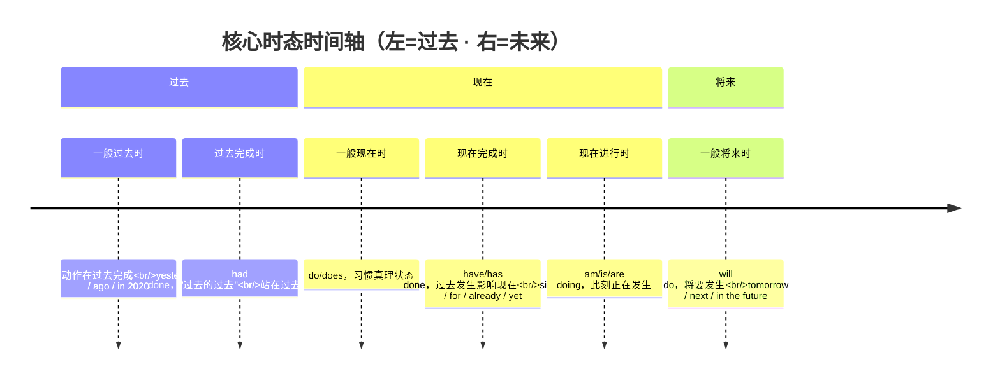

> 📌 **80% 时态题就考这三选**：一般过去（动作在过去的某时点）vs 现在完成（过去发生、对现在有影响，**不能用具体时间**）vs 一般现在（习惯/真理）。

#### 📌 现在完成时 vs 一般过去时（必考辨析）

| 维度 | 现在完成时 | 一般过去时 |
|:---|:---|:---|
| 时间焦点 | **现在**（关注结果） | **过去**（关注动作本身） |
| 能否用具体时间 | ❌ 不能 | ✅ 可以 |
| 例句 | I have seen the movie.（现在知道内容） | I saw the movie last night. |

**标志词区分：**
- 完成时：already, yet, ever, never, just, recently, so far, since, for
- 过去时：yesterday, last..., ...ago, in 2020, when I was...

---

### 二、被动语态

#### 结构公式

```
be + done (过去分词)
```

#### 各时态被动语态

| 时态 | 被动结构 |
|:---|:---|
| 一般现在时 | am/is/are + done |
| 一般过去时 | was/were + done |
| 一般将来时 | will be + done |
| 现在完成时 | have/has been + done |
| 过去完成时 | had been + done |
| 情态动词 | can/must/may + be + done |

#### 易错点

- **主动表被动：** need/want/require + doing = need to be done
  - *The car needs **washing**.* = The car needs **to be washed**.
- **感官动词：** look, sound, feel, taste, smell + 形容词（主动表被动）
  - *The flower **smells good**.*

---

### 三、三大从句（🔥🔥 必考）

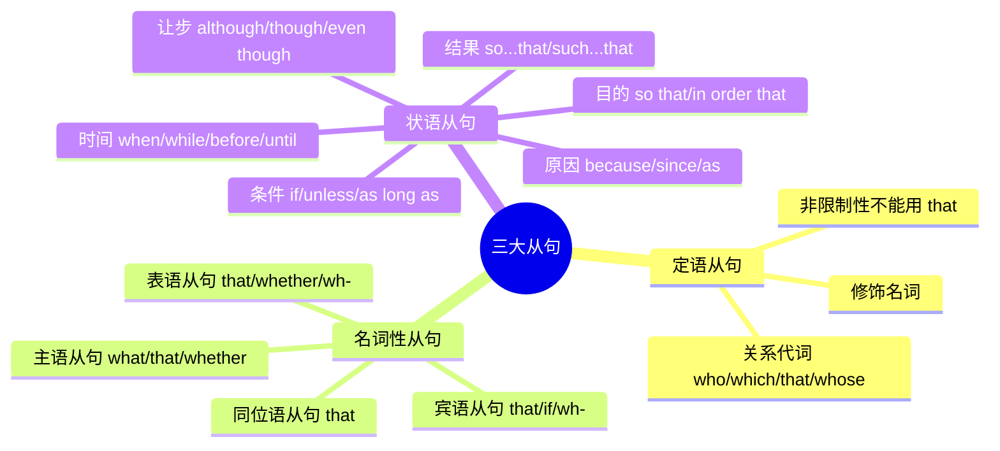

> 📌 记忆：**定语从句修饰名词（who/which/that）→ 名词性从句充当主语宾语（that/whether/what）→ 状语从句表时间条件原因让步（when/if/because/although）**。

#### 1️⃣ 定语从句

| 先行词 | 人 | 物 | 人+物/所有格 |
|:---|:---|:---|:---|
| 主格 | who/that | which/that | that |
| 宾格 | who(m)/that | which/that | that |
| 所有格 | whose | whose/of which | whose |

**非限制性定语从句：** 不能用 that，用 which / who

> *The book, **which** I bought yesterday, is very interesting.*

#### 2️⃣ 名词性从句

| 类型 | 引导词 | 例句 |
|:---|:---|:---|
| 主语从句 | that / whether / what | **What** he said is true. |
| 宾语从句 | that / if/whether / wh- | I think **that** he is right. |
| 表语从句 | that / whether / wh- | The question is **whether** we should go. |
| 同位语从句 | that | The news **that** he won surprised us. |

#### 3️⃣ 状语从句

| 类型 | 引导词 |
|:---|:---|
| 时间 | when, while, as, before, after, until, as soon as |
| 条件 | if, unless, as long as, provided that |
| 原因 | because, since, as, now that |
| 让步 | although, though, even though, while, no matter... |
| 目的 | so that, in order that |
| 结果 | so...that, such...that |

---

### 四、代词（🔥 必考）

> **广东口径**（娜娜老师 `BV1QKbZ6xEea` **P4**）：「代词在我们往年的语法填空里**几乎都是每年会出一题**，而且大多是集中在**指示代词 `it` 跟反身代词**的用法里面。」
> **真题实测五年五考**：2022#45 `it` · 2023#43 `it` · 2024#45 `myself` · 2025#45 `myself` · **2026 `her`** —— 代词是语法填空里**频率最高的考点**。

#### 第 0 步：给没给提示词？

| 情形 | 判断路径 |
|:---|:---|
| **无提示词** | 一般落在 **介词 / 冠词 / 代词 / 连词** 四类上；代词这块基本只有 **`it`** 和 **`that`/`those`** |
| **有提示词** | 走下面六条核心规则 |

#### 代词表格（背）

| 人称 | 主格 | 宾格 | 形容词性物主 | 名词性物主 | 反身 |
|:---|:---|:---|:---|:---|:---|
| 第一人称单数 | I | me | my | mine | myself |
| 第二人称单数 | you | you | your | yours | yourself |
| 第三人称单数 | he / she / it | him / her / it | his / her / its | his / hers / its | himself / herself / itself |
| 第一人称复数 | we | us | our | ours | ourselves |
| 第二人称复数 | you | you | your | yours | yourselves |
| 第三人称复数 | they | them | their | theirs | themselves |

#### 核心 1 · 人称代词：**动前主格，动/介后宾格**

> **判据只有一条：看它在动词前，还是动词/介词后。**

| 位置 | 用 | 例 |
|:---|:---|:---|
| **动词前**（作主语） | **主格** | `**They** need to write a report.` |
| **动词后 / 介词后**（作宾语） | **宾格** | `The coach gave it to **them**.` |

- 真题：`When a poem feels finished to ___, she often adds visual elements.` → **her**（`to` 是介词 ⇒ 宾格）· **2026 广东真题**
- 改错常考：`The teacher asked Tom and **I** to clean...` → 动词后必须用 **me**

#### 核心 2 · 物主代词：看名字 + 看长短

| 类型 | 判据 | 空后有名？ |
|:---|:---|:---|
| **形容词性物主** | 名字带「形容词」⇒ 当形容词用 | **必须接名词** |
| **名词性物主** | 名字带「名词」⇒ 已含名词 | **不再接名词** |

- 两个辅助判据：**看名字** · **看长短**（名词性物主普遍更长：`my → mine` · `our → ours`）
- 📌 `hers = her opinion`。真题：`Your opinion ___ sounds ridiculous to me.` → **like hers**
- ⚠️ `its` 既可是形容词性也可是名词性物主（**没有撇号**）；`it's` = it is —— 差一个撇号，意思天差地别

#### 核心 3 · 反身代词：两种用法 + 两步走

**什么时候用**

| 用法 | 判据 | 例 |
|:---|:---|:---|
| **动作回到自己身上** | 🔴 **主语和宾语是同一个人** | `Lisa said to **herself**` · `I said to **myself**` |
| **强调「亲自」** | 放**句末**或主语后 | `He finished the work **himself**.` |
| **固定搭配** | 见下表 | `enjoy **yourself**` |

**用哪一个（两步）**
1. 有没有「**自己**」的意味？
2. 有 → **主语是谁，就还给谁**（I → myself · he → himself · they → themselves）

- 真题：`I would remind ___ of all those people I'm helping` → **myself**（2024#45）
- 真题：`All the positive comments made me feel really proud of ___` → **myself**（2025#45）
- ❌ 反例：老师对我 = `me`，不是 `myself`（主语 ≠ 宾语）

> 📌 记忆：**自己对自己做动作，才有 self。**

#### 核心 4 · `it` 的五种用法（🔴 广东高频）

| 用法 | 结构 | 例 |
|:---|:---|:---|
| **① 指代前文** | 指前面出现的物 / 事 | `The hotel is clean. I like **it**.` |
| **② 形式主语** | `it is + adj + **to do**` / `it is + adj + **that 从句**` | `**It** is important to have good friends.` |
| **③ 形式宾语** | `sb find/make/think **it** + adj + to do` | `I find **it** useful to read a lot.` |
| **④ 强调句** | `**It is/was** + 被强调部分 + **that**` | `**It was** Tom **that** helped me.` |
| **⑤ 虚位主语** | 天气 / 时间 / 距离 | `**It** is raining.` · `**It** is 8 o'clock.` |

- 🔴 **强调句判据**：把 `it is/was ... that` **划掉**，剩下的还是完整句 ⇒ 就是强调句
- 🔴 **形式主/宾语不译作「它」**，它只是**占位**；真正的主语 / 宾语是后面的 `to do` 或 `that 从句`
- 真题：`Forget how important ___ is to have good people in our life.` → **it**（2023#43 · 形式主语）
- 真题：`I'd certainly advise anybody to give ___ a try.` → **it**（2022#45 · 固定搭配）
- 习题型：`I think ___ necessary to review grammar every week.` → **it**（形式宾语）

#### 核心 5 · 指示代词与替代词（了解即可）

| 词 | 用法 | 例 |
|:---|:---|:---|
| **this / these** | 近指（这 / 这些） | — |
| **that / those** | 远指；🔴 **比较结构中替代前文**（用 that/those，不用 it） | `The weather here is warmer than **that** in Shanghai.` |
| **one / ones** | **同类但不同个**（可数） | `I lost my pen, so I bought a new **one**.` |
| **it** | **同类同一个** | `The hotel is clean. I like **it**.` |

- 📌 常见结构：`a new one` · `a different one` · `an old one`

#### 核心 6 · 不定代词（了解即可）

| 系列 | 判据 | 例 |
|:---|:---|:---|
| **another / the other** | 看**范围**：`another` = 三者以上中的另一个；`the other` = 两者中的另一个 | `One is a doctor, and **the other** is a teacher.` |
| **others / the others** | 看**泛指**还是**特指剩余全部** | `Some are reading, **others** are talking.`（泛指一部分） |
| **both / either / neither** | 两者都 / 任一 / 都不 | `**Both** are OK.` · `**Neither** is OK.` |
| **all / none** | 三者及以上 都 / 都不 | — |

- 📌 两个必背结构：**`one ... the other`**（两者）· **`some ... others`**（泛指）

#### 反身代词固定搭配（背）

| 搭配 | 意思 | 搭配 | 意思 |
|:---|:---|:---|:---|
| teach oneself | 自学 | help oneself | 请自便 |
| enjoy oneself | 玩得开心 | by oneself | 独自一人地 |
| lose oneself | 迷路 | for oneself | 替自己 |
| come to oneself | 苏醒 | in itself | 本身 |
| make oneself at home | 不受拘束 | of oneself | 自发地 |
| beside oneself | 发狂 | devote oneself to | 专心于 |
| between ourselves | 你知我知 | | |

---

### 五、虚拟语气（🔥 必考）

> **广东口径**（娜娜老师 **P12**）：**虚拟语气 5 年只考过 1 次**（2022#44）—— 频率低，但**必学**：阅读里要能辨、写作里要用。
> **🔑 核心概念：时间错位** —— 虚拟出来的情况跟**事实相反**，所以动词要**往后退一格**。

#### 先认门类：四类虚拟

| # | 类型 | 引导 / 触发词 | 动词怎么变 |
|:--:|:---|:---|:---|
| **1** | **`if` 虚拟条件句** | `if` | 从句**退一格**；主句**固定用过去式情态动词** |
| **2** | **愿望类** | `wish` · `if only` · `would rather` | 从句**退一格** |
| **3** | **建议要求类** | suggest / demand / insist… | **`(should) do`**（**不倒退**） |
| **4** | **含蓄虚拟** | `without` · `but for` · `otherwise` · `or` | 与 **`if` 的主句**一致 |

#### 1️⃣ `if` 虚拟条件句

| 类型 | `if` 从句 | 主句 |
|:---|:---|:---|
| **与现在相反** | **did / were** | **would/could/might + do** |
| **与过去相反** | **had done** | **would/could/might + have done** |
| **与将来相反** | **were to do** / **should do** / **did** | **would/could/might + do** |

- 🔴 **主句的情态动词固定用过去式**（would / could / might / should）—— 不管哪种时间，**只变后面的 do**
- **与将来相反的从句三种形式，语感不同**：`were to do` 最正式（古英语沿用）· `should do` = 万一 / 碰巧 · `did` 语气最弱
- 📌 `If I **were** you, I would take the chance.` —— 「假如我是你」**直接填 `were`**，不用想

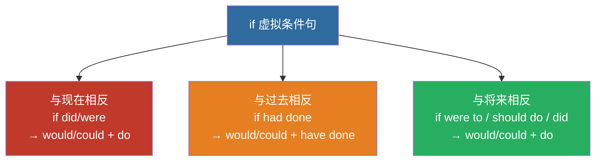

> 📌 记忆：**时态往后退一格** —— 现在→过去（did），过去→过去完成（had done），将来→were to / should。

**⚠️ 易错：别跟「普通条件句」混**

| | 普通条件句（主将从现） | **虚拟条件句** |
|:---|:---|:---|
| 假设的情况 | **客观上有可能发生** | **概率极低、基本不可能实现** |
| 主句 | `will do` | **`would/could/might + do`** |

#### 2️⃣ 愿望类（`wish` / `if only` / `would rather`）

**`wish` / `if only`**（`if only` 语气更强）

| 愿望 | 从句动词 |
|:---|:---|
| 对**现在** | `did` / `were` |
| 对**过去**（遗憾） | 🔴 **`had done`** |
| 对**将来** | `would` / `could + do` |

- 真题：`I wish I ___ a marathon years ago.` → **had run**（2022#44 · 对过去的遗憾）

**`would rather`（`that` 可省）** —— 与 `wish` **有一处不同**

| 愿望 | 从句动词 |
|:---|:---|
| 对**现在 / 将来** | **过去式**（⚠️ 不是 `would do`） |
| 对**过去** | `had done` |

#### 3️⃣ 建议要求类：`(should) do`（should 可省）

| 类型 | 触发词 |
|:---|:---|
| **建议** | suggest · advise · recommend · propose |
| **要求 / 命令** | demand · require · request · order · insist |
| **必要 / 重要**（形容词句式） | `It is necessary/important/essential + that + (should) do` |

- **也可用名词 / 形容词引出**：`It is my suggestion that...` · `It is advisable that...`
- 被动：`They required that the report **(should) be finished** today.`
- 🔴 **为什么这一类用原形、不倒退？** —— 因为这件事**还没发生**，不存在「已存在的事实」可对照，所以不倒退

**🔴🔴 两个必考例外（出现就是陷阱）**

| 动词 | 什么时候**不用**虚拟（用正常时态） | 例 |
|:---|:---|:---|
| **insist** | 表示「**坚持认为某个事实**」 | `He insisted that he **left** yesterday.` |
| **suggest** | 表示「**暗示 / 表明**」 | `His pale face suggests that he **is** ill.` |

#### 4️⃣ 含蓄虚拟（没有 `if`）

| 触发词 | 意思 | 动词 |
|:---|:---|:---|
| **without / but for** | 如果没有 | 与 **`if` 的主句**一致（常用 `would have done`） |
| **otherwise / or** | 否则 | 同上 |
| **It is (high) time that** | 该做某事了 | 🔴 **从句用过去式**（`It's time that we **left**.`） |

- 例：`Without your help, I **would have failed**.` · `I missed the bus, otherwise I **would have arrived** earlier.`

#### 其他虚拟触发词（顺手记）

| 考点 | 结构 | 例句 |
|:---|:---|:---|
| as if / though | 时态退一格 | `He talks as if he **knew** everything.` |

**动词清单（接 that 虚拟）：** suggest, advise, propose, recommend, insist, order, command, require, request, demand

### 六、非谓语动词（🔥🔥 必考）

| 形式 | 意义 | 用法 |
|:---|:---|:---|
| **to do** | 目的、将来 | 不定式：表示目的/主动/将来 |
| **doing** | 主动、进行 | 现在分词/动名词 |
| **done** | 被动、完成 | 过去分词表示被动/完成 |

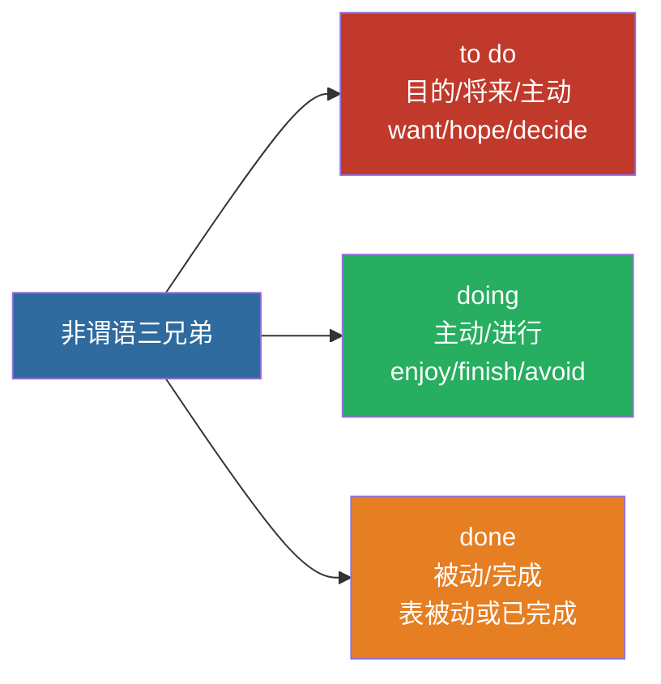

> 📌 记忆：**to do 表目的将来、doing 表主动进行、done 表被动完成**——先看主被动，再看时态先后。

#### 常考固定搭配

**只接 to do 的动词：**
> want, hope, wish, expect, decide, plan, refuse, promise, afford, agree

**只接 doing 的动词：**
> enjoy, finish, avoid, consider, practice, suggest, mind, keep, imagine

**既接 to do 又接 doing 意义不同：**

| 动词 | to do | doing |
|:---|:---|:---|
| **remember** | 记得要去做 | 记得做过 |
| **forget** | 忘记要去做 | 忘记做过 |
| **stop** | 停下来去做 | 停止做 |
| **try** | 努力去做 | 尝试做 |
| **regret** | 遗憾要去做 | 后悔做过 |

---

### 七、语法填空解题技巧

#### 纯填空（无提示词）

| 空格位置 | 可能填的词 |
|:---|:---|
| 名词前 | 冠词(a/an/the)、限定词、介词 |
| 动词前 | 情态动词、助动词 |
| 两句之间 | 连词(and, but, or, when, because...) |
| 句中 | 关系词(who, which, that, where...) |

#### 有提示词

| 提示词词性 | 可能变形成 |
|:---|:---|
| 动词 | 时态、语态、非谓语（to do/doing/done） |
| 形容词 | 副词(-ly)、比较级/最高级 |
| 名词 | 复数、词性转换（→形容词） |

---

### 速算口诀

> **时态看标志词，完成时找since/for**
> **被动公式be+done，主动表被动要记牢**
> **定语从句找先行，虚拟后退一个时**
> **非谓语三选一，to do目的doing主动done被动**
> **代词先看动前动介后，主宾同一人才用 self**
> **虚拟四类先认门：if 退格 · wish 退格 · 建议原形 · 含蓄跟主句**
> **it 五用：指代 · 形式主宾 · 强调 · 虚位**

[VOICE: 语法重点抓三大从句、虚拟语气、非谓语动词，这三个板块占语法考题的七成以上，先把它们吃透！]

---

<!-- 来源：10-讲义-按节贴/英语/matching.md -->

## 短文造句匹配（五选五）技巧

> 广东专插本英语 2023 年改革后新增题型，5 题 × 2 分 = 10 分
> 形式：短文挖空 5 处，从 7 个选项中选出 5 个正确句子填入

---

### 一、题型认识

#### 出题位置规律

| 挖空位置 | 特征 | 解题侧重点 |
|:---|:---|:---|
| 段首 | 总起句/过渡句 | 看后文，找总括或承上 |
| 段中 | 补充说明/逻辑展开 | 前后都看，找衔接词 |
| 段尾 | 总结句/过渡到下一段 | 看前文，找总结或引出 |

#### 选项特点

- 7 个选项中混入 2 个**干扰项**（内容相关但与上下文不匹配）
- 每个选项约 10-20 词，1-2 句话
- 一般按文章顺序设空，但偶尔打乱

---

### 二、三线索法

#### 线索 1：指代词线索

| 指代词 | 前文必有 |
|:---|:---|
| this / these | 前文提到的事/物 |
| it / they | 前文出现的名词 |
| such / so | 前文所述的情况 |
| here / there | 前文的地点 |

**技巧**：选项中有指代词，前文必须先出现对应指代对象。

#### 线索 2：逻辑连接词

| 逻辑关系 | 连接词 | 选项暗示 |
|:---|:---|:---|
| 递进/并列 | also, moreover, furthermore, in addition | 前文已有同类信息 |
| 转折/对比 | however, but, yet, on the other hand, instead | 前后相反 |
| 因果 | therefore, thus, as a result, consequently | 前因后果 |
| 举例 | for example, for instance, such as | 前文有概括 |
| 顺序 | first, then, finally, next | 有步骤/顺序 |

#### 线索 3：词汇复现

- **原词复现**：选项与前文出现相同的关键词
- **同义替换**：选项中的词与前文是近义词
- **上下义**：选项中的词是前文的类别/具体例子

---

### 三、做题步骤

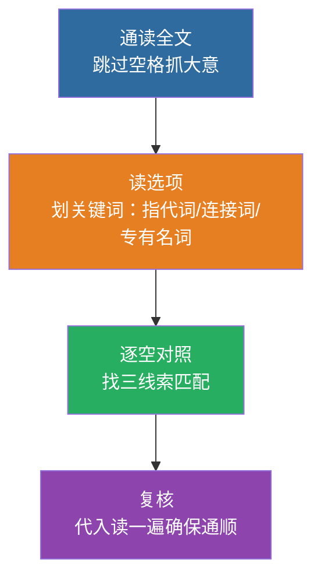

> 📌 三线索：**指代词**（前文必须出现指代对象）、**逻辑连接词**（but/so/first）、**词汇复现**（同义词/原词）。

#### 四步法

1. **通读全文**（跳过空格）：了解大意和结构
2. **读选项**：划出每个选项的关键词（指代词、连接词、专有名词）
3. **逐空对照**：看空格前后句，找线索匹配
4. **复核**：代入后全文读一遍，确保逻辑通顺

#### 排除技巧

| 技巧 | 说明 |
|:---|:---|
| 先易后难 | 有明显线索的先填，缩小范围 |
| 用完划掉 | 确定选项后划掉，避免干扰 |
| 两句纠结 | 分别代入读，看哪个更通顺 |

---

### 四、例题演示

> 篇幅所限，以简版模拟题说明

原文：

```
(1)______. It affects how we think, feel, and act.

One way to improve mental health is regular exercise. (2)______. It
releases chemicals that make us feel good.

Another important factor is social connection. (3)______. This can
be as simple as talking to a friend.

(4)______. Even 5 minutes of meditation can help.

A healthy diet also matters. (5)______. A balanced diet supports
brain function.
```

选项（7 选 5，2 个干扰项）：

A. Mental health is important for everyone.
B. For example, running or swimming can help.
C. Spending time with others reduces stress.
D. Eating too much sugar is bad for health.
E. Taking time to relax is very beneficial.
F. Reading books is a good way to relax.
G. Friends are important in our life.

**解析**：

| 空 | 线索 | 答案 |
|:---|:---|:---|
| (1) 段首 | 下文 "It affects..."（it 指代前文的某个概念） | **A**（Mental health → it） |
| (2) 段中 | 前文 "regular exercise"，选项 B 有 "running or swimming" 是具体例子 | **B**（For example 举例） |
| (3) 段中 | 前文 "social connection"，选项 C 有 "spending time with others" 同义替换 | **C** |
| (4) 段首 | 下文 "meditation" 是放松方式，选项 E 有 "relax" | **E** |
| (5) 段尾 | 前文 "A healthy diet"，选项 D 有 "sugar" 相关；但更通顺的是看下一句 "A balanced diet" 与 D 的 "sugar" 关系 | **D**（干扰项 F 和 G 被排除） |

---

### 五、易错点与避坑

| ❌ 易错 | ✅ 对策 |
|:---|:---|
| 只看空前后一个词 | 看整句话，甚至前后 2-3 句 |
| 被干扰项迷惑 | 干扰项往往内容正确但位置不对 |
| 先入为主选第一个像的 | 读完所有选项再选 |
| 不检查全文 | 代入后通读一遍，看逻辑是否通顺 |

---

### 六、备考建议

1. 练习材料：高考七选五真题（难度接近，题量大）
2. 本库：2022-2024 刷题版 Part II 可用
3. 每天 1 篇，限时 8 分钟
4. 重点训练：**指代词追踪 + 逻辑连接词识别**

---

← [阅读理解高分技巧](/posts/english/notes/reading) · [完形填空高分技巧](/posts/english/notes/cloze)

---

<!-- 来源：10-讲义-按节贴/英语/overview.md -->

## 考试概述与题型分析

## 📋 专升本英语考试概述与题型分析

> 广东普通专升本《公共英语》| 2026考情

---

### 一、考试基本信息

| 项目 | 内容 |
|:---|---:|
| 考试科目 | 公共英语（必考） |
| 总分 | 100分 |
| 词汇量要求 | 认知 **3000词** + 常用词组 |
| 考试时间 | 120分钟 |
| 难度层级 | 介于三级~四级之间 |

**词汇来源：** 《高等职业教育专科英语课程标准（2021年版）》附录词汇表

---

### 二、题型详解

| 题型 | 题数 | 分值/题 | 总分 | 建议用时 |
|:---|---:|:---:|---:|:---:|
| Ⅰ 阅读理解 | 15题 | 2分 | **30分** | 40min |
| Ⅱ 短文造句匹配 | 5题 | 2分 | **10分** | 10min |
| Ⅲ 完形填空 | 15题 | 2分 | **30分** | 25min |
| Ⅳ 语法填空 | 10题 | 1.5分 | **15分** | 15min |
| Ⅴ 写作 | 1题 | 15分 | **15分** | 30min |

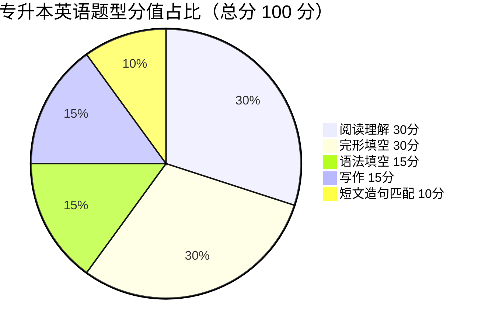

> 📌 **分值之王**：阅读（30）+ 完形（30）= **60 分，占总分 60%**——复习重心先砸这两块！

---

### 三、各题型深度分析

#### 1️⃣ 阅读理解（30分）— 🏆 分值之王

**文章体裁：**
- 说明文（40%）> 议论文（35%）> 记叙文（15%）> 应用文（10%）

**题材范围：**
- 社会生活、文化教育、科技发展、环境保护、健康医疗

**命题形式：**
- 细节题（40%）、推断题（20%）、主旨题（15%）、猜词题（15%）、态度题（10%）

#### 2️⃣ 短文造句匹配（10分）

- 给出一篇短文，5个句子挖空
- 从选项中选择正确句子填入
- 考察**语篇衔接与逻辑连贯**

#### 3️⃣ 完形填空（30分）— 🏆 分值并列第一

- 一篇250-300词的短文，15个空
- 每个空4个选项
- 考察：**词汇辨析（60%）+ 语法（25%）+ 语篇逻辑（15%）**

#### 4️⃣ 语法填空（15分）

- 一篇150-200词的短文，10个空
- **无选项**，根据上下文填入单词的正确形式
- 考察：动词时态/语态、非谓语、词性转换、比较级、冠词、介词等

#### 5️⃣ 写作（15分）

- 字数要求：**约100词**（建议实写 90–110）
- 体裁（广东）：**书信 / 通知等应用文为主** ≫ 议论文 / 图表（极少）
- 评分侧重：格式正确 + 要点写全 + 语言通顺 + 结构清楚
- 详背模板见 作文模板与高分句型；年份范文见 [历年真题分类与讲解](/guide/sources)

---

### 四、备考策略

#### 🎯 得分优先级

```
第1梯队：阅读理解（30分）+ 完形填空（30分）→ 稳住基础
第2梯队：语法填空（15分）+ 写作（15分）→ 提分关键
第3梯队：短文匹配（10分）→ 锦上添花
```

#### 📅 分阶段规划

| 阶段 | 时间 | 重点 |
|:---|:---:|:---|
| 🟢 基础期 | 1-2周 | 核心1500词 + 基础语法框架 |
| 🟡 强化期 | 3-4周 | 语法专项 + 阅读理解方法论 |
| 🔴 冲刺期 | 5-8周 | 真题刷题 + 错题复盘 + 作文模板 |
| 🏆 模考期 | 9-10周 | 整套限时模拟 + 查漏补缺 |

```mermaid
gantt
    title 专升本英语 10 周备考计划
    dateFormat  X
    axisFormat  第%S周
    section 基础期
    核心1500词+语法框架 :a1, 0, 2
    section 强化期
    语法专项+阅读方法论 :a2, 2, 2
    section 冲刺期
    真题刷题+错题复盘+作文模板 :a3, 4, 4
    section 模考期
    整套限时模拟+查漏补缺 :a4, 8, 2
```

> 📌 第 1-2 周打地基（词汇+语法）→ 3-4 周攻方法（专项）→ 5-8 周刷真题 → 9-10 周限时模考。

#### 🎯 得分优先级金字塔

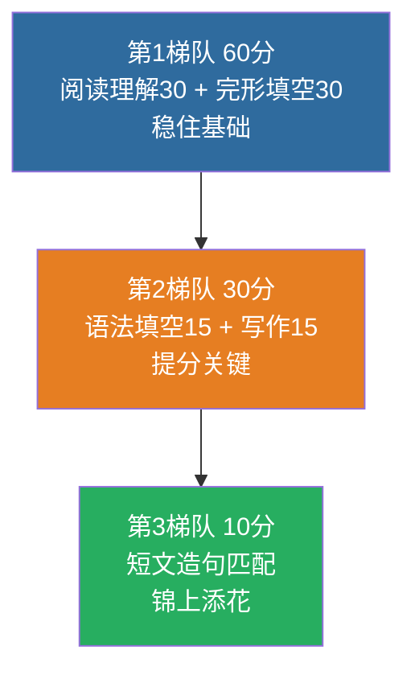

> 📌 **先稳 60 再争 30**：阅读+完形是地基，语法填空+写作是拉分项，短文匹配最后啃。

#### ⚠️ 常见雷区

- ❌ **盲目背大纲全部词汇** → 应聚焦高频真题词汇
- ❌ **语法钻牛角尖** → 只考最常用的3-5种时态搭配
- ❌ **阅读逐字翻译** → 学会跳读和定位
- ❌ **作文临场发挥** → 必须背**书信 + 通知**模板框架

---

### 速算口诀

> **阅读定位找细节，完形前后看逻辑**
> **语法填空变词性，作文模板要背齐**
> **三千词汇是底线，真题刷透不焦虑**

[VOICE: 广东专升本英语满分100分，阅读理解和完形填空各占30分是得分大头，词汇量要求3000词，备考先从核心词汇和基础语法入手就好！]

---

<!-- 来源：10-讲义-按节贴/英语/past-papers-guide.md -->

## 历年真题分类与讲解

## 📑 历年真题分类与讲解

> 广东普通专升本《公共英语》| 按年份整理 | 含答案要点与讲解  
> 写作约 100 词应用文为主 · 题型以近年大纲结构为准

---

### 〇、使用说明与资料边界

| 项目 | 说明 |
|:---|:---|
| 用途 | 按**年份**回顾题型结构，重点练**写作应用文**；阅读/完形用「题型策略」复盘 |
| 写作要求 | **约 100 词**；格式 + 要点覆盖是得分关键 |
| 答案性质 | 写作给**参考范文 + 得分点讲解**（非唯一标准答案）；客观题给**题型解法**模板 |
| 资料边界 | 完整官方卷面（含全部阅读原文）以你手头的**正版真题册 / 院校公布材料**为准；本笔记侧重**可背结构 + 写作演练 + 年份对照**，方便日常默写 |

**题型分值（近年常见结构，以当次大纲为准）：**

| 题型 | 约分 |
|:---|---:|
| 阅读理解 | 30 |
| 短文造句匹配 | 10 |
| 完形填空 | 30 |
| 语法填空 | 15 |
| 写作 | 15 |
| **合计** | **100** |

**相关笔记：** [专升本英语考试概述与题型分析](/posts/english/notes/overview) · 作文模板与高分句型 · 高频词汇速记 · 英语知识库

---

### 一、按年份：写作真题演练（核心）

> 每年写作按「题目要求 → 审题要点 → 参考范文 → 得分点讲解」组织。  
> 题目若与你手头卷子措辞略有出入，以纸质卷为准，**结构与得分逻辑不变**。

---

#### 2018 年 · 通知（NOTICE）

**题目方向（活动通知类）：**  
学生会将举办校园文化活动（如音乐周 / 读书活动等），写一则通知，说明时间、地点、活动内容，欢迎参加。

**审题要点：**
1. 标题 NOTICE 居中  
2. 时间、地点、活动内容至少两点  
3. 欢迎参加 + 联系方式（若题干有）  
4. 右下角：The Student Union + 日期

**参考范文（约 100 词）：**

```
                    NOTICE

May I have your attention, please? To enrich our campus life, our school is
going to organize a music week.
The event is scheduled to be held in the school hall at 2:00 p. m. next Friday.
There are many exciting activities waiting for you. For one thing, you can
enjoy pop and folk music. For another, please bring your own instruments if
you wish to perform.
Those who are interested in it are highly welcome to participate. If you have
any questions, please feel free to contact us at 1234567.

                                          The Student Union
                                          May 10th, 2018
```

**得分点讲解：**
- ✅ 格式三分立：标题 / 正文 / 落款  
- ✅ 信息齐全：what / when / where / how to join  
- ⚠️ 漏地点或时间 → 内容分直接掉

**默写自检：** [ ] 标题 [ ] 时间地点 [ ] 两项活动细节 [ ] 欢迎句 [ ] 落款

---

#### 2019 年 · 邀请信

**题目方向：**  
邀请外国朋友 Peter（或同学）参加学校「中国传统文化展」或同类活动，说明时间、可体验项目、意义。

**审题要点：**
1. Dear + 名；落款 Li Hua  
2. 写信目的一句清  
3. 时间 / 可做之事 / 意义或期待  
4. 盼复

**参考范文：**

```
Dear Peter,

How is everything going? I am writing this letter to express my earnest hope
to invite you to visit the exhibition of Traditional Chinese Culture in our school.

Here are some relevant details about this matter. First and foremost, the
exhibition will be held in the school hall at 2:00 p. m. next Friday.
Furthermore, you can experience the art of paper-cutting yourself.
Last but not least, it will be a meaningful and unforgettable experience.

Taking all these factors into consideration, I sincerely hope you can accept
my invitation. I am looking forward to hearing from you soon.

Yours sincerely,
Li Hua
```

**得分点讲解：**
- ✅ 邀请目的明确  
- ✅ 细节有「时间 + 体验」比空喊 meaningful 更重要  
- ⚠️ 朋友信可用 How is everything going?；正式申请信可改为 I am writing to...

**默写自检：** [ ] 称呼落款 [ ] 目的 [ ] 三点细节 [ ] 期许盼复

---

#### 2020 年 · 申请信

**题目方向：**  
申请学生会某职位 / 英语社团干事 / 志愿者，说明自身条件与能做什么。

**审题要点：**
1. 申请对象与职位  
2. 自身优势 2–3 点（经验、技能、性格）  
3. 恳请给予机会

**参考范文：**

```
Dear Mr. Smith,

I am writing this letter to express my earnest hope to apply for the position
of English tutor in the Student Union.

Here are some relevant details about this matter. First and foremost, I have
been learning English for many years and once won a speech contest.
Furthermore, I am patient and good at communicating with others.
Last but not least, I am willing to spare time to serve my schoolmates.

I sincerely hope you can give me an opportunity. I am looking forward to
hearing from you soon.

Yours sincerely,
Li Hua
```

**得分点讲解：**
- ✅ apply for the position of... 是申请信标志句  
- ✅ 每点对应「能力/经历」，避免空喊 hard-working  
- ⚠️ 题干若给截止时间，必须写入

---

#### 2021 年 · 建议信 / 感谢信（二选一练）

##### A. 建议信方向  
就「如何提高英语」或「校园生活某一问题」给同学/校长提建议。

```
Dear Mark,

I am writing this letter to offer some suggestions on how to improve your English.

First and foremost, you had better read English newspapers every day.
Furthermore, practicing speaking with classmates is highly beneficial.
Last but not least, reviewing new words regularly will help you a lot.

I sincerely hope these suggestions will be useful to you.
I am looking forward to hearing from you soon.

Yours sincerely,
Li Hua
```

##### B. 感谢信方向  
感谢老师/朋友在学习或生活上的帮助。

```
Dear Mr. Smith,

I am writing this letter to express my sincere thanks for your help during my
preparation for the English exam.

First and foremost, you explained the difficult grammar points patiently.
Furthermore, the materials you recommended were extremely useful.
Last but not least, your encouragement gave me great confidence.

I would be highly appreciative if I could repay your kindness someday.
I am looking forward to seeing you again.

Yours sincerely,
Li Hua
```

**得分点讲解：**
- 建议信用 **offer some suggestions on...**  
- 感谢信用 **express my sincere thanks for...** + 具体帮助事例  
- 两类都忌只有套话、没有「具体做了什么」

---

#### 2022 年 · 道歉信 / 通知（二选一练）

##### A. 道歉信方向  
因故不能赴约/迟交作业/弄丢物品，说明原因并提出补救。

```
Dear Peter,

I am writing this letter to apologize for not being able to attend your
birthday party last Saturday.

First and foremost, I had to look after my sick mother in the hospital.
Furthermore, I should have informed you earlier, and I am truly sorry.
Last but not least, I would like to invite you to dinner next weekend to make
up for it.

I sincerely hope you can accept my apology.
I am looking forward to your reply.

Yours sincerely,
Li Hua
```

##### B. 通知方向（运动会 / 演讲比赛）

```
                    NOTICE

To enrich our campus life, the Student Union is going to organize an English
speech contest.
It will take place in the school hall at 3:00 p. m. on Nov. 20th.
For one thing, the topic is "My College Life". For another, each speaker will
have five minutes.
Those who are interested are highly welcome to participate. Please contact us
at 1234567 for registration.

                                          The Student Union
                                          Nov. 5th, 2022
```

**得分点讲解：**
- 道歉信结构：**道歉 → 原因 → 补救 → 再致歉**  
- 通知：**活动名 + 时间地点 + 规则/内容 + 欢迎报名**

---

#### 2023 年 · 推荐信 / 邀请信

**题目方向：**  
向朋友推荐一本书/一门课/一次校园活动，或邀请参加志愿者活动。

**推荐信范文：**

```
Dear Mark,

How is everything going? I am writing this letter to recommend a book called
"The Old Man and the Sea" to you.

First and foremost, the story is simple but inspiring.
Furthermore, the language is not too difficult for us to understand.
Last but not least, it will help you build a positive attitude toward challenges.

I sincerely hope you will enjoy reading it.
I am looking forward to discussing it with you soon.

Yours sincerely,
Li Hua
```

**得分点讲解：**
- recommend A to B  
- 至少两点「为什么值得」+ 一句期待反馈

---

#### 2024 年 · 综合应用（邀请 / 活动通知）

**题目方向（近年常见综合）：**  
学校举办「传统文化周」或「职业规划讲座」，写邀请信或 NOTICE，覆盖时间、地点、内容、对象。

**邀请信精简版（约 100 词）：**

```
Dear Peter,

I am writing to invite you to the Traditional Chinese Culture Week in our school.

First of all, it will be held in the school hall from 2:00 p. m. to 5:00 p. m.
next Friday. In addition, you can try paper-cutting and watch calligraphy shows.
What is more, it will help you better understand Chinese culture.

I sincerely hope you can come. I am looking forward to your early reply.

Yours sincerely,
Li Hua
```

**得分点讲解：**
- 2024 起更看重**信息密度**：时间段、项目、意义各一句即可  
- 套话重复（hope + appreciative 连用）可只留一句，把词数留给要点

---

#### 2025–2026 备考预测（非真题，按趋势）

| 更可能 | 相对少见 |
|:---|:---|
| 邀请信、申请信、感谢信、道歉信、建议信 | 长议论文、图表作文 |
| NOTICE（讲座/比赛/志愿活动） | 纯记叙文 |
| 中文要点提示 → 英文应用文 | 全英文长题干无要点 |

**冲刺策略：** 只精背 作文模板与高分句型 中的**书信 + NOTICE**，每周限时默写 2 篇。

---

### 二、按年份：客观题怎么复盘（统一方法）

完整阅读/完形原文以纸质真题为准。这里给**跨年份通用解题卡**，做完一套就按此填坑。

#### 1. 阅读理解（约 30 分）

| 题型 | 做法 | 常见坑 |
|:---|:---|:---|
| 细节题 | 题干关键词回原文定位，同义改写选答案 | 凭印象选「好像提过」 |
| 主旨题 | 首段 + 各段首句，排除过宽/过窄 | 选细节当主旨 |
| 猜词题 | 上下文逻辑 + 并列/转折 | 只看词形像不像 |
| 推断题 | 原文能推出一层，不脑补两层 | 过度推理 |
| 态度题 | 抓评价性形容词与转折后观点 | 把作者观点当某人物观点 |

**年份复盘表（自己填）：**

| 年份 | 错几题 | 主错题型 | 生词/长句 | 下次动作 |
|:---|:---:|:---|:---|:---|
| 2018 |  |  |  |  |
| 2019 |  |  |  |  |
| 2020 |  |  |  |  |
| 2021 |  |  |  |  |
| 2022 |  |  |  |  |
| 2023 |  |  |  |  |
| 2024 |  |  |  |  |

#### 2. 完形填空（约 30 分）

**三步：**
1. 通读知大意（记叙/说明）  
2. 先易后难：搭配与语法优先  
3. 填完复读查逻辑是否通

**高频考点：** 动词短语、近义词、连词、指代、固定搭配（见 高频词汇速记）

#### 3. 语法填空（约 15 分）

| 空型 | 想什么 |
|:---|:---|
| 动词 | 时态 / 语态 / 非谓语 / 主谓一致 |
| 名词 | 单复数 / 词性转换 |
| 形副 | 比较级最高级 / 词性 |
| 介词 | 固定搭配 |
| 冠词 | a/an/the / 零冠词 |
| 连词/从句 | 缺什么成分填什么关系词 |

#### 4. 短文造句匹配（约 10 分）

- 看空前空后：指代（this/these）、逻辑（however/therefore）、词汇复现  
- 先定逻辑关系再选句，勿逐句翻译硬塞

---

### 三、按题型总表（写作体裁频率 · 备考用）

| 体裁 | 出现倾向 | 优先级 |
|:---|:---|:---:|
| 邀请信 | 高 | ★★★★★ |
| 通知 NOTICE | 高 | ★★★★★ |
| 申请信 | 高 | ★★★★★ |
| 感谢 / 道歉 / 建议 / 推荐 | 中高 | ★★★★ |
| 投诉信 | 中 | ★★★ |
| 议论文 / 图表 | 低（广东极少） | ★ |

---

### 四、答案讲解总原则（写作评分思维）

阅卷大致看：

1. **格式**（称呼、落款、NOTICE 标题与右下角）  
2. **要点是否写全**（题干几条就对应几句）  
3. **语言是否基本正确**（时态、主谓、拼写）  
4. **是否约 100 词、条理清楚**

| 档位（满分 15 粗分） | 特征 |
|:---|:---|
| 12–15 | 格式对、要点全、少量小错、表达清楚 |
| 9–11 | 要点基本全，有些语法错或略空 |
| 6–8 | 漏要点 / 格式残缺 / 中式堆砌 |
| 0–5 | 体裁偏题、几乎无法理解 |

---

### 五、刷题节奏建议

```
每周：
  - 1 套客观题（限时，按第二节复盘表填坑）
  - 2 篇写作默写（书信 1 + 通知 1，25 分钟内）

每月：
  - 对照本笔记「年份写作」轮换体裁
  - 生词进 高频词汇速记 主题包
```

---

### 速算口诀

> **真题按年看体裁，书信通知反复练**  
> **客观题型定方法，错题填表不二刷空**  
> **范文只是得分样，要点写全才是王**

---

### 相关笔记

- 作文模板与高分句型
- 高频词汇速记
- [专升本英语考试概述与题型分析](/posts/english/notes/overview)
- 语法考点精讲
- 阅读理解高分技巧
- 英语知识库

---

<!-- 来源：10-讲义-按节贴/英语/reading.md -->

## 阅读理解高分技巧

## 📖 阅读理解高分技巧

> 专升本英语阅读 | 六大题型 | 解题套路

---

### 一、题型统计

| 题型 | 占比 | 难度 |
|:---|:---:|:---:|
| 🔍 细节理解题 | ~40% | ⭐ 易 |
| 🎯 推理判断题 | ~20% | ⭐⭐⭐ 难 |
| 📌 主旨大意题 | ~15% | ⭐⭐ 中 |
| 🔤 词义猜测题 | ~15% | ⭐⭐ 中 |
| 💭 观点态度题 | ~10% | ⭐⭐ 中 |

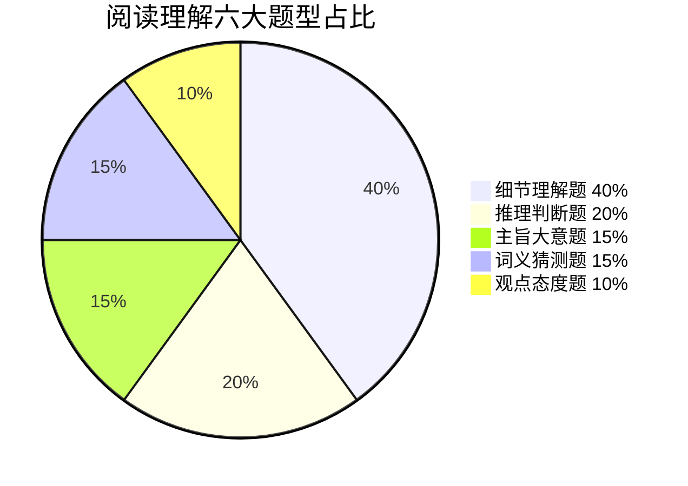

> 📌 细节题占 40%——**回原文定位 + 同义替换**是最核心的"一招鲜"。

---

### 二、六大题型破解

#### 1️⃣ 细节理解题（40%）

**常见问法：**
- According to the passage, ...
- What is mentioned about ...?
- Which of the following is TRUE/NOT true?

**解题步骤：**
1. 题干中找关键词（专有名词、数字、大写词）
2. 用关键词**回原文定位**
3. 对比选项和原文，选同义替换的项

> ⚠️ **干扰项特征：** 张冠李戴、偷换概念、过度推断、与原文相反

#### 2️⃣ 推理判断题（20%）

**常见问法：**
- It can be inferred from the passage that...
- The author implies/suggests that...
- What can we learn from the passage?

**解题要点：**
- ✅ 基于原文逻辑合理推断
- ❌ 不要过度发挥（原文没说的不能选）
- ❌ 不要选原文**直接陈述**的内容

> **口诀：** 推断题选"可能但不肯定"的，不选"原文直接说的"

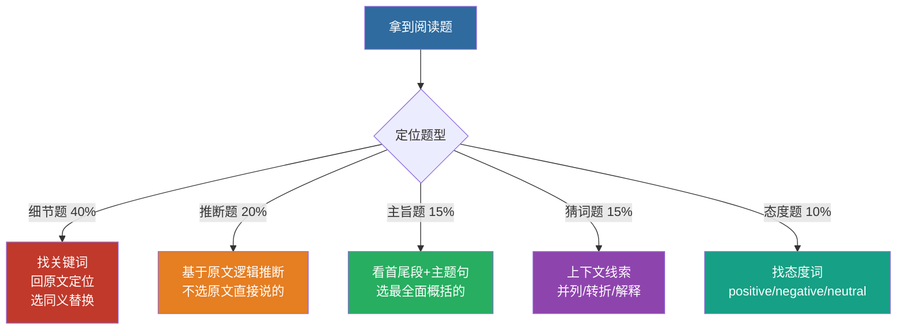

#### 3️⃣ 主旨大意题（15%）

**常见问法：**
- What is the main idea of the passage?
- The best title for the passage would be...
- What is the passage mainly about?

**解题步骤：**
1. 读**首段首尾句 + 每段首句**
2. 找**主题句**（通常在开头或结尾）
3. 排除以偏概全、过于宽泛的选项

#### 4️⃣ 词义猜测题（15%）

**常见问法：**
- The word "..." in paragraph X probably means...
- Which of the following can replace "..."?

**猜词技巧：**

| 线索类型 | 标志词 | 示例 |
|:---|:---|:---|
| 定义法 | is, means, refers to | A **habitat** is the natural home of an animal. |
| 对比法 | but, however, while, unlike | Unlike his **generous** brother, he is very stingy. |
| 因果法 | because, so, since, thus | He was so **exhausted** that he fell asleep immediately. |
| 举例法 | such as, for example, like | **Carnivores**, such as lions and tigers, eat meat. |
| 同义法 | or, that is, i. e. | The **adversary**, or opponent, was strong. |

#### 5️⃣ 观点态度题（10%）

**常见问法：**
- What is the author's attitude towards...?
- The tone of the passage is...

**态度词库：**

| 正向 | 负向 | 中立 |
|:---|:---|:---|
| positive | negative | neutral |
| supportive | critical | objective |
| optimistic | pessimistic | impartial |
| favorable | disapproving | indifferent |

> 🚨 **小炸弹：** indifferent（漠不关心的）几乎永远不选——作者写一篇文章不可能漠不关心

---

### 三、长难句分析

#### 三步拆解

```
Step 1: 找谓语动词 → 确定有几个句子
Step 2: 找连词/关系词 → 分清主从句
Step 3: 去修饰留主干 → 主谓宾即核心
```

#### 实战演练

> **原句：** The study, *which was conducted by researchers from Harvard University*, found that students who **regularly participated in physical exercise** performed better on exams.

- **主干：** The study found that students performed better on exams.
- **修饰1：** which was conducted by...（定语从句，修饰study）
- **修饰2：** who regularly participated...（定语从句，修饰students）

---

### 四、时间分配策略

```
文章阅读量：4篇 × 300-400词 = 1200-1600词
总用时：40分钟

┌─────────────────────────────┐
│ 通读全文划关键 → 5min/篇      │
│ 逐题定位找依据 → 4min/篇      │
│ 填涂检查 → 1min/篇           │
│                              │
│ 每篇总计：10分钟              │
│ 四篇总计：40分钟              │
└─────────────────────────────┘
```

---

### 五、高频干扰项特征

| 干扰类型 | 特征 | 识别方法 |
|:---|:---|:---|
| 偷换概念 | 用原文某词造个不同意思的句子 | 逐字比对 |
| 张冠李戴 | A的事说成B的 | 注意主语对应 |
| 过度推断 | 推到了原文没说的一步 | 回到原文看能否推出 |
| 以偏概全 | 局部当整体 | 看选项范围是否太大 |
| 正反混淆 | 与原文意思相反 | 注意否定词 |

---

### 六、带做例题：一道细节题怎么拆

> 用 [2024 真题 Passage A](/posts/english/2024) 的第 1 题。选它是因为 **4 个选项里 3 个是陷阱，而且三类错因各不相同**——把这一道拆透，等于同时练了偷换概念、偷换动词、张冠李戴。

**原文（只留解题要用的那句）：**

> **Organic EcoPark** — At this all-in-one family fun destination, buying an admission ticket will allow you to choose from a wide range of activities, such as playing on a bouncy castle, riding horses, feeding fish, picking vegetables and mushrooms, or taking part in a workshop. ($12/person, Tel: 5570221)

**题干：** At Organic EcoPark, visitors can ______.

A. build a castle 　 B. ride horses 　 C. plant vegetables 　 D. make drinks

---

#### Step 1 · 圈题干的两个定位词

题干里的信息只有两段有用：

| 圈什么 | 作用 |
|:---|:---|
| **Organic EcoPark** | 定位到哪一段（本篇有 5 个景点，不圈就会串段） |
| **visitors can** | 限定「游客能做的事」，不是「这个地方有什么」 |

> ⚠️ 这一步最容易偷懒跳过。本篇 5 道题分别考 5 个景点，**不圈景点名 = 一定串段**。

#### Step 2 · 回原文，只读那一句

定位到第一段，动词短语一口气列了 5 个：
`playing on a bouncy castle` / `riding horses` / `feeding fish` / `picking vegetables and mushrooms` / `taking part in a workshop`

#### Step 3 · 逐项比对（不是「选最像的」，是「每个都验一遍」）

| 选项 | 原文对应 | 判定 | 错因类型 |
|:---|:---|:---:|:---|
| **B. ride horses** | `riding horses` | ✅ **正确** | 原词复现，直接命中 |
| A. build a castle | `playing on a bouncy castle` | ❌ | **偷换概念**：bouncy castle 是「充气城堡」，是**玩**的东西；build a castle 是「建城堡」。词长得像，动作完全不同 |
| C. plant vegetables | `picking vegetables` | ❌ | **偷换动词**：picking 是「摘」，plant 是「种」。摘菜和种菜是两件事 |
| D. make drinks | `how to use it to make drinks`（**在 Go Green Farm 那段**） | ❌ | **张冠李戴**：这个动作属于第 2 个景点，不属于 Organic EcoPark |

#### Step 4 · 记住这题的「出题套路」

1. **正确项几乎总是原文的原词或同义替换**，不需要推理。
2. **干扰项最爱偷换动词**（picking→plant）和**偷换名词修饰语**（bouncy castle→castle）。看到「原文里出现过这个词」就选，必错——**要比整个短语，不是比单词**。
3. **选项内容在本篇别处出现过 ⇒ 高度可疑**。D 项就是拿隔壁景点的内容来凑。

> 📌 **一句话带走**：细节题的正确项在原文里「原样躺着」，干扰项则是「把原文的词拆开重拼」。**逐字比对短语，不要比对单词。**

---

### 七、速算口诀

> **细节定位找替换，推断两选选弱的那一个**
> **主旨看首段，猜词看上下文**
> **态度题excited/surprised别乱选，客观中立最安全**
> **长难句三步走：找谓、分清、留主干**

[VOICE: 阅读理解占30分是试卷的大头，关键是学会定位和排除干扰项，细节题考最多，靠关键词回原文定位找同义替换就行！]

---

<!-- 来源：10-讲义-按节贴/英语/syllabus.md -->

## 考试大纲与题型补强

## 公共英语 · 考试大纲与题型补强

> 广东普通专升本公共课《英语》· 满分 **100** · **120** 分钟（以当年大纲为准）

---

### 常见题型板块

| 板块 | 训练重点 | 本库笔记 |
|:---|:---|:---|
| 词汇语法 | 高频词 + 时态语态非谓语 | 高频词汇速记 · 语法考点精讲 |
| 阅读理解 | 主旨 / 细节 / 推理 / 词义 | 阅读理解高分技巧 |
| 完形 / 填空 | 逻辑连接 + 固定搭配 | 结合真题年份页 |
| 翻译 | 定语从句、被动、比较 | 真题详解页 |
| 写作 | 书信 / 议论文模板 | 作文模板与高分句型 |

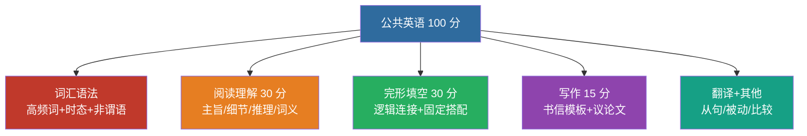

> 📌 每天词汇 30-50 + 1 篇阅读 → 每周 1 套真题限时 → 作文每周 1 篇对照模板改。

---

### 备考节奏

1. 每天词汇 30–50 + 1 篇阅读
2. 每周 1 套近三年真题限时
3. 作文每周 1 篇，对照模板改

详见：[专升本英语考试概述与题型分析](/posts/english/notes/overview) · [历年真题分类与讲解](/guide/sources)

返回：英语知识库 · [英语](/posts/english/)

---

<!-- 来源：10-讲义-按节贴/英语/vocabulary.md -->

## 高频词汇速记

## 📝 高频词汇速记

> 广东普通专升本《公共英语》核心词 | 超高频约 500 词完整表 | 记忆法 + 易混辨析

---

### 〇、资料来源说明（先看这个）

本笔记「超高频约 500 词」**不是某一本官方单独出版的「500 词红宝书」原文照抄**，而是按广东考情**整理压缩**出来的复习表。

| 层级 | 来源 | 怎么用 |
|:---|:---|:---|
| **大纲词表** | 《高等职业教育专科英语课程标准（2021 年版）》**附录词汇表**（约 3000 词）——广东普通专升本公共英语词汇要求的官方依据 | 全量认知底线 |
| **高频压缩** | 在大纲词基础上，结合历年专升本/高职公共英语真题阅读、完形中的**复现词** + 应用文写作常用词，压成约 **500 个「必会」** | 本笔记主体 |
| **搭配与辨析** | 通用英语教学中的固定搭配与易混词（affect/effect 等），服务完形与语法填空 | 第四节 |

**一句话：**  
> 大纲给「该认哪些词」；真题复现率决定「先背哪 500」。  
> 若机构宣传「专升本官方高频 500」，多半是同类方法的商业整理，**以大纲 + 真题为准**，别迷信某一本书名。

**和本库其它笔记的关系：**
- 词量目标见 [专升本英语考试概述与题型分析](/posts/english/notes/overview)（认知约 3000）
- 真题语境见 [历年真题分类与讲解](/guide/sources)
- 写作套句见 作文模板与高分句型

---

### 一、考试词频分布（怎么背）

| 词频等级 | 词量 | 卷面覆盖（经验值） | 建议 |
|:---:|:---:|:---:|:---|
| ⭐⭐⭐ 超高频 | **约 500** | ~60% | **四会：读/拼/译/用** |
| ⭐⭐ 高频 | ~1000 | ~25% | 会认 + 常见搭配 |
| ⭐ 中频 | ~1500 | ~15% | 阅读认知即可 |

> **真相：** 3000 大纲词里，真题反复出现的主力大约就是 **500–800**。先拿下本表，再扩到 1000+。

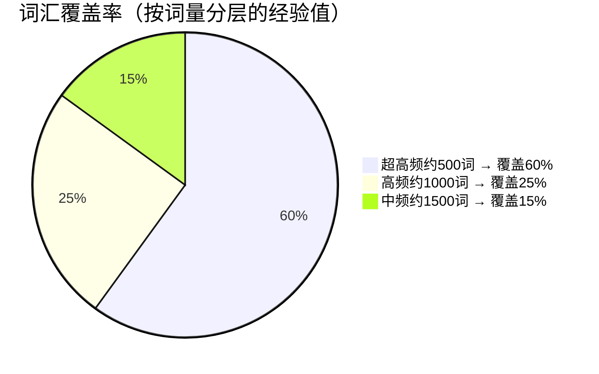

> 📌 **二八法则**：背好最核心的 500 词就能读懂约 60% 的卷面内容——先精背"四会"，再滚动扩量。

---

### 二、超高频约 500 词（完整分类表）

> 记法：单词 · 词性缩写 · 中文；括号内为常考搭配/提示。  
> `v.` 动词 `n.` 名词 `adj.` 形容词 `adv.` 副词 `prep.` 介词 `conj.` 连词 `phr.` 短语

#### 1. 核心动词（约 120）

| # | 单词 | 中文 / 提示 |
|---:|:---|:---|
| 1 | achieve | 实现（achieve a goal） |
| 2 | affect | v.影响（别写成 effect） |
| 3 | afford | 负担得起 |
| 4 | allow | 允许（allow sb to do） |
| 5 | appear | 出现；似乎 |
| 6 | apply | 申请 apply for；应用 apply to |
| 7 | appreciate | 感激；欣赏 |
| 8 | approach | v.接近；n.方法 |
| 9 | argue | 争论；主张 |
| 10 | arrange | 安排 |
| 11 | assume | 假定；承担 |
| 12 | avoid | 避免（avoid doing） |
| 13 | base | 以…为基础（be based on） |
| 14 | belong | 属于（belong to） |
| 15 | benefit | v./n.有益；好处 |
| 16 | blame | 责备（blame sb for） |
| 17 | borrow | 借入 |
| 18 | bother | 打扰；费心 |
| 19 | break | 打破；违反 |
| 20 | bring | 带来（bring about 导致） |
| 21 | build | 建造；培养 |
| 22 | calculate | 计算 |
| 23 | cause | 导致；原因 |
| 24 | celebrate | 庆祝 |
| 25 | challenge | v./n.挑战 |
| 26 | change | 改变 |
| 27 | choose | 选择 |
| 28 | claim | 声称；索赔 |
| 29 | collect | 收集 |
| 30 | combine | 结合（combine with） |
| 31 | compare | 比较（compare with/to） |
| 32 | compete | 竞争（compete with） |
| 33 | complain | 投诉（complain about） |
| 34 | complete | 完成；完整的 |
| 35 | concentrate | 集中（concentrate on） |
| 36 | concern | 涉及；担忧（be concerned about） |
| 37 | conclude | 得出结论 |
| 38 | conduct | 进行（conduct a survey） |
| 39 | confirm | 确认 |
| 40 | consider | 考虑（consider doing） |
| 41 | consist | 由…组成（consist of） |
| 42 | contain | 包含 |
| 43 | continue | 继续 |
| 44 | contribute | 贡献；促成（contribute to） |
| 45 | control | 控制 |
| 46 | convince | 说服（convince sb of/that） |
| 47 | correct | 纠正；正确的 |
| 48 | create | 创造 |
| 49 | criticise / criticize | 批评 |
| 50 | decide | 决定（decide to do） |
| 51 | decline | 宣布；声明 |
| 52 | decrease | 减少 |
| 53 | defend | 防卫；辩护 |
| 54 | define | 定义 |
| 55 | deliver | 递送；发表（演讲） |
| 56 | demand | 要求；需求 |
| 57 | demonstrate | 证明；演示 |
| 58 | depend | 依赖（depend on） |
| 59 | describe | 描述 |
| 60 | design | 设计 |
| 61 | destroy | 摧毁 |
| 62 | determine | 决定；测定 |
| 63 | develop | 发展；开发 |
| 64 | differ | 不同（differ from） |
| 65 | discover | 发现 |
| 66 | discuss | 讨论 |
| 67 | display | 展示 |
| 68 | divide | 划分（divide into） |
| 69 | doubt | 怀疑 |
| 70 | earn | 赚得；赢得 |
| 71 | educate | 教育 |
| 72 | enable | 使能够（enable sb to do） |
| 73 | encourage | 鼓励 |
| 74 | enjoy | 享受（enjoy doing） |
| 75 | ensure | 确保 |
| 76 | enter | 进入；报名 |
| 77 | equip | 配备（equip with） |
| 78 | establish | 建立 |
| 79 | estimate | 估计 |
| 80 | examine | 检查；考试 |
| 81 | exist | 存在 |
| 82 | expect | 期望（expect to do） |
| 83 | experience | v.经历；n.经验/经历 |
| 84 | explain | 解释 |
| 85 | express | 表达 |
| 86 | fail | 失败；未能（fail to do） |
| 87 | focus | 聚焦（focus on） |
| 88 | force | 强迫（force sb to do） |
| 89 | form | 形成；表格 |
| 90 | function | 起作用；功能 |
| 91 | gain | 获得 |
| 92 | gather | 聚集 |
| 93 | generate | 产生 |
| 94 | grow | 成长；增长 |
| 95 | handle | 处理 |
| 96 | identify | 识别；认同 |
| 97 | ignore | 忽视 |
| 98 | imagine | 想象 |
| 99 | improve | 改善 |
| 100 | include | 包括 |
| 101 | increase | 增加 |
| 102 | indicate | 表明 |
| 103 | influence | 影响 |
| 104 | inform | 通知（inform sb of） |
| 105 | insist | 坚持（insist on / that） |
| 106 | intend | 打算（intend to do） |
| 107 | introduce | 介绍；引进 |
| 108 | involve | 涉及（be involved in） |
| 109 | judge | 判断 |
| 110 | keep | 保持（keep doing） |
| 111 | lack | 缺乏 |
| 112 | lead | 导致（lead to） |
| 113 | learn | 学习（learn from） |
| 114 | limit | 限制 |
| 115 | maintain | 维持 |
| 116 | manage | 设法做成（manage to do）；管理 |
| 117 | measure | 测量；措施 |
| 118 | mention | 提到 |
| 119 | mind | 介意；头脑 |
| 120 | notice | 注意到；通知 |
| 121 | obtain | 获得 |
| 122 | occur | 发生（occur to sb） |
| 123 | offer | 提供 |
| 124 | operate | 操作；动手术 |
| 125 | organize | 组织 |
| 126 | perform | 执行；表演 |
| 127 | persuade | 说服（persuade sb to do） |
| 128 | prefer | 更喜欢（prefer to / prefer A to B） |
| 129 | prepare | 准备（prepare for） |
| 130 | prevent | 防止（prevent sb from doing） |
| 131 | produce | 生产；引起 |
| 132 | promote | 促进；晋升 |
| 133 | protect | 保护（protect from） |
| 134 | prove | 证明 |
| 135 | provide | 提供（provide sb with sth） |
| 136 | publish | 出版 |
| 137 | pursue | 追求 |
| 138 | raise | 提高；筹集；抚养（及物） |
| 139 | range | 达到；实现 |
| 140 | receive | 收到 |
| 141 | recognise / recognize | 认出；承认 |
| 142 | recommend | 推荐 |
| 143 | reduce | 减少 |
| 144 | refer | 指；查阅（refer to） |
| 145 | reflect | 反映；反思 |
| 146 | refuse | 拒绝 |
| 147 | regard | 视为（regard as） |
| 148 | regret | 后悔（regret doing / to do） |
| 149 | relate | 相关（be related to） |
| 150 | remain | 仍然是；剩余 |
| 151 | remind | 提醒（remind sb of） |
| 152 | remove | 移除 |
| 153 | replace | 替换 |
| 154 | represent | 代表 |
| 155 | require | 要求（require sb to do） |
| 156 | research | 研究 |
| 157 | respect | 尊重 |
| 158 | respond | 回应（respond to） |
| 159 | result | 导致（result in）；结果 |
| 160 | reveal | 揭示 |
| 161 | rise | 上升（不及物） |
| 162 | satisfy | 使满意（be satisfied with） |
| 163 | seek | 寻求 |
| 164 | select | 挑选 |
| 165 | share | 分享 |
| 166 | solve | 解决 |
| 167 | spend | 花费（spend time/money on / doing） |
| 168 | suffer | 遭受（suffer from） |
| 169 | suggest | 建议（suggest doing / that） |
| 170 | support | 支持 |
| 171 | survive | 幸存 |
| 172 | tend | 往往（tend to do） |
| 173 | threaten | 威胁 |
| 174 | train | 训练 |
| 175 | treat | 对待；治疗 |
| 176 | trust | 信任 |
| 177 | understand | 理解 |
| 178 | value | 重视；价值 |
| 179 | vary | 变化（vary from） |
| 180 | warn | 警告（warn sb of/about） |

#### 2. 核心形容词（约 90）

| # | 单词 | 中文 / 提示 |
|---:|:---|:---|
| 1 | able | 能够（be able to） |
| 2 | active | 积极的 |
| 3 | actual | 实际的 |
| 4 | additional | 额外的 |
| 5 | afraid | 害怕的 |
| 6 | alive | 活着的 |
| 7 | alone | 独自的 |
| 8 | amazing | 惊人的 |
| 9 | ancient | 古代的 |
| 10 | annual | 每年的 |
| 11 | anxious | 焦虑的（be anxious about） |
| 12 | appropriate | 合适的 |
| 13 | available | 可获得的（be available to） |
| 14 | average | 平均的；普通的 |
| 15 | aware | 意识到（be aware of） |
| 16 | basic | 基本的 |
| 17 | beautiful | 美丽的 |
| 18 | beneficial | 有益的（to） |
| 19 | brief | 简短的 |
| 20 | bright | 明亮的；聪明的 |
| 21 | broad | 宽广的 |
| 22 | careful | 仔细的 |
| 23 | certain | 确定的 |
| 24 | cheap | 便宜的 |
| 25 | clear | 清楚的 |
| 26 | common | 常见的；共同的 |
| 27 | complete | 完整的 |
| 28 | complex | 复杂的 |
| 29 | confident | 自信的 |
| 30 | conscious | 有意识的 |
| 31 | convenient | 方便的 |
| 32 | correct | 正确的 |
| 33 | creative | 有创造力的 |
| 34 | crucial | 关键的 |
| 35 | curious | 好奇的 |
| 36 | current | 当前的 |
| 37 | daily | 每日的 |
| 38 | dangerous | 危险的 |
| 39 | deep | 深的 |
| 40 | different | 不同的 |
| 41 | difficult | 困难的 |
| 42 | digital | 数字的 |
| 43 | direct | 直接的 |
| 44 | eager | 渴望的（be eager to） |
| 45 | easy | 容易的 |
| 46 | economic | 经济的 |
| 47 | effective | 有效的 |
| 48 | efficient | 高效的 |
| 49 | electric | 电的 |
| 50 | empty | 空的 |
| 51 | entire | 整个的 |
| 52 | equal | 平等的 |
| 53 | essential | 必要的 |
| 54 | excellent | 优秀的 |
| 55 | expensive | 昂贵的 |
| 56 | familiar | 熟悉的（be familiar with） |
| 57 | famous | 著名的（be famous for） |
| 58 | final | 最终的 |
| 59 | financial | 金融的 |
| 60 | flexible | 灵活的 |
| 61 | foreign | 外国的 |
| 62 | free | 自由的；免费的 |
| 63 | frequent | 频繁的 |
| 64 | fresh | 新鲜的 |
| 65 | full | 满的 |
| 66 | general | 一般的 |
| 67 | global | 全球的 |
| 68 | great | 伟大的；很大的 |
| 69 | happy | 快乐的 |
| 70 | hard | 努力的；困难的 |
| 71 | healthy | 健康的 |
| 72 | heavy | 重的 |
| 73 | helpful | 有帮助的 |
| 74 | high | 高的 |
| 75 | honest | 诚实的 |
| 76 | huge | 巨大的 |
| 77 | human | 人类的 |
| 78 | immediate | 立即的 |
| 79 | important | 重要的 |
| 80 | independent | 独立的 |
| 81 | individual | 个人的；个体 |
| 82 | industrial | 工业的 |
| 83 | intelligent | 聪明的 |
| 84 | international | 国际的 |
| 85 | large | 大的 |
| 86 | legal | 合法的 |
| 87 | likely | 可能的（be likely to） |
| 88 | limited | 有限的 |
| 89 | local | 当地的 |
| 90 | major | 主要的；专业 |
| 91 | medical | 医疗的 |
| 92 | mental | 精神的 |
| 93 | modern | 现代的 |
| 94 | natural | 自然的 |
| 95 | necessary | 必要的 |
| 96 | negative | 消极的；否定的 |
| 97 | nervous | 紧张的 |
| 98 | normal | 正常的 |
| 99 | obvious | 明显的 |
| 100 | official | 官方的 |
| 101 | online | 在线的 |
| 102 | open | 开放的 |
| 103 | original | 原来的；原创的 |
| 104 | particular | 特别的（in particular） |
| 105 | patient | 有耐心的；病人 |
| 106 | perfect | 完美的 |
| 107 | personal | 个人的 |
| 108 | physical | 身体的；物理的 |
| 109 | pleasant | 令人愉快的 |
| 110 | popular | 受欢迎的 |
| 111 | positive | 积极的 |
| 112 | possible | 可能的 |
| 113 | potential | 潜在的 |
| 114 | practical | 实际的 |
| 115 | previous | 先前的 |
| 116 | primary | 主要的；初级的 |
| 117 | private | 私人的 |
| 118 | professional | 专业的 |
| 119 | public | 公共的 |
| 120 | rapid | 迅速的 |
| 121 | rare | 稀有的 |
| 122 | ready | 准备好的 |
| 123 | real | 真实的 |
| 124 | recent | 最近的 |
| 125 | regular | 有规律的 |
| 126 | relevant | 相关的（to） |
| 127 | reliable | 可靠的 |
| 128 | responsible | 负责的（for） |
| 129 | rich | 富裕的；丰富的 |
| 130 | safe | 安全的 |
| 131 | serious | 严重的；认真的 |
| 132 | several | 几个 |
| 133 | similar | 相似的（to） |
| 134 | simple | 简单的 |
| 135 | single | 单一的；单身的 |
| 136 | social | 社会的 |
| 137 | special | 特殊的 |
| 138 | specific | 具体的 |
| 139 | standard | 标准的；标准 |
| 140 | strong | 强壮的 |
| 141 | successful | 成功的 |
| 142 | sudden | 突然的 |
| 143 | sufficient | 充足的 |
| 144 | suitable | 合适的（for） |
| 145 | surprising | 令人惊讶的 |
| 146 | technical | 技术的 |
| 147 | traditional | 传统的 |
| 148 | typical | 典型的 |
| 149 | useful | 有用的 |
| 150 | various | 各种各样的 |
| 151 | vast | 广阔的 |
| 152 | vital | 至关重要的 |
| 153 | wealthy | 富裕的 |
| 154 | wide | 宽的 |
| 155 | willing | 愿意的（be willing to） |
| 156 | wise | 明智的 |
| 157 | worth | 值得（be worth doing） |
| 158 | young | 年轻的 |
| 159 | widespread | 广泛的 |
| 160 | significant | 显著的；重要的 |

#### 3. 核心名词（约 140）

| # | 单词 | 中文 / 提示 |
|---:|:---|:---|
| 1 | ability | 能力 |
| 2 | access | 通道；使用权（have access to） |
| 3 | accident | 事故 |
| 4 | account | 账户；叙述（on account of） |
| 5 | achievement | 成就 |
| 6 | action | 行动（take action） |
| 7 | activity | 活动 |
| 8 | advantage | 优势（take advantage of） |
| 9 | advice | 建议（不可数） |
| 10 | age | 年龄；时代 |
| 11 | aim | 目标 |
| 12 | amount | 数量（an amount of） |
| 13 | analysis | 分析 |
| 14 | animal | 动物 |
| 15 | answer | 答案 |
| 16 | application | 申请；应用 |
| 17 | area | 区域；领域 |
| 18 | argument | 论点；争论 |
| 19 | art | 艺术 |
| 20 | article | 文章；物品 |
| 21 | attention | 注意（pay attention to） |
| 22 | attitude | 态度（towards/to） |
| 23 | audience | 观众；听众 |
| 24 | authority | 权威；当局 |
| 25 | balance | 平衡 |
| 26 | behavior / behaviour | 行为 |
| 27 | benefit | 好处 |
| 28 | business | 商业；事务 |
| 29 | career | 职业 |
| 30 | case | 情况；案例（in case） |
| 31 | cause | 原因 |
| 32 | chance | 机会 |
| 33 | change | 变化 |
| 34 | character | 性格；人物 |
| 35 | choice | 选择 |
| 36 | city | 城市 |
| 37 | class | 班级；阶层 |
| 38 | climate | 气候 |
| 39 | college | 学院 |
| 40 | communication | 交流 |
| 41 | community | 社区 |
| 42 | company | 公司；陪伴 |
| 43 | competition | 竞争；比赛 |
| 44 | condition | 条件；状况 |
| 45 | confidence | 信心 |
| 46 | connection | 联系 |
| 47 | consequence | 后果（as a consequence） |
| 48 | consumer | 消费者 |
| 49 | contact | 联系（keep in contact） |
| 50 | content | 内容；满足的 |
| 51 | control | 控制 |
| 52 | conversation | 对话 |
| 53 | country | 国家；乡村 |
| 54 | course | 课程；过程（of course） |
| 55 | culture | 文化 |
| 56 | customer | 顾客 |
| 57 | data | 数据 |
| 58 | decision | 决定 |
| 59 | degree | 程度；学位 |
| 60 | demand | 需求 |
| 61 | department | 部门 |
| 62 | design | 设计 |
| 63 | development | 发展 |
| 64 | difference | 差异 |
| 65 | difficulty | 困难 |
| 66 | direction | 方向 |
| 67 | discussion | 讨论 |
| 68 | disease | 疾病 |
| 69 | duty | 职责（on duty） |
| 70 | earth | 地球 |
| 71 | economy | 经济 |
| 72 | education | 教育 |
| 73 | effect | n.效果；影响（have an effect on） |
| 74 | effort | 努力（make efforts） |
| 75 | employee | 雇员 |
| 76 | energy | 能量；精力 |
| 77 | environment | 环境 |
| 78 | equipment | 设备（不可数） |
| 79 | event | 事件 |
| 80 | evidence | 证据 |
| 81 | example | 例子（for example） |
| 82 | experience | 经验；经历 |
| 83 | expert | 专家 |
| 84 | fact | 事实（in fact） |
| 85 | factor | 因素 |
| 86 | failure | 失败 |
| 87 | family | 家庭 |
| 88 | feature | 特征 |
| 89 | field | 领域；田野 |
| 90 | figure | 数字；人物；认为 |
| 91 | focus | 焦点 |
| 92 | food | 食物 |
| 93 | force | 力量；武力 |
| 94 | form | 形式；表格 |
| 95 | freedom | 自由 |
| 96 | friend | 朋友 |
| 97 | future | 未来 |
| 98 | goal | 目标 |
| 99 | government | 政府 |
| 100 | growth | 增长 |
| 101 | habit | 习惯 |
| 102 | health | 健康 |
| 103 | history | 历史 |
| 104 | idea | 想法 |
| 105 | identity | 身份 |
| 106 | impact | 影响（have an impact on） |
| 107 | importance | 重要性 |
| 108 | income | 收入 |
| 109 | increase | 增加 |
| 110 | industry | 工业；行业 |
| 111 | influence | 影响 |
| 112 | information | 信息（不可数） |
| 113 | interest | 兴趣；利益 |
| 114 | internet | 互联网 |
| 115 | interview | 面试；采访 |
| 116 | issue | 问题；议题 |
| 117 | item | 项目；条款 |
| 118 | job | 工作 |
| 119 | knowledge | 知识（不可数） |
| 120 | language | 语言 |
| 121 | law | 法律 |
| 122 | leader | 领导者 |
| 123 | learning | 学习 |
| 124 | level | 水平 |
| 125 | life | 生活；生命 |
| 126 | limit | 限度 |
| 127 | list | 列表 |
| 128 | loss | 损失 |
| 129 | majority | 大多数 |
| 130 | management | 管理 |
| 131 | market | 市场 |
| 132 | material | 材料；物质的 |
| 133 | matter | 事情；要紧 |
| 134 | meaning | 意义 |
| 135 | measure | 措施 |
| 136 | media | 媒体 |
| 137 | member | 成员 |
| 138 | memory | 记忆 |
| 139 | method | 方法 |
| 140 | mind | 头脑；介意 |
| 141 | model | 模型；模特 |
| 142 | moment | 片刻 |
| 143 | money | 钱 |
| 144 | nature | 自然；本性 |
| 145 | need | 需要 |
| 146 | network | 网络 |
| 147 | news | 新闻（不可数） |
| 148 | number | 数字；数量 |
| 149 | object | 物体；反对 |
| 150 | opportunity | 机会 |
| 151 | option | 选项 |
| 152 | order | 顺序；订单；命令 |
| 153 | organization | 组织 |
| 154 | part | 部分（play a part） |
| 155 | partner | 伙伴 |
| 156 | performance | 表现；表演 |
| 157 | period | 时期 |
| 158 | person | 人 |
| 159 | phenomenon | 现象 |
| 160 | plan | 计划 |
| 161 | plant | 植物；工厂 |
| 162 | point | 要点；分数（point out） |
| 163 | policy | 政策 |
| 164 | population | 人口 |
| 165 | position | 职位；位置 |
| 166 | power | 力量；权力 |
| 167 | practice | 练习；实践 |
| 168 | pressure | 压力 |
| 169 | price | 价格 |
| 170 | problem | 问题 |
| 171 | process | 过程 |
| 172 | product | 产品 |
| 173 | progress | 进步 |
| 174 | project | 项目 |
| 175 | purpose | 目的（on purpose） |
| 176 | quality | 质量 |
| 177 | quantity | 数量 |
| 178 | question | 问题 |
| 179 | range | 范围；射程 |
| 180 | rate | 比率；速度 |
| 181 | reason | 原因 |
| 182 | relationship | 关系 |
| 183 | research | 研究 |
| 184 | resource | 资源 |
| 185 | respect | 尊重 |
| 186 | response | 回应 |
| 187 | responsibility | 责任 |
| 188 | result | 结果 |
| 189 | risk | 风险 |
| 190 | role | 角色（play a role） |
| 191 | rule | 规则 |
| 192 | safety | 安全 |
| 193 | salary | 薪水 |
| 194 | science | 科学 |
| 195 | service | 服务 |
| 196 | skill | 技能 |
| 197 | society | 社会 |
| 198 | solution | 解决方案 |
| 199 | source | 来源 |
| 200 | space | 空间；太空 |
| 201 | staff | 员工（集合） |
| 202 | standard | 标准 |
| 203 | state | 状态；州；陈述 |
| 204 | statement | 陈述 |
| 205 | step | 步骤 |
| 206 | strategy | 策略 |
| 207 | strength | 力量；长处 |
| 208 | stress | 压力；强调 |
| 209 | structure | 结构 |
| 210 | student | 学生 |
| 211 | study | 学习；研究 |
| 212 | success | 成功 |
| 213 | suggestion | 建议 |
| 214 | supply | 供应 |
| 215 | support | 支持 |
| 216 | system | 系统 |
| 217 | task | 任务 |
| 218 | teacher | 教师 |
| 219 | technology | 技术 |
| 220 | tendency | 趋势 |
| 221 | term | 学期；术语（in terms of） |
| 222 | theory | 理论 |
| 223 | thing | 事物 |
| 224 | thought | 想法 |
| 225 | time | 时间（on time / in time） |
| 226 | tool | 工具 |
| 227 | topic | 话题 |
| 228 | trade | 贸易 |
| 229 | tradition | 传统 |
| 230 | traffic | 交通 |
| 231 | training | 培训 |
| 232 | transport | 运输 |
| 233 | treatment | 治疗；对待 |
| 234 | trend | 趋势 |
| 235 | trouble | 麻烦（have trouble doing） |
| 236 | type | 类型 |
| 237 | understanding | 理解 |
| 238 | university | 大学 |
| 239 | value | 价值 |
| 240 | variety | 多样性（a variety of） |
| 241 | view | 观点；景色（in my view） |
| 242 | voice | 声音 |
| 243 | way | 方式（in this way） |
| 244 | weakness | 弱点 |
| 245 | wealth | 财富 |
| 246 | weather | 天气 |
| 247 | website | 网站 |
| 248 | work | 工作；作品 |
| 249 | world | 世界 |
| 250 | youth | 青年；青春 |

#### 4. 副词 / 介词 / 连词 / 功能词（约 50）

| # | 单词 | 中文 / 提示 |
|---:|:---|:---|
| 1 | actually | 实际上 |
| 2 | almost | 几乎 |
| 3 | already | 已经 |
| 4 | also | 也 |
| 5 | always | 总是 |
| 6 | among | 在…之中（三者以上） |
| 7 | around | 大约；周围 |
| 8 | as | 作为；因为；当 |
| 9 | because | 因为 |
| 10 | before | 在…之前 |
| 11 | besides | 此外 |
| 12 | between | 在…之间（两者） |
| 13 | beyond | 超出 |
| 14 | carefully | 仔细地 |
| 15 | certainly | 当然 |
| 16 | clearly | 清楚地 |
| 17 | completely | 完全地 |
| 18 | currently | 目前 |
| 19 | directly | 直接地 |
| 20 | during | 在…期间 |
| 21 | easily | 容易地 |
| 22 | either | 也（不）；任一 |
| 23 | especially | 尤其 |
| 24 | eventually | 最终 |
| 25 | exactly | 确切地 |
| 26 | finally | 最后 |
| 27 | however | 然而 |
| 28 | immediately | 立刻 |
| 29 | increasingly | 日益 |
| 30 | instead | 反而（instead of） |
| 31 | just | 刚刚；仅仅 |
| 32 | mainly | 主要地 |
| 33 | nearly | 几乎 |
| 34 | never | 从不 |
| 35 | normally | 通常 |
| 36 | often | 经常 |
| 37 | only | 仅仅 |
| 38 | particularly | 特别地 |
| 39 | perhaps | 或许 |
| 40 | probably | 大概 |
| 41 | quickly | 快速地 |
| 42 | rather | 相当；而不是（rather than） |
| 43 | recently | 最近 |
| 44 | seriously | 严肃地 |
| 45 | simply | 简单地 |
| 46 | slightly | 轻微地 |
| 47 | sometimes | 有时 |
| 48 | still | 仍然 |
| 49 | suddenly | 突然 |
| 50 | therefore | 因此 |
| 51 | though | 虽然 |
| 52 | through | 通过 |
| 53 | thus | 因此 |
| 54 | together | 一起 |
| 55 | usually | 通常 |
| 56 | well | 好地；健康 |
| 57 | whether | 是否 |
| 58 | within | 在…之内 |
| 59 | without | 没有 |
| 60 | yet | 尚未；然而 |

#### 5. 高频短语 / 固定搭配（约 50）

| # | 短语 | 中文 |
|---:|:---|:---|
| 1 | according to | 根据 |
| 2 | as a result | 结果 |
| 3 | as well as | 以及 |
| 4 | at least | 至少 |
| 5 | be able to | 能够 |
| 6 | be aware of | 意识到 |
| 7 | be based on | 基于 |
| 8 | be famous for | 因…著名 |
| 9 | be fond of | 喜爱 |
| 10 | be interested in | 对…感兴趣 |
| 11 | be proud of | 为…骄傲 |
| 12 | be responsible for | 对…负责 |
| 13 | be used to | 习惯于（+doing） |
| 14 | because of | 因为 |
| 15 | come up with | 想出 |
| 16 | deal with | 处理 |
| 17 | depend on | 依赖 |
| 18 | due to | 由于 |
| 19 | for example / for instance | 例如 |
| 20 | get along with | 与…相处 |
| 21 | give up | 放弃 |
| 22 | in addition | 另外 |
| 23 | in advance | 提前 |
| 24 | in fact | 事实上 |
| 25 | in order to | 为了 |
| 26 | in spite of | 尽管 |
| 27 | instead of | 而不是 |
| 28 | look forward to | 期待（+doing） |
| 29 | make efforts to | 努力去做 |
| 30 | make sure | 确保 |
| 31 | more and more | 越来越 |
| 32 | on the other hand | 另一方面 |
| 33 | pay attention to | 注意 |
| 34 | play a role in | 在…中起作用 |
| 35 | put forward | 提出 |
| 36 | rather than | 而不是 |
| 37 | refer to | 指；查阅 |
| 38 | result in | 导致 |
| 39 | take advantage of | 利用 |
| 40 | take care of | 照顾 |
| 41 | take part in | 参加 |
| 42 | take place | 发生 |
| 43 | thanks to | 多亏 |
| 44 | the number of | …的数量（谓语单数） |
| 45 | a number of | 许多（谓语复数） |
| 46 | used to | 过去常常（+do） |
| 47 | with the development of | 随着…的发展 |
| 48 | would like to | 想要 |
| 49 | at the same time | 同时 |
| 50 | in conclusion | 总之 |

#### 词表体量自检

| 板块 | 约计条数 |
|:---|---:|
| 动词 | ~180 |
| 形容词 | ~160 |
| 名词 | ~250 |
| 功能词 | ~60 |
| 短语 | ~50 |
| **合计（含少量交叉词性）** | **约 500+ 核心条目** |

> 同一词可能在不同板块以不同词性出现（如 benefit、experience），背时按「一词多义 + 搭配」记，不必纠结精确 500 的整数。

---

### 三、高效记忆法

#### 1. 艾宾浩斯滚动

```
第1天：新词 80–100
第2天：复习昨天 + 新词 80–100
第3天：复习前两天 + 新词
第7 / 14 / 30 天：总复习 + 用真题句子检验
```

#### 2. 语境记忆

> ❌ abandon = 放弃  
> ✅ They abandoned the plan due to lack of funding.

#### 3. 词根词缀

| 词缀 | 含义 | 例词 |
|:---|:---|:---|
| re- | 再 | review, rebuild |
| un-/im-/in-/dis- | 否定 | unhappy, impossible, incorrect, disagree |
| -ment | 名词 | development, achievement |
| -tion/-sion | 名词 | education, decision |
| -able/-ible | 可…的 | available, possible |
| -ful | 充满 | helpful, useful |
| -less | 无 | careless, homeless |

#### 4. 主题包（写作/阅读常考）

| 主题 | 核心词 |
|:---|:---|
| 环保 | environment, pollution, protect, recycle, sustainable |
| 工作 | career, employ, interview, position, salary |
| 教育 | education, knowledge, degree, scholarship, campus |
| 健康 | health, disease, treatment, prevent, medical |
| 科技 | technology, digital, internet, innovate, data |
| 校园活动 | contest, exhibition, volunteer, Student Union, notice |

---

### 四、易混词辨析

| 易混组 | 区分 | 例句提示 |
|:---|:---|:---|
| affect / effect | v.影响 / n.效果 | affect mood；have an effect on |
| accept / except | 接受 / 除…外 | accept offer；everyone except Tom |
| principal / principle | 校长；主要的 / 原则 | school principal；moral principles |
| rise / raise | 不及物上升 / 及物提高 | prices rise；raise prices |
| lie / lay | 躺、说谎 / 放置 | lie down；lay the book |
| sensitive / sensible | 敏感 / 明智 | sensitive to criticism；sensible idea |
| economic / economical | 经济上的 / 节约的 | economic growth；economical car |
| historic / historical | 有历史意义的 / 历史上的 | historic event；historical novel |
| hard / hardly | 努力地；硬 / 几乎不 | work hard；hardly any time |
| late / lately | 迟 / 近来 | arrive late；lately I've been busy |

---

### 五、备考建议

#### ✅ 正确做法
- 结合 [历年真题分类与讲解](/guide/sources) 句子背词  
- 核心约 500 词做到「四会」  
- 零碎时间刷词 + 周末用完形检验

#### ❌ 常见误区
- 从 A 背到 Z，不筛选  
- 只背中文不看搭配  
- 背完不复习

---

### 速算口诀

> **大纲三千是底线，高频五百先拿下**  
> **搭配语境不分家，真题例句反复刷**  
> **来源课标加真题，别信玄学红宝书名**

---

### 相关笔记

- [专升本英语考试概述与题型分析](/posts/english/notes/overview)
- [历年真题分类与讲解](/guide/sources)
- 作文模板与高分句型
- 英语知识库

---

<!-- 来源：10-讲义-按节贴/英语/writing.md -->

## 作文模板与高分句型

## ✍️ 作文模板与高分句型

> 广东普通专升本《公共英语》写作 | 应用文主攻 | 约 100 词

---

### 一、基础信息（广东专升本）

| 项目 | 要求 |
|:---|:---|
| 字数 | **约 100 词**（建议实写 90–110） |
| 建议用时 | **25–30 分钟** |
| 满分 | **15 分** |
| 体裁优先级 | **书信 > 通知 > 其它应用文** ≫ 议论文/图表（广东极少） |
| 评分侧重 | 格式正确 + 要点写全 + 语言通顺 + 结构清楚 |
| 署名 | 题目未指定时用 **Li Hua**（切勿写真名） |

**考场提醒：**
1. 先把提示要点勾完，再套模板——漏一点就掉内容分  
2. 过渡句（`Taking all these factors...` 之类）**用一次就够**，别连用两三句空话占字数——字数要留给时间/地点/活动  
3. 写完 30 秒检查：称呼、落款、时态、拼写、要点是否全

---

### 二、必背模板（按你的原版保留，略作格式整理）

#### 📌 模板 A：万能书信（主背 ★★★★★）

**适用：** 邀请 / 申请 / 感谢 / 道歉 / 建议 / 推荐 / 投诉等

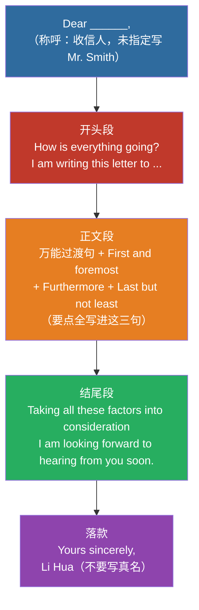

> 📌 **书信格式四件套**：称呼（Dear...）→ 开头（目的句）→ 正文（要点三连）→ 落款（Yours sincerely, + 署名）。**格式正确是应用文评分第一关**，背熟框架再填内容。

```
Dear _________ , (收信人，题目未指定则写 Mr. Smith 或 Mark)

How is everything going? I am writing this letter to express my earnest hope to / recommend _________(填入写信目的，如：invite you to our speech contest / apply for the position of English tutor).

Here are some relevant details about this matter.(万能过渡句)First and foremost, _________(填入细节一：如 the deadline is Nov. 10th).Furthermore, _________(填入细节二：如 it is highly beneficial to us).Last but not least, _________(填入细节三或升华句：如 it will be a meaningful and unforgettable experience).

Taking all these factors into consideration, I sincerely hope you can _________(填入期许，如：accept my invitation / give me an opportunity).I would be highly appreciative if you could take my request into consideration. I am looking forward to hearing from you soon.

Yours sincerely,
Li Hua
(注意：千万不要写自己的真实姓名)
```

##### 书信范文（邀请）

```
Dear Peter,
How is everything going? I am writing this letter to invite you to the exhibition of Traditional Chinese Culture in our school.
Here are some relevant details about this matter. First and foremost, the exhibition will be held next Friday on the third floor of the school library. Furthermore, you can experience the art of paper-cutting yourself and watch a calligraphy show. Last but not least, it will be a meaningful and unforgettable experience.
Taking all these factors into consideration, I sincerely hope you can accept my invitation. I am looking forward to hearing from you soon.
Yours sincerely,
Li Hua
```

> **字数自检：** 本范文 **103 词**（数过），落在建议区间 90–110 内。若提示里有具体时间/地点，优先补进 First / Furthermore 两句，比堆 "meaningful" 更稳。

---

#### 📌 模板 B：NOTICE 通知（主背 ★★★★★）

**适用场景：** 学校、学生会或俱乐部发布活动通知，如音乐周、运动会、英语演讲比赛等。

```
(正中间大写) NOTICE

May I have your attention, please? To enrich our campus life, our school is going to organize _________(填入活动名称，如 a music week).

The event is scheduled to be held in _________(填入地点，如 the school hall)at _________(填入时间，如 2:00 p. m. next Friday).There are many exciting activities waiting for you.(万能凑字句)For one thing, _________(细节一：如 you can enjoy pop music).For another, _________(细节二：如 please bring your own instruments).

Those who are interested in it are highly welcome to participate.(高级句型：极其欢迎感兴趣的同学参加)If you have any questions, please feel free to contact us at 1234567.(万能结尾句)

(右下角发通知的组织，如) The Student Union
(右下角发通知的日期，如) Nov. 10th
```

**格式要点：**
- 标题 `NOTICE` 居中大写  
- 正文写清：活动名 / 时间 / 地点 / 内容 / 欢迎参加 / 联系方式  
- 右下角：组织 + 日期

---

#### 📌 模板 C：图表 / 社会现象（拓展，广东极少考）

**适用场景：** 描述社会热点趋势或图表数据，如大学生沉迷手机、网购的流行、低碳出行等。

```
As is clearly shown in the chart / As we can see in our daily life, the past few years have witnessed a dramatic change in _________(填入现象主题，如 using mobile phones / online shopping).Specifically, this trend is becoming increasingly popular among people.(万能现象补充句)

There are several reasons behind this phenomenon.(引出原因过渡句)First and foremost, _________(填入原因一：如 it is very convenient).Furthermore, _________(填入原因二：如 it saves us a lot of time / we can chat with friends anytime and anywhere).

Taking all these factors into consideration, we can naturally draw the conclusion that _________(填入趋势预测，如：this trend will continue).In my opinion, we should take a rational attitude towards it.(万能高分结尾呼吁：在我看来，我们应该对此采取理性的态度)
```

> ⚠️ **备考优先级：低。** 广东统招公共英语写作主考应用文；本模板仅作备用，冲刺阶段别占主背时间。

---

#### 📌 模板 D：正反观点 / 建议类议论文（拓展，广东极少考）

**适用场景：** 给出两个对立观点让你选择，或者提出一个问题让你给出建议。如：团队合作 vs 独立工作、在校外租房 vs 住校内。

```
Nowadays, there is a heated debate over _________(填入讨论的话题，如 whether students should work part-time).Opinions vary from person to person.(万能开场：如今关于...有激烈的讨论，人们的观点因人而异)

On the one hand, some people argue that _________(填入甲方观点：如 working part-time is beneficial).They believe that _________(解释甲方观点：如 it provides practical experience).On the other hand, others hold the opposite view.(转折句：另一方面，其他人持有相反观点)They point out that _________(填入乙方观点：如 it takes up too much study time).

As far as I am concerned, I am in favor of the former/latter opinion.(表明立场：就我而言，我赞同前者/后者的观点)The reason is that _________(给出自己的理由：如 practical skills are equally important for our future career).Therefore, we should find a proper balance.(万能结尾：因此，我们应该找到一个合适的平衡点)
```

> ⚠️ **备考优先级：低。** 同上，主背书信 + 通知即可。

---

### 三、高频写信目的开头（替换壳，提分用）

| 功能 | 开头句 |
|:---|:---|
| 邀请 | I am writing to invite you to... |
| 申请 | I am writing to apply for the position of... |
| 感谢 | I am writing to express my sincere thanks for... |
| 道歉 | I am writing to apologize for... |
| 建议 | I am writing to offer some suggestions on... |
| 推荐 | I am writing to recommend... to you. |
| 投诉 | I am writing to complain about... |
| 通知目的 | To enrich our campus life, ... is going to be held. |
| 欢迎参加 | Those who are interested are highly welcome to participate. |
| 期盼 | I am looking forward to hearing from you soon. / I am looking forward to your early reply. |

---

### 四、高分小替换（点缀即可，别堆）

| 低分词 | 可换 |
|:---|:---|
| important | crucial / vital / significant / essential |
| good | beneficial / positive |
| bad | harmful / negative |
| many | a large number of / various |
| more and more | increasingly / a growing number of |
| think | believe / hold / argue |
| so | therefore / as a result |
| solve | address / deal with |

#### 常用连接

| 功能 | 词 |
|:---|:---|
| 顺承 | First and foremost / First of all / Furthermore / Last but not least |
| 因果 | Therefore / As a result / Thus |
| 举例 | For one thing... For another... / For example |
| 总结 | Taking all these factors into consideration / In conclusion |

---

### 五、写作流程（约 100 词）

```
Step 1: 审题（2 分钟）——体裁、收信人/组织、要点清单
Step 2: 列点（2 分钟）——目的 1 句 + 细节 2–3 点 + 期许 1 句
Step 3: 套写（15–18 分钟）——直接填模板
Step 4: 检查（3–5 分钟）——格式 / 要点 / 时态 / 拼写 / 字数
```

---

### 六、从 9 分到 13 分：同一封邀请信的逐句批改

> 上面的范文是**成品**，看完只会觉得「写得真好」，但不知道自己写的那篇为什么只有 9 分。
> 这一节反过来：先给你一份**真实水平的中低分稿**，逐句指出扣在哪、为什么扣、怎么改。
> 分数为按常见五档评分制**粗估**（广东专升本作文 15 分，档位制，非逐点扣分），
> 目的是让你看见「同样写完了，分差在哪」，不是官方评分细则。

#### 题目

> 你是李华，写信邀请外教 Peter 参加学校举办的中华传统文化展。
> 要点：① 时间：下周五 ② 地点：学校图书馆三楼 ③ 至少两项活动（剪纸体验、书法展示）④ 表达期待

#### 低分稿（约 66 词，判 9 分）

```
Dear Peter,
I am Li Hua. I want to tell you a thing. Our school will have an exhibition
about Chinese culture. It is very good. You should come.
The exhibition is next Friday. There have many activities. You can see
paper-cutting. It is very interesting and meaningful. I think you will like
it very much.
I hope you can come. Waiting for you.
Li Hua
```

#### 逐句批改

| # | 原句 | 问题 | 改法 |
|:--:|:--|:--|:--|
| 1 | `I want to tell you a thing.` | **口语化 + 中式英语**。`a thing` 指代不明，书信开头要有明确的写信目的句 | `I am writing to invite you to the exhibition of Traditional Chinese Culture in our school.` |
| 2 | `Our school will have an exhibition about Chinese culture.` | 不算错，但和第 1 句重复说了同一件事，白占字数 | 并入第 1 句的目的句 |
| 3 | `It is very good.` | **空话**。评分看「内容是否具体」，`good` 不提供任何信息 | 删掉，字数让给第 6 句的细节 |
| 4 | `You should come.` | 语气像命令。邀请信要用 **hope / would like to** | `I sincerely hope you can come.`（放到结尾） |
| 5 | 缺「地点」 | 🔴 **漏要点 = 直接掉内容分**。题目 4 个要点只写了 3 个 | `It will be held on the third floor of the school library.` |
| 6 | `There have many activities.` | 🔴 **硬语法错**。`there be` 句型不能用 `have`（中文「有」的直译） | `There will be various activities.` |
| 7 | `You can see paper-cutting.` | 只写了 1 项活动，题目要求**至少两项** | `You can try paper-cutting yourself and watch a calligraphy show.` |
| 8 | `It is very interesting and meaningful.` | 又是空话，且 `It` 指代不清（指剪纸还是展览？） | 删掉 |
| 9 | 缺落款 `Yours sincerely,` | 🔴 **格式分**。书信四件套缺一件 | 补 `Yours sincerely,` + `Li Hua` |
| 10 | 全篇 66 词 | 要求约 100 词，**欠 30 多词** ⇒ 内容单薄，通常连带降档 | 补细节（活动具体内容、见面安排）撑到 95–105 |

**扣分归因（粗估）：**

| 维度 | 满分量级 | 本篇 | 原因 |
|:--|:--:|:--:|:--|
| 格式 | 3 | 2 | 缺 `Yours sincerely,` |
| 内容要点 | 5 | 3.5 | 漏「地点」；活动只写 1 项 |
| 语言 | 5 | 2.5 | `There have` 硬错 + 两处空话 + 口语化开头 |
| 结构与字数 | 2 | 1 | 无过渡词，66 词欠量 |

#### 改后稿（103 词，判 13 分）

不用重写一遍 —— 改后稿**就是上面那篇范文**，只多了「地点」那半句。三处实质改动：

| 位置 | 改前（9 分稿） | 改后（13 分稿） | 涨分点 |
|:--|:--|:--|:--|
| 开头 | `I want to tell you a thing.` | `I am writing to invite you to the exhibition...` | 口语 → 书面目的句 |
| 正文 | `There have many activities.` | `There will be various activities.` + 补 `on the third floor of the school library` | 修硬错 + 补漏要点 |
| 结尾 | `Waiting for you.` / 无落款 | `I am looking forward to hearing from you soon.` + `Yours sincerely,` | 补格式四件套 |

> 注意：改后稿**不是重写，是在原稿上动三处**。这三处都不需要多背单词。

#### 三句话总结这篇为什么能涨 4 分

1. **补回漏掉的要点**（地点）——这是唯一「不靠英语水平」就能拿的分。
2. **删掉所有空话**（`It is very good` / `very interesting and meaningful`），把省下的字数换成具体活动。
3. **修掉一个硬语法错**（`There have` → `There will be`）——这类错在阅卷时最刺眼，因为它一眼就能看出。

> 📌 **自查顺序**：先数要点（漏没漏）→ 再查格式（四件套齐没齐）→ 再数字数（够 90 没有）→ 最后才看语法。
> 前三项是「会不会」的问题，语法是「好不好」的问题。**先保底，再争分。**

---

### 速算口诀

> **广东作文约百词，书信通知最对口**  
> **要点写全格式对，套话少用细节够**  
> **署名只用 Li Hua，写完检查不扣分**

---

### 相关笔记

- [专升本英语考试概述与题型分析](/posts/english/notes/overview)
- [历年真题分类与讲解](/guide/sources)
- 高频词汇速记
- 英语知识库

---

# 第三部分　错题本

<!-- 来源：7-错题本-按科贴/英语错题本.md -->

## 英语错题本

本库原按《英语基础与写作》（200 分，英语类专业）建设。
计算机类考《公共英语》（100 分），题型完全不同，已做如下调整：

  已删除：翻译（T2–T5，20 篇）、概要写作（W2，2 篇）、议论文（W3，3 篇）、
          范文库.txt（议论文范文 1.4 万字）、翻译配套题与解析
  已新增：M3-语法填空、M7-短文造句匹配、短文造句匹配配套题 10 题与解析
  已重写：写作-配套题（改为公共英语短文写作 5 题）、写作-答案解析

原版完整备份：`资料/_归档/05-英语-英语类专业版本-2026-10-24.zip`

一、行格式（复制使用）
------------------------------------------------------------
模块 | 题号 | 题型 | 考点编号 | 错因类别 | 一句话错因 | 正确表达 | 复盘次数 | 日期
语法 | 5 | 单选 | E2-2 | A | 主谓一致：就近原则判断错 | Neither he nor I am right. | 0 |
语法 | 15 | 填空 | E4-1 | B | 现在完成时与一般过去时分不清 | I have lived here since 2010. | 0 |
短文造句匹配 | 4 | 选句 | M7 | D | 没认出 finally 的序号线索，把原因句填在结论前 | Finally, review your notes soon after the class. | 0 |
语法填空 | 8 | 填空 | E12-3 | E | 比较级与 more 叠用 | He is taller than me. | 0 |
写作 | 12 | 应用文 | W1-1 | C | 漏写落款 | Yours sincerely, Li Hua | 0 |


二、错因分类（英语专用六类）
------------------------------------------------------------
A 语法规则错（时态、语态、主谓一致、非谓语、从句引导词选错）
B 词汇/搭配错（词义辨析、固定搭配、介词误用）
C 审题失误（看漏 NOT/EXCEPT、漏写应用文格式、字数不达标）
D 语篇衔接错（连接词方向判错、代词指代找不到、位置角色误判）
   ← 短文造句匹配专用，这一类的错必须记"是哪条线索没识别出来"
E 拼写/形式错（单词拼错、名词单复数、动词形式、词性转换）
F 写作结构错（缺主题句、缺过渡、跑题）


三、已建账（示例，做题后自行替换）
------------------------------------------------------------
语法填空 | 复测2 | 填空 | E16-3 | A | 见 or not 仍走两步测试落到 that，未识别 whether 强制搭配 | I don't know whether he will come or not. | 0 | 2026-11-02


四、按模块统计（做完每套题后填）
------------------------------------------------------------
模块 | 总题数 | 错题数 | 错误率 | 错题集中的考点
语法-第01章 | 20 |  |  |
语法-第02章 | 20 |  |  |
语法-第03章 | 20 |  |  |
语法-第04章 | 20 |  |  |
语法-第05章 | 20 |  |  |
语法-第06章 | 20 |  |  |
语法-第07章 | 20 |  |  |
语法-第08章 | 20 |  |  |
语法-第09章 | 20 |  |  |
语法-第10章 | 20 |  |  |
语法-第11章 | 20 |  |  |
语法-第12章 | 20 |  |  |
语法-第13章 | 20 |  |  |
语法-第14章 | 20 |  |  |
语法-第15章 | 20 |  |  |
语法-第16章 | 20 |  |  |
语法-第17章 | 20 |  |  |
语法-第18章 | 20 |  |  |
短文造句匹配 | 10 |  |  | 连接词 / 代词指代 / 词汇复现 / 位置角色
阅读理解 | 15 |  |  | 细节 / 推断 / 词义 / 主旨 / 结构 / 态度
完形填空 | 15 |  |  | 语法形式 / 词义辨析 / 虚词
语法填空 | 10 |  |  | 有提示词（词形）/ 无提示词（虚词）
写作 | 12 |  |  | 句子改写 / 命题短文 / 应用文


五、六类错因的处理办法
------------------------------------------------------------
A 语法规则错 → 回查该考点笔记的"规则"与"例外"，只抄错的那一条，
             并在旁边写一个自己的例句。语法点必须"规则 + 例句"
             一起记，只记规则会用错。

B 词汇/搭配错 → 记入 05-英语/词汇表.txt 的"易混词辨析"或
             "常考短语动词"，每个词写一个完整句子，不写孤立单词。

C 审题失误 → 做题时先圈 NOT / EXCEPT / TRUE / FALSE；
             应用文先默写格式框架（标题 → 称呼 → 正文 → 落款 → 日期），
             写完对照检查一遍。这一条靠习惯。

D 语篇衔接错 → 回到 `模块/M7-短文造句匹配.txt` 的"五类衔接线索"，
             标明这次错在哪一条：①代词指代 ②逻辑连接词 ③词汇复现
             ④句式平行 ⑤位置角色。同一类线索错 2 次以上，
             就把该类线索的判定方法单独抄一张卡片。

E 拼写/形式错 → 单独建一页"我总拼错的词"，每天默写一遍。
             注意 -ed/-ing、单三、复数的不规则变化，
             以及语法填空里的词性转换（success → successful → successfully）。

F 写作结构错 → 对照 `答案解析/写作-答案解析.txt` 每篇范文的【结构拆解】，
             检查自己的作文有没有：点题句、两条理由 + 例证、收束句。
             应用文另查【易错】里的格式项。


六、二刷规则
------------------------------------------------------------
1. 第一次做错 → 当天回查考点笔记，记为复盘次数 1。
2. 隔 3 天重做 → 仍错，复盘次数 +1，并把正确表达默写一遍。
3. 隔 7 天再重做 → 仍错，说明该语法点整块没通，回去重读该章
   全部考点笔记。
4. 同一语法点错 3 次以上，抄成一张"我的死穴"卡片，考前只看这张。


七、待办（本库还缺什么）
------------------------------------------------------------
【2026-10-24 更新】语法填空 / 阅读 / 完形三组专项配套题**已补齐**，共 35 题。

| 板块 | 分值 | 配套题状态 |
|:---|:--:|:---|
| 阅读理解 | 30 分 | ✅ 15 题（3 篇 × 5 题，覆盖考纲六类能力） |
| 完形填空 | 30 分 | ✅ 15 题（1 篇 15 空，覆盖 15 类考点） |
| 语法填空 | 15 分 | ✅ 10 题（1 篇 10 空，6 提示词 + 4 无提示词） |
| 短文造句匹配 | 10 分 | ⚠️ 仅 10 题（2 篇），建议补到 50 题 |
| 写作 | 15 分 | ✅ 12 题（句子改写 7 + 短文写作 5） |
| 公共英语真题 | 100 分 | ❌ `06-全科真题库/公共英语/` 有 2005–2022 原卷，但**零考点映射** |

**下一步优先级**：
1. 公共英语真题考点映射（最大缺口，100 分全部没有映射）
2. 短文造句匹配扩题（10 题 → 50 题）
3. 阅读扩题（3 篇 → 10 篇）

> 现有 35 道专项题只够"过一遍方法"，**不足以形成手感**。
> 真实考试阅读 15 题 + 完形 15 题 + 语法填空 10 题，至少要各做 5 套才有稳定正确率。

============================================================
【配套】模块目录：05-英语/模块/
【配套】考点笔记目录：05-英语/考点笔记/
【配套】题目目录：05-英语/配套题/
【配套】解析目录：05-英语/答案解析/
【配套】词汇表：05-英语/词汇表.txt
```

---

# 第四部分　真题考点分布

<!-- 来源：9-真题映射/英语-真题考点分布-2008至2025.md -->

## 英语 · 真题映射表

## 00 公共英语真题考点分布（2008–2025）

> 用途：回答「**每个题型内部到底考什么、练哪一块最划算**」——不是逐题详解。
> 逐题卷面看 `历年真题/公共英语/20XX.md`；考点笔记看 `05-英语/考点笔记/`（59 篇）。
> 建立：2026-10-25 ｜ **2026-10-25 修订：纳入 2025 卷（此前误判为不可用，已纠正）**

---

### 〇 先说结论（五条）

1. **题型近四年零变化**：阅读 15×2=30 + 选句填空 5×2=10 + 完形 15×2=30 + 语法填空 10×1.5=15 + 写作 15 = 100。
   ⚠️ 但 **2021 及更早是旧大纲**（词汇与语法 30 + 阅读 20 题 + 完形 15 + 写作 15，没有选句填空和语法填空）。
   新旧大纲的分界在 **2022 年**，用旧卷练题可以，对标分值不行。
2. **「七选五」实际是 5 选 5。** 2022、2023、2024、2025 四卷卷面都只有 **A–E 五项、5 个空一一对应**，
   答案各用一次，没有多余干扰项。
   **题型名叫七选五，卷面不是七选五。** 按「7 选 5」练会白练两个干扰项。
   （原卷题头确实写「七选五」，但四年都只抽出 5 个选项，判断为 **F、G 在 PDF 抽取时系统性丢失**。
   真实考试可能是 7 选 5、难度更高，所以**别依赖「刚好够用」的排除法**。）
3. **阅读 30 分里，细节定位题占 73%（44/60）**，四年逐题统计（2022–2025）。
   练「回原文找对应句」的收益，远大于练任何技巧。
4. **语法填空通常是「7 个有提示词 + 3 个无提示词」**（2023、2024、2025 三年一致，2022 是 8+2）。
   **近三年 70% 考词形变化、30% 考虚词。** 这个比例决定背什么，但别把它当固定配比。
5. **篇章结构题四年 0 题。** 不用专门练「文章结构」「段落作用」这类题。

---

### 一、资料可靠性分级

英语是四科里真题资料**最全**的：2008–2025 共 18 年，且近年卷面完整。

| 年份 | 主要文件 | 等级 | 说明 |
|:--|:--|:--:|:--|
| 2008–2019 | `20XX.md` + `20XX-ForestDeer完整版.md` | **A−** | 卷面 OCR，英文题干清晰可读；中文解析可能有乱码 |
| 2020 | `2020.md` + `2020-英语真题-ocr.md` | **B** | `2020.md` 里阅读/完形正文是空壳（只有答案速查），**原文在 `2020-英语真题-ocr.md`**（有微信/公众号水印噪声） |
| 2021 | `2021.md` | **D** | **空壳**：只有词汇语法与答案，阅读和完形正文全是「[内容待补充 — 见本地PDF]」，不可用 |
| 2022–2023 | `20XX.md` | **A** | 卷面完整 + 答案，新大纲格式规整 |
| **2024** | `2024.md` | **A** | 卷面完整，英文原文无 OCR 噪声，**质量最好** |
| **2025** | `2025-ForestDeer试扫.md` | **B+** | **已实测可用**：四模块齐全（阅读 15 题 + 选句填空 5 题 + 完形 15 空 + 语法填空 10 空），35 个选择题答案 + 10 个填词答案全部可抽。文件只有 3.6 KB 是因为 pdftotext 把整段挤成一行、段落起点粘在上一题选项行尾、行尾带分值碎片（`5  2  10`），**不是内容缺失**。清洗管线见 `_reasonix-work/extract_2025.py` |
| 2008–2022 合集 | `2008-2022-英语历年真题集-autotext.md`（235 KB） | B | 合并本，单年文件缺失时的备份 |

> ⚠️ 本表的分值/题型统计**只用 2022、2023、2024、2025 四年**（新大纲格式）。
> 更早年份题型不同（2013 年前多为 Vocabulary and Structure + Reading + Cloze + Writing），**不并入统计**。
>
> ⚠️ **2025 卷曾被本表判为「C 级·试扫件·未采用」，那是错的。** 判据只看了文件字节数（3.6 KB），
> 没数 Passage 数、题号数、答案数。教训：**判某年卷「不可用」之前，先数结构，别看大小。**

---

### 二、题型结构

| 部分 | 题型 | 题量 | 每题 | 小计 | 占比 |
|:--:|:--|--:|--:|--:|--:|
| 一 | 阅读理解 | 15 | 2 | **30** | 30% |
| 二 | 选句填空（卷面称「七选五」） | 5 | 2 | **10** | 10% |
| 三 | 完形填空 | 15 | 2 | **30** | 30% |
| 四 | 语法填空 | 10 | 1.5 | **15** | 15% |
| 五 | 写作（应用文） | 1 | 15 | **15** | 15% |
| | **合计** | **46** | | **100** | |

**阅读 + 完形 = 60 分**，是绝对重心。写作只 15 分且是应用文，**不是议论文**（议论文材料已删，勿再找）。

#### 题号分布（固定）

```
1–15   阅读（3 篇 × 5 题）
16–20   选句填空（5 空）
21–35   完形（15 空）
36–45   语法填空（10 空）
46      写作
```

---

### 三、阅读 15 题：题型分布（四年逐题分类）

#### 统计结果

| 题型 | 2022 | 2023 | 2024 | 2025 | 四年合计 | 占比 | 分值 |
|:--|--:|--:|--:|--:|--:|--:|--:|
| **细节理解** | 11 | 12 | 10 | 11 | **44** | **73.3%** | 约 22 分 |
| 推理判断（含出处） | 2 | 2 | 1 | 0 | 5 | 8.3% | 约 2.5 分 |
| 主旨大意 | 1 | 1 | 2 | 1 | 5 | 8.3% | 约 2.5 分 |
| 态度观点 | 1 | 0 | 1 | 2 | 4 | 6.7% | 约 2 分 |
| 词义猜测 | 0 | 0 | 1 | 1 | 2 | 3.3% | 约 1 分 |
| **篇章结构** | **0** | **0** | **0** | **0** | **0** | **0%** | **0** |
| | 15 | 15 | 15 | 15 | **60** | 100% | 30 |

> 2025 卷是**唯一没有推理判断题的一年**（0 题），但态度观点题翻倍到 2 题。
> 四卷合计后细节题占比仍是 73.3% —— 与三年统计完全一致，说明这个比例非常稳定。

#### 逐题归类（可复核）

**2022**（新年习俗 / T 恤历史 / eDNA 研究）
- 细节：1、2、3、4、6、7、8、9、11、13、14
- 主旨：5（五国庆祝活动的共同目的）
- 推断：10（从 T 恤能看出什么）、15（杂志哪个栏目）
- 态度：12（科学家实验前的态度）

**2023**（社区健身设施 / 森林图书馆 / 幼儿园教育）
- 细节：1、2、3、4、5、6、7、8、9、11、13、14
- 推断：10（文章出处）、12（画线句暗示什么）
- 主旨：15（文章目的）

**2024**（城市农场 / 教室引入自然 / 鸟类研究）
- 细节：1、2、3、4、5、6、7、8、11、13
- 主旨：10（全文主旨）、12（第二段主要讲什么）
- 词义：14（"deteriorated" 词义）
- 推断：15（杂志哪个栏目）
- 态度：9（Dave 对新设施的态度）

**2025**（非传统兼职 / Tim 求学记 / 世界幸福报告）
- 细节：1、2、3、4、5、6、7、8、9、11、13
- 主旨：10（最好的标题）
- 词义：12（"universal" 在 Paragraph 3 的含义）
- 态度：14（Krys 对幸福排名的批评）、15（作者对幸福排名的态度）

> ⚠️ 2025 卷**没有推理判断题**，但态度题出了 2 道，且第 15 题（作者态度 B. Objective）是全卷最难：
> 作者大量引述批评者观点，自己不下判断 —— **「引述 ≠ 立场」**，这是新出现的考法。

#### 三条可执行结论

1. **44/60 是细节题，形态高度固定**：题干里带 `According to Paragraph X`、`At XXX, visitors can ___`、
   `Who/When/Where/How much`，答案就是**原文某一句的同义改写**。
   **练法**：不背技巧，只练「30 秒内定位到那一句」。定位对了就得分。
2. **「文章出处」题三年有、2025 没有**（2022-15、2023-10、2024-15 考「杂志哪个栏目」，2025 缺）。
   2025 换成了**作者态度题**。⇒ 别把「出处题必出」当铁律，**但出处题仍是送分题，认得就行**。
3. **篇章结构题四年全 0**。不用练「这段的作用是什么」「文章怎么组织」。省下来的时间给细节题。

---

### 四、语法填空：7 + 3 是常态，但不是铁律

#### 四年实测

| 年份 | 有提示词（括号给词） | 无提示词（纯空格） |
|:--|:--|:--|
| 2022 | **8** 个（36、37、38、39、40、41、44、45） | **2** 个（42、43） |
| 2023 | **7** 个（36、37、38、39、40、41、42） | **3** 个（43、44、45） |
| 2024 | **7** 个（36、37、38、41、43、44、45） | **3** 个（39、40、42） |
| **2025** | **7** 个（37、38、39、42、43、44、45） | **3** 个（36、40、41） |

**⇒ 近三年都是 70% 考词形变化、30% 考虚词；2022 是 80/20。**
把「7+3」当默认预期可以，**别当成固定配比**——它随卷子难度浮动。

> ⚠️ **2025 第 36 空有个坑**：`responded to 36 call about an accident` —— `call` 紧跟空号，
> 但它**不是提示词**（原文没有括号），36 是**无提示词题，考冠词（答案 a）**。
> 判有/无提示词**只看有没有括号**，别把紧跟的名词误当提示词。

#### 有提示词（7 空）实际考的五类

| 类别 | 2023 例 | 2024 例 | 考法 |
|:--|:--|:--|:--|
| **非谓语动词** | live→**to live**；spend→**spending** | name→**named**；use→**to use** | 判主动/被动、判 to do / doing / done |
| **词性转换（形容词↔副词）** | gradual→**gradually** | deep→**deeply** | 修饰动词用副词 |
| **词性转换（名词→形容词）** | power→**powerful**；excite→**excited** | tire→**tired** | 修饰名词用形容词；-ed 修饰人 |
| **谓语动词时态** | change→**has changed** | see→**saw** | 看时间状语和上下文时态 |
| **名词复数 / 代词** | night→**nights** | member→**members**；I→**myself** | 看限定词和主语 |

#### 无提示词（3 空）实际考的四类

| 类别 | 2023 | 2024 |
|:--|:--|:--|
| **冠词** | such **a** difference | **an** annual charity event |
| **关系代词** | a place **that** was mine | **which** was to run ten kilometers |
| **介词** | — | succeeded **in** organizing |
| **形式主语 it** | how important **it** is to have... | — |

#### 结论

- **优先级：非谓语 > 词性转换 > 谓语时态 > 冠词/关系代词**
- 对应的库内笔记：`05-英语/考点笔记/E*` 里的**非谓语、时态、从句、冠词、词性**几组
- **不要**花时间在「虚拟语气」「倒装」上——两年 20 空里一次没考

---

### 五、选句填空（10 分）：5 选 5，考的是逻辑连接

#### 卷面事实

- **2022、2023、2024、2025 四卷全部是 A–E 五项、5 空（16–20）一一对应**，答案各用一次，**没有多余干扰项**
- 每题 2 分，共 10 分
- 题型名叫「七选五」是**历史叫法**，卷面不是七选五（F、G 在 PDF 抽取时系统性丢失，四年都缺）

#### 四年线索类型实测

| 线索类型 | 2022 | 2023 | 2024 | 2025 | 说明 |
|:--|:--:|:--:|:--:|:--:|:--|
| 词汇复现 | ✔ | ✔ | ✔ | **2** | 空前空后出现同一个词或其变形，最稳 |
| 代词指代 | — | ✔ | — | **1** | 空后出现 he/it/they，空前必须有先行词 |
| 逻辑转折 | ✔ | ✔ | ✔ | 0 | however / instead / but |
| 例证关系 | ✔ | — | ✔ | **1** | 前有判断句，空里是具体数据/例子 |
| 首尾呼应 | ✔ | — | ✔ | **1** | 主旨句放最后收尾 |

**⇒ 2025 卷最吃词汇复现（5 空里占 2 空），且完全没有逻辑转折题。**
练的时候先找**词汇复现**，找不到再看代词，最后才靠语义。

#### 选项特征（2024 实例）

| 选项 | 内容 | 功能 |
|:--|:--|:--|
| A | However, the opposite was not true. | **转折**（对上文的否定） |
| B | Experts think the research result could also apply to children. | **推论/延伸** |
| C | The people in the videos had different expressions while eating. | **细节展开**（解释上文怎么做的） |
| D | A new study has found that other people's likes and dislikes could play a part. | **研究引入**（常作首空） |
| E | This could help experts find ways to encourage young people to eat more healthy foods. | **结论/意义**（常作末空） |

**共同点：每个选项都带明确的逻辑标记**——`However`、`also`、`This could`、`A new study`。
**解题不靠读懂全文，靠抓空前空后的逻辑词。**

#### 练法

1. 先读选项，**给每个选项标一个功能标签**（转折/举例/推论/结论）
2. 再看每个空前后各一句，判断缺哪种功能
3. **最后才通读检查**——顺序反了会浪费时间

> ⚠️ 库里这个题型的题量目前是 **15 道**（2022/2023/2024 各 5 道，目标 50 道），是英语最薄的一块。
> 但好消息：它是**唯一一个「技巧 > 词汇」**的题型，技巧练熟能拿 8 分以上。

---

### 六、写作：15 分，体裁全是应用文

> 数据来自 `历年真题/公共英语/_索引.md`（逐年体裁已登记），本表直接引用，不重复统计。

| 年份 | 体裁 | 年份 | 体裁 |
|:--:|:--|:--:|:--|
| 2012 | 申请信（亚运志愿者） | 2019 | NOTICE 招聘会 |
| 2013 | 介绍校园社团 | 2020 | NOTICE 讲座 |
| 2014 | 劝说信（戒网游） | 2021 | 回复邮件（健身房） |
| 2015 | NOTICE 演讲比赛 | 2022 | 应用文 |
| 2016 | 求职信 | 2023 | 应用文 |
| 2017 | 投诉信 | **2024** | **邀请邮件（写作竞赛）** |
| 2018 | 邀请信（毕业晚会） | | |

**规律：全部是应用文（书信 / 邮件 / NOTICE），议论文从未出现。**

**四类必练**：邀请信、投诉信、求职信、NOTICE。
字数控制 **90–110 词**（索引原文口径；考纲写 100 词左右）。

---

### 七、复习优先级（按分值 × 提分速度排）

| 优先级 | 题型 | 分值 | 理由 | 建议动作 |
|:--:|:--|--:|:--|:--|
| **P0** | 阅读细节题 | 约 22 | 占阅读 73%，靠定位不靠词汇 | 每天 1 篇，只练「定位到那一句」 |
| **P0** | 完形填空 | 30 | 单题型最大分值 | 每天 1 篇，错题进词汇本 |
| **P1** | 语法填空 | 15 | **7:3 规律明确，可短期突破** | 专攻非谓语 + 词性转换 |
| **P1** | 写作 | 15 | 体裁固定四类，模板可套 | 每周 2 篇（书信 + NOTICE） |
| **P2** | 选句填空 | 10 | 技巧型，但题量只有 10 道 | 先把现有 10 道做透 |
| **×** | 篇章结构题 | 0 | **四年 0 题** | 不练 |
| **×** | 议论文写作 | 0 | 从未考过 | 不练（相关材料已删） |
| **×** | 虚拟语气/倒装 | 0 | 语法填空两年 20 空未考 | 不深挖 |

---

### 八、数据缺陷

1. ~~**2025 年未纳入统计**~~ → **已于 2026-10-25 纠正并纳入**。原判「试扫件结构未标准化」是错的：
   四模块齐全、45 个答案全部可抽，清洗后已逐题分类（见 §三 2025 段）。
2. **2008–2013 年题型不同**：多为 Vocabulary and Structure + Reading + Cloze + Writing，
   与现在的五题型结构不可直接比较，**本表未并入**。
3. **阅读题型分类是人工判断**，边界题（如「细节 + 推断」兼具）按主要意图归一类，
   每年最多 1–2 题存在归类争议，**不影响「细节题占七成」的结论**。
4. **完形填空未做逐题考点分类**：完形主要靠词汇量和搭配，分类价值低于阅读，
   且库内已有 `05-英语/词汇表.txt` 可直接背。
   （2025 卷的完形已做错因分类，见 `配套题/完形填空-真题精练-2025.md`：A 词义 8 / B 搭配 3 / C 语法 1 / D 衔接 3。）
5. **语法填空的 7:3 现有三年样本**（2023、2024、2025），比原来两年更可信；2022 是 8:2。
6. **选句填空只有 20 道题**（2022–2025 各 5 道），样本仍偏小，线索分类是归纳不是统计。
7. **2020 卷阅读可用、完形不可用**：完形 OCR 直接从 `was a 52 from his son.` 开始，
   第 51 空所在段落整段丢失，**无法补回**。阅读 20 题已验收（`配套题/阅读理解-真题精练-2020.md`）。
8. **2013–2019 七套卷阅读原文「单词之间没空格」**（`Hewalkedintothestationcafé`），
   机械还原实测只有 92–96% 准确率，且 `in different`/`indifferent` 这类歧义**会改变原意**，
   做学习材料不安全 ⇒ **本表与配套题均未采用这七年**。

---

### 附：与其他文件的关系

| 文件 | 管什么 |
|:--|:--|
| **本表** | 管「**每个题型内部考什么、练哪块**」 |
| `05-英语/模块/M1~M7` | 管「7 个模块的知识本体」 |
| `05-英语/考点笔记/`（59 篇） | 管「单个语法/词汇考点怎么记」 |
| `05-英语/词汇表.txt` | 管「背单词」 |
| `05-英语/范文库.txt` | 管「写作模板 + 8 篇范文」 |
| `历年真题/公共英语/20XX.md` | 管「逐题卷面」 |
| `历年真题/公共英语/_索引.md` | 管「逐年写作体裁 + 刷题顺序」 |
| **`05-英语/配套题/阅读理解-真题精练-2022至2024.md`** | 管「45 道阅读的答案 + 定位句 + 干扰项分析」 |
| **`05-英语/配套题/阅读理解-真题精练-2025.md`** | 管「**最新 15 道**阅读（2025）+ 定位句 + 干扰项分析」 |
| **`05-英语/配套题/阅读理解-真题精练-2020.md`** | 管「20 道旧大纲阅读（4 篇 20 题 40 分），练能力用」 |
| **`05-英语/配套题/短文造句匹配-真题精练-2022至2024.md`** | 管「15 道选句填空的线索类型 + 排除理由」 |
| **`05-英语/配套题/短文造句匹配-真题精练-2025.md`** | 管「2025 的 5 道选句填空」 |
| **`05-英语/配套题/完形填空-真题精练-2022至2024.md`** | 管「45 空的答案 + 错因分类」 |
| **`05-英语/配套题/完形填空-真题精练-2025.md`** | 管「2025 的 15 空」 |
| **`05-英语/配套题/语法填空-真题精练-2022.md`** + `语法填空15篇-真题精练-带考点标注.md` | 管「语法填空 160 空的逐空解析」 |
| **`05-英语/配套题/语法填空-真题精练-2025.md`** | 管「2025 的 10 空」 |
| `资料/电子书蒸馏/04-高数/00-真题考点分布-2003至2026.md` | 同方法论，高数版（章级分值） |
| `资料/电子书蒸馏/00-政治真题考点映射表-2015至2025.md` | 同方法论，政治版（249→64 篇） |

> 三份映射表的**粒度因资料质量而不同**：
> 政治做到「每道主观题落到笔记文件」，高数只到「每章分值」，英语做到「每个题型内部的考点比例」。
> 英语能做得比高数细，是因为**英文 OCR 质量远好于数学公式**。
