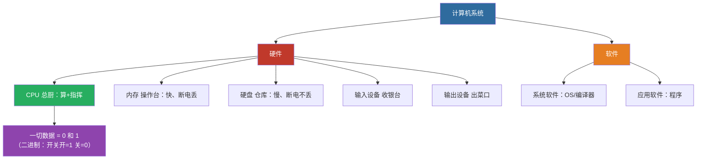
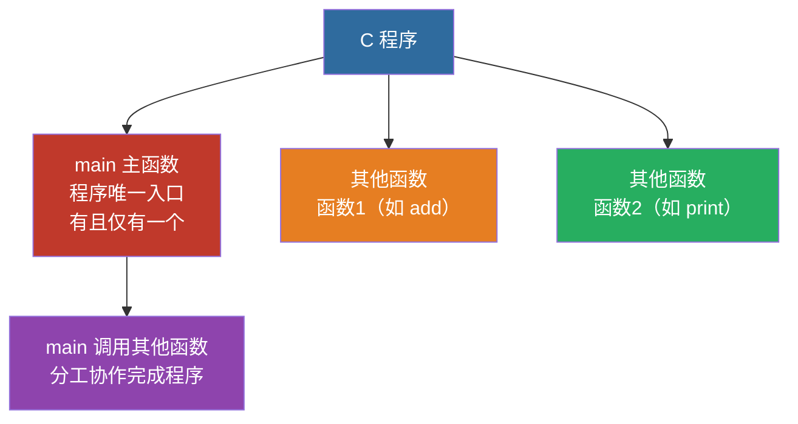
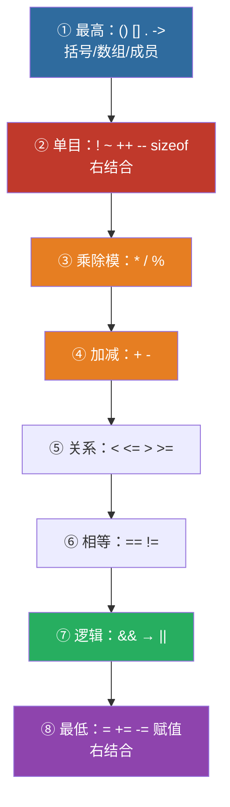
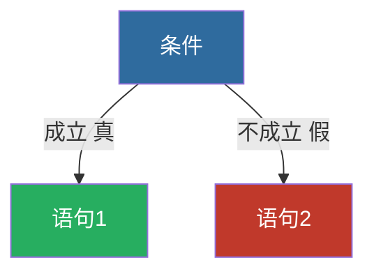
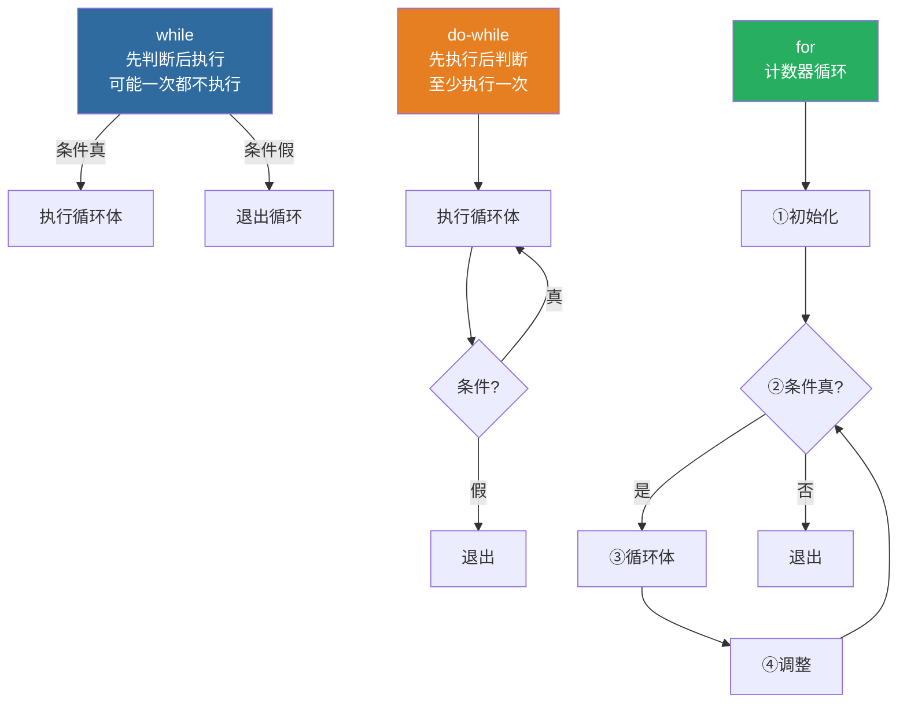
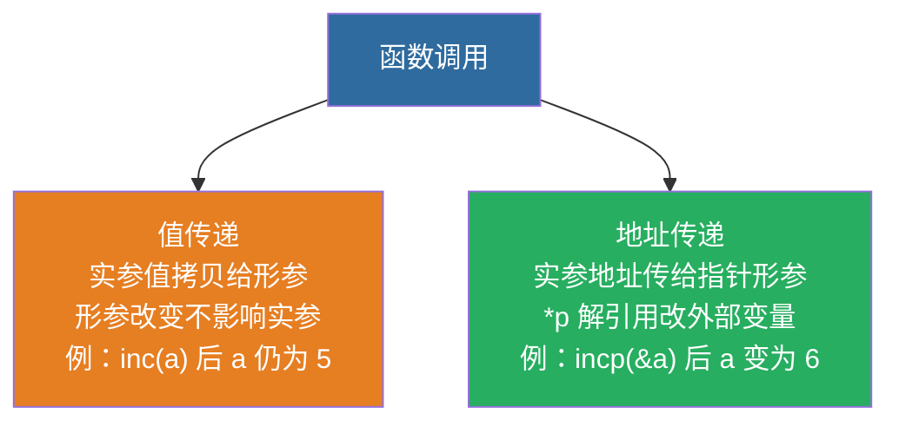
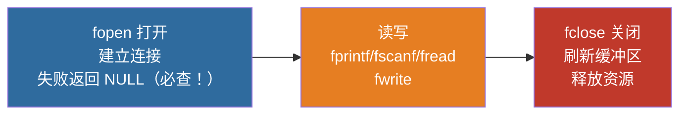
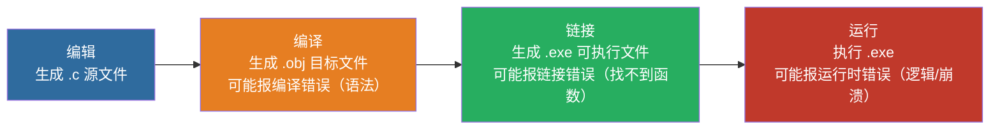
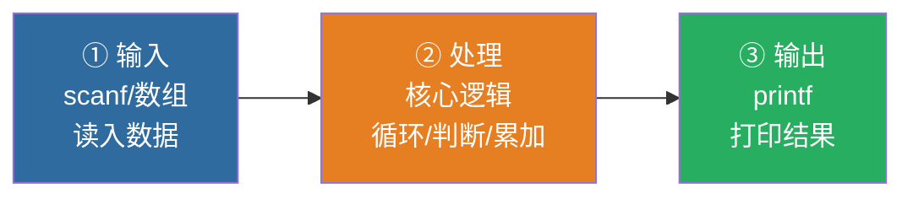

# 计算机基础与程序设计（C 语言 + 数据结构） · 全集

> **这是什么**：考点原文（按章）+ 讲义页（按节）+ 错题本 + 真题考点映射表。**200 分，四科里分值最高。**
> **体量**：约 **1059321 字** / 1.71 MB。
> **怎么用**：
> - 平台有**项目 / 知识库 / 文件上传** → 把这个文件上传进去，**一次就够**，之后所有对话共享，不用再贴。
> - 平台只能**对话框粘贴** → **别贴这个**（太大，会截断）。改贴 `6-考点原文-按章贴` 或 `10-讲义-按节贴` 里的单份小文件。
> **导出于**：2026-11-03

---

## 目录

**第一部分　考点原文（按章）**（32 份）

- 计算机-C第01章.md
- 计算机-C第02章-1of2.md
- 计算机-C第02章-2of2.md
- 计算机-C第03章-1of2.md
- 计算机-C第03章-2of2.md
- 计算机-C第04章.md
- 计算机-C第05章-1of2.md
- 计算机-C第05章-2of2.md
- 计算机-C第06章-1of2.md
- 计算机-C第06章-2of2.md
- 计算机-C第07章-1of3.md
- 计算机-C第07章-2of3.md
- 计算机-C第07章-3of3.md
- 计算机-C第08章-1of2.md
- 计算机-C第08章-2of2.md
- 计算机-C第09章-1of2.md
- 计算机-C第09章-2of2.md
- 计算机-C第10章-1of2.md
- 计算机-C第10章-2of2.md
- 计算机-D第01章.md
- 计算机-D第02章-1of2.md
- 计算机-D第02章-2of2.md
- 计算机-D第03章.md
- 计算机-D第04章.md
- 计算机-D第05章-1of2.md
- 计算机-D第05章-2of2.md
- 计算机-D第06章-1of2.md
- 计算机-D第06章-2of2.md
- 计算机-D第07章.md
- 计算机-D第08章-1of3.md
- 计算机-D第08章-2of3.md
- 计算机-D第08章-3of3.md

**第二部分　讲义（按节）**（42 份）

- 0.0-计算机基础理论.md
- 1.1-C语言概述与基本概念.md
- 1.2-数据的存储与运算.md
- 1.3-顺序程序设计.md
- 1.3a-变量与赋值-零基础.md
- 1.3b-格式化输入输出-零基础.md
- 1.4-选择结构程序设计.md
- 1.4a-选择结构-if语句-零基础.md
- 1.4b-嵌套if与switch-零基础.md
- 1.5-循环结构程序设计.md
- 1.6-数组.md
- 1.6a-数组-零基础.md
- 1.7-函数.md
- 1.7a-函数-零基础.md
- 1.8-指针.md
- 1.8a-指针-零基础.md
- 1.9-结构体与共用体.md
- 1.10-文件操作.md
- 1.11-程序运行环境与调试.md
- 2.1-数据结构基本概念.md
- 2.2-线性表.md
- 2.3-栈和队列.md
- 2.4-串、数组和广义表.md
- 2.4a-串与KMP.md
- 2.5-树和二叉树.md
- 2.5a-二叉树遍历与建树模板.md
- 2.6-图.md
- 2.7-查找.md
- 2.8-排序.md
- 2.9-算法基本概念与分析.md
- 3.0-改错题专项训练.md
- 3.1-高频考点强化练习.md
- 3.2-更多同型练习题.md
- 3.3-编程题做题策略.md
- 3.4-循环与数组综合编程专项.md
- 3.5-指针专项·指针与函数结构体.md
- 3.6-递归与函数设计专项.md
- 高频错题汇总.md
- 全书索引目录.md
- 真题考点分布.md
- pengge-C-指针-二维数组传参.md
- syllabus.md

**第三部分　错题本**（1 份）

- 计算机错题本.md

**第四部分　真题考点映射表**（1 份）

- 计算机-真题考点映射表-2021至2026.md

---

# 第一部分　考点原文（按章）

<!-- 来源：6-考点原文-按章贴/计算机/计算机-C第01章.md -->

## 计算机基础 · C 语言 第01章 程序设计与C语言

### C1-1-程序与程序设计语言

```
【课程】03-计算机
【章节】C第1章　程序设计与C语言
【节】1.1 计算机与程序、程序设计语言
【考点】C1-1　程序与程序设计语言
【考频】★★★★☆
【题型】单选、判断、填空
============================================================

一、结论
------------------------------------------------------------
计算机不是天生自动工作的，它由人们事先编好的程序控制；
人和计算机之间靠"程序设计语言"沟通。
程序设计语言分两代：机器语言（低级）和高级语言。
C 语言的特殊之处在于——它既具有低级语言的特点，又具有高级语言的特点。

二、规则 / 要点
------------------------------------------------------------
（一）计算机与程序的关系
1. 计算机不是天生自动工作的。
2. 计算机由人们事先编好的程序控制。
3. 人和计算机通过程序设计语言沟通。

（二）机器语言（低级语言）
1. 一个型号机器语言的指令的集合，就是机器语言。
2. 机器语言是由 0 和 1 组成的指令。
3. 机器语言紧密依赖于计算机的硬件。
4. 机器语言的五大缺点：难学、难记、难写、难修改、难维护。
5. 机器语言在不同计算机之间互不通用。

（三）高级语言
1. 20 世纪 50 年代出现了高级语言。
2. 高级语言比较接近于人的自然语言（英文）和数学语言。
3. 高级语言的六大优点：直观易学、易理解、易修改、易维护、易推广、通用性强。
4. 用高级语言编写的程序，必须先翻译成机器语言程序，
   此翻译工作由**编译系统**实现。

三、代码示例（可编译）
------------------------------------------------------------
本考点是概念，无代码。但"高级语言必须翻译"这一条，
对应到实际操作就是：写完 .c 文件不能直接运行，必须先编译。
```c
#include <stdio.h>

int main(void) {
    printf("高级语言写的程序，必须先编译才能运行\n");
    return 0;
}
```
编译后生成 .obj，连接后生成 .exe，才能双击运行。

四、易错辨析
------------------------------------------------------------
× 汇编语言是高级语言
√ 汇编语言是低级语言（用助记符代替机器指令，仍与硬件密切相关）

× C 语言是纯高级语言，没有低级特征
√ C 语言既具有低级语言的特点（可直接操作内存、位运算、指针），
  又具有高级语言的特点（结构化、可移植），这是 C 语言最独特的地方

× 高级语言写的程序计算机能直接执行
√ 必须先经编译系统翻译成机器语言程序，计算机才能执行

× 机器语言通用性强
√ 机器语言紧密依赖硬件，不同型号计算机之间互不通用；
  通用性强的是高级语言

五、关键词 / 固定表述
------------------------------------------------------------
机器语言 · 高级语言 · 编译系统 · 0 和 1 组成的指令 ·
紧密依赖硬件 · 互不通用 · 难学难记难写难修改难维护 ·
直观易学易理解易修改易维护易推广通用性强

六、可出题角度
------------------------------------------------------------
· 单选：既具有低级语言特点又具有高级语言特点的语言是（C 语言）
· 单选：计算机能直接识别和执行的语言是（机器语言）
· 判断：高级语言编写的程序可以直接在计算机上运行（错，须先编译）
· 填空：将高级语言翻译成机器语言的系统称为________（编译系统）

============================================================
【原文锚点】C第1章 1.1"计算机与程序、程序设计语言"（computer.txt 第 120–145 行）
```

---

### C1-2-C语言的发展与标准

```
【课程】03-计算机
【章节】C第1章　程序设计与C语言
【节】1.2 C 语言的出现和发展过程
【考点】C1-2　C 语言的发展与标准
【考频】★★★★☆
【题型】单选、填空
============================================================

一、结论
------------------------------------------------------------
C 语言最初是为编写 UNIX 操作系统而设计的，与 UNIX 相辅相成。
它的标准化走过四个节点：1978 年移植推广、1983 年 ANSI C、
1989 年 C89、1999 年 C99。本教材按 C99 标准介绍程序设计。
这一串年份是本章唯一的纯记忆型考点，考法固定，必须背准。

二、规则 / 要点
------------------------------------------------------------
（一）C 语言的出身
1. C 语言是国际上广泛流行的计算机高级语言。
2. 最初的 C 语言只是为编写 UNIX 操作系统提供一种工作语言而设计的。
3. 随着 UNIX 的日益广泛使用，C 语言也迅速得到推广。
4. C 语言和 UNIX 在发展过程中相辅相成。

（二）C 语言的标准化时间线（必背）
| 年份 | 事件 | 要点 |
|:---|:---|:---|
| 1978 年以后 | 移植推广 | 先后移植到大、中、小、微型计算机上，成为世界上应用最广泛的程序设计高级语言 |
| 1983 年 | 83 ANSI C | 美国国家标准化协会（ANSI）制定新的标准草案；比原来的标准 C 有很大发展 |
| 1989 年 | C89 | ANSI 公布新标准 ANSI X3.159-1989，简称 C89 |
| 1999 年 | C99 | ISO 修订，命名为 ISO/IEC 9899:1999，简称 C99；在基本保留原特征的基础上增加了一些面向对象的特征 |

（三）本教材的口径
本教材按照 **C99** 标准的规定介绍程序设计。

（四）C 语言的地位
1. C 语言功能强大、使用灵活，既可用于编写应用软件，又能用于编写系统软件。
2. 学习和使用 C 语言的人越来越多，成了学习和使用人数最多的一种计算机语言。
3. 熟练掌握 C 语言成为计算机开发人员的一项基本功。

三、代码示例（可编译）
------------------------------------------------------------
C 语言"既能写应用软件又能写系统软件"这一点，
体现在它能直接操作内存地址：
```c
#include <stdio.h>

int main(void) {
    int a = 10;
    int *p = &a;            /* 指针：直接持有变量地址 */
    printf("a = %d\n", *p); /* 通过地址访问，这是高级语言少有的能力 */
    printf("&a = %p\n", (void *)p);
    return 0;
}
```
运行结果（地址值因机器而异）：
a = 10
&a = 0x7ffd5c8a9b4c（示例）

四、易错辨析
------------------------------------------------------------
× C 语言是 1983 年由 ANSI 发明的
√ C 语言早在 1970 年代就已出现并为 UNIX 而设计；
  1983 年只是 ANSI 制定了标准草案（83 ANSI C）

× C89 就是 ANSI C
√ 1983 年的叫 83 ANSI C（标准草案）；
  1989 年的叫 ANSI X3.159-1989，简称 C89，是正式标准

× C99 是完全推翻旧标准重写的新语言
√ C99 在基本保留原来 C 语言特征的基础上，增加了一些面向对象的特征

× 本教材按 C89 标准讲解
√ 本教材按 C99 标准讲解

五、关键词 / 固定表述
------------------------------------------------------------
UNIX 操作系统 · 相辅相成 · 1978 年 · 1983 年 ANSI ·
83 ANSI C · 1989 年 ANSI X3.159-1989 · C89 ·
1999 年 ISO/IEC 9899:1999 · C99 · 面向对象特征

六、可出题角度
------------------------------------------------------------
· 单选：C 语言最初是为了编写（UNIX 操作系统）而设计的
· 单选：C99 标准发布于（1999 年）
· 填空：1989 年 ANSI 公布的标准简称________（C89）
· 填空：本教材按照________标准介绍程序设计（C99）
· 判断：C 语言和 UNIX 在发展过程中相辅相成（对）

============================================================
【原文锚点】C第1章 1.2"C 语言的出现和发展过程"（computer.txt 第 146–172 行）
```

---

### C1-3-最简单的C程序结构

```
【课程】03-计算机
【章节】C第1章　程序设计与C语言
【节】1.3 简单的 C 语言程序
【考点】C1-3　最简单的 C 程序结构
【考频】★★★★★
【题型】单选、判断、读程序写结果、填空
============================================================

一、结论
------------------------------------------------------------
一个最简单的 C 程序由三部分组成：
预处理命令（#include）+ 主函数 main + 函数体（一对花括号里的语句）。
这三部分中，**只有 main 函数是必须的**，预处理命令按需写。
理解这一结构，是读懂后面所有 C 代码的前提。

二、规则 / 要点
------------------------------------------------------------
（一）例 1.1：输出一行字符
```c
#include <stdio.h>
void main()
{
    printf("This is a C program.\n");
}
```
逐部分拆解（教材注释框的原话）：
| 部分 | 名称 | 教材原注 |
|:---|:---|:---|
| `#include <stdio.h>` | 预处理命令 | 包含标准输入输出函数库 |
| `main` | 函数的名字 | 表示主函数 |
| `{ }` | 函数体大括号 | C 程序必须有一个 main 函数 |
| `void` | 主函数类型 | 表示无返回值 |
| `printf` | 输出函数 | 输出语句的调用 |
| `\n` | 转义字符 | 换行符 |

（二）例 1.3：求两个整数中的较大者（两函数版）
```c
#include <stdio.h>
void main()
{
    int max(int x, int y);      /* 函数声明 */
    int a, b, c;
    scanf("%d, %d", &a, &b);
    c = max(a, b);
    printf("max=%d\n", c);
}

int max(int x, int y)
{
    int z;
    if (x > y) z = x;
    else z = y;
    return (z);
}
```
两个关键点（教材标注）：
1. `max` 是**被调函数**，`main` 是**主函数**。
2. `max` 函数的定义在 `main` 函数**之后**，所以必须在 main 里先声明
   `int max(int x, int y);`，否则编译报错。
3. `return (z);` 的作用是把 x 和 y 中较大者的值**返回给主函数**。

（三）函数的两个组成部分
1. **函数首部**：例如 `int max(int x, int y)`。
2. **函数体**：
   - 声明部分：定义本函数中用到的变量，以及对本函数所调用函数进行声明；
   - 执行部分：由若干个语句组成。

（四）被调函数的两种来源
1. 库函数（如 printf、scanf、max 若来自库）。
2. 用户编制设计的函数（如上面自己写的 max）。

三、代码示例（可编译）
------------------------------------------------------------
【标准写法：符合 C99，建议考试用这一版】
```c
#include <stdio.h>

int main(void) {
    printf("This is a C program.\n");
    return 0;
}
```
运行结果：
This is a C program.

【教材写法：void main()，老教材常见，考试见到不要判错】
```c
#include <stdio.h>
void main()
{
    printf("This is a C program.\n");
}
```
说明：`void main()` 是早期教材的写法，现代编译器会警告
"return type of 'main' is not 'int'"，但仍能编译通过。
考试中若题目给出 `void main()`，按题目给的写，不要擅自改成 int main。

四、易错辨析
------------------------------------------------------------
× C 程序中可以没有 main 函数，只要有其他函数就行
√ C 源程序必须包含一个 main 函数，且只能有一个

× main 函数必须写在程序最前面
√ main 函数的位置可以放在系统调用的库函数之后的任意位置，
  程序总是从 main 开始执行，与位置无关

× main 函数必须放在所有函数之后
√ 同上，位置自由

× 花括号 { } 只能作为函数体的定界符
√ 花括号还可以作为复合语句的定界符（如 if、for、while 的语句体）

× 所有函数名都可以由用户命名
√ 库函数名（printf、scanf 等）是系统保留的，用户不能重新命名占用

× `printf` 是 C 语言的语句
√ printf 是**库函数**，C 语言本身没有输入输出语句

五、关键词 / 固定表述
------------------------------------------------------------
#include <stdio.h> · main 函数 · 主函数 · 函数体 · 函数首部 ·
函数声明 · 被调函数 · 库函数 · 用户自定义函数 · printf · scanf ·
\n 换行符 · 函数是 C 程序的基本单位

六、可出题角度
------------------------------------------------------------
· 单选：C 语言规定，在一个源程序中，main 函数的位置（可以放在系统库函数之前/之后任意位置）
· 单选：以下叙述中正确的是（注释可以出现在任意合适的地方）
· 读程序写结果：给出例 1.1 代码，问输出什么（This is a C program.）
· 填空：C 程序必须包含一个________函数（main）
· 判断：C 语言本身提供输入输出语句（错，由库函数完成）
· 编程：写一个程序，输入两个整数，输出较大者

============================================================
【原文锚点】C第1章 1.3"简单的 C 语言程序"（computer.txt 第 173–330 行）
```

---

### C1-4-C程序的构成规则

```
【课程】03-计算机
【章节】C第1章　程序设计与C语言
【节】1.3 简单的 C 语言程序（结论部分）
【考点】C1-4　C 程序的构成规则
【考频】★★★★★
【题型】单选、判断、填空
============================================================

一、结论
------------------------------------------------------------
教材在例 1.3 之后给出了七条结论，这七条是 C 语言程序设计的"宪法"。
其中第 1、3、5、6 条是历年选择题的原题落点，必须逐字记住。
记忆口诀：**函数组成、main 入口、分号结尾、无 IO 语句、格式自由、可注释。**

二、规则 / 要点
------------------------------------------------------------
七条结论（教材原文，逐条列出，一条不许漏）：

1. **C 程序是由函数构成的。**
   - C 源程序必须包含一个 main 函数；
   - 可以包含若干个其他函数；
   - 函数是 C 程序的基本单位；
   - 被调函数可以是库函数，也可以是用户编制设计的函数；
   - 程序全部工作都由各个函数分别完成；
   - C 语言容易实现程序的模块化。

2. **一个函数由两个部分组成**：函数首部和函数体。

3. **程序总是从 main 函数开始执行。**
   （与 main 在文件中的位置无关）

4. **C 程序书写格式自由。**
   一行可以写多条语句，一条语句也可以写在多行上。

5. **每个语句和数据声明的最后必须有分号。**
   分号是 C 语句的**必要组成部分**，不是分隔符。

6. **C 语言本身没有输入输出语句。**
   输入和输出操作是由库函数 `scanf` 和 `printf` 来完成的。

7. **可以对程序中的任何一行或数行做注释。**
   `//` 单行注释，`/* */` 多行注释。

三、代码示例（可编译）
------------------------------------------------------------
【演示"格式自由"与"分号必要"】
```c
#include <stdio.h>

int main(void) {
    int a = 3; int b = 4;              /* 一行写两条语句，合法 */
    int c =
        a + b;                          /* 一条语句写两行，合法 */
    printf("%d\n", c)
    ;                                   /* 分号写在下一行，合法但难看 */
    return 0;
}
```
运行结果：7

说明：格式自由≠可以随便省略分号。上例中 `printf("%d\n", c)` 后面
必须有分号，只是分号可以另起一行写。少了分号就报
`error: expected ';' before 'return'`。

【演示"没有 IO 语句"】
```c
#include <stdio.h>   /* 必须包含头文件，才能用 printf/scanf */

int main(void) {
    int x;
    scanf("%d", &x);        /* scanf 是库函数，不是语句 */
    printf("%d\n", x);      /* printf 是库函数，不是语句 */
    return 0;
}
```
若删掉 `#include <stdio.h>`，编译器会警告
`implicit declaration of function 'printf'`，
在严格模式下直接报错。

四、易错辨析
------------------------------------------------------------
× 分号是 C 语句之间的分隔符，不是语句的一部分
√ 分号是 C 语句的**必要组成部分**，每个语句最后必须有分号

× 一个 C 程序可以有多个 main 函数
√ 有且只能有一个 main 函数

× 程序从第一个被定义的函数开始执行
√ 程序总是从 main 函数开始执行

× 一行只能写一条语句
√ 格式自由，一行可写多条，一条也可写多行

× C 语言自带输入输出语句
√ C 语言本身没有输入输出语句，靠库函数 scanf/printf 完成

× 花括号只能用于函数体
√ 还可用于复合语句（if/for/while 的语句体）

五、关键词 / 固定表述
------------------------------------------------------------
函数是 C 程序的基本单位 · 必须包含一个 main 函数 ·
从 main 开始执行 · 书写格式自由 · 分号是语句的必要组成部分 ·
C 语言本身没有输入输出语句 · scanf · printf · 库函数 ·
模块化 · 单行注释 // · 多行注释 /* */

六、可出题角度
------------------------------------------------------------
· 单选：以下叙述中正确的是（C 程序书写格式自由 / 分号是语句一部分 等）
· 单选：C 语言本身（没有）输入输出语句
· 判断：一个 C 源程序必须包含一个 main 函数（对）
· 判断：分号只是语句分隔符（错）
· 填空：C 程序的执行总是从________函数开始（main）
· 改错：给一段缺分号或多分号的代码，找出错误

============================================================
【原文锚点】C第1章 1.3 结论部分（computer.txt 第 331–360 行）
```

---

### C1-5-注释的写法

```
【课程】03-计算机
【章节】C第1章　程序设计与C语言
【节】1.3 简单的 C 语言程序（例 1.2 注释）
【考点】C1-5　注释的写法
【考频】★★★☆☆
【题型】单选、判断
============================================================

一、结论
------------------------------------------------------------
注释是给人看的，对编译和运行不起作用。
C 语言有两种注释：`//` 单行注释、`/* */` 多行注释。
考试常考三个点：注释的位置（任意）、注释是否影响运行（不影响）、
注释能否用汉字（能）。

二、规则 / 要点
------------------------------------------------------------
（一）教材原话（例 1.2 部分，四条）
1. 注释可以用汉字或英文字符表示。
2. 注释只是给人看的，对编译和运行不起作用。
3. 注释可以出现在一行中的最右侧。
4. 注释也可以单独成为一行。

（二）两种注释符号
| 符号 | 名称 | 作用范围 | 能否嵌套 |
|:---|:---|:---|:---|
| `//` | 单行注释 | 从 `//` 到本行末 | 不能 |
| `/* */` | 多行注释（块注释） | 从 `/*` 到 `*/` 之间的全部内容 | **不能嵌套** |

（三）注释的编译期行为
注释在预处理阶段就被替换为一个空格，因此：
- 不参与编译，不生成目标代码；
- 不影响程序的运行结果和运行效率；
- 写多少注释都不会让程序变慢。

三、代码示例（可编译）
------------------------------------------------------------
```c
#include <stdio.h>

/* 这是一个多行注释
   可以写很多行
   注释里写中文完全没问题 */

int main(void) {
    int a = 10;          // 单行注释：写在语句右边
    // 单行注释：单独占一行
    /* 块注释也可以只写一行 */
    printf("a = %d\n", a);   /* 输出 a 的值 */
    return 0;
}
```
运行结果：
a = 10

说明：把上面所有注释删掉，运行结果完全一样——这就是
"注释对编译和运行不起作用"的直接证明。

【错误演示：块注释不能嵌套】
```c
/* 外层注释开始
   /* 内层注释 */     ← 编译器认为外层注释在这里就结束了
   这一行变成了代码，报错
*/
```
这段代码编译会报错，因为 `/* */` 不支持嵌套，
遇到第一个 `*/` 就认为注释结束。

四、易错辨析
------------------------------------------------------------
× 注释会影响程序的运行速度
√ 注释在预处理阶段就被去掉，不参与编译，不影响运行效率

× 注释只能用英文写
√ 可以用汉字或英文字符表示

× 注释只能单独占一行
√ 可以出现在一行中的最右侧，也可以单独成行

× `/* */` 可以嵌套使用
√ 不能嵌套，遇到第一个 `*/` 即结束

× 注释是语句，后面要加分号
√ 注释不是语句，后面不加分号

五、关键词 / 固定表述
------------------------------------------------------------
注释 · 单行注释 // · 多行注释 /* */ · 给人看的 ·
对编译和运行不起作用 · 可以出现在任意合适的地方 · 不能嵌套

六、可出题角度
------------------------------------------------------------
· 单选：以下叙述中正确的是（C 程序中注释部分可以出现在程序中任意合适的地方）
· 判断：注释会影响程序的执行效率（错）
· 判断：块注释可以嵌套（错）
· 填空：C 语言中单行注释的符号是________（//）

============================================================
【原文锚点】C第1章 1.3 例 1.2"注释部分"（computer.txt 第 265–275 行）
```

---

### C1-6-运行C程序的步骤

```
【课程】03-计算机
【章节】C第1章　程序设计与C语言
【节】1.4 运行 C 程序的步骤与方法
【考点】C1-6　运行 C 程序的步骤
【考频】★★★★★
【题型】单选、填空、判断
============================================================

一、结论
------------------------------------------------------------
所谓程序，就是一组计算机能识别和执行的指令。
一个 C 程序从写到跑，必须走四步：
**编辑(.c) → 编译(.obj) → 连接(.exe) → 运行**。
这四个后缀的对应关系是本章考得最死的知识点，
历年真题反复以填空和单选形式出现，务必背成条件反射。

二、规则 / 要点
------------------------------------------------------------
（一）程序的本质
程序，就是一组计算机能识别和执行的指令。

（二）运行 C 程序的四个步骤（教材原文顺序，不可颠倒）
| 步骤 | 操作 | 产物 | 说明 |
|:---:|:---|:---|:---|
| 1 | 上机输入和编辑源程序 | **.c 文件** | 文本文件，人能读懂 |
| 2 | 对源程序进行编译 | **.obj 文件** | 目标程序，二进制 |
| 3 | 进行连接处理 | **.exe 文件** | 可执行程序 |
| 4 | 运行可执行程序 | 运行结果 | 得到输出 |

（三）每步出错怎么办
- 编译出错（语法错误）：修改源程序后**重新编译**。
- 连接出错（缺少库、函数未定义）：检查函数名拼写与库文件。
- 运行结果不对（逻辑错误）：编译器查不出来，只能靠调试和读程序。

（四）VC++ 6.0 的操作路径（教材示例环境）
1. 安装 VC++ 6.0（有英文版和中文版），最好在桌面建快捷方式。
2. File → New（Ctrl+N）→ Files 选项卡 → 选 **C++ Source File**
   → 在 File 框输入文件名如 `c1-1.c` → 在 Location 框选目录 → OK。
3. 在编辑窗口输入源程序，File → Save（Ctrl+S）保存。
4. Build → Compile（编译），生成 .obj；若弹出
   "This build command requires an active project workspace..."
   对话框，选**是(Y)** 创建默认工作区。
5. Build → Build（连接），生成 .exe；输出窗口显示
   `cl-1.obj - 0 error(s), 0 warning(s)` 表示成功。
6. 运行可执行程序，得到结果。
7. 不再操作时，选"文件 → 关闭工作区"结束。

三、代码示例（可编译）
------------------------------------------------------------
以教材例 1.1 为例，完整走一遍四步：
```c
#include <stdio.h>

int main(void) {
    printf("This is a C program.\n");
    return 0;
}
```
| 步骤 | 文件 | 如何确认 |
|:---|:---|:---|
| 编辑 | `c1-1.c` | 保存后能在目录里看到 .c 文件 |
| 编译 | `c1-1.obj` | 编译成功，0 error |
| 连接 | `c1-1.exe` | 生成 .exe，0 error 0 warning |
| 运行 | 输出 `This is a C program.` | 控制台显示该行 |

四、易错辨析
------------------------------------------------------------
× 编译之后直接生成 .exe
√ 编译生成 .obj，**连接**之后才生成 .exe。这是最高频的错点。

× .obj 文件可以直接双击运行
√ 不能，只有 .exe 可执行

× 源程序的后缀是 .cpp
√ C 语言源程序后缀是 .c（.cpp 是 C++ 的）

× 编译通过就说明程序一定正确
√ 编译只查语法错误，逻辑错误查不出来，要运行才能发现

× 步骤顺序可以是 编辑 → 连接 → 编译
√ 必须 编辑 → 编译 → 连接，顺序不可颠倒

五、关键词 / 固定表述
------------------------------------------------------------
一组计算机能识别和执行的指令 · 编辑 · 编译 · 连接 · 运行 ·
.c 源程序 · .obj 目标程序 · .exe 可执行程序 ·
Visual C++ 6.0 · C++ Source File · Compile · Build · 0 error(s)

六、可出题角度
------------------------------------------------------------
· 填空：C 语言所编写的源程序，需要保存在后缀名为____的文件中（.c）
· 填空：C 文件通过编译之后，生成后缀名为____的文件（.obj）
· 填空：C 文件通过编译、连接之后，生成后缀名为____的文件（.exe）
· 单选：下列步骤顺序正确的是（编辑→编译→连接→运行）
· 判断：编译成功后即可直接运行 .obj 文件（错）
· 简答：简述运行一个 C 程序的完整步骤

============================================================
【原文锚点】C第1章 1.4"运行 C 程序的步骤与方法"（computer.txt 第 361–443 行）
```

---

<!-- 来源：6-考点原文-按章贴/计算机/计算机-C第02章-1of2.md -->

## 计算机基础 · C 语言 第02章 数据的存储与运算

### C2-1-数据的二进制存储与补码

```
【课程】03-计算机
【章节】C第2章　数据的存储与运算
【节】2.1 数据在计算机中是怎样存储的（含 2.8.1 求补码的方法）
【考点】C2-1　数据的二进制存储与补码
【考频】★★★★★
【题型】单选、判断、填空
============================================================

一、结论
------------------------------------------------------------
计算机存储器只有"导通"与"截止"两种稳定状态，所以内部信息一律用二进制表示：
导通记作 1，截止记作 0。位（bit）是最小单位，字节（byte）= 8 位是最常用的单位，
存储器以字节为单位编号，编号就是地址。三类数据三种存法：整数存二进制、
实数存指数形式、字符存 ASCII 码；负数一律以补码形式存放。

二、规则 / 要点
------------------------------------------------------------
（一）为什么是二进制（2.1.1）
1. 计算机内部的信息都是用二进制表示。
2. 计算机存储器是用半导体集成电路构成的，有两种稳定的工作状态："导通"与"截止"，
   即电脉冲的"有"与"无"，分别用"1"和"0"表示。
3. 讲义举例：若相邻的 8 个二极管元件中第 1、3、5、7 个元件处于"导通"状态，
   第 2、4、6、8 个元件处于"截止"状态，就用"10101010"表示。

（二）位、字节、地址（2.1.2）
| 名称 | 英文 | 定义 | 地位 |
|:---|:---|:---|:---|
| 位 | bit，又称"比特" | 每一个二极管元件称为一个"二进制位"，值是"1"或"0" | 存储信息的**最小单位** |
| 字节 | byte，又称"拜特" | 一般将 8 个"二进制位"组织成一组 | 人们**最常用**的存储单位 |
| 地址 | address | 操作系统把所有存储单元以字节为单位编号 | 编号即该单元的地址 |

（三）三类数据的存储方式（2.1.3）
1. 整数：一个十进制整数，先转换为二进制形式。如整数 10，以二进制形式表示是 1010。
2. 实数：一律采用**指数形式**存储。123.456 标准化指数形式为 0.123456×10³。
3. 字符：按 **ASCII 代码**存放。'A' 的 ASCII 代码是 65（二进制 1000001）。

（四）补码（2.8.1）
1. 计算机不论对正数还是负数，都按"补码"形式存放到存储单元。
2. 对于正数来说，补码就是该数的"原码"（该数的二进制形式）。
3. 负数的补码**不是**它的原码。
4. 求一个负数的补码，三步：
   ① 取该数（不考虑数的符号）的二进制形式，它就是原码；
   ② 对该原码逐位"取反"（0 变 1，1 变 0），得到"反码"；
   ③ 将得到的反码加 1。
5. 讲义设问"求 -10 的补码"：以 8 位为例，原码 10001010 → 反码 11110101 →
   补码 11110110（十进制 246）。

三、代码示例（可编译）
------------------------------------------------------------
```c
#include <stdio.h>

int main(void) {
    unsigned char a = (unsigned char)-10;   /* 取 -10 的低 8 位，即补码 */
    char c = 'A';
    int n = 10;

    printf("a=%d\n", a);                    /* 无符号解释：246 */
    printf("c=%d,%c\n", c, c);              /* 字符按 ASCII 存：65,A */
    printf("n=%d\n", n);                    /* 整数按二进制存，输出仍按十进制 */
    printf("%d %d\n", (int)sizeof(float), (int)sizeof(double));
    return 0;
}
```
运行结果：
a=246
c=65,A
n=10
4 8

说明：`-10` 的 8 位补码是 11110110，按无符号解释就是 128+64+32+16+4+2 = 246。
若用 16 位存放，补码是 1111111111110110，按无符号解释就是 65526。

四、易错辨析
------------------------------------------------------------
× 字节是存储信息的最小单位
√ 位（bit）才是最小单位；字节是**最常用**的存储单位，1 字节 = 8 位

× 负数的补码就是它的原码
√ 只有正数的补码等于原码；负数的补码要"原码取反再加 1"

× 实数在计算机中也按二进制整数形式存储
√ 实数一律采用指数形式（浮点形式）存储，如 0.123456×10³

× 字符在内存中存的是字形
√ 字符按 ASCII 代码存放，存的是编码，'A' 存的是 65

× 存储单元的地址以位为单位编号
√ 操作系统把所有存储单元以**字节**为单位编号

五、关键词 / 固定表述
------------------------------------------------------------
二进制 · 导通 / 截止 · 位(bit，比特) · 字节(byte，拜特) · 8 个二进制位 ·
存储单元 · 地址 · ASCII 代码 · 指数形式 · 原码 · 反码 · 补码 ·
取反 · 反码加 1 · 存储信息的最小单位 · 最常用的存储单位

六、可出题角度
------------------------------------------------------------
· 单选：计算机内部信息采用二进制表示的原因是（存储元件有两种稳定状态）
· 单选：存储信息的最小单位是（位）；最常用的存储单位是（字节）
· 单选：'A' 的 ASCII 代码是（65）
· 判断：负数的补码等于它的原码（错）
· 判断：实数在计算机中采用指数形式存储（对）
· 填空：求 -10 的 8 位补码（11110110）

============================================================
【原文锚点】C第2章 2.1"数据在计算机中是怎样存储的"（computer.txt 第 458–501 行）、2.8.1"求补码的方法"（第 954–966 行）
```

---

### C2-10-C运算符与表达式

```
【课程】03-计算机
【章节】C第2章　数据的存储与运算
【节】2.7 C 运算符和 C 表达式（含 2.8.5、2.8.6）
【考点】C2-10　C 运算符、C 表达式与优先级
【考频】★★★★★
【题型】单选、判断、读程序写结果、填空
============================================================

一、结论
------------------------------------------------------------
C 的运算符共 13 类，表达式按运算符分为 5 类（算术、关系、逻辑、赋值、逗号）。
运算符有两个属性：**优先级**（不同级先高后低）和**结合性**（同级看方向：
算术运算左结合，赋值运算右结合）。逗号表达式的值是**最后一个表达式的值**，
它的优先级最低，所以 `a=3*5, a*4` 与 `a=(3*5, a*4)` 结果完全不同。

二、规则 / 要点
------------------------------------------------------------
（一）C 运算符 13 类（2.7.1，一个不漏）
| 序号 | 类别 | 符号 |
|:---|:---|:---|
| 1 | 算术运算符 | + - * / % |
| 2 | 关系运算符 | > < == >= <= != |
| 3 | 逻辑运算符 | ! && \|\| |
| 4 | 位运算符 | << >> ~ \| ∧ & |
| 5 | 赋值运算符 | = 及其扩展赋值运算符 |
| 6 | 条件运算符 | ? : |
| 7 | 逗号运算符 | , |
| 8 | 指针运算符 | * & |
| 9 | 求字节数运算符 | sizeof |
| 10 | 强制类型转换运算符 | （类型） |
| 11 | 成员运算符 | . -> |
| 12 | 下标运算符 | [ ] |
| 13 | 其他 | 如函数调用运算符 ( ) |

（二）C 表达式 5 类（2.7.2）
1. 算术表达式，如 2+6.7*3.5+sin(0.5)。
2. 关系表达式，如 x>0、y<z+6。
3. 逻辑表达式，如 x>0 && y>0（表示 x>0 与 y>0 同时成立，&& 是逻辑运算符，代表"与"）。
4. 赋值表达式，如 a=5.6。
5. 逗号表达式，如 a=3, y=4, z=8：用逗号连接若干个表达式，顺序执行这些表达式，
   整个逗号表达式的值是**最后一个表达式的值**（此例为 8）。

（三）优先级与结合性（2.8.6）
1. 先按运算符的优先级别高低次序执行。
2. 如果优先级别相同，则按规定的"结合方向"处理。
3. 左结合性：运算对象先与左边的运算符结合，即自左至右，如 x+y-z。
4. 右结合性：运算对象先与右边的运算符结合，即自右向左，如 a=b=c=d。
5. 常用记忆：`!` > 算术 > 关系 > `&&` > `||` > 赋值 > 逗号。

（四）赋值运算符的右结合
`x = (y = (z = 10) + 5) - 5;` 从右往左算：
z=10 → y=10+5=15 → x=15-5=10，所以 x=10、y=15、z=10。

（五）2.8.5 数据类型一览
讲义此节以图表呈现（PDF 抽取时图形丢失），本节只需记住：
C 语言的数据类型在第 2 章只讲基本类型中的整型、字符型、实型，
数组、指针、结构体分别在第 6、8、9 章展开。

三、代码示例（可编译）
------------------------------------------------------------
```c
#include <stdio.h>

int main(void) {
    int a = 2, b = 3, x, y, z, m;
    float fx = 3.5f, fy = 2.5f;

    m = (a = 3 * 5, a * 4, a + 5);       /* 逗号表达式取最后一个值 */
    printf("m=%d a=%d\n", m, a);

    x = (y = (z = 10) + 5) - 5;          /* 赋值右结合 */
    printf("%d %d %d\n", x, y, z);

    printf("%f\n", (float)(2 + 3) / 2 + (int)fx % (int)fy);
    printf("%d\n", 2 + 3 * 4);
    printf("%d\n", (2 + 3) * 4);
    return 0;
}
```
运行结果：
m=20 a=15
10 15 10
3.500000
14
20

说明：
① 逗号表达式里 a 先被赋成 15，再算 a*4、a+5，整个表达式的值是最后一个 a+5 = 20；
② `(float)(2+3)/2` 得 2.5，`(int)3.5 % (int)2.5` 即 3%2 得 1，相加为 3.5；
③ 最后两行说明 `*` 的优先级高于 `+`，括号能改变运算次序。

四、易错辨析
------------------------------------------------------------
× 执行 `a = 3 * 5, a * 4;` 后 a 的值是 60
√ 逗号优先级最低，等价于 `(a = 3*5), (a*4);`，a 只被赋成 15；
  要让 a 得 60 必须写 `a = (3*5, a*4);`

× 表达式 `1 / 4 + 2.75` 的值是 3
√ 1/4 是整除得 0，0 + 2.75 = 2.75（讲义此判断题答案为"错"）

× `a = b = c = d` 从左往右赋值
√ 赋值运算符右结合，自右向左：先 d 的值给 c，再给 b，再给 a

× 优先级相同时一律从左往右算
√ 同级要看结合方向：算术左结合，赋值右结合

× `x + y - z` 先算 y - z
√ 同级左结合，先算 x + y

× `(a = 3*5) = 3*4` 是合法的赋值表达式
√ 赋值号左边必须是可修改的变量（左值），`(a=3*5)` 是表达式的值，
  不能再被赋值，编译器报错（讲义此处印作"正确"，与 C 语法不符）

五、关键词 / 固定表述
------------------------------------------------------------
13 类运算符 · 算术表达式 · 关系表达式 · 逻辑表达式 · 赋值表达式 ·
逗号表达式 · 优先级 · 结合性 · 左结合 · 右结合 · 自左至右 · 自右向左 ·
最后一个表达式的值 · sizeof · 条件运算符 ?: · 下标运算符 [ ]

六、可出题角度
------------------------------------------------------------
· 单选：设 x、y、z 均为 int 型，执行 x=(y=(z=10)+5)-5 后 x、y、z 的值是（10,15,10）
· 单选：printf("%d", (a=3*5, a*4, a+5)) 的输出是（20）
· 单选：若 int a=2,b=3; float x=3.5,y=2.5; 则 (float)(a+b)/2+(int)x%(int)y 的值是（3.500000）
· 判断：表达式 1/4+2.75 的值是 3（错）
· 判断：逗号表达式的值是第一个表达式的值（错）
· 填空：赋值运算符的结合方向是（自右向左）

============================================================
【原文锚点】C第2章 2.7"C 运算符和 C 表达式"（computer.txt 第 883–952 行）、
2.8.5"数据类型"与 2.8.6"运算符的优先级与结合性"（第 1001–1010 行）
```

---

### C2-2-进制转换与整型常量

```
【课程】03-计算机
【章节】C第2章　数据的存储与运算
【节】2.1.3 不同类型数据的存储方式（含 2.8.2 整型常量的表示形式）
【考点】C2-2　进制转换与整型常量的三种写法
【考频】★★★★★
【题型】单选、判断、填空、读程序写结果
============================================================

一、结论
------------------------------------------------------------
计算机内部只认二进制，人习惯十进制，程序里还常用八进制和十六进制。
四种进制的换算规则只有一条：十进制转其他进制用"除基取余、反向读余"，
其他进制转十进制用"按权展开、逐位累加"。C 语言里**以 0 开头的是八进制**，
**以 0x 开头的是十六进制**，这是命题人最爱设的陷阱。

二、规则 / 要点
------------------------------------------------------------
（一）四种进制
| 进制 | 数字组成 | 书写标志 | 说明 |
|:---|:---|:---|:---|
| 十进制 | 0~9 | 不能以 0 开头 | 日常写法 |
| 二进制 | 0 和 1 | 无 | 计算机内部形式 |
| 八进制 | 0~7 | 开头以 0 开始 | 逢 8 进 1 |
| 十六进制 | 0~9 和 A~F | 开头以 0x 开始 | 逢 16 进 1，用 0~9、a~f 代替 0~15 |

（二）十进制 → 二进制
除以 2，反向取余数，直到商为 0 终止。
例：十进制数 9 对应的二进制是 1001。
| 步骤 | 商 | 余数 |
|:---|:---|:---|
| 9 ÷ 2 | 4 | 1（最低位） |
| 4 ÷ 2 | 2 | 0 |
| 2 ÷ 2 | 1 | 0 |
| 1 ÷ 2 | 0 | 1（最高位） |
反向读余数：1001。

（三）二进制 → 十进制
从右向左每位二进制数依次乘以 2 的 0 次方、1 次方……再累加。
例：1010 = 1×2³ + 0×2² + 1×2¹ + 0×2⁰ = 8 + 0 + 2 + 0 = 10。

（四）十进制 → 八进制、十六进制
讲义的标准例子：十进制数 1699
- 对应的二进制是 11010100011（讲义写作 011010100011，最高位的 0 不影响值）；
- 对应的八进制是 3243（1699 ÷ 8 依次取余：3、4、2、3，反向读）；
- 对应的十六进制是 6A3（1699 = 6×256 + 10×16 + 3，10 记作 A）。

（五）C 语言中整型常量的三种写法（2.8.2）
1. 10 进制整数，如 123，-456。
2. 8 进制整数，特点是逢 8 进 1。**在程序中凡以 0 开头的数都认作 8 进制数**。
3. 16 进制整数，特点是逢 16 进 1。用 0~9、a~f 分别代替 0~15。
   **在程序中凡以 0x 开头的数都认作 16 进制数**。

（六）输出的进制转换
printf 用 %d 输出十进制、%o 输出八进制、%x 输出十六进制，都是把内存里同一个
二进制值按不同进制"翻译"出来，值本身不变。

三、代码示例（可编译）
------------------------------------------------------------
```c
#include <stdio.h>

int main(void) {
    int a = 10;        /* 十进制 10 */
    int b = 012;       /* 以 0 开头：八进制 12，等于十进制 10 */
    int c = 0xA;       /* 以 0x 开头：十六进制 A，等于十进制 10 */
    int n = 1699;

    printf("%d %d %d\n", a, b, c);
    printf("%o %x\n", a, a);
    printf("%d %o %x\n", n, n, n);
    printf("%d\n", 011 + 0x11);
    return 0;
}
```
运行结果：
10 10 10
12 a
1699 3243 6a3
26

说明：`011` 是八进制 11 = 十进制 9，`0x11` 是十六进制 11 = 十进制 17，
9 + 17 = 26。最后一行是本章选择题最常见的"进制混合运算"。

四、易错辨析
------------------------------------------------------------
× `int a = 012;` 中 a 的值是 12
√ 以 0 开头是八进制，012 = 1×8 + 2 = 10

× `018` 是合法的八进制常量
√ 八进制只用 0~7，`018` 非法；同理 `0x1G` 也非法（十六进制只到 f）

× 十进制转二进制"除 2 取余，顺序读余数"
√ 必须**反向**读余数，第一次得到的余数是最低位

× 二进制 1010 的值是 1010
√ 按权展开：8 + 2 = 10

× printf("%x", 10) 输出 10
√ 输出 a（十六进制的 10 记作 a）

五、关键词 / 固定表述
------------------------------------------------------------
二进制 · 八进制 · 十六进制 · 逢 8 进 1 · 逢 16 进 1 · 除 2 取余 ·
反向取余 · 按权展开 · 以 0 开头 · 以 0x 开头 · %d · %o · %x ·
1699 = 3243(八) = 6A3(十六)

六、可出题角度
------------------------------------------------------------
· 单选：以下合法的八进制常量是（012）；以下合法的十六进制常量是（0x2f）
· 单选：十进制数 1699 对应的十六进制是（6A3）
· 单选：表达式 011 + 0x11 的值是（26）
· 判断：在 C 程序中，以 0 开头的整数被认作八进制数（对，讲义原话）
· 读程序写结果：printf("%d %o %x", 10, 10, 10) 的输出
· 填空：十进制 9 的二进制是（1001）

============================================================
【原文锚点】C第2章 2.1.3"不同类型数据的存储方式"（computer.txt 第 488–501 行）、
2.8.2"整型常量的表示形式"（第 967–974 行）；进制换算细节见 computer-gold.txt 第 62–84 行（考点 4）
```

---

### C2-3-整型数据的运算

```
【课程】03-计算机
【章节】C第2章　数据的存储与运算
【节】2.2.1 整型数据运算程序举例和分析
【考点】C2-3　整型数据的运算与变量定义
【考频】★★★★☆
【题型】单选、填空、编程
============================================================

一、结论
------------------------------------------------------------
例 2.1 鸡兔同笼是本章第一个完整程序：它把"解方程"变成"写赋值语句"。
关键只有两条：一是**变量必须先定义、后使用**，定义的一般形式是"类型名 变量名；"；
二是整型变量之间的 / 是整除，所以公式必须写成 (f - 2*h)/2 这种能整除的形式，
否则小数部分会被直接舍掉。

二、规则 / 要点
------------------------------------------------------------
（一）问题（例 2.1）
笼子里同时养着鸡和兔，只知总头数是 16，总脚数是 40，求鸡、兔各多少。

（二）解题思路
设 x 代表鸡的数量，y 代表兔的数量，总头数为 h，总脚数为 f，列出方程：
- x + y = h　……（1）
- 2x + 4y = f　……（2）
解方程得到：
- y = (f - 2h) / 2
- x = h - y

（三）变量定义的一般形式
```
类型名 变量名;
```
例如：`int h, f, x, y;`
要点（讲义原话）：
1. 变量都必须在使用前定义，指定其类型，即"先定义，后使用"。
2. 赋值：`h = 37;` `f = 88;`

（四）整型运算在本例中的两个细节
1. `2 * h` 与 `f - 2 * h` 都是整型运算，结果仍是整数。
2. `/ 2` 是整除：只有当 f - 2h 为偶数时结果才精确；若脚数是奇数，
   说明题目数据本身不合理，整除会把 0.5 直接舍掉。

（五）运行验证
h = 16、f = 40 时：y = (40 - 32)/2 = 4，x = 16 - 4 = 12。
h = 37、f = 88 时：y = (88 - 74)/2 = 7，x = 37 - 7 = 30。
两种结果都能用"头数×2 + 兔数×2 = 脚数"验算。

三、代码示例（可编译）
------------------------------------------------------------
```c
#include <stdio.h>

int main(void) {
    int h = 16, f = 40, x, y;      /* 先定义，后使用 */

    y = (f - 2 * h) / 2;           /* 兔：脚数减两倍头数，再除以 2 */
    x = h - y;                     /* 鸡：头数减兔数 */
    printf("x=%d y=%d\n", x, y);

    h = 37;                        /* 换一组数据，重新赋值 */
    f = 88;
    y = (f - 2 * h) / 2;
    x = h - y;
    printf("x=%d y=%d\n", x, y);
    return 0;
}
```
运行结果：
x=12 y=4
x=30 y=7

说明：第二组数据正是讲义给出的赋值示例 h=37、f=88，
30 只鸡、7 只兔，30×2 + 7×4 = 88 只脚，与总脚数吻合。

四、易错辨析
------------------------------------------------------------
× 直接把方程写成 `y = f/2 - h;`
√ 应写 `y = (f - 2 * h) / 2;`。两种写法在数学上等价，但整除下 f/2 可能先丢小数，
  如 f = 41 时 f/2 得 20，误差被放大

× `int h, f, x, y;` 之后再写 `h = 16` 可以省掉分号
√ 赋值语句必须有分号：`h = 16;`

× 变量可以在使用之后再定义
√ 变量必须"先定义，后使用"，否则编译报"未声明标识符"

× 用 `x + y = h;` 表示方程（1）
√ 赋值号左边必须是变量：`x = h - y;`

× 定义时写 `int h, f, x, y` 末尾不加分号
√ 定义也是语句，必须加分号：`int h, f, x, y;`

五、关键词 / 固定表述
------------------------------------------------------------
例 2.1 鸡兔同笼 · 总头数 h · 总脚数 f · 类型名 变量名 · int ·
先定义后使用 · 赋值 · 整除 · 解方程 · 验证

六、可出题角度
------------------------------------------------------------
· 单选：定义变量的一般形式是（类型名 变量名;）
· 填空：鸡兔同笼，头 16 脚 40，鸡（12）只、兔（4）只
· 编程：输入总头数与总脚数，输出鸡兔各多少只
· 判断：C 语言中变量可以先使用后定义（错）

============================================================
【原文锚点】C第2章 2.2.1"整型数据运算程序举例和分析"（computer.txt 第 503–529 行）
```

---

### C2-4-常量变量与标识符

```
【课程】03-计算机
【章节】C第2章　数据的存储与运算
【节】2.2.2 整型常量与整型变量（常量、变量与变量名）
【考点】C2-4　常量、变量与标识符命名
【考频】★★★★★
【题型】单选、判断、填空
============================================================

一、结论
------------------------------------------------------------
常量是程序运行过程中其值**不能改变**的量，变量是**可以改变**的量。
变量名属于标识符，取名规则一句话：**第一个字符必须是字母或下划线，
其后字符必须是字母、数字或下划线**。变量名区分大小写，不能与关键字重名，
且必须"先定义，后使用"。这一条每年都出选择题。

二、规则 / 要点
------------------------------------------------------------
（一）常量与变量
1. 常量：在程序运行过程中其值不能改变的量。
2. 变量：在程序运行过程中其值可以改变的量。
3. 要注意区别**变量名**和**变量值**：变量名是标识符，是给人看的名字；
   变量值是那块存储单元里当前存放的内容。赋值只改变值，不改变名。

（二）变量名的取名规则（讲义列 5 条，一条不漏）
1. 变量名第一个字符必须是字母或下划线，其后字符必须是字母、数字或下划线。
2. 大小写字母代表不同的字符，一般地，程序中的变量名用小写字母表示。
3. 变量名的长度不是无限的。
4. 变量名尽量简单易记、见名知意。
5. 在同一程序或函数中，不同变量不能取相同名。

（三）讲义给出的合法与不合法清单
| 类别 | 例子 |
|:---|:---|
| 合法 | sum，average，_total，Class，day，month，Student_name，tan |
| 不合法 | Zhang-sun（有减号），Student's（有撇号），263.com（数字开头、有点），$123（$ 开头），#33（# 开头），3D64（数字开头） |

（四）变量必须"先定义，后使用"的三条理由
1. 根据定义变量时指定的类型，编译系统为变量分配相应的存储单元。
2. 凡未被事先定义的，系统不把它认作变量名，这就能保证程序中变量名使用得正确。
3. 指定了每一变量属于一个类型，就便于在编译时据此检查在程序中要求对该变量
   进行的运算是否合法。

（五）关键字的限制
`int` 是 C 语言中的关键字，不能作为变量名（也不能定义为用户标识符）。
同理 if、for、while、return 等关键字都不能作变量名。

三、代码示例（可编译）
------------------------------------------------------------
```c
#include <stdio.h>

int main(void) {
    int sum = 10;        /* 合法：全小写 */
    int _total = 20;     /* 合法：下划线开头 */
    int Class = 30;      /* 合法：大写开头，C 语言区分大小写 */
    int Sum = 40;        /* 与 sum 是两个不同的变量 */

    printf("%d\n", sum + _total + Class + Sum);

    sum = 250;           /* 变量：值可以改变 */
    printf("%d\n", sum);
    return 0;
}
```
运行结果：
100
250

说明：第一行 10 + 20 + 30 + 40 = 100；第二行 sum 被重新赋值为 250。
如果把 `int Sum = 40;` 写成 `int sum = 40;`，编译直接报"重复定义"。

四、易错辨析
------------------------------------------------------------
× `int 3d = 5;` 合法
√ 数字不能作第一个字符，`3d` 非法

× `int Zhang-sun;` 是合法的变量名
√ 减号不是字母、数字、下划线，编译会把它当成 `Zhang - sun` 的减法

× `int if;` 可以，因为 if 是"语句"不是"类型"
√ if 是关键字，不能作变量名；`int int;` 同样非法

× `sum` 和 `Sum` 是同一个变量
√ 大小写字母代表不同的字符，是两个不同的变量

× 变量定义可以写在第一次使用之后
√ 必须先定义后使用，否则编译报"未声明的标识符"

× 变量名越长越好，便于见名知意
√ 讲义明确"变量名的长度不是无限的"，且要"简单易记、见名知意"

五、关键词 / 固定表述
------------------------------------------------------------
常量 · 变量 · 变量名 · 变量值 · 标识符 · 关键字 · 下划线 ·
字母或下划线开头 · 区分大小写 · 先定义后使用 · 存储单元 ·
见名知意 · 同一程序或函数中不能重名

六、可出题角度
------------------------------------------------------------
· 单选：以下（　）是正确的变量名。A 5f　B if　C f.5　D _f5 → D
· 单选：以下不能定义为用户标识符的是。A s1　B if2　C _3com_　D int → D
· 判断：在 C 语言中，变量名 sum 与 Sum 表示同一个变量（错）
· 判断：变量可以在程序中先使用、后定义（错）
· 填空：变量名第一个字符必须是（字母或下划线）

============================================================
【原文锚点】C第2章 2.2.2"整型常量与整型变量"（computer.txt 第 530–581 行）
```

---

<!-- 来源：6-考点原文-按章贴/计算机/计算机-C第02章-2of2.md -->

## 计算机基础 · C 语言 第02章 数据的存储与运算

### C2-5-整型常量与整型变量

```
【课程】03-计算机
【章节】C第2章　数据的存储与运算
【节】2.2.2 整型常量与整型变量（整型常量的形式、整型变量的种类）
【考点】C2-5　整型常量与六种整型变量
【考频】★★★★☆
【题型】单选、判断、填空
============================================================

一、结论
------------------------------------------------------------
整型常量可以写成十进制、八进制（0 开头）、十六进制（0x 开头）三种形式；
整型变量按"有无符号"和"长短"两个维度组合，共 **6 种**：
[signed] int、unsigned int、[signed] short [int]、unsigned short [int]、
[signed] long [int]、unsigned long [int]。方括号里的关键字可以省略不写。

二、规则 / 要点
------------------------------------------------------------
（一）整型常量的三种表示形式
1. 10 进制整数，如 123，-456。
2. 8 进制整数，特点是逢 8 进 1。在程序中凡以 0 开头的数都认作 8 进制数。
3. 16 进制整数，特点是逢 16 进 1。用 0~9、a~f 分别代替 0~15。
   在程序中凡以 0x 开头的数都认作 16 进制数。

（二）整型变量的种类（讲义列 6 种，一个不漏）
| 序号 | 类型 | 写法 | 说明 |
|:---|:---|:---|:---|
| 1 | 有符号基本整型 | [signed] int | 最常用，signed 可省 |
| 2 | 无符号基本整型 | unsigned int | 不能表示负数 |
| 3 | 有符号短整型 | [signed] short [int] | 占字节少，范围小 |
| 4 | 无符号短整型 | unsigned short [int] | |
| 5 | 有符号长整型 | [signed] long [int] | 占字节多，范围大 |
| 6 | 无符号长整型 | unsigned long [int] | |

讲义在 2.2.2 中先给出前三种的说法："基本整型，类型名为 int；长整型，类型名为
long int；短整型，类型名为 short int……"，2.8.3 再补全为 6 种。

（三）整型常量的类型（2.8.4）
1. 在计算机语言中，常量是有类型的，这也是计算机的特点。
2. 数据是要存储的，不同类型的数据所分配的字节和存储方式是不同的。
3. 整型变量有类型，因此整型常量也应该有类型，才能在赋值时匹配；
   判断依据是：**常量的大小、数后面加的字母 l 或 L、u 或 U**。
   - 后缀 L（l）：长整型，如 100L；
   - 后缀 U（u）：无符号型，如 100U；
   - 两个后缀可连用，如 100UL。

（四）有符号与无符号的差别
有符号型的最高位当符号位用，能表示负数；无符号型没有符号位，
全部二进制位都当数值用，所以同样字节数下无符号型能表示的正数范围更大。

三、代码示例（可编译）
------------------------------------------------------------
```c
#include <stdio.h>

int main(void) {
    int a = 100;                  /* 有符号基本整型 */
    unsigned int b = 100;         /* 无符号基本整型 */
    short int c = 100;            /* 有符号短整型 */
    unsigned short d = 100;       /* 无符号短整型 */
    long int e = 100L;            /* 有符号长整型，后缀 L */
    unsigned long f = 100UL;      /* 无符号长整型，后缀 U 与 L */

    printf("%d %u %d %u %ld %lu\n", a, b, c, d, e, f);
    printf("%d %d\n", 100, 0100);   /* 0100 是八进制，等于十进制 64 */
    return 0;
}
```
运行结果：
100 100 100 100 100 100
100 64

说明：六个变量存的值都是 100，只是类型不同，输出时要用对应的格式符：
%d 配 int、%u 配 unsigned、%ld 配 long、%lu 配 unsigned long。
最后一行说明"以 0 开头"不是装饰，0100 就是八进制的 100。

四、易错辨析
------------------------------------------------------------
× 整型变量只有 int 一种
√ 共 6 种：int、unsigned int、short [int]、unsigned short [int]、
  long [int]、unsigned long [int]

× `unsigned int a = -1;` 中 a 存的是 -1
√ 无符号型不能表示负数，赋 -1 会按补码解释成一个很大的正数，属于典型错误

× 常量没有类型，只有变量才有类型
√ 常量也有类型，按"大小 + 后缀 l/L、u/U"判定

× `long a = 100;` 中的 100 是 long 型常量
√ 100 仍是 int 型常量；要写成 `100L` 才是 long 型常量

× `short int` 中的 int 不能省
√ 方括号表示可省：`short` 与 `short int` 等价，`long` 与 `long int` 等价

五、关键词 / 固定表述
------------------------------------------------------------
整型常量 · 八进制（0 开头）· 十六进制（0x 开头）· 逢 8 进 1 · 逢 16 进 1 ·
signed · unsigned · short · long · 后缀 L · 后缀 U · 符号位 ·
6 种整型变量

六、可出题角度
------------------------------------------------------------
· 单选：C 语言中合法的长整型常量是（100L）
· 单选：以下属于无符号基本整型的是（unsigned int）
· 判断：整型变量共有 6 种（对）
· 判断：在 C 语言中，常量 100 与 100L 的类型相同（错）
· 填空：整型常量可用 10 进制、①________、②________三种形式表示（8 进制、16 进制）

============================================================
【原文锚点】C第2章 2.2.2"整型常量与整型变量"（computer.txt 第 530–581 行）、
2.8.3"整型变量的类型"（第 975–991 行）、2.8.4"整型常量的类型"（第 992–1000 行）
```

---

### C2-6-实型数据的运算

```
【课程】03-计算机
【章节】C第2章　数据的存储与运算
【节】2.3 实型数据的运算与分析
【考点】C2-6　实型数据的运算
【考频】★★★★★
【题型】单选、判断、填空、读程序写结果
============================================================

一、结论
------------------------------------------------------------
实型（浮点数）有两种写法：十进制小数形式和指数形式，指数形式里
**e 之前必须有数字、e 之后的指数必须是整数**。实型变量分 float（4 字节，
6~7 位有效数字）、double（8 字节，15~16 位有效数字）、long double（8/16 字节）。
因为存储单元有限，实型数据一定有舍入误差；程序中实常量一律按 double 处理，
所以对精度有要求时应定义成 double。

二、规则 / 要点
------------------------------------------------------------
（一）例 2.2 分期付款（实型运算的典型场景）
张先生为购房向银行贷款，贷款额为 D 元，每月准备还 P 元，月利率为 R，
求需要多少个月才能还清。
- 公式：m = [log(P) - log(P - D×R)] / log(1 + R)，m 是还清贷款所需月数；
- 数据：d = 324500，p = 3245，r = 0.8%；
- 讲义的两点说明：
  ① d 和 p 是整数，r 是一个小数，因此程序中要分别定义整型变量和实型变量；
  ② 公式中用到对数 log，这个对数是以 10 为底的，对数 log 的函数是 log10（附录 E）。

（二）实型常量的表示形式（2.3.2）
1. 十进制小数形式，如：0.123，123.23，0.0。
2. 指数形式。注意：字母 e（E）之前必须有数字，e（E）后面的指数必须为整数。
   如：123e3 或 123E3。
   - 合法：123e3、123E3、0.5e-3；
   - 不合法：e3（e 前没有数字）、1.2e3.5（指数不是整数）、e（只有字母）。

（三）实型变量的分类（2.3.3）
| 类型 | 字节数 | 有效数字 | 说明 |
|:---|:---|:---|:---|
| float（单精度） | 4 字节 | 6~7 位 | 精度低，占用少 |
| double（双精度） | 8 字节 | 15~16 位 | 一般对精度有要求的定义为 double |
| long double（长双精度） | 8/16 字节 | 更高 | 不同系统实现不同 |

测试字节数的运算符：`sizeof(类型名)` 或 `sizeof(变量名)`。

（四）舍入误差
实型变量是由有限的存储单元组成的，能提供的有效数字总是有限的。
在有效位以外的数字将被舍去，会产生一些误差。

（五）把实数按双精度数处理
把程序中的实常量处理成双精度型，分配 8 个字节（15~16 位有效位），以提高精度。
例如 `a = 1234.1415926` 中的常量就是 double 型。

（六）float 与 double 的实测差别
float 只能保证 6~7 位有效数字，第 7 位之后就是"垃圾数字"；
double 能保证 15~16 位。讲义原话："计算机输出的数字不都是绝对精确有效的。"

三、代码示例（可编译）
------------------------------------------------------------
```c
#include <stdio.h>

int main(void) {
    float a = 111111.111f;      /* 单精度 */
    float b = 222222.222f;
    double c = 111111.111;      /* 双精度 */
    double d = 222222.222;

    printf("%f\n", a);          /* float 只能存下前 7 位左右 */
    printf("%f\n", b);
    printf("%f\n", a + b);      /* 后几位已经不准 */
    printf("%f\n", c + d);      /* double 的结果是对的 */
    printf("%d %d\n", (int)sizeof(float), (int)sizeof(double));
    return 0;
}
```
运行结果：
111111.109375
222222.218750
333333.312500
333333.333000
4 8

说明：
① 111111.111 存成 float 后变成 111111.109375，可见第 7 位有效数字之后已失真；
② 第三行是 float 相加的结果，与真值 333333.333 差了 0.02 左右；第四行用 double
   就得到 333333.333000。讲义例 3.4 印作 333333.328125（当时环境按扩展精度输出），
   与本机实测的 333333.312500 略有差异，但结论一致：**float 只有 6~7 位有效数字**；
③ 换一台机器第三行可能是 333333.328125 或 333333.312500，考试只考"有效位数不足"
   这一结论，不考末几位。

四、易错辨析
------------------------------------------------------------
× `float a = e3;` 是合法的指数形式
√ e 之前必须有数字，`e3` 非法；应写 `1e3` 或 `1.0e3`

× `float a = 1.2e3.5;` 合法
√ e 后面的指数必须是整数，`3.5` 非法

× 实型数据在计算机中能精确表示
√ 存储单元有限，有效位以外的数字被舍去，存在舍入误差

× 定义 float 就能保证 7 位以上有效数字
√ float 只保证 6~7 位；要 15~16 位必须用 double

× `sizeof` 后面只能跟类型名
√ `sizeof(类型名)` 与 `sizeof(变量名)` 都可以

× 实型常量 123.45 是 float 型
√ 程序中的实常量按双精度（double）处理，占 8 个字节

五、关键词 / 固定表述
------------------------------------------------------------
实型 · 浮点数 · 十进制小数形式 · 指数形式 · e 之前必须有数字 ·
指数必须为整数 · float 4 字节 · double 8 字节 · long double 8/16 字节 ·
6~7 位有效数字 · 15~16 位有效数字 · 舍入误差 · sizeof · log10 ·
双精度处理

六、可出题角度
------------------------------------------------------------
· 单选：以下不合法的实型常量是（E3）
· 单选：float 型数据能保证的有效数字是（6~7 位）
· 单选：sizeof(double) 的值是（8）
· 判断：字母 e 之前可以没有数字（错）
· 判断：实型变量能精确表示任意实数（错，有舍入误差）
· 读程序写结果：float 变量输出 111111.111 的实际值

============================================================
【原文锚点】C第2章 2.3"实型数据的运算与分析"（computer.txt 第 582–644 行）
```

---

### C2-7-字符型数据与字符串常量

```
【课程】03-计算机
【章节】C第2章　数据的存储与运算
【节】2.4 字符型数据的运算
【考点】C2-7　字符型数据与字符串常量
【考频】★★★★★
【题型】单选、判断、读程序写结果、填空
============================================================

一、结论
------------------------------------------------------------
字符常量是用**单撇号**括起来的一个字符，在内存中存的是它的 ASCII 码；
字符串常量是用**双撇号**括起来的字符序列，末尾自动带一个 '\0'。
因为字符存的是编码，所以字符型与整型在一定条件下通用：'a' 就是 97，
'a' - 'A' 就是 32。转义字符以反斜杠开头，是选择题的高频点。

二、规则 / 要点
------------------------------------------------------------
（一）字符常量（2.4.2）
1. 字符常量是用单撇号括起来的一个字符。
2. 英文字母可以作为字符常量。
3. 键盘上的字符都可以作为字符常量。
4. 小写字母和大写字母是不同的字符常量。

（二）转义字符（讲义表，一个不漏）
转义字符必须以反斜杠"\"开头，"\"后只能有一个字符（或代表字符的 8 进制或 16 进制数）。
| 转义字符 | 作用 |
|:---|:---|
| \n | 换行 |
| \t | 跳到下一个输出区 |
| \b | 消除前一个已输出的字符 |
| \r | 将当前的输出位置返回在本行开头 |
| \f | 将当前的输出位置移到下页的开头 |
| \0 | 常用于字符串中，作为串结束标志 |
| \\ | 代表一个反斜杠字符"\" |
| \' | 代表一个单撇号字符 |
| \" | 代表一个双撇号字符 |
| \ddd | 1~3 位 8 进制数所代表的字符 |
| \xhh | 1~2 位 16 进制数所代表的字符 |

（三）字符变量
1. 用来存放字符常量，**只能放一个字符**。
2. 定义形式：`char 字符变量列表;` 例如 `char c1;` 然后 `c1 = 'a';`
3. 字符数据与整型数据在一定条件下通用：`char c='a';` 与 `char c=97;` 等价。

（四）字符串常量（2.4.3）
1. 字符串常量是一对双撇号括起来的字符序列。
2. 讲义列举的合法字符串："How do you do."、"CHINA"、"a"。
3. 'a' 是字符常量，"a" 是字符串常量，二者的含义是不同的：
   - 'a' 占 1 个字节，值是 97；
   - "a" 占 2 个字节，内容是 'a' 和 '\0'。

（五）必须背下来的 ASCII 值
| 字符 | 'A' | 'a' | '0' | ' '（空格） |
|:---|:---|:---|:---|:---|
| ASCII | 65 | 97 | 48 | 32 |
由此得到两条常用关系：大写字母 + 32 = 对应小写字母；'a' - 'A' = 32。

（六）例 2.4
逐个输出英文字母 C、H、I、N、A，然后按反序输出，即 A、N、I、H、C。
讲义用五个 char 变量加两个 printf 实现，是字符输出的最小完整程序。

三、代码示例（可编译）
------------------------------------------------------------
```c
#include <stdio.h>

int main(void) {
    char a = 'C', b = 'H', c = 'I', d = 'N', e = 'A';

    printf("%c%c%c%c%c\n", a, b, c, d, e);   /* 正序：CHINA */
    printf("%c%c%c%c%c\n", e, d, c, b, a);   /* 反序：ANIHC */

    printf("%d %d %d %d\n", 'A', 'a', '0', ' ');
    printf("%c\n", 'H' - 'A' + '0');         /* 72-65+48=55，即字符 7 */

    printf("%c%c%c\n", '\101', '\'', '\\');  /* 八进制转义、单撇号、反斜杠 */

    c = 97;                                  /* 与 c = 'a'; 等价 */
    printf("%c %d\n", c, c);
    printf("%d\n", (int)sizeof("A"));        /* 字符串末尾还有 '\0' */
    return 0;
}
```
运行结果：
CHINA
ANIHC
65 97 48 32
7
A'\
a 97
2

说明：`'\101'` 是 1~3 位八进制数转义，八进制 101 = 十进制 65，即字符 A；
`sizeof("A")` 为 2，说明字符串常量比同样内容的字符常量多一个 '\0'。

四、易错辨析
------------------------------------------------------------
× `char c = "a";` 正确
√ 双撇号是字符串，不能赋给 char；应写 `char c = 'a';`

× `char c = '97';` 表示 c 的值是 97
√ 单撇号里放多个字符是"多字符常量"，值由实现决定；要 97 应写 `c = 97;`

× 'a' 与 "a" 占的字节数相同
√ 'a' 占 1 字节；"a" 占 2 字节（多一个 '\0'）

× 字符常量可以是任意字符，直接括起来就行
√ 单撇号、反斜杠、双撇号必须写成转义形式 '\''、'\\'、'\"'，
  不能直接括起来（讲义此判断题的答案即为"错"）

× `printf("%d", '\n');` 输出 10 是错的
√ 转义字符本质是一个字符常量，'\n' 的 ASCII 码就是 10，输出 10 正确

× 大写字母的 ASCII 码比小写字母大
√ 大写 A 是 65，小写 a 是 97，小写更大；大写 + 32 = 小写

五、关键词 / 固定表述
------------------------------------------------------------
字符常量 · 单撇号 · 字符串常量 · 双撇号 · 字符序列 · ASCII 码 ·
转义字符 · 反斜杠 · \n \t \b \r \f \0 \\ \' \" \ddd \xhh ·
char · 只能放一个字符 · 字符与整型通用 · '\0' 串结束标志

六、可出题角度
------------------------------------------------------------
· 单选：已定义 c 为字符型变量，则下列语句中正确的是。A c='97';　B c="97";
  C c=97;　D c="a"; → C
· 单选：'\101' 表示的字符是（A）
· 单选：'a' - 'A' 的值是（32）
· 判断：字符常量是用单撇号括起来的一个字符，这个字符可以是任意的（错）
· 判断：转义字符是一种常量（对）
· 读程序写结果：a='H'-'A'+'0'; printf("%c", a) 的输出（7）
· 填空：'A' 的 ASCII 码是（65），'0' 的 ASCII 码是（48）

============================================================
【原文锚点】C第2章 2.4"字符型数据的运算"（computer.txt 第 645–739 行）
```

---

### C2-8-符号常量

```
【课程】03-计算机
【章节】C第2章　数据的存储与运算
【节】2.5 符号常量
【考点】C2-8　符号常量
【考频】★★★★☆
【题型】单选、判断、填空
============================================================

一、结论
------------------------------------------------------------
符号常量是用 `#define` 命令给一个常量起个名字，一般用大写字母。
它有三条铁律：**`#define` 不是 C 语句，行末没有分号**；它是一个"预编译命令"；
名字一般用大写，以示与变量区别。好处是含义清楚、一改全改、保护数据不被破坏。

二、规则 / 要点
------------------------------------------------------------
（一）例 2.7：为什么要用符号常量
求以 r 为半径的圆周长 c、圆面积 s，再求以 r 为半径的圆球体积 v。
如果三处公式里都直接写 3.1415926，一旦要提高精度改成 3.14159265，
就要改三处，容易漏改、改错；用 `#define PI 3.1415926` 之后只需改一行。

（二）符号常量的性质（讲义 4 条，一条不漏）
1. `#define` 不是 C 语句，行末没有分号。
2. `#define` 是一个"预编译命令"。
3. 符号常量一般用大写，以示与变量区别。
4. 好处：
   - 含义清楚；
   - 在需要改变一个常量时能做到"一改全改"；
   - 用符号常量能保护所代表的数据不被破坏。

（三）写法与位置
```
#define 符号常量名 常量值
```
- 一般写在 `#include` 之后、函数之前；
- 名字与值之间用空格分开，**不是等号**，也**不是分号**；
- 预处理阶段把程序中所有出现该名字的地方原样替换成那个常量值。

（四）"保护数据不被破坏"的含义
符号常量在程序中不能被赋值。写 `PI = 3.14;` 会编译报错
（替换后变成 `3.1415926 = 3.14;`，赋值号左边不是变量），
所以它比"用变量存常量"更安全。

（五）与变量的区别
| 对照项 | 符号常量 PI | 变量 pi |
|:---|:---|:---|
| 定义方式 | `#define PI 3.1415926`（无分号） | `double pi = 3.1415926;`（有分号） |
| 处理阶段 | 预编译阶段做文本替换 | 编译、运行阶段占存储单元 |
| 能否赋值 | 不能 | 能 |
| 书写习惯 | 一般大写 | 一般小写 |

三、代码示例（可编译）
------------------------------------------------------------
```c
#include <stdio.h>
#define PI 3.1415926          /* 注意：行末没有分号 */

int main(void) {
    double r = 2.0, c, s, v;

    c = 2 * PI * r;                  /* 圆周长 */
    s = PI * r * r;                  /* 圆面积 */
    v = 4.0 / 3.0 * PI * r * r * r;  /* 圆球体积，必须写 4.0/3.0 */

    printf("c=%.4f\n", c);
    printf("s=%.4f\n", s);
    printf("v=%.4f\n", v);
    return 0;
}
```
运行结果：
c=12.5664
s=12.5664
v=33.5103

说明：
① 若把 `#define PI 3.1415926` 改成 `#define PI 3.14`，三行输出同时变化，
   这就是"一改全改"；
② 体积公式若写成 `4 / 3 * PI * r * r * r`，因 4/3 是整除得 1，
   结果会变成 25.1327，这是本章最典型的整除陷阱。

四、易错辨析
------------------------------------------------------------
× `#define PI 3.1415926;` 行末要加分号
√ `#define` 不是 C 语句，行末没有分号；加了分号，PI 会变成"3.1415926;"，
  参与运算时报错

× `#define PI = 3.1415926`
√ 不能写等号，写成等号后 PI 被替换成"= 3.1415926"，语法错误

× 符号常量是变量，可以重新赋值
√ 符号常量不能被赋值，`PI = 3.14;` 编译报错，这正是"保护数据不被破坏"

× `#define` 是 C 语句，由编译器执行
√ `#define` 是预编译命令，在编译之前由预处理器完成文本替换

× 符号常量名必须大写，小写就错
√ 讲义说"一般用大写，以示与变量区别"，是习惯而非语法强制

× `4 / 3 * PI * r * r * r` 能得到正确体积
√ 4/3 是整除得 1，必须写 `4.0 / 3.0`

五、关键词 / 固定表述
------------------------------------------------------------
符号常量 · #define · 预编译命令 · 不是 C 语句 · 行末没有分号 ·
一改全改 · 含义清楚 · 保护数据不被破坏 · 一般用大写 · 文本替换 ·
PI 3.1415926

六、可出题角度
------------------------------------------------------------
· 单选：定义一个符号常量 pi 用来表示圆周率，正确的是
  A define PI 3.14　B #define PI 3.14　C define PI=3.14　D #define PI=3.14 → B
· 判断：#define 是 C 语句，行末必须加分号（错）
· 判断：符号常量的值在程序运行过程中可以改变（错）
· 填空：定义符号常量的命令是（#define），它属于（预编译）命令
· 编程：用符号常量 PI 求圆周长、面积、球体积

============================================================
【原文锚点】C第2章 2.5"符号常量"（computer.txt 第 740–770 行）
```

---

### C2-9-算术运算符与算术表达式

```
【课程】03-计算机
【章节】C第2章　数据的存储与运算
【节】2.6 算术运算符和算术表达式
【考点】C2-9　算术运算符与算术表达式
【考频】★★★★★
【题型】单选、判断、读程序写结果、填空
============================================================

一、结论
------------------------------------------------------------
C 的基本算术运算符只有 5 个：+ - * / %。两条最容易失分的规则：
**两个整数相除的结果为整数**（5/3 得 1，VC++ 向零取整，-5/3 得 -1）；
**% 两侧必须都是整数**（19%4 得 3）。另外 ++、-- 分前置与后置：
++i 是先加 1 再使用，i++ 是先使用再加 1。

二、规则 / 要点
------------------------------------------------------------
（一）5 个基本算术运算符（2.6.1）
| 运算符 | 含义 | 要点 |
|:---|:---|:---|
| + | 加法运算符 | 也可作正号 |
| - | 减法运算符 | 也可作负号 |
| * | 乘法运算符 | 不能省略，`2a` 是错的，必须写 `2*a` |
| / | 除法运算符 | 两个整数相除结果为整数 |
| % | 求余运算符 | 要求两侧均为整数，19%4 结果为 3 |

（二）整除的三条细则
1. 两个整数相除的结果为整数，如 5/3 的结果值为 1，舍去小数部分。
2. 如果除数或被除数中有一个为负值，舍入方向不固定。例如 -5/3，
   有的系统中得到 -1，有的系统则得到 -2。
3. VC++ 采取"向零取整"的方法：5/3 = 1，-5/3 = -1，取整后向零靠拢。

（三）混合运算的结果类型
如果参加 +、-、*、/ 运算的两个数中有一个数为 float 或 double 型，
则结果都是 double 型，因为系统将所有 float 型数据都先转换为 double 型，
然后进行运算。这是为了提高运算精度。

（四）自增、自减运算符
1. 作用是使变量的值增 1 或减 1。
2. ++i、--i：在使用 i 之前，先使 i 的值加（减）1。
3. i++、i--：在使用 i 之后，使 i 的值加（减）1。

（五）算术表达式（2.6.2）
1. 用算术运算符和括号将运算对象（也称操作数）连接起来的、符合 C 语法规则的
   式子，称为 C 算术表达式。
2. 运算对象包括常量、变量、函数等。

（六）各类数值型数据间的混合运算（自动转换，4 条）
1. char 和 short 型转换为 int 型。
2. float 型一律转换为 double 型。
3. 整型（包括 int、short、long）数据与 double 型数据进行运算，
   先将整型转换为 double 型。
4. 字节少的数据转换成字节多的类型。

（七）强制类型转换
1. 一般形式：`（类型名）（表达式）`。
2. 例子：（double)a 把 a 转换成 double 类型；（int)(x+y) 把 x+y 的值转换成
   int 型；（float)(5%3) 把 5%3 的值转换成 float 型。
3. 全章共**两种**类型转换：系统自动进行的类型转换、强制类型转换。

（八）例 2.8
```c
float f = 3.6;  int i;  i = (int)f;
```
输出 f = 3.600000，i = 3——强制转换只取整数部分，**不四舍五入**。

三、代码示例（可编译）
------------------------------------------------------------
```c
#include <stdio.h>

int main(void) {
    int x = 11, m = 3, p;
    float f = 3.6f;
    int i;

    printf("%d\n", x++ * 1 / 3);      /* 先用 11 算，再自增 */
    printf("x=%d\n", x);

    p = m++;                          /* 先使用，后加 1 */
    printf("%d %d\n", p, m);
    m = 3;
    p = ++m;                          /* 先加 1，后使用 */
    printf("%d %d\n", p, m);

    printf("%d %d %d\n", 5 / 3, -5 / 3, 19 % 4);
    i = (int)f;
    printf("f=%f, i=%d\n", f, i);
    printf("%f\n", (float)(5 % 3));
    return 0;
}
```
运行结果：
3
x=12
3 4
4 4
1 -1 3
f=3.600000, i=3
2.000000

说明：`x++ * 1 / 3` 中 x 先用 11 参与运算，11*1/3 = 3，运算结束后 x 才变成 12。
`(int)3.6` 得 3 而不是 4，说明强制转换是"截断"不是"四舍五入"。

四、易错辨析
------------------------------------------------------------
× `5 / 3` 的值是 1.666667
√ 两个整数相除结果为整数，5/3 得 1；要得小数须写 `5 / 3.0` 或 `(float)5 / 3`

× `5.5 % 2` 合法，结果是 1.5
√ % 要求两侧均为整数，5.5 % 2 编译报错

× `(int)(3.6 + 0.5)` 与 `(int)3.6 + 0.5` 结果相同
√ 前者是 4（先加后转），后者是 3.5（先转后加）；括号位置决定转换对象

× `i++` 与 `++i` 在任何场合结果都一样
√ 单独成句时一样；参与表达式时不同：i=3 时 `p=i++` 得 p=3，
  `p=++i` 得 p=4

× `-5 / 3` 在任何系统上都等于 -1
√ 讲义明确"舍入方向不固定"，有的系统得 -1，有的得 -2；VC++ 向零取整得 -1

× `2a` 表示 2 乘以 a
√ 乘号不能省略，必须写 `2 * a`

五、关键词 / 固定表述
------------------------------------------------------------
算术运算符 · 加法 · 减法 · 乘法 · 除法 · 求余 · 两侧均为整数 ·
向零取整 · 舍去小数部分 · 自增 · 自减 · 前置 · 后置 ·
算术表达式 · 操作数 · 混合运算 · 自动转换 · 强制类型转换 ·
（类型名）（表达式）· 字节少转字节多

六、可出题角度
------------------------------------------------------------
· 单选：设有 int x=11，则表达式 (x++*1/3) 的值是（3）
· 单选：若 a 是 int 型变量，执行 a=24/3%3 后 a 的值为（2）
· 单选：int x=5,y=3; printf("%d", y=x/y) 的输出是（1）
· 判断：% 运算符两侧可以是实型数据（错）
· 读程序写结果：float x=3,y; y=++x*x++; 的输出（16.000000）
· 填空：(int)3.6 的值是（3）

============================================================
【原文锚点】C第2章 2.6"算术运算符和算术表达式"（computer.txt 第 771–882 行）
```

---

<!-- 来源：6-考点原文-按章贴/计算机/计算机-C第03章-1of2.md -->

## 计算机基础 · C 语言 第03章 顺序程序设计

### C3-1-算法与程序

```
【课程】03-计算机
【章节】C第3章　最简单的C程序设计——顺序程序设计
【节】3.1.1 什么是算法
【考点】C3-1　算法与程序
【考频】★★★★☆
【题型】单选、判断、填空
============================================================

一、结论
------------------------------------------------------------
一个程序包括两方面内容：**对数据的描述**（数据结构）和**对操作的描述**（算法）。
沃思（Niklaus Wirth）给出公式："算法 + 数据结构 = 程序"。
讲义用一句话概括三者的地位：**算法是灵魂，数据结构是加工对象，语言是工具**，
编程需要采用合适的方法。算法解决"做什么"和"怎么做"的问题。

二、规则 / 要点
------------------------------------------------------------
（一）程序的两个方面
1. 对数据的描述。在程序中要指定数据的类型和数据的组织形式，即**数据结构**。
2. 对操作的描述。即操作步骤，也就是**算法**。

（二）三句关键判断
1. 数据是操作的对象。
2. 操作的目的是对数据进行加工处理，以得到期望的结果。
3. 程序中的操作语句，是算法的体现。

（三）沃思公式
```
算法 + 数据结构 = 程序
```
提出者：著名计算机科学家沃思（Niklaus Wirth）。

（四）除算法与数据结构之外
一个程序除了算法和数据结构这两个主要要素外，还应当采用**结构化程序设计方法**
进行程序设计，并且用某一种计算机语言表示。
因此：算法、数据结构、程序设计方法和语言工具是一个程序设计人员应具备的知识。

（五）算法的两大类
1. 数值运算算法。
2. 非数值运算算法。

（六）算法在程序设计中的地位
- 算法是解决"做什么"和"怎么做"的问题；
- 不了解算法就谈不上程序设计。

（七）【讲义未列·补充，考试常考】算法的五个特性
讲义 3.1.1 只讲了算法的定义与地位，没有列出算法的特性。为应对选择题，补充
教材通用的五条（此段非讲义原文，其余各节仍严格按讲义）：
1. 有穷性：一个算法必须在执行有限个步骤之后结束。
2. 确定性：算法的每一步必须有确定的含义，不能有二义性。
3. 可行性：算法的每一步都必须是能够有效执行的。
4. 输入：一个算法有零个或多个输入。
5. 输出：一个算法有一个或多个输出。

三、代码示例（可编译）
------------------------------------------------------------
```c
#include <stdio.h>
#define PI 3.1415926

int main(void) {
    double r, s;

    scanf("%lf", &r);          /* 第 1 步：输入数据（操作的原料） */
    s = PI * r * r;            /* 第 2 步：加工处理，这是算法的核心 */
    printf("s=%.2f\n", s);     /* 第 3 步：输出结果 */

    return 0;
}
```
输入：5
运行结果：
s=78.54

说明：这三步"输入 → 处理 → 输出"就是顺序结构程序的通用骨架。
把第 2 步换成别的公式，程序就解决另一个问题——变的只是算法，
"数据结构"（这里是一个 double）与"语言工具"（printf、scanf）没有变。

四、易错辨析
------------------------------------------------------------
× 程序就是算法
√ 程序 = 算法 + 数据结构；算法只是"操作步骤"这一半

× "算法 + 数据结构 = 程序"是图灵提出的
√ 是沃思（Niklaus Wirth）提出的

× 算法就是计算方法，只能处理数值问题
√ 算法分数值运算算法和非数值运算算法两大类

× 算法是工具，语言是灵魂
√ 讲义原话相反：算法是灵魂，数据结构是加工对象，语言是工具

× 有了算法就能写出程序，不必考虑数据的组织形式
√ 还要描述数据的类型与组织形式（数据结构），并采用结构化方法、用某种语言表示

五、关键词 / 固定表述
------------------------------------------------------------
算法 · 数据结构 · 对数据的描述 · 对操作的描述 · 沃思（Niklaus Wirth）·
算法 + 数据结构 = 程序 · 算法是灵魂 · 数据结构是加工对象 · 语言是工具 ·
结构化程序设计方法 · 数值运算算法 · 非数值运算算法 · 做什么 · 怎么做

六、可出题角度
------------------------------------------------------------
· 单选：提出"算法 + 数据结构 = 程序"的科学家是（沃思）
· 单选：算法是程序的（灵魂）
· 单选：以下不属于算法特性的是（可读性好 / 有穷性 / 确定性 / 可行性）
· 判断：算法是解决"做什么"和"怎么做"的问题（对）
· 判断：一个程序只包含算法（错，还包括数据结构）
· 填空：程序 = ①________ + ②________（算法、数据结构）

============================================================
【原文锚点】C第3章 3.1.1"什么是算法"（computer.txt 第 1104–1129 行）
```

---

### C3-10-顺序结构程序设计举例

```
【课程】03-计算机
【章节】C第3章　最简单的C程序设计——顺序程序设计
【节】3.8 顺序结构程序设计举例
【考点】C3-10　顺序结构程序设计举例
【考频】★★★★★
【题型】读程序写结果、填空、编程
============================================================
一、结论
------------------------------------------------------------
顺序结构的三个例题覆盖了本章全部输入输出技能：
例 3.7 三角形面积——用 `#include <math.h>` 和 sqrt，用 %lf 读 double；
例 3.8 大小写转换——用 getchar/putchar 和"小写 = 大写 + 32"；
例 3.9 一元二次方程求根——用 sqrt 与 `%5.2f` 控制输出宽度。
三个程序的骨架完全一样：**输入 → 计算 → 输出**，这正是顺序结构的定义。

二、规则 / 要点
------------------------------------------------------------
（一）例 3.7 输入三角形三边长，求三角形面积
1. 解题思路：假设给定的三个边符合构成三角形的条件。
2. 公式（海伦公式）：
   - s = (a + b + c) / 2
   - area = √(s(s-a)(s-b)(s-c))
3. 关键点：
   - 要开平方，必须 `#include <math.h>`，调用 `sqrt()`；
   - 三个边用 double，scanf 用 `%lf`（double 的输入格式符）；
   - 公式中除以 2 要写 `2.0`，否则整除会丢小数。

（二）例 3.8 大写字母转小写
1. 解题思路：关键是找到大、小写字母间的内在联系——
   **小写字母的 ASCII 码 = 大写字母的 ASCII 码 + 32**。
2. 程序流程：`c1 = getchar();` 读入大写字母 →
   `c2 = c1 + 32;` 转换 → 分别用 %c 和 %d 输出，观察字符与编码的对应。
3. 讲义还给出"输入 3 个大写字母，输出 3 个小写字母"的紧凑写法：
   ```c
   printf("%c", getchar() + 32);
   printf("%c", getchar() + 32);
   printf("%c\n", getchar() + 32);
   ```
   以及用 putchar 的等价写法 `putchar(getchar() + 32);` 连写三次。

（三）例 3.9 求 ax²+bx+c=0 的根（设 b²-4ac > 0）
1. 变量：double a, b, c, disc, x1, x2, p, q;
2. 计算步骤：
   - `disc = b*b - 4*a*c;`　判别式
   - `p = -b / (2*a);`　　　两实根的中点
   - `q = sqrt(disc) / (2*a);`　半差
   - `x1 = p + q;  x2 = p - q;`
3. 输出用 `printf("x1=%5.2f\nx2=%5.2f\n", x1, x2);`
   ——%5.2f 表示共占 5 列、2 位小数，数值不足 5 列时左补空格。

（四）三个例题共同的"顺序结构"特征
1. 每条语句按书写顺序执行一次，没有分支、没有重复。
2. 输入语句在读入前，变量必须先定义。
3. 输出前必须完成计算，语句顺序不能颠倒。

三、代码示例（可编译）
------------------------------------------------------------
【示例 1：三角形面积（例 3.7）】
```c
#include <stdio.h>
#include <math.h>

int main(void) {
    double a = 3.0, b = 4.0, c = 5.0, s, area;

    s = (a + b + c) / 2.0;                                  /* 半周长 */
    area = sqrt(s * (s - a) * (s - b) * (s - c));            /* 海伦公式 */
    printf("a=%f\nb=%f\nc=%f\n", a, b, c);
    printf("area=%f\n", area);
    return 0;
}
```
运行结果：
a=3.000000
b=4.000000
c=5.000000
area=6.000000

【示例 2：求一元二次方程的根（例 3.9）】
```c
#include <stdio.h>
#include <math.h>

int main(void) {
    double a = 1.0, b = -3.0, c = 2.0, disc, x1, x2, p, q;

    disc = b * b - 4 * a * c;          /* 判别式 = 1 */
    p = -b / (2 * a);                  /* 1.5 */
    q = sqrt(disc) / (2 * a);          /* 0.5 */
    x1 = p + q;
    x2 = p - q;
    printf("x1=%5.2f\nx2=%5.2f\n", x1, x2);
    return 0;
}
```
运行结果：
x1= 2.00
x2= 1.00

说明：`%5.2f` 中 2.00 只占 4 列，所以左端补 1 个空格，输出为"␣2.00"。
这就是"上下按小数点对齐"的实现手段。

四、易错辨析
------------------------------------------------------------
× 三角形面积程序不写 `#include <math.h>` 也能用 sqrt
√ sqrt 是数学库函数，必须包含 math.h，否则报"未声明标识符"

× `s = (a + b + c) / 2;` 与 `s = (a + b + c) / 2.0;` 完全一样
√ 若 a、b、c 是 double，两者结果相同；若都是 int，前者整除会丢小数，
  写 2.0 更稳妥

× `scanf("%lf", &a);` 中的 l 可以省
√ double 必须用 %lf 输入；省掉 l 会把 8 字节当 4 字节写，数据错乱

× 大写转小写要查表
√ 直接 `c + 32` 即可：小写字母的 ASCII 码 = 大写字母的 ASCII 码 + 32

× `%5.2f` 会把 2.00 截成 5 个字符
√ 宽度是最少列数，不足补空格，超过按实际位数输出

× 例 3.9 中 `p = -b / 2 * a;` 与 `p = -b / (2*a);` 等价
√ 前者先算 -b/2 再乘 a，结果错；分母必须加括号

五、关键词 / 固定表述
------------------------------------------------------------
顺序结构 · 海伦公式 · sqrt · math.h · %lf · 半周长 ·
小写字母的 ASCII 码 = 大写字母的 ASCII 码 + 32 · getchar · putchar ·
判别式 · b²-4ac · %5.2f · 小数点对齐 · 输入 → 计算 → 输出

六、可出题角度
------------------------------------------------------------
· 读程序写结果：三边 3、4、5 求面积（6.000000）
· 读程序写结果：printf("%5.2f", 2.0) 的输出（␣2.00）
· 填空：大写字母转小写要加（32）；求平方根的函数是（sqrt）
· 编程：输入三角形三边长求面积；输入大写字母输出小写字母
· 判断：例 3.7 中三个边不需要判断能否构成三角形（对，讲义假设符合条件）

============================================================
【原文锚点】C第3章 3.8"顺序结构程序设计举例"（computer.txt 第 1560–1619 行）
```

---

### C3-11-无符号赋值与格式控制

```
【课程】03-计算机
【章节】C第3章　最简单的C程序设计——顺序程序设计
【节】3.9 提高部分
【考点】C3-11　无符号赋值与格式控制
【考频】★★★☆☆
【题型】单选、判断、读程序写结果
============================================================

一、结论
------------------------------------------------------------
提高部分考三件事：一是**有符号与无符号之间赋值按字节原样传送**，
连符号位也当数值传，所以可能"变号"；二是 printf 的完整格式控制表
（%md、%ld、%o、%x、%u、%mc、%ms、%-ms、%m.nf、%m.ne、%g）；
三是 scanf 可以限宽度（%3d）但不能限精度。%o、%x、%u 输出的都是
"内存里的二进制位"的另一种翻译，所以不会出现负号。

二、规则 / 要点
------------------------------------------------------------
（一）有符号与无符号之间的赋值（3.9.1）
1. 将有符号整数赋值给长度相同的无符号整型变量：按字节原样赋值
   （连原有的符号位也作为数值一起传送）。
2. 将无符号整数赋值给长度相同的有符号整型变量：不要超出有符号整型变量的
   数值范围，否则会出错。
3. 例 3.11：`unsigned a; int b; a = 65535; b = a; printf("%d\n", b);`
   讲义给出的输出是 -1——那是因为讲义按 int 占 2 字节讨论，
   65535 的 16 位全 1 被当成有符号数就是 -1。
   **在 int 占 4 字节的编译器（如 Dev-C++ 32 位）上，输出是 65535**。
   考试若出现此题，按题目给定的 int 字节数作答；未说明时按讲义答 -1。

（二）输出格式控制（3.9.2 第 1 部分）
| 写法 | 含义 | 例 |
|:---|:---|:---|
| %md | 指定输出宽度 m；实际位数小于 m 则左端补空格，大于 m 按实际位数输出 | printf("%4d,%4d",123,12345) → ␣123,12345 |
| %ld | 输出长整型，在 d 前加字母 l | long a=135790; printf("%8ld", a) |
| %o | 以八进制形式输出，不带符号，符号位也作为八进制的一部分 | int a=-1; printf("%o", a) |
| %x | 以十六进制形式输出，不会出现负的十六进制数 | int a=-1; printf("%x", a) |
| %u | 输出无符号型数据，以十进制整数形式输出 | |
| %mc | 指定输出字符数据的宽度 | char c='a'; printf("%3c", c) |
| %ms | 字符串占 m 列；串长大于 m 全部输出，小于 m 左补空格 | |
| %-ms | 串长小于 m 时向左靠，右补空格 | |
| %m.nf | 实数共占 m 列，其中 n 位小数，不足左补空格 | |
| %-m.nf | 同上，但向左端靠，右端补空格 | |
| %m.ne | 指数形式，m、n 含义同上，n 指尾数的小数位数 | |
| %g | 自动选 f 格式或 e 格式（选占宽度较小的一种），且不输出无意义的零 | |

（三）%o、%x、%u 为什么没有负号
它们是把内存单元中各位的值（0 或 1）直接按八进制、十六进制或无符号十进制
翻译出来，符号位也被当成数值的一部分。所以 `int a = -1;` 用 %o 输出是一串 7，
用 %x 输出是一串 f。一个有符号整数也可用 %u 格式输出；反之，一个无符号型数据
也可用 %d 格式输出，按相互赋值的规则处理；无符号型数据也可用 %o 或 %x 格式输出。

（四）例 3.13 字符串输出的四种宽度
```c
printf("%3s,%7.2s,%.4s,%-5.3s\n", "CHINA", "CHINA", "CHINA", "CHINA");
```
- %3s：宽度 3 小于串长 5，全部输出 → CHINA
- %7.2s：占 7 列、只取前 2 个字符 → ␣␣␣␣␣CH
- %.4s：只给精度，取前 4 个字符 → CHIN
- %-5.3s：占 5 列、取前 3 个字符、左对齐 → CHI␣␣

（五）例 3.14 实数输出的宽度与精度
```c
float f = 123.456;
printf("%f\n%10f\n", f, f);
printf("%10.2f\n%.2f\n", f, f);
printf("%-10.2f\n", f);
```
注意 f 是 float，123.456 存进去已经不精确，%f 输出 123.456001。

（六）例 3.15 上下按小数点对齐
```c
printf("r1=%10.2f\nr2=%10.2f\nr3=%10.2f\n", s1, s2, s3);
```
用统一的 %10.2f 让三个数右对齐，小数点自然对齐。
讲义原程序此处打印的是 r1、r2、r3（半径），按题意应打印 s1、s2、s3（周长）。

（七）输入格式控制（3.9.2 第 2 部分）
1. 与 printf 的格式声明相似：以 % 开始，以一个格式字符结束，中间可插入附加字符。
2. 可以指定输入数据所占的列数，系统自动按它截取所需数据：
   `scanf("%3d%3d", &a, &b);` 输入 123456 → a 得 123，b 得 456。
3. 输入数据时**不能规定精度**。

（八）C++ 的输入输出（3.9.3）
C 的输入输出格式繁多，C++ 用 cin 输入、cout 输出：
- `printf("a=%f\n", a);` 在 C++ 中写作 `cout << "a=" << a << "\n";`
- `scanf("%d %f", &a, &b);` 在 C++ 中写作 `cin >> a >> b;`

三、代码示例（可编译）
------------------------------------------------------------
【示例 1：无符号数据的四种输出（例 3.12，按 int 占 4 字节）】
```c
#include <stdio.h>

int main(void) {
    unsigned a = 65535;
    int b = -2;

    printf("a=%d,%o,%x,%u\n", a, a, a, a);
    printf("b=%d,%o,%x,%u\n", b, b, b, b);
    return 0;
}
```
运行结果（int 占 4 字节）：
a=65535,177777,ffff,65535
b=-2,37777777776,fffffffe,4294967294

说明：若在 int 占 2 字节的系统上，第二行是 b=-2,177776,fffe,65534，
与讲义一致。判断依据是 `sizeof(int)`。

【示例 2：字符串与实数的宽度控制（例 3.13、例 3.14）】
```c
#include <stdio.h>

int main(void) {
    float f = 123.456f;

    printf("%3s,%7.2s,%.4s,%-5.3s\n", "CHINA", "CHINA", "CHINA", "CHINA");
    printf("%f\n", f);
    printf("%10.2f\n", f);
    printf("%-10.2f|\n", f);
    printf("%.2e\n", f);
    return 0;
}
```
运行结果：
CHINA,     CH,CHIN,CHI  
123.456001
    123.46
123.46    |
1.23e+02

说明：第一行末尾是两个空格（%-5.3s 输出 CHI 后右补 2 个空格）；
123.456 用 float 存已经失真，所以 %f 输出 123.456001，这正是讲义强调的
"计算机输出的数字不都是绝对精确有效的"。

四、易错辨析
------------------------------------------------------------
× `int a = -1; printf("%o", a);` 输出 -1
√ %o 不带符号，输出 37777777777（32 位 int）；%x 输出 ffffffff

× `%md` 中实际位数大于 m 时会被截断
√ 按实际位数全部输出，宽度只是"最少列数"

× `scanf("%5.2f", &x);` 可以限制输入精度
√ 输入时不能规定精度；%3d 这类宽度限制可以

× 无符号数不能用 %d 输出
√ 可以用，按相互赋值的规则处理，只是可能被解释成负数

× 把 65535 赋给 2 字节的 int 变量能得到 65535
√ 超出有符号整型范围，按字节原样传送后变成 -1

× `%7.2s` 输出 CHINA 的前 2 个字符并补足 7 列，共 7 个字符
√ 输出 5 个空格加 CH，共 7 列，正确；但不要与 %7.2f（小数位数）混淆，
  s 的 n 是"取前 n 个字符"，f 的 n 是"小数位数"

五、关键词 / 固定表述
------------------------------------------------------------
无符号 · 有符号 · 按字节原样赋值 · 符号位 · 数值范围 · %md · %ld · %o ·
%x · %u · %mc · %ms · %-ms · %m.nf · %-m.nf · %m.ne · %g ·
不能规定精度 · 截取 · cin · cout

六、可出题角度
------------------------------------------------------------
· 单选：设 int a=1234，执行 printf("%2d", a) 后的输出是（1234）
· 单选：printf("%3s", "CHINA") 的输出是（CHINA）
· 判断：scanf 可以规定输入数据的精度（错）
· 判断：%x 格式输出可能出现负号（错）
· 读程序写结果：unsigned a=65535; printf("%d,%x", a, a) 的输出
· 填空：scanf("%3d%3d", &a, &b); 输入 123456，a=（123），b=（456）

============================================================
【原文锚点】C第3章 3.9"提高部分"（computer.txt 第 1620–1783 行）
```

---

### C3-2-算法的表示方法

```
【课程】03-计算机
【章节】C第3章　最简单的C程序设计——顺序程序设计
【节】3.1.2 怎样表示算法
【考点】C3-2　算法的表示方法
【考频】★★★★☆
【题型】单选、判断、填空
============================================================

一、结论
------------------------------------------------------------
算法有 **4 种**表示方法：自然语言、流程图、N-S 流程图、伪代码。
自然语言通俗但冗长、易生歧义；流程图用图框表示操作，直观形象、易于理解；
N-S 图把流程"装进"一个矩形框，取消了流程线；伪代码介于自然语言和计算机语言
之间，没有固定的、严格的语法规则。

二、规则 / 要点
------------------------------------------------------------
（一）用自然语言表示算法
1. 自然语言就是人们日常使用的语言，可以是汉语、英语或其他语言。
2. 优点：通俗易懂。
3. 缺点：文字冗长，容易出现歧义性；用自然语言描述包含分支和循环的算法，不很方便。
4. 结论：除了很简单的问题外，一般不用自然语言。

（二）用流程图表示算法
1. 流程图是用一些图框来表示各种操作。
2. 优点：用图形表示算法，直观形象，易于理解。
3. 讲义给出的两个例子：判断一个数是否偶数的算法、输出 1~10 的算法。

（三）用 N-S 流程图表示算法
1. N-S 流程图用一组特定的流程图符号（矩形框）表示各种操作。
2. 讲义同样给出"判断一个数是否偶数"和"输出 1~10"两个 N-S 图，
   与流程图一一对应，便于对照理解。

（四）用伪代码表示算法
1. 伪代码是用介于自然语言和计算机语言之间的文字和符号来描述算法。
2. 用伪代码写算法并无固定的、严格的语法规则，可以用英文，也可以中英文混用。
3. 讲义给出的例子："输出 x 的绝对值"的算法。

（五）讲义例题：依次将 10 个数输入，求其中最大的数并输出（伪代码）
```
n = 1
input max
while n < 10 do
    input a
    if a > max then max = a
    n = n + 1
end do
print max
```
这段伪代码说明：伪代码不写分号、不写花括号，用 do…end do、then 这类词
表示结构，重点是把"步骤"说清楚，而不是符合 C 的语法。

（六）四种表示法的取舍
| 表示法 | 优点 | 缺点 | 适用场合 |
|:---|:---|:---|:---|
| 自然语言 | 通俗易懂 | 冗长、有歧义，分支循环不便 | 很简单的问题 |
| 流程图 | 直观形象、易于理解 | 流程图线多时较乱 | 教学、交流 |
| N-S 图 | 结构清晰、无流程线 | 嵌套深时不易画 | 结构化程序设计 |
| 伪代码 | 接近程序、便于改写 | 无统一语法 | 算法设计阶段 |

三、代码示例（可编译）
------------------------------------------------------------
```c
#include <stdio.h>

int main(void) {
    int i = 1, n = 7;

    while (i <= 10) {              /* 讲义"输出 1~10"的算法 */
        printf("%d ", i);
        i = i + 1;
    }
    printf("\n");

    if (n % 2 == 0) {              /* 讲义"判断一个数是否偶数"的算法 */
        printf("%d is even\n", n);
    } else {
        printf("%d is odd\n", n);
    }
    return 0;
}
```
运行结果：
1 2 3 4 5 6 7 8 9 10 
7 is odd

说明：第一行末尾有一个空格（每次输出 "%d " 都带空格）。
这里的 while 与 if 分别在第 5 章、第 4 章才系统讲，本节只要求能看懂
"流程图 / N-S 图 / 伪代码"与这段 C 代码的对应关系。

四、易错辨析
------------------------------------------------------------
× 表示算法只能用流程图
√ 共 4 种：自然语言、流程图、N-S 流程图、伪代码

× 自然语言是最好的算法表示方法
√ 自然语言冗长、易生歧义，描述分支和循环不方便，除很简单的问题外一般不用

× 伪代码有严格的语法规则，必须用英文写
√ 伪代码没有固定的、严格的语法规则，可以英文，也可以中英文混用

× N-S 图与流程图完全一样
√ N-S 图用矩形框嵌套表示结构，取消了流程线；流程图靠带箭头的流程线连接图框

× 伪代码可以直接编译运行
√ 伪代码只是描述算法的文字与符号，不能被编译，必须改写成 C 代码才能运行

五、关键词 / 固定表述
------------------------------------------------------------
算法表示 · 自然语言 · 流程图 · 图框 · N-S 流程图 · 伪代码 ·
介于自然语言和计算机语言之间 · 无固定语法规则 · 中英文混用 ·
直观形象 · 易于理解 · 冗长 · 歧义性 · 分支和循环

六、可出题角度
------------------------------------------------------------
· 单选：用图形表示算法，直观形象、易于理解的是（流程图）
· 单选：以下不属于算法表示方法的是（汇编语言 / 自然语言 / 流程图 / 伪代码）
· 判断：伪代码有严格的语法规则（错）
· 判断：用自然语言描述包含分支和循环的算法很方便（错）
· 填空：算法的 4 种表示方法是________、________、________、________
· 简答：什么是伪代码？（介于自然语言和计算机语言之间的文字和符号）

============================================================
【原文锚点】C第3章 3.1.2"怎样表示算法"（computer.txt 第 1130–1182 行）
```

---

### C3-3-三种基本结构与C语句分类

```
【课程】03-计算机
【章节】C第3章　最简单的C程序设计——顺序程序设计
【节】3.2 程序的三种基本结构、3.3 C 语句综述
【考点】C3-3　三种基本结构与 C 语句分类
【考频】★★★★★
【题型】单选、判断、填空
============================================================

一、结论
------------------------------------------------------------
程序的三种基本结构是**顺序结构、选择结构、循环结构**；用这三种基本结构构成的
程序称为"结构化程序"。C 语句共分 **5 类**：控制语句、函数调用语句、表达式语句、
空语句、复合语句。空语句就是一个分号；复合语句是用一对花括号把若干语句括起来，
在语法上相当于一条语句。

二、规则 / 要点
------------------------------------------------------------
（一）三种基本结构（3.2）
1. **顺序结构**：各操作步骤是顺序执行的；顺序结构是最简单的一种基本结构。
2. **选择结构**：又称判断结构或分支结构；根据是否满足给定的条件而从两组操作中
   选择一种操作。
3. **循环结构**：又称重复结构；在一定条件下反复执行某一部分的操作。
4. 一个良好的程序，无论多么复杂，都可以由这 3 种基本结构组成。
5. 用这三种基本结构构成的程序称为"结构化程序"。

（二）C 语句的 5 类（3.3，一条不漏）
| 序号 | 类别 | 说明与例子 |
|:---|:---|:---|
| 1 | 控制语句 | if、switch、for、while、do…while、continue、break、return、goto 等 |
| 2 | 函数调用语句 | printf("%d", a); |
| 3 | 表达式语句 | a=3;　i++;　i=a+b; |
| 4 | 空语句 | ; |
| 5 | 复合语句 | { z=x+y; t=z/100; printf("%f", t); } |

（三）逐类辨析
1. 控制语句共 9 个关键字，是唯一"能改变执行顺序"的一类。
2. 函数调用语句的形式是"函数名(实参表);"，分号不能少。
3. 表达式语句是"表达式 + 分号"，最常见的是赋值语句和自增自减语句。
4. 空语句只有一个分号，循环体中"什么也不做"时用（如 for 的循环体）。
5. 复合语句必须用一对花括号括起来，右花括号后**不加分号**。

（四）讲义原例（复合语句）
```
{ z=x+y; t=z/100; printf("%f", t); }
```
注意：这里 t 必须定义成实型，若 t 是 int 却用 %f 输出，结果无意义。

三、代码示例（可编译）
------------------------------------------------------------
```c
#include <stdio.h>

int main(void) {
    int a = 3, b = 4, z;
    float t;

    a = a + b;              /* 表达式语句 */
    ;                       /* 空语句：什么也不做 */
    {
        z = a * 2;          /* 复合语句：一对花括号 */
        t = z / 100.0f;
        printf("%f\n", t);
    }
    printf("%d\n", a);      /* 函数调用语句 */
    return 0;               /* 控制语句 */
}
```
运行结果：
0.140000
7

说明：a 先被赋值语句改成 7，复合语句里 z = 14，t = 14/100.0 = 0.14；
最后输出 a 的值 7。五类语句中只有"控制语句"（return）改变了执行流程，
其余四类都是顺序执行。

四、易错辨析
------------------------------------------------------------
× 程序的三种基本结构是顺序、选择、函数
√ 是顺序、选择（分支）、循环

× 复合语句的右花括号后面要加分号
√ 复合语句以 `}` 结尾，**不加分号**；加分号就成了"复合语句 + 空语句"

× 空语句不存在，可以不写
√ 空语句就是一个分号 `;`，是 5 类语句之一

× `printf("%d", a)` 是一条表达式语句
√ 它是函数调用语句；表达式语句是"表达式 + 分号"，如 `a=3;`、`i++;`

× 只有简单程序才能用三种基本结构写
√ 无论多么复杂的程序，都可以由这 3 种基本结构组成

× 选择结构又称循环结构
√ 选择结构又称判断结构或分支结构；循环结构又称重复结构

五、关键词 / 固定表述
------------------------------------------------------------
顺序结构 · 选择结构 · 判断结构 · 分支结构 · 循环结构 · 重复结构 ·
结构化程序 · 控制语句 · 函数调用语句 · 表达式语句 · 空语句 ·
复合语句 · 花括号 · if switch for while do…while continue break return goto

六、可出题角度
------------------------------------------------------------
· 单选：以下不属于三种基本结构的是（函数结构 / 顺序结构 / 选择结构 / 循环结构）
· 单选：C 语句分为（5 类）
· 单选：空语句的形式是（一个分号）
· 单选：下列属于控制语句的是（while）
· 判断：复合语句在语法上相当于一条语句（对）
· 填空：用三种基本结构构成的程序称为（结构化程序）
· 填空：复合语句用一对________括起来（花括号）

============================================================
【原文锚点】C第3章 3.2"程序的三种基本结构"（computer.txt 第 1183–1200 行）、
3.3"Ｃ语句综述"（第 1201–1229 行）
```

---

### C3-4-赋值表达式与类型转换

```
【课程】03-计算机
【章节】C第3章　最简单的C程序设计——顺序程序设计
【节】3.4.1 赋值表达式、3.4.2 赋值过程中的类型转换
【考点】C3-4　赋值表达式与类型转换
【考频】★★★★★
【题型】单选、判断、读程序写结果、填空
============================================================

一、结论
------------------------------------------------------------
赋值表达式的一般形式是"变量 赋值运算符 表达式"，求解过程只有两步：
先求右侧表达式的值，再赋给左侧的变量。赋值表达式**本身也有值**，
值就是赋进去的那个数，所以 `a = b = 5` 合法（赋值右结合）。
复合赋值 `a += 3` 等价于 `a = a + 3`。赋值时若两侧类型不一致，
系统自动把右侧转换成左侧的类型，可能发生**截断**或**溢出**。

二、规则 / 要点
------------------------------------------------------------
（一）赋值运算符
1. "=" 是赋值运算符。
2. 作用是将一个数据赋给一个变量，例如 `a = 3;`。
3. 也可以将一个表达式的值赋给一个变量，例如 `a = b + 3;`。

（二）复合的赋值运算符
在赋值符"="之前加上其他运算符，可以构成复合的运算符。
`a += 3` 等价于 `a = a + 3`；`-=`、`*=`、`/=`、`%=` 同理。
注意 `x *= y + 8` 等价于 `x = x * (y + 8)`，**不是** `x = x * y + 8`
（复合赋值号右边整体作为一个表达式参与）。

（三）赋值表达式
1. 一般形式：`变量 赋值运算符 表达式`
2. 求解过程：
   ① 求赋值运算符右侧的"表达式"的值；
   ② 赋给赋值运算符左侧的变量。
3. 赋值表达式"a=3*5"的值为 15，对表达式求解后，变量 a 的值和表达式的值都是 15。
4. `a=(b=5)` 和 `a=b=5` 等价（赋值运算符右结合）。
5. `a=b` 和 `b=a` 含义不同：前者把 b 的值给 a，后者把 a 的值给 b。

（四）讲义给出的三个判断
| 写法 | 讲义结论 | 说明 |
|:---|:---|:---|
| `a=(b=4)+(c=6)` | 正确 | 括号内是赋值表达式，各自有值 4 和 6 |
| `a=3*5=3*4` | 错误 | 连续赋值号右边不是变量，无法再赋 |
| `(a=3*5)=3*4` | 讲义印作"正确" | 与 C 语法不符：赋值号左边必须是变量（左值），实测编译报错 |

（五）赋值过程中的类型转换（3.4.2）
1. 两侧类型一致时，直接赋值。
2. 两侧类型不一致，但都是数值型或字符型，自动将右侧的类型转换为左侧类型后赋值。
   - `int i; i = 3.56;` 结果是使 i 的值为 3（截断小数，不四舍五入）；
   - `float f; f = 23;` 结果是使 f 的值为 23.000000（补足小数位）。
3. 要防止数据溢出：
   ```
   float f;  double d = 123.456789e100;  f = d;   /* 数据溢出，错误 */
   ```
   double 的范围远大于 float，把超大数塞进 float 会溢出。
4. 将一个占字节多的数据赋值给一个占字节数少的变量，会发生**截断**，
   即将低字节送到该变量：
   ```
   int i = 289;  char c;  c = i;   /* c 的值是 33，用 %c 输出是 ! */
   ```
   因为 289 = 256 + 33，只保留低 8 位就是 33。

三、代码示例（可编译）
------------------------------------------------------------
```c
#include <stdio.h>

int main(void) {
    int a, b, i;
    float f;
    char ch;

    a = 3 * 5;                  /* 赋值表达式的值就是 15 */
    printf("a=%d\n", a);

    a = (b = 5) + 1;            /* a=(b=5) 与 a=b=5 同义 */
    printf("a=%d b=%d\n", a, b);

    a = 10;
    a += 3;                     /* 等价于 a = a + 3 */
    printf("a=%d\n", a);

    i = 3.56;                   /* 实型赋给整型：截断小数 */
    f = 23;                     /* 整型赋给实型：补小数位 */
    printf("i=%d f=%f\n", i, f);

    i = 289;
    ch = (char)i;               /* 只保留低 8 位 */
    printf("%d %c\n", ch, ch);
    return 0;
}
```
运行结果：
a=15
a=6 b=5
a=13
i=3 f=23.000000
33 !

说明：最后一行同时输出 33 和 '!'，说明"截断"截掉的是高位，
留下的低 8 位正好是字符 '!' 的 ASCII 码 33。

四、易错辨析
------------------------------------------------------------
× `i = 3.56;`（i 为 int）执行后 i 的值是 4
√ 截断取整，i 得 3，不四舍五入

× `x *= y + 8` 等价于 `x = x * y + 8`
√ 等价于 `x = x * (y + 8)`，右侧整体参与运算

× `a = b` 与 `b = a` 等价
√ 方向相反：a=b 把 b 给 a；b=a 把 a 给 b

× `a = 3 * 5 = 3 * 4` 是合法的连续赋值
√ 赋值号左边必须是变量，此写法编译报错；合法形式是 `a = b = 5`

× `char c; c = 289;` 后 c 的值是 289
√ char 只占 1 字节，高位被截掉，c 得 33

× 实型赋给整型会自动四舍五入
√ 只截断小数部分；要四舍五入须写 `(int)(x + 0.5)`

五、关键词 / 固定表述
------------------------------------------------------------
赋值运算符 · 复合赋值运算符 · += -= *= /= %= · 赋值表达式 ·
变量 赋值运算符 表达式 · 右结合 · 左值 · 类型转换 · 截断 ·
低字节 · 溢出 · 123.456789e100 · 289 → 33 → '!'

六、可出题角度
------------------------------------------------------------
· 单选：有复合赋值语句 x*=y+8，与之等价的是（x=x*(y+8)）
· 单选：若 a 为 int 且值为 3，执行 a+=a-=a*a 后 a 的值是（-12）
· 单选：int i; i=3.56; 后 i 的值是（3）
· 判断：赋值号左边可以是任意表达式（错，必须是变量）
· 读程序写结果：int i=289; char c=i; printf("%c",c) 的输出（!）
· 填空：a += 3 等价于（a = a + 3）

============================================================
【原文锚点】C第3章 3.4.1"赋值表达式"（computer.txt 第 1231–1263 行）、
3.4.2"赋值过程中的类型转换"（第 1264–1282 行）
```

---

<!-- 来源：6-考点原文-按章贴/计算机/计算机-C第03章-2of2.md -->

## 计算机基础 · C 语言 第03章 顺序程序设计

### C3-5-赋值语句与变量赋初值

```
【课程】03-计算机
【章节】C第3章　最简单的C程序设计——顺序程序设计
【节】3.4.3 赋值语句、3.4.4 变量赋初值
【考点】C3-5　赋值语句与变量赋初值
【考频】★★★★☆
【题型】单选、判断、填空
============================================================

一、结论
------------------------------------------------------------
赋值语句是由**赋值表达式加上一个分号**构成。二者的区别只有一条：
赋值表达式的末尾没有分号，赋值语句有分号。由此推出一条铁律：
**一个表达式可以包含赋值表达式，但决不能包含赋值语句**，
所以 `if((a=b)>0)` 合法，`if((a=b);>0)` 非法。
变量赋初值既可以用赋值语句，也可以在定义的同时初始化，后者更方便。

二、规则 / 要点
------------------------------------------------------------
（一）赋值语句的构成（3.4.3）
1. 赋值语句是由赋值表达式加上一个分号构成，例如 `a = 3 * m;`。
2. 赋值表达式的末尾没有分号，而赋值语句有分号。
   讲义对照例：
   ```
   if ((a = b) > 0)     /* 正确：括号里是赋值表达式 */
       t = 0;
   ```
3. 一个表达式可以包含赋值表达式，但决不能包含赋值语句。
   讲义的反例：
   ```
   if ((a = b); > 0)    /* 错误：分号把语句切断了 */
       t = 0;
   ```

（二）为什么语句不能塞进表达式
C 的表达式必须有值，语句没有值。分号是语句的结束标志，
一旦在括号里出现分号，编译器就认为语句已经结束，后面的 `> 0)` 无法解释。

（三）变量赋初值（3.4.4）
1. 程序中常需要对一些变量预先设置一个初值。
2. 设置初值有两种方式：
   - 用赋值语句去实现：`int a, b, c;  c = 5;`
   - 在定义变量的同时使变量初始化：`int a, b, c = 5;`
3. 讲义结论：后者更为方便。

（四）`int a, b, c = 5;` 的确切含义
它等价于：
```
int a, b, c;
c = 5;
```
也就是说，**只有 c 得到了初值 5，a 和 b 没有初值**（其值不确定）。
这一点是填空题和改错题的高频陷阱。

（五）三种给变量初值的写法对比
| 写法 | 结果 |
|:---|:---|
| `int a, b, c = 5;` | 只有 c = 5，a、b 未初始化 |
| `int a = 5, b = 5, c = 5;` | 三个都是 5 |
| `int a, b, c;  a = b = c = 5;` | 三个都是 5（赋值右结合） |

三、代码示例（可编译）
------------------------------------------------------------
```c
#include <stdio.h>

int main(void) {
    int a, b, c = 5;          /* 只有 c 有初值，a、b 没有 */
    int m = 3;

    a = b = 0;                /* 用赋值语句补上初值 */
    if ((m = m + 1) > 0) {    /* 条件里是赋值表达式，不能有分号 */
        a = 1;
    }
    printf("%d %d %d %d\n", a, b, c, m);
    return 0;
}
```
运行结果：
1 0 5 4

说明：`m = m + 1` 先把 m 变成 4，表达式的值是 4，4 > 0 成立，
于是 a 被赋 1；b 保持 0，c 保持初值 5。
若把条件写成 `if ((m = m + 1); > 0)`，编译直接报错。

四、易错辨析
------------------------------------------------------------
× 赋值表达式和赋值语句是一回事
√ 赋值表达式末尾无分号、有值；赋值语句末尾有分号、无值

× `if ((a = b); > 0)` 可以编译
√ 分号终止了语句，括号不完整，编译报错；应写 `if ((a = b) > 0)`

× `int a, b, c = 5;` 表示 a、b、c 都等于 5
√ 只有 c 得 5，a、b 未初始化，值不确定

× 变量只能在定义时赋初值，不能用赋值语句
√ 两种都行；讲义说"在定义变量的同时使变量初始化，后者更为方便"

× `int a = b = 5;` 是合法的定义
√ b 未定义就使用，编译报错；应写 `int a, b; a = b = 5;`

× 赋值语句可以出现在表达式的括号里
√ 语句不能出现在表达式中，只有赋值表达式可以

五、关键词 / 固定表述
------------------------------------------------------------
赋值语句 · 赋值表达式 · 分号 · 语句结束标志 · 表达式有值 · 语句无值 ·
变量赋初值 · 初始化 · int a, b, c = 5; · 右结合 · if((a=b)>0)

六、可出题角度
------------------------------------------------------------
· 单选：以下说法正确的是（赋值表达式末尾无分号，赋值语句有分号）
· 单选：`int a, b, c = 5;` 中被赋初值的变量是（c）
· 判断：一个表达式可以包含赋值语句（错）
· 判断：可以在定义变量的同时给变量赋初值（对）
· 填空：赋值语句由赋值表达式加一个________构成（分号）
· 改错：`if ((a = b); > 0) t = 0;` 去掉括号内的分号

============================================================
【原文锚点】C第3章 3.4.3"赋值语句"（computer.txt 第 1283–1295 行）、
3.4.4"变量赋初值"（第 1296–1323 行）
```

---

### C3-6-数据输入输出的概念

```
【课程】03-计算机
【章节】C第3章　最简单的C程序设计——顺序程序设计
【节】3.5 数据输入输出的概念
【考点】C3-6　数据输入输出的概念
【考频】★★★★☆
【题型】单选、判断、填空
============================================================

一、结论
------------------------------------------------------------
所谓输入输出是**以计算机主机为主体**而言的：从主机向输出设备送数据叫输出，
从输入设备向主机送数据叫输入。最关键的一条：**C 语言本身不提供输入输出语句**，
输入输出操作是由 C 函数库中的函数实现的。printf、scanf、putchar、getchar、
puts、gets 都不是关键字，而是库函数的名字；用它们必须写 `#include <stdio.h>`。

二、规则 / 要点
------------------------------------------------------------
（一）输入输出的地位
1. 几乎每一个 C 程序都包含输入输出。
2. 输入输出是程序中最基本的操作之一。

（二）输入与输出的定义（以主机为主体）
| 方向 | 定义 |
|:---|:---|
| 输出 | 从计算机向输出设备输出数据称为输出 |
| 输入 | 从输入设备向计算机输入数据称为输入 |

注意"以计算机主机为主体"这一定语：数据"流进主机"是输入，"流出主机"是输出，
不是以人为主体。

（三）C 语言不提供输入输出语句
1. C 语言本身不提供输入输出语句。
2. 输入和输出操作是由 C 函数库中的函数来实现的。
3. printf、scanf、putchar、getchar、puts、gets **不是关键字，而是库函数的名字**。

（四）为什么要写 #include
在使用系统库函数时，要在程序中使用预编译命令"#include"，把库函数的信息
（函数原型、宏定义）包含进来。两种写法：
```c
#include <stdio.h>      /* 标准方式，系统目录中查找 */
#include "stdio.h"      /* 先在当前目录查找 */
```
讲义注明前者为"标准方式"。

（五）6 个常用 I/O 库函数
| 函数 | 作用 | 所属头文件 |
|:---|:---|:---|
| printf | 格式输出 | stdio.h |
| scanf | 格式输入 | stdio.h |
| putchar | 输出一个字符 | stdio.h |
| getchar | 输入一个字符 | stdio.h |
| puts | 输出一个字符串 | stdio.h |
| gets | 输入一个字符串 | stdio.h |

三、代码示例（可编译）
------------------------------------------------------------
```c
#include <stdio.h>          /* 不写这一行，printf、puts 都无法使用 */

int main(void) {
    int a = 5;

    printf("a=%d\n", a);    /* 格式输出 */
    puts("hello");          /* 输出字符串并自动换行 */
    return 0;
}
```
运行结果：
a=5
hello

说明：puts 输出完字符串会自动加一个换行，所以不需要再写 `\n`；
而 printf 不会自动换行，必须自己在格式串里写 `\n`。

四、易错辨析
------------------------------------------------------------
× C 语言本身提供输入输出语句，如 printf 语句
√ C 语言本身不提供输入输出语句，printf 是库函数，不是语句也不是关键字

× printf、scanf 是 C 语言的关键字
√ 讲义原话：它们"不是关键字，而是库函数的名字"

× 不写 #include <stdio.h> 也能正常使用 printf
√ 现代编译器会报"未声明的标识符"或给出警告，必须包含头文件

× 从键盘输入数据叫输出，因为数据"出来"了
√ 以主机为主体：数据进入主机叫输入，从主机送出叫输出

× `#include "stdio.h"` 是错误写法
√ 两种写法都合法；讲义把 `<stdio.h>` 称为标准方式

五、关键词 / 固定表述
------------------------------------------------------------
输入 · 输出 · 以计算机主机为主体 · 输入设备 · 输出设备 ·
C 语言本身不提供输入输出语句 · 库函数 · 不是关键字 ·
printf · scanf · putchar · getchar · puts · gets ·
预编译命令 · #include <stdio.h> · 标准方式

六、可出题角度
------------------------------------------------------------
· 单选：C 语言本身没有输入输出语句，输入输出由（库函数）完成
· 单选：以下不是 C 语言关键字的是（printf）
· 判断：printf 和 scanf 是 C 语言的关键字（错）
· 判断：输入输出是以计算机主机为主体而言的（对）
· 填空：使用库函数时要写的预编译命令是（#include）
· 填空：标准输入输出头文件是（stdio.h）

============================================================
【原文锚点】C第3章 3.5"数据输入输出的概念"（computer.txt 第 1324–1344 行）
```

---

### C3-7-字符数据的输入输出

```
【课程】03-计算机
【章节】C第3章　最简单的C程序设计——顺序程序设计
【节】3.6 字符数据的输入输出
【考点】C3-7　字符数据的输入输出
【考频】★★★★★
【题型】单选、判断、读程序写结果、填空
============================================================

一、结论
------------------------------------------------------------
`putchar(c)` 向显示器输出**一个字符**，参数可以是字符常量、字符变量或转义字符；
`getchar()` 从键盘输入**一个字符**，括号里没有参数。
两者都是库函数，都要 `#include <stdio.h>`。putchar 不会自动换行，
需要换行要再写 `putchar('\n')`；getchar 每次只读一个字符，空格和回车也算字符。

二、规则 / 要点
------------------------------------------------------------
（一）putchar 函数（3.6.1）
1. 作用：从计算机向显示器输出一个字符。
2. 一般形式：`putchar(c)`
3. 参数 c 可以是：
   - 字符变量，如 `putchar(a);`
   - 字符常量，如 `putchar('A');`
   - 转义字符，如 `putchar('\n');`
   - 八进制 / 十六进制转义，如 `putchar('\101');` 输出字符 A；
     `putchar('\'');` 输出单撇号字符 '。

（二）例 3.1 的程序结构
```c
char a, b, c;
a='B', b='O', c='Y';
putchar(a); putchar(b); putchar(c); putchar('\n');
```
输出 BOY 后换行。注意 `a='B', b='O', c='Y';` 是逗号表达式语句，
一条语句给三个变量赋值。

（三）getchar 函数（3.6.2）
1. 作用：向计算机输入一个字符。
2. 一般形式：`getchar()`——**括号内没有参数**。
3. 通常写成 `c = getchar();`，把读到的字符赋给变量 c。
4. getchar 可以嵌套在 putchar 里：`putchar(getchar());`
   先读一个字符，再把它输出。

（四）例 3.2 的两种写法（讲义给出，其中第一种在原文中重复排印了一次）
1. 分三次赋值再输出：
   ```c
   a = getchar(); b = getchar(); c = getchar();
   putchar(a); putchar(b); putchar(c); putchar('\n');
   ```
2. 边读边输出：`putchar(getchar());` 连写三次，再 `putchar('\n');`

（五）字符输入输出的两个陷阱
1. getchar 读的是"字符"，回车符 `\n` 也会被读走。若输入 `abc` 后按回车，
   三次 getchar 读到的是 a、b、c；若先输入 `a` 回车再输入 `b`，
   第二次 getchar 读到的就是回车符。
2. putchar 一次只能输出一个字符，输出字符串要用 printf 或 puts。

三、代码示例（可编译）
------------------------------------------------------------
【示例 1：putchar 输出字符与转义字符】
```c
#include <stdio.h>

int main(void) {
    char a = 'B', b = 'O', c = 'Y';

    putchar(a);
    putchar(b);
    putchar(c);
    putchar('\n');        /* 换行必须自己写 */

    putchar('\101');      /* 八进制 101 = 十进制 65，即字符 A */
    putchar('\'');        /* 输出一个单撇号 */
    putchar('\n');
    return 0;
}
```
运行结果：
BOY
A'

【示例 2：getchar 读入三个字符再输出】
```c
#include <stdio.h>

int main(void) {
    char a, b, c;

    a = getchar();
    b = getchar();
    c = getchar();
    putchar(a);
    putchar(b);
    putchar(c);
    putchar('\n');
    return 0;
}
```
输入：abc
运行结果：
abc

说明：输入 `abc` 后按回车，三次 getchar 依次读到 a、b、c，
回车符留在输入缓冲区里，没有被这三个 getchar 读走。

四、易错辨析
------------------------------------------------------------
× `putchar("A");` 可以输出 A
√ putchar 的参数必须是**字符**，双撇号是字符串，应写 `putchar('A');`

× `getchar(c);` 把读到的字符存进 c
√ getchar 没有参数，必须写 `c = getchar();`

× putchar 输出后会自动换行
√ 不会；要换行必须再写 `putchar('\n');`

× `putchar('\101')` 输出三个字符 101
√ 反斜杠后 1~3 位八进制数是转义字符，101（八进制）= 65，输出字符 A

× 输入 a 回车 b，连续两次 getchar 读到 a 和 b
√ 第二次读到的是回车符 `\n`，这是字符输入最经典的陷阱

× putchar 和 getchar 需要各自不同的头文件
√ 都在 stdio.h 中，一个 `#include <stdio.h>` 就够

五、关键词 / 固定表述
------------------------------------------------------------
putchar · getchar · 输出一个字符 · 输入一个字符 · 无参数 ·
putchar('\n') · putchar('\101') · putchar(getchar()) · 字符常量 ·
转义字符 · 输入缓冲区 · 回车符 · stdio.h

六、可出题角度
------------------------------------------------------------
· 单选：putchar('\101') 的输出结果是（A）
· 单选：getchar 函数的一般形式是（getchar()）
· 单选：以下能输出一个字符的语句是（putchar('a');）
· 判断：putchar 函数一次可以输出一个字符串（错）
· 读程序写结果：putchar('A'+2) 的输出（C）
· 填空：putchar 函数的作用是（向显示器输出一个字符）

============================================================
【原文锚点】C第3章 3.6"字符数据的输入输出"（computer.txt 第 1345–1426 行）
```

---

### C3-8-printf格式输出

```
【课程】03-计算机
【章节】C第3章　最简单的C程序设计——顺序程序设计
【节】3.7.1 用简单的 printf 函数输出数据
【考点】C3-8　printf 格式输出
【考频】★★★★★
【题型】单选、判断、读程序写结果、填空
============================================================

一、结论
------------------------------------------------------------
`printf(格式控制, 输出表列)` 中，格式控制由**格式声明**和**普通字符**两部分组成。
最基本的 6 个格式符：%d（十进制整数）、%i（同 %d）、%c（一个字符）、
%s（字符串）、%f（实数，小数形式）、%e（实数，指数形式）。
在 % 与格式符之间可以插入宽度和精度修饰，如 %5.2f 表示"共占 5 列、2 位小数"。

二、规则 / 要点
------------------------------------------------------------
（一）一般格式
```
printf(格式控制, 输出表列)
```
例如：`printf("i=%d, c=%c\n", i, c);`
- 格式控制："i=%d, c=%c\n"，其中 `%d`、`%c` 是格式声明，`i=`、`, c=` 是普通字符；
- 输出表列：i、c，个数与格式声明一一对应。

（二）6 个基本格式符
| 格式符 | 作用 | 例子 |
|:---|:---|:---|
| d | 按十进制整型数据的实际长度输出 | printf("%d", 123) → 123 |
| i | 作用与 d 格式符相同 | printf("%i", 123) → 123 |
| c | 用来输出一个字符 | char ch='a'; printf("%c", ch) → a |
| s | 用来输出一个字符串 | printf("%s", "CHINA") → CHINA |
| f | 用来输出实数，以小数形式输出 | printf("%f", 3.5) → 3.500000 |
| e | 指定以指数形式输出实数 | printf("%e", 123.456) → 1.234560e+002 |

（三）例 3.3：字符与整数可以互按对方的格式输出
```c
char c='a';  int i=97;
printf("c=%c, c=%d\n", c, c);   /* c=a, c=97 */
printf("i=%c, i=%d\n", i, i);   /* i=a, i=97 */
```
同一个内存值，用 %c 就按字符解释，用 %d 就按整数解释。

（四）f 格式符与有效位数（例 3.4、例 3.5）
1. float 型数据只能保证 **6~7 位**有效数字。
   例 3.4：float a=111111.111, b=222222.222; printf("%f", a+b);
   讲义印作 333333.328125，本机实测为 333333.312500——两者与真值 333333.333
   都有偏差，从第 7 位起已经不是准确值。
2. double 型数据能保证 **15~16 位**有效数字。
   例 3.5：double 型 11111111.11111111 + 22222222.22222222，
   输出 33333333.333333（讲义排版印作 33333333.33）。
3. 结论：计算机输出的数字不都是绝对精确有效的。

（五）e 格式符
1. VC++ 给出小数位数为 6 位。
2. 指数部分占 5 列，形如 e+002。
3. 小数点前必须有而且只有 1 位非零数字。
4. 例：`printf("%e", 123.456);` 输出 `1.234560e+002`。

（六）宽度与精度修饰（讲义 3.9.2 的 %m.nf）
| 写法 | 含义 | 输出 3.14159 |
|:---|:---|:---|
| %f | 默认 6 位小数 | 3.141590 |
| %10.2f | 共占 10 列、2 位小数，右对齐 | ␣␣␣␣␣␣␣3.14 |
| %-10.2f | 共占 10 列、2 位小数，左对齐 | 3.14␣␣␣␣␣␣ |
| %.3f | 只给精度不给宽度 | 3.142 |

规则：宽度是"最少占几列"，实际位数超过宽度时按实际位数输出，不会截断。

（七）【讲义未列·补充】输出百分号本身要写 `%%`
格式串里的 `%` 是格式声明的引导符，要输出一个真正的百分号必须连写两个，
如 `printf("%d%%", 85);` 输出 `85%`。

三、代码示例（可编译）
------------------------------------------------------------
```c
#include <stdio.h>

int main(void) {
    char c = 'a';
    int i = 97;

    printf("c=%c,c=%d\n", c, c);        /* 同一个值两种解释 */
    printf("i=%c,i=%d\n", i, i);

    printf("%5d|%-5d|%05d\n", 123, 123, 123);
    printf("%7.2f|%-7.2f|%.3f\n", 3.14159, 3.14159, 3.14159);

    printf("%e\n", 123.456);            /* 指数形式 */
    printf("%s\n", "CHINA");
    printf("%d%%\n", 85);               /* 输出百分号 */
    return 0;
}
```
运行结果：
c=a,c=97
i=a,i=97
  123|123  |00123
   3.14|3.14   |3.142
1.234560e+002
CHINA
85%

说明：
① `%5d` 右对齐左补空格得"␣␣123"，`%-5d` 左对齐右补空格得"123␣␣"，
   `%05d` 用 0 补齐得"00123"；
② `%7.2f` 中 3.14 只占 4 列，左补 3 个空格；`%-7.2f` 右补 3 个空格；
③ `%.3f` 对 3.14159 四舍五入到 3 位小数得 3.142。

四、易错辨析
------------------------------------------------------------
× `printf("%d", 3.5);` 输出 3
√ 格式符与数据类型必须匹配，用 %d 输出实型结果是错误的（无意义的值），
  应写 `printf("%f", 3.5);`

× `printf("%5.2f", 3.14159)` 输出 3.14（只有 4 列）
√ 输出"␣␣␣3.14"，共 5 列，宽度不够时左补空格

× `%5d` 输出 12345 时只输出 12345 的前 5 位
√ 实际位数大于宽度时按实际位数全部输出，不会截断

× `%f` 输出 float 能得到 10 位准确数字
√ float 只能保证 6~7 位有效数字，后面是舍入后的"垃圾数字"

× `printf("%e", 123.456)` 输出 123.456000e+000
√ 小数点前必须只有 1 位非零数字，正确输出是 1.234560e+002

× 格式串里写一个 % 就能输出百分号
√ 要输出百分号必须写 `%%`

五、关键词 / 固定表述
------------------------------------------------------------
printf · 格式控制 · 输出表列 · 格式声明 · 普通字符 · %d · %i · %c · %s ·
%f · %e · 6~7 位有效数字 · 15~16 位有效数字 · 指数部分占 5 列 ·
小数点前 1 位非零数字 · %m.nf · %-m.nf · 左补空格 · 右补空格 · %%

六、可出题角度
------------------------------------------------------------
· 单选：printf("%5.2f", 3.14159) 的输出是（␣␣␣3.14）
· 单选：float 型数据能保证的有效数字是（6~7 位）
· 单选：printf("%e", 123.456) 的输出是（1.234560e+002）
· 判断：宽度说明小于实际位数时，输出会被截断（错）
· 读程序写结果：printf("%d%%", 85) 的输出（85%）
· 填空：printf 的格式控制由格式声明和（普通字符）组成

============================================================
【原文锚点】C第3章 3.7.1"用简单的 printf 函数输出数据"（computer.txt 第 1428–1499 行）、
3.9.2 中的 %m.nf 与 %-m.nf（第 1694–1708 行）
```

---

### C3-9-scanf格式输入

```
【课程】03-计算机
【章节】C第3章　最简单的C程序设计——顺序程序设计
【节】3.7.2 用简单的 scanf 函数输入数据
【考点】C3-9　scanf 格式输入
【考频】★★★★★
【题型】单选、判断、读程序写结果、填空
============================================================

一、结论
------------------------------------------------------------
`scanf(格式控制, 地址表列)` 的第二个参数是**地址**，普通变量前必须加取地址符 `&`，
这是本章最容易丢分的一条。格式串里的普通字符（如逗号、`a=`）在输入时必须**原样输入**：
`scanf("%d,%d", &a, &b)` 要求输入 `12,24`，写成 `12 24` 就错；
`scanf("%d%d", &a, &b)` 则要求用空格、回车或 Tab 分隔。

二、规则 / 要点
------------------------------------------------------------
（一）一般形式
```
scanf(格式控制, 地址表列)
```
- 地址表列：可以是变量的地址（& 取地址符号），或字符串的首地址；
- 格式控制：与 printf 中的格式声明相似。

（二）例 3.6
```c
int a, b, c;
scanf("%d%d%d", &a, &b, &c);
printf("a=%d,b=%d,c=%d\n", a, b, c);
```
输入 `12 24 36`，输出 `a=12,b=24,c=36`。

（三）格式声明
与 printf 函数中的格式声明相似：以 % 开始，以一个格式字符结束，
中间可以插入附加的字符。例如：
```c
scanf("a=%db=%dc=%d", &a, &b, &c);
```
此时输入必须写成 `a=12b=24c=36`，因为 `a=`、`b=`、`c=` 是普通字符，要原样匹配。

（四）讲义列出的三组"对/错"对照（必须背下来）
| 格式串 | 正确输入 | 错误输入 |
|:---|:---|:---|
| `scanf("a=%db=%dc=%d", &a,&b,&c)` | a=12b=24c=36 | 12 24 36、a=12 b=24 c=36 |
| `scanf("%d,%d", &a,&b)` | 12,24 | 12 24（b 读不到） |
| `scanf("%c%c%c", &c1,&c2,&c3)` | abc | a b c（空格也被当成字符读走） |

（五）取地址符不能漏
```c
scanf("%d,%d", a, b);      /* 错：没有 &，程序崩溃或读到垃圾值 */
scanf("%d,%d", &a, &b);    /* 对 */
```

（六）%d%c%f 的混合输入（讲义设问）
若写成 `scanf("%d%c%f", &a, &b, &c);` 并输入 `1234a123o.26`：
- %d 读到 1234，遇到字母 a 停止；
- %c 读走一个字符 a；
- %f 读到 123，遇到字母 o 停止（o 不是合法数字字符）。
所以结果 a=1234、b='a'、c=123.000000，后面的 `o.26` 留在缓冲区里。

（七）两条附加规则（3.9.2）
1. scanf 可以指定输入数据所占的列数，系统自动按它截取所需数据：
   `scanf("%3d%3d", &a, &b);` 输入 123456，系统自动将 123 赋给 a、456 赋给 b。
2. 输入数据时**不能规定精度**，`scanf("%5.2f", &x);` 是错的。

三、代码示例（可编译）
------------------------------------------------------------
【示例 1：标准的三个整数输入】
```c
#include <stdio.h>

int main(void) {
    int a, b, c;

    scanf("%d%d%d", &a, &b, &c);       /* 地址表列必须有 & */
    printf("a=%d,b=%d,c=%d\n", a, b, c);
    return 0;
}
```
输入：12 24 36
运行结果：
a=12,b=24,c=36

【示例 2：%d%c%f 混合输入】
```c
#include <stdio.h>

int main(void) {
    int a;
    char b;
    float c;

    scanf("%d%c%f", &a, &b, &c);
    printf("a=%d,b=%c,c=%f\n", a, b, c);
    return 0;
}
```
输入：1234a123o.26
运行结果：
a=1234,b=a,c=123.000000

说明：%d 只吃数字，碰到字母 a 就停；%c 无条件读走一个字符；
%f 读到 123 又碰到字母 o 停下。这正是"格式符决定了从哪里断开"。

四、易错辨析
------------------------------------------------------------
× `scanf("%d%d", a, b);` 可以正常输入
√ 地址表列必须写 `&a, &b`；漏写 & 会崩溃或读到垃圾值

× `scanf("%d,%d", &a, &b);` 输入 `12 24` 也能读对
√ 格式串里有逗号，输入必须原样写 `12,24`；写空格则 b 读不到

× `scanf("%c%c%c", &c1,&c2,&c3);` 输入 `a b c` 得到 a、b、c
√ 空格本身也是字符，第二个变量读到的是空格

× `scanf("%5.2f", &x);` 可以规定输入的小数位数
√ 输入数据时不能规定精度，此写法错误；但 `%5f` 这类宽度限制是允许的

× scanf 的格式串中没写逗号，输入时也不能用逗号
√ 没写逗号时用空格/回车/Tab 分隔；写了逗号就必须原样输入逗号

× `scanf("%d", &a);` 与 `printf("%d", a);` 参数形式一样
√ printf 传值（a），scanf 传地址（&a），这是两者最本质的区别

五、关键词 / 固定表述
------------------------------------------------------------
scanf · 格式控制 · 地址表列 · 取地址符 & · 变量地址 · 字符串首地址 ·
原样输入 · 空格分隔 · %3d 截取 · 不能规定精度 · 输入缓冲区 ·
scanf("%d,%d") · scanf("a=%db=%dc=%d")

六、可出题角度
------------------------------------------------------------
· 单选：若要通过 scanf("%f%f%f", &a,&b,&c) 输入 10.0、22.0、33.0，
  不正确的输入形式是（10.0,22.0,33.0）
· 单选：以下 scanf 调用正确的是（scanf("%d,%d", &a, &b);）
· 判断：scanf 中变量前必须加取地址符 &（对）
· 判断：scanf 中可以规定输入数据的精度（错）
· 读程序写结果：scanf("%d%c%f") 输入 1234a123o.26 后各变量的值
· 填空：scanf("%3d%3d", &a, &b); 输入 123456，a 得（123），b 得（456）

============================================================
【原文锚点】C第3章 3.7.2"用简单的 scanf 函数输入数据"（computer.txt 第 1500–1559 行）、
3.9.2 输入数据格式控制（第 1726–1740 行）
```

---

<!-- 来源：6-考点原文-按章贴/计算机/计算机-C第04章.md -->

## 计算机基础 · C 语言 第04章 选择结构程序设计

### C4-1-条件判断与关系表达式

```
【课程】03-计算机
【章节】C第4章　选择结构程序设计
【节】4.1 条件判断
【考点】C4-1　条件判断与关系表达式
【考频】★★★★★
【题型】单选、判断、填空、读程序写结果
============================================================

一、结论
------------------------------------------------------------
选择结构的作用是：检查指定的条件是否满足，决定在事先给定的两种操作中选定执行其中一种。
"条件"在程序里用一个表达式表示；用关系运算符把两个数值（或数值表达式）连起来的式子
叫关系表达式。关系表达式的值是一个逻辑值，C 语言用 1 代表"真"、用 0 代表"假"。
一句话背下来：**关系表达式的值只有两个——真写 1，假写 0。**

二、规则 / 要点
------------------------------------------------------------
1. 条件判断的含义
   · 现实中的判断："如果考试不及格，要补考""如果遇到红灯，要停车等待""70 岁以上的老年人入公园免票"。
   · 条件判断的结果是一个逻辑值："是"或"否"；在计算机语言中用"真"和"假"来表示。
   · 用选择结构检查所指定的条件是否满足，并根据判断的结果决定执行哪种操作。

2. C 语言提供 6 种关系运算符，分两级优先：
   ① `<`  （小于）
   ② `<=` （小于或等于）
   ③ `>`  （大于）
   ④ `>=` （大于或等于）　—— ①~④ 优先级相同（高）
   ⑤ `==` （等于）
   ⑥ `!=` （不等于）　　　—— ⑤⑥ 优先级相同（低）

3. 关系、算术、赋值运算符的优先级（由高到低）：
   算术运算符 → 关系运算符 → 赋值运算符。
   由此得到四条等价改写（讲义原文给出）：
   · `c > a + b`　等效于　`c > (a + b)`
   · `a > b == c`　等效于　`(a > b) == c`
   · `a == b < c`　等效于　`a == (b < c)`
   · `a = b > c`　等效于　`a = (b > c)`

4. 关系表达式：用关系运算符将两个数值或数值表达式连接起来的式子。
   值为逻辑值"真"或"假"，在 C 的逻辑运算中以 1 代表真、0 代表假。
   讲义原例（a=3，b=2，c=1）：
   · `a > b` 的值为"真"，表达式值为 1
   · `(a > b) == c` 的值为"真"，表达式值为 1（因为 1 == 1）
   · `b + c < a` 的值为"假"，表达式值为 0（因为 3 < 3 不成立）

5. 关系运算符的**结合方向是自左至右**，所以 `a > b > c` 先算 `a > b` 得 1 或 0，
   再拿这个 1 或 0 去和 c 比。这是本章最经典的陷阱。

三、代码示例（可编译）
------------------------------------------------------------
```c
#include <stdio.h>

int main(void) {
    int a = 3, b = 2, c = 1;

    printf("%d\n", a > b);          /* 3 > 2 成立 → 1 */
    printf("%d\n", (a > b) == c);   /* 1 == 1 成立 → 1 */
    printf("%d\n", b + c < a);      /* 先算 b+c=3，3 < 3 不成立 → 0 */
    printf("%d\n", a > b > c);      /* 自左至右：(3>2)=1，1 > 1 不成立 → 0 */
    printf("%d\n", a = b > c);      /* 先算 b>c=1，再赋值 a=1，表达式的值 1 */
    printf("a=%d\n", a);            /* a 已被改成 1 */
    return 0;
}
```
运行结果：
1
1
0
0
1
a=1

四、易错辨析
------------------------------------------------------------
× 关系表达式的值可以是任意整数（比如 `5 > 3` 的值是 2）
√ 关系表达式的值只能是 1 或 0，`5 > 3` 的值是 1

× `a > b > c` 表示"a 大于 b 且 b 大于 c"
√ 结合方向自左至右，先算 `a > b` 得 1，再算 `1 > c`；a=5、b=4、c=3 时结果为 0

× `c > a + b` 先算 `c > a` 再加 b
√ 算术运算符优先级高于关系运算符，等效于 `c > (a + b)`

× `a == b < c` 先算 `a == b`
√ `<` 的优先级高于 `==`，等效于 `a == (b < c)`

× `a = b > c` 是比较 a 与 b 再与 c 比
√ 先算 `b > c`，再把结果赋给 a；这是赋值语句，不是比较

五、关键词 / 固定表述
------------------------------------------------------------
选择结构 · 条件判断 · 逻辑值 · 真/假 · 关系运算符 ·
`<` `<=` `>` `>=` `==` `!=` · 优先级相同（高）/（低） ·
关系表达式 · 以 1 代表真、以 0 代表假 · 自左至右结合 ·
算术运算符 → 关系运算符 → 赋值运算符

六、可出题角度
------------------------------------------------------------
· 单选：`a=3,b=2,c=1` 时 `b+c<a` 的值是（0）
· 单选：`a=5,b=4,c=3` 时 `a>b>c` 的值是（0），四个选项 1/0/2/3
· 单选：`c > a + b` 与下列哪个等价（`c > (a + b)`）
· 判断：关系表达式的值只能是 0 或 1（对）
· 判断：`a > b > c` 表示 a>b 且 b>c（错）
· 填空：C 语言用____代表"真"、____代表"假"（1；0）
· 读程序：连续 printf 若干个关系表达式，写出 0/1 序列

============================================================
【原文锚点】C第4章 4.1"条件判断"（computer.txt 第 1801–1876 行）
```

---

### C4-2-逻辑运算符与逻辑表达式

```
【课程】03-计算机
【章节】C第4章　选择结构程序设计
【节】4.1 条件判断
【考点】C4-2　逻辑运算符与逻辑表达式
【考频】★★★★★
【题型】单选、判断、填空、读程序写结果
============================================================

一、结论
------------------------------------------------------------
有时判断的条件是复合条件（"是中国公民，且在 18 岁以上""5 门课都及格"），
这时要用逻辑运算符把若干个关系表达式连起来，得到逻辑表达式。
C 语言有 3 种逻辑运算符：`&&`（逻辑与）、`||`（逻辑或）、`!`（逻辑非），
优先次序为 `!` → `&&` → `||`。逻辑表达式的结果仍然只有 1 和 0；
**`&&` 和 `||` 是"短路"的：左边已经能定结果，右边根本不执行。**

二、规则 / 要点
------------------------------------------------------------
1. 三种逻辑运算符
   · `&&` 逻辑与：两个都为真才为真
   · `||` 逻辑或：有一个为真就为真
   · `!`  逻辑非：真变假、假变真
   · `&&` 和 `||` 是双目（二元）运算符；`!` 是一目（一元）运算符。

2. 优先次序：`!` → `&&` → `||`（`!` 为三者中最高）。
   与其他运算符合起来的次序（由高到低）：
   `!` → 算术运算符 → 关系运算符 → `&&` 和 `||` → 赋值运算符。

3. 括号可以省：因为 `&&`、`||` 的优先级低于关系运算符，
   · `(a>b) && (x>y)` 可写成 `a>b && x>y`
   · `(a==b) || (x==y)` 可写成 `a==b || x==y`
   · `(!a) || (a>b)` 可写成 `!a || a>b`

4. 逻辑表达式的值
   · 用逻辑运算符将关系表达式或其他逻辑量连接起来的式子。
   · 逻辑表达式的值应该是逻辑量"真"或"假"。
   · 编译系统在**表示**逻辑运算结果时，以数值 1 代表"真"、以 0 代表"假"；
   · 但在**判断**一个量是否为"真"时，以 0 代表"假"、以非 0 代表"真"。
   · 注意：将一个非零的数值认作为"真"（-3、4、0.5 都算真）。

5. 讲义给出的 5 个具体值（必背）：
   （1）若 a=4，则 `!a` 的值为 0
   （2）若 a=4、b=5，则 `a && b` 的值为 1
   （3）a、b 分别为 4 和 5，则 `a||b` 的值为 1
   （4）a、b 分别为 4 和 5，则 `!a||b` 的值为 1（`!a`=0，0||5=1）
   （5）`4 && 0 || 2` 的值为 1（先 `4&&0`=0，再 `0||2`=1）

6. 短路求值（讲义称"阻塞式运算符"）
   · `A && B`：A 为假（0）时，B 不执行，整个表达式直接为 0。
   · `A || B`：A 为真（非 0）时，B 不执行，整个表达式直接为 1。
   · 判断"某个变量最后等于几"的题，全部靠这条规则。

7. 应用：判别闰年
   闰年的条件是符合下面二者之一：
   ① 能被 4 整除，但不能被 100 整除（如 2008）
   ② 能被 400 整除（如 2000）
   逻辑表达式：`(year % 4 == 0 && year % 100 != 0) || year % 400 == 0`
   表达式值为 1 则闰年，否则为非闰年。

三、代码示例（可编译）
------------------------------------------------------------
```c
#include <stdio.h>

int main(void) {
    int a = 5, b = 6, c = 7, d = 8, m = 2, n = 2;

    /* 短路：左边 m=a>b 为假（0），右边 (n=c>d) 不执行，n 保持 2 */
    int r = (m = a > b) && (n = c > d);
    printf("r=%d,m=%d,n=%d\n", r, m, n);

    printf("%d\n", 4 && 0 || 2);   /* (4&&0)=0，0||2=1 */
    printf("%d\n", !4);            /* 4 非 0 即真，取反为 0 */
    printf("%d\n", !0);            /* 0 为假，取反为 1 */
    return 0;
}
```
运行结果：
r=0,m=0,n=2
1
0
1

四、易错辨析
------------------------------------------------------------
× `if (a = b)` 是在判断 a 是否等于 b
√ `=` 是赋值。`if (a = b)` 先把 b 的值赋给 a，再判断这个值是否为 0；
  b 非 0 时条件**恒真**。要比较必须写 `if (a == b)`

× `if (a & b)` 与 `if (a && b)` 一样
√ `&` 是按位与（3 & 5 = 1，结果可能是任意整数），`&&` 是逻辑与（结果只能是 0/1）；
  `2 & 1` 得 0（假），而 `2 && 1` 得 1（真）

× `(m = a > b) && (n = c > d)` 中两个赋值都会执行
√ `&&` 左边为假时右边被短路，`n` 不变。讲义原例：a=5,b=6,c=7,d=8,m=2,n=2，
  结果 n 仍为 2

× `!a || b` 先算 `!(a||b)`
√ `!` 优先级最高，等效于 `(!a) || b`

× 只有 1 才代表"真"
√ 判断时以非 0 代表真，-3、4 都是真；只是**表示结果**时才输出 1

五、关键词 / 固定表述
------------------------------------------------------------
逻辑运算符 · `&&` 逻辑与 · `||` 逻辑或 · `!` 逻辑非 ·
双目（元）运算符 · 一目（元）运算符 · 优先次序 `!` → `&&` → `||` ·
逻辑表达式 · 非 0 即真 · 短路（阻塞式） · 闰年条件 ·
`(year%4==0 && year%100!=0) || year%400==0`

六、可出题角度
------------------------------------------------------------
· 单选：`4 && 0 || 2` 的值是（1）
· 单选：`(m=a>b)&&(n=c>d)` 执行后 n 的值是（2，因为短路）
· 单选：判断 ch 为大写字母的表达式是（`ch>='A' && ch<='Z'`）
· 判断：`&&` 和 `||` 是双目运算符，`!` 是单目运算符（对）
· 判断：逻辑表达式的值只能是 0 或 1（对）
· 填空：闰年的逻辑表达式 `(year%4==0 ____ year%100!=0) ____ year%400==0`（&&；||）
· 读程序：`d = !(a+b+c)`，a=b=c=1 时输出 0

============================================================
【原文锚点】C第4章 4.1.3"逻辑运算符和逻辑表达式"（computer.txt 第 1877–1962 行）
```

---

### C4-3-if语句的一般形式与使用说明

```
【课程】03-计算机
【章节】C第4章　选择结构程序设计
【节】4.2 用 if 语句实现选择结构
【考点】C4-3　if 语句的一般形式与使用说明
【考频】★★★★★
【题型】单选、判断、读程序写结果、改错
============================================================

一、结论
------------------------------------------------------------
if 语句是 C 语言实现选择结构最基本的语句，讲义给出三种一般形式：
单分支 `if (表达式) 语句`、双分支 `if (表达式) 语句1 else 语句2`、
多分支 `if ... else if ... else if ... else`。
括号里的"表达式"**可以是任意合法的表达式**；条件成立时要执行多条语句，
必须用 `{ }` 把它们括起来组成一个复合语句。

二、规则 / 要点
------------------------------------------------------------
1. 形式一（单分支）
   ```c
   if (x > y) printf("%d", x);
   ```
   表达式非 0（真）→ 执行语句；表达式为 0（假）→ 跳过语句往下走。
   讲义例 4.1 程序一就是两条并列的单分支 if：
   `if (a>=b) max=a;` 与 `if (b>a) max=b;`。

2. 形式二（双分支）
   ```c
   if (x > y) printf("%d", x);
   else        printf("%d", y);
   ```
   讲义例 4.1 程序二把上面两条单分支 if 改写成一条 if-else：
   `if (a>=b) max=a; else max=b;` 两条路必走且只走一条。

3. 形式三（多分支，if-else if-else 阶梯）
   ```c
   if (表达式1) 语句1
   else if (表达式2) 语句2
   else if (表达式3) 语句3
   else 语句4
   ```
   讲义原话：其中表达式可以是数值表达式、关系表达式或者逻辑表达式；
   语句可以是简单语句也可以是复合语句。
   **自上而下逐个判断，一旦某个条件成立就执行对应语句，后面的 else if 全部跳过。**

4. if 语句的使用说明（讲义 4.2.3 与"讲解归纳"）
   · 括号内的"表达式"可以是**任意合法的表达式**，不限于逻辑表达式或关系表达式。
     例如 `if (5)`、`if (x)`、`if (x = 3)` 语法上都合法（`if (5)` 恒真）。
   · 若满足条件时要执行**一组多个语句**，必须用 `{ }` 括起来组成复合语句；
     不加花括号时，if 只管住紧跟其后的**一条**语句。
   · 语句体只有一条时，花括号可加可不加。
   · 复合语句在语法上相当于一条语句，右花括号 `}` 后**不再加分号**。

5. 例 4.3 的思路（讲义给出但未给完整代码）：给出三角形的三个边长求面积，
   构成三角形的必要条件是"两边之和大于第三边"，
   因此在计算三角形面积之前应当先进行该条件的判断。

三、代码示例（可编译）
------------------------------------------------------------
```c
#include <stdio.h>

int main(void) {
    int a = 88, b = 92;

    /* 双分支：输出较高成绩（例 4.1 程序二的写法） */
    if (a >= b)
        printf("max=%d\n", a);
    else
        printf("max=%d\n", b);

    /* 多条语句必须用花括号组成复合语句 */
    if (a >= 60 && b >= 60) {
        printf("都及格\n");
        printf("平均分=%d\n", (a + b) / 2);
    }
    return 0;
}
```
运行结果：
max=92
都及格
平均分=90

四、易错辨析
------------------------------------------------------------
× `if (a >= 60) printf("及格\n"); printf("结束\n");` 中两条 printf 都受 if 控制
√ if 只管住紧跟其后的一条语句，"结束"无论条件真假都会输出

× `if (x) { ... };` 右花括号后再加分号
√ 复合语句本身不是语句的结束标志，`}` 后不加分号，否则多出一个空语句

× `if` 括号里的表达式必须是逻辑表达式或关系表达式
√ 可以是任意合法表达式，`if (5)`、`if (a)`、`if (a = b)` 都合法（后两者要注意真值含义）

× `if (a >= b) max = a; else max = b;` 中 else 后面也要写分号
√ `max = b;` 的分号属于赋值语句，else 后面不需要额外加分号

× `if (a > b) if (b > c) printf("ok");` 等价于 `if (a>b && b>c)`
√ 本例确实等价，但一旦加了 else，else 的归属就变了，见 C4-4 悬空 else

五、关键词 / 固定表述
------------------------------------------------------------
if 语句 · 单分支 · 双分支 · 多分支 · `if (表达式) 语句` ·
`if (表达式) 语句1 else 语句2` · 复合语句 · 花括号 · 任意合法表达式 ·
例 4.1 求较高成绩 · 例 4.3 三角形面积（两边之和大于第三边）

六、可出题角度
------------------------------------------------------------
· 单选：if 语句中"表达式"（可以是任意合法的表达式）
· 判断：满足条件时执行一组多个语句，必须用 { } 括起来组成复合语句（对）
· 判断：if 语句的语句体只能是一条语句（错，可以是复合语句）
· 读程序：给两条并列 if 与一条 if-else 的两个版本，比较输出
· 改错：if 后漏写括号、条件写成 `if a > b`、复合语句漏花括号
· 填空：if 语句的三种一般形式

============================================================
【原文锚点】C第4章 4.2"用 if 语句实现选择结构"（computer.txt 第 2010–2110 行）
```

---

### C4-4-if语句的嵌套与else配对

```
【课程】03-计算机
【章节】C第4章　选择结构程序设计
【节】4.2.4 使用嵌套的 if 语句实现多层条件判断
【考点】C4-4　if 语句的嵌套与 else 的配对
【考频】★★★★★
【题型】单选、判断、读程序写结果、改错
============================================================

一、结论
------------------------------------------------------------
有的选择结构中又包含一个或多个选择结构，称为选择结构的嵌套；
if 语句中可以又包括另一个 if 语句，这就是 if 语句的嵌套。
嵌套必须记死一条规则：**else 总是与它上面最近的未配对的 if 配对**，
与书写缩进毫无关系。多分支阶梯 `if ... else if ... else` 就是嵌套的常用写法。

二、规则 / 要点
------------------------------------------------------------
1. 概念
   · 选择结构的嵌套：有的选择结构中又包含一个或多个选择结构。
   · if 语句的嵌套：if 语句中可以又包括另一个 if 语句。
   · 可以用 if 语句的嵌套实现嵌套的选择结构（多层条件判断）。

2. else 的配对规则（讲义原文）
   **else 总是与它上面最近的未配对的 if 配对。**
   推论：想改变配对关系，唯一的办法是加花括号 `{ }`。

3. 多分支阶梯（例 4.4 的写法，本质是嵌套）
   例 4.4：促销折扣——买 50 件以上优惠 5%，100 件以上优惠 7.5%，
   300 件以上优惠 10%，500 件以上优惠 15%。
   应付货款 = 件数 × 单价 × (1 - 优惠折扣)。
   判断顺序必须**从大到小**（先判 500，再 300、100、50），
   这样每个分支命中后就不必再判断更小的档。

4. 例 4.5 闰年：讲义给出两种写法
   写法一（三层嵌套 if）：
   ```c
   if (year % 4 == 0)
       if (year % 100 == 0)
           if (year % 400 == 0) leap = 1;
           else leap = 0;
       else leap = 1;
   else leap = 0;
   ```
   写法二（一个逻辑表达式，推荐）：
   `if ((year%4==0 && year%100!=0) || (year%400==0)) leap = 1; else leap = 0;`
   两种写法结果完全一致，写法二可读性好、不易错配 else。

5. 嵌套层数不要太多：讲义用"阶梯式 else if"代替深嵌套，正是为了可读性。

三、代码示例（可编译）
------------------------------------------------------------
【示例 1】嵌套 if 实现分段折扣（例 4.4）
```c
#include <stdio.h>

int main(void) {
    int number = 300;
    double price = 10.0, cost, total;

    if (number >= 500)       cost = 0.15;
    else if (number >= 300)  cost = 0.10;
    else if (number >= 100)  cost = 0.075;
    else if (number >= 50)   cost = 0.05;
    else                     cost = 0;

    total = number * price * (1 - cost);
    printf("Total=%.2f\n", total);   /* 300*10*(1-0.10) = 2700.00 */
    return 0;
}
```
运行结果：Total=2700.00

【示例 2】悬空 else：else 属于内层 if
```c
#include <stdio.h>

int main(void) {
    int x = 0, y = 1;

    if (x > 0)
        if (y > 0)
            printf("A\n");
        else
            printf("B\n");   /* else 与最近的未配对 if（y>0）配对，不属于 x>0 */

    printf("done\n");
    return 0;
}
```
运行结果：done
说明：x=0 使外层 if 不成立，整个内层 if-else 被跳过，所以既没有 A 也没有 B。

四、易错辨析
------------------------------------------------------------
× 缩进对齐的 else 就与那个 if 配对
√ 只看"最近的未配对的 if"，缩进只是给人看的，编译器不管

× `if (x>0) if (y>0) printf("A"); else printf("B");` 中 x<=0 时会输出 B
√ else 属于内层 `if (y>0)`，x<=0 时整个嵌套被跳过，什么都不输出

× 想让 else 与外层 if 配对，只要把 else 往左写
√ 必须给内层 if 加花括号：`if (x>0) { if (y>0) printf("A"); } else printf("B");`

× 例 4.4 的折扣判断从小到大写也一样
√ 从 50 开始判，300 件会先命中 50 档拿 5%，少算折扣；必须从大到小判

× 嵌套 if 与逻辑表达式写法结果不同
√ 闰年的两种写法结果一致，只是可读性不同

五、关键词 / 固定表述
------------------------------------------------------------
选择结构的嵌套 · if 语句的嵌套 · 多层条件判断 ·
else 总是与它上面最近的未配对的 if 配对 · 悬空 else · 花括号改变配对 ·
if-else if-else 阶梯 · 例 4.4 折扣 · 例 4.5 闰年

六、可出题角度
------------------------------------------------------------
· 单选：else 与哪个 if 配对（最近的未配对的 if）
· 单选：给一段无花括号的嵌套 if，问某个输入下输出什么
· 判断：else 总是与它上面最近的未配对的 if 配对（对，讲义原话）
· 判断：加花括号可以改变 else 的配对关系（对）
· 读程序：悬空 else 程序，输入 x=0 时输出什么
· 编程：用嵌套 if 或 if-else if 实现分段折扣/成绩等级

============================================================
【原文锚点】C第4章 4.2.4"使用嵌套的 if 语句实现多层条件判断"（computer.txt 第 2085–2126 行）
```

---

### C4-5-switch语句的一般形式与执行过程

```
【课程】03-计算机
【章节】C第4章　选择结构程序设计
【节】4.3 利用 switch 语句实现多分支选择结构
【考点】C4-5　switch 语句的一般形式与执行过程
【考频】★★★★★
【题型】单选、判断、填空、读程序写结果
============================================================

一、结论
------------------------------------------------------------
switch 语句用来实现**多分支**选择结构，适合"根据一个整型或字符型表达式的取值，
从若干条路里选一条"的场合（学生成绩分类、人口按年龄分类等）。
执行时先算出 switch 后表达式的值，再与各 case 标号中的常量逐个比较：
**相同就从那个 case 处进入往下执行；都不相同就转去执行 default。**
括号内的表达式，其值的类型**应为整数类型（包括字符型）**，case 后必须是**常量**。

二、规则 / 要点
------------------------------------------------------------
1. 一般形式
   ```c
   switch (表达式)
   {
       case 常量表达式1: 语句1
       case 常量表达式2: 语句2
       ...
       case 常量表达式n: 语句n
       default        : 语句n+1
   }
   ```
   讲义注：每组语句后面可以加 break 语句。

2. 执行过程（说明 2 原文）
   先计算 switch 后面"表达式"的值，然后将它与各 case 标号比较；
   如果与某一个 case 标号中的常量相同，流程就转到此 case 标号后面的语句；
   如果没有与 switch 表达式相匹配的 case 常量，流程转去执行 default 标号后面的语句。

3. 说明（1）：括号内的"表达式"，其值的类型应为整数类型（包括字符型）。
   即 int、char、short、long 及其表达式都可以；float、double、字符串不行。

4. 说明（3）：可以没有 default 标号，此时如果没有与 switch 表达式相匹配的 case 常量，
   则不执行任何语句（整个 switch 什么都不做，直接往下走）。

5. 说明（4）：各个 case 标号出现次序不影响执行结果（case 'C' 写在 case 'A' 前面也行）。

6. 说明（5）：每一个 case 常量必须互不相同；否则就会出现互相矛盾的现象。

7. case 后面必须是**常量表达式**，不能是变量、也不能是范围（如 `case a:`、`case 1..5:` 都错）。
   字符常量 `'A'` 是整型常量，合法；字符串 `"A"` 不合法。

8. 讲义的成绩分类例子：
   85 分以上为 'A' 等，70~84 分为 'B' 等，60~69 分为 'C' 等，其余 'D'。

三、代码示例（可编译）
------------------------------------------------------------
【示例 1】按等级字符分支（讲义原例）
```c
#include <stdio.h>

int main(void) {
    char grade = 'B';

    switch (grade) {
        case 'A': printf("85~100\n"); break;
        case 'B': printf("70~84\n");  break;
        case 'C': printf("60~69\n");  break;
        case 'D': printf("<60\n");    break;
        default : printf("error\n");
    }
    return 0;
}
```
运行结果：70~84

【示例 2】用 switch 给成绩分等级（先把分数折算成十位数字）
```c
#include <stdio.h>

int main(void) {
    int score = 85, s;
    s = score / 10;              /* 85/10 = 8 */
    if (score == 100) s = 9;     /* 100 分单独处理 */

    switch (s) {
        case 1: case 2: case 3: case 4: case 5:
            printf("E\n"); break;
        case 6: printf("D\n"); break;
        case 7: printf("C\n"); break;
        case 8: printf("B\n"); break;
        case 9: printf("A\n"); break;
        default: printf("Error!\n");
    }
    return 0;
}
```
运行结果：B
说明：非法分数（如 -5、120）折算后落到 default，输出 Error!，这就是"考虑非法输入"。

四、易错辨析
------------------------------------------------------------
× `switch (x)` 中 x 可以是 float 或 double
√ 必须是整数类型（包括字符型）；`switch (1.5)` 编译报错

× `case x:` 其中 x 是 int 变量
√ case 后必须是常量表达式，`case x:` 编译报错，只能写 `case 3:`

× `case "A":` 用字符串作标号
√ 字符串不是整型常量，应写字符常量 `case 'A':`

× switch 一定要有 default，否则语法错误
√ 可以没有 default，此时无匹配就什么也不执行

× 两个 case 写成同一个常量没关系
√ 各 case 常量必须互不相同，重复会编译报错（互相矛盾）

五、关键词 / 固定表述
------------------------------------------------------------
switch 语句 · 多分支选择结构 · `switch (表达式)` · case 标号 ·
常量表达式 · default 标号 · 整数类型（包括字符型） · 各 case 常量必须互不相同 ·
case 标号出现次序不影响执行结果 · 可以没有 default 标号

六、可出题角度
------------------------------------------------------------
· 单选：switch 后括号内表达式的类型应为（整数类型，包括字符型）
· 单选：下列 switch 语句中正确的是（case 后是常量 / 有重复 case / case 后是变量）
· 单选：switch 中没有匹配的 case 且没有 default，结果是（不执行任何语句）
· 判断：switch 语句中必须要有 default 标号（错）
· 判断：各 case 标号的先后次序会影响执行结果（错）
· 填空：switch 括号内表达式的值应为________类型；case 后必须是________
· 读程序：给出 switch(grade) 与 grade='C'，写出输出

============================================================
【原文锚点】C第4章 4.3"利用 switch 语句实现多分支选择结构"说明（1）～（5）（computer.txt 第 2127–2160 行）
```

---

### C4-6-switch的穿透与使用说明

```
【课程】03-计算机
【章节】C第4章　选择结构程序设计
【节】4.3 利用 switch 语句实现多分支选择结构
【考点】C4-6　switch 的穿透与八条使用说明
【考频】★★★★★
【题型】单选、判断、读程序写结果、填空
============================================================

一、结论
------------------------------------------------------------
case 标号**只起标记（入口）作用**。switch 只负责"跳进来"，进来之后就一直往下执行，
**不再判断后面的 case 标号**——这就是"穿透（fall through）"。
所以一般情况下每个 case 子句后面要用 `break` 跳出 switch；
反过来说，多个 case 共用一组语句时，正是故意不写 break 让它们连成一片。
一句话：**switch 是"入口 + 顺序往下走"，不是"逐条判断后跳出"。**

二、规则 / 要点
------------------------------------------------------------
1. 说明（6）原文：case 标号只起标记的作用。在执行 switch 语句时，根据 switch 表达式的值
   找到匹配的入口标号，在执行完一个 case 标号后面的语句后，就从此标号开始执行下去，
   不再进行判断。因此，一般情况下，在执行一个 case 子句后，应当用 break 语句使流程跳出
   switch 结构。最后一个 case 子句（今为 default 子句）中可不加 break 语句。

2. 说明（7）：在 case 子句中虽然包含了一个以上执行语句，但可以不必用花括号括起来，
   会自动顺序执行本 case 标号后面所有的语句。当然加上花括号也可以。

3. 说明（8）：多个 case 标号可以共用一组执行语句。
   写法是几个 case 连续排在一起、中间不写语句，只在最后一处写语句和 break：
   ```c
   case 2:
   case 3: d = 5; break;
   ```
   意思是 2 和 3 都执行 `d = 5;`。

4. break 在 switch 中的作用：立即结束整个 switch 结构，转到 switch 后面的语句。
   break 只能用于循环语句和 switch 语句之中，不能单独使用。

5. 没有 break 时的推演方法（做题必备）：
   ① 先算出 switch 表达式的值，找到入口 case；
   ② 从入口开始**逐条往下执行**，遇 break 或 switch 的 `}` 才停；
   ③ 入口之后的 case 标号全部失效，只是普通标记，**不参与判断**。

三、代码示例（可编译）
------------------------------------------------------------
【示例 1】穿透：case 11 没有 break，继续执行 case 12
```c
#include <stdio.h>

int main(void) {
    int i = 10;

    switch (i + 1) {          /* i+1 = 11，从 case 11 进入 */
        case 10: i++; break;
        case 11: ++i;         /* 没有 break，继续往下 */
        case 12: ++i; break;  /* i 由 11 变 12，然后跳出 */
        default: i = i + 1;
    }
    printf("i=%d\n", i);
    return 0;
}
```
运行结果：i=12

【示例 2】多 case 共用一组语句（例 4.6 运费折扣的核心片段）
```c
#include <stdio.h>

int main(void) {
    int c = 6;
    double d;

    switch (c) {
        case 0:  d = 0;  break;
        case 1:  d = 2;  break;
        case 2:
        case 3:  d = 5;  break;      /* 2、3 共用 */
        case 4:
        case 5:
        case 6:
        case 7:  d = 8;  break;      /* 4~7 共用 */
        case 8:  case 9:  case 10:  case 11: d = 10; break;
        case 12: d = 15; break;
    }
    printf("d=%.2f\n", d);
    return 0;
}
```
运行结果：d=8.00

【示例 3】去掉示例 1 的 break 会怎样
```c
switch (2) {
    case 1: printf("1");
    case 2: printf("2");
    case 3: printf("3");
}
```
输出 23：从 case 2 进入，执行完 printf("2") 后不判断，继续执行 case 3 的语句。

四、易错辨析
------------------------------------------------------------
× switch 会逐个判断 case，匹配后自动跳出
√ 只跳进入口，之后顺序执行、不再判断；不写 break 就一直往下穿

× `case 2: case 3: d=5; break;` 中 case 2 什么都不做，等于没用
√ 这正是"多个 case 共用一组执行语句"的标准写法，2 和 3 都执行 `d=5`

× 每个 case 后面的多条语句必须用花括号括起来
√ 可以不必用花括号，会自动顺序执行本 case 后面的所有语句；加上也可以

× default 必须写在最后
√ default 的位置不影响"无匹配时转去执行 default"，但写在最后最清晰

× 最后一个分支不加 break 一定出错
√ 最后一个 case（或 default）子句中可不加 break，因为后面已无语句可穿

五、关键词 / 固定表述
------------------------------------------------------------
case 标号只起标记的作用 · 入口标号 · 不再进行判断 · 穿透（继续向下执行） ·
break 使流程跳出 switch 结构 · 多个 case 标号共用一组执行语句 ·
最后一个 case 子句可不加 break · break 不能单独使用

六、可出题角度
------------------------------------------------------------
· 单选：`switch(i+1)` 中 case 11 无 break，执行后 i 的值是（12）
· 单选：`switch(2){case 1:printf("1");case 2:printf("2");case 3:printf("3");}` 输出（23）
· 判断：case 语句后如没有 break，会继续向下执行（对，讲义原话）
· 判断：case 后面必须用花括号把多条语句括起来（错）
· 读程序：给出带/不带 break 的两段 switch，比较输出差异
· 填空：多分支中让 2、3 两档共用一组语句，应写成 `case 2: ____ case 3: ...`

============================================================
【原文锚点】C第4章 4.3 switch 语句说明（6）（7）（8）及"讲解归纳"（computer.txt 第 2160–2172 行）
```

---

### C4-7-选择结构综合举例

```
【课程】03-计算机
【章节】C第4章　选择结构程序设计
【节】4.4 程序综合举例
【考点】C4-7　选择结构综合举例（闰年、运费）
【考频】★★★★☆
【题型】单选、读程序写结果、编程、填空
============================================================

一、结论
------------------------------------------------------------
4.4 节用两个例子把本章知识串起来：例 4.5 判闰年（逻辑表达式 + if-else），
例 4.6 算运费（分段折扣 + switch）。
两个例子考的是同一件事：**先把分段条件写对，再套公式算结果**。
闰年的逻辑表达式是必背原话；运费题的关键是把距离折算成"250 的倍数"再分档。

二、规则 / 要点
------------------------------------------------------------
1. 例 4.5 判闰年
   · 用变量 leap 代表是否闰年的信息：若闰年令 leap=1，非闰年令 leap=0；
     最后判断 leap 是否为 1（真），若是则输出"闰年"信息。
   · 闰年条件（讲义原话）：符合下面二者之一——
     ① 能被 4 整除，但不能被 100 整除（如 2008）；
     ② 能被 400 整除（如 2000）。
   · 写法一（三层嵌套 if）：
     `if (year%4==0) if (year%100==0) if (year%400==0) leap=1; else leap=0; else leap=1; else leap=0;`
   · 写法二（推荐）：
     `if ((year%4==0 && year%100!=0) || (year%400==0)) leap=1; else leap=0;`
   · 1900 是"能被 4 整除、也能被 100 整除、但不能被 400 整除"的典型反例，必须判为非闰年。

2. 例 4.6 算运费
   · 设每吨每千米货物的基本运费为 p，货物重为 w，距离为 s，折扣为 d；
     总运费公式：**f = p × w × s × (1 - d)**。
   · 折扣标准：
     s<250 无折扣；250≤s<500 折扣 2%；500≤s<1000 折扣 5%；
     1000≤s<2000 折扣 8%；2000≤s<3000 折扣 10%；3000≤s 折扣 15%。
   · 折扣的"变化点"都是 250 的倍数。在横轴上加一种坐标 c，c 的值为 s/250，
     c 代表 250 的倍数：
     c<1 表示 s<250，无折扣；1≤c<2 表示 250≤s<500，d=2%；
     2≤c<4 时 d=5%；4≤c<8 时 d=8%；8≤c<12 时 d=10%；c≥12 时 d=15%。
   · 程序结构：先 `if (s>=3000) c=12; else c=s/250;`，再用 switch 按 c 取 d，
     最后 `f = p*w*s*(1 - d/100.0);`。
   · 注意 `d/100.0` 不能写成 `d/100`，否则整数除法得 0，折扣全部失效。

三、代码示例（可编译）
------------------------------------------------------------
【示例 1】判闰年（例 4.5）
```c
#include <stdio.h>

int main(void) {
    int year, leap;

    year = 2000;                                  /* 第一年：能被 400 整除 */
    if ((year % 4 == 0 && year % 100 != 0) || (year % 400 == 0))
        leap = 1;
    else
        leap = 0;
    if (leap)
        printf("%d is a leap year.\n", year);
    else
        printf("%d is not a leap year.\n", year);

    year = 1900;                                  /* 第二年：整百年但非 400 的倍数 */
    if ((year % 4 == 0 && year % 100 != 0) || (year % 400 == 0))
        leap = 1;
    else
        leap = 0;
    if (leap)
        printf("%d is a leap year.\n", year);
    else
        printf("%d is not a leap year.\n", year);

    return 0;
}
```
运行结果：
2000 is a leap year.
1900 is not a leap year.

【示例 2】算运费（例 4.6）
```c
#include <stdio.h>

int main(void) {
    int c, s = 300;
    double p = 10.0, w = 20.0, d, f;

    if (s >= 3000) c = 12;
    else           c = s / 250;          /* 300/250 = 1，落在 250≤s<500 档 */

    switch (c) {
        case 0:  d = 0;  break;
        case 1:  d = 2;  break;
        case 2:
        case 3:  d = 5;  break;
        case 4:
        case 5:
        case 6:
        case 7:  d = 8;  break;
        case 8:  case 9:  case 10:  case 11: d = 10; break;
        case 12: d = 15; break;
    }
    f = p * w * s * (1 - d / 100.0);     /* 10*20*300*(1-0.02) = 58800 */
    printf("运费:%10.2f 元\n", f);
    return 0;
}
```
运行结果：
运费:  58800.00 元
（`%10.2f` 表示总宽 10 位、保留 2 位小数，"58800.00" 占 8 位，前面补 2 个空格。）

四、易错辨析
------------------------------------------------------------
× 闰年条件写成 `year%4==0 && year%100!=0 || year%400==0` 少了括号也不要紧
√ 逻辑上因 `&&` 优先级高于 `||` 结果相同，但讲义原文带括号，答题按原文写，
  加括号可读性最好，也不易在改错题里被判错

× 1900 能被 4 整除，所以是闰年
√ 整百年必须能被 400 整除才是闰年；1900%400=300，非闰年

× 运费题里 `d/100` 与 `d/100.0` 等价
√ d 是 double 时两者等价；若 d 写成 int，`d/100` 整数除法得 0，折扣失效。
  讲义用 `d/100.0` 是稳妥写法

× `c = s/250` 可以处理 s≥3000 的情况
√ s=3000 时 c=12 恰好对，s=5000 时 c=20 没有对应 case，必须先 `if (s>=3000) c=12;`

× switch 里每个 case 都必须写 break
√ 2、3 共用 5% 档、4~7 共用 8% 档，正是故意不写 break

五、关键词 / 固定表述
------------------------------------------------------------
例 4.5 闰年 · leap 标志变量 · 能被 4 整除但不能被 100 整除 · 能被 400 整除 ·
例 4.6 运费 · f = p×w×s×(1-d) · 变化点是 250 的倍数 · c = s/250 ·
折扣 2% / 5% / 8% / 10% / 15% · `d/100.0`

六、可出题角度
------------------------------------------------------------
· 单选：下列年份中是闰年的是（2000 / 1900 / 2100 / 2007）
· 单选：判断闰年的正确表达式
· 读程序：给闰年程序，输入 1900 写出输出
· 填空：`f = p*w*s*(1 - ____)`（d/100.0）
· 编程：输入年份判闰年；输入单价、重量、距离算运费

============================================================
【原文锚点】C第4章 4.4"程序综合举例"例 4.5、例 4.6（computer.txt 第 2225–2318 行）
```

---

### C4-8-条件运算符与条件表达式

```
【课程】03-计算机
【章节】C第4章　选择结构程序设计
【节】4.5 提高部分
【考点】C4-8　条件运算符与条件表达式
【考频】★★★★☆
【题型】单选、判断、读程序写结果、填空
============================================================

一、结论
------------------------------------------------------------
在 if 语句中，当被判别的表达式的值为"真"或"假"时，都执行一个赋值语句且向同一个变量赋值，
这种简单选择可以用条件运算符 `?:` 压缩成一行。
条件表达式的一般形式：**`表达式1 ? 表达式2 : 表达式3`**
执行规则：表达式1 为真取表达式2 的值，否则取表达式3 的值。
`?:` 是 C 语言唯一的三目运算符，优先级高于赋值运算符，结合方向**自右至左**。

二、规则 / 要点
------------------------------------------------------------
1. 由来（讲义原文）
   ```c
   if (a > b) max = a;
   else       max = b;
   ```
   可改写成：`max = (a > b) ? a : b;`

2. 一般形式：`表达式1 ? 表达式2 : 表达式3`
   · 先求表达式1；
   · 若为真（非 0），整个条件表达式的值取表达式2 的值，表达式3 不求值；
   · 若为假（0），取表达式3 的值，表达式2 不求值。

3. 优先级：条件运算符优先于赋值运算符。
   所以 `max = a > b ? a : b;` 等效于 `max = ((a > b) ? a : b);`。

4. 结合方向：**自右至左**。
   即 `a ? b : c ? d : e` 等价于 `a ? b : (c ? d : e)`。

5. 讲义列出的合法用法：
   · `a > b ? (a = 100) : (b = 100);`　（表达式2、3 可以是赋值表达式）
   · `a > b ? printf("%d", a) : printf("%d", b);`　（也可以是函数调用）

6. 例 4.7：输入一个字符，判别它是否大写字母，如果是，将它转换成小写字母；
   如果不是，不转换。然后输出最后得到的字符。
   核心一行：`ch = (ch >= 'A' && ch <= 'Z') ? (ch + 32) : ch;`
   原理：大写字母与小写字母的 ASCII 码相差 32（'a'=97，'A'=65），故 `ch+32` 即转小写。

三、代码示例（可编译）
------------------------------------------------------------
【示例 1】求较大者 + 例 4.7 大小写转换 + 讲义例题
```c
#include <stdio.h>

int main(void) {
    int a = 5, b = 3, max, p = 30;
    char ch = 'G';

    max = (a > b) ? a : b;                     /* 5 > 3 为真，取 a */
    printf("max=%d\n", max);

    ch = (ch >= 'A' && ch <= 'Z') ? (ch + 32) : ch;
    printf("%c\n", ch);                        /* 'G'(71)+32 = 103 = 'g' */

    printf("%d\n", (p / 3 > 0 ? p / 10 : p % 3));   /* 30/3=10>0，取 30/10=3 */
    return 0;
}
```
运行结果：
max=5
g
3

【示例 2】结合方向自右至左
```c
#include <stdio.h>

int main(void) {
    int a = 5, b = 1, c = 3;
    /* 自右至左：a>b ? 1 : (a<c ? 2 : 3)，a>b 为真，取 1 */
    printf("%d\n", a > b ? 1 : a < c ? 2 : 3);
    return 0;
}
```
运行结果：1
说明：若按自左至右理解为 `(a>b ? 1 : a<c) ? 2 : 3`，会得到 2，这是错解。

四、易错辨析
------------------------------------------------------------
× 条件表达式可以写成 `a > b ? max = a : max = b;`（不给括号）
√ 赋值运算符优先级低于 `?:`，会被解析成 `(a>b ? max=a : max) = b`，编译报错。
  应写 `max = (a > b) ? a : b;` 或 `a > b ? (max = a) : (max = b);`

× `?:` 的结合方向是自左至右
√ 自右至左，`a?b:c?d:e` 等价于 `a?b:(c?d:e)`

× 条件运算符的优先级低于赋值运算符
√ 优先于赋值运算符，`max = a>b ? a : b` 先算条件表达式再赋值

× `ch = ch + 32` 对任何字符都能转成小写
√ 只有大写字母 +32 才是对应小写；必须先用 `ch>='A' && ch<='Z'` 判断

× 条件表达式和 if 语句完全一样，任何 if 都能改写成 `?:`
√ 只有当两个分支都是"给同一个变量赋值"（或都是表达式）时才能改写；
  分支里有多条语句时不能用 `?:`

五、关键词 / 固定表述
------------------------------------------------------------
条件运算符 `?:` · 三目（三元）运算符 · 条件表达式 ·
`表达式1 ? 表达式2 : 表达式3` · 优先于赋值运算符 · 结合方向自右至左 ·
例 4.7 大写转小写 · ASCII 相差 32 · `ch+32`

六、可出题角度
------------------------------------------------------------
· 单选：`p=30` 时 `(p/3>0 ? p/10 : p%3)` 的值是（3）
· 单选：`a>b?1:a<c?2:3` 的结果（考结合方向）
· 单选：下列条件表达式中合法的是（`a>b?(a=100):(b=100)`）
· 判断：条件运算符的结合方向为自右至左（对）
· 判断：条件运算符的优先级低于赋值运算符（错）
· 读程序：给例 4.7 程序，输入 'G'，写出输出 g
· 填空：`ch = (ch>='A' && ch<='Z') ? ____ : ch;`（ch+32）

============================================================
【原文锚点】C第4章 4.5"提高部分"4.5.1、4.5.2 及例 4.7（computer.txt 第 2319–2360 行）
```

---

<!-- 来源：6-考点原文-按章贴/计算机/计算机-C第05章-1of2.md -->

## 计算机基础 · C 语言 第05章 循环结构程序设计

### C5-1-循环结构与循环的两个条件

```
【课程】03-计算机
【章节】C第5章　循环结构程序设计
【节】5.1 程序中需要使用循环结构
【考点】C5-1　循环结构与循环的两个条件
【考频】★★★★☆
【题型】单选、判断、填空
============================================================

一、结论
------------------------------------------------------------
现实生活中许多问题是需要重复处理的，绝大多数应用程序都包含重复处理。
循环结构又称为**重复结构**；循环结构和顺序结构、选择结构是**结构化程序设计的三种基本结构**，
它们是各种复杂程序的基本构造单元。
要构成一个有效的循环，必须指定两个条件：**①循环体（需要重复执行的操作）；
②循环结束的条件（在什么情况下停止重复的操作）。** 缺一个就不是有效循环。

二、规则 / 要点
------------------------------------------------------------
1. 为什么需要循环（讲义列举的重复处理场景）
   · 计算一个班 50 个学生每人的平均成绩
   · 工厂各车间的生产日报表
   · 全国各省市的人口统计分析
   · 各大学招生情况统计
   · 全校教职工工资报表

2. 三个定义（原文，逐字背）
   · 循环结构又称为重复结构。
   · 循环结构和顺序结构、选择结构是结构化程序设计的三种基本结构，
     它们是各种复杂程序的基本构造单元。
   · 要构成一个有效的循环，应当指定两个条件：
     （1）需要重复执行的操作，这称为**循环体**；
     （2）**循环结束的条件**，即在什么情况下停止重复的操作。

3. 两个条件在代码里的位置
   · 循环体：写在循环语句控制的语句（或复合语句）里；
   · 结束条件：写在 `while(表达式)`、`for(;表达式2;)` 的括号里；
   · 还有第三个隐含要求：循环体里必须有**使循环趋于结束**的语句（如 `i++`），
     否则条件永远成立，成为死循环。这一条在 5.6 节被正式列为比较结论之一。

4. 三种循环语句的分工（本章总览）
   · while：先判断条件，后执行循环体；
   · do-while：先无条件执行一次循环体，再判断条件；
   · for：把"初始化、条件、更新"三件事写在一行，最适合次数已知的循环。

三、代码示例（可编译）
------------------------------------------------------------
【示例 1】循环体 + 结束条件，缺一不可
```c
#include <stdio.h>

int main(void) {
    int i = 1, sum = 0;

    while (i <= 5) {        /* ② 循环结束的条件：i<=5 不成立就停止 */
        sum = sum + i;      /* ① 循环体：需要重复执行的操作 */
        i++;                /* 使循环趋于结束，缺了这句就是死循环 */
    }
    printf("sum=%d\n", sum);
    return 0;
}
```
运行结果：sum=15

【示例 2】漏写"使循环趋于结束"的语句会怎样
```c
int i = 1, sum = 0;
while (i <= 5) {
    sum = sum + i;      /* 没有 i++，i 永远是 1 */
}
```
结果：条件 `i<=5` 恒真，程序陷入死循环，屏幕上没有任何输出，只能强行终止。

四、易错辨析
------------------------------------------------------------
× 循环结构是结构化程序设计的第四种基本结构
√ 三种基本结构是顺序结构、选择结构、循环结构（循环结构又称重复结构），没有第四种

× 只要写了 while 就是有效循环
√ 有效循环必须同时具备循环体和循环结束的条件；条件永远成立就是死循环

× 循环结束的条件可以写在循环体里，也可以不写
√ 条件必须由循环语句的括号（`while(表达式)` / `for(;表达式2;)`）给出；
  循环体里写的是"使条件最终不成立"的操作，两者不是一回事

× 循环体只能是一条语句
√ 循环体可以是一条语句，也可以是复合语句（用 `{ }` 括起来的多条语句）

五、关键词 / 固定表述
------------------------------------------------------------
循环结构 · 重复结构 · 顺序结构 · 选择结构 · 结构化程序设计的三种基本结构 ·
基本构造单元 · 循环体 · 循环结束的条件 · 使循环趋于结束 · 死循环

六、可出题角度
------------------------------------------------------------
· 单选：结构化程序设计的三种基本结构是（顺序、选择、循环）
· 单选：构成有效循环必须指定的两个条件是（循环体、循环结束的条件）
· 判断：循环结构又称为重复结构（对）
· 判断：循环结构是第四种基本结构（错）
· 填空：需要重复执行的操作称为________；在什么情况下停止重复的操作称为________
· 简答：举出三个需要循环处理的现实问题

============================================================
【原文锚点】C第5章 5.1"程序中需要使用循环结构"（computer.txt 第 2397–2413 行）
```

---

### C5-10-while与do-while的比较及for的各种形式

```
【课程】03-计算机
【章节】C第5章　循环结构程序设计
【节】5.8 提高部分
【考点】C5-10　while 与 do-while 的比较及 for 的各种形式
【考频】★★★☆☆
【题型】单选、判断、读程序写结果、填空
============================================================

一、结论
------------------------------------------------------------
两条总纲：
**凡是能用 while 循环处理的情况，都能用 do-while 循环处理；
do-while 循环结构可以转换成 while 循环结构。**
但"能转换"不等于"结果相同"：循环体相同时，条件第一次成立则结果相同，
条件第一次不成立则 while 执行 0 次、do-while 执行 1 次，结果不同（例 5.11）。
for 语句的三个表达式都可省略，但**两个分号一个也不能省**。

二、规则 / 要点
------------------------------------------------------------
1. while 与 do-while 的比较（5.8.1）
   · 凡是能用 while 循环处理的情况，都能用 do-while 循环处理。
   · do-while 循环结构可以转换成 while 循环结构。
   · 例 5.11：以下两个程序循环体是相同的，程序（1）用 while 循环，
     程序（2）用 do-while 循环。运行时，在有的情况下结果相同，
     而另一些情况下结果不同（差别就在"第一次判断成不成立"）。

2. for 语句的各种形式（5.8.2，讲义原文给出五种变形）
   · 一般形式：`for (表达式1; 表达式2; 表达式3) 语句`
   · 省略表达式1：先写 `表达式1;`，再 `for (; 表达式2; 表达式3) 语句`
   · 省略表达式2：`for (表达式1; ; 表达式3) { if (表达式2) 语句 }`
   · 省略表达式3：`for (表达式1; 表达式2; ) { 语句 表达式3; }`
   · 同时省略1 和3：`表达式1; for (; 表达式2; ) { 语句 表达式3; }`
   · 三个都省略：`表达式1; for (;;) { if (表达式2) 语句 表达式3; }`
   记忆法：**分号是三个表达式的"位置标记"，位置可以空着，标记不能丢。**

3. 省略表达式2 的含义：条件永远成立（视为真），必须在循环体里用 break 或 if 退出，
   否则就是死循环。讲义"讲解归纳"第 2 题正是这种写法。

4. 讲义"讲解归纳"第 2 题（填空）：输出 100 以内能被 3 整除且个位数为 6 的所有整数。
   ```c
   for (i = 0; ____ ; i++) { j = i*10 + 6; if (____) continue; printf("%d ", j); }
   ```
   答案：`i < 10`；`j % 3 != 0`。
   思路：个位数为 6 的两位数写作 `i*10+6`，i 取 0~9；
   不能被 3 整除就 continue 跳过，能被 3 整除才输出。

三、代码示例（可编译）
------------------------------------------------------------
【示例 1】循环体相同、结果不同（例 5.11 的核心结论）
```c
#include <stdio.h>

int main(void) {
    int s = 0, i = 15;          /* 初值 > 10，条件第一次就不成立 */

    while (i <= 10) { s = s + i; i++; }
    printf("while: s=%d\n", s);          /* 0 次 */

    s = 0; i = 15;
    do { s = s + i; i++; } while (i <= 10);
    printf("do-while: s=%d\n", s);       /* 1 次 */
    return 0;
}
```
运行结果：
while: s=0
do-while: s=15

【示例 2】for 的各种省略形式（结果完全相同）
```c
#include <stdio.h>

int main(void) {
    int i;

    for (i = 1; i <= 3; i++)  printf("%d", i);      /* 一般形式 */
    printf("\n");

    i = 1;
    for (; i <= 3; i++)       printf("%d", i);      /* 省略表达式1 */
    printf("\n");

    for (i = 1; ; i++) {                             /* 省略表达式2 */
        if (i > 3) break;                            /* 必须自己退出 */
        printf("%d", i);
    }
    printf("\n");

    for (i = 1; i <= 3; ) {                          /* 省略表达式3 */
        printf("%d", i);
        i++;
    }
    printf("\n");
    return 0;
}
```
运行结果：
123
123
123
123

【示例 3】讲义填空原题：100 以内能被 3 整除且个位数为 6 的整数
```c
#include <stdio.h>

int main(void) {
    int i, j;

    for (i = 0; i < 10; i++) {
        j = i * 10 + 6;          /* 个位数固定为 6 */
        if (j % 3 != 0)
            continue;            /* 不能被 3 整除就跳过输出 */
        printf("%d ", j);
    }
    printf("\n");
    return 0;
}
```
运行结果：6 36 66 96

四、易错辨析
------------------------------------------------------------
× 凡是能用 while 处理的都能用 do-while 处理，所以两者结果永远相同
√ 讲义确实说"都能用 do-while 处理"，但循环体相同时结果可能不同：
  条件第一次不成立时 while 做 0 次、do-while 做 1 次

× `for (; i<=3; i++)` 缺表达式1，语法错误
√ 表达式1 可以省略（分号保留），只是循环变量要在 for 之前初始化

× `for (i=1; i<=3; )` 缺表达式3，语法错误
√ 可以省略，但要自己把 `i++` 写进循环体，否则死循环

× `for (;;)` 语法错误
√ 合法，等价于 `while (1)`，必须在循环体里用 break 退出

× 省略表达式2 等于循环一次也不执行
√ 省略表达式2 视为条件恒真，循环会一直做下去，必须靠 break 退出

五、关键词 / 固定表述
------------------------------------------------------------
while 与 do-while 的比较 · 凡是能用 while 循环处理的情况都能用 do-while 循环处理 ·
do-while 循环结构可以转换成 while 循环结构 · 例 5.11 · for 语句的各种形式 ·
表达式1 / 表达式2 / 表达式3 可省略 · 两个分号不能省 ·
`for (;;)` 等价于 `while (1)`

六、可出题角度
------------------------------------------------------------
· 单选：给 i=15 的 while 与 do-while 两个程序，问输出是否相同
· 单选：下列 for 语句中合法的是（`for(;i<10;i++)` / `for(i=0;;)` 等）
· 判断：凡是能用 while 循环处理的情况，都能用 do-while 循环处理（对，讲义原话）
· 判断：for 语句的三个表达式都可以省略，两个分号也可以省略（错）
· 读程序：给省略表达式2 的 for，判断循环次数或是否死循环
· 填空：`for(i=0;____;i++){j=i*10+6; if(____)continue; ...}`（i<10；j%3!=0）

============================================================
【原文锚点】C第5章 5.8"提高部分"5.8.1、5.8.2 及"讲解归纳"（computer.txt 第 2638–2726 行）
```

---

### C5-2-用while语句实现循环

```
【课程】03-计算机
【章节】C第5章　循环结构程序设计
【节】5.2 while 和 do-while 语句实现循环
【考点】C5-2　用 while 语句实现循环
【考频】★★★★★
【题型】单选、判断、读程序写结果、填空
============================================================

一、结论
------------------------------------------------------------
`while` 语句的一般形式：**`while (表达式) 语句`**
特点是：**先判断条件表达式，后执行循环体语句。**
所以如果第一次判断条件就不成立，循环体一次也不执行（执行 0 次）。
判断条件"非 0 即真"——这也是 `while(i--)` 这类题的全部考点。

二、规则 / 要点
------------------------------------------------------------
1. 一般形式
   ```c
   while (表达式)
       语句
   ```
   语句就是循环体，可以是单条语句，也可以是复合语句 `{ ... }`。

2. 执行过程
   ① 计算表达式的值；
   ② 若为非 0（真），执行循环体，然后回到 ①；
   ③ 若为 0（假），结束循环，执行 while 后面的语句。

3. 特点（讲义原文）：while 循环的特点是**先判断条件表达式，后执行循环体语句**。
   推论：while 的循环体执行次数可以是 0 次。

4. 例 5.1：求 1+2+3+…+100。解题思路（讲义原文）：
   · 这是累加问题，需要先后将 100 个数相加；
   · 要重复 100 次加法运算，可用循环实现；
   · 后一个数是前一个数加 1 而得；
   · 加完上一个数 i 后，使 i 加 1 可得到下一个数。

5. 累加三件套（写循环题的固定套路）：
   `sum = 0;`（累加器清零）→ `i = 1;`（循环变量赋初值）→
   `while (i <= n) { sum = sum + i; i++; }`

6. 循环变量的自增/自减写法决定结果
   · `i++`（后置）：先用 i 的值，再让 i 加 1；
   · `--i`（前置）：先让 i 减 1，再用 i 的值。
   `while (i--)` 中条件用的是"减 1 之前"的值，循环体里 `--i` 又减了一次，
   这类题必须一步步列表推演。

三、代码示例（可编译）
------------------------------------------------------------
【示例 1】1+2+…+100（例 5.1）
```c
#include <stdio.h>

int main(void) {
    int i, sum = 0;

    i = 1;                      /* 循环变量初始化必须在 while 之前 */
    while (i <= 100) {
        sum = sum + i;
        i++;
    }
    printf("%d\n", sum);
    return 0;
}
```
运行结果：5050

【示例 2】条件一开始就不成立：循环体执行 0 次
```c
#include <stdio.h>

int main(void) {
    int i = 101, sum = 0;

    while (i <= 100) {          /* 101<=100 为假，直接跳过 */
        sum = sum + i;
        i++;
    }
    printf("sum=%d\n", sum);    /* sum 保持初值 0 */
    return 0;
}
```
运行结果：sum=0

【示例 3】前置 -- 与后置 -- 的区别（讲义"讲解归纳"第 1 题）
```c
#include <stdio.h>

int main(void) {
    int i = 6;

    while (i--)                 /* 先用 i 的值判断，再 i=i-1 */
        printf("%d", --i);      /* 先 i=i-1，再输出 */
    printf("\n");
    return 0;
}
```
运行结果：420
推演：
| 判断 `i--` | 判断后 i | 循环体 `--i` | 输出 |
|:---|:---|:---|:---|
| 用 6（真） | 5 | 4 | 4 |
| 用 4（真） | 3 | 2 | 2 |
| 用 2（真） | 1 | 0 | 0 |
| 用 0（假） | -1 | 不执行 | 循环结束 |

四、易错辨析
------------------------------------------------------------
× `while (i <= 100);` 后面多写一个分号没关系
√ 那个分号是 while 的空语句，循环体变成空语句，`i` 永不改变 → 死循环

× while 的循环体至少执行一次
√ 先判断后执行，条件一开始就假时执行 0 次（这正是 do-while 与它的区别）

× `while (i--)` 与 `while (--i)` 等价
√ `i--` 用减 1 之前的值判断，`--i` 用减 1 之后的值判断，循环次数相差 1 次

× 循环变量的初始化可以写在循环体里
√ 初始化必须在 while 之前完成；写在循环体里每轮都会被重置，容易死循环

× `while (x = 0)` 与 `while (x == 0)` 一样
√ `while (x = 0)` 是赋值，表达式的值恒为 0，循环体一次也不执行；
  要比较必须写 `==`

五、关键词 / 固定表述
------------------------------------------------------------
while 语句 · `while (表达式) 语句` · 先判断条件表达式、后执行循环体语句 ·
循环体 · 循环变量初始化 · 累加 · 例 5.1 求 1+2+…+100 ·
后置 `i--` · 前置 `--i` · 非 0 即真

六、可出题角度
------------------------------------------------------------
· 单选：`int i=6; while(i--) printf("%d",--i);` 的输出是（420）
· 单选：while 循环体最少执行几次（0 次）
· 判断：while 循环的特点是先判断条件表达式，后执行循环体语句（对，讲义原话）
· 判断：while 的循环体至少执行一次（错）
· 读程序：给 while 累加程序，写出 5050
· 填空：补全 `while (____) { sum = sum + i; i++; }` 的循环条件
· 改错：`while (i<=100);` 多写分号导致死循环

============================================================
【原文锚点】C第5章 5.2.1"用 while 语句实现循环"（computer.txt 第 2414–2431 行）
```

---

### C5-3-用do-while语句实现循环

```
【课程】03-计算机
【章节】C第5章　循环结构程序设计
【节】5.2 while 和 do-while 语句实现循环
【考点】C5-3　用 do-while 语句实现循环
【考频】★★★★★
【题型】单选、判断、读程序写结果、填空
============================================================

一、结论
------------------------------------------------------------
`do-while` 语句的一般形式：
```c
do
    循环体语句
while (表达式);
```
特点是：**先无条件地执行循环体，然后判断循环条件是否成立。**
所以 do-while 的循环体**至少执行一次**，这是它与 while 最本质的区别。
末尾 `while (表达式);` 后面**必须有分号**，这是三种循环里唯一要分号的形式。

二、规则 / 要点
------------------------------------------------------------
1. 一般形式（讲义原文）
   ```c
   do
       循环体语句
   while (表达式);
   ```

2. 执行过程
   ① 先执行一次循环体；
   ② 计算 while 后的表达式；
   ③ 非 0（真）→ 回到 ①；0（假）→ 结束循环。

3. 特点（讲义原文）：do-while 语句的特点是**先无条件地执行循环体，
   然后判断循环条件是否成立**。

4. 例 5.2：用 do-while 循环求 1+2+3+…+100，与例 5.1 的 while 版结果完全相同（5050），
   因为这里条件一开始就成立，两种结构没有差别。

5. 例 5.3 的思路（讲义给出思路，代码按上下文补全）：
   募集慈善基金 10000 元，每输入一个人的捐款数就输出当时的捐款总和；
   当某一次输入后总和达到或超过 10000 元时宣告结束，输出最后的累加值。
   这类"先做一次、再判断要不要继续"的题（如"至少输入一个数"）最适合 do-while。

6. 三个易忘的细节
   · 末尾分号不能少：`} while (i <= 100);`
   · 循环体是复合语句时也要用 `{ }` 括起来；
   · do-while 的判断在**后面**，所以循环体里改变条件的语句写在哪都只影响下一轮。

三、代码示例（可编译）
------------------------------------------------------------
【示例 1】1+2+…+100（例 5.2）
```c
#include <stdio.h>

int main(void) {
    int i, sum = 0;

    i = 1;
    do {
        sum = sum + i;
        i++;
    } while (i <= 100);        /* 注意末尾的分号 */
    printf("%d\n", sum);
    return 0;
}
```
运行结果：5050

【示例 2】条件一开始就不成立：do-while 仍执行 1 次
```c
#include <stdio.h>

int main(void) {
    int i = 101, s1 = 0, s2 = 0, j;

    while (i <= 100) { s1 = s1 + i; i++; }     /* while：0 次 */
    printf("while:%d\n", s1);

    j = 101;
    do { s2 = s2 + j; j++; } while (j <= 100); /* do-while：1 次 */
    printf("do-while:%d\n", s2);
    return 0;
}
```
运行结果：
while:0
do-while:101

【示例 3】前后置自减混合（讲义"讲解归纳"第 2 题）
```c
#include <stdio.h>

int main(void) {
    int x = 3;

    do {
        printf("%d", x -= 2);
    } while (!(--x));
    printf("\n");
    return 0;
}
```
运行结果：1-2
推演：
| 轮次 | 循环体 `x -= 2` | 输出 | 判断 `!(--x)` |
|:---|:---|:---|:---|
| 第 1 轮 | 3-2=1 | 1 | --x 使 x=0，!0=1 为真，继续 |
| 第 2 轮 | 0-2=-2 | -2 | --x 使 x=-3，!(-3)=0 为假，结束 |

四、易错辨析
------------------------------------------------------------
× `} while (i <= 100)` 后面可以不加分号
√ 必须加分号。do-while 的 `while(表达式);` 是一条完整语句的结尾，漏写编译报错

× do-while 与 while 完全等价，可以随意互换
√ 只有"条件第一次就成立"时两者结果相同；条件第一次不成立时，
  while 执行 0 次，do-while 执行 1 次

× do-while 的循环体至少执行 0 次
√ 至少执行 1 次（先无条件执行循环体，再判断）

× `!(-3)` 为真，因为 -3 是负数
√ 非 0 即真，-3 是逻辑真，取反 `!` 后为 0（假）

× do-while 的 while 后面可以直接写语句体
√ do-while 的 while 后面只能跟 `(表达式);`，语句体写在 do 后面

五、关键词 / 固定表述
------------------------------------------------------------
do-while 语句 · `do ... while (表达式);` · 先无条件地执行循环体，然后判断循环条件是否成立 ·
循环体至少执行一次 · 末尾分号 · 例 5.2 求 1+2+…+100 · 例 5.3 募集慈善基金 ·
非 0 即真

六、可出题角度
------------------------------------------------------------
· 单选：`int x=3; do{printf("%d",x-=2);}while(!(--x));` 的输出是（1-2）
· 单选：do-while 循环体最少执行几次（1 次）
· 判断：do-while 循环至少要执行一次循环体（对，讲义原话）
· 判断：do-while 的 while 后面可以不加分号（错）
· 读程序：给 do-while 累加程序，写出 5050
· 填空：补全 `} while (____);` 的分号与条件
· 改错：do-while 末尾漏分号

============================================================
【原文锚点】C第5章 5.2.2"用 do…while 语句实现循环"（computer.txt 第 2432–2452 行）
```

---

### C5-4-for语句的一般形式与执行过程

```
【课程】03-计算机
【章节】C第5章　循环结构程序设计
【节】5.3 for 语句实现循环
【考点】C5-4　for 语句的一般形式与执行过程
【考频】★★★★★
【题型】单选、判断、读程序写结果、填空
============================================================

一、结论
------------------------------------------------------------
`for` 语句的一般形式：**`for (表达式1; 表达式2; 表达式3) 语句`**
执行过程五步：先求解表达式1（**只执行一次**）→ 求解表达式2，为真则执行循环体、
为假则结束循环 → 求解表达式3 → 转回求解表达式2 → 循环结束后执行 for 下面的语句。
特点：**for 语句完全可以代替 while 语句**；既可用于循环次数已确定的情况，
也可用于次数不确定、只给出循环结束条件的情况。

二、规则 / 要点
------------------------------------------------------------
1. 一般形式
   ```c
   for (表达式1; 表达式2; 表达式3)
       语句
   ```

2. 三个表达式的作用（讲义原文）
   · 表达式1：设置初始条件，**只执行一次**。可以为零个、一个或多个变量设置初值。
   · 表达式2：循环条件。为真则执行循环体，为假则结束循环。
   · 表达式3：使循环趋于结束的更新操作，每轮循环体之后执行。

3. 执行过程（讲义原文五步，顺序不能错）
   （1）先求解表达式1；
   （2）求解表达式2，若其值为真，执行循环体，然后执行下面第（3）步；
       若为假，则结束循环，转到第（5）步；
   （3）求解表达式3；
   （4）转回上面步骤（2）继续执行；
   （5）循环结束，执行 for 语句下面的一个语句。

4. 两个"必须记住"的推论
   · 表达式1 只在最开始执行一次，之后再也不执行；
   · 循环正常结束后，循环变量的值比终值多走了一步。
     例如 `for (i=1; i<=100; i++)` 结束后 i=101，不是 100。

5. 例 5.4（麦子问题）：在象棋棋盘的 64 个格子中，第 1 格放 1 粒，
   第 2 格放 2 粒，第 3 格放 4 粒，以后每一格加一倍，共放多少？
   麦子总粒数 = 1+2+2²+2³+…+2⁶³。累加值极大，用 int 会溢出，实际编程要用 double。

6. 例 5.5（人口增长预测）：2012 年末我国人口 13.54 亿，年增长率 1%，
   计算到哪一年总人口超过 15 亿。
   思路（讲义原文）：假设原来人口为 p0，则一年后的人口为 p = p0×(1+r)，r 是年增长率；
   每算出一年的人口后就检查是否达到或超过 15 亿，如果未达到，再计算下一年的人口，
   直到某一年的人口达到或超过 15 亿为止。这是"次数不确定、只给结束条件"的典型，
   用 while 或省略表达式2 的 for 都可以。

三、代码示例（可编译）
------------------------------------------------------------
【示例 1】1+2+…+100，并观察循环结束后 i 的值
```c
#include <stdio.h>

int main(void) {
    int i, sum = 0;

    for (i = 1; i <= 100; i++)
        sum = sum + i;

    printf("sum=%d\n", sum);
    printf("i=%d\n", i);        /* 循环结束后 i 比终值多 1 */
    return 0;
}
```
运行结果：
sum=5050
i=101

【示例 2】例 5.4 麦子问题的前 10 格（缩小的模型，便于验证）
```c
#include <stdio.h>

int main(void) {
    int i, grain = 1;
    double total = 0;

    for (i = 1; i <= 10; i++) {
        total = total + grain;   /* 累加本格的麦粒数 */
        grain = grain * 2;       /* 下一格加倍 */
    }
    printf("total=%.0f\n", total);
    return 0;
}
```
运行结果：total=1023
说明：1+2+4+…+512 = 1023。放到 64 格时总数约为 1.8×10¹⁹ 粒，远超 int 范围，
必须用 double，这就是例 5.4 要用浮点累加的原因。

【示例 3】例 5.5 人口增长预测
```c
#include <stdio.h>

int main(void) {
    int year = 2012;
    double p = 13.54, r = 0.01;

    while (p < 15.0) {
        p = p * (1 + r);        /* 一年后的人口 */
        year++;                 /* 年份推进 */
    }
    printf("%d\n", year);
    return 0;
}
```
运行结果：2023

四、易错辨析
------------------------------------------------------------
× `for (i=1; i<=100; i++)` 循环结束后 i 的值是 100
√ i=100 时执行完循环体和 i++ 后 i 变成 101，再判断 101<=100 为假才退出，所以 i=101

× for 的三个表达式之间用逗号分隔
√ 用分号分隔：`for (i=1; i<=100; i++)`；逗号只出现在"一个表达式内部"，
  如 `for (i=1, sum=0; i<=100; i++)`

× 表达式1 每轮循环都会执行一次
√ 表达式1 只执行一次，在循环开始前

× for 只能用于循环次数已知的情况
√ 讲义原文：for 语句不仅可以用于循环次数已经确定的情况，还可以用于循环次数不确定
  而只给出循环结束条件的情况

× `for (i=1; i<=100; i++);` 后面的分号无害
√ 分号构成空语句，循环体变成空语句，`sum` 永远不累加

五、关键词 / 固定表述
------------------------------------------------------------
for 语句 · `for (表达式1; 表达式2; 表达式3) 语句` · 设置初始条件、只执行一次 ·
循环条件 · 使循环趋于结束 · 执行过程五步 · for 语句完全可以代替 while 语句 ·
例 5.4 麦子 · 例 5.5 人口增长预测

六、可出题角度
------------------------------------------------------------
· 单选：for 循环中表达式1 执行几次（1 次）
· 单选：`for(i=1;i<=100;i++) sum+=i;` 结束后 i 的值（101）
· 判断：for 语句完全可以代替 while 语句（对，讲义原话）
· 判断：for 语句只能用于循环次数已知的情况（错）
· 读程序：给 for 循环，写出累加结果与循环变量的终值
· 填空：写出 for 语句的执行过程五步
· 编程：用 for 求 n!、求斐波那契前 n 项

============================================================
【原文锚点】C第5章 5.3"for 语句实现循环"（computer.txt 第 2453–2497 行）
```

---

### C5-5-循环的嵌套

```
【课程】03-计算机
【章节】C第5章　循环结构程序设计
【节】5.4 循环嵌套
【考点】C5-5　循环的嵌套
【考频】★★★★★
【题型】单选、判断、读程序写结果、编程
============================================================

一、结论
------------------------------------------------------------
**一个循环体内又包含另一个完整的循环结构，称为循环的嵌套。**
内嵌的循环中还可以嵌套循环，这就是多层循环。
3 种循环（while 循环、do-while 循环和 for 循环）可以互相嵌套。
执行规律一句话：**外层走一步，内层跑完一整轮**；外层循环 m 次、内层循环 n 次，
则内层循环体共执行 m×n 次。

二、规则 / 要点
------------------------------------------------------------
1. 概念（讲义原文）
   · 一个循环体内又包含另一个完整的循环结构，称为循环的嵌套。
   · 内嵌的循环中还可以嵌套循环，这就是多层循环。
   · 3 种循环（while 循环、do-while 循环和 for 循环）可以互相嵌套。

2. "完整的循环结构"是关键：内层必须是一条完整的 while / do-while / for 语句，
   不能只把内层的循环体搬进来。

3. 执行次数怎么算（做题必用）
   · 外层循环 m 次、内层循环 n 次（与 i 无关时）→ 内层体执行 m×n 次。
   · 内层上界依赖外层变量时（如 `for (j=1; j<=i; j++)`），要把每轮的次数加起来。
     讲义乘法口诀表：`for(i=1;i<10;i++) for(j=1;j<=i;j++)`，
     内层共执行 1+2+3+…+9 = 45 次。

4. 内外层循环变量必须用**不同的变量名**（习惯用 i 和 j），
   同名会互相破坏，导致内层提前结束或死循环。

5. 换行位置决定输出形状：乘法口诀表要在**内层循环结束后**输出 `\n`，
   写在内层里就会变成一列一行。

6. 讲义留的思考题：把乘法口诀表的 for 版"换成 while 循环或者 do-while 循环试试"——
   换结构不换逻辑：外层负责行，内层负责列。

三、代码示例（可编译）
------------------------------------------------------------
【示例 1】乘法口诀表（讲义原例，取前三行便于核对输出）
```c
#include <stdio.h>

int main(void) {
    int i, j;

    for (i = 1; i <= 3; i++) {          /* 外层：控制行 */
        for (j = 1; j <= i; j++)        /* 内层：控制列 */
            printf("%d*%d=%-3d", i, j, i * j);
        printf("\n");                   /* 一行结束再换行 */
    }
    return 0;
}
```
运行结果（`%-3d` 表示左对齐、占 3 位，等式后补空格）：
1*1=1
2*1=2  2*2=4
3*1=3  3*2=6  3*3=9

【示例 2】数一数内层循环体到底执行了多少次
```c
#include <stdio.h>

int main(void) {
    int i, j, count = 0;

    for (i = 1; i <= 9; i++)
        for (j = 1; j <= i; j++)
            count++;                    /* 内层循环体 */

    printf("count=%d\n", count);        /* 1+2+…+9 */
    return 0;
}
```
运行结果：count=45

【示例 3】外层 3 次、内层 4 次（内外层互不相关的情形）
```c
#include <stdio.h>
int main(void) {
    int i, j, n = 0;
    for (i = 1; i <= 3; i++)
        for (j = 1; j <= 4; j++)
            n++;
    printf("%d\n", n);                  /* 3*4 */
    return 0;
}
```
运行结果：12

四、易错辨析
------------------------------------------------------------
× 内外层循环用同一个变量名 `for(i=1;i<=3;i++) for(i=1;i<=3;i++)`
√ 内层会改掉外层的 i，外层只跑一轮就结束（甚至死循环），必须用 i、j 两个变量

× `for(i=1;i<=9;i++) for(j=1;j<=i;j++)` 内层共执行 9×9=81 次
√ 内层上界随 i 变化，共 1+2+…+9 = 45 次

× 换行 `printf("\n")` 写在内层循环里
√ 应写在内层循环之后、外层循环之内，否则每个等式占一行，不成表格

× 循环嵌套只能用同一种循环语句
√ 3 种循环可以互相嵌套，for 里套 while、while 里套 do-while 都合法

× 嵌套层数越多程序越好
√ 层数越多效率越低、越难读，一般两三层足够

五、关键词 / 固定表述
------------------------------------------------------------
循环的嵌套 · 多层循环 · 一个循环体内又包含另一个完整的循环结构 ·
3 种循环可以互相嵌套 · 外层控制行、内层控制列 ·
乘法口诀表 · `%-3d` 左对齐占 3 位 · 内层执行次数

六、可出题角度
------------------------------------------------------------
· 单选：`for(i=1;i<=9;i++) for(j=1;j<=i;j++)` 内层体共执行（45 次）
· 单选：内外层都用 i 作循环变量，结果是（外层只执行 1 次/异常）
· 判断：3 种循环可以互相嵌套（对，讲义原话）
· 判断：循环嵌套时内外层必须使用不同的循环变量（对）
· 读程序：给双层 for 与一个累加变量，算出总和
· 编程：输出乘法口诀表；输出 n 行金字塔/直角三角形

============================================================
【原文锚点】C第5章 5.4"循环嵌套"（computer.txt 第 2498–2520 行）
```

---

<!-- 来源：6-考点原文-按章贴/计算机/计算机-C第05章-2of2.md -->

## 计算机基础 · C 语言 第05章 循环结构程序设计

### C5-6-用break语句提前退出循环

```
【课程】03-计算机
【章节】C第5章　循环结构程序设计
【节】5.5 提前结束循环
【考点】C5-6　用 break 语句提前退出循环
【考频】★★★★★
【题型】单选、判断、读程序写结果、填空
============================================================

一、结论
------------------------------------------------------------
正常情况下，只要满足给定的循环条件，就应当一次一次地执行循环体，直到不满足条件为止；
但有些情况下需要**提前结束循环**，这时用 break 语句。
`break;` 的作用是**结束整个循环过程，不再判断执行循环的条件是否成立**，
流程直接转到循环后面的第一条语句。
break 只能用于循环语句（三种循环都可以）和 switch 语句之中，**不能单独使用**。

二、规则 / 要点
------------------------------------------------------------
1. 一般形式（讲义原文）：`break;`

2. 使用范围（讲义原文）：只能用于循环语句（三种循环语句都可以）和 switch 语句之中，
   而不能单独使用。写在 if 里之所以合法，是因为那个 if 本身在循环体或 switch 里。

3. 作用（讲义原文）：break 语句结束整个循环过程，不再判断执行循环的条件是否成立。

4. break 的两个"不"：
   · 不执行循环体里 break 之后的语句；
   · 不再判断循环条件（不是"判断后退出"，是"直接退出"）。

5. 例 5.6 的思路：统计各班级学生的平均成绩。已知各班人数不等，但都不超过 30 人。
   编一个程序能处理人数不等的各班学生的平均成绩。
   · 输入的成绩是负数时，表示本班数据已结束；
   · 接收到一个负的分数时就提前结束循环；
   · 用 break 语句实现提前结束整个循环。

6. break 在嵌套循环中的范围：只跳出**它所在的那一层**循环，
   外层循环照常继续。这一点与"结束整个循环"并不矛盾——
   "整个循环"指的是 break 所在的那个循环语句。

三、代码示例（可编译）
------------------------------------------------------------
【示例 1】求 1×2×…×n，当阶乘值 >5000 时结束（讲义"讲解归纳"第 2 题）
```c
#include <stdio.h>

int main(void) {
    int n, mul;

    for (n = 1, mul = 1; ; n++) {    /* 省略表达式2，靠 break 结束 */
        mul = mul * n;
        if (mul > 5000)
            break;                   /* 一旦超过 5000 立即跳出 */
    }
    printf("n=%d,mul=%d\n", n, mul);
    return 0;
}
```
运行结果：n=7,mul=5040
推演：mul 依次为 1、2、6、24、120、720、5040；
n=7 时 5040>5000，break 跳出，所以 n=7、mul=5040（不是 720）。

【示例 2】break 跳出后不执行本层剩余语句（讲义"讲解归纳"第 1 题）
```c
#include <stdio.h>

int main(void) {
    int a, b;

    for (a = 1, b = 1; a <= 100; a++) {
        if (b % 3 == 1) {
            b += 3;
            break;              /* b 变成 4 后立即退出 for */
        }
    }
    printf("%d\n", b);
    return 0;
}
```
运行结果：4
说明：b=1，1%3==1 成立 → b=4 → break；a 根本没机会加到 2。

【示例 3】例 5.6 的思路：输入负数表示本班结束（代码按讲义思路补全）
```c
#include <stdio.h>

int main(void) {
    int count = 0;
    float score, sum = 0;

    while (1) {                       /* 条件恒真，只能靠 break 退出 */
        scanf("%f", &score);
        if (score < 0)                /* 负数：本班数据结束 */
            break;
        sum = sum + score;
        count++;
    }
    if (count > 0)
        printf("average=%.2f\n", sum / count);
    return 0;
}
```
输入：80 90 -1
运行结果：average=85.00

四、易错辨析
------------------------------------------------------------
× break 执行后会先判断循环条件，再决定是否退出
√ break 立即结束整个循环，**不再判断**循环条件

× break 可以单独写在函数里
√ break 只能用于循环语句和 switch 语句之中，单独使用编译报错

× 在双层循环的内层写 break，会把两层都跳出
√ 只跳出 break 所在的那一层（内层），外层继续执行

× `if (x) break;` 中 break 属于 if
√ break 属于包含这个 if 的循环或 switch，if 只是它的触发条件

× 循环条件写成 `while (1)` 就一定是死循环
√ 循环体里若有 break 且能被触发，就不是死循环，例 5.6 正是这种写法

五、关键词 / 固定表述
------------------------------------------------------------
break 语句 · `break;` · 提前结束循环 · 结束整个循环过程 ·
不再判断执行循环的条件是否成立 · 只能用于循环语句和 switch 语句 ·
不能单独使用 · 例 5.6 统计平均成绩 · 输入负数表示结束

六、可出题角度
------------------------------------------------------------
· 单选：求阶乘 >5000 时结束，最后输出的 n 与 mul 是（7 和 5040）
· 单选：`for(a=1,b=1;a<=100;a++){if(b%3==1){b+=3;break;}}` 输出（4）
· 判断：break 语句只能用于循环语句和 switch 语句之中，不能单独使用（对，讲义原话）
· 判断：break 只结束本次循环（错，那是 continue）
· 读程序：给带 break 的 while，写出循环结束时变量的值
· 填空：`if (score < 0) ____;`（break）

============================================================
【原文锚点】C第5章 5.5.1"用 break 语句提前退出循环"（computer.txt 第 2521–2534 行）
```

---

### C5-7-用continue语句提前结束本次循环

```
【课程】03-计算机
【章节】C第5章　循环结构程序设计
【节】5.5 提前结束循环
【考点】C5-7　用 continue 语句提前结束本次循环
【考频】★★★★★
【题型】单选、判断、读程序写结果、填空
============================================================

一、结论
------------------------------------------------------------
`continue;` 的作用是**结束本次循环**，即跳过循环体中下面尚未执行的语句，
接着进行下一次是否执行循环的判断。
与 break 的分水岭只有一句话：
**continue 只结束本次循环，而不是终止整个循环的执行；
break 结束整个循环过程，不再判断执行循环的条件是否成立。**
在 for 循环里遇到 continue，会先执行表达式3，再判断表达式2——这一点最容易算错。

二、规则 / 要点
------------------------------------------------------------
1. 一般形式（讲义原文）：`continue;`

2. 作用（讲义原文）：结束本次循环，即跳过循环体中下面尚未执行的语句，
   接着进行下一次是否执行循环的判断。

3. continue 与 break 的区别（讲义原文，两条）
   · continue 语句只结束本次循环，而不是终止整个循环的执行；
   · break 语句结束整个循环过程，不再判断执行循环的条件是否成立。

4. continue 之后流程去哪（按三种循环分别记）
   · while：跳到 `while(表达式)` 处重新判断；
   · do-while：跳到 `while(表达式);` 处判断；
   · for：跳到**表达式3**，执行完再判断表达式2。
   所以在 for 里 continue 不会导致死循环，而在 while 里若把 `i++` 写在 continue 之后，
   i 永远不变 → 死循环。

5. continue 只能用于循环语句，**不能用于 switch**（switch 里只能用 break）。

6. 例 5.7 的思路：输入一个班全体学生的成绩，把不及格的学生成绩输出，
   并求及格学生的平均成绩。
   · 在进行循环中，检查学生的成绩，把其中不及格的成绩输出；
   · 然后跳过后面总成绩的累加和求平均成绩的语句；
   · 用 continue 语句处理。

三、代码示例（可编译）
------------------------------------------------------------
【示例 1】for 中 continue：跳过 3 的倍数
```c
#include <stdio.h>

int main(void) {
    int i;

    for (i = 1; i <= 10; i++) {
        if (i % 3 == 0)
            continue;              /* 跳过本次，直接去执行 i++ */
        printf("%d ", i);
    }
    printf("\n");
    return 0;
}
```
运行结果：1 2 4 5 7 8 10

【示例 2】while 中 continue 放错位置 → 死循环（讲义"讲解归纳"第 1 题）
```c
#include <stdio.h>

int main(void) {
    int i = 0;

    while (i < 10) {
        if (i < 1)
            continue;              /* i=0 时成立，跳过 i++，i 永远是 0 */
        if (i == 5)
            break;
        i++;
    }
    printf("%d\n", i);             /* 永远执行不到 */
    return 0;
}
```
结果：死循环，循环次数不能确定（讲义答案选 D）。
原因：进入循环时 i=0，`i<1` 成立 → continue 跳过 `i++`，i 无法改变。

【示例 3】例 5.7：输出不及格成绩，只对及格成绩求平均（代码按讲义思路补全）
```c
#include <stdio.h>

int main(void) {
    int i, pass = 0;
    float score, sum = 0;

    for (i = 1; i <= 5; i++) {
        scanf("%f", &score);
        if (score < 60) {
            printf("不及格:%.0f\n", score);
            continue;              /* 跳过下面的累加与计数 */
        }
        sum = sum + score;
        pass++;
    }
    if (pass > 0)
        printf("average=%.2f\n", sum / pass);
    return 0;
}
```
输入：50 80 90 40 70
运行结果：
不及格:50
不及格:40
average=80.00
推演：及格成绩为 80、90、70，sum=240，pass=3，平均 80.00。

四、易错辨析
------------------------------------------------------------
× continue 结束整个循环
√ 只结束本次循环，循环还会继续下一轮；结束整个循环的是 break

× for 循环里 continue 会跳过表达式3
√ for 的 continue 会先执行表达式3（如 i++），再判断表达式2；
  跳过的只是循环体中 continue 之后的语句

× while 里 continue 之后写 i++ 也一样安全
√ `while` 的 continue 直接跳到条件判断，`i++` 被跳过，i 不变 → 死循环。
  应把 i++ 写在 continue 之前

× continue 可以用在 switch 里
√ switch 里只能用 break；continue 只用于循环

× `if (x) continue;` 中 continue 属于 if
√ continue 属于包含它的循环，if 只是触发条件

五、关键词 / 固定表述
------------------------------------------------------------
continue 语句 · `continue;` · 结束本次循环 · 跳过循环体中下面尚未执行的语句 ·
接着进行下一次是否执行循环的判断 · 只结束本次循环而不是终止整个循环 ·
break 结束整个循环过程 · 例 5.7 不及格成绩与及格平均分

六、可出题角度
------------------------------------------------------------
· 单选：`int i=0; while(i<10){if(i<1)continue; if(i==5)break; i++;}` 循环次数（死循环）
· 单选：`for(i=1;i<=10;i++){if(i%3==0)continue; printf("%d ",i);}` 输出（1 2 4 5 7 8 10）
· 判断：continue 语句只结束本次循环，而不是终止整个循环的执行（对，讲义原话）
· 判断：continue 可用于 switch 语句（错）
· 读程序：给 while + continue 的程序，判断是否死循环
· 填空：输出不及格成绩后跳过累加，应填________（continue）

============================================================
【原文锚点】C第5章 5.5.2"用 continue 语句提前结束本次循环"（computer.txt 第 2535–2560 行）
```

---

### C5-8-几种循环的比较与等价转换

```
【课程】03-计算机
【章节】C第5章　循环结构程序设计
【节】5.6 几种循环比较
【考点】C5-8　几种循环的比较与等价转换
【考频】★★★★★
【题型】单选、判断、简答、读程序写结果
============================================================

一、结论
------------------------------------------------------------
讲义 5.6 节用四条结论把三种循环放在一起比较，这四条是简答题的标准答案：
（1）一般情况下，3 种循环可以互相代替；
（2）在 while 和 do-while 循环中，循环体应包含使循环趋于结束的语句；
（3）用 while 和 do-while 循环时，循环变量初始化的操作应在 while 和 do-while 语句之前完成，
而 for 语句可以在表达式1 中实现循环变量的初始化；
（4）都可以用 break 和 continue 语句。
其中第（2）条是死循环的根源，第（3）条是三种循环转换时最容易漏的一步。

二、规则 / 要点
------------------------------------------------------------
1. 四条比较结论（讲义原文，逐字背，一条不许漏）
   （1）一般情况下，3 种循环可以互相代替。
   （2）在 while 和 do-while 循环中，循环体应包含使循环趋于结束的语句。
   （3）用 while 和 do-while 循环时，循环变量初始化的操作应在 while 和 do-while
        语句之前完成。而 for 语句可以在表达式1 中实现循环变量的初始化。
   （4）三种循环语句都可以使用 break 和 continue 语句。

2. 三种循环的等价转换（以 1+2+…+100 为例）
   · while 版：`i=1; while(i<=100){sum+=i; i++;}`
   · do-while 版：`i=1; do{sum+=i; i++;}while(i<=100);`
   · for 版：`for(i=1;i<=100;i++) sum+=i;`
   三者的"初始化、条件、更新"三要素完全对应，只是摆放位置不同：
   | 要素 | while | do-while | for |
   |:---|:---|:---|:---|
   | 初始化 | 语句之前 | 语句之前 | 表达式1 |
   | 条件 | `while(表达式)` | `while(表达式);` | 表达式2 |
   | 更新 | 循环体中 | 循环体中 | 表达式3 |

3. 什么时候用哪种
   · 次数已知（如 for i=1 to 100）→ 首选 for，三个要素一行写完，不易漏；
   · 次数未知、只给结束条件（如"输入负数结束"）→ while 或 do-while；
   · 至少要执行一次（如"先输入再判断"）→ do-while。

4. 转换时的两条硬规矩
   · 从 for 改成 while/do-while，必须把表达式1 挪到循环之前，把表达式3 挪进循环体；
   · 从 while 改成 do-while，要注意"条件第一次就不成立"时结果会变（多执行一次）。

5. 三种循环都能用 break 和 continue，但 continue 在 for 中会先执行表达式3，
   在 while 中直接回到条件判断——同一条 continue 在不同结构里效果不同。

三、代码示例（可编译）
------------------------------------------------------------
【示例 1】三种循环求同一个和，结果必须一致
```c
#include <stdio.h>

int main(void) {
    int i, s1 = 0, s2 = 0, s3 = 0;

    i = 1;                                  /* while：初始化在语句之前 */
    while (i <= 100) {
        s1 = s1 + i;
        i++;                                /* 使循环趋于结束 */
    }

    i = 1;                                  /* do-while：初始化在语句之前 */
    do {
        s2 = s2 + i;
        i++;
    } while (i <= 100);

    for (i = 1; i <= 100; i++)              /* for：初始化写在表达式1 */
        s3 = s3 + i;

    printf("%d %d %d\n", s1, s2, s3);
    return 0;
}
```
运行结果：5050 5050 5050

【示例 2】转换时漏掉"使循环趋于结束"的语句 → 死循环
```c
int i = 1, sum = 0;
while (i <= 100) {
    sum = sum + i;      /* 从 for 改 while 时忘了把 i++ 搬进循环体 */
}
```
结果：i 永远是 1，条件恒真，死循环。这正是比较结论第（2）条要强调的原因。

【示例 3】同一条 continue，在 for 与 while 中效果不同
```c
#include <stdio.h>

int main(void) {
    int i;

    for (i = 1; i <= 5; i++) {
        if (i == 3) continue;       /* for：continue 后仍执行 i++ */
        printf("%d", i);
    }
    printf("\n");

    i = 1;
    while (i <= 5) {
        if (i == 3) { i++; continue; }   /* while：必须手动 i++，否则死循环 */
        printf("%d", i);
        i++;
    }
    printf("\n");
    return 0;
}
```
运行结果：
1245
1245

四、易错辨析
------------------------------------------------------------
× 三种循环完全一样，可以无条件互换
√ 一般情况下可以互相代替，但 while 与 do-while 在"条件第一次不成立"时结果不同
  （0 次 vs 1 次）

× 把 for 改成 while 只要改循环头
√ 还要把表达式1 移到循环前、把表达式3 搬进循环体，否则死循环

× while 循环不需要写使循环趋于结束的语句
√ 讲义结论（2）：在 while 和 do-while 循环中，循环体应包含使循环趋于结束的语句

× break 只能用于 for，continue 只能用于 while
√ 三种循环语句都可以使用 break 和 continue 语句（结论（4））

× do-while 与 while 的循环体执行次数一定相同
√ 只有条件第一次成立时才相同；第一次不成立时 while 执行 0 次、do-while 执行 1 次

五、关键词 / 固定表述
------------------------------------------------------------
几种循环比较 · 3 种循环可以互相代替 · 使循环趋于结束的语句 ·
循环变量初始化的操作应在语句之前完成 · for 语句可以在表达式1 中实现初始化 ·
都可以用 break 和 continue · 等价转换 · 死循环

六、可出题角度
------------------------------------------------------------
· 简答：三种循环的比较（四条结论，讲义原题）
· 单选：下列叙述中错误的是（3 种循环不能互相代替 / while 不需要结束语句 等）
· 单选：把 `for(i=1;i<=100;i++) sum+=i;` 改成 while，正确的是哪一项
· 判断：3 种循环都可以使用 break 和 continue 语句（对，讲义原话）
· 判断：for 语句的循环变量必须在 for 之前初始化（错，可在表达式1 中初始化）
· 读程序：给三种写法，比较输出是否一致

============================================================
【原文锚点】C第5章 5.6"几种循环比较"（computer.txt 第 2561–2572 行）
```

---

### C5-9-循环程序综合举例

```
【课程】03-计算机
【章节】C第5章　循环结构程序设计
【节】5.7 循环程序综合举例
【考点】C5-9　循环程序综合举例（斐波那契、素数、译密码）
【考频】★★★★☆
【题型】读程序写结果、编程、填空
============================================================

一、结论
------------------------------------------------------------
5.7 节三个例子代表三类典型循环题：
例 5.8 斐波那契数列——**递推**（后一项由前两项算出，用三个变量滚动）；
例 5.9 判素数——**穷举 + 提前结束**（找到一个因子就 break）；
例 5.10 译密码——**逐个字符处理**（`while((c=getchar())!='\n')`）。
三题共用一套骨架：初始化 → 循环条件 → 循环体 → 更新，只是"更新"的内容不同。

二、规则 / 要点
------------------------------------------------------------
1. 例 5.8 兔子问题（斐波那契数列）
   · 有一对兔子，出生后第 3 个月起每个月都生一对兔子；小兔子长到第 3 个月后
     每个月又生一对兔子；假设所有兔子都不死，问 40 个月的兔子总数为多少？
   · 每个月的兔子总数依次为 1，1，2，3，5，8，13…，是斐波那契（Fibonacci）数列。
   · 特点：第 1、2 两个数为 1、1；从第 3 个数开始，该数是其前面两个数之和。
     即 F(1)=1，F(2)=1，F(n)=F(n-1)+F(n-2)（n≥3）。
   · 写法：用 f1、f2、f3 三个变量滚动，每轮 `f3=f1+f2; f1=f2; f2=f3;`，
     不必开数组。

2. 例 5.9 判素数
   · 素数（质数）：除了 1 和它本身以外，不能被任何整数整除的数。
     例如 17 是素数，因为它不能被 2 到 16 间任一整数整除。
   · 基本思路：把 m 被 2 到 m-1 之间的每一个整数去除，如果都不能被整除，m 就是素数。
   · 简化思路（讲义原文）：m 不必被 2～m-1 之间的每一个整数去除，
     只需被 2～√m 之间的每一个整数去除就可以了。如果 m 不能被 2～√m 间任一整数整除，
     m 必定是素数。例如判别 17，只需使 17 被 2～4 之间的每一个整数去除。
   · 循环条件写成 `i*i <= m` 与 `i <= sqrt(m)` 等价，还省去了 math.h。

3. 例 5.10 译密码
   · 规则：非字母字符保持原状不变；输入一行字符，输出其相应的密码。
   · 从字母 A 到 V，只需将字母加上 4（'A'+4 就是 'E'）；
     从字母 W 到 Z，将字母加 4，再减去 26（'W'+4-26 就是 'A'）。
   · 思路：输入一个字符给字符变量 c；判定它是否字母（包括大小写），
     若不是字母不改变 c 的值；若是字母，则使 c 的值改变为其后第 4 个字母；
     如果新的 c 值范围不在字母范围内，应减去 26。
   · 输入结束用 `while((c=getchar())!='\n')`，回车即停。

4. 三题的共同套路
   | 题目 | 初始化 | 循环条件 | 循环体关键句 |
   |:---|:---|:---|:---|
   | 斐波那契 | f1=1, f2=1 | i<=40 | f3=f1+f2; f1=f2; f2=f3; |
   | 判素数 | i=2, flag=1 | i*i<=m | if(m%i==0){flag=0; break;} |
   | 译密码 | 读入 c | c!='\n' | c=c+4; 越界则 c=c-26; |

三、代码示例（可编译）
------------------------------------------------------------
【示例 1】斐波那契数列第 40 项（例 5.8）
```c
#include <stdio.h>

int main(void) {
    int f1 = 1, f2 = 1, f3, i;

    for (i = 3; i <= 40; i++) {
        f3 = f1 + f2;      /* 本月总数 = 前两个月之和 */
        f1 = f2;           /* 往前滚动 */
        f2 = f3;
    }
    printf("%d\n", f2);
    return 0;
}
```
运行结果：102334155

【示例 2】判断 m 是否素数（例 5.9）
```c
#include <stdio.h>

int main(void) {
    int m = 17, i, flag = 1;

    for (i = 2; i * i <= m; i++) {       /* 只需试到 √m */
        if (m % i == 0) {
            flag = 0;                     /* 找到因子，不是素数 */
            break;                        /* 提前结束循环 */
        }
    }
    if (flag && m > 1)
        printf("%d 是素数\n", m);
    else
        printf("%d 不是素数\n", m);
    return 0;
}
```
运行结果：17 是素数

【示例 3】译密码（例 5.10）
```c
#include <stdio.h>

int main(void) {
    char c;

    while ((c = getchar()) != '\n') {
        if ((c >= 'a' && c <= 'z') || (c >= 'A' && c <= 'Z')) {
            c = c + 4;                              /* 后移 4 个字母 */
            if ((c > 'Z' && c <= 'Z' + 4) || c > 'z')
                c = c - 26;                         /* 越界则回绕 */
        }
        printf("%c", c);
    }
    printf("\n");
    return 0;
}
```
输入：China!
运行结果：Glmre!
说明：C→G、h→l、i→m、n→r、a→e，'!' 不是字母，原样输出。

四、易错辨析
------------------------------------------------------------
× 求斐波那契要用数组存下前 40 项
√ 只需 f1、f2、f3 三个变量滚动即可，题目没要求保存全部项时不必用数组

× 判素数要试除到 m-1 才严谨
√ 试除到 √m 就够了（讲义简化思路）；写成 `i*i<=m` 与 `i<=sqrt(m)` 等价，
  但要注意 i 从 2 开始

× 素数判断里忘了 `m>1`
√ 1 不是素数，m=1 时循环一次也不执行，flag 仍为 1，必须额外判断 m>1

× 译密码时把 `c=c+4` 写在判断是否字母之前
√ 必须先判断是否字母，非字母（空格、标点）不能加 4，否则输出乱码

× 回绕条件只写 `c > 'Z'` 就够了
√ 大写和小写要分别判断：`(c > 'Z' && c <= 'Z' + 4) || c > 'z'`；
  小写字母加 4 后可能超过 'z'，也要减 26

五、关键词 / 固定表述
------------------------------------------------------------
斐波那契（Fibonacci）数列 · 第 1、2 个数为 1、1 · 该数是其前面两个数之和 ·
素数（质数） · 只能被 1 和它本身整除 · 试除到 √m · 译密码 ·
'A'+4 就是 'E' · 'W'+4-26 就是 'A' · 非字母字符保持原状不变 ·
`while((c=getchar())!='\n')`

六、可出题角度
------------------------------------------------------------
· 单选：斐波那契数列第 6 项是（8）
· 单选：判素数时循环条件写成（`i<=sqrt(m)` 或 `i*i<=m`）
· 判断：素数是指除了 1 和它本身以外不能被任何整数整除的数（对，讲义原话）
· 判断：译密码时非字母字符也要加 4（错，保持原状）
· 读程序：给斐波那契程序，写出第 40 项；给译密码程序，输入 China! 写出 Glmre!
· 编程：判素数、求前 n 项斐波那契、字符串加密

============================================================
【原文锚点】C第5章 5.7"循环程序综合举例"例 5.8、5.9、5.10（computer.txt 第 2573–2637 行）
```

---

<!-- 来源：6-考点原文-按章贴/计算机/计算机-C第06章-1of2.md -->

## 计算机基础 · C 语言 第06章 利用数组处理批量数据

### C6-1-数组的概念与作用

```
【课程】03-计算机
【章节】C第6章　利用数组处理批量数据
【节】6.1 为什么要用数组
【考点】C6-1　数组的概念与作用
【考频】★★★☆☆
【题型】单选、判断、填空
============================================================

一、结论
------------------------------------------------------------
前几章使用的变量都属于基本类型（整型、字符型、浮点型），都是简单数据类型。
简单类型一次只能装一个数，处理"30 名学生成绩"就要 30 个变量，
既写不出来也管不过来。数组就是为解决"批量、同类型、有顺序"的数据而引入的：
**数组是一组有序数据的集合，用一个数组名和下标唯一确定其中的元素。**

二、规则 / 要点
------------------------------------------------------------
（一）为什么简单变量不够用（讲义原文的四层递进）
1. 前几章使用的变量都属于基本类型，例如整型、字符型、浮点型数据，这些都是简单的数据类型。
2. 对于有些数据，只用简单的数据类型是不够的，难以反映出数据的特点，也难以有效地进行处理。
3. 30 名学生成绩，需要用 30 个变量；100 名学生成绩，就需要 100 个变量。
4. 用 s1，s2，s3，……，s30 表示成绩，不能体现内在联系。
   C 语言用方括号中的数字表示下标，如用 s[15] 表示。

（二）数组的三条本质属性（讲义 6.1 节原文，逐条背）
1. 数组是一组**有序**数据的集合。数组中各数据的排列是有一定规律的，
   下标代表数据在数组中的序号。
2. 用**一个数组名和下标**唯一确定数组中的元素。
3. 数组中的**每一个元素都属于同一个数据类型**。

（三）由这三条推出的两个必然结论
- 因为"同一数据类型"，所以定义数组时必须先写类型符，如 int a[10]; 里所有元素都是 int。
- 因为"有序 + 下标定位"，所以数组元素在内存中是连续、顺序存放的，
  这才使得"用循环 + 下标"批量处理成为可能。

（四）数组与简单变量的对比
| 对照项 | 简单变量 | 数组 |
|:---|:---|:---|
| 一次定义几个 | 1 个 | 一批（同类型） |
| 如何区分 | 靠不同的变量名 | 靠同一个数组名 + 不同下标 |
| 能否用循环遍历 | 不能 | 能，a[i] 中 i 可变 |
| 数据间联系 | 看不出 | 下标即序号，体现内在联系 |

三、代码示例（可编译）
------------------------------------------------------------
用数组改写"输入 5 个成绩并求和"，体会"一个名字 + 变化的下标"：
```c
#include <stdio.h>

int main(void) {
    int s[5];              /* 一次定义 5 个 int，名字都叫 s，用下标区分 */
    int i, sum = 0;
    for (i = 0; i < 5; i++)
        scanf("%d", &s[i]); /* 下标 i 可变，所以能用循环批量输入 */
    for (i = 0; i < 5; i++)
        sum = sum + s[i];
    printf("sum=%d\n", sum);
    return 0;
}
```
输入：60 70 80 90 100
运行结果：
sum=400

若不用数组，同样的功能要写成 scanf("%d",&s1); scanf("%d",&s2); …… 五条语句，
而且无法用循环，100 个成绩就要 100 条语句——这就是"为什么要用数组"。

四、易错辨析
------------------------------------------------------------
× 数组是一个"能装很多种类型数据"的变量
√ 数组中的每一个元素都属于**同一个**数据类型，int 数组里装不了字符串

× 数组元素之间没有顺序，靠名字区分
√ 数组是一组**有序**数据的集合，靠"数组名 + 下标"唯一确定元素

× 有了数组就可以写 a[1..10] 表示一整段
√ 只能逐个引用数组元素，如 a[0]、a[1]，不能一次引用整个数组

× 数组下标从 1 开始，a[1] 是第一个元素
√ 下标从 0 开始，a[0] 才是第一个元素（下一考点详述）

五、关键词 / 固定表述
------------------------------------------------------------
一组有序数据的集合 · 下标代表数据在数组中的序号 · 数组名和下标唯一确定元素 ·
每一个元素属于同一个数据类型 · 基本类型 · 简单数据类型 · 批量数据

六、可出题角度
------------------------------------------------------------
· 单选：下列关于数组的叙述中正确的是（元素属同一数据类型 / 可整体引用 / 下标从 1 开始）
· 判断：数组中可以存放不同类型的数据。（错）
· 判断：数组是一组有序数据的集合，用数组名和下标可唯一确定数组元素。（对）
· 填空：C 语言中，数组元素在数组中的序号称为____（下标），一维数组的下标从____开始（0）
· 简答：为什么要使用数组？（简单类型难以反映批量数据的特点与内在联系）

============================================================
【原文锚点】C第6章 6.1"为什么要用数组"（computer.txt 第 2886–2904 行）
```

---

### C6-10-二维数组程序举例

```
【课程】03-计算机
【章节】C第6章　利用数组处理批量数据
【节】6.3.4 二维数组程序举例
【考点】C6-10　二维数组程序举例（矩阵转置、成绩统计）
【考频】★★★★☆
【题型】读程序写结果、填空、编程
============================================================

一、结论
------------------------------------------------------------
二维数组的两类经典题：
**转置**——把 a 的第 i 行 j 列元素赋给 b 的第 j 行 i 列元素，即 `b[j][i] = a[i][j];`；
**统计**——行代表对象（学生）、列代表属性（各门课 + 平均分），
把结果写回同一行的最后一列，再逐行找最大值。
两者都用"外循环控制行、内循环控制列"的双层循环。

二、规则 / 要点
------------------------------------------------------------
（一）矩阵转置（讲义例 6.4）
编程思路：将 a 数组中第 i 行 j 列元素赋给 b 数组中 j 行 i 列元素。例如
- a[0][0] 赋给 b[0][0]
- a[0][1] 赋给 b[1][0]
- a[0][2] 赋给 b[2][0]，……
所以 2 行 3 列的 a 转置后变成 3 行 2 列的 b，两个数组的维度必须**互换定义**：
```c
int a[2][3] = {{1,2,3},{4,5,6}};
int b[3][2];
```
若把 b 也定义成 b[2][3]，虽然能存，但 b[2][*] 就写不进去了（越界）。

（二）成绩统计（讲义例 6.5）
题目：一个班 30 个学生，每人 5 门课的成绩，输出平均成绩最高的学生的成绩及序号。
解题思路（讲义原文）：
1. 用二维数组，**行代表学生，列代表一门课的成绩**。
2. 要存放 30 个学生 5 门课的成绩和平均成绩，数组的大小应该是 **30×6**
   （最后一列留给平均成绩）。为方便操作，讲义简化为 5 个学生 5 门课程，
   即 `float s[5][6]`。
3. 求每人平均成绩，放在数组每一行的最后一列中：
```c
for (i = 0; i < 5; i++) {
    sum = 0;                        /* 每个学生重新累加，必须清零 */
    for (j = 0; j < 5; j++)
        sum = sum + s[i][j];
    s[i][5] = sum / 5;              /* 平均分写回本行第 6 列 */
}
```
4. 找出最高的平均分和该学生的序号：
```c
for (i = 0; i < 5; i++)
    if (s[i][5] > max) { max = s[i][5]; max_i = i; }
```

（三）两个必须记住的细节
1. `sum = 0;` 必须放在**外循环内、内循环前**。放外面会把所有学生累加成一个人。
2. `s[i][5] = sum / 5;` 中 5 是课程门数；若写 `sum / 6` 就把平均分列也算进去了。
3. max 的初值取 0（成绩非负）；max_i 记录的是**下标**，输出时若要"第几个学生"
   还要注意下标从 0 起（讲义输出 stu_order=2 即下标 2，也就是第 3 个学生）。

三、代码示例（可编译）
------------------------------------------------------------
【例 1】矩阵转置（讲义例 6.4）
```c
#include <stdio.h>

int main(void) {
    int a[2][3] = {{1,2,3},{4,5,6}};
    int b[3][2], i, j;

    printf("array a:\n");
    for (i = 0; i < 2; i++) {
        for (j = 0; j < 3; j++) {
            printf("%5d", a[i][j]);
            b[j][i] = a[i][j];        /* 行列互换：i 行 j 列 → j 行 i 列 */
        }
        printf("\n");
    }

    printf("array b:\n");
    for (i = 0; i < 3; i++) {
        for (j = 0; j < 2; j++)
            printf("%5d", b[i][j]);
        printf("\n");
    }
    return 0;
}
```
运行结果：
array a:
    1    2    3
    4    5    6
array b:
    1    4
    2    5
    3    6

【例 2】成绩统计（讲义例 6.5，简化为 5 个学生 5 门课）
```c
#include <stdio.h>

int main(void) {
    int i, j, max_i;
    float sum, max = 0;
    float s[5][6] = {{78,82,93,74,65},
                     {91,82,72,76,67},
                     {100,90,85,72,98},
                     {67,89,90,65,78},
                     {77,88,99,45,89}};

    for (i = 0; i < 5; i++) {          /* 逐个学生求平均分 */
        sum = 0;
        for (j = 0; j < 5; j++)
            sum = sum + s[i][j];
        s[i][5] = sum / 5;             /* 写回本行最后一列 */
    }
    for (i = 0; i < 5; i++)            /* 找最高平均分及其下标 */
        if (s[i][5] > max) {
            max = s[i][5];
            max_i = i;
        }
    printf("stu_order=%d\n", max_i);
    printf("max=%7.2f\n", max);
    return 0;
}
```
运行结果：
stu_order=2
max=  89.00

五个学生的平均分依次为 78.40、77.60、89.00、77.80、79.60，
最大的是第 3 个学生（下标 2）的 89.00。

四、易错辨析
------------------------------------------------------------
× `b[i][j] = a[i][j];` 做转置
√ `b[j][i] = a[i][j];` —— 行列必须互换

× `int a[2][3]; int b[2][3];` 做转置
√ `int b[3][2];` —— 转置后行列数互换，b 的行数等于 a 的列数

× `sum = 0;` 写在双重循环外面
√ 写在外循环内、内循环前，每个学生重新累加

× `s[i][5] = sum / 6;` 求平均分
√ `s[i][5] = sum / 5;` —— 只有 5 门课参与求和

× `max = s[0][5];` 之前先算平均分，但 `if (s[i][5] > max)` 里用了未赋值的 max
√ 成绩非负时 `max = 0` 即可；若可能有负数，必须先 `max = s[0][5];`

五、关键词 / 固定表述
------------------------------------------------------------
矩阵转置 · 行列互换 · 双层循环 · 外循环控制行、内循环控制列 ·
行代表学生、列代表课程 · 平均成绩 · max_i · %7.2f

六、可出题角度
------------------------------------------------------------
· 读程序写结果：转置程序的完整输出（array a / array b 各两行、三行）
· 读程序写结果：成绩统计输出（stu_order=2、max=89.00）
· 填空：转置的核心语句 `b[____][____] = a[i][j];`（j、i）
· 填空：求平均分的语句 `s[i][5] = ____;`（sum/5）
· 编程：输入 3×3 矩阵，输出其转置矩阵
· 编程：输入 5 个学生 4 门课成绩，输出平均分最高的学生序号与平均分

============================================================
【原文锚点】C第6章 6.3.4 例 6.4"将一个二维数组的行和列的元素互换"、
例 6.5"输出平均成绩最高的学生的成绩以及该学生的序号"（computer.txt 第 3178–3246 行）
```

---

### C6-11-字符数组的定义与引用

```
【课程】03-计算机
【章节】C第6章　利用数组处理批量数据
【节】6.4.1 怎样定义字符数组及对其初始化、6.4.2 怎样引用字符数组
【考点】C6-11　字符数组的定义与引用
【考频】★★★★☆
【题型】单选、判断、读程序写结果、填空
============================================================

一、结论
------------------------------------------------------------
**用来存放字符数据的数组是字符数组，字符数组中的一个元素存放一个字符。**
定义字符数组的方法与定义数值型数组的方法类似，只是类型符写成 char：
`char c[10];` 就是 10 个字符的容器，c[0] 到 c[9] 各装 1 个字符。
引用时逐个字符处理，输出用 `%c`。

二、规则 / 要点
------------------------------------------------------------
（一）定义与逐个赋值（讲义 6.4.1 原文）
```c
char c[10];
c[0] = 'I';
c[1] = ' ';
c[2] = 'a';
c[3] = 'm';
c[4] = ' ';
c[5] = 'h';
c[6] = 'a';
c[7] = 'p';
c[8] = 'p';
c[9] = 'y';
```
10 个元素刚好装满 "I am happy"，注意 c[1] 和 c[4] 装的是**空格字符** ' '，
不是什么都没有——空格也是一个字符。

（二）初始化（花括号 + 字符常量）
```c
char c[10] = {'c',' ','p','r','o','g','r','a','m'};   /* 9 个初值，最后 1 个自动为 '\0' */
```
也可以省略长度，由初值个数决定：
```c
char c[] = {'I',' ','a','m',' ','h','a','p','p','y'};
```
**注意**：这种写法只有 10 个字符、**没有 '\0'**，
所以它只是"字符数组"，还不是严格意义上的"字符串"（详见 C6-12）。

（三）字符数组也可以是二维的
```c
char diamond[5][5] = { ... };   /* 5 行 5 列，用来画菱形 */
```
二维字符数组的每一行可以看作一个一维字符数组，
这也是后面"3 个字符串用 str[3][20] 存"的依据。

（四）引用方式：逐个字符 + %c
```c
for (i = 0; i < 5; i++) {
    for (j = 0; j < 5; j++)
        printf("%c", diamond[i][j]);   /* %c 一次输出一个字符 */
    printf("\n");                      /* 一行结束换行 */
}
```
- `%c` 输出**一个**字符；`%s` 输出**一串**字符（遇到 '\0' 停）。两者不能混用。
- `printf("%c", "a")` 是错的，双引号是字符串；`printf("%c", 'a')` 才对。

（五）字符数组 vs 数值数组
| 对照项 | int a[10]; | char c[10]; |
|:---|:---|:---|
| 一个元素装什么 | 一个整数 | 一个字符 |
| 元素占几字节 | 通常 4 | 1 |
| 初始化写法 | {1,2,3} | {'a','b','c'} |
| 输出格式 | %d | %c（单个）或 %s（整串） |
| 是否自动加 '\0' | 不会 | 用字符串常量初始化时**会** |

三、代码示例（可编译）
------------------------------------------------------------
讲义例 6.6：输出一个菱形图。
```c
#include <stdio.h>

int main(void) {
    char diamond[5][5] = {
        {' ',' ','*',' ',' '},
        {' ','*',' ','*',' '},
        {'*',' ',' ',' ','*'},
        {' ','*',' ','*',' '},
        {' ',' ','*',' ',' '}
    };
    int i, j;
    for (i = 0; i < 5; i++) {
        for (j = 0; j < 5; j++)
            printf("%c", diamond[i][j]);   /* 逐个字符输出 */
        printf("\n");
    }
    return 0;
}
```
运行结果（每行 5 个字符，空白处是空格字符）：
  *
 * *
*   *
 * *
  *

（讲义原代码每行只写了 3 个初值，其余元素为 '\0'，输出效果相同；
本笔记按"每行补足 5 个空格字符"的等价写法给出，便于看清行列对应关系。）

四、易错辨析
------------------------------------------------------------
× `char c[10]; c[0] = "I";` —— 用双引号赋给一个元素
√ `c[0] = 'I';` —— 单个字符必须用**单**引号，双引号是字符串

× `char c[5] = {"abcde"};` —— 5 个字符的串塞进长度 5 的数组
√ `char c[6] = "abcde";` —— 还要给 '\0' 留 1 个位置

× 字符数组里空格位置"空着不写"
√ 空格是字符 ' '，必须显式赋值，否则该元素是 0（'\0'），输出时会提前截断

× `printf("%s", c[0]);` —— 用 %s 输出一个元素
√ `printf("%c", c[0]);` 输出单个字符；`printf("%s", c);` 输出整串

× `char c[10]; c = "hello";`
√ `char c[10] = "hello";`（初始化）或 `strcpy(c,"hello");`（赋值）

五、关键词 / 固定表述
------------------------------------------------------------
字符数组 · 一个元素存放一个字符 · char · 字符常量（单引号） · %c ·
二维字符数组 · 逐个字符引用 · 空格字符 ' '

六、可出题角度
------------------------------------------------------------
· 单选：下列字符数组初始化正确的是（char c[5]={'a','b','c','d','e'};）
· 判断：字符数组中的一个元素可以存放一个字符串。（错，只能放一个字符）
· 判断：char c[10]; 中每个元素占 1 个字节。（对）
· 读程序写结果：菱形图（5 行）
· 填空：输出字符数组中的一个字符用格式符____（%c）
· 改错：`c[0]="I";` → `c[0]='I';`

============================================================
【原文锚点】C第6章 6.4.1"怎样定义字符数组及对其初始化"、6.4.2"怎样引用字符数组"、
例 6.6"输出一个菱形图"（computer.txt 第 3269–3320 行）
说明：例 6.6 的初始化列表被 OCR 截断，代码按讲义上下文补全（每行补足 5 个字符），逻辑不变。
```

---

### C6-12-字符串与字符串结束标志

```
【课程】03-计算机
【章节】C第6章　利用数组处理批量数据
【节】6.4.3 字符串和字符串结束标志
【考点】C6-12　字符串与字符串结束标志
【考频】★★★★★
【题型】单选、判断、填空、读程序写结果
============================================================

一、结论
------------------------------------------------------------
在 C 语言中，**是将字符串作为字符数组来处理的**，关心的是字符串的**有效长度**
而不是字符数组的长度。为了测定字符串的实际长度，
C 语言规定了**字符串结束标志 '\0'**：它代表 ASCII 码为 0 的字符，
不是一个可以显示的字符，而是一个"空操作符"，即它什么也不做。
用它作结束标志**不会产生附加的操作或增加有效字符，只起一个供辨别的标志**。

二、规则 / 要点
------------------------------------------------------------
（一）'\0' 的三条性质（讲义原文，判断/单选题原话）
1. '\0' 代表 ASCII 码为 0 的字符。
2. 从 ASCII 码表可以查到，ASCII 码为 0 的字符不是一个可以显示的字符，
   而是一个"空操作符"，即它什么也不做。
3. 用它作为字符串结束标志不会产生附加的操作或增加有效字符，只起一个供辨别的标志。

（二）字符串的两种等价写法（讲义 6.4.3 的对照，必背）
```c
char c[] = {"I am happy"};    /* 可写成 */
char c[] = "I am happy";      /* 相当于 */
char c[11] = {"I am happy"};
```
它相当于
```c
char c[] = {'I',' ','a','m',' ','h','a','p','p','y','\0'};
```
而**与下面的不等价**（前者长度 11，后者长度 10）：
```c
char c[] = {'I',' ','a','m',' ','h','a','p','p','y'};
```
差别就在末尾那个 '\0'：
| 写法 | 元素个数 | 是否字符串 | 能否用 %s 输出 |
|:---|:---:|:---:|:---:|
| char c[]="I am happy"; | 11 | 是 | 能，输出 I am happy |
| char c[]={'I',…,'y'}; | 10 | 否 | 不能，缺结束标志会输出乱码 |

（三）用字符串常量初始化定长数组
```c
char c[10] = {"China"};   /* 可写成 char c[10] = "China"; */
```
数组长度 10 大于字符串长度 5+1，讲义原文：**从 c[5] 开始，元素值均为 '\0'**。
即 c[0]='C'、c[1]='h'、c[2]='i'、c[3]='n'、c[4]='a'、c[5]～c[9] 全是 0。

（四）由此推出的一条铁律：数组必须"装得下"
`char c[5] = "hello";` 是**错的**：5 个字符 + 1 个 '\0' 需要 6 个字节。
讲义在 strcat、strcpy 处反复强调"字符数组 1 要足够大"，就是这个道理。

（五）字符串长度怎么数
从第 0 个字符数到**第一个 '\0' 之前**，'\0' 本身不计入。
`"China"` 的长度是 5，占用 6 个字节。
若字符数组中含多个 '\0'（如 `char c[10]="boy\0girl\0"`），
用 %s 输出到第一个 '\0' 就停，只输出 boy。

三、代码示例（可编译）
------------------------------------------------------------
```c
#include <stdio.h>
#include <string.h>

int main(void) {
    char a[] = "I am happy";   /* 自动补 '\0'：11 个元素 */
    char b[] = {'I',' ','a','m',' ','h','a','p','p','y'};  /* 无 '\0'：10 个元素 */
    char c[10] = "China";      /* 定长 10，c[5] 起全为 '\0' */

    printf("%d %d\n", (int)sizeof(a), (int)strlen(a));  /* 字节数 / 实际长度 */
    printf("%d\n", (int)sizeof(b));                     /* 没有 '\0'，只有 10 个 */
    printf("%d\n", c[5]);                               /* 输出 c[5] 的编码值 */
    printf("%s\n", c);                                  /* 遇 '\0' 停，输出 China */
    return 0;
}
```
运行结果：
11 10
10
0
China

四、易错辨析
------------------------------------------------------------
× `char c[]="I am happy";` 与 `char c[]={'I',' ','a','m',' ','h','a','p','p','y'};` 完全等价
√ 前者 11 个元素（含 '\0'），后者 10 个元素（无 '\0'），**不等价**

× `char s[5] = "hello";` —— 正好 5 个字符
√ `char s[6] = "hello";` —— 5 个字符 + 1 个 '\0'，长度必须 ≥ 6

× `char c[10]="China";` 则 c[5] 的值不确定
√ c[5]～c[9] 全为 '\0'（值为 0）

× '\0' 是一个能显示出来的特殊符号，输出时会占一个字符位置
√ '\0' 不可显示、什么也不做，只作结束标志，不增加有效字符

× `printf("%s", c)` 会输出整个数组的 10 个元素
√ 遇到第一个 '\0' 就停，只输出有效字符部分

× 字符串长度 = 数组长度
√ 字符串长度 = 从首字符到第一个 '\0' 之前的字符个数，与数组长度无关

五、关键词 / 固定表述
------------------------------------------------------------
字符串作为字符数组处理 · 有效长度 · 字符串结束标志 '\0' · ASCII 码为 0 ·
空操作符 · 供辨别的标志 · 自动补 '\0' · 字符数组要足够大

六、可出题角度
------------------------------------------------------------
· 单选：char c[]="I am happy"; 则该数组的元素个数是（11）
· 单选：char c[10]="China"; 则 c[5] 的值是（0，即 '\0'）
· 判断：'\0' 是字符串结束标志，它的 ASCII 码值是 0。（对）
· 判断：char s[5]="hello"; 是正确的定义。（错，越界）
· 填空：C 语言规定以____作为字符串结束标志（'\0'）
· 读程序写结果：`char c[10]="boy\0girl\0"; printf("%s",c);` → boy
· 填空：char c[]="China"; 则 sizeof(c)=____，strlen(c)=____（6、5）

============================================================
【原文锚点】C第6章 6.4.3"字符串和字符串结束标志"（computer.txt 第 3321–3353 行）
```

---

### C6-13-字符数组的输入输出

```
【课程】03-计算机
【章节】C第6章　利用数组处理批量数据
【节】6.4.4 字符数组的输入输出
【考点】C6-13　字符数组的输入输出
【考频】★★★★★
【题型】单选、判断、读程序写结果、填空
============================================================

一、结论
------------------------------------------------------------
字符数组的输入输出有**两种**方法：
**逐个字符输入输出（%c）**、**整个字符串一次输入输出（%s）**。
用 %s 时有两件事必须记死：
**输出字符不包括结束符 '\0'；数组名本身就代表地址，scanf 和 printf 都不加 &。**

二、规则 / 要点
------------------------------------------------------------
（一）两种方法
| 方法 | 格式符 | 写法 | 特点 |
|:---|:---:|:---|:---|
| 逐个字符 | %c | `for(i=0;s[i]!='\0';i++) printf("%c",s[i]);` | 可精细控制，遇 '\0' 自己判 |
| 整个字符串 | %s | `printf("%s", s);` | 遇 '\0' 自动停 |

（二）用 printf 输出（讲义 6.4.4 原文）
```c
char c[10] = "China";
printf("%s", c);     /* 输出 China。注意，不用加 & 符号 */
```
- 输出字符**不包括**结束符 '\0'。
- `printf("%s", c[0]);` —— **不对**。c[0] 是一个字符，要用 `%c`；
  用 `%s` 时后面必须跟**地址**（数组名 c，或 &c[0]）。

（三）遇 '\0' 就停（讲义原文示例）
```c
char c[10] = "boy\0girl\0";
printf("%s", c);     /* 输出 boy */
```
虽然数组里还有 girl，但 %s 数到第一个 '\0' 就结束。

（四）用 scanf 输入（讲义 6.4.4 原文）
```c
scanf("%s", c);      /* 同样不加 & */
```
| 数组定义 | 输入 | 是否合法 | 原因 |
|:---|:---|:---:|:---|
| char c[6]; | China | 合法 | 5 字符 + '\0' 正好 6 字节 |
| char c[6]; | abcdef | **不合法** | 6 字符 + '\0' 需 7 字节，越界 |
| char str[13]; | How are you | 只读入 How | %s 遇到空格就结束 |

（五）scanf("%s") 与 gets() 的分工（由讲义例 6.8 反推）
例 6.8 要"输入一行字符，统计其中有多少个单词，单词之间用空格分隔开"，
讲义用的是 `gets(string);` 而不是 scanf("%s", string)。
原因：**scanf("%s") 遇到空格、Tab 或回车就认为输入结束**，读不到整行；
要读含空格的一整行，得用 gets（或 fgets）。
反过来，gets 不检查数组边界，数组必须开得足够大（讲义例 6.8 用 char string[81]）。

（六）三个"不加 &"的对照（最容易混）
| 语句 | 加不加 & | 说明 |
|:---|:---|:---|
| scanf("%d", &a); | 加 | a 是普通变量，要取地址 |
| scanf("%d", &a[i]); | 加 | a[i] 是一个元素，是普通变量 |
| scanf("%s", s); | **不加** | s 是数组名，本身就是首地址 |
| printf("%s", s); | 不加 | 输出时本来就要地址 |
| printf("%d", a[i]); | 不加 | 输出的是值 |

三、代码示例（可编译）
------------------------------------------------------------
```c
#include <stdio.h>

int main(void) {
    char s[20];
    int i;

    scanf("%s", s);                  /* 数组名即地址，不加 & */
    printf("s=%s\n", s);             /* 整串输出，遇 '\0' 停 */
    for (i = 0; s[i] != '\0'; i++)   /* 逐个字符输出 */
        printf("%c", s[i]);
    printf("\n");
    return 0;
}
```
输入：How are you
运行结果：
s=How
How

说明：scanf("%s", s) 读到空格就停，所以只读入了 "How"；
后面的 "are you" 留在了输入缓冲区里。这正是 %s 读不了整行的证据。

再看一个"遇 '\0' 就停"的例子：
```c
#include <stdio.h>

int main(void) {
    char c[10] = "boy\0girl\0";
    printf("%s\n", c);        /* 只输出第一个 '\0' 之前的内容 */
    printf("%c\n", c[4]);     /* 第 4 个元素确实是 'g'，只是 %s 不会输出它 */
    return 0;
}
```
运行结果：
boy
g

四、易错辨析
------------------------------------------------------------
× `scanf("%s", &s);` —— 给数组名再加 &
√ `scanf("%s", s);` —— 数组名本身就是首地址，加 & 类型不匹配

× `printf("%s", s[0]);`
√ `printf("%c", s[0]);` 输出单个字符；`printf("%s", s);` 输出整串

× `printf("%s", c)` 会把数组里 10 个字符全输出
√ 遇到第一个 '\0' 就停，'\0' 本身不输出

× `char c[6]; scanf("%s", c);` 输入 abcdef 没问题
√ 越界：6 个字符 + '\0' 需 7 字节，数组开小了

× 用 `scanf("%s", str);` 读入 "How are you"
√ 只能读到 How；要读整行用 `gets(str);`（数组要足够大）

× `char c[10]="boy\0girl\0"; printf("%s",c);` 输出 boygirl
√ 输出 **boy**，遇第一个 '\0' 即停

五、关键词 / 固定表述
------------------------------------------------------------
逐个字符输入输出（%c） · 整个字符串一次输入输出（%s） ·
输出字符不包括结束符 '\0' · 不用加 & 符号 · 遇空格结束 ·
gets 读整行 · 数组要足够大

六、可出题角度
------------------------------------------------------------
· 单选：`char c[10]="boy\0girl\0"; printf("%s",c);` 的输出是（boy）
· 单选：用 scanf 输入字符串时，正确的写法是（scanf("%s",s);）
· 判断：用 %s 输出字符串时，输出的内容包含结束符 '\0'。（错）
· 判断：scanf("%s", s) 中的 s 前必须加取地址符 &。（错）
· 填空：输出字符数组中的单个字符用____，输出整个字符串用____（%c、%s）
· 读程序写结果：输入 "How are you" 后输出 s=How

============================================================
【原文锚点】C第6章 6.4.4"字符数组的输入输出"（computer.txt 第 3354–3382 行）
＋6.4.6 例 6.8 使用 gets 读整行（computer.txt 第 3445–3460 行）
```

---

### C6-14-字符串处理函数

```
【课程】03-计算机
【章节】C第6章　利用数组处理批量数据
【节】6.4.5 字符串处理函数、6.5.2 对 C 的字符串函数的详细说明
【考点】C6-14　字符串处理函数
【考频】★★★★★
【题型】单选、判断、填空、读程序写结果
============================================================

一、结论
------------------------------------------------------------
在程序中往往需要对字符串作某些操作处理：两个字符串连接、两个字符串进行比较等。
C 函数库提供了一批字符串处理函数，**使用时在程序开头写 `#include <string.h>`**。
必背 8 个：**gets、puts、strcat、strcpy（strncpy）、strcmp、strlen、strlwr、strupr**。

二、规则 / 要点
------------------------------------------------------------
（一）八个函数总表（讲义 6.5.2 原文）
| 函数形式 | 功能 |
|:---|:---|
| gets（字符数组） | 从终端输入一个字符串到字符数组 |
| puts（字符数组） | 将一个字符串（以 '\0' 结束的字符序列）输出到终端 |
| strcat（字符数组1，字符数组2） | 连接两个字符串，把字符串 2 接到字符串 1 的后面 |
| strcpy（字符数组1，字符串2） | 将字符串 2 复制到字符数组 1 中去 |
| strcmp（字符串1，字符串2） | 比较串 1 和串 2：相等为 0，串1>串2 为正整数，串1<串2 为负整数 |
| strlen（字符数组） | 测试字符串长度 |
| strlwr（字符串） | 将字符串中大写字母换成小写字母 |
| strupr（字符串） | 将字符串中小写字母换成大写字母 |

（二）gets 与 puts
```c
gets(str);        /* 输入：Computer↙ */
puts(str);        /* 输出 Computer，并自动换行 */
```
- gets 能读入含空格的一整行；puts 输出到 '\0' 为止，并自动换行（所以不必再写 \n）。

（三）strcat（连接）
```c
char str1[30] = "People";   /* str1 要足够大 */
char str2[] = "China";
printf("%s", strcat(str1, str2));   /* 输出：PeopleChina */
```
结果放在**字符数组 1** 中；str1 的长度必须装得下两者之和（5+5+1=11，30 够用）。

（四）strcpy 与 strncpy（复制）
```c
char str1[10], str2[] = "China";
strcpy(str1, str2);        /* str1 要足够大 */
strcpy(str1, "China");     /* 也可以直接用字符串常量 */
```
**不能用赋值语句整体赋值**（讲义原文明确标注"错误"）：
```c
str1 = "China";   /* 错误 */
str1 = str2;      /* 错误 */
```
只能用 strcpy 函数将一个字符串复制到另一个字符数组中去。
单字符赋值仍合法：`char a[5]; a[0] = 'c';` 合法。

strncpy 只复制前 n 个字符：
```c
strncpy(str1, str2, 2);   /* 将 str2 中最前面 2 个字符复制到 str1 中，
                             取代 str1 中原有的最前面 2 个字符 */
```
讲义提示：复制的字符个数 n 不应多于 str1 中原有的字符。

（五）strcmp（比较）——本章最易错
比较规则（讲义原文）：将两个字符串**自左至右逐个字符相比**，
直到出现不同的字符或遇到 '\0' 为止。
- 如全部字符相同，认为两个字符串相等。
- 若出现不相同的字符，则以**第一对不相同的字符**的比较结果为准。

返回值：
| 关系 | 函数值 |
|:---|:---|
| 字符串1 = 字符串2 | 0 |
| 字符串1 > 字符串2 | 一个正整数 |
| 字符串1 < 字符串2 | 一个负整数 |

讲义给的七个例子（考判断/选择）：
| 比较 | 结果 | 原因 |
|:---|:---:|:---|
| "A" < "B" | 真 | 比第一个字符的 ASCII 码 |
| "a" > "A" | 真 | 小写字母的 ASCII 码比大写大 32 |
| "computer" > "compare" | 真 | 第 4 个字符 'p' > 'm' |
| "these" > "that" | 真 | 第 2 个字符 'h' = 'h'，第 3 个 'e' > 'a' |
| "36+54" > "!$&#" | 真 | '3' 的 ASCII 码大于 '!' |
| "CHINA" > "CANADA" | 真 | 'H' > 'A' |
| "DOG" < "cat" | 真 | 'D'(68) < 'c'(99)，**大写不一定大于小写** |

正确与错误的比较写法（讲义原文）：
```c
if (str1 > str2) printf("yes");            /* 错误：比的是两个地址 */
if (strcmp(str1, str2) > 0) printf("yes"); /* 正确：比的是字符串内容 */
```

（六）strlen（测长度）
```c
char str[10] = "China";
printf("%d", strlen(str));    /* 输出结果是 5 */
strlen("China");              /* 也可以直接测字符串常量的长度 */
```
函数的值为字符串中的**实际长度**，不含 '\0'。
讲义例题：`char c[] = "\t\b\\\0will\n"; printf("%d", strlen(c));` 结果为 **3**，
因为前 3 个是有效字符 '\t'、'\b'、'\\'，第 4 个就是 '\0'。

（七）strlwr 与 strupr
- strlwr：将字符串中大写字母换成小写字母。
- strupr：将字符串中小写字母换成大写字母。
注意：这两个函数是讲义所列的库函数，属早期编译系统（如 Turbo C、VC++ 6.0）的扩展，
GCC 等编译器并不提供，考试按讲义记功能即可，不必纠结能否编译。

三、代码示例（可编译）
------------------------------------------------------------
```c
#include <stdio.h>
#include <string.h>

int main(void) {
    char s1[30] = "People";     /* 目标数组必须足够大 */
    char s2[] = "China";
    char s3[20];
    char s4[20];

    printf("%s\n", strcat(s1, s2));        /* 连接，结果放 s1 */
    strcpy(s3, s2);                        /* 复制，不能用 s3 = s2 */
    printf("%s\n", s3);
    strncpy(s4, "Beijing", 3);             /* 只复制前 3 个字符 */
    s4[3] = '\0';                          /* strncpy 不一定补 '\0'，手动补上 */
    printf("%s\n", s4);
    printf("%d\n", strcmp(s3, s2));        /* 完全相同 → 0 */
    printf("%d\n", strcmp("DOG", "cat") < 0);  /* 只保证符号：负数 → 1 */
    printf("%d\n", (int)strlen(s3));       /* 实际长度 5，不计 '\0' */
    return 0;
}
```
运行结果：
PeopleChina
China
Bei
0
1
5

说明：strcmp 的返回值只保证"正/零/负"，具体数值随编译器实现不同，
所以程序中用 `strcmp(...) < 0` 取布尔值，而不是直接打印原值。

四、易错辨析
------------------------------------------------------------
× `str1 = "China";` 给字符数组整体赋值
√ `strcpy(str1, "China");` —— 数组名是常量，只能靠 strcpy

× `if (str1 > str2)` 比较两个字符串的大小
√ `if (strcmp(str1, str2) > 0)` —— 直接用 > 比的是地址

× `strcmp("A","B")` 返回 -1，所以可以用 == -1 判断
√ 只保证返回**负整数**，不能假定具体是 -1；判等用 `== 0`，判大小用 `> 0` / `< 0`

× `strlen("China")` 是 6
√ 是 **5**，不计 '\0'（sizeof 才是 6）

× `strcat(str1, str2);` 时 str1 开多大都行
√ str1 必须**足够大**，能装下两个串连接后的结果

× `"DOG" < "cat"` 是假，因为大写字母比小写字母"大"
√ 按 ASCII 码比，'D'=68 < 'c'=99，所以 "DOG" < "cat"

× `strlwr` / `strupr` 在 TC 和 VC 里能用，所以是标准 C 函数
√ 它们是编译系统扩展，功能按讲义记，别指望 GCC 也能编译

五、关键词 / 固定表述
------------------------------------------------------------
#include <string.h> · gets · puts · strcat · strcpy · strncpy · strcmp ·
strlen · strlwr · strupr · 自左至右逐个字符相比 · 第一对不相同的字符 ·
函数值为 0 / 正整数 / 负整数

六、可出题角度
------------------------------------------------------------
· 单选：`strcmp("DOG","cat")` 的返回值（负数）
· 单选：不能把字符串赋给字符数组的语句是（str1="China";）
· 单选：`char c[]="\t\b\\\0will\n"; strlen(c)` 的值（3）
· 判断：strcat 的作用是把字符串 2 接到字符串 1 的后面，结果放在字符数组 1 中。（对）
· 判断：strlen 的返回值包含结束标志 '\0'。（错）
· 填空：使用字符串处理函数必须包含头文件____（string.h）
· 读程序写结果：见上方代码（PeopleChina / China / Bei / 0 / 1 / 5）

============================================================
【原文锚点】C第6章 6.4.5"字符串处理函数"、6.5.2"对 C 的字符串函数的详细说明"
（computer.txt 第 3383–3388、3511–3648 行）
```

---

### C6-15-字符数组应用举例

```
【课程】03-计算机
【章节】C第6章　利用数组处理批量数据
【节】6.4.6 字符数组应用举例
【考点】C6-15　字符数组应用举例
【考频】★★★★☆
【题型】读程序写结果、填空、编程
============================================================

一、结论
------------------------------------------------------------
字符数组的典型应用有两个模型：
**（1）多个字符串用二维字符数组存**（str[3][20]），每个 str[i] 就是一个一维字符数组，
可以直接交给 strcmp、strcpy 使用；
**（2）一行字符用一维字符数组存**，靠"当前字符 + 前一个字符是否空格"判断单词边界。

二、规则 / 要点
------------------------------------------------------------
（一）例 6.7：3 个字符串中找"最大"者
解题思路（讲义原文）：
1. 按英文字典的排列，后面出现的串大（即用 strcmp 比较，函数值 > 0 的为大）。
2. 要求处理 3 个字符串，需要定义一个**二维的字符数组**。
3. 假定每个字符串不超过 19 个字符，则可定义二维的大小为 **3×20**
   （19 个字符 + 1 个 '\0'）。
4. 可以把 str[0]、str[1]、str[2] 看作 3 个一维字符数组，它们各有 20 个元素，
   可以把它们如同一维数组那样进行处理。
算法：先比较 str[0] 与 str[1]，把大的复制到 string；
再拿 string 与 str[2] 比，大的留在 string。**两两比较，n 个串只需 n-1 次。**

（二）例 6.8：统计一行中有多少个单词
解题思路（讲义原文）：
1. 通过空格统计单词：由空格出现的次数（连续的空格作为一次空格；
   一行开头的空格不统计在内）决定单词数目。
2. 从第一个字符开始逐个检查是否为空格：
   （1）如测出某字符为非空格，而它前面的字符是空格，则表示"新的单词开始"。
       设变量 num 用来累计单词数，初值为 0；发现"新的单词开始"时 num 加 1。
   （2）如果当前字符为非空格而其前面的字符也是非空格，
       则意味着仍然是原来那个单词的继续，num 不应再累加 1。
3. 设变量 word 表示前一个字符是否空格：以 0 代表前一个字符是空格；
   word 等于 1 意味着前一个字符为非空格，**word 的初值置为 0**。
   —— 初值为 0 是为了让"第一个字符就是字母"时也能算作一个新单词的开头。

核心代码（讲义原文）：
```c
if (c == ' ')
    word = 0;
else if (word == 0) {
    word = 1;
    num++;
}
```

（三）输入 "I am a boy." 的逐字符状态（讲义给出的表，手算必会）
| 字符 | 是否空格 | word（前） | 是否 num++ | num |
|:---:|:---:|:---:|:---:|:---:|
| I | 否 | 0 | 是 | 1 |
| （空格） | 是 | 1 | 否，word=0 | 1 |
| a | 否 | 0 | 是 | 2 |
| （空格） | 是 | 1 | 否，word=0 | 2 |
| a | 否 | 0 | 是 | 3 |
| （空格） | 是 | 1 | 否，word=0 | 3 |
| b | 否 | 0 | 是 | 4 |
| o | 否 | 1 | 否 | 4 |
| y | 否 | 1 | 否 | 4 |
| . | 否 | 1 | 否 | 4 |
最终 num = 4。注意句号 '.' 也算非空格，不影响结果。

（四）循环条件的一种紧凑写法
```c
for (i = 0; (c = string[i]) != '\0'; i++)
```
把"取字符"和"判断是否到结尾"合成一句：先赋值给 c，再判断 c 是否为 '\0'。
等价于
```c
for (i = 0; string[i] != '\0'; i++) { c = string[i]; ... }
```

三、代码示例（可编译）
------------------------------------------------------------
【例 1】3 个字符串中找最大者（讲义例 6.7）
```c
#include <stdio.h>
#include <string.h>

int main(void) {
    char string[20], str[3][20];
    int i;

    for (i = 0; i < 3; i++)
        gets(str[i]);                     /* 每个 str[i] 是一个一维字符数组 */

    if (strcmp(str[0], str[1]) > 0)       /* 先比前两个，大的放 string */
        strcpy(string, str[0]);
    else
        strcpy(string, str[1]);

    if (strcmp(str[2], string) > 0)       /* 再拿第三个和 string 比 */
        strcpy(string, str[2]);

    printf("The largest string is:\n%s\n", string);
    return 0;
}
```
输入：
China
Japan
Korea
运行结果：
The largest string is:
Korea

推演：strcmp("China","Japan") < 0 → string = "Japan"；
strcmp("Korea","Japan") > 0 → string = "Korea"。

注：gets 是讲义使用的输入函数，它不检查数组边界；C11 标准起已把 gets 从标准库中移除，
现代编译器会给出警告甚至报错，实际编译时可换成 `fgets(str[i], 20, stdin);`。
考试按讲义写法答 gets 即可，但要知道它"不安全、会读入整行"这两个特点。

【例 2】统计一行中的单词数（讲义例 6.8）
```c
#include <stdio.h>

int main(void) {
    char string[81];
    int i, num = 0, word = 0;
    char c;

    gets(string);
    for (i = 0; (c = string[i]) != '\0'; i++)
        if (c == ' ')
            word = 0;
        else if (word == 0) {
            num++;
            word = 1;
        }
    printf("There are %d words in this line.\n", num);
    return 0;
}
```
输入：I am a boy.
运行结果：
There are 4 words in this line.

四、易错辨析
------------------------------------------------------------
× `char str[3][20];` 后写 `gets(str);`
√ `gets(str[i]);` —— 一次读一个串，要循环 3 次

× `if (str[0] > str[1])` 比较两个字符串
√ `if (strcmp(str[0], str[1]) > 0)` —— 数组名比较的是地址

× `char str[3][20];` 里每个串最多放 20 个字符
√ 最多 19 个字符 + 1 个 '\0'；开 20 是为了留结束标志

× `int num, word;` 不初始化直接用
√ `num = 0, word = 0;` —— word 初值必须为 0，否则第一个单词数不到

× `if (c == ' ') word = 0; else { word = 1; num++; }`
√ 必须写成 `else if (word == 0)`，否则同一个单词的每个字母都会 num++

× 循环条件写 `string[i] != 0` 是错的
√ `string[i] != '\0'` 与 `string[i] != 0` 等价，'\0' 的值就是 0

五、关键词 / 固定表述
------------------------------------------------------------
二维字符数组 · str[3][20] · 按英文字典排列 · strcmp · strcpy ·
单词计数 · num · word · 新的单词开始 · 连续的空格作为一次空格

六、可出题角度
------------------------------------------------------------
· 读程序写结果：例 6.7 输入三个串后的输出（The largest string is: Korea）
· 读程序写结果：例 6.8 输入 "I am a boy." 的输出（There are 4 words…）
· 读程序写结果：`char str[]="1a2b3c"; 输出其中的数字字符` → 123
· 填空：例 6.8 中 word 的初值应置为____（0）
· 填空：存放 3 个长度不超过 19 的字符串，应定义____（char str[3][20];）
· 编程：输入一行字符，统计其中大写字母、小写字母、数字和其他字符的个数

============================================================
【原文锚点】C第6章 6.4.6 例 6.7"有 3 个字符串，要求找出其中最大者"、
例 6.8"输入一行字符，统计其中有多少个单词"（computer.txt 第 3389–3460 行）
＋讲解归纳第 1 题（computer.txt 第 3461–3474 行）
```

---

### C6-2-一维数组的定义

```
【课程】03-计算机
【章节】C第6章　利用数组处理批量数据
【节】6.2.1 怎样定义一维数组
【考点】C6-2　一维数组的定义
【考频】★★★★★
【题型】单选、判断、填空、改错
============================================================

一、结论
------------------------------------------------------------
一维数组定义的一般形式是：
**类型符 数组名[常量表达式]；**
如 `int a[10];`，其中 a 是数组名，10 是数组长度（元素个数）。
定义数组与定义变量类似，所不同的是一次定义一批有关联的变量，
所以必须同时指定三件事：**这批变量的类型、数组名称、数组中包含变量的个数**。

二、规则 / 要点
------------------------------------------------------------
（一）一般形式与三要素
| 成分 | 例 int a[10]; | 含义 |
|:---|:---|:---|
| 类型符 | int | 这批变量（元素）的数据类型 |
| 数组名 | a | 命名规则和变量名相同 |
| 常量表达式 | [10] | 给出元素的个数（数组长度） |

（二）四条硬规则
1. **常量表达式可以是常量和符号常量，不能包含变量。**
   所以 `int n=10; int a[n];` 不合规定（讲义专门用反例列出：
   int n; scanf("%d",&n); int a[n]; 这种写法不允许）。
2. 数组名的命名规则和变量名相同（只能由字母、数字、下划线组成，不能以数字开头）。
3. 常量表达式给出元素的个数，即数组长度。
4. **下标从 0 开始**：`int a[10];` 的元素是 a[0],a[1],a[2],…,a[9]，
   共 10 个，最大下标是 9，不存在 a[10]。

（三）一维与二维的区分（讲义给出的判别标准）
- 数组元素只有 1 个下标的是**一维**数组；
- 数组元素有 2 个下标的是**二维**数组。
一维数组是最简单的数组。

（四）长度必须能"算出来"的写法
| 写法 | 是否合法 | 原因 |
|:---|:---|:---|
| int a[10]; | 合法 | 常量 |
| #define N 100  int a[N]; | 合法 | N 是符号常量 |
| int a[0..100]; | 不合法 | 不是 C 的常量表达式写法 |
| int n=100; int a[n]; | 不合法 | 含变量，长度必须是常量 |
| int a[]; | 不合法 | 既没给长度又没给初值，编译器无法定长度 |

三、代码示例（可编译）
------------------------------------------------------------
```c
#include <stdio.h>
#define N 5              /* 符号常量可以作数组长度 */

int main(void) {
    int a[10];           /* 合法：10 是常量，长度 10，下标 0~9 */
    int b[N];            /* 合法：N 是符号常量 */
    int i;

    for (i = 0; i < 10; i++)
        a[i] = i * i;    /* 下标从 0 开始，a[0]~a[9] */
    for (i = 0; i < N; i++)
        b[i] = i + 1;

    printf("a[0]=%d, a[9]=%d\n", a[0], a[9]);
    printf("b[0]=%d, b[4]=%d\n", b[0], b[4]);
    return 0;
}
```
运行结果：
a[0]=0, a[9]=81
b[0]=1, b[4]=5

注意：a[0]=0*0=0；a[9]=9*9=81。若写成 a[10] 就已经越界了。

四、易错辨析
------------------------------------------------------------
× `int n=10; int a[n];` —— 用变量作数组长度
√ `int a[10];` 或 `#define N 10` 后写 `int a[N];` —— 长度必须是常量表达式

× `int a[];` —— 省略长度又不给初值
√ `int a[5];` 给出长度；只有在初始化时才能省略长度：`int a[]={1,2,3};`

× `int a[10];` 的合法下标是 1~10
√ 合法下标是 **0~9**，a[10] 越界

× `int a[10];` 一次定义了 10 个"不同类型"的变量
√ 一次定义了 10 个**同类型**（int）的变量，靠下标区分

× `int a[3.5];` 或 `int a[-1];`
√ 长度必须是正的整型常量表达式，小数、负数都不行

五、关键词 / 固定表述
------------------------------------------------------------
类型符 · 数组名 · 常量表达式 · 数组长度（元素个数） · 符号常量 ·
下标从 0 开始 · 常量表达式不能包含变量 · 一维数组 · #define

六、可出题角度
------------------------------------------------------------
· 单选：以下能正确定义一维数组的选项是（讲义原题：
  A. int num[]; B. #define N 100 int num[N]; C. int num[0..100]; D. int N=100; int num[N]; 答 B）
· 单选：int a[10]; 中合法的最大下标是（9）
· 判断：定义数组时，数组长度可以是变量。（错）
· 判断：int a[10]; 表示数组有 10 个元素，下标从 0 到 9。（对）
· 填空：定义一维数组的一般形式为"类型符 数组名[____]；"（常量表达式）
· 改错：`int n; scanf("%d",&n); int a[n];` → 改为 `int a[10];`

============================================================
【原文锚点】C第6章 6.2.1"怎样定义一维数组"（computer.txt 第 2906–2937 行）
```

---

<!-- 来源：6-考点原文-按章贴/计算机/计算机-C第06章-2of2.md -->

## 计算机基础 · C 语言 第06章 利用数组处理批量数据

### C6-3-一维数组元素的引用

```
【课程】03-计算机
【章节】C第6章　利用数组处理批量数据
【节】6.2.2 怎样引用一维数组的元素
【考点】C6-3　一维数组元素的引用
【考频】★★★★★
【题型】单选、判断、读程序写结果、改错
============================================================

一、结论
------------------------------------------------------------
引用数组元素的表示形式是 **数组名[下标]**，下标可以是常量、变量或表达式。
三条铁律：**必须先定义数组才能引用元素；只能逐个引用元素，不能一次引用整个数组；
下标从 0 开始，最大下标 = 长度 - 1。**

二、规则 / 要点
------------------------------------------------------------
（一）三条基本规则（讲义原文）
1. 必须先定义数组，才能引用数组中的元素。
2. 只能逐个引用数组元素，而不能一次引用整个数组中的全部元素。
3. 引用数组元素的表示形式为：数组名［下标］。

（二）下标可以是表达式（讲义给出的合法例）
`a[0] = a[5] + a[2+1] - a[2*3]`
其中 a[0]、a[5] 是常量下标；a[2+1] 即 a[3]；a[2*3] 即 a[6]。
只要表达式的值落在 0～长度-1 之内，就是合法引用。

（三）合法与不合法的对照（讲义原文标注）
| 写法 | 判定 | 说明 |
|:---|:---|:---|
| int n, a[10]; n = a[6]; | 合法 | 下标是常量，a[6] 在范围内 |
| a[4] = 20; | 合法 | 给元素赋值 |
| int a[3][4]; a[3][4] = 3; | 不合法 | 下标越界（合法是 a[0..2][0..3]） |
| int a[10]; a[10] = 5; | 越界 | 最大下标是 9 |
| a = 10; | 不合法 | 数组名是常量，不能被赋值 |

（四）为什么"越界不报错但危险"
C 编译器对下标只做"取地址 + 偏移"的翻译，**不做范围检查**。
a[10] 被翻译成"a 的起始地址往后数第 11 个 int"，
这块内存可能属于别的变量、也可能是栈上的垃圾区：
- 读它 → 得到一个莫名其妙的数（读程序题的常见陷阱）；
- 写它 → 悄悄改掉别的变量的值，程序在别处出错，极难查。
所以讲义把 a[3][4]=3 直接判为"不合法"——语法上能过，语义上是错的。

（五）典型用法：循环 + 下标（这是本章一切算法的基础）
```c
for (i = 0; i < n; i++)     /* 正序：i 从 0 到 n-1 */
    a[i] = i;
for (i = n - 1; i >= 0; i--) /* 逆序：i 从 n-1 到 0 */
    printf("%d ", a[i]);
```

三、代码示例（可编译）
------------------------------------------------------------
讲义例 6.1：利用循环给 a[0]～a[9] 赋值为 0～9，然后按逆序输出各元素的值。
```c
#include <stdio.h>

int main(void) {
    int i, a[10];              /* 先定义，才能引用 */
    for (i = 0; i <= 9; i++)   /* 正序赋值：a[0]=0 … a[9]=9 */
        a[i] = i;
    for (i = 9; i >= 0; i--)   /* 逆序输出：从 a[9] 到 a[0] */
        printf("%d ", a[i]);
    printf("\n");
    return 0;
}
```
运行结果：
9 8 7 6 5 4 3 2 1 0

（每个数后面有一个空格，最后再输出一个换行。）
注：讲义原文用 `void main()`，本笔记按 C 标准统一写成 `int main(void)` 并补 `return 0`，
程序逻辑与输出完全不变。

四、易错辨析
------------------------------------------------------------
× `int a[10]; a = 10;` —— 想给整个数组赋值
√ `int a[10]; a[0] = 10;` —— 数组名是常量（代表数组首地址），不能被赋值

× `int a[10]; printf("%d", a);` —— 想一次输出整个数组
√ `for(i=0;i<10;i++) printf("%d ", a[i]);` —— 只能逐个引用

× `int a[10]; a[10] = 5;` —— 以为下标可以取到 10
√ 合法下标 0～9，a[10] 已越界，编译不报错但会破坏别的存储单元

× `int a[10]; a[0] = 1; a[1] = 2;` 写成 `a[0,1] = 2;`
√ 方括号里只能有一个下标表达式，`a[0,1]` 里的逗号表达式值为 1，实际是 a[1]=2

× `for(i=0;i<=10;i++) a[i]=i;` —— 循环边界写成 <=
√ `for(i=0;i<10;i++) a[i]=i;` —— 10 个元素，条件必须是 i<10

五、关键词 / 固定表述
------------------------------------------------------------
数组名[下标] · 必须先定义后引用 · 逐个引用 · 不能一次引用整个数组 ·
下标从 0 开始 · 最大下标 = 长度-1 · 下标越界 · 数组名是常量

六、可出题角度
------------------------------------------------------------
· 单选：int a[10]; 中不能正确引用数组元素的写法是（a[10] / a[10-1] / a[2*3] / a['a'-'a']）
· 判断：可以对数组进行整体赋值，如 a=10;（错，数组名是常量）
· 判断：C 语言可以对数组元素进行整体输入输出，如 scanf("%d",a);（错，只能逐个元素）
· 读程序写结果：例 6.1 的逆序输出（9 8 7 6 5 4 3 2 1 0）
· 读程序写结果：`for(i=0;i<5;i++) a[i]=2*i;` 后输出 a[3]（6）
· 改错：把 `for(i=1;i<=10;i++)` 改成 `for(i=0;i<10;i++)`

============================================================
【原文锚点】C第6章 6.2.2"怎样引用一维数组的元素"、例 6.1（computer.txt 第 2938–2968 行）
```

---

### C6-4-一维数组的初始化

```
【课程】03-计算机
【章节】C第6章　利用数组处理批量数据
【节】6.2.3 一维数组的初始化
【考点】C6-4　一维数组的初始化
【考频】★★★★★
【题型】单选、判断、填空、读程序写结果
============================================================

一、结论
------------------------------------------------------------
对数组元素的赋值既可以通过赋值语句来实现，也可以在定义数组时同时给予初值，
这就称为**数组的初始化**。初始化用一对花括号把初值括起来，初值之间用逗号分隔。
三种写法必须背死：**全部赋值、部分赋值（其余自动为 0）、省略长度（由初值个数决定）**。

二、规则 / 要点
------------------------------------------------------------
（一）三种初始化形式（讲义原文逐条）

**（1）定义数组时对全部数组元素赋初值**
```c
int a[10] = {0,1,2,3,4,5,6,7,8,9};
```
10 个初值对应 10 个元素，a[0]=0，a[9]=9。

**（2）可以只给一部分元素赋值**
```c
int a[10] = {0,1,2,3,4};
```
相当于
```c
int a[10] = {0,1,2,3,4,0,0,0,0,0};
```
即**没有给初值的元素自动为 0**。这是最高频的考点：
`int a[5]={1,2};` 的结果是 1,2,0,0,0，不是 1,2,垃圾值。

**（3）省略长度，由初值个数决定**
```c
int a[5] = {1,2,3,4,5};
```
可写为
```c
int a[] = {1,2,3,4,5};
```
编译器数出 5 个初值，自动把长度定为 5。

（二）三条使用规则
1. 花括号不能省。`int c[10]=0;` 是错的（这不是初始化，是拿 0 去赋给数组名）。
2. 初值个数**不能多于**长度。`int c[1]={0,0,0,0,0,0,0};` 错——c[1] 只有 1 个元素，不能赋 7 个值。
3. 省略长度时必须有初值。`int a[];` 既无长度又无初值，编译器无法定长度，错。

（三）"全部清零"的标准写法
```c
int a[10] = {0};   /* 只给第 1 个元素 0，其余 9 个自动补 0，等价于全部清零 */
```
讲义在二维数组部分用 `{{1},{5},{9}}` 表达同一思想：
每一行只给第一个数，该行其余元素补 0。

（四）初始化 vs 赋值语句（时间点不同）
| 对照项 | 初始化 | 赋值语句 |
|:---|:---|:---|
| 位置 | 定义数组的同时 | 定义之后的任意位置 |
| 形式 | int a[5]={1,2}; | a[0]=1; a[1]=2; |
| 能否整体进行 | 能（用花括号） | 不能（只能逐个元素） |
| 未给值的元素 | 自动为 0 | 保持原来的值（不确定） |

三、代码示例（可编译）
------------------------------------------------------------
```c
#include <stdio.h>

int main(void) {
    int a[10] = {0,1,2,3,4};   /* 部分赋值：后 5 个自动补 0 */
    int b[] = {1,2,3,4,5};     /* 省略长度：长度由 5 个初值定为 5 */
    int c[10] = {0};           /* 只给 1 个 0：整组清零 */
    int i;

    for (i = 0; i < 10; i++)
        printf("%d ", a[i]);
    printf("\n");

    for (i = 0; i < 5; i++)
        printf("%d ", b[i]);
    printf("\n");

    printf("c[0]=%d, c[9]=%d\n", c[0], c[9]);
    return 0;
}
```
运行结果：
0 1 2 3 4 0 0 0 0 0
1 2 3 4 5
c[0]=0, c[9]=0

四、易错辨析
------------------------------------------------------------
× `int c[10] = 0;` —— 想给整个数组赋 0
√ `int c[10] = {0};` —— 必须有花括号，这是讲义的正确答案

× `int c[10] = {0} * 10;` —— 想用乘法展开
√ C 语言没有这种写法，花括号里只能是逗号分隔的初值列表

× `int c[1] = {0,0,0,0,0,0,0};`
√ `int c[7] = {0};` —— 初值个数不能多于数组长度

× `int a[5] = {1,2};` 则 a[2] 的值不确定
√ a[2]～a[4] 自动为 **0**（部分赋值，其余补 0）

× `int a[] = {1,2,3};` 是错的，长度不能省
√ 初始化时可以省长度，编译器按初值个数定为 3

× 定义之后写 `a = {1,2,3};` 重新整体赋值
√ 初始化只能在定义时做一次，之后只能 a[0]=1; 逐个赋值

五、关键词 / 固定表述
------------------------------------------------------------
初始化 · 花括号 · 初值表 · 部分赋值 · 其余元素自动为 0 · 省略长度 ·
初值个数不能多于数组长度 · 全部清零

六、可出题角度
------------------------------------------------------------
· 单选：下列对一维数组 c 初始化的语句中正确的是（讲义原题：
  A. int c[10]=0; B. int c[10]={0}*10; C. int c[1]={0,0,0,0,0,0,0}; D. int c[10]={0}; 答 D）
· 单选：int a[5]={1,2}; 则 a[4] 的值是（0）
· 判断：定义数组时若只给部分元素赋初值，其余元素的值不确定。（错，为 0）
· 读程序写结果：`int a[6]={1,2,3}; for(i=0;i<6;i++) printf("%d",a[i]);` → 123000
· 填空：int a[5]={1,2,3,4,5}; 可写成 int a[____]={1,2,3,4,5};（空，即省略长度）
· 填空：要把 int a[10] 全部清零，最简写法是____（int a[10]={0};）

============================================================
【原文锚点】C第6章 6.2.3"一维数组的初始化"（computer.txt 第 2969–2982 行）
```

---

### C6-5-数组长度与sizeof

```
【课程】03-计算机
【章节】C第6章　利用数组处理批量数据
【节】6.2 一维数组（长度与 sizeof 归纳）
【考点】C6-5　数组长度与 sizeof
【考频】★★★★☆
【题型】单选、判断、填空、读程序写结果
============================================================

一、结论
------------------------------------------------------------
第 2 章给过 sizeof 运算符："sizeof（类型名）或者 sizeof（变量名）"用于测试字节数。
把它用在数组上，就得到本章最实用的一条公式：
**元素个数 = sizeof(数组名) / sizeof(数组第一个元素)**
它比"数一遍初值"可靠，也是选择题区分 sizeof 与 strlen 的主战场。

二、规则 / 要点
------------------------------------------------------------
（一）sizeof 是什么（第 2 章原文）
- `sizeof(类型名)` 或 `sizeof(变量名)`，结果是该类型/变量占用的**字节数**。
- 它是运算符而不是函数，在**编译时**就求值，不产生运行开销。

（二）用 sizeof 求元素个数
| 表达式 | 含义 | int a[10] 的值 |
|:---|:---|:---|
| sizeof(a) | 整个数组的字节数 | 40（10×4） |
| sizeof(a[0]) | 一个元素的字节数 | 4 |
| sizeof(a)/sizeof(a[0]) | 元素个数 | 10 |

二维数组同理，分两步：
| 表达式 | 含义 | int a[3][4] 的值 |
|:---|:---|:---|
| sizeof(a)/sizeof(a[0]) | 行数 | 48/16 = 3 |
| sizeof(a[0])/sizeof(a[0][0]) | 列数 | 16/4 = 4 |

（三）sizeof 与 strlen 的分工
| 对照项 | sizeof | strlen |
|:---|:---|:---|
| 头文件 | 不需要（是运算符） | 需要 <string.h> |
| 求什么 | 占用字节数 | 字符串实际长度（字符个数） |
| 算不算 '\0' | 算 | **不算** |
| char s[]="China"; | 6 | 5 |
| char s[10]="China"; | 10 | 5 |
| 何时求值 | 编译时 | 运行时（要数到 '\0'） |

（四）sizeof 求长度的两个前提
1. 数组必须定义在**当前作用域内**，看得见数组的完整定义。
   若数组名已经作为实参传给函数，在函数内部它已退化为指针，sizeof 得到的是指针大小（4 或 8），
   不再是数组大小。这正是第 7 章"数组名作参数要另传一个 n"的原因。
2. 必须用 `a[0]`（元素）作除数，不能写成 `sizeof(a)/sizeof(int)` 之外的想当然写法；
   元素类型改了（如 double）公式仍然成立，所以推荐用 `sizeof(a[0])`。

（五）与"越界"的关系
合法下标是 0 ～ 元素个数-1。用 sizeof 求出个数后，循环边界应写成
`for (i = 0; i < n; i++)`，**不能写 `i <= n`**，否则最后一轮越界。
越界编译不报错，运行时读写到别的存储单元，结果不可预料。

三、代码示例（可编译）
------------------------------------------------------------
```c
#include <stdio.h>
#include <string.h>

int main(void) {
    int a[10];
    double b[4];
    int m[3][4];
    char s[] = "China";

    printf("%d\n", (int)(sizeof(a) / sizeof(a[0])));      /* 一维：元素个数 */
    printf("%d\n", (int)(sizeof(b) / sizeof(b[0])));      /* 换了类型，公式照样用 */
    printf("%d %d\n", (int)(sizeof(m) / sizeof(m[0])),    /* 二维：行数 */
                      (int)(sizeof(m[0]) / sizeof(m[0][0]))); /* 二维：列数 */
    printf("%d %d\n", (int)sizeof(s), (int)strlen(s));    /* sizeof 计 '\0'，strlen 不计 */
    return 0;
}
```
运行结果：
10
4
3 4
6 5

四、易错辨析
------------------------------------------------------------
× `sizeof(a)` 得到数组元素个数
√ `sizeof(a)` 得到的是**字节数**，元素个数要写 `sizeof(a)/sizeof(a[0])`

× `char s[]="China";` 则 `sizeof(s)` 是 5
√ sizeof(s) 是 **6**（含末尾 '\0'），strlen(s) 才是 5

× `char s[10]="China";` 则 `strlen(s)` 是 10
√ strlen 只数到 '\0' 前，是 5；sizeof 才是 10

× 在函数里对"数组形参"用 sizeof 求元素个数
√ 数组名作形参已退化为指针，sizeof 得到指针大小，必须另传参数 n

× `for (i = 0; i <= sizeof(a)/sizeof(a[0]); i++)`
√ `for (i = 0; i < sizeof(a)/sizeof(a[0]); i++)` —— 边界用 <，否则越界

五、关键词 / 固定表述
------------------------------------------------------------
sizeof（类型名）· sizeof（变量名）· 字节数 · 元素个数 ·
sizeof(a)/sizeof(a[0]) · 行数 · 列数 · strlen 不计 '\0' · 越界

六、可出题角度
------------------------------------------------------------
· 单选：char s[]="China"; 则 sizeof(s) 与 strlen(s) 的值分别是（6 和 5）
· 单选：int a[10]; 则 sizeof(a)/sizeof(a[0]) 的值是（10）
· 判断：sizeof 是函数，需要包含头文件才能使用。（错，是运算符）
· 判断：strlen 求出的长度包含字符串结束标志 '\0'。（错）
· 填空：求一维数组 a 元素个数的表达式是____（sizeof(a)/sizeof(a[0])）
· 读程序写结果：见上方代码（10 / 4 / 3 4 / 6 5）

============================================================
【原文锚点】第2章 2.3.3"sizeof（类型名）或者 sizeof（变量名）"（computer.txt 第 622–623 行）
＋C第6章 6.2.1 数组长度、6.3.2 下标越界（computer.txt 第 2926–2934、3157–3165 行）
说明：讲义未直接给出 sizeof(a)/sizeof(a[0]) 这一写法，本条按第 2 章 sizeof 运算符的定义
与第 6 章"长度/下标"的规则串联归纳，代码可编译、结果已实测。
```

---

### C6-6-一维数组应用举例

```
【课程】03-计算机
【章节】C第6章　利用数组处理批量数据
【节】6.2.4 一维数组程序举例
【考点】C6-6　一维数组应用举例（Fibonacci 数列）
【考频】★★★★☆
【题型】读程序写结果、填空、编程
============================================================

一、结论
------------------------------------------------------------
Fibonacci 数列：前两个数为 1，从第 3 个数起，每个数等于前两个数之和。
用数组处理的关键是**下标关系**：`f[i] = f[i-2] + f[i-1]`。
与第 5 章纯循环的写法相比，数组版把每个数都**保存**下来了，
所以"单独输出第 10 个数"只要直接输出 f[9] 即可。

二、规则 / 要点
------------------------------------------------------------
（一）解题思路（讲义原文三步）
1. 建立一个数组，将数列中第 1 个数放在数组第 1 个元素中，
   数列第 2 个数放在数组第 2 个元素中，……
2. 数组序号为 i 的元素的值是其前两个元素值之和，即 `f[i] = f[i-2] + f[i-1]`。
3. 用循环来求出数组各元素的值。

（二）为什么用数组（讲义对比例 5.8 的说明）
例 5.8 的程序在顺序求出并输出各个数后，**不能保存**这些数据，
如果要单独输出第 10 个数，是比较困难的。
本例用数组处理时，把每个数据都保存在各数组元素中，
如果要单独输出第 10 个数，是很容易的，直接输出 f[9] 即可。
—— 这一段是"数组的存储价值"的标准答案，简答题可直接照写。

（三）两处下标细节
1. 初始化 `int f[20] = {1,1};` 只给前两个元素初值，
   其余 18 个元素自动为 0（第 C6-4 条"部分赋值，其余补 0"）。
2. 递推从 **i = 2** 开始：因为 f[0]、f[1] 已有值，
   若从 i=0 开始会用到 f[-1]、f[-2]，越界。
   循环条件 `i < 20`，最后一轮算的是 f[19]，正好是第 20 个数。

（四）输出格式的两个技巧
- `if (i % 5 == 0) printf("\n");` —— 每输出 5 个数换一行。
  注意 i=0 时也成立，所以**第一行之前会先输出一个空行**，这是读程序题的坑。
- `printf("%12d", f[i]);` —— 每个数占 12 列、右对齐，保证列对齐。

（五）数列前 20 项（背下来，选择题常直接问第 n 项）
1, 1, 2, 3, 5, 8, 13, 21, 34, 55,
89, 144, 233, 377, 610, 987, 1597, 2584, 4181, 6765
规律：f[9]=55 是第 10 项，f[19]=6765 是第 20 项。

三、代码示例（可编译）
------------------------------------------------------------
讲义例 6.2：
```c
#include <stdio.h>

int main(void) {
    int i;
    int f[20] = {1, 1};             /* 前两个数为 1，其余自动为 0 */
    for (i = 2; i < 20; i++)
        f[i] = f[i - 2] + f[i - 1]; /* 每个数等于前两个数之和 */
    for (i = 0; i < 20; i++) {
        if (i % 5 == 0) printf("\n"); /* 每 5 个换一行（i=0 时也换） */
        printf("%12d", f[i]);         /* 每个数占 12 列、右对齐 */
    }
    printf("\n");
    return 0;
}
```
运行结果（每个数占 12 列、右对齐，每行 5 个；因 i=0 时先换行，输出以空行开头）：
           1           1           2           3           5
           8          13          21          34          55
          89         144         233         377         610
         987        1597        2584        4181        6765

四、易错辨析
------------------------------------------------------------
× `for (i = 0; i < 20; i++) f[i] = f[i-2] + f[i-1];`
√ `for (i = 2; i < 20; i++)` —— 从第 3 个元素起才有前两项，i 必须从 2 开始

× `int f[20] = {1,1};` 其余元素是随机值
√ 其余元素自动为 **0**（部分赋值补 0），本题靠递推把它们覆盖掉

× 第 10 个数是 f[10]
√ 下标从 0 起，第 10 个数是 **f[9]**，值为 55

× `if (i % 5 == 0)` 表示"每 5 个数换行"，所以第一行是 5 个数、前面无空行
√ i=0 时条件成立，会先输出一个换行，**首行前多一个空行**

× 数组长度 20 表示能装 20 个数，所以 f[20] 合法
√ 长度 20 的元素是 f[0]～f[19]，f[20] 越界

五、关键词 / 固定表述
------------------------------------------------------------
Fibonacci 数列 · 递推 · f[i]=f[i-2]+f[i-1] · 保存数据 · 部分赋值 ·
%12d · i%5==0 · 第 10 个数是 f[9]

六、可出题角度
------------------------------------------------------------
· 读程序写结果：本题完整输出（4 行 × 5 个，注意首行空行）
· 读程序写结果：只输出 f[9]（55）
· 填空：`f[i] = ____;`（f[i-2]+f[i-1]）
· 填空：循环应从 i=____ 开始（2）
· 编程：输出 Fibonacci 数列的前 20 项，每行 5 个
· 简答：用数组处理 Fibonacci 数列比只用循环有什么好处（能保存数据，可随时取第 n 项）

============================================================
【原文锚点】C第6章 6.2.4 例 6.2"用数组来处理求 Fibonacci 数列问题"（computer.txt 第 2983–3011 行）
```

---

### C6-7-起泡法与选择法排序

```
【课程】03-计算机
【章节】C第6章　利用数组处理批量数据
【节】6.2.4 例6.3（起泡法）、7.4.2 例7.9（选择法）
【考点】C6-7　起泡法与选择法排序
【考频】★★★★★
【题型】读程序写结果、填空、改错、编程
============================================================

一、结论
------------------------------------------------------------
排序的规律有两种：一种是"升序"，从小到大；另一种是"降序"，从大到小。
本章只考两种手工排序：
**起泡法**——相邻两元素比较，大的往下沉（讲义原话"大数沉淀，小数起泡"）；
**选择法**——每轮找出未排序部分中最小的数与本轮首位对换，共比较 n-1 轮。
两者外层都是 n-1 轮，差别在**内层比什么、什么时候交换**。

二、规则 / 要点
------------------------------------------------------------
（一）起泡法的推导（讲义把 6 个数 9 8 5 4 2 0 逐轮画了表）
第 1 轮：i 从 0 到 4，比较 a[0]~a[5] 相邻 5 对，最大的 9 沉到 a[5]：
　8 5 4 2 0 9
第 2 轮：i 从 0 到 3，比较 4 对，剩下最大的 8 沉到 a[4]：
　5 4 2 0 8 9
第 3 轮：i 从 0 到 2，比较 3 对：
　4 2 0 5 8 9
第 4 轮：i 从 0 到 1，比较 2 对：
　2 0 4 5 8 9
第 5 轮：i 从 0 到 0，比较 1 对：
　0 2 4 5 8 9

把五段代码合并成双重循环：
```c
for (j = 0; j < 5; j++)        /* 5 轮：0,1,2,3,4 */
    for (i = 0; i < 5 - j; i++) /* 每轮比较 5-j 次 */
        if (a[i] > a[i+1]) { t=a[i]; a[i]=a[i+1]; a[i+1]=t; }
```
推广到 n 个数：
| 项 | 起泡法 | 说明 |
|:---|:---|:---|
| 轮数 | n-1 | for(j=0;j<n-1;j++) |
| 每轮比较次数 | n-1-j | for(i=0;i<n-1-j;i++) |
| 比较对象 | a[i] 与 a[i+1] | 相邻两元素 |
| 交换条件（升序） | a[i] > a[i+1] | 前面大就换到后面 |
| 每轮效果 | 本轮最大值沉到未排序段末尾 | "大数沉淀" |

（二）选择法（讲义 7.4.2 例 7.9 的定义）
所谓选择法就是先将 10 个数中最小的数与 a[0] 对换；
再将 a[1] 到 a[9] 中最小的数与 a[1] 对换……每比较一轮，
找出一个未经排序的数中最小的一个。**共比较 9 轮。**
```c
for (i = 0; i < n-1; i++) {
    k = i;                       /* k 记录本轮最小元素的下标 */
    for (j = i+1; j < n; j++)
        if (array[j] < array[k]) k = j;
    t = array[k]; array[k] = array[i]; array[i] = t;  /* 本轮只换一次 */
}
```

（三）两种方法的对照（必背）
| 对照项 | 起泡法 | 选择法 |
|:---|:---|:---|
| 内层做什么 | 相邻两两比较，边比边换 | 只找最小下标，不比不换 |
| 交换次数 | 多（可能每对都换） | 少（每轮至多 1 次） |
| 外层变量 | j 表示第几轮 | i 表示本轮首位下标 |
| 内层变量 | i 表示比较到第几对 | j 表示扫描下标，k 记最小 |
| 每轮效果 | 本轮最大值沉到未排序段末尾 | 本轮最小值换到本轮首位 |
| 轮数 | n-1 轮 | n-1 轮 |

（四）方向只要改一个符号
升序 `a[i] > a[i+1]`（前者大就换）→ 降序 `a[i] < a[i+1]`。
选择法升序 `array[j] < array[k]` → 降序 `array[j] > array[k]`。

三、代码示例（可编译）
------------------------------------------------------------
【例 1】起泡法：对 6 个数 9 8 5 4 2 0 升序排序（对应讲义例 6.3 的表）
```c
#include <stdio.h>

int main(void) {
    int a[6] = {9, 8, 5, 4, 2, 0};
    int i, j, t;
    for (j = 0; j < 5; j++)          /* 6 个数排 5 轮 */
        for (i = 0; i < 5 - j; i++)  /* 第 j 轮比较 5-j 次 */
            if (a[i] > a[i + 1]) {   /* 前面大就交换，大的往后沉 */
                t = a[i];
                a[i] = a[i + 1];
                a[i + 1] = t;
            }
    for (i = 0; i < 6; i++)
        printf("%d ", a[i]);
    printf("\n");
    return 0;
}
```
运行结果：
0 2 4 5 8 9

【例 2】选择法：对 10 个整数升序排序（讲义例 7.9 的 sort 函数）
```c
#include <stdio.h>

void sort(int array[], int n) {
    int i, j, k, t;
    for (i = 0; i < n - 1; i++) {          /* 共 n-1 轮 */
        k = i;                             /* 先假定首位最小 */
        for (j = i + 1; j < n; j++)
            if (array[j] < array[k]) k = j; /* 记下更小的下标 */
        t = array[k];
        array[k] = array[i];
        array[i] = t;                      /* 本轮只交换一次 */
    }
}

int main(void) {
    int a[10] = {49, 38, 65, 97, 76, 13, 27, 49, 55, 4};
    int i;
    sort(a, 10);
    for (i = 0; i < 10; i++)
        printf("%d ", a[i]);
    printf("\n");
    return 0;
}
```
运行结果：
4 13 27 38 49 49 55 65 76 97

逐轮推演（选择法，便于手算核对）：
| 轮次 | 本轮找到的最小值 | 交换后数组 |
|:---:|:---:|:---|
| 1 | 4（下标 9） | 4 38 65 97 76 13 27 49 55 49 |
| 2 | 13（下标 5） | 4 13 65 97 76 38 27 49 55 49 |
| 3 | 27（下标 6） | 4 13 27 97 76 38 65 49 55 49 |
| 4 | 38（下标 5） | 4 13 27 38 76 97 65 49 55 49 |
| 5 | 49（下标 7） | 4 13 27 38 49 97 65 76 55 49 |
| 6 | 49（下标 9） | 4 13 27 38 49 49 65 76 55 97 |
| 7 | 55（下标 8） | 4 13 27 38 49 49 55 76 65 97 |
| 8 | 65（下标 8） | 4 13 27 38 49 49 55 65 76 97 |
| 9 | 76（已在位） | 4 13 27 38 49 49 55 65 76 97 |

四、易错辨析
------------------------------------------------------------
× `for (i = 0; i < 5; i++) if (a[i] > a[i+1]) ...` 一轮就能排好
√ 一轮只能把最大数送到末尾，6 个数要 **5 轮**，外层不能省

× 起泡法内层写 `for (i = 0; i < 5; i++)` 每轮都比 5 次
√ 每轮末尾已有 j 个数归位，内层应为 `i < 5 - j`

× 内层写 `if (a[i] > a[i+1])` 但循环到 `i <= 5-j`
√ 用到 a[i+1]，i 最大只能取 4-j，即条件 `i < 5-j`，否则 a[6] 越界

× 选择法内层找到更小的就立刻交换
√ 只更新 k，**内层循环结束后**才交换一次；否则就退化成起泡法

× 选择法外层写 `i < n`
√ `i < n-1`；i 到 n-2 时最后两个元素已定序，第 n 轮无意义

× 把升序写成 `if (a[i] < a[i+1])` 交换
√ 升序要"前面大才换"，条件是 `>`

五、关键词 / 固定表述
------------------------------------------------------------
起泡法 · 选择法 · 升序 · 降序 · 大数沉淀，小数起泡 · 相邻两元素比较 ·
对换 · n-1 轮 · 内层 n-1-j 次 · 时间复杂度 O(n²)

六、可出题角度
------------------------------------------------------------
· 读程序写结果：起泡法一趟后的数组（1 4 2 3 5 之类）
· 读程序写结果：选择法完整排序结果
· 填空：起泡法外层 `for(j=0;j<____;j++)`（n-1）
· 填空：起泡法内层 `for(i=0;i<____;i++)`（n-1-j）
· 改错：把 `a[i] > a[i+1]` 改成 `a[i] < a[i+1]` 实现降序
· 编程：输入 10 个整数，用起泡法（或选择法）升序排序后输出

============================================================
【原文锚点】C第6章 6.2.4 例 6.3"采用起泡法排序"（computer.txt 第 3012–3124 行）
＋C第7章 7.4.2 例 7.9"用选择法对 10 个整数按升序排列"（computer.txt 第 4145–4163 行）
＋computer-gold.txt 第 758–773、1078–1090 行
```

---

### C6-8-二维数组的定义与引用

```
【课程】03-计算机
【章节】C第6章　利用数组处理批量数据
【节】6.3.1 怎样定义二维数组、6.3.2 怎样引用二维数组的元素
【考点】C6-8　二维数组的定义与引用
【考频】★★★★★
【题型】单选、判断、填空、读程序写结果
============================================================

一、结论
------------------------------------------------------------
二维数组定义的一般形式：**类型符 数组名[常量表达式][常量表达式]；**
`float a[3][4];` 表示 a 为 3×4（3 行 4 列）的数组，共 12 个元素。
引用形式：**数组名[行下标][列下标]**，两个下标都从 0 开始，
所以 a 的合法元素是 a[0][0]～a[2][3]，`a[3][4]=3;` 不合法。

二、规则 / 要点
------------------------------------------------------------
（一）定义（讲义 6.3.1）
```c
float a[3][4], b[5][10];   /* 定义 a 为 3×4（3 行 4 列），b 为 5×10（5 行 10 列） */
```
| 成分 | 含义 |
|:---|:---|
| 第 1 个 [3] | 行数（第一维长度） |
| 第 2 个 [4] | 列数（第二维长度） |
| 元素总数 | 3×4 = 12 |

（二）引用（讲义 6.3.2）
二维数组元素的表示形式为：数组名[下标][下标]。
| 写法 | 判定 | 说明 |
|:---|:---|:---|
| `b[1][2] = a[2][3]/2;` | 合法 | 下标在范围内，可作表达式的一部分 |
| `int a[3][4]; a[3][4] = 3;` | **不合法** | 行下标最大 2、列下标最大 3，越界 |
| `int a[3][4]; a[2][3] = 3;` | 合法 | 最后一个元素 |
| `a[1,2]` | 不合法 | 方括号里不能写两个下标，必须两对方括号 |

（三）为什么定义时要写两对方括号（讲义 6.5.1 提高部分）
好处是：**使二维数组可被看作是一种特殊的一维数组**，它由 3 个一维数组组成。
例如 a 是一个二维数组，可以把它看作是一个一维数组，
它包括 3 个元素：a[0]、a[1]、a[2]，每个元素又是一个包含 4 个元素的一维数组。
由此可直接推出三个"合法"用法（讲义原文）：
```c
char str[3][20];
scanf("%s", str[0]);      /* 合法：str[0] 就是一个一维字符数组 */
printf("%s\n", str[0]);   /* 合法 */
if (strcmp(str[0], str[1]) > 0) ...   /* 合法：str[0]、str[1] 可整体比较 */
```
这一条是第 6.4.6 节"3 个字符串找最大者"能用 strcmp 的前提。

（四）二维数组按行存放
C 语言中二维数组的元素在内存里是**先第 0 行、再第 1 行……**依次连续存放的。
所以 `int a[3][4];` 中 a[i][j] 是第 **i*4 + j + 1** 个元素：
| 元素 | 序号 | 元素 | 序号 |
|:---|:---:|:---|:---:|
| a[0][0] | 1 | a[1][2] | 7 |
| a[0][3] | 4 | a[2][3] | 12 |

（五）访问二维数组的标准双重循环
```c
for (i = 0; i < 3; i++)      /* 外循环控制行：3 行 */
    for (j = 0; j < 4; j++)  /* 内循环控制列：4 列 */
        printf("%4d", a[i][j]);
```
讲义例 6.4 的原话："可以用双层循环来处理，用外循环控制行的变化，内循环控制列的变化。"

三、代码示例（可编译）
------------------------------------------------------------
```c
#include <stdio.h>

int main(void) {
    int a[3][4];              /* 3 行 4 列，共 12 个元素 */
    int i, j, n = 1;

    for (i = 0; i < 3; i++)          /* 外循环控制行 */
        for (j = 0; j < 4; j++)      /* 内循环控制列 */
            a[i][j] = n++;           /* 按行依次填入 1~12 */

    for (i = 0; i < 3; i++) {
        for (j = 0; j < 4; j++)
            printf("%4d", a[i][j]);
        printf("\n");                /* 一行输出完换行 */
    }
    printf("a[1][2]=%d\n", a[1][2]);
    return 0;
}
```
运行结果：
   1   2   3   4
   5   6   7   8
   9  10  11  12
a[1][2]=7

a[1][2] 是第 1*4+2+1 = 7 个元素，值正好是 7，可见二维数组确实是按行连续存放的。

四、易错辨析
------------------------------------------------------------
× `int a[3][4]; a[3][4] = 3;` —— 以为下标可以等于长度
√ 合法行下标 0～2、列下标 0～3，`a[2][3] = 3;` 才是最后一个元素

× `int a[3][4];` 表示 4 行 3 列
√ 第一个方括号是**行**、第二个是**列**，3 行 4 列

× `a[1][2]` 写成 `a[1,2]`
√ 必须写两对方括号；`a[1,2]` 里的逗号表达式值为 2，实际是 a[2]

× 二维数组在内存中"先第 0 列、再第 1 列"存放
√ **按行存放**：先存完 a[0][0..3]，再存 a[1][0..3]

× `int a[3][4]; printf("%d", a[1]);` —— 想输出一整行
√ a[1] 是一维数组名，不能当整数输出；要 `for(j=0;j<4;j++) printf("%d",a[1][j]);`

五、关键词 / 固定表述
------------------------------------------------------------
类型符 数组名[常量表达式][常量表达式] · 行 · 列 · 3×4 · 数组名[下标][下标] ·
按行存放 · 特殊的一维数组 · 外循环控制行、内循环控制列 · 越界

六、可出题角度
------------------------------------------------------------
· 单选：以下不能正确定义二维数组的选项是（讲义原题：
  A. int a[2][2]={{1},{2}}; B. int a[][2]={1,2,3,4}; C. int a[2][2]={{1},2,3};
  D. int a[2][]={{1,2},{3,4}}; 答 D，第二维不能省）
· 单选：int a[3][4]; 中 a[1][2] 是第几个元素（第 7 个）
· 判断：二维数组的元素在内存中是按列存放的。（错，按行）
· 填空：定义 3 行 4 列整型二维数组的语句是____（int a[3][4];）
· 读程序写结果：按行填 1~12 后输出某元素的值
· 填空：访问二维数组时，外循环一般控制____，内循环控制____（行、列）

============================================================
【原文锚点】C第6章 6.3.1"怎样定义二维数组"、6.3.2"怎样引用二维数组的元素"
（computer.txt 第 3149–3165 行）＋6.5.1"为什么在定义二维数组时采用两对双括号的形式"
（computer.txt 第 3495–3510 行）
```

---

### C6-9-二维数组的初始化

```
【课程】03-计算机
【章节】C第6章　利用数组处理批量数据
【节】6.3.3 二维数组的初始化
【考点】C6-9　二维数组的初始化
【考频】★★★★★
【题型】单选、判断、填空、读程序写结果
============================================================

一、结论
------------------------------------------------------------
二维数组初始化有**分行**和**不分行**两种写法，效果完全一样，
因为二维数组本来就是按行连续存放的。
最常考的两条：**只给部分元素时其余自动补 0**；
**初始化时可以省略第一维长度，第二维长度绝对不能省**。

二、规则 / 要点
------------------------------------------------------------
（一）四种写法（讲义 6.3.3 原文，逐条）
**（1）分行赋值**（最清楚，推荐）
```c
int a[3][4] = {{1,2,3,4},{5,6,7,8},{9,10,11,12}};
```
外层一对花括号代表整个数组，里面每一对花括号代表一行。

**（2）不分行赋值**（按存储顺序填）
```c
int a[3][4] = {1,2,3,4,5,6,7,8,9,10,11,12};
```
与（1）完全等价：先填满第 0 行的 4 个，再填第 1 行……

**（3）只给每行第一个元素**
```c
int a[3][4] = {{1},{5},{9}};
```
等价于
```c
int a[3][4] = {{1,0,0,0},{5,0,0,0},{9,0,0,0}};
```

**（4）行内部分赋值 + 行数不足**
```c
int a[3][4] = {{1},{5,6}};
```
相当于
```c
int a[3][4] = {{1},{5,6},{0}};
```
即第 0 行 1,0,0,0；第 1 行 5,6,0,0；第 2 行没给，全 0。

（二）省略第一维长度
```c
int a[3][4] = {1,2,3,4,5,6,7,8,9,10,11,12};
```
等价于：
```c
int a[ ][4] = {1,2,3,4,5,6,7,8,9,10,11,12};
```
编译器用"初值总个数 ÷ 每行元素个数"算出第一维：12÷4 = 3 行。
讲义还给出 `int a[][4]={{0,0,3},{},{0,10}};` 并标注为**合法**——
第一维由 3 对花括号定为 3 行，其中 `{}` 表示该行不给初值（全 0）。

（三）为什么第二维不能省
编译器必须知道"一行有几个元素"，才能把一维的初值序列切成一行一行。
`int a[2][]={{1,2},{3,4}};` 无法确定每行多长，故**不合法**。

（四）汇总对照表
| 写法 | 合法 | 结果 |
|:---|:---:|:---|
| int a[2][2]={{1},{2}}; | √ | 1,0 / 2,0 |
| int a[][2]={1,2,3,4}; | √ | 2 行 2 列 |
| int a[2][2]={{1},2,3}; | √ | 1,0 / 2,3 |
| int a[2][]={{1,2},{3,4}}; | × | 第二维不能省 |
| int a[3][4]={1,2,3,4}; | √ | 第 0 行填满，其余全 0 |

三、代码示例（可编译）
------------------------------------------------------------
```c
#include <stdio.h>

int main(void) {
    int c[3][4] = {{1},{5},{9}};   /* 每行只给第一个，其余补 0 */
    int d[][4] = {{1,2},{3}};      /* 省略第一维，编译器数出 2 行 */
    int i, j;

    printf("c:\n");
    for (i = 0; i < 3; i++) {
        for (j = 0; j < 4; j++)
            printf("%3d", c[i][j]);
        printf("\n");
    }

    printf("d:\n");
    for (i = 0; i < 2; i++) {
        for (j = 0; j < 4; j++)
            printf("%3d", d[i][j]);
        printf("\n");
    }
    return 0;
}
```
运行结果：
c:
  1  0  0  0
  5  0  0  0
  9  0  0  0
d:
  1  2  0  0
  3  0  0  0

四、易错辨析
------------------------------------------------------------
× `int a[2][] = {{1,2},{3,4}};`
√ `int a[2][2] = {{1,2},{3,4}};` 或 `int a[][2] = {{1,2},{3,4}};`
  —— 只能省第一维，第二维必须写

× `int a[3][4] = {{1},{5},{9}};` 则 a[0][1] 不确定
√ a[0][1] 自动为 **0**，整行为 1,0,0,0

× `int a[3][4] = {1,2,3,4};` 只初始化了 a[0][0]～a[0][3]，其余行的值不确定
√ 其余 8 个元素同样自动为 **0**

× `int a[3][4] = {{1,2,3,4},{5,6,7,8},{9,10,11,12}};` 与不分行写法结果不同
√ 两者**完全等价**，因为二维数组按行存放

× 分行时花括号写少了：`int a[3][4] = {1,2,3,4,5,6,7,8,9,10,11,12};` 少写了内层花括号就错
√ 这是合法的（不分行写法）；错的是**内层花括号里的初值多于列数**，如 `{{1,2,3,4,5}}`

五、关键词 / 固定表述
------------------------------------------------------------
分行赋值 · 不分行赋值 · 按存储顺序 · 其余元素自动为 0 ·
省略第一维 · 第二维不能省略 · 等价

六、可出题角度
------------------------------------------------------------
· 单选：以下不能正确定义二维数组的选项是（D. int a[2][]={{1,2},{3,4}};）
· 单选：int a[3][4]={{1},{5,6}}; 则 a[1][1] 与 a[2][0] 的值是（6 和 0）
· 判断：二维数组初始化时可以省略第二维的长度。（错）
· 填空：int a[3][4]={{1},{5},{9}}; 中 a[1][3] 的值是____（0）
· 填空：int a[][4]={1,2,3,4,5,6,7,8,9,10,11,12}; 的第一维长度是____（3）
· 读程序写结果：见上方代码（c 与 d 的输出）

============================================================
【原文锚点】C第6章 6.3.3"二维数组的初始化"（computer.txt 第 3166–3177 行）
```

---

<!-- 来源：6-考点原文-按章贴/计算机/计算机-C第07章-1of3.md -->

## 计算机基础 · C 语言 第07章 用函数实现模块化程序设计

### C7-1-函数与模块化程序设计

```
【课程】03-计算机
【章节】C第7章　用函数实现模块化程序设计
【节】7.1 函数是什么
【考点】C7-1　函数与模块化程序设计
【考频】★★★☆☆
【题型】单选、判断、填空
============================================================

一、结论
------------------------------------------------------------
**函数就是功能（Function）。每一个函数用来实现一个特定的功能，函数的名字应反映其代表的功能。**
使用函数的实质是"组装"：事先编好一批函数实现各种不同的功能，用到什么就直接装上用，
这就是模块化的程序设计。一个 C 程序可由一个主函数和若干个其他函数构成，
由主函数调用其他函数，其他函数也可以互相调用。

二、规则 / 要点
------------------------------------------------------------
（一）为什么需要函数（讲义开篇三层理由）
1. 如果程序的功能比较多、规模比较大，把所有的程序代码都写在一个主函数中，
   就会使主函数变得**庞杂、头绪不清**，使阅读和维护程序变得困难。
2. 有时程序中要多次实现某一功能，就需要**多次重复编写**实现此功能的程序代码，
   这使程序冗长，不精炼。
3. 采用"组装"的办法简化程序设计过程：事先编好一批函数，
   用到什么函数就直接装（调）用就可以——这就是模块化的程序设计。

（二）函数的定义与分工
- 函数就是功能（Function）。
- 每一个函数用来实现一个特定的功能。
- 函数的名字应反映其代表的功能。
- 在设计一个较大的程序时，往往把它分为若干个程序模块，每一个模块包括一个或多个函数，
  每个函数实现一个特定的功能。

（三）六条必背说明（讲义 7.1"说明（1）～（6）"，一条不许漏）
| 序号 | 内容 |
|:---:|:---|
| （1） | 一个 C 程序由一个或多个程序模块组成，每一个程序模块作为一个源程序文件。较大的程序一般不把所有内容放在一个文件中，而是分别放在若干个源文件中，便于分别编写、分别编译，提高调试效率。一个源程序文件可以为多个 C 程序所调用 |
| （2） | 一个源程序文件由一个或多个函数以及其他有关内容组成。**一个源程序文件是一个编译单位**，编译时以源程序文件为单位，而不是以函数为单位 |
| （3） | 不论 main 函数出现在什么位置，**总是从 main 函数开始执行**；在 main 中调用其他函数，调用后流程返回到 main，在 main 中结束整个程序的运行 |
| （4） | 所有函数都是**平行的**，定义时分别进行、互相独立。一个函数并不从属于另一个函数，即**函数不能嵌套定义**；函数间可以互相调用，但**不能调用 main 函数**，main 函数是由系统调用的 |
| （5） | 从用户使用的角度看，函数有两种：**库函数**（系统提供，用户不必自己定义）、**用户自己定义的函数**（解决用户专门需要） |
| （6） | 从函数的形式看，函数分两类：**无参函数**（没有参数，一般用来执行固定的一组操作，可以带回或不带回函数值，一般以不带回的居多）、**有参函数**（调用时要给出实参，主调函数通过参数向被调用函数传递数据，一般会得到一个函数值） |

（四）由（2）（4）推出的两个高频判断
- "每个函数都可以被单独编译" —— 对。函数可以单独编译成二进制代码。
- "每个函数都可以单独运行" —— 错。程序的运行必须从 main 开始。
- "在一个函数内部可以定义另一个函数" —— 错。C 语言不允许嵌套定义函数。

三、代码示例（可编译）
------------------------------------------------------------
讲义例 7.1：输出下面三行，用函数调用实现。
```c
#include <stdio.h>

void print_star(void);      /* 函数声明 */
void print_message(void);   /* 函数声明 */

int main(void) {
    print_star();           /* 函数调用：函数语句 */
    print_message();        /* 函数调用：函数语句 */
    print_star();           /* 函数调用：函数语句 */
    return 0;
}

void print_star(void) {             /* 函数定义：无参函数 */
    printf("******************\n");
}

void print_message(void) {          /* 函数定义：无参函数 */
    printf("How do you do!\n");
}
```
运行结果：
******************
How do you do!
******************

要点：两行 "*" 只写了一次代码（print_star），却输出了两次——
这就是"避免重复编写、便于维护"的直接体现。若以后要把 "*" 改成 "-"，
只需改 print_star 一处，不必改两处。

四、易错辨析
------------------------------------------------------------
× 每个函数都可以被其他函数调用，包括 main 函数
√ main 函数是由**系统**调用的，其他函数不能调用 main

× 函数可以嵌套定义，如在一个函数体内再写一个完整的函数
√ C 语言**不允许嵌套定义**函数，但允许**嵌套调用**（A 调 B，B 再调 C）

× 每个函数都可以单独运行
√ 每个函数可以单独**编译**，但程序的运行必须从 main 开始

× 编译时以函数为单位进行
√ 编译时以**源程序文件**为单位进行；一个源程序文件是一个编译单位

× 无参函数一定没有返回值，有参函数一定有返回值
√ 无参函数"可以带回或不带回函数值"，只是**一般以不带回的居多**；
   有参函数一般会得到一个函数值，但不是绝对

五、关键词 / 固定表述
------------------------------------------------------------
函数就是功能（Function）· 模块化程序设计 · 组装 · 程序模块 · 源程序文件 ·
编译单位 · 函数是平行的 · 不能嵌套定义 · 不能调用 main ·
库函数 · 用户自己定义的函数 · 无参函数 · 有参函数

六、可出题角度
------------------------------------------------------------
· 单选：以下关于函数的叙述中正确的是（讲义原题：
  A. 每个函数都可以被其它函数调用（包括 main） B. 每个函数都可以被单独编译
  C. 每个函数都可以单独运行 D. 在一个函数内部可以定义另一个函数 —— 答 B）
· 判断：C 语言中，函数可以嵌套定义，也可以嵌套调用。（错，只能嵌套调用）
· 判断：一个 C 程序总是从 main 函数开始执行。（对）
· 填空：从用户使用的角度看，函数分为____和____（库函数、用户自己定义的函数）
· 填空：从函数的形式看，函数分为____和____（无参函数、有参函数）
· 简答：为什么要使用函数？（避免主函数庞杂、避免重复编码、便于模块化分工与维护）

============================================================
【原文锚点】C第7章 7.1"函数是什么"、例 7.1 及说明（1）～（6）（computer.txt 第 3703–3789 行）
```

---

### C7-10-变量的存储类别

```
【课程】03-计算机
【章节】C第7章　用函数实现模块化程序设计
【节】7.5.2 变量的存储方式和生存期
【考点】C7-10　变量的存储类别（auto/static/register/extern）
【考频】★★★★☆
【题型】单选、判断、填空
============================================================

一、结论
------------------------------------------------------------
**变量的生存期：变量值存在的时间。**
变量的两种存储方式：**静态存储方式**和**动态存储方式**。
每一个变量和函数都有两个属性：**数据类型**和**数据的存储类别**。
C 的存储类别有四个关键字：**auto（自动）、static（静态）、register（寄存器）、extern（外部）**。

二、规则 / 要点
------------------------------------------------------------
（一）两种存储方式（讲义定义，逐字背）
| 存储方式 | 定义 | 谁采用 |
|:---|:---|:---|
| 静态存储方式 | 在程序运行期间由系统分配**固定的**存储空间的方式 | 全局变量 |
| 动态存储方式 | 在程序运行期间**根据需要进行动态的**分配存储空间的方式 | 函数中定义的变量 |

- 全局变量采用静态存储方式，在程序开始执行时给全局变量分配存储区，程序执行完毕释放。
  在程序执行过程中它们占据固定的存储单元，而不是动态地进行分配和释放。
- 在函数中定义的变量，在函数调用开始时分配动态存储空间，函数结束时释放这些空间。
  在程序执行过程中，这种分配和释放是动态的。

（二）两个属性必须分开看
| 属性 | 回答什么问题 | 例子 |
|:---|:---|:---|
| 数据类型 | 存什么、占几字节、怎么运算 | int、float、char |
| 存储类别 | 存在哪、活多久、谁能用 | auto、static、register、extern |

（三）四种存储类别（讲义 7.5.2 的四小节）
**1. auto——声明自动变量**
- 函数中的形参和在函数中定义的变量（包括在复合语句中定义的变量），都属于此类。
- 在调用该函数时，系统给这些变量分配存储空间，在函数调用结束时就自动释放这些存储空间，
  因此这类局部变量称为**自动变量**。
- 自动变量用关键字 auto 作存储类别的声明。**省略 auto 时默认就是 auto。**

**2. static——声明静态变量**
- 用途：希望函数中的局部变量值在函数调用结束后**不消失而继续保留原值**，
  即其占用的存储单元不释放，在下一次该函数调用时该变量已有值，
  就是上一次函数调用结束时的值。
- 这时应用关键字 static 指定该局部变量为"**静态局部变量**"。
- 详细规则与例 7.12 见 C7-11。

**3. register——声明寄存器变量**
- 一般情况下，变量（包括静态存储方式和动态存储方式）的值是存放在内存中的。
- 寄存器变量允许将局部变量的值放在 **CPU 中的寄存器**中。
- 现在的计算机能够识别使用频繁的变量，从而自动地将这些变量放在寄存器中，
  而不需要程序设计者指定。

**4. extern——声明外部变量的作用范围**
| 情形 | 做法 |
|:---|:---|
| （1）在一个文件内**扩展**外部变量的作用域 | 如果外部变量不在文件的开头定义，其有效范围只限于定义处到文件结束。若在定义点之前的函数需要引用该外部变量，则应在引用之前用关键字 **extern** 对该变量作"外部变量声明" |
| （2）将外部变量的作用域**扩展到其他文件** | 在任一个文件中定义外部变量，而在另一文件中用 extern 对该变量作外部变量声明 |

（四）四个关键字速查
| 关键字 | 中文 | 存储区 | 生存期 | 典型场景 |
|:---|:---|:---|:---|:---|
| auto | 自动变量 | 动态存储区 | 函数调用期间 | 普通局部变量（默认） |
| static | 静态变量 | 静态存储区 | 整个程序运行期间 | 跨调用保留值 |
| register | 寄存器变量 | CPU 寄存器（建议） | 函数调用期间 | 循环变量等高频变量 |
| extern | 外部变量声明 | ——（只是声明） | 取决于定义处 | 跨文件/提前引用全局变量 |

（五）"声明"与"定义"的区别（extern 的关键）
- `int g = 10;` 在函数外 → **定义**，分配存储单元。
- `extern int g;` → **声明**，告诉编译器"这个变量在别处定义过"，不分配单元。
同一个变量可以声明多次，但只能定义一次。

三、代码示例（可编译）
------------------------------------------------------------
```c
#include <stdio.h>

int main(void) {
    extern int g;          /* 外部变量声明：把 g 的作用域提前到这一行 */
    auto int a = 1;        /* 自动变量，auto 可省略，等价于 int a = 1; */
    register int i;        /* 寄存器变量：建议把 i 放进 CPU 寄存器 */
    int s = 0;

    for (i = 1; i <= 5; i++)
        s = s + i;
    printf("g=%d, a=%d, s=%d\n", g, a, s);

    g = g + 1;
    printf("g=%d\n", g);
    return 0;
}

int g = 10;                /* 全局变量，定义在 main 之后，采用静态存储方式 */
```
运行结果：
g=10, a=1, s=15
g=11

说明：
- g 定义在 main 之后，若不加 `extern int g;`，main 里根本看不见 g（编译报错）。
  加上声明后，作用域被"提前"到声明处。
- a 是自动变量，进入 main 时分配，main 结束时释放。
- i 被声明为 register，只是"建议"，编译器可以不理睬，语法上完全合法。

四、易错辨析
------------------------------------------------------------
× 变量的存储类别就是变量的数据类型
√ 这是**两个属性**：数据类型（int/float）与存储类别（auto/static/register/extern）

× 全局变量采用动态存储方式
√ 全局变量采用**静态存储方式**，程序开始执行时分配，执行完毕释放

× `auto` 必须写出来，否则变量没有存储类别
√ 函数内定义的变量**默认就是 auto**，`auto int a;` 与 `int a;` 等价

× `extern int g;` 会给 g 分配存储单元
√ extern 只是**声明**，不分配单元；分配单元的是定义 `int g = 10;`

× register 变量一定放在寄存器里
√ 只是"允许"和"建议"；现在的计算机会自动识别高频变量，不需要程序设计者指定

× 函数内的变量一定是动态存储
√ 加了 static 的局部变量属于**静态存储**，程序整个运行期间都不释放

五、关键词 / 固定表述
------------------------------------------------------------
生存期 · 静态存储方式 · 动态存储方式 · 数据类型 · 存储类别 ·
auto（自动变量）· static（静态变量）· register（寄存器变量）·
extern（外部变量声明）· 作用域扩展到其他文件

六、可出题角度
------------------------------------------------------------
· 单选：以下变量中，采用静态存储方式的是（全局变量、静态局部变量）
· 单选：若函数中局部变量的值经函数调用后仍然保留，则该局部变量应定义为（D. 静态变量）
· 判断：全局变量采用静态存储方式，在程序开始执行时分配存储区。（对）
· 判断：register 变量一定存放在 CPU 寄存器中。（错，只是建议）
· 填空：C 语言的四种存储类别是____、____、____、____（auto、static、register、extern）
· 填空：把外部变量的作用域扩展到其他文件，应使用关键字____（extern）

============================================================
【原文锚点】C第7章 7.5.2"变量的存储方式和生存期"（computer.txt 第 4247–4379 行）
＋讲解归纳第 2 题（computer.txt 第 4427–4433 行）
```

---

### C7-11-静态局部变量

```
【课程】03-计算机
【章节】C第7章　用函数实现模块化程序设计
【节】7.5.2 变量的存储方式和生存期（static 部分）
【考点】C7-11　静态局部变量
【考频】★★★★★
【题型】单选、判断、读程序写结果、填空
============================================================

一、结论
------------------------------------------------------------
希望函数中的局部变量值在**函数调用结束后不消失而继续保留原值**，
即其占用的存储单元不释放，在下一次该函数调用时该变量已有值，
就是上一次函数调用结束时的值——这时就用关键字 **static** 指定该局部变量为"**静态局部变量**"。
它最核心的一条性质是：**在编译时赋初值，只赋一次**。

二、规则 / 要点
------------------------------------------------------------
（一）为什么需要静态局部变量（讲义例 7.12 的思路）
题目：输出 1 到 5 的阶乘值。解题思路（讲义原文）：
1. 可以编一个函数用来进行一次累乘：第 1 次调用时进行 1 乘 1，第 2 次调用时再乘以 2，
   第 3 次调用时再乘以 3，依此规律进行下去。
2. 这时希望**上一次求出的连乘值保留**，以便下一次再乘上一个数。可以用 static。

（二）对静态局部变量的五条说明（讲义原文，一条不许漏）
| 序号 | 内容 |
|:---:|:---|
| （1） | 静态局部变量属于**静态存储类别**，在静态存储区内分配存储单元，在**程序整个运行期间都不释放**。而自动变量（即动态局部变量）属于动态存储类别，占动态存储区空间而不占静态存储区空间，函数调用结束后即释放 |
| （2） | 对静态局部变量是在**编译时赋初值的，即只赋初值一次**，在程序运行时它已有初值。以后每次调用函数时**不再重新赋初值**而只是保留上次函数调用结束时的值。而对自动变量赋初值，不是在编译时进行的，而是在函数调用时进行，每调用一次函数重新给一次初值，相当于执行一次赋值语句 |
| （3） | 如在定义局部变量时**不赋初值**，则对静态局部变量来说，**编译时自动赋初值 0**（对数值型变量）或**空字符**（对字符变量）。而对自动变量来说，如果不赋初值则它的值是一个**不确定的值**（每次调用结束后存储单元已释放，下次调用又重新另分配，所分配的单元中的值是不可知的） |
| （4） | 虽然静态局部变量在函数调用结束后仍然存在，但**其他函数是不能引用它的**。因为它是局部变量，只能被本函数引用，而不能被其他函数引用 |
| （5） | 用静态存储要**多占内存**（长期占用不释放，而不能像动态存储那样一个存储单元可供多个变量使用，节约内存），而且**降低了程序的可读性**，当调用次数多时往往弄不清静态局部变量的当前值是什么。因此，**若非必要，不要多用静态局部变量** |

（三）静态局部变量 vs 自动变量（一张表背完）
| 对照项 | static 局部变量 | auto 局部变量 |
|:---|:---|:---|
| 存储区 | 静态存储区 | 动态存储区 |
| 分配/释放 | 程序开始到结束，始终不释放 | 函数调用时分配，结束即释放 |
| 赋初值时机 | **编译时，只一次** | 每次调用时 |
| 不赋初值时 | 自动为 **0**（数值型）/ 空字符 | **不确定的值** |
| 作用域 | 仍只限本函数 | 本函数 |
| 典型用途 | 跨调用累计、计数 | 普通局部变量 |

（四）一条容易忽略的结论
静态局部变量的"作用域"和"生存期"是**分开**的：
- 作用域（空间角度）：仍只在本函数内，其他函数看不见（说明 4）。
- 生存期（时间角度）：整个程序运行期间都存在（说明 1）。
这正是第 7.5.3 节小结表的由来：**静态局部变量"函数外无作用域，但有存在性"**。

三、代码示例（可编译）
------------------------------------------------------------
【例 1】讲义例 7.12：输出 1 到 5 的阶乘值
```c
#include <stdio.h>

int fac(int n) {
    static int f = 1;      /* 只在编译时赋一次初值，之后一直保留上次的值 */
    f = f * n;
    return (f);
}

int main(void) {
    int i;
    for (i = 1; i <= 5; i++)
        printf("%d!=%d\n", i, fac(i));
    return 0;
}
```
运行结果：
1!=1
2!=2
3!=6
4!=24
5!=120

推演（关键在于 f 不重新置 1）：
| 调用 | 进入时 f | 执行 f=f*n | 返回 |
|:---:|:---:|:---:|:---:|
| fac(1) | 1（首次初始化） | 1×1 | 1 |
| fac(2) | 1 | 1×2 | 2 |
| fac(3) | 2 | 2×3 | 6 |
| fac(4) | 6 | 6×4 | 24 |
| fac(5) | 24 | 24×5 | 120 |

【例 2】static 与 auto 的正面比较
```c
#include <stdio.h>

void f(void) {
    int a = 0;           /* 自动变量：每次调用都重新赋 0 */
    static int b = 0;    /* 静态局部变量：只初始化一次，之后累加 */
    a++;
    b++;
    printf("a=%d, b=%d\n", a, b);
}

int main(void) {
    f();
    f();
    f();
    return 0;
}
```
运行结果：
a=1, b=1
a=1, b=2
a=1, b=3

a 每次都是 1，因为每次调用都执行 `int a = 0;`；
b 从 1 累加到 3，因为 `static int b = 0;` 只在那一次编译时生效。

四、易错辨析
------------------------------------------------------------
× `static int f = 1;` 每次调用 fac 都会把 f 重新置为 1
√ **只赋一次初值**（编译时），之后每次调用都保留上次的值

× 静态局部变量在函数调用结束后就被释放
√ 在**程序整个运行期间都不释放**，只是其他函数不能引用它

× 静态局部变量的作用域是整个程序
√ 作用域仍只限**本函数**；能"活很久"不等于"到处能用"

× `static int x;` 不赋初值时值不确定
√ 编译时自动赋初值 **0**（数值型）或空字符（字符型）；
  不确定的是**自动变量**

× 既然 static 好用，局部变量都加 static
√ 讲义明确：多占内存、降低可读性，**若非必要，不要多用静态局部变量**

× 把 `static int f = 1;` 写成 `static int f; f = 1;`
√ 后者每次调用都执行 f=1，就退化成自动变量的效果，累乘失效

五、关键词 / 固定表述
------------------------------------------------------------
静态局部变量 · static · 静态存储类别 · 静态存储区 · 只赋初值一次 ·
编译时赋初值 · 保留上次函数调用结束时的值 · 自动赋初值 0 ·
不能被其他函数引用 · 若非必要，不要多用静态局部变量

六、可出题角度
------------------------------------------------------------
· 单选：若函数中局部变量的值经函数调用后仍然保留，则该局部变量应定义为（静态变量）
· 单选：若变量定义时未初始化，则其值不确定的是（讲义原题：A. 静态全局变量 B. 局部变量
  C. 静态局部变量 D. 静态全局变量 —— 答 B）
· 判断：静态局部变量在编译时赋初值，且只赋一次。（对）
· 判断：静态局部变量在函数调用结束后仍然存在，其他函数也可以引用它。（错）
· 读程序写结果：例 7.12 的输出（1!=1 … 5!=120）
· 读程序写结果：static 与 auto 对比程序（a 恒为 1，b 递增到 3）
· 填空：`int fac(int n){____ int f=1; f=f*n; return f;}`（static）

============================================================
【原文锚点】C第7章 7.5.2"2.static——声明静态变量"、例 7.12"输出 1 到 5 的阶乘值"
及对静态局部变量的说明（1）～（5）（computer.txt 第 4264–4368 行）
＋讲解归纳第 1、2 题（computer.txt 第 4419–4433 行）
```

---

### C7-12-作用域与生存期小结

```
【课程】03-计算机
【章节】C第7章　用函数实现模块化程序设计
【节】7.5.3 关于作用域和生存期的小结
【考点】C7-12　作用域与生存期小结
【考频】★★★★☆
【题型】单选、判断、填空
============================================================

一、结论
------------------------------------------------------------
对一个变量的属性可以从两个方面分析：一是变量的**作用域**，一是变量的**生存期**。
前者是从**空间**的角度，后者是从**时间**的角度。
**二者有联系但不是同一回事。**
作用域回答"谁能用我"，生存期回答"我活多久"——
一个变量可以"活着但没人能用"（静态局部变量在函数外就是这样）。

二、规则 / 要点
------------------------------------------------------------
（一）两个角度（讲义原文三句，背）
1. 对一个变量的属性可以从两个方面分析，一是变量的作用域，一是变量的生存期。
2. 前者是从空间的角度，后者是从时间的角度。
3. 二者有联系但不是同一回事。

（二）四类变量的作用域与存在性总表（讲义 7.5.3 表，必背）
| 变量存储类别 | 函数内作用域 | 函数内存在性 | 函数外作用域 | 函数外存在性 |
|:---|:---:|:---:|:---:|:---:|
| 自动变量和寄存器变量 | ∨ | ∨ | × | × |
| 静态局部变量 | ∨ | ∨ | × | **∨** |
| 静态外部变量 | ∨ | ∨ | ∨（只限本文件） | ∨ |
| 外部变量 | ∨ | ∨ | ∨ | ∨ |

读表要点：
- 只有**静态局部变量**这一行出现"函数外无作用域、但有存在性"的组合——这就是它最特殊的地方。
- 自动变量、寄存器变量：函数外既看不见也不存在（调用结束即释放）。
- 静态外部变量（static 修饰的全局变量）：函数外有作用域，但**只限本文件**。
- 外部变量（普通全局变量）：函数内外都有作用域，也存在。

（三）讲义用的 file1.c 模型
```c
int a;                 /* 外部变量：作用域从文件开头（定义处）到文件末尾 */
void main()
{ ... f2(); ... f1(); ... }
void f1()
{ auto int b;         /* 自动变量：作用域只在 f1 函数体内 */
  ... f2();
  ...
}
void f2()
{ static int c;       /* 静态局部变量：作用域只在 f2 函数体内，但一直存在 */
  ......
}
```
讲义配了三组箭头说明：
- **b 的作用域** —— 只在 f1 函数体范围；
- **a 的作用域** —— 从文件开头到文件末尾的整段范围；
- **c 的作用域** —— 只在 f2 函数体范围。
生存期时间轴上：
- **a 生存期** —— 贯穿整条调用链；
- **b 生存期** —— 只在 f1 被调用的那几段；
- **c 生存期** —— 贯穿整条链（虽然只在 f2 里能用）。

（四）判断"能不能用"和"还在不在"的三步法
1. 看定义位置 → 定作用域（函数内？函数外？）。
2. 看存储类别 → 定生存期（auto/register 随函数，static/全局 随程序）。
3. 两条分开答：**作用域 ≠ 生存期**，答题时不要混成一句。

（五）常见组合的结论速记
| 变量 | 作用域 | 生存期 |
|:---|:---|:---|
| 函数内 `int b;` | 本函数 | 本函数（调用期间） |
| 函数内 `static int c;` | 本函数 | 整个程序 |
| 函数外 `int a;` | 本文件（从定义处起） | 整个程序 |
| 函数外 `static int d;` | **只限本文件** | 整个程序 |

三、代码示例（可编译）
------------------------------------------------------------
把讲义的 file1.c 模型写成可运行的程序，观察 b 与 c 的差别：
```c
#include <stdio.h>

int a = 1;                 /* 外部变量：作用域从这一行到文件结束，生存期整个程序 */

void f1(void) {
    auto int b = 2;        /* 自动变量：只在 f1 内有效，f1 结束即消失 */
    printf("f1: a=%d, b=%d\n", a, b);
}

void f2(void) {
    static int c = 3;      /* 静态局部变量：只在 f2 内有效，但一直存在 */
    c++;
    printf("f2: a=%d, c=%d\n", a, c);
}

int main(void) {
    f1();
    f2();
    f2();
    f1();
    return 0;
}
```
运行结果：
f1: a=1, b=2
f2: a=1, c=4
f2: a=1, c=5
f1: a=1, b=2

对照读表：
- b 每次调用 f1 都重新得到 2（**函数外不存在**）；
- c 第二次调用 f2 时保留上次的 4，加 1 变 5（**函数外存在**，但 main 里写 c 会编译报错——**函数外无作用域**）。

四、易错辨析
------------------------------------------------------------
× 作用域和生存期是一回事
√ 一个讲**空间**（谁能用），一个讲**时间**（活多久），有联系但不是同一回事

× 静态局部变量既然一直存在，其他函数也能用它
√ 函数外**无作用域**，其他函数引用它会编译报错

× 自动变量在函数外也存在，只是不能用
√ 自动变量在函数外**既无作用域也不存在**（调用结束即释放）

× 静态外部变量与外部变量的作用范围完全一样
√ 静态外部变量只在**本文件**内有作用域；外部变量可扩展到其他文件（用 extern）

× 只要变量存在，就一定有人能用
√ 反例就是静态局部变量：存在（∨）但函数外无作用域（×）

五、关键词 / 固定表述
------------------------------------------------------------
作用域 · 生存期 · 空间的角度 · 时间的角度 ·
函数内作用域 · 函数内存在性 · 函数外作用域 · 函数外存在性 ·
自动变量 · 静态局部变量 · 静态外部变量 · 外部变量

六、可出题角度
------------------------------------------------------------
· 单选：变量的生存期是指（变量值存在的时间）
· 单选：下列变量中，函数外无作用域但有存在性的是（静态局部变量）
· 判断：变量的作用域和生存期是同一个概念。（错）
· 判断：静态局部变量在函数调用结束后仍然存在，但其他函数不能引用它。（对）
· 填空：作用域是从____的角度，生存期是从____的角度（空间、时间）
· 填空：四类变量中，函数内外都有作用域且都存在的是____（外部变量）

============================================================
【原文锚点】C第7章 7.5.3"关于作用域和生存期的小结"及"各种类型变量的作用域和存在性的情况"表
（computer.txt 第 4380–4416 行）
```

---

### C7-13-内部函数与外部函数

```
【课程】03-计算机
【章节】C第7章　用函数实现模块化程序设计
【节】7.6 内部函数和外部函数
【考点】C7-13　内部函数与外部函数
【考频】★★★★☆
【题型】单选、判断、填空
============================================================

一、结论
------------------------------------------------------------
**如果一个函数只能被本文件中其他函数所调用，它称为内部函数**，
定义时在函数名和函数类型的前面加 **static**，内部函数又称**静态函数**。
**如果在定义函数时，在函数首部的最左端加关键字 extern，则此函数是外部函数**，
可供其他文件调用；**如果在定义函数时省略 extern，则默认为外部函数**。
一句话记：**加 static 就"锁"在本文件，加不加 extern 都默认可跨文件。**

二、规则 / 要点
------------------------------------------------------------
（一）内部函数（讲义 7.6.1）
- 定义：如果一个函数只能被本文件中其他函数所调用，它称为内部函数。
- 写法：在定义内部函数时，在函数名和函数类型的前面加 static，即
  `static 类型标识符 函数名（形参表）`
- 又称：内部函数又称**静态函数**，因为它是用 static 声明的。
- 好处：通常把只能由本文件使用的函数和外部变量放在文件的开头，
  前面都冠以 static 使之局部化，其他文件不能引用，**提高了程序的可靠性**。

（二）外部函数（讲义 7.6.2）
- 写法：在函数首部的最左端加关键字 extern，如
  `extern int fun(int a, int b)`
- 作用：此函数是外部函数，**可供其他文件调用**。
- 默认：**如果在定义函数时省略 extern，则默认为外部函数。**

（三）两个关键字的位置（最容易写错）
| 关键字 | 位置 | 例子 |
|:---|:---|:---|
| static | 函数名和函数类型**前面** | `static int fun(int a)` |
| extern | 函数首部的**最左端** | `extern int fun(int a, int b)` |

（四）跨文件调用的三个条件
1. 被调函数在**另一个源文件**中定义，且是**外部函数**（不加 static）。
2. 在调用它的文件中，用 **extern** 对该函数作声明（或写函数原型）。
3. 各源文件分别编译成 .obj 后，由**连接程序**把调用关系接起来
   （对应第 1 章"编译 → 连接"两步）。

（五）内部函数 vs 外部函数（背这张表）
| 对照项 | 内部函数 | 外部函数 |
|:---|:---|:---|
| 关键字 | static | extern（可省略） |
| 别称 | 静态函数 | —— |
| 能被本文件调用 | 能 | 能 |
| 能被其他文件调用 | **不能** | 能 |
| 好处 | 局部化、提高可靠性、避免重名冲突 | 便于多文件协作、代码复用 |

（六）例 7.13 的多文件结构（讲义原文）
题目：有一个字符串，内有若干个字符，今输入一个字符，要求程序将字符串中该字符删去，用外部函数实现。
讲义把它拆成 4 个文件：
| 文件 | 函数 | 职责 |
|:---|:---|:---|
| file1 | main | 声明并调用下面三个函数 |
| file2 | `void enter_string(char str[80])` | 用 gets(str) 输入字符串 |
| file3 | `void delete_string(char str[], char ch)` | 删除指定字符 |
| file4 | `void print_string(char str[])` | 用 printf("%s\n",str) 输出 |

删除的核心算法（讲义原文，双下标法）：
```c
for (i = j = 0; str[i] != '\0'; i++)
    if (str[i] != ch)
        str[j++] = str[i];
str[j] = '\0';
```
思路：i 是"读指针"，j 是"写指针"。读到不是 ch 的字符就抄到 j 位置并让 j 后移；
是 ch 就跳过（j 不动）。最后在 j 处补 '\0'，字符串就被"就地压缩"了。

三、代码示例（可编译）
------------------------------------------------------------
把例 7.13 的 delete_string 抽出来单独运行（多文件版本需要分别建 .c 文件再连接，
这里用一个文件演示同一段算法，逻辑与讲义完全一致）：
```c
#include <stdio.h>

/* 删除字符串中所有的 ch 字符 */
void delete_string(char str[], char ch) {
    int i, j;
    for (i = j = 0; str[i] != '\0'; i++)
        if (str[i] != ch)
            str[j++] = str[i];    /* 保留的字符往前挪 */
    str[j] = '\0';                /* 新的结束标志 */
}

int main(void) {
    char s[80] = "I am a boy.";
    delete_string(s, ' ');        /* 删除所有空格 */
    printf("%s\n", s);
    return 0;
}
```
运行结果：
Iamaboy.

推演（删除空格，i 读、j 写）：
| 步骤 | str[i] | 是否保留 | 写入位置 | 结果前缀 |
|:---:|:---:|:---:|:---:|:---|
| 1 | I | 是 | str[0] | I |
| 2 | （空格） | 否 | —— | I |
| 3 | a | 是 | str[1] | Ia |
| 4 | m | 是 | str[2] | Iam |
| 5 | （空格） | 否 | —— | Iam |
| 6 | a | 是 | str[3] | Iama |
| 7 | （空格） | 否 | —— | Iama |
| 8 | b | 是 | str[4] | Iamab |
| 9 | o | 是 | str[5] | Iamabo |
| 10 | y | 是 | str[6] | Iamaboy |
| 11 | . | 是 | str[7] | Iamaboy. |
最后 `str[8] = '\0'`，输出 Iamaboy.

内部函数与外部函数的定义写法（放在文件开头，示意）：
```c
static int local_fun(int a) {   /* 内部函数：只能被本文件调用 */
    return a + 1;
}

extern int global_fun(int a) {  /* 外部函数：可被其他文件调用（extern 可省略） */
    return a * 2;
}
```

四、易错辨析
------------------------------------------------------------
× 内部函数是用 extern 声明的
√ 内部函数用 **static** 声明，又称静态函数；extern 声明的是外部函数

× 内部函数在别的文件里也能调用，只是要先声明
√ 内部函数**只能被本文件**中的函数调用，别的文件无论怎么声明都调不到

× 定义函数时不写 extern，就是内部函数
√ 不写 extern **默认为外部函数**；要变成内部函数必须写 static

× static 应该加在函数首部最左端
√ static 加在"函数名和函数类型的前面"；extern 才是加在"函数首部的最左端"

× 有调用关系的所有函数必须放在同一个源程序文件中
√ 不必。调用另一个文件中的函数时，用 extern 声明此函数是外部函数即可

五、关键词 / 固定表述
------------------------------------------------------------
内部函数 · 静态函数 · static 类型标识符 函数名（形参表）· 局部化 ·
提高程序的可靠性 · 外部函数 · extern · 省略 extern 默认为外部函数 ·
可供其他文件调用 · 连接

六、可出题角度
------------------------------------------------------------
· 单选：如果在一个源文件中定义的函数只能被本文件中的函数调用，而不能被同一程序其他
  文件中的函数调用，则说明这个函数为（讲义原题：A. 私有函数 B. 内部函数 C. 外部函数
  D. 库函数 —— 答 B）
· 单选：定义外部函数时应在函数首部最左端加关键字（extern）
· 判断：C 程序中，有调用关系的所有函数必须放在同一个源程序文件中。（错）
· 判断：定义函数时省略 extern，则该函数默认为外部函数。（对）
· 填空：内部函数又称____（静态函数），因为它用____声明（static）
· 填空：把字符串中指定字符删除，可用"双下标法"，i 表示____，j 表示____（读位置、写位置）

============================================================
【原文锚点】C第7章 7.6.1"什么是内部函数"、7.6.2"什么是外部函数"、例 7.13
（computer.txt 第 4443–4489 行）
```

---

<!-- 来源：6-考点原文-按章贴/计算机/计算机-C第07章-2of3.md -->

## 计算机基础 · C 语言 第07章 用函数实现模块化程序设计

### C7-14-实参求值顺序与Hanoi塔

```
【课程】03-计算机
【章节】C第7章　用函数实现模块化程序设计
【节】7.7 提高部分
【考点】C7-14　实参求值顺序与 Hanoi 塔
【考频】★★★☆☆
【题型】单选、判断、读程序写结果
============================================================

一、结论
------------------------------------------------------------
两条"提高"结论：
**（1）如果实参表列包括多个实参，对实参求值的顺序并不是确定的**——
有的系统按自左至右，有的系统（如 Turbo C 2.0、Turbo C++ 3.0、VC++ 6.0）按**自右至左**。
**（2）Hanoi（汉诺）塔是递归的典型例子**：把 n 个盘子从 A 柱移到 C 柱，
可以分解为"移 n-1 个到 B → 移 1 个到 C → 移 n-1 个到 C"三步，
其中第一步和第三步是递归，第二步是直接移动。

二、规则 / 要点
------------------------------------------------------------
（一）实参求值的顺序（讲义 7.7.1 原文）
- 如果实参表列包括多个实参，对实参求值的顺序并不是确定的。
- 有的系统按**自左至右**顺序求实参的值。
- 有的系统（如 Turbo C 2.0、Turbo C++ 3.0、VC++ 6.0）则按**自右至左**顺序求值。

推论（考试常考的判断）：
- 若各实参之间互不影响（如 `max(a,b)`），求值顺序无所谓，结果相同。
- 若实参带副作用（如 `f(i++, i++)`），不同系统可能得到不同结果，
  这类代码**不该写**，考试中也不会让你算出唯一答案。
- 因此"实参求值顺序"这一条的价值在于：**知道它不确定，从而避免依赖它**。

（二）Hanoi 塔问题（讲义 7.7.2）
题目：古代有一个梵塔，塔内有 3 个柱子 A、B、C，开始时 A 柱上有 64 个盘子，
盘子大小不等，大的在下，小的在上。要求把这 64 个盘子从 A 柱移到 C 柱，
但规定每次只允许移动一个盘，且在移动过程中在 3 个柱上都始终保持大盘在下、小盘在上，
在移动过程中可以利用 B 柱。要求编程序输出移动盘子的步骤。

规模：要把 64 个盘子从 A 柱移动到 C 柱，需要移动大约 **2^64** 次盘子，
一般人是不可能直接确定移动盘子的每一个具体步骤的。

（三）递归思路（讲义原文的"老和尚"设想）
老和尚会这样想：假如有另外一个和尚能有办法将上面 63 个盘子从一个柱移到另一柱，
那么问题就解决了。此时老和尚只需这样做：
1. 命令第 2 个和尚将 63 个盘子从 A 柱移到 B 柱。
2. 自己将 1 个盘子（最底下的、最大的盘子）从 A 柱移到 C 柱。
3. 再命令第 2 个和尚将 63 个盘子从 B 柱移到 C 柱。

由此得出，将 n 个盘子从 A 柱移到 C 柱可以分解为以下 **3 个步骤**：
1. 将 A 柱上 n-1 个盘借助 C 柱先移到 B 柱上。
2. 把 A 柱上剩下的一个盘移到 C 柱上。
3. 将 n-1 个盘从 B 柱借助于 A 柱移到 C 柱上。

（四）两类操作（这是把递归翻译成代码的关键）
| 类别 | 内容 | 由谁实现 |
|:---|:---|:---|
| 第 1 类 | 将 n-1 个盘从一个柱移到另一个柱上（n>1），是**递归**过程，任务层层下放 | hanoi 函数 |
| 第 2 类 | 将 1 个盘子从一个柱移到另一个柱上，是**直接**动作 | move 函数 |

函数约定（讲义原文）：
- `hanoi(n, x, y, z)` 表示将 n 个盘子从 x 柱移到 z 柱的过程（借助 y 柱）。
- `move(a, b)` 表示将 1 个盘子从 a 柱移到 b 柱的过程。

（五）递归结束条件
`if (n == 1) move(x, z);` —— 只剩 1 个盘子时直接搬，这就是递归边界。
没有它就会无穷递归。

（六）移动次数
n 个盘子所需移动次数为 **2^n - 1**：
| n | 1 | 2 | 3 | 4 | 64 |
|:---|:---:|:---:|:---:|:---:|:---:|
| 次数 | 1 | 3 | 7 | 15 | 约 2^64 |

三、代码示例（可编译）
------------------------------------------------------------
讲义例 7.8（Hanoi 塔）：
```c
#include <stdio.h>

void hanoi(int n, char x, char y, char z);   /* 把 n 个盘从 x 移到 z，借助 y */
void move(char a, char b);

int main(void) {
    int m;
    printf("the number of dishes:");
    scanf("%d", &m);
    printf("move %d dishes:\n", m);
    hanoi(m, 'A', 'B', 'C');
    return 0;
}

void hanoi(int n, char x, char y, char z) {
    if (n == 1)
        move(x, z);                  /* 递归边界：只剩 1 个，直接搬 */
    else {
        hanoi(n - 1, x, z, y);       /* 步骤 1：n-1 个从 x 移到 y，借助 z */
        move(x, z);                  /* 步骤 2：最大的那个从 x 移到 z */
        hanoi(n - 1, y, x, z);       /* 步骤 3：n-1 个从 y 移到 z，借助 x */
    }
}

void move(char a, char b) {
    printf("%c-->%c\n", a, b);
}
```
输入：3
运行结果：
the number of dishes:move 3 dishes:
A-->C
A-->B
C-->B
A-->C
B-->A
B-->C
A-->C

共 7 步（= 2³ - 1）。手工验证：
先把上面 2 个从 A 搬到 B（A→C、A→B、C→B），
再把最大的从 A 搬到 C（A→C），
最后把 2 个从 B 搬到 C（B→A、B→C、A→C）。

四、易错辨析
------------------------------------------------------------
× 实参的求值顺序一定是自左至右
√ **不确定**，随编译系统而定（VC++ 6.0 是自右至左），所以不要写带副作用的实参

× `f(i++, i++)` 的结果在任何系统上都一样
√ 求值顺序不同，结果可能不同，属"未定义行为"，不应出现在程序里

× Hanoi 的递归函数只需要 hanoi 一个函数
√ 需要两个：hanoi 负责"搬 n-1 个"（递归），move 负责"搬 1 个"（直接输出）

× `hanoi(n-1, x, z, y)` 与 `hanoi(n-1, y, x, z)` 参数顺序可以随便写
√ 顺序决定"从哪搬到哪、借助谁"，写错就搬不出来：
  步骤 1 是"x→y 借助 z"，步骤 3 是"y→z 借助 x"

× 缺少 `if (n == 1)` 也能运行，只是慢一点
√ 缺少递归边界会无穷递归，程序崩溃（栈溢出）

× n 个盘子要移动 2^n 次
√ 是 **2^n - 1** 次（n=3 时 7 次）

五、关键词 / 固定表述
------------------------------------------------------------
实参求值的顺序并不是确定的 · 自左至右 · 自右至左 · Turbo C 2.0 · VC++ 6.0 ·
Hanoi（汉诺）塔 · 递归的典型例子 · 2^64 · 3 个步骤 · 两类操作 ·
hanoi(n,x,y,z) · move(a,b) · 递归边界

六、可出题角度
------------------------------------------------------------
· 单选：VC++ 6.0 中对多个实参求值的顺序是（自右至左）
· 判断：C 语言规定，函数多个实参的求值顺序是自左至右。（错，不确定）
· 判断：Hanoi 塔问题适合用递归方法求解。（对）
· 读程序写结果：hanoi(3,'A','B','C') 的输出（7 行移动步骤）
· 填空：把 n 个盘子从 A 移到 C 可分为____个步骤（3）
· 填空：n 个盘子需要移动____次（2^n-1）
· 简答：简述 Hanoi 塔的递归思路（n-1 借助 C 到 B，最大盘到 C，n-1 借助 A 到 C）

============================================================
【原文锚点】C第7章 7.7.1"实参求值的顺序"、7.7.2"递归的典型例子——Hanoi（汉诺）塔问题"
（computer.txt 第 4491–4564 行）
```

---

### C7-2-函数的定义

```
【课程】03-计算机
【章节】C第7章　用函数实现模块化程序设计
【节】7.2.1 为什么要定义函数、7.2.2 怎样定义函数
【考点】C7-2　函数的定义
【考频】★★★★★
【题型】单选、填空、判断、编程
============================================================

一、结论
------------------------------------------------------------
C 语言要求，在程序中用到的所有函数，必须**"先定义，后使用"**。
定义函数要一次性交代清楚四件事：函数名字、函数返回值类型、
参数的个数与类型、函数实现的功能（在函数体中解决）。
写成一个函数的首部，就是三要素：**返回值类型 + 函数名 + 参数表**。

二、规则 / 要点
------------------------------------------------------------
（一）为什么要定义函数（讲义 7.2.1 原文四条）
指定函数名字、函数返回值类型、函数实现的功能以及参数的个数与类型，
将这些信息通知编译系统：
1. 指定函数的名字，以便以后**按名调用**。
2. 指定函数类型，即**函数返回值的类型**。
3. 指定函数参数的名字和类型，以便在调用函数时向它们**传递数据**。
4. 指定函数的功能。**这是最重要的，这是在函数体中解决的。**

补充两条：
- 如果程序中要调用库函数，只需用 `#include` 指令把有关的头文件包含到本文件模块中即可。
- 如果想使用库函数中没有的函数，需要程序设计者在程序中**自己定义**。

（二）定义无参函数
函数名后面圆括号中空的，没有参数。一般形式为：
```
类型名 函数名()
{
    函数体
}
```

（三）定义有参函数
一般形式为：
```
类型名 函数名(形式参数表列)
{
    函数体
}
```
讲义给的实例：
```c
int max(int x, int y)
{
    int z;
    if (x > y) z = x;
    else z = y;
    return(z);
}
```

（四）函数首部的三要素（背这一张表）
| 要素 | 例 | 作用 | 省略时的默认 |
|:---|:---|:---|:---|
| 返回值类型 | int | 决定函数带回什么类型的数据 | 早期 C 默认为 int，现代写法应写明 |
| 函数名 | max | 按名调用，名字应反映功能 | 不能省 |
| 参数表 | (int x, int y) | 规定参数的**个数、顺序、类型** | 无参写 () 或 (void) |

（五）函数体里的三件常事
1. 定义本函数要用的局部变量（如 `int z;`）。
2. 完成功能（如 if-else 比较）。
3. 用 `return` 语句把结果带回主调函数；无返回值的函数返回类型写 void，
   函数体中可以只做事不 return（或写 `return;`）。

（六）形参与实参的对应关系
| 对照项 | 形式参数（形参） | 实际参数（实参） |
|:---|:---|:---|
| 出现位置 | 函数**定义**的括号里 | 函数**调用**的括号里 |
| 是什么 | 变量名（接收数据的一方） | 常量、变量或表达式（提供数据的一方） |
| 何时分配内存 | 未出现函数调用时**不占**存储单元，调用时才临时分配 | 本来就有存储单元 |
| 个数与类型 | 必须与实参**个数相同、类型匹配**（按位置一一对应） | —— |

讲义原话：在定义函数中指定的形参，在未出现函数调用时，它们并不占内存中的存储单元；
在发生函数调用时，形参被临时分配内存单元，将实参的值传递给形参；
调用结束，形参单元被释放。

三、代码示例（可编译）
------------------------------------------------------------
```c
#include <stdio.h>

/* 三要素：返回值类型 int、函数名 max、参数表 (int x, int y) */
int max(int x, int y) {
    int z;                  /* 函数体内定义局部变量 */
    if (x > y)
        z = x;
    else
        z = y;
    return (z);             /* 把结果带回主调函数 */
}

int main(void) {
    printf("%d\n", max(3, 8));   /* 实参 3、8 按位置传给形参 x、y */
    return 0;
}
```
运行结果：
8

说明：调用 max(3,8) 时，形参 x 被临时分配单元并得到 3，y 得到 8；
比较后 z=8；return 把 8 带回，形参单元随即释放。

四、易错辨析
------------------------------------------------------------
× 函数可以先调用、后定义，不必声明
√ 若被调函数的定义出现在主调函数**之后**，必须先写函数声明（见 C7-4）

× `int max(int x, int y)` 结尾要加分号
√ 函数**定义**的首部后面直接跟函数体，不加分号；
   加 分号 的是**函数声明**：`int max(int x, int y);`

× 形参在程序一开始运行就分配好内存
√ 未发生调用时形参**不占**存储单元，调用时才临时分配，调用结束即释放

× 定义函数时可以把参数类型省掉，只写 `int max(x, y)`
√ 形参表必须写类型：`int max(int x, int y)`；只有函数声明才可以写 `int max(int, int);`

× 无返回值就不写返回类型
√ 应写 `void`，表示没有返回值；讲义判断题明确"函数可以不返回数据，
  此时返回类型应写成 void"

五、关键词 / 固定表述
------------------------------------------------------------
先定义，后使用 · 返回值类型 · 函数名 · 形式参数表列 · 函数体 · return ·
无参函数 · 有参函数 · 形参 · 实参 · 按名调用 · void

六、可出题角度
------------------------------------------------------------
· 单选：C 语言规定，函数返回值的类型是由（　）决定的
  （A. return 语句中的表达式类型 B. 调用该函数时的主调函数
   C. 调用该函数时由系统临时 D. 在定义函数时所指定的函数类型 —— 答 D）
· 判断：函数必须有返回值，否则不能定义成函数。（错，可写 void）
· 判断：形参在未发生函数调用时也占用存储单元。（错）
· 填空：函数定义的三要素是____、____、____（返回值类型、函数名、参数表）
· 填空：定义无参函数时，函数名后的圆括号中____（为空）
· 编程：定义一个函数求两个整数的较大者，在 main 中调用并输出

============================================================
【原文锚点】C第7章 7.2.1"为什么要定义函数"、7.2.2"怎样定义函数"
（computer.txt 第 3791–3821 行）＋7.2.3 形参说明（computer.txt 第 3838–3844 行）
```

---

### C7-3-函数的调用与三种调用方式

```
【课程】03-计算机
【章节】C第7章　用函数实现模块化程序设计
【节】7.2.3 怎样调用函数
【考点】C7-3　函数的调用与三种调用方式
【考频】★★★★★
【题型】单选、判断、读程序写结果
============================================================

一、结论
------------------------------------------------------------
调用无参函数的形式是 **函数名()**，如 print_star()；
调用有参函数的形式是 **函数名(实参表列)**，如 max(a,b)。
按函数在程序中出现的位置来分，有**三种**调用方式：
**函数语句、函数表达式、函数参数。**
调用过程的一条铁律：实参把值**单向**传给形参，形参怎么改都影响不到实参。

二、规则 / 要点
------------------------------------------------------------
（一）两种调用形式
| 函数类型 | 调用形式 | 例子 |
|:---|:---|:---|
| 无参函数 | 函数名() | print_star() |
| 有参函数 | 函数名(实参表列) | max(a, b) |

（二）三种调用方式（讲义原文，必须能各举一例）
| 方式 | 特征 | 例子 |
|:---|:---|:---|
| 1. 函数语句 | 调用没有返回值的函数，函数调用**单独作为一个语句** | `print_star();` |
| 2. 函数表达式 | 函数出现在一个表达式中，这种表达式称为函数表达式 | `c = 2 * max(a,b);` 或 `c = max(a,b);` |
| 3. 函数参数 | 函数调用**作为一个函数的实参** | `printf("%d", max(a,b));` |

推论：函数调用**不能作为形参**。形参是定义时的变量名，不是调用表达式。

（三）调用时发生了什么（讲义 7.2.3 的五步原文）
1. 在定义函数中指定的形参，在未出现函数调用时，它们并不占内存中的存储单元。
2. 在发生函数调用时，函数 max 的形参被**临时分配**内存单元，将实参的值传递给形参。
3. 在执行 max 期间，比较形参的值，把较大的值赋给 z。
4. 用 return 语句将函数的返回值带回到主函数。
5. 调用结束，**形参单元被释放**；实参单元仍保留并维持原值，没有改变。

（四）单向值传递（本章最重要的一句话）
讲义原话：**如果在执行一个被调用函数时，形参的值发生改变，不会改变主调函数的实参的值。**
- 传递的是实参的**值**（一份拷贝），不是实参本身。
- 形参和实参是两个不同的存储单元，只是初值相同。
- 例外只有一种：传的是**地址**（数组名、指针），见 C7-8。

（五）实参与形参必须"三匹配"
| 项目 | 要求 |
|:---|:---|
| 个数 | 相同 |
| 顺序 | 一一对应（第 1 个实参给第 1 个形参） |
| 类型 | 一致或可自动转换（如 int 传给 float 形参） |

三、代码示例（可编译）
------------------------------------------------------------
讲义例 7.2：输入两个整数，用 max 函数求出大者并在 main 中输出。
```c
#include <stdio.h>

int max(int x, int y);          /* 函数声明 */

int main(void) {
    int a, b, c;
    printf("please input two numbers:");
    scanf("%d,%d", &a, &b);
    c = max(a, b);              /* 方式 2：函数表达式 */
    printf("max is %d\n", c);
    return 0;
}

int max(int x, int y) {
    int z;
    if (x > y) z = x;
    else z = y;
    return (z);
}
```
输入：3,8
运行结果：
please input two numbers:max is 8

再看三种调用方式并存的写法：
```c
#include <stdio.h>

int max(int x, int y) { return (x > y) ? x : y; }

void print_star(void) { printf("*****\n"); }

int main(void) {
    int a = 3, b = 8, c;
    print_star();                    /* 方式 1：函数语句（无返回值） */
    c = 2 * max(a, b);               /* 方式 2：函数表达式 */
    printf("c=%d\n", c);
    printf("%d\n", max(a, b));       /* 方式 3：函数调用作为 printf 的实参 */
    return 0;
}
```
运行结果：
*****
c=16
8

四、易错辨析
------------------------------------------------------------
× 形参的值改变了，实参也会跟着变
√ 值传递是**单向**的，形参改变不影响实参（讲义例：fun(5,2,a) 后 a 仍是 31）

× `c = max;` 或 `c = max();` 都能调用有参函数
√ 有参函数必须给足实参：`c = max(a, b);`

× 函数调用可以作为一个函数的形参
√ 只能作**实参**：`printf("%d", max(a,b));`；形参是定义处的变量名，不能是调用

× 有返回值的函数必须把返回值用掉，不能单独成句
√ `max(a,b);` 作为函数语句是合法的，只是返回值被丢弃（无意义，但不报错）

× 实参和形参共用同一块内存
√ 各占各的单元，调用时把值**复制**过去，调用结束形参单元释放

五、关键词 / 固定表述
------------------------------------------------------------
函数名() · 函数名(实参表列) · 函数语句 · 函数表达式 · 函数参数 ·
临时分配内存单元 · 调用结束形参单元被释放 · 单向值传递 · 实参单元维持原值

六、可出题角度
------------------------------------------------------------
· 单选：若已定义的函数有返回值，则以下关于该函数调用的叙述中错误的是
  （A. 可作为独立语句 B. 可作为一个函数的实参 C. 可出现在表达式中
   D. 可作为一个函数的形参 —— 答 D）
· 单选：值传递时，形参值的改变（　）实参（不影响）
· 判断：函数的实参可以是常量、变量或表达式。（对）
· 判断：调用结束后，形参的存储单元被释放，实参的值保持不变。（对）
· 读程序写结果：`void fun(int x,int y,int z){z=x*x+y*y;} main 中 a=31; fun(5,2,a); 输出 a` → 31
· 填空：按函数在程序中出现的位置，调用方式分为____、____、____
  （函数语句、函数表达式、函数参数）

============================================================
【原文锚点】C第7章 7.2.3"怎样调用函数"、例 7.2、三种调用方式（computer.txt 第 3822–3855 行）
```

---

### C7-4-函数声明与函数原型

```
【课程】03-计算机
【章节】C第7章　用函数实现模块化程序设计
【节】7.2.4 对被调用函数的声明和函数原型
【考点】C7-4　函数声明与函数原型
【考频】★★★★★
【题型】单选、判断、填空、改错
============================================================

一、结论
------------------------------------------------------------
**已定义的函数的首部，再加一个分号，就形成了对函数的"声明"，函数声明称为"函数原型"。**
什么时候必须声明？看**位置**：被调函数的定义出现在主调函数**之前**，可以不必声明；
出现在**之后**，就必须在调用前声明。

二、规则 / 要点
------------------------------------------------------------
（一）在一个函数中调用另一个函数需要具备的三个条件（讲义原文，一条不漏）
1. 被调用函数必须是**已经定义**的函数（是库函数或用户自己定义的函数）。
2. 如果使用库函数，应该在本文件开头加相应的 **#include** 指令。
3. 如果使用自己定义的函数，而该函数的位置在调用它的函数**后面**，应该进行**函数声明**。

（二）函数原型的一般形式有两种
```c
int max(int x, int y);   /* 带参数名，可读性好 */
int max(int, int);       /* 省略参数名，只留类型 */
```
两种等价。**声明只交代"类型信息"，不写函数体**，所以结尾必须有分号。

（三）声明的位置
| 放置位置 | 作用范围 |
|:---|:---|
| 放在 main 函数内部的最前面 | 只在本函数内有效 |
| 放在文件开头（#include 之后） | 本文件中**所有函数**都可以使用此函数 |

讲义原话："原型说明可以放在文件的开头，这时本文件中所有函数都可以使用此函数。"

（四）声明 vs 定义（最容易混的一张表）
| 对照项 | 函数声明（原型） | 函数定义 |
|:---|:---|:---|
| 形式 | 函数首部 + **分号** | 函数首部 + **函数体** |
| 有没有函数体 | 没有 | 有 |
| 结尾 | 必须有分号 | 花括号后**不加**分号 |
| 出现次数 | 可以多次（每个调用它的地方都能声明） | 只能一次 |
| 作用 | 让编译器"认识"这个名字和类型 | 真正实现功能、分配代码 |

（五）不声明会怎样
编译器从上往下扫源文件，扫到 `c = max(a,b);` 时还不认识 max，
只能按"隐式声明"猜测返回 int，实参类型也无法检查；
一旦 max 的返回类型不是 int（如 float、long），或参数个数不符，就会报错或算出错值。
所以规范写法是：**要么把定义写在前面，要么在开头写原型。**

（六）声明与 #include 的分工
- 库函数：靠 `#include <stdio.h>` 等头文件带进来原型（头文件里全是函数原型）。
- 自定义函数：自己写原型。

三、代码示例（可编译）
------------------------------------------------------------
【写法 1】定义在 main 之前，可以不写声明
```c
#include <stdio.h>

int max(int x, int y) {        /* 定义在前 */
    return (x > y) ? x : y;
}

int main(void) {
    printf("%d\n", max(3, 8)); /* 此时编译器已认识 max，无需声明 */
    return 0;
}
```
运行结果：
8

【写法 2】定义在 main 之后，必须在文件开头写原型（推荐，本笔记统一采用此写法）
```c
#include <stdio.h>

int max(int, int);             /* 函数原型：省略参数名，放在文件开头，全文件可用 */

int main(void) {
    printf("%d\n", max(3, 8));
    return 0;
}

int max(int x, int y) {        /* 定义在后 */
    return (x > y) ? x : y;
}
```
运行结果：
8

【写法 3】原型写在 main 内部，作用范围只限本函数
```c
#include <stdio.h>

int main(void) {
    int max(int x, int y);     /* 声明在 main 内，只在本函数有效 */
    printf("%d\n", max(3, 8));
    return 0;
}

int max(int x, int y) {
    return (x > y) ? x : y;
}
```
运行结果：
8

三种写法输出完全一样，区别只在"编译器在哪一刻认识 max"。

四、易错辨析
------------------------------------------------------------
× `int max(int x, int y)` 就是函数声明
√ 这是函数**首部**；声明要**再加一个分号**：`int max(int x, int y);`

× 函数定义后面也要加分号，如 `int max(int x,int y){...};`
√ 函数定义的花括号后**不加**分号（加了虽多数编译器容忍，但不规范）

× 只要函数是自己定义的，调用前都不用声明
√ 定义在调用**之后**就必须声明，否则编译器不认识

× 声明时参数名必须写全
√ 可省略参数名，只写类型：`int max(int, int);`

× 把 `#include <stdio.h>` 写上就等于声明了自己写的 max
√ 头文件只带来**库函数**的原型，自定义函数要自己声明

五、关键词 / 固定表述
------------------------------------------------------------
函数声明 · 函数原型 · 函数首部加一个分号 · 参数名可省略 ·
定义在前不必声明 · 原型放在文件开头 · 被调用函数必须已经定义 ·
#include 指令

六、可出题角度
------------------------------------------------------------
· 单选：以下关于函数声明的说法正确的是（声明是函数首部加分号 / 声明必须带函数体 / 声明可省参数类型）
· 判断：函数声明就是函数定义。（错）
· 判断：若被调函数的定义出现在主调函数之前，可以不必加声明。（对）
· 填空：函数声明又称为____（函数原型）
· 填空：`int max(int x,int y);` 可简写为____（int max(int,int);）
· 改错：把 max 定义移到 main 之后却没声明 → 在 main 前补 `int max(int, int);`

============================================================
【原文锚点】C第7章 7.2.4"对被调用函数的声明和函数原型"（computer.txt 第 3856–3867 行）
```

---

### C7-5-函数的嵌套调用

```
【课程】03-计算机
【章节】C第7章　用函数实现模块化程序设计
【节】7.3.1 函数的嵌套调用
【考点】C7-5　函数的嵌套调用
【考频】★★★★☆
【题型】单选、判断、读程序写结果
============================================================

一、结论
------------------------------------------------------------
**调用一个函数的过程中，又可以调用另一个函数，称为函数的嵌套调用。**
C 语言**不允许嵌套定义**函数（函数不能写在另一个函数体内），
但**允许嵌套调用**，而且允许多层嵌套，只要在调用前有函数声明即可。
这是本章最经典的一组"定义不可以、调用可以"的对照。

二、规则 / 要点
------------------------------------------------------------
（一）定义与调用的两条铁律
| 项目 | 是否允许 | 说明 |
|:---|:---:|:---|
| 函数嵌套**定义** | × | 所有函数都是平行的，一个函数并不从属于另一个函数 |
| 函数嵌套**调用** | √ | A 调 B、B 再调 C，可多层 |
| 调用 main 函数 | × | main 由系统调用 |
| 同一函数被多次调用 | √ | 可以被一个或多个函数调用任意多次 |

（二）嵌套调用的执行与返回（必须会画）
以"main 调 max_4，max_4 调 max"为例：
```
main  →  max_4  →  max
                    ↓ 返回
main  ←  max_4  ←
```
执行顺序：先进入 main，遇到 max_4 的调用就转去执行 max_4；
在 max_4 里遇到 max 的调用又转去执行 max；
max 执行完 return，回到 max_4 的**调用点继续往下**；
max_4 执行完 return，回到 main 的调用点继续往下。
—— 层层进入、层层返回，**谁调用就返回给谁**。

（三）嵌套调用中的声明位置（易错）
- max_4 里调用了 max，所以在 max_4 内部（或文件开头）要有 max 的原型。
- main 里调用了 max_4，所以 main 之前要有 max_4 的原型。
- 本笔记统一把两个原型都写在文件开头，最省心。

（四）嵌套调用与递归调用的区别（提前对照，C7-6 详讲）
| 对照项 | 嵌套调用 | 递归调用 |
|:---|:---|:---|
| 谁调谁 | A 调 B（不同函数） | 函数调**自己** |
| 是否有结束条件 | 不需要专门写 | 必须有，否则无穷递归 |
| 例子 | max_4 调 max | fac(n) 调 fac(n-1) |

三、代码示例（可编译）
------------------------------------------------------------
讲义例 7.3：输入 4 个整数，找出其中最大的数。用一个函数实现。
```c
#include <stdio.h>

int max(int x, int y);                              /* 声明 */
int max_4(int a, int b, int c, int d);              /* 声明 */

int main(void) {
    int a, b, c, d, m;
    printf("4 integer numbers:");
    scanf("%d%d%d%d", &a, &b, &c, &d);
    m = max_4(a, b, c, d);                          /* 调用 max_4 */
    printf("max=%d\n", m);
    return 0;
}

int max_4(int a, int b, int c, int d) {
    int m;
    m = max(a, b);          /* 在 max_4 中调用 max：嵌套调用 */
    m = max(m, c);          /* 用上一次的结果继续比 */
    m = max(m, d);
    return (m);
}

int max(int x, int y) {
    if (x > y)
        return x;
    else
        return y;
}
```
输入：3 9 2 7
运行结果：
4 integer numbers:max=9

推演：m = max(3,9) = 9；m = max(9,2) = 9；m = max(9,7) = 9；返回 9。

四、易错辨析
------------------------------------------------------------
× 在 max_4 的函数体里再写一个完整的 `int max(...) { ... }`
√ 函数不能嵌套定义，max 必须写在所有函数之外，与 max_4 平行

× 嵌套调用时，内层函数执行完直接返回 main
√ 返回给**调用它的那个函数**（max 返回给 max_4），max_4 再返回 main

× 嵌套调用必须在同一个源程序文件里
√ 可以跨文件，但跨文件调用时被调函数要是**外部函数**（见 C7-13）

× 嵌套层数有限制，最多两层
√ 讲义明确"C 语言允许函数多层嵌套调用"，只要调用前有声明

× 函数定义可以嵌套，但调用不可以嵌套
√ 正好相反：**定义不可以嵌套，调用可以嵌套**

五、关键词 / 固定表述
------------------------------------------------------------
函数的嵌套调用 · 函数不能嵌套定义 · 函数是平行的 ·
调用一个函数的过程中又可以调用另一个函数 · 层层进入、层层返回 ·
函数声明

六、可出题角度
------------------------------------------------------------
· 单选：以下叙述中正确的是（讲义原题：
  A. 函数的定义可以嵌套，但函数的调用不可以嵌套
  B. 函数的定义不可以嵌套，但函数的调用可以嵌套
  C. 函数的定义和函数的调用均不可以嵌套
  D. 函数的定义和函数的调用均可以嵌套 —— 答 B）
· 判断：C 语言中函数可以嵌套定义。（错）
· 读程序写结果：max_4 程序输入 3 9 2 7 的输出（max=9）
· 填空：调用一个函数的过程中，又可以调用另一个函数，称为____（函数的嵌套调用）
· 简答：简述嵌套调用的执行与返回过程（层层进入、层层返回，返回给调用者）

============================================================
【原文锚点】C第7章 7.3.1"函数的嵌套调用"、例 7.3（computer.txt 第 3902–3909 行）
＋computer-gold.txt 第 969–998 行（例 7.3 完整代码）
```

---

<!-- 来源：6-考点原文-按章贴/计算机/计算机-C第07章-3of3.md -->

## 计算机基础 · C 语言 第07章 用函数实现模块化程序设计

### C7-6-函数的递归调用

```
【课程】03-计算机
【章节】C第7章　用函数实现模块化程序设计
【节】7.3.2 函数的递归调用
【考点】C7-6　函数的递归调用
【考频】★★★★★
【题型】单选、判断、读程序写结果、填空、编程
============================================================

一、结论
------------------------------------------------------------
**在调用一个函数的过程中又出现直接或间接地调用该函数本身，称为函数的递归调用。**
C 语言的特点之一就在于允许函数的递归调用。
递归的执行过程是"未知 → 未知 → …… → 递归边界条件已知 → 已知 → 已知"。
写递归必须同时满足三个条件，其中**必须要有递归结束条件**，
否则形成无穷递归，系统无法实现。

二、规则 / 要点
------------------------------------------------------------
（一）定义与两种形态
```c
int f(int x)
{
    int y, z;
    z = f(y);        /* 在 f 的函数体内又调用了 f —— 直接递归 */
    return (2 * z);
}
```
| 形态 | 含义 |
|:---|:---|
| 直接调用本函数 | f 的函数体里直接写 f(...) |
| 间接调用本函数 | f 调 g，g 又调 f |

（二）用递归方法解题的三个条件（讲义原文，一条不许漏）
1. 所求解的问题能**转化为用同一方法解决的子问题**。
2. 子问题的**规模比原问题的规模小**。
3. **必须要有递归结束条件**，停止递归，否则形成无穷递归，系统无法实现。

（三）递归 vs 递推（讲义例 7.5 的核心对照）
| 对照项 | 递推 | 递归 |
|:---|:---|:---|
| 出发点 | 从一个**已知的事实**出发，按一定规律推下一个事实 | 直接从**目标**出发提出问题 |
| 方向 | 由小到大（1 → 1×2 → ×3 …） | 由大到小（5! = 4!×5 → 3!×4 …） |
| 求 5! | 先算 1!、2!、3!、4!、5! | 先问 4!，再问 3!，直到 1! 已知，再逐层回代 |
| 实现 | 循环 | 函数调用自身 |
| 结束 | 循环条件 | 递归结束条件 |

讲义原话：递归的思路和递推是相反的，并不是先求 1 再求 1×2 再 ×3…直到 ×n，
而是直接从目标出发提出问题：5！等于 4！×5，而 4！＝3！×4…，而 1！是已知的，不必再回溯了。

（四）例 7.6 年龄问题的递归模型（经典送分题）
5 个学生坐在一起，问第 5 个学生多少岁？他说比第 4 个大 2 岁；
第 4 个比第 3 个大 2 岁；……最后问第 1 个，他说是 10 岁。求第 5 个多大。
```
age(5) = age(4) + 2
age(4) = age(3) + 2
age(3) = age(2) + 2
age(2) = age(1) + 2
age(1) = 10          ← 递归结束条件
```
回代：age(2)=12，age(3)=14，age(4)=16，**age(5)=18**。

（五）没有结束条件会怎样
讲义原话：必须要有递归结束条件，停止递归，**否则形成无穷递归，系统无法实现**。
递归是"函数自己调用自己"，一旦缺少边界，函数会一直往下调用，
系统要不断地为每一次调用分配存储空间，最终无法继续，程序非正常终止。

三、代码示例（可编译）
------------------------------------------------------------
【例 1】例 7.6 年龄问题
```c
#include <stdio.h>

int age(int n) {
    int c;
    if (n == 1)
        c = 10;              /* 递归结束条件：第 1 个学生 10 岁 */
    else
        c = age(n - 1) + 2;  /* 递归：比前一个大 2 岁 */
    return (c);
}

int main(void) {
    printf("%d\n", age(5));
    return 0;
}
```
运行结果：
18

【例 2】例 7.5 用递归方法求 n!（1×2×…×n）
```c
#include <stdio.h>

long fac(int n) {
    long f;
    if (n == 0 || n == 1)
        f = 1;                 /* 递归结束条件：0! = 1! = 1 */
    else
        f = fac(n - 1) * n;    /* 递归：n! = (n-1)! × n */
    return (f);
}

int main(void) {
    int n;
    long y;
    printf("input an integer number:");
    scanf("%d", &n);
    y = fac(n);
    printf("%d!=%ld\n", n, y);
    return 0;
}
```
输入：5
运行结果：
input an integer number:5!=120

递归推演（先"下"后"上"）：
| 步骤 | 表达式 | 结果 |
|:---:|:---|:---|
| 下 1 | fac(5) = fac(4)*5 | 等 fac(4) |
| 下 2 | fac(4) = fac(3)*4 | 等 fac(3) |
| 下 3 | fac(3) = fac(2)*3 | 等 fac(2) |
| 下 4 | fac(2) = fac(1)*2 | 等 fac(1) |
| 边界 | fac(1) = 1 | 1 |
| 上 1 | fac(2) = 1*2 | 2 |
| 上 2 | fac(3) = 2*3 | 6 |
| 上 3 | fac(4) = 6*4 | 24 |
| 上 4 | fac(5) = 24*5 | 120 |

（讲义原程序在 n<0 时用 printf 给出错提示，本笔记的写法把边界统一放在
`n==0 || n==1` 上，递归分支与讲义完全一致。）

【例 3】讲义"讲解归纳"第 3 题：SUM(n) = n² + SUM(n-1)
```c
#include <stdio.h>

int SUM(int n) {
    if (n == 1) return (1);
    else return (n * n + SUM(n - 1));
}

int main(void) {
    printf("SUM=%d\n", SUM(5));
    return 0;
}
```
运行结果：
SUM=55

推演：SUM(5)=25+SUM(4)=25+16+SUM(3)=25+16+9+SUM(2)=25+16+9+4+SUM(1)=25+16+9+4+1=55。

四、易错辨析
------------------------------------------------------------
× 递归函数里可以不写结束条件，靠循环次数控制
√ **必须**有递归结束条件，否则无穷递归，运行时栈溢出崩溃

× `f = n * fac(n - 1);` 与 `f = fac(n - 1) * n;` 结果不同
√ 乘法满足交换律，两者结果相同；但递归**必须先写结束条件**再写递归分支

× 递归与递推是一回事
√ 递推由已知推未知（从小到大），递归由目标推向已知再回代（从大到小）

× `int fac(int n) { return n * fac(n-1); }` 是合法递归
√ 缺少结束条件，n 会一直减到负数，永不停止

× 递归一定比循环好，代码短就优先用递归
√ 递归必须同时满足三个条件（能转化为同类子问题、规模变小、有结束条件）；
  讲义例 7.5 对同一个 n! 同时给了递推和递归两种写法，说明二者各有适用场合

× 例 7.6 中 age(5) 等于 age(1)+2
√ 是**逐层加 2**：age(5)=age(1)+2×4=10+8=18

五、关键词 / 固定表述
------------------------------------------------------------
函数的递归调用 · 直接或间接地调用该函数本身 · 递归结束条件 ·
无穷递归 · 递推 · 由目标出发 · 递归边界 · 层层下推、逐层回代

六、可出题角度
------------------------------------------------------------
· 单选：以下叙述中正确的是（函数的定义不可以嵌套，但调用可以嵌套）
· 单选：`int f(int n){ if(n==1) return 1; return f(n-1)+1; }`，f(5) 的值（5）
· 判断：递归调用必须有递归结束条件，否则会形成无穷递归。（对）
· 判断：递归调用就是函数嵌套定义。（错）
· 读程序写结果：age(5)（18）、fac(5)（120）、SUM(5)（55）
· 读程序写结果：`int f(int n){if(n==1)return 1;return f(n-1)+1;}` 求 f(1)+f(2)（3）
· 编程：用递归方法求 n!（或求 1+2+…+n）

============================================================
【原文锚点】C第7章 7.3.2"函数的递归调用"、例 7.6 年龄问题、例 7.5 求 n!
（computer.txt 第 3911–4030 行）＋讲解归纳第 1、3 题（computer.txt 第 4031–4061 行）
＋computer-gold.txt 第 1000–1053 行
```

---

### C7-7-数组元素作函数实参

```
【课程】03-计算机
【章节】C第7章　用函数实现模块化程序设计
【节】7.4.1 用数组元素作函数实参
【考点】C7-7　数组元素作函数实参
【考频】★★★★☆
【题型】单选、判断、读程序写结果
============================================================

一、结论
------------------------------------------------------------
由于**实参可以是表达式，而数组元素可以是表达式的组成部分**，
因此**数组元素可以作为函数的实参**。
与变量作为实参一样，传递方式是**单向值传递**——
函数里把形参改成什么，都不会影响数组元素本身。

二、规则 / 要点
------------------------------------------------------------
（一）为什么数组元素能作实参（讲义的两步推理）
1. 实参可以是表达式（常量、变量、表达式都行）。
2. 数组元素 a[i] 本身就是表达式的一部分，可以参与运算。
所以 `max(a[0], a[1])`、`higher(a[i], b[i])` 都是合法的调用。

（二）传递方式：单向值传递
- 传递的是 a[i] 的**值**（一个拷贝），不是 a[i] 这个存储单元。
- 形参 x 得到这个值后，x 与 a[i] 再无关系。
- 形参在函数内怎么改，a[i] 都不变。

（三）数组元素作实参 vs 数组名作实参（本章最关键的对照）
| 对照项 | 数组**元素**作实参 | 数组**名**作实参 |
|:---|:---|:---|
| 实参写法 | f(a[i]) | f(a) |
| 传的是什么 | 元素的值 | 数组首元素的**地址** |
| 形参写法 | 普通变量 int x | 数组名 int b[] 或指针 int *b |
| 形参改变影响实参吗 | **不影响** | **影响** |
| 能处理整个数组吗 | 不能，一次只处理一个元素 | 能 |
| 典型用途 | 比较、判断单个数据 | 排序、求平均、批量修改 |

（四）用数组元素作实参时的常见写法：循环 + 逐元素调用
```c
for (i = 0; i < 10; i++) {
    r = higher(a[i], b[i]);   /* 每次把一对元素传进去 */
    ...
}
```
注意：循环变量 i 是**实参的一部分**（下标），所以每次调用传的是不同的元素。

（五）讲义例 7.6 的判定规则（可直接考简答）
有两个运动队 a 和 b，各有 10 个队员，每个队员有一个综合成绩，
将两个队的每个队员的成绩按顺序一一对应地逐个比较。
如果 a 队队员的成绩高于 b 队相应队员成绩的数目多于 b 队队员成绩高于 a 队相应队员成绩的数目
（例如 a 队赢 6 次，b 队赢 4 次），则认为 a 队胜。
用一个函数 higher 来判断每一次比较的结果：
a 队员高于 b 队员结果为 1，二者相等结果为 0，a 队员低于 b 队员结果为 -1。
最后比较 n（a 高于 b 的次数）和 k（a 低于 b 的次数）即可得到哪队胜的结果。
—— 三个计数器：n 记高于、m 记等于、k 记低于。

三、代码示例（可编译）
------------------------------------------------------------
把例 7.6 的 10 个队员简化为 5 个，逻辑完全一样：
```c
#include <stdio.h>

/* 判断一对成绩：a 高返回 1，相等返回 0，a 低返回 -1 */
int higher(int x, int y) {
    int flag;
    if (x > y) flag = 1;
    else if (x < y) flag = -1;
    else flag = 0;
    return (flag);
}

/* 形参是副本，改它不影响数组元素 */
void change(int x) {
    x = 100;
}

int main(void) {
    int a[5] = {80, 92, 76, 88, 95};
    int b[5] = {85, 90, 70, 92, 88};
    int i, n = 0, m = 0, k = 0, r;

    for (i = 0; i < 5; i++) {
        r = higher(a[i], b[i]);      /* 数组元素作实参 */
        if (r > 0) n++;
        else if (r == 0) m++;
        else k++;
    }
    printf("a>b:%d a=b:%d a<b:%d\n", n, m, k);
    if (n > k) printf("a wins!\n");
    else if (n < k) printf("b wins!\n");
    else printf("a is equal to b\n");

    change(a[0]);                    /* 值传递：形参改变不影响 a[0] */
    printf("a[0]=%d\n", a[0]);
    return 0;
}
```
运行结果：
a>b:3 a=b:0 a<b:2
a wins!
a[0]=80

逐对推演：
| i | a[i] | b[i] | higher 返回值 | 计数 |
|:---:|:---:|:---:|:---:|:---|
| 0 | 80 | 85 | -1 | k=1 |
| 1 | 92 | 90 | 1 | n=1 |
| 2 | 76 | 70 | 1 | n=2 |
| 3 | 88 | 92 | -1 | k=2 |
| 4 | 95 | 88 | 1 | n=3 |
n=3 > k=2，故 a 队胜。最后 change(a[0]) 把形参改成 100，但 a[0] 仍是 80。

四、易错辨析
------------------------------------------------------------
× 数组元素作实参时，形参改变会影响数组元素
√ 是**值传递**，形参是副本，改形参不影响 a[i]

× `higher(a, b)` 与 `higher(a[i], b[i])` 效果相同
√ 前者传的是**数组首地址**，形参必须写成数组名/指针；后者传的是**一个元素的值**，
  形参是普通变量。两者完全不是一回事

× 一个函数一次只能接收一个数组元素，所以没法处理整个数组
√ 用**循环**逐元素调用即可；若要一次处理整个数组，则改用数组名作实参

× `change(a[0])` 后 a[0] 变成 100
√ a[0] 仍是 80；要让函数改变数组元素，必须传**地址**（&a[0]）或整个数组名

× higher 的返回值 1/0/-1 可以直接当"次数"累加
√ 1、0、-1 是**标志**，要分别用 n、m、k 三个计数器按 if 分支统计

五、关键词 / 固定表述
------------------------------------------------------------
数组元素作函数实参 · 实参可以是表达式 · 单向值传递 · 形参是副本 ·
higher 函数 · 标志 1/0/-1 · 三个计数器 n、m、k · 不影响实参

六、可出题角度
------------------------------------------------------------
· 单选：数组元素作函数实参时，实参与形参之间的数据传递方式是（单向值传递）
· 单选：`void f(int x){x=100;} int a[3]={1,2,3}; f(a[0]);` 后 a[0] 的值（1）
· 判断：数组元素可以作函数的实参，也可以作函数的形参。（错，形参只能是变量名）
· 判断：数组元素作实参时，形参值的改变不会影响数组元素的值。（对）
· 读程序写结果：见上方代码（a>b:3 a=b:0 a<b:2 / a wins! / a[0]=80）
· 填空：higher 函数中，a 队员高于 b 队员时返回____（1）

============================================================
【原文锚点】C第7章 7.4.1"用数组元素作函数实参"、例 7.6 运动队成绩比较
（computer.txt 第 4062–4104 行）
```

---

### C7-8-数组名作函数参数

```
【课程】03-计算机
【章节】C第7章　用函数实现模块化程序设计
【节】7.4.2 用数组名作函数参数
【考点】C7-8　数组名作函数参数
【考频】★★★★★
【题型】单选、判断、读程序写结果、填空、编程
============================================================

一、结论
------------------------------------------------------------
希望在函数中处理**整个数组**的元素时，可以用数组名作为函数实参。
注意，此时**只是将数组首元素的地址传递给所对应的形参**，
因此对应的形参应当是**数组名或者指针变量**。
因为是传地址，函数里对形参数组的任何修改，都会直接作用到实参数组上——
这是本章唯一"形参改变会影响实参"的情形。

二、规则 / 要点
------------------------------------------------------------
（一）核心机制（讲义原文）
- 数组名作实参 → 传递的是**数组首元素的地址**，不是把整个数组复制一份。
- 形参写成 `float array[10]`、`float array[]` 或 `float *array` 都可以，
  编译器都按"指针"处理，**方括号里的数字不起作用**。
- 因此函数内部并不知道数组有多长，必须**另传一个参数 n** 说明元素个数。

（二）例 7.7：求 10 个学生成绩的平均分
解题思路（讲义原文）：
1. 在主函数中定义一个实型数组 score，将输入的 10 个学生成绩存放在数组中。
2. 设计函数 average，用来求学生平均成绩。
3. 需要把数组有关信息传递给 average 函数。
4. 采取用数组名作为实参，把数组地址传给 average 函数，在该函数中对数组进行处理。

（三）例 7.8：两个班人数不同，用同一个函数求平均分
问题的关键是**用同一个函数求不同人数的班级平均成绩**。
- 在定义形参时**不指定大小**（写 `float array[]`），函数对不同人数的班级都适用。
- 由于数组名传递的是数组首地址，可以利用同一个函数求人数不同的班平均成绩。
- 在定义 average 函数时，**增加一个参数 n**，用来指定当前班级的人数。
```c
float average(float array[], int n);   /* 形参不写大小，另用 n 说明人数 */
```

（四）例 7.10：二维数组作函数参数
```c
float highest_score(float array[4][5]);
```
- 二维数组作形参，**第二维的长度必须写**（这里是 5），第一维可省。
  原因同 C6-9：编译器要知道"一行几个元素"才能算地址。
- 实参写数组名 score，传的仍是首元素地址。

（五）传地址带来的三个后果
| 后果 | 说明 |
|:---|:---|
| 形参改变 → 实参改变 | 因为操作的是同一块内存 |
| 效率高 | 只传一个地址，不复制整个数组 |
| 必须另传长度 | 函数内部无法用 sizeof 求出元素个数（数组名已退化为指针） |

（六）与 C6-7 的衔接
选择法排序 `sort(a, 10)` 就是数组名作参数的典型应用：
sort 里交换的是 array[k] 与 array[i]，回到 main 后 a 已经排好序。
完整代码见 C6-7。

三、代码示例（可编译）
------------------------------------------------------------
【例 1】例 7.8：用同一个函数求人数不同的两个班的平均成绩
```c
#include <stdio.h>

/* 形参不指定大小，用 n 说明人数 */
float average(float array[], int n) {
    int i;
    float sum = 0;
    for (i = 0; i < n; i++)
        sum = sum + array[i];
    return (sum / n);
}

int main(void) {
    float score_1[5] = {98.5, 97, 91.5, 60, 55};
    float score_2[10] = {67.5, 89.5, 99, 69.5, 77,
                         89.5, 76.5, 54, 60, 99.5};

    printf("%6.2f\n", average(score_1, 5));    /* 数组名作实参 */
    printf("%6.2f\n", average(score_2, 10));
    return 0;
}
```
运行结果：
 80.40
 78.20

验算：score_1 之和 = 98.5+97+91.5+60+55 = 402，402/5 = 80.40；
score_2 之和 = 782，782/10 = 78.20。

【例 2】例 7.10：二维数组作参数，求 4 个学生 5 门课的最高成绩
```c
#include <stdio.h>

float highest_score(float array[4][5]) {   /* 第二维长度 5 必须写 */
    int i, j;
    float max;
    max = array[0][0];                      /* 先假定第一个元素最大 */
    for (i = 0; i < 4; i++)
        for (j = 0; j < 5; j++)
            if (array[i][j] > max)
                max = array[i][j];
    return (max);
}

int main(void) {
    float score[4][5] = {{61, 73, 85.5, 87, 90},
                         {72, 84, 66, 88, 78},
                         {75, 87, 93.5, 81, 96},
                         {65, 85, 64, 76, 71}};
    printf("%6.2f\n", highest_score(score));
    return 0;
}
```
运行结果：
 96.00

最大值是第 2 行第 4 列的 96（下标从 0 起），比第二大的 93.5 大。

四、易错辨析
------------------------------------------------------------
× 数组名作实参时，把整个数组复制一份传给形参
√ 只传**首元素的地址**；函数里操作的就是原来的数组

× 形参写 `float array[10]` 就只能接收长度为 10 的数组
√ 方括号里的数字**不起作用**，写成 `array[]` 或 `*array` 都一样；
  实际长度由另传的 n 决定

× 在函数里用 `sizeof(array)/sizeof(array[0])` 求元素个数
√ 形参数组名已退化为指针，sizeof 得到的是指针大小；必须另传 n

× `void f(float a[][])` 接收二维数组
√ 第二维长度必须写：`void f(float a[][5])` 或 `float a[4][5]`

× 形参数组改名后，实参数组也跟着改名
√ 形参名与实参名是两套名字，指向同一块内存；
  名字不同不影响"改形参即改实参"的效果

五、关键词 / 固定表述
------------------------------------------------------------
数组名作函数实参 · 数组首元素的地址 · 形参应当是数组名或者指针变量 ·
形参不指定大小 · 增加一个参数 n · 二维数组第二维长度必须写 ·
形参改变影响实参

六、可出题角度
------------------------------------------------------------
· 单选：数组名作函数实参时，传递给形参的是（数组首元素的地址）
· 单选：`void f(int b[], int n)` 中，b 实际上是一个（指针）
· 判断：数组名作函数参数时，形参数组元素的改变会影响实参数组元素。（对）
· 判断：形参写成 `int a[10]` 时，函数只能处理长度为 10 的数组。（错）
· 读程序写结果：`void f(int b[],int n){for(i=0;i<n;i++) b[i]=b[i]*2+1;}`
  对 {1,2,3,4,5} 调用后输出（3 5 7 9 11）
· 填空：求不同人数班级的平均分，函数应增加一个参数____（n，表示人数）
· 编程：编写函数求一维数组的最大值/平均值（数组名作参数）

============================================================
【原文锚点】C第7章 7.4.2"用数组名作函数参数"、例 7.7、例 7.8、例 7.10
（computer.txt 第 4105–4190 行）
```

---

### C7-9-局部变量与全局变量

```
【课程】03-计算机
【章节】C第7章　用函数实现模块化程序设计
【节】7.5.1 变量的作用域——局部变量和全局变量
【考点】C7-9　局部变量与全局变量
【考频】★★★★★
【题型】单选、判断、读程序写结果、填空
============================================================

一、结论
------------------------------------------------------------
按作用域分，变量只有两种：
**在函数和复合语句内定义的变量，称为内部变量或局部变量**，
只在本函数或复合语句范围内有效；
**在函数之外定义的变量是外部变量，也称为全局变量（或全程变量）**，
有效范围为从定义变量的位置开始到本源文件结束。
两者同名时，**局部变量有效，全局变量被"屏蔽"**。

二、规则 / 要点
------------------------------------------------------------
（一）局部变量
定义：在函数和复合语句内定义的变量，称为内部变量或局部变量。
有效范围：只在本函数或复合语句内有效（**从定义点开始到函数或复合语句结束**）。
在此函数或复合语句以外是不能使用这些变量的。

四条说明（讲义原文，一条不许漏）：
| 序号 | 内容 |
|:---:|:---|
| （1） | 主函数中定义的变量也只在主函数中有效，**主函数也不能使用其他函数中定义的变量** |
| （2） | 不同函数中可以使用相同名字的变量，它们代表**不同的对象**，互不干扰 |
| （3） | **形式参数也是局部变量**，在函数中可以使用本函数定义的形参，在函数外不能引用它 |
| （4） | 在一个函数内部，可以在**复合语句**中定义变量，这些变量只在本复合语句中有效 |

（二）全局变量
- 一个程序可以包含一个或若干个源程序文件（即程序模块），
  而一个源文件可以包含一个或若干个函数。
- 在函数之外定义的变量是外部变量，也称为全局变量（或全程变量）。
- 全局变量的有效范围为**从定义变量的位置开始到本源文件结束**，
  在此范围内可以为本文件中所有函数所共用。
- 在一个函数中既可以使用本函数中的局部变量，又可以使用有效的全局变量。

（三）同名时的"屏蔽"规则（高频考点）
如果在同一个源文件中，外部变量与局部变量同名，
则在局部变量的作用范围内，**外部变量被"屏蔽"了，即它不起作用**，
此时局部变量是有效的。
讲义把这种现象称为**定义屏蔽**：如果一个变量所处区域的子区域中有同名的变量，
则该变量在子区域无效，有效的是子区域的变量。

（四）全局变量的两大用途与一大风险
| 用途 | 说明 |
|:---|:---|
| 多个函数共用数据 | 免去一个个传参 |
| 从函数中"带回"多个结果 | return 只能带回一个值，其余可用全局变量带回 |

风险：全局变量在程序整个运行期间都占存储单元，
且任何函数都能改它，一处改错、处处受影响，可读性和可维护性都差。
讲义因此建议：除非必要，不要多用全局变量。

（五）例 7.11 为什么要用全局变量（讲义原文推理链）
在例 7.10 中，通过调用 highest_score 函数得到最高分。
除了输出最高分以外，还要输出该分数属于第几个学生、第几门课的信息，即需要输出 **3 个结果**。
**调用一个函数只能得到一个函数值**，因此例 7.10 程序无法解决这个问题。
可以使用全局变量，通过全局变量从函数中得到所需要的值。

三、代码示例（可编译）
------------------------------------------------------------
讲义例 7.11：输出最高成绩以及它属于第几个学生、第几门课程。
```c
#include <stdio.h>

int Row, Column;        /* 全局变量：定义在所有函数之外 */

float highest_score(float array[4][5]) {
    int i, j;
    float max;
    max = array[0][0];
    for (i = 0; i < 4; i++)
        for (j = 0; j < 5; j++)
            if (array[i][j] > max) {
                max = array[i][j];
                Row = i;          /* 把行号写进全局变量 */
                Column = j;       /* 把列号写进全局变量 */
            }
    return (max);                 /* return 只带回最高分 */
}

int main(void) {
    float score[4][5] = {{61, 73, 85.5, 87, 90},
                         {72, 84, 66, 88, 78},
                         {75, 87, 93.5, 81, 96},
                         {65, 85, 64, 76, 71}};
    printf("The highest score is %6.2f\n", highest_score(score));
    printf("Student No.is %d\n", Row);      /* 全局变量在这里仍然有效 */
    printf("Course No. is %d\n", Column);
    return 0;
}
```
运行结果：
The highest score is  96.00
Student No.is 2
Course No. is 4

说明：96 位于第 2 行第 4 列（下标从 0 起），
highest_score 通过全局变量 Row、Column 把两个"额外结果"带回 main。
（讲义原文 printf 中的 "he highest score" 系 OCR 掉字，此处按上下文补为 "The highest score"。）

再看"同名屏蔽"：
```c
#include <stdio.h>

int a = 100;              /* 全局变量 */

void f(void) {
    int a = 5;            /* 局部变量，屏蔽同名的全局变量 */
    printf("in f: a=%d\n", a);
}

int main(void) {
    printf("in main: a=%d\n", a);   /* main 里没有同名局部变量，用的是全局的 100 */
    f();
    printf("after f: a=%d\n", a);   /* 全局变量并未被改变 */
    return 0;
}
```
运行结果：
in main: a=100
in f: a=5
after f: a=100

四、易错辨析
------------------------------------------------------------
× main 中定义的变量，其他函数也能用
√ 主函数中定义的变量**只在主函数中有效**，其他函数用不了

× 形参不是局部变量，作用域是整个程序
√ **形式参数也是局部变量**，只在本函数内有效

× 不同函数里不能有同名变量
√ 可以有，它们代表**不同的对象**，互不干扰（各占各的存储单元）

× 全局变量在整个程序（含其他源文件）中都有效
√ 有效范围是**从定义位置到本源文件结束**；要跨文件使用必须用 extern 声明

× 局部变量与全局变量同名时，两个都有效
√ 局部变量有效，全局变量被**屏蔽**（不起作用），但全局变量的值并未被修改

× 想让函数带回多个结果，就多写几个 return
√ 一个函数只能 return 一个值；多个结果要用全局变量（或指针参数）带回

五、关键词 / 固定表述
------------------------------------------------------------
局部变量（内部变量）· 全局变量（外部变量、全程变量）· 作用域 ·
从定义点开始到函数结束 · 复合语句 · 形式参数也是局部变量 ·
屏蔽 · 定义屏蔽 · 从定义位置到本源文件结束

六、可出题角度
------------------------------------------------------------
· 单选：在某源程序文件中，若全局变量与局部变量同名，则（讲义原题：
  A. 视为同一个变量 B. 变量作用域不确定 C. 不允许 D. 允许 —— 答 D，
  解析：允许，但在局部作用范围内全局变量被屏蔽）
· 单选：主函数中定义的变量（只在主函数中有效）
· 判断：形式参数也是局部变量。（对）
· 判断：全局变量在整个程序的所有文件中都有效。（错，只到本源文件结束）
· 读程序写结果：同名屏蔽程序（in main: a=100 / in f: a=5 / after f: a=100）
· 填空：在函数之外定义的变量称为____（全局变量/外部变量）
· 简答：为什么例 7.11 要用全局变量？（return 只能带回一个值，另两个结果靠全局变量带回）

============================================================
【原文锚点】C第7章 7.5.1"变量的作用域——局部变量和全局变量"、例 7.11
（computer.txt 第 4192–4245 行）＋讲解归纳第 3 题（computer.txt 第 4434–4441 行）
```

---

<!-- 来源：6-考点原文-按章贴/计算机/计算机-C第08章-1of2.md -->

## 计算机基础 · C 语言 第08章 善于使用指针

### C8-1-什么是指针

```
【课程】03-计算机
【章节】C第8章　善于使用指针
【节】8.1 什么是指针
【考点】C8-1　什么是指针：地址与指针变量
【考频】★★★★★
【题型】单选、判断、填空
============================================================

一、结论
------------------------------------------------------------
指针就是地址。一个变量的地址称为该变量的"指针"；
专门用来存放另一变量地址的变量，称为"指针变量"。
指针是一个地址，指针变量是存放地址的变量——这两句话是本章所有判断题的判分依据。

二、规则 / 要点
------------------------------------------------------------
（一）地址是怎么来的
1. 在定义变量时，系统就给这个变量分配内存单元。
2. 编译系统根据程序中定义的变量类型，分配一定长度的空间。
3. 内存区的每一个字节有一个编号，这就是内存单元的"地址"。
4. 在地址所标志的内存单元中存放数据。
5. 由于通过地址能找到所需的变量单元，可以说地址指向该变量单元。
6. 在 C 语言中，将地址形象化地称为"指针"，意思是通过它能找到以它为地址的内存单元。

（二）"把数值 3 送到变量中"的两种表达方法
（1）直接方式：将 3 直接送到变量 a 所代表的单元中。
（2）间接方式：将 3 送到 a_pointer 所指向的单元（即 a 所代表的存储单元）。
    指向就是通过地址来体现的。假设 a_pointer 中的值是变量 a 的地址（2000），
    这样就在 a_pointer 和变量 a 之间建立起一种联系：通过 a_pointer 能知道 a 的地址，
    从而找到变量 a 的内存单元。

（三）必须分清的三句话（讲义原文，年年考判断）
1. 一个变量的地址称为该变量的"指针"。例如，地址 2000 是变量 a 的指针。
2. 如果有一个变量专门用来存放另一变量的地址（即指针），则它称为"指针变量"。
3. 指针变量就是地址变量，用来存放地址的变量，指针变量的值是地址（即指针）。
4. "指针"和"指针变量"是不同的概念：
   可以说"变量 a 的指针是 2000"，而不能说"a 的指针变量是 2000"。

（四）两个固定填空
· 在 C 程序中，指针变量能够赋**地址**值或 **0（NULL）** 值。
· 判断题"指针变量就是存放变量的地址的变量"——**对**。

三、代码示例（可编译）
------------------------------------------------------------
```c
#include <stdio.h>

int main(void) {
    int a = 100;
    int *p = &a;              /* p 中存放的是 a 的地址，即 a 的"指针" */

    printf("a=%d\n", a);            /* 直接访问：用变量名 */
    printf("&a=%p\n", (void *)&a);  /* 取 a 的地址 */
    printf("p=%p\n", (void *)p);    /* p 的值就是 &a，两者相同 */
    printf("*p=%d\n", *p);          /* 间接访问：通过地址找到 a */

    *p = 200;                       /* 等价于 a = 200 */
    printf("a=%d\n", a);
    return 0;
}
```
运行结果（地址值随机器与运行环境不同，此处设 a 的地址为 0061FF1C）：
a=100
&a=0061FF1C
p=0061FF1C
*p=100
a=200

说明：`&a` 与 `p` 打印出来完全一样，这就是"p 中存放的是 a 的地址"的直接证据；
最后一行 a 由 100 变成 200，说明 `*p` 与 a 是同一块内存单元的两种叫法。

四、易错辨析
------------------------------------------------------------
× 指针变量就是指针
√ 指针是一个地址（一个值），指针变量是存放这个地址的变量（一个变量）

× 可以说"a 的指针变量是 2000"
√ 只能说"a 的指针是 2000"；2000 是 a 的地址，不是"指针变量"

× 指针变量可以赋任意整数，如 `int *p; p = 2000;`
√ 指针变量只能赋地址值（`p = &a;`）或 0/NULL；
  直接赋一个整数 2000 在 C 中类型不匹配，且该地址未必属于本程序

× 变量 a 的地址是 a 中存放的数
√ 变量 a 的地址是 a 所在内存单元的编号，与 a 中存放的数无关；
  a=100 时 &a 仍可能是 0061FF1C

× 指针变量占 1 个字节
√ 指针变量存放的是一个地址，其长度由系统决定（32 位系统 4 字节，64 位系统 8 字节），
  与它所指向的变量类型无关

五、关键词 / 固定表述
------------------------------------------------------------
内存单元 · 地址 · 指针 · 指针变量 · 地址变量 · 基类型 ·
直接访问 · 间接访问 · 指向 · & 取地址运算符 · * 指针运算符 ·
NULL（0） · 地址指向该变量单元

六、可出题角度
------------------------------------------------------------
· 单选：以下关于指针的叙述中正确的是（指针是地址，指针变量是存放地址的变量）
· 单选：变量 a 的指针是指（a 的地址）
· 判断：指针变量就是存放变量的地址的变量（对，讲义原题）
· 判断：可以说"变量 a 的指针变量是 2000"（错）
· 填空：在 C 程序中，指针变量能够赋______值或______值（地址、0/NULL）
· 填空：内存区的每一个字节有一个编号，这就是内存单元的______（地址）

============================================================
【原文锚点】C第8章 8.1"什么是指针"（computer.txt 第 4585–4621 行）
```

---

### C8-10-指向函数的指针

```
【课程】03-计算机
【章节】C第8章　善于使用指针
【节】8.5 提高部分（8.5.3 指向函数的指针）
【考点】C8-10　指向函数的指针
【考频】★★★☆☆
【题型】单选、判断、填空
============================================================

一、结论
------------------------------------------------------------
函数也有地址：编译时系统为函数代码分配一段存储空间，这段存储空间的起始地址称为函数的指针。
把函数的入口地址存进一个指针变量，这个变量就是"指向函数的指针变量"。
调用时把函数名换成 `(*p)` 即可：`c = (*p)(a, b);` 等价于 `c = max(a, b);`。

二、规则 / 要点
------------------------------------------------------------
（一）函数指针的来源
如果在程序中定义了一个函数，在编译时，编译系统为函数代码分配一段存储空间，
这段存储空间的起始地址，称为这个函数的指针。

（二）定义形式
```c
数据类型 (*指针变量名)(函数参数表列);
```
例：
```c
int (*p)(int, int);
```
含义：p 是指向函数的指针变量，它可以指向的函数类型为整型，且有两个整型形参。
注意 `(*p)` 两侧的括号**不能省**：
· `int (*p)(int,int);` —— p 是**指向函数的指针变量**
· `int *p(int,int);`   —— p 是**函数**，返回值是 int *（见 C8-11）

（三）使用三步
1. 定义：`int (*p)(int, int);`
2. 指向：`p = max;`（把 max 函数的入口地址赋给指针变量 p，函数名本身就是入口地址）
3. 调用：`c = (*p)(a, b);` 相当于 `c = max(a, b);`

（四）重要用途
指向函数的指针变量的一个重要用途是：把函数的入口地址作为实参传递给形参，
此时形参是指向函数的指针变量。这样就能够在被调用的函数中使用实参函数。
（这就是"函数作为参数"在 C 里的实现方式，同一段代码可以换用不同的函数。）

（五）三种写法的等价性
`p = max;` 与 `p = &max;` 在 C 中效果相同；
`c = (*p)(a,b);` 与 `c = p(a,b);` 也都合法。
考试按讲义写法 `p = max; c = (*p)(a,b);` 作答最稳妥。

三、代码示例（可编译）
------------------------------------------------------------
【示例 1：用指针变量调用函数】
```c
#include <stdio.h>

int max(int x, int y) { return x > y ? x : y; }

int main(void) {
    int (*p)(int, int);        /* 定义指向函数的指针变量 */
    int a = 5, b = 9, c;

    p = max;                   /* 把 max 的入口地址赋给 p */
    c = (*p)(a, b);            /* 用指针调用，等价于 c = max(a,b); */
    printf("max=%d\n", c);
    return 0;
}
```
运行结果：
max=9

【示例 2：把函数入口地址作实参传递】
```c
#include <stdio.h>

int add(int x, int y) { return x + y; }
int sub(int x, int y) { return x - y; }

int calc(int (*f)(int, int), int x, int y) {
    return (*f)(x, y);         /* 在被调函数中使用实参函数 */
}

int main(void) {
    printf("%d\n", calc(add, 10, 5));
    printf("%d\n", calc(sub, 10, 5));
    return 0;
}
```
运行结果：
15
5

同一个 calc 函数，传 add 就是加法，传 sub 就是减法——这就是"函数作参数"的价值。

四、易错辨析
------------------------------------------------------------
× `int (*p)(int,int);` 中 p 是函数名
√ p 是指向函数的指针变量；去掉括号写成 `int *p(int,int);` 才是函数（返回 int *）

× `p = max();` 把 max 的返回值赋给 p
√ `p = max;` 才对。加括号是调用，得到的是 int，不是地址

× 调用时必须写 `p(a,b)` 才合法，`(*p)(a,b)` 是错的
√ 两种都合法；讲义统一写 `(*p)(a,b)`

× `int (*p)(int,int);` 可以指向任意函数
√ 只能指向"返回 int、有两个 int 形参"的函数，类型必须匹配

× 函数指针变量可以 `p++` 指向下一个函数
√ 函数指针做算术运算没有意义，不允许

五、关键词 / 固定表述
------------------------------------------------------------
函数的指针 · 函数代码的起始地址 · 入口地址 · 指向函数的指针变量 ·
`int (*p)(int,int);` · `p = max;` · `(*p)(a,b)` · 函数作参数

六、可出题角度
------------------------------------------------------------
· 单选：以下定义中 p 是指向函数的指针变量的是（`int (*p)(int,int);`）
· 单选：`int (*p)(int,int); p=max;` 则调用 max 的正确写法是（`(*p)(a,b)`）
· 判断：函数名代表函数的入口地址，可以赋给指向函数的指针变量（对）
· 填空：定义指向函数的指针变量的一般形式是______（`数据类型 (*指针变量名)(参数表列);`）
· 填空：`c=(*p)(a,b);` 中 `(*p)` 的作用相当于______（函数名）

============================================================
【原文锚点】C第8章 8.5.3"指向函数的指针"（computer.txt 第 5064–5085 行）
```

---

### C8-11-返回指针的函数与指针数组

```
【课程】03-计算机
【章节】C第8章　善于使用指针
【节】8.5 提高部分（8.5.2 多维数组的指针、8.5.4 返回指针值的函数、8.5.5 指针数组、8.5.6 多重指针）
【考点】C8-11　返回指针的函数、指针数组与多重指针
【考频】★★★☆☆
【题型】单选、判断、填空
============================================================

一、结论
------------------------------------------------------------
提高部分真正会考的只有一个点：**看清括号**。
`int (*p)[4]` 是"指向一维数组的指针变量"（数组指针），
`int *p[4]` 是"元素为指针的数组"（指针数组）；
`int (*p)(int,int)` 是"指向函数的指针"，
`int *p(int,int)` 是"返回指针值的函数"。
括号在 `*` 外面 → 是指针；括号把 `*p` 括起来 → 是数组或函数。

二、规则 / 要点
------------------------------------------------------------
（一）多维数组的指针（8.5.2）
指针变量可以指向一维数组中的元素，也可以指向多维数组中的元素。
```c
int a[3][4] = {{1,3,5,7}, {9,11,13,15}, {17,19,21,23}};
int (*p)[4];        /* 指向一维数组的指针变量，p 一次跳一行（4 个 int） */
p = a + 1;          /* p 指向 a[1] 行的开头 */
```
要点：`p` 的基类型是"含 4 个 int 的一维数组"，所以 `p+1` 跳 4 个 int（16 字节），
而不是跳 1 个 int。`*p` 得到的是 a[1] 这一行的首地址（类型 int *）。

（二）返回指针值的函数（8.5.4）
一个函数也可以返回指针型的数据。例如：
```c
int *a(int x, int y);
```
· a 是函数名；
· `*` 表示此函数值是指针；
· 最前面的 `int` 表示返回的指针是指向整型变量的；
· 调用它以后能得到一个指向整型数据的指针（地址）。
一般定义形式：
```c
类型名 *函数名(参数表列);
```
讲义特别提醒：这种形式与定义指向函数的指针变量很相似，但请注意——**在 *a 两侧没有括号**。
有括号就成指向函数的指针变量了。

（三）指针数组（8.5.5）
一个数组，若其元素均为指针类型数据，称为指针数组。例如：
```c
int *p[4];
```
· p 是数组，有 4 个元素；
· `*` 表示此数组是指针类型的，每个数组元素（相当于一个指针变量）都可指向一个整型变量。
一维指针数组定义的一般形式：
```c
类型名 *数组名[数组长度];
```
用途（讲义原话）：
· 指针数组比较适合用来指向若干个字符串，使字符串处理更加方便灵活。
· 可以分别定义一些字符串，然后用指针数组中的元素分别指向各字符串。
· 由于各字符串长度一般是不相等的，所以比用二维数组节省内存单元。
· 典型场景：图书馆有若干本书，想把书名放在一个数组中，然后要对这些书目进行排序和查询。

（四）多重指针——指向指针的指针（8.5.6）
指向另一个指针数据的指针变量，称为指向指针的指针。
```c
char **p;
p = name + 2;       /* name 是指针数组，name+2 是"指向第 3 个元素的指针" */
```
`**p` 才最终取到字符串首字符；`*p` 得到的是 name[2]（一个 char *）。

（五）四种定义一次分清（必背对照表）
| 定义 | 名称 | 读法 |
|:---|:---|:---|
| `int *p[4];` | 指针数组 | p 是数组，4 个元素，每个是 int * |
| `int (*p)[4];` | 数组指针 | p 是指针，指向含 4 个 int 的一维数组 |
| `int (*p)(int,int);` | 函数指针 | p 是指针，指向"返回 int、两 int 参数"的函数 |
| `int *p(int,int);` | 返回指针的函数 | p 是函数，返回 int * |

三、代码示例（可编译）
------------------------------------------------------------
```c
#include <stdio.h>

/* 返回指针值的函数：返回最大值所在单元的地址 */
int *findmax(int *p, int n) {
    int *q = p, i;
    for (i = 1; i < n; i++)
        if (*(p + i) > *q) q = p + i;
    return q;
}

int main(void) {
    int a[5] = {3, 9, 2, 7, 5};
    int *pmax;
    char *name[] = {"Follow me", "BASIC", "Great Wall", "FORTRAN", "Computer"};
    char **pp;
    int b[3][4] = {{1,3,5,7}, {9,11,13,15}, {17,19,21,23}};
    int (*row)[4];

    pmax = findmax(a, 5);                 /* 返回指针的函数 */
    printf("max=%d\n", *pmax);

    pp = name + 2;                        /* 指向指针的指针 */
    printf("%s\n", *pp);

    row = b + 1;                          /* 指向一维数组的指针，跳一行 */
    printf("%d\n", *(*row + 1));          /* b[1][1] */
    return 0;
}
```
运行结果：
max=9
Great Wall
11

逐行说明：
· `findmax` 返回的是"最大值所在单元的地址"，所以要用 `*pmax` 才取到 9；
· `name` 是字符指针数组，`name+2` 指向第 3 个元素，`*pp` 就是 "Great Wall"；
· `row = b + 1` 让 row 指向第 2 行，`*row` 是该行首地址，`*row + 1` 是 b[1][1] 的地址，
  再取一次 `*` 得 11。

四、易错辨析
------------------------------------------------------------
× `int *p[4];` 中 p 是指向含 4 个 int 的数组的指针
√ p 是数组，有 4 个元素，每个元素是 int *。指向数组的写法是 `int (*p)[4];`

× `int (*p)[4];` 中 p 一次跳 1 个 int
√ p 一次跳一行（4 个 int = 16 字节）

× `int *a(int x,int y);` 中 a 是指向函数的指针
√ a 是函数，返回值是 int *。指向函数的指针必须带括号：`int (*a)(int,int);`

× 指针数组比二维数组费内存
√ 讲义原文：各字符串长度一般不相等，用指针数组比用二维数组**节省**内存单元

× `char **p; p = name + 2;` 则 `*p` 就是整个字符串的首字符
√ `*p` 是 name[2]（char *），`**p` 才是首字符 'G'

五、关键词 / 固定表述
------------------------------------------------------------
指向一维数组的指针变量 · 数组指针 · 指针数组 · 返回指针值的函数 ·
指向函数的指针变量 · 指向指针的指针 · 多重指针 · `int *p[4]` · `int (*p)[4]` ·
`char **p` · 入口地址

六、可出题角度
------------------------------------------------------------
· 单选：`int *p[4];` 与 `int (*p)[4];` 的含义区别
· 单选：以下函数声明中，返回值为指针的是（`int *f(int,int);`）
· 判断：`int *a(int x,int y);` 定义了一个指向函数的指针变量（错）
· 判断：指针数组的每个元素都可以指向一个字符串（对）
· 填空：指向指针的指针变量定义形式______（`char **p;`）
· 填空：`p = a + 1;`（p 为 `int (*p)[4]`）后 p 指向______（a[1] 行的开头）

============================================================
【原文锚点】C第8章 8.5.2–8.5.6（computer.txt 第 5061–5106 行）
```

---

### C8-2-指针变量的定义与引用

```
【课程】03-计算机
【章节】C第8章　善于使用指针
【节】8.2 指针变量（8.2.1–8.2.3）
【考点】C8-2　指针变量的定义与引用
【考频】★★★★★
【题型】单选、判断、读程序写结果、填空
============================================================

一、结论
------------------------------------------------------------
定义指针变量的一般形式是"基类型 * 指针变量名"，
基类型决定这个指针只能指向哪一类变量。
引用指针变量只有三种情形：给指针变量赋值（`p = &a`）、
引用指针变量所指向的变量（`*p`）、引用指针变量本身的值（`p`）。

二、规则 / 要点
------------------------------------------------------------
（一）定义形式
```c
基类型 *指针变量名;
```
例：`int *pointer_1, *pointer_2;`
1. `int` 是为指针变量指定的"基类型"。
2. 基类型指定指针变量可指向的变量类型。
3. 如 pointer_1 可以指向整型变量，但不能指向浮点型变量。

（二）讲义列出的"合法定义与初始化"与"错误写法"（原文对照表，必须背下来）
```c
float *pointer_3;
char  *pointer_4;
int   a, b;
int   *pointer_1 = &a, *pointer_2 = &b;

pointer_3 = 2000;     /* 错误：不能把整数当地址赋给指针 */
pointer_3 = &a;       /* 错误：&a 是 int *，pointer_3 是 float *，基类型不匹配 */
*pointer_1 = &a;      /* 错误：*pointer_1 代表的是 a 本身，不是地址 */
pointer_1 = &a;       /* 正确 */
```
四行对照的判分要点：
· `pointer_3 = 2000;` 错在"把整数赋给指针"，指针只能接受地址或 0/NULL。
· `pointer_3 = &a;` 错在基类型不匹配：pointer_3 的基类型是 float，&a 的类型是 int *。
· `*pointer_1 = &a;` 错在左边是"变量 a"，右边是"地址"，等于把地址存进整型变量，类型不符。
· `pointer_1 = &a;` 正确，这是指针变量最标准的赋值。

（三）引用指针变量的三种情况
1. 给指针变量赋值。如：`p = &a;`
2. 引用指针变量指向的变量。如：
```c
p = &a;
*p = 1;              /* 把 1 赋给 a */
printf("%d", *p);    /* 输出 1 */
```
3. 引用指针变量的值。如：`printf("%o", p);`（输出 p 中存放的地址）

（四）两个必须熟练的运算符
（1）`&` 取地址运算符。`&a` 是变量 a 的地址。
（2）`*` 指针运算符（"间接访问"运算符）。如果 p 指向变量 a，则 `*p` 就代表 a。
```c
k = *p;   /* 把 a 的值赋给 k */
*p = 1;   /* 把 1 赋给 a */
```
记忆法：`&` 与 `*` 是一对逆运算。
`&a` 由变量求地址，`*(&a)` 又回到 a；`p` 是地址，`*p` 是该地址上的变量。

（五）例 8.1 通过指针变量访问整型变量（讲义原例）
```c
#include <stdio.h>
void main()
{ int a, b;
  int *pointer_1, *pointer_2;
  a = 100; b = 10;
  pointer_1 = &a;
  pointer_2 = &b;
  printf("a=%d,b=%d\n", a, b);
  printf("*pointer_1=%d,*pointer_2=%d\n", *pointer_1, *pointer_2);
}
```
输出：a=100,b=10 / *pointer_1=100,*pointer_2=10

三、代码示例（可编译）
------------------------------------------------------------
```c
#include <stdio.h>

int main(void) {
    int a = 100, b = 10;
    int *pointer_1 = &a, *pointer_2 = &b;   /* 定义的同时初始化 */

    printf("a=%d,b=%d\n", a, b);
    printf("*pointer_1=%d,*pointer_2=%d\n", *pointer_1, *pointer_2);

    *pointer_1 = 300;        /* 引用指针指向的变量：改的是 a */
    printf("a=%d\n", a);

    pointer_1 = &b;          /* 引用指针变量本身：让它改指 b */
    printf("*pointer_1=%d,a=%d\n", *pointer_1, a);

    printf("&a=%p,pointer_1=%p\n", (void *)&a, (void *)pointer_1);
    return 0;
}
```
运行结果（地址值随环境变化）：
a=100,b=10
*pointer_1=100,*pointer_2=10
a=300
*pointer_1=10,a=300
&a=0061FF18,pointer_1=0061FF14

最后两行说明两件事：
① `*pointer_1 = 300` 改的是 a，a 由 100 变 300；
② `pointer_1 = &b` 只是让 pointer_1 改指 b，a 的值不受影响（仍为 300），
   而 pointer_1 的值变成了 &b，所以与 &a 不再相同。

四、易错辨析
------------------------------------------------------------
× `int *p; *p = 100;` —— 以为这样就把 100 存进了 p 指向的地方
√ p 还没有指向任何变量，`*p = 100` 是往一个未知地址写数据；
  正确顺序是先 `p = &a;` 再 `*p = 100;`

× `float *p; int a; p = &a;`
√ 基类型必须相同：`int *p; p = &a;`。讲义明确 pointer_3 可以指向 float，
  不能指向 int（`pointer_3 = &a;` 标注为"错误"）

× `int *p; p = 100;`
√ 指针只能赋地址或 0/NULL：`p = &a;` 或 `p = NULL;`

× `*p` 与 `p` 是一回事，都表示地址
√ `p` 是地址（指针变量的值）；`*p` 是该地址上的变量本身

× `int *p1, p2;` 中 p1 和 p2 都是指针
√ 只有 p1 是指针，p2 是普通 int。要定义两个指针必须写 `int *p1, *p2;`

五、关键词 / 固定表述
------------------------------------------------------------
基类型 · 指针变量名 · 取地址运算符 & · 指针运算符 * ·
间接访问 · 初始化 · 基类型匹配 · NULL · 指向 · 改指

六、可出题角度
------------------------------------------------------------
· 单选：以下定义中正确的是（`int *p = &a;`）
· 单选：`int a=3,*p=&a;` 则 `*p` 的值是（3）
· 单选：`int *p1, p2;` 中 p2 是什么类型（int，不是指针）
· 判断：指针变量可以赋一个整数值作为地址（错）
· 读程序写结果：给出例 8.1 代码，问输出
· 填空：定义指针变量的一般形式是______（基类型 * 指针变量名）

============================================================
【原文锚点】C第8章 8.2"指针变量"（computer.txt 第 4631–4706 行）
```

---

### C8-3-指针变量作函数参数

```
【课程】03-计算机
【章节】C第8章　善于使用指针
【节】8.2 指针变量（8.2.4 指针变量作为函数参数）
【考点】C8-3　指针变量作函数参数
【考频】★★★★★
【题型】单选、判断、读程序写结果、填空、编程
============================================================

一、结论
------------------------------------------------------------
指针作函数参数传递的是**地址**，不是值。
形参与实参指向同一块内存单元，所以在被调函数里用 `*形参` 赋值，
改的就是主调函数里的那个变量——这是 C 语言函数"带回多个结果"的唯一办法。

二、规则 / 要点
------------------------------------------------------------
（一）例 8.2：只交换指针，不交换变量的值
```c
#include <stdio.h>
void main()
{ int *p1, *p2, *p, a, b;
  scanf("%d,%d", &a, &b);
  p1 = &a;
  p2 = &b;
  if (a < b)
  { p = p1; p1 = p2; p2 = p; }
  printf("a=%d,b=%d\n", a, b);
  printf("max=%d,min=%d\n", *p1, *p2);
}
```
输入 5,9 时的结果：a=5,b=9 / max=9,min=5
讲义原注（必须记住）：
· a 和 b 的值**并未交换**，它们仍保持原值。
· 但 p1 和 p2 的值改变了。p1 的值原为 &a，后来变成 &b；p2 原值为 &b，后来变成 &a。
· 这样在输出 `*p1` 和 `*p2` 时，实际上是输出变量 b 和 a 的值，所以先输出 9，然后输出 5。

（二）例 8.3：用指针作函数参数，真正交换两个变量的值
解题思路：将指向两个变量的指针变量（内放两个变量的地址）作为实参传递给形参的指针变量，
在形参中通过指针交换两个变量的值。
```c
void swap(int *p1, int *p2)
{ int temp;
  temp = *p1;      /* temp 的值为 5 */
  *p1 = *p2;
  *p2 = temp;
}
```
注意 `temp` 是 **int** 型而不是 `int *` 型：交换的是两个"值"，不是两个"地址"。

（三）讲义给出的"通过函数调用得到 n 个要改变的值"的 5 个步骤（原文照录）
① 在主调函数中设 n 个变量，用 n 个指针变量指向它们。
② 设计一个函数，有 n 个指针形参。在这个函数中改变这 n 个形参的值。
③ 在主调函数中调用这个函数，在调用时将这 n 个指针变量作实参，将它们的地址传给该函数的形参。
④ 在执行该函数的过程中，通过形参指针变量，改变它们所指向的 n 个变量的值。
⑤ 主调函数中就可以使用这些改变了值的变量。

（四）例 8.4：企图通过改变指针形参的值来改变指针实参的值——**不能实现！**
```c
void swap(int *p1, int *p2)
{ int *p;
  p = p1; p1 = p2; p2 = p;
}
```
形参 p1、p2 只是实参的副本。交换 p1、p2 的值，实参指针变量一点没变，
主调函数里的 a、b 也没有变。讲义用"不能实现！"四个字下结论，这是最经典的陷阱题。

（五）例 8.5：输入 3 个整数，按大小顺序输出（用函数改变这 3 个变量的值）
思路：套用例 8.3 的方法，在函数中两两交换变量的值（if 三次比较 + swap 三次调用）。

三、代码示例（可编译）
------------------------------------------------------------
【正例：交换值，成功】
```c
#include <stdio.h>

void swap(int *p1, int *p2) {
    int temp;
    temp = *p1;
    *p1 = *p2;
    *p2 = temp;
}

int main(void) {
    int a = 5, b = 9;
    if (a < b) swap(&a, &b);
    printf("a=%d,b=%d\n", a, b);
    return 0;
}
```
运行结果：
a=9,b=5

【反例：交换指针，失败】
```c
#include <stdio.h>

void swap_wrong(int *p1, int *p2) {
    int *p;
    p = p1; p1 = p2; p2 = p;
}

int main(void) {
    int a = 5, b = 9;
    if (a < b) swap_wrong(&a, &b);
    printf("a=%d,b=%d\n", a, b);
    return 0;
}
```
运行结果：
a=5,b=9
原因：swap_wrong 里换的只是形参 p1、p2 自己存放的地址，main 的 a、b 一个字节都没动。

四、易错辨析
------------------------------------------------------------
× `void swap(int x, int y) { int t=x; x=y; y=t; }` 能交换实参
√ 形参是实参的副本，函数返回后副本消失，实参不变；必须传地址 `swap(&a, &b)`

× `void swap(int *p1, int *p2) { int *t; t=p1; p1=p2; p2=t; }` 能交换
√ 这是例 8.4 的反例，交换的是形参指针本身，实参不变

× 调用时写成 `swap(a, b)`，形参是 `int *p1`
√ 实参必须是地址：`swap(&a, &b)`。类型不匹配，编译会警告/报错

× `temp` 定义成 `int *temp; *temp = *p1;`
√ `temp` 应是 `int`：`int temp; temp = *p1;`。要交换的是值，不是地址

× 指针作参数时，形参改了，实参指针变量也跟着改
√ 形参指针是副本；只有 `*形参` 指向的**目标变量**会被改，形参自身改了不影响实参

五、关键词 / 固定表述
------------------------------------------------------------
地址传递 · 值传递 · 形参 · 实参 · 虚实结合 · 副本 ·
swap · temp · 通过指针交换两个变量的值 · 不能实现

六、可出题角度
------------------------------------------------------------
· 单选：以下函数调用后 a、b 的值（给 swap 正例，答 9,5；给反例，答 5,9）
· 单选：若希望改变实参的值，函数的形参应定义为（指针类型）
· 判断：指针作函数参数时，改变形参指针的值可以改变实参指针的值（错，例 8.4）
· 读程序写结果：讲义"讲解归纳"里的 func 题，答案 4,3,8,9
· 编程：编写 swap 函数，用指针作参数交换两个整数

【讲义"讲解归纳"原题，务必会手算】
```c
#include <stdio.h>
int c;
func(int *a, int b) {
    c = (*a) * b;
    *a = b - 1;
    b++;
    return (*a + b + 1);
}
int main() {
    int a = 4, b = 2, p = 0;
    p = func(&b, a);
    printf("%d,%d,%d,%d", a, b, c, p);
    return 0;
}
```
输出：4,3,8,9
推演：调用 func(&b, a) 时形参 a 指向 main 的 b（值 2），形参 b 收到 4。
`c = (*a)*b = 2*4 = 8`；`*a = b-1 = 3`（main 的 b 变 3）；`b++`（形参 b 变 5）；
`return (*a + b + 1) = 3+5+1 = 9`。main 中 a 始终是 4。

============================================================
【原文锚点】C第8章 8.2.4"指针变量作为函数参数"（computer.txt 第 4707–4746 行）
```

---

### C8-4-指针与一维数组

```
【课程】03-计算机
【章节】C第8章　善于使用指针
【节】8.3 通过指针引用数组（8.3.1 数组元素的指针、8.3.2 通过指针引用数组元素）
【考点】C8-4　指针与一维数组（a[i] ≡ *(a+i)）
【考频】★★★★★
【题型】单选、判断、读程序写结果、填空
============================================================

一、结论
------------------------------------------------------------
数组元素的指针就是数组元素的地址。若 p 的初值为 a（即 &a[0]），则
`a[i]`、`*(a+i)`、`p[i]`、`*(p+i)` 四种写法完全等价。
数组名 a 不代表整个数组，只代表数组首元素的地址——这句话是本章判断题的命门。

二、规则 / 要点
------------------------------------------------------------
（一）数组元素的指针（8.3.1）
1. 一个变量有地址，一个数组包含若干元素，每个数组元素都有相应的地址。
2. 指针变量可以指向数组元素（把某一元素的地址放到一个指针变量中）。
3. 所谓数组元素的指针就是数组元素的地址。
```c
int a[10] = {1,3,5,7,9,11,13,15,17,19};
int *p;
p = &a[0];        /* 等价于 p = a; */
```
讲义特别提示：数组名 a 不代表整个数组，只代表数组首元素的地址。
`p = a;` 的作用是"把 a 数组首元素的地址赋给指针变量 p"，
而不是"把数组 a 各元素的值赋给 p"。

（二）引用数组元素的两种方法（8.3.2）
（1）下标法：用数组名加下标，如 `a[i]`。
（2）指针法（地址法）：`*(a+i)` 或 `*(p+i)`（其中初值 p = a）。

（三）四个等价式（必须能互相转换，考试直接考）
| 写法 | 含义 |
|:---|:---|
| `a[i]` | 下标法 |
| `*(a+i)` | 用数组名算出第 i 个元素的地址再取值 |
| `p[i]` | 指针变量带下标（C 允许） |
| `*(p+i)` | 指针加偏移再取值 |
四个式子中 i 从 0 开始，`a[0]` 就是 `*a`。

（四）例 8.6：用四种方法输出 10 个学生的年龄（讲义原例）
解题思路：设整型数组 a[10]，可以用下面方法实现输出全部学生的年龄。
① 用数组名加下标。
② 通过数组名计算数组元素地址，找到元素。
③ 通过指针变量计算数组元素地址，找到元素。
④ 用指针变量先后指向各数组元素。

（五）讲义"讲解归纳"原题
若有定义 `int w[10]={23,54,10,33,47,98,72,80,61}, *p=w;`
则不移动指针 p，且通过指针 p 引用值为 98 的数组元素的表达式是 `*(p+5)`。
（98 是 w[5]，p 不移动就只能用偏移：p+5。）

三、代码示例（可编译）
------------------------------------------------------------
```c
#include <stdio.h>

int main(void) {
    int a[10] = {19,17,20,18,16,22,24,15,23,25};
    int i, *p = a;

    for (i = 0; i < 10; i++) printf("%d ", a[i]);      /* ① 下标法 */
    printf("\n");
    for (i = 0; i < 10; i++) printf("%d ", *(a + i));  /* ② 数组名+偏移 */
    printf("\n");
    for (i = 0; i < 10; i++) printf("%d ", *(p + i));  /* ③ 指针+偏移 */
    printf("\n");
    for (p = a; p < a + 10; p++) printf("%d ", *p);    /* ④ 指针自增 */
    printf("\n");
    return 0;
}
```
运行结果（四行完全相同）：
19 17 20 18 16 22 24 15 23 25 
19 17 20 18 16 22 24 15 23 25 
19 17 20 18 16 22 24 15 23 25 
19 17 20 18 16 22 24 15 23 25

说明：第 ④ 种写法必须先把 p 复位成 a。若不复位，第一个循环结束时 p 已指向 a+10，
第二个循环从数组末尾之后开始读，输出就是乱码——这正是例 8.7 的坑（见 C8-5）。

四、易错辨析
------------------------------------------------------------
× `int a[5]; a = p;` —— 以为数组名可以赋值
√ 数组名是地址常量，不能被赋值；只能 `p = a;`

× `p = a;` 是把数组 a 的全部元素值赋给 p
√ 只是把 a[0] 的地址赋给 p（讲义原话）

× `*(a+i)` 中的 `a+i` 是把 a 的值加 i 个字节
√ a+i 是第 i 个元素的地址，实际地址增加 i * sizeof(元素类型) 个字节

× `a[i]` 与 `*(a+i)` 在函数里对形参数组也完全等价，但形参数组可以 `a++`
√ 实参数组名是指针常量不能自增；形参数组名被编译系统按指针变量处理，可以再赋值

× `int a[10]; *(a+10)` 是 a[10]
√ 下标 0–9 有效，a+10 已越界，读它是未定义行为

五、关键词 / 固定表述
------------------------------------------------------------
数组元素的指针 · 数组元素的地址 · 下标法 · 指针法（地址法） ·
首元素地址 · 指针常量 · `*(a+i)` · `*(p+i)` · `p[i]` · 偏移

六、可出题角度
------------------------------------------------------------
· 单选：若有 `int a[10],*p=a;` 则与 `a[3]` 不等价的是（`*p+3`）
· 单选：`int w[10]={...},*p=w;` 不移动 p 引用 w[5] 的表达式是（`*(p+5)`）
· 判断：数组名代表整个数组，可以把数组名赋给指针后修改数组名（错）
· 读程序写结果：给例 8.6，问四行输出（四行相同）
· 填空：若 p=a，则 a[i] 可写成______（`*(p+i)` 或 `p[i]`）

============================================================
【原文锚点】C第8章 8.3.1"数组元素的指针"、8.3.2"通过指针引用数组元素"
（computer.txt 第 4755–4794 行）
```

---

<!-- 来源：6-考点原文-按章贴/计算机/计算机-C第08章-2of2.md -->

## 计算机基础 · C 语言 第08章 善于使用指针

### C8-5-指针的算术运算

```
【课程】03-计算机
【章节】C第8章　善于使用指针
【节】8.3 通过指针引用数组（指针运算）
【考点】C8-5　指针的算术运算
【考频】★★★★★
【题型】单选、判断、读程序写结果、填空
============================================================

一、结论
------------------------------------------------------------
指针的加减不是"数值加减 1"，而是"移动一个元素"。
p+1 指向同一数组的下一个元素，实际地址增加的是该元素所占的字节数
（int 加 4、float 加 4、double 加 8），不是加 1 个字节。
两个指针可以相减（得元素个数），**不能相加**。

二、规则 / 要点
------------------------------------------------------------
（一）p+1、p-1（讲义原文五条，一条不能漏）
（1）如果指针变量 p 已指向数组中的一个元素，则 p+1 指向同一数组中的下一个元素，
    p-1 指向同一数组中的上一个元素。
```c
float a[10], *p = a;
```
假设 a[0] 的地址为 2000，则
· p 的值为 2000
· p+1 的值为 2004
（float 占 4 字节，所以地址加 4，不是加 1。这一条是本章最容易被算错的数字题。）

（2）如果 p 的初值为 &a[0]，则 p+i 和 a+i 就是数组元素 a[i] 的地址，
    或者说，它们指向 a 数组序号为 i 的元素。

（3）`*(p+i)` 或 `*(a+i)` 是 p+i 或 a+i 所指向的数组元素，即 a[i]。

（4）如果 p 指向数组 a[0]，执行 p++ 后 p 的值改变了，指向下一个数组元素 a[1]。

（5）如果指针 p1 和 p2 都指向同一数组：
    · 可以执行 `p2 - p1`，结果是两个地址之差除以数组元素的长度，
      表示 p2 所指的元素与 p1 所指的元素之间差几个元素。
    · **不能 p1 + p2**，两个地址相加无实际意义。

（二）三类运算的合法性一览
| 表达式 | 是否合法 | 结果 |
|:---|:---|:---|
| `p + i` / `p - i` | 合法 | 指向后/前第 i 个元素的指针 |
| `p++` / `p--` / `++p` / `--p` | 合法 | 指针本身移动一个元素 |
| `p2 - p1` | 合法（同一数组内） | 整数，相差的元素个数 |
| `p1 + p2` | **不合法** | 两个地址相加无意义 |
| `p * 2` / `p / 2` | **不合法** | 指针不能乘除 |
| `p + 1.5` | **不合法** | 偏移量必须是整数 |

（三）例 8.7：一个"输出结果错误"的程序（讲义用它讲 p++ 的副作用）
```c
#include <stdio.h>
void main()
{ int *p, i, a[10];
  p = a;
  for (i = 0; i < 10; i++) scanf("%d", p++);
  for (i = 0; i < 10; i++, p++)
      printf("%d ", *p);
  printf("\n");
}
```
讲义原注：程序输出结果错误！第一个 for 循环执行完后，指针 p 指向数组的末尾了。
第二个循环开始执行，p 的起始值不是 &a[0]。
修正办法只有一句：在两个循环之间加 `p = a;`（使指针 p 重新指向 &a[0]）。

三、代码示例（可编译）
------------------------------------------------------------
```c
#include <stdio.h>

int main(void) {
    int a[5] = {10, 20, 30, 40, 50};
    int *p = a, *q = &a[4];

    printf("p=%p\n", (void *)p);
    printf("p+1=%p\n", (void *)(p + 1));   /* 比 p 大 4，正好是 sizeof(int) */
    printf("q-p=%d\n", (int)(q - p));      /* 相差 4 个元素，不是 16 */
    printf("*(p+2)=%d\n", *(p + 2));
    printf("sizeof(int)=%d\n", (int)sizeof(int));
    return 0;
}
```
运行结果（设 a[0] 的地址为 0061FEF0，实际地址随环境变化）：
p=0061FEF0
p+1=0061FEF4
q-p=4
*(p+2)=30
sizeof(int)=4

对照看：`p+1` 的地址比 p 大 4（一个 int 的长度），而 `q-p` 得到的是 4（元素个数），
两个 4 含义完全不同——这就是指针运算最容易混的地方。

【p++ 遍历数组的正确写法】
```c
#include <stdio.h>

int main(void) {
    int a[5] = {1, 2, 3, 4, 5};
    int *p, sum = 0;
    for (p = a; p < a + 5; p++)
        sum += *p;
    printf("sum=%d\n", sum);
    return 0;
}
```
运行结果：
sum=15

四、易错辨析
------------------------------------------------------------
× `float a[10], *p = a;` a[0] 地址 2000，则 p+1 的值为 2001
√ p+1 的值为 2004（float 占 4 字节，地址加 4）。讲义原文就是这个数字

× `int *p1, *p2;` 两个指针可以相加 `p1 + p2`
√ 讲义明确：不能 p1+p2，两个地址相加无实际意义；只有相减 `p2-p1` 有意义

× `p2 - p1` 得到的是两个地址之差的字节数
√ 结果是"地址之差除以数组元素长度"，即相差几个元素

× `scanf("%d", p++);` 循环 10 次后 p 仍指向 a[0]
√ p 已指向 a+10；继续用 p 读就是越界。必须 `p = a;` 复位

× 指针可以加小数：`p + 1.5`
√ 偏移量必须是整数，`p + 1.5` 编译报错

五、关键词 / 固定表述
------------------------------------------------------------
指针运算 · 偏移 · p+1 · p-1 · p++ · p2-p1 · 元素个数 ·
数组元素长度 · 不能 p1+p2 · 地址之差 · 复位 p=a

六、可出题角度
------------------------------------------------------------
· 单选：`float a[10],*p=a;` 若 a[0] 地址为 2000，则 p+1 的值为（2004）
· 单选：`int a[5],*p=a,*q=&a[4];` 则 q-p 的值是（4）
· 单选：下列运算不合法的是（p1+p2 / p*2 / p+1.5）
· 判断：两个指针变量可以相加（错）
· 读程序写结果：给例 8.7 修正前后的对比，问输出
· 填空：p 指向数组元素时，p+1 指向______（同一数组的下一个元素）

============================================================
【原文锚点】C第8章 8.3.2"通过指针引用数组元素"之指针运算、例 8.7
（computer.txt 第 4781–4800 行）
```

---

### C8-6-用数组名作函数参数

```
【课程】03-计算机
【章节】C第8章　善于使用指针
【节】8.3 通过指针引用数组（8.3.3 用数组名作函数参数）
【考点】C8-6　用数组名作函数参数
【考频】★★★★☆
【题型】单选、判断、读程序写结果、编程
============================================================

一、结论
------------------------------------------------------------
实参数组名代表数组首元素的地址，是**指针常量**；
形参数组名被编译系统按**指针变量**处理，函数调用虚实结合后它的值就是实参数组首元素的地址。
所以"用数组名作参数"本质上是"用地址作参数"——被调函数改的是实参数组本身。

二、规则 / 要点
------------------------------------------------------------
（一）四条讲义原文（判断/填空直接考）
1. 用数组名作函数参数时，因为实参数组名代表该数组首元素的地址，形参应该是一个指针变量。
2. C 编译都是将形参数组名作为指针变量来处理的。
3. 实参数组名是指针常量，但形参数组名是按指针变量处理。
4. 在函数调用进行虚实结合后，它的值就是实参数组首元素的地址。

（二）形参数组可以再被赋值（讲义举例）
```c
void fun(arr[], int n)
{ printf("%d\n", *arr);
  arr = arr + 3;      /* 形参可以再赋值，实参不行 */
  printf("%d\n", *arr);
}
```
这一段说明：形参 arr 虽然写成 `arr[]`，但在函数内部它可以 `arr = arr + 3`，
证明它确实被当作指针变量；而主调函数里写 `a = a + 3;` 就是语法错误。

（三）形参的三种等价写法
```c
void f(int x[]);      /* 数组形式 */
void f(int x[10]);    /* 长度写不写、写几都无所谓 */
void f(int *x);       /* 指针形式，与前两种完全等价 */
```
（长度 10 对编译系统没有约束作用，函数并不知道数组有多长，所以必须另设 n 传长度。）

（四）例 8.8：将数组 a 中 n 个整数按相反顺序存放
解题思路：将 a[0] 与 a[n-1] 对换，a[1] 与 a[n-2] 对换……直到中间。
```c
void inv(int x[], int n)
{ int temp, i, j, m = (n - 1) / 2;
  for (i = 0; i <= m; i++)
  { j = n - 1 - i;
    temp = x[i]; x[i] = x[j]; x[j] = temp;
  }
}
```
循环次数 m = (n-1)/2：n=10 时 m=4，即对换 5 次（0↔9、1↔8、2↔7、3↔6、4↔5）。

（五）例 8.9：用选择法对 10 个整数按由大到小排序，用数组名作实参
```c
void sort(int x[], int n)
{ int i, j, k, t;
  for (i = 0; i < n - 1; i++)
  { k = i;
    for (j = i + 1; j < n; j++)
      if (x[j] > x[k]) k = j;
    if (k != i)
    { t = x[i]; x[i] = x[k]; x[k] = t; }
  }
}
```
注意比较方向 `x[j] > x[k]`：大于号决定"由大到小"；改成 `<` 就是由小到大。

三、代码示例（可编译）
------------------------------------------------------------
```c
#include <stdio.h>

void inv(int x[], int n);          /* 形参写成数组形式 */

int main(void) {
    int i, a[10] = {3, 7, 9, 11, 0, 6, 7, 5, 4, 2};
    for (i = 0; i < 10; i++) printf("%d ", a[i]);
    printf("\n");
    inv(a, 10);                    /* 实参是数组名，即首元素地址 */
    printf("The array has been inverted:\n");
    for (i = 0; i < 10; i++) printf("%d ", a[i]);
    printf("\n");
    return 0;
}

void inv(int x[], int n) {
    int temp, i, j, m = (n - 1) / 2;
    for (i = 0; i <= m; i++) {
        j = n - 1 - i;
        temp = x[i]; x[i] = x[j]; x[j] = temp;
    }
}
```
运行结果：
3 7 9 11 0 6 7 5 4 2 
The array has been inverted:
2 4 5 7 6 0 11 9 7 3 

说明：inv 的返回值是 void，但主函数里的 a 已经被改成了逆序——
这正是"地址传递"的证据：inv 改的是 main 的 a 本身，不是副本。

【选择法排序（由大到小）】
```c
#include <stdio.h>

void sort(int x[], int n) {
    int i, j, k, t;
    for (i = 0; i < n - 1; i++) {
        k = i;
        for (j = i + 1; j < n; j++)
            if (x[j] > x[k]) k = j;
        if (k != i) { t = x[i]; x[i] = x[k]; x[k] = t; }
    }
}

int main(void) {
    int i, a[10] = {3, 7, 9, 11, 0, 6, 7, 5, 4, 2};
    sort(a, 10);
    for (i = 0; i < 10; i++) printf("%d ", a[i]);
    printf("\n");
    return 0;
}
```
运行结果：
11 9 7 7 6 5 4 3 2 0 

四、易错辨析
------------------------------------------------------------
× `void f(int x[10])` 中的 10 会检查实参数组的长度
√ 长度被忽略，`int x[]`、`int x[10]`、`int *x` 三者等价；长度必须另用参数 n 传入

× 在函数里写 `x = x + 3;` 非法，因为数组名不能赋值
√ 形参数组名按指针变量处理，可以赋值；只有**实参**的数组名是常量不能赋值

× 用数组名作参数是"值传递"，不会改变实参数组
√ 传递的是首元素地址（地址传递），函数里 `x[i] = ...` 会改变实参数组

× `inv(a, 10);` 应写成 `inv(a[10], 10);` 或 `inv(&a, 10);`
√ 实参写数组名 `a` 即可（它就是 &a[0]）；`&a` 是"数组指针"，类型不匹配

× 形参写成 `int x[]` 后，函数内 `sizeof(x)` 能得到数组总字节数
√ 形参是指针，`sizeof(x)` 得到的是指针长度（4 或 8），不是数组长度

五、关键词 / 固定表述
------------------------------------------------------------
数组名作函数参数 · 指针常量 · 形参数组名按指针变量处理 ·
虚实结合 · 首元素地址 · inv · 逆序存放 · 选择法排序 · 地址传递

六、可出题角度
------------------------------------------------------------
· 单选：用数组名作函数实参，传递给形参的是（数组首元素的地址）
· 单选：`void f(int x[10])` 与下列哪个等价（`void f(int *x)`）
· 判断：形参数组名在函数执行期间可以被再赋值（对，讲义原话）
· 读程序写结果：给 inv 例，问逆序后的数组（2 4 5 7 6 0 11 9 7 3）
· 编程：编写函数用选择法对 n 个整数排序，用数组名作实参

============================================================
【原文锚点】C第8章 8.3.3"用数组名作函数参数"、例 8.8、例 8.9
（computer.txt 第 4801–4841 行）
```

---

### C8-7-四个易混表达式

```
【课程】03-计算机
【章节】C第8章　善于使用指针
【节】8.3 通过指针引用数组（*p++ 专题）
【考点】C8-7　四个易混表达式 *p++ / (*p)++ / *++p / ++*p
【考频】★★★★★
【题型】单选、判断、读程序写结果、填空
============================================================

一、结论
------------------------------------------------------------
四个表达式只差括号和 ++ 的位置，但"改谁"和"得什么值"完全不同，判断只需两步：
第一步看 `++` 落在**指针 p** 上还是落在**`*p`（即数组元素）**上——
落在 p 上则 p 移动，落在 `*p` 上则元素的值改变；
第二步看 `++` 在**前**还是在**后**——在后则表达式取**旧值**，在前则取**新值**。

二、规则 / 要点
------------------------------------------------------------
（一）分组靠优先级
| 运算符 | 优先级 | 结合方向 |
|:---|:---|:---|
| 后缀 `++` `--` | 最高（第 1 级） | 左结合 |
| 前缀 `++` `--`、`*`（间接访问）、`&` | 第 2 级 | 右结合 |
因为后缀 ++ 优先级最高，`*p++` 只能是 `*(p++)`，不可能是 `(*p)++`。
因为前缀 ++ 与 `*` 同级且右结合，`*++p` 是 `*(++p)`，`++*p` 是 `++(*p)`。

（二）四个表达式逐条拆解（设 `int a[3]={10,20,30}; int *p=a;`）
| 表达式 | 等价写法 | 先做什么 | 后做什么 | 表达式的值 | 副作用 |
|:---|:---|:---|:---|:---|:---|
| `*p++` | `*(p++)` | 取 `*p` | p 后移一个元素 | 10 | p 指向 a[1] |
| `(*p)++` | 无 | 取 `*p` | a[0] 加 1 | 10 | a[0] 变 11，p 不动 |
| `*++p` | `*(++p)` | p 前移一个元素 | 取 `*p` | 20 | p 指向 a[1] |
| `++*p` | `++(*p)` | a[0] 加 1 | 取新值 | 11 | a[0] 变 11，p 不动 |

（三）两两对比，抓两组关键差别
1. `*p++` 与 `(*p)++`：值都是 10，但一个动**指针**，一个动**元素**。
   · `*p++` 之后 p 变了，a[0] 没变；
   · `(*p)++` 之后 a[0] 变了，p 没变。
2. `*++p` 与 `++*p`：都带前缀 ++，但一个动**指针**，一个动**元素**。
   · `*++p` 得 20（先移指针再取值）；
   · `++*p` 得 11（先把元素加 1 再取值）。
3. `*p++` 与 `*++p`：都是移动指针，差别在**取的是移动前还是移动后的元素**。
   `*p++` 取旧位置的值（10），`*++p` 取新位置的值（20）。
4. `(*p)++` 与 `++*p`：都是让 a[0] 加 1，差别在**表达式取旧值还是新值**。
   `(*p)++` 得 10，`++*p` 得 11。

（四）讲义里已经在用这两种写法
· 例 8.7 `scanf("%d", p++)`：先传 p 的当前值，再让 p 后移（后缀，取旧值）。
· 例 8.13 `for (; *from != '\0'; from++, to++)`：判断用 `*from`，移动放在 for 的第三部分，
  这是最稳妥的写法——把"取值"和"移动"拆成两条语句，永远不会算错。
· 第 9 章"讲解归纳"里的 `++(p->x)`：前缀 ++ 作用于成员，取的是加 1 之后的新值（51）。

三、代码示例（可编译）
------------------------------------------------------------
```c
#include <stdio.h>

int main(void) {
    int a[3] = {10, 20, 30};
    int *p, x;

    /* ① *p++ ：先取 *p 的值，再让 p 后移 */
    p = a;
    x = *p++;
    printf("① *p++   : x=%d, p-a=%d\n", x, (int)(p - a));

    /* ② (*p)++ ：先取 *p 的旧值，再让 a[0] 自增 */
    p = a;
    x = (*p)++;
    printf("② (*p)++ : x=%d, a[0]=%d, p-a=%d\n", x, a[0], (int)(p - a));

    /* ③ *++p ：先让 p 前移，再取 *p */
    a[0] = 10;                 /* 复位，抵消 ② 对 a[0] 的修改 */
    p = a;
    x = *++p;
    printf("③ *++p   : x=%d, p-a=%d\n", x, (int)(p - a));

    /* ④ ++*p ：先让 a[0] 自增，再取新值 */
    a[0] = 10;
    p = a;
    x = ++*p;
    printf("④ ++*p   : x=%d, a[0]=%d, p-a=%d\n", x, a[0], (int)(p - a));
    return 0;
}
```
运行结果：
① *p++   : x=10, p-a=1
② (*p)++ : x=10, a[0]=11, p-a=0
③ *++p   : x=20, p-a=1
④ ++*p   : x=11, a[0]=11, p-a=0

看 `p-a` 这一列就知道 p 动没动：①③ 是 1（动了），②④ 是 0（没动）。
看 `a[0]` 这一列就知道元素动没动：②④ 变成 11（动了），①③ 还是 10（没动）。

【`*p++` 的经典用法：遍历字符串】
```c
#include <stdio.h>

int main(void) {
    char s[] = "abc";
    char *q = s;
    int n = 0;
    while (*q++ != '\0')      /* 取 *q 判断，然后 q 后移 */
        n++;
    printf("n=%d\n", n);
    return 0;
}
```
运行结果：
n=3

循环结束时 q 指向 '\0' 的**下一个**字节，所以 n 统计到的正好是有效字符个数 3。

四、易错辨析
------------------------------------------------------------
× `*p++` 等价于 `(*p)++`
√ `*p++` 是 `*(p++)`：动的是指针；`(*p)++` 动的是元素。两者表达式值相同，副作用完全不同

× `*++p` 等价于 `++*p`
√ `*++p` 先移指针再取值（得下一个元素）；`++*p` 先把当前元素加 1 再取值

× `(*p)++` 与 `++*p` 结果一样，所以可以互换
√ 元素都会加 1，但表达式值不同：`(*p)++` 得旧值，`++*p` 得新值。
  写进 printf 时一个输出 10、一个输出 11

× `printf("%d %d\n", *p++, *p);` 可以先算左边再算右边
√ 函数实参的求值顺序 C 语言未规定，这类写法结果不确定，考试不会考，编程也不能这么写。
  正确做法是拆成两句：`x = *p++; printf("%d %d\n", x, *p);`

× `while (*q++ != '\0');` 循环结束后 q 指向 '\0'
√ q 指向 '\0' 的下一个字节。要重新用 q 必须复位 `q = s;`

五、关键词 / 固定表述
------------------------------------------------------------
后缀自增 · 前缀自增 · 优先级 · 右结合 · 副作用 ·
表达式值 · 取旧值 · 取新值 · `*(p++)` · `*(++p)` · `++(*p)`

六、可出题角度
------------------------------------------------------------
· 单选：`int a[3]={10,20,30},*p=a;` 执行 `x=*p++;` 后 x 和 p 分别是（10、指向 a[1]）
· 单选：执行 `x=(*p)++;` 后 a[0] 与 x 分别是（11、10）
· 单选：`*++p` 与 `++*p` 的区别（前者移指针，后者改元素）
· 判断：`*p++` 的作用是使 p 所指变量的值加 1（错，是 p 后移）
· 读程序写结果：给上面四行的程序，问输出（x=10/p-a=1、x=10/a[0]=11、x=20、x=11）
· 填空：`*p++` 等价于______（`*(p++)`）

============================================================
【原文锚点】C第8章 8.3.2 指针运算与例 8.7、8.4.2 例 8.13 的 for 循环写法
（computer.txt 第 4781–4800、4936–4948 行）
```

---

### C8-8-通过指针引用字符串

```
【课程】03-计算机
【章节】C第8章　善于使用指针
【节】8.4 通过指针引用字符串（8.4.1 字符串的表示形式、8.4.2 字符指针作函数参数）
【考点】C8-8　通过指针引用字符串
【考频】★★★★★
【题型】单选、判断、读程序写结果、填空、编程
============================================================

一、结论
------------------------------------------------------------
访问一个字符串有两种方法：用字符数组存放（靠数组名和下标访问），
或用字符指针指向字符串（靠指针访问）。
用字符指针变量作函数参数，传的仍然是地址；在被调函数中改变字符串的内容，
主调函数中可以引用改变后的字符串——这与"指针作函数参数能改变实参"是同一条道理。

二、规则 / 要点
------------------------------------------------------------
（一）字符串的两种表示形式（8.4.1）
可以用两种方法访问一个字符串：
（1）用字符数组存放一个字符串，然后用字符数组名和下标可以访问字符数组中的元素，
    也可以通过字符数组名用 %s 格式符输出一个字符串。
（2）用字符指针指向一个字符串。可以不定义字符数组，而定义一个字符指针，
    用字符指针指向字符串中的字符。
```c
char *string = "I love China!";     /* 例 8.10，讲义原例 */
printf("%s\n", string);
```
输出：I love China!

（二）例 8.11：把字符数组 a 中的字符串复制到字符数组 b（下标/地址法）
解题思路：从第一个字符开始，将数组 a 中的字符逐个复制到数组 b 中，
直到遇到 a 数组中某一元素值为 '\0' 为止；此时表示 a 中的字符串结束，
然后在已复制到 b 数组中的字符最后加一个 '\0'，表示字符串结束。
```c
for (i = 0; *(a + i) != '\0'; i++)
    *(b + i) = *(a + i);
*(b + i) = '\0';
```

（三）例 8.12：用指针变量处理同一问题（讲义给的 6 步思路）
（1）使两个指针 p1 和 p2 分别指向字符串 a 和 b 的第一个字符。
（2）将 *p1（p1 指向的 a 串中的一个字符）复制到 *p2（p2 指向的 b 串中的一个字符）中。
（3）使 p1 和 p2 分别下移一个位置，分别指向字符串 a 和 b 的第二个字符。
（4）将 *p1 复制到 *p2 中。
（5）再使 p1 和 p2 分别下移一个位置。……发现 p1 指向的字符是 '\0' 时不再进行复制。
（6）在 p2 所指的位置上赋予 '\0'。

（四）字符指针作函数参数（8.4.2）
1. 如果想把一个字符串从一个函数"传递"到另一个函数，可以用地址传递的办法，
   即用字符数组名作参数，也可以用字符指针变量作参数。
2. 在被调用的函数中可以改变字符串的内容。
3. 在主调函数中可以引用改变后的字符串。

实参与形参的四种对应关系（讲义原表，四种都合法）：
| 实参 | 形参 |
|:---|:---|
| 字符数组名 | 字符数组名 |
| 字符数组名 | 字符指针变量 |
| 字符指针变量 | 字符指针变量 |
| 字符指针变量 | 字符数组名 |

（五）例 8.13：用函数调用实现字符串复制
```c
void copy_string(char *from, char *to)
{ for (; *from != '\0'; from++, to++)
      *to = *from;
  *to = '\0';
}
```
注意两点：① 循环的初始表达式为空（`for(; ...)`），因为 from、to 进来就指向串首；
② 循环结束后必须补 `*to = '\0';`，否则目标串没有结束标志，用 %s 输出会越界。

（六）例 8.14：把字符串 b 连接到字符串 a 的后面
思路三步：（1）使 p1 和 p2 分别指向字符串 a 和 b；
（2）使 p1 下移到字符串 a 的 '\0' 处；
（3）从 p1 指向的元素处开始，将字符串 b 中的字符逐个复制到字符数组 a 中。
```c
void link_string(char *arr1, char *arr2)
{ int i;
  for (i = 0; *arr1 != '\0'; i++) arr1++;   /* 走到 a 的 '\0' */
  for (; *arr2 != '\0'; arr1++, arr2++)
      *arr1 = *arr2;
  *arr1 = '\0';
}
```

（七）8.5.1 指针使用的技巧（提高部分）
讲义本节只留下了一句引导语："例 8.13 中的 copy_string 函数可以改写："
后面没有给出改写后的代码。可确定的只有一点：copy_string 的循环体只有一条赋值语句，
花括号可以省掉，把"取值—赋值—移动"压进 for 的首部和第三部分，是提高部分想表达的写法。

三、代码示例（可编译）
------------------------------------------------------------
【字符串复制（例 8.13）】
```c
#include <stdio.h>

void copy_string(char *from, char *to);

int main(void) {
    char *a = "I am a teacher.";
    char b[] = "You are a student.";
    char *p = b;
    printf("a=%s\nb=%s\n", a, p);
    printf("copy string a to string b:\n");
    copy_string(a, p);
    printf("a=%s\nb=%s\n", a, p);
    return 0;
}

void copy_string(char *from, char *to) {
    for (; *from != '\0'; from++, to++)
        *to = *from;
    *to = '\0';
}
```
运行结果：
a=I am a teacher.
b=You are a student.
copy string a to string b:
a=I am a teacher.
b=I am a teacher.

【字符串连接（例 8.14）】
```c
#include <stdio.h>

void link_string(char *arr1, char *arr2);

int main(void) {
    char a[40] = "I am a teacher.";
    char b[] = "You are a student.";
    link_string(a, b);
    printf("a:%s\n", a);
    printf("b:%s\n", b);
    return 0;
}

void link_string(char *arr1, char *arr2) {
    int i;
    for (i = 0; *arr1 != '\0'; i++)
        arr1++;
    for (; *arr2 != '\0'; arr1++, arr2++)
        *arr1 = *arr2;
    *arr1 = '\0';
}
```
运行结果：
a:I am a teacher.You are a student.
b:You are a student.

四、易错辨析
------------------------------------------------------------
× `char b[20]; copy_string(a, b);` 之后 b 里没有 '\0' 也能正常输出
√ 必须补 `*to = '\0';`。没有结束标志，%s 会一直往后输出到随机遇到 0 为止

× 用 `char *a = "I am a teacher.";` 定义的串可以修改，如 `a[0]='i';`
√ a 指向的是字符串常量，不能改（见 C8-9）。要改就必须用字符数组 `char a[]="...";`

× 例 8.14 的输出是 `I am a teacher. You are a student.`（中间有空格）
√ 按讲义给出的代码，b 是从 a 的 '\0' 处直接接上去的，中间**没有空格**，
  实际输出是 `I am a teacher.You are a student.`。
  讲义正文文字里多写了一个空格，与它自己的代码不符——以代码为准

× `for (; *from != '\0'; from++, to++)` 的初始表达式不能为空
√ 可以空。三个表达式都允许省略，但两个分号不能省

× 字符指针作参数时只能传字符指针变量，不能传数组名
√ 讲义原表四种组合都合法：数组名↔数组名、数组名↔指针、指针↔指针、指针↔数组名

五、关键词 / 固定表述
------------------------------------------------------------
字符数组 · 字符指针 · 字符串常量 · `char *string = "..."` · %s ·
copy_string · link_string · '\0' 结束标志 · 地址传递 ·
实参与形参的四种对应关系

六、可出题角度
------------------------------------------------------------
· 单选：`char *s="China";` 中 s 占几个字节、字符串占几个字节（s 占 4/8，串占 6）
· 单选：以下能正确把字符串 a 复制到 b 的语句（带 `*to='\0'` 的那一项）
· 判断：用字符指针变量作参数，在被调函数中可以改变字符串的内容（对）
· 读程序写结果：给 copy_string，问 b 的输出（I am a teacher.）
· 填空：复制字符串的循环结束后必须补______（`*to = '\0';`）
· 编程：编写函数，用字符指针把两个字符串连接起来

============================================================
【原文锚点】C第8章 8.4"通过指针引用字符串"、例 8.11–8.14、8.5.1
（computer.txt 第 4843–4974、5058–5060 行）
```

---

### C8-9-字符指针与字符数组的区别

```
【课程】03-计算机
【章节】C第8章　善于使用指针
【节】8.4 通过指针引用字符串（8.4.3 使用字符指针变量和字符数组的区别）
【考点】C8-9　字符指针变量与字符数组的区别
【考频】★★★★★
【题型】单选、判断、读程序写结果、填空
============================================================

一、结论
------------------------------------------------------------
字符数组由若干个元素组成，每个元素放一个字符；
字符指针变量中存放的是地址（字符串第 1 个字符的地址），决不是把字符串放进指针变量里。
最实用的一条差别：**数组元素的值可以改，指针指向的字符串常量不能改。**

二、规则 / 要点
------------------------------------------------------------
讲义列出 7 条区别，一条都不能漏：

（1）字符数组由若干个元素组成，每个元素中放一个字符；
    而字符指针变量中存放的是地址（字符串第 1 个字符的地址），
    决不是将字符串放到字符指针变量中。

（2）赋值方式。对字符数组只能对各个元素赋值，不能用以下办法对字符数组赋值：
```c
char str[14];
str = "I love China!";      /* 错误：数组名是常量 */
```
而对字符指针变量，可用下面方法赋值：
```c
char *a;
a = "I love China!";        /* 正确：赋给 a 的是首字符的地址 */
```
但注意赋给 a 的不是字符，而是字符串第一个元素的地址。

（3）对字符指针变量赋初值：`char *a = "I love China!";` 等价于
```c
char *a;
a = "I love China!";
```
而对数组的初始化 `char str[14] = {"I love China!"};` **不能**等价于
```c
char str[14];
str[] = "I love China!";    /* 错误写法 */
```

（4）如果定义了一个字符数组，在编译时为它分配内存单元，它有确定的地址。
    而定义一个字符指针变量时，给指针变量分配内存单元，在其中可以放一个字符变量的地址。
```c
char str[10];
scanf("%s", str);                  /* 对：str 有确定的 10 个字节 */

char *a;
scanf("%s", a);                    /* 错：a 没有指向任何有效空间 */

char *a, str[10];
a = str;
scanf("%s", a);                    /* 对：先让 a 指向 str */
```

（5）指针变量的值是可以改变的（例 8.15：先让 a 指向字符串第 1 个字符，
    然后改变 a 的值，使之指向字符串中后面的字符，输出其后的字符）。

（6）对字符数组可以用下标法和地址法引用数组元素 `*(a+5)`。
    如果字符指针变量 `p = a`，则也可以用指针变量带下标的形式和地址法引用 `*(p+5)`。
    若 `char *a = "I love China!";` 则 `a[5]` 的值是第 6 个字符，即字母 'e'。

（7）字符数组中各元素的值是可以改变的（可以对它们再赋值），
    但字符指针变量指向的字符串常量中的内容是不可以被取代的（不能对它们再赋值）。
```c
char a[] = "House";
char *b = "House";
a[2] = 'r';      /* 对 */
b[2] = 'r';      /* 错：运行时非法访问 */
```

三、代码示例（可编译）
------------------------------------------------------------
```c
#include <stdio.h>

int main(void) {
    char a[] = "House";        /* 数组：6 个字节，'H''o''u''s''e''\0' */
    char *b = "House";         /* 指针：只占一个地址，指向字符串常量 */

    a[2] = 'r';                /* 合法：改的是数组元素 */
    printf("a=%s\n", a);
    printf("b=%s\n", b);

    /* b[2] = 'r';  非法：字符串常量不可改，运行时会崩溃，此处注释掉 */

    b = "China";               /* 合法：改的是指针变量的值（改指） */
    printf("b=%s\n", b);

    printf("sizeof(a)=%d,sizeof(b)=%d\n", (int)sizeof(a), (int)sizeof(b));
    printf("a[5]=%d\n", a[5]);  /* '\0' 的 ASCII 码 */
    return 0;
}
```
运行结果（指针长度按 64 位系统算）：
a=Horse
b=House
b=China
sizeof(a)=6,sizeof(b)=8
a[5]=0

关键对照：`sizeof(a)` 是 6（整个数组），`sizeof(b)` 是 8（一个地址，32 位系统为 4）。
数组名 a 一旦定义就不能改指，指针 b 可以随时改指——这就是"常量"与"变量"的差别。

【例 8.15：改变指针变量的值】
```c
#include <stdio.h>

int main(void) {
    char *a = "I love China!";
    a = a + 7;              /* 指向 'C' */
    printf("%s\n", a);
    printf("%c\n", a[0]);
    return 0;
}
```
运行结果：
China!
C

四、易错辨析
------------------------------------------------------------
× `char str[14]; str = "I love China!";`
√ 数组名是地址常量，不能整体赋值。要么定义时初始化 `char str[14]="I love China!";`，
  要么用 `strcpy(str, "I love China!");`

× `char *a = "abc"; a[0] = 'A';` 可以改
√ 不能。a 指向字符串常量，`a[0]='A'` 是往只读区写，运行时崩溃。
  要改就用 `char a[] = "abc"; a[0] = 'A';`

× `char *a; scanf("%s", a);`
√ a 未初始化，没有指向有效空间。必须先 `a = str;`（str 是已定义的字符数组）

× `char *a = "I love China!";` 中 a 里存的是整个字符串
√ a 里只存了首字符 'I' 的地址；字符串本身存放在别处（常量区）

× `sizeof(a)` 对 `char a[]="House"` 和 `char *b="House"` 都等于 6
√ 数组是 6（5 个字符 + '\0'），指针是 4 或 8（一个地址的长度）

五、关键词 / 固定表述
------------------------------------------------------------
字符数组 · 字符指针变量 · 字符串常量 · 首字符的地址 ·
地址常量 · 改指 · 不可被取代 · sizeof · `scanf("%s", str)` · 只读区

六、可出题角度
------------------------------------------------------------
· 单选：以下叙述中错误的是（`char *a="abc"; a[0]='A';` 是合法的）
· 单选：`char a[]="House",*b="House";` 则 sizeof(a)、sizeof(b) 分别是（6、4 或 8）
· 判断：字符指针变量指向的字符串常量中的内容可以被再赋值（错，讲义原话）
· 判断：`char str[14]; str="I love China!";` 是正确的赋值（错）
· 读程序写结果：给 `a=a+7` 的例子，问输出（China!）
· 填空：字符数组名是______，字符指针变量是______（地址常量、变量）

============================================================
【原文锚点】C第8章 8.4.3"使用字符指针变量和字符数组的区别"、例 8.15
（computer.txt 第 4975–5020 行）
```

---

<!-- 来源：6-考点原文-按章贴/计算机/计算机-C第09章-1of2.md -->

## 计算机基础 · C 语言 第09章 结构体类型

### C9-1-结构体类型的声明

```
【课程】03-计算机
【章节】C第9章　使用结构体类型处理组合数据
【节】9.1 定义和使用结构体变量（9.1.1 自己建立结构体类型）
【考点】C9-1　结构体类型的声明
【考频】★★★★★
【题型】单选、判断、填空
============================================================

一、结论
------------------------------------------------------------
用户自己建立由不同类型数据组成的组合型的数据结构，称为结构体。
声明一个结构体类型的一般形式是 `struct 结构体名 { 成员表列 };`，
成员的声明形式是 `类型名 成员名;`。
这只是"造了一个类型"，系统并不为它分配存储单元。

二、规则 / 要点
------------------------------------------------------------
（一）为什么需要结构体
例如，一个学生的学号、姓名、性别、年龄、成绩、家庭地址等项，是属于同一个学生的，
因此组成一个组合数据（如 student_1 的变量），反映它们之间的内在联系。

（二）一般形式
```c
struct 结构体名
{
    成员表列
};
```
其中成员的声明形式：
```c
类型名 成员名;
```
例（讲义原例）：
```c
struct student
{
    int num;
    char name[20];
    char sex;
    int age;
    float score;
    char addr[30];
};
```
由程序设计者指定了一个结构体类型 struct student，
它包括 num、name、sex、age、score、addr 等不同类型的成员。

（三）两点说明（讲义原文）
（1）结构体类型并非只有一种，而是可以设计出许多种结构体类型，例如
    struct teacher、struct worker、struct date 等结构体类型，各自包含不同的成员。
（2）成员可以是另一个结构体类型。
```c
struct date
{
    int month;
    int day;
    int year;
};

struct student
{
    int num;
    char name[20];
    char sex;
    int age;
    struct date birthday;    /* birthday 是 struct date 类型 */
    char addr[30];
};
```
这就是"结构体的嵌套"：birthday 本身是一个结构体变量，访问它的成员要写两级：
`s.birthday.year`。

（四）三条铁律（后面 C9-2 会展开，这里先记结论）
1. 声明类型时，右花括号后面的分号不能丢。
2. 结构体名与变量名是两套名字，`struct student` 是一个类型名，不是变量。
3. 类型声明一般放在所有函数之外（也可放在函数内），放在函数内时只在该函数内有效。

三、代码示例（可编译）
------------------------------------------------------------
```c
#include <stdio.h>

struct date {                 /* 先声明一个"日期"类型 */
    int month;
    int day;
    int year;
};

struct student {              /* 成员中嵌套了 struct date */
    int num;
    char name[20];
    char sex;
    int age;
    struct date birthday;     /* birthday 是 struct date 类型 */
    char addr[30];
};

int main(void) {
    struct student s = {10101, "Li Lin", 'M', 18, {10, 1, 2000}, "Beijing Road"};

    printf("%d %s %c %d\n", s.num, s.name, s.sex, s.age);
    printf("%d-%d-%d\n", s.birthday.year, s.birthday.month, s.birthday.day);
    printf("%s\n", s.addr);
    return 0;
}
```
运行结果：
10101 Li Lin M 18
2000-10-1
Beijing Road

注意 `s.birthday.year` 的两级引用：先找到 s 的 birthday 成员（它是一个结构体），
再从它里面取 year。嵌套几层就要写几个点。

四、易错辨析
------------------------------------------------------------
× `struct student { int num; char name[20]; }` 后面不写分号
√ 右花括号后必须有分号 `};`，这是结构体声明与函数定义最明显的区别

× `struct student` 是一个变量，可以直接 `struct student = 10101;`
√ `struct student` 是**类型名**，不是变量；必须先定义变量
  `struct student s;` 再 `s.num = 10101;`

× 结构体里的成员类型必须全部相同
√ 恰恰相反，结构体就是"由**不同**类型数据组成的组合型数据结构"，
  成员类型可以各不相同，还可以是另一个结构体

× 结构体成员名不能与普通变量名相同
√ 讲义明确："结构体类型中的成员名可以与程序中的变量名相同，但二者不代表同一对象。"

× `struct student` 与 `struct Student` 是同一个类型
√ C 语言区分大小写，两者是不同的类型名。
  讲义 9.1.1 正文先写 `struct student`，后一句又写成 `struct Student`，是教材排版混用，
  实际编程时全篇必须统一（本条属原文表述不统一，按"大小写敏感"理解即可）

五、关键词 / 固定表述
------------------------------------------------------------
结构体 · 组合型的数据结构 · struct 结构体名 · 成员表列 ·
成员声明 · 类型名 成员名 · 结构体的嵌套 · 用户自定义数据类型

六、可出题角度
------------------------------------------------------------
· 单选：以下结构体类型声明中正确的是（右花括号后有分号的那一项）
· 单选：结构体的成员可以是（另一个结构体类型的变量）
· 判断：声明结构体类型时系统会为它分配存储单元（错，只对变量分配）
· 判断：结构体各成员的类型必须相同（错）
· 填空：声明结构体类型的一般形式是______（`struct 结构体名 { 成员表列 };`）
· 填空：成员声明的一般形式是______（`类型名 成员名;`）

============================================================
【原文锚点】C第9章 9.1.1"自己建立结构体类型"（computer.txt 第 5137–5183 行）
```

---

### C9-2-结构体变量的三种定义方式

```
【课程】03-计算机
【章节】C第9章　使用结构体类型处理组合数据
【节】9.1 定义和使用结构体变量（9.1.2 定义结构体类型变量）
【考点】C9-2　结构体变量的三种定义方式
【考频】★★★★★
【题型】单选、判断、填空
============================================================

一、结论
------------------------------------------------------------
建立结构体类型只是"设计好图纸"，并没有建成房屋，系统不分配存储单元。
要真正存数据，必须定义结构体类型的变量。定义变量有三种方式：
先声明类型再定义变量、声明类型的同时定义变量、不指定类型名直接定义变量。

二、规则 / 要点
------------------------------------------------------------
（一）先弄清"类型"与"变量"的区别（讲义原文比喻）
前面只是建立了一个结构体类型，它相当于一个模型，并没有定义变量，其中并无具体数据，
系统对之也不分配存储单元。相当于设计好了图纸，但并未建成具体的房屋。
为了能在程序中使用结构体类型的数据，应当定义结构体类型的变量，并在其中存放具体的数据。

（二）三种定义方式（一种都不能漏）
1. 先声明结构体类型，再定义该类型变量
```c
struct student
{
    int num;
    char name[20];
    char sex;
    int age;
    float score;
    char addr[30];
};
struct student student1, student2;      /* 声明类型之后，用它定义变量 */
```

2. 在声明类型的同时定义变量
```c
struct student
{
    int num;
    char name[20];
    char sex;
    int age;
    float score;
    char addr[30];
} student1, student2;                   /* 花括号后直接跟变量名表列 */
```

3. 不指定类型名而直接定义结构体类型变量
一般形式：
```c
struct
{ 成员表列 } 变量名表列;
```
指定了一个**无名**的结构体类型。因为没有类型名，所以以后无法再用它定义别的变量。

（三）三点说明（讲义原文，判断/单选直接考）
（1）结构体类型与结构体变量是不同的概念，不要混同。只能对变量赋值、存取或运算，
    而不能对一个类型赋值、存取或运算。在编译时，**对类型是不分配空间的，只对变量分配空间**。
（2）结构体类型中的成员名可以与程序中的变量名相同，但二者不代表同一对象。
（3）对结构体变量中的成员（即"域"），可以单独使用，它的作用与地位相当于普通变量。

（四）三种方式的选用
| 方式 | 写法要点 | 适用场合 |
|:---|:---|:---|
| 一 | 类型声明与变量定义分两句 | 类型要反复使用（最常见） |
| 二 | 右花括号后直接写变量名 | 类型只用一次，代码紧凑 |
| 三 | `struct { ... } 变量名;` 无类型名 | 临时用一次，不打算再定义别的变量 |

三、代码示例（可编译）
------------------------------------------------------------
```c
#include <stdio.h>

struct student {              /* 供方式一使用的类型 */
    int num;
    char name[20];
    char sex;
};

int main(void) {
    /* 方式一：先声明类型，再定义该类型变量 */
    struct student s1, s2;

    /* 方式二：在声明类型的同时定义变量 */
    struct teacher {
        int num;
        char name[20];
    } t1, t2;

    /* 方式三：不指定类型名，直接定义结构体类型变量 */
    struct {
        int num;
        float score;
    } w1, w2;

    int num = 999;             /* 与成员同名的普通变量 */

    s1.num = 101;
    s1.name[0] = 'L'; s1.name[1] = '\0';
    s1.sex = 'M';
    s2 = s1;                   /* 同类型结构体变量可以整体赋值 */

    t1.num = 201;
    w1.num = 301;
    w1.score = 88.5;

    printf("s1:%d %s %c\n", s1.num, s1.name, s1.sex);
    printf("s2:%d %s %c\n", s2.num, s2.name, s2.sex);
    printf("t1:%d,w1:%d %.1f\n", t1.num, w1.num, w1.score);
    printf("num=%d,s1.num=%d\n", num, s1.num);

    s1.num = s1.num + 1;       /* 成员可单独使用，地位相当于普通变量 */
    printf("s1.num=%d\n", s1.num);
    return 0;
}
```
运行结果：
s1:101 L M
s2:101 L M
t1:201,w1:301 88.5
num=999,s1.num=101
s1.num=102

两处要点：
① 第四行 `num=999` 与 `s1.num=101` 并存，证明成员名可以与程序中的变量名相同，
   但二者不代表同一对象——这正是讲义说明（2）。
② `s2 = s1;` 能整体赋值，前提是两者类型相同（都是 struct student）。

四、易错辨析
------------------------------------------------------------
× `struct student { int num; };` 之后直接 `num = 101;`
√ 类型声明不产生变量，也不分配空间；必须先 `struct student s;` 再 `s.num = 101;`

× 方式三 `struct { int num; } w1;` 之后还能写 `struct w1 w2;`
√ 方式三定义的是无名类型，无法再用它定义新变量，只能用它已经定义好的 w1

× `struct student s1;` 与 `struct teacher t1;` 之间可以 `s1 = t1;`
√ 结构体变量整体赋值要求**类型相同**；类型不同不能赋值

× 结构体变量可以整体输入输出：`scanf("%d", &s1);`、`printf("%s", s1);`
√ 只能对成员逐个操作：`scanf("%d", &s1.num);`、`printf("%d", s1.num);`
  （讲义例 9.1 明确 `printf("%s\n", student1);` 是"不对"的）

× 类型声明只能写在所有函数之外
√ 也可以写在函数内，但此时该类型只在这个函数内有效

五、关键词 / 固定表述
------------------------------------------------------------
结构体类型 · 结构体变量 · 图纸与房屋 · 不分配存储单元 ·
无名结构体类型 · 变量名表列 · 成员（域） · 整体赋值 · 同类型

六、可出题角度
------------------------------------------------------------
· 单选：以下定义结构体变量的方式中，错误的是（漏分号 / 无名类型又拿来当类型名）
· 单选：`struct stu { int a; float b; } stutype;` 中 stutype 是（变量，不是类型名）
· 判断：编译时对结构体类型不分配空间，只对变量分配空间（对，讲义原话）
· 判断：结构体类型中的成员名不能与程序中的变量名相同（错，讲义原话相反）
· 填空：不指定类型名直接定义结构体变量的一般形式是______（`struct { 成员表列 } 变量名表列;`）

============================================================
【原文锚点】C第9章 9.1.2"定义结构体类型变量"（computer.txt 第 5184–5236 行）
```

---

### C9-3-结构体变量的初始化与引用

```
【课程】03-计算机
【章节】C第9章　使用结构体类型处理组合数据
【节】9.1 定义和使用结构体变量（9.1.3 结构体变量的初始化和引用）
【考点】C9-3　结构体变量的初始化与成员引用
【考频】★★★★★
【题型】单选、判断、读程序写结果、填空
============================================================

一、结论
------------------------------------------------------------
结构体变量可以在定义的同时用 `={初值表列}` 初始化，初值按成员的**顺序**一一对应。
引用成员一律用点运算符：`变量名.成员名`。
结构体变量不能整体输入输出，只能一个成员一个成员地操作；
但同类型的结构体变量之间可以整体赋值 `a = b;`。

二、规则 / 要点
------------------------------------------------------------
（一）例 9.1 的解题思路（讲义原文三步）
先在程序中自己建立一个结构体类型，包括有关学生信息的各成员；
然后用它来定义结构体变量，同时赋以初值；
最后输出该结构体变量的各成员。

（二）初始化的写法
```c
struct student
{ int num;
  char name[20];
  char sex;
  char addr[20];
} student1 = {10101, "Li Lin", 'M', "123 Beijing Road"};
```
要点：
1. 初值表列用花括号括起来，各初值之间用逗号分隔。
2. 初值的类型和顺序必须与成员表列一一对应（第 1 个初值给 num，第 2 个给 name……）。
3. 字符串成员用双引号，字符成员用单引号——`'M'` 是字符，`"M"` 是字符串，不能混。
4. 可以只给前几个成员赋初值，后面的成员自动为 0（字符数组为全 '\0'）。

（三）成员的引用规则
1. 引用方式：`结构体变量名.成员名`，如 `student1.num`、`student1.name`。
2. 成员可以像普通变量一样参与运算、赋值、输入输出：
   `student1.num = 10010;` 对；`printf("%d", student1.num);` 对。
3. 成员可以嵌套引用：`s.birthday.year`（两级点）。
4. **不能**整体引用：`printf("%s\n", student1);` 不对——讲义原文标注"不对"。
5. 同类型结构体变量可以整体赋值：`student2 = student1;`（逐成员复制）。

（四）例 9.2：输入两个学生的学号、姓名和成绩，输出成绩较高者的信息
解题思路（讲义原文三步）：
（1）定义两个结构相同的结构体变量 student1 和 student2；
（2）分别输入两个学生的学号、姓名和成绩；
（3）比较两个学生的成绩：如果学生 1 的成绩高于学生 2，就输出学生 1 的全部信息；
     如果学生 2 的成绩高于学生 1，就输出学生 2 的全部信息；
     如果二者相等，输出 2 个学生的全部信息。

（五）讲义"讲解归纳"两道原题（必背）
1. 有如下结构体说明，以下叙述中**错误**的是：
```c
struct stu { int a; float b; } stutype;
```
A. struct 是结构体类型的关键字
B. struct stu 是用户定义的结构体类型
C. stutype 是用户定义的结构体类型名
D. a 和 b 都是结构体成员名
答案：**C**。stutype 是结构体类型 struct stu 的一个**变量**，不是类型名。

2. 若 a、b 都是结构体变量，语句 `a = b;` 能够执行的条件是：**两者数据类型相同**。

三、代码示例（可编译）
------------------------------------------------------------
【例 9.1：初始化并输出一个学生的信息】
```c
#include <stdio.h>

int main(void) {
    struct student {
        int num;
        char name[20];
        char sex;
        char addr[20];
    } student1 = {10101, "Li Lin", 'M', "123 Beijing Road"};
    /* 定义结构体的同时定义变量并初始化 */

    printf("NO.:%d\nname:%s\nsex:%c\naddress:%s\n",
           student1.num, student1.name, student1.sex, student1.addr);
    /* student1.num 就是结构体成员的引用 */
    return 0;
}
```
运行结果：
NO.:10101
name:Li Lin
sex:M
address:123 Beijing Road

【例 9.2：输出成绩较高的学生】
```c
#include <stdio.h>

struct student {
    int num;
    char name[20];
    float score;
};

int main(void) {
    struct student s1 = {10101, "Li Lin", 89.5};
    struct student s2 = {10102, "Zhang Fun", 92};

    printf("The higher score is:\n");
    if (s1.score > s2.score)
        printf("%d %s %6.2f\n", s1.num, s1.name, s1.score);
    else if (s1.score < s2.score)
        printf("%d %s %6.2f\n", s2.num, s2.name, s2.score);
    else {
        printf("%d %s %6.2f\n", s1.num, s1.name, s1.score);
        printf("%d %s %6.2f\n", s2.num, s2.name, s2.score);
    }
    return 0;
}
```
运行结果：
The higher score is:
10102 Zhang Fun  92.00

注意比较的是 `s1.score` 而不是 `s1`——结构体变量不能整体比较大小，只能比它的某个成员。

四、易错辨析
------------------------------------------------------------
× `printf("%s\n", student1);` 输出整个结构体
√ 讲义明确"不对"。结构体没有整体输出格式，只能逐成员输出：
  `printf("%d %s", student1.num, student1.name);`

× `scanf("%d,%s,%c", &student1);`
√ 必须取各成员的地址：`scanf("%d %s %c", &student1.num, student1.name, &student1.sex);`
  注意 name 是数组，不用加 &

× `struct student s = {10101, "Li Lin", "M"};` 用双引号给 char 成员
√ char 成员要用单引号 `'M'`；双引号是字符串，类型不匹配

× `stutype` 是结构体类型名
√ `struct stu { ... } stutype;` 中 stutype 是**变量**，类型名是 struct stu

× 两个结构体变量只要成员一样就能互相赋值
√ 必须**类型相同**（同一个 struct 名），成员长得一样但类型名不同也不能赋值

五、关键词 / 固定表述
------------------------------------------------------------
初始化 · 初值表列 · 一一对应 · 成员引用 · 点运算符 · `变量名.成员名` ·
整体赋值 · 不能整体输入输出 · 同类型

六、可出题角度
------------------------------------------------------------
· 单选：`struct stu { int a; float b; } stutype;` 中 stutype 是（变量）
· 单选：以下能正确输出结构体变量成员的是（`printf("%d", s.num);`）
· 判断：结构体变量可以整体输入输出（错）
· 判断：`a=b;`（a、b 为结构体变量）能执行的条件是两者类型相同（对）
· 读程序写结果：给例 9.1，问四行输出
· 填空：引用结构体变量成员用______运算符（点 / `.`）

============================================================
【原文锚点】C第9章 9.1.3"结构体变量的初始化和引用"、例 9.1、例 9.2
（computer.txt 第 5237–5300 行）
```

---

### C9-4-结构体数组

```
【课程】03-计算机
【章节】C第9章　使用结构体类型处理组合数据
【节】9.2 结构体数组
【考点】C9-4　结构体数组
【考频】★★★★★
【题型】单选、判断、读程序写结果、填空、编程
============================================================

一、结论
------------------------------------------------------------
结构体数组就是"数组的每个元素都是一个结构体变量"。
一个结构体变量能放一个学生的全部信息，10 个学生就要用结构体数组。
它的定义、初始化、元素引用都比普通数组多一层：`leader[i].name` 先取元素再取成员。

二、规则 / 要点
------------------------------------------------------------
（一）定义结构体数组的一般形式（两种）
① 声明类型的同时定义数组：
```c
struct 结构体名
{ 成员表列 } 数组名[数组长度];
```
② 先声明一个结构体类型，然后再用此类型定义结构体数组：
```c
结构体类型 数组名[数组长度];
```
如：
```c
struct person leader[3];
```

（二）初始化
对结构体数组初始化的形式是在定义数组的后面加上 `={初值表列};`
如：
```c
struct person leader[3] = {"Li", 0, "Zhang", 0, "Sun", 0};
```
也可以按元素加内层花括号（更清晰，推荐）：
```c
struct person leader[3] = {{"Li", 0}, {"Zhang", 0}, {"Sun", 0}};
```
注意：讲义写法把所有初值平铺，靠"每 2 个初值对应 1 个元素"来分配；
两种写法结果相同，考试见到平铺写法不要判错。

（三）例 9.3：统计 3 个候选人的得票（讲义原例）
解题思路（原文四步）：
1. 设一个结构体数组，数组中包含 3 个元素。
2. 每个元素中的信息应包括候选人的姓名（字符型）和得票数（整型）。
3. 输入被选人的姓名，然后与数组元素中的"姓名"成员比较，
   如果相同，就给这个元素中的"得票数"成员的值加 1。
4. 输出所有元素的信息。
核心语句：
```c
if (strcmp(leader_name, leader[j].name) == 0)
    leader[j].count++;      /* 等价于 leader[j].count = leader[j].count + 1; */
```
注意两点：字符串比较必须用 strcmp（不能用 ==），要 `#include <string.h>`；
`leader[j].name` 是数组名，scanf 时不用加 &。

（四）例 9.4：按成绩高低顺序输出 N 个学生的信息
解题思路：用结构体数组存放 N 个学生信息，采用选择法对各元素进行排序
（进行比较的是各元素中的成绩）。
交换的是**整个结构体元素**：
```c
temp = stu[k];
stu[k] = stu[i];
stu[i] = temp;      /* temp 必须是 struct student 类型，不能是 int */
```

（五）讲义"讲解归纳"两道原题
1. 名词解释"结构体数组"：一个结构体变量中可以存放一组有关联的数据
   （如一个学生的学号、姓名、成绩等数据），如果有 10 个学生的数据需要参与运算，
   就需要使用数组，这就是结构体数组。
2. 程序输出结果：
```c
struct complx { int x; int y; } cnum[2] = { 1, 3, 2, 7 };
printf("%d", cnum[0].y / cnum[0].x * cnum[1].x);
```
答案：**6**。推演：平铺初值按成员顺序分配，cnum[0]={1,3}，cnum[1]={2,7}；
`cnum[0].y / cnum[0].x * cnum[1].x` = 3/1*2 = 6（先除后乘，从左到右）。

三、代码示例（可编译）
------------------------------------------------------------
【例 9.3：统计得票（把 10 张票固定写在数组里，便于核对输出）】
```c
#include <stdio.h>
#include <string.h>

struct person {
    char name[20];
    int count;
} leader[3] = {"Li", 0, "Zhang", 0, "Sun", 0};

int main(void) {
    int i, j;
    char *vote[10] = {"Li","Zhang","Sun","Li","Li","Zhang","Sun","Li","Zhang","Li"};

    for (i = 0; i < 10; i++) {
        for (j = 0; j < 3; j++)
            if (strcmp(vote[i], leader[j].name) == 0)
                leader[j].count++;
    }

    printf("Result :\n");
    for (i = 0; i < 3; i++)
        printf("%5s:%d\n", leader[i].name, leader[i].count);
    return 0;
}
```
运行结果：
Result :
   Li:5
Zhang:3
  Sun:2

10 张票：Li 5 张、Zhang 3 张、Sun 2 张，合计 10，与票数吻合。

【例 9.4：按成绩由高到低排序（选择法）】
```c
#include <stdio.h>
#define N 5

struct student {
    int num;
    char name[20];
    float score;
};

int main(void) {
    struct student stu[N] = {
        {10101, "Zhang", 78},
        {10103, "Wang", 98.5},
        {10106, "Li", 86},
        {10108, "Ling", 73.5},
        {10110, "Sun", 100}
    };
    struct student temp;
    int i, j, k;

    for (i = 0; i < N - 1; i++) {
        k = i;
        for (j = i + 1; j < N; j++)
            if (stu[j].score > stu[k].score) k = j;
        temp = stu[k];
        stu[k] = stu[i];
        stu[i] = temp;
    }

    printf("The order is:\n");
    for (i = 0; i < N; i++)
        printf("%d %s %.1f\n", stu[i].num, stu[i].name, stu[i].score);
    return 0;
}
```
运行结果：
The order is:
10110 Sun 100.0
10103 Wang 98.5
10106 Li 86.0
10101 Zhang 78.0
10108 Ling 73.5

（讲义原程序的输出格式是 `%6d %8s %6.2f`，即右对齐、保留两位小数；
这里改成 `%d %s %.1f` 只为便于核对数值，排序逻辑与讲义完全一致。）

四、易错辨析
------------------------------------------------------------
× `if (leader_name == leader[j].name)` 比较两个姓名
√ 字符数组不能用 == 比较内容，必须 `strcmp(a, b) == 0`，并 `#include <string.h>`

× `temp = stu[k];` 中 `temp` 定义成 `int temp;`
√ 交换的是整个结构体元素，temp 必须是 `struct student temp;`

× 结构体数组初始化时给每个元素加内层花括号是错的
√ 两种写法都对：平铺 `{"Li",0,"Zhang",0,"Sun",0}` 与分组 `{{"Li",0},{"Zhang",0},{"Sun",0}}`

× `scanf("%s", &leader[i].name);`
√ name 是字符数组，数组名已是地址，写 `scanf("%s", leader[i].name);` 即可
  （加 & 得到的是"数组的地址"，类型不同）

× 排序时只交换 score 就行
√ 必须整体交换元素，否则学号、姓名与成绩就对不上了

五、关键词 / 固定表述
------------------------------------------------------------
结构体数组 · 数组元素是结构体变量 · 初值表列 · `leader[i].name` ·
strcmp · 选择法 · 整体交换 · 内层花括号 · 名词解释

六、可出题角度
------------------------------------------------------------
· 单选：`struct complx {int x; int y;} cnum[2]={1,3,2,7};` 则表达式的值（6）
· 单选：结构体数组元素成员的引用形式是（`数组名[下标].成员名`）
· 判断：结构体数组的每个元素都是一个结构体变量（对）
· 判断：可以用 `==` 直接比较两个结构体数组元素中的字符串成员（错）
· 读程序写结果：给例 9.3，问三人得票（Li:5、Zhang:3、Sun:2）
· 编程：定义结构体数组存放 5 个学生信息，按成绩由高到低输出

============================================================
【原文锚点】C第9章 9.2"结构体数组"、例 9.3、例 9.4（computer.txt 第 5301–5379 行）
```

---

### C9-5-结构体指针

```
【课程】03-计算机
【章节】C第9章　使用结构体类型处理组合数据
【节】9.3 结构体指针
【考点】C9-5　结构体指针（-> 与 (*p).）
【考频】★★★★★
【题型】单选、判断、读程序写结果、填空
============================================================

一、结论
------------------------------------------------------------
结构体指针就是指向结构体数据的指针，一个结构体变量的起始地址就是这个结构体变量的指针。
为了使用方便和直观，C 允许把 `(*p).num` 写成 `p->num`。
`stu.num`、`(*p).num`、`p->num` 三种写法完全等价，`->` 只是 `(*p).` 的简写。

二、规则 / 要点
------------------------------------------------------------
（一）概念
所谓结构体指针就是指向结构体数据的指针。一个结构体变量的起始地址就是这个结构体变量的指针。
指向结构体对象的指针变量既可以指向结构体变量，也可以用来指向结构体数组中的元素。
但是，**指针变量的基类型必须与结构体变量的类型相同**。例如：
```c
struct student *pt;
```
（pt 只能指向 struct student 类型的数据，不能指向 int 或别的结构体类型。）

（二）三种引用成员的等价形式（讲义原文）
如果 p 指向一个结构体变量 stu，以下等价：
① `stu.成员名`（如 `stu.num`）
② `(*p).成员名`（如 `(*p).num`）
③ `p->成员名`（如 `p->num`）

为什么 ② 的括号不能省：`*p.num` 会被解释成 `*(p.num)`，
即"先取 p 的 num 成员，再对它间接访问"，语义完全错，编译也通不过。

（三）例 9.5：通过指向结构体变量的指针输出成员信息
解题思路：本题要解决两个问题——怎样对结构体变量成员赋值；
怎样通过指向结构体变量的指针访问结构体变量中成员。
```c
struct student stu_1;
struct student *p;        /* 结构体指针变量 */
p = &stu_1;               /* 指向结构体变量 stu_1 */
stu_1.num = 10101;
strcpy(stu_1.name, "Li Lin");    /* 字符数组不能直接赋值，要用 strcpy */
stu_1.sex = 'M';
stu_1.score = 89.5;
```
注意 name 是字符数组，不能写 `stu_1.name = "Li Lin";`，必须 `strcpy`，
并 `#include <string.h>`。

（四）例 9.6：用指向结构体变量的指针处理结构体数组
解题思路（原文五步）：
（1）声明 struct student，并定义结构体数组、初始化。
（2）定义指向 struct student 类型指针 p。
（3）使 p 指向数组首元素，输出元素中各信息。
（4）使 p 指向下一个元素，输出元素中各信息。
（5）再使 p 指向结构体数组的下一个元素，输出它指向的元素中的有关信息。
核心循环：
```c
for (p = stu; p < stu + 3; p++)
    printf("%d %s\n", p->num, p->name);
```
`p++` 跳过的不是 1 个字节，而是**一个结构体**（sizeof(struct student) 个字节）。

（五）讲义"讲解归纳"两道原题
1. 结构体变量成员的引用方式是使用 **点** 运算符，
   结构体指针变量成员的引用方式是使用 **指向（->）** 运算符。
2. 程序输出结果：
```c
struct st { int x; int *y; } *p;
int dt[4] = { 10, 20, 30, 40 };
struct st aa[4] = { 50, &dt[0], 60, &dt[1], 60, &dt[2], 60, &dt[3] };
p = aa;
printf("%d", ++(p->x));
```
答案：**51**。推演：p=aa 后 p 指向 aa[0]，其值为 {50, &dt[0]}；
`p->x` 是 50，`++(p->x)` 先把 50 加到 51，再作为表达式的值输出，所以是 51。

三、代码示例（可编译）
------------------------------------------------------------
【例 9.5 改写：三种引用方式对照】
```c
#include <stdio.h>
#include <string.h>

struct student {
    long num;
    char name[20];
    char sex;
    float score;
};

int main(void) {
    struct student stu_1;
    struct student *p;         /* 结构体指针变量 */

    p = &stu_1;                /* 指向结构体变量 stu_1 */
    stu_1.num = 10101;
    strcpy(stu_1.name, "Li Lin");
    stu_1.sex = 'M';
    stu_1.score = 89.5;

    printf("No.:%ld\n", stu_1.num);        /* ① 变量名.成员名 */
    printf("name:%s\n", stu_1.name);
    printf("sex:%c\n", stu_1.sex);
    printf("score:%5.1f\n", stu_1.score);

    printf("--- 通过指针访问 ---\n");
    printf("No.:%ld\n", (*p).num);         /* ② (*p).成员名 */
    printf("name:%s\n", p->name);          /* ③ p->成员名 */
    printf("score:%5.1f\n", p->score);
    return 0;
}
```
运行结果：
No.:10101
name:Li Lin
sex:M
score: 89.5
--- 通过指针访问 ---
No.:10101
name:Li Lin
score: 89.5

【例 9.6 改写：指针遍历结构体数组】
```c
#include <stdio.h>

struct student {
    int num;
    char name[20];
    char sex;
    int age;
};

int main(void) {
    struct student stu[3] = {
        {10101, "Li Lin", 'M', 18},
        {10102, "Zhang Fun", 'M', 19},
        {10104, "Wang Min", 'F', 20}
    };
    struct student *p;

    for (p = stu; p < stu + 3; p++)
        printf("%d %s %c %d\n", p->num, p->name, p->sex, p->age);
    return 0;
}
```
运行结果：
10101 Li Lin M 18
10102 Zhang Fun M 19
10104 Wang Min F 20

四、易错辨析
------------------------------------------------------------
× `*p.num` 等价于 `(*p).num`
√ `*p.num` 被解释为 `*(p.num)`，语义错误。必须写 `(*p).num` 或 `p->num`

× `struct student *p; p = &stu;` 之后 `p.num` 可以访问成员
√ p 是指针，必须用 `p->num` 或 `(*p).num`；`p.num` 语法错误

× 结构体指针可以指向任意结构体类型
√ 基类型必须相同：`struct student *p;` 只能指向 struct student 类型的变量

× `p++` 使 p 后移 1 个字节
√ p++ 后移一个**结构体**（sizeof(struct student) 个字节）

× `stu_1.name = "Li Lin";` 给字符数组成员赋值
√ 字符数组不能整体赋值，用 `strcpy(stu_1.name, "Li Lin");`

五、关键词 / 固定表述
------------------------------------------------------------
结构体指针 · 起始地址 · 基类型 · 点运算符 `.` · 指向运算符 `->` ·
`(*p).成员名` · 等价 · strcpy · p++ 跳一个结构体

六、可出题角度
------------------------------------------------------------
· 单选：`p->num` 等价于（`(*p).num`）
· 单选：`struct st {int x; int *y;} *p; ... printf("%d", ++(p->x));` 的输出（51）
· 判断：`*p.num` 与 `(*p).num` 等价（错）
· 判断：结构体指针的基类型必须与结构体变量的类型相同（对，讲义原话）
· 读程序写结果：给例 9.6，问三行输出
· 填空：结构体指针引用成员用______运算符（指向 / `->`）

============================================================
【原文锚点】C第9章 9.3"结构体指针"、例 9.5、例 9.6（computer.txt 第 5380–5461 行）
```

---

<!-- 来源：6-考点原文-按章贴/计算机/计算机-C第09章-2of2.md -->

## 计算机基础 · C 语言 第09章 结构体类型

### C9-6-结构体变量和指针作函数参数

```
【课程】03-计算机
【章节】C第9章　使用结构体类型处理组合数据
【节】9.4 用结构体变量和结构体变量的指针作函数参数
【考点】C9-6　结构体变量和结构体指针作函数参数
【考频】★★★★★
【题型】单选、判断、读程序写结果、编程
============================================================

一、结论
------------------------------------------------------------
把一个结构体变量的值传递给另一个函数，讲义列了 3 种方法：
用成员作参数（值传递）、用结构体变量作参数（值传递，开销大，改不动实参）、
用指向结构体的指针作参数（地址传递，能改实参，推荐）。
判断能不能改实参，只看一条：传的是"值"还是"地址"。

二、规则 / 要点
------------------------------------------------------------
（一）方法 1：用结构体变量的成员作参数
例如，用 `stu[1].num` 或 `stu[2].name` 作函数实参，将实参值传给形参。
用法和用普通变量作实参是一样的，属于"值传递"方式。
应当注意实参与形参的类型保持一致。

（二）方法 2：用结构体变量作实参
· 用结构体变量作实参时，将结构体变量所占的内存单元的内容**全部按顺序**传递给形参，
  形参也必须是**同类型**的结构体变量。
· 在函数调用期间形参也要占用内存单元。这种传递方式在空间和时间上开销较大。
· 在被调用函数期间改变形参（也是结构体变量）的值，**不能**返回主调函数。
· 讲义结论：一般较少用这种方法。

（三）方法 3：用指向结构体变量（或数组）的指针作实参
将结构体变量（或数组元素）的地址传给形参。这是推荐用法：
传一个地址（4 或 8 字节），开销小，且能通过 `->` 或 `(*p).` 改主调函数的数据。

（四）三种方法对照
| 方法 | 实参 | 形参 | 传递方式 | 能否改实参 | 开销 |
|:---|:---|:---|:---|:---|:---|
| 1 | `stu[1].num` | `int n` | 值传递 | 不能 | 最小 |
| 2 | `s`（结构体变量） | `struct student s` | 值传递（全成员复制） | 不能 | 最大 |
| 3 | `&s` 或 `p` | `struct student *p` | 地址传递 | 能 | 最小 |

（五）例 9.7 的三种调用（讲义原文总结，务必背下来）
· 调用 input 函数时，实参是指针变量，形参是结构体数组，传递的是结构体元素的地址，函数无返回值。
· 调用 max 函数时，实参是指针变量，形参是结构体数组，传递的是结构体元素的地址，
  函数的返回值是**结构体类型数据**。
· 调用 print 函数时，实参是结构体变量，形参是结构体变量，传递的是结构体变量中各成员的值，
  函数无返回值。
例 9.7 的功能：有 N 个结构体变量 stu，内含学生学号、姓名和 3 门课程的成绩，
要求输出平均成绩最高的学生的信息（学号、姓名、3 门课程成绩和平均成绩）。
按功能函数化的思想，分别用 3 个函数实现：input 输入并求平均、max 找最高、print 输出。

三、代码示例（可编译）
------------------------------------------------------------
```c
#include <stdio.h>
#define N 3

struct student {
    int num;
    char name[20];
    float score[3];
    float aver;
};

/* 形参是结构体数组（本质是指针），能改主调函数中的数据 */
void average(struct student stu[], int n) {
    int i;
    for (i = 0; i < n; i++)
        stu[i].aver = (stu[i].score[0] + stu[i].score[1] + stu[i].score[2]) / 3.0;
}

/* 返回值是结构体类型数据 */
struct student max(struct student stu[], int n) {
    int i, m = 0;
    for (i = 0; i < n; i++)
        if (stu[i].aver > stu[m].aver) m = i;
    return stu[m];
}

/* 形参是结构体变量：值传递，函数内怎么改都不影响实参 */
void print(struct student stud) {
    printf("%d %s %5.1f %5.1f %5.1f %6.2f\n",
           stud.num, stud.name,
           stud.score[0], stud.score[1], stud.score[2], stud.aver);
}

int main(void) {
    struct student stu[N] = {
        {10101, "Li",   {78, 82, 90}},
        {10102, "Wang", {95, 92, 98}},
        {10103, "Zhao", {85, 80, 86}}
    }, *p = stu;

    average(p, N);         /* 实参是指针变量，形参是结构体数组：传地址 */
    print(max(p, N));      /* max 返回结构体变量，print 形参是结构体变量：传值 */
    return 0;
}
```
运行结果：
10102 Wang  95.0  92.0  98.0  95.00

三人平均分：Li (78+82+90)/3 = 83.33，Wang (95+92+98)/3 = 95.00，Zhao (85+80+86)/3 = 83.67。
最高的是 Wang 95.00，所以输出 Wang 这一行。

【讲义"讲解归纳"原题（必会手算）】
```c
#include <stdio.h>
struct STU { char name[10]; int num; float TotalScore; };

void f(struct STU *p) {
    struct STU s[2] = {{"SunDan", 20044, 550}, {"Penghua", 20045, 537}}, *q = s;
    ++p; ++q; *p = *q;
}

int main(void) {
    struct STU s[3] = {{"YangSan", 20041, 703}, {"LiSiGuo", 20042, 580}};
    f(s);
    printf("%s %d %3.0f\n", s[1].name, s[1].num, s[1].TotalScore);
    return 0;
}
```
运行结果：
Penghua 20045 537

推演：f(s) 传的是数组首元素地址，形参 p 指向 s[0]；
`++p` 后 p 指向 s[1]；`++q` 后 q 指向函数内的局部数组元素 s[1]（即 "Penghua"）；
`*p = *q` 把 "Penghua" 这一整个结构体赋给 main 的 s[1]，覆盖了原来的 "LiSiGuo"。
所以输出 Penghua 20045 537。这正是"结构体指针作参数能改实参"的直接证据。

四、易错辨析
------------------------------------------------------------
× 用结构体变量作参数，函数里改形参，主调函数的变量也会变
√ 值传递，改的是副本。讲义明确"在被调用函数期间改变形参的值，不能返回主调函数"

× 结构体作参数和传一个 int 一样快
√ 结构体作参数要把**全部成员**按顺序复制一遍，空间和时间开销较大，讲义说"一般较少用"

× `void f(struct student s)` 与 `void f(struct student *s)` 调用方式一样
√ 前者传 `f(stu)`，后者传 `f(&stu)`；后者在函数内要用 `s->成员`

× 函数不能返回结构体类型的数据
√ 可以。例 9.7 的 max 函数返回值就是 `struct student` 类型

× 形参写成 `struct student stu[]` 时，函数内 `stu` 是数组，不能自增
√ 形参数组名按指针变量处理，可以 `stu++`（见 C8-6）

五、关键词 / 固定表述
------------------------------------------------------------
值传递 · 地址传递 · 成员作参数 · 结构体变量作参数 · 结构体指针作参数 ·
按顺序传递 · 开销较大 · 不能返回主调函数 · 返回结构体类型数据 · 函数化

六、可出题角度
------------------------------------------------------------
· 单选：以下哪种参数传递方式能改变主调函数中结构体变量的值（指针作参数）
· 单选：讲义"讲解归纳"STU 题，输出（Penghua 20045 537）
· 判断：用结构体变量作实参时，形参也必须是同类型的结构体变量（对，讲义原话）
· 判断：结构体变量作参数在空间和时间上开销较大（对，讲义原话）
· 读程序写结果：给 print(struct student stud) 的例子，问输出
· 编程：定义结构体数组存放 N 个学生，用函数求平均分最高者并输出

============================================================
【原文锚点】C第9章 9.4"用结构体变量和结构体变量的指针作函数参数"、例 9.7
（computer.txt 第 5462–5560 行）
```

---

### C9-7-用指针处理链表

```
【课程】03-计算机
【章节】C第9章　使用结构体类型处理组合数据
【节】9.5 用指针处理链表
【考点】C9-7　用指针处理链表
【考频】★★★★★
【题型】单选、判断、读程序写结果、填空、编程
============================================================

一、结论
------------------------------------------------------------
链表是用"结构体变量 + 指针"构造出来的数据结构。
每个结点是一个结构体，里面除了数据，还有一个**指向自身类型的指针成员** next，
用来存放下一个结点的地址。最后一个结点的 next 为 NULL，表示链表到此为止。
链表分静态链表（结点是程序中定义好的变量）和动态链表（结点用 malloc 在运行中开辟）。

二、规则 / 要点
------------------------------------------------------------
（一）什么是线性链表（9.5.1）
链表是一种常见的重要的数据结构。用结构体变量和指针相结合来构造链表。
```c
struct student
{
    int num;
    float score;
    struct student *next;      /* 指向自身类型的指针成员，这是链表的关键 */
} a, b, c;
```
结点的两大部分（讲义"讲解归纳"原题）：
链表存储结构的每个结点所占存储空间**分两部分**，
一部分存放结点值，另一部分存放表示结点间关系的指针。

（二）建立简单的静态链表（9.5.2，例 9.8）
解题思路（原文四句）：
```c
head = &a;
a.next = &b;
b.next = &c;
c.next = NULL;
```
即：头指针 head 指向第一个结点 a，a 的 next 指向 b，b 的 next 指向 c，
c 的 next 置 NULL 表示链表结束。
遍历的标准写法：
```c
p = head;
do
{ printf("%ld%5.1f\n", p->num, p->score);
  p = p->next;
} while (p != NULL);
```
也可以用 `for (p = head; p != NULL; p = p->next)` 或 `while (p != NULL)`，效果相同。

（三）建立动态链表（9.5.3，例 9.9）
所谓建立动态链表是指在程序执行过程中从无到有地建立起一个链表，
即一个一个地开辟结点和输入各结点数据，并建立起前后相链的关系。
解题思路（原文五步）：
1. 定义结构体变量，其成员包括学号、成绩和指针变量。
2. 动态地开辟一个新单元（动态开辟内存单元用 malloc 函数），使指针变量 p 和 head 指向此结点。
3. 向此结点输入数据。
4. 再开辟第 2 个新结点，并使指针变量 p 指向此结点。
5. 使第 2 个结点中的指针变量的值为 NULL，即不指向任何对象，链表到此为止。
关键三句：
```c
#define LEN sizeof(struct student)                  /* 一个结点的字节数 */
head = p = (struct student *)malloc(LEN);           /* 开辟第一个结点 */
p = (struct student *)malloc(LEN);                  /* 开辟第二个结点 */
head->next = p;  p->next = NULL;                    /* 连起来并收尾 */
```
要点：
· malloc 的返回值是 void *，必须强制转换成 `struct student *`。
· `sizeof(struct student)` 就是一个结点占的字节数（讲义图注："类型数据的长度"）。
· 用 malloc 要 `#include <stdlib.h>`（讲义原文误印为 `<mallo.h>`，属排版错误，应为标准头文件）。
· 用 free(p) 释放不再使用的结点，避免内存泄漏。

（四）链表操作的四个固定判断
| 操作 | 判断条件 |
|:---|:---|
| 遍历到表尾 | `p != NULL` |
| p 所指是最后一个结点 | `p->next == NULL` |
| 空表 | `head == NULL` |
| p 所指不是最后一个结点 | `p->next != NULL` |

（五）讲义"讲解归纳"两道原题
1. 单向链表中，指针 p 所指结点为最后一个结点的条件是 `p->next == NULL`。
2. 链表存储结构的每个结点所占存储空间（A）。
   A. 分两部分，一部分存放结点值，另一部分存放表示结点间关系的指针
   B. 只有一部分，存放结点值
   C. 只有一部分，存储表示结点间关系的指针
   D. 分两部分，一部分存放结点值，另一部分存放结点所占单元数

三、代码示例（可编译）
------------------------------------------------------------
【静态链表（例 9.8）】
```c
#include <stdio.h>

struct student {
    int num;
    float score;
    struct student *next;
};

int main(void) {
    struct student a, b, c, *head, *p;

    a.num = 10101; a.score = 89.5;
    b.num = 10103; b.score = 90;
    c.num = 10107; c.score = 85;

    head = &a;
    a.next = &b;
    b.next = &c;
    c.next = NULL;

    for (p = head; p != NULL; p = p->next)
        printf("%d %5.1f\n", p->num, p->score);
    return 0;
}
```
运行结果：
10101  89.5
10103  90.0
10107  85.0

【动态链表（例 9.9，代码按讲义上下文补全）】
```c
#include <stdio.h>
#include <stdlib.h>
#define LEN sizeof(struct student)

struct student {
    int num;
    float score;
    struct student *next;
};

int main(void) {
    struct student *head, *p, *q;

    head = p = (struct student *)malloc(LEN);   /* 开辟第 1 个结点 */
    p->num = 10101;
    p->score = 89.5;

    p = (struct student *)malloc(LEN);          /* 开辟第 2 个结点 */
    p->num = 10102;
    p->score = 90;
    head->next = p;                             /* 第 1 个结点指向第 2 个 */
    p->next = NULL;                             /* 链表到此为止 */

    for (p = head; p != NULL; p = p->next)
        printf("%d %5.1f\n", p->num, p->score);

    p = head;                                   /* 释放全部结点 */
    while (p != NULL) {
        q = p->next;
        free(p);
        p = q;
    }
    return 0;
}
```
运行结果：
10101  89.5
10102  90.0

注意 `head->next = p;` 必须写在 `p = malloc(...)` 之后、
而且要在 p 被重新赋值之前完成——顺序颠倒链表就断了。

四、易错辨析
------------------------------------------------------------
× 链表结点的指针成员写成 `int *next;`
√ 必须写成 `struct student *next;`——它要指向"同类型的下一个结点"，
  这也是结构体可以"引用自身类型"的唯一合法形式（只能是指针）

× 最后一个结点的 next 指向自己
√ 最后一个结点的 next 为 NULL，表示不指向任何对象

× `malloc(LEN)` 不需要强制类型转换
√ 讲义写法是 `(struct student *)malloc(LEN)`；malloc 返回 void *，赋值给结构体指针要转换

× `p->next = p;` 可以把结点接到表尾
√ 这是自环，遍历会死循环。接表尾应写 `tail->next = p; p->next = NULL;`

× 链表可以像数组一样用下标 `head[2]`
√ 链表结点地址不连续，只能从头指针顺着 next 一个个走，不能随机访问

五、关键词 / 固定表述
------------------------------------------------------------
线性链表 · 结点 · 数据域 · 指针域 · 头指针 head · next ·
NULL · 静态链表 · 动态链表 · malloc · free · sizeof · LEN

六、可出题角度
------------------------------------------------------------
· 单选：单向链表中 p 所指结点为最后一个结点的条件是（`p->next == NULL`）
· 单选：链表每个结点的存储空间分几部分（两部分：值 + 指针）
· 单选：动态开辟结点用（malloc）
· 判断：链表结点的指针成员的类型必须是结点自身的结构体类型（对，`struct student *next`）
· 读程序写结果：给静态链表例，问三行输出
· 编程：用 malloc 建立含 3 个结点的单向链表并遍历输出

============================================================
【原文锚点】C第9章 9.5"用指针处理链表"、例 9.8、例 9.9（computer.txt 第 5580–5657 行）
```

---

### C9-8-共用体类型

```
【课程】03-计算机
【章节】C第9章　使用结构体类型处理组合数据
【节】9.6 提高部分（9.6.1 共用体类型）
【考点】C9-8　共用体类型
【考频】★★★☆☆
【题型】单选、判断、填空
============================================================

一、结论
------------------------------------------------------------
使几个不同的变量共享同一段内存的结构，称为"共用体"类型的结构。
它与结构体定义形式相似，但内存分配完全不同：
结构体变量所占内存长度是各成员占的内存长度之**和**；
共用体变量所占内存长度等于**最长**的成员的长度。

二、规则 / 要点
------------------------------------------------------------
（一）为什么需要共用体
有时想用同一段内存单元存放不同类型的变量。
使几个不同的变量共享同一段内存的结构，称为"共用体"类型的结构。

（二）定义形式
```c
union 共用体名
{ 成员表列
} 变量表列;
```
例如：
```c
union data
{
    int i;
    char ch;
    float f;
} a, b, c;
```

（三）与结构体的根本区别（讲义原文）
"共用体"与"结构体"的定义形式相似，但它们的含义是不同的。
· 结构体变量所占内存长度是各成员占的内存长度之和，每个成员分别占有其自己的内存单元。
· 而共用体变量所占内存长度等于最长的成员的长度。

| 对照项 | struct | union |
|:---|:---|:---|
| 内存长度 | 各成员长度之和（+ 对齐填充） | 最长成员的长度 |
| 成员是否各占单元 | 是，互不干扰 | 否，全部重叠在同一段内存 |
| 改一个成员 | 其他成员不变 | 其他成员的内容被覆盖 |
| 定义形式 | `struct 名 { 成员表列 };` | `union 名 { 成员表列 };` |

（四）引用规则
只有先定义了共用体变量才能引用它，但应注意：
**不能引用共用体变量，而只能引用共用体变量中的成员。**
例如，前面定义了 a、b、c 为共用体变量，下面的引用方式是正确的：
```c
a.i
a.ch
a.f
```
（不能写 `printf("%d", a);` 这样的整体引用。）

（五）讲义"讲解归纳"原题
若有定义 `union { int b; char a[9]; float x; } un;`
则 un 的内存空间是 **9** 字节。
答案解析：共用体的基本概念——取最长成员的长度（char a[9] 最长，9 字节）。
（说明：按讲义口径答案为 9；实际编译器会按成员对齐要求把长度补成对齐值的整数倍，
在常见的 32/64 位平台上可能报 12。**考试一律按讲义答 9**。）

三、代码示例（可编译）
------------------------------------------------------------
```c
#include <stdio.h>

union data {
    int i;
    char ch;
    float f;
};

int main(void) {
    union data a;

    printf("sizeof(union data)=%d\n", (int)sizeof(union data));
    printf("&a.i =%p\n", (void *)&a.i);
    printf("&a.ch=%p\n", (void *)&a.ch);
    printf("&a.f =%p\n", (void *)&a.f);

    a.i = 100;
    printf("a.i=%d\n", a.i);
    return 0;
}
```
运行结果（地址随环境变化）：
sizeof(union data)=4
&a.i =0061FE4C
&a.ch=0061FE4C
&a.f =0061FE4C
a.i=100

三行地址完全一样，这就是"共用同一段内存单元"的直接证据；
而 sizeof 是 4（最长成员 int 的长度），不是 4+1+4=9。

四、易错辨析
------------------------------------------------------------
× 共用体变量所占内存长度等于各成员长度之和
√ 等于最长成员的长度。讲义原文："共用体变量所占的内存长度等于最长的成员的长度"

× 可以整体引用共用体变量，如 `printf("%d", a);`
√ 讲义明确"不能引用共用体变量，而只能引用共用体变量中的成员"，
  要写 `printf("%d", a.i);`

× 共用体的成员和结构体一样各占独立单元
√ 所有成员共用同一段内存，给一个成员赋值会覆盖其他成员的内容

× `union { int b; char a[9]; float x; } un;` 的 un 占 4 字节
√ 按讲义答 **9** 字节（最长成员 char a[9]）

× 共用体不能出现在结构体里，结构体也不能出现在共用体里
√ 两者可以互相嵌套，讲义只强调"定义形式相似、含义不同"

五、关键词 / 固定表述
------------------------------------------------------------
共用体 · union · 共享同一段内存 · 最长成员的长度 · 覆盖 ·
只能引用成员 · 不能引用共用体变量 · 结构体与共用体的区别

六、可出题角度
------------------------------------------------------------
· 单选：`union { int b; char a[9]; float x; } un;` 则 un 占（9 字节）
· 单选：以下关于共用体的叙述中正确的是（长度等于最长成员的长度）
· 判断：共用体变量所占内存长度是各成员长度之和（错，讲义原话相反）
· 判断：可以引用共用体变量整体（错，只能引用成员）
· 填空：使几个不同的变量共享同一段内存的结构称为______（共用体）

============================================================
【原文锚点】C第9章 9.6.1"共用体类型"（computer.txt 第 5658–5690、5762–5770 行）
```

---

### C9-9-枚举类型

```
【课程】03-计算机
【章节】C第9章　使用结构体类型处理组合数据
【节】9.6 提高部分（9.6.2 枚举类型）
【考点】C9-9　枚举类型
【考频】★★★☆☆
【题型】单选、判断、填空
============================================================

一、结论
------------------------------------------------------------
如果一个变量只有几种可能的值，则可以定义为枚举类型。
所谓"枚举"就是指把可能的值一一列举出来，变量的值只限于列举出来的值的范围内。
声明枚举类型用 enum 开头；枚举元素（枚举常量）默认从 0 开始依次加 1，
也可以在声明时给某个元素指定值，其后的元素接着往下加 1。

二、规则 / 要点
------------------------------------------------------------
（一）声明形式
```c
enum Weekday {
    sun, mon, tue, wed, thu, fri, sat
};
```
声明了一个枚举类型 enum Weekday。然后可以用此类型来定义变量：
```c
enum Weekday workday, week_end;
workday = mon;      /* 正确 */
week_end = sun;     /* 正确 */
```

（二）直接定义枚举变量（不指定类型名）
```c
enum { sun, mon, tue, wed, thu, fri, sat } workday, week_end;
```
其中 sun、mon、…、sat 称为枚举元素或枚举常量，它们是用户定义的标识符。

（三）枚举常量的取值规则
1. 默认情况下，枚举常量总是从 0 开始，后续的枚举常量总是前一个枚举常量加 1。
   即 `sun=0, mon=1, tue=2, wed=3, thu=4, fri=5, sat=6`。
2. 可以在（**仅仅在**）声明枚举类型时，为命名枚举常量指定值。
   例如 `enum color { red, yellow = 2, blue, white, black };`
   则 `red=0, yellow=2, blue=3, white=4, black=5`。
3. 枚举元素是标识符，不是字符串，输出时用 `%d` 输出它的整数值。
4. 枚举值可以比较大小、可以用于循环（如 `for (i = red; i <= black; i++)`）。

（四）例 9.10：口袋中有红、黄、蓝、白、黑 5 种颜色的球若干个，
每次从口袋中先后取出 3 个球，问得到 3 种不同颜色的球的可能取法，
输出每种排列的情况。
思路：三重循环枚举 i、j、k，用 `i != j`、`k != i && k != j` 保证三种颜色互不相同，
每找到一组就 n 加 1。排列数为 5×4×3 = 60。

（五）讲义"讲解归纳"原题
若有定义 `enum color {red, yellow = 2, blue, white, black} r = white;`
执行 `printf("%d", r);` 后的输出结果是 **4**。
答案解析：默认时枚举常量总是从 0 开始，后续的枚举常量总是前一个的枚举常量加 1；
可以在（仅仅在）声明枚举类型时，为命名枚举常量指定值。
推演：red=0，yellow=2（指定），blue=3，white=4，black=5，所以 r=4。

三、代码示例（可编译）
------------------------------------------------------------
```c
#include <stdio.h>

enum Weekday { sun, mon, tue, wed, thu, fri, sat };

int main(void) {
    enum Weekday workday, week_end;
    /* 在声明时给某个枚举常量指定值 */
    enum color { red, yellow = 2, blue, white, black } r = white;

    workday = mon;
    week_end = sun;
    printf("workday=%d,week_end=%d\n", workday, week_end);

    printf("r=%d\n", r);
    printf("red=%d,blue=%d,black=%d\n", red, blue, black);
    return 0;
}
```
运行结果：
workday=1,week_end=0
r=4
red=0,blue=3,black=5

【例 9.10 的计数部分】
```c
#include <stdio.h>

enum color { red, yellow, blue, white, black };

int main(void) {
    enum color i, j, k;
    int n = 0;

    for (i = red; i <= black; i++)
        for (j = red; j <= black; j++)
            if (i != j)
                for (k = red; k <= black; k++)
                    if (k != i && k != j)
                        n++;

    printf("total:%d\n", n);
    return 0;
}
```
运行结果：
total:60

说明：第一层 5 种，第二层去掉与第一层相同的剩 4 种，第三层再去掉前两层用过的剩 3 种，
5×4×3 = 60，与程序输出一致。

四、易错辨析
------------------------------------------------------------
× 枚举常量的值可以随时用赋值语句修改：`sun = 3;`
√ 枚举常量是常量，不能赋值。只能在**声明枚举类型时**指定初值

× `printf("%s", sun);` 输出 "sun"
√ 枚举元素是标识符，不是字符串；用 `printf("%d", sun);` 输出 0

× `enum color {red, yellow = 2, blue};` 中 blue 的值是 1
√ blue 接着 yellow 往下加 1，等于 3

× 枚举变量的值可以是列举范围之外的整数：`workday = 10;`
√ 讲义定义："变量的值只限于列举出来的值的范围内"

× 枚举类型与结构体、共用体一样可以放不同类型的成员
√ 枚举只能列举若干个整型常量，成员是常量而不是变量

五、关键词 / 固定表述
------------------------------------------------------------
枚举 · enum · 枚举元素 · 枚举常量 · 一一列举 · 从 0 开始 ·
依次加 1 · 指定值 · 只限于列举出来的值 · 用户定义的标识符

六、可出题角度
------------------------------------------------------------
· 单选：`enum color {red, yellow=2, blue, white, black} r=white;` 输出（4）
· 单选：`enum Weekday {sun, mon, ...}` 中 mon 的值是（1）
· 判断：枚举常量的值可以在程序运行中用赋值语句改变（错）
· 判断：声明枚举类型用 enum 开头（对，讲义原话）
· 填空：枚举常量默认从______开始，后续的依次加______（0、1）
· 填空：例 9.10 中 5 种颜色取 3 种不同颜色的排列数是______（60）

============================================================
【原文锚点】C第9章 9.6.2"枚举类型"、例 9.10（computer.txt 第 5691–5761、5771–5780 行）
```

---

<!-- 来源：6-考点原文-按章贴/计算机/计算机-C第10章-1of2.md -->

## 计算机基础 · C 语言 第10章 利用文件保存数据

### C10-1-文件的概念与分类

```
【课程】03-计算机
【章节】C第10章　利用文件保存数据
【节】10.1 C 文件的有关概念（10.1.1 什么是文件、10.1.2 文件名、10.1.3 文件的分类）
【考点】C10-1　文件的概念与分类
【考频】★★★★★
【题型】单选、判断、填空
============================================================

一、结论
------------------------------------------------------------
"文件"指存储在外部介质上数据的集合，操作系统以文件为单位对数据进行管理。
程序设计中最常用的两类文件是程序文件（.c/.obj/.exe）和数据文件（本章讨论的对象）。
按数据的组织形式，数据文件分为 ASCII 文件（文本文件）和二进制文件。

二、规则 / 要点
------------------------------------------------------------
（一）两种文件（10.1.1）
文件有不同的类型，在程序设计中，主要用到两种文件：
（1）程序文件。包括源程序文件（后缀为 .c）、目标文件（后缀为 .obj）、
    可执行文件（后缀为 .exe）等。这种文件的内容是程序代码。
（2）数据文件。文件的内容不是程序，而是供程序运行时读写的数据，
    如在程序运行过程中输出到磁盘（或其他外部设备）的数据，
    或在程序运行过程中供读入的数据。如一批学生的成绩数据，或货物交易的数据等。
本章主要讨论的是**数据文件**。

（二）设备也是文件
操作系统把各种设备都统一作为文件处理。从操作系统的角度看，
每一个与主机相联的输入输出设备都看作是文件。例如：
· 终端键盘是输入文件
· 显示屏和打印机是输出文件

（三）文件的定义与管理方式
· "文件"指存储在外部介质上数据的集合。一批数据是以文件的形式存放在外部介质上的。
· 操作系统是以文件为单位对数据进行管理。
· 想找存放在外部介质上的数据，先按文件名找到所指定的文件，然后再从该文件读数据。
· 要向外部介质上存储数据也必须先建立一个文件（以文件名作为标志），才能向它输出数据。

（四）流与流式文件
输入输出是数据传送的过程，数据如流水一样从一处流向另一处，
因此常将输入输出形象地称为**流（stream）**，即输入输出流。
流表示了信息从源到目的端的流动。
· 输入操作时，数据从文件流向计算机内存。
· 输出操作时，数据从计算机流向文件。
C 语言把文件看作是一个字符（或字节）的序列。一个输入输出流就是一个字符流或
字节（内容为二进制数据）流。C 的数据文件由一连串的字符（或字节）组成，
中间没有分隔符，对文件的存取是以字符（字节）为单位的，允许对文件存取一个字符。
输入输出数据流的开始和结束仅受程序控制而不受物理符号（如回车换行符）控制，
这就增加了处理的灵活性。这种文件称为**流式文件**。

（五）文件名（10.1.2）
文件要有一个唯一的文件标识，以便用户识别和引用。文件标识包括 3 部分：
（1）文件路径
（2）文件名主干
（3）文件后缀
· 文件主干名命名规则遵循标识符的命名规则。
· 后缀一般不超过 3 个字母（doc、txt、dat、c、cpp、obj、exe、ppt、bmp 等）。

（六）文件的分类（10.1.3）
根据数据的组织形式，数据文件可分为 ASCII 文件和二进制文件。
· 数据在内存中是以二进制形式存储的，如果不加转换地输出到外存，就是二进制文件。
· 如果要求在外存上以 ASCII 代码形式存储，则需要在存储前进行转换。
· ASCII 文件又称文本文件，每一个字节放一个字符的 ASCII 代码。
· 二进制文件不能直接打印输出或编辑（一个字节并不对应一个字符）。

三、代码示例（可编译）
------------------------------------------------------------
```c
#include <stdio.h>

int main(void) {
    FILE *fp;
    int n = 12345;

    /* ASCII（文本）方式：把 12345 当成 5 个字符写出去 */
    fp = fopen("a.txt", "w");
    if (fp == NULL) { printf("cannot open\n"); return 1; }
    fprintf(fp, "%d", n);
    fclose(fp);

    /* 二进制方式：把 12345 在内存中的 4 个字节原样写出去 */
    fp = fopen("a.dat", "wb");
    if (fp == NULL) { printf("cannot open\n"); return 1; }
    fwrite(&n, sizeof(int), 1, fp);
    fclose(fp);

    printf("sizeof(int)=%d\n", (int)sizeof(int));
    return 0;
}
```
运行结果：
sizeof(int)=4

文件对照：
| 文件 | 打开方式 | 内容 | 长度 |
|:---|:---|:---|:---|
| a.txt | "w"（文本） | 字符 '1''2''3''4''5' 的 ASCII 码 | 5 字节 |
| a.dat | "wb"（二进制） | 12345 的 4 个字节原样 | 4 字节 |

同一个整数 12345，文本方式占 5 个字节、能用记事本看懂；
二进制方式占 4 个字节、打开是乱码。这就是两类文件最直观的差别。

四、易错辨析
------------------------------------------------------------
× 本章讨论的是程序文件（.c、.obj、.exe）
√ 本章讨论的是**数据文件**；程序文件只是"文件分类"里的另一类

× 键盘、显示器不是文件
√ 讲义原文：从操作系统的角度看，每一个与主机相联的输入输出设备都看作是文件，
  终端键盘是输入文件，显示屏和打印机是输出文件

× 二进制文件比 ASCII 文件占空间大
√ 相反。讲义：用二进制形式输出数据，可以节省存储空间和避免编码转换

× 二进制文件可以用记事本打开编辑
√ 不能。由于一个字节并不对应一个字符，所以不能直接打印输出或编辑二进制文件

× 文件标识就是文件名主干
√ 文件标识包括 3 部分：文件路径、文件名主干、文件后缀

五、关键词 / 固定表述
------------------------------------------------------------
程序文件 · 数据文件 · 外部介质 · 流（stream） · 输入输出流 ·
流式文件 · 文件标识 · 文件路径 · 文件名主干 · 文件后缀 ·
ASCII 文件（文本文件） · 二进制文件 · 编码转换

六、可出题角度
------------------------------------------------------------
· 单选：以下文件属于数据文件的是（一批学生的成绩数据）
· 单选：C 语言把文件看作（一个字符或字节的序列）
· 判断：从操作系统的角度看，键盘是输入文件（对，讲义原话）
· 判断：ASCII 文件又称文本文件，每一个字节放一个字符的 ASCII 代码（对，讲义原话）
· 填空：根据数据的组织形式，数据文件可分为______和______（ASCII 文件、二进制文件）
· 填空：文件标识包括 3 部分：______、______、______（文件路径、文件名主干、文件后缀）

============================================================
【原文锚点】C第10章 10.1.1–10.1.3（computer.txt 第 5800–5868 行）
```

---

### C10-2-文件缓冲区与文件类型指针

```
【课程】03-计算机
【章节】C第10章　利用文件保存数据
【节】10.1 C 文件的有关概念（10.1.4 文件缓冲区、10.1.5 文件类型指针）
【考点】C10-2　文件缓冲区与文件类型指针
【考频】★★★★☆
【题型】单选、判断、填空
============================================================

一、结论
------------------------------------------------------------
ANSI C 标准采用"缓冲文件系统"处理数据文件：
系统自动在内存区为每一个正在使用的文件开辟一个文件缓冲区，
数据先进缓冲区、装满后才成批送到磁盘（或反之）。
缓冲文件系统中关键的概念是"文件类型指针"（文件指针），
它的类型是系统声明的结构体 FILE，声明在 stdio.h 中，程序中写成 `FILE *fp;`。

二、规则 / 要点
------------------------------------------------------------
（一）缓冲文件系统（10.1.4）
ANSI C 标准采用"缓冲文件系统"处理数据文件。
所谓缓冲文件系统是指系统自动地在内存区为程序中每一个正在使用的文件开辟一个文件缓冲区。
· 从内存向磁盘输出数据：必须先送到内存中的缓冲区，装满缓冲区后才一起送到磁盘去。
· 从磁盘向计算机读入数据：则一次从磁盘文件将一批数据输入到内存缓冲区（充满缓冲区），
  然后再从缓冲区逐个地将数据送到程序数据区（给程序变量）。
缓冲的意义：减少与磁盘的直接交互次数，提高效率。

（二）文件类型指针（10.1.5）
缓冲文件系统中，关键的概念是"文件类型指针"，简称"文件指针"。
· 每个被使用的文件都在内存中开辟一个相应的**文件信息区**，
  用来存放文件的有关信息（如文件的名字、文件状态及文件当前位置等）。
· 这些信息是保存在一个结构体变量中的。该结构体类型是由系统声明的，取名为 **FILE**。
· 声明 FILE 结构体类型的信息包含在头文件 "stdio.h" 中。
· 一般设置一个指向 FILE 类型变量的指针变量，然后通过它来引用这些 FILE 类型变量。
```c
FILE *fp1, *fp2, *fp3;      /* 指向文件的指针变量 */
```

（三）三个概念的关系（一句话串起来）
文件 → 对应一个 FILE 结构体变量（文件信息区）→ 程序中用 `FILE *fp` 指向它 → 通过 fp 读写。

（四）讲义"讲解归纳"两道原题
1. 简要叙述文件指针的含义。
   参考答案：文件指针是用来存放文件的相关信息（文件名、文件状态、当前文件位置等）
   的数据区的结构指针。
2. 在 C 文件中，数据可用 **ASCII** 和 **二进制** 两种代码形式存放。
   答案解析：ASCII 文本文件，数据以字符形式表示，因而便于按字符方式逐个处理，
   也便于打印输出字符。二进制文件是将数据以内存中的存储形式直接存放到磁盘上。
   用二进制形式输出数据，可以节省存储空间和避免编码转换。
   由于一个字节并不对应一个字符，所以不能直接打印输出或编辑二进制文件。

（五）三个固定结论（判断/填空高频）
| 项目 | 结论 |
|:---|:---|
| FILE 是什么 | 系统声明的**结构体类型**，不是变量、不是关键字 |
| FILE 声明在哪 | 头文件 stdio.h |
| 文件指针的定义 | `FILE *fp;` |

三、代码示例（可编译）
------------------------------------------------------------
```c
#include <stdio.h>

int main(void) {
    FILE *fp1, *fp2;         /* 两个文件指针，各自指向一个文件信息区 */

    fp1 = fopen("out1.txt", "w");   /* 为 out1.txt 开辟信息区和缓冲区 */
    fp2 = fopen("out2.txt", "w");   /* 为 out2.txt 再开辟一套 */
    if (fp1 == NULL || fp2 == NULL) {
        printf("cannot open this file\n");
        return 1;
    }

    fputs("first", fp1);            /* 先写进 fp1 的缓冲区 */
    fputs("second", fp2);           /* 再写进 fp2 的缓冲区 */

    fclose(fp1);                    /* 撤销 out1.txt 的信息区和缓冲区，数据落盘 */
    fclose(fp2);
    printf("done\n");
    return 0;
}
```
运行结果：
done

运行后当前目录下出现 out1.txt（内容 first）和 out2.txt（内容 second）。
说明：`fputs` 只是把数据放进缓冲区，真正写进磁盘发生在缓冲区满或 `fclose` 时——
这就是讲义"如果不关闭文件将会丢失数据"的原因。

四、易错辨析
------------------------------------------------------------
× FILE 是 C 语言的关键字
√ FILE 是系统在 stdio.h 中声明的**结构体类型名**（通常用 typedef 起的别名），不是关键字

× `FILE fp;` 可以定义一个文件
√ 必须定义指向 FILE 的**指针**：`FILE *fp;`，然后用 fopen 的返回值给它赋值

× 缓冲区是程序员手工开辟的
√ 讲义："系统自动地在内存区为程序中每一个正在使用的文件开辟一个文件缓冲区"

× 写完 fputc 之后数据立刻就在磁盘文件里了
√ 数据先进缓冲区，装满或 fclose 后才真正写盘；不关闭文件可能丢数据

× 一个 FILE * 可以同时指向两个文件
√ 一个指针同一时刻只能指向一个文件；要同时操作两个文件就要两个 FILE * 变量

五、关键词 / 固定表述
------------------------------------------------------------
缓冲文件系统 · 文件缓冲区 · 文件信息区 · FILE 结构体类型 ·
文件类型指针（文件指针） · stdio.h · `FILE *fp;` · 装满缓冲区 ·
撤销文件信息区和缓冲区

六、可出题角度
------------------------------------------------------------
· 单选：FILE 是（系统声明的结构体类型）
· 单选：文件指针的含义是（存放文件相关信息的数据区的结构指针）
· 判断：系统自动为每个正在使用的文件开辟文件缓冲区（对，讲义原话）
· 判断：FILE 是 C 语言的关键字（错）
· 填空：声明 FILE 结构体类型的信息包含在头文件______中（stdio.h）
· 填空：在 C 文件中，数据可用______和______两种代码形式存放（ASCII、二进制）

============================================================
【原文锚点】C第10章 10.1.4"文件缓冲区"、10.1.5"文件类型指针"（computer.txt 第 5869–5906 行）
```

---

### C10-3-文件的打开与关闭

```
【课程】03-计算机
【章节】C第10章　利用文件保存数据
【节】10.2 文件的打开与关闭
【考点】C10-3　文件的打开与关闭（fopen / fclose）
【考频】★★★★★
【题型】单选、判断、填空、编程
============================================================

一、结论
------------------------------------------------------------
对文件读写之前应该"打开"该文件，使用结束之后应"关闭"该文件。
打开用 `fopen(文件名, 使用文件方式)`，它返回指向该文件的指针；失败返回 NULL。
关闭用 `fclose(文件指针)`。**如果不关闭文件将会丢失数据。**

二、规则 / 要点
------------------------------------------------------------
（一）打开与关闭的实质
· 所谓"打开"是指为文件建立相应的信息区（用来存放有关文件的信息）和文件缓冲区
  （用来暂时存放输入输出的数据）。
· 所谓"关闭"是指撤销文件信息区和文件缓冲区。
· 在编写程序时，在打开文件的同时，一般都指定一个指针变量指向该文件，
  也就是建立起指针变量与文件之间的联系，这样就可以通过该指针变量对文件进行读写。

（二）fopen 的调用方式（10.2.1）
```c
fopen(文件名, 使用文件方式);
```
例如：
```c
fopen("a1", "r");
```
表示要打开名为 "a1" 的文件，使用文件方式为"读入"。fopen 函数的返回值是指向 a1 文件的指针。
通常将 fopen 函数的返回值赋给一个指向文件的指针变量：
```c
FILE *fp;
fp = fopen("a1", "r");      /* fp 和文件 a1 相联系，fp 指向了 a1 文件 */
```

（三）打开一个文件时，通知编译系统的 3 个信息
① 需要访问的文件的名字
② 使用文件的方式（"读"还是"写"等）
③ 让哪一个指针变量指向被打开的文件

（四）打开方式（讲义明确给出的部分，逐条对应）
| 方式 | 含义 | 讲义依据 |
|:---|:---|:---|
| "r" | 读入（只读） | "表示要打开名为 a1 的文件，使用文件方式为'读入'" |
| "w" | 只写 | 例 10.1 注释 "//w 表示只写" |
| "a" | 三种最基本的方式之一（追加写） | "最基本的是 r、w、a 三种方式" |
| 加 "b" | 二进制文件（不做回车换行转换） | "在其后加 b 表示是二进制文件" |
| 加 "+" | 既可读又可写 | "'+' 表示既可读又可写" |
| "wb+" / "w+b" | 创建一个新文件用于读写数据，新文件会覆盖旧文件 | 讲义"讲解归纳"原题 |

说明：讲义只把 "a" 列为三种最基本方式之一，未展开它的行为；
考试中能确定的是它属于"写"这一类，且与 "r"、"w" 并列。

（五）打开失败的判断（必背模板）
如果不能实现"打开"的任务，fopen 函数将会带回一个出错信息。
出错的原因可能是用 "r" 方式打开一个并不存在的文件；磁盘出故障；磁盘已满无法建立新文件等。
此时 fopen 函数将带回一个空指针值 NULL。
常用下面的方法打开一个文件：
```c
if ((fp = fopen("file1", "r")) == NULL)
{
    printf("cannot open this file\n");
    exit(0);            /* 终止正在执行的程序 */
}
```
注意两点：① 赋值与判断必须写成 `(fp = fopen(...)) == NULL` 这一整体，括号不能少；
② 用 exit 要 `#include <stdlib.h>`（讲义例 10.1 注释："用 exit 函数时加"）。

（六）fclose（10.2.2）
```c
fclose(文件指针);
```
例如：`fclose(fp);`
讲义原话：**如果不关闭文件将会丢失数据。**

（七）讲义"讲解归纳"两道原题
1. 为什么对文件处理前需要打开文件，文件处理后需要关闭该文件？
   参考答案：通过使用文件打开函数，将使得一个文件指针与具体的文件关联起来，
   进而可以通过文件指针来操作该文件；文件处理后需要关闭文件，
   它可以使得在缓冲区中的数据写到磁盘文件中，保证数据的正确性，
   同时也释放文件指针资源。
2. 若使用 fopen 函数打开一个新的二进制文件，对该文件进行读写操作，
   则文件打开方式字符串应该是 **"wb+"**（或 "w+b"）。
   答案解析："wb+" 或 "w+b" 创建一个新文件用于读写数据，新文件会覆盖旧文件。

三、代码示例（可编译）
------------------------------------------------------------
```c
#include <stdio.h>
#include <stdlib.h>          /* 用 exit 函数时加 */

int main(void) {
    FILE *fp;

    /* ① 用 "r" 打开一个不存在的文件，fopen 返回 NULL */
    fp = fopen("no_such_file.txt", "r");
    if (fp == NULL)
        printf("cannot open this file\n");
    else
        fclose(fp);

    /* ② 用 "w" 打开：文件不存在则新建 */
    if ((fp = fopen("t.txt", "w")) == NULL) {
        printf("cannot open this file\n");
        exit(0);             /* 终止正在执行的程序 */
    }
    printf("t.txt opened for writing\n");
    fclose(fp);              /* 关闭：撤销信息区与缓冲区，数据落盘 */

    /* ③ 再以 "r" 打开，确认文件已经存在 */
    if ((fp = fopen("t.txt", "r")) == NULL) {
        printf("cannot open this file\n");
        exit(0);
    }
    printf("t.txt reopened for reading\n");
    fclose(fp);
    return 0;
}
```
运行结果：
cannot open this file
t.txt opened for writing
t.txt reopened for reading

第一行证明"用 r 方式打开并不存在的文件，fopen 带回 NULL"；
第二、三行证明 "w" 方式会新建文件，之后用 "r" 就能正常打开。

四、易错辨析
------------------------------------------------------------
× `if (fp = fopen("f1","r") == NULL)` 判断打开失败
√ 运算符优先级错：`==` 高于 `=`，实际是 `fp = (fopen(...) == NULL)`。
  必须写 `if ((fp = fopen("f1","r")) == NULL)`

× 用 "r" 方式打开不存在的文件会自动新建
√ "r" 只读，文件不存在则打开失败、返回 NULL；能新建的是 "w" 和 "a"

× 不关闭文件也没关系，程序结束会自动写盘
√ 讲义明确："如果不关闭文件将会丢失数据。"缓冲区里的内容可能还没写进磁盘

× `fclose("t.txt")` 可以关闭文件
√ fclose 的参数是**文件指针**，不是文件名：`fclose(fp);`

× 打开方式 "wb+" 中的 b 表示"备份"
√ b 表示二进制文件（binary）；+ 表示既可读又可写

五、关键词 / 固定表述
------------------------------------------------------------
打开 · 关闭 · 文件信息区 · 文件缓冲区 · fopen · fclose ·
使用文件方式 · 返回 NULL · exit(0) · 只读 · 只写 · 追加 ·
二进制（b） · 读写（+）

六、可出题角度
------------------------------------------------------------
· 单选：若 fopen 打开失败，返回值是（NULL）
· 单选：打开一个新的二进制文件用于读写，方式字符串是（"wb+" 或 "w+b"）
· 单选：fclose 函数的参数是（文件指针）
· 判断：用 "r" 方式可以打开一个不存在的文件并新建它（错）
· 判断：如果不关闭文件将会丢失数据（对，讲义原话）
· 填空：打开文件时通知编译系统的 3 个信息：______、______、______
· 编程：以写方式打开文件，若失败则输出提示并 exit(0)

============================================================
【原文锚点】C第10章 10.2"文件的打开与关闭"（computer.txt 第 5907–5965 行）
```

---

### C10-4-字符读写

```
【课程】03-计算机
【章节】C第10章　利用文件保存数据
【节】10.3 文件的顺序读写（10.3.1 向文件读写字符）
【考点】C10-4　字符读写 fgetc / fputc
【考频】★★★★★
【题型】单选、判断、读程序写结果、填空、编程
============================================================

一、结论
------------------------------------------------------------
`fgetc(fp)` 从 fp 指向的文件读入**一个字符**，成功带回所读字符，失败返回 EOF（即 -1）。
`fputc(ch, fp)` 把字符 ch 写到 fp 指向的文件中，成功返回值就是输出的字符，失败返回 EOF。
两个函数都以"一个字符"为单位，是顺序读写里最基础的一对。

二、规则 / 要点
------------------------------------------------------------
（一）顺序读写的含义
在顺序写时，先写入的数据存放在文件中前面，后写入的数据存放在文件中后面。
在顺序读时，先读文件中前面的数据，后读文件中后面的数据。
对顺序读写来说，对文件读写数据的顺序和数据在文件中的物理顺序是一致的。

（二）两个函数的对照（讲义原表）
| 函数名 | 调用形式 | 功能 | 返回值 |
|:---|:---|:---|:---|
| fgetc | `fgetc(fp)` | 从 fp 指向的文件读入一个字符 | 读成功，带回所读的字符；失败则返回文件结束标志 EOF（即 -1） |
| fputc | `fputc(ch, fp)` | 把字符 ch 写到文件指针变量 fp 所指向的文件中 | 写成功，返回值就是输出的字符；输出失败，则返回 EOF（即 -1） |

（三）EOF 的用法要点
1. EOF 的值是 -1，是"文件结束标志"，不是文件里的一个字符。
2. 判断是否读完，标准写法是 `while ((ch = fgetc(fp)) != EOF)`。
3. 存放读入字符的变量最好定义成 `int`，不要用 `char`——char 可能无法正确表示 -1。

（四）例 10.1：从键盘输入一些字符，逐个送到磁盘，直到输入 "#" 为止
解题思路：用 fgetc 函数从键盘逐个输入字符，然后用 fputc 函数写到磁盘文件即可。
讲义代码的两个细节：
· `ch = getchar();` 先"吃掉" scanf 留在缓冲区里的回车符，否则第一个写入的会是回车。
· `putchar(10);` —— 讲义原注"换行字符的 ASCII 代码是 10"。
· 打开方式用 "w"（只写），并 `#include <stdlib.h>`（用 exit 函数时加）。

（五）例 10.2：把一个磁盘文件的内容复制到另一个磁盘文件
解题思路：从 file1.dat 文件中逐个读入字符，然后逐个输出到 file2.dat 中。
```c
while ((ch = fgetc(in)) != EOF)
    fputc(ch, out);
```
一个读、一个写，循环到 EOF 为止，这就是最经典的"文件复制"骨架。

（六）三个固定结论
| 项目 | 结论 |
|:---|:---|
| fgetc 读失败返回 | EOF（即 -1） |
| fputc 写成功返回 | 输出的那个字符 |
| 文件复制的核心循环 | `while ((ch=fgetc(in))!=EOF) fputc(ch,out);` |

三、代码示例（可编译）
------------------------------------------------------------
```c
#include <stdio.h>
#include <stdlib.h>          /* 用 exit 函数时加 */

int main(void) {
    FILE *fp, *in, *out;
    char *s = "Hello#World";   /* 用字符串模拟键盘输入，遇 '#' 停止 */
    int i, ch;

    /* 例 10.1：逐个字符送到磁盘，直到 '#' */
    if ((fp = fopen("file1.dat", "w")) == NULL) {   /* w 表示只写 */
        printf("无法打开此文件\n");
        exit(0);
    }
    for (i = 0; s[i] != '#' && s[i] != '\0'; i++) {
        fputc(s[i], fp);
        putchar(s[i]);
    }
    fclose(fp);
    putchar(10);               /* 换行字符的 ASCII 代码是 10 */

    /* 例 10.2：把 file1.dat 复制到 file2.dat */
    if ((in = fopen("file1.dat", "r")) == NULL) {
        printf("无法打开此文件\n");
        exit(0);
    }
    if ((out = fopen("file2.dat", "w")) == NULL) {
        printf("无法打开此文件\n");
        exit(0);
    }
    while ((ch = fgetc(in)) != EOF)
        fputc(ch, out);
    fclose(in);
    fclose(out);

    /* 验证：把 file2.dat 的内容读出来显示 */
    if ((in = fopen("file2.dat", "r")) == NULL) {
        printf("无法打开此文件\n");
        exit(0);
    }
    while ((ch = fgetc(in)) != EOF)
        putchar(ch);
    fclose(in);
    putchar(10);
    return 0;
}
```
运行结果：
Hello
Hello

第一行是写入 file1.dat 时同步显示在屏幕上的内容（`putchar(s[i])`）；
第二行是把 file2.dat 读回来显示的内容，证明复制成功。

四、易错辨析
------------------------------------------------------------
× `char ch; while ((ch = fgetc(fp)) != EOF) ...`
√ 建议用 `int ch;`。char 是有符号还是无符号由实现决定，可能把 EOF(-1) 误判成字符 255，
  循环停不下来

× `fputc(fp, ch)` —— 参数顺序反过来
√ 正确顺序是 `fputc(ch, fp)`：先写"写什么"，再写"写到哪里"。
  （对照 fgetc 只有 fp 一个参数）

× EOF 是文件里的一个特殊字符
√ EOF 是"文件结束标志"，值为 -1，不会出现在文件内容里

× 用 "w" 打开已存在的文件，原内容保留在后面
√ "w" 会清空原有内容重新写；要保留原内容追加，应该用 "a"

× 复制文件时先 fclose(in) 再读，也不影响
√ 关闭后就无法再读。必须读完再关；关闭顺序不影响结果，但两个都要关

五、关键词 / 固定表述
------------------------------------------------------------
fgetc · fputc · 读入一个字符 · 文件结束标志 EOF · -1 ·
putchar · getchar · 顺序读写 · 文件复制 · 只写 "w"

六、可出题角度
------------------------------------------------------------
· 单选：fgetc 函数读失败时返回（EOF，即 -1）
· 单选：fputc 的正确调用形式是（`fputc(ch, fp)`）
· 判断：EOF 是一个可以在文件中出现的字符（错）
· 读程序写结果：给"写文件再读回并大写转小写"的程序，问输出
· 填空：文件复制的核心循环是 `while ((ch = fgetc(in)) != ______) fputc(ch, out);`（EOF）
· 编程：从键盘输入字符写入文件，遇 '#' 结束，再读回显示

============================================================
【原文锚点】C第10章 10.3.1"向文件读写字符"、例 10.1、例 10.2（computer.txt 第 5966–6010 行）
```

---

<!-- 来源：6-考点原文-按章贴/计算机/计算机-C第10章-2of2.md -->

## 计算机基础 · C 语言 第10章 利用文件保存数据

### C10-5-字符串读写

```
【课程】03-计算机
【章节】C第10章　利用文件保存数据
【节】10.3 文件的顺序读写（10.3.2 向文件读写一个字符串）
【考点】C10-5　字符串读写 fgets / fputs
【考频】★★★★★
【题型】单选、判断、读程序写结果、填空
============================================================

一、结论
------------------------------------------------------------
`fgets(str, n, fp)` 从文件读入一个字符串，**实际只读 n-1 个字符**，
然后在最后加一个 '\0'，得到的字符串共 n 个字符。
`fputs(str, fp)` 向文件输出一个字符串，**字符串末尾的 '\0' 不输出**。
这两个函数以"一个字符串"为单位，是处理文本行最方便的一对。

二、规则 / 要点
------------------------------------------------------------
（一）两个函数的对照（讲义原表）
| 函数名 | 调用形式 | 功能 | 返回值 |
|:---|:---|:---|:---|
| fgets | `fgets(str, n, fp)` | 从 fp 指向的文件读入长度为 (n-1) 的字符串，存放到字符数组 str 中 | 读成功，返回地址 str；失败则返回 NULL |
| fputs | `fputs(str, fp)` | 把 str 所指向的字符串写到文件指针变量 fp 所指向的文件中 | 写成功，返回 0；否则返回非 0 值 |

（二）fgets 的三条细则（讲义原文）
1. n 是要求得到的字符个数，但实际上只读 n-1 个字符，然后在最后加一个 '\0' 字符，
   这样得到的字符串共有 n 个字符，把它们放到字符数组 str 中。
2. 如果在读完 n-1 个字符之前遇到换行符 "\n" 或文件结束符 EOF，读入即结束，
   但**将所遇到的换行符 "\n" 也作为一个字符读入**。
3. 执行 fgets 成功，返回 str 数组首地址，如果一开始就遇到文件尾或读数据错，返回 NULL。

（三）fputs 的三条细则（讲义原文）
1. `fputs("China", fp);` —— 第一个参数可以是**字符串常量、字符数组名或字符型指针**。
2. 字符串末尾的 '\0' **不输出**。
3. 输出成功，函数值为 0；失败，函数值为 EOF。
   （讲义表格里写的是"否则返回非 0 值"，与正文的"失败返回 EOF"表述不完全一致；
   记"成功返回 0"这一条即可，失败值两种说法都是"非 0"。）

（四）为什么 fgets 要带 n
因为它不知道目标数组有多大。带 n 是为了防止读入过长内容把数组撑爆——
这是"安全的读字符串"方式，比 gets 安全（gets 没有长度限制）。

（五）例 10.3：从键盘读入若干个字符串，按字母顺序排序后存盘
解题思路（原文三步）：
① 从键盘读入 n 个字符串，存放在一个二维字符数组中，每一个一维数组存放一个字符串；
② 对字符数组中的 n 个字符串按字母顺序排序，排好序的字符串仍存放在字符数组中；
③ 将字符数组中的字符串顺序输出。
关键写法：排序用 `strcmp` 比较、`strcpy` 交换；写盘用
```c
fputs(str[i], fp);
fputs("\n", fp);        /* 每个字符串后面补一个换行 */
```
读回验证用：
```c
while (fgets(str[i], 10, fp) != NULL)
{ printf("%s", str[i]);
  i++; }
```

（六）三个固定结论
| 项目 | 结论 |
|:---|:---|
| fgets 实际读入字符数 | n-1 个（再加 '\0'，共 n 个） |
| fgets 遇到 '\n' | 提前结束，但 '\n' 也被读进去 |
| fputs 是否输出 '\0' | 不输出 |

三、代码示例（可编译）
------------------------------------------------------------
```c
#include <stdio.h>

int main(void) {
    FILE *fp;
    char str[20];

    /* 写：两个字符串各带一个换行 */
    fp = fopen("s.txt", "w");
    if (fp == NULL) { printf("cannot open\n"); return 1; }
    fputs("Hello\n", fp);      /* 末尾 '\0' 不输出 */
    fputs("World\n", fp);
    fclose(fp);

    /* 读：一行一行读回来 */
    fp = fopen("s.txt", "r");
    if (fp == NULL) { printf("cannot open\n"); return 1; }
    while (fgets(str, 20, fp) != NULL)
        printf("%s", str);
    fclose(fp);

    /* 验证 n 的含义：fgets(str,4,fp) 只读 3 个字符 */
    fp = fopen("s.txt", "r");
    if (fp == NULL) { printf("cannot open\n"); return 1; }
    fgets(str, 4, fp);
    printf("[%s]\n", str);
    fclose(fp);
    return 0;
}
```
运行结果：
Hello
World
[Hel]

第三行 `[Hel]` 证明：`fgets(str, 4, fp)` 只读了 3 个字符 'H'、'e'、'l'，
第 4 个位置放的是 '\0'。前两行输出没有多余空行，说明 fgets 把每行末尾的 '\n'
也读了进去，printf 用 "%s" 输出时正好换行。

四、易错辨析
------------------------------------------------------------
× `fgets(str, 10, fp)` 读 10 个字符
√ 只读 9 个字符，第 10 个位置是 '\0'

× fgets 读到 '\n' 就丢掉它
√ 讲义明确："将所遇到的换行符 '\n' 也作为一个字符读入"。
  所以读回来的字符串末尾往往带 '\n'

× `fputs(str, fp)` 会把 str 末尾的 '\0' 也写进文件
√ 不输出 '\0'。否则每个字符串后面都会多一个不可见字符

× `fgets(fp, n, str)` —— 参数顺序记反
√ 正确顺序是 `fgets(str, n, fp)`：先"读到哪里"，再"读多少"，最后"从哪读"。
  对照 `fputs(str, fp)`：先"写什么"，再"写到哪里"

× 判断读完文件用 `while (!feof(fp)) { fgets(...); ... }`
√ 这种写法会多处理一次（feof 在读过末尾之后才为真）；
  标准写法是 `while (fgets(str, n, fp) != NULL)`

五、关键词 / 固定表述
------------------------------------------------------------
fgets · fputs · n-1 个字符 · 加一个 '\0' · 换行符也读入 ·
返回 str 首地址 · 返回 NULL · 不输出 '\0' · 返回 0 ·
二维字符数组 · strcmp · strcpy

六、可出题角度
------------------------------------------------------------
· 单选：`fgets(str, 10, fp)` 最多读入几个字符（9 个）
· 单选：fputs 写成功时返回值是（0）
· 判断：fgets 读到换行符时，换行符会被丢弃（错，讲义原话是"也作为一个字符读入"）
· 判断：fputs 输出字符串时，末尾的 '\0' 不输出（对，讲义原话）
· 读程序写结果：给 fgets 读文件的程序，问输出
· 填空：fgets 成功返回______，失败返回______（str 数组首地址、NULL）

============================================================
【原文锚点】C第10章 10.3.2"向文件读写一个字符串"、例 10.3（computer.txt 第 6011–6064 行）
```

---

### C10-6-格式化读写与二进制读写

```
【课程】03-计算机
【章节】C第10章　利用文件保存数据
【节】10.3 文件的顺序读写（10.3.3 文件的格式化读写、10.3.4 用二进制方式读写文件）
【考点】C10-6　格式化读写与二进制读写
【考频】★★★★★
【题型】单选、判断、读程序写结果、填空、编程
============================================================

一、结论
------------------------------------------------------------
格式化读写用 `fprintf` / `fscanf`，它们比 printf / scanf 多一个"文件指针"参数，
用法完全对应；写出来的是**文本**。
二进制读写用 `fread` / `fwrite`，以"数据块"为单位，参数是
`(buffer, size, count, fp)`，写出来的是**内存中的原始字节**，适合结构体整体读写。

二、规则 / 要点
------------------------------------------------------------
（一）格式化读写（10.3.3）
一般调用方式为：
```c
fprintf(文件指针, 格式字符串, 输出表列);
fscanf (文件指针, 格式字符串, 输入表列);
```
如：
```c
fprintf(fp, "%d,%6.2f", i, f);
fscanf (fp, "%d,%f", &i, &f);
```
要点：
1. 第一个参数是文件指针，其余参数与 printf / scanf 完全一样。
2. fscanf 的输入表列必须是地址（`&i`、`&f`），fprintf 的输出表列是值。
3. 用 fprintf 写出的文件是文本文件，可以用记事本直接看。

（二）二进制读写（10.3.4）
一般调用形式为：
```c
fread (buffer, size, count, fp);
fwrite(buffer, size, count, fp);
```
四个参数的含义（讲义原文）：
· buffer：是一个**地址**。
  对 fread 来说，它是用来存放从文件读入的数据的存储区的地址。
  对 fwrite 来说，是要把此地址开始的存储区中的数据向文件输出。
· size：要读写的**字节数**。
· count：要读写**多少个数据项**。
· fp：FILE 类型指针。
因此 `fread(&stud[i], sizeof(struct student_type), 1, fp)` 的意思是：
从 fp 读 1 个数据项、每项 sizeof(struct student_type) 个字节，存到 &stud[i] 开始的地方。

（三）两类读写怎么选
| 场景 | 选谁 | 理由 |
|:---|:---|:---|
| 要给人看、能用记事本打开 | fprintf / fscanf | 文本形式，可读 |
| 结构体数组整体存取 | fwrite / fread | 一次一块，不用逐成员写 |
| 数据量大、要求省空间 | fwrite / fread | 无编码转换，节省存储空间 |
| 只处理单个字符/字符串 | fgetc/fputc、fgets/fputs | 更简单 |

（四）例 10.4：把 10 个学生的数据转存到磁盘文件
关键两句：
```c
fwrite(&stud[i], sizeof(struct student_type), 1, fp);   /* 写 */
fread (&stud[i], sizeof(struct student_type), 1, fp);   /* 读 */
```
读回时判断是否读完的标准写法（讲义 load 函数）：
```c
if (fread(&stud[i], sizeof(struct student_type), 1, fp) != 1)
{ if (feof(fp)) { fclose(fp); return; }
  printf("file read error\n"); }
```
含义：fread 应当返回读入的数据项个数 1；若不为 1，要么是到了文件尾（feof 为真），
要么是真出错。

（五）三个固定结论
| 项目 | 结论 |
|:---|:---|
| fread/fwrite 的参数顺序 | buffer, size, count, fp |
| size 的含义 | 每个数据项要读写的**字节数** |
| count 的含义 | 要读写**多少个数据项** |

三、代码示例（可编译）
------------------------------------------------------------
```c
#include <stdio.h>
#define SIZE 2

struct student_type {
    char name[10];
    int num;
    int age;
    char addr[15];
} stud[SIZE] = {{"Li", 101, 18, "Beijing"}, {"Wang", 102, 19, "Shanghai"}};

int main(void) {
    int i;
    FILE *fp;

    /* 例 10.4：把学生数据整体写到磁盘（二进制） */
    if ((fp = fopen("stu_dat", "wb")) == NULL) {
        printf("cannot open file\n");
        return 1;
    }
    for (i = 0; i < SIZE; i++)
        fwrite(&stud[i], sizeof(struct student_type), 1, fp);
    fclose(fp);

    /* 读回并显示 */
    if ((fp = fopen("stu_dat", "rb")) == NULL) {
        printf("cannot open file\n");
        return 1;
    }
    for (i = 0; i < SIZE; i++) {
        if (fread(&stud[i], sizeof(struct student_type), 1, fp) != 1) {
            if (feof(fp)) { printf("end of file\n"); break; }
            printf("file read error\n");
            break;
        }
        printf("%-10s %4d %4d %-15s\n",
               stud[i].name, stud[i].num, stud[i].age, stud[i].addr);
    }
    fclose(fp);
    return 0;
}
```
运行结果（name 与 addr 按 10/15 列左对齐，行尾有补足的空格）：
Li          101   18 Beijing        
Wang        102   19 Shanghai       

要点：`fwrite(&stud[i], sizeof(struct student_type), 1, fp)` 一行就把一个结构体的
全部成员（字符数组、int、int、字符数组）原样写进文件，不用逐个成员 fprintf——
这是二进制读写在"结构体整体存取"上的优势。

【格式化读写对照（写文本、读文本）】
```c
#include <stdio.h>

int main(void) {
    FILE *fp;
    int i = 101, n;
    float f = 89.5, g;

    fp = fopen("fmt.txt", "w");
    fprintf(fp, "%d,%6.2f", i, f);      /* 写成文本：101, 89.50 */
    fclose(fp);

    fp = fopen("fmt.txt", "r");
    fscanf(fp, "%d,%f", &n, &g);        /* 按同样格式读回 */
    fclose(fp);

    printf("%d %.2f\n", n, g);
    return 0;
}
```
运行结果：
101 89.50

四、易错辨析
------------------------------------------------------------
× `fscanf(fp, "%d", i)` 读入一个整数
√ fscanf 的输入表列必须是地址：`fscanf(fp, "%d", &i)`

× `fread(buf, 1, sizeof(int), fp)` 读一个 int
√ 参数顺序是 (buffer, size, count, fp)，上面这句是"读 sizeof(int) 个数据项、每项 1 字节"。
  读一个 int 应写 `fread(&x, sizeof(int), 1, fp)`

× fwrite 会把结构体的成员名一起写进文件
√ 只写成员的值（内存中的原始字节），不写成员名，也不写任何分隔符

× 用 fwrite 写的文件可以用记事本正常阅读
√ 二进制文件一个字节不对应一个字符，打开是乱码，不能直接打印或编辑

× `fread` 返回 0 一定是出错
√ 也可能是读到了文件尾。要区分必须用 feof 判断（讲义 load 函数就是这么写的）

五、关键词 / 固定表述
------------------------------------------------------------
fprintf · fscanf · 格式化读写 · fread · fwrite · buffer · size ·
count · 数据块 · 字节数 · 数据项个数 · 二进制方式 · feof ·
`sizeof(struct student_type)`

六、可出题角度
------------------------------------------------------------
· 单选：fread 的四个参数依次是（buffer, size, count, fp）
· 单选：把整型数据以二进制形式存放到文件中的函数是（fwrite）
· 单选：fscanf 的第二个参数之后必须是（地址）
· 判断：fwrite 写结构体时会把成员名一起写入（错）
· 读程序写结果：给 fwrite 写 4 个 int 再 fseek 读回的程序，问输出
· 填空：size 表示______，count 表示______（要读写的字节数、要读写多少个数据项）

============================================================
【原文锚点】C第10章 10.3.3"文件的格式化读写"、10.3.4"用二进制方式读写文件"、例 10.4
（computer.txt 第 6065–6138 行）
```

---

### C10-7-文件定位

```
【课程】03-计算机
【章节】C第10章　利用文件保存数据
【节】10.4 文件的随机读写（10.4.1 文件位置标记及其定位）
【考点】C10-7　文件定位 rewind / fseek / ftell
【考频】★★★★★
【题型】单选、判断、读程序写结果、填空
============================================================

一、结论
------------------------------------------------------------
系统为每个文件设置了一个位置指针，用来指示当前的读写位置。
顺序读写时它自动往后移；要随机读写就必须人为移动它。三个函数分工明确：
`rewind(fp)` 回到文件开头（无返回值）；
`fseek(fp, 位移量, 起始点)` 移到任意位置；
`ftell(fp)` 报告当前位置（相对文件开头的位移量，出错返回 -1L）。

二、规则 / 要点
------------------------------------------------------------
（一）为什么需要随机读写
对文件进行顺序读写比较容易理解，也容易操作，但有时效率不高。
随机访问不是按数据在文件中的物理位置次序进行读写，而是可以对任何位置上的数据进行访问，
显然这种方法比顺序访问效率高得多。

（二）文件的位置标记
为了对读写进行控制，系统为每个文件设置了一个位置指针，用来指示当前的读写位置。
· 一般情况下，在对字符文件进行顺序读时，文件标记指向文件开头，进行读的操作时，
  就读第一个字符，然后文件标记向后移一个位置，在下一次读操作时，
  就将位置标记指向的第二个字符读入。依此类推，直到遇文件尾，结束。
· 如果是顺序写文件，则每写完一个数据后，文件标记顺序向后移一个位置，
  然后在下一次执行写操作时把数据写入指针所指的位置。直到把全部数据写完，
  此时文件位置标记在最后一个数据之后。
· 可以根据读写的需要，人为地移动文件标记的位置。文件标记可以向前移、向后移，
  移到文件头或文件尾，然后对该位置进行读写——随机读写。
  随机读写可以在任何位置写入数据，在任何位置读取数据。

（三）rewind 函数
rewind 函数的作用是使文件指针重新返回文件的开头，**此函数没有返回值**。
典型场景（例 10.5）：有一个磁盘文件，第一次将它的内容显示在屏幕上，
第二次把它复制到另一文件上。
因为在第一次读入完文件内容后，位置指针已指到文件的末尾，如果再接着读数据，
就遇到文件结束标志，feof 函数的值等于 1（真），无法再读数据。
必须在程序中用 rewind 函数使位置指针返回文件的开头。

（四）fseek 函数
```c
fseek(文件类型指针, 位移量, 起始点);
```
起始点 0 代表"文件开始"，1 为"当前位置"，2 为"文件末尾"。
| 起始点 | 名字 | 用数字代表 |
|:---|:---|:---|
| 文件开始 | SEEK_SET | 0 |
| 文件当前位置 | SEEK_CUR | 1 |
| 文件末尾 | SEEK_END | 2 |
· 位移量指以起始点为基点，向前移动的字节数。位移量应是 long 型数据
  （在数字的末尾加一个字母 L）。
· fseek 函数一般用于二进制文件。下面是 fseek 函数调用的几个例子：
```c
fseek(fp, 100L, 0);      /* 从文件开始向后移 100 字节 */
fseek(fp, 50L, 1);       /* 从当前位置向后移 50 字节 */
fseek(fp, -10L, 2);      /* 从文件末尾向后退 10 字节 */
```
位移量为负表示向文件头方向移动。

（五）ftell 函数
ftell 函数的作用是得到流式文件中位置指针的当前位置。
由于文件中的位置指针经常移动，人们往往不容易知道其当前位置，
所以常用 ftell 函数得到当前位置。用相对于文件开头的位移量来表示。
如果 ftell 函数返回值为 **-1L**，表示出错。
```c
i = ftell(fp);
if (i == -1L) printf("error\n");
```

（六）讲义"讲解归纳"两道原题
1. 函数调用语句 `fseek(fp,-20L,2)` 的含义是：
   将文件位置指针从文件末尾向后退 20 个字节。
2. 函数 rewind 的作用是：使位置指针重新返回文件的开头。

三、代码示例（可编译）
------------------------------------------------------------
【例 10.5：先显示、再复制，必须 rewind】
```c
#include <stdio.h>

int main(void) {
    FILE *fp1, *fp2;
    int ch;

    /* 先造一个内容为 abc 的 file1.dat */
    fp1 = fopen("file1.dat", "w");
    if (fp1 == NULL) { printf("cannot open\n"); return 1; }
    fputs("abc", fp1);
    fclose(fp1);

    fp1 = fopen("file1.dat", "r");
    fp2 = fopen("file2.dat", "w");
    if (fp1 == NULL || fp2 == NULL) { printf("cannot open\n"); return 1; }

    while ((ch = fgetc(fp1)) != EOF)     /* 第一遍：显示在屏幕上 */
        putchar(ch);
    putchar(10);

    rewind(fp1);                          /* 使文件位置标记返回文件头 */

    while ((ch = fgetc(fp1)) != EOF)      /* 第二遍：复制到另一文件 */
        fputc(ch, fp2);

    fclose(fp1);
    fclose(fp2);
    printf("copy done\n");
    return 0;
}
```
运行结果：
abc
copy done

没有 `rewind(fp1);` 这一句，第二遍读不到任何字符——
因为位置指针已经停在文件末尾，file2.dat 会是空文件。

【fseek 与 ftell 实测】
```c
#include <stdio.h>

int main(void) {
    FILE *fp;
    long pos;
    int a[4] = {10, 20, 30, 40}, b;

    fp = fopen("pos.dat", "wb");
    fwrite(a, sizeof(int), 4, fp);        /* 写 4 个 int，共 16 字节 */
    fclose(fp);

    fp = fopen("pos.dat", "rb");
    fseek(fp, 0L, SEEK_END);              /* 移到文件末尾 */
    pos = ftell(fp);
    printf("file size=%ld\n", pos);

    fseek(fp, 2L * sizeof(int), SEEK_SET);/* 移到第 3 个 int 之前 */
    pos = ftell(fp);
    fread(&b, sizeof(int), 1, fp);
    printf("pos=%ld,b=%d\n", pos, b);

    fseek(fp, -1L * sizeof(int), SEEK_END);/* 从末尾回退 1 个 int */
    fread(&b, sizeof(int), 1, fp);
    printf("b=%d\n", b);
    fclose(fp);
    return 0;
}
```
运行结果：
file size=16
pos=8,b=30
b=40

三行分别验证：文件共 16 字节；位移量 2×sizeof(int)=8 时位置是 8、读到第 3 个整数 30；
位移量 -1×sizeof(int) 从末尾回退 4 字节后读到最后一个整数 40。

四、易错辨析
------------------------------------------------------------
× `fseek(fp, 10, 0)` 中位移量写 10 就行，不用加 L
√ 讲义明确"位移量应是 long 型数据（在数字的末尾加一个字母 L）"，应写 `10L`

× 起始点 2 表示"当前位置"
√ 0 文件开始、1 当前位置、2 文件末尾。2 是最容易记反的一个

× `fseek(fp, -10L, 2)` 表示从文件开始向前移 10 字节
√ 从**文件末尾**向后退 10 字节。负号表示朝文件头方向

× rewind 返回 0 表示成功
√ 讲义明确"此函数没有返回值"，不能拿它的返回值做判断

× ftell 出错时返回 0
√ 返回 -1L。判断要写 `if (i == -1L)`

五、关键词 / 固定表述
------------------------------------------------------------
文件位置标记 · 位置指针 · 随机读写 · rewind · 返回文件的开头 ·
fseek · 位移量 · 起始点 · SEEK_SET/SEEK_CUR/SEEK_END ·
long 型（加 L） · ftell · -1L

六、可出题角度
------------------------------------------------------------
· 单选：`fseek(fp,-20L,2)` 的含义（从文件末尾向后退 20 个字节）
· 单选：rewind 函数的作用（使位置指针重新返回文件的开头）
· 单选：ftell 出错时返回值是（-1L）
· 判断：rewind 函数有返回值，成功返回 0（错，讲义说"没有返回值"）
· 判断：fseek 的起始点 1 表示文件末尾（错，1 是当前位置）
· 读程序写结果：给 fwrite 4 个 int 再 fseek(-2*sizeof(int), SEEK_END) 读回，输出 3
· 填空：fseek 的三个起始点 0、1、2 分别代表______、______、______

============================================================
【原文锚点】C第10章 10.4.1"文件位置标记及其定位"、例 10.5（computer.txt 第 6147–6205 行）
```

---

### C10-8-随机读写与出错检测

```
【课程】03-计算机
【章节】C第10章　利用文件保存数据
【节】10.5 提高部分（10.4.2 随机读写文件、10.5.1–10.5.4）
【考点】C10-8　随机读写与文件读写出错检测
【考频】★★★☆☆
【题型】单选、判断、填空
============================================================

一、结论
------------------------------------------------------------
随机读写 = 顺序读写 + 定位。用 `fseek(fp, i*sizeof(记录), 0)` 直接跳到第 i 条记录，
再 fread 一条，就实现了"按记录号存取"，不必从头读到尾。
提高部分另有四个小结论：三个系统定义的文件指针（stdin/stdout/stderr）、
文本文件与二进制文件在回车换行上的差别、fread/fwrite 适合二进制、
以及 ferror/clearerr 两个出错检测函数。

二、规则 / 要点
------------------------------------------------------------
（一）例 10.6：随机读取第 1、3、5、7、9 个学生数据
解题思路（原文四步）：
（1）按"二进制只读"的方式打开文件。
（2）将文件位置指针指向文件的开头，然后从磁盘文件读入一个学生的信息，并把它显示在屏幕上。
（3）再将文件位置指针指向文件中第 3、5、7、9 个学生的数据区的开头，
    从磁盘文件读入相应学生的信息，并把它显示在屏幕上。
（4）关闭文件。
核心语句：
```c
for (i = 0; i < 10; i += 2)
{ fseek(fp, i * sizeof(struct student_type), 0);   /* 直接跳到第 i 条 */
  fread(&stud[i], sizeof(struct student_type), 1, fp);
  printf("%-10s %4d %4d %-15s\n", stud[i].name, stud[i].num, stud[i].age, stud[i].addr);
}
```
`i * sizeof(struct student_type)` 就是第 i 条记录相对文件开头的字节偏移——
这是"随机存取"的本质：偏移量 = 记录号 × 记录长度。

（二）系统定义的三个文件类型指针（10.5.1）
在标准输入输出库中（stdio.h），系统定义了三个 FILE 型的指针变量：
1. **stdin**（标准输入文件指针）。指向在内存中与键盘相应的文件信息区，
   因此用它进行输入就蕴含了从键盘输入。
2. **stdout**（标准输出文件指针）。指向在内存中与显示器屏幕相应的文件信息区，
   因此用它进行输出就蕴含了输出到显示器屏幕。
3. **stderr**（标准错误文件指针）。用来输出出错的信息，它也指向在内存中与显示器屏幕
   相应的文件信息区，因此在程序运行时的出错的信息就输出到显示器屏幕。
所以 `fputc(ch, stdout)` 与 `putchar(ch)` 效果相同，`printf` 本质上就是往 stdout 写。

（三）回车换行符的转换（10.5.2）
· 在向计算机输入文本文件时，将回车换行符转换为换行符；
  在输出时把换行符转换成为回车和换行两个字符。
· 在用二进制文件时，不进行这种转换，在内存中的数据形式与输出到外部文件中的数据形式
  完全一致，一一对应。
这就是"文本方式"与"二进制方式"在底层最实质的差别。

（四）fread 和 fwrite 用于二进制文件（10.5.3）
因为它们是按数据块的长度来处理输入输出的，按数据在存储空间存放的实际情况
原封不动地在磁盘文件和内存之间传送，一般不会出错。
如果在 ASCII 文件和二进制形式之间传送，在字符发生转换的情况下
很可能出现与原设想的情况不同。

（五）文件读写的出错检测（10.5.4）
1. **ferror 函数**：`ferror(fp);`
   如果返回值为 0，表示未出错，否则表示出错。
   每次调用输入输出函数，都产生新的 ferror 函数值，因此调用输入输出函数后立即检查。
   调用 fopen 时，ferror 的初始值自动置为 0。
2. **clearerr 函数**：作用是使文件错误标志和文件结束标志置为 0。
   调用一个输入输出函数时出现错误（ferror 值为非零值），立即调用 `clearerr(fp)`，
   使 ferror(fp) 值变 0，以便再进行下一次检测。
   只要出现文件读写错误标志，它就一直保留，直到对同一文件调用 clearerr 函数
   或 rewind 函数，或任何其他一个输入输出函数。

（六）讲义"讲解归纳"两道原题
1. 在 C 程序中，可把整型数据以二进制形式存放到文件中的函数是 **fwrite**。
2. 写出程序执行后的运行结果（答案 **3**）：
```c
int a[4] = {1,2,3,4}, b;
fp = fopen("data.dat","wb");
for (i = 0; i < 4; i++) fwrite(&a[i], sizeof(int), 1, fp);
fclose(fp);
fp = fopen("data.dat","rb");
fseek(fp, -2L * sizeof(int), SEEK_END);
fread(&b, sizeof(int), 1, fp);
fclose(fp);
printf("%d", b);
```
推演：文件里依次是 1、2、3、4（每个 4 字节）；
`fseek(fp, -2L*sizeof(int), SEEK_END)` 把位置指针从文件末尾向文件头方向移动两个整数的位置，
即重置在整数 3 的前面；随后 fread 从 3 开始读，所以 b=3。

三、代码示例（可编译）
------------------------------------------------------------
【例 10.6 改写：随机读取第 1、3、5 条记录】
```c
#include <stdio.h>
#include <stdlib.h>

struct student_type {
    char name[10];
    int num;
    int age;
    char addr[15];
};

int main(void) {
    FILE *fp;
    struct student_type s[5] = {
        {"A", 1, 18, "x"}, {"B", 2, 19, "x"}, {"C", 3, 20, "x"},
        {"D", 4, 21, "x"}, {"E", 5, 22, "x"}
    }, t;
    int i;

    fp = fopen("stu_dat", "wb");            /* 先造一个二进制文件 */
    fwrite(s, sizeof(struct student_type), 5, fp);
    fclose(fp);

    fp = fopen("stu_dat", "rb");            /* 二进制只读方式打开 */
    for (i = 0; i < 5; i += 2) {
        fseek(fp, i * sizeof(struct student_type), 0);   /* 跳到第 i 条记录 */
        fread(&t, sizeof(struct student_type), 1, fp);   /* 只读一条 */
        printf("%s %d\n", t.name, t.num);
    }
    fclose(fp);
    return 0;
}
```
运行结果：
A 1
C 3
E 5

偏移量 i×sizeof(struct student_type) 直接算出第 i 条记录的起点，
所以循环变量一次加 2 就跳过了第 2、4 条，这就是"随机"的含义。

【标准文件指针与出错检测】
```c
#include <stdio.h>

int main(void) {
    FILE *fp;

    fprintf(stdout, "to screen\n");     /* stdout 就是显示器 */
    fputs("to screen too\n", stdout);

    fp = fopen("err.txt", "w");
    if (fp == NULL) {
        fprintf(stderr, "open error\n"); /* stderr 也是显示器，专输出错误 */
        return 1;
    }
    fputc('x', fp);
    printf("ferror=%d\n", ferror(fp));   /* 未出错时为 0 */
    clearerr(fp);                        /* 使错误标志和文件结束标志置 0 */
    fclose(fp);
    return 0;
}
```
运行结果：
to screen
to screen too
ferror=0

四、易错辨析
------------------------------------------------------------
× 随机读写要先从头读到目标位置
√ 随机读写直接用 `fseek(fp, i*sizeof(记录), 0)` 跳到目标位置，这正是它比顺序访问高效的原因

× 用 fseek 随机定位时，偏移量按"第几条"算
√ 偏移量按**字节**算：第 i 条记录的偏移是 `i * sizeof(记录类型)`

× stdin、stdout 是变量名，不是文件指针
√ 它们是系统在 stdio.h 中定义的三个 FILE 型指针变量，可以直接当文件指针用

× 二进制文件也会做回车换行转换
√ 讲义明确：在用二进制文件时不进行这种转换，内存形式与外部文件形式一一对应

× ferror 返回 1 表示"没有出错"
√ 返回 0 表示未出错，非 0 表示出错。记法："0 是干净"

五、关键词 / 固定表述
------------------------------------------------------------
随机读写 · 记录号 × 记录长度 · fseek · 二进制只读 "rb" ·
stdin · stdout · stderr · 回车换行符的转换 · ferror · clearerr ·
错误标志 · 文件结束标志

六、可出题角度
------------------------------------------------------------
· 单选：`fseek(fp,-2L*sizeof(int),SEEK_END)` 后再读，得到第几个整数（第 3 个，值 3）
· 单选：ferror 返回 0 表示（未出错）
· 单选：clearerr 的作用是（使文件错误标志和文件结束标志置为 0）
· 判断：二进制文件不进行回车换行符的转换（对，讲义原话）
· 判断：stdout 指向与显示器屏幕相应的文件信息区（对，讲义原话）
· 填空：随机读取第 i 条记录的偏移量是______（`i * sizeof(记录类型)`）

============================================================
【原文锚点】C第10章 10.4.2"随机读写文件"、例 10.6、10.5"提高部分"
（computer.txt 第 6206–6376 行）
```

---

<!-- 来源：6-考点原文-按章贴/计算机/计算机-D第01章.md -->

## 计算机基础 · 数据结构 第01章 绪论

### D1-1-数据结构的基本概念

```
【课程】03-计算机
【章节】D第1章　绪论
【节】1.1 基本概念和术语
【考点】D1-1　数据结构的基本概念与四级包含关系
【考频】★★★★★
【题型】单选、判断、填空
============================================================

一、结论
------------------------------------------------------------
这门课的四级台阶是"数据 > 数据元素 > 数据项"，外加两个横向概念：
数据对象是"相同特性数据元素的集合"，数据结构是"相互之间存在一种或多种特定关系的
数据元素的集合"。考题几乎只考两件事：谁包含谁、谁是谁的子集。

二、规则 / 要点
------------------------------------------------------------
（一）五个术语，逐条背
1. 数据（data）：所有能输入到计算机中去的描述客观事物的符号。
   分两类——数值性数据、非数值性数据（多媒体信息处理）。
   注意"能输入到计算机"是限定语：写在纸上没进机器的符号不算数据。
2. 数据元素（data element）：数据的基本单位，也称结点（node）或记录（record）。
3. 数据项（data item）：有独立含义的数据最小单位，也称域（field）。
4. 数据对象（Data Object）：相同特性数据元素的集合，是数据的一个子集。
   讲义两例：学生数据对象＝学生记录的集合；整数数据对象 N＝{0,1,2,…}。
5. 数据结构（Data Structure）：相互之间存在一种或多种特定关系的数据元素的集合。
   数据结构是带"结构"的数据元素的集合，"结构"就是指数据元素之间存在的关系。

（二）包含关系（必考，一条链背下来）
数据 > 数据元素 > 数据项
讲义原例：学生表 > 个人记录 > 学号、姓名……
即：学生表是数据，个人记录是数据元素（结点/记录），学号姓名是数据项（域）。

（三）数据对象与数据结构别混
· 数据对象强调"元素特性相同"，是数据的一个**子集**；
· 数据结构强调"元素之间有关系"，是带结构的集合。
· 学生记录集合＝数据对象；若再规定"按学号排成前后关系"，才叫数据结构。

（四）结构的三种"相同/不同"判据
逻辑结构和存储结构都相同，但运算不同，则数据结构不同。讲义原例：栈与队列。
一种数据结构常见的运算：插入、删除、修改、查找、排序（共 5 种，讲义原文列举）。

（五）发展历程（只考填空，两句就够）
60 年代初期相关内容散见于操作系统、编译原理和表处理语言等课程；
1968 年"数据结构"被列入美国一些大学计算机科学系的教学计划；70 年代后期我国高校陆续开设。

三、代码示例（可编译）
------------------------------------------------------------
用 C 的结构体把"数据项 → 数据元素 → 数据对象"三级落地，一眼看清包含关系。
```c
#include <stdio.h>

/* 三个数据项（域）：学号、姓名、成绩 */
typedef struct {
    char no[10];        /* 数据项 1：学号 */
    char name[20];      /* 数据项 2：姓名 */
    int  score;         /* 数据项 3：成绩 */
} Student;              /* 数据元素类型：一条学生记录（结点/记录） */

int main(void) {
    /* 数据对象：3 个"特性相同"的数据元素构成的集合 */
    Student list[3] = {
        {"1001", "Li",   90},
        {"1002", "Wang", 85},
        {"1003", "Zhao", 78}
    };
    int i;

    for (i = 0; i < 3; i++)                       /* 逐个访问数据元素 */
        printf("%s %s %d\n", list[i].no, list[i].name, list[i].score);

    printf("count=%d\n", (int)(sizeof(list) / sizeof(list[0])));
    return 0;
}
```
运行结果：
1001 Li 90
1002 Wang 85
1003 Zhao 78
count=3

对照着看：`no`、`name`、`score` 是数据项；`list[0]` 这一整条是数据元素；
`list` 这个数组是数据对象（3 个同特性元素的集合）。

四、易错辨析
------------------------------------------------------------
× 数据元素是数据的最小单位
√ 数据项才是有独立含义的数据最小单位；数据元素是数据的**基本单位**，它还可以再分

× 数据对象就是数据结构
√ 数据对象只要求"元素特性相同"，是数据的一个子集；数据结构要求元素之间"存在特定关系"。
  先有同特性的元素，再谈它们之间的关系，才升级成结构

× 数据 > 数据元素 > 数据项，所以"数据项包含数据元素"
√ 方向是"大包含小"：数据包含数据元素，数据元素包含数据项。
  写包含关系时箭头一律从大指向小

× 栈和队列的逻辑结构、存储结构都不同，所以是两个不同的数据结构
√ 讲义原话：逻辑结构和存储结构都相同，但**运算**不同，则数据结构不同。
  栈与队列正是靠"运算规则不同"（LIFO 与 FIFO）区分开的

× 非数值性数据（声音、图像）不是数据
√ 数据包括数值性数据与非数值性数据（多媒体信息处理）两大类

五、关键词 / 固定表述
------------------------------------------------------------
数据 · 数据元素 · 结点 · 记录 · 数据项 · 域 · 数据对象 · 子集 ·
数据结构 · 特定关系 · 基本单位 · 最小单位 · 数值性数据 · 非数值性数据

六、可出题角度
------------------------------------------------------------
· 单选：数据的基本单位是（数据元素）；有独立含义的数据最小单位是（数据项）
· 单选：数据对象是（相同特性数据元素的集合），是数据的一个（子集）
· 单选：逻辑结构与存储结构都相同、运算不同则数据结构不同，典型例子是（栈与队列）
· 判断：数据项是数据的最小单位，不可再分（对）
· 判断：数据元素是数据的最小单位（错，是基本单位）
· 填空：数据 > ______ > ______（数据元素、数据项）
· 填空："数据结构"中的"结构"指的是______（数据元素之间存在的关系）

============================================================
【原文锚点】D第1章 1.1"基本概念和术语"（computer-gold.txt 第 1897–1936 行，考点 52）
```

---

### D1-2-逻辑结构与存储结构

```
【课程】03-计算机
【章节】D第1章　绪论
【节】1.2 数据结构的两个层次
【考点】D1-2　逻辑结构与存储结构（四种逻辑结构、两种存储结构）
【考频】★★★★★
【题型】单选、判断、填空
============================================================

一、结论
------------------------------------------------------------
"结构"分两层：逻辑结构回答"元素之间是什么关系"（与计算机无关，是数学模型）；
存储结构回答"这个关系在机器里怎么摆"（就是物理结构）。
逻辑结构有四种：集合、线性、树形、图形；存储结构只有两种：顺序、链式。
考试最爱的组合题是"树是哪种逻辑结构""链式存储靠什么表示关系"。

二、规则 / 要点
------------------------------------------------------------
（一）逻辑结构（第一层）
定义：数据元素间抽象化的相互关系，与数据的存储无关，独立于计算机，
它是从具体问题抽象出来的数学模型。

划分方法一（只分两类）：
1. 线性结构：有且仅有一个开始和一个终端结点，并且所有结点都最多只有一个直接前趋和一个后继。
   例：线性表、栈、队列、串。
2. 非线性结构：一个结点可能有多个直接前趋和直接后继。例：树、图。

划分方法二（分四类，必背对应关系）：
| 逻辑结构 | 关系描述 | 典型例子 |
|:---|:---|:---|
| 集合 | 数据元素间除"同属于一个集合"外，无其它关系 | 集合 |
| 线性结构 | 一个对一个 | 线性表、栈、队列 |
| 树形结构 | 一个对多个 | 树 |
| 图形结构（网状结构） | 多个对多个 | 图 |

（二）存储结构（第二层，物理结构）
定义：数据元素及其关系在计算机存储器中的存储方式。
只有两种基本形式：
1. 顺序存储结构：借助元素在存储器中的**相对位置**来表示数据元素间的逻辑关系。
2. 链式存储结构：借助指示元素存储地址的**指针**来表示数据元素间的逻辑关系。
（索引存储、散列存储属扩展内容，讲义此节只列这两种，答题以两种为准。）

（三）两层的对应关系（判断题高发区）
· 一种逻辑结构可以有多种存储结构：线性表既能顺序存储（数组）也能链式存储（链表）。
· 存储结构不改变逻辑结构：链式存储的线性表，逻辑上仍然是一对一。
· 逻辑结构独立于计算机；存储结构依赖具体的机器与语言。

（四）四种逻辑结构与"前驱/后继个数"速查
| 结构 | 每个结点的直接前驱 | 每个结点的直接后继 |
|:---|:---|:---|
| 集合 | 无关系 | 无关系 |
| 线性 | 至多 1 个 | 至多 1 个 |
| 树形 | 至多 1 个 | 可多个 |
| 图形 | 可多个 | 可多个 |
记法：树"上一下多"（前驱 1、后继多），图"上下都多"。

三、代码示例（可编译）
------------------------------------------------------------
同一个逻辑结构（10→20→30 的线性表），用两种存储结构各存一遍，对比"关系靠什么表示"。
```c
#include <stdio.h>
#include <stdlib.h>

typedef struct LNode {
    int data;                 /* 数据域 */
    struct LNode *next;       /* 指针域：存直接后继的地址 */
} LNode;

int main(void) {
    /* ① 顺序存储：逻辑相邻 => 物理相邻，靠下标（相对位置）体现关系 */
    int a[3] = {10, 20, 30};
    int i;

    printf("顺序存储: ");
    for (i = 0; i < 3; i++)
        printf("%d ", a[i]);              /* 下一个元素 = a[i+1] */
    printf("\n");

    /* ② 链式存储：逻辑相邻 => 物理不必相邻，靠 next 指针体现关系 */
    LNode *head = NULL, *p, *s, *r = NULL;
    for (i = 0; i < 3; i++) {             /* 尾插法建表，保持 10 20 30 的顺序 */
        s = (LNode *)malloc(sizeof(LNode));
        s->data = a[i];
        s->next = NULL;
        if (head == NULL)
            head = s;                     /* 第一个结点作为链表的头 */
        else
            r->next = s;                  /* 否则接在尾结点之后 */
        r = s;                            /* r 始终指向当前尾结点 */
    }

    printf("链式存储: ");
    for (p = head; p != NULL; p = p->next)   /* 只能顺着 next 顺序扫描 */
        printf("%d ", p->data);
    printf("\n");

    while (head != NULL) {                /* 释放链表 */
        p = head->next;
        free(head);
        head = p;
    }
    return 0;
}
```
运行结果：
顺序存储: 10 20 30
链式存储: 10 20 30

两个输出一样，说明**逻辑结构相同**；一个用 `a[i+1]` 找后继，一个用 `p->next` 找后继，
说明**存储结构不同**。这就是"同一逻辑结构可有不同存储结构"的实证。

四、易错辨析
------------------------------------------------------------
× 逻辑结构就是存储结构，两者是一回事
√ 逻辑结构是抽象关系、与计算机无关；存储结构是它在存储器中的实现，就是物理结构

× 树是线性结构，因为它的结点也是排成一层的
√ 树是树形结构（一个对多个），属于非线性结构。线性结构的硬条件是"最多一个直接前驱、
  一个直接后继"

× 链式存储的线性表，逻辑上就不再是一对一了
√ 存储结构不改变逻辑结构。链表逻辑上仍是一对一，只是物理上不相邻

× 存储结构有三种：顺序、链式、线性
√ 存储结构是顺序存储与链式存储两种；"线性"是逻辑结构的分类词，不能混进存储结构里

× 集合结构就是数学里的集合运算
√ 这里的"集合"指数据元素间除"同属于一个集合"外无其它关系，是四种逻辑结构中最松散的一种

五、关键词 / 固定表述
------------------------------------------------------------
逻辑结构 · 存储结构 · 物理结构 · 数学模型 · 独立于计算机 ·
集合 · 线性结构 · 树形结构 · 图形结构（网状结构） · 一对一 · 一对多 · 多对多 ·
顺序存储结构 · 相对位置 · 链式存储结构 · 指针 · 直接前趋 · 直接后继

六、可出题角度
------------------------------------------------------------
· 单选：数据的存储结构包括（顺序存储结构和链式存储结构）
· 单选：线性表、栈、队列、串属于（线性结构）；树属于（树形结构）；图属于（图形结构）
· 单选：逻辑结构与数据元素本身的形式、相对位置、个数无关，这体现了逻辑结构的（抽象性/独立性）
· 判断：一种逻辑结构只能有一种存储结构（错，可有多种）
· 判断：顺序存储结构中，逻辑上相邻的元素物理上也相邻（对）
· 填空：逻辑结构分为______、______、______、______（集合、线性、树形、图形）
· 填空：链式存储结构借助______表示数据元素间的逻辑关系（指针）

============================================================
【原文锚点】D第1章 1.2"数据结构的两个层次"（computer-gold.txt 第 1923–1957 行，考点 52）
```

---

### D1-3-数据类型与抽象数据类型

```
【课程】03-计算机
【章节】D第1章　绪论
【节】1.3 数据类型与抽象数据类型
【考点】D1-3　数据类型与抽象数据类型 ADT
【考频】★★★☆☆
【题型】单选、判断、填空
============================================================

一、结论
------------------------------------------------------------
数据类型 = 一组性质相同的值的集合 + 定义于这个集合上的一组运算的总称。
抽象数据类型 ADT 是更高层次的数据抽象，由用户定义，用来表示应用问题的数据模型，
由基本的数据类型组成并包括一组相关的操作。ADT 的三段式写法必须能默写：
数据对象、数据关系、基本操作。

二、规则 / 要点
------------------------------------------------------------
（一）数据类型的定义
在一种程序设计语言中，变量所具有的数据种类。
完整表述：数据类型是一组性质相同的值的集合，以及定义于这个集合上的一组运算的总称。
注意后半句——"值的集合"和"运算"两样都算，缺一不算数据类型。

（二）C 语言的数据类型分类（讲义原文列举）
1. 基本数据类型：char、int、float、double、void（共 5 个，一个不能漏）。
2. 构造数据类型：数组、结构体、共用体、文件（共 4 类）。
提示：void 被讲义列在基本数据类型里，答题按讲义写，不要自作主张删掉。

（三）抽象数据类型 ADT
1. 地位：更高层次的数据抽象。
2. 由谁定义：由用户定义，不是语言自带。
3. 用途：用以表示应用问题的数据模型。
4. 构成：由基本的数据类型组成，并包括一组相关的操作。
5. 标准写法（讲义原文格式，一字不改）：
   ADT 抽象数据类型名{
       数据对象：<数据对象的定义>
       数据关系：<数据关系的定义>
       基本操作：<基本操作的定义>
   } ADT 抽象数据类型名

（四）ADT 与数据类型的区别（考点核心）
· 数据类型：语言已经实现好，直接拿来用（int、float）。
· ADT：只定义"做什么"，不规定"怎么存、怎么算"，与实现无关；
  同一 ADT 可以用顺序存储实现，也可以用链式存储实现。
· ADT 的三要素：数据对象、数据关系、基本操作——注意**没有**"存储结构"这一项，
  这正是"抽象"的含义。

（五）"抽象"两个字的落点
· 抽出问题的数学特性（数据对象 + 数据关系）；
· 隐去机器内部表示与实现细节（不提数组还是链表）；
· 只对外公布操作的名字、参数、功能（基本操作）。

三、代码示例（可编译）
------------------------------------------------------------
用 C 把"整数集合"这个 ADT 写出来：结构体对应数据对象与数据关系，
一组函数对应基本操作，main 只调用操作、不碰内部数组。
```c
#include <stdio.h>

#define MAXSIZE 100

/* ===== ADT Set =====
   数据对象：非负整数的一个子集
   数据关系：元素之间无次序，同一元素不重复出现
   基本操作：InitSet、SetInsert、SetMember、SetLength
*/
typedef struct {
    int data[MAXSIZE];      /* 数据对象在机器中的表示（对外不可见） */
    int length;             /* 当前元素个数 */
} Set;

void InitSet(Set *S) {      /* 操作 1：初始化空集 */
    S->length = 0;
}

int SetInsert(Set *S, int e) {   /* 操作 2：插入，已存在则拒绝 */
    int i;
    for (i = 0; i < S->length; i++)
        if (S->data[i] == e)
            return 0;             /* 集合元素不重复 */
    if (S->length >= MAXSIZE)
        return 0;
    S->data[S->length] = e;
    S->length++;
    return 1;
}

int SetMember(Set *S, int e) {    /* 操作 3：判归属 */
    int i;
    for (i = 0; i < S->length; i++)
        if (S->data[i] == e)
            return 1;
    return 0;
}

int SetLength(Set *S) {           /* 操作 4：求元素个数 */
    return S->length;
}

int main(void) {
    Set S;
    int i;

    InitSet(&S);
    SetInsert(&S, 3);
    SetInsert(&S, 5);
    SetInsert(&S, 3);             /* 重复，插入失败 */

    printf("elements:");
    for (i = 0; i < SetLength(&S); i++)
        printf(" %d", S.data[i]);
    printf("\nlength=%d\n", SetLength(&S));
    printf("member(5)=%d, member(7)=%d\n", SetMember(&S, 5), SetMember(&S, 7));
    return 0;
}
```
运行结果：
elements: 3 5
length=2
member(5)=1, member(7)=0

`main` 只通过 `InitSet`、`SetInsert`、`SetMember`、`SetLength` 四个操作使用这个集合，
完全不知道内部是数组——这就是 ADT 的"封装"效果。

四、易错辨析
------------------------------------------------------------
× 数据类型就是"一组值的集合"
√ 还要加后半句："以及定义于这个集合上的一组运算的总称"。少了运算不算数据类型

× 抽象数据类型是 C 语言自带的一种类型
√ ADT 由**用户定义**，语言里没有现成的 ADT 类型；C 的 int、float 是数据类型，不是 ADT

× ADT 的三要素是数据对象、数据关系、存储结构
√ 三要素是数据对象、数据关系、基本操作。存储结构属于实现细节，被 ADT 抽象掉了

× void 不是数据类型
√ 讲义把 void 明确列在基本数据类型中：char、int、float、double、void

× 结构体是基本数据类型
√ 结构体属于构造数据类型（数组、结构体、共用体、文件）

五、关键词 / 固定表述
------------------------------------------------------------
数据类型 · 值的集合 · 一组运算 · 基本数据类型 · 构造数据类型 ·
抽象数据类型 · ADT · 数据抽象 · 数据对象 · 数据关系 · 基本操作 · 用户定义 · 与实现无关

六、可出题角度
------------------------------------------------------------
· 单选：以下属于构造数据类型的是（数组／结构体／共用体／文件），不属于的是（int）
· 单选：抽象数据类型的三要素不包括（存储结构）
· 判断：抽象数据类型由用户定义，与具体实现无关（对）
· 判断：数据类型只包括一组值的集合（错，还包括定义在该集合上的一组运算）
· 填空：ADT 的写法中三个部分是______、______、______（数据对象、数据关系、基本操作）
· 填空：C 语言的基本数据类型有 char、______、______、double、void（int、float）

============================================================
【原文锚点】D第1章 1.4"数据类型"、1.5"抽象数据类型"（computer-gold.txt 第 1959–1974 行，考点 52）
```

---

### D1-4-算法的特性与评价

```
【课程】03-计算机
【章节】D第1章　绪论
【节】1.6 算法与算法分析
【考点】D1-4　算法的定义、五个特性与评价
【考频】★★★★☆
【题型】单选、判断、填空
============================================================

一、结论
------------------------------------------------------------
算法是一个有穷的指令集，这些指令为解决某一特定任务规定了一个运算序列。
五个特性必须背成口诀："输入输出、确定有穷、有效"——输入可有 0 个，输出至少 1 个，
这是唯一一对数量要求不对称的特性，也是出题人最爱设的坑。

二、规则 / 要点
------------------------------------------------------------
（一）定义
一个有穷的指令集，这些指令为解决某一特定任务规定了一个运算序列。
关键词两个："有穷"（一定会结束）、"指令集"（是一串可执行的步骤，不是一句结论）。

（二）算法的描述（5 种，一个不能漏）
1. 自然语言
2. 流程图
3. N-S 流程图
4. 程序设计语言
5. 伪码

（三）算法的五个特性（讲义原文，逐条对号）
| 特性 | 讲义原文表述 | 数量要求 |
|:---|:---|:---|
| 1. 输入 | 有 0 个或多个输入 | 可以没有 |
| 2. 输出 | 有一个或多个输出（处理结果） | 至少 1 个 |
| 3. 确定性 | 每步定义都是确切、无歧义的 | — |
| 4. 有穷性 | 算法应在执行有穷步后结束 | 必须结束 |
| 5. 有效性 | 每一条运算应足够基本 | — |
口诀：**输入可零，输出必有一；确定不二义，有穷必终止，有效要基本。**

（四）算法的评价（讲义列 5 行，实为 4 项 + 1 项说明）
1. 正确性
2. 可读性
3. 健壮性
4. 高效性
5. （时间代价和空间代价）——这一行是第 4 项"高效性"的具体所指，不是独立的第 5 项。
答题写四项：正确性、可读性、健壮性、高效性（含时间代价与空间代价）。

（五）算法效率度量的两种方法
1. 事后统计：利用计算机内的计时功能，不同算法的程序可以用一组或多组相同的统计数据区分。
   缺点是要先把程序跑起来，受机器、语言、数据影响。
2. 事前分析估计：一个高级语言程序在计算机上运行所消耗的时间取决于 5 个因素——
   ① 依据的算法选用何种策略；② 问题的规模；③ 程序语言；
   ④ 编译程序产生机器代码质量；⑤ 机器执行指令速度。
   考试只关心第 ②项"问题规模"，其余四项在比较算法时视为相同。

（六）算法与程序的区别（判断题常客）
算法是解决问题的方法与步骤，可以不用计算机、不用语言；程序是算法用某种语言的实现。
有穷性是算法的必要条件——一个永不停止的过程不是算法，只是"计算过程"。

三、代码示例（可编译）
------------------------------------------------------------
同一个求最大值的算法，把五个特性逐条对上号；并演示"健壮性"如何在代码里落地。
```c
#include <stdio.h>

/* 求数组 a[0..n-1] 的最大值
 * 输入：a 与 n（n 可为 0，对应"0 个输入"的极端情形）
 * 输出：最大值；n<=0 时返回 -1（约定的失败标志）
 */
int MaxOf(int a[], int n) {
    int i, max;

    if (n <= 0)
        return -1;              /* 健壮性：非法规模给确定答案，不崩溃 */

    max = a[0];                 /* 确定性：初值唯一确定 */
    for (i = 1; i < n; i++)     /* 有穷性：i 每轮加 1，最多 n-1 轮必结束 */
        if (a[i] > max)
            max = a[i];         /* 有效性：只用比较与赋值两种基本运算 */

    return max;                 /* 输出：至少 1 个结果 */
}

int main(void) {
    int a[5] = {3, 9, 2, 7, 5};

    printf("max=%d\n", MaxOf(a, 5));
    printf("max(n=0)=%d\n", MaxOf(a, 0));   /* 空规模也不出错 */
    return 0;
}
```
运行结果：
max=9
max(n=0)=-1

逐条对号：`a`、`n` 是输入；`return max` 是输出；每步只有比较/赋值，无歧义，是确定性；
`i++` 保证循环有穷；只用比较与赋值两种基本运算，是有效性；`n<=0` 的判断是健壮性。

四、易错辨析
------------------------------------------------------------
× 算法必须有输入
√ 输入是"0 个或多个"，可以没有输入（如直接输出固定图形）；但**输出至少 1 个**

× 算法可以没有输出
√ 输出是"一个或多个"。没有输出的过程不能叫算法，因为无法得到处理结果

× 有穷性是指算法执行的时间很短
√ 有穷性指"在执行有穷步后结束"，与快慢无关。执行一亿步但会停，仍满足有穷性

× 确定性是指算法的结果唯一
√ 确定性指"每步定义都是确切、无歧义的"，说的是每一步的含义，不是最终结果

× 算法的评价就是看运行快不快
√ 评价有四项：正确性、可读性、健壮性、高效性；高效性才含时间代价与空间代价

× 事后统计法比事前分析估计法更科学
√ 事后统计要真跑程序，受机器速度、编译质量、测试数据影响；分析算法优劣用事前分析估计

五、关键词 / 固定表述
------------------------------------------------------------
有穷的指令集 · 运算序列 · 自然语言 · 流程图 · N-S 流程图 · 伪码 ·
输入 · 输出 · 确定性 · 有穷性 · 有效性 · 正确性 · 可读性 · 健壮性 · 高效性 ·
事后统计 · 事前分析估计 · 问题规模 · 语句频度

六、可出题角度
------------------------------------------------------------
· 单选：算法五个特性中，允许为 0 个的是（输入）
· 单选：以下不属于算法特性的是（可读性／健壮性——它们属于"评价"，不是"特性"）
· 单选：算法评价的四项指标是（正确性、可读性、健壮性、高效性）
· 判断：一个算法可以没有输入，但必须有输出（对）
· 判断：算法必须在有穷步内结束，这就是确定性（错，是有穷性）
· 填空：算法的五种描述方法是______、______、______、______、______
· 填空：一个高级语言程序的运行时间取决于算法策略、______、程序语言、编译质量和机器速度（问题规模）

============================================================
【原文锚点】D第1章 1.6"算法与算法分析"（computer-gold.txt 第 1975–2010 行，考点 53）
```

---

### D1-5-时间复杂度与空间复杂度

```
【课程】03-计算机
【章节】D第1章　绪论
【节】1.7 时间复杂度与空间复杂度
【考点】D1-5　时间复杂度与空间复杂度（大 O 表示法）
【考频】★★★★★
【题型】单选、判断、填空、算法分析
============================================================

一、结论
------------------------------------------------------------
数最内层那条语句执行了多少次，得到一个关于问题规模 n 的函数 f(n)，
只保留最高次项、去掉系数，写成 T(n)=O(f(n))，就是时间复杂度。
空间复杂度同理，只看"除输入输出之外额外借了多少空间"：
只用几个变量是 O(1)（原地工作），借一个长度 n 的辅助数组是 O(n)。

二、规则 / 要点
------------------------------------------------------------
（一）问题规模 n 是什么（讲义给了 6 个对应，填空常考）
影响算法时间代价的主要原因是问题规模；问题规模是算法求解问题输入量的多少，
是问题大小的本质表示，一般用 n 表示。n 越大算法执行时间越长。
| 问题 | n 指什么 |
|:---|:---|
| 排序 | 记录数 |
| 矩阵 | 矩阵的阶数 |
| 多项式 | 多项式的项数 |
| 集合 | 元素个数 |
| 树 | 树的结点个数 |
| 图 | 图的顶点数或边数 |

（二）语句频度
一条语句的重复执行次数称作语句频度。
一个算法的执行时间可用该算法中所有语句频度之和来度量。

（三）标准算例：N×N 矩阵相乘（讲义原例，必须会复现）
```c
for (i = 1; i <= n; i++)                 /* 频度 n+1 */
    for (j = 1; j <= n; j++) {           /* 频度 n*(n+1) */
        c[i][j] = 0;                     /* 频度 n*n */
        for (k = 1; k <= n; k++)         /* 频度 n*n*(n+1) */
            c[i][j] = c[i][j] + a[i][k] * b[k][j];   /* 频度 n*n*n */
    }
```
执行时间与执行频度 f(n) 成正比：f(n)=2n³+3n²+2n+1，故 T(n)=O(n³)。

（四）时间复杂度定义与分析三步
定义：算法中基本语句重复执行的次数是问题规模 n 的某个函数 f(n)，
算法的时间量度记作 T(n)=O(f(n))，表示随着 n 的增大，算法执行时间的增长率和 f(n) 的增长率相同，
称渐近时间复杂度。
分析三步：
1. 找出语句频度最大的那条语句作为基本语句；
2. 计算基本语句的频度得到问题规模 n 的某个函数 f(n)；
3. 取其数量级用符号"O"表示。
关键提醒（讲义原话）：**时间复杂度是由嵌套最深层语句的频度决定的。**

（五）六个必背例子（讲义例 1–6）
| 例 | 代码特征 | f(n) | T(n) | 名称 |
|:---|:---|:---|:---|:---|
| (1) | x++; s=0; 各执行 1 次 | 1 | O(1) | 常量阶 |
| (1′) | for(i=0;i<10000;i++){x++;s=0;} | 10000 | O(1) | 仍是常量阶 |
| (2) | for(i=0;i<n;i++){x++;s=0;} | n | O(n) | 线性阶 |
| (3) | 两个并列循环，一个 n 次、一个 n² 次 | n² | O(n²) | 平方阶 |
| (4) | 二重循环做矩阵加法 | n² | O(n²) | 平方阶 |
| (5) | 三重嵌套 i≤n、j≤i、k≤j | ≈n³/6 | O(n³) | 立方阶 |
| (6) | for(i=1;i<n;i=i*2) | log₂n | O(log₂n) | 对数阶 |
例 (1′) 是重点：循环一万次仍写 O(1)，因为 10000 是常数，与 n 无关。
例 (3) 的要点：并列的两个循环取**大的**那个，不是相加后保留两项。

（六）常见量级由小到大（必背顺序）
O(1) < O(log₂n) < O(n) < O(nlog₂n) < O(n²) < O(n³) < O(2ⁿ) < O(n!)
记法：常对线（性）、线对、平方、立方、指数、阶乘。

（七）最好、最坏与平均时间复杂度（讲义例 4：顺序查找）
```c
for (i = 0; i < n; i++)
    if (a[i] == e) return i + 1;
return 0;
```
最好情况 1 次；最坏情况 n 次；平均情况 n/2 次；平均时间复杂度 O(n)。

（八）空间复杂度
定义：算法所需存储空间的度量，记作 S(n)=O(f(n))，其中 n 为问题的规模（或大小）。
算法要占据的空间包括：算法本身要占据的空间（输入/输出、指令、常数、变量等）
＋ 算法要使用的辅助空间。
讲义例 5（一维数组 a 中 n 个数逆序）：
· 算法 1 就地交换，只用 t，S(n)=O(1)，称"原地工作"；
· 算法 2 借辅助数组 b，S(n)=O(n)。
两者时间复杂度都是 O(n)，差别只在空间。

三、代码示例（可编译）
------------------------------------------------------------
把五种量级的循环各跑一遍，把"频度"真实数出来，验证"只数最内层语句"这条规则。
```c
#include <stdio.h>

int main(void) {
    int n = 10, i, j, k, count;

    /* ① 常量阶：循环 10000 次，但 10000 与 n 无关，仍是 O(1) */
    count = 0;
    for (i = 0; i < 10000; i++)
        count++;
    printf("1 changliang  count=%d  T(n)=O(1)\n", count);

    /* ② 线性阶：单层循环 n 次 */
    count = 0;
    for (i = 0; i < n; i++)
        count++;
    printf("2 xianxing    count=%d  T(n)=O(n)\n", count);

    /* ③ 平方阶：二重循环，最内层执行 n*n 次 */
    count = 0;
    for (i = 0; i < n; i++)
        for (j = 0; j < n; j++)
            count++;
    printf("3 pingfang    count=%d  T(n)=O(n^2)\n", count);

    /* ④ 立方阶：1<=i<=n, 1<=j<=i, 1<=k<=j，内层共 n(n+1)(n+2)/6 次 */
    count = 0;
    for (i = 1; i <= n; i++)
        for (j = 1; j <= i; j++)
            for (k = 1; k <= j; k++)
                count++;
    printf("4 lifang      count=%d  T(n)=O(n^3)\n", count);

    /* ⑤ 对数阶：i 每次乘 2，执行 log2(n) 次左右 */
    count = 0;
    for (i = 1; i < n; i = i * 2)
        count++;
    printf("5 duishu      count=%d  T(n)=O(log2 n)\n", count);

    return 0;
}
```
运行结果（n=10）：
1 changliang  count=10000  T(n)=O(1)
2 xianxing    count=10  T(n)=O(n)
3 pingfang    count=100  T(n)=O(n^2)
4 lifang      count=220  T(n)=O(n^3)
5 duishu      count=4  T(n)=O(log2 n)

三处要会算：
· ④ 的 220 = 1+3+6+10+15+21+28+36+45+55，即 Σi(i+1)/2；n=10 时等于 n(n+1)(n+2)/6=220，
  但写复杂度只留 n³，220 这个具体数字不影响 O(n³)。
· ⑤ 的 4 次：i 依次取 1、2、4、8，第 5 次 i=16 已不小于 10 就退出，所以是 ⌈log₂n⌉ 量级。
· ① 的 10000 次说明：**常数再大也是 O(1)**，O 记号比的是增长率，不是绝对次数。

四、易错辨析
------------------------------------------------------------
× `for(i=0;i<10000;i++) x++;` 是 O(n)
√ 10000 是常数，与问题规模 n 无关，T(n)=O(1)

× 两个并列循环，一个 n 次、一个 n² 次，总复杂度是 O(n+n²)=O(n)+O(n²)，要写两项
√ 取数量级最大的那一项：T(n)=O(n²)。O 记号里低次项一律丢弃

× O(2n²) 与 O(n²) 是两个不同的复杂度
√ 系数不影响增长率，O(2n²)=O(n²)。同理 O(n/2)=O(n)

× 时间复杂度就是程序运行了多少秒
√ 时间复杂度是基本语句频度 f(n) 的数量级，与机器速度无关；秒数是"事后统计"才得到的

× 空间复杂度是程序占了多少内存（含输入数据）
√ 只算"辅助空间"。输入输出、指令、常数、变量属算法本身占据的空间，
  比较算法时看的是额外借用的那部分

× 时间复杂度 O(n) 的算法一定比 O(n²) 的算法快
√ O 只描述 n 增大时的增长率。n 很小时，常数因子大的 O(n) 算法可能反而更慢

五、关键词 / 固定表述
------------------------------------------------------------
问题规模 · 语句频度 · 基本语句 · 最深层语句 · 渐近时间复杂度 · 大 O 表示 ·
常量阶 · 线性阶 · 平方阶 · 立方阶 · 对数阶 · 指数阶 ·
最好情况 · 最坏情况 · 平均情况 · 空间复杂度 · 辅助空间 · 原地工作

六、可出题角度
------------------------------------------------------------
· 单选：`for(i=1;i<n;i=i*2) x++;` 的时间复杂度是（O(log₂n)）
· 单选：两个并列循环分别为 n 次与 n² 次，时间复杂度是（O(n²)）
· 单选：N×N 矩阵相乘的时间复杂度是（O(n³)）
· 判断：时间复杂度为 O(1) 的算法，其执行时间与问题规模无关（对）
· 判断：一个算法的时间复杂度是 O(n²)，则它的语句频度一定是 n²（错，是"数量级"为 n²）
· 算法分析：给一段三重嵌套循环，写出最内层语句的频度与 T(n)
· 填空：常见时间复杂度由小到大为 O(1) < O(log₂n) < O(n) < ______ < O(n²) < O(n³)（O(nlog₂n)）
· 填空：数组逆序用辅助数组时空间复杂度为______（O(n)）

============================================================
【原文锚点】D第1章 1.6.5–1.6.10"问题规模与语句频度""时间复杂度""空间复杂度"
（computer-gold.txt 第 2012–2138 行，考点 53）
```

---

<!-- 来源：6-考点原文-按章贴/计算机/计算机-D第02章-1of2.md -->

## 计算机基础 · 数据结构 第02章 线性表

### D2-1-线性表的定义与特点

```
【课程】03-计算机
【章节】D第2章　线性表
【节】2.1 线性表的定义和特点
【考点】D2-1　线性表的定义、特点与基本操作
【考频】★★★★★
【题型】单选、判断、填空
============================================================

一、结论
------------------------------------------------------------
线性表是由 n 个特性相同的数据元素构成的**有限序列**。
四个特点一句话记："首尾各一个，中间都有伴"——唯一的第一个、唯一的最后一个，
除第一个外都有前驱，除最后一个外都有后继。这一句就是"一对一"关系的全部内容。

二、规则 / 要点
------------------------------------------------------------
（一）定义（原文照背）
线性表：由 n 个特性相同的数据元素的构成的有限序列。
三个限定词各有考点：
· "有限"——元素个数 n 是有限的，不能是无限序列；
· "特性相同"——同属一个数据对象，类型一致；
· "序列"——元素之间有次序，位置不能随意交换。
n 可以为 0，此时称空表。

（二）四个特点（讲义原文四条，一条不能少）
1. 存在唯一的一个被称作"第一个"的数据元素。
2. 存在唯一的一个被称作"最后一个"的数据元素。
3. 除第一个之外，结构中每个元素都有一个前驱。
4. 除最后一个之外，结构中每个元素都有一个后继。
注意措辞的方向：讲"前驱"时排除的是**第一个**，讲"后继"时排除的是**最后一个**。
这两句最容易被出题人对调。

（三）基本操作（讲义在顺序表一节列的 5 个，链表同样适用）
1. 初始化线性表
2. 取值（根据位置 i 获取相应位置数据元素的内容）
3. 查找（根据指定数据获取数据所在的位置）
4. 插入（插在第 i 个结点之前）
5. 删除（删除第 i 个结点）
两个术语要分清：
· **位序**：第 i 个元素，从 1 开始数（讲义"第 i 个结点"用的是 1 起）；
· **下标**：数组里的 a[i]，从 0 开始数。
所以"第 i 个元素"存在 `data[i-1]` 里，这是后面所有代码 `i-1` 的来源。

（四）线性表在逻辑结构中的位置
线性表是"线性结构"的代表：一个对一个，只有一个开始结点和一个终端结点，
其余每个结点最多一个直接前趋、一个直接后继（与 D1-2 的四型划分对应）。
栈、队列、串都是操作受限或元素受限的线性表，逻辑结构仍是一对一。

（五）n=0、n=1 的边界（判断题常考）
· n=0：空表，既没有第一个也没有最后一个，四条特点全部"空成立"。
· n=1：这个元素既是第一个又是最后一个，它既无前驱也无后继。

三、代码示例（可编译）
------------------------------------------------------------
把"首元无前驱、尾元无后继、中间元素前驱后继各一个"用代码打印出来，
这是线性表四条特点最直白的验证。
```c
#include <stdio.h>

int main(void) {
    int a[5] = {11, 22, 33, 44, 55};   /* 一个含 5 个元素的线性表 */
    int n = 5, i;

    for (i = 0; i < n; i++) {
        printf("di %d ge = %d : ", i + 1, a[i]);   /* 位序从 1 起 */

        if (i == 0)
            printf("qianqu = wu   ");              /* 第一个元素无前驱 */
        else
            printf("qianqu = %d   ", a[i - 1]);

        if (i == n - 1)
            printf("houji = wu\n");                /* 最后一个元素无后继 */
        else
            printf("houji = %d\n", a[i + 1]);
    }

    printf("length = %d\n", n);
    return 0;
}
```
运行结果：
di 1 ge = 11 : qianqu = wu   houji = 22
di 2 ge = 22 : qianqu = 11   houji = 33
di 3 ge = 33 : qianqu = 22   houji = 44
di 4 ge = 44 : qianqu = 33   houji = 55
di 5 ge = 55 : qianqu = 44   houji = wu
length = 5

输出里只有第 1 个没有前驱、只有第 5 个没有后继，其余每个元素都恰好一个前驱一个后继——
这就是"一对一"。若把 n 改成 1，该元素会同时打印"前驱无、后继无"，正是 n=1 的边界情形。

四、易错辨析
------------------------------------------------------------
× 线性表的元素个数可以是无限的
√ 定义里"有限序列"三个字是硬条件，n 必须是有限值（n≥0）

× 线性表中每个元素都有一个前驱和一个后继
√ 第一个无前驱，最后一个无后继。只有"中间"的元素才两者都有

× 除第一个之外每个元素都有前驱，除第一个之外每个元素都有后继
√ 后半句错。除**最后一个**之外每个元素都有后继。两句的排除对象不同

× 线性表的元素可以是不同类型
√ 必须"特性相同"，即同属一个数据对象；元素类型不一致就不构成线性表

× 位序 i 与数组下标 i 是一回事
√ 位序从 1 开始，下标从 0 开始，第 i 个元素在 data[i-1] 里

五、关键词 / 固定表述
------------------------------------------------------------
有限序列 · 特性相同 · 第一个 · 最后一个 · 前驱 · 后继 · 一对一 ·
空表 · 位序 · 下标 · 初始化 · 取值 · 查找 · 插入 · 删除

六、可出题角度
------------------------------------------------------------
· 单选：线性表是 n 个（特性相同的）数据元素的（有限序列）
· 单选：线性表中除第一个元素外，每个元素（有且仅有一个直接前驱）
· 判断：线性表中每个元素都既有前驱又有后继（错，首元无前驱、尾元无后继）
· 判断：线性表的长度可以为 0（对，此时为空表）
· 判断：线性表的元素类型可以不同（错，必须特性相同）
· 填空：线性表的四个特点中，"除______之外，每个元素都有一个前驱"（第一个）
· 填空：线性表的五种基本操作是初始化、______、______、______、______

============================================================
【原文锚点】D第2章 2.1"线性表的定义和特点"（computer-gold.txt 第 2139–2151 行，考点 54）
```

---

### D2-2-顺序表的定义与特点

```
【课程】03-计算机
【章节】D第2章　线性表
【节】2.2 线性表的顺序表示和实现
【考点】D2-2　顺序表的定义、随机存取与存储密度
【考频】★★★★★
【题型】单选、判断、填空
============================================================

一、结论
------------------------------------------------------------
顺序表把逻辑上相邻的元素存放在物理上相邻的存储单元里，用数组实现，用 length 记长度。
由此得到两个看家本领：地址能算（随机存取，按位置 O(1)）和存储密度等于 1；
也带来两个天生缺陷：插删要搬家（O(n)）、长度不能自由扩充。

二、规则 / 要点
------------------------------------------------------------
（一）定义（原文照背）
线性表的顺序表示又称为顺序存储结构或顺序映像。
把逻辑上相邻的数据元素存储在物理上相邻的存储单元中的存储结构。
简言之：**逻辑上相邻，物理上也相邻。**
用一组地址连续的存储单元依次存储线性表的元素，可通过数组 V[n] 来实现。

（二）两个必备成员
```c
int data[MAXSIZE];   /* 存元素的数组，下标 0 起 */
int length;          /* 当前实际元素个数，不是 MAXSIZE */
```
`MAXSIZE` 是容量上限（常量），`length` 是当前长度（变量）。
判断表满用 `length >= MAXSIZE`，判断表空用 `length == 0`。

（三）顺序表的两个特点（讲义原文）
1. 利用数据元素的存储位置表示线性表中相邻数据元素之间的前后关系，
   即线性表的**逻辑结构与存储结构一致**。
2. 在访问线性表时，可以快速地计算出任何一个数据元素的存储地址，
   因此可以粗略地认为，访问每个元素所花时间相等。
   这种存取元素的方法被称为**随机存取法**。

（四）地址计算公式（随机存取的依据）
设首地址为 LOC(a1)，每个元素占 c 个存储单元，则
LOC(ai) = LOC(a1) + (i-1) × c
· 减法里的 1 是因为位序从 1 起，第 1 个元素偏移 0；
· 有了这个公式，访问第 1000 个元素与第 1 个元素花的时间一样，所以是 O(1)。

（五）存储密度
存储密度 = 结点本身所占存储量 / 结点结构所占存储量。
顺序表不用为表示逻辑关系额外加开销，所以**存储密度等于 1**（最大）。
链表每个结点要多存一个指针，所以存储密度小于 1。

（六）优缺点（讲义原文，简答题必背）
优点：
1. 存储密度大（结点本身所占存储量 / 结点结构所占存储量）。
2. 可以随机存取表中任一元素。
缺点：
1. 在插入、删除某一元素时，需要移动大量元素。
2. 浪费存储空间。
3. 属于静态存储形式，数据元素的个数不能自由扩充。

三、代码示例（可编译）
------------------------------------------------------------
定义顺序表、初始化、按位取值，并把每个元素相对首地址的偏移打印出来，
亲眼看到"逻辑相邻 ⇒ 物理相邻"和"地址可算"。
```c
#include <stdio.h>

#define MAXSIZE 100

typedef struct {
    int data[MAXSIZE];      /* 用数组存储数据元素 */
    int length;             /* 顺序表当前长度 */
} SeqList;

void InitList(SeqList *L) {     /* 初始化：长度置 0 即为空表 */
    L->length = 0;
}

/* 取值：取第 i 个元素（位序 1 起），用 *e 带回，成功返回 1 */
int GetElem(SeqList *L, int i, int *e) {
    if (i < 1 || i > L->length)
        return 0;               /* 位序非法 */
    *e = L->data[i - 1];        /* 位序 i -> 下标 i-1 */
    return 1;
}

int main(void) {
    SeqList L;
    int i, e;

    InitList(&L);
    for (i = 1; i <= 4; i++) {          /* 依次放入 10 20 30 40 */
        L.data[i - 1] = i * 10;
        L.length++;
    }

    printf("length=%d\n", L.length);
    for (i = 0; i < L.length; i++) {
        /* 打印相对首地址的字节偏移，验证元素是紧挨着放的 */
        unsigned long off = (unsigned long)((char *)&L.data[i] - (char *)&L.data[0]);
        printf("data[%d]=%d offset=%lu\n", i, L.data[i], off);
    }

    if (GetElem(&L, 3, &e))
        printf("GetElem(3)=%d\n", e);
    if (!GetElem(&L, 9, &e))
        printf("GetElem(9) shibai: i>length\n");

    return 0;
}
```
运行结果：
length=4
data[0]=10 offset=0
data[1]=20 offset=4
data[2]=30 offset=8
data[3]=40 offset=12
GetElem(3)=30
GetElem(9) shibai: i>length

偏移量 0、4、8、12 说明每个 int 占 4 个字节且元素紧挨着存放，
第 i 个元素的地址 = 首地址 + i×4，一次加法就能算出——这就是随机存取。

四、易错辨析
------------------------------------------------------------
× 顺序表的 length 就是 MAXSIZE
√ MAXSIZE 是容量上限（常量），length 是当前元素个数（变量），length ≤ MAXSIZE

× 顺序表的存储密度小于 1，因为要存 length
√ length 是表头信息，不算在每个结点里。顺序表不用为逻辑关系加额外开销，存储密度等于 1

× 顺序表按值查找也是 O(1)，因为能算地址
√ 能算地址只对"按位置"有效（O(1)）；按值查找仍要逐个比较，是 O(n)

× 顺序表插入、删除快，因为不用改指针
√ 链表才是不用移动元素。顺序表插删要成批移动元素，平均移动约表中一半，是 O(n)

× 顺序表可以随时扩充长度
√ 属静态存储形式，数据元素的个数不能自由扩充；这正是它的缺点之一

五、关键词 / 固定表述
------------------------------------------------------------
顺序表示 · 顺序存储结构 · 顺序映像 · 逻辑上相邻物理上也相邻 ·
地址连续 · 数组 V[n] · length · MAXSIZE · 随机存取法 · 随机存取 ·
存储密度 · 静态存储形式 · 逻辑结构与存储结构一致

六、可出题角度
------------------------------------------------------------
· 单选：顺序表的特点是（逻辑上相邻的元素物理上也相邻）
· 单选：顺序表存储密度为（1）
· 单选：顺序表按位置访问元素的时间复杂度为（O(1)）
· 判断：顺序表可以随机存取，所以按值查找也是 O(1)（错，按值查找是 O(n)）
· 判断：顺序表属于静态存储形式，元素个数不能自由扩充（对）
· 填空：LOC(ai)=LOC(a1)+______（(i-1)×c）
· 填空：顺序表的两个优点是______、______（存储密度大、可随机存取）

============================================================
【原文锚点】D第2章 2.2"线性表的顺序表示和实现"（computer-gold.txt 第 2152–2183 行，考点 55）
代码取自《数据结构算法模板》1.1 节
```

---

### D2-3-顺序表的插入

```
【课程】03-计算机
【章节】D第2章　线性表
【节】2.2.4 顺序表的插入
【考点】D2-3　顺序表的插入（移动次数与平均复杂度）
【考频】★★★★★
【题型】单选、判断、填空、算法分析
============================================================

一、结论
------------------------------------------------------------
在第 i 个位置插入，要先把第 i 个到第 n 个元素整体后移一格，共移动 **n-i+1** 个元素；
在 n+1 个位置等概率插入时，平均移动 **n/2** 个，时间复杂度 **O(n)**。
插入本身只有一次赋值，慢的全在"搬家"上。

二、规则 / 要点
------------------------------------------------------------
（一）合法位置
1 ≤ i ≤ L.length + 1
· i 最小取 1：插在第一个元素之前，成为新的首元；
· i 最大取 n+1：插在最后一个元素之后，追加到表尾。
所以可插入的位置有 n+1 个，不是 n 个——这是最常见的判断错误。

（二）两个失败条件（代码里必须先查）
1. 位置非法：`i < 1 || i > L->length + 1`；
2. 表已满：`L->length >= MAXSIZE`（顺序表容量固定，满了没地方放）。

（三）移动方向：从后往前
要把第 i 个位置腾空，必须让 a[n] 先挪到 a[n+1]，a[n-1] 挪到 a[n]……
否则前面的元素一挪就把后面的覆盖了。
```c
for (j = L->length; j >= i; j--)      /* j 递减 */
    L->data[j] = L->data[j - 1];
```
数组下标比位序小 1：位序 i 的元素在 data[i-1]，位序 n 的元素在 data[n-1]。
循环从 j = length（即 n）开始，把 data[n-1] 搬到 data[n]，一直搬到 data[i-1] → data[i]。
循环体执行次数 = n - i + 1，正好是移动元素个数。

（四）移动次数表（必背）
| 插入位置 i | 移动的元素 | 移动个数 |
|:---:|:---|:---:|
| 1（表头） | a1…an 全部 | n |
| i | ai…an | n-i+1 |
| n+1（表尾） | 无 | 0 |
表尾插入最快（0 次移动，O(1)），表头插入最慢（n 次移动）。

（五）平均移动次数推导（算法分析题标准答法）
设共有 n+1 个可插入位置，每个位置等概率，概率 p = 1/(n+1)：
E = Σ(i=1→n+1) p × (n-i+1) = (1/(n+1)) × [n + (n-1) + … + 1 + 0]
  = (1/(n+1)) × [n(n+1)/2] = n/2
结论：平均移动 n/2 个元素，时间复杂度 O(n)。

（六）时间复杂度
最好 O(1)（表尾插入）；最坏 O(n)（表头插入）；平均 O(n)。

（七）插入后别忘了 length++
`L->length++` 必须放在最后：先移动、再放新元素、最后改长度。
顺序错了会出现"新元素被当成有效元素参与移动"或"长度不对"。

三、代码示例（可编译）
------------------------------------------------------------
完整实现顺序表插入，并在 main 里分别做"表头、表中间、表尾"三种插入，
对比移动次数的差别。
```c
#include <stdio.h>

#define MAXSIZE 100

typedef struct {
    int data[MAXSIZE];
    int length;
} SeqList;

/* 在第 i 个位置（1 <= i <= length+1）插入 e，成功返回 1 */
int SeqListInsert(SeqList *L, int i, int e) {
    int j;

    if (i < 1 || i > L->length + 1)
        return 0;                       /* 位置不合法 */
    if (L->length >= MAXSIZE)
        return 0;                       /* 表满 */

    for (j = L->length; j >= i; j--)     /* 从尾往前，整体后移一格 */
        L->data[j] = L->data[j - 1];

    L->data[i - 1] = e;                 /* 位序 i -> 下标 i-1 */
    L->length++;                        /* 表长加 1 */

    return 1;
}

void PrintList(SeqList *L) {
    int i;
    for (i = 0; i < L->length; i++)
        printf("%d ", L->data[i]);
    printf("(length=%d)\n", L->length);
}

int main(void) {
    SeqList L = {{1, 2, 3, 4, 5}, 5};    /* 5 个元素：1 2 3 4 5 */

    printf("chushi   : "); PrintList(&L);

    SeqListInsert(&L, 1, 0);             /* 表头插入：移动 5 个 */
    printf("tou charu: "); PrintList(&L);

    SeqListInsert(&L, 4, 99);            /* 中间插入：移动 3 个 */
    printf("zhong    : "); PrintList(&L);

    SeqListInsert(&L, L.length + 1, 88); /* 表尾插入：移动 0 个 */
    printf("wei charu: "); PrintList(&L);

    if (!SeqListInsert(&L, 100, 7))      /* 位置非法 */
        printf("i=100 feifa, charu shibai\n");

    return 0;
}
```
运行结果：
chushi   : 1 2 3 4 5 (length=5)
tou charu: 0 1 2 3 4 5 (length=6)
zhong    : 0 1 2 99 3 4 5 (length=7)
wei charu: 0 1 2 99 3 4 5 88 (length=8)
i=100 feifa, charu shibai

三次插入的移动个数：表头 n=5（5 个全挪），中间 i=4、n=6（6-4+1=3 个），表尾 0 个。
`99` 插进去后正好落在第 4 个位置，原来的 3、4、5 依次后移一格。

四、易错辨析
------------------------------------------------------------
× 插入位置 i 的范围是 1 ≤ i ≤ n
√ 是 1 ≤ i ≤ n+1。插在表尾之后（第 n+1 个位置）是合法的，共 n+1 个可选位置

× 移动循环写成 `for(j=i;j<=L->length;j++) data[j+1]=data[j];`
√ 方向反了。必须从后往前：`for(j=L->length;j>=i;j--) data[j]=data[j-1];`
  从前往后搬会把 data[i] 覆盖掉，后面的元素全变成重复值

× 插入要移动 n-i 个元素
√ 插入是 n-i+1 个（含第 i 个本身也要让位）；删除才是 n-i 个。这两个公式必须分开记

× 顺序表插入的时间复杂度是 O(1)，因为只赋值一次
√ 赋值只有一次，但移动是成批的，平均 n/2 次，整体 O(n)

× 表满时可以直接覆盖最后一个元素
√ 表满（length >= MAXSIZE）必须返回失败，不能覆盖，否则丢数据

五、关键词 / 固定表述
------------------------------------------------------------
插入位置 · 1 ≤ i ≤ length+1 · 表满 · 后移 · 从后往前 · 移动次数 n-i+1 ·
平均移动 n/2 · 等概率 · O(n) · 位序与下标 · length++

六、可出题角度
------------------------------------------------------------
· 单选：在长度为 n 的顺序表第 i 个位置插入元素，需移动（n-i+1）个元素
· 单选：顺序表插入操作的平均时间复杂度是（O(n)）
· 单选：在表头插入一个元素，需移动（n）个元素
· 判断：顺序表插入的位置可以是第 n+1 个（对）
· 判断：顺序表插入时元素应从前向后依次后移（错，应从后向前）
· 算法分析：长度为 n 的顺序表等概率插入，求平均移动次数（n/2，附推导）
· 填空：顺序表插入的合法位置范围是______（1 ≤ i ≤ length+1）
· 填空：在表尾插入需移动______个元素（0）

============================================================
【原文锚点】D第2章 2.2"顺序表的操作实现"第 4 项"插入"（computer-gold.txt 第 2156–2159 行，考点 55）
代码取自《数据结构算法模板》1.2 节
```

---

### D2-4-顺序表的删除与查找

```
【课程】03-计算机
【章节】D第2章　线性表
【节】2.2.3–2.2.5 顺序表的查找与删除
【考点】D2-4　顺序表的删除与查找
【考频】★★★★★
【题型】单选、判断、填空、算法分析
============================================================

一、结论
------------------------------------------------------------
删除与插入是镜像操作：插入从后往前"让位"，删除从前往后"补位"。
删除第 i 个元素移动 **n-i** 个元素，平均 **(n-1)/2** 个，O(n)。
查找分两种：按位置取值靠地址计算，O(1)；按值查找要逐个比较，O(n)，平均比较 (n+1)/2 次。

二、规则 / 要点
------------------------------------------------------------
（一）删除的合法位置
1 ≤ i ≤ L.length
删除只能删"已有的元素"，所以上界是 n，不是 n+1。这一点与插入正好差一。

（二）删除的三步
1. 检查位置合法；
2. 取出被删元素 `*e = L->data[i-1];`
3. 从第 i+1 个开始逐个前移，最后 `L->length--`。
顺序不能换：**必须先取值再前移**，否则 data[i-1] 被 data[i] 覆盖，取到的就是错的值。

（三）移动方向：从前往后
```c
for (j = i; j < L->length; j++)      /* j 递增 */
    L->data[j - 1] = L->data[j];
```
j 从 i 开始（下标 i 对应位序 i+1，即被删元素的后继），
把 data[i] 搬到 data[i-1]，一直搬到 data[n-1] → data[n-2]。
循环体执行 n - i 次，正好是移动个数。

（四）移动次数表（与插入对照记）
| 删除位置 i | 移动的元素 | 移动个数 |
|:---:|:---|:---:|
| 1（表头） | a2…an | n-1 |
| i | ai+1…an | n-i |
| n（表尾） | 无 | 0 |
表尾删除最快（0 次），表头删除最慢（n-1 次）。

（五）平均移动次数推导
n 个位置等概率，p = 1/n：
E = Σ(i=1→n) p × (n-i) = (1/n) × [(n-1) + (n-2) + … + 1 + 0]
  = (1/n) × [n(n-1)/2] = (n-1)/2
结论：平均移动 (n-1)/2 个元素，时间复杂度 O(n)。

（六）查找的两种含义（必须分开答）
| 查找方式 | 依据 | 做法 | 复杂度 |
|:---|:---|:---|:---|
| 按位置查找（取值） | 给位序 i | 直接算地址 data[i-1] | O(1)，随机存取 |
| 按值查找 | 给元素值 e | 从表头逐个比较 | O(n) |
按值查找的比较次数：最好 1 次、最坏 n 次、平均 (n+1)/2 次，平均时间复杂度 O(n)。
（平均 (n+1)/2 是"查找成功"时的平均查找长度 ASL；找不到要比较 n 次。）

（七）删除与插入的复杂度对照（一句话总结）
两者都是"定位 O(1) + 搬家 O(n)"，所以整体 O(n)；
链表恰好相反——定位 O(n) + 改指针 O(1)。

三、代码示例（可编译）
------------------------------------------------------------
删除 + 按值查找 + 按位取值，三个操作放在一个程序里跑通。
```c
#include <stdio.h>

#define MAXSIZE 100

typedef struct {
    int data[MAXSIZE];
    int length;
} SeqList;

/* 删除第 i 个元素（1 <= i <= length），被删值由 *e 带回 */
int SeqListDelete(SeqList *L, int i, int *e) {
    int j;

    if (i < 1 || i > L->length)
        return 0;                       /* 位置不合法 */

    *e = L->data[i - 1];                /* ① 先取出被删元素 */

    for (j = i; j < L->length; j++)     /* ② 从前往后，逐个前移补位 */
        L->data[j - 1] = L->data[j];

    L->length--;                        /* ③ 表长减 1 */
    return 1;
}

/* 按值查找：返回第一个匹配元素的位序（从 1 起），未找到返回 0 */
int SeqListSearch(SeqList *L, int e) {
    int i;
    for (i = 0; i < L->length; i++)
        if (L->data[i] == e)
            return i + 1;               /* 下标 i -> 位序 i+1 */
    return 0;
}

/* 按位取值：O(1) */
int GetElem(SeqList *L, int i, int *e) {
    if (i < 1 || i > L->length)
        return 0;
    *e = L->data[i - 1];
    return 1;
}

void PrintList(SeqList *L) {
    int i;
    for (i = 0; i < L->length; i++)
        printf("%d ", L->data[i]);
    printf("(length=%d)\n", L->length);
}

int main(void) {
    SeqList L = {{10, 20, 30, 40, 50}, 5};
    int e, pos;

    printf("chushi : "); PrintList(&L);

    if (SeqListDelete(&L, 3, &e))               /* 删第 3 个，移动 2 个 */
        printf("shanchule %d\n", e);
    printf("shanchuhou: "); PrintList(&L);

    pos = SeqListSearch(&L, 40);
    printf("chazhao 40 -> di %d ge\n", pos);

    pos = SeqListSearch(&L, 99);
    printf("chazhao 99 -> %d (0 biaoshi meiyou)\n", pos);

    if (GetElem(&L, 2, &e))
        printf("qu di 2 ge = %d\n", e);

    return 0;
}
```
运行结果：
chushi : 10 20 30 40 50 (length=5)
shanchule 30
shanchuhou: 10 20 40 50 (length=4)
chazhao 40 -> di 3 ge
chazhao 99 -> 0 (0 biaoshi meiyou)
qu di 2 ge = 20

删除第 3 个（n=5，i=3）移动 n-i=2 个元素（40、50 各前移一格），
删除后 40 的位序由 4 变成 3——查找返回 3 正说明了这一点。

四、易错辨析
------------------------------------------------------------
× 删除位置 i 的范围是 1 ≤ i ≤ n+1
√ 删除只能删已有元素，范围是 1 ≤ i ≤ n。n+1 是插入的上界

× 删除时先前移，再取被删元素的值
√ 必须**先取值再前移**。先移的话 data[i-1] 已被 data[i] 覆盖，取到的是后一个元素

× 删除要移动 n-i+1 个元素
√ 删除是 n-i 个；n-i+1 是插入的公式。两个公式只差 1，最容易串

× 顺序表删除的平均时间复杂度是 O(1)
√ 平均移动 (n-1)/2 个元素，是 O(n)。只有删除**表尾**才是 O(1)

× 顺序表按值查找是 O(1)，因为顺序表支持随机存取
√ 随机存取只对"按位置"成立。按值查找必须逐个比较，平均 (n+1)/2 次，O(n)

五、关键词 / 固定表述
------------------------------------------------------------
删除位置 · 1 ≤ i ≤ length · 前移 · 从前往后 · 移动次数 n-i ·
平均移动 (n-1)/2 · 按位置查找 · 按值查找 · 平均查找长度 · 顺序存取与随机存取

六、可出题角度
------------------------------------------------------------
· 单选：在长度为 n 的顺序表删除第 i 个元素，需移动（n-i）个元素
· 单选：顺序表删除算法平均移动元素个数为（(n-1)/2）
· 单选：顺序表中按值查找的时间复杂度为（O(n)）
· 判断：顺序表删除表尾元素不需要移动任何元素（对）
· 判断：顺序表删除时元素应从前向后依次前移（对，方向是"从前往后"）
· 算法分析：n=10 的顺序表删除第 1 个与第 10 个元素，各移动多少次（9 次、0 次）
· 填空：顺序表删除的合法位置范围是______（1 ≤ i ≤ length）
· 填空：顺序表按值查找成功时的平均比较次数为______（(n+1)/2）

============================================================
【原文锚点】D第2章 2.2"顺序表的操作实现"第 3、5 项"查找""删除"（computer-gold.txt 第 2157–2160 行，考点 55）
代码取自《数据结构算法模板》1.3、1.4 节
```

---

<!-- 来源：6-考点原文-按章贴/计算机/计算机-D第02章-2of2.md -->

## 计算机基础 · 数据结构 第02章 线性表

### D2-5-单链表的定义与头结点

```
【课程】03-计算机
【章节】D第2章　线性表
【节】2.3 线性表的链式表示和实现
【考点】D2-5　单链表的定义与头指针、头结点、首元结点
【考频】★★★★★
【题型】单选、判断、填空
============================================================

一、结论
------------------------------------------------------------
单链表的结点只有两个域：数据域存元素值，指针域存直接后继的地址。
三个名词必须分清：头指针是"指向第一个结点的指针"（不是结点），
头结点是"首元结点之前附设的一个结点"（是结点，数据域只放空表标志和表长），
首元结点是"存第一个数据元素 a1 的结点"。
由此得到两条空表判据：带头结点看 `L->next == NULL`，不带头结点看 `L == NULL`。

二、规则 / 要点
------------------------------------------------------------
（一）链式存储的定义（原文照背）
链式存储结构：结点在存储器中的位置是任意的，即逻辑上相邻的数据元素在物理上不一定相邻。
线性表的链式表示又称为非顺序映像或链式映像。
通过指针来实现，各结点由两个域组成：
· 数据域：存储元素数值数据；
· 指针域：存储直接后继结点的存储位置。

（二）结点与链表的类型定义（模板原文）
```c
typedef struct LNode {
    int data;                /* 数据域 */
    struct LNode *next;      /* 指针域，指向下一个结点 */
} LNode, *LinkList;
```
两个名字分工：`LNode` 是结点类型，`LinkList` 是指向结点的指针类型（习惯用来表示"链表"）。
注意 `struct LNode *next` 里必须写 `struct LNode`，不能只写 `LNode`——此时 typedef 还没生效。

（三）三种链表（讲义术语，按指针域个数与首尾关系分）
1. 结点只有一个指针域的链表，称为单链表或线性链表。
2. 有两个指针域的链表，称为双链表。
3. 首尾相接的链表称为循环链表。

（四）三个名词（本节最核心，必背）
| 名词 | 讲义定义 | 是不是结点 |
|:---|:---|:---|
| 头指针 | 指向链表中第一个结点的指针 | 不是，是指针变量 |
| 头结点 | 在链表的首元结点之前附设的一个结点；数据域内只放空表标志和表长等信息 | 是 |
| 首元结点 | 链表中存储第一个数据元素 a1 的结点 | 是 |
关系链：头指针 → 头结点 → 首元结点 → 第二个结点 → … → 尾结点（next 为 NULL）。

（五）头结点的三个作用（简答题要点）
1. 使空表与非空表的处理统一：不管空不空，头指针都指向头结点，`L->next` 都合法。
2. 使在第 1 个位置插入、删除第 1 个元素不必特殊处理——第 1 个元素也有了前驱（头结点）。
3. 数据域可顺带存表长等信息。

（六）两条空表判据（必考）
· 带头结点：`L->next == NULL`（头结点存在，只是后面没东西）
· 不带头结点：`L == NULL`（连第一个结点都没有）
判断"链表为空"时，先看题目给的是哪种，别混用。

（七）链表的存取方式与优缺点（原文）
特点 1：结点在存储器中的位置是任意的，即逻辑上相邻的数据元素在物理上不一定相邻。
特点 2：访问时只能通过头指针进入链表，并通过每个结点的指针域向后扫描其余结点，
所以寻找第一个结点和最后一个结点所花费的时间不等；这种存取元素的方法称为**顺序存取法**。
优点：数据元素的个数可以自由扩充；插入、删除等操作不必移动数据，只需修改链接指针，
修改效率较高。
缺点：存储密度小；存取效率不高，必须采用顺序存取（顺藤摸瓜）。

三、代码示例（可编译）
------------------------------------------------------------
建一个头结点、挂上首元结点，再把两种空表判据都验一遍。
```c
#include <stdio.h>
#include <stdlib.h>

typedef struct LNode {
    int data;                 /* 数据域 */
    struct LNode *next;       /* 指针域 */
} LNode, *LinkList;

int main(void) {
    LinkList L, H;            /* L 带头结点，H 不带头结点 */
    LNode *s;

    /* ① 带头结点的空表：头指针 L 指向头结点，头结点 next 为 NULL */
    L = (LinkList)malloc(sizeof(LNode));
    L->data = 0;              /* 头结点数据域放表长，空表时表长为 0 */
    L->next = NULL;
    printf("daitou kongbiao: L->next==NULL ? %d\n", L->next == NULL);

    /* ② 挂上首元结点：头指针 -> 头结点 -> 首元结点 */
    s = (LNode *)malloc(sizeof(LNode));
    s->data = 100;
    s->next = L->next;        /* 新结点接管原首元（此处为 NULL） */
    L->next = s;              /* 头结点指向新结点 */
    printf("shouyuan data = %d\n", L->next->data);
    printf("toujiedian data = %d (cun de shi biaochang)\n", L->data);
    printf("weijie dian next==NULL ? %d\n", L->next->next == NULL);

    /* ③ 不带头结点的空表：头指针本身为 NULL */
    H = NULL;
    printf("butou kongbiao: H==NULL ? %d\n", H == NULL);

    free(s);
    free(L);
    return 0;
}
```
运行结果：
daitou kongbiao: L->next==NULL ? 1
shouyuan data = 100
toujiedian data = 0 (cun de shi biaochang)
weijie dian next==NULL ? 1

第 2 行与第 3 行说明：`L->next` 指的是**首元结点**，`L` 本身是**头结点**，
两者的 data 完全不是一回事——头结点的 data 存的是表长（此处为 0），
首元结点的 data 才是第一个数据元素 100。

四、易错辨析
------------------------------------------------------------
× 头指针就是头结点
√ 头指针是指针变量，头结点是真实结点。头指针指向头结点（带头结点时）或指向首元结点（不带头结点时）

× 首元结点就是头结点
√ 首元结点存第一个数据元素 a1；头结点在它**之前**，数据域只放空表标志和表长

× 带头结点的链表，空表条件是 `L == NULL`
√ 是 `L->next == NULL`。头结点始终存在，`L` 不会是 NULL

× 链表中逻辑相邻的元素物理上也相邻
√ 链式存储的结点在存储器中位置任意，逻辑相邻、物理不一定相邻。物理相邻是顺序表的特点

× 链表找第一个结点和最后一个结点花的时间一样
√ 找第一个 O(1)（头指针直接指到），找最后一个要顺着 next 扫到底，O(n)

五、关键词 / 固定表述
------------------------------------------------------------
链式存储结构 · 非顺序映像 · 链式映像 · 数据域 · 指针域 · 直接后继 ·
单链表（线性链表） · 双链表 · 循环链表 · 头指针 · 头结点 · 首元结点 ·
空表标志 · 表长 · 顺序存取法 · 顺藤摸瓜 · 存储密度

六、可出题角度
------------------------------------------------------------
· 单选：单链表的结点包含（数据域和指针域）
· 单选：带头结点的单链表为空的判定条件是（L->next == NULL）
· 单选：不带头结点的单链表为空的判定条件是（L == NULL）
· 单选：在首元结点之前附设的结点称为（头结点）
· 判断：头指针是指向链表第一个结点的指针（对）
· 判断：头结点的数据域存放第一个数据元素（错，只放空表标志和表长等信息）
· 填空：有两个指针域的链表称为______，首尾相接的链表称为______（双链表、循环链表）
· 填空：链表的存取方法是______，顺序表的存取方法是______（顺序存取、随机存取）

============================================================
【原文锚点】D第2章 2.3"线性表的链式表示和实现"（computer-gold.txt 第 2184–2211 行，考点 56）
代码取自《数据结构算法模板》1.5 节
```

---

### D2-6-单链表的建立

```
【课程】03-计算机
【章节】D第2章　线性表
【节】2.3.3 单链表的建立
【考点】D2-6　单链表的建立（头插法与尾插法）
【考频】★★★★★
【题型】单选、判断、读程序写结果、算法设计
============================================================

一、结论
------------------------------------------------------------
建表就是"反复插入"：头插法每次都插在头结点之后，所以读入顺序与链表顺序**相反**；
尾插法多用一个尾指针 r，每次都挂在表尾，读入顺序与链表顺序**相同**。
头插法两句 `s->next=L->next; L->next=s;`；尾插法两句 `r->next=s; r=s;`，收尾必须 `r->next=NULL;`。

二、规则 / 要点
------------------------------------------------------------
（一）共同的第一步：建头结点
```c
L = (LinkList)malloc(sizeof(LNode));
L->next = NULL;              /* 头插法必须写，否则 L->next 是野指针 */
```
`malloc` 返回 `void *`，要强制转换成 `LinkList`；`sizeof(LNode)` 求结点字节数。
头插法的 `L->next = NULL` 是**必需**的，因为第一句 `s->next = L->next` 要读它。
尾插法可以不写，因为 `r = L` 后第一轮 `r->next = s` 立刻覆盖；但写上更稳妥。

（二）头插法（结果逆序）
```c
for (i = 0; i < n; i++) {
    s = (LNode *)malloc(sizeof(LNode));
    scanf("%d", &s->data);   /* 读入数据 */
    s->next = L->next;       /* ① 新结点接管原首元 */
    L->next = s;             /* ② 头结点指向新结点 */
}
```
两句的顺序不能反：先让新结点接住"原来的第一个"，再让头结点指向新结点。
每插入一个，它就成为新的首元，所以最后读入的排在最前——**逆序**。
时间复杂度 O(n)（每轮都是 O(1) 的插入，共 n 轮）。

（三）尾插法（结果顺序）
```c
r = L;                       /* r 是尾指针，初始指向头结点 */
for (i = 0; i < n; i++) {
    s = (LNode *)malloc(sizeof(LNode));
    scanf("%d", &s->data);
    r->next = s;             /* ① 原尾结点接上新结点 */
    r = s;                   /* ② 尾指针后移到新结点 */
}
r->next = NULL;              /* ③ 收尾：新尾结点的 next 置空 */
```
· 没有第 ③ 句，最后一个结点的 next 是 malloc 留下的随机值，
  遍历时会越界跑飞——这是尾插法最经典的错误。
· 尾指针 r 让"找表尾"从 O(n) 降为 O(1)，否则每插一个都要从头扫到尾，总代价变 O(n²)。

（四）两种方法对照（必背）
| 对照项 | 头插法 | 尾插法 |
|:---|:---|:---|
| 插入位置 | 头结点之后（表头） | 表尾 |
| 核心两句 | `s->next=L->next; L->next=s;` | `r->next=s; r=s;` |
| 结果顺序 | 与输入相反 | 与输入相同 |
| 额外指针 | 不需要 | 需要尾指针 r |
| 收尾 | 无 | `r->next=NULL;` |
| 时间复杂度 | O(n) | O(n) |

（五）建表后必须能遍历（验证手段）
```c
p = L->next;                 /* 跳过表头，从首元开始 */
while (p != NULL) {
    printf("%d ", p->data);
    p = p->next;
}
```
遍历的起点是 `L->next`（不是 L），终点是 `p == NULL`（不是 `p->next == NULL`）。

三、代码示例（可编译）
------------------------------------------------------------
同一组输入 1 2 3 4 5，分别用头插法与尾插法建表并遍历，直观看到顺序相反。
```c
#include <stdio.h>
#include <stdlib.h>

typedef struct LNode {
    int data;
    struct LNode *next;
} LNode, *LinkList;

/* 头插法：读入 n 个数，结果与输入顺序相反 */
LinkList CreateList_Head(int n) {
    LinkList L;
    LNode *s;
    int i;

    L = (LinkList)malloc(sizeof(LNode));   /* 建头结点 */
    L->next = NULL;                        /* 初始为空表 */

    for (i = 0; i < n; i++) {
        s = (LNode *)malloc(sizeof(LNode));
        scanf("%d", &s->data);             /* 读入数据 */
        s->next = L->next;                 /* ① 新结点接管原首元 */
        L->next = s;                       /* ② 头结点指向新结点 */
    }
    return L;
}

/* 尾插法：读入 n 个数，结果与输入顺序相同 */
LinkList CreateList_Tail(int n) {
    LinkList L;
    LNode *s, *r;
    int i;

    L = (LinkList)malloc(sizeof(LNode));   /* 建头结点 */
    r = L;                                 /* 尾指针先指向头结点 */

    for (i = 0; i < n; i++) {
        s = (LNode *)malloc(sizeof(LNode));
        scanf("%d", &s->data);
        r->next = s;                       /* ① 原尾接上新结点 */
        r = s;                             /* ② 尾指针后移 */
    }
    r->next = NULL;                        /* ③ 收尾置空，不能漏 */
    return L;
}

void ListTraverse(LinkList L) {
    LNode *p = L->next;                    /* 从首元结点开始 */
    while (p != NULL) {
        printf("%d ", p->data);
        p = p->next;
    }
    printf("\n");
}

int main(void) {
    LinkList A, B;

    printf("shuru 5 ge zhengshu (di 1 zu):\n");
    A = CreateList_Head(5);
    printf("tou cha jianbiao: "); ListTraverse(A);

    printf("shuru 5 ge zhengshu (di 2 zu):\n");
    B = CreateList_Tail(5);
    printf("wei cha jianbiao: "); ListTraverse(B);

    return 0;
}
```
输入：
1 2 3 4 5
1 2 3 4 5
输出：
shuru 5 ge zhengshu (di 1 zu):
tou cha jianbiao: 5 4 3 2 1
shuru 5 ge zhengshu (di 2 zu):
wei cha jianbiao: 1 2 3 4 5

同样输入 1 2 3 4 5，头插法得到 5 4 3 2 1，尾插法得到 1 2 3 4 5。
原因：头插法每读一个就把它顶到最前面，读入顺序被"倒着摞"起来。

四、易错辨析
------------------------------------------------------------
× 头插法建表，结果与输入顺序相同
√ 头插法是逆序。要保序必须用尾插法

× 头插法两句可以写成 `L->next=s; s->next=L->next;`
√ 反了。第一句执行后 `L->next` 已经是 s，第二句变成 `s->next=s`，链表自环且原链表全丢

× 尾插法循环结束后可以直接返回，不必置空
√ 必须写 `r->next = NULL;`。新结点的 next 是 malloc 的随机值，不置空遍历时会跑飞

× 头插法建表的时间复杂度是 O(n²)
√ 是 O(n)。每轮只做常数次指针操作，共 n 轮

× 遍历链表从 L 开始，条件是 p->next != NULL
√ 从 `L->next`（首元）开始，条件是 `p != NULL`。从 L 开始会把头结点也打印出来

五、关键词 / 固定表述
------------------------------------------------------------
头插法 · 尾插法 · 头结点 · 尾指针 · 逆序 · 保序 · 前插 · 尾插 ·
`malloc(sizeof(LNode))` · `r->next=NULL` · 遍历 · 首元结点

六、可出题角度
------------------------------------------------------------
· 单选：用头插法建立单链表，读入 1 2 3，则链表中的顺序是（3 2 1）
· 单选：尾插法建表必须使用的额外指针是（尾指针 r）
· 单选：头插法建表的时间复杂度是（O(n)）
· 判断：尾插法建表后必须把最后一个结点的 next 置为 NULL（对）
· 读程序写结果：给一段头插法建表 + 遍历的代码，问输出（逆序）
· 算法设计：编写尾插法建表函数，并用 main 调用验证
· 填空：头插法核心两句是______、______（`s->next=L->next; L->next=s;`）
· 填空：尾插法核心两句是______、______（`r->next=s; r=s;`）

============================================================
【原文锚点】D第2章 2.3"线性表的链式表示和实现"之"初始化（构造一个空表）"
（computer-gold.txt 第 2205 行，考点 56）
代码取自《数据结构算法模板》1.6 节
```

---

### D2-7-单链表的插入与删除

```
【课程】03-计算机
【章节】D第2章　线性表
【节】2.3.4–2.3.5 单链表的插入与删除
【考点】D2-7　单链表的插入、删除与遍历
【考频】★★★★★
【题型】单选、判断、读程序写结果、算法设计
============================================================

一、结论
------------------------------------------------------------
链表插删的全部难点只有一句：**先找到第 i-1 个结点（前驱），再动两根指针。**
插入：`s->next = p->next; p->next = s;`（先接后断，顺序不可反）。
删除：`q = p->next; p->next = q->next; free(q);`（跨过去再释放）。
找前驱要走 i-1 步，是 O(n)；指针操作本身 O(1)。所以整体 O(n)。

二、规则 / 要点
------------------------------------------------------------
（一）按位序插入
1. 合法位置：1 ≤ i ≤ 表长+1（与顺序表一致，插在表尾之后也合法）。
2. 找前驱：从头结点开始走 i-1 步，p 最终指向第 i-1 个结点。
```c
p = L;  j = 0;                       /* p 指向头结点，j 记 p 是第几个结点 */
while (p != NULL && j < i - 1) {     /* 走 i-1 步 */
    p = p->next;
    j++;
}
if (p == NULL || j > i - 1) return 0;    /* 位置非法 */
```
3. 两句挂链（顺序不能反）：
```c
s->next = p->next;      /* ① 新结点先接住 p 原来的后继 */
p->next = s;            /* ② p 再指向新结点 */
```
为什么不能反：若先写 `p->next = s;`，则 p 原来的后继地址就丢了，
第二句 `s->next = p->next;` 等于 `s->next = s`，新结点自环，后半条链全丢。

（二）按位序删除
1. 合法位置：1 ≤ i ≤ 表长（只能删已有结点）。
2. 找前驱：同上，p 指向第 i-1 个结点。循环条件换成 `p->next != NULL`，
   因为删除必须保证"被删结点存在"，即 p 的后继不能为空。
3. 三步摘链：
```c
q = p->next;            /* ① q 指向被删结点 */
*e = q->data;           /* ② 取出数据（题目要求带回时才写） */
p->next = q->next;      /* ③ 前驱跨过 q */
free(q);                /* ④ 释放，防止内存泄漏 */
```
第 ③ 步必须在 free 之前：free 之后 q 的内容不可再用。

（三）"在 p 之前插入"的两种解法（真题考过）
· 已知前驱 pre：`s->next = p; pre->next = s;` 两句，O(1)。
· 只知 p、不知前驱：偷梁换柱——把 s 插到 p 之后，再交换两者的数据域：
```c
s->next = p->next;
p->next = s;
t = p->data; p->data = s->data; s->data = t;
```
逻辑上等价于插在 p 之前，仍是 O(1)。这是"单链表只能后插"的经典补救。

（四）遍历（所有链表操作的收尾动作）
```c
p = L->next;            /* 从首元开始，跳过表头 */
while (p != NULL) {
    printf("%d ", p->data);
    p = p->next;
}
```
· 起点 `L->next`：从 L 开始会把头结点的无用数据打印出来。
· 终点 `p != NULL`：写 `p->next != NULL` 会漏掉最后一个结点。
· 循环体内不能先 `p = p->next` 再访问，否则第一个结点被跳过。

（五）复杂度小结（与顺序表正好互补）
| 操作 | 顺序表 | 单链表 |
|:---|:---|:---|
| 按位查找（定位） | O(1) | O(n) |
| 插入 / 删除（已知前驱） | O(n)（要移动） | O(1)（只改指针） |
| 插入 / 删除（按位序） | O(n) | O(n)（贵在找前驱） |

三、代码示例（可编译）
------------------------------------------------------------
建表 → 按位插入 → 按位删除 → 遍历，一条龙跑通，并验证非法位置被拒绝。
```c
#include <stdio.h>
#include <stdlib.h>

typedef struct LNode {
    int data;
    struct LNode *next;
} LNode, *LinkList;

/* 尾插法建表，便于观察顺序 */
LinkList CreateList_Tail(int n) {
    LinkList L;
    LNode *s, *r;
    int i;

    L = (LinkList)malloc(sizeof(LNode));
    r = L;
    for (i = 0; i < n; i++) {
        s = (LNode *)malloc(sizeof(LNode));
        scanf("%d", &s->data);
        r->next = s;
        r = s;
    }
    r->next = NULL;
    return L;
}

/* 在第 i 个位置（1 <= i <= 表长+1）插入 e */
int ListInsert(LinkList L, int i, int e) {
    LNode *p = L, *s;
    int j = 0;

    while (p != NULL && j < i - 1) {    /* 找第 i-1 个结点 */
        p = p->next;
        j++;
    }
    if (p == NULL || j > i - 1)
        return 0;                       /* 位置非法 */

    s = (LNode *)malloc(sizeof(LNode));
    s->data = e;
    s->next = p->next;                  /* ① 先接后 */
    p->next = s;                        /* ② 再断前，顺序不可反 */
    return 1;
}

/* 删除第 i 个结点（1 <= i <= 表长），数据由 *e 带回 */
int ListDelete(LinkList L, int i, int *e) {
    LNode *p = L, *q;
    int j = 0;

    while (p->next != NULL && j < i - 1) {   /* 找第 i-1 个结点 */
        p = p->next;
        j++;
    }
    if (p->next == NULL || j > i - 1)
        return 0;                            /* 位置非法 */

    q = p->next;                             /* ① q 指向被删结点 */
    *e = q->data;                            /* ② 取出数据 */
    p->next = q->next;                       /* ③ 前驱跨过 q */
    free(q);                                 /* ④ 释放 */
    return 1;
}

void ListTraverse(LinkList L) {
    LNode *p = L->next;
    while (p != NULL) {
        printf("%d ", p->data);
        p = p->next;
    }
    printf("\n");
}

int main(void) {
    LinkList L;
    int e;

    printf("shuru 5 ge zhengshu:\n");
    L = CreateList_Tail(5);
    printf("jianbiao : "); ListTraverse(L);

    ListInsert(L, 3, 99);                 /* 插在第 3 个位置 */
    printf("charu 99 : "); ListTraverse(L);

    if (ListDelete(L, 2, &e))              /* 删第 2 个 */
        printf("shanchule %d\n", e);
    printf("shanchuhou: "); ListTraverse(L);

    if (!ListInsert(L, 100, 7))
        printf("i=100 feifa, charu shibai\n");
    if (!ListDelete(L, 0, &e))
        printf("i=0 feifa, shanchu shibai\n");

    return 0;
}
```
输入：
1 2 3 4 5
输出：
shuru 5 ge zhengshu:
jianbiao : 1 2 3 4 5
charu 99 : 1 2 99 3 4 5
shanchule 2
shanchuhou: 1 99 3 4 5
i=100 feifa, charu shibai
i=0 feifa, shanchu shibai

注意 `99` 插在"第 3 个位置"后，原来的第 3 个元素 3 被挤到第 4 位——
位序从 1 起，插入点是"插到第 i 个元素之前"。

四、易错辨析
------------------------------------------------------------
× 插入两句可以写成 `p->next = s; s->next = p->next;`
√ 反了。必须先 `s->next = p->next;` 再接 `p->next = s;`。
  否则 p 的原后继地址丢失，s 自环，后面的结点全部断开

× 删除时先 `free(q)` 再 `p->next = q->next;`
√ free 之后 q 的内存已回收，再读 `q->next` 是非法访问。必须"改指针 → 再 free"

× 删除第 1 个结点要特殊处理，因为头结点不存在前驱
√ 带头结点的链表不用特判。第 1 个结点的前驱就是头结点 L，
  循环 `j < i-1` 一次都不执行，p 正好是 L

× 找前驱的循环条件是 `j <= i-1`
√ 是 `j < i - 1`。写成 `<=` 会多走一步，p 落到第 i 个结点上，
  插入就变成"插在第 i 个之后"，删除会把第 i+1 个删掉

× 遍历链表用 `while (p->next != NULL)`
√ 用 `while (p != NULL)`。前者会漏掉最后一个结点（它的 next 是 NULL，循环直接不进）

五、关键词 / 固定表述
------------------------------------------------------------
前驱结点 · 第 i-1 个结点 · 先接后断 · `s->next=p->next` · `p->next=s` ·
`q=p->next` · `p->next=q->next` · `free(q)` · 头结点 · 遍历 · 首元结点 ·
按位序插入 · 按位序删除

六、可出题角度
------------------------------------------------------------
· 单选：在 p 所指结点之后插入 s，正确的语句是（`s->next=p->next; p->next=s;`）
· 单选：删除 p 的后继结点，正确的操作顺序是（`q=p->next; p->next=q->next; free(q);`）
· 单选：单链表按位序插入的时间复杂度是（O(n)）
· 判断：单链表插入时不需要移动元素，只需修改指针（对）
· 判断：在单链表中删除结点后必须 free，否则内存泄漏（对）
· 读程序写结果：给插入/删除序列，问最终链表内容
· 算法设计：编写 ListInsert，要求带位置合法性检查
· 填空：将 s 插到 p 之后的两句是______、______

============================================================
【原文锚点】D第2章 2.3"重要操作"第 4、5 项"插入""删除"（computer-gold.txt 第 2206–2210 行，考点 56）
代码取自《数据结构算法模板》1.7、1.8、1.9 节
```

---

### D2-8-顺序表与链表的比较

```
【课程】03-计算机
【章节】D第2章　线性表
【节】2.6 顺序表和链表的比较
【考点】D2-8　顺序表与链表的比较
【考频】★★★★☆
【题型】单选、判断、简答
============================================================

一、结论
------------------------------------------------------------
两者的取舍只有一条主线：**要不要"按序号快速访问"**。
要，就用顺序表（随机存取 O(1)、存储密度 1），代价是插删要搬家、长度固定；
不要，且频繁插删、长度变化大，就用链表（插删 O(1)、动态分配），代价是按位访问 O(n)、存储密度小于 1。

二、规则 / 要点
------------------------------------------------------------
（一）六个维度的对照（讲义原表，简答题按这个顺序写）
| 比较项目 | 顺序表 | 链表 |
|:---|:---|:---|
| 存储空间 | 预先分配，会导致空间闲置或溢出 | 动态分配，不会出现闲置或溢出 |
| 存储密度 | 不用为表示逻辑关系增加额外开销，存储密度等于 1 | 需借助指针体现逻辑关系，存储密度小于 1 |
| 存取元素 | 随机存取，按位置访问 O(1) | 顺序存取，按位置访问 O(n) |
| 插入删除 | 平均移动约表中一半元素，O(n) | 不需移动元素，确定位置后 O(1) |
| 适用情况 ① | 表长变化不大且能事先确定范围 | 长度变化较大 |
| 适用情况 ② | 很少插删、经常按序号访问 | 频繁进行插入或删除操作 |

（二）存储密度的算法
存储密度 = 结点本身所占存储量 / 结点结构所占存储量。
· 顺序表：结点就是数据本身，分母等于分子，密度 = 1。
· 单链表：每个结点 = 数据域 + 指针域，分母变大，密度 < 1。
  若数据域占 d 字节、指针域占 p 字节，则密度 = d/(d+p)。

（三）"空间"一项的两种浪费方式（易混点）
· 顺序表：预先分配 → 分多了**闲置**，分少了**溢出**（静态存储形式，个数不能自由扩充）。
· 链表：按需 malloc → 不会闲置也不会溢出，但每个结点多花一个指针的空间。
一句话：顺序表浪费"预留的空间"，链表浪费"指针的开销"。

（四）"时间"一项的两笔账
· 按位置访问：顺序表 O(1)（地址可算），链表 O(n)（要顺着 next 走）。
· 插入删除：顺序表 O(n)（移动元素），链表 O(1)（改指针）——但注意这是"**已确定位置**"的前提；
  若按位序 i 插删，链表还要先花 O(n) 找第 i-1 个结点，总代价仍是 O(n)。
  这一条是简答题的加分点，也是选择题的陷阱。

（五）适用情况怎么答（两句成对出现）
顺序表：① 表长变化不大，且能事先确定变化的范围；② 很少进行插入或删除操作，
经常按元素位置序号访问数据元素。
链表：① 长度变化较大；② 频繁进行插入或删除操作。

（六）补充：循环链表与双向链表（考点 57、58 一句话）
· 循环链表：首尾相接。有时不给出头指针，而给出**尾指针**，可以更方便地找到第一个和最后一个结点
  （尾指针的 next 就是首元，尾指针本身指向尾元，两者都是 O(1)）。
· 双向链表：结点有两个指针域，插入时要改四个指针（新结点的两个 + 前后邻结点的各一个），
  顺序上要"先接新结点的两头，再改邻居"，否则会断链。

三、代码示例（可编译）
------------------------------------------------------------
同样在"表头插入一个元素"，顺序表要搬 n 个元素，链表只改 2 个指针——
用计数器把这个差距量化出来。
```c
#include <stdio.h>
#include <stdlib.h>

#define MAXSIZE 100

typedef struct {
    int data[MAXSIZE];
    int length;
} SeqList;

typedef struct LNode {
    int data;
    struct LNode *next;
} LNode, *LinkList;

int main(void) {
    SeqList L;
    LinkList H;
    LNode *s;
    int n = 10, i, move;

    /* ===== 顺序表：表头插入，统计真实移动次数 ===== */
    for (i = 0; i < n; i++)
        L.data[i] = i + 1;              /* 放 1..10 */
    L.length = n;

    move = 0;
    for (i = L.length; i >= 1; i--) {   /* 从尾往前整体后移一格 */
        L.data[i] = L.data[i - 1];
        move++;
    }
    L.data[0] = 0;                      /* 新元素插到表头 */
    L.length++;
    printf("shunxubiao: yidong %d ci, length=%d, data[0]=%d\n",
           move, L.length, L.data[0]);

    /* ===== 链表：表头插入，只改 2 个指针 ===== */
    H = (LinkList)malloc(sizeof(LNode));
    H->next = NULL;                     /* 空表 */
    s = (LNode *)malloc(sizeof(LNode));
    s->data = 0;
    s->next = H->next;                  /* 指针操作 1 */
    H->next = s;                        /* 指针操作 2 */
    printf("lianbiao  : gai 2 ge zhizhen, shouyuan=%d\n", H->next->data);

    free(s);
    free(H);
    return 0;
}
```
运行结果：
shunxubiao: yidong 10 ci, length=11, data[0]=0
lianbiao  : gai 2 ge zhizhen, shouyuan=0

n=10 时顺序表搬 10 次（正好是"表头插入移动 n 个"），链表只做 2 次指针赋值。
但若题目问"按位序 i 插入"，链表还得先走 i-1 步找前驱，那部分也是 O(n)。

四、易错辨析
------------------------------------------------------------
× 链表插入删除是 O(1)，所以链表在任何情况下都比顺序表快
√ O(1) 的前提是"已确定插入位置"。按位序插删还要 O(n) 找前驱，与顺序表的 O(n) 同阶

× 顺序表的存储密度小于 1，因为要存 length
√ 顺序表存储密度等于 1。length 是表头信息，不计入结点；链表才是小于 1

× 链表不会浪费空间
√ 链表不浪费"预留空间"，但每个结点要多花一个指针域，这是它的空间代价

× 顺序表插入删除慢，是因为要找位置
√ 顺序表找位置是 O(1)（地址可算），慢在**移动元素**；链表才慢在找位置

× 表长经常变化、频繁插删时应该选顺序表
√ 应选链表：动态分配不会溢出，插删不用搬家。顺序表适合"长度稳定 + 常按序号访问"

五、关键词 / 固定表述
------------------------------------------------------------
存储密度 · 随机存取 · 顺序存取 · 预先分配 · 动态分配 · 闲置 · 溢出 ·
平均移动约表中一半 · 确定位置后 O(1) · 表长变化 · 按序号访问 ·
循环链表 · 尾指针 · 双向链表

六、可出题角度
------------------------------------------------------------
· 单选：若表长变化大且频繁插删，宜采用（链表）
· 单选：若经常按序号访问且很少插删，宜采用（顺序表）
· 单选：顺序表的存储密度为（1），链表的存储密度（小于 1）
· 判断：链表插入删除不需要移动元素，所以按位序插入也是 O(1)（错，找前驱是 O(n)）
· 判断：循环链表给出尾指针可以方便地找到第一个和最后一个结点（对）
· 简答：试述顺序表和链表各自的优缺点及适用场合（按六个维度作答）
· 填空：顺序表按位置访问的时间复杂度为______，链表为______（O(1)、O(n)）

============================================================
【原文锚点】D第2章 2.6"顺序表和链表的比较"（computer-gold.txt 第 2213–2267 行，考点 57–59）
```

---

<!-- 来源：6-考点原文-按章贴/计算机/计算机-D第03章.md -->

## 计算机基础 · 数据结构 第03章 栈和队列

### D3-1-栈的定义与特点

```
【课程】03-计算机
【章节】D第3章　栈和队列
【节】3.1 栈的定义和特点
【考点】D3-1　栈的定义、特点与 LIFO
【考频】★★★★★
【题型】单选、判断、填空
============================================================

一、结论
------------------------------------------------------------
栈是只能在表的一端（栈顶）进行插入和删除运算的线性表，运算规则是后进先出（LIFO）
或先进后出（FILO）。它的逻辑结构仍是"一对一"，与普通线性表唯一的不同是**运算受限**：
插入和删除都被赶到同一端。

二、规则 / 要点
------------------------------------------------------------
（一）定义（原文照背）
只能在表的一端（栈顶）进行插入和删除运算的线性表。
三个要点：① 是线性表；② 插入和删除在**同一端**；③ 这一端叫栈顶，另一端叫栈底。

（二）讲义给栈列的 5 条属性（一条不漏）
1. 定义：只能在表的一端（栈顶）进行插入和删除运算的线性表。
2. 逻辑结构：与线性表相同，仍为一对一关系。
3. 存储结构：用顺序栈或链栈存储均可，但以**顺序栈**更常见。
4. 运算规则：只能在栈顶运算，且访问结点时依照后进先出（LIFO）或先进后出（FILO）的原则。
5. 实现方式：关键是编写入栈和出栈函数，具体实现依顺序栈或链栈的不同而不同。
   基本操作有入栈、出栈、读栈顶元素值、建栈、判断栈满、栈空等（共 6 项）。

（三）六个基本操作（讲义原文列举，填空常考）
入栈 · 出栈 · 读栈顶元素值 · 建栈 · 判断栈满 · 判断栈空
注意"读栈顶元素值"与"出栈"是两个操作：前者只读，后者弹出。

（四）LIFO 与 FILO 是同一件事
LIFO = Last In First Out（后进先出）；FILO = First In Last Out（先进后出）。
两者描述的是同一个栈，只是站的角度不同：看"最后进来的"先走，或看"最先进来的"最后走。

（五）栈与一般线性表的区别（讲义原话，判断题原题）
栈、队列是一种特殊（操作受限）的线性表，区别：**仅在于运算规则不同**。
· 逻辑结构：一对一，与线性表完全相同；
· 存储结构：顺序表/链表那一套照搬（叫顺序栈/链栈）；
· 只有"能在哪儿插、能在哪儿删"这一条变了。

（六）栈顶指针 top 的两种约定（做题必先看题目用哪种）
| 约定 | 空栈 | 栈满 | 栈中元素个数 |
|:---|:---|:---|:---|
| top 指向栈顶元素（本书模板） | top == -1 | top == MAXSIZE-1 | top+1 |
| top 指向栈顶的下一个空位 | top == 0 | top == MAXSIZE | top |
本讲义与算法模板统一采用第一种：**top = -1 表示空栈**，入栈先 `top++` 再赋值。

（七）栈的溢出
· 上溢（overflow）：栈满还入栈——顺序栈容量固定，必须判满。
· 下溢（underflow）：栈空还出栈——必须判空，否则读到 data[-1] 这种非法下标。

三、代码示例（可编译）
------------------------------------------------------------
用数组 + top 模拟一个栈，压入 1、2、3 后连续弹出，亲眼看到"后进先出"。
```c
#include <stdio.h>

#define MAXSIZE 10

int main(void) {
    int data[MAXSIZE];
    int top = -1;              /* 约定：top = -1 表示空栈 */
    int i, e;

    /* 依次压入 1 2 3 */
    for (i = 1; i <= 3; i++) {
        top++;                 /* 先移栈顶指针 */
        data[top] = i;         /* 再放元素 */
        printf("push %d, top=%d\n", i, top);
    }
    printf("zhannei yuansu ge shu = %d\n", top + 1);

    /* 连续弹出：后进先出 */
    printf("pop  : ");
    while (top != -1) {
        e = data[top];         /* 先取栈顶元素 */
        top--;                 /* 再移栈顶指针 */
        printf("%d ", e);
    }
    printf("\n");

    if (top == -1)
        printf("zhan kong, buneng zai chu zhan\n");

    return 0;
}
```
运行结果：
push 1, top=0
push 2, top=1
push 3, top=2
zhannei yuansu ge shu = 3
pop  : 3 2 1
zhan kong, buneng zai chu zhan

入栈顺序 1、2、3，出栈顺序 3、2、1——最后进来的最先出去，这就是 LIFO。
栈内元素个数 = top+1 = 3，这个公式在 top=-1 时自然给出 0，不用特判。

四、易错辨析
------------------------------------------------------------
× 栈是一种特殊的线性表，所以它的逻辑结构也变了
√ 逻辑结构仍是一对一，与线性表相同。变的是**运算规则**（只能在一端插删）

× 栈的插入和删除分别在不同端进行
√ 栈的插入和删除都在**栈顶**这同一端。一端进一端出的是队列

× LIFO 与 FILO 是两种不同的规则
√ 是同一规则的两个说法：后进先出 = 先进后出

× top = -1 表示栈里有 1 个元素
√ top = -1 表示空栈，元素个数是 top+1 = 0

× 出栈就是把 data[top] 清成 0
√ 出栈只需 `top--`，元素值留在数组里但已不属于栈。逻辑上删除，不必清零

五、关键词 / 固定表述
------------------------------------------------------------
栈顶 · 栈底 · 后进先出 · LIFO · 先进后出 · FILO · 操作受限的线性表 ·
顺序栈 · 链栈 · top · 空栈 · 栈满 · 上溢 · 下溢 ·
入栈 · 出栈 · 读栈顶元素值 · 建栈

六、可出题角度
------------------------------------------------------------
· 单选：栈的运算规则是（后进先出）
· 单选：栈和队列与一般线性表的区别在于（运算规则不同）
· 单选：顺序栈中 top=-1 表示（空栈）
· 判断：栈是操作受限的线性表，其逻辑结构仍是一对一（对）
· 判断：栈的插入和删除可以在表的任意一端进行（错，只能在栈顶）
· 填空：栈的六个基本操作是入栈、出栈、______、建栈、______、______
· 填空：栈满时仍执行入栈，称为______（上溢）

============================================================
【原文锚点】D第3章 3.1"栈"（computer-gold.txt 第 2269–2283、2298–2302 行，考点 60）
```

---

### D3-2-顺序栈的入栈出栈与取栈顶

```
【课程】03-计算机
【章节】D第3章　栈和队列
【节】3.2 顺序栈的入栈、出栈与取栈顶
【考点】D3-2　顺序栈的入栈、出栈与取栈顶
【考频】★★★★★
【题型】单选、判断、读程序写结果、填空、算法设计
============================================================

一、结论
------------------------------------------------------------
顺序栈 = 一个数组 + 一个 top 下标。约定 top = -1 为空栈，top = MAXSIZE-1 为栈满。
入栈：**先判满、top++ 再赋值**；出栈：**先判空、取值再 top--**；取栈顶：只取值，top 不动。
三个操作都是 O(1)，因为都只在栈顶动一个位置。

二、规则 / 要点
------------------------------------------------------------
（一）结构体定义（模板原文）
```c
#define MAXSIZE 100
typedef struct {
    int data[MAXSIZE];       /* 用数组存储栈元素 */
    int top;                 /* 栈顶指针（下标），-1 表示空栈 */
} SqStack;
```
top 存的是**下标**而不是指针，这是顺序栈与链栈在写法上的最大差别。

（二）四个状态判据（必背）
| 状态 | 条件 | 说明 |
|:---|:---|:---|
| 空栈 | `S->top == -1` | 一个元素都没有 |
| 栈满 | `S->top == MAXSIZE - 1` | 数组最后一个位置已被占 |
| 元素个数 | `S->top + 1` | top=-1 时自然得 0 |
| 栈顶元素 | `S->data[S->top]` | 空栈时不可访问 |

（三）入栈 Push（先加后放）
```c
if (S->top == MAXSIZE - 1) return 0;    /* ① 判满 */
S->top++;                               /* ② 指针先加 1 */
S->data[S->top] = e;                    /* ③ 再赋值 */
```
顺序不能反：若先 `S->data[S->top] = e;` 再 `S->top++;`，新元素会覆盖当前栈顶，栈顶指针却没走到它。

（四）出栈 Pop（先取后减）
```c
if (S->top == -1) return 0;             /* ① 判空 */
*e = S->data[S->top];                   /* ② 先取出栈顶值 */
S->top--;                               /* ③ 指针再减 1 */
```
顺序不能反：先 `top--` 再取值，取到的是栈顶下面那个元素，等于跳过一个。

（五）取栈顶 GetTop（只读不弹）
```c
if (S->top == -1) return 0;             /* 判空 */
*e = S->data[S->top];                   /* 只读，top 不变 */
```
这是"取栈顶"与"出栈"的唯一差别：一个改 top，一个不改。

（六）复杂度与溢出
· 三个操作都是 O(1)：只访问 data[top]，不涉及循环。
· 上溢：栈满仍入栈（顺序栈容量固定，必须返回失败）。
· 下溢：栈空仍出栈（会访问 data[-1]，属越界）。
· 链栈不会"栈满"（除非内存耗尽），但每个结点多一个指针，存储密度小于 1；
  讲义明确：顺序栈与链栈存储均可，但以顺序栈更常见。

（七）用返回值区分成败（考试写法约定）
Push / Pop / GetTop 都返回 int：1 表示成功，0 表示失败（栈满或空栈）。
被弹出的值通过 `int *e` 带回——因为函数只能有一个返回值，状态和数据得分两个通道传。

三、代码示例（可编译）
------------------------------------------------------------
完整实现初始化、判空、判满、入栈、出栈、取栈顶，并在 main 里把"栈满""取栈顶不弹栈"
这两个易错点都验证一遍。
```c
#include <stdio.h>

#define MAXSIZE 5                  /* 故意取小，方便制造栈满 */

typedef struct {
    int data[MAXSIZE];
    int top;
} SqStack;

void InitStack(SqStack *S) {
    S->top = -1;                   /* -1 表示空栈 */
}

int StackEmpty(SqStack *S) {
    return S->top == -1;
}

int StackFull(SqStack *S) {
    return S->top == MAXSIZE - 1;
}

/* 入栈：先判满，再 top++，最后赋值 */
int Push(SqStack *S, int e) {
    if (S->top == MAXSIZE - 1)
        return 0;                  /* 栈满，上溢 */
    S->top++;
    S->data[S->top] = e;
    return 1;
}

/* 出栈：先判空，再取值，最后 top-- */
int Pop(SqStack *S, int *e) {
    if (S->top == -1)
        return 0;                  /* 空栈，下溢 */
    *e = S->data[S->top];
    S->top--;
    return 1;
}

/* 取栈顶：只读，top 不变 */
int GetTop(SqStack *S, int *e) {
    if (S->top == -1)
        return 0;
    *e = S->data[S->top];
    return 1;
}

int main(void) {
    SqStack S;
    int i, e;

    InitStack(&S);
    printf("empty? %d\n", StackEmpty(&S));

    for (i = 1; i <= 5; i++) {              /* 压满 10 20 30 40 50 */
        Push(&S, i * 10);
        printf("push %d, top=%d\n", i * 10, S.top);
    }
    printf("full? %d\n", StackFull(&S));

    if (!Push(&S, 60))
        printf("push 60 shibai: zhan man\n");

    if (GetTop(&S, &e))
        printf("GetTop=%d, top=%d (top bu bian)\n", e, S.top);

    if (Pop(&S, &e))
        printf("Pop=%d, top=%d\n", e, S.top);

    printf("shengyu: ");
    while (!StackEmpty(&S)) {
        Pop(&S, &e);
        printf("%d ", e);
    }
    printf("\n");

    if (!Pop(&S, &e))
        printf("pop shibai: zhan kong\n");

    return 0;
}
```
运行结果：
empty? 1
push 10, top=0
push 20, top=1
push 30, top=2
push 40, top=3
push 50, top=4
full? 1
push 60 shibai: zhan man
GetTop=50, top=4 (top bu bian)
Pop=50, top=3
shengyu: 40 30 20 10
pop shibai: zhan kong

两处关键对照：`GetTop=50` 之后 top 仍是 4（没弹），`Pop=50` 之后 top 变成 3（弹了）。
同样读出 50，一个留着、一个拿走，这就是两个操作的全部区别。

四、易错辨析
------------------------------------------------------------
× 入栈写成 `S->data[S->top] = e; S->top++;`
√ 应先 `S->top++` 再赋值。否则新元素覆盖当前栈顶，指针还停在旧位置

× 出栈写成 `S->top--; *e = S->data[S->top];`
√ 应先 `*e = S->data[S->top];` 再 `S->top--;`。否则跳过栈顶，取到下一个元素

× 取栈顶元素后 top 要减 1
√ 取栈顶不改变栈，top 不变。要减 1 的那是出栈

× 栈满条件是 top == MAXSIZE
√ 是 `top == MAXSIZE - 1`。下标最大只能到 MAXSIZE-1

× 顺序栈出栈时要把 data[top] 清零，否则元素还在
√ 出栈只需 top--，元素值留在数组里但已不属于栈。逻辑删除不需要清零

五、关键词 / 固定表述
------------------------------------------------------------
顺序栈 · top · 空栈 top==-1 · 栈满 top==MAXSIZE-1 · 先加后放 · 先取后减 ·
上溢 · 下溢 · 取栈顶元素 · 弹栈 · 返回值 1/0 · 元素个数 top+1

六、可出题角度
------------------------------------------------------------
· 单选：顺序栈入栈的正确操作顺序是（判满 → top++ → 赋值）
· 单选：取栈顶元素与出栈的区别是（前者不改变 top）
· 单选：top 初值为 -1，依次入栈 3 个元素后 top 的值是（2）
· 判断：出栈操作会删除栈顶元素并把 top 减 1（对）
· 判断：顺序栈的栈满条件是 top == MAXSIZE（错，是 MAXSIZE-1）
· 读程序写结果：给入栈出栈交替的代码，问输出序列
· 算法设计：写出 Push 与 Pop，要求含判满判空
· 填空：栈内元素个数可表示为______（top+1）

============================================================
【原文锚点】D第3章 3.1"栈"之"实现方式"（computer-gold.txt 第 2281–2283 行，考点 60）
代码取自《数据结构算法模板》2.1–2.4 节
```

---

### D3-3-队列的定义与假溢出

```
【课程】03-计算机
【章节】D第3章　栈和队列
【节】3.3 队列的定义与顺序队列的假溢出
【考点】D3-3　队列的定义、特点与顺序队列的假溢出
【考频】★★★★☆
【题型】单选、判断、填空
============================================================

一、结论
------------------------------------------------------------
队列是一种先进先出（FIFO）的线性表，在表一端（队尾 rear）插入、在另一端（队头 front）删除。
顺序队列用数组存，front 指向队头、rear 指向队尾的下一个位置，
判空条件是 `front == rear`。它的致命问题是**假溢出**：
rear 一直往后走，走到数组末尾就"满了"，可前面出队空出来的位置还闲着。
解决办法是把数组首尾接起来——循环队列。

二、规则 / 要点
------------------------------------------------------------
（一）定义（原文照背）
队列是一种先进先出（FIFO）的线性表，在表一端插入，在另一端删除。
三个要点：① 是线性表；② 插入与删除在**不同端**；③ 先进先出。

（二）讲义给队列列的 5 条属性
1. 定义：队列是一种先进先出（FIFO）的线性表，在表一端插入，在另一端删除。
2. 逻辑结构：与线性表相同，仍为一对一关系。
3. 存储结构：用顺序队列或链队存储均可。
4. 运算规则：先进先出（FIFO）。
5. 实现方式：关键是编写入队和出队函数，具体实现依顺序队或链队的不同而不同。

（三）两个指针的分工（本书约定）
| 指针 | 指向 | 作用 |
|:---|:---|:---|
| front（队头指针） | 队头元素所在下标 | 出队时从这里取，取完 front 后移 |
| rear（队尾指针） | 队尾元素的**下一个**位置 | 入队时往这里放，放完 rear 后移 |
所以：入队是"先放后移"，出队是"先取后移"，两个都是先动手再挪指针。

（四）状态判据
| 状态 | 条件 | 说明 |
|:---|:---|:---|
| 队空 | `front == rear` | 两个指针重合，中间没有元素 |
| 元素个数 | `rear - front` | 普通顺序队列（不循环时）直接相减 |
| 队满（普通顺序队列） | `rear == MAXSIZE` | rear 已越过数组上界 |

（五）假溢出（本节核心概念）
现象：`rear == MAXSIZE`，看起来队满，但 `front > 0`，前面还有空位。
原因：front 只增不减，出队腾出的空间再也用不上，rear 却一路顶到数组末尾。
例：MAXSIZE=5，入队 4 个后 rear=4；出队 2 个后 front=2、rear=4，
实际只剩 2 个元素，可 rear 再走一步就撞墙——**真满要 5 个元素，假满只要 rear 到顶**。
解决：让下标"绕回"，`(rear+1) % MAXSIZE`，即循环队列（见 D3-4）。

（六）三种判满方法（先记住有哪三种，细节在 D3-4）
1. 少用一个单元：牺牲一个存储单元，`(rear+1)%M == front` 即满，容量 M-1。
2. 设标志位：加一个 tag，区分"空"与"满"时 front==rear 的二义性。
3. 设计数器：加一个 count，`count==0` 空、`count==M` 满。
前两种都保留 `front==rear` 作判空，靠额外信息区分满与空。

（七）队列与栈的对照（一句话）
栈是"一端进出"，队列是"一端进、另一端出"；前者后进先出，后者先进先出。
两者都是操作受限的线性表，逻辑结构都是一对一。

三、代码示例（可编译）
------------------------------------------------------------
用普通顺序队列（下标不取模）跑一遍入队出队，把"假溢出"真实制造出来。
```c
#include <stdio.h>

#define MAXSIZE 5

typedef struct {
    int data[MAXSIZE];
    int front;              /* 队头元素下标 */
    int rear;               /* 队尾元素的下一个位置 */
} SqQueue;

int main(void) {
    SqQueue Q;
    int i, e;

    Q.front = Q.rear = 0;   /* 空队：front == rear */

    for (i = 1; i <= 4; i++) {          /* 入队 1 2 3 4 */
        Q.data[Q.rear] = i;             /* 先放 */
        Q.rear++;                       /* 再移 */
        printf("enqueue %d: front=%d rear=%d\n", i, Q.front, Q.rear);
    }

    for (i = 1; i <= 2; i++) {          /* 出队 2 个 */
        e = Q.data[Q.front];            /* 先取 */
        Q.front++;                      /* 再移 */
        printf("dequeue %d: front=%d rear=%d\n", e, Q.front, Q.rear);
    }

    printf("shiji yuansu ge shu = rear-front = %d\n", Q.rear - Q.front);

    if (Q.rear == MAXSIZE)              /* rear 顶到数组末尾 */
        printf("rear==MAXSIZE, dan hai you %d ge kong wei (front=%d) -> jia yi chu\n",
               Q.front, Q.front);

    return 0;
}
```
运行结果：
enqueue 1: front=0 rear=1
enqueue 2: front=0 rear=2
enqueue 3: front=0 rear=3
enqueue 4: front=0 rear=4
dequeue 1: front=1 rear=4
dequeue 2: front=2 rear=4
shiji yuansu ge shu = rear-front = 2
rear==MAXSIZE, dan hai you 2 ge kong wei (front=2) -> jia yi chu

队列里实际只有 2 个元素，data[0]、data[1] 两个位置还空着，
但 rear 已经等于 MAXSIZE，再入队就越界了——这就是假溢出。
真满需要 5 个元素，现在只有 2 个，所以叫"假"。

四、易错辨析
------------------------------------------------------------
× 队列的插入和删除都在同一端进行
√ 队列一端插入（队尾）、另一端删除（队头）。同一端进出的那是栈

× front == rear 表示队满
√ 表示队空。队满在普通顺序队列里是 `rear == MAXSIZE`

× 假溢出是队列真的存满了
√ 假溢出是"rear 到顶"而不是"元素个数到顶"。前面出队腾出的空间用不上才叫假

× 顺序队列的元素个数是 rear - front + 1
√ 是 `rear - front`。因为 rear 指向的是队尾的**下一个**位置，本身不算元素

× 入队应先移动 rear 再放元素
√ 应先 `data[rear] = e;` 再 `rear++;`。先移会跳过 data[rear] 那个空位

五、关键词 / 固定表述
------------------------------------------------------------
先进先出 · FIFO · 队头 · 队尾 · front · rear · 队空 front==rear ·
假溢出 · 顺序队列 · 链队 · 循环队列 · 少用一个单元 · 标志位 · 计数器

六、可出题角度
------------------------------------------------------------
· 单选：队列的运算规则是（先进先出）
· 单选：顺序队列中 front==rear 表示（队空）
· 单选：顺序队列产生假溢出的原因是（front 只增不减，前面空位用不上）
· 判断：队列是操作受限的线性表，逻辑结构为一对一（对）
· 判断：顺序队列中 rear==MAXSIZE 说明队列一定存满了（错，可能是假溢出）
· 填空：队列的插入在______进行，删除在______进行（队尾、队头）
· 填空：解决假溢出的方法是把数组首尾相接，构成______（循环队列）

============================================================
【原文锚点】D第3章 3.2"队列"（computer-gold.txt 第 2284–2296 行，考点 60）
队列结构定义取自《数据结构算法模板》3.1 节
```

---

### D3-4-循环队列的判空判满

```
【课程】03-计算机
【章节】D第3章　栈和队列
【节】3.4 循环队列的判空、判满与入队出队
【考点】D3-4　循环队列的判空判满与入队出队
【考频】★★★★★
【题型】单选、判断、读程序写结果、填空、算法设计
============================================================

一、结论
------------------------------------------------------------
循环队列把数组首尾接成一个环，所有下标移动都写成 `(x+1) % MAXSIZE`，假溢出就消失了。
但"front == rear"既可能是空、也可能是满，必须靠额外约定区分，于是有三种判别方法：
**少用一个单元**（最常用，`(rear+1)%M == front` 为满，容量 M-1）、
**设标志位 tag**、**设计数器 count**。
元素个数公式：`(rear - front + MAXSIZE) % MAXSIZE`。

二、规则 / 要点
------------------------------------------------------------
（一）结构体定义（模板原文）
```c
#define MAXSIZE 100
typedef struct {
    int data[MAXSIZE];
    int front;               /* 队头指针（下标） */
    int rear;                /* 队尾指针（下标），指向队尾元素的下一个位置 */
} SqQueue;
```
两个指针都是下标，都只在 0 ~ MAXSIZE-1 之间循环取值。

（二）三种判空判满方法（本节必背表）
| 方法 | 判空 | 判满 | 最大容量 | 代价 |
|:---|:---|:---|:---:|:---|
| ① 少用一个单元 | `front == rear` | `(rear+1) % M == front` | M-1 | 浪费一个单元 |
| ② 设标志位 tag | `front == rear && tag == 0` | `front == rear && tag == 1` | M | 多一个变量 |
| ③ 设计数器 count | `count == 0` | `count == M` | M | 多一个变量、每次操作要维护 |
方法 ① 的直观解释：rear 追到 front 的前一个位置就停下，永远留一个空位，
这样"front == rear"就只表示空，不再有二义性。
方法 ② 的 tag 取值约定：入队成功置 tag=1，出队成功置 tag=0；
于是 front==rear 时，tag=0 说明是"刚出空"（空），tag=1 说明是"刚入满"（满）。

（三）入队（先判满，再放，最后循环后移）
```c
if ((Q->rear + 1) % MAXSIZE == Q->front) return 0;   /* 队满 */
Q->data[Q->rear] = e;                                /* 放进队尾位置 */
Q->rear = (Q->rear + 1) % MAXSIZE;                   /* 循环后移 */
```
注意 `% MAXSIZE` 只加在**指针移动**上，放数据时仍用 `data[Q->rear]`。

（四）出队（先判空，再取，最后循环后移）
```c
if (Q->front == Q->rear) return 0;                   /* 队空 */
*e = Q->data[Q->front];                              /* 取出队头 */
Q->front = (Q->front + 1) % MAXSIZE;                 /* 循环后移 */
```
出队不删除数据，只是 front 后移，与顺序栈出栈只动 top 是同一个道理。

（五）元素个数公式（必背，两种写法等价）
`count = (rear - front + MAXSIZE) % MAXSIZE`
为什么要 +MAXSIZE：rear 绕回后可能小于 front（如 front=4、rear=1），
直接相减得负数，加上一圈再取模才能得到正确的正数个数。
例：M=5，front=4，rear=1 → (1-4+5)%5 = 2%5 = 2，确实有 2 个元素。

（六）循环队列的遍历（不能用 for i=0..n-1）
```c
i = Q.front;
while (i != Q.rear) {
    printf("%d ", Q.data[i]);
    i = (i + 1) % MAXSIZE;
}
```
起点是 front，终点是 rear，步进必须取模，否则会冲出数组。

（七）容量为什么是 M-1
方法 ① 主动牺牲一个单元来区分空与满，所以数组长度 M 的循环队列最多存 M-1 个元素。
考"容量"时若题目采用方法 ①，答案就是 MAXSIZE-1；若用 tag 或 count，则是 MAXSIZE。
答题前先看题目用哪种约定——这是最容易丢分的地方。

三、代码示例（可编译）
------------------------------------------------------------
MAXSIZE=5 的循环队列：先塞满 4 个，第 5 个被拒；出队 1 个后再入队，
新元素绕回 data[0]——亲眼看到"环"是怎么转的。
```c
#include <stdio.h>

#define MAXSIZE 5                  /* 牺牲一个单元，实际最多存 4 个 */

typedef struct {
    int data[MAXSIZE];
    int front;
    int rear;
} SqQueue;

void InitQueue(SqQueue *Q) {
    Q->front = Q->rear = 0;        /* 空队 */
}

int QueueLength(SqQueue *Q) {
    return (Q->rear - Q->front + MAXSIZE) % MAXSIZE;
}

/* 入队：判满 -> 放元素 -> rear 循环后移 */
int EnQueue(SqQueue *Q, int e) {
    if ((Q->rear + 1) % MAXSIZE == Q->front)
        return 0;                  /* 队满 */
    Q->data[Q->rear] = e;
    Q->rear = (Q->rear + 1) % MAXSIZE;
    return 1;
}

/* 出队：判空 -> 取元素 -> front 循环后移 */
int DeQueue(SqQueue *Q, int *e) {
    if (Q->front == Q->rear)
        return 0;                  /* 队空 */
    *e = Q->data[Q->front];
    Q->front = (Q->front + 1) % MAXSIZE;
    return 1;
}

void PrintQueue(SqQueue *Q) {
    int i = Q->front;
    while (i != Q->rear) {         /* 从队头走到队尾 */
        printf("%d ", Q->data[i]);
        i = (i + 1) % MAXSIZE;     /* 步进必须取模 */
    }
    printf("(count=%d, front=%d, rear=%d)\n",
           QueueLength(Q), Q->front, Q->rear);
}

int main(void) {
    SqQueue Q;
    int i, e;

    InitQueue(&Q);

    for (i = 1; i <= 4; i++) {     /* 入队 1 2 3 4，正好塞满 */
        EnQueue(&Q, i);
        printf("enqueue %d: ", i); PrintQueue(&Q);
    }

    if (!EnQueue(&Q, 5))
        printf("enqueue 5 shibai: (rear+1)%%MAXSIZE == front, dui man\n");

    if (DeQueue(&Q, &e))
        printf("dequeue %d\n", e);

    EnQueue(&Q, 5);                /* 再入队，会绕回 data[0] */
    printf("enqueue 5 again: "); PrintQueue(&Q);

    return 0;
}
```
运行结果：
enqueue 1: 1 (count=1, front=0, rear=1)
enqueue 2: 1 2 (count=2, front=0, rear=2)
enqueue 3: 1 2 3 (count=3, front=0, rear=3)
enqueue 4: 1 2 3 4 (count=4, front=0, rear=4)
enqueue 5 shibai: (rear+1)%MAXSIZE == front, dui man
dequeue 1
enqueue 5 again: 2 3 4 5 (count=4, front=1, rear=0)

最后一行是本节的高光：rear 从 4 走一步变成 0，绕回了数组开头，
新元素 5 落在 data[0]。如果下标不取模，这里就再也放不进去了。
同时注意 count 一直是 4——容量确实是 MAXSIZE-1。

四、易错辨析
------------------------------------------------------------
× 循环队列判空用 `front == rear`，判满也用 `front == rear`
√ 只在"不牺牲单元"时两者才会重合。方法 ① 判满必须写 `(rear+1)%MAXSIZE == front`，
  这样 front==rear 就只表示空

× 循环队列入队时 `Q->data[Q->rear] = e;` 也要取模
√ 取模只加在指针移动上。`data[Q->rear]` 里的 rear 本来就在 0~M-1 范围内

× 循环队列的元素个数是 `rear - front`
√ 是 `(rear - front + MAXSIZE) % MAXSIZE`。rear 绕回后可能比 front 小，直接减会得负数

× MAXSIZE=100 的循环队列最多能存 100 个元素
√ 采用"少用一个单元"的方法时最多存 99 个（MAXSIZE-1）

× 循环队列的遍历可以写 `for(i=0;i<count;i++) data[i]`
√ 队头不一定在 0。必须从 front 出发、用 `(i+1)%MAXSIZE` 步进

五、关键词 / 固定表述
------------------------------------------------------------
循环队列 · 取模运算 · 假溢出 · 牺牲一个单元 · 队满 (rear+1)%M==front ·
队空 front==rear · 元素个数 (rear-front+M)%M · 标志位 tag · 计数器 count ·
容量 MAXSIZE-1 · 队头 · 队尾

六、可出题角度
------------------------------------------------------------
· 单选：循环队列判满的条件是（(rear+1)%MAXSIZE==front）
· 单选：MAXSIZE=50 的循环队列（牺牲一个单元）最多存放（49）个元素
· 单选：front=4、rear=1、MAXSIZE=5 时元素个数为（2）
· 判断：循环队列中 front==rear 一定表示队空（错，可能表示队满，取决于约定）
· 判断：循环队列入队时 rear 指针按 (rear+1)%MAXSIZE 移动（对）
· 读程序写结果：给一串入队出队操作，问最终队列内容与 front/rear 值
· 算法设计：写出循环队列的入队与出队函数，含判满判空
· 填空：循环队列元素个数公式为______（(rear-front+MAXSIZE)%MAXSIZE）

============================================================
【原文锚点】D第3章 3.2"队列"之"实现方式"（computer-gold.txt 第 2293–2296 行，考点 60）
代码取自《数据结构算法模板》3.1–3.3 节
```

---

### D3-5-栈与队列的应用

```
【课程】03-计算机
【章节】D第3章　栈和队列
【节】3.5 栈与队列的应用
【考点】D3-5　栈与队列的典型应用（括号匹配、表达式求值、递归）
【考频】★★★★☆
【题型】单选、判断、算法设计
============================================================

一、结论
------------------------------------------------------------
凡是"最近的先处理"的场合都用栈：括号匹配、表达式求值、函数调用与递归、进制转换。
凡是"先来的先处理"的场合都用队列：层次遍历、缓冲、打印任务调度。
判断用哪个，只问一句：**要处理的那个东西，是不是"最后出现、最先该解决"？**

二、规则 / 要点
------------------------------------------------------------
（一）括号匹配（栈最经典的应用）
规则：遇左括号入栈；遇右括号则弹出栈顶的左括号与之配对。
三个失败点（答题要写全）：
1. 右括号来了但栈已空——右括号多余；
2. 右括号来了但栈顶不是同类左括号——交叉不匹配，如 `( [ ) ]`；
3. 扫描结束后栈非空——左括号多余。
成功条件：扫描完毕且栈为空。时间复杂度 O(n)，空间 O(n)。

（二）表达式求值（两级栈）
中缀表达式（人写的，如 `3+4*2`）不能从左到右直接算，因为优先级不同。
用栈解决分两步：
1. 中缀 → 后缀（逆波兰式）：操作数直接输出，运算符入栈，
   遇到优先级不高于栈顶的运算符就先弹出栈顶再入栈，左括号无条件入栈、右括号弹到左括号为止。
   `3+4*2` 的后缀是 `3 4 2 * +`。
2. 后缀求值：操作数入栈；遇运算符弹出**两个**操作数（先弹出的是右操作数），
   运算后把结果压回栈；扫描结束时栈中唯一元素就是结果。
   `3 4 2 * +` 的求值过程：压 3、4、2 → 遇 `*` 弹 2 与 4 得 8 压回 → 遇 `+` 弹 8 与 3 得 11。
关键细节：减法与除法**先弹出的是右操作数**，顺序写反结果就错。

（三）递归与栈
递归函数的执行依赖系统栈：每次调用把返回地址、参数、局部变量压栈，
返回时弹栈恢复现场。所以：
· 递归的深度决定栈的深度，递归太深会"栈溢出"；
· 任何递归都能改写成"显式栈 + 循环"（如二叉树非递归遍历）；
· 递归的终止条件必须写在最前面，否则无限压栈。

（四）队列的典型应用
· 层次遍历（二叉树按层访问、图的广度优先搜索）：先访问的结点先展开，正是 FIFO；
· 缓冲区：键盘输入、打印任务排队，先到先服务；
· 调度：操作系统进程就绪队列。

（五）栈与队列的应用对照（速查）
| 场景 | 用谁 | 为什么 |
|:---|:---|:---|
| 括号匹配 | 栈 | 最近的左括号最先要配对 |
| 表达式求值 / 中缀转后缀 | 栈 | 优先级高的先算，后进先出 |
| 函数调用、递归 | 栈 | 后调用的先返回 |
| 进制转换（除基取余） | 栈 | 余数倒着读 |
| 二叉树层次遍历 | 队列 | 上层先于下层，先来先服务 |
| 图的广度优先 | 队列 | 同一层先访问完再下一层 |
| 缓冲区 / 任务调度 | 队列 | 先到先服务 |

三、代码示例（可编译）
------------------------------------------------------------
两个最常考的应用写在一个程序里：括号匹配 + 后缀表达式求值。
```c
#include <stdio.h>

/* ① 括号匹配：只用一种括号 ( )，返回 1 匹配、0 不匹配 */
int Match(char *s) {
    char st[100];
    int top = -1, i;

    for (i = 0; s[i] != '\0'; i++) {
        if (s[i] == '(')
            st[++top] = s[i];              /* 左括号入栈 */
        else if (s[i] == ')') {
            if (top == -1)
                return 0;                  /* 右括号多余 */
            top--;                          /* 弹出一个左括号 */
        }
    }
    return top == -1;                       /* 栈空才算全部配对 */
}

/* ② 后缀表达式求值：操作数为一位数字 */
int EvalPostfix(char *s) {
    int st[100], top = -1, i, a, b;

    for (i = 0; s[i] != '\0'; i++) {
        if (s[i] >= '0' && s[i] <= '9') {
            st[++top] = s[i] - '0';         /* 数字入栈 */
        } else {
            b = st[top--];                  /* 先弹出的是右操作数 */
            a = st[top--];                  /* 后弹出的是左操作数 */
            switch (s[i]) {
            case '+': st[++top] = a + b; break;
            case '-': st[++top] = a - b; break;
            case '*': st[++top] = a * b; break;
            case '/': st[++top] = a / b; break;
            }
        }
    }
    return st[top];                          /* 栈中唯一元素即结果 */
}

int main(void) {
    char *t1 = "((a+b)*c)";
    char *t2 = "((a+b)*c";
    char *t3 = "(a+b)*c)";

    printf("%s -> %d\n", t1, Match(t1));
    printf("%s -> %d\n", t2, Match(t2));
    printf("%s -> %d\n", t3, Match(t3));

    printf("3+4*2 de houzhui 342*+ = %d\n", EvalPostfix("342*+"));
    printf("(3+4)*2 de houzhui 34+2* = %d\n", EvalPostfix("34+2*"));

    return 0;
}
```
运行结果：
((a+b)*c) -> 1
((a+b)*c -> 0
(a+b)*c) -> 0
3+4*2 de houzhui 342*+ = 11
(3+4)*2 de houzhui 34+2* = 11

第二个串左括号多一个，扫描完栈非空，返回 0；第三个串右括号多一个，栈空时来了右括号，返回 0。
两个后缀式结果都是 11，但中间过程不同：`342*+` 先算 4×2，`34+2*` 先算 3+4——
后缀式把"先算谁"直接写进了顺序里，所以求值不再需要优先级。

四、易错辨析
------------------------------------------------------------
× 括号匹配只要左右括号个数相等就算匹配
√ 还要看顺序。`) (` 个数相等但不匹配，必须用栈检查嵌套关系

× 括号匹配扫描结束后不用检查栈
√ 必须检查。`((a+b)` 扫描完栈里还剩一个左括号，属"左括号多余"，不匹配

× 后缀求值时先弹出的是左操作数
√ 先弹出的是**右**操作数。对减法、除法，弹错顺序会得到 `b-a`、`b/a`

× 递归不需要栈
√ 递归的执行靠系统栈保存返回地址与局部变量，递归深度就是栈的深度

× 二叉树层次遍历应该用栈
√ 用队列。层次遍历是"上层先于下层、同一层从左到右"，先来先服务；
  用栈会变成深度优先

五、关键词 / 固定表述
------------------------------------------------------------
括号匹配 · 左括号入栈 · 右括号弹出 · 栈空 · 中缀表达式 · 后缀表达式 · 逆波兰式 ·
运算符栈 · 操作数栈 · 右操作数 · 递归 · 系统栈 · 返回地址 · 层次遍历 · 广度优先 ·
缓冲区 · 先到先服务

六、可出题角度
------------------------------------------------------------
· 单选：括号匹配检查应采用（栈）
· 单选：表达式求值中，遇到运算符时应弹出（两个操作数，先弹出的是右操作数）
· 单选：二叉树的层次遍历应采用（队列）
· 判断：递归函数的调用过程需要用到栈（对）
· 判断：括号匹配只要左右括号数量相等就一定匹配（错，还要看嵌套顺序）
· 算法设计：编写括号匹配算法，用栈实现
· 填空：中缀表达式 `3+4*2` 对应的后缀表达式是______（3 4 2 * +）
· 填空：图的广度优先搜索需要借助______（队列）

============================================================
【原文锚点】D第3章 3.1"栈"之"实现方式"与 3.3"栈、队列与一般线性表的区别"
（computer-gold.txt 第 2281–2283、2298–2302 行，考点 60）
```

---

### D3-6-栈与队列的对比及出栈序列

```
【课程】03-计算机
【章节】D第3章　栈和队列
【节】3.6 栈与队列的对比与出栈序列判定
【考点】D3-6　栈与队列的对比及出栈序列判定
【考频】★★★★★
【题型】单选、判断、填空
============================================================

一、结论
------------------------------------------------------------
栈与队列的唯一区别是"运算规则"：栈一端进出（LIFO），队列一端进另一端出（FIFO）；
逻辑结构、存储结构的分类方式完全一样。
出栈序列判定只需一句话：**若出栈序列的第一个是 k，说明 1…k 已全部入栈，
那么此时栈里压着 1…k-1，下一个只能出 k-1，除非在此之前又有新元素入栈。**

二、规则 / 要点
------------------------------------------------------------
（一）栈与队列的四维对比（简答题模板）
| 对照项 | 栈 | 队列 |
|:---|:---|:---|
| 逻辑结构 | 一对一（线性） | 一对一（线性） |
| 存储结构 | 顺序栈、链栈 | 顺序队、链队 |
| 运算规则 | 后进先出（LIFO） | 先进先出（FIFO） |
| 插入/删除位置 | 同一端（栈顶） | 不同端（队尾进、队头出） |
共同点：都是操作受限的线性表，区别仅在于运算规则不同。

（二）出栈序列的判定原理
设入栈顺序为 1, 2, 3, …, n，允许在任意时刻出栈（入栈与出栈可交替），则：
· 出栈序列的第一个元素是 k ⇒ 1, 2, …, k 已经依次入栈；
· 此时栈内自底向顶是 1, 2, …, k-1，栈顶是 k；
· k 弹出后，栈顶是 k-1，所以**下一个出栈的只能是 k-1 或 k+1（若 k+1 尚未入栈则可先入后出）**；
· 一般地：若出栈序列中 k 之后紧跟的是比 k 小的数 j，则 j 与 k 之间的所有数必须已按降序出完。
  这句话的实操版就是——**用栈模拟一遍，模拟不成功就不合法**。

（三）n=3 的六种排列，五种合法（必背结论）
| 出栈序列 | 是否合法 | 理由 |
|:---|:---:|:---|
| 1 2 3 | 合法 | 进 1 出 1、进 2 出 2、进 3 出 3 |
| 1 3 2 | 合法 | 进 1 出 1、进 2 进 3、出 3 出 2 |
| 2 1 3 | 合法 | 进 1 进 2、出 2 出 1、进 3 出 3 |
| 2 3 1 | 合法 | 进 1 进 2、出 2、进 3 出 3、出 1 |
| 3 1 2 | **不合法** | 3 先出说明 1、2、3 全在栈内，3 之后只能出 2，再出 1 |
| 3 2 1 | 合法 | 全部入栈后依次弹出 |
所以 n=3 时合法的出栈序列有 5 种。

（四）合法序列的个数（卡特兰数）
n 个元素依次入栈，不同出栈序列的个数为 C(2n,n)/(n+1)：
| n | 1 | 2 | 3 | 4 | 5 |
|:---|:---:|:---:|:---:|:---:|:---:|
| 种数 | 1 | 2 | 5 | 14 | 42 |
n=3 得 5，n=4 得 14，这两个数字最常考。

（五）真题式速算（2024 单选）
"1、2、3、4 依次入栈，第一个出栈的是 4，则出栈序列是？"
推理：4 能先出，说明 1、2、3、4 已全部入栈，栈内自底向顶为 1、2、3、4；
之后没有新元素可入，只能依次弹出 3、2、1。故序列唯一：**4 3 2 1**。
这个"首元素定全局"的套路，凡是"第一个出的是最大者"都直接得降序。

（六）队列的出队序列（对照理解）
队列不存在"多种合法序列"的问题：入队 1,2,3 后，出队只能是 1,2,3。
因为队列只有"队头出"这一个出口，没有任何选择余地——这正是栈能考排列、队列不能考的原因。

三、代码示例（可编译）
------------------------------------------------------------
用栈模拟判定任意出栈序列是否合法，并把 n=3 的六种排列全部验一遍。
```c
#include <stdio.h>

/* 判定 out[0..n-1] 是否为 1..n 依次入栈时可能的出栈序列 */
int Valid(int out[], int n) {
    int st[20], top = -1;
    int next = 1;                 /* 下一个待入栈的元素 */
    int i;

    for (i = 0; i < n; i++) {
        while (next <= out[i]) {  /* 把 <= out[i] 的元素全部压栈 */
            st[++top] = next;
            next++;
        }
        if (top == -1 || st[top] != out[i])
            return 0;             /* 栈顶不是想要的，判定失败 */
        top--;                    /* 匹配成功，弹出 */
    }
    return 1;
}

int main(void) {
    int p[6][3] = {
        {1, 2, 3}, {1, 3, 2}, {2, 1, 3},
        {2, 3, 1}, {3, 1, 2}, {3, 2, 1}
    };
    int i, ok, cnt = 0;

    for (i = 0; i < 6; i++) {
        ok = Valid(p[i], 3);
        printf("%d %d %d -> %s\n", p[i][0], p[i][1], p[i][2],
               ok ? "hefa" : "bu hefa");
        cnt += ok;
    }
    printf("gong %d zhong hefa chuzhan xulie\n", cnt);

    return 0;
}
```
运行结果：
1 2 3 -> hefa
1 3 2 -> hefa
2 1 3 -> hefa
2 3 1 -> hefa
3 1 2 -> bu hefa
3 2 1 -> hefa
gong 5 zhong hefa chuzhan xulie

`3 1 2` 被拒的原因：为了先出 3，`while` 把 1、2、3 全压进栈，弹出 3 之后栈顶是 2，
而序列要的是 1，`st[top] != out[i]` 成立，返回 0。5 这个数字正是 C(6,3)/4 = 5。

四、易错辨析
------------------------------------------------------------
× 栈与队列的区别在于逻辑结构不同
√ 逻辑结构都是一对一，相同。区别**仅在于运算规则**（LIFO 与 FIFO）

× 1,2,3 依次入栈，出栈序列 3,1,2 是可能的
√ 不可能。3 先出说明 1、2 都在栈内且 2 在 1 之上，3 之后只能出 2

× n 个元素入栈，出栈序列共有 n! 种
√ 只有 C(2n,n)/(n+1) 种合法。n=3 时是 5 种，不是 6 种

× 只要出栈序列的元素集合相同，就一定合法
√ 还要看顺序约束。集合相同但顺序违反"后进先出"的（如 3,1,2）不合法

× 队列的出队序列也有多种可能
√ 队列只有一个出口，入队 1,2,3 只能出 1,2,3，没有排列问题

五、关键词 / 固定表述
------------------------------------------------------------
操作受限的线性表 · 仅在于运算规则不同 · 后进先出 · 先进先出 ·
出栈序列 · 入栈顺序 · 合法性判定 · 栈模拟 · 卡特兰数 · C(2n,n)/(n+1) ·
首元素定全局

六、可出题角度
------------------------------------------------------------
· 单选：1、2、3、4 依次入栈，第一个出栈的是 4，则出栈序列为（4 3 2 1）
· 单选：1、2、3 依次入栈，不可能的出栈序列是（3 1 2）
· 单选：n 个元素入栈，可能的出栈序列有（C(2n,n)/(n+1)）种
· 判断：栈和队列的逻辑结构都是一对一（对）
· 判断：栈和队列的区别在于存储结构不同（错，仅在于运算规则不同）
· 填空：n=4 时合法出栈序列共有______种（14）
· 简答：试述栈与队列的相同点与不同点

============================================================
【原文锚点】D第3章 3.3"栈、队列与一般线性表的区别"（computer-gold.txt 第 2298–2302 行，考点 60）
```

---

<!-- 来源：6-考点原文-按章贴/计算机/计算机-D第04章.md -->

## 计算机基础 · 数据结构 第04章 串数组广义表

### D4-1-串的定义与基本概念

```
【课程】03-计算机
【章节】D第4章　串、数组、广义表
【节】4.1 串的定义与基本概念
【考点】D4-1　串的定义与基本概念
【考频】★★★★☆
【题型】单选、判断、填空
============================================================

一、结论
------------------------------------------------------------
串是零个或多个字符组成的**有限序列**，本质是"元素只能是字符"的线性表。
七个术语要成组背：串、子串、主串、字符位置、子串位置、串相等、空串。
最容易考的两点：子串必须**连续**；串相等只看**值**（长度相同且逐字符相同），与存储方式无关。

二、规则 / 要点
------------------------------------------------------------
（一）七个基本概念（讲义原文，逐条对号）
1. 串（String）：零个或多个字符组成的有限序列。
2. 子串：串中任意**连续**字符组成的子序列。
3. 主串：包含子串的串。
4. 字符位置：字符在序列中的序号。
5. 子串位置：子串的第一个字符在主串中出现的位置。
6. 串相等：两个串的值相等。
7. 空串：零个字符的串（讲义原文写作"空格串：零个字符的串"，按实质理解：
   长度为 0 的串，不是"由一个空格组成的串"）。

（二）"连续"是子串的硬条件
"BEIJING" 中，"EIJ" 是子串（连续），"BJI" 不是子串（跳着取，只是子序列）。
考"某串有多少个非空子串"时，用 n(n+1)/2 算：长度为 n 的串，非空子串个数 = n(n+1)/2。
例 "BEI"（n=3）有 3×4/2 = 6 个非空子串：B、E、I、BE、EI、BEI。

（三）串相等与串比较
串相等：两个串的**值**相等——长度相同，且对应位置的字符全部相同。
· "BEI" 与 "BEI " 不相等（长度 3 与 4）；
· "BEI" 与 "bei" 不相等（大小写不同，'B' 与 'b' 的 ASCII 码差 32）。
串比较：自左至右逐字符比较，以第一对不相同的字符的比较结果为准；
若前面全部相同，则**长的那个串大**（因为它还有字符，而另一个已到 '\0'）。

（四）讲义给的四个例子（要会用）
a="BEI"，b="JING"，c="BEIJING"，d="BEI JING"
· a 的长度 3，b 的长度 4，c 的长度 7，d 的长度 8；
· a 是 c 的子串，位置 1；a 也是 d 的子串，位置 1；
· b 是 c 的子串，位置 4（B 占 1、E 占 2、I 占 3，J 从 4 起）；
· b 也是 d 的子串，位置 5（中间多了一个空格，整体后移一位）；
· c ≠ d：长度不同（7 与 8），值也不同——一个空格之差就不是同一个串。

（五）串与线性表的关系（判断题）
· 逻辑结构：一对一，与线性表相同；
· 元素类型：限定为字符；
· 所以串是"元素受限的线性表"，和栈、队列（运算受限）并列，都是线性表的特例。
· 串的存储：本质是一维字符数组，末尾用 '\0' 作结束标志（C 语言约定）。

三、代码示例（可编译）
------------------------------------------------------------
把"长度、子串位置、串相等"三件事用代码验证一遍，四个例子全部跑出来。
```c
#include <stdio.h>

int StrLength(char *s) {
    int i = 0;
    while (s[i] != '\0')
        i++;
    return i;
}

/* 求子串 t 在主串 s 中第一次出现的位置（1 起），找不到返回 0 */
int Index(char *s, char *t) {
    int i = 0, j = 0;
    while (s[i] != '\0' && t[j] != '\0') {
        if (s[i] == t[j]) {
            i++;
            j++;
        } else {
            i = i - j + 1;      /* 主串回到本次起点的下一个字符 */
            j = 0;              /* 子串从头再来 */
        }
    }
    if (t[j] == '\0')
        return i - j + 1;       /* 全部匹配，返回起始位序 */
    return 0;
}

int StrCompare(char *s, char *t) {
    int i = 0;
    while (s[i] != '\0' && t[i] != '\0' && s[i] == t[i])
        i++;
    return s[i] - t[i];         /* 正、零、负 */
}

int main(void) {
    char a[] = "BEI";
    char b[] = "JING";
    char c[] = "BEIJING";
    char d[] = "BEI JING";

    printf("len: a=%d b=%d c=%d d=%d\n",
           StrLength(a), StrLength(b), StrLength(c), StrLength(d));

    printf("a zai c zhong de weizhi = %d\n", Index(c, a));
    printf("a zai d zhong de weizhi = %d\n", Index(d, a));
    printf("b zai c zhong de weizhi = %d\n", Index(c, b));
    printf("b zai d zhong de weizhi = %d\n", Index(d, b));

    printf("c yu d xiangdeng? %d (0 biaoshi xiangdeng)\n", StrCompare(c, d));
    printf("a yu a xiangdeng? %d\n", StrCompare(a, a));

    return 0;
}
```
运行结果：
len: a=3 b=4 c=7 d=8
a zai c zhong de weizhi = 1
a zai d zhong de weizhi = 1
b zai c zhong de weizhi = 4
b zai d zhong de weizhi = 5
c yu d xiangdeng? 42 (0 biaoshi xiangdeng)
a yu a xiangdeng? 0

`b` 在 c 中位置 4、在 d 中位置 5，差的那一位就是 d 里多出来的空格；
`StrCompare(c,d)` 返回 42：逐字符比到第 4 个位置时，c 是 'J'(ASCII 74)、d 是 ' '(ASCII 32)，
74-32=42，非 0 即"不相等"。
记住结论：**比较函数只保证正/零/负，不保证具体数值**，答题写"返回正数/0/负数"即可。

四、易错辨析
------------------------------------------------------------
× 子串就是子序列，只要字符按原顺序出现即可
√ 子串必须**连续**。"BEIJING" 的 "BJI" 是子序列但不是子串

× "BEI" 与 "BEI " 相等，因为可见字符一样
√ 不相等。长度 3 与 4，值不同。空格也是字符，也算长度

× 两个串长度相同就一定相等
√ 还要逐字符相同。"BEI" 与 "bei" 长度相同但不相等

× 空串与空格串是一回事
√ 空串长度 0，什么都没有；空格串由一个或多个空格组成，长度不为 0

× 子串位置从 0 开始数
√ 讲义定义"字符位置：字符在序列中的序号"，序号从 1 起，所以子串位置也从 1 起

五、关键词 / 固定表述
------------------------------------------------------------
串 · 有限序列 · 子串 · 连续字符 · 主串 · 字符位置 · 子串位置 · 串相等 ·
空串 · 空格串 · 串比较 · 结束标志 '\0' · 元素受限的线性表

六、可出题角度
------------------------------------------------------------
· 单选：串是（零个或多个字符组成的有限序列）
· 单选："BEIJING" 中 "EIJ" 是（子串），"BJI" 是（子序列，不是子串）
· 单选：两个串相等的条件是（长度相同且对应字符全部相同）
· 判断：空串的长度为 0（对）
· 判断：子串的字符在主串中可以不连续（错，必须连续）
· 填空：长度为 n 的串，非空子串的个数为______（n(n+1)/2）
· 填空：子串的第一个字符在主串中的序号称为______（子串位置）

============================================================
【原文锚点】D第4章 4.1"串的定义"（computer-gold.txt 第 2303–2320 行，考点 61）
```

---

### D4-2-串的基本操作

```
【课程】03-计算机
【章节】D第4章　串、数组、广义表
【节】4.2 串的基本操作
【考点】D4-2　串的基本操作（求长、比较、连接、求子串）
【考频】★★★★☆
【题型】单选、填空、算法设计
============================================================

一、结论
------------------------------------------------------------
串的四个基本操作是后续一切串算法的零件：求长（数到 '\0'）、比较（第一对不同的字符定胜负）、
连接（先把 s1 抄进 t，再把 s2 接在后面，最后补 '\0'）、求子串（从第 pos 个字符起抄 len 个，再补 '\0'）。
四个操作的共同陷阱只有一个：**结果串必须手动补 '\0'**，漏了就输出乱码。

二、规则 / 要点
------------------------------------------------------------
（一）串在 C 里的存储：字符数组 + '\0'
```c
char s[] = "BEI";        /* 实际占 4 个字节：'B' 'E' 'I' '\0' */
```
· 求长度时数到 '\0' 为止，**不含** '\0'；
· 所有生成新串的操作（连接、求子串、复制）都必须自己写 `t[k] = '\0';`
· 数组名是常量，不能整体赋值：`t = s;` 错，要用循环或 strcpy。

（二）四个基本操作的定义与要点
| 操作 | 功能 | 关键点 | 复杂度 |
|:---|:---|:---|:---|
| 求长 StrLength(s) | 返回字符个数 | 数到 '\0'，不含 '\0' | O(n) |
| 比较 StrCompare(s,t) | 返回值 >0、=0、<0 | 以第一对不相同字符为准 | O(min(n,m)) |
| 连接 StrConcat(t,s1,s2) | t = s1 + s2 | 先抄 s1，再抄 s2，末尾补 '\0' | O(n+m) |
| 求子串 SubString(sub,s,pos,len) | 取 s 中第 pos 起 len 个 | pos 从 1 起，末尾补 '\0' | O(len) |

（三）比较的三条判定规则（必须写全）
1. 逐字符比较，遇到第一对不相同的字符，用它们的差作为结果；
2. 若一个串先到 '\0'（前面全部相同），则**长的串大**；
3. 两个串同时到 '\0'，返回 0，表示相等。
注意返回值的约定：正数表示 s>t，0 表示相等，负数表示 s<t。具体数值不作要求。

（四）连接的边界
· 目标串 t 必须足够大（长度 ≥ s1 长度 + s2 长度 + 1，那个 1 是 '\0'）；
· 连接不是"插入"，只能接在末尾；
· 若 t 与 s1 是同一个数组，直接抄会自我覆盖，需要另开缓冲区。

（五）求子串的边界（三个非法条件）
1. `pos < 1`：位序从 1 起；
2. `pos > n`：起点超出主串长度；
3. `pos - 1 + len > n`：要取的长度超出剩余字符数。
合法的特殊情况：len = 0 时得到空串（长度为 0，但仍是合法结果）。

（六）为什么这四个操作要手写
考试常要求"不用库函数实现"。库函数 `strlen/strcmp/strcat/strncpy` 虽然能用，
但答题要求写出内部逻辑，评分点是"循环 + 结束标志"这两处，而不是调用。

三、代码示例（可编译）
------------------------------------------------------------
四个操作全部手写实现，用 "BEI" 与 "JING" 拼出 "BEIJING"，再从中取回 "JING"。
```c
#include <stdio.h>

int StrLength(char *s) {
    int i = 0;
    while (s[i] != '\0')
        i++;
    return i;
}

int StrCompare(char *s, char *t) {
    int i = 0;
    while (s[i] != '\0' && t[i] != '\0' && s[i] == t[i])
        i++;
    return s[i] - t[i];
}

/* 连接：t = s1 + s2，返回 t 的长度 */
int StrConcat(char *t, char *s1, char *s2) {
    int i = 0, j = 0;

    while (s1[i] != '\0') {      /* 先抄 s1 */
        t[i] = s1[i];
        i++;
    }
    while (s2[j] != '\0') {      /* 再抄 s2 */
        t[i] = s2[j];
        i++;
        j++;
    }
    t[i] = '\0';                 /* 补结束标志，不能漏 */
    return i;
}

/* 求子串：从 s 的第 pos 个字符起取 len 个，放入 sub */
int SubString(char *sub, char *s, int pos, int len) {
    int n = StrLength(s), i;

    if (pos < 1 || pos > n || len < 0 || pos - 1 + len > n)
        return 0;                /* 参数非法 */

    for (i = 0; i < len; i++)
        sub[i] = s[pos - 1 + i]; /* 位序 pos -> 下标 pos-1 */
    sub[len] = '\0';             /* 补结束标志 */
    return 1;
}

int main(void) {
    char a[] = "BEI", b[] = "JING";
    char c[20];                  /* 目标串要留够空间 */
    char sub[20];
    int len;

    len = StrConcat(c, a, b);
    printf("lianjie: %s, changdu = %d\n", c, len);
    printf("StrLength(c) = %d\n", StrLength(c));

    if (SubString(sub, c, 4, 4))
        printf("cong di 4 ge qi qu 4 ge: %s\n", sub);

    if (!SubString(sub, c, 0, 2))
        printf("pos=0 feifa\n");
    if (!SubString(sub, c, 6, 5))
        printf("pos-1+len > n feifa\n");

    printf("a yu b bijiao: %d\n", StrCompare(a, b));
    printf("a yu a bijiao: %d\n", StrCompare(a, a));
    printf("a yu c bijiao: %d\n", StrCompare(a, c));

    return 0;
}
```
运行结果：
lianjie: BEIJING, changdu = 7
StrLength(c) = 7
cong di 4 ge qi qu 4 ge: JING
pos=0 feifa
pos-1+len > n feifa
a yu b bijiao: -8
a yu a bijiao: 0
a yu c bijiao: -74

三处读法：`a` 与 `b` 首字符 'B'(66) 对 'J'(74)，差 -8，故 a<b；
`a` 与 `c` 前 3 个字符相同，第 4 个位置 a 是 '\0'(0)、c 是 'J'(74)，差 -74，故 a<c（短的更小）；
`a` 与 `a` 完全相同，返回 0。只记"负、零、正"三种含义即可。

四、易错辨析
------------------------------------------------------------
× 连接后不用补 '\0'
√ 必须补。`t[i] = '\0';` 漏了，printf("%s") 会一直往后读，输出乱码

× 求子串时 `sub[i] = s[pos + i]` 就是对的
√ 位序 pos 对应下标 pos-1，应为 `s[pos - 1 + i]`。少减 1 会整体后移一位

× 比较两个串时，先比长度，长的更大
√ 先逐字符比，以第一对不相同的字符为准；只有前面全同才看长度

× 求子串时 pos 可以取 0
√ 位序从 1 起，pos=0 非法。这是"位序 1 起、下标 0 起"的固定陷阱

× 串的求长操作返回的是数组占用的字节数
√ 返回的是字符个数（不含 '\0'）。sizeof 才是字节数，两者不同

五、关键词 / 固定表述
------------------------------------------------------------
求长 · 比较 · 连接 · 求子串 · 结束标志 '\0' · 位序与下标 · 第一对不相同字符 ·
返回正/零/负 · 目标串空间 · 参数合法性 · 空串

六、可出题角度
------------------------------------------------------------
· 单选：串连接操作中，结果串末尾必须（补 '\0'）
· 单选：求子串 SubString(sub,s,pos,len) 中 pos 的取值范围是（1 ≤ pos ≤ 串长）
· 判断：串比较以第一对不相同的字符的比较结果为准（对）
· 判断：求子串时 len 可以为 0，得到空串（对）
· 算法设计：编写求子串函数，要求检查 pos 与 len 的合法性
· 填空：StrConcat 的时间复杂度为______（O(n+m)）
· 填空：两个串比较，若前面字符全部相同，则______的串大（较长）

============================================================
【原文锚点】D第4章 4.1"串的定义"所涉基本概念（computer-gold.txt 第 2303–2320 行，考点 61）
```

---

### D4-3-串的模式匹配

```
【课程】03-计算机
【章节】D第4章　串、数组、广义表
【节】4.3 串的模式匹配
【考点】D4-3　串的模式匹配（BF 算法与 KMP 的 next 数组）
【考频】★★★★★
【题型】单选、填空、算法分析、算法设计
============================================================

一、结论
------------------------------------------------------------
模式匹配就是"在主串 s 中找子串 t 第一次出现的位置"。
BF（朴素）算法失配时把主串指针整体回退，最坏 O(n×m)；
KMP 算法算出 next 数组，失配时主串指针**不动**、只把子串指针跳到 next[j]，O(n+m)。
next[j] 的含义只有一句：**t[0..j-1] 这段前缀里，最长的"相等前后缀"有多长**。

二、规则 / 要点
------------------------------------------------------------
（一）BF 算法（Brute Force，朴素匹配）
思路：从主串第 1 个字符起，与子串逐字符比较；一旦失配，
主串指针退回到"本次起点的下一个字符"，子串指针归零，重新开始。
```c
if (s[i] == t[j]) { i++; j++; }
else { i = i - j + 1; j = 0; }
```
`i - j + 1` 的来历：i-j 是本次比较的起点，+1 就是起点的下一个位置。
· 最好情况：第一趟就匹配，O(m)；
· 最坏情况：每趟都在最后一个字符失配，O(n×m)；
· 平均：O(n×m) 量级。

（二）BF 为什么慢
失配时主串指针回退了 j 个位置，而前 j-1 个字符其实**已经比较过、并且相等**。
KMP 的想法就是：这些已知信息不该浪费，主串指针 i 只进不退。

（三）KMP 的核心：next 数组
next[j] 的定义（0 起下标、next[0] = -1 约定）：
next[j] = t[0..j-1] 这个前缀串中，**最长的相等前后缀的长度**。
失配时执行 `j = next[j];`，含义是"把子串向右滑到前缀与后缀对齐的位置，继续比"。
若 next[j] = -1，表示子串第 0 个字符都不匹配，此时 i 后移、j 归 0（代码里用 j==-1 统一处理）。

（四）手算 next（必考，按三步走）
以 t = "abaabc" 为例：
| j | t[0..j-1] | 最长相等前后缀 | next[j] |
|:---:|:---|:---|:---:|
| 0 | （空） | 规定 | -1 |
| 1 | "a" | 无 | 0 |
| 2 | "ab" | 无 | 0 |
| 3 | "aba" | "a" | 1 |
| 4 | "abaa" | "a" | 1 |
| 5 | "abaab" | "ab" | 2 |
所以 next = [-1, 0, 0, 1, 1, 2]。

（五）两套约定不要混（考场最大的坑）
| 约定 | next[0] 或 next[1] | "abaabc" 的 next | 失配动作 |
|:---|:---|:---|:---|
| 0 起下标（本笔记/代码） | next[0] = -1 | -1, 0, 0, 1, 1, 2 | `j = next[j]`，j=-1 时 i++、j=0 |
| 1 起位序（教材常见） | next[1] = 0 | 0, 1, 1, 2, 2, 3 | `j = next[j]`，j=0 时 i++、j=1 |
两套结果**逐项相差 1**，本质相同。答题时先看题目给的数组下标从几开始，
再决定写哪一套；只写数值不写约定，很容易被判错。

（六）复杂度
· 求 next：O(m)，m 为子串长度；
· 匹配：i 只增不减，最多走 n 步，j 的回退总次数不超过 i 的增量，故 O(n)；
· 合计 O(n+m)，空间 O(m)（存 next 数组）。
BF 是 O(n×m)，KMP 是 O(n+m)，这就是"用空间换时间"的经典案例。

（七）next 与 nextval（了解）
next 数组在某些形态下会产生"无效回退"（如 t = "aaaaab"），
改进办法是求 nextval：若 t[j] == t[next[j]]，则 nextval[j] = nextval[next[j]]，否则等于 next[j]。
考试若只问 next，不要多写 nextval；若题目明确问"改进的 next"，才写 nextval。

三、代码示例（可编译）
------------------------------------------------------------
BF 与 KMP 各实现一遍，同一组 s、t 得到同一个位置，并打印 next 数组供核对。
```c
#include <stdio.h>

int StrLength(char *s) {
    int i = 0;
    while (s[i] != '\0')
        i++;
    return i;
}

/* ① BF：失配时主串回退、子串归零 */
int IndexBF(char *s, char *t) {
    int i = 0, j = 0;

    while (s[i] != '\0' && t[j] != '\0') {
        if (s[i] == t[j]) {
            i++;
            j++;
        } else {
            i = i - j + 1;      /* 主串退到本次起点的下一个 */
            j = 0;              /* 子串从头再来 */
        }
    }
    if (t[j] == '\0')
        return i - j + 1;       /* 返回 1 起的位序 */
    return 0;
}

/* ② 求 next：0 起下标，next[0] = -1 */
void GetNext(char *t, int next[]) {
    int i = 0, j = -1, m = StrLength(t);

    next[0] = -1;
    while (i < m - 1) {
        if (j == -1 || t[i] == t[j]) {
            i++;
            j++;
            next[i] = j;        /* t[0..i-1] 的最长相等前后缀长度 */
        } else {
            j = next[j];        /* 失配，退到更短的前缀继续比 */
        }
    }
}

/* ③ KMP：主串指针 i 不回退 */
int IndexKMP(char *s, char *t) {
    int i = 0, j = 0;
    int next[100];
    int m = StrLength(t);       /* 先存起来，避免循环里反复求长 */

    GetNext(t, next);

    while (s[i] != '\0' && j < m) {
        if (j == -1 || s[i] == t[j]) {
            i++;
            j++;
        } else {
            j = next[j];        /* 只动子串指针 */
        }
    }
    if (j >= m)
        return i - m + 1;
    return 0;
}

int main(void) {
    char s[] = "abcabaabcab";
    char t[] = "abaabc";
    int next[100], i, m;

    m = StrLength(t);
    GetNext(t, next);

    printf("zichuan = %s\n", t);
    printf("next    = ");
    for (i = 0; i < m; i++)
        printf("%d ", next[i]);
    printf("\n");

    printf("BF  pipei weizhi  = %d\n", IndexBF(s, t));
    printf("KMP pipei weizhi  = %d\n", IndexKMP(s, t));

    printf("BF  zhao bu dao    = %d\n", IndexBF(s, "xyz"));
    printf("KMP zhao bu dao    = %d\n", IndexKMP(s, "xyz"));

    return 0;
}
```
运行结果：
zichuan = abaabc
next    = -1 0 0 1 1 2
BF  pipei weizhi  = 4
KMP pipei weizhi  = 4
BF  zhao bu dao    = 0
KMP zhao bu dao    = 0

`abcabaabcab` 的第 4 位起正好是 `abaabc`，两种算法都返回 4。
next = -1 0 0 1 1 2 与手算表完全一致——这是检查自己算对没算对的最快办法。
注意 KMP 的循环条件写成 `j < StrLength(t)` 而不是 `t[j] != '\0'`，
因为 j 可能被置为 -1，此时 `t[-1]` 是非法访问。

四、易错辨析
------------------------------------------------------------
× KMP 失配时主串指针也要回退
√ KMP 的 i 只进不退。回退的是子串指针 j（`j = next[j]`），这正是它比 BF 快的原因

× next[j] 是"失配后子串要跳到的位置"，没有别的含义
√ 它的定义是"t[0..j-1] 的最长相等前后缀长度"。理解这个定义才能手算，不能只背结果

× next 数组只有一种写法
√ 有 0 起（next[0]=-1）与 1 起（next[1]=0）两套，逐项相差 1。答题要先看约定

× BF 的时间复杂度是 O(n+m)
√ BF 最坏 O(n×m)，因为主串要反复回退；O(n+m) 是 KMP

× 求 next 时循环条件写 `while (i < m)`
√ 0 起约定下写 `while (i < m - 1)`，因为循环体里先 `i++` 再写 `next[i]`，
  写 `i < m` 会写越界到 next[m]

五、关键词 / 固定表述
------------------------------------------------------------
模式匹配 · 主串 · 子串（模式串） · BF 算法 · 朴素匹配 · 回溯 · O(n×m) ·
KMP 算法 · next 数组 · 最长相等前后缀 · 主串指针不回溯 · O(n+m) · nextval

六、可出题角度
------------------------------------------------------------
· 单选：BF 算法最坏时间复杂度为（O(n×m)）
· 单选：KMP 算法的时间复杂度为（O(n+m)）
· 单选：KMP 失配时执行的操作是（j = next[j]，i 不变）
· 填空：求模式串 "abaabc" 的 next 数组（-1 0 0 1 1 2 或 0 1 1 2 2 3，看约定）
· 填空：next[j] 表示______（t[0..j-1] 的最长相等前后缀长度）
· 算法分析：给定 s 与 t，写出 BF 的每趟比较过程与总比较次数
· 算法设计：写出求 next 数组的函数

============================================================
【原文锚点】D第4章 4.1"串的定义"之"子串""子串位置"（computer-gold.txt 第 2306–2312 行，考点 61）
匹配算法为考纲要求的延伸内容，代码按《数据结构算法模板》风格编写
```

---

### D4-4-数组的存储与地址计算

```
【课程】03-计算机
【章节】D第4章　串、数组、广义表
【节】4.4 数组的存储与地址计算
【考点】D4-4　数组的存储与地址计算（行优先／列优先）
【考频】★★★★★
【题型】单选、填空、计算
============================================================

一、结论
------------------------------------------------------------
数组是"元素个数固定、元素类型相同"的线性表的推广，二维数组在内存里必须**压成一维**。
压法有两种：行优先（先走完一行再走下一行，C 语言采用）与列优先（先走完一列，FORTRAN 采用）。
行优先地址公式：`LOC(a[i][j]) = LOC(a[0][0]) + (i×n + j)×L`（m 行 n 列，L 为每元素字节数）。
记住一句话：**行优先"行号×列数 + 列号"，列优先"列号×行数 + 行号"。**

二、规则 / 要点
------------------------------------------------------------
（一）数组的定义与特点
· 数组是 n（n≥1）个相同类型数据元素的有限序列，每个元素受 n 个线性关系的约束；
· 一维数组就是线性表；二维数组可以看成"每个元素是一维数组的一维数组"；
· 特点：元素个数**固定**（定义时就确定）、元素类型相同、元素本身可以是简单值也可以是结构。
与线性表的区别：线性表的插入删除会改变元素个数，数组一旦定义，维界不再改变，
所以数组一般只有"存取"和"修改"，没有插入删除。

（二）一维数组的地址计算（最基础）
`LOC(a[i]) = LOC(a[0]) + i×L`
· L 是每个元素占的字节数（int 通常 4，char 为 1）；
· 下标从 0 起时偏移是 i；若题目下标从 1 起，偏移是 (i-1)。

（三）二维数组的两种存储方式
设数组 A 为 m 行 n 列（行下标 0..m-1，列下标 0..n-1）：
1. 行优先（按行存放）：先存第 0 行全部 n 个元素，再存第 1 行……
   `LOC(a[i][j]) = LOC(a[0][0]) + (i×n + j)×L`
2. 列优先（按列存放）：先存第 0 列全部 m 个元素，再存第 1 列……
   `LOC(a[i][j]) = LOC(a[0][0]) + (j×m + i)×L`
对照记：乘的那个数是"另一维的长度"——行优先乘列数 n，列优先乘行数 m。

（四）下标从 1 起时怎么办（考试最常见的变体）
若题目写 A[1..m][1..n]，则
行优先：`LOC(a[i][j]) = LOC(a[1][1]) + ((i-1)×n + (j-1))×L`
列优先：`LOC(a[i][j]) = LOC(a[1][1]) + ((j-1)×m + (i-1))×L`
做法：**先把 1 起下标减成 0 起，再套公式**，永远不出错。

（五）三维数组（了解，公式照推）
按行优先，A[m][n][p]：`LOC(a[i][j][k]) = LOC(a[0][0][0]) + (i×n×p + j×p + k)×L`
规律：每一维的系数 = 它右边所有维长度的乘积。

（六）C 语言里数组就是行优先
`int a[3][4];` 的 12 个元素在内存中依次是
a[0][0] a[0][1] a[0][2] a[0][3] a[1][0] … a[2][3]
所以 `a[i][j]` 的地址 = 首地址 + (i×4 + j)×4（int 占 4 字节）。
这也是为什么 `a[0]` 可以当一维数组名用、为什么二维数组作形参时第二维不能省。

（七）典型计算题的两种问法
1. 给首地址、维度、元素字节数，求某元素的地址 —— 直接套公式；
2. 给两个元素的地址反求维度或元素大小 —— 用"地址差 ÷ 元素字节数 = 下标差"倒推。
   例：行优先、A[10][20]、首地址 1000、每元素 4 字节，则
   LOC(a[5][8]) = 1000 + (5×20 + 8)×4 = 1000 + 108×4 = 1432。

三、代码示例（可编译）
------------------------------------------------------------
用真实地址验证行优先公式，并对比列优先公式算出的"另一个位置"。
```c
#include <stdio.h>

/* 行优先偏移：m 行 n 列，每元素 L 字节 */
int RowOffset(int i, int j, int n, int L) {
    return (i * n + j) * L;
}

/* 列优先偏移：m 行 n 列，每元素 L 字节 */
int ColOffset(int i, int j, int m, int L) {
    return (j * m + i) * L;
}

int main(void) {
    int a[3][4];                 /* 3 行 4 列，C 语言按行优先存放 */
    int ri[5] = {0, 0, 1, 1, 2};
    int cj[5] = {0, 3, 0, 2, 3};
    int i;

    for (i = 0; i < 5; i++) {
        unsigned long real =
            (unsigned long)((char *)&a[ri[i]][cj[i]] - (char *)&a[0][0]);

        printf("a[%d][%d]: shiji=%lu  hangyouxian=%d  lieyouxian=%d\n",
               ri[i], cj[i], real,
               RowOffset(ri[i], cj[i], 4, 4),
               ColOffset(ri[i], cj[i], 3, 4));
    }

    return 0;
}
```
运行结果：
a[0][0]: shiji=0  hangyouxian=0  lieyouxian=0
a[0][3]: shiji=12  hangyouxian=12  lieyouxian=36
a[1][0]: shiji=16  hangyouxian=16  lieyouxian=4
a[1][2]: shiji=24  hangyouxian=24  lieyouxian=28
a[2][3]: shiji=44  hangyouxian=44  lieyouxian=44

"shiji" 一列与 "hangyouxian" 一列**完全相等**，说明 C 语言确实是行优先；
"lieyouxian" 一列则对不上（只有 (0,0) 与 (2,3) 这种特殊点碰巧相等），
因为按列优先存的话，a[1][0] 应该紧跟在 a[0][0] 之后（偏移 4），而实际偏移是 16。

四、易错辨析
------------------------------------------------------------
× 行优先公式是 (i×m + j)×L
√ 是 (i×n + j)×L，乘的是**列数** n。写成 m 是把"行优先"与"列优先"搞反了

× 列优先公式是 (j×n + i)×L
√ 是 (j×m + i)×L，乘的是**行数** m。记法：乘"另一维"的长度

× 数组和线性表一样，可以随时插入删除元素
√ 数组的元素个数在定义时就固定了，一般只有存取与修改，没有插入删除

× 题目给 A[1..10][1..20] 时，公式里直接代 i、j
√ 必须先把下标减 1 变成 0 起，再套公式。否则整体偏移多出一行一列

× 二维数组作函数形参时可以省略第二维长度
√ 第二维不能省。因为编译器要靠它算 a[i][j] 的偏移，`int a[][4]` 合法，`int a[][]` 非法

五、关键词 / 固定表述
------------------------------------------------------------
数组 · 元素个数固定 · 元素类型相同 · 行优先 · 列优先 · 按行存放 · 按列存放 ·
LOC(a[i][j]) · 首地址 · 偏移 · 元素字节数 L · 维界 · 随机存取

六、可出题角度
------------------------------------------------------------
· 单选：C 语言中二维数组元素的存放顺序是（按行优先）
· 单选：A[10][20] 行优先存放，a[5][8] 之前有（108）个元素
· 判断：数组的元素个数在定义时确定，不能动态增减（对）
· 计算：首地址 1000、每元素 4 字节、A[10][20] 行优先，求 a[5][8] 的地址（1432）
· 计算：列优先时同一元素地址为多少（1000 + (8×10 + 5)×4 = 1340）
· 填空：行优先地址公式为______（LOC(a00)+(i×n+j)×L）

============================================================
【原文锚点】D第4章 4.1–4.2（computer-gold.txt 第 2303–2370 行，考点 61–62）
数组存储为考纲要求内容，讲义此节未展开公式，公式按 C 语言实际存储方式给出
```

---

### D4-5-特殊矩阵的压缩存储

```
【课程】03-计算机
【章节】D第4章　串、数组、广义表
【节】4.5 特殊矩阵的压缩存储
【考点】D4-5　特殊矩阵的压缩存储（对称、三角、对角）
【考频】★★★★★
【题型】单选、填空、计算
============================================================

一、结论
------------------------------------------------------------
压缩存储的思路只有一条：**值相同的元素只存一份，零元素不存**，
再用一个公式把二维下标 (i,j) 换算成一维下标 k。
三个必背结论：n 阶对称矩阵只需存 n(n+1)/2 个元素；
三角矩阵存 n(n+1)/2 个加 1 个常数；
三对角矩阵只需存 3n-2 个元素。所有公式的前提都是**下标从 0 起**。

二、规则 / 要点
------------------------------------------------------------
（一）为什么能压缩
特殊矩阵里"值相同的元素"或"零元素"占绝大多数：
· 对称矩阵：aij = aji，存一半即可；
· 三角矩阵：有一半全是同一个常数（通常是 0）；
· 对角矩阵：带宽之外全是 0。
压缩后仍要能 O(1) 随机存取，靠的就是下标换算公式。

（二）对称矩阵（n 阶，aij = aji）
只存**下三角**（含主对角线），按行优先存入一维数组 sa[]：
元素总数 = 1 + 2 + … + n = n(n+1)/2。
下标换算（0 起）：
| 位置 | 公式 | 说明 |
|:---|:---|:---|
| i ≥ j（下三角） | `k = i(i+1)/2 + j` | 第 i 行之前有 1+2+…+i = i(i+1)/2 个元素 |
| i < j（上三角） | `k = j(j+1)/2 + i` | 用 aij = aji，把 i、j 互换即可 |
例 n=4，a[2][1]：k = 2×3/2 + 1 = 4；a[1][2] 对称，k = 2×3/2 + 1 = 4，两者同址。
若题目下标从 1 起，公式变为 `k = i(i-1)/2 + j`（i≥j），下标再减 1 存数组。

（三）三角矩阵
1. 下三角矩阵（上三角全为常数 c）：存下三角 n(n+1)/2 个元素 + 1 个常数 c，
   共 **n(n+1)/2 + 1** 个单元。下三角元素的公式与对称矩阵完全相同：
   `k = i(i+1)/2 + j`（i≥j）；i<j 时 k 指向最后一个单元（存常数 c）。
2. 上三角矩阵（下三角全为常数 c）：按行优先存上三角，
   第 i 行有 n-i 个元素，`k = i(2n-i+1)/2 + (j-i)`（i≤j）；
   i>j 时指向存常数的那个单元。
   记法：上三角每行长度递减（n, n-1, …, 1），所以要减掉前面被"截掉"的部分。

（四）对角矩阵（带状矩阵）
带宽为 b（即 |i-j| ≤ b 的元素才可能非零）：
· 三对角（b=1）：每行最多 3 个非零，共 **3n-2** 个（n≥2）；
· 一般 b：共约 n(2b+1) 个。
按行优先压缩，下标换算：`k = 2b·i + j`（|i-j| ≤ b）。
三对角时 b=1，公式退化为 **k = 2i + j**，最好记。
验证（n=4，三对角）：(0,0)→0、(0,1)→1、(1,0)→2、(1,1)→3、(1,2)→4、
(2,1)→5、(2,2)→6、(2,3)→7、(3,2)→8、(3,3)→9，正好 10 = 3×4-2 个。

（五）三类矩阵的公式汇总（考前扫一眼）
| 矩阵 | 存储元素个数 | 下标换算（0 起，行优先） |
|:---|:---|:---|
| n 阶对称 | n(n+1)/2 | i≥j：i(i+1)/2+j；i<j：j(j+1)/2+i |
| 下三角 | n(n+1)/2 + 1 | i≥j：i(i+1)/2+j；i<j：末单元 |
| 上三角 | n(n+1)/2 + 1 | i≤j：i(2n-i+1)/2+(j-i)；i>j：末单元 |
| 三对角 | 3n-2 | k = 2i+j（|i-j|≤1） |
| 一般带状（带宽 b） | ≈ n(2b+1) | k = 2b·i+j |

（六）压缩存储的代价
· 省空间：n 阶对称矩阵从 n² 个单元降到 n(n+1)/2 个，几乎省一半；
· 不丢随机存取：靠公式 O(1) 定位，不需要遍历；
· 代价：公式必须记准，且只能用于"确实是特殊矩阵"的场合。

三、代码示例（可编译）
------------------------------------------------------------
把 4 阶对称矩阵压进 10 个单元，再用公式把整个矩阵还原出来，
验证"i≥j 用 i(i+1)/2+j、i<j 用 j(j+1)/2+i"这两个公式。
```c
#include <stdio.h>

#define N 4

int main(void) {
    /* 一个 4 阶对称矩阵：a[i][j] == a[j][i] */
    int A[N][N] = {
        {1, 2, 3, 4},
        {2, 5, 6, 7},
        {3, 6, 8, 9},
        {4, 7, 9, 10}
    };
    int sa[N * (N + 1) / 2];      /* 只需 10 个单元 */
    int i, j, k = 0, idx;

    /* ① 压缩：按行优先只存下三角（含对角线） */
    for (i = 0; i < N; i++)
        for (j = 0; j <= i; j++)
            sa[k++] = A[i][j];
    printf("yasuo hou zhan %d ge danyuan\n", k);

    /* ② 还原：任意 (i,j) 都能 O(1) 定位 */
    printf("huanyuan:\n");
    for (i = 0; i < N; i++) {
        for (j = 0; j < N; j++) {
            if (i >= j)
                idx = i * (i + 1) / 2 + j;   /* 下三角 */
            else
                idx = j * (j + 1) / 2 + i;   /* 上三角，交换 i、j */
            printf("%d ", sa[idx]);
        }
        printf("\n");
    }

    /* ③ 抽查几个下标 */
    printf("a[2][1] -> sa[%d]\n", 2 * 3 / 2 + 1);
    printf("a[1][2] -> sa[%d] (yu a[2][1] tong yi ge danyuan)\n", 2 * 3 / 2 + 1);

    return 0;
}
```
运行结果：
yasuo hou zhan 10 ge danyuan
huanyuan:
1 2 3 4
2 5 6 7
3 6 8 9
4 7 9 10
a[2][1] -> sa[4]
a[1][2] -> sa[4] (yu a[2][1] tong yi ge danyuan)

还原出来的矩阵与原矩阵逐元素相同，说明公式没写错。
最后一组输出是关键：a[2][1] 与 a[1][2] 落到同一个单元 sa[4]，
这就是"对称矩阵只存一半"能成立的原因。

四、易错辨析
------------------------------------------------------------
× n 阶对称矩阵压缩后需要 n(n-1)/2 个单元
√ 是 n(n+1)/2。下三角**含主对角线**，元素个数是 1+2+…+n，不是 1+2+…+(n-1)

× i<j 时也算 i(i+1)/2+j
√ i<j 时要交换 i、j：`k = j(j+1)/2+i`。不交换会算出越界的下标

× 三对角矩阵有 3n 个非零元素
√ 是 3n-2。第一行和最后一行各只有 2 个，中间每行 3 个：
  2 + 3(n-2) + 2 = 3n-2

× 三角矩阵压缩后需要 n(n+1)/2 个单元
√ 还要多 1 个单元存那个常数，共 n(n+1)/2 + 1

× 公式里 i、j 可以直接用题目给的位序（从 1 起）
√ 必须先减 1 变成 0 起，或改用 1 起版本的公式 `k = i(i-1)/2+j`。混用必错

五、关键词 / 固定表述
------------------------------------------------------------
压缩存储 · 对称矩阵 · 下三角 · 上三角 · 主对角线 · 三角矩阵 · 常数 c ·
对角矩阵 · 带状矩阵 · 带宽 b · 三对角 · 3n-2 · n(n+1)/2 · 下标换算 · 随机存取

六、可出题角度
------------------------------------------------------------
· 单选：n 阶对称矩阵压缩存储需（n(n+1)/2）个单元
· 单选：三对角矩阵（n 阶）压缩后需（3n-2）个单元
· 单选：对称矩阵中 a[4][2]（0 起）在一维数组中的下标为（4×5/2+2 = 12）
· 判断：压缩存储后仍可随机存取（对）
· 判断：下三角矩阵压缩后需 n(n+1)/2 个单元（错，还要加 1 个存常数）
· 计算：给 n 与 (i,j)，求 k；或给 k 反求 (i,j)
· 填空：对称矩阵 i<j 时的下标公式为______（j(j+1)/2+i）

============================================================
【原文锚点】D第4章 4.1–4.2（computer-gold.txt 第 2303–2370 行，考点 61–62）
特殊矩阵为考纲要求内容，公式按 0 起下标、行优先给出
```

---

### D4-6-广义表

```
【课程】03-计算机
【章节】D第4章　串、数组、广义表
【节】4.6 广义表
【考点】D4-6　广义表的定义、表头表尾、长度与深度
【考频】★★★★★
【题型】单选、判断、填空
============================================================

一、结论
------------------------------------------------------------
广义表（列表）是 n 个表元素组成的有限序列，元素可以是**原子**（单元素），也可以是**子表**。
两个操作必须背准：表头 GetHead 取第一个元素（可以是原子也可以是子表），
表尾 GetTail 取"除表头外其余元素构成的表"——**表尾一定是一个表**，且要带括号。
长度 = 最外层元素个数；深度 = 括号的重数。

二、规则 / 要点
------------------------------------------------------------
（一）定义（原文照背）
广义表（列表）：n（n≥0）个表元素组成的有限序列，记作 LS = (a0, a1, a2, …, an-1)。
LS 是表名，ai 是表元素，它可以是表（称为子表），也可以是数据元素（称为原子）。
n 为表的长度。n = 0 的广义表为空表。

（二）广义表与线性表的四点区别（讲义原文）
1. 线性表的成分都是结构上不可分的单元素。
2. 广义表的成分可以是单元素，也可以是有结构的表。
3. 线性表是一种特殊的广义表。
4. 广义表不一定是线性表，也不一定是线性结构。
第 4 条最容易被忽略：因为元素可以是子表，所以广义表可能呈现树形甚至图形关系。

（三）两个基本运算（讲义原文）
1. 求表头 GetHead(L)：非空广义表的第一个元素，可以是一个单元素，也可以是一个子表。
2. 求表尾 GetTail(L)：非空广义表除去表头元素以外其它元素所构成的表。
   **表尾一定是一个表**。
两条铁律：
· 空表 () 的 GetHead 与 GetTail **均无定义**（不是返回空，是无定义）；
· GetTail 的结果必须加括号，因为它是"表"。A=(a,b) 的 GetTail 是 (b)，不是 b。

（四）讲义给的四个例子（必背，考试原样出）
| 广义表 | GetHead | GetTail | 长度 | 深度 |
|:---|:---|:---|:---:|:---:|
| A = ( ) | 无定义 | 无定义 | 0 | 1 |
| A = (a,b) | a | (b) | 2 | 1 |
| A = (a) | a | ( ) | 1 | 1 |
| A = ((a)) | (a) | ( ) | 1 | 2 |
读法：A=(a) 的表尾是空表 ()，因为去掉 a 后什么都不剩，但"什么都不剩"仍是一个表。

（五）五个特点（讲义原文五条）
1. 有次序性：一个直接前驱和一个直接后继。
2. 有长度：等于表中元素个数。
3. 有深度：等于表中括号的重数。
4. 可递归：自己可以作为自己的子表。
5. 可共享：可以为其他广义表所共享。
"可递归"与"可共享"是广义表区别于线性表的两个独有能力，
也是它被用来表示树、图、甚至 Lisp 程序的原因。

（六）长度与深度的算法（手算口诀）
· 长度：数**最外层**的逗号个数 + 1（空表为 0）；
· 深度：数括号最多套了几层。
例：LS = ((a),(b,(c)))
· 最外层有两个元素 (a) 与 (b,(c))，逗号 1 个 → 长度 2；
· 括号最深到 (c) 那一层：LS 一层、(b,(c)) 两层、(c) 三层 → 深度 3。

（七）与数组、串的关系（串起来记）
串 → 元素限定为字符的线性表；
数组 → 元素个数固定、元素同类型的线性表；
广义表 → 元素"可以是表"的推广，长度可变、可嵌套。
三者都是线性结构家族的延伸，其中只有广义表可能跳出线性结构。

三、代码示例（可编译）
------------------------------------------------------------
用字符串表示广义表，实现长度、深度、表头、表尾四个运算，
把讲义那四个例子全部跑一遍。
```c
#include <stdio.h>
#include <string.h>

/* 长度：最外层元素个数（顶层逗号数 + 1），空表为 0 */
int GListLength(char *s) {
    int i, n = (int)strlen(s), cnt, depth = 0;

    if (n <= 2)
        return 0;                   /* "()" 是空表 */
    cnt = 1;
    for (i = 1; i < n - 1; i++) {   /* 跳过最外层括号 */
        if (s[i] == '(')
            depth++;
        else if (s[i] == ')')
            depth--;
        else if (s[i] == ',' && depth == 0)
            cnt++;                  /* 只数顶层逗号 */
    }
    return cnt;
}

/* 深度：括号的最大重数 */
int GListDepth(char *s) {
    int i, max = 0, depth = 0;

    for (i = 0; s[i] != '\0'; i++) {
        if (s[i] == '(') {
            depth++;
            if (depth > max)
                max = depth;
        } else if (s[i] == ')') {
            depth--;
        }
    }
    return max;
}

/* 表头：取第一个顶层元素（原子或子表），原样写入 head */
void GetHead(char *s, char *head) {
    int i, n = (int)strlen(s), depth = 0, k = 0;

    head[0] = '\0';
    if (n <= 2)
        return;                     /* 空表，无定义 */
    for (i = 1; i < n - 1; i++) {
        if (s[i] == '(')
            depth++;
        else if (s[i] == ')')
            depth--;
        else if (s[i] == ',' && depth == 0)
            break;                  /* 遇到顶层逗号，表头结束 */
        head[k++] = s[i];
    }
    head[k] = '\0';
}

/* 表尾：除表头外其余元素构成的表，必须带括号 */
void GetTail(char *s, char *tail) {
    int i, n = (int)strlen(s), depth = 0, k = 0;

    tail[0] = '\0';
    if (n <= 2)
        return;                     /* 空表，无定义 */
    for (i = 1; i < n - 1; i++) {
        if (s[i] == '(')
            depth++;
        else if (s[i] == ')')
            depth--;
        else if (s[i] == ',' && depth == 0)
            break;                  /* 找到表头与表尾的分界 */
    }
    if (i >= n - 1) {               /* 只有一个元素，表尾是空表 */
        strcpy(tail, "()");
        return;
    }
    tail[k++] = '(';                /* 表尾一定是一个表，加左括号 */
    for (i = i + 1; i < n - 1; i++)
        tail[k++] = s[i];
    tail[k++] = ')';
    tail[k] = '\0';
}

int main(void) {
    char *g[4] = {"()", "(a)", "(a,b)", "((a),(b,(c)))"};
    char head[50], tail[50];
    int i;

    for (i = 0; i < 4; i++) {
        printf("LS = %s\n", g[i]);
        printf("  changdu=%d, shendu=%d\n",
               GListLength(g[i]), GListDepth(g[i]));
        if (GListLength(g[i]) > 0) {
            GetHead(g[i], head);
            GetTail(g[i], tail);
            printf("  GetHead=%s, GetTail=%s\n", head, tail);
        } else {
            printf("  GetHead/GetTail wu dingyi\n");
        }
    }
    return 0;
}
```
运行结果：
LS = ()
  changdu=0, shendu=1
  GetHead/GetTail wu dingyi
LS = (a)
  changdu=1, shendu=1
  GetHead=a, GetTail=()
LS = (a,b)
  changdu=2, shendu=1
  GetHead=a, GetTail=(b)
LS = ((a),(b,(c)))
  changdu=2, shendu=3
  GetHead=(a), GetTail=((b,(c)))

最后一行最能说明"表尾是表"：去掉表头 (a) 后，剩下的元素是 (b,(c))，
把它构成一个表就是 ((b,(c)))——外面那层括号不能省。

四、易错辨析
------------------------------------------------------------
× A=(a,b) 的 GetTail 是 b
√ 是 (b)。表尾是"其余元素构成的**表**"，必须带括号

× 空表 () 的 GetHead 返回空
√ 空表的 GetHead 与 GetTail **均无定义**，不是返回空值

× A=(a) 的 GetTail 无定义
√ 有定义，结果是空表 ( )。因为去掉 a 后剩下"零个元素构成的表"，仍是表

× 广义表就是线性表
√ 线性表是广义表的特例。广义表的元素可以是子表，所以它不一定是线性结构

× 广义表的深度等于元素个数
√ 深度是**括号的重数**，长度才是元素个数。((a),(b,(c))) 长度 2、深度 3

五、关键词 / 固定表述
------------------------------------------------------------
广义表 · 列表 · 原子 · 子表 · 表头 GetHead · 表尾 GetTail · 表尾一定是表 ·
长度 · 深度 · 括号的重数 · 有次序性 · 可递归 · 可共享 · 空表无定义

六、可出题角度
------------------------------------------------------------
· 单选：广义表 ((a),(b,(c))) 的长度是（2），深度是（3）
· 单选：A=(a,b) 的 GetTail(A) 是（(b)）
· 单选：空表 () 的 GetHead 与 GetTail（均无定义）
· 判断：广义表的表尾一定是一个表（对）
· 判断：广义表一定是线性结构（错，元素可以是子表，可能是树形或图形）
· 判断：线性表是广义表的特例（对）
· 填空：A=((a)) 的 GetHead(A)=______，GetTail(A)=______（(a)、( )）
· 填空：广义表的深度等于______（表中括号的重数）

============================================================
【原文锚点】D第4章 4.2"广义表"（computer-gold.txt 第 2321–2370 行，考点 62）
```

---

<!-- 来源：6-考点原文-按章贴/计算机/计算机-D第05章-1of2.md -->

## 计算机基础 · 数据结构 第05章 树和二叉树

### D5-1-树的定义与基本术语

```
【课程】03-计算机
【章节】D第5章　树和二叉树
【节】5.1 树和二叉树的定义（考点63）
【考点】D5-1　树的定义与基本术语
【考频】★★★★☆
【题型】单选、判断、填空、简答
============================================================

一、结论
------------------------------------------------------------
树是 n（n≥0）个结点的有限集：n=0 时是空树；n>0 时有且仅有一个根结点，
其余结点可分成 m（m>0）个互不相交的有限集 T1, T2, …, Tm，
每个集合本身又是一棵树，称为根的子树。
一句话记：**"一个根、若干棵互不相交的子树"**，这两个条件缺一不可。

二、规则 / 要点
------------------------------------------------------------
（一）树的定义拆开看，三个要点
1. 结点数 n≥0，允许空树。
2. 非空树有且仅有一个根（没有前驱的结点）。
3. 除根以外的结点分成 m 个**互不相交**的有限集，每个集合又是一棵树（子树）。
   "互不相交"是关键：一个结点不能同时属于两棵子树，否则就不是树而是图。

（二）树的基本术语（讲义列的 18 条，一条不能漏）
| 术语 | 含义 |
|:---|:---|
| 根 | 即根结点，没有前驱 |
| 叶子 | 即终端结点，没有后继 |
| 森林 | m 棵不相交的树的集合（例如删除 A 后的子树个数） |
| 有序树 | 结点各子树从左至右有序，不能互换（左为第一） |
| 无序树 | 结点各子树可互换位置 |
| 双亲 | 即上层的那个结点（直接前驱） |
| 孩子 | 即下层结点的子树的根（直接后继） |
| 兄弟 | 同一双亲下的同层结点（孩子之间互称兄弟） |
| 堂兄弟 | 双亲位于同一层的结点（但并非同一双亲） |
| 祖先 | 从根到该结点所经分支的所有结点 |
| 子孙 | 该结点下层子树中的任一结点 |
| 结点 | 树的数据元素 |
| 结点的度 | 结点挂接的子树数 |
| 结点的层次 | 从根到该结点的层数（根结点算第一层） |
| 终端结点 | 度为 0 的结点，即叶子 |
| 分支结点 | 度不为 0 的结点（也称内部结点） |
| 树的度 | 所有结点度中的最大值 |
| 树的深度（高度） | 所有结点中最大的层数 |

（三）由术语直接推出的两条数量关系
1. 树的结点数 n = 所有结点的度之和 + 1。
   理由：除根以外每个结点恰好有一条边连向双亲，边数 = n-1；而每条边由双亲"贡献"一次度，
   所以边数 = 度之和。
2. 度为 0 的结点（叶子）一定比度为 2 的结点多 1（见 D5-2 性质 3）。

（四）二叉树为什么单独研究
讲义给了两条理由：
· 二叉树的结构最简单，规律性最强；
· 可以证明，所有树都能转为唯一对应的二叉树，不失一般性。

（五）二叉树的基本特点
· 结点的度小于等于 2；
· 是有序树，子树有序、不能颠倒（左子树、右子树不能互换）。

三、代码示例（可编译）
------------------------------------------------------------
用二叉链表表示下面这棵树，统计"结点的度""树的度""树的深度"：

        1
       / \
      2   3
     / \   \
    4   5   6
       /
      7
```c
#include <stdio.h>

typedef struct BiTNode {
    int data;
    struct BiTNode *lchild, *rchild;
} BiTNode, *BiTree;

/* 结点的度 = 挂接的子树数，二叉树里就是"有几个孩子" */
int Degree(BiTree p) {
    return (p->lchild != NULL) + (p->rchild != NULL);
}

/* 树的度 = 所有结点度中的最大值 */
int TreeDegree(BiTree T) {
    int d, l, r;
    if (T == NULL) return 0;
    d = Degree(T);
    l = TreeDegree(T->lchild);
    r = TreeDegree(T->rchild);
    if (l > d) d = l;
    if (r > d) d = r;
    return d;
}

/* 树的深度 = 最大层数，空树为 0 */
int Depth(BiTree T) {
    int l, r;
    if (T == NULL) return 0;
    l = Depth(T->lchild);
    r = Depth(T->rchild);
    return (l > r ? l : r) + 1;
}

int main(void) {
    BiTNode n1 = {1, NULL, NULL}, n2 = {2, NULL, NULL}, n3 = {3, NULL, NULL};
    BiTNode n4 = {4, NULL, NULL}, n5 = {5, NULL, NULL}, n6 = {6, NULL, NULL};
    BiTNode n7 = {7, NULL, NULL};

    n1.lchild = &n2;  n1.rchild = &n3;      /* 1 的两个孩子 2、3 */
    n2.lchild = &n4;  n2.rchild = &n5;      /* 2 的两个孩子 4、5 */
    n3.rchild = &n6;                        /* 3 只有右孩子 6 */
    n5.lchild = &n7;                        /* 5 只有左孩子 7 */

    printf("树的度 = %d\n", TreeDegree(&n1));
    printf("树的深度 = %d\n", Depth(&n1));
    printf("结点 1 的度 = %d\n", Degree(&n1));
    printf("结点 3 的度 = %d\n", Degree(&n3));
    return 0;
}
```
运行结果：
树的度 = 2
树的深度 = 4
结点 1 的度 = 2
结点 3 的度 = 1

四、易错辨析
------------------------------------------------------------
× 树的度就是根结点的度
√ 树的度是**所有结点**度中的最大值。上例根的度是 2，恰好等于树的度；
  但若根的度为 1、某个结点度为 3，则树的度是 3 而不是 1

× 树的深度 = 结点总数
√ 深度是**最大层数**。上例 7 个结点，深度是 4（1 在第 1 层，2、3 在第 2 层，4、5、6 在第 3 层，7 在第 4 层）

× 二叉树是每个结点度都为 2 的树
√ 二叉树的度**小于等于 2**，可以是 0、1、2。每个结点都恰好有 2 个孩子的是"满二叉树"，
  不是"二叉树"

× 兄弟和堂兄弟是一回事
√ 兄弟是**同一个双亲**的孩子；堂兄弟是**双亲同层但不同双亲**的结点。
  上例 4 与 5 是兄弟，4 与 6 是堂兄弟

× 树中结点的子树可以相交
√ 定义要求 m 个子树**互不相交**，一个结点只能属于一棵子树，否则结构就不是树

五、关键词 / 固定表述
------------------------------------------------------------
根 · 子树 · 森林 · 有序树 · 无序树 · 双亲 · 孩子 · 兄弟 · 堂兄弟 · 祖先 · 子孙 ·
结点的度 · 树的度 · 结点的层次 · 树的深度 · 终端结点 · 分支结点 ·
"有且仅有一个根" · "互不相交的有限集"

六、可出题角度
------------------------------------------------------------
· 单选：一棵有 n 个结点的树，所有结点的度之和为（n-1）
· 单选：树中结点的度是指（结点挂接的子树数）
· 判断：树中每个结点都有且仅有一个前驱（错，根没有前驱）
· 判断：二叉树中每个结点的度都小于等于 2，且左右子树不能颠倒（对）
· 填空：一棵树的结点总数为 20，则它的边数为______（19）
· 简答：写出树的基本术语中"度""层次""深度"的定义

============================================================
【原文锚点】D第5章 考点63"树和二叉树的定义"（computer-gold.txt 第 2371–2440 行）
代码按《数据结构算法模板》4.1 的二叉链表定义与 4.5 的求深度写法组织
```

---

### D5-2-二叉树的定义与五个性质

```
【课程】03-计算机
【章节】D第5章　树和二叉树
【节】5.2 二叉树的性质（考点64）
【考点】D5-2　二叉树的定义与五个性质
【考频】★★★★★
【题型】单选、判断、填空、计算
============================================================

一、结论
------------------------------------------------------------
二叉树是 n（n≥0）个结点的集合：或为空树；或由一个根加上两棵**互不相交**的、
分别称为左子树和右子树的二叉树构成。
五个性质全部是"数结点"的题，考场上只有两种动作：套公式、或设未知数列方程。
最值用性质 1、2，叶子与度为 2 的结点用性质 3，完全二叉树用性质 4、5。

二、规则 / 要点
------------------------------------------------------------
（一）定义（三条）
1. n≥0，可以是空树；
2. 有且仅有一个根；
3. 除根以外的结点分为**两个**互不相交的子集 T1、T2，分别称为左子树和右子树，
   且 T1、T2 本身又都是二叉树。
注意"两个"：二叉树允许某个结点只有一个孩子，此时另一棵子树是**空二叉树**，
但位置仍然分左右，不能互换。

（二）五个性质（逐条背，附推导）
**性质 1**：在二叉树的第 i 层上至多有 2^(i-1) 个结点（i≥1）。
推导：第 1 层 1 个 = 2^0；每个结点最多 2 个孩子，故第 i 层最多是上一层的 2 倍，
即 1×2×2×…= 2^(i-1)。
提问：第 i 层上**至少**有 1 个结点。

**性质 2**：深度为 k 的二叉树至多有 2^k-1 个结点（k≥1）。
推导：把前 k 层的最多个数相加：2^0+2^1+…+2^(k-1) = 2^k-1。
提问：深度为 k 时**至少**有 k 个结点（每层至少 1 个，退化成单支树）。

**性质 3**：对任何一棵二叉树，若度为 2 的结点数为 n2，则叶子数 n0 = n2 + 1。
推导（考场直接写这三行）：
设结点总数为 n，则 n = n0 + n1 + n2 ①；
再看分支（边）数：除根外每个结点对应一条从双亲下来的分支，故分支数 = n-1；
而分支又等于 0×n0 + 1×n1 + 2×n2，即 n-1 = n1 + 2n2 ②；
①-② 得 n0 = n2 + 1。

**性质 4**：具有 n 个结点的完全二叉树的深度为 ⌊log2 n⌋ + 1。
（⌊ ⌋ 表示向下取整。例：n=1000，2^9=512 ≤ 1000 < 1024=2^10，故深度 = 9+1 = 10。）

**性质 5**：一棵有 n 个结点的完全二叉树，从上至下、从左至右编号 1～n，对任意结点 i（1≤i≤n）：
（1）i=1 时结点 1 是根，无双亲；i>1 时双亲编号为 ⌊i/2⌋；
（2）若 2i>n，结点 i 无左孩子；否则左孩子编号为 2i；
（3）若 2i+1>n，结点 i 无右孩子；否则右孩子编号为 2i+1。

（三）三个常用推论（由性质 3 与完全二叉树定义推出）
· 完全二叉树的 n1 只能是 0 或 1：n 为奇数时 n1=0，n 为偶数时 n1=1。
· 已知 n 与 n1，可由 n0 = (n - n1 + 1) / 2 直接算出叶子数。
· 满二叉树深度为 k 时，叶子数 = 2^(k-1)，总结点数 = 2^k-1。

三、代码示例（可编译）
------------------------------------------------------------
程序做两件事：① 遍历统计 n0、n1、n2 并验证 n0 = n2+1；② 用性质 4 求完全二叉树深度。
```c
#include <stdio.h>

typedef struct BiTNode {
    int data;
    struct BiTNode *lchild, *rchild;
} BiTNode, *BiTree;

/* 一次遍历同时统计 n0、n1、n2 */
void Count(BiTree T, int *n0, int *n1, int *n2) {
    int d;
    if (T == NULL) return;
    d = (T->lchild != NULL) + (T->rchild != NULL);   /* 本结点的度 */
    if (d == 0)      (*n0)++;
    else if (d == 1) (*n1)++;
    else             (*n2)++;
    Count(T->lchild, n0, n1, n2);
    Count(T->rchild, n0, n1, n2);
}

/* 性质 4：n 个结点的完全二叉树深度 = floor(log2 n) + 1 */
int CBTDepth(int n) {
    int k = 0;
    while (n > 0) {          /* 反复除 2，除几次就是 log2 n 的整数部分 */
        k++;
        n = n / 2;
    }
    return k;
}

int main(void) {
    BiTNode n1 = {1, NULL, NULL}, n2 = {2, NULL, NULL}, n3 = {3, NULL, NULL};
    BiTNode n4 = {4, NULL, NULL}, n5 = {5, NULL, NULL}, n6 = {6, NULL, NULL};
    BiTNode n7 = {7, NULL, NULL};
    int c0 = 0, c1 = 0, c2 = 0;

    n1.lchild = &n2;  n1.rchild = &n3;
    n2.lchild = &n4;  n2.rchild = &n5;
    n3.rchild = &n6;
    n5.lchild = &n7;

    Count(&n1, &c0, &c1, &c2);
    printf("n0=%d n1=%d n2=%d\n", c0, c1, c2);
    printf("n0 == n2+1 ? %s\n", (c0 == c2 + 1) ? "成立" : "不成立");

    printf("10 个结点的完全二叉树深度 = %d\n", CBTDepth(10));
    printf("1000 个结点的完全二叉树深度 = %d\n", CBTDepth(1000));
    return 0;
}
```
运行结果：
n0=3 n1=2 n2=2
n0 == n2+1 ? 成立
10 个结点的完全二叉树深度 = 4
1000 个结点的完全二叉树深度 = 10

四、易错辨析
------------------------------------------------------------
× 性质 1 写成"第 i 层有 2^(i-1) 个结点"
√ 是"**至多**有 2^(i-1) 个"。只有满二叉树的第 i 层才恰好是 2^(i-1) 个

× 性质 3 记成 n0 = n2 - 1
√ n0 = n2 **+ 1**，叶子比双分支结点多一个。记法：叶子是"末端"，总比"分叉点"多一个

× 深度为 k 的二叉树有 2^k-1 个结点
√ 是"**至多**有 2^k-1 个"，最少只有 k 个（每层一个，一条斜链）

× 用 n0 = n2+1 时把 n1 也代进去
√ 该式只联系 n0 与 n2。求 n1 要用 n = n0+n1+n2 与完全二叉树 n1≤1 这两个条件联立

× 完全二叉树编号从 0 开始，双亲是 i/2
√ 讲义规定编号从 **1** 开始，双亲是 ⌊i/2⌋；左孩子 2i、右孩子 2i+1。
  若程序里数组从 0 开始存，公式要相应改成 (i-1)/2、2i+1、2i+2，两套不能混用

五、关键词 / 固定表述
------------------------------------------------------------
2^(i-1) · 2^k-1 · n0 = n2+1 · ⌊log2 n⌋+1 · 互不相交 · 左子树 · 右子树 ·
完全二叉树编号 · 双亲 ⌊i/2⌋ · 左孩子 2i · 右孩子 2i+1

六、可出题角度
------------------------------------------------------------
· 单选：二叉树第 5 层最多有（16）个结点
· 单选：深度为 5 的二叉树最多有（31）个结点
· 单选：一棵二叉树有 10 个度为 2 的结点，则叶子有（11）个
· 单选：1000 个结点的完全二叉树深度为（10）
· 判断：任何一棵二叉树中，叶子数总比度为 2 的结点数多 1（对）
· 填空：一棵二叉树有 21 个结点，其中度为 1 的有 6 个，则叶子有______个（8）
· 计算：写出 n0 = n2+1 的推导过程（简答常考）

============================================================
【原文锚点】D第5章 考点64"二叉树的性质和存储结构"（computer-gold.txt 第 2441–2490 行）
代码按《数据结构算法模板》4.1 结构定义组织，统计逻辑对应性质 3
```

---

### D5-3-满二叉树与完全二叉树

```
【课程】03-计算机
【章节】D第5章　树和二叉树
【节】5.3 满二叉树与完全二叉树（考点64）
【考点】D5-3　满二叉树与完全二叉树
【考频】★★★★★
【题型】单选、判断、填空、画图
============================================================

一、结论
------------------------------------------------------------
满二叉树是"每层都充满"的二叉树，深度为 k 时结点数恰好 2^k-1；
完全二叉树是"按满二叉树的编号 1～n 一个不缺、一个不跳"的二叉树，
最底层允许在**右边**缺少连续若干个结点。
**满二叉树一定是完全二叉树，完全二叉树不一定是满二叉树**——这是本章最爱考的一句判断。

二、规则 / 要点
------------------------------------------------------------
（一）满二叉树
定义：一棵深度为 k 且有 2^k-1 个结点的二叉树。
特点：每层都"充满"了结点，叶子全部在最底层，不存在度为 1 的结点。
常用数字：
| 深度 k | 结点总数 2^k-1 | 叶子数 2^(k-1) | 第 k 层结点数 2^(k-1) |
|:---:|:---:|:---:|:---:|
| 3 | 7 | 4 | 4 |
| 4 | 15 | 8 | 8 |
| 5 | 31 | 16 | 16 |

（二）完全二叉树
定义：深度为 k 的、有 n 个结点的二叉树，当且仅当其每一个结点都与深度为 k 的
满二叉树中编号从 1 至 n 的结点**一一对应**。
通俗判定：把结点按"从上到下、从左到右"排成一行，中间不能有空洞；
一旦出现空位，空位后面不能再有结点。

（三）两者的区别（讲义原话，判断/简答直接抄）
满二叉树是叶子一个也不少的树，而完全二叉树虽然前 n-1 层是满的，
但最底层却允许在右边缺少连续若干个结点。**满二叉树是完全二叉树的一个特例。**

（四）完全二叉树的四个常用结论
1. 深度 = ⌊log2 n⌋ + 1（性质 4）。
2. 度为 1 的结点数 n1 只能是 0 或 1：n 为偶数时 n1=1，n 为奇数时 n1=0。
3. 叶子数 n0 = ⌈n/2⌉（n 为偶数取 n/2，n 为奇数取 (n+1)/2）。
4. 编号关系（性质 5）：双亲 ⌊i/2⌋，左孩子 2i，右孩子 2i+1，越界即无该孩子。

（五）为什么顺序存储只对完全二叉树友好
顺序存储是"按完全二叉树的层次编号依次存放"。完全二叉树编号连续、无空洞，
n 个结点正好占前 n 个单元；一般二叉树编号有空洞，空单元也得占着，
一棵深度为 k 的单支树只有 k 个结点，却要 2^k-1 个单元。

三、代码示例（可编译）
------------------------------------------------------------
按性质 5 打印 10 个结点的完全二叉树中每个结点的双亲与左右孩子编号。
```c
#include <stdio.h>

int main(void) {
    int n = 10;              /* 完全二叉树的结点个数 */
    int i;

    for (i = 1; i <= n; i++) {
        printf("结点%2d：", i);

        if (i == 1)
            printf("无双亲");
        else
            printf("双亲%2d", i / 2);

        if (2 * i <= n)
            printf("，左孩子%2d", 2 * i);
        else
            printf("，无左孩子  ");

        if (2 * i + 1 <= n)
            printf("，右孩子%2d", 2 * i + 1);
        else
            printf("，无右孩子  ");

        printf("\n");
    }
    return 0;
}
```
运行结果：
结点 1：无双亲，左孩子 2，右孩子 3
结点 2：双亲 1，左孩子 4，右孩子 5
结点 3：双亲 1，左孩子 6，右孩子 7
结点 4：双亲 2，左孩子 8，右孩子 9
结点 5：双亲 2，左孩子10，无右孩子
结点 6：双亲 3，无左孩子，无右孩子
结点 7：双亲 3，无左孩子，无右孩子
结点 8：双亲 4，无左孩子，无右孩子
结点 9：双亲 4，无左孩子，无右孩子
结点10：双亲 5，无左孩子，无右孩子

从输出可以直接读出两条：n=10 时只有结点 5 是"有左无右"，所以 n1=1；
叶子是 6、7、8、9、10 共 5 个，正好等于 n/2。

四、易错辨析
------------------------------------------------------------
× 完全二叉树就是满二叉树
√ 满二叉树是完全二叉树的**特例**。深度 3 的完全二叉树可以有 4～7 个结点，
  只有恰好 7 个时才是满二叉树

× 完全二叉树最底层可以随便缺结点
√ 只能缺**右边连续**的若干个。若最底层左边空着、右边有结点，就不是完全二叉树

× 满二叉树的叶子不一定都在最后一层
√ 满二叉树每层都充满，叶子**全部**在最底层

× 求 n=10 的完全二叉树叶子数时用 n0=n2+1 硬套
√ 还要联立 n0+n1+n2=10 与 n1=1（n 为偶数），解得 n0=5、n2=4。
  直接用 n0=⌈n/2⌉ 更快

× 顺序存储时数组下标 0 对应根结点
√ 讲义按 1～n 编号，根是 1；C 数组从 0 开始存时，根放在 a[1]，a[0] 空着不用，
  这样 2i、2i+1、i/2 三个公式才不用改

五、关键词 / 固定表述
------------------------------------------------------------
每层都"充满" · 2^k-1 · 编号一一对应 · 最底层右边缺少连续若干个 ·
满二叉树是完全二叉树的一个特例 · 按层次编号依次存放 · n1 只能取 0 或 1

六、可出题角度
------------------------------------------------------------
· 单选：深度为 4 的满二叉树共有（15）个结点
· 单选：一棵完全二叉树有 10 个结点，度为 1 的结点有（1）个
· 单选：具有 100 个结点的完全二叉树，叶子结点数为（50）
· 判断：满二叉树一定是完全二叉树（对）
· 判断：完全二叉树中叶子只可能出现在最后两层（对）
· 画图：画出 6 个结点的完全二叉树，并标出各结点的编号
· 填空：深度为 k 的满二叉树叶子数为______（2^(k-1)）

============================================================
【原文锚点】D第5章 考点64"二叉树的性质和存储结构"中满二叉树、完全二叉树与性质 5
（computer-gold.txt 第 2460–2500 行）
```

---

### D5-4-二叉树的顺序存储与链式存储

```
【课程】03-计算机
【章节】D第5章　树和二叉树
【节】5.4 二叉树的存储结构（考点64）
【考点】D5-4　二叉树的顺序存储与链式存储
【考频】★★★★☆
【题型】单选、判断、填空
============================================================

一、结论
------------------------------------------------------------
顺序存储：按完全二叉树的层次编号，把结点依次放进一维数组，靠 2i、2i+1、⌊i/2⌋ 找孩子和双亲。
链式存储：每个结点设"数据域 + 左指针 + 右指针"，叫二叉链表；再加一个指向双亲的指针，叫三叉链表。
一句话取舍：**完全二叉树用顺序存储省空间又快；一般二叉树用二叉链表，n 个结点只花 n 个结点的时间。**

二、规则 / 要点
------------------------------------------------------------
（一）顺序存储
1. 做法：按完全二叉树的结点层次编号，依次存放二叉树中的数据元素。
2. 编号关系（性质 5）：结点 i 的双亲 ⌊i/2⌋，左孩子 2i，右孩子 2i+1。
3. 缺点：一般二叉树使用顺序存储会浪费存储空间。极端情况是一条单支树，
   n 个结点也要占 2^n-1 个单元，空间利用率趋近于 0。
4. 适用：完全二叉树、满二叉树，以及第 8 章的"堆"（堆在物理上就是一个数组）。

（二）链式存储
1. 二叉链表：三个域
   | lchild | data | rchild |
   即"左孩子指针 + 数据 + 右孩子指针"，讲义列的第 1 种。
2. 三叉链表：在二叉链表上再加一个 parent 指针，便于找双亲。
3. 空指针域个数：n 个结点共有 2n 个指针域，除根以外每个结点被一条分支指向，
   共用掉 n-1 个，所以空指针域有 **2n-(n-1) = n+1** 个。
   这个数字是线索二叉树的出发点（见 D5-7）。

（三）两种存储对照
| 对照项 | 顺序存储 | 二叉链表 |
|:---|:---|:---|
| 空间 | 与"编号最大值"有关，一般二叉树浪费 | 与结点数成正比，n 个结点 n 个结构体 |
| 找左、右孩子 | a[2i]、a[2i+1]，O(1) | p->lchild、p->rchild，O(1) |
| 找双亲 | a[i/2]，O(1) | 二叉链表做不到，要三叉链表 |
| 插入删除 | 要大量移动元素 | 改指针即可 |
| 适合 | 完全二叉树、堆 | 一般二叉树 |

三、代码示例（可编译）
------------------------------------------------------------
把顺序存储的完全二叉树（'#' 表示空）转成二叉链表，并统计空指针域个数验证 n+1。
```c
#include <stdio.h>
#include <stdlib.h>

typedef struct BiTNode {
    char data;
    struct BiTNode *lchild, *rchild;
} BiTNode, *BiTree;

/* a[1..n] 按完全二叉树编号存放，'#' 表示该位置为空 */
BiTree Create(char a[], int i, int n) {
    BiTree p;
    if (i > n || a[i] == '#') return NULL;
    p = (BiTree)malloc(sizeof(BiTNode));
    p->data = a[i];
    p->lchild = Create(a, 2 * i, n);        /* 左孩子编号 2i */
    p->rchild = Create(a, 2 * i + 1, n);    /* 右孩子编号 2i+1 */
    return p;
}

/* 统计空指针域个数：每个空孩子算一个 */
int NullLinks(BiTree T) {
    if (T == NULL) return 0;
    return (T->lchild == NULL) + (T->rchild == NULL)
         + NullLinks(T->lchild) + NullLinks(T->rchild);
}

int main(void) {
    char a[] = " 1234567";      /* 下标 0 空着不用，a[1]~a[7] 是 7 个结点 */
    BiTree T = Create(a, 1, 7);

    printf("根 = %c\n", T->data);
    printf("根的左孩子 = %c，右孩子 = %c\n", T->lchild->data, T->rchild->data);
    printf("空指针域 = %d（应为 n+1 = 8）\n", NullLinks(T));
    return 0;
}
```
运行结果：
根 = 1
根的左孩子 = 2，右孩子 = 3
空指针域 = 8（应为 n+1 = 8）

四、易错辨析
------------------------------------------------------------
× 任何二叉树都适合用顺序存储
√ 只有完全二叉树才不浪费。一般二叉树编号有空洞，空位置也要占数组单元

× 二叉链表里 n 个结点有 n 个空指针域
√ 是 **n+1** 个。2n 个指针域，用掉 n-1 个，剩 n+1 个

× 顺序存储时数组下标从 0 开始也能套 2i、2i+1
√ 讲义的公式建立在"根编号为 1"上。若根放在 a[0]，左孩子是 2i+1、右孩子是 2i+2、
  双亲是 (i-1)/2，三个公式全部要换，混用必错

× 三叉链表就是"有三个数据域的链表"
√ 三叉链表是"左孩子、数据、右孩子、双亲"四个域，多出来的那一个是指向双亲的指针

× 二叉链表找双亲很方便
√ 二叉链表只有指向孩子的指针，找双亲必须从根开始遍历；要 O(1) 找双亲只能用三叉链表

五、关键词 / 固定表述
------------------------------------------------------------
顺序存储 · 按完全二叉树的结点层次编号 · 链式存储 · 二叉链表 · 三叉链表 ·
n+1 个空指针域 · 2i · 2i+1 · ⌊i/2⌋ · 浪费存储空间

六、可出题角度
------------------------------------------------------------
· 单选：具有 n 个结点的二叉链表中共有（n+1）个空指针域
· 单选：顺序存储最适合存储（完全二叉树）
· 判断：一般二叉树用顺序存储会浪费存储空间（对）
· 判断：二叉链表可以直接找到任一结点的双亲（错）
· 填空：三叉链表比二叉链表多一个______域（指向双亲的指针）
· 画图：把给定的一棵一般二叉树按完全二叉树编号填入数组，标出空单元

============================================================
【原文锚点】D第5章 考点64"二叉树的顺序存储、链式存储（二叉链表、三叉链表）"
（computer-gold.txt 第 2500–2520 行）
```

---

### D5-5-二叉树的三种遍历

```
【课程】03-计算机
【章节】D第5章　树和二叉树
【节】5.5 遍历二叉树（考点65）
【考点】D5-5　二叉树的三种遍历
【考频】★★★★★
【题型】单选、填空、画图、读程序写结果、算法设计
============================================================

一、结论
------------------------------------------------------------
遍历是按某条搜索路线遍访每个结点且不重复（又称周游）。
三种深度优先遍历只差"根"被访问的时机：先序 DLR（根左右）、中序 LDR（左根右）、
后序 LRD（左右根）。写递归代码时，三个 printf 之外的语句完全一样，只是 printf 挪位置。
层序遍历不是递归，靠队列一层一层推。

二、规则 / 要点
------------------------------------------------------------
（一）定义与用途
· 遍历：按某条搜索路线遍访每个结点且不重复。
· 用途：它是树结构插入、删除、修改、查找和排序运算的前提，是二叉树一切运算的基础和核心。

（二）三种遍历规则
| 名称 | 口诀 | 记号 | 第一个被访问的结点 |
|:---|:---|:---|:---|
| 先序遍历 | 先根再左再右 | DLR | 根 |
| 中序遍历 | 先左再根再右 | LDR | 最左下的结点 |
| 后序遍历 | 先左再右再根 | LRD | 最左下的叶子 |

（三）递归执行的三个动作
以中序为例，进入一个结点后依次做三件事：中序遍历左子树 → 访问根 → 中序遍历右子树。
递归的终止条件是"结点为空"。三种遍历的时间复杂度都是 O(n)（每个结点访问一次），
递归栈的深度最坏为 O(n)（单支树）。

（四）非递归思想（考"思想"不考代码）
· 先序：根入栈；出栈即访问，然后**右孩子先入栈、左孩子后入栈**（这样左孩子先出）。
· 中序：从根开始一路向左压栈，到底后弹出访问，再转向被弹出结点的右子树。
· 后序：最麻烦，需要记录"上一个访问过的结点"，确认右子树已访问完才能访问根。
· 层序：用队列。根入队；出队即访问，并把左右孩子依次入队。类似树的层次遍历。

（五）用二叉树表示算术表达式（讲义原图）
表达式 ((A/B)*C*D)+E 对应的二叉树：
```
            +
          /   \
         *     E
       /   \
      *     D
    /   \
   /     C
  / \
 A   B
```
三种遍历正好对应三种表示法：
· 先序遍历 = **前缀表示**（波兰式）：+ * * / A B C D E
· 中序遍历 = **中缀表示**：A / B * C * D + E
· 后序遍历 = **后缀表示**（逆波兰式）：A B / C * D * E +
· 层序遍历：+ * E * D / C A B

记住这个结论：**先序得前缀、中序得中缀、后序得后缀**。中缀表示会丢掉括号，
所以由中缀反推表达式时要注意运算优先级，必要时补括号。

三、代码示例（可编译）
------------------------------------------------------------
对下面这棵树做四种遍历：

        1
       / \
      2   3
     / \   \
    4   5   6
       /
      7
```c
#include <stdio.h>

typedef struct BiTNode {
    int data;
    struct BiTNode *lchild, *rchild;
} BiTNode, *BiTree;

void PreOrder(BiTree T) {          /* 根 -> 左 -> 右 */
    if (T != NULL) {
        printf("%d ", T->data);
        PreOrder(T->lchild);
        PreOrder(T->rchild);
    }
}

void InOrder(BiTree T) {           /* 左 -> 根 -> 右 */
    if (T != NULL) {
        InOrder(T->lchild);
        printf("%d ", T->data);
        InOrder(T->rchild);
    }
}

void PostOrder(BiTree T) {         /* 左 -> 右 -> 根 */
    if (T != NULL) {
        PostOrder(T->lchild);
        PostOrder(T->rchild);
        printf("%d ", T->data);
    }
}

void LevelOrder(BiTree T) {        /* 层序：用数组模拟队列 */
    BiTree q[100];
    int front = 0, rear = 0;
    if (T == NULL) return;
    q[rear++] = T;
    while (front < rear) {
        BiTree p = q[front++];
        printf("%d ", p->data);
        if (p->lchild != NULL) q[rear++] = p->lchild;
        if (p->rchild != NULL) q[rear++] = p->rchild;
    }
}

int main(void) {
    BiTNode n1 = {1, NULL, NULL}, n2 = {2, NULL, NULL}, n3 = {3, NULL, NULL};
    BiTNode n4 = {4, NULL, NULL}, n5 = {5, NULL, NULL}, n6 = {6, NULL, NULL};
    BiTNode n7 = {7, NULL, NULL};

    n1.lchild = &n2;  n1.rchild = &n3;
    n2.lchild = &n4;  n2.rchild = &n5;
    n3.rchild = &n6;
    n5.lchild = &n7;

    printf("先序："); PreOrder(&n1);  printf("\n");
    printf("中序："); InOrder(&n1);   printf("\n");
    printf("后序："); PostOrder(&n1); printf("\n");
    printf("层序："); LevelOrder(&n1); printf("\n");
    return 0;
}
```
运行结果：
先序：1 2 4 5 7 3 6
中序：4 2 7 5 1 3 6
后序：4 7 5 2 6 3 1
层序：1 2 3 4 5 6 7

四、易错辨析
------------------------------------------------------------
× 先序遍历就是"从上往下一层一层访问"
√ 那是层序遍历。先序是"一条路走到黑"的深度优先：根 → 左子树 → 右子树

× 后序遍历的最后一个结点是根，所以后序和中序一样
√ 后序最后一个一定是根，中序最后一个一定是"最右下的结点"。两者只在单支树上才可能重合

× 中序遍历一棵树，第一个访问的是根
√ 第一个访问的是**最左下的结点**，根在中间被访问

× 三种遍历的代码差别很大
√ 只有 printf 的位置不同：先序放在两次递归之前，中序放在中间，后序放在之后

× 层序遍历也可以用递归直接写
√ 层序是逐层推进的，标准做法是**队列**；用递归要额外传层号，本质已不是深度优先

五、关键词 / 固定表述
------------------------------------------------------------
周游 · DLR · LDR · LRD · 先根再左再右 · 先左再根再右 · 先左再右再根 ·
前缀表示（波兰式） · 中缀表示 · 后缀表示（逆波兰式） · 层序遍历 · 递归栈

六、可出题角度
------------------------------------------------------------
· 单选：对给定二叉树，写出先序（中序/后序）序列
· 单选：表达式 a+b*(c-d)-e/f 的后缀表示为……
· 判断：先序遍历的第一个结点是根，后序遍历的最后一个结点也是根（对）
· 读程序写结果：给上面的程序，问输出的四行序列
· 填空：中序遍历的第一个结点是______（最左下的结点）
· 算法设计：写出二叉树先序遍历的递归算法

============================================================
【原文锚点】D第5章 考点65"遍历二叉树和线索二叉树"（computer-gold.txt 第 2521–2560 行）
代码取自《数据结构算法模板》4.2–4.4（第 496–549 行）
```

---

<!-- 来源：6-考点原文-按章贴/计算机/计算机-D第05章-2of2.md -->

## 计算机基础 · 数据结构 第05章 树和二叉树

### D5-6-由遍历序列还原二叉树

```
【课程】03-计算机
【章节】D第5章　树和二叉树
【节】5.6 由遍历序列还原二叉树（考点65）
【考点】D5-6　由遍历序列还原二叉树
【考频】★★★★★
【题型】单选、画图、算法设计
============================================================

一、结论
------------------------------------------------------------
先序 + 中序、后序 + 中序、层序 + 中序，都能唯一确定一棵二叉树；
**先序 + 后序不能**。原因只有一句：中序序列能"以根为界"把结点分成左右两半，
先序（或后序）序列能"指出谁是根"，两者配合才够用。
解题固定四步：**先序定根 → 中序分左右 → 数左子树结点个数 → 切分先序序列，递归下去**。

二、规则 / 要点
------------------------------------------------------------
（一）三种组合的可行性
| 组合 | 能否唯一确定 | 理由 |
|:---|:---:|:---|
| 先序 + 中序 | 能 | 先序第一个是根，中序把左右子树分开 |
| 后序 + 中序 | 能 | 后序最后一个是根，中序把左右子树分开 |
| 层序 + 中序 | 能 | 层序第一个是根，中序把左右子树分开 |
| 先序 + 后序 | **不能** | 两序列都只能定根，无法判断只有一个孩子时它在左还是在右 |

反例：先序 AB、后序 BA，对应的树可能是 A 只有右孩子 B，也可能是 A 只有左孩子 B，
两棵树的先序都是 AB、后序都是 BA，无法区分。

（二）由先序 + 中序还原的四步法
设 先序 = pre[preL..preR]，中序 = in[inL..inR]。
1. **先序定根**：pre[preL] 就是当前子树的根。
2. **中序分左右**：在中序里找到这个根的位置 k，则 in[inL..k-1] 是左子树，in[k+1..inR] 是右子树。
3. **数个数**：左子树结点数 leftLen = k - inL。
4. **切分先序、递归**：左子树的先序是 pre[preL+1 .. preL+leftLen]，
   右子树的先序是 pre[preL+leftLen+1 .. preR]，分别递归建左右子树。

（三）由后序 + 中序还原
只需把第 1 步换成"**后序最后一个**是根"，第 4 步换成"左子树的先序范围在前、右子树在后"，
其余完全一样：后序 = post[postL..postR]，根是 post[postR]，
左子树后序 post[postL .. postL+leftLen-1]，右子树后序 post[postL+leftLen .. postR-1]。

（四）例题（讲义原图）
已知先序 ABDEC、中序 DBEAC，还原二叉树并求后序。
| 步骤 | 做法 | 结果 |
|:---|:---|:---|
| 1 | 先序第一个 A 是根 | 根 = A |
| 2 | 中序 DBEAC 中 A 的位置，左边 DBE、右边 C | 左子树 {D,B,E}，右子树 {C} |
| 3 | 左子树 3 个结点，先序 ABDEC 中 A 之后取 3 个 BDE | 左子树先序 BDE，右子树先序 C |
| 4 | 左子树先序 BDE、中序 DBE：B 是根，D 在左、E 在右 | B(D, E) |
| 5 | 右子树先序 C、中序 C：C 是根，无左右 | C |

得树：
```
      A
     / \
    B   C
   / \
  D   E
```
后序 = D E B C A，先序 = A B D E C（回代验证一致），中序 = D B E A C（一致）。

三、代码示例（可编译）
------------------------------------------------------------
按上面的四步法，由先序、中序序列递归建树，再用后序输出验证。
```c
#include <stdio.h>
#include <stdlib.h>

typedef struct BiTNode {
    char data;
    struct BiTNode *lchild, *rchild;
} BiTNode, *BiTree;

/* 由先序 pre[preL..preR] 与中序 in[inL..inR] 建树 */
BiTree Create(char pre[], int preL, int preR, char in[], int inL, int inR) {
    BiTree T;
    int k, leftLen;

    if (preL > preR) return NULL;              /* 空子树 */

    T = (BiTree)malloc(sizeof(BiTNode));
    T->data = pre[preL];                       /* 第 1 步：先序第一个是根 */

    for (k = inL; k <= inR; k++)               /* 第 2 步：在中序中定位根 */
        if (in[k] == pre[preL]) break;

    leftLen = k - inL;                         /* 第 3 步：左子树结点个数 */

    T->lchild = Create(pre, preL + 1, preL + leftLen, in, inL, k - 1);
    T->rchild = Create(pre, preL + leftLen + 1, preR, in, k + 1, inR);
    return T;                                  /* 第 4 步：切分后递归 */
}

void PostOrder(BiTree T) {
    if (T != NULL) {
        PostOrder(T->lchild);
        PostOrder(T->rchild);
        printf("%c ", T->data);
    }
}

int main(void) {
    char pre[] = "ABDEC";
    char in[]  = "DBEAC";
    BiTree T = Create(pre, 0, 4, in, 0, 4);

    printf("后序：");
    PostOrder(T);
    printf("\n");
    return 0;
}
```
运行结果：
后序：D E B C A

四、易错辨析
------------------------------------------------------------
× 只要有两种遍历序列就能唯一确定二叉树
√ 必须**含有中序**。先序 + 后序确定不了，因为分不清只有一个孩子时它在左还是在右

× 由先序和中序还原时，先序里根的后面一半就是右子树
√ 要按**左子树的结点个数**切分。左子树有 leftLen 个结点，就先取 leftLen 个给左边，
  剩下的才给右边；leftLen 必须从中序里数出来

× 由后序和中序还原时，后序第一个是根
√ 后序**最后一个**才是根。后序的第一个是"最左下的叶子"

× 还原出的树不唯一，因为中序里根的位置可能找不到
√ 只要两个序列来自同一棵树，中序里一定能找到根，且位置唯一，还原结果唯一

× 还原时先建右子树再建左子树无所谓
√ 结果树的形状一样，但若题目要求"边还原边输出"，顺序会影响输出；
  标准写法是先左后右，与遍历定义保持一致

五、关键词 / 固定表述
------------------------------------------------------------
先序定根 · 中序分左右 · 左子树结点个数 · 递归切分 · 唯一确定 ·
"先序 + 后序不能唯一确定" · 后序最后一个结点是根

六、可出题角度
------------------------------------------------------------
· 单选：已知先序 ABDEC、中序 DBEAC，则后序为（DEBCA）
· 单选：下列哪组序列不能唯一确定一棵二叉树（先序和后序）
· 画图：已知中序和后序，画出二叉树
· 判断：由先序序列和后序序列可以唯一确定一棵二叉树（错）
· 填空：n 个结点的二叉树，其先序序列第一个结点是______（根）
· 算法设计：写出由先序和中序序列建立二叉树的递归算法

============================================================
【原文锚点】D第5章 考点65"遍历二叉树"中的三种序列互推（computer-gold.txt 第 2521–2560 行）
代码按《数据结构算法模板》4.1 的二叉链表定义与四步法组织
```

---

### D5-7-线索二叉树

```
【课程】03-计算机
【章节】D第5章　树和二叉树
【节】5.7 线索二叉树（考点65）
【考点】D5-7　线索二叉树
【考频】★★★☆☆
【题型】单选、判断、填空
============================================================

一、结论
------------------------------------------------------------
n 个结点的二叉链表有 n+1 个空指针域，白白浪费。线索二叉树把这些空指针利用起来：
空的左指针改指"前驱"、空的右指针改指"后继"，再加 ltag、rtag 两个标志区分
"这是孩子还是线索"。线索化之后，不用栈、不用递归也能按中序走完整棵树。

二、规则 / 要点
------------------------------------------------------------
（一）为什么要有线索
二叉链表只能从双亲找到孩子，不能从孩子回到双亲，也不能直接找"前驱/后继"。
遍历时必须借助递归栈。而 n 个结点的二叉链表有 **n+1 个空指针域**，
把它们用来存前驱、后继，就等于把遍历的"路线"提前写进了指针里。

（二）结点结构
| lchild | ltag | data | rtag | rchild |
|:---|:---|:---|:---|:---|
· ltag = 0：lchild 指向**左孩子**；ltag = 1：lchild 指向**前驱**。
· rtag = 0：rchild 指向**右孩子**；rtag = 1：rchild 指向**后继**。
记忆：**0 是孩子，1 是线索**（"1"像一根线）。

（三）三种线索二叉树
按线索化时采用的遍历次序分：先序线索树、中序线索树、后序线索树。
考试与教材以**中序线索树**为主，因为中序线索树找前驱、找后继都方便。

（四）中序线索化的做法
对树做一次中序遍历，访问结点 p 时做两件事：
1. 若 p->lchild 为空，令 p->lchild 指向**刚访问过的前驱 pre**，并置 p->ltag = 1；
2. 若 pre 不为空且 pre->rchild 为空，令 pre->rchild 指向 **p（后继）**，并置 pre->rtag = 1。
然后用 pre = p 记住当前结点，继续向右子树递归。
整体只需一个全局指针 pre，时间 O(n)，空间 O(1)（不计递归栈）。

（五）在中序线索树上遍历（不用栈）
1. 找中序第一个结点：从根出发，只要 ltag==0 就一直往左走。
2. 找结点 p 的后继：
   · 若 p->rtag == 1，后继就是 p->rchild（线索直接指过去）；
   · 若 p->rtag == 0，后继是"p 的右子树中中序第一个结点"，即从 p->rchild 一路向左。
3. 从第一个结点开始反复求后继，直到为空，就得到完整中序序列。

（六）优缺点
· 优点：遍历不用栈、不用递归，找前驱后继 O(1)（中序线索树）；
· 缺点：插入、删除结点时要同步维护线索，操作变复杂；线索树只适合"建好之后少改动"的场景。

三、代码示例（可编译）
------------------------------------------------------------
对 A(B(D,_),C) 做中序线索化，再用线索走一遍中序。
```c
#include <stdio.h>

typedef struct ThrNode {
    char data;
    struct ThrNode *lchild, *rchild;
    int ltag, rtag;              /* 0 表示指向孩子，1 表示指向前驱/后继 */
} ThrNode, *ThrTree;

ThrTree pre = NULL;              /* 全局量：刚访问过的结点 */

/* 中序线索化 */
void InThread(ThrTree p) {
    if (p == NULL) return;

    InThread(p->lchild);                    /* 左子树线索化 */

    if (p->lchild == NULL) {                /* 左空，改指前驱 */
        p->lchild = pre;
        p->ltag = 1;
    }
    if (pre != NULL && pre->rchild == NULL) {   /* 前驱右空，改指后继 */
        pre->rchild = p;
        pre->rtag = 1;
    }
    pre = p;

    InThread(p->rchild);                    /* 右子树线索化 */
}

/* 中序第一个结点：一路向左 */
ThrTree FirstNode(ThrTree p) {
    while (p != NULL && p->ltag == 0) p = p->lchild;
    return p;
}

/* 中序后继 */
ThrTree NextNode(ThrTree p) {
    if (p->rtag == 0) return FirstNode(p->rchild);   /* 右子树的最左下 */
    return p->rchild;                                /* 线索直接指过去 */
}

int main(void) {
    ThrNode A = {'A', NULL, NULL, 0, 0};
    ThrNode B = {'B', NULL, NULL, 0, 0};
    ThrNode C = {'C', NULL, NULL, 0, 0};
    ThrNode D = {'D', NULL, NULL, 0, 0};
    ThrTree p;

    A.lchild = &B;  A.rchild = &C;
    B.lchild = &D;

    InThread(&A);

    printf("中序线索遍历：");
    for (p = FirstNode(&A); p != NULL; p = NextNode(p))
        printf("%c ", p->data);
    printf("\n");

    printf("D 的后继是 %c\n", NextNode(&D)->data);
    return 0;
}
```
运行结果：
中序线索遍历：D B A C
D 的后继是 B

四、易错辨析
------------------------------------------------------------
× 线索二叉树就是把遍历序列存进数组
√ 线索是**利用原来的空指针域**存前驱/后继，不额外开数组，空间不增加

× ltag=1 表示"有左孩子"
√ ltag=1 表示 lchild 指向**前驱**（是线索）；ltag=0 才表示指向左孩子

× n 个结点的线索树有 n 个线索
√ 有 **n+1** 个空指针域，线索化后正好形成 n+1 条线索（其中前驱、后继线索合计 n+1 条）

× 中序线索树中，任何结点的后继都能 O(1) 找到
√ rtag=1 时 O(1)；rtag=0 时要先进入右子树再一路向左，最坏 O(h)。
  但**整棵树遍历一遍仍是 O(n)**

× 三种线索树的遍历方法完全一样
√ 中序线索树找后继最顺；后序线索树找后继反而困难（要借助双亲），
  所以教材重点讲中序线索树

五、关键词 / 固定表述
------------------------------------------------------------
线索 · 线索化 · ltag · rtag · 前驱 · 后继 · 中序线索树 · n+1 个空指针域 ·
"0 是孩子，1 是线索" · 不用栈不用递归

六、可出题角度
------------------------------------------------------------
· 单选：n 个结点的二叉链表中有（n+1）个空指针域，线索化后形成（n+1）条线索
· 单选：在中序线索树中找结点 p 的后继，若 p->rtag==0，则后继是（p 右子树中最左下的结点）
· 判断：线索二叉树中 ltag=1 表示该结点有左孩子（错）
· 判断：线索化后遍历二叉树不再需要栈（对，中序线索树）
· 填空：线索二叉树中，标志位为______时表示指针指向孩子（0）
· 简答：说明线索二叉树的用途与优点

============================================================
【原文锚点】D第5章 考点65 标题"遍历二叉树和线索二叉树"
（computer-gold.txt 第 2521–2530 行仅给出标题，正文未展开；本节的结点结构、
线索化步骤与遍历方法按考纲要点补全，代码为可编译实现）
```

---

### D5-8-树与森林转二叉树

```
【课程】03-计算机
【章节】D第5章　树和二叉树
【节】5.8 树与森林转二叉树（考点65 延伸）
【考点】D5-8　树与森林转二叉树
【考频】★★★☆☆
【题型】单选、判断、画图
============================================================

一、结论
------------------------------------------------------------
一般的树（每个结点可以有任意多个孩子）用"**孩子兄弟表示法**"存成二叉链表：
结点的**第一个孩子**放左指针，**下一个兄弟**放右指针。
这条规则同时就是"树转二叉树"的转换规则，口诀四个字：**左孩子、右兄弟**。
森林转二叉树时，把各棵树的根**当成兄弟**串在右链上即可。

二、规则 / 要点
------------------------------------------------------------
（一）树的三种存储表示
1. **双亲表示法**：一组连续单元存结点，每个结点记下双亲的下标。找双亲 O(1)，找孩子要遍历全表。
2. **孩子表示法**：每个结点挂一条链表，链上放它所有孩子的下标。
3. **孩子兄弟表示法**（二叉链表表示法）：每个结点两个指针——
   firstchild 指向第一个孩子，nextsibling 指向下一个兄弟。
   这种表示法把一棵一般的树存成了二叉树，是"树转二叉树"的物理基础。

（二）树转二叉树的规则（三步）
1. 每个结点如果有孩子，把**第一个孩子**变成它的**左孩子**；
2. 该结点其余的每个孩子，依次变成前一个孩子的**右孩子**（即兄弟之间用右链串起来）；
3. 根结点没有兄弟，所以转换后**二叉树的根一定没有右子树**。

（三）森林转二叉树
1. 先把森林中的每一棵树各自转成二叉树；
2. 从第一棵树的根开始，把后一棵树的根当作前一棵树根的**右孩子**（根与根互称兄弟）；
3. 结果是一棵二叉树，其根是第一棵树的根，根有右子树（除非森林只有一棵树）。

（四）二叉树还原成树或森林
逆着来：
1. 若二叉树非空，根的**左孩子**是它原来的第一个孩子；
2. 沿左孩子的**右链**一路走下去，每一个都是根的孩子（兄弟）；
3. 对每个孩子递归做同样的事，就还原出树。
若二叉树的根有右子树，说明原来是森林：根的右链上每一棵都是独立的一棵树。

（五）遍历的对应关系（必背）
| 树的遍历 | 对应二叉树的遍历 |
|:---|:---|
| 树的先根遍历 | 二叉树的**先序**遍历 |
| 树的后根遍历 | 二叉树的**中序**遍历 |
| 森林的先序遍历 | 二叉树的先序遍历 |
| 森林的中序遍历（后根） | 二叉树的中序遍历 |

一句话记：**树没有"中根"，它的后根正好对应二叉树的中序**。

三、代码示例（可编译）
------------------------------------------------------------
把树 A(B(E), C, D) 用孩子兄弟表示法存起来，再转成二叉树，输出两种遍历验证对应关系。
```
原树：           转换后的二叉树：
     A                 A
   / | \               |
  B  C  D              B
  |                   / \
  E                  E   C
                           \
                            D
```
```c
#include <stdio.h>
#include <stdlib.h>

typedef struct CSNode {              /* 孩子兄弟表示法 */
    char data;
    struct CSNode *firstchild;       /* 第一个孩子 */
    struct CSNode *nextsibling;      /* 下一个兄弟 */
} CSNode, *CSTree;

typedef struct BiTNode {             /* 二叉链表 */
    char data;
    struct BiTNode *lchild, *rchild;
} BiTNode, *BiTree;

/* 树 -> 二叉树：第一个孩子做左孩子，下一个兄弟做右孩子 */
BiTree CS2Bi(CSTree p) {
    BiTree t;
    if (p == NULL) return NULL;
    t = (BiTree)malloc(sizeof(BiTNode));
    t->data = p->data;
    t->lchild = CS2Bi(p->firstchild);     /* 左孩子 = 第一个孩子 */
    t->rchild = CS2Bi(p->nextsibling);    /* 右孩子 = 下一个兄弟 */
    return t;
}

void PreOrder(BiTree T) {
    if (T != NULL) {
        printf("%c ", T->data);
        PreOrder(T->lchild);
        PreOrder(T->rchild);
    }
}

void InOrder(BiTree T) {
    if (T != NULL) {
        InOrder(T->lchild);
        printf("%c ", T->data);
        InOrder(T->rchild);
    }
}

int main(void) {
    CSNode A = {'A', NULL, NULL}, B = {'B', NULL, NULL};
    CSNode C = {'C', NULL, NULL}, D = {'D', NULL, NULL};
    CSNode E = {'E', NULL, NULL};
    BiTree T;

    A.firstchild = &B;  B.nextsibling = &C;  C.nextsibling = &D;
    B.firstchild = &E;

    T = CS2Bi(&A);

    printf("二叉树先序（=树的先根）："); PreOrder(T); printf("\n");
    printf("二叉树中序（=树的后根）："); InOrder(T);  printf("\n");
    printf("根有右子树吗？%s\n", (T->rchild != NULL) ? "有" : "没有");
    return 0;
}
```
运行结果：
二叉树先序（=树的先根）：A B E C D
二叉树中序（=树的后根）：E B C D A
根有右子树吗？没有

四、易错辨析
------------------------------------------------------------
× 树转二叉树时，把所有孩子都挂成左孩子
√ 只有**第一个**孩子挂左孩子，其余孩子挂成"前一个孩子的右孩子"（右链表示兄弟）

× 树转成的二叉树，根也可能有右子树
√ 单棵树转成的二叉树，根**一定没有右子树**；根有右子树说明来源是森林

× 树的先根遍历对应二叉树的中序遍历
√ 树的先根 → 二叉树**先序**；树的后根 → 二叉树**中序**。两者不能对调

× 森林转二叉树就是每棵树各转各的，互不相干
√ 还要把各棵树的根用右链串起来（根互为兄弟），否则就散成多棵二叉树了

× 二叉树转回树时，沿左孩子的右链找不到兄弟
√ 左孩子的右链上每一个结点都是"根的孩子"，这正是兄弟关系，必须沿右链一路走完

五、关键词 / 固定表述
------------------------------------------------------------
孩子兄弟表示法 · firstchild · nextsibling · 左孩子右兄弟 · 第一个孩子 ·
下一个兄弟 · 根没有右子树 · 树的先根遍历 · 树的后根遍历 · 森林

六、可出题角度
------------------------------------------------------------
· 单选：树转二叉树后，二叉树根结点的右子树（一定为空）
· 单选：树的先根遍历序列对应其二叉树转换结果的（先序序列）
· 判断：树的后根遍历序列与其对应二叉树的中序序列相同（对）
· 画图：把给定的树（或森林）转换成二叉树
· 填空：孩子兄弟表示法中，左指针指向______，右指针指向______（第一个孩子、下一个兄弟）

============================================================
【原文锚点】D第5章 考点63"所有树都能转为唯一对应的二叉树，不失一般性"
（computer-gold.txt 第 2415–2420 行）；转换规则与遍历对应关系按考纲要点补全
```

---

### D5-9-哈夫曼树与哈夫曼编码

```
【课程】03-计算机
【章节】D第5章　树和二叉树
【节】5.9 哈夫曼树及其应用（考点66）
【考点】D5-9　哈夫曼树与哈夫曼编码
【考频】★★★★★
【题型】单选、填空、画图、计算
============================================================

一、结论
------------------------------------------------------------
哈夫曼树是带权路径长度（WPL）最小的二叉树，也叫最优二叉树。
构造只有一句话：**每次从森林里挑两棵根权值最小的树，合并成一棵新树，新根权值为两者之和**，
重复 n-1 次。n 个叶子的哈夫曼树共有 2n-1 个结点，没有度为 1 的结点。
把左分支记 0、右分支记 1，就得到哈夫曼编码——一种**不等长**的**前缀编码**。

二、规则 / 要点
------------------------------------------------------------
（一）五个基本概念（一条不能漏）
1. **路径**：由一个结点到另一个结点间的分支所构成。
2. **路径长度**：路径上的分支数目。
3. **带权路径长度**：结点到根的路径长度与结点上权的乘积。
4. **树的带权路径长度（WPL）**：树中所有**叶子结点**的带权路径长度之和。
5. **哈夫曼树**：带权路径长度最小的树，也称最优二叉树。

（二）构造步骤（四步循环）
1. 根据给定的 n 个权值 {w1, w2, …, wn}，构造 n 棵只有根结点的二叉树（每棵一个权）。
2. 在森林中选取两棵**根结点权值最小**的树作左右子树，构造一棵新的二叉树，
   新二叉树根结点的权值为其左右子树根结点权值之和。
3. 在森林中删除这两棵树，同时将新得到的二叉树加入森林中。
4. 重复第 2、3 步，直到只含一棵树为止，这棵树即哈夫曼树。

（三）两条必背数字
· 一棵有 n 个叶子结点的哈夫曼树有 **2n-1** 个结点。
  理由：每次合并增加一个新结点，n 个叶子要合并 n-1 次，共 n+(n-1) = 2n-1 个结点。
· 哈夫曼树中**没有度为 1 的结点**（每次都是"两棵合一棵"）。
  推论：2n-1 个结点中，叶子 n 个，度为 2 的结点 n-1 个，正好满足 n0 = n2+1。

（四）例题：权值 7、5、2、4 构造哈夫曼树
| 步骤 | 森林中的树（权） | 合并 |
|:---|:---|:---|
| 初始 | 7，5，2，4 | — |
| 1 | 7，5，**6** | 2+4=6 |
| 2 | 7，**11** | 5+6=11 |
| 3 | **18** | 7+11=18 |

得到的树：
```
              18
            /    \
           7      11
                 /  \
                5    6
                    / \
                   2   4
```
WPL = 7×1 + 5×2 + 2×3 + 4×3 = 7 + 10 + 6 + 12 = **35**。
结点总数 = 2×4-1 = 7 ✓（2、4、6、5、11、7、18 共 7 个）。

（五）哈夫曼编码
规定**左分支为 0、右分支为 1**，从根走到每个叶子，路径上的 0/1 串就是该叶子的编码。
上例（权小者放左）：7→0，5→10，2→110，4→111。
讲义的例子：字符 A、B、C、D 的编码为 A—0，B—110，C—10，D—111，
则 ABACCDA 的编码为 **0110010101110**（0|110|0|10|10|111|0，共 13 位）。

（六）哈夫曼编码的五条结论（讲义原话）
1. 哈夫曼编码是**不等长**编码。
2. 哈夫曼编码是**前缀编码**，即任一字符的编码都不是另一字符编码的前缀。
3. 哈夫曼编码树中**没有度为 1 的结点**；若叶子结点的个数为 n，则哈夫曼编码树的结点总数为 2n-1。
4. 发送过程：根据由哈夫曼树得到的编码表送出字符数据。
5. 接收过程：按左 0、右 1 的规定，从根结点走到一个叶结点，完成一个字符的译码；反复此过程，
   直到接收数据结束。
补充一句原理：**出现概率最高的字符离根最近**，编码最短，所以总码长最短。

三、代码示例（可编译）
------------------------------------------------------------
用数组实现哈夫曼树的构造，输出 WPL 与各叶子的编码。
```c
#include <stdio.h>
#define MAX 100

typedef struct {
    int weight;
    int parent, lchild, rchild;
} HTNode;

/* 在 1..k 中选出两个双亲为 0 且权值最小的结点，下标存入 *s1、*s2 */
void Select(HTNode ht[], int k, int *s1, int *s2) {
    int i;
    *s1 = 0;
    *s2 = 0;
    for (i = 1; i <= k; i++) {
        if (ht[i].parent != 0) continue;
        if (*s1 == 0 || ht[i].weight < ht[*s1].weight) {
            *s2 = *s1;
            *s1 = i;
        } else if (*s2 == 0 || ht[i].weight < ht[*s2].weight) {
            *s2 = i;
        }
    }
}

/* 构造哈夫曼树：ht[1..2n-1]，叶子在 ht[1..n] */
void CreateHuffman(HTNode ht[], int w[], int n) {
    int i, s1, s2, m = 2 * n - 1;
    for (i = 1; i <= m; i++) {
        ht[i].weight = (i <= n) ? w[i] : 0;
        ht[i].parent = 0;
        ht[i].lchild = 0;
        ht[i].rchild = 0;
    }
    for (i = n + 1; i <= m; i++) {          /* 共合并 n-1 次 */
        Select(ht, i - 1, &s1, &s2);
        ht[s1].parent = i;
        ht[s2].parent = i;
        ht[i].lchild = s1;
        ht[i].rchild = s2;
        ht[i].weight = ht[s1].weight + ht[s2].weight;
    }
}

/* WPL = 各叶子的权 × 该叶子的深度（到根的分支数）之和 */
int WPL(HTNode ht[], int n) {
    int i, p, depth, sum = 0;
    for (i = 1; i <= n; i++) {
        depth = 0;
        p = ht[i].parent;
        while (p != 0) {
            depth++;
            p = ht[p].parent;
        }
        sum += depth * ht[i].weight;
    }
    return sum;
}

/* 由叶子往根走，边走边记 0/1，最后倒序输出 */
void PrintCodes(HTNode ht[], int n) {
    int i, p, c, k;
    char code[32];
    for (i = 1; i <= n; i++) {
        k = 0;
        c = i;
        p = ht[i].parent;
        while (p != 0) {
            code[k++] = (ht[p].lchild == c) ? '0' : '1';
            c = p;
            p = ht[p].parent;
        }
        printf("权值%d 的编码：", ht[i].weight);
        while (k > 0) putchar(code[--k]);
        printf("\n");
    }
}

int main(void) {
    HTNode ht[MAX];
    int w[5] = {0, 7, 5, 2, 4};      /* 下标 0 不用，叶子权 7、5、2、4 */
    int n = 4;

    CreateHuffman(ht, w, n);
    printf("WPL = %d\n", WPL(ht, n));
    PrintCodes(ht, n);
    printf("结点总数 = %d（应为 2n-1 = 7）\n", 2 * n - 1);
    return 0;
}
```
运行结果：
WPL = 35
权值7 的编码：0
权值5 的编码：10
权值2 的编码：110
权值4 的编码：111
结点总数 = 7（应为 2n-1 = 7）

四、易错辨析
------------------------------------------------------------
× 哈夫曼树的 WPL 要把所有结点的带权路径长度加起来
√ 只算**叶子结点**。内部结点的权是合并出来的，不参与 WPL

× n 个叶子的哈夫曼树有 2n 个结点
√ 是 **2n-1** 个。n 个叶子 + n-1 个内部结点

× 哈夫曼树中可以有度为 1 的结点
√ 每次都是"两棵合一棵"，所以**没有度为 1 的结点**

× 哈夫曼编码是等长编码
√ 是**不等长**编码，出现概率高的字符编码短；但它是**前缀编码**，不会混淆

× 权值相同的两组数构造出的哈夫曼树一定完全相同
√ 树的**形状**可能不唯一（左右子树可以互换、相同权值可任选），
  但 **WPL 一定相同**，都等于最小值。考试若问编码，要看清题目规定的"左小右大"约定

× 哈夫曼编码的译码要从叶子往根走
√ 译码是**从根往叶子**走：按左 0、右 1 一路下行，走到叶子就译出一个字符，然后回到根继续

五、关键词 / 固定表述
------------------------------------------------------------
路径 · 路径长度 · 带权路径长度 · 树的带权路径长度 WPL · 最优二叉树 ·
两棵权值最小的树 · 2n-1 · 没有度为 1 的结点 · 前缀编码 · 不等长编码 · 左 0 右 1

六、可出题角度
------------------------------------------------------------
· 单选：权值 {1,2,4,8} 构造哈夫曼树，WPL 为（25）
· 单选：n 个叶子的哈夫曼树共有（2n-1）个结点
· 判断：哈夫曼编码是一种前缀编码（对）
· 判断：哈夫曼树中不存在度为 1 的结点（对）
· 画图：给定权值集合，画出哈夫曼树并写出各字符编码
· 计算：给出一段报文与编码表，写出编码后的 0/1 串，或反过来译码
· 填空：哈夫曼编码是______编码，任一字符的编码都不是另一字符编码的______（前缀、前缀）

============================================================
【原文锚点】D第5章 考点66"哈夫曼树及其应用"（computer-gold.txt 第 2561–2600 行）
代码按《数据结构算法模板》的数组实现方式组织，构造步骤与讲义四步一致
```

---

<!-- 来源：6-考点原文-按章贴/计算机/计算机-D第06章-1of2.md -->

## 计算机基础 · 数据结构 第06章 图

### D6-1-图的定义与基本术语

```
【课程】03-计算机
【章节】D第6章　图
【节】6.1 图的定义和基本术语（考点67）
【考点】D6-1　图的定义与基本术语
【考频】★★★★★
【题型】单选、判断、填空、简答
============================================================

一、结论
------------------------------------------------------------
图 Graph = (V, E)：V 是顶点（数据元素）的有穷**非空**集合，E 是边的有穷集合。
边有方向叫有向图（用尖括号 <vi,vj> 表示弧），无方向叫无向图（用圆括号 (vi,vj) 表示边）。
本章所有计算题都从三个数出发：**顶点数 n、边数 e、顶点的度**。

二、规则 / 要点
------------------------------------------------------------
（一）定义与分类（讲义 a～h 条）
| 术语 | 含义 |
|:---|:---|
| 图 | Graph=(V,E)，V 是顶点的有穷非空集合，E 是边的有穷集合 |
| 无向图 | 每条边都是无方向的，边记作 (vi, vj) |
| 有向图 | 每条边都是有方向的，边（弧）记作 <vi, vj> |
| 子图 | G=(V,{E})、G1=(V1,{E1})，若 V1⊆V、E1⊆E，则 G1 是 G 的子图 |
| 完全图 | 任意两个点都有一条边相连。无向完全图 n(n-1)/2 条边；有向完全图 n(n-1) 条边 |
| 稀疏图 | 有很少边或弧的图 |
| 稠密图 | 有较多边或弧的图 |
| 网 | 边/弧带权的图 |

（二）顶点与边的关系（i～l 条）
· **邻接**：有边/弧相连的两个顶点之间的关系。存在 (vi,vj)，称 vi 和 vj 互为邻接点；
  存在 <vi,vj>，称 vi 邻接到 vj，vj 邻接于 vi。
· **关联（依附）**：边/弧与顶点之间的关系。存在 (vi,vj) 或 <vi,vj>，称该边/弧关联于 vi 和 vj。
· **顶点的度 TD(v)**：与该顶点相关联的边的数目。
· 有向图中顶点的度 = 入度 + 出度：
  入度 ID(v)：以 v 为**终点**的有向边的条数；出度 OD(v)：以 v 为**始点**的有向边的条数。

（三）路径相关的五个概念（m～q 条）
| 术语 | 含义 |
|:---|:---|
| 路径 | 接续的边构成的顶点序列 |
| 路径长度 | 路径上边或弧的数目／权值之和 |
| 回路（环） | 第一个顶点和最后一个顶点相同的路径 |
| 简单路径 | 除路径起点和终点可以相同外，其余顶点均不相同的路径 |
| 简单回路（简单环） | 除路径起点和终点相同外，其余顶点均不相同的路径 |

（四）连通性（r～u 条，最易混）
| 术语 | 含义 |
|:---|:---|
| 连通图 | 无向图中任意两个顶点 v、u 都存在从 v 到 u 的路径 |
| 强连通图 | 有向图中任意两个顶点 v、u 都存在从 v 到 u 的路径 |
| 连通分量 | 无向图 G 的**极大连通子图** |
| 强连通分量 | 有向图的极大强连通子图 |
| 极小连通子图 | 是 G 的连通子图，且删去其中任何一条边就不再连通 |
| 生成树 | 包含无向图 G **所有顶点**的极小连通子图 |
| 生成森林 | 对非连通图，由各个连通分量的生成树组成的集合 |

"极大"与"极小"的区分口诀：
· **极大**是"能加就加"——再加一个顶点就不连通了，所以连通分量包含尽量多的顶点和边；
· **极小**是"能删就删"——再删一条边就不连通了，所以生成树恰好 n 个顶点、n-1 条边。

（五）三条必背数量关系
1. 无向完全图边数 = n(n-1)/2；有向完全图弧数 = n(n-1)。
2. 无向图 ΣTD = 2e（每条边被两个端点各数一次）；
   有向图 ΣOD = ΣID = e，且 ΣTD = 2e。
3. n 个顶点的连通图**至少** n-1 条边（此时是一棵树）；
   n 个顶点的无向简单图**至多** n(n-1)/2 条边（此时是完全图）。

三、代码示例（可编译）
------------------------------------------------------------
用邻接矩阵存一个 6 顶点 7 边的无向图，输出各顶点的度并验证 ΣTD = 2e。
```c
#include <stdio.h>

int main(void) {
    /* 7 条边：(0,1) (0,2) (0,3) (1,4) (2,4) (2,5) (3,5) */
    int edge[7][2] = {{0, 1}, {0, 2}, {0, 3}, {1, 4}, {2, 4}, {2, 5}, {3, 5}};
    int a[6][6] = {0};
    int i, j, td, sum = 0;
    int n = 6, e = 7;

    for (i = 0; i < e; i++) {                 /* 无向图，矩阵对称 */
        a[edge[i][0]][edge[i][1]] = 1;
        a[edge[i][1]][edge[i][0]] = 1;
    }

    for (i = 0; i < n; i++) {
        td = 0;
        for (j = 0; j < n; j++)
            td += a[i][j];                    /* 无向图：一行之和就是该顶点的度 */
        printf("V%d 的度 = %d\n", i, td);
        sum += td;
    }
    printf("ΣTD = %d，2e = %d\n", sum, 2 * e);
    printf("n(n-1)/2 = %d（6 顶点无向完全图的边数）\n", n * (n - 1) / 2);
    return 0;
}
```
运行结果：
V0 的度 = 3
V1 的度 = 2
V2 的度 = 3
V3 的度 = 2
V4 的度 = 2
V5 的度 = 2
ΣTD = 14，2e = 14
n(n-1)/2 = 15（6 顶点无向完全图的边数）

四、易错辨析
------------------------------------------------------------
× 无向图中 ΣTD = e
√ ΣTD = **2e**。每条边有两个端点，被数两次；有向图中才有 ΣOD = ΣID = e

× 连通分量是极小连通子图
√ 连通分量是**极大**连通子图；生成树才是**极小**连通子图。这两个词一调换就全错

× 生成树可以只包含图的一部分顶点
√ 生成树必须包含图的**所有顶点**，且恰好 n-1 条边；少一个顶点就不叫生成树

× 有向图只要"看起来连成一片"就是强连通
√ 强连通要求**任意两点双向可达**。A→B→C 一条链不是强连通图，
  因为 C 到不了 A

× 完全图的邻接矩阵对角线上是 1
√ 完全图的邻接矩阵中，**对角元素为 0**，其余为 1（顶点到自己不算有边）

五、关键词 / 固定表述
------------------------------------------------------------
Graph=(V,E) · 有穷非空集合 · 弧 · 边 · 子图 · 完全图 · 稀疏图 · 稠密图 · 网 ·
邻接 · 关联（依附） · TD · ID · OD · 回路 · 简单路径 · 连通图 · 强连通图 ·
极大连通子图 · 极小连通子图 · 生成树 · 生成森林

六、可出题角度
------------------------------------------------------------
· 单选：6 个顶点的无向完全图有（15）条边
· 单选：5 个顶点的有向完全图有（20）条弧
· 单选：无向图有 10 条边，则所有顶点的度之和为（20）
· 判断：连通分量是极大连通子图，生成树是极小连通子图（对）
· 填空：n 个顶点的连通图至少有______条边（n-1）
· 简答：写出有向图中出度、入度的定义，并说明 ΣOD 与边数的关系

============================================================
【原文锚点】D第6章 考点67"图的定义和基本术语"（computer-gold.txt 第 2541–2600 行）
```

---

### D6-2-邻接矩阵表示法

```
【课程】03-计算机
【章节】D第6章　图
【节】6.2 图的存储结构：邻接矩阵（考点68）
【考点】D6-2　邻接矩阵表示法
【考频】★★★★★
【题型】单选、判断、填空、画图
============================================================

一、结论
------------------------------------------------------------
邻接矩阵用**二维数组**存顶点之间的关系：A.Edge[i][j] = 1 表示 vi 与 vj 之间有边，0 表示没有；
网（带权图）则把 1 换成权值 w，无边存 ∞，对角线存 0。
它同时配一个**顶点表**（一维数组）记顶点信息。
空间复杂度 O(n²)，判断两点是否有边 O(1)，**适合稠密图**。

二、规则 / 要点
------------------------------------------------------------
（一）结构
· 一个**顶点表**：记录各个顶点信息（一维数组 vexs[n]）。
· 一个**邻接矩阵**：表示各个顶点之间的关系（二维数组 edge[n][n]）。

（二）三种图的矩阵取值
| 图的类型 | Edge[i][j] 的取值 |
|:---|:---|
| 无向图 | 有边取 1，无边取 0；矩阵**对称** |
| 有向图 | 有弧 <vi,vj> 取 1，否则 0；矩阵**一般不对称** |
| 网（带权图） | 有边取权值 wij，无边取 **∞**，对角线取 0 |

（三）由矩阵读信息（必背）
| 要问的 | 无向图 | 有向图 |
|:---|:---|:---|
| 顶点 i 的度 | 第 i 行（或第 i 列）中 1 的个数 | 第 i 行之和 + 第 i 列之和 |
| 出度 OD(vi) | — | 第 i **行**元素之和 |
| 入度 ID(vi) | — | 第 i **列**元素之和 |
| 边数 e | 矩阵中 1 的总数 ÷ 2 | 矩阵中 1 的总数 |
| 两点是否邻接 | 看 Edge[i][j] 是否为 1 | 看 Edge[i][j] 是否为 1（方向由 i 到 j） |

（四）两个特殊结论
· 无向图的邻接矩阵是对称的；有向图的邻接矩阵可能是不对称的。
· 完全图的邻接矩阵中，**对角元素为 0，其余全为 1**。

（五）优缺点
· 优点：容易实现图的操作，如求某顶点的度、判断顶点之间是否有边、找顶点的邻接点等。
· 缺点：n 个顶点需要 n×n 个单元存储边，空间效率为 O(n²)，**对稀疏图而言尤其浪费空间**。
· 适用：稠密图；需要频繁判断"两点之间有没有边"的场合。

三、代码示例（可编译）
------------------------------------------------------------
建立 6 顶点 7 边无向图的邻接矩阵，输出矩阵与各顶点的度。
```c
#include <stdio.h>
#define MAXV 100

typedef char VertexType;
typedef int EdgeType;

typedef struct {
    VertexType vexs[MAXV];          /* 顶点表 */
    EdgeType edge[MAXV][MAXV];      /* 邻接矩阵 */
    int vexnum, arcnum;             /* 顶点数、边数 */
} MGraph;

/* 由边集数组建立无向图的邻接矩阵 */
void CreateMGraph(MGraph *G, int n, int e, int arcs[][2]) {
    int i, j, k;
    G->vexnum = n;
    G->arcnum = e;
    for (i = 0; i < n; i++)
        G->vexs[i] = (VertexType)('A' + i);          /* 顶点依次叫 A、B、C… */
    for (i = 0; i < n; i++)
        for (j = 0; j < n; j++)
            G->edge[i][j] = 0;                       /* 先全部清 0 */
    for (k = 0; k < e; k++) {
        i = arcs[k][0];
        j = arcs[k][1];
        G->edge[i][j] = 1;
        G->edge[j][i] = 1;                           /* 无向图，对称赋值 */
    }
}

int main(void) {
    int arcs[7][2] = {{0, 1}, {0, 2}, {0, 3}, {1, 4}, {2, 4}, {2, 5}, {3, 5}};
    MGraph G;
    int i, j, td;

    CreateMGraph(&G, 6, 7, arcs);

    printf("     ");
    for (j = 0; j < G.vexnum; j++) printf("%c ", G.vexs[j]);
    printf("\n");
    for (i = 0; i < G.vexnum; i++) {
        printf("%c :  ", G.vexs[i]);
        for (j = 0; j < G.vexnum; j++)
            printf("%d ", G.edge[i][j]);
        printf("\n");
    }

    for (i = 0; i < G.vexnum; i++) {
        td = 0;
        for (j = 0; j < G.vexnum; j++) td += G.edge[i][j];
        printf("%c 的度 = %d\n", G.vexs[i], td);
    }
    return 0;
}
```
运行结果：
     A B C D E F
A :  0 1 1 1 0 0
B :  1 0 0 0 1 0
C :  1 0 0 0 1 1
D :  1 0 0 0 0 1
E :  0 1 1 0 0 0
F :  0 0 1 1 0 0
A 的度 = 3
B 的度 = 2
C 的度 = 3
D 的度 = 2
E 的度 = 2
F 的度 = 2

四、易错辨析
------------------------------------------------------------
× 有向图的邻接矩阵也是对称的
√ 无向图才对称。有向图有弧 <vi,vj> 只在 Edge[i][j] 置 1，反向不一定有弧，
  所以矩阵一般不对称

× 有向图中第 i 行之和是顶点 i 的入度
√ 第 i **行**是"从 vi 出发"的弧，和是**出度**；第 i **列**才是入度。
  记法：行是"走出去"，列是"走进来"

× 网的邻接矩阵中无边用 0 表示
√ 网中无边用 **∞**，对角线用 0。因为 0 可能是合法的权值，用 0 表示"无边"会混淆

× 邻接矩阵的边数是矩阵中 1 的个数
√ 无向图要**除以 2**（每条边存了两次）；有向图不用除

× 邻接矩阵适合稀疏图，因为查找快
√ 恰恰相反，n×n 个单元对稀疏图极浪费。稀疏图应该用邻接表

五、关键词 / 固定表述
------------------------------------------------------------
顶点表 · 邻接矩阵 · A.Edge[i][j] · 对称 · 出度 = 行和 · 入度 = 列和 ·
∞ · 对角元素为 0 · 空间效率 O(n²) · 稠密图

六、可出题角度
------------------------------------------------------------
· 单选：无向图邻接矩阵中，顶点 i 的度等于（第 i 行中 1 的个数）
· 单选：有向图邻接矩阵中，顶点 i 的入度等于（第 i 列元素之和）
· 判断：无向图的邻接矩阵是对称的（对，讲义原话）
· 判断：邻接矩阵适合存储稀疏图（错）
· 画图：给出一个图，写出它的邻接矩阵
· 填空：n 个顶点的图，邻接矩阵占______个存储单元（n×n）

============================================================
【原文锚点】D第6章 考点68"图的存储结构：邻接矩阵"（computer-gold.txt 第 2601–2650 行）
```

---

### D6-3-邻接表表示法

```
【课程】03-计算机
【章节】D第6章　图
【节】6.3 图的存储结构：邻接表（考点68）
【考点】D6-3　邻接表表示法
【考频】★★★★★
【题型】单选、判断、填空、画图
============================================================

一、结论
------------------------------------------------------------
邻接表给每个顶点 vi 建一条单链表，把与 vi 有关联的边挂上去；n 条链表的表头另用顺序结构存。
空间只花 O(n+e)，**适合稀疏图**；求"某顶点有哪些邻接点"很快，但判断"两点之间有没有边"
要搜链表，不如邻接矩阵方便。

二、规则 / 要点
------------------------------------------------------------
（一）两种结点的结构
1. **边结点**（表结点，3 个域）：
   | adjvex（邻接点域） | nextarc（链域） | weight（权值域，非网可省） |
2. **顶点结点**（头结点，2 个域）：
   | data（顶点信息） | firstarc（指向第一条边） |
   n 个顶点结点用顺序结构（数组）存起来，构成顶点表。

（二）无向图与有向图的边结点个数
| 图的类型 | 边结点个数 | 说明 |
|:---|:---|:---|
| 无向图 | **2e** | 每条边 (vi,vj) 在 vi 表和 vj 表里各存一个 |
| 有向图（邻接表） | **e** | 每条弧 <vi,vj> 只在 vi 表里存一个 |

（三）由邻接表读信息
· 无向图：TD(Vi) = 该顶点单链表中链接的结点个数。
· 有向图：OD(Vi) = 单链出边表中链接的结点数；
  ID(Vi) = 邻接点域为 Vi 的弧的个数（要扫**所有**链表才数得出来）。
  TD(Vi) = OD(Vi) + ID(Vi)。
· 想快速求入度，可以另建**逆邻接表**（把指向 vi 的弧挂在 vi 的表上）。

（四）邻接表不唯一
因为各个边结点的**链入顺序是任意的**。同一个图，边按不同顺序插入，
得到的邻接表长得不一样，但都正确。这一点与邻接矩阵不同（矩阵唯一）。

（五）优缺点
· 优点：空间效率高；容易寻找顶点的邻接点；便于删除和增加结点；便于统计边的数目。
· 缺点：判断两顶点间是否有边或弧，需搜索两结点对应的单链表，没有邻接矩阵方便；
  不便于计算有向图各个顶点的度（入度尤其麻烦）。
· 适用：稀疏图。

三、代码示例（可编译）
------------------------------------------------------------
用头插法建立 6 顶点 7 边无向图的邻接表，并输出每条链表。
```c
#include <stdio.h>
#include <stdlib.h>
#define MAXV 100

typedef char VertexType;

typedef struct ArcNode {            /* 边结点 */
    int adjvex;                     /* 该边指向的顶点下标 */
    struct ArcNode *nextarc;        /* 下一条边 */
    int weight;                     /* 权值，非网可省略 */
} ArcNode;

typedef struct VNode {              /* 顶点结点 */
    VertexType data;
    ArcNode *firstarc;
} VNode, AdjList[MAXV];

typedef struct {
    AdjList vertices;
    int vexnum, arcnum;
} ALGraph;

void CreateALGraph(ALGraph *G, int n, int e, int arcs[][2]) {
    int i, k, u, v;
    ArcNode *p;

    G->vexnum = n;
    G->arcnum = e;
    for (i = 0; i < n; i++) {
        G->vertices[i].data = (VertexType)('A' + i);
        G->vertices[i].firstarc = NULL;
    }

    for (k = 0; k < e; k++) {
        u = arcs[k][0];
        v = arcs[k][1];

        p = (ArcNode *)malloc(sizeof(ArcNode));     /* 头插：v 挂到 u 的表头 */
        p->adjvex = v;
        p->weight = 1;
        p->nextarc = G->vertices[u].firstarc;
        G->vertices[u].firstarc = p;

        p = (ArcNode *)malloc(sizeof(ArcNode));     /* 无向图要对称再挂一次 */
        p->adjvex = u;
        p->weight = 1;
        p->nextarc = G->vertices[v].firstarc;
        G->vertices[v].firstarc = p;
    }
}

int main(void) {
    int arcs[7][2] = {{0, 1}, {0, 2}, {0, 3}, {1, 4}, {2, 4}, {2, 5}, {3, 5}};
    ALGraph G;
    ArcNode *p;
    int i, cnt;

    CreateALGraph(&G, 6, 7, arcs);

    for (i = 0; i < G.vexnum; i++) {
        printf("%c：", G.vertices[i].data);
        cnt = 0;
        for (p = G.vertices[i].firstarc; p != NULL; p = p->nextarc) {
            printf(" %c", G.vertices[p->adjvex].data);
            cnt++;
        }
        printf("（度 = %d）\n", cnt);
    }
    return 0;
}
```
运行结果：
A： D C B（度 = 3）
B： E A（度 = 2）
C： F E A（度 = 3）
D： F A（度 = 2）
E： C B（度 = 2）
F： D C（度 = 2）

读法：链表是**头插**建的，所以输出顺序与边的输入顺序相反。
例如顶点 A（下标 0）先挂 B(1)、再挂 C(2)、最后挂 D(3)，表头最后挂的是 D，
于是从表头走下来依次读到 D、C、B。这正好印证了"**邻接表不唯一**"——
换一种插入顺序，链表顺序就变，但图没变。
每个顶点后面的"度"就是该链表的长度，无向图中它等于 TD(Vi)。

四、易错辨析
------------------------------------------------------------
× 无向图的邻接表有 e 个边结点
√ 有 **2e** 个。每条边要在两个端点的表里各存一次；有向图的邻接表才是 e 个

× 邻接表和邻接矩阵一样，一个图只有一种表示
√ 邻接表**不唯一**，因为各个边结点的链入顺序是任意的；邻接矩阵唯一

× 邻接表求有向图的入度和出度一样容易
√ 出度只需数自己的链表；入度必须扫描**所有**顶点的链表，很麻烦，
  要快速求入度得建逆邻接表

× 邻接表判断两点是否有边比邻接矩阵快
√ 邻接表要搜链表，最坏 O(n)；邻接矩阵 O(1) 直接看 a[i][j]

× 邻接表的空间是 O(n²)
√ 是 O(n+e)：n 个顶点结点 + 2e（或 e）个边结点

五、关键词 / 固定表述
------------------------------------------------------------
邻接表 · 边结点 · 顶点结点 · adjvex · nextarc · firstarc · 头插法 ·
2e 个边结点 · 邻接表不唯一 · 逆邻接表 · 空间 O(n+e) · 稀疏图

六、可出题角度
------------------------------------------------------------
· 单选：含 n 个顶点 e 条边的无向图，邻接表中有（2e）个边结点
· 单选：邻接表表示法的主要优点是（空间效率高，适合稀疏图）
· 判断：邻接表的表示是唯一的（错）
· 判断：有向图的邻接表中，顶点 vi 的出度等于其单链表的长度（对）
· 画图：画出给定图的邻接表
· 填空：邻接表的空间复杂度为______（O(n+e)）

============================================================
【原文锚点】D第6章 考点68"邻接表（链式）表示法"（computer-gold.txt 第 2651–2690 行）
```

---

### D6-4-深度优先搜索DFS

```
【课程】03-计算机
【章节】D第6章　图
【节】6.4 图的遍历：深度优先搜索（考点69）
【考点】D6-4　深度优先搜索 DFS
【考频】★★★★★
【题型】单选、填空、画图
============================================================

一、结论
------------------------------------------------------------
DFS（Depth_First Search）的基本思想**类似树的先序遍历**：从某顶点出发，访问它，
然后依次从它的每个未被访问的邻接点出发继续深度优先搜索，直到所有顶点都被访问过。
走法就是"一条路走到黑，走不通再退回上一个岔口"。用递归（或栈）实现，
需要一个 visited[] 数组标记是否访问过。

二、规则 / 要点
------------------------------------------------------------
（一）算法步骤
1. 访问起始顶点 v，置 visited[v] = 1；
2. 依次检查 v 的每一个邻接点 w：
   若 visited[w] == 0，则以 w 为新的起点继续 DFS（递归）；
3. v 的所有邻接点都检查完，回退到上一层；
4. 若图不连通，还要对每个未访问的顶点再调用一次 DFS（否则遍历不完）。

（二）手工写遍历序列的方法（考场必用）
从起点出发，按**顶点编号从小到大**（或题目给定的顺序）挑第一个未访问的邻接点走下去；
走到死胡同就退回，退到第一个还有未访问邻接点的顶点继续走。
一定要边写边划掉已访问的点，否则会重复。

（三）生成树
对连通图从某顶点出发做 DFS，把遍历过程中经过的边（n-1 条）保留下来，
构成一棵以该顶点为根的树，称为**深度优先生成树**。
非连通图则得到**深度优先生成森林**。

（四）时间复杂度（必背）
| 存储结构 | 时间复杂度 | 原因 |
|:---|:---|:---|
| 邻接矩阵 | O(n²) | 遍历每个顶点都要从头扫描该顶点所在行 |
| 邻接表 | O(n+e) | 虽有 2e 个表结点，但只需扫描 e 个结点，加上访问 n 个头结点 |

结论：**稠密图适于在邻接矩阵上进行深度遍历；稀疏图适于在邻接表上进行深度遍历。**

（五）非递归写法（考"思想"）
用栈模拟递归：访问 v 后把 v 压栈；取栈顶元素的第一个未访问邻接点，访问并压栈；
若栈顶元素没有未访问邻接点，则弹栈。栈空时结束。

三、代码示例（可编译）
------------------------------------------------------------
对 6 顶点 7 边的无向图，从顶点 0 出发做 DFS。
```
        0
      / | \
     1  2  3
     | / \  |
     4     5
      \___/
   边：(0,1) (0,2) (0,3) (1,4) (2,4) (2,5) (3,5)
```
```c
#include <stdio.h>
#define MAXV 100

int edge[MAXV][MAXV];
int vexnum = 6;
int visited[MAXV];

void DFS(int v) {
    int j;
    printf("%d ", v);
    visited[v] = 1;                         /* 访问后立刻标记 */
    for (j = 0; j < vexnum; j++)
        if (edge[v][j] != 0 && !visited[j])
            DFS(j);                         /* 递归深入 */
}

int main(void) {
    int arcs[7][2] = {{0, 1}, {0, 2}, {0, 3}, {1, 4}, {2, 4}, {2, 5}, {3, 5}};
    int i;

    for (i = 0; i < 7; i++) {               /* 建无向图 */
        edge[arcs[i][0]][arcs[i][1]] = 1;
        edge[arcs[i][1]][arcs[i][0]] = 1;
    }

    printf("DFS 序列：");
    for (i = 0; i < vexnum; i++)
        if (!visited[i])                    /* 非连通图要多次调用 */
            DFS(i);
    printf("\n");
    return 0;
}
```
运行结果：
DFS 序列：0 1 4 2 5 3

推演：访问 0 → 邻接点 1 未访问，走到 1 → 1 的邻接点 0 已访问、4 未访问，走到 4 →
4 的邻接点 1 已访问、2 未访问，走到 2 → 2 的邻接点 0、4 已访问、5 未访问，走到 5 →
5 的邻接点 2 已访问、3 未访问，走到 3 → 3 的邻接点 0、5 都已访问，回退。
回退到 2、4、1、0 时都没有未访问邻接点了，遍历结束。

四、易错辨析
------------------------------------------------------------
× DFS 类似树的层次遍历
√ DFS 类似**先序遍历**，BFS 才类似层次遍历

× 访问顶点后可以不标记，等会儿再标
√ 必须在**访问的同时**标记 visited，否则遇到环会反复访问同一个顶点，死循环

× 从顶点 0 调用一次 DFS 就能遍历完任何图
√ 只有**连通图**才一次走完。非连通图要再套一层 for 循环，对每个未访问顶点调用 DFS

× DFS 的时间复杂度总是 O(n+e)
√ 用邻接矩阵是 O(n²)，用邻接表才是 O(n+e)。题目问复杂度必须先看存储结构

× DFS 的遍历序列唯一
√ 序列取决于"邻接点按什么顺序挑"。题目一般规定按下标从小到大，
  不规定则答案可能不唯一，答题时要写出所用的顺序

五、关键词 / 固定表述
------------------------------------------------------------
深度优先搜索 · DFS · 类似树的先序遍历 · visited 数组 · 递归 · 回退 ·
深度优先生成树 · 深度优先生成森林 · O(n²) · O(n+e) · 稠密图用矩阵 · 稀疏图用表

六、可出题角度
------------------------------------------------------------
· 单选：对给定图从 v1 出发，DFS 序列是（……）
· 单选：用邻接表存储图时，DFS 的时间复杂度为（O(n+e)）
· 判断：DFS 类似于树的先序遍历（对）
· 判断：连通图从任一顶点出发做一次 DFS 就能访问所有顶点（对）
· 填空：DFS 需要借助______结构保存回退路径（栈）
· 画图：画出给定连通图的深度优先生成树

============================================================
【原文锚点】D第6章 考点69"图的遍历：深度优先搜索"（computer-gold.txt 第 2691–2720 行）
```

---

### D6-5-广度优先搜索BFS

```
【课程】03-计算机
【章节】D第6章　图
【节】6.5 图的遍历：广度优先搜索（考点69）
【考点】D6-5　广度优先搜索 BFS
【考频】★★★★★
【题型】单选、填空、画图
============================================================

一、结论
------------------------------------------------------------
BFS（Breadth_First Search）的基本思想**类似树的层次遍历**：
访问起始点 v 之后，依次访问 v 的所有邻接点；然后再依次访问这些顶点中未被访问过的邻接点；
直到所有顶点都被访问过为止。
它是一种**分层的搜索过程**，每向前走一步可能访问一批顶点，不像 DFS 那样有回退，
因此 **BFS 不是递归过程，算法也不是递归的**，靠**队列**实现。

二、规则 / 要点
------------------------------------------------------------
（一）算法步骤
1. 访问起点 v，置 visited[v] = 1，v 入队；
2. 队列非空时取队头 u 出队；
3. 依次检查 u 的每个邻接点 w：若未访问，访问 w、置 visited[w] = 1、w 入队；
4. 重复 2、3 直到队空；
5. 若图不连通，对每个未访问顶点再调用一次 BFS。

（二）与 DFS 的三点差别（讲义原话）
| 对照项 | DFS | BFS |
|:---|:---|:---|
| 类比 | 树的先序遍历 | 树的层次遍历 |
| 过程 | 有回退，一条路走到底 | 分层推进，每步访问一批 |
| 递归 | 天然递归 | **不是递归过程，算法也不是递归的** |

（三）生成树
从 v1 出发做 BFS，保留遍历时经过的边，得到以 v1 为根的**广度优先生成树**；
非连通图得到广度优先生成森林。
同一個图，DFS 与 BFS 得到的生成树一般不同；从不同顶点出发，生成树也不同。

（四）时间复杂度（与 DFS 完全一致）
| 存储结构 | 时间复杂度 | 原因 |
|:---|:---|:---|
| 邻接矩阵 | O(n²) | 每个被访问到的顶点都要循环检测矩阵中的整整一行（n 个元素） |
| 邻接表 | O(n+e) | 只需扫描 e 个结点，加上访问 n 个头结点的时间 |

（五）手工写 BFS 序列的方法
把起点写进队列；每次取队头，把它的**所有**未访问邻接点按编号顺序追加到序列尾部并入队。
口诀：**"先进先出，一层一层扫"**。写的时候画一个队列，边出队边补队尾，不容易错。

三、代码示例（可编译）
------------------------------------------------------------
同一个图，从顶点 0 出发做 BFS。
```c
#include <stdio.h>
#define MAXV 100

int edge[MAXV][MAXV];
int vexnum = 6;
int visited[MAXV];

void BFS(int v) {
    int q[MAXV];                    /* 数组模拟队列 */
    int front = 0, rear = 0;
    int u, i;

    printf("%d ", v);
    visited[v] = 1;
    q[rear++] = v;                  /* 起点入队 */

    while (front < rear) {
        u = q[front++];             /* 队头出队 */
        for (i = 0; i < vexnum; i++)
            if (edge[u][i] != 0 && !visited[i]) {
                printf("%d ", i);
                visited[i] = 1;
                q[rear++] = i;      /* 邻接点入队 */
            }
    }
}

int main(void) {
    int arcs[7][2] = {{0, 1}, {0, 2}, {0, 3}, {1, 4}, {2, 4}, {2, 5}, {3, 5}};
    int i;

    for (i = 0; i < 7; i++) {
        edge[arcs[i][0]][arcs[i][1]] = 1;
        edge[arcs[i][1]][arcs[i][0]] = 1;
    }

    printf("BFS 序列：");
    for (i = 0; i < vexnum; i++)
        if (!visited[i])
            BFS(i);
    printf("\n");
    return 0;
}
```
运行结果：
BFS 序列：0 1 2 3 4 5

推演（队列变化）：
| 步骤 | 出队 | 新访问并入队 | 队列（front→rear） |
|:---:|:---:|:---|:---|
| 1 | — | 0 | 0 |
| 2 | 0 | 1、2、3 | 1 2 3 |
| 3 | 1 | 4 | 2 3 4 |
| 4 | 2 | 5 | 3 4 5 |
| 5 | 3 | 无 | 4 5 |
| 6 | 4 | 无 | 5 |
| 7 | 5 | 无 | 空 |

四、易错辨析
------------------------------------------------------------
× BFS 也可以用递归直接写
√ 讲义明确："广度优先搜索不是一个递归的过程，其算法也不是递归的。"
  BFS 靠队列一层层推进，DFS 才靠递归/栈

× BFS 用栈，DFS 用队列
√ 正好相反：**BFS 用队列**（先进先出，保证按层），**DFS 用栈**（后进先出，保证深入）

× BFS 序列和 DFS 序列总是不同
√ 有些图（如一条链）两者相同。但一般情况下不同，答题必须按各自规则算

× 用邻接矩阵做 BFS 的时间复杂度是 O(n+e)
√ 是 **O(n²)**。每个顶点都要扫完整整一行 n 个元素；
  只有邻接表才是 O(n+e)

× 从顶点 0 做一次 BFS 就能遍历所有顶点
√ 只有连通图才行。非连通图必须对每个未访问顶点再调用一次 BFS

五、关键词 / 固定表述
------------------------------------------------------------
广度优先搜索 · BFS · 类似树的层次遍历 · 队列 · 分层 · 无回退 ·
不是递归过程 · 广度优先生成树 · O(n²) · O(n+e)

六、可出题角度
------------------------------------------------------------
· 单选：对给定图从 v1 出发，BFS 序列是（……）
· 单选：BFS 算法中使用的辅助数据结构是（队列）
· 判断：广度优先搜索是一个递归过程（错，讲义原话）
· 判断：BFS 类似于树的层次遍历（对）
· 填空：用邻接矩阵存储图时，BFS 的时间复杂度为______（O(n²)）
· 画图：画出给定连通图的广度优先生成树

============================================================
【原文锚点】D第6章 考点69"图的遍历：广度优先搜索"（computer-gold.txt 第 2721–2740 行）
```

---

<!-- 来源：6-考点原文-按章贴/计算机/计算机-D第06章-2of2.md -->

## 计算机基础 · 数据结构 第06章 图

### D6-6-最小生成树

```
【课程】03-计算机
【章节】D第6章　图
【节】6.6 图的应用：最小生成树（考点70）
【考点】D6-6　最小生成树（Prim 与 Kruskal）
【考频】★★★★★
【题型】单选、填空、画图、计算
============================================================

一、结论
------------------------------------------------------------
生成树是包含连通图**所有顶点**的极小连通子图，n 个顶点恰有 n-1 条边。
在**网**（带权图）的所有生成树中，各边权值之和最小的那棵叫最小生成树。
求法两种：**Prim 归并顶点**（与边数无关，适于稠密网）、**Kruskal 归并边**（适于稀疏网）。
同一个网的最小生成树可能不止一棵，但**权值之和一定相同**。

二、规则 / 要点
------------------------------------------------------------
（一）基本概念
· 使用不同的遍历方法，可以得到不同的生成树；从不同的顶点出发，也可能得到不同的生成树。
· 按照生成树的定义，n 个顶点的连通网的生成树有 **n 个顶点、n-1 条边**。
· 目标：在网的多个生成树中，寻找一个各边权值之和最小的生成树，即最小生成树。

（二）Prim（普里姆）算法：归并顶点
1. 任取一个顶点加入集合 U（已选顶点集）；
2. 每次从"一个端点在 U 内、另一个端点在 U 外"的所有边中，选**权值最小**的一条；
3. 把这条边和它的外部端点并入 U；
4. 重复 n-1 次，直到 U 含全部 n 个顶点。
特点：**与边数无关**，时间复杂度 O(n²)，**适于稠密网**。

（三）Kruskal（克鲁斯卡尔）算法：归并边
1. 把所有边按权值从小到大排序；
2. 依次取出最小边，若它的两个端点**不在同一个连通分量**里（不构成回路），就加入；
3. 否则丢弃这条边，继续取下一条；
4. 选够 n-1 条边为止。
特点：**与边数密切相关**，时间复杂度 O(e log e)，**适于稀疏网**。
判断"是否成环"用并查集最快。

（四）两种算法的对照
| 对照项 | Prim | Kruskal |
|:---|:---|:---|
| 归并对象 | 顶点 | 边 |
| 每一步 | 选连接 U 与 U 外的最小边 | 选全局最小且不成环的边 |
| 与边数 | 无关 | 密切相关 |
| 适合 | 稠密网 | 稀疏网 |
| 时间复杂度 | O(n²) | O(e log e) |

（五）手算示例（本章统一用这个网）
6 个顶点 0～5，10 条边：
(0,1)6、(0,2)1、(0,3)5、(1,2)5、(1,4)3、(2,3)5、(2,4)6、(2,5)4、(3,5)2、(4,5)6

**Prim 从顶点 0 出发**：
| 步骤 | lowcost（1～5） | 选中的边 | 权 |
|:---:|:---|:---|:---:|
| 初始 | 6, 1, 5, ∞, ∞ | — | — |
| 1 | 5, 0, 5, 6, 4 | (0,2) | 1 |
| 2 | 5, 0, 2, 6, 0 | (2,5) | 4 |
| 3 | 5, 0, 0, 6, 0 | (5,3) | 2 |
| 4 | 0, 0, 0, 3, 0 | (2,1) | 5 |
| 5 | 0, 0, 0, 0, 0 | (1,4) | 3 |

权值之和 = 1+4+2+5+3 = **15**。

**Kruskal**：边排序为 1(0,2)、2(3,5)、3(1,4)、4(2,5)、5(0,3)、5(1,2)、5(2,3)、6(0,1)、6(2,4)、6(4,5)。
依次取 1、2、3、4 号边均不成环，全部选入；取 5(0,3) 时 0-2-5-3 已成环，**丢弃**；
取 5(1,2) 时把 {1,4} 与 {0,2,5,3} 连通，选入。共 5 条边，权值和 1+2+3+4+5 = **15**。
两种算法结果一致，但选出的边不完全相同——说明最小生成树**不唯一，权值和唯一**。

三、代码示例（可编译）
------------------------------------------------------------
用 Prim 算法求上例的最小生成树，输出每次选中的边与总权值。
```c
#include <stdio.h>
#define MAXV 6
#define INF 32767

/* cost 为邻接矩阵，无边存 INF，对角线存 0 */
int Prim(int cost[][MAXV], int n, int start) {
    int lowcost[MAXV], closest[MAXV];
    int i, j, k, min, total = 0;

    for (i = 0; i < n; i++) {
        lowcost[i] = cost[start][i];        /* 候选边权 */
        closest[i] = start;                 /* 候选边在 U 内的端点 */
    }
    lowcost[start] = 0;                     /* 0 表示该顶点已并入 U */

    for (i = 1; i < n; i++) {               /* 再选 n-1 条边 */
        min = INF;
        k = -1;
        for (j = 0; j < n; j++)
            if (lowcost[j] != 0 && lowcost[j] < min) {
                min = lowcost[j];
                k = j;
            }
        printf("选边 (%d,%d) 权=%d\n", closest[k], k, min);
        total += min;
        lowcost[k] = 0;                     /* 顶点 k 并入 U */

        for (j = 0; j < n; j++)             /* 用 k 更新候选边 */
            if (lowcost[j] != 0 && cost[k][j] < lowcost[j]) {
                lowcost[j] = cost[k][j];
                closest[j] = k;
            }
    }
    return total;
}

int main(void) {
    int cost[MAXV][MAXV];
    int edges[10][3] = {{0,1,6},{0,2,1},{0,3,5},{1,2,5},{1,4,3},
                        {2,3,5},{2,4,6},{2,5,4},{3,5,2},{4,5,6}};
    int i, j, total;

    for (i = 0; i < MAXV; i++)
        for (j = 0; j < MAXV; j++)
            cost[i][j] = (i == j) ? 0 : INF;

    for (i = 0; i < 10; i++) {
        cost[edges[i][0]][edges[i][1]] = edges[i][2];
        cost[edges[i][1]][edges[i][0]] = edges[i][2];   /* 无向网，对称 */
    }

    total = Prim(cost, MAXV, 0);
    printf("最小生成树的权值之和 = %d\n", total);
    return 0;
}
```
运行结果：
选边 (0,2) 权=1
选边 (2,5) 权=4
选边 (5,3) 权=2
选边 (2,1) 权=5
选边 (1,4) 权=3
最小生成树的权值之和 = 15

四、易错辨析
------------------------------------------------------------
× 最小生成树一定唯一
√ 不一定。权值相同的边较多时可能有多棵最小生成树，但**权值之和唯一**

× Prim 算法适合稀疏网
√ 反了。Prim **归并顶点、与边数无关**，适于**稠密网**；
  Kruskal 归并边，适于稀疏网

× 生成树可以有 n 条边
√ 生成树有 **n-1** 条边。多一条必然成环，少一条必然不连通

× Kruskal 每次取最小边就一定选它
√ 还要判断是否**成环**。成环的边必须丢弃，否则选出来的不是树

× 从不同顶点出发做 Prim，得到的最小生成树权值不同
√ 树形可能不同，**权值之和一定相同**，都等于最小值

五、关键词 / 固定表述
------------------------------------------------------------
生成树 · 极小连通子图 · n-1 条边 · 最小生成树 · 网 · Prim（普里姆） · 归并顶点 ·
Kruskal（克鲁斯卡尔） · 归并边 · 稠密网 · 稀疏网 · 不成环 · 并查集

六、可出题角度
------------------------------------------------------------
· 单选：n 个顶点的连通网，其生成树有（n-1）条边
· 单选：Prim 算法适于（稠密网），Kruskal 算法适于（稀疏网）
· 判断：最小生成树是唯一的（错，权值和唯一，树形可能不唯一）
· 判断：Prim 算法归并顶点，与边数无关（对，讲义原话）
· 画图/计算：给定网，用 Prim 或 Kruskal 求最小生成树，写出选边顺序与总权值
· 填空：n 个顶点的连通图，其生成树有______个顶点、______条边（n、n-1）

============================================================
【原文锚点】D第6章 考点70"图的应用：最小生成树（Prim、Kruskal）"
（computer-gold.txt 第 2725–2760 行）
```

---

### D6-7-最短路径

```
【课程】03-计算机
【章节】D第6章　图
【节】6.7 图的应用：最短路径（考点70 延伸）
【考点】D6-7　最短路径（Dijkstra 与 Floyd）
【考频】★★★★☆
【题型】单选、填空、计算
============================================================

一、结论
------------------------------------------------------------
最短路径分两类：**单源**（一个顶点到其余各顶点）用 **Dijkstra**，贪心，O(n²)；
**多源**（任意两点之间）用 **Floyd**，三重循环，O(n³)。
Dijkstra 的本质是"每次从未确定的顶点里挑 dist 最小的那个，确定它，再用它去松弛别人"；
Floyd 的本质是"逐个拿顶点 k 当中转站，能变短就更新"。

二、规则 / 要点
------------------------------------------------------------
（一）Dijkstra（单源最短路径）
需要的三个数组：
· dist[i]：当前从源点 v0 到 vi 的最短距离估计值；
· path[i]：vi 的前驱（用来最后回溯路径）；
· s[i]：标记 vi 是否已"确定"（0 未确定，1 已确定）。
步骤：
1. 初始化：dist[i] = cost[v0][i]，s 全 0，s[v0] = 1；
2. 在未确定的顶点中选 dist 最小的 k，把 s[k] 置 1（k 的最短路径已确定）；
3. 用 k 松弛：对所有未确定的 j，若 dist[k] + cost[k][j] < dist[j]，则更新 dist[j] 与 path[j]；
4. 重复 2、3 共 n-1 次。
限制：**不能有负权边**，否则"已确定"的结论会被后来的负边推翻。

（二）Floyd（多源最短路径）
用二维数组 d[i][j] 存 i 到 j 的最短距离，初值就是邻接矩阵（无边为 ∞，自身为 0）。
三重循环：
```
for (k = 0; k < n; k++)            /* 中转站放最外层 */
    for (i = 0; i < n; i++)
        for (j = 0; j < n; j++)
            if (d[i][k] + d[k][j] < d[i][j])
                d[i][j] = d[i][k] + d[k][j];
```
**k 必须在最外层**，这是 Floyd 最容易写错的地方：k 在外层表示"允许经过前 k 个顶点中转"，
逐层放宽；k 放里层就退化成错误的贪心。
特点：可以有负权边，但不能有负权回路；时间 O(n³)，空间 O(n²)。

（三）两种算法的对照
| 对照项 | Dijkstra | Floyd |
|:---|:---|:---|
| 求什么 | 单源到其余各点 | 任意两点之间 |
| 方法 | 贪心 + 松弛 | 动态规划（逐个中转点） |
| 时间复杂度 | O(n²) | O(n³) |
| 空间复杂度 | O(n) | O(n²) |
| 负权边 | 不允许 | 允许（不能有负权回路） |
| 适用 | 稀疏图、只需一个源 | 稠密图、需要全部点对 |

（四）手算示例（本章统一用的有向网）
5 个顶点 0～4，弧：0→1(10)、0→3(30)、0→4(100)、1→2(50)、2→4(10)、3→2(20)、3→4(60)。
**Dijkstra 求 0 到各点的最短路径**：
| 步骤 | 确定的顶点 | dist[1] | dist[2] | dist[3] | dist[4] |
|:---:|:---:|:---:|:---:|:---:|:---:|
| 初始 | 0 | 10 | ∞ | 30 | 100 |
| 1 | 1 | 10 | 60 | 30 | 100 |
| 2 | 3 | 10 | 50 | 30 | 90 |
| 3 | 2 | 10 | 50 | 30 | 60 |
| 4 | 4 | 10 | 50 | 30 | 60 |

结果：dist = 0、10、50、30、60。
0→4 的最短路径是 **0→3→2→4**，长度 30+20+10 = 60（比直接 0→4 的 100 短）。

三、代码示例（可编译）
------------------------------------------------------------
先跑 Dijkstra 求 0 到各点的最短距离与路径，再用 Floyd 求全部点对的最短距离。
```c
#include <stdio.h>
#define N 5
#define INF 32767

/* 单源最短路径：v0 到其余各点 */
void Dijkstra(int cost[][N], int n, int v0) {
    int dist[N], path[N], s[N];
    int i, j, k, min, st[N], top, p;

    for (i = 0; i < n; i++) {
        dist[i] = cost[v0][i];
        s[i] = 0;
        path[i] = (dist[i] < INF) ? v0 : -1;
    }
    s[v0] = 1;
    dist[v0] = 0;
    path[v0] = -1;

    for (i = 1; i < n; i++) {
        min = INF; k = -1;
        for (j = 0; j < n; j++)                    /* 选未确定中 dist 最小者 */
            if (!s[j] && dist[j] < min) { min = dist[j]; k = j; }
        if (k == -1) break;
        s[k] = 1;
        for (j = 0; j < n; j++)                    /* 用 k 松弛 */
            if (!s[j] && dist[k] + cost[k][j] < dist[j]) {
                dist[j] = dist[k] + cost[k][j];
                path[j] = k;
            }
    }

    for (i = 0; i < n; i++) {
        printf("0 -> %d 最短距离 = %d，路径：", i, dist[i]);
        top = 0;
        p = i;
        while (p != -1) { st[top++] = p; p = path[p]; }   /* 回溯前驱 */
        while (top > 0) printf("%d ", st[--top]);
        printf("\n");
    }
}

/* 多源最短路径 */
void Floyd(int d[][N], int n) {
    int i, j, k;
    for (k = 0; k < n; k++)                        /* 中转站必须在最外层 */
        for (i = 0; i < n; i++)
            for (j = 0; j < n; j++)
                if (d[i][k] < INF && d[k][j] < INF &&
                    d[i][k] + d[k][j] < d[i][j])
                    d[i][j] = d[i][k] + d[k][j];
}

int main(void) {
    int cost[N][N];
    int arcs[7][3] = {{0,1,10},{0,3,30},{0,4,100},{1,2,50},
                      {2,4,10},{3,2,20},{3,4,60}};
    int i, j;

    for (i = 0; i < N; i++)
        for (j = 0; j < N; j++)
            cost[i][j] = (i == j) ? 0 : INF;
    for (i = 0; i < 7; i++)
        cost[arcs[i][0]][arcs[i][1]] = arcs[i][2];   /* 有向网，只赋一个方向 */

    Dijkstra(cost, N, 0);

    Floyd(cost, N);
    printf("\nFloyd 结果（任意两点间最短距离）：\n");
    for (i = 0; i < N; i++) {
        for (j = 0; j < N; j++) {
            if (cost[i][j] >= INF) printf("  ∞");
            else printf("%3d", cost[i][j]);
        }
        printf("\n");
    }
    return 0;
}
```
运行结果：
0 -> 0 最短距离 = 0，路径：0
0 -> 1 最短距离 = 10，路径：0 1
0 -> 2 最短距离 = 50，路径：0 3 2
0 -> 3 最短距离 = 30，路径：0 3
0 -> 4 最短距离 = 60，路径：0 3 2 4

Floyd 结果（任意两点间最短距离）：
  0 10 50 30 60
  ∞  0 50  ∞ 60
  ∞  ∞  0  ∞ 10
  ∞  ∞ 20  0 30
  ∞  ∞  ∞  ∞  0

四、易错辨析
------------------------------------------------------------
× Floyd 的三重循环里 k 可以放在最内层
√ **k 必须最外层**。k 在外层表示"允许经过前 k 个顶点中转"，
  放里层就变成了错误的贪心，结果会偏大

× Dijkstra 可以处理负权边
√ 不能。Dijkstra 的前提是"已确定的顶点不会再被改小"，
  有负权边时这个前提不成立

× Dijkstra 求出的 dist 数组在算法一开始就是最终答案
√ 一开始只是"估计值"，每确定一个顶点就要用它**松弛**一次，
  数组在不断变小，直到 n-1 轮后才全部确定

× 有向网的邻接矩阵要对称赋值
√ 有向网只赋 cost[i][j] 一个方向。对称赋值等于把有向弧当成了无向边，
  所有最短路径都会算错

× 最短路径就是权值最小的那条边
√ 最短路径是"路径上权值之和最小"的路径，可能要经过多个中转点，
  例如上例 0→4 走 0→3→2→4 比直达边 100 更短

五、关键词 / 固定表述
------------------------------------------------------------
单源最短路径 · 多源最短路径 · Dijkstra · 贪心 · 松弛 · dist · path · s ·
Floyd · 中转站 · 三重循环 · k 在最外层 · 负权边 · O(n²) · O(n³)

六、可出题角度
------------------------------------------------------------
· 单选：Dijkstra 算法的时间复杂度为（O(n²)）
· 单选：Floyd 算法中，最外层循环的变量表示（中转顶点）
· 判断：Dijkstra 算法可以处理带负权边的图（错）
· 判断：Floyd 算法可以求任意两点间的最短路径（对）
· 计算：给定有向网，用 Dijkstra 求 v0 到各点的最短距离并写出路径
· 填空：n 个顶点的图用 Floyd 算法求最短路径，时间复杂度为______（O(n³)）

============================================================
【原文锚点】D第6章 考点70"图的应用"（computer-gold.txt 第 2725–2760 行）
讲义仅列最小生成树，最短路径按考纲要点补全，代码为可编译实现
```

---

### D6-8-拓扑排序与关键路径

```
【课程】03-计算机
【章节】D第6章　图
【节】6.8 拓扑排序与关键路径（考点70 延伸）
【考点】D6-8　拓扑排序与关键路径
【考频】★★★☆☆
【题型】单选、判断、填空、计算
============================================================

一、结论
------------------------------------------------------------
拓扑排序解决"有先后次序的工程能不能排出一个线性顺序"：在 AOV 网中反复找**入度为 0** 的顶点，
输出它、删掉它的所有出边，直到全部输出（能全部输出说明无环）或再也找不到入度 0 的顶点（有环）。
关键路径解决"整个工程最短要多久"：在 AOE 网中求每个顶点的最早发生时间 ve 与最晚发生时间 vl，
再算每个活动的最早开始 e 与最晚开始 l，**e = l 的活动就是关键活动**，串起来就是关键路径。

二、规则 / 要点
------------------------------------------------------------
（一）AOV 网与拓扑排序
· **AOV 网**：用顶点表示活动、用弧表示活动之间先后关系的有向图。
· **拓扑排序**：把 AOV 网中所有顶点排成一个线性序列，使每一条弧 <vi,vj> 中 vi 都排在 vj 之前。
· 步骤：
  1. 在有向图中选一个**入度为 0** 的顶点输出；
  2. 从图中删除该顶点及其所有出边（即把各邻接点的入度减 1）；
  3. 重复 1、2，直到全部顶点输出（无环），或图中还有顶点但入度都不为 0（**有环**）。
· 辅助结构：栈或队列都可以存"当前入度为 0 的顶点"。
· 时间复杂度：O(n+e)（每个顶点、每条边各处理一次）。
· 两个用途：判断有向图是否有环；确定工程的施工/课程先后顺序。
· 拓扑序列**可能不唯一**：同时有多个入度 0 的顶点时，选谁都行。

（二）AOE 网与关键路径
· **AOE 网**：用顶点表示事件、用弧表示活动、弧上的权表示活动持续时间的有向网。
  只有一个人度 0 的顶点叫**源点**，一个出度 0 的顶点叫**汇点**。
· 四个量的计算（必须按顺序）：
  1. 事件最早发生时间 **ve**：从源点开始**顺推**，ve(源)=0，
     ve(j) = max{ ve(i) + w<vi,vj> }，取**最大**是因为事件 j 要等所有前驱活动都完成。
  2. 事件最晚发生时间 **vl**：从汇点开始**逆推**，vl(汇)=ve(汇)，
     vl(i) = min{ vl(j) - w<vi,vj> }，取**最小**是为了不推迟整个工期。
  3. 活动最早开始时间 **e**：e(活动 a=<vi,vj>) = ve(i)。
  4. 活动最晚开始时间 **l**：l(活动 a=<vi,vj>) = vl(j) - w。
· 判据：**e = l 的活动是关键活动**，关键活动组成的从源点到汇点的路径就是关键路径。
· 关键路径的长度 = 整个工程的最短工期；关键路径可能不止一条。
· 缩短工期只能压缩**关键活动**的时间，压缩非关键活动没有用。

（三）手算示例（5 个顶点的 AOE 网）
弧：a1 = v0→v1(6)、a2 = v0→v2(4)、a3 = v0→v3(5)、a4 = v1→v4(1)、a5 = v2→v4(1)、a6 = v3→v4(2)。
| 顶点 | ve | vl |
|:---:|:---:|:---:|
| v0 | 0 | 0 |
| v1 | 6 | 6 |
| v2 | 4 | 6 |
| v3 | 5 | 5 |
| v4 | 7 | 7 |

ve：v1 = 0+6 = 6；v2 = 0+4 = 4；v3 = 0+5 = 5；v4 = max(6+1, 4+1, 5+2) = 7。
vl：v4 = 7；v1 = 7-1 = 6；v2 = 7-1 = 6；v3 = 7-2 = 5；v0 = min(6-6, 6-4, 5-5) = 0。
| 活动 | e = ve(起点) | l = vl(终点) - w | 是否关键 |
|:---:|:---:|:---:|:---:|
| a1 (v0→v1) | 0 | 6-6 = 0 | **是** |
| a2 (v0→v2) | 0 | 6-4 = 2 | 否 |
| a3 (v0→v3) | 0 | 5-5 = 0 | **是** |
| a4 (v1→v4) | 6 | 7-1 = 6 | **是** |
| a5 (v2→v4) | 4 | 7-1 = 6 | 否 |
| a6 (v3→v4) | 5 | 7-2 = 5 | **是** |

关键活动：a1、a3、a4、a6。关键路径有两条：**v0→v1→v4** 与 **v0→v3→v4**，长度都是 7。

三、代码示例（可编译）
------------------------------------------------------------
用邻接表实现拓扑排序，同时判断图中是否有环。
```c
#include <stdio.h>
#include <stdlib.h>
#define MAXV 100

typedef struct ArcNode {
    int adjvex;
    struct ArcNode *nextarc;
} ArcNode;

typedef struct VNode {
    int data;
    ArcNode *firstarc;
} VNode, AdjList[MAXV];

typedef struct {
    AdjList vertices;
    int vexnum, arcnum;
} ALGraph;

void AddArc(ALGraph *G, int u, int v) {      /* 加一条有向边 u -> v */
    ArcNode *p = (ArcNode *)malloc(sizeof(ArcNode));
    p->adjvex = v;
    p->nextarc = G->vertices[u].firstarc;
    G->vertices[u].firstarc = p;
    G->arcnum++;
}

/* 拓扑排序：返回 1 表示无环，0 表示有环 */
int TopoSort(ALGraph *G) {
    int indegree[MAXV] = {0};
    int stack[MAXV], top = -1;
    int i, v, count = 0;
    ArcNode *p;

    for (i = 0; i < G->vexnum; i++)                 /* 统计入度 */
        for (p = G->vertices[i].firstarc; p != NULL; p = p->nextarc)
            indegree[p->adjvex]++;

    for (i = 0; i < G->vexnum; i++)                 /* 入度 0 的入栈 */
        if (indegree[i] == 0) stack[++top] = i;

    while (top != -1) {
        v = stack[top--];
        printf("%d ", v);
        count++;
        for (p = G->vertices[v].firstarc; p != NULL; p = p->nextarc)
            if (--indegree[p->adjvex] == 0)          /* 删边，入度减 1 */
                stack[++top] = p->adjvex;
    }
    printf("\n");
    return count == G->vexnum;
}

int main(void) {
    ALGraph G;
    int edges[5][2] = {{0, 1}, {0, 2}, {1, 3}, {2, 3}, {3, 4}};
    int i;

    G.vexnum = 5;
    G.arcnum = 0;
    for (i = 0; i < 5; i++) {
        G.vertices[i].data = i;
        G.vertices[i].firstarc = NULL;
    }
    for (i = 0; i < 5; i++) AddArc(&G, edges[i][0], edges[i][1]);

    printf("拓扑序列：");
    if (TopoSort(&G))
        printf("该图无环\n");
    else
        printf("该图有环，无法完成拓扑排序\n");
    return 0;
}
```
运行结果：
拓扑序列：0 1 2 3 4
该图无环

四、易错辨析
------------------------------------------------------------
× 拓扑排序每次选"出度为 0"的顶点
√ 选**入度为 0** 的顶点（没有前驱，可以最先做）。出度为 0 的是最后才能做的那些

× 一个 AOV 网的拓扑序列是唯一的
√ 不唯一。同时存在多个入度为 0 的顶点时，取哪一个都可以，得到的序列都合法

× 拓扑排序排不出来，说明图不连通
√ 说明图**有环**。有环时环上的顶点入度永远减不到 0，排不完

× 关键路径就是"经过顶点最多的路径"
√ 关键路径是**总权值最大**（工期最长）的路径，与顶点个数无关

× 缩短任意一个活动的时间都能缩短总工期
√ 只能压缩**关键活动**。压缩非关键活动，工期一点不变（它有富余时间）

× 求 ve 时取最小值
√ ve 取**最大值**（要等所有前驱都完成）；vl 才取**最小值**。这两个方向最容易记反

五、关键词 / 固定表述
------------------------------------------------------------
AOV 网 · 拓扑排序 · 入度为 0 · 有环 · O(n+e) · 拓扑序列不唯一 ·
AOE 网 · 源点 · 汇点 · ve（最早发生时间） · vl（最晚发生时间） ·
e（最早开始） · l（最晚开始） · e = l · 关键活动 · 关键路径 · 工期

六、可出题角度
------------------------------------------------------------
· 单选：对给定 AOV 网，写出一个合法的拓扑序列
· 单选：拓扑排序可用于（判断有向图是否存在环）
· 判断：一个有向图若有环，则不能进行拓扑排序（对）
· 判断：关键路径上的活动都是关键活动（对）
· 计算：给定 AOE 网，求 ve、vl，指出关键活动与关键路径、总工期
· 填空：n 个顶点 e 条弧的 AOV 网，拓扑排序的时间复杂度为______（O(n+e)）

============================================================
【原文锚点】D第6章 考点70"图的应用"（computer-gold.txt 第 2725–2760 行）
讲义仅列最小生成树，拓扑排序与关键路径按考纲要点补全，代码为可编译实现
```

---

<!-- 来源：6-考点原文-按章贴/计算机/计算机-D第07章.md -->

## 计算机基础 · 数据结构 第07章 查找

### D7-1-查找的基本概念与ASL

```
【课程】03-计算机
【章节】D第7章　查找
【节】7.1 查找的基本概念（考点71）
【考点】D7-1　查找的基本概念与平均查找长度 ASL
【考频】★★★★☆
【题型】单选、判断、填空
============================================================

一、结论
------------------------------------------------------------
查找表是由同一类型的数据元素（或记录）构成的集合。
衡量一个查找方法好坏的核心指标是**平均查找长度 ASL**（Average Search Length）：
关键字平均比较次数，ASL = Σ pi·ci。
一句话记：**ASL 就是"平均要比较几次才能找到"**，越小越好。

二、规则 / 要点
------------------------------------------------------------
（一）六个基本概念
| 术语 | 含义 |
|:---|:---|
| 查找表 | 由同一类型的数据元素（或记录）构成的集合 |
| 静态查找表 | 查找的同时对查找表**不做修改**操作 |
| 动态查找表 | 查找的同时对查找表**具有修改**操作（如插入和删除） |
| 关键字 | 记录中某个数据项的值，可用来识别一个记录 |
| 主关键字 | **唯一**标识数据元素 |
| 次关键字 | 可以标识**若干个**数据元素 |

静态与动态的分界就一句话：**查找过程中要不要改表**。
顺序表上的顺序查找、折半查找都是静态查找；二叉排序树、哈希表的插入删除属于动态查找。

（二）ASL 的定义
ASL = Σ(i=1..n) pi · ci
· n：记录的个数；
· pi：查找第 i 个记录的概率（通常认为 pi = 1/n）；
· ci：找到第 i 个记录所需的比较次数。
当 pi = 1/n 时，ASL = (c1 + c2 + … + cn) / n，即"把每个元素的比较次数加起来除以 n"。
注意 ASL 分**查找成功**与**查找失败**两种，题目不说明时一般指成功的情况。

（三）三种查找方法的 ASL 对照（先记住结论）
| 方法 | 成功时的 ASL | 时间复杂度 | 前提 |
|:---|:---|:---|:---|
| 顺序查找 | (n+1)/2 | O(n) | 无 |
| 折半查找 | ≈log2(n+1)-1 | O(log2 n) | 有序 + 顺序存储 |
| 分块查找 | (b+1)/2 + (s+1)/2 | O(√n) | 块间有序、块内无序 |

（四）怎么衡量一个查找算法
· 时间：主要看**关键字的比较次数**（这是查找运算的主要操作）；
· 空间：是否需要额外的辅助空间；
· 适用条件：对存储结构、是否有序有什么要求。
考场答题时，"ASL + 时间复杂度 + 适用条件"三件套写全，基本满分。

三、代码示例（可编译）
------------------------------------------------------------
按 ASL 的定义，实测 10 个元素顺序查找的比较次数并求平均值，与公式 (n+1)/2 对照。
```c
#include <stdio.h>

/* 顺序查找，返回找到 key 所需的比较次数；找不到返回 n */
int SeqCount(int a[], int n, int key) {
    int i, c = 0;
    for (i = 0; i < n; i++) {
        c++;
        if (a[i] == key) return c;
    }
    return c;
}

int main(void) {
    int a[10] = {5, 8, 12, 20, 26, 33, 41, 55, 68, 90};
    int i, c, sum = 0;
    int n = 10;

    for (i = 0; i < n; i++) {
        c = SeqCount(a, n, a[i]);
        printf("查找 %2d 需比较 %d 次\n", a[i], c);
        sum += c;
    }
    printf("比较次数总和 = %d\n", sum);
    printf("ASL = %.2f\n", (double)sum / n);
    printf("公式 (n+1)/2 = %.2f\n", (n + 1) / 2.0);
    return 0;
}
```
运行结果：
查找  5 需比较 1 次
查找  8 需比较 2 次
查找 12 需比较 3 次
查找 20 需比较 4 次
查找 26 需比较 5 次
查找 33 需比较 6 次
查找 41 需比较 7 次
查找 55 需比较 8 次
查找 68 需比较 9 次
查找 90 需比较 10 次
比较次数总和 = 55
ASL = 5.50
公式 (n+1)/2 = 5.50

四、易错辨析
------------------------------------------------------------
× 静态查找表就是"数据不动的表"
√ 静态是指**查找过程中不对表做插入、删除**，不是指数据永远不变。
  建表时当然可以往里放数据

× 主关键字和次关键字只是"重要程度"不同
√ 区别在**唯一性**：主关键字能唯一标识一个记录（如学号），
  次关键字可能对应多个记录（如姓名、性别）

× ASL 就是最坏情况下的比较次数
√ ASL 是**平均**比较次数，按概率加权；最坏情况是另一个指标

× 求 ASL 时不用管概率，直接除以 n
√ 只有在**等概率**（pi = 1/n）时才能直接除以 n。题目给了概率就必须加权

× 折半查找的 ASL 比顺序查找小，所以任何场合都该用折半
√ 折半要求"有序 + 顺序存储"，维护有序要花代价；表很小或频繁插入删除时，
  顺序查找反而更合适

五、关键词 / 固定表述
------------------------------------------------------------
查找表 · 静态查找表 · 动态查找表 · 关键字 · 主关键字 · 次关键字 ·
平均查找长度 ASL · pi · ci · 等概率 · 比较次数

六、可出题角度
------------------------------------------------------------
· 单选：顺序查找 n 个元素，等概率下查找成功的 ASL 为（(n+1)/2）
· 单选：下列属于动态查找表的是（二叉排序树）
· 判断：静态查找表在查找过程中不做修改操作（对）
· 填空：ASL 的中文名称是______（平均查找长度）
· 计算：给出各元素的查找概率与比较次数，求 ASL

============================================================
【原文锚点】D第7章 考点71"查找的基本概念"（computer-gold.txt 第 2732–2760 行）
```

---

### D7-2-顺序查找与分块查找

```
【课程】03-计算机
【章节】D第7章　查找
【节】7.2 顺序查找与分块查找（考点71、72）
【考点】D7-2　顺序查找与分块查找
【考频】★★★★☆
【题型】单选、判断、填空、计算
============================================================

一、结论
------------------------------------------------------------
顺序查找从表的一端逐个比较到另一端，**不要求有序**，ASL = (n+1)/2，时间复杂度 O(n)，
是最笨但最通用的方法。
分块查找（索引顺序查找）把表分成若干块，**块间有序、块内无序**，
先查索引表定位块，再在块内顺序查找；ASL = (b+1)/2 + (s+1)/2，
当每块长度 s = √n 时 ASL 最小，约为 √n + 1。

二、规则 / 要点
------------------------------------------------------------
（一）顺序查找
· 做法：从第一个（或最后一个）记录开始，逐个把关键字与给定值 k 比较，
  相等则查找成功，扫完整张表都不等则失败。
· 存储要求：顺序存储、链式存储都可以。
· 有序要求：**不要求**。
· 平均查找长度（等概率、查找成功）：ASL = (1+2+…+n)/n = **(n+1)/2**。
· 查找失败：不用哨兵时要比较 n 次；用哨兵时比较 n+1 次。
· 时间复杂度 O(n)。
· 优化：把查找概率高的记录放在前面，可以降低 ASL（因为 ASL 是加权平均）。

（二）哨兵写法（小技巧，考试常问"作用"）
把待查关键字 k 放到 a[0]（表头留一个空位），从后往前扫：
`while (a[i] != k) i--;` 循环一定会在 i=0 处停下，**省掉了每次循环的 i>=1 判断**。
返回 i，i==0 表示没找到。哨兵的作用是"免去循环中的边界检查"，不是加快比较。

（三）分块查找（索引顺序查找）
· 前提：把表分成 b 块，**块内可以无序，块间必须有序**（第 i 块的最大关键字
  小于第 i+1 块的最小关键字）。
· 建立索引表：每块存"该块的最大关键字"和"该块的起始地址"。
· 查找两步：
  1. 在索引表中确定待查记录所在的块（索引表有序，可顺序查也可折半查）；
  2. 在块内顺序查找。
· 平均查找长度（等概率）：
  ASL = ASL(索引) + ASL(块内) = (b+1)/2 + (s+1)/2，
  其中 b 为块数、s 为每块长度，且 n = b×s。
· 最佳块长：当 s = √n 时 ASL 取最小值 **√n + 1**。
  推导：ASL = (n/s + 1)/2 + (s + 1)/2，对 s 求最小，得 s = √n。
· 时间复杂度介于顺序查找与折半查找之间。

（四）三种查找的定位
| 方法 | 有序要求 | 存储要求 | ASL | 时间复杂度 |
|:---|:---|:---|:---|:---|
| 顺序查找 | 无 | 顺序、链式均可 | (n+1)/2 | O(n) |
| 分块查找 | 块间有序 | 顺序 + 索引表 | (b+1)/2+(s+1)/2 | O(√n) |
| 折半查找 | 全部有序 | 只能顺序 | ≈log2(n+1)-1 | O(log2 n) |

三、代码示例（可编译）
------------------------------------------------------------
（1）顺序查找的哨兵写法；（2）分块查找。
```c
#include <stdio.h>

/* 顺序查找（带哨兵）：a[1..n] 存数据，a[0] 放待查值，返回下标，0 表示未找到 */
int SeqSearch(int a[], int n, int key) {
    int i = n;
    a[0] = key;                       /* 哨兵 */
    while (a[i] != key) i--;          /* 不必判断 i>=1，a[0] 一定相等 */
    return i;
}

/* 分块查找：index[i] 是第 i 块的最大关键字，每块长度 s */
int BlockSearch(int a[], int n, int index[], int b, int s, int key) {
    int i = 0, j, start, end;

    while (i < b && key > index[i]) i++;    /* 第一步：定位块 */
    if (i >= b) return -1;                  /* 比所有块的最大值都大 */

    start = i * s;                          /* 第二步：块内顺序查找 */
    end = start + s;
    if (end > n) end = n;
    for (j = start; j < end; j++)
        if (a[j] == key) return j;
    return -1;
}

int main(void) {
    /* a[0] 空出来给哨兵，a[1..10] 是数据 */
    int a[11] = {0, 5, 8, 12, 20, 26, 33, 41, 55, 68, 90};
    int b[18] = {22, 12, 13, 8, 9, 20,
                 33, 42, 44, 38, 24, 48,
                 60, 58, 74, 49, 86, 53};
    int index[3] = {22, 48, 86};             /* 三块的最大关键字 */
    int p;

    p = SeqSearch(a, 10, 26);
    printf("顺序查找 26：下标 %d\n", p);
    p = SeqSearch(a, 10, 100);
    printf("顺序查找 100：下标 %d（0 表示未找到）\n", p);

    p = BlockSearch(b, 18, index, 3, 6, 38);
    printf("分块查找 38：下标 %d\n", p);
    p = BlockSearch(b, 18, index, 3, 6, 50);
    printf("分块查找 50：下标 %d（-1 表示未找到）\n", p);
    return 0;
}
```
运行结果：
顺序查找 26：下标 5
顺序查找 100：下标 0（0 表示未找到）
分块查找 38：下标 9
分块查找 50：下标 -1（-1 表示未找到）

说明：分块查找里 key=38，先比索引：38>22 跳到第 2 块，38≤48 命中第 2 块，
块内下标 6～11 依次为 33、42、44、38、24、48，在第 4 个位置（下标 9）找到。

四、易错辨析
------------------------------------------------------------
× 顺序查找要求表有序
√ 顺序查找**不要求有序**。正因为它不挑表，才成为最通用的兜底方法

× 顺序查找的 ASL 是 n/2
√ 是 **(n+1)/2**。n=10 时 ASL=5.5，不是 5

× 哨兵能减少比较次数
√ 哨兵只是**省掉边界判断**（少一次比较 i>=1），关键字比较次数并没有减少；
  它让循环体更短，从而更快

× 分块查找要求块内也有序
√ 只要求**块间有序**（前一块的最大值 < 后一块的最小值），块内可以是乱的

× 分块查找的块越大越好
√ 块太大块内比较多，块太小索引表太长。**s = √n** 时 ASL 最小，约 √n+1

五、关键词 / 固定表述
------------------------------------------------------------
顺序查找 · 线性查找 · 哨兵 · (n+1)/2 · 分块查找 · 索引顺序查找 ·
索引表 · 块间有序 · 块内无序 · (b+1)/2+(s+1)/2 · s=√n · √n+1

六、可出题角度
------------------------------------------------------------
· 单选：对 20 个元素做顺序查找，等概率下成功的 ASL 为（10.5）
· 单选：分块查找要求（块间有序、块内无序）
· 判断：顺序查找不要求线性表有序（对）
· 判断：分块查找的最佳块长为 √n（对）
· 填空：顺序查找的哨兵作用是______（免去循环中的边界判断）
· 计算：n=100，分成 10 块、每块 10 个，求分块查找的 ASL（5.5+5.5=11）

============================================================
【原文锚点】D第7章 考点71、72（computer-gold.txt 第 2732–2790 行）
代码取自《数据结构算法模板》5.1（第 609–631 行），分块查找按考纲要点补全
```

---

### D7-3-折半查找与判定树

```
【课程】03-计算机
【章节】D第7章　查找
【节】7.3 折半查找与判定树（考点72）
【考点】D7-3　折半查找与判定树
【考频】★★★★★
【题型】单选、填空、计算、画图
============================================================

一、结论
------------------------------------------------------------
折半查找（二分查找）每次把待查区间缩小一半：用 mid = (low+high)/2 取中点比较，
相等则成功，小于则去左半区间（high = mid-1），大于则去右半区间（low = mid+1），
直到 low > high 查找失败。
**前提两个：顺序存储 + 按关键字有序**。时间复杂度 O(log2 n)，ASL ≈ log2(n+1)-1。

二、规则 / 要点
------------------------------------------------------------
（一）适用条件（讲义原话，判断/简答必写）
折半查找又称为二分查找，效率高，**适用于顺序存储结构**。
要求线性表必须采用顺序存储结构，并且表中的元素按关键字有序排列。
结论：**不宜用于链式结构**——链表找不到"中点"，无法随机访问。

（二）算法步骤
设表长为 n，low、high 和 mid 分别指向待查元素所在区间的下界、上界和中点，k 为给定值。
1. 初始时，令 low = 1，high = n（讲义按 1 开始编号；C 程序里常用 0 和 n-1）；
2. 令 mid = (low + high) / 2，让 k 与 R[mid].key 比较：
   · 若 k == R[mid].key，查找成功；
   · 若 k < R[mid].key，则 high = mid - 1；
   · 若 k > R[mid].key，则 low = mid + 1；
3. 重复上述操作，直至 low > high 时，查找失败。

（三）判定树
把查找过程中每次的 mid 作为结点画出来，就得到一棵**判定树**（比较树）：
· 根是第一次比较的 mid，左子树对应左半区间，右子树对应右半区间；
· 查找任一元素所需的比较次数 = 该元素在判定树中的**层数**；
· 判定树是一棵平衡二叉树，高度为 ⌈log2(n+1)⌉，所以最多比较 ⌈log2(n+1)⌉ 次。

（四）ASL 的计算（讲义原例）
11 个数据元素的有序表：(5，16，20，27，30，36，44，55，60，67，71)，查找 27。
| 步 | low | high | mid | R[mid] | 比较结果 |
|:---:|:---:|:---:|:---:|:---:|:---|
| 1 | 1 | 11 | 6 | 36 | 27 < 36，high = 5 |
| 2 | 1 | 5 | 3 | 20 | 27 > 20，low = 4 |
| 3 | 4 | 5 | 4 | 27 | 相等，成功 |

共比较 3 次。整张表的判定树：
```
                 36           第 1 层，1 个结点
              /      \
            20        60      第 2 层，2 个结点
           /  \      /  \
          5   27    44   67   第 3 层，4 个结点
           \    \     \    \
           16   30    55   71 第 4 层，4 个结点
```
ASL = (1×1 + 2×2 + 4×3 + 4×4) / 11 = (1+4+12+16)/11 = 33/11 = **3**。
即平均比较 3 次就能找到。这正是讲义给的算式。

（五）性能
· 时间复杂度 O(log2 n)；
· 查找过程每次将待查记录所在区间缩小一半，比顺序查找效率高；
· 适用条件：采用顺序存储结构的有序表，不宜用于链式结构；
· 插入删除要维持有序，代价高，所以折半查找适合**静态**查找表。

三、代码示例（可编译）
------------------------------------------------------------
对 11 个元素的有序表做折半查找，统计每个元素的比较次数并求 ASL。
```c
#include <stdio.h>

/* 折半查找：arr[0..n-1] 已升序，返回下标，未找到返回 -1；*cnt 带回比较次数 */
int BinarySearch(int arr[], int n, int key, int *cnt) {
    int low = 0;
    int high = n - 1;
    int mid;

    *cnt = 0;
    while (low <= high) {
        mid = (low + high) / 2;          /* 取中点 */
        (*cnt)++;
        if (key == arr[mid])      return mid;
        else if (key < arr[mid])  high = mid - 1;   /* 去左半区间 */
        else                      low = mid + 1;    /* 去右半区间 */
    }
    return -1;
}

int main(void) {
    int a[11] = {5, 16, 20, 27, 30, 36, 44, 55, 60, 67, 71};
    int i, c, sum = 0, pos;

    for (i = 0; i < 11; i++) {
        pos = BinarySearch(a, 11, a[i], &c);
        printf("查找 %2d：下标 %2d，比较 %d 次\n", a[i], pos, c);
        sum += c;
    }
    printf("比较次数总和 = %d\n", sum);
    printf("ASL = %d/11 = %.2f\n", sum, (double)sum / 11);
    return 0;
}
```
运行结果：
查找  5：下标  0，比较 3 次
查找 16：下标  1，比较 4 次
查找 20：下标  2，比较 2 次
查找 27：下标  3，比较 3 次
查找 30：下标  4，比较 4 次
查找 36：下标  5，比较 1 次
查找 44：下标  6，比较 3 次
查找 55：下标  7，比较 4 次
查找 60：下标  8，比较 2 次
查找 67：下标  9，比较 3 次
查找 71：下标 10，比较 4 次
比较次数总和 = 33
ASL = 33/11 = 3.00

四、易错辨析
------------------------------------------------------------
× 折半查找可以用于有序的单链表
√ 不行。链表不能随机访问，找不到 O(1) 的"中点"，讲义明确"不宜用于链式结构"

× 折半查找只要求表有序，存储结构无所谓
√ 必须**同时**满足"有序"和"顺序存储"两个条件，缺一不可

× 循环条件是 low < high
√ 是 **low <= high**。low == high 时还有一个元素没比较，
  写成 low < high 会漏掉最后一个元素

× 更新区间时写 high = mid 或 low = mid
√ 必须写 high = mid **- 1**、low = mid **+ 1**。mid 已经比较过，
  再包含它会导致死循环

× ASL 可以直接用 log2 n 算
√ 精确值是按判定树逐层统计：(1×1+2×2+4×3+4×4)/11 = 3；
  log2(11+1)-1 = 3 只是近似公式，选择题给了具体表就要老实算

五、关键词 / 固定表述
------------------------------------------------------------
折半查找 · 二分查找 · 顺序存储 · 有序排列 · low · high · mid · 判定树 ·
比较次数 = 层数 · ⌈log2(n+1)⌉ · ASL ≈ log2(n+1)-1 · O(log2 n) · 不宜用于链式结构

六、可出题角度
------------------------------------------------------------
· 单选：对 11 个元素的有序表折半查找 27，需比较（3）次
· 单选：折半查找要求线性表（顺序存储且有序）
· 单选：折半查找的时间复杂度为（O(log2 n)）
· 判断：折半查找可以用于链式存储的有序表（错，讲义原话）
· 计算：画出判定树并求 ASL
· 填空：n 个元素折半查找最多比较______次（⌈log2(n+1)⌉）

============================================================
【原文锚点】D第7章 考点72"折半查找"（computer-gold.txt 第 2761–2800 行）
代码取自《数据结构算法模板》5.2（第 634–663 行）
```

---

### D7-4-二叉排序树

```
【课程】03-计算机
【章节】D第7章　查找
【节】7.4 二叉排序树（考点72 延伸）
【考点】D7-4　二叉排序树
【考频】★★★★★
【题型】单选、判断、填空、画图、算法设计
============================================================

一、结论
------------------------------------------------------------
二叉排序树（二叉查找树，BST）或者为空，或者满足：左子树上所有结点的关键字都**小于**根，
右子树上所有结点的关键字都**大于**根，左右子树本身也都是二叉排序树。
由此得到一条最常用的性质：**中序遍历二叉排序树，得到的一定是递增有序序列**。
查找、插入、删除都沿"比根小往左走、比根大往右走"这一条路进行。

二、规则 / 要点
------------------------------------------------------------
（一）定义的三条
1. 若左子树非空，则左子树上所有结点的值均小于根结点的值；
2. 若右子树非空，则右子树上所有结点的值均大于根结点的值；
3. 左、右子树本身又各是一棵二叉排序树。
注意是"**所有**结点"，不是"左孩子小于根"。只比较父子关系是常见错误。

（二）查找
从根开始：相等则成功；小于根则进左子树；大于根则进右子树；走到空指针则失败。
比较次数 = 从根走到该结点经过的结点数，也就是该结点在树中的**层数**。
平均时间复杂度 O(log2 n)，最坏 O(n)（退化成单支树时与顺序查找一样）。

（三）插入
先按查找的路线走：若树中已有该关键字，不插入（二叉排序树不允许重复关键字）；
若走到空指针，就在该位置新建结点。**新结点一定是叶子**。
插入的顺序不同，建出的二叉排序树形态不同，ASL 也不同。

（四）删除（三种情况，必须分开写）
1. 被删结点是**叶子**：直接删除，把双亲的对应指针置空。
2. 被删结点**只有一个孩子**：用这个孩子顶替它的位置（子承父业）。
3. 被删结点**有两个孩子**：用它**中序前驱**（左子树中最大的结点）
   或**中序后继**（右子树中最小的结点）替换它的值，然后删除那个前驱/后继结点。
   前驱/后继至多只有一个孩子，于是退化成情况 1 或 2。

（五）ASL 与形态
ASL = Σ(每个结点的层数) / n（等概率查找成功时）。
| 形态 | 平均查找长度 | 时间复杂度 |
|:---|:---|:---|
| 接近平衡（形态像满二叉树） | ≈log2 n | O(log2 n) |
| 退化成单支树（插入序列有序） | (n+1)/2 | O(n) |

所以：**二叉排序树的查找效率取决于树的形态**，形态又取决于插入顺序。
把插入序列排好序再建树，是最坏情况，这一点常出判断题。

三、代码示例（可编译）
------------------------------------------------------------
依次插入 45、24、53、12、37、93，输出中序序列并统计 ASL。
```
插入后得到的二叉排序树：
            45
           /  \
         24    53
        /  \     \
      12    37    93
```
```c
#include <stdio.h>
#include <stdlib.h>

typedef struct BiTNode {
    int data;
    struct BiTNode *lchild, *rchild;
} BiTNode, *BiTree;

/* 插入：成功返回 1，已存在返回 0 */
int Insert(BiTree *T, int key) {
    if (*T == NULL) {                       /* 走到空位，新建叶子 */
        *T = (BiTree)malloc(sizeof(BiTNode));
        (*T)->data = key;
        (*T)->lchild = (*T)->rchild = NULL;
        return 1;
    }
    if (key == (*T)->data) return 0;        /* 不允许重复 */
    if (key < (*T)->data)
        return Insert(&(*T)->lchild, key);  /* 比根小，进左子树 */
    return Insert(&(*T)->rchild, key);      /* 比根大，进右子树 */
}

/* 查找：返回结点指针，*cnt 带回比较次数 */
BiTree Search(BiTree T, int key, int *cnt) {
    *cnt = 0;
    while (T != NULL) {
        (*cnt)++;
        if (key == T->data) return T;
        T = (key < T->data) ? T->lchild : T->rchild;
    }
    return NULL;
}

void InOrder(BiTree T) {
    if (T != NULL) {
        InOrder(T->lchild);
        printf("%d ", T->data);
        InOrder(T->rchild);
    }
}

int main(void) {
    int a[6] = {45, 24, 53, 12, 37, 93};
    BiTree T = NULL;
    int i, c, sum = 0;

    for (i = 0; i < 6; i++) Insert(&T, a[i]);

    printf("中序序列：");
    InOrder(T);
    printf("\n");

    for (i = 0; i < 6; i++) {
        Search(T, a[i], &c);
        printf("查找 %2d 比较 %d 次\n", a[i], c);
        sum += c;
    }
    printf("ASL = %d/6 = %.2f\n", sum, (double)sum / 6);
    return 0;
}
```
运行结果：
中序序列：12 24 37 45 53 93
查找 45 比较 1 次
查找 24 比较 2 次
查找 53 比较 2 次
查找 12 比较 3 次
查找 37 比较 3 次
查找 93 比较 3 次
ASL = 14/6 = 2.33

四、易错辨析
------------------------------------------------------------
× 二叉排序树的中序遍历是降序
√ 是**递增**有序（左 < 根 < 右）。若定义改成"左大右小"，才是降序

× 只要每个结点满足"左孩子 < 根 < 右孩子"就是二叉排序树
√ 必须是**左子树所有结点**都小于根、**右子树所有结点**都大于根。
  只比父子关系不够：可能存在"左孩子的右孩子比根大"的非法情况

× 二叉排序树的查找效率一定是 O(log2 n)
√ 取决于形态。插入有序序列时退化成单支树，最坏 O(n)

× 删除有两个孩子的结点时，直接把它删掉、孩子接上去就行
√ 要用**中序前驱或中序后继**替换它的值，再删那个前驱/后继，
  否则会破坏"左小右大"的性质

× 二叉排序树中插入的新结点可能在中间层
√ 新结点一定是**叶子**。插入总是走到空指针才建结点

五、关键词 / 固定表述
------------------------------------------------------------
二叉排序树 · 二叉查找树 · BST · 左小右大 · 中序遍历递增 · 插入到叶子 ·
中序前驱 · 中序后继 · 退化 · 单支树 · ASL = 层数之和 / n

六、可出题角度
------------------------------------------------------------
· 单选：二叉排序树的中序遍历序列是（递增有序序列）
· 单选：依次插入 45、24、53、12、37、93 后，查找成功的 ASL 为（14/6≈2.33）
· 判断：二叉排序树的查找效率与树的形态无关（错）
· 判断：向二叉排序树插入新结点，新结点一定是叶子（对）
· 画图：由给定序列构造二叉排序树，并求 ASL
· 算法设计：写出二叉排序树的插入（或查找）算法

============================================================
【原文锚点】D第7章 考点72"折半查找"所属的动态查找内容
（computer-gold.txt 第 2761–2800 行）；二叉排序树按考纲要点补全，代码为可编译实现
```

---

### D7-5-平衡二叉树与B树

```
【课程】03-计算机
【章节】D第7章　查找
【节】7.5 平衡二叉树与 B 树、B+ 树（考点72 延伸）
【考点】D7-5　平衡二叉树与 B 树、B+ 树
【考频】★★★☆☆
【题型】单选、判断、填空
============================================================

一、结论
------------------------------------------------------------
平衡二叉树（AVL 树）是在二叉排序树的基础上加一条限制：
**任一结点的左、右子树高度之差的绝对值不超过 1**。
这个差值叫平衡因子（BF = 左子树高度 - 右子树高度），只能取 -1、0、1。
一旦插入或删除使某个结点的 |BF| 变成 2，就要做旋转，分 LL、RR、LR、RL 四种。
B 树、B+ 树是多路平衡查找树，专为**外存（磁盘）**索引设计，一个结点存多个关键字。

二、规则 / 要点
------------------------------------------------------------
（一）平衡二叉树（AVL）
· 平衡因子 BF(结点) = 左子树高度 - 右子树高度。
· AVL 的条件：树中**每个结点**的 |BF| ≤ 1。
· 作用：把二叉排序树的最坏 O(n) 拉回 O(log2 n)。
· 查找、插入、删除的时间复杂度都是 O(log2 n)。

（二）四种失衡与四种旋转
| 类型 | 失衡原因（插入位置） | 调整方法 |
|:---|:---|:---|
| LL | 在**左**子树的**左**子树上插入 | 对最小失衡子树做一次**右旋** |
| RR | 在**右**子树的**右**子树上插入 | 对最小失衡子树做一次**左旋** |
| LR | 在**左**子树的**右**子树上插入 | 先对左孩子**左旋**，再对根**右旋** |
| RL | 在**右**子树的**左**子树上插入 | 先对右孩子**右旋**，再对根**左旋** |

口诀：**哪边高，就往另一边转**；折线的（LR、RL）先把它转成直线，再转一次。
最小失衡子树指"离插入点最近、且 |BF| 变成 2 的那棵子树"，调整只在这棵子树上做。

例：依次插入 1、2、3。插入 3 后，结点 1 的 BF = 0 - 2 = -2，属 RR 型，
对结点 1 做一次左旋，得到以 2 为根、1 和 3 为左右孩子的平衡树。

（三）m 阶 B 树的性质
1. 每个结点**至多**有 m 棵子树、m-1 个关键字；
2. 根结点至少 2 棵子树（若根不是叶子）；
3. 除根和叶子外，每个结点**至少**有 ⌈m/2⌉ 棵子树；
4. 有 k 棵子树的非叶结点恰好含 k-1 个关键字，关键字按递增排列；
5. **所有叶子结点都在同一层**，且不带信息（可视为查找失败的位置）。
用途：磁盘索引。结点大、层数少，一次 I/O 能读入一个结点的全部关键字，减少访盘次数。

（四）B+ 树与 B 树的区别
| 对照项 | B 树 | B+ 树 |
|:---|:---|:---|
| 关键字分布 | 每个结点都存关键字和记录 | **只有叶子**存全部关键字与记录 |
| 非叶结点 | 存关键字 | 只存索引（相当于叶子的"目录"） |
| 叶子之间 | 无链接 | 用指针串成**有序链表** |
| 查找 | 可能在非叶结点就命中 | **必须走到叶子**才命中 |
| 范围查询 | 不方便 | 非常方便（沿叶子链表扫） |
| 关键字重复 | 每个关键字只出现一次 | 非叶中的关键字会在叶子中重复出现 |

三、代码示例（可编译）
------------------------------------------------------------
构造 1(_,2(_,3))，判断它是否平衡；做一次左旋后再判断。
```c
#include <stdio.h>
#include <stdlib.h>

typedef struct BiTNode {
    int data;
    struct BiTNode *lchild, *rchild;
} BiTNode, *BiTree;

int Height(BiTree T) {
    int l, r;
    if (T == NULL) return 0;
    l = Height(T->lchild);
    r = Height(T->rchild);
    return (l > r ? l : r) + 1;
}

/* 平衡因子 = 左子树高度 - 右子树高度 */
int Balance(BiTree T) {
    return Height(T->lchild) - Height(T->rchild);
}

/* 判断整棵树是否平衡 */
int IsAVL(BiTree T) {
    if (T == NULL) return 1;
    if (abs(Balance(T)) > 1) return 0;
    return IsAVL(T->lchild) && IsAVL(T->rchild);
}

/* 左旋：右孩子上位，适用于 RR 型 */
BiTree RotateLeft(BiTree T) {
    BiTree p = T->rchild;
    T->rchild = p->lchild;
    p->lchild = T;
    return p;
}

/* 右旋：左孩子上位，适用于 LL 型 */
BiTree RotateRight(BiTree T) {
    BiTree p = T->lchild;
    T->lchild = p->rchild;
    p->rchild = T;
    return p;
}

void InOrder(BiTree T) {
    if (T != NULL) {
        InOrder(T->lchild);
        printf("%d ", T->data);
        InOrder(T->rchild);
    }
}

int main(void) {
    BiTNode n1 = {1, NULL, NULL}, n2 = {2, NULL, NULL}, n3 = {3, NULL, NULL};
    BiTree T = &n1;

    n1.rchild = &n2;            /* 1 -> 2 -> 3，退化成右斜链 */
    n2.rchild = &n3;

    printf("旋转前：根=%d，平衡因子=%d，%s\n",
           T->data, Balance(T), IsAVL(T) ? "是 AVL" : "不是 AVL");

    T = RotateLeft(T);          /* RR 型，左旋 */

    printf("旋转后：根=%d，平衡因子=%d，%s\n",
           T->data, Balance(T), IsAVL(T) ? "是 AVL" : "不是 AVL");

    printf("中序序列：");
    InOrder(T);
    printf("\n");
    return 0;
}
```
运行结果：
旋转前：根=1，平衡因子=-2，不是 AVL
旋转后：根=2，平衡因子=0，是 AVL
中序序列：1 2 3

四、易错辨析
------------------------------------------------------------
× 平衡因子可以取 2
√ 平衡因子只能取 -1、0、1。一旦某个结点出现 |BF| = 2，就必须旋转

× 平衡因子 = 右子树高度 - 左子树高度
√ 讲义与教材通用定义是**左减右**。符号搞反会导致"该左旋却写成右旋"

× 只要根结点平衡，整棵树就平衡
√ 要求**每个结点**都满足 |BF| ≤ 1。根平衡、子树失衡的情况很常见

× LR 型只需一次右旋
√ LR 要先对**左孩子左旋**把它变成 LL 型，再对根右旋。折线型必须转两次

× B 树的叶子可以在不同层
√ B 树是**平衡**的多路树，所有叶子结点都在**同一层**

× B+ 树的非叶结点也能直接查到记录
√ B+ 树只有叶子存记录，非叶只做索引，**必须走到叶子**才算查到

五、关键词 / 固定表述
------------------------------------------------------------
平衡二叉树 · AVL · 平衡因子 · |BF| ≤ 1 · LL · RR · LR · RL · 左旋 · 右旋 ·
最小失衡子树 · m 阶 B 树 · ⌈m/2⌉ 棵子树 · 所有叶子在同一层 · B+ 树 · 叶子链表

六、可出题角度
------------------------------------------------------------
· 单选：AVL 树中任一结点的平衡因子只能取（-1、0、1）
· 单选：在左子树的右子树上插入导致失衡，应做（先左旋后右旋）
· 判断：平衡二叉树的查找时间复杂度为 O(log2 n)（对）
· 判断：B 树的所有叶子结点都在同一层（对）
· 填空：m 阶 B 树中，除根和叶子外每个结点至少有______棵子树（⌈m/2⌉）
· 画图：依次插入 1、2、3、4、5 构造 AVL 树，画出每次调整后的形态

============================================================
【原文锚点】D第7章 考点72 所属动态查找内容（computer-gold.txt 第 2761–2800 行）
AVL 旋转与 B 树、B+ 树按考纲要点补全，代码为可编译实现
```

---

### D7-6-哈希表

```
【课程】03-计算机
【章节】D第7章　查找
【节】7.6 哈希表的查找（考点73）
【考点】D7-6　哈希表
【考频】★★★★★
【题型】单选、判断、填空、计算
============================================================

一、结论
------------------------------------------------------------
哈希表的基本思想是"**不比较，直接算地址**"：记录的存储位置与关键字之间存在对应关系
Loc(i) = H(keyi)。查找时用同一个函数对给定值 k 算地址，直接去那个单元看是不是 k。
优点是查找速度极快 O(1)，**查找效率与元素个数 n 无关**。
代价是可能出现**冲突**（不同关键字算出同一地址），必须有一套冲突处理办法。

二、规则 / 要点
------------------------------------------------------------
（一）三个术语
| 术语 | 含义 |
|:---|:---|
| 哈希方法（杂凑法） | 选取某个函数，依该函数按关键字计算元素的存储位置并按此存放；查找时由同一函数对给定值 k 计算地址，与地址单元中的关键码比较，确定查找是否成功 |
| 冲突 | 不同的关键码映射到同一个哈希地址：key1 ≠ key2，但 H(key1) = H(key2) |
| 同义词 | 具有相同函数值的两个关键字 |

（二）哈希函数的构造方法（讲义列 4 种）
1. **数字分析法**：关键字位数多、且某些位分布均匀时，取其中分布均匀的若干位作地址。
2. **平方取中法**：把关键字平方，取中间几位作地址（中间位受每一位影响，分布较均匀）。
3. **折叠法**：把关键字分成等长几段相加，取和的后几位。
4. **除留余数法**：H(key) = key mod p，p 通常取**不大于表长的最大质数**。
   这是考试最常用的方法，因为它最好算。
构造原则：地址空间尽量小、分布尽量**均匀**。

（三）处理冲突的方法
**1. 开放定址法（开地址法）**
基本思想：有冲突时就去寻找下一个空的哈希地址，只要哈希表足够大，空的哈希地址总能找到。
· **线性探测法**：Hi = (Hash(key) + di) mod m，di = 1, 2, …, m-1（即 di = i）。
  一旦冲突，就找下一个空地址存入。缺点是会产生"聚集"，冲突连成一片。
· **二次探测法**：Hi = (Hash(key) ± di) mod m，di 取 1²、-1²、2²、-2²、…、q²。
  可以减轻聚集，但可能探测不到表中某些单元。
· **伪随机探测法**：di 取一个伪随机序列。

**2. 链地址法（拉链法）**
把相同哈希地址的记录链成一条单链表，m 个哈希地址就设 m 条单链表，
再用一个数组把这 m 条链表的表头指针存起来，形成一个动态的结构。
优点：不产生聚集、删除方便、表长不必事先定死；缺点：要多花指针空间。

（四）装填因子
α = 表中已存记录数 n / 哈希表长度 m。
· α 越大，表越满，冲突越多，ASL 越大；
· **ASL 只与 α 有关，与 n 无关**（这是哈希表 O(1) 的根本原因）；
· 开放定址法一般要求 α ≤ 1（表满就不能再插），链地址法 α 可以大于 1。

（五）例题（讲义原例，必背）
关键码集 {47，7，29，11，16，92，22，8，3}，表长 m = 11，Hash(key) = key mod 11，线性探测。
| 关键字 | H(key) | 实际地址 | 比较次数 |
|:---:|:---:|:---:|:---:|
| 47 | 3 | 3 | 1 |
| 7 | 7 | 7 | 1 |
| 29 | 7 | 8 | 2 |
| 11 | 0 | 0 | 1 |
| 16 | 5 | 5 | 1 |
| 92 | 4 | 4 | 1 |
| 22 | 0 | 1 | 2 |
| 8 | 8 | 9 | 2 |
| 3 | 3 | 6 | 4 |

最终哈希表：
| 地址 | 0 | 1 | 2 | 3 | 4 | 5 | 6 | 7 | 8 | 9 | 10 |
|:---|:---:|:---:|:---:|:---:|:---:|:---:|:---:|:---:|:---:|:---:|:---:|
| 关键字 | 11 | 22 | 空 | 47 | 92 | 16 | 3 | 7 | 29 | 8 | 空 |

ASL = (1+1+2+1+1+1+2+2+4)/9 = 15/9 ≈ **1.67**，装填因子 α = 9/11 ≈ 0.82。

三、代码示例（可编译）
------------------------------------------------------------
用除留余数法 + 线性探测法建表，输出每个关键字的地址、比较次数与 ASL。
```c
#include <stdio.h>
#define M 11
#define EMPTY -1

int Hash(int key) {
    return key % M;                     /* 除留余数法 */
}

/* 插入并返回实际地址，*probes 带回比较次数 */
int Insert(int ht[], int key, int *probes) {
    int h = Hash(key);

    *probes = 1;
    while (ht[h] != EMPTY) {            /* 冲突：线性探测下一个单元 */
        h = (h + 1) % M;
        (*probes)++;
    }
    ht[h] = key;
    return h;
}

int main(void) {
    int ht[M];
    int keys[9] = {47, 7, 29, 11, 16, 92, 22, 8, 3};
    int i, addr, p, sum = 0;

    for (i = 0; i < M; i++) ht[i] = EMPTY;

    for (i = 0; i < 9; i++) {
        addr = Insert(ht, keys[i], &p);
        printf("key=%2d  H=%2d  实际地址=%2d  比较%d次\n",
               keys[i], keys[i] % M, addr, p);
        sum += p;
    }

    printf("\n最终哈希表：\n");
    for (i = 0; i < M; i++) {
        if (ht[i] == EMPTY) printf("[%2d] 空\n", i);
        else                printf("[%2d] %d\n", i, ht[i]);
    }

    printf("ASL = %d/9 = %.2f\n", sum, (double)sum / 9);
    printf("装填因子 = 9/11 = %.2f\n", 9.0 / 11);
    return 0;
}
```
运行结果：
key=47  H= 3  实际地址= 3  比较1次
key= 7  H= 7  实际地址= 7  比较1次
key=29  H= 7  实际地址= 8  比较2次
key=11  H= 0  实际地址= 0  比较1次
key=16  H= 5  实际地址= 5  比较1次
key=92  H= 4  实际地址= 4  比较1次
key=22  H= 0  实际地址= 1  比较2次
key= 8  H= 8  实际地址= 9  比较2次
key= 3  H= 3  实际地址= 6  比较4次

最终哈希表：
[ 0] 11
[ 1] 22
[ 2] 空
[ 3] 47
[ 4] 92
[ 5] 16
[ 6] 3
[ 7] 7
[ 8] 29
[ 9] 8
[10] 空
ASL = 15/9 = 1.67
装填因子 = 9/11 = 0.82

四、易错辨析
------------------------------------------------------------
× 哈希表的查找效率与元素个数 n 有关
√ 讲义原话："查找速度极快 O(1)，查找效率与元素个数 n 无关。"
  真正影响 ASL 的是装填因子 α

× 装填因子 α 越大，查找越快
√ 反了。α 越大表越满、冲突越多、比较次数越多，ASL 越大

× 线性探测法冲突时跳到表尾
√ 是"**下一个**单元"：Hi = (Hash(key)+1) mod m，到底了再回到表头（循环）

× 哈希表中不会有两个关键字映射到同一地址
√ 冲突是**必然存在**的（除非表足够大且函数一一对应）。
  哈希方法的核心就是"允许冲突 + 处理冲突"

× 除留余数法的 p 取表长本身最好
√ p 通常取**不大于表长的最大质数**。取合数会让关键字分布不均，冲突增多

× 链地址法不能删除记录
√ 链地址法删除很方便（删链表结点即可）；**开放定址法**删除才麻烦，
  因为删掉一个单元会截断后面的探测链，通常要打"删除标记"

五、关键词 / 固定表述
------------------------------------------------------------
哈希表 · 散列表 · 哈希函数 · Loc(i)=H(keyi) · 冲突 · 同义词 · 数字分析法 ·
平方取中法 · 折叠法 · 除留余数法 · 开放定址法 · 线性探测 · 二次探测 ·
伪随机探测 · 链地址法（拉链法） · 装填因子 α · O(1)

六、可出题角度
------------------------------------------------------------
· 单选：H(key)=key mod 11，用线性探测插入 47、7、29，29 的存储地址是（8）
· 单选：哈希表查找的时间复杂度为（O(1)）
· 判断：哈希表的平均查找长度与装填因子有关，与表长无关（对）
· 判断：哈希表中不同关键字的哈希值一定不同（错，会冲突）
· 计算：给一组关键字与哈希函数，建表并求 ASL
· 填空：装填因子 α = ______（表中记录数 / 哈希表长度）

============================================================
【原文锚点】D第7章 考点73"哈希表的查找"（computer-gold.txt 第 2801–2845 行）
```

---

<!-- 来源：6-考点原文-按章贴/计算机/计算机-D第08章-1of3.md -->

## 计算机基础 · 数据结构 第08章 排序

### D8-1-排序的基本概念与稳定性

```
【课程】03-计算机
【章节】D第8章　排序
【节】8.1 排序的基本概念（考点74）
【考点】D8-1　排序的基本概念与稳定性
【考频】★★★★☆
【题型】单选、判断、填空
============================================================

一、结论
------------------------------------------------------------
排序是把一组杂乱无章的数据按一定规律顺次排列起来，目的是**便于查找**。
衡量一个排序算法好不好，看三件事：**时间效率**（比较次数与移动次数）、
**空间效率**（占内存辅助空间的大小）、**稳定性**。
稳定性说的是：关键字相等的两个记录，排序后原来的先后次序是否保持不变——不变才叫稳定。

二、规则 / 要点
------------------------------------------------------------
（一）定义与目的
· 排序：将一组杂乱无章的数据按一定规律顺次排列起来。
· 目的：**便于查找**。这也是第 7 章折半查找要求"表有序"的原因。

（二）三个衡量指标
1. **时间效率**：排序速度，主要看**比较次数与移动次数**。
2. **空间效率**：占内存辅助空间的大小。原地排序的辅助空间是 O(1)。
3. **稳定性**：A 和 B 的关键字相等，排序后 A、B 的先后次序保持不变，
   则称这种排序算法是**稳定**的；否则是**不稳定**的。

（三）内部排序与外部排序
| 类型 | 定义 | 特点 |
|:---|:---|:---|
| 内部排序 | 待排序记录**都在内存中** | 主要代价是比较与移动 |
| 外部排序 | 记录一部分在内存、一部分在**外存** | 要把数据分批调入内存，中间结果及时放回外存，复杂得多 |

（四）内部排序算法的分类
按**规则**不同分五类：
1. 插入排序（直接插入、希尔）
2. 交换排序（冒泡、快速）
3. 选择排序（简单选择、堆排序）
4. 归并排序（二路归并）
5. 分配排序（基数排序）
按**时间复杂度**不同分两类：
· 简单排序：O(n²)；
· 先进排序：O(nlog2 n)。
补充：本章讨论的排序算法均按**顺序存储结构**，且关键字均为**整型**。

（五）稳定性的判断口诀
· 稳定的：**直接插入、冒泡、归并、基数**（记"插冒归基"）。
· 不稳定的：**希尔、快速、简单选择、堆**（记"希快选堆"）。
· 为什么不稳定？一句话：**发生了"隔着好几个元素"的交换**。
  简单选择排序把最小值与本轮首位远距离交换，快速排序把元素与基准远距离交换，
  希尔排序跨增量交换，堆排序把堆顶与末尾交换——都可能把相同关键字的相对次序打乱。

三、代码示例（可编译）
------------------------------------------------------------
用带标记的记录（5a、5b、2c）实测：简单选择排序不稳定，直接插入排序稳定。
```c
#include <stdio.h>

typedef struct {
    int key;              /* 关键字 */
    char tag;             /* 标记，用来区分关键字相同的两个记录 */
} Rec;

/* 简单选择排序 */
void SelectSort(Rec a[], int n) {
    int i, j, k;
    Rec t;
    for (i = 0; i < n - 1; i++) {
        k = i;
        for (j = i + 1; j < n; j++)
            if (a[j].key < a[k].key) k = j;
        if (k != i) {                     /* 远距离交换：可能打乱相等关键字的次序 */
            t = a[i]; a[i] = a[k]; a[k] = t;
        }
    }
}

/* 直接插入排序 */
void InsertSort(Rec a[], int n) {
    int i, j;
    Rec t;
    for (i = 1; i < n; i++) {
        t = a[i];
        j = i - 1;
        while (j >= 0 && a[j].key > t.key) {   /* 严格大于才后移，相等就停 */
            a[j + 1] = a[j];
            j--;
        }
        a[j + 1] = t;
    }
}

void Print(Rec a[], int n) {
    int i;
    for (i = 0; i < n; i++) printf("%d%c ", a[i].key, a[i].tag);
    printf("\n");
}

int main(void) {
    Rec a[3] = {{5, 'a'}, {5, 'b'}, {2, 'c'}};
    Rec b[3] = {{5, 'a'}, {5, 'b'}, {2, 'c'}};

    SelectSort(a, 3);
    printf("选择排序：");
    Print(a, 3);

    InsertSort(b, 3);
    printf("插入排序：");
    Print(b, 3);
    return 0;
}
```
运行结果：
选择排序：2c 5b 5a
插入排序：2c 5a 5b

看输出就明白：选择排序把 2c 与第一个 5a 远距离交换，两个 5 的先后变成了 5b、5a，
**次序被打乱，不稳定**；插入排序只在相邻位置挪动，两个 5 的先后仍是 5a、5b，**稳定**。

四、易错辨析
------------------------------------------------------------
× 稳定性是指"排序结果不能出错"
√ 稳定性专指**关键字相等的记录**在排序前后相对次序是否保持，与结果对错无关

× 时间复杂度越小，排序算法越好
√ 还要看空间和稳定性。例如归并排序时间 O(nlog2 n) 且稳定，但要 O(n) 辅助空间；
  堆排序 O(1) 空间但不稳定

× 内部排序就是"在程序内部做的排序"
√ 内部排序指**待排序记录全部在内存中**；数据一部分在外存的叫外部排序

× 简单选择排序是稳定的，因为它每轮只交换一次
√ 恰恰因为"只交换一次"且是**远距离交换**，它才**不稳定**。
  交换次数少 ≠ 稳定

× 冒泡排序的稳定性来自"相邻比较"
√ 这个理解是对的：相邻交换只会改变逆序对的次序，不会跨过相等元素。
  但要注意判断条件必须写 `arr[j] > arr[j+1]`，写成 `>=` 就会把相等元素也交换，变不稳定

五、关键词 / 固定表述
------------------------------------------------------------
排序 · 便于查找 · 时间效率 · 空间效率 · 稳定性 · 内部排序 · 外部排序 ·
插入排序 · 交换排序 · 选择排序 · 归并排序 · 分配排序 · 简单排序 O(n²) · 先进排序 O(nlog2 n)

六、可出题角度
------------------------------------------------------------
· 单选：下列排序方法中，稳定的是（冒泡排序）
· 单选：下列排序方法中，空间复杂度为 O(n) 的是（归并排序）
· 判断：排序的目的是便于查找（对）
· 判断：简单选择排序是稳定的排序方法（错）
· 填空：排序算法的三个衡量指标是______、______、______（时间效率、空间效率、稳定性）
· 简答：写出稳定性的定义，并列举两种稳定的排序方法

============================================================
【原文锚点】D第8章 考点74"基本概念"（computer-gold.txt 第 2846–2870 行）
```

---

### D8-2-直接插入排序

```
【课程】03-计算机
【章节】D第8章　排序
【节】8.2 插入排序：直接插入排序（考点75）
【考点】D8-2　直接插入排序
【考频】★★★★★
【题型】单选、填空、画图、算法设计
============================================================

一、结论
------------------------------------------------------------
基本思想：每步将一个待排序的对象，按其关键码大小，插入到前面已经排好序的一组对象的
适当位置上，直到对象全部插入为止。即**边插入边排序，保证子序列中随时都是排好序的**。
整个排序过程为 **n-1 趟插入**：先把第 1 个记录看成有序子序列，然后从第 2 个记录开始逐个插入。
时间复杂度最好 O(n)、最坏与平均 O(n²)，空间 O(1)，**稳定**。

二、规则 / 要点
------------------------------------------------------------
（一）算法步骤
1. 把 a[0] 单独看作长度为 1 的有序区；
2. 取出 a[i]（i 从 1 到 n-1），暂存在 temp 里；
3. 从 j = i-1 开始向前扫，凡是**大于 temp** 的元素都向后挪一位（a[j+1] = a[j]）；
4. 遇到不大于 temp 的元素（或走到头），把 temp 放到 a[j+1]；
5. i 加 1，重复 2～4，直到 i = n-1。

（二）关键细节
· 内层判断必须是 `arr[j] > temp`（**严格大于**）。若写成 `>=`，相等元素也会被挪动，
  稳定性就被破坏了。
· `j >= 0` 必须写在前面，利用 && 的短路特性防止数组下标越界。
· 第 i 趟结束后，前 i+1 个元素一定有序，但**它们不一定在最终位置上**。

（三）讲义原例（13，6，3，31，9，27，5，11）
| 趟次 | 插入的元素 | 排序后的序列 |
|:---:|:---:|:---|
| 初始 | — | 【13】, 6, 3, 31, 9, 27, 5, 11 |
| 1 | 6 | 【6, 13】, 3, 31, 9, 27, 5, 11 |
| 2 | 3 | 【3, 6, 13】, 31, 9, 27, 5, 11 |
| 3 | 31 | 【3, 6, 13, 31】, 9, 27, 5, 11 |
| 4 | 9 | 【3, 6, 9, 13, 31】, 27, 5, 11 |
| 5 | 27 | 【3, 6, 9, 13, 27, 31】, 5, 11 |
| 6 | 5 | 【3, 5, 6, 9, 13, 27, 31】, 11 |
| 7 | 11 | 【3, 5, 6, 9, 11, 13, 27, 31】 |

（四）性能分析
| 情况 | 比较次数 | 移动次数 | 时间复杂度 |
|:---|:---|:---|:---|
| 最好（已有序） | n-1 | 0 | **O(n)** |
| 最坏（逆序） | n(n-1)/2 | n(n-1)/2 + (n-1) | O(n²) |
| 平均 | ≈n²/4 | ≈n²/4 | O(n²) |

空间复杂度 O(1)（只用了一个 temp）。
稳定性：**稳定**（相等元素不交换，新元素插在相等元素的后面）。
适用：n 较小、或序列基本有序的场合。

三、代码示例（可编译）
------------------------------------------------------------
对讲义原例排序，输出每一趟的结果（打印语句放在排序函数内部，才能看到"逐趟"的过程）。
```c
#include <stdio.h>

void InsertSort(int arr[], int n) {
    int i, j, temp, k;

    printf("初始：  ");
    for (k = 0; k < n; k++) printf("%2d ", arr[k]);
    printf("\n");

    for (i = 1; i < n; i++) {              /* 共 n-1 趟 */
        temp = arr[i];                     /* 取出待插入元素 */
        j = i - 1;                         /* 从有序区末尾开始比较 */

        while (j >= 0 && arr[j] > temp) {  /* 严格大于才后移，保证稳定 */
            arr[j + 1] = arr[j];
            j--;
        }
        arr[j + 1] = temp;                 /* 插入到空出的位置 */

        printf("第%d趟：", i);
        for (k = 0; k < n; k++) printf("%2d ", arr[k]);
        printf("\n");
    }
}

int main(void) {
    int a[8] = {13, 6, 3, 31, 9, 27, 5, 11};
    InsertSort(a, 8);
    return 0;
}
```
运行结果：
初始：  13  6  3 31  9 27  5 11
第1趟： 6 13  3 31  9 27  5 11
第2趟： 3  6 13 31  9 27  5 11
第3趟： 3  6 13 31  9 27  5 11
第4趟： 3  6  9 13 31 27  5 11
第5趟： 3  6  9 13 27 31  5 11
第6趟： 3  5  6  9 13 27 31 11
第7趟： 3  5  6  9 11 13 27 31

第 3 趟插入 31 时，31 本来就比 13 大，一次比较就停下，序列没有变化——
这说明"某趟序列没变"并不代表排序结束。

四、易错辨析
------------------------------------------------------------
× 直接插入排序是 n 趟插入
√ 是 **n-1 趟**。第 1 个元素天然有序，不用插

× 内层循环条件写成 `arr[j] >= temp`
√ 必须写 `arr[j] > temp`。用 `>=` 会把相等元素也往后挪，稳定性被破坏

× 第 i 趟结束后，前 i+1 个元素已经在最终位置上
√ 只能说"前 i+1 个元素**局部有序**"，它们还可能被后面更小的元素挤走。
  这一点与冒泡、选择、快速不同

× 直接插入排序的最好情况也是 O(n²)
√ 最好情况（已有序）只需 n-1 次比较、0 次移动，是 **O(n)**

× 直接插入排序需要 O(n) 的辅助空间
√ 只要一个 temp，空间 **O(1)**

五、关键词 / 固定表述
------------------------------------------------------------
边插入边排序 · 有序子序列 · n-1 趟 · 暂存 temp · 后移 · 严格大于 ·
最好 O(n) · 最坏 O(n²) · 空间 O(1) · 稳定 · 基本有序

六、可出题角度
------------------------------------------------------------
· 单选：对 (49,38,65,97,76,13,27,49) 做一趟直接插入排序，结果是（38 49 65 97 76 13 27 49）
· 单选：直接插入排序的最好时间复杂度为（O(n)）
· 判断：直接插入排序是稳定的排序方法（对）
· 判断：直接插入排序的空间复杂度为 O(n)（错，O(1)）
· 画图：写出对给定序列做直接插入排序的每一趟结果
· 算法设计：写出直接插入排序算法

============================================================
【原文锚点】D第8章 考点75"插入排序"（computer-gold.txt 第 2871–2900 行）
代码取自《数据结构算法模板》6.3（第 741–769 行）
```

---

### D8-3-希尔排序

```
【课程】03-计算机
【章节】D第8章　排序
【节】8.3 插入排序：希尔排序（考点75 延伸）
【考点】D8-3　希尔排序
【考频】★★★☆☆
【题型】单选、判断、填空
============================================================

一、结论
------------------------------------------------------------
希尔排序是直接插入排序的改进：先取一个增量 d，把相隔 d 的记录分成一组，组内做直接插入排序；
再缩小 d 重复，直到 d = 1 做最后一次完整插入排序。
因为前期大步长让元素"大跨度归位"，后期小步长时序列已接近有序，插入排序接近 O(n)。
**希尔排序是不稳定的**，时间复杂度与增量序列有关，约 O(n^1.3)，空间 O(1)。

二、规则 / 要点
------------------------------------------------------------
（一）基本思想
直接插入排序有两个特点：序列越接近有序，效率越高；n 越小，效率越高。
希尔排序就利用这两点：
1. 取增量 d = n/2，把所有下标相差 d 的记录看作一组（共 d 组），组内做直接插入排序；
2. 令 d = d/2，重复分组与组内插入；
3. 直到 d = 1，此时整张表做一次直接插入排序，排序完成。
d = 1 的那一趟一定能把表彻底排好，因为此时就是标准的直接插入排序。

（二）增量序列
· 常用取法：d = n/2, n/4, …, 1（每次折半）。
· 也有取 d = 2^k-1（1, 3, 7, 15, …）等其它序列。
· **增量序列的取法会影响排序效率**，但最后一趟必须是 1。
· 希尔排序的时间复杂度与增量序列有关，通常认为约 O(n^1.3)，最坏可到 O(n²)。

（三）性能
| 指标 | 值 |
|:---|:---|
| 最好 | O(n)（序列已有序时，每趟几乎不移动） |
| 平均 | 约 O(n^1.3)，与增量序列有关 |
| 最坏 | O(n²) |
| 空间 | O(1) |
| 稳定性 | **不稳定** |

为什么不稳定：分组时把相隔 d 的元素放在一起比较，相等的两个元素可能被分到不同组，
在各自的组内被移动，相对次序就可能颠倒。

（四）与直接插入排序的关系
| 对照项 | 直接插入排序 | 希尔排序 |
|:---|:---|:---|
| 增量 | 固定为 1 | 从 n/2 递减到 1 |
| 每趟处理 | 整张表 | d 个小组分别处理 |
| 移动距离 | 每次挪 1 位 | 每次挪 d 位，可"大步"归位 |
| 时间复杂度 | O(n²) | 约 O(n^1.3) |
| 稳定性 | 稳定 | 不稳定 |

三、代码示例（可编译）
------------------------------------------------------------
对 49、38、65、97、76、13、27、49、55、4 做希尔排序，输出每趟（每个增量）的结果。
```c
#include <stdio.h>

void ShellSort(int arr[], int n) {
    int d, i, j, temp, k;

    for (d = n / 2; d >= 1; d = d / 2) {     /* 增量折半，最后一趟 d=1 */
        for (i = d; i < n; i++) {            /* 对每组做直接插入排序 */
            temp = arr[i];
            j = i - d;                       /* 同组的前一个元素相隔 d */
            while (j >= 0 && arr[j] > temp) {
                arr[j + d] = arr[j];         /* 每次后移 d 位 */
                j -= d;
            }
            arr[j + d] = temp;
        }

        printf("d=%d：", d);
        for (k = 0; k < n; k++) printf("%2d ", arr[k]);
        printf("\n");
    }
}

int main(void) {
    int a[10] = {49, 38, 65, 97, 76, 13, 27, 49, 55, 4};
    int k;

    printf("初始： ");
    for (k = 0; k < 10; k++) printf("%2d ", a[k]);
    printf("\n");

    ShellSort(a, 10);
    return 0;
}
```
运行结果：
初始： 49 38 65 97 76 13 27 49 55  4
d=5：13 27 49 55  4 49 38 65 97 76
d=2： 4 27 13 49 38 55 49 65 97 76
d=1： 4 13 27 38 49 49 55 65 76 97

第一趟 d=5：把表分成 5 组，分别是 (49,13)、(38,27)、(65,49)、(97,55)、(76,4)，
每组两个元素排序后放回原位，得到 13 27 49 55 4 49 38 65 97 76。
第二趟 d=2：分成 2 组，组内再插入排序。
第三趟 d=1：整表插入排序，一定有序。

四、易错辨析
------------------------------------------------------------
× 希尔排序最后一趟的增量可以是 2
√ 最后一趟增量**必须是 1**，否则只能做到"局部有序"，整表未必排好

× 希尔排序是稳定的
√ **不稳定**。跨增量分组会让相等元素分到不同组，次序可能颠倒

× 希尔排序的时间复杂度是固定的 O(nlog2 n)
√ 与增量序列有关，通常认为约 O(n^1.3)，最坏 O(n²)，不是固定的 nlog2 n

× 希尔排序需要 O(n) 的辅助空间
√ 只需一个 temp，空间 **O(1)**

× 希尔排序就是"多做几遍直接插入排序"，没有本质区别
√ 区别在于**前期用大步长让元素快速接近最终位置**，从而减少后期的移动次数。
  这正是它比直接插入排序快的原因

五、关键词 / 固定表述
------------------------------------------------------------
希尔排序 · 缩小增量排序 · 增量 d · 分组 · 组内直接插入 · 增量折半 ·
最后一趟 d=1 · 约 O(n^1.3) · 空间 O(1) · 不稳定 · 增量序列影响效率

六、可出题角度
------------------------------------------------------------
· 单选：希尔排序最后一趟的增量是（1）
· 单选：希尔排序的时间复杂度约为（O(n^1.3)）
· 判断：希尔排序是稳定的排序方法（错）
· 判断：希尔排序的增量序列会影响排序效率（对）
· 画图：对给定序列，写出 d=5、d=2、d=1 各趟的结果
· 填空：希尔排序又称______排序（缩小增量）

============================================================
【原文锚点】D第8章 考点75"插入排序"（computer-gold.txt 第 2871–2900 行）
讲义只列"不同的具体实现方法导致不同的算法描述"，希尔排序按考纲要点补全，代码为可编译实现
```

---

### D8-4-冒泡排序

```
【课程】03-计算机
【章节】D第8章　排序
【节】8.4 交换排序：冒泡排序（考点76）
【考点】D8-4　冒泡排序
【考频】★★★★★
【题型】单选、填空、画图、算法设计
============================================================

一、结论
------------------------------------------------------------
基本思想：每趟不断将记录两两比较，并按"前小后大"规则交换。
n 个元素需要 **n-1 趟**：第 1 趟从第一个元素开始两两比较，需要比较 n-1 次，
把最大的元素"冒泡"到最后一个位置；第 2 趟最后一个元素不参与，比较 n-2 次……
依次类推。时间复杂度最好 O(n)、最坏与平均 O(n²)，空间 O(1)，**稳定**。

二、规则 / 要点
------------------------------------------------------------
（一）算法步骤
1. 第 i 趟（i 从 0 开始）：在 a[0..n-1-i] 范围内，相邻两两比较 a[j] 与 a[j+1]；
2. 若 a[j] > a[j+1]（前大后小，逆序），交换；
3. 一趟结束，本趟最大值被"挤"到 a[n-1-i] 的位置，这个位置**已到最终位置**；
4. i 加 1，范围缩小 1，重复，共 n-1 趟。

（二）讲义原例（6 个元素，比较 5 趟）
| 趟次 | 排序后的序列 | 本趟挤出的最大值 |
|:---:|:---|:---:|
| 原始 | 21，25，49，25*，16，08 | — |
| 1 | 21，25，25*，16，08，**49** | 49 |
| 2 | 21，25，16，08，**25\***，49 | 25* |
| 3 | 21，16，08，**25**，25*，49 | 25 |
| 4 | 16，08，**21**，25，25*，49 | 21 |
| 5 | **08**，16，21，25，25*，49 | 08 |

（25* 表示第二个出现的 25，用来观察相等元素的次序。）

（三）两个优化
1. **减少比较次数**：第 i 趟只需比较到 n-1-i，因为末尾 i 个元素已经归位。
2. **提前结束**：设置标志位 flag，若某一趟一次交换都没发生，说明序列已有序，
   直接 break。这正是"最好情况 O(n)"的来源。

（四）性能
| 情况 | 比较次数 | 时间复杂度 |
|:---|:---|:---|
| 最好（已有序，带 flag） | n-1 | **O(n)** |
| 最坏（逆序） | n(n-1)/2 | O(n²) |
| 平均 | ≈n(n-1)/4 | O(n²) |

空间 O(1)；稳定性：**稳定**（只交换相邻的逆序对，相等元素不会被交换）。
讲义总结："时间复杂度为 O(n²)、空间复杂度为 O(1)、是一种稳定的排序方法。"

（五）讲义给的两条优点（简答常考）
· 每趟结束时，不仅能挤出一个最大值到最后面位置，还能**同时部分理顺其他元素**；
· 一旦下趟没有交换，还可**提前结束排序**。

三、代码示例（可编译）
------------------------------------------------------------
对讲义原例排序，输出每一趟的结果。
```c
#include <stdio.h>

void BubbleSort(int arr[], int n) {
    int i, j, temp, flag, k;

    printf("初始：  ");
    for (k = 0; k < n; k++) printf("%2d ", arr[k]);
    printf("\n");

    for (i = 0; i < n - 1; i++) {          /* 共 n-1 趟 */
        flag = 0;                          /* 每趟开始时重置标志 */

        for (j = 0; j < n - 1 - i; j++) {  /* 每趟比较次数递减 */
            if (arr[j] > arr[j + 1]) {     /* 前大后小才交换 */
                temp = arr[j];
                arr[j] = arr[j + 1];
                arr[j + 1] = temp;
                flag = 1;
            }
        }

        printf("第%d趟：", i + 1);
        for (k = 0; k < n; k++) printf("%2d ", arr[k]);
        printf("\n");

        if (flag == 0) break;              /* 本趟无交换，已有序，提前结束 */
    }
}

int main(void) {
    int a[6] = {21, 25, 49, 25, 16, 8};
    BubbleSort(a, 6);
    return 0;
}
```
运行结果：
初始：  21 25 49 25 16  8
第1趟：21 25 25 16  8 49
第2趟：21 25 16  8 25 49
第3趟：21 16  8 25 25 49
第4趟：16  8 21 25 25 49
第5趟： 8 16 21 25 25 49

第 1 趟做了 5 次比较（j = 0～4），把最大值 49 挤到末尾；
第 2 趟只做 4 次比较，49 不参与；依次递减。这就是"每趟比较次数递减"的含义。

四、易错辨析
------------------------------------------------------------
× 冒泡排序需要 n 趟
√ 需要 **n-1 趟**。最后一趟只剩一个元素，天然有序

× 第 1 趟的比较次数是 n
√ 是 **n-1** 次（相邻比较的对数）。n=6 时第 1 趟比较 5 次

× 冒泡排序一趟结束后序列就排好了
√ 一趟只把一个最大值送到末尾，其余元素只是"部分理顺"。
  n 个元素要 n-1 趟

× 冒泡排序最好情况也是 O(n²)
√ 带 flag 优化时，已有序的序列只需 1 趟、n-1 次比较，是 **O(n)**

× 冒泡排序不稳定
√ **稳定**。只交换相邻的逆序对，相等元素不会被交换。
  但前提是判断写 `arr[j] > arr[j+1]`，写成 `>=` 就会变不稳定

五、关键词 / 固定表述
------------------------------------------------------------
冒泡排序 · 起泡排序 · 两两比较 · 前小后大 · n-1 趟 · 每趟挤出最大值 ·
比较次数递减 · flag 提前结束 · 部分理顺 · 稳定 · O(n²) · O(1)

六、可出题角度
------------------------------------------------------------
· 单选：对 (21,25,49,25,16,8) 做一趟冒泡排序，结果是（21 25 25 16 8 49）
· 单选：冒泡排序最好情况的时间复杂度为（O(n)）
· 判断：冒泡排序是稳定的排序方法（对，讲义原话）
· 判断：冒泡排序每趟结束时，不仅能挤出一个最大值，还能部分理顺其他元素（对）
· 画图：写出对给定序列做冒泡排序的每一趟结果
· 算法设计：写出带 flag 优化的冒泡排序算法

============================================================
【原文锚点】D第8章 考点76"起泡排序"（computer-gold.txt 第 2901–2920 行）
代码取自《数据结构算法模板》6.1（第 669–703 行）
```

---

### D8-5-快速排序

```
【课程】03-计算机
【章节】D第8章　排序
【节】8.5 交换排序：快速排序（考点77）
【考点】D8-5　快速排序
【考频】★★★★★
【题型】单选、填空、画图、算法设计
============================================================

一、结论
------------------------------------------------------------
基本思想：任取一个元素（如第一个）为中心（基准 pivot），
所有比它小的元素一律**前放**，比它大的元素一律**后放**，形成左右两个子表；
再对各子表重新选择中心元素并依此规则调整，直到每个子表的元素只剩一个。
一趟划分的结果一定是：**基准落到最终位置，左边全比它小，右边全比它大**。
平均时间 O(nlog2 n)，最坏 O(n²)，空间 O(log2 n)，**不稳定**。

二、规则 / 要点
------------------------------------------------------------
（一）算法框架（分治）
1. 选基准 pivot = a[low]；
2. 划分（Partition）：把比 pivot 小的都移到左边、大的都移到右边，pivot 归位到下标 pos；
3. 递归处理左子表 a[low..pos-1] 与右子表 a[pos+1..high]；
4. 子表长度 ≤ 1 时递归结束（天然有序）。

（二）划分的具体做法（"填坑法"，必须会手推）
设 pivot = a[low]，此时 a[low] 是一个"坑"。
1. **从右往左**找第一个小于 pivot 的元素 a[high]，把它填进 a[low] 这个坑，
   于是坑跑到了 high 位置；
2. **从左往右**找第一个大于 pivot 的元素 a[low]，把它填进 high 位置的坑，
   坑又跑回 low 位置；
3. 重复 1、2，直到 low == high，最后把 pivot 填进这个位置。
注意内层循环的条件带等号：`arr[high] >= pivot`、`arr[low] <= pivot`，
这样相等的元素不会被来回搬，减少无谓移动。

（三）讲义原例（21，25，49，25*，16，08）
以 21 为基准做一趟划分：
| 步 | 动作 | 序列 |
|:---:|:---|:---|
| 初始 | pivot = 21，坑在 0 号 | 21，25，49，25*，16，08 |
| 1 | high 从右找到 08 < 21，填入坑 | 08，25，49，25*，16，〔坑〕 |
| 2 | low 从左找到 25 > 21，填入坑 | 08，〔坑〕，49，25*，16，25 |
| 3 | high 找到 16 < 21，填入坑 | 08，16，49，25*，〔坑〕，25 |
| 4 | low 找到 49 > 21，填入坑 | 08，16，〔坑〕，25*，49，25 |
| 5 | low == high，pivot 归位 | **08，16，21，25\*，49，25** |

一趟划分后：21 已在最终位置（下标 2），左边 08、16 都比它小，右边 25*、49、25 都比它大。
接着对左右子表分别递归，最终得到 08，16，21，25*，25，49。

（四）性能（讲义总结三条）
| 指标 | 值 | 说明 |
|:---|:---|:---|
| 最好时间 | O(nlog2 n) | 每次划分均匀，每趟确定的元素呈指数增加 |
| 平均时间 | O(nlog2 n) | 实际使用中常数最小，所以叫"快速" |
| 最坏时间 | **O(n²)** | 初始序列**有序或逆序**时，每次划分只减少一个元素 |
| 空间 | **O(log2 n)** | 递归要用到栈空间 |
| 稳定性 | **不稳定** | 基准与远端元素交换时可能改变相等元素的相对次序 |

讲义原话："时间效率 O(nlog2n)——每趟确定的元素呈指数增加；空间效率 O(log2n)——递归要用到栈空间；
稳定性：不稳定；可选任一元素为支点。"

（五）三种基准选法
· 取第一个元素（最简单，但有序时退化）；
· 取中间元素；
· "三者取中"：取首、尾、中间三个元素的中位数，可有效避免有序序列退化。

三、代码示例（可编译）
------------------------------------------------------------
对 49、38、65、97、76、13、27、49 做快速排序，输出每次划分后基准归位的结果。
```c
#include <stdio.h>

/* 划分：以 arr[low] 为基准，返回基准的最终位置 */
int Partition(int arr[], int low, int high) {
    int pivot = arr[low];

    while (low < high) {
        while (low < high && arr[high] >= pivot) high--;   /* 从右找小的 */
        arr[low] = arr[high];                              /* 填坑 */
        while (low < high && arr[low] <= pivot) low++;     /* 从左找大的 */
        arr[high] = arr[low];                              /* 填坑 */
    }
    arr[low] = pivot;                                      /* 基准归位 */
    return low;
}

void QuickSort(int arr[], int low, int high, int n) {
    int pos, p, k;

    if (low < high) {
        p = arr[low];                          /* 记下本趟基准值 */
        pos = Partition(arr, low, high);

        printf("基准%2d 归位到下标 %d：", p, pos);
        for (k = 0; k < n; k++) printf("%2d ", arr[k]);
        printf("\n");

        QuickSort(arr, low, pos - 1, n);       /* 递归左子表 */
        QuickSort(arr, pos + 1, high, n);      /* 递归右子表 */
    }
}

int main(void) {
    int a[8] = {49, 38, 65, 97, 76, 13, 27, 49};
    int k;

    printf("初始：            ");
    for (k = 0; k < 8; k++) printf("%2d ", a[k]);
    printf("\n");

    QuickSort(a, 0, 7, 8);
    return 0;
}
```
运行结果：
初始：            49 38 65 97 76 13 27 49
基准49 归位到下标 3：27 38 13 49 76 97 65 49
基准27 归位到下标 1：13 27 38 49 76 97 65 49
基准76 归位到下标 6：13 27 38 49 49 65 76 97
基准49 归位到下标 4：13 27 38 49 49 65 76 97

第一趟最关键：基准 49 归位到下标 3，左边 27、38、13 全比它小，右边 76、97、65、49 全比它大。
只用了 4 趟划分，序列就有序了——这正是"每趟确定的元素呈指数增加"的含义。

四、易错辨析
------------------------------------------------------------
× 快速排序一趟结束后整个序列就有序了
√ 一趟只保证**基准归位**、左右两侧分别"小于/大于"它，两侧内部还是乱的

× 快速排序最坏情况是 O(nlog2 n)
√ 最坏是 **O(n²)**。当初始序列**有序或逆序**时，每次划分只减少一个元素，退化成冒泡

× 快速排序的空间复杂度是 O(1)
√ 是 **O(log2 n)**（递归栈）。最坏情况递归深度为 n，空间退化为 O(n)

× 快速排序是稳定的
√ **不稳定**。基准与远端元素交换时，相等元素的相对次序可能被打乱

× 划分时内层循环可以写成 `arr[high] > pivot`
√ 写成 `>` 会让与 pivot 相等的元素也被搬来搬去，增加移动次数。
  标准写法带等号，让相等元素留在原地

五、关键词 / 固定表述
------------------------------------------------------------
快速排序 · 基准 · pivot · 划分 · 填坑法 · 基准归位 · 左右子表 · 分治 ·
每趟确定的元素呈指数增加 · O(nlog2 n) · 最坏 O(n²) · 空间 O(log2 n) · 不稳定

六、可出题角度
------------------------------------------------------------
· 单选：对 (49,38,65,97,76,13,27,49) 做一趟快速排序（以第一个元素为基准），
  结果是（27 38 13 49 76 97 65 49）
· 单选：快速排序最坏时间复杂度为（O(n²)）
· 单选：快速排序的空间复杂度为（O(log2 n)）
· 判断：快速排序是稳定的排序方法（错）
· 判断：快速排序每趟划分后，基准元素到达最终位置（对）
· 画图：写出对给定序列做快速排序的每趟划分结果
· 算法设计：写出快速排序的划分函数

============================================================
【原文锚点】D第8章 考点77"快速排序"（computer-gold.txt 第 2921–2935 行）
代码取自《数据结构算法模板》6.4（第 772–816 行）
```

---

<!-- 来源：6-考点原文-按章贴/计算机/计算机-D第08章-2of3.md -->

## 计算机基础 · 数据结构 第08章 排序

### D8-6-简单选择排序与堆排序

```
【课程】03-计算机
【章节】D第8章　排序
【节】8.6 选择排序：简单选择与堆排序（考点78）
【考点】D8-6　简单选择排序与堆排序
【考频】★★★★★
【题型】单选、填空、画图、算法设计
============================================================

一、结论
------------------------------------------------------------
简单选择排序：每一趟在后面 n-i+1 个元素中选出关键码最小的对象，作为有序序列的第 i 个记录。
始终 O(n²)，空间 O(1)，**不稳定**。
堆排序：把待排序列看成一棵完全二叉树，先建成大根堆（每个结点都不小于孩子），
再反复"堆顶与末尾交换 → 缩小范围 → 重新筛选"，得到递增序列。
时间始终 O(nlog2 n)，空间 O(1)，**不稳定**。

二、规则 / 要点
------------------------------------------------------------
（一）简单选择排序
· 做法：第 i 趟（i 从 0 开始）在 a[i..n-1] 中找最小元素的下标 k，
  若 k != i 就与 a[i] 交换。每趟至多交换一次。
· 趟数：n-1 趟。
· 比较次数：与初始序列**无关**，恒为 n(n-1)/2。
· 时间复杂度：最好、最坏、平均都是 O(n²)。
· 空间复杂度：O(1)。
· 稳定性：**不稳定**。
讲义原例（21，25，49，25*，16，08）：
| 趟次 | 序列 |
|:---:|:---|
| 初始 | 21，25，49，25*，16，08 |
| 1 | 08，25，49，25*，16，21 |
| 2 | 08，16，49，25*，25，21 |
| 3 | 08，16，21，25*，25，49 |
| 4 | 08，16，21，25*，25，49 |
| 5 | 08，16，21，25*，25，49 |

注意最后三行：数值上已经有序，但 **25\* 排在 25 前面**——两个相等的 25 次序被颠倒了，
这就是"不稳定"的直接证据。

（二）堆的定义
n 个元素的序列 {k1, k2, …, kn} 满足：
· **大根堆**：ki ≥ k2i 且 ki ≥ k2i+1（每个结点都不小于它的孩子），堆顶是最大值；
· **小根堆**：ki ≤ k2i 且 ki ≤ k2i+1，堆顶是最小值。
把序列按完全二叉树的顺序存储看待（下标 0 起：孩子是 2i+1、2i+2），
堆就是"每个结点都不小于（或不大于）孩子"的完全二叉树。

（三）筛选（HeapAdjust）
对结点 s 做筛选：把 a[s] 暂存，沿"较大的孩子"一路往下比较，
比它大的孩子上移，直到找到合适位置把暂存值放下。时间 O(log2 n)。
大根堆排序用**大孩子**，小根堆排序用**小孩子**，方向不能反。

（四）建初堆
从**最后一个非叶结点**（下标 n/2-1）开始，依次向前对每个结点做筛选，直到根。
不能从根开始往下建，因为下面的子树还没成堆。
建初堆的时间是 O(n)。

（五）堆排序的两步
1. 建初堆：把无序序列调整成大根堆，此时 a[0] 是最大值；
2. 重复 n-1 次：把 a[0] 与当前末尾 a[i] 交换（最大值归位），
   堆的范围缩小 1，再对新的堆顶做一次筛选。
排序结果是**递增**序列（因为每次把最大值放到末尾）。

（六）性能对照
| 指标 | 简单选择排序 | 堆排序 |
|:---|:---|:---|
| 最好 | O(n²) | O(nlog2 n) |
| 平均 | O(n²) | O(nlog2 n) |
| 最坏 | O(n²) | O(nlog2 n) |
| 空间 | O(1) | O(1) |
| 稳定性 | 不稳定 | 不稳定 |
| 比较次数与初始序列 | 无关 | 有关（建堆阶段） |

三、代码示例（可编译）
------------------------------------------------------------
对同一组数据 49、38、65、97、76、13、27、49，分别做简单选择排序与堆排序。
```c
#include <stdio.h>

void Print(int a[], int n) {
    int i;
    for (i = 0; i < n; i++) printf("%2d ", a[i]);
    printf("\n");
}

/* ---------- 简单选择排序 ---------- */
void SelectSort(int a[], int n) {
    int i, j, k, t;
    printf("初始：            "); Print(a, n);

    for (i = 0; i < n - 1; i++) {
        k = i;
        for (j = i + 1; j < n; j++)
            if (a[j] < a[k]) k = j;        /* 只记下标，不交换 */
        if (k != i) {                      /* 每趟至多交换一次 */
            t = a[i]; a[i] = a[k]; a[k] = t;
        }
        printf("第%d趟：", i + 1); Print(a, n);
    }
}

/* ---------- 堆排序 ---------- */
/* 对结点 s 做筛选，m 是当前堆的最后一个下标 */
void HeapAdjust(int a[], int s, int m) {
    int t = a[s], j;
    for (j = 2 * s + 1; j <= m; j = 2 * j + 1) {
        if (j < m && a[j] < a[j + 1]) j++;      /* 取较大的孩子 */
        if (t >= a[j]) break;                   /* 已满足大根堆 */
        a[s] = a[j];                            /* 孩子上移 */
        s = j;
    }
    a[s] = t;
}

void HeapSort(int a[], int n) {
    int i, t;
    for (i = n / 2 - 1; i >= 0; i--)            /* 建初堆：从最后一个非叶结点起 */
        HeapAdjust(a, i, n - 1);

    printf("初始堆：          "); Print(a, n);

    for (i = n - 1; i > 0; i--) {
        t = a[0]; a[0] = a[i]; a[i] = t;        /* 堆顶最大值换到末尾 */
        HeapAdjust(a, 0, i - 1);                /* 剩余部分重新筛选 */
        printf("第%d趟：", n - i); Print(a, n);
    }
}

int main(void) {
    int a[8] = {49, 38, 65, 97, 76, 13, 27, 49};
    int b[8] = {49, 38, 65, 97, 76, 13, 27, 49};

    printf("=== 简单选择排序 ===\n");
    SelectSort(a, 8);

    printf("\n=== 堆排序 ===\n");
    HeapSort(b, 8);
    return 0;
}
```
运行结果：
=== 简单选择排序 ===
初始：            49 38 65 97 76 13 27 49
第1趟：13 38 65 97 76 49 27 49
第2趟：13 27 65 97 76 49 38 49
第3趟：13 27 38 97 76 49 65 49
第4趟：13 27 38 49 76 97 65 49
第5趟：13 27 38 49 49 97 65 76
第6趟：13 27 38 49 49 65 97 76
第7趟：13 27 38 49 49 65 76 97

=== 堆排序 ===
初始堆：          97 76 65 49 49 13 27 38
第1趟：76 49 65 38 49 13 27 97
第2趟：65 49 27 38 49 13 76 97
第3趟：49 49 27 38 13 65 76 97
第4趟：49 38 27 13 49 65 76 97
第5趟：38 13 27 49 49 65 76 97
第6趟：27 13 38 49 49 65 76 97
第7趟：13 27 38 49 49 65 76 97

读法：堆排序的每一趟都把当前堆顶（最大值）换到末尾，所以**末尾的有序区从右往左扩大**，
第 1 趟就把 97 归位，第 2 趟归位 76，依次类推。

四、易错辨析
------------------------------------------------------------
× 简单选择排序的比较次数与初始序列有关
√ **无关**，恒为 n(n-1)/2。这是它与其他排序的显著区别（冒泡、插入、快排都有关）

× 简单选择排序是稳定的
√ **不稳定**。上例中两个 25 的次序被交换了。
  原因就是"最小值与本轮首位远距离交换"。
  注意：讲义考点78 的"总结"里写了一句"稳定"，这与它自己给出的例子
  （25* 与 25 的次序被颠倒）自相矛盾，也与其他教材的结论不符。
  **以"不稳定"为准**，考场上遇到判断题要写"不稳定"。

× 大根堆排序得到的是递减序列
√ 大根堆排序得到的是**递增**序列。因为每次把最大值换到**末尾**，
  末尾从右往左依次是最大的、次大的……

× 建初堆可以从根开始往下调整
√ 必须从**最后一个非叶结点**（n/2-1）开始往前。从根开始的话，
  下面的子树还没成堆，调整完还会被破坏

× 堆排序需要 O(n) 的辅助数组
√ 空间 **O(1)**，就在原数组上交换。这是它比归并排序省空间的地方

× 堆排序最坏情况是 O(n²)
√ 堆排序最好、最坏、平均都是 **O(nlog2 n)**，没有退化情况

五、关键词 / 固定表述
------------------------------------------------------------
简单选择排序 · 每趟选最小 · 至多交换一次 · 比较次数与初始序列无关 ·
堆 · 大根堆 · 小根堆 · 完全二叉树 · 筛选 · 建初堆 · 最后一个非叶结点 ·
堆顶与末尾交换 · O(nlog2 n) · 空间 O(1) · 不稳定

六、可出题角度
------------------------------------------------------------
· 单选：对 (49,38,65,97,76,13,27,49) 建大根堆，结果是（97 76 65 49 49 13 27 38）
· 单选：比较次数与初始序列无关的排序方法是（简单选择排序）
· 单选：堆排序的时间复杂度为（O(nlog2 n)）
· 判断：堆排序是稳定的排序方法（错）
· 判断：简单选择排序是稳定的排序方法（错）
· 画图：画出建堆过程与每趟堆排序后的序列
· 算法设计：写出堆的筛选算法 HeapAdjust

============================================================
【原文锚点】D第8章 考点78"选择排序"（computer-gold.txt 第 2936–2950 行）
简单选择代码取自《数据结构算法模板》6.2（第 705–739 行）；堆排序按考纲要点补全
```

---

### D8-7-归并排序与对照表

```
【课程】03-计算机
【章节】D第8章　排序
【节】8.7 归并排序、基数排序与各算法对照（考点79）
【考点】D8-7　归并排序、基数排序与各算法对照
【考频】★★★★☆
【题型】单选、判断、填空、画图
============================================================

一、结论
------------------------------------------------------------
归并排序把两个（或两个以上）有序表合并成一个新的有序表。二路归并排序从"每个元素自成一表"
开始，两两合并，每趟表长翻倍，共 **⌈log2 n⌉ 趟**。
时间最好、平均、最坏都是 O(nlog2 n)，但需要 **O(n)** 的辅助空间，是**稳定**排序中唯一
能达到 O(nlog2 n) 的（另两个 O(nlog2 n) 的快排、堆排都不稳定）。
基数排序按"个位→十位→百位"逐位分配与收集，d 趟完成，时间 O(d(n+r))，空间 O(n+r)，稳定。

二、规则 / 要点
------------------------------------------------------------
（一）归并排序
· 基本操作：把两个相邻的有序表合并成一个有序表（Merge）。
  合并时每次比较两表的当前元素，取小的放入结果，某表取完后把另一表剩余部分直接搬过来。
· 二路归并排序的过程：初始把 n 个元素看成 n 个长度为 1 的有序表；
  第 1 趟两两合并成长度 2 的表，第 2 趟长度 4，第 3 趟长度 8……
  直到只剩一个长度为 n 的表。
· 趟数：⌈log2 n⌉（n=7 时 3 趟，n=8 时 3 趟）。
· 时间：每趟归并要扫描 n 个元素，共 log2 n 趟，所以 O(nlog2 n)，
  **最好、最坏、平均都是这个值**，与初始序列无关。
· 空间：需要一个与原表等长的辅助数组，**O(n)**。
· 稳定性：**稳定**（合并时用 `a[i] <= a[j]` 取左边，相等时左表元素先入）。
· 适用：n 较大且要求稳定；缺点是费空间。

（二）基数排序（分配排序）
· 思想：不比较关键字大小，而是按关键字的**每一位**"分配—收集"。
  以十进制整数为例：
  1. 按**个位**把记录分配到 0～9 共 10 个队列（桶）中，再按队列顺序收集；
  2. 按**十位**重复分配与收集；
  3. 按**百位**重复……直到最高位。
· 趟数 = 关键字的位数 d。
· 时间：O(d(n+r))，r 是基数（十进制 r=10）。
· 空间：O(n+r)（n 个记录 + r 个队列）。
· 稳定性：**稳定**（分配收集时保持原有相对次序）。
· 小例：{21, 12, 33, 5}
  个位分配收集后：21、12、33、5（个位 1、2、3、5，已按个位有序）；
  十位分配收集后：5、12、21、33（十位 0、1、2、3），排序完成。
  注意 5 要补成 05 来看十位。

（三）【总表】八种排序的三项指标（必背）
| 排序方法 | 最好 | 平均 | 最坏 | 空间 | 稳定性 |
|:---|:---:|:---:|:---:|:---:|:---:|
| 直接插入排序 | O(n) | O(n²) | O(n²) | O(1) | 稳定 |
| 希尔排序 | O(n) | O(n^1.3) | O(n²) | O(1) | **不稳定** |
| 冒泡排序 | O(n) | O(n²) | O(n²) | O(1) | 稳定 |
| 快速排序 | O(nlog2 n) | O(nlog2 n) | **O(n²)** | **O(log2 n)** | **不稳定** |
| 简单选择排序 | O(n²) | O(n²) | O(n²) | O(1) | **不稳定** |
| 堆排序 | O(nlog2 n) | O(nlog2 n) | O(nlog2 n) | O(1) | **不稳定** |
| 二路归并排序 | O(nlog2 n) | O(nlog2 n) | O(nlog2 n) | **O(n)** | 稳定 |
| 基数排序 | O(d(n+r)) | O(d(n+r)) | O(d(n+r)) | O(n+r) | 稳定 |

（四）从这张表能直接推出的四个结论
1. 时间 O(nlog2 n) 的有三个：快速、堆、归并。
2. 其中**稳定**的只有归并；空间 O(1) 的只有堆。
3. 空间 O(1) 的有五个：直接插入、希尔、冒泡、简单选择、堆。
4. 比较次数与初始序列无关的：简单选择、堆、归并、基数。

三、代码示例（可编译）
------------------------------------------------------------
二路归并排序（自底向上），输出每一趟（每个宽度）的结果。
```c
#include <stdio.h>

void Print(int a[], int n) {
    int i;
    for (i = 0; i < n; i++) printf("%2d ", a[i]);
    printf("\n");
}

/* 把 a[low..mid] 与 a[mid+1..high] 归并到 b，再拷回 a */
void Merge(int a[], int b[], int low, int mid, int high) {
    int i = low, j = mid + 1, k = low;

    while (i <= mid && j <= high) {
        if (a[i] <= a[j]) b[k++] = a[i++];   /* <= 保证稳定：相等时先取左边 */
        else              b[k++] = a[j++];
    }
    while (i <= mid)  b[k++] = a[i++];       /* 左表剩余直接搬 */
    while (j <= high) b[k++] = a[j++];       /* 右表剩余直接搬 */

    for (k = low; k <= high; k++) a[k] = b[k];
}

void MergeSort(int a[], int n) {
    int b[100];
    int width, i, mid, high;

    for (width = 1; width < n; width = width * 2) {   /* 表长翻倍 */
        for (i = 0; i + width < n; i = i + 2 * width) {
            mid = i + width - 1;
            high = i + 2 * width - 1;
            if (high > n - 1) high = n - 1;
            Merge(a, b, i, mid, high);
        }
        printf("宽度%2d：", width);
        Print(a, n);
    }
}

int main(void) {
    int a[7] = {49, 38, 65, 97, 76, 13, 27};

    printf("初始：  "); Print(a, 7);
    MergeSort(a, 7);
    return 0;
}
```
运行结果：
初始：  49 38 65 97 76 13 27
宽度 1：38 49 65 97 13 76 27
宽度 2：38 49 65 97 13 27 76
宽度 4：13 27 38 49 65 76 97

读法：
· 宽度 1：两两合并，(49,38)→38 49，(65,97)→65 97，(76,13)→13 76，27 单独留下；
· 宽度 2：合并 (38,49) 与 (65,97) → 38 49 65 97，合并 (13,76) 与 (27) → 13 27 76；
· 宽度 4：合并 (38,49,65,97) 与 (13,27,76) → 全部有序。
n=7，⌈log2 7⌉ = 3 趟，与输出一致。

四、易错辨析
------------------------------------------------------------
× 归并排序的空间复杂度是 O(1)
√ 是 **O(n)**。合并时必须借助一个等长的辅助数组，这是它最大的缺点

× 归并排序最坏情况是 O(n²)
√ 归并排序最好、最坏、平均都是 **O(nlog2 n)**，与初始序列无关

× 基数排序需要比较关键字大小
√ 基数排序**不比较**，靠"分配—收集"，属于分配类排序

× 基数排序的趟数等于元素个数 n
√ 等于**关键字的位数 d**。三位数 d=3，与 n 无关

× 归并排序不稳定
√ **稳定**。合并时用 `a[i] <= a[j]`（带等号）取左边，相等元素保持原次序

× 只要时间复杂度是 O(nlog2 n)，空间就一定小
√ 不一定。三个 O(nlog2 n) 的排序里，快排要 O(log2 n) 栈空间、归并要 O(n) 数组，
  只有堆排序是 O(1)

五、关键词 / 固定表述
------------------------------------------------------------
归并 · 二路归并 · 两两合并 · ⌈log2 n⌉ 趟 · 辅助数组 O(n) · 稳定 ·
基数排序 · 分配—收集 · 桶 · 位数 d · O(d(n+r)) · 不比较关键字

六、可出题角度
------------------------------------------------------------
· 单选：下列排序中，时间复杂度为 O(nlog2 n) 且稳定的是（归并排序）
· 单选：空间复杂度为 O(n) 的排序方法是（归并排序）
· 单选：对 7 个元素做二路归并排序，需要（3）趟
· 判断：归并排序是稳定的排序方法（对）
· 判断：基数排序属于比较类排序（错）
· 填空：n 个元素做二路归并排序，共需______趟（⌈log2 n⌉）
· 画图：写出对给定序列做二路归并排序的每一趟结果

============================================================
【原文锚点】D第8章 考点79"排序算法比较"（computer-gold.txt 第 2951–2952 行仅列标题，
正文缺失）；归并排序、基数排序与对照表按考纲要点补全，代码为可编译实现
```

---

### D8-74-简单的排序算法

```
【课程】03-计算机
【章节】D第8章　排序
【节】p23 简单的排序算法
【考点】D8-74　简单的排序算法
【考频】★★★★☆
【题型】单选、判断、读程序写结果
============================================================

一、结论
本节介绍冒泡排序、插入排序、折半插入排序、简单选择排序四种简单排序算法，重点掌握各算法的基本思想、步骤、时间/空间复杂度、稳定性及适用场景；排序稳定性是指排序前后相等元素之间的相对顺序是否保持不变。

二、规则 / 要点
1. 排序基本概念：将一组数据元素按某一规则（从小到大或从大到小）重新排列成有序序列的过程；数据结构角度除关注算法实现外，还需关注时间复杂度、空间复杂度、稳定性三个核心指标。
2. 排序稳定性：排序前后相等元素之间的相对顺序是否保持不变；例如两个80，排序后先出现的80仍在另一个80之前，则为稳定排序。
3. 冒泡排序（Bubble Sort）：
   - 基本思想：从头开始遍历序列，每次比较相邻两个数，若前面的数比后面的数大则交换位置，每趟将当前无序区中的最大值“顶”到最后，像水泡从下往上浮出水面。
   - 步骤：外层循环控制趟数；内层循环从下标0遍历到 length-i-1；比较 data[j] 与 data[j+1]，若 data[j] > data[j+1] 则交换。
   - 时间复杂度：最坏 O(n²)（双层for循环）；最好 O(n)（本身已有序）。
   - 空间复杂度：O(1)（无额外空间，原地排序）。
   - 稳定性：稳定。
   - 适用场景：数据量较小，且对稳定性有要求的场景。
4. 插入排序（Insertion Sort）：
   - 基本思想：类似玩扑克牌抓牌，默认第0个元素已有序，每次从无序区取出一个元素 key，从已排序区从后向前比较，将大于 key 的元素整体后移，将 key 插入到合适位置。
   - 步骤：外层 i 从 1 到 length-1；key = data[i]；j = i-1；while (j >= 0 && data[j] > key) { data[j+1] = data[j]; j--; }；最后 data[j+1] = key。
   - 时间复杂度：最坏 O(n²)（外层for + 内层while）；最好 O(n)（已有序，不进入内层循环）。
   - 空间复杂度：O(1)。
   - 稳定性：稳定。
   - 适用场景：数据规模小，或部分有序；常用于教学或小规模数据处理。
   - 缺点：每次需挨个比较，比较次数较多。
5. 折半插入排序（Binary Insertion Sort）：
   - 基本思想：在插入排序基础上，利用折半查找思想确定待插入元素的具体位置，从而减少比较次数，但元素移动次数不变。
   - 步骤：key = data[i]；low = 0，high = i-1；while (low <= high) { mid = (low+high)/2；若 data[mid] > key 则 high = mid-1，否则 low = mid+1；}；循环结束后，从 i-1 到 low 将元素后移，data[low] = key。
   - 时间复杂度：最好 O(n log n)（N次折半查找）；最坏 O(n²)（仍需元素移动，双层循环）。
   - 空间复杂度：O(1)。
   - 稳定性：稳定。
   - 适用场景：数据基本有序，或对稳定性有要求时效果较好。
   - 与普通插入排序区别：仅比较次数减少，移动操作仍需执行。
6. 简单选择排序（Simple Selection Sort）：
   - 基本思想：每趟在无序区中找到最小值的下标，将其与无序区最前面的元素交换，逐步扩大有序区。
   - 步骤：外层 i 从 0 到 length-2；min = i（记录最小值下标，而非最小值本身）；内层 j 从 i+1 到 length-1，若 data[min] > data[j] 则 min = j；内层结束后，若 i != min 则交换 data[i] 和 data[min]。
   - 时间复杂度：O(n²)（双层for循环）。
   - 空间复杂度：O(1)。
   - 稳定性：不稳定（交换可能改变相等元素的相对顺序）。
   - 适用场景：小规模排序，代码简单直观，便于快速实现。

三、代码示例（可编译）
```c
#include <stdio.h>

void swap(int *a, int *b) {
    int temp = *a;
    *a = *b;
    *b = temp;
}

/* 冒泡排序：每趟将当前无序区最大值“冒泡”到末尾 */
void bubble_sort(int data[], int length) {
    for (int i = 0; i < length; i++) {
        for (int j = 0; j < length - i - 1; j++) {
            if (data[j] > data[j + 1]) {
                swap(&data[j], &data[j + 1]);
            }
        }
    }
}

/* 插入排序：像抓扑克牌，将 key 插入到已排序区间的合适位置 */
void insertion_sort(int data[], int length) {
    for (int i = 1; i < length; i++) {
        int key = data[i];      /* 暂存待插入元素 */
        int j = i - 1;
        while (j >= 0 && data[j] > key) {
            data[j + 1] = data[j]; /* 元素后移，腾出插入位置 */
            j--;
        }
        data[j + 1] = key;      /* 将 key 插入到空出的位置 */
    }
}

/* 折半插入排序：用折半查找确定插入位置，减少比较次数 */
void binary_insertion_sort(int data[], int length) {
    for (int i = 1; i < length; i++) {
        int key = data[i];
        int low = 0, high = i - 1;
        while (low <= high) {
            int mid = (low + high) / 2;
            if (data[mid] > key)
                high = mid - 1;
            else
                low = mid + 1;
        }
        /* 从 i-1 向后移动元素，直到 low 位置 */
        for (int j = i - 1; j >= low; j--) {
            data[j + 1] = data[j];
        }
        data[low] = key;
    }
}

/* 简单选择排序：每趟在无序区找最小值下标，交换到无序区最前面 */
void selection_sort(int data[], int length) {
    for (int i = 0; i < length - 1; i++) {
        int min = i;            /* 记录最小值的下标，而非最小值本身 */
        for (int j = i + 1; j < length; j++) {
            if (data[min] > data[j]) {
                min = j;
            }
        }
        if (i != min) {
            swap(&data[i], &data[min]);
        }
    }
}

void print_array(int data[], int length) {
    for (int i = 0; i < length; i++) {
        printf("%d ", data[i]);
    }
    printf("\n");
}

int main(void) {
    int data[] = {47, 35, 60, 95, 77, 15, 28};
    int length = sizeof(data) / sizeof(data[0]);

    printf("原始数组: ");
    print_array(data, length);

    bubble_sort(data, length);
    printf("冒泡排序后: ");
    print_array(data, length);

    int data2[] = {47, 35, 60, 95, 77, 15, 28};
    insertion_sort(data2, length);
    printf("插入排序后: ");
    print_array(data2, length);

    int data3[] = {47, 35, 60, 95, 77, 15, 28};
    binary_insertion_sort(data3, length);
    printf("折半插入排序后: ");
    print_array(data3, length);

    int data4[] = {47, 35, 60, 95, 77, 15, 28};
    selection_sort(data4, length);
    printf("简单选择排序后: ");
    print_array(data4, length);

    return 0;
}
```
运行结果：
原始数组: 47 35 60 95 77 15 28 
冒泡排序后: 15 28 35 47 60 77 95 
插入排序后: 15 28 35 47 60 77 95 
折半插入排序后: 15 28 35 47 60 77 95 
简单选择排序后: 15 28 35 47 60 77 95 

四、易错辨析
× 冒泡排序内层循环写为 `j < length`，导致已排序尾部重复比较，甚至越界访问
√ 写为 `j < length - i - 1`，每趟结束后最大值已就位，无需再比较尾部已排序部分
× 插入排序通过反复交换相邻元素（如 `swap(data[j], data[j+1])`）来实现插入
√ 应暂存 `key`，将大于 `key` 的元素整体后移 `data[j+1] = data[j]`，最后 `data[j+1] = key`
× 折半插入排序比较次数减少，因此整体时间复杂度降为 O(n log n)
√ 折半插入仅减少了比较次数，元素移动次数仍为 O(n²)，最坏时间复杂度仍为 O(n²)
× 简单选择排序中 `min` 变量保存的是当前最小值本身
√ `min` 保存的是最小值的下标，比较时应使用 `data[min]` 与 `data[j]` 比较
× 所有 O(n²) 的简单排序算法都不稳定
√ 冒泡排序、插入排序、折半插入排序均为稳定排序，仅简单选择排序是不稳定的（交换可能改变相等元素相对顺序）

五、关键词 / 固定表述
排序 · 稳定性 · 时间复杂度 · 空间复杂度 · 冒泡排序 · 插入排序 · 折半插入排序 · 简单选择排序 · key · min · swap · 折半查找 · 原地排序 · 有序序列

六、可出题角度
· 单选：四种简单排序的最好/最坏时间复杂度、空间复杂度及稳定性比较；冒泡排序每趟确定一个最大值位置，选择排序每趟确定一个最小值位置
· 判断：插入排序和折半插入排序均为稳定排序；简单选择排序是不稳定排序；折半插入排序比普通插入排序减少了元素移动操作（×，仅减少了比较次数）
· 读程序写结果：给定冒泡/插入/选择排序代码片段及初始数组，写出某一趟排序后的数组状态或程序最终输出

============================================================
【原文锚点】D第8章 p23"简单的排序算法"（BV1tNpbekEht 字幕 p23）
```

---

### D8-75-堆排序

```
【课程】03-计算机
【章节】D第8章　排序
【节】p24 堆排序
【考点】D8-75　堆排序
【考频】★★★★☆
【题型】单选、判断、读程序写结果
============================================================

一、结论
本节讲解堆排序：它是一种基于完全二叉树结构的选择排序，利用之前所学的完全二叉树知识。堆排序每趟都能确定一个最大值或最小值的最终位置，时间复杂度 O(n log n)，空间复杂度 O(1)，不稳定。

二、规则 / 要点
1. 堆的定义：堆是一棵完全二叉树，且每个节点的值都不大于（或不小于）其左右孩子的值。
2. 大根堆与小根堆：大根堆中每个节点的值都不小于其左右孩子的值，根是最大值；小根堆中每个节点的值都不大于其左右孩子的值，根是最小值。
3. 完全二叉树性质：上一层没铺满不能有下一层；没有左子树不能有右子树。数组下标 i 的左孩子是 2i+1，右孩子是 2i+2，双亲是 (i-1)/2（0-indexed）。
4. 堆排序基本思路：先建堆（构造大根堆或小根堆），再把根元素与最后一个元素交换，调整剩余元素重新建堆，循环直到排序完成。每趟确定一个最大/最小值的最终位置。
5. 调整堆（堆化）：从某个非叶子节点开始，若其值小于某个孩子，与较大孩子交换，继续向下比较，直到满足堆的性质。
6. 堆排序时间复杂度：建堆 O(n)，每趟调整 O(log n)，共 n 趟，总计 O(n log n)。
7. 堆排序空间复杂度：O(1)，原地排序。
8. 堆排序稳定性：不稳定（交换操作可能改变相等元素的相对顺序）。
9. 堆排序适用场景：适合数据量较大且需要 O(n log n) 时间、又希望 O(1) 额外空间的场景；求Top K、求中位数等场景也常用堆。

三、代码示例（可编译）
```c
#include <stdio.h>

#define MAXN 100

void swap(int *a, int *b) {
    int temp = *a;
    *a = *b;
    *b = temp;
}

/* 将以 i 为根的子树调整为大根堆，n 为堆大小 */
void heapify(int arr[], int n, int i) {
    int largest = i;           /* 初始化最大值为根 */
    int left = 2 * i + 1;      /* 左孩子下标 */
    int right = 2 * i + 2;     /* 右孩子下标 */

    if (left < n && arr[left] > arr[largest])
        largest = left;
    if (right < n && arr[right] > arr[largest])
        largest = right;

    if (largest != i) {
        swap(&arr[i], &arr[largest]);
        heapify(arr, n, largest); /* 递归调整受影响的子树 */
    }
}

/* 堆排序：先建大根堆，再逐个把堆顶放到末尾 */
void heap_sort(int arr[], int n) {
    /* 建堆：从最后一个非叶子节点开始向上调整 */
    for (int i = n / 2 - 1; i >= 0; i--)
        heapify(arr, n, i);

    /* 逐个提取元素 */
    for (int i = n - 1; i > 0; i--) {
        swap(&arr[0], &arr[i]);   /* 当前堆顶（最大值）放到末尾 */
        heapify(arr, i, 0);       /* 对剩余元素重新建堆 */
    }
}

void print_array(int arr[], int n) {
    for (int i = 0; i < n; i++)
        printf("%d ", arr[i]);
    printf("\n");
}

int main(void) {
    int arr[] = {47, 35, 60, 95, 77, 15, 28};
    int n = sizeof(arr) / sizeof(arr[0]);

    printf("原始数组: ");
    print_array(arr, n);

    heap_sort(arr, n);

    printf("堆排序后: ");
    print_array(arr, n);

    return 0;
}
```
运行结果：
原始数组: 47 35 60 95 77 15 28 
堆排序后: 15 28 35 47 60 77 95 

四、易错辨析
× 堆排序建堆时从第0个元素开始调整
√ 应从最后一个非叶子节点（下标 n/2-1）开始，逐个向上调整
× 堆排序每趟只能确定最小值位置
√ 大根堆每趟确定最大值位置，小根堆每趟确定最小值位置
× 堆排序是稳定排序
√ 堆排序是不稳定排序（交换可能改变相等元素相对顺序）
× 堆排序时间复杂度是 O(n²)
√ 堆排序时间复杂度是 O(n log n)

五、关键词 / 固定表述
堆排序 · 大根堆 · 小根堆 · 完全二叉树 · 堆化 · 调整堆 · 堆顶 · 原地排序 · 时间复杂度 O(n log n) · 空间复杂度 O(1) · 不稳定 · Top K

六、可出题角度
· 单选：堆排序每趟确定一个最大/最小值最终位置；堆排序时间/空间复杂度；堆排序稳定性；完全二叉树节点下标计算
· 判断：堆排序是稳定排序（×）；建堆应从最后一个非叶子节点开始（√）
· 读程序写结果：给定初始数组，写出建大根堆后的数组状态或某一趟堆排序后的结果

============================================================
【原文锚点】D第8章 p24"堆排序"（BV1tNpbekEht 字幕 p24）
```

---

<!-- 来源：6-考点原文-按章贴/计算机/计算机-D第08章-3of3.md -->

## 计算机基础 · 数据结构 第08章 排序

### D8-76-基数排序

```
【课程】03-计算机
【章节】D第8章　排序
【节】p25 基数排序
【考点】D8-76　基数排序
【考频】★★★★☆
【题型】单选、判断、读程序写结果
============================================================

一、结论
基数排序是一种分配式、非比较排序，按最低位优先（LSD）先按个位、再十位、再百位分配收集。必须严格按照原数据顺序逐个放入桶；收集时从上到下、从左到右按顺序。桶可用二维数组实现。时间 O(d(n+r))，空间 O(n+r)，稳定。适用于整数和定长字符串，不适用于浮点数或长度不固定的数据。

二、规则 / 要点
1. 基数排序分类：LSD（最低位优先）和MSD（最高位优先）。本章重点讲 LSD。
2. 基本步骤（LSD）：
   - 先找出数组中最大值的位数 d。
   - 从个位（d=1）开始，依次处理每一位，直到最高位。
   - 每一位：分配（按当前位数字放入对应桶） → 收集（桶号0→9，桶内从前到后） → 进入下一位。
3. 分配规则：必须严格按照原数据顺序逐个放入桶中，不能乱序。
4. 收集规则：从桶号 0 到 9 依次收集，桶内元素按放入顺序从前到后。
5. 桶的实现：可用二维数组 bucket[10][MAXN] 配合 count[10] 记录每个桶当前元素个数。
6. 时间复杂度：O(d(n+r))，其中 d 为位数，n 为元素个数，r 为基数（十进制 r=10）。
7. 空间复杂度：O(n+r)，需额外输出数组和计数桶。
8. 稳定性：稳定排序（分配收集都保持相对顺序）。
9. 适用数据类型：整数、定长字符串。不适用于浮点数或长度不固定的数据。
10. 与比较排序区别：基数排序不直接比较元素大小，而是按位分配，因此不受 O(n log n) 下限限制。

三、代码示例（可编译）
```c
#include <stdio.h>

#define MAXN 100

/* 获取数组中最大值的位数 */
int get_max_digit(int arr[], int n) {
    int max = arr[0];
    for (int i = 1; i < n; i++)
        if (arr[i] > max) max = arr[i];
    int digits = 0;
    while (max > 0) {
        digits++;
        max /= 10;
    }
    return digits;
}

/* 获取数值x在第d位的数字（个位为d=1） */
int get_digit(int x, int d) {
    for (int i = 1; i < d; i++)
        x /= 10;
    return x % 10;
}

/* 基数排序（LSD，最低位优先），桶采用二维数组 */
void radix_sort(int arr[], int n) {
    int max_digit = get_max_digit(arr, n);
    int bucket[10][MAXN];   /* 10个桶，对应个位0~9 */
    int count[10] = {0};    /* 每个桶当前元素个数 */

    for (int d = 1; d <= max_digit; d++) {          /* 从个位到最高位 */
        /* 分配：严格按照原数据顺序逐个放入对应桶中 */
        for (int i = 0; i < 10; i++) count[i] = 0;
        for (int i = 0; i < n; i++) {
            int digit = get_digit(arr[i], d);
            bucket[digit][count[digit]++] = arr[i];  /* 按原顺序放入 */
        }
        /* 收集：从上到下、从左到右（桶号0→9，桶内从前到后） */
        int idx = 0;
        for (int i = 0; i < 10; i++)
            for (int j = 0; j < count[i]; j++)
                arr[idx++] = bucket[i][j];
    }
}

void print_array(int arr[], int n) {
    for (int i = 0; i < n; i++)
        printf("%d ", arr[i]);
    printf("\n");
}

int main(void) {
    int arr[] = {170, 45, 75, 90, 2, 24, 802, 66};
    int n = sizeof(arr) / sizeof(arr[0]);

    printf("排序前: ");
    print_array(arr, n);

    radix_sort(arr, n);

    printf("排序后: ");
    print_array(arr, n);

    return 0;
}
```
运行结果：
排序前: 170 45 75 90 2 24 802 66 
排序后: 2 24 45 66 75 802 90 170 

四、易错辨析
× 认为基数排序必须两两比较大小才能排序，把它当成比较排序。
√ 基数排序是非比较排序，按位分配到桶中再合并，不直接比较元素大小。
× 认为个位数没有十位时直接跳过或会导致数组越界。
√ 个位数没有十位时，十位视为0，仍正常参与分类和合并。
× 认为“桶”是真实的物理容器，必须用链表或队列实现才正确。
√ “桶”只是逻辑概念，可用二维数组或计数数组实现，代码中常用 count[10] 表示。
× 认为基数排序空间复杂度只有 O(N)，忽略桶的开销。
√ 空间复杂度是 O(N + RADIX)，需额外输出数组和计数桶，RADIX 为基数（如十进制 10）。
× 认为基数排序适用于所有类型数据，包括浮点数和变长字符串。
√ 基数排序适用于整数和定长字符串，不适用于浮点数或长度不固定的数据。

五、关键词 / 固定表述
基数排序 · 分配式排序 · 非比较排序 · 桶 · 个位 · 十位 · 百位 · 稳定排序 · O(D×N) · O(N+RADIX) · RADIX · 定长字符串 · LSD

六、可出题角度
· 单选：基数排序的时间复杂度、空间复杂度、稳定性、适用数据类型；给定一组整数按个位/十位分配后的桶状态或合并后数组顺序。
· 判断：基数排序需要比较元素大小（×）；基数排序是稳定排序（√）；个位数没有十位时，十位视为0（√）。
· 读程序写结果：给出基数排序或计数排序的代码片段，写出某一轮按位分配后的数组内容，或最终排序结果。

============================================================
【原文锚点】D第8章 p25"基数排序"（BV1tNpbekEht 字幕 p25）
```

---

### D8-77-内部排序真题

```
【课程】03-计算机
【章节】D第8章　排序
【节】p26 内部排序真题讲解
【考点】D8-77　内部排序真题
【考频】★★★★☆
【题型】单选、判断、读程序写结果
============================================================

一、结论
本节通过历年真题讲解内部排序的核心考点，重点在于掌握各排序算法“一趟”结束后的逻辑特征（如边缘极值、基准最终位置、分段有序），并据此识别排序方法；同时强调基数排序必须按原数据顺序分配收集、快速排序递归次数与分区处理顺序无关、希尔增量需代入验证等易错细节。

二、规则 / 要点
1. 内部排序：在内存层面对数据进行排序；数据量极大（TB/PB/ZB级）时需在硬盘层面排序，称为外部排序。
2. 一趟排序：对尚未确定最终位置的所有元素进行一遍处理。
3. 归并排序：一趟是指相邻有序子序列两两归并后的逻辑状态（非代码递归层或第一次循环结束）；单趟不能确定元素最终位置，只有最后一趟才能完全确定；时间 O(n log n)，空间 O(n)，稳定。
4. 快速排序：一趟结束后确定基准数最终位置；第二趟结束后左右子序列各再确定一个基准最终位置（连同第一趟基准，共至少两个确定位置）；每个确定位置的数，左边都比它小，右边都比它大；适合顺序存储（数组），链式存储（默认单链表）不能回头，low/high无法双向移动，不适合；时间平均 O(n log n)，最坏 O(n²)，空间 O(log n)~O(n)，不稳定。
5. 冒泡排序：两两比较，每趟将最大值（正向遍历）或最小值（反向遍历）顶到边缘；判断时观察最左或最右是否为当前极值；时间 O(n²)，空间 O(1)，稳定。
6. 插入排序：如摸扑克牌，每趟结束后从左往右已处理部分必然有序；时间 O(n²)，空间 O(1)，稳定。
7. 选择排序：每趟找最小（或最大）元素下标，放到最前面（或最后面）；边缘应是极值；时间 O(n²)，空间 O(1)，不稳定。
8. 堆排序：无论大根堆或小根堆，每趟都能确定一个最大值或最小值的最终位置；时间 O(n log n)，空间 O(1)，不稳定。
9. 希尔排序：按增量（步长）分组，组内进行插入排序（组内排序采用插入排序）；验证增量时可将选项代入，检查各组内部是否有序；时间 O(n^1.3)~O(n²)，空间 O(1)，不稳定。
10. 基数排序（LSD，最低位优先）：先按个位、再十位、再百位分配收集；必须严格按照原数据顺序逐个放入桶；收集/合并时从上到下、从左到右按顺序；桶可用二维数组实现；不按顺序会导致结果错误；408/校考基本不考代码，但考逻辑；时间 O(d(n+r))，空间 O(n+r)，稳定。
11. 折半插入排序 vs 直接插入排序：总趟数相同；元素移动次数相同（最终插入位置相同）；辅助空间均为 O(1)；不同点仅在比较次数，折半插入比较次数更少。
12. 快速排序递归次数：与初始数据排列有关（初始有序时递归次数少）；与每次划分后分区的处理顺序无关（先处理长分区或短分区，总递归次数不变，如“朝三暮四”）。
13. 选择排序算法时需考虑因素：除时空效率外，还需考虑数据规模、数据存储方式、算法稳定性、数据初始状态。
14. 大部分元素已有序时：直接插入排序比较次数少（如 123456789 仅需比较 8 次）；简单选择排序无论初始状态，比较次数固定（n+(n-1)+...+1）；移动次数两者相近（每趟移动一次）；空间复杂度均为 O(1)。

三、代码示例（可编译）
```c
#include <stdio.h>

#define MAXN 100

/* 获取数组中最大值的位数 */
int get_max_digit(int arr[], int n) {
    int max = arr[0];
    for (int i = 1; i < n; i++)
        if (arr[i] > max) max = arr[i];
    int digits = 0;
    while (max > 0) {
        digits++;
        max /= 10;
    }
    return digits;
}

/* 获取数值x在第d位的数字（个位为d=1） */
int get_digit(int x, int d) {
    for (int i = 1; i < d; i++)
        x /= 10;
    return x % 10;
}

/* 基数排序（LSD，最低位优先），桶采用二维数组 */
void radix_sort(int arr[], int n) {
    int max_digit = get_max_digit(arr, n);
    int bucket[10][MAXN];   /* 10个桶，对应个位0~9 */
    int count[10] = {0};    /* 每个桶当前元素个数 */

    for (int d = 1; d <= max_digit; d++) {          /* 从个位到最高位 */
        /* 分配：严格按照原数据顺序逐个放入对应桶中 */
        for (int i = 0; i < 10; i++) count[i] = 0;
        for (int i = 0; i < n; i++) {
            int digit = get_digit(arr[i], d);
            bucket[digit][count[digit]++] = arr[i];  /* 按原顺序放入 */
        }
        /* 收集：从上到下、从左到右（桶号0→9，桶内从前到后） */
        int idx = 0;
        for (int i = 0; i < 10; i++)
            for (int j = 0; j < count[i]; j++)
                arr[idx++] = bucket[i][j];
    }
}

int main(void) {
    int arr[] = {372, 301, 892, 123, 456};
    int n = sizeof(arr) / sizeof(arr[0]);

    printf("排序前：");
    for (int i = 0; i < n; i++) printf("%d ", arr[i]);
    printf("\n");

    radix_sort(arr, n);

    printf("排序后：");
    for (int i = 0; i < n; i++) printf("%d ", arr[i]);
    printf("\n");
    return 0;
}
```
运行结果：
排序前：372 301 892 123 456 
排序后：123 301 372 456 892 

四、易错辨析
× 基数排序放入桶时可随机选择元素顺序（如先放57再放170）
√ 必须严格按照原数据顺序逐个放入桶；收集时也要从上到下、从左到右按顺序，否则基数排序结果错误。
× 归并排序“一趟”等同于代码第一次递归返回或第一次循环结束
√ 归并排序“一趟”应从逻辑角度理解：相邻有序子序列两两归并后的状态，与代码递归执行顺序无关。
× 快速排序第二趟结束后只需确定一个基准数最终位置
√ 快速排序第一趟确定一个基准最终位置；第二趟结束后应在左右子序列中各确定一个，共至少两个确定位置。
× 快速排序递归次数可通过先处理较长分区来减少
√ 先处理长分区或短分区，总递归次数不变（“朝三暮四”）；递归次数与初始排列有关，与分区处理顺序无关。
× 希尔排序增量可随意猜测，无需验证组内有序性
√ 验证希尔增量时应将选项代入，检查按步长分组后每组内部是否有序（如步长3需验证下标036、147、258等组）。

五、关键词 / 固定表述
内部排序 · 外部排序 · 一趟排序 · 基准数 · 归并排序 · 快速排序 · 冒泡排序 · 插入排序 · 选择排序 · 堆排序 · 希尔排序 · 基数排序 · LSD · 分配收集 · 桶 · 稳定性 · 顺序存储 · 链式存储 · 递归次数 · 折半插入 · 直接插入 · 增量 · 步长

六、可出题角度
· 单选：根据第二趟/第三趟排序结果推断所用算法（如冒泡边缘极值、插入左段有序、选择边缘极值、归并分段有序）
· 判断：快速排序递归次数与分区处理顺序无关；基数排序放入桶可乱序；希尔排序一趟能确定元素最终位置
· 读程序写结果：给定基数排序（LSD）代码或数组，写出第一趟/第二趟分配收集后的序列；给定快速排序划分代码，写出一趟结束后的数组

============================================================
【原文锚点】D第8章 p26"内部排序真题讲解"（BV1tNpbekEht 字幕 p26）
```

---

### D8-78-外部排序

```
【课程】03-计算机
【章节】D第8章　排序
【节】p27 外部排序
【考点】D8-78　外部排序
【考频】★★★★☆
【题型】单选、判断、读程序写结果
============================================================

一、结论
外部排序是为解决数据量远超内存容量（如10亿条日志）而设计的排序策略，其核心思想是“将大文件切分为能装入内存的小块，分别在内部排序后，再利用归并思想将有序小块归并为整体有序文件”；考试更侧重逻辑、归并趟数、IO次数及虚段计算，而非固定代码。

二、规则 / 要点
1. 内部排序与外部排序的区别：冒泡、插入、归并、快速等内部排序均假设数据能全部装入内存处理；当数据量（如10亿条记录的日志文件）远超主存储器容量时，常规内部排序无能为力，需采用外部排序。
2. 外部排序定义：借助外部存储设备（通常是磁盘/硬盘）来完成排序的策略。
3. 基本思想：将大文件分成多个能装入内存的小块；每一块在内存中完成排序；再将这些有序的小块归并为一个整体有序的文件。
4. 归并思想来源：外部排序中的归并使用内部排序中“归并排序”的思想；归并本身是一种思路，并非某个确切的排序方式，内部排序能用，外部排序也能用。
5. 归并段：需要被归并的一段有序内容，如 R1~R6，每个归并段存在磁盘上。
6. 归并执行方式：将磁盘上的归并段加载到内存缓冲区，在内存中做归并处理，完成后再写回磁盘；不能一次性加载完整的大段归并段，需分批加载。
7. 缓冲区划分（以字幕中内存900条记录为例）：内存拆分为两个输入缓冲区和一个输出缓冲区，各300条记录，总计900条。
8. 分批归并过程：从两个归并段各取最小的前300条进入输入缓冲区，各自取出一个最小值比较，较小的进入输出缓冲区；输出缓冲区满（300条）后写回磁盘文件，持续进行直至全部归并完成。
9. 时间开销构成：外部排序总时间 = 内部排序时间 + 归并排序时间；磁盘与内存的读写时间隐含在内部排序和归并排序的时间之中。
10. TIO定义：读或写300个关键字所需的时间，对应一次缓冲区读写单位。
11. TS定义：对900个关键字进行内部排序所需的时间。
12. 内部排序时间计算（字幕示例）：6个归并段，每段900条；读入需18 TIO，内部排序需6 TS，写回需18 TIO；合计 36 TIO + 6 TS。
13. TM定义：将N个关键字从输入缓冲区归并到输出缓冲区所需的时间，N个关键字对应 N×TM。
14. 归并排序时间计算（字幕示例，二路归并，6段→3段→2段→1段）：
    - 第一趟：36 TIO + 5400 TM
    - 第二趟：24 TIO + 3600 TM（字幕课件曾误写1800，应为3600）
    - 第三趟：36 TIO + 5400 TM
    - 归并合计：96 TIO + 14400 TM
    - 整体合计：132 TIO + 14400 TM + 6 TS
15. IO占主导：外存访问速度远低于内存，一次完整的外部排序往往需要大量磁盘读写，IO时间占整个排序过程的绝大部分。
16. 提升效率核心：减少磁盘IO次数。
17. 策略一：增加归并路数 K（前提是内存允许）。归并趟数 S = ⌈log_K(M)⌉，其中 K 为归并路数，M 为初始归并段个数；路数越大，趟数越少，IO次数越少，整体效率越高。
18. 策略二：减少初始归并段个数 M。
19. 多路归并比较代价：K 路归并每选出一个关键字需比较 K-1 次；N 个关键字一趟约需 N×(K-1) 次比较，路数过大会增加比较开销，需在路数和比较次数之间平衡。
20. 败者树（败者数）：用于多路平衡归并，在路数增大时尽量减少比较次数；比较规则为“谁小谁输（失败），输的往上走”，适合大 K 路归并场景。
21. 置换选择排序：减少初始归并段个数；不按固定大小平均切分，而是利用内存工作区，输出当前最小值 min，补充新数据，找“比 min 大的最小数”继续放入当前归并段，直至无比 min 大的数，当前段结束，开始下一段；可使归并段长度大于内存容量。
22. 最佳归并树：当初始归并段数据量不同时，利用哈夫曼树思路构建归并树，最小化带权路径长度 WPL；总 IO 次数（读+写）= 2×WPL。
23. K 叉哈夫曼树与虚段：若无法构建完全 K 叉树，需添加值为 0 的虚段填充。
24. 虚段个数公式：设 K 叉树中度为 K 的节点数为 N_K，度为 0 的节点数为 N_0。由树性质 K×N_K + 1 = N_0 + N_K 推导 N_K = (N_0 - 1) / (K - 1)。其中 N_0 = 初始归并段个数 + 虚段个数；选虚段个数使 (N_0 - 1) 能被 (K - 1) 整除。
25. 真题示例：2016年第11题（10TB数据文件排序，选外部排序/归并）；2019年第11题（120个初始归并段，12路归并，最佳归并需补充虚段2个，选B）。
26. 稳定性与复杂度说明：字幕未明确讨论稳定性及传统大O时间/空间复杂度，外部排序稳定性取决于所用内部排序算法及归并规则；评价指标以磁盘IO次数（TIO、TM）和内部排序耗时（TS）为主，空间受内存缓冲区大小限制。

三、代码示例（可编译）
```c
#include <stdio.h>
#include <stdlib.h>

int cmp(const void *a, const void *b) {
    return *(int *)a - *(int *)b;
}

int main(void) {
    /* 模拟磁盘大文件：12条记录，内存一次只能容纳3条
       （对应字幕中内存900条、缓冲区300条的缩小版） */
    int data[] = {54, 12, 78, 23, 91, 45, 67, 34, 89, 10, 56, 33};
    int n = 12;
    int block = 3;          /* 内部排序一次能处理的记录数 */
    int runs = n / block;   /* 初始归并段个数 */

    /* 第一步：内部排序。将大文件切成能装入内存的小块，分别在内存中排序 */
    printf("初始归并段（内部排序后）：\n");
    for (int i = 0; i < runs; i++) {
        qsort(data + i * block, block, sizeof(int), cmp);
        printf("R%d: ", i + 1);
        for (int j = 0; j < block; j++) printf("%d ", data[i * block + j]);
        printf("\n");
    }

    /* 第二步：归并。将有序的小块两两归并为更大的有序片段（模拟写回磁盘） */
    printf("\n第一趟归并后（二路归并，模拟写回磁盘）：\n");
    for (int i = 0; i < runs; i += 2) {
        int tmp[6];
        int p = i * block, q = (i + 1) * block, k = 0;
        int end1 = p + block, end2 = q + block;
        while (p < end1 && q < end2) {
            tmp[k++] = (data[p] <= data[q]) ? data[p++] : data[q++];
        }
        while (p < end1) tmp[k++] = data[p++];
        while (q < end2) tmp[k++] = data[q++];
        printf("合并段: ");
        for (int t = 0; t < k; t++) printf("%d ", tmp[t]);
        printf("\n");
    }

    printf("\n[结论] 外部排序通过“分块内部排序 + 多趟归并”完成大文件排序。\n");
    return 0;
}
```
运行结果：
```
初始归并段（内部排序后）：
R1: 12 23 54 
R2: 34 45 78 
R3: 10 33 56 
R4: 67 89 91 

第一趟归并后（二路归并，模拟写回磁盘）：
合并段: 12 23 34 45 54 78 
合并段: 10 33 56 67 89 91 

[结论] 外部排序通过“分块内部排序 + 多趟归并”完成大文件排序。
```

四、易错辨析
× 认为外部排序有固定标准代码，像快速排序/归并排序一样可以直接背诵代码
√ 外部排序更多考逻辑与思路，学校考试和408通常不考具体代码实现，考归并段、归并趟数、IO次数、虚段个数等。
× 二路归并时，认为一次性把两个完整归并段（如各900条）全部读入内存再比较
√ 内存容量有限，需将归并段拆分成缓冲区大小（如300条）分批加载到输入缓冲区，输出缓冲区满后写回磁盘，持续进行分批归并。
× 归并趟数公式记反，写成 S = ⌈log_M(K)⌉
√ 正确公式为 S = ⌈log_K(M)⌉，其中 K 是归并路数，M 是初始归并段个数；K 越大，S 越小。
× 计算虚段个数时，N_0 只填初始归并段个数（如120）
√ N_0 = 初始归并段个数 + 虚段个数，需使 (N_0 - 1) / (K - 1) 为整数；2019真题中 120 个初始段、12 路归并，需补 2 个虚段。
× 置换选择排序每次都在内存工作区找全局最小，输出后直接丢弃
√ 置换选择排序输出当前 min 后，下次从工作区找“比 min 大的最小数”继续放入同一归并段，以延长归并段长度，减少初始归并段个数。

五、关键词 / 固定表述
外部排序 · 归并段 · 输入缓冲区 · 输出缓冲区 · TIO · TS · TM · 二路归并 · 多路归并 · 归并趟数 · 败者树 · 置换选择排序 · 最佳归并树 · 哈夫曼树 · 虚段 · WPL · 带权路径长度 · 磁盘与内存读写

六、可出题角度
· 单选：外部排序的基本思想与适用场景；归并趟数公式 S=⌈log_K(M)⌉ 的应用；虚段个数计算（如2019年408第11题）；归并路数与IO次数的关系；置换选择排序的作用。
· 判断：外部排序必须一次性将所有归并段读入内存（×）；在内存允许的情况下，增加归并路数 K 可减少归并趟数和 IO 次数（√）；败者树用于减少多路归并的比较次数（√）。
· 读程序写结果：给出模拟分块排序或缓冲区归并的 C 代码，输出每次写回磁盘的缓冲区内容；给出初始归并段及其长度，画最佳归并树并计算最小 IO 次数（2×WPL）。

============================================================
【原文锚点】D第8章 p27"外部排序"（BV1tNpbekEht 字幕 p27）
```

---

### D8-79-查找与排序大题

```
【课程】03-计算机
【章节】D第8章　排序
【节】p28 查找与排序大题
【考点】D8-79　查找与排序大题
【考频】★★★★☆
【题型】单选、判断、读程序写结果
============================================================

一、结论
本节通过2012、2013、2018年三道排序与查找大题，讲解有序表最佳归并（哈夫曼树策略）、按概率重排的顺序/二叉搜索树查找优化，以及利用额外空间线性查找缺失最小正整数的算法设计与复杂度分析。

二、规则 / 要点
1. 2012年第41题：六个有序表两两合并
   - 六个有序表元素个数分别为：13、15、45、50、60、200。
   - 本质属于内部排序，但可套用外部排序中的最佳归并数策略。
   - 题目要求“五次两两合并”，对应构建二叉哈夫曼树（二路归并）。
   - 合并策略：每次从现有表中选取元素个数最少的两个表进行合并，直至只剩一张表，即得到完整合并过程。
   - 两个长度分别为 m、n 的有序表合并：
     - 最好情况比较次数：min(m,n)，即一个表全部小于另一个表（如 12345 与 6789，共5个元素仅比较5次）。
     - 最坏情况比较次数：m+n-1，即两个表元素交叉比较（如 13579 与 246810，共10个元素比较9次）。
     - 一般规律：N 个元素的两个有序表合并，最坏情况比较 N-1 次。
   - 按字幕讲解的合并过程与比较次数：
     - 10 和 35 合并（45个元素）：44 次
     - 40 和 45 合并（85个元素）：84 次
     - 50 和 60 合并（110个元素）：109 次
     - 85 和 110 合并（195个元素）：194 次
     - 195 和 200 合并（395个元素）：394 次
     - 最坏情况下比较总次数：44+84+109+194+394 = 825 次。
   - 第二问策略：采用哈夫曼树（最佳归并数）策略，理由是使元素个数多的表参与合并的次数少，元素个数少的表参与合并的次数多，从而使带权外路径长度（总比较次数）最小。

2. 2013年第42题：查找概率与平均查找长度
   - 集合 S={do, for, repeat, while}，查找概率：P(do)=0.35，P(for)=0.15，P(repeat)=0.15，P(while)=0.35。
   - 顺序表长度为4，若采用折半查找，查找成功时的平均查找长度 ASL=2.2。
   - 顺序存储优化：
     - 元素应按查找概率从大到小排列，如 do、while、for、repeat（或 while、do、repeat、for）。
     - 应采用顺序查找（顺序搜索），而非折半查找，因为按概率排列会破坏关键字有序性，无法折半。
     - ASL = 1×0.35 + 2×0.35 + 3×0.15 + 4×0.15 = 2.1，优于折半查找的 2.2。
   - 链式存储优化：
     - 常规单链表顺序查找 ASL 仍为 2.1，与顺序表无区别。
     - 更优方案：构建二叉搜索树（二叉排序树），按字母顺序组织节点。
     - 示例结构：for 为根（概率 0.15，比较1次）；do 和 while 为次层（概率各 0.35，比较 2 次）；repeat 为下一层（概率 0.15，比较 3 次）。
     - ASL = 1×0.15 + 2×0.35 + 2×0.35 + 3×0.15 = 2.0。
     - 二叉搜索树需满足：左子树所有键小于根，右子树所有键大于根（按字母序）。

3. 2018年第41题：未出现的最小正整数
   - 题目：给定含 N 个整数的数组，找出未出现的最小正整数。如 [-5,3,2,3] 答案为 1；[1,2,3] 答案为 4。
   - 算法基本思想：拿空间换时间（直接寻址/哈希思想）。
     - 额外开辟一个数组 record，初始化全部为 0。
     - 遍历原数组，若元素值大于 0，则以该值为下标，在 record 中对应位置置 1（标记该正整数已出现）。
     - 再遍历 record，从下标 1 开始查找，第一个值为 0 的下标即为未出现的最小正整数。
   - 时间复杂度：O(N)，需遍历原数组和 record 数组各一次。
   - 空间复杂度：O(N)（若限定数组元素 ≤ N）或 O(M)（M 为开辟空间大小）。
   - 代码注意事项：原题未明确说明数组元素范围，若元素可能大于 N，直接以元素为下标会越界；应说明“数组中的数应小于等于 N”，或做下标偏移处理。

三、代码示例（可编译）
```c
#include <stdio.h>
#include <stdlib.h>

/* 找出数组中未出现的最小正整数 */
int findMissingPositive(int *data, int n) {
    /* 额外开辟空间，下标0..n，下标0不使用 */
    int *record = (int *)calloc(n + 1, sizeof(int));
    if (record == NULL) return -1;

    /* 遍历原数组，将出现的正整数标记到record中 */
    for (int i = 0; i < n; i++) {
        if (data[i] > 0 && data[i] <= n) {  /* 关键：防止下标越界 */
            record[data[i]] = 1;            /* 以值为下标做标记 */
        }
    }

    /* 从1开始找第一个未标记的下标 */
    for (int i = 1; i <= n; i++) {
        if (record[i] == 0) {
            free(record);
            return i;
        }
    }

    free(record);
    return n + 1; /* 1..n都出现，答案是 n+1 */
}

int main(void) {
    int arr1[] = {-5, 3, 2, 3};
    int n1 = 4;
    printf("数组[-5,3,2,3]未出现的最小正整数: %d\n", findMissingPositive(arr1, n1));

    int arr2[] = {1, 2, 3};
    int n2 = 3;
    printf("数组[1,2,3]未出现的最小正整数: %d\n", findMissingPositive(arr2, n2));

    return 0;
}
```
运行结果：
数组[-5,3,2,3]未出现的最小正整数: 1
数组[1,2,3]未出现的最小正整数: 4

四、易错辨析
× 合并两个长度为 m、n 的有序表，最坏情况比较次数认为是 m+n。
√ 最坏情况比较次数是 m+n-1（最后一个元素无需比较即可确定）。
× 哈夫曼合并时，每次任选两个表合并即可。
√ 必须每次选当前元素个数最少的两个表合并，才能保证总比较次数最小（最佳归并数）。
× 顺序表按概率从大到小排列后，仍用折半查找能得到 ASL=2.1。
√ 折半查找要求表按关键字有序，若按概率排列会破坏有序性，无法折半；应改用顺序查找，ASL=2.1。
× record 数组下标直接用原数组元素值，不做范围检查，如 data[i]=5 而 n=3 不会越界。
√ 必须判断 data[i] > 0 且 data[i] <= n，否则以越界下标访问 record 会导致未定义行为；若元素可能大于 n，需额外说明或扩容。
× 二叉搜索树查找时，按字母顺序插入 do、for、repeat、while，树的形状不影响 ASL。
√ 插入顺序决定树的形状，不同形状 ASL 不同；应将概率大的节点靠近根，如 for 做根、do/while 做次层，可使 ASL 降至 2.0。

五、关键词 / 固定表述
最佳归并数 · 哈夫曼树 · 两两合并 · 最坏情况比较次数 m+n-1 · 平均查找长度 ASL · 顺序查找 · 二叉搜索树 · 拿空间换时间 · 直接寻址 · 未出现的最小正整数

六、可出题角度
· 单选：六个有序表两两合并，最坏情况下总比较次数的计算；哈夫曼树策略的适用条件（两两合并对应二叉树）。
· 判断：按查找概率重排后可用折半查找降低 ASL（错误，应用顺序查找）；二叉搜索树的中序遍历结果必然有序（正确）。
· 读程序写结果：给定数组和 findMissingPositive 函数，写出不同输入（如 [-5,3,2,3]、[1,2,3]、[2,3,4]）的输出结果；分析 record 数组越界情况。

============================================================
【原文锚点】D第8章 p28"查找与排序大题讲解"（BV1tNpbekEht 字幕 p28）
```

---

# 第二部分　讲义（按节）

<!-- 来源：10-讲义-按节贴/计算机/0.0-计算机基础理论.md -->

## 0.0 计算机基础理论

> 🎯 **一句话记住**：计算机 = 硬件 + 软件；一切数据在计算机里都是**0 和 1**（二进制）；写好的程序要经过**编译链接**才能运行。这是你学 C 语言的"全景地图"。

---

### ① 这一章在考试里怎么出现

常以**单项选择题、判断题、填空题**的形式出现，也常和后面的章节合在一起出计算题或读程序题。
具体分值每年浮动，不做预估；本笔记只按「理解 + 会做题」的标准讲。

### ② 🗣️【零基础大白话引入】

**计算机是什么？** 想象一间**中央厨房**：
- **CPU（中央处理器）** = 总厨，负责"算"和"指挥"
- **内存** = 灶台边的操作台，菜要放到手边才能炒（**速度快、断电就没了**）
- **硬盘（外存）** = 仓库，食材长期存放（**慢，但断电不丢**）
- **输入设备**（键盘鼠标）= 收银台，客人点单
- **输出设备**（显示器打印机）= 出菜口，把结果端给客人

**为什么全是 0 和 1？** 因为计算机最底层是**开关**——开=1，关=0。就像电灯的开关只有"开/关"两种状态，计算机用无数开关的组合表示一切：数字、文字、图片、声音。**进制转换**就是学会"用 0/1 表示我们熟悉的十进制数"。

**程序怎么跑起来？** 你写的 C 代码（`.c`）是给**人看**的，计算机只懂 0/1 机器码。中间需要"翻译官"：
- **编译**：把 .c 翻译成目标文件（.obj）——管"单页翻译"
- **链接**：把多个目标文件拼成可执行文件（.exe）——管"拼装成书"
- **运行**：真正执行



> 📌 本章是**第一张地图**：硬件五大件 + 二进制 + 编译链接运行——之后学 1.1/1.2 就有方向了。

> 💡 本章就是你的**第一张地图**：知道计算机由什么组成 → 知道数据怎么存（二进制）→ 知道程序怎么跑（编译链接）→ 知道数据结构是干嘛的。之后学 1.1、1.2 就有方向了。

---

### ③ 📖【正式核心知识点讲解】

> 本章为总览性质：只展开真题考过的细节（进制、编译运行、单位），其余概念点到即止并链接到对应系统笔记。

#### 3.1 计算机系统组成（了解级）

```
计算机系统
├── 硬件系统
│   ├── 运算器 + 控制器（合称 CPU）
│   ├── 存储器（内存/外存）
│   ├── 输入设备（键盘/鼠标/扫描仪）
│   └── 输出设备（显示器/打印机）
└── 软件系统
    ├── 系统软件（操作系统、编译程序、数据库管理系统）
    └── 应用软件（Word、游戏、浏览器）
```

| 部件 | 作用 | 类比 |
|:---|:---|:---|
| CPU | 运算 + 控制 | 总厨 |
| 内存 | 临时存储正在运行的程序和数据 | 操作台 |
| 外存 | 永久存储（硬盘/优盘） | 仓库 |
| 输入设备 | 数据进计算机 | 收银台 |
| 输出设备 | 结果出计算机 | 出菜口 |

> 💡 **冯·诺依曼体系**：存储程序 + 程序控制（程序和数据都存内存，由 CPU 逐条执行）——现代计算机的基础，了解即可。

#### 3.2 数据在计算机中的表示（重点）

##### 3.2.1 数制基础（2021 单选18 必考）

| 进制 | 基数 | 数码 | 后缀 |
|:---|:---:|:---|:---:|
| 二进制 | 2 | 0, 1 | B |
| 八进制 | 8 | 0~7 | O |
| 十进制 | 10 | 0~9 | D |
| 十六进制 | 16 | 0~9, A~F | H |

> **进位规则**：逢 N 进一（二进制逢 2 进 1，八进制逢 8 进 1...）

##### 3.2.2 十进制 → 二进制（除 2 取余法）

**方法**：不断除以 2，记录余数，**从下往上**读余数。

**例题：十进制 10 → 二进制**

| 步骤 | 除2 | 商 | 余数 |
|:---:|:---:|:---:|:---:|
| 1 | 10÷2 | 5 | **0**（最低位） |
| 2 | 5÷2 | 2 | **1** |
| 3 | 2÷2 | 1 | **0** |
| 4 | 1÷2 | 0 | **1**（最高位） |

> 余数从下往上读：`1010` → 十进制 10 = 二进制 **1010**
> 验证：`1×8 + 0×4 + 1×2 + 0×1 = 10` ✅

##### 3.2.3 二进制 → 十进制（按权展开法）

**方法**：每一位乘以 2 的"位置次方"，再求和。

**例题：二进制 1010 → 十进制**

| 位 | 1 | 0 | 1 | 0 |
|:---:|:---:|:---:|:---:|:---:|
| 权重 | 2³=8 | 2²=4 | 2¹=2 | 2⁰=1 |
| 值 | 1×8=8 | 0×4=0 | 1×2=2 | 0×1=0 |

> 求和：`8 + 0 + 2 + 0 = 10` → 二进制 1010 = 十进制 **10**

##### 3.2.4 数据存储单位（2023 填空关联）

| 单位 | 大小 | 说明 |
|:---|:---:|:---|
| 位（bit） | 最小单位 | 一个 0 或 1 |
| 字节（Byte） | 1 B = 8 bit | **基本单位**（char 占 1 字节） |
| KB | 1 KB = 1024 B | 千字节 |
| MB | 1 MB = 1024 KB | 兆字节 |
| GB | 1 GB = 1024 MB | 吉字节 |

> ✅ **2023 填空1**：`char` 占 **1** 字节（= 8 位）
> 💡 换算记住 **1024**（2 的 10 次方），不是 1000！

##### 3.2.5 原码与补码（负数存储）

> 负数的存储方式（详见 [1.2 数据的存储与运算](1.2-数据的存储与运算.md)）：
> **负数用补码存储** = 原码取反（反码）+ 1

| 数值 | 原码 | 反码 | 补码 |
|:---|:---:|:---:|:---:|
| +5 | 0000 0101 | 0000 0101 | 0000 0101 |
| -5 | 1000 0101 | 1111 1010 | 1111 1011 |

> 为什么用补码？让加减法共用一套电路。细节见 1.2。

##### 3.2.6 字符编码 ASCII

> 字符在计算机里也是数字——**ASCII 码**就是"字符↔数字"的对照表（详见 [1.2 数据的存储与运算](1.2-数据的存储与运算.md)）：

| 字符 | ASCII 码（十进制） |
|:---|:---:|
| `'0'` | 48 |
| `'A'` | 65 |
| `'a'` | 97 |

> 💡 规律：`'A'+32 = 'a'`；`'0'=48` 是数字字符起点。

#### 3.3 程序从编写到运行（2026 考纲新增重点）

##### 3.3.1 编译链接过程（与 [1.1 C语言概述](1.1-C语言概述与基本概念.md) 呼应）

```
源代码 (.c) → 预处理 → 编译 → 汇编 → 链接 → 可执行文件 (.exe)
```

| 阶段 | 产物 | 干什么 |
|:---|:---|:---|
| 预处理 | `.i` | 处理 #include、#define |
| 编译 | `.s` → `.o/.obj` | C 代码 → 机器指令（单个文件） |
| 链接 | `.exe` | 多个 .obj + 库 → 可执行文件 |

##### 3.3.2 三种错误区分（2026 单选8 必考）

| 错误类型 | 什么时候发现 | 典型例子 |
|:---|:---|:---|
| **编译错误** | 编译阶段 | 缺少分号、括号不匹配、变量未声明 |
| **链接错误** | 链接阶段 | 函数/变量只有声明没有定义（符号找不到） |
| **运行错误** | 程序运行时 | 数组越界、除以 0、访问空指针 |

> ✅ **2026 单选8**：下列说法正确的是 → **B. 缺少分号通常属于编译错误**
> 记法：**语法找编译，符号找链接，越界/除零找运行**

#### 3.4 数据结构基础概念（与 2.1 呼应）

| 概念 | 定义 | 例子 |
|:---|:---|:---|
| 数据项 | 数据结构中讨论的**最小单位**，不可再分割 | 学号、姓名、成绩 |
| 数据元素 | 数据的基本单位（可由多个数据项组成） | 一条学生记录 |
| 数据对象 | 性质相同的数据元素集合 | 全体学生 |
| ADT | 抽象数据类型 = 数学模型 + 操作集合 | 栈、队列 |

> ✅ **2024 简答**：数据项是数据结构中讨论的最小单位，不可再分割（例：学号、姓名、成绩）。
> 细节见 [2.1 数据结构基本概念](2.1-数据结构基本概念.md)。

---

### ④ 🧪【真题同源例题】

#### 例题 1：入门基础题（先热热身）

把十进制 13 转换成二进制。

**逐项推演（除 2 取余）：**

| 步骤 | 除2 | 商 | 余数 |
|:---:|:---:|:---:|:---:|
| 1 | 13÷2 | 6 | **1**（最低位） |
| 2 | 6÷2 | 3 | **0** |
| 3 | 3÷2 | 1 | **1** |
| 4 | 1÷2 | 0 | **1**（最高位） |

> 余数从下往上读：`1101`
> 验证：`1×8+1×4+0×2+1×1 = 13` ✅
> 答案：十进制 13 = 二进制 **1101**

#### 例题 2：2021 真题改编（进制转换）

十进制 630 的二进制是（　　）

A. 1001110000　　B. 1001110110　　C. 1010110100　　D. 1010100111

**逐项推演（除 2 取余法）：**

| 步骤 | 除2 | 商 | 余数 |
|:---:|:---:|:---:|:---:|
| 1 | 630÷2 | 315 | **0** |
| 2 | 315÷2 | 157 | **1** |
| 3 | 157÷2 | 78 | **1** |
| 4 | 78÷2 | 39 | **0** |
| 5 | 39÷2 | 19 | **1** |
| 6 | 19÷2 | 9 | **1** |
| 7 | 9÷2 | 4 | **1** |
| 8 | 4÷2 | 2 | **0** |
| 9 | 2÷2 | 1 | **0** |
| 10 | 1÷2 | 0 | **1**（最高位） |

> 余数从下往上读：`1001110110`
> 验证：512+64+32+16+4+2 = 630 ✅（按权展开核对）
> ✅ 答案：**B. 1001110110**（2021 单选18 原题）
> 陷阱：A（1001110000）少了最后一位，D（1010100111）顺序错。

#### 例题 3：数据单位换算

4 MB 等于多少字节？

**逐项推演：**
1. 1 KB = 1024 B
2. 1 MB = 1024 KB = 1024 × 1024 B = 1048576 B
3. 4 MB = 4 × 1048576 = **4194304 B**

> 记忆：每级乘 1024，KB→B 乘一次 1024，MB→B 乘两次 1024。

#### 例题 4：2026 真题改编（编译/链接/运行）

下列说法正确的是（　　）

A. 数组越界一定能在编译阶段发现
B. 缺少分号通常属于编译错误
C. 除以 0 一定属于链接错误
D. 函数声明不匹配一定不会报警

**逐项分析：**
1. A：数组越界 → 运行时才发现 ❌
2. B：缺分号 → 语法错 → **编译阶段** ✅
3. C：除以 0 → **运行错误**（不是链接）❌
4. D：函数声明不匹配 → 编译器通常报警 ❌

> ✅ 答案：**B**（2026 单选8 原题）。口诀：语法找编译，符号找链接，越界除零找运行。

---

### ⑤ ⚠️【历年真题高频扣分坑】

| # | 陷阱 | 错误做法 | 正确做法 | 出处 |
|:---:|:---|:---|:---|:---|
| 1 | **进制余数顺序** | 从上往下读余数 | 除 2 取余要**从下往上**读 | 2021 单选18 |
| 2 | **进制转换验证** | 转完不检查 | 按权展开验证（512+64+...=630） | 2021 单选18 |
| 3 | **字节单位用 1000** | 1KB=1000B | **1KB=1024B**（2 的 10 次方） | 经典 |
| 4 | **char 字节数** | 以为 char 占 2 字节 | char 占 **1** 字节（8 位） | 2023 填空1 |
| 5 | **编译/运行混淆** | 数组越界当编译错误 | 越界/除0是运行错误 | 2026 单选8 |
| 6 | **bit vs Byte** | 1 字节=1 位 | 1 字节 = **8 位** | 经典 |
| 7 | **ASCII 数字字符** | 以为 '0' 是 0 | '0' 的 ASCII = **48** | 1.2 关联 |
| 8 | **补码步骤乱** | 取反不加 1 | 补码 = 反码 **+1** | 经典 |
| 9 | **冯诺依曼** | 以为数据存硬盘 | 存储程序：**程序和数据都在内存** | 了解 |
| 10 | **编译单页/链接拼装** | 混两个阶段 | 编译管单文件，链接管拼接 | 2026 考纲 |

> 📌 **最值钱的一条**：第 1、2 条（进制余数顺序 + 按权验证）是 2021 单选18 的得分关键——**"从下往上读"和"转完验证"** 双保险，进制题必拿分。

---

### ⑥ 📝【课后自测练习题】

**1.** 十进制 25 的二进制是（　　）（2021 真题风格）

A. 11001　　B. 10101　　C. 11010　　D. 11101

________________________________________________

**2.** 3 KB 等于（　　）字节（2023 真题风格）

A. 3000　　B. 3072　　C. 2048　　D. 1536

________________________________________________

**3.** 下列关于程序错误的说法，正确的是（　　）（2026 真题风格）

A. 数组越界属于编译错误
B. 除以 0 属于链接错误
C. 缺少分号属于编译错误
D. 函数声明不匹配一定不会报警

________________________________________________

**4.** 判断：`char` 类型变量在内存中占 1 个字节。（　　）（2023 真题风格）

A. 正确　　B. 错误

________________________________________________

<details>
<summary>👆 点击展开参考答案与解析</summary>

**第1题**：**A. 11001**
- 25÷2=12 余 1；12÷2=6 余 0；6÷2=3 余 0；3÷2=1 余 1；1÷2=0 余 1
- 从下往上：11001；验证 16+8+1=25 ✅

**第2题**：**B. 3072**
- 3 KB = 3 × 1024 = 3072 字节（1KB=1024B）

**第3题**：**C. 缺少分号属于编译错误**
- 缺分号破坏语法 → 编译阶段（2026 单选8 口径）
- A 越界是运行错误；B 除 0 是运行错误；D 声明不匹配编译器会报警

**第4题**：**A. 正确**
- char 占 1 字节 = 8 位（2023 填空1 关联）

</details>

---

### 📖 关联笔记导航

> 本章是总览，细节请看对应系统笔记：

| 内容 | 关联笔记 |
|:---|:---|
| 编译/链接/运行错误细节 | [1.1 C语言概述与基本概念](1.1-C语言概述与基本概念.md) |
| 进制/ASCII/原码补码/数据类型 | [1.2 数据的存储与运算](1.2-数据的存储与运算.md) |
| 程序运行环境与调试 | [1.11 程序运行环境与调试](1.11-程序运行环境与调试.md) |
| 数据项/ADT/数据结构概念 | [2.1 数据结构基本概念](2.1-数据结构基本概念.md) |
| 返回计算机笔记索引 | [index](index.md) |

### 📺 配套视频

> 零基础第一课，先看视频建立概念。

- [升本啦 P1 计算机基础知识](https://m.bilibili.com/video/BV1KU4y167ds?p=1)
- [强哥 P1~P3 C语言与计算机基础](https://m.bilibili.com/video/BV1Ye411Y7Ue?p=1)

---

<!-- 来源：10-讲义-按节贴/计算机/1.1-C语言概述与基本概念.md -->

## 1.1 C语言概述与基本概念

> 🎯 **一句话记住**：C语言是面向过程的编程语言，程序由**函数**组成，main函数是程序入口；学完本章你就能看懂任何 C 程序的"骨架"。

---

### ① 这一章在考试里怎么出现

常以**单项选择题、判断题、填空题**的形式出现，也常和后面的章节合在一起出计算题或读程序题。
具体分值每年浮动，不做预估；本笔记只按「理解 + 会做题」的标准讲。

#### 真题实际打在哪（2022 · 2024 共 3 处标签）

> **口径**：只统计真题原文里带标签 `[[1.1 …]]` 的题，**同一题可能同时挂在本章和别的章上**，所以「处」不等于「题数」。
> 2018–2020、2023、2025 五年原文没有标签，未计入 —— **空白是「没标注」，不是「没考」。**

| 年份 | 题型 | 题号 | 题面 / 解析 |
|:---:|:---|:---:|:---|
| 2022 | 单选 | 4 | 可用作 C 自定义标识符的是（ ） |
| 2024 | 单选 | 1 | 以下关于 C 程序的叙述中，错误的是（ ） |
| 2024 | 单选 | 6 | 下列可用做 C 语言字符串常量的是（ ） |

> 📌 **年份分布**：2022 × 1 · 2024 × 2。

### ② 🗣️【零基础大白话引入】

**编程是什么？** 想象你开了一家餐厅，给厨房的机器人下指令。机器人听不懂人话，只听得懂"切土豆""放锅里""煮 5 分钟"这种**一步一步的明确指令**——这一整套指令就是**程序**，而 C 语言就是和这个机器人交流的"菜谱语言"。

**C 语言能干嘛？** 小到计算器、游戏，大到操作系统（Windows、Linux 的内核就是 C 写的）、嵌入式设备（洗衣机、汽车芯片），全都有 C 语言的身影。学完 C，你就掌握了"给计算机下命令"的基础能力。

**本章先学什么？** 就像学做菜先认识厨房一样，本章先带你认识：
- **菜谱长什么样**（C 程序的基本结构）
- **菜谱是怎么被机器人执行的**（编译/链接/运行——2026 新考点）
- **食材怎么命名**（标识符——2022 考过）
- **菜谱上的小字备注**（注释——2023/2024 考过）

> 💡 记住：**C 程序 = 一个 main 主函数 + 若干其他函数**。main 是"总厨"，其他函数是"帮厨"，各干各的活，最后拼成一道完整的菜。

---

### ③ 📖【正式核心知识点讲解】

> 本章知识点 = 考纲要求 + 历年真题实际考过的内容。真题未考、考纲不作要求的内容已剔除或标注"了解"。

#### 3.1 C语言发展史（了解即可，近年 0 出题）

| 年份 | 事件 |
|:---|:---|
| 1972 | 丹尼斯·里奇在贝尔实验室设计C语言 |
| 1978 |  Kernighan & Ritchie 出版《C程序设计语言》→ K&R C |
| 1989 | ANSI 发布 C89/C90 标准（**最经典，考试基准**） |
| 1999 | C99 标准（新增`//`注释、变长数组等） |
| 2011 | C11 标准 |
| 2024 | C23 最新标准（**超纲，了解即可，不考**） |

> 💡 一句话记住：**1972 年里奇发明 C，考试认 C89 标准**。

#### 3.2 第一个C程序（必背）

```c
#include <stdio.h>   // 预处理指令——包含标准输入输出头文件

int main()           // 主函数——程序入口
{
    printf("Hello, World!\n");  // 调用库函数输出
    return 0;        // 返回整型0给操作系统，表示正常结束
}
```

##### ⚠️ 易错点
- `main` 是程序的**唯一入口**，一个程序有且只有一个 main 函数
- `return 0;` 必不可少——表示程序正常退出（很多考试问这个）
- `#include` 以 `#` 开头——**不需要分号结尾**
- `stdio.h` 是**头文件**，`printf` 和 `scanf` 都在里面

##### 3.2.1 语句的书写规则（2024 单选1-D 考点）

> **每条语句以分号 `;` 结尾；一条语句可以分成多行写**

```c
printf("Hello, "      // 第一行
       "World!\n");   // 第二行——同一语句跨两行，合法
// 等价于 printf("Hello, World!\n");
```

> ✅ 2024 真题：`一条语句可以分成多行来写` → **正确**（单选1-D）

##### 3.2.2 注释的写法与位置（2024 单选1 / 2023 判断1 · 必考）

> **C 语言只有两种注释：`/* ... */` 和 `//`。不存在 `\N` 这种注释！注释可以出现在程序的任何位置！**

```c
// 这是单行注释（C99 起支持，C89 用 /* */）
/* 这是多行
   注释 */
int main() {
    /* 注释可以在函数内部 */
    // 注释可以在语句中间
    printf("hi\n"); // 注释可以在行尾
    return 0;
}
```

> 🚨 **2024 真题陷阱**：选项 C"注释可以用 `\N` 开始" → **错误**，C 语言没有 `\N` 注释
> 🚨 **2023 判断1**："注释只能在程序最开始" → **错误**，注释位置任意（行首、行尾、语句中间、函数内外都可以）

#### 3.3 C程序的执行过程（2026 新增考点重点）

```
源代码 (.c) → 预处理 → 编译 → 汇编 → 链接 → 可执行文件 (.exe)
```

| 阶段 | 产物 | 说明 |
|:---|:---|:---|
| 预处理 | `.i` 文件 | 处理 `#include`、`#define` 等指令 |
| 编译 | `.s` 文件 | 将C代码转为汇编代码 |
| 汇编 | `.o` / `.obj` 文件 | 将汇编代码转为机器指令 |
| 链接 | `.exe` 文件 | 将多个目标文件+库文件合并成可执行文件 |

##### 💡 常用技巧
> 考试常考：**链接**是把所有目标文件连起来生成最终exe；**编译**只是把单个.c变成.obj

> 🗣️ **零基础类比**：你把中文菜谱交给只会英文的机器人，中间需要"翻译官"把菜谱变成机器人能懂的机器指令。
> - **编译** = 把一页菜谱翻译成英文草稿（.s 汇编）→ 再转成机器码零件（.obj）
> - **链接** = 把"切菜步骤"“炒菜步骤”“装盘步骤"三份零件拼成一份**完整可执行的菜谱**（.exe）
> - 所以：**编译管单页，链接管拼接**——这就是"链接是把所有目标文件连起来"的意思。

##### 3.3.1 编译错误 vs 链接错误 vs 运行错误（2026 单选8 · 考纲新增必考）

| 错误类型 | 什么时候发现 | 典型例子 |
|:---|:---|:---|
| **编译错误** | 编译阶段（写代码时） | 缺少分号、括号不匹配、变量未声明 |
| **链接错误** | 链接阶段（生成exe时） | 函数/变量只有声明没有定义（符号找不到） |
| **运行错误** | 程序运行时 | 数组越界、除以 0、访问空指针 |

> ✅ **2026 真题单选8**：下列说法正确的是 → **B. 缺少分号通常属于编译错误**
> 解析：缺分号破坏语法 → 编译器报告；数组越界/除以 0 多在**运行阶段**暴露（A、C 错）；链接错误常见于**符号找不到定义**（D 说"一定不会报警"错）

> 🚨 **记法**：**语法问题找编译，符号问题找链接，越界/除零找运行**

#### 3.4 C语言的基本构成——函数（2024 单选1-B 必考）

```c
返回值类型 函数名(参数列表)
{
    语句序列;
    return 返回值;
}
```

**C程序 = 一个 main 函数 + 若干其他函数**



> 📌 2024 单选 1-B：C 程序的基本组成单位是**函数**，main 是入口。

- 函数是C程序的基本单位（**2024 单选1-B：C 程序的基本组成单位是函数 → 正确**）
- 不允许函数嵌套定义（一个函数内不能定义另一个函数）
- 但可以嵌套调用（函数A里调用函数B，函数B里调用函数C）

#### 3.5 标识符与关键字（2022 单选4 必考）

##### 标识符命名规则
1. 由 **字母、数字、下划线** 组成
2. **不能以数字开头**
3. **区分大小写**（Sum ≠ sum）
4. 不能与关键字重名

✅ 合法：`sum`, `_count`, `student_name`, `MaxValue`
❌ 非法：`2num`（数字开头）, `a+b`（特殊符号）, `int`（关键字）

##### ⚠️ 易错点
> 考试最爱考：`2a` ❌ `a_1` ✅ `_int` ✅ `int` ❌（关键字）
> 注意：**下划线可以开头**，`_a` 是合法标识符

> ✅ **2022 真题单选4**：可用作 C 自定义标识符的是 → **A. `_6_`**
> 逐项判断：A `_6_`：下划线开头合法 ✅；B `6_6`：数字开头 ❌；C `define`：关键字 ❌；D `typedef`：关键字 ❌

##### 常见关键字（32个，C89标准）

| 类别   | 关键字                                                                                         |
| :--- | :------------------------------------------------------------------------------------------ |
| 数据类型 | `int` `char` `float` `double` `void` `short` `long` `signed` `unsigned`                     |
| 控制语句 | `if` `else` `switch` `case` `default` `for` `while` `do` `break` `continue` `goto` `return` |
| 构造类型 | `struct` `union` `enum` `typedef`                                                           |
| 存储类别 | `auto` `static` `extern` `register` `const` `volatile`                                      |
| 其他   | `sizeof`                                                                                    |

> 💡 **不需要背全部 32 个**——只要会判断"某个词是不是关键字"即可（考试只考判断）。

#### 3.6 预处理指令

| 指令 | 用途 | 示例 |
|:---|:---|:---|
| `#include` | 包含头文件 | `#include <stdio.h>` |
| `#define` | 定义宏常量/宏函数 | `#define PI 3.14159` |
| `#ifdef` / `#endif` | 条件编译 | |

##### 3.6.1 `#define` 宏常量示例

```c
#define PI 3.14159      // 定义宏常量：程序中所有 PI 都会替换为 3.14159
#define MAX 100

int main() {
    printf("%f\n", PI);          // 编译时 PI → 3.14159
    printf("%d\n", MAX);         // MAX → 100
    return 0;
}
```

> 💡 宏替换发生在**预处理阶段**——先把代码里的 `PI` 全部换成 `3.14159`，再交给编译器。

##### 3.6.2 `#include < >` 与 `#include " "` 的区别（教材经典）

> `#include <文件名>` 在系统头文件目录下搜索（直接查找）
> `#include "文件名"` 先在当前目录搜索，再到系统目录搜索（先局部后全局）

##### 3.6.3 头文件与函数对应表（2024 单选2 必考）

| 头文件 | 常见函数 |
|:---|:---|
| `stdio.h` | `printf` `scanf` `getchar` `putchar` |
| `string.h` | `strcmp` `strcpy` `strlen` `strcat` |
| `math.h` | `sqrt` `pow` `fabs` `sin` `cos` |
| `stdlib.h` | `malloc` `free` `exit` `atoi` |

> ✅ **2024 真题单选2**：使用 `strcmp` 函数需要包含的头文件是 → **A. `string.h`**
> 解析：字符串函数全在 `string.h`；`math.h` 是数学函数；`stdlib.h` 是标准库（malloc/free）；`stdio.h` 是输入输出

---

### ④ 🧪【真题同源例题】

#### 例题 1：入门基础题（先热热身）

判断下列标识符是否合法，并说明原因：

```c
sum      // ①
2num     // ②
_a       // ③
int      // ④
Max_Value  // ⑤
```

**逐项分析：**
1. ① `sum`：字母开头，由字母组成 → **合法 ✅**
2. ② `2num`：**数字开头** → 非法 ❌（规则：不能以数字开头）
3. ③ `_a`：**下划线开头** → 合法 ✅（下划线可以和字母一样开头）
4. ④ `int`：是**关键字** → 非法 ❌（不能与关键字重名）
5. ⑤ `Max_Value`：字母+下划线，非关键字 → **合法 ✅**

> ✅ 对应 2022 真题单选4 的解题套路：**一看开头是不是数字，二看有没有非法符号，三看是不是关键字**

#### 例题 2：2024 真题改编（单选 · 注释格式）

下列关于 C 语言注释的说法，**错误**的是（　　）

A. 可以用 `//` 表示单行注释
B. 可以用 `/* */` 表示多行注释
C. 注释可以用 `\N` 开始
D. 注释可以出现在程序中的任何位置

**逐项分析：**
1. A：`//` 是单行注释（C99 起）→ 说法**正确**
2. B：`/* */` 是多行注释 → 说法**正确**
3. C：`\N` 开始？C 语言**不存在 `\N` 注释** → 说法**错误** ← 选它
4. D：注释位置任意 → 说法**正确**（2023 判断1 佐证）

> ✅ 对应 2024 单选1，答案 **C**。陷阱就是 C 选项——把不存在的 `\N` 混进来。

#### 例题 3：2024 真题改编（单选 · 头文件）

C 语言中，使用 `strcpy` 函数需要包含的头文件是（　　）

A. `stdio.h`　　B. `math.h`　　C. `string.h`　　D. `stdlib.h`

**逐项分析：**
1. A `stdio.h`：输入输出函数（printf/scanf）的家 → 不是
2. B `math.h`：数学函数（sqrt/pow）的家 → 不是
3. C `string.h`：**字符串函数（strcpy/strcmp/strlen/strcat）的家** → 选它 ✅
4. D `stdlib.h`：标准库（malloc/free）的家 → 不是

> ✅ 对应 2024 单选2（strcmp 变 strcpy），答案 **C**。记住"字符串三兄弟 strcpy/strcmp/strlen 全在 string.h"。

#### 例题 4：2026 真题改编（单选 · 编译/链接/运行错误）

下列说法正确的是（　　）

A. 数组越界一定能在编译阶段发现
B. 缺少分号通常属于编译错误
C. 除以 0 一定属于链接错误
D. 函数声明不匹配一定不会报警

**逐项分析：**
1. A：数组越界 → 编译阶段**发现不了**，运行时才崩 → **错**
2. B：缺少分号 → 破坏语法 → **编译阶段报错** → **对 ✅**
3. C：除以 0 → **运行错误**（不是链接错误）→ **错**
4. D：函数声明不匹配 → 编译器通常会**报警** → **错**

> ✅ 对应 2026 单选8，答案 **B**。记法：**语法找编译，符号找链接，越界/除零找运行**

---

### 🎙️ 视频精讲 · Q&A 提炼（2025 真题讲解 P1–P2）

> **来源**：[BV1Z4w3znE6h](https://www.bilibili.com/video/BV1Z4w3znE6h) P1（1710s）+ P2（2507s）· UP：一灯computer
> **提炼方式**：把老师当作**受访者**，以「问—答」抽出**判断依据**与**变式考法**。
> 结论部分本页上面已有，这里**只补「为什么」和「怎么变」**。

#### Q1 标识符的「三条规则」，考试究竟卡哪一条？

**A**：三条都列出来，但**实际扣分几乎全卡在第 ③ 条** —— 因为前两条肉眼可见，第 ③ 条要你**认得关键字表**。

| # | 规则 | 说明 |
|:---:|:---|:---|
| ① | 只能由 **数字、字母、下划线** 构成 | 出现 `$`、`!`、`#` 一律不合法 |
| ② | **不能以数字开头** | `_My` 合法（下划线开头可以），`2ab` 非法 |
| ③ | **不能是关键字** | ← **真正的陷阱在这里** |

**老师原话**：

> 「哪一个不行呢？那你一看，好像全部都符合，对不对，看上去。**那其实你翻一翻那个关键字的那张表** —— A 选项 auto 就是关键字，所以直接就把它排掉了。」

**为什么这条最容易错**：`auto` 长得**完全不像**关键字（它像 `out`、`atom` 的变体，看着像个正常变量名）。但它确实是 C 语言的存储类说明符。

**变式考法（老师标注「标红的要背下来」）**：

| 选项 | 判定 | 理由 |
|:---|:---:|:---|
| `auto` | ❌ | **关键字**（存储类说明符） |
| `_My` | ✅ | 下划线开头**合法** |
| `boll` | ✅ | 不是关键字（注意 `bool` 也不是 C89 关键字） |
| `done` | ✅ | 不是关键字 |

> 💡 **速判**：看到形如 `auto` / `register` / `static` / `extern` / `const` / `volatile` 的短小单词，**先假设它是关键字**，再去本页 §3.5 的关键字表里核对。

#### Q2 `main` 函数的位置，考试怎么设陷阱？

**A**：三个结论要一起记，**缺一个就会被绕进去**。

| 结论 | 正确说法 | 常见错误选项 |
|:---|:---|:---|
| **数量** | **有且只有一个** `main` 函数 | 「一个 C 程序可以有很多个 main 函数」❌ |
| **位置** | **任意**（前、中、后都行） | 「main 函数必须放在程序的开始部分」❌ |
| **角色** | 程序的**入口和出口** | 「一个 C 程序总是从第一个函数开始执行」❌ |

**老师原话**：

> 「一个 C 程序当中，**有且只有一个 main 函数**。且这个 main 函数的**位置任意** —— 不一定说必须放在 C 程序的后面，你想放哪就放哪。然后 main 函数是程序的**入口与出口**。」

> 💡 **速判**：凡是出现「必须放在开头/结尾」「可以有多个 main」的选项，**直接判错**。正确选项只会是「总是从 main 开始执行」。

---

### ⑤ ⚠️【历年真题高频扣分坑】

| # | 陷阱 | 错误做法 | 正确做法 | 出处 |
|:---:|:---|:---|:---|:---|
| 1 | **`\N` 注释** | 以为 C 有 `\N` 注释 | C 只有 `/* */` 和 `//` | 2024 单选1 |
| 2 | **注释位置** | 以为注释只能在开头 | 注释位置任意 | 2023 判断1 |
| 3 | **下划线开头** | 以为 `_a` 非法 | `_a` 合法，下划线可开头 | 2022 单选4 |
| 4 | **`define`/`typedef`** | 当普通标识符 | 都是关键字，不可作标识符 | 2022 单选4 |
| 5 | **头文件混淆** | `strcmp` 用 `stdio.h` | 字符串函数在 `string.h` | 2024 单选2 |
| 6 | **错误阶段混淆** | 数组越界当编译错误 | 越界/除0是运行错误 | 2026 单选8 |
| 7 | **预处理加分号** | `#include` 后写 `;` | `#include` 以 `#` 开头，不加分号 | 经典 |
| 8 | **`return 0` 省略** | 以为可省略 | 表示正常退出，考试常问 | 经典 |
| 9 | **语句跨行** | 以为一行只能一条语句 | 一条语句可分多行 | 2024 单选1-D |
| 10 | **main 位置** | 以为 main 必须在开头 | main 可出现在任何位置，但有且仅有一个 | 闭卷经典 |

> 📌 **最值钱的一条**：第 6 条（编译/链接/运行错误）是 2026 考纲**新增重点**，题型固定为"下列说法正确的是"——用"语法找编译、符号找链接、越界除零找运行"口诀速解。

---

### ⑥ 📝【课后自测练习题】

**1.** 下列选项中，可用作 C 语言合法标识符的是（　　）（2022 真题风格）

A. `2abc`　　B. `_xyz`　　C. `float`　　D. `a+b`

________________________________________________

**2.** 下列关于 C 语言注释的说法，正确的是（　　）（2024 真题风格）

A. 注释只能写在程序最开头
B. `\N` 可以开始一行注释
C. 注释可以用 `/* */` 包含多行
D. 注释中不能出现中文

________________________________________________

**3.** C 语言中，使用 `strlen` 函数需要包含的头文件是（　　）（2024 真题风格）

A. `stdio.h`　　B. `string.h`　　C. `math.h`　　D. `stdlib.h`

________________________________________________

**4.** 下列关于编译错误、链接错误、运行错误的说法，**错误**的是（　　）（2026 真题风格）

A. 缺少分号通常属于编译错误
B. 数组越界通常在运行阶段才被发现
C. 链接错误常见于符号找不到定义
D. 除以 0 属于编译错误

________________________________________________

<details>
<summary>👆 点击展开参考答案与解析</summary>

**第1题**：**B. `_xyz`**
- A `2abc`：数字开头 ❌
- B `_xyz`：下划线开头，合法 ✅
- C `float`：关键字 ❌
- D `a+b`：含特殊符号 `+` ❌

**第2题**：**C. 注释可以用 `/* */` 包含多行**
- A 错：注释位置任意（2023 判断1）
- B 错：C 语言没有 `\N` 注释（2024 单选1）
- C 对：`/* */` 就是多行注释 ✅
- D 错：注释里可以出现中文

**第3题**：**B. `string.h`**
- `strlen` 是字符串函数，在 `string.h`（和 strcmp/strcpy/strcat 同族）

**第4题**：**D. 除以 0 属于编译错误**
- 除以 0 是**运行错误**（运行时才崩），不是编译错误
- A/B/C 说法均正确（2026 单选8 口径）

</details>

---

### 📝 原有闭卷真题挑战（保留原内容）

**（点击下方空白查看答案）**

```
1. C程序的基本单位是？
2. main函数的位置？
3. 以下哪个是合法标识符？
   A. 2ab   B. _abc   C. int   D. a+b
4. C程序的执行过程顺序？
5. #include < > 和 #include " " 的区别？
```

<details>
<summary>👆 点击展开答案</summary>

1. **函数**
2. main函数可以出现在程序的**任何位置**——但一个程序有且只有一个main函数
3. **B. _abc**（A数字开头，C关键字，D含特殊符号）
4. **预处理 → 编译 → 汇编 → 链接**
5. `< >` 只在系统目录搜索，`" "` 先当前目录再系统目录

</details>

---

### 📖 教材习题对照

| 教材习题 | 知识点 | 难度 |
|:---|:---|:---:|
| 习题1.1 | C语言的特点 | ⭐ |
| 习题1.4 | 编译与链接的区别 | ⭐⭐ |
| 习题1.5 | 标识符判断 | ⭐ |
| 习题1.6 | 编写第一个C程序 | ⭐ |

> 对应教材：谭浩强《C程序设计》第5版 → **第1章 程序设计和C语言**
> 对应考试大纲：**考点1 — C语言基本概念**

### 📺 配套视频

> 复习到本考点 → 先看视频补讲，再刷上面「闭卷挑战」。

| 分P | 覆盖内容 | 时长 | 已提炼 |
|:---|:---|:--:|:--:|
| [P2](https://www.bilibili.com/video/BV1Z4w3znE6h?p=2) | `main` 函数三个结论、标识符三条规则 | 2507s | ✅ Q1–Q2 |

> 📌 提炼规则见 [B站吸收规划 · 计算机](/guide/bili-plan/computer)：**每条视频必须指定出口**，看视频不计学习量。
> **Q&A 提炼的定位**：不重抄本页已有的结论，只补老师讲的「**为什么**」和「**会怎么变**」。

- [升本啦 P2-P3 C语言概述与第一个程序](https://m.bilibili.com/video/BV1KU4y167ds?p=2) · 共24P 按教材分帧
- [强哥 P4~P18 细化打点](https://m.bilibili.com/video/BV1Ye411Y7Ue?p=4) · 134P 单考点

---

<!-- 来源：10-讲义-按节贴/计算机/1.2-数据的存储与运算.md -->

## 1.2 数据的存储与运算

> 🎯 **一句话记住**：数据类型决定了数据在内存中占多少空间、怎么存、能做什么运算；运算符则是告诉计算机"这些数据要怎么算"的指令符号。

---

### ① 这一章在考试里怎么出现

常以**单项选择题、判断题、填空题**的形式出现，也常和后面的章节合在一起出计算题或读程序题。
具体分值每年浮动，不做预估；本笔记只按「理解 + 会做题」的标准讲。

#### 真题实际打在哪（2021 · 2022 · 2024 · 2026 四年 12 题）

> **口径**：只统计真题原文里带 `[[1.2 数据的存储与运算]]` 标签的题；
> 每题只归**一类**（按解析的重点归），所以合计正好 12。
> 2018–2020、2023、2025 五年原文没有标签，未计入 —— **空白是「没标注」，不是「没考」。**
> 分类是本库整理的，**不是官方考纲分类**。

| 子考点 | 出现 | 年份 · 题号 | 笔记位置 |
|:---|:--:|:---|:---|
| **逻辑 / 关系运算的返回值** | **4** | 2021单选1 · 2021单选2 · 2022单选2 · 2024单选4 | §3.5.4 · §3.5.10 |
| **整数除法与取余** | **4** | 2021单选3 · 2024单选5 · 2024计算2 · 2026单选1 | §3.5.2 · §3.5.9 |
| **强制类型转换的时机** | 1 | 2022单选8 | §3.5.11 |
| **逗号表达式** | 1 | 2024单选7 | §3.5.6 |
| **自增自减 / 未定义行为** | 1 | 2026单选2 | §3.5.3 |
| **赋值表达式的值** | 1 | 2024单选3（⚠️ 题面存疑，见下）| §3.5.12 |

> 📌 **最该先练的两个**：「逻辑/关系运算的返回值」和「整数除法与取余」各占 **4 题**，
> 加起来是这一章的三分之二。而它们恰好都是「**读得懂符号、但算错结果**」的类型 ——
> 这两块吃透，1.2 就基本拿满了。

##### ⚠️ 关于 2024 单选3：这道题的题面可能记错了

真题原文：`int a=1,b=0; printf("%d", b=a+b); printf("%d", a=2-b);`，选项 A `1,0` / B `1,2` / C `3,2` / D `0,0`。

本机 gcc 实测（16.2.0）：

| 代码 | 实测输出 | 对得上选项吗 |
|:---|:---:|:---|
| 按原文 `a = 2 - b` | `[1][1]` → **11** | ❌ 四个选项都没有 |
| 若第二式是 `a = 2 * b` | `[1][2]` → **12** | ✅ 正好是选项 B |

**结论**：这道回忆版大概率把 `2 * b` 记成了 `2 - b`。
**刷题重点不在答案，在这句话** —— **赋值本身是一个表达式，它有值，可以直接当 `printf` 的实参**。
`printf("%d", b = a + b)` 是合法写法，会先算 `a+b`、赋给 `b`、再打印 `b` 的新值。

### ② 🗣️【零基础大白话引入】

**运算符是什么？** 想象你是一个厨师，**数据就是食材**（土豆、牛肉、鸡蛋），而**运算符就是厨房里的工具**（菜刀、锅、搅拌器）。没有工具，食材只能堆着；有了工具，你才能"切"（运算）、"煮"（运算）、"炒"（运算），最终做出一道菜（**表达式的值**）。

**举个例子**：
- `3 + 5`：`+` 就是"加法工具"，把 3 和 5 两个数字"炒"在一起，出锅一盘 `8`。
- `7 / 2`：`/` 是"除法工具"。注意！在 C 语言厨房里，两个**整数**相除，锅会**直接丢掉小数部分**——`7 / 2` 出来的是 `3`，不是 `3.5`！这就像做"整数份"的菜，7 个苹果 2 人分，每人只能拿 3 个整的，剩下的 1 个就是 `7 % 2`（取余）——**% 就是"分剩几个"的工具**。
- `a++`：`++` 是"计数器工具"，每次用完食材后自动把"库存数"加 1。

**学完能解决什么问题？**
1. 看懂真题选择题里"这个表达式值是多少"——直接白拿 3~6 分
2. 写程序时正确地让计算机算数（判断、循环、累加都离不开它）
3. **避开最大的坑**：知道什么时候"算出来的答案是骗人的"（未定义行为）——2026 真题专门考了这个

> 💡 记住：**C 语言里一切都是"表达式"，表达式的最终结果是"一个值"**。本章就是教你：拿到一串符号，怎么一步步算出那个"值"。

---

### ③ 📖【正式核心知识点讲解】

> 本章知识点 = 考纲要求 + 历年真题实际考过的内容。真题从未考察、考纲不作要求的内容已剔除（如位运算的复杂应用仅保留了解级）。

#### 3.1 数据类型全家福（先认识"食材"）

```
C数据类型
├── 基本类型
│   ├── 整型：int, short, long, long long
│   ├── 字符型：char（本质是整型）
│   ├── 浮点型：float, double
│   └── 布尔型：_Bool（C99新增）
├── 构造类型
│   ├── 数组
│   ├── 结构体 struct
│   ├── 共用体 union
│   └── 枚举 enum
├── 指针类型：*
└── 空类型：void
```

#### 3.2 整型数据（重点）

##### 整型分类

| 类型 | 关键字 | 字节数(32位) | 取值范围 |
|:---|:---|:---:|:---|
| 基本整型 | `int` | 4 | $-2^{31} \sim 2^{31}-1$ |
| 短整型 | `short` | 2 | $-32768 \sim 32767$ |
| 长整型 | `long` | 4 | $-2^{31} \sim 2^{31}-1$ |
| 长长整型 | `long long` | 8 | $-2^{63} \sim 2^{63}-1$ |
| 无符号整型 | `unsigned int` | 4 | $0 \sim 2^{32}-1$ |

##### ⚠️ 易错点
> `sizeof(int)` 在不同的编译器中**可能不同**——16位系统是2字节，32/64位系统是4字节
> 但考试默认：**int占4字节，short占2字节**

##### 有符号 vs 无符号

```c
signed int a = -10;   // 可以存负数（最高位表示符号）
unsigned int b = 10;  // 只能存正数（最高位参与数值）
```

**存储方式：**
- 正数：**原码**直接存储
- 负数：**补码**存储（原码→取反→加1）

| 数值 | 原码 | 反码 | 补码 |
|:---|:---:|:---:|:---:|
| +5 | 0000 0101 | 0000 0101 | 0000 0101 |
| -5 | 1000 0101 | 1111 1010 | 1111 1011 |

##### 💡 常用技巧
> **为什么负数用补码存储？**
> 因为可以让**加减法用同一套电路**实现！
> 例：$3 + (-2) = 0000\ 0011 + 1111\ 1110 = 1\ 0000\ 0001$ → 溢出舍去→ `0000 0001 = 1` ✅

#### 3.3 字符型数据

```c
char ch = 'A';        // 字符用单引号
printf("%c", ch);     // 输出字符 → A
printf("%d", ch);     // 输出ASCII码 → 65
```

##### 常见ASCII码（必须背！）

| 字符 | ASCII码(十进制) |
|:---|:---:|
| `'0'` | 48 |
| `'A'` | 65 |
| `'a'` | 97 |
| `'\n'` | 10（换行） |
| `'\0'` | 0（字符串结束标志）|

##### ⚠️ 易错点
> `'0'` ≠ 0 ≠ `'\0'`
> `'0'` = ASCII 48, `0` = 整型0, `'\0'` = ASCII 0（字符串结束符）
> 大小写转换：`'A' + 32 = 'a'` ✅

#### 3.4 浮点型数据

| 类型 | 字节 | 有效位数 | 取值范围 |
|:---|:---:|:---:|:---:|
| `float` | 4 | 6~7位 | $\pm 3.4 \times 10^{-38} \sim 3.4 \times 10^{38}$ |
| `double` | 8 | 15~16位 | $\pm 1.7 \times 10^{-308} \sim 1.7 \times 10^{308}$ |

##### ⚠️ 易错点
> **浮点数不能直接用 `==` 比较相等！** 因为浮点运算有精度误差
> ✅ 正确做法：`if (fabs(a - b) < 1e-6)`

#### 3.5 运算符与表达式（本章核心 · 必考）

##### 3.5.1 运算符优先级（必考！）

| 优先级 | 运算符 | 结合性 |
|:---:|:---|:---:|
| 1（最高）| `()` `[]` `.` `->` | 左→右 |
| 2 | `!` `~` `++` `--` `+`(正) `-`(负) `*`(指针) `&`(取址) `sizeof` | **右→左** |
| 3 | `*` `/` `%` | 左→右 |
| 4 | `+` `-` | 左→右 |
| 5 | `<<` `>>` | 左→右 |
| 6 | `<` `<=` `>` `>=` | 左→右 |
| 7 | `==` `!=` | 左→右 |
| 8 | `&` (按位与) | 左→右 |
| 9 | `^` (按位异或) | 左→右 |
| 10 | `\|` (按位或) | 左→右 |
| 11 | `&&` (逻辑与) | 左→右 |
| 12 | `\|\|` (逻辑或) | 左→右 |
| 13（最低）| `=` `+=` `-=` 等赋值 | **右→左** |



> 📌 只需记 4 个：**① `()` 最高 ② 单目 ③ `* / %` > `+ -` ④ 赋值 `=` 最低**。

##### 💡 常用技巧
> 记口诀：**单目右结合，赋值右结合，其他左结合**
> 单目运算符（`!` `~` `++` `--` `sizeof`）是**从右到左结合**
> 赋值运算符（`=` `+=` 等）也是**从右到左**
>
> 零基础先只记 4 个最重要的：**① `()` 最高 ② 单目 `! ++ -- sizeof` 次高 ③ `* / %` 高于 `+ -` ④ 赋值 `=` 最低**

##### 3.5.2 整数除法截断（2026/2024 真题双考 · 必拿分）

> **两个整数相除，结果直接丢掉小数部分（截断，不四舍五入）**

```c
int a = 7, b = 2;
printf("%d\n", a / b);   // 输出 3（不是 3.5！）
printf("%d\n", a % b);   // 输出 1（7 ÷ 2 = 3 余 1）
```

**推理过程**：
- `7 / 2`：7 里能装下 3 个完整的 2（3×2=6），剩 7-6=1 → 商 3，余 1
- `7 % 2`：取余数 → 1
- 所以 `7 / 2 + 7 % 2 = 3 + 1 = 4` ✅（**2026 真题原题**）

> 🚨 **关键区别**：如果有一个数是小数（如 `7.0 / 2`），结果是 `3.5`——**只有两个都是整数时才截断**。

##### 3.5.3 自增自减（高频考点！）

```c
int a = 5, b;
b = a++;   // 先用a的值：b=5，然后a自增：a=6
b = ++a;   // a先自增：a=6，然后用a的值：b=6
```

| 表达式 | 等价于 | 先做什么 |
|:---|:---|:---:|
| `a++` | `a; a+=1` | **先用后加** |
| `++a` | `a+=1; a` | **先加后用** |

**逐变量推演（真题必考写法）**：

```c
int a = 5, b;
b = a++;      // 第1步：把a当前值5给b → b=5
              // 第2步：a自增 → a=6
b = ++a;      // 第1步：a先自增 → a=7
              // 第2步：把a当前值7给b → b=7
// 最终：a=7, b=7
```

> 记忆口诀：**`++` 在左边 = 先干活再汇报；`++` 在右边 = 先汇报再干活**

##### ⚠️ 易错点（未定义行为 · 2026 真题单选2）

> **同一个完整表达式中，同一个变量被多次修改，结果是"未定义行为"——不要手推！**

```c
int x = 2;
x += x++ + 1;   // ⚠️ x 在同一个表达式里被改了两次，结果未定义
```

**2026 真题答案：选 D（结果未定义）**。这类题的正确做法不是硬算，而是**直接识别"同一个变量在同一表达式里被修改多次 → 未定义行为"**。

> ❌ 错误示范（旧版讲义曾这样教，请勿模仿）："假设从左到右，x++=2，x变3，再+1……算出 5"——**这是错的！** 不同编译器结果可能不同，广东真题的标准答案是"未定义"。

##### 3.5.4 关系/逻辑表达式真值（2024 单选4 必考）

> **C 语言中，关系表达式（`== != < > <= >=`）和逻辑表达式（`&& || !`）的结果只有两个值：真 = 1，假 = 0**

```c
printf("%d\n", 10 != 9);   // 10 不等于 9，为真 → 输出 1
printf("%d\n", 3 > 5);     // 3 大于 5？假 → 输出 0
```

> 🚨 **2024 真题陷阱**：`10 != 9` 的值是 **1**（不是"任意非0数"，C 语言规定真值恒为 1）——选项 D"非 0"是专门设的陷阱！

##### 3.5.5 逻辑短路（考点拆分自测考过）

> **`&&`（与）和 `||`（或）有"短路"特性：能确定结果时，后面的表达式不再计算**

```c
int a = 0;
printf("%d\n", a && (a = 5));  // a=0 为假，&& 短路，后面的 (a=5) 不执行
                               // 结果 0，且 a 仍是 0！
```

```c
int a = 1;
printf("%d\n", a || (a = 9));  // a=1 为真，|| 短路，后面的 (a=9) 不执行
                               // 结果 1，且 a 仍是 1！
```

**考点拆分自测原题**：`printf("%d", 5 && 0 || 2);` → 先算 `5 && 0 = 0`，再算 `0 || 2`，2 是真值 → 输出 **1**

##### 3.5.6 逗号表达式（2024 单选7 必考）

> **逗号表达式：从左到右依次计算每个子表达式，整个表达式的值是最后一个子表达式的值**

```c
int a = 1, b = 206, c;
c = (a, b);     // 先算 a（值1，丢弃），再算 b → 整个表达式值为 b，即 206
printf("%d\n", c);   // 输出 206
```

> 🚨 **2024 真题**：`(a, b)` 的值是 **b**（最后一个），不是 a！真题选项专门放了一个"取第一个值"的陷阱。

**真题变形（三变量交换）**：

```c
int x = 1, y = 2, t;
t = x, x = y, y = t;   // 逗号表达式，从左到右依次执行三条赋值
// 结果：x=2, y=1（完成交换）
```

##### 3.5.7 复合赋值运算符

```c
a += 3;    // a = a + 3
a *= b+2;  // a = a * (b+2)  ← 注意：先算右边整体
```

##### 💡 常用技巧
> `a *= b + 2` ⚡ 等价于 `a = a * (b + 2)` **不是** `a = a * b + 2`
> 复合赋值运算符的右边是一个整体表达式！

##### 3.5.8 sizeof 与 strlen 区分（2026 单选3 / 2024）

> **`sizeof` 是运算符（算"占多少字节"），`strlen` 是函数（算"有多少个字符"）——两者结果常常不同！**

```c
#include <string.h>
char s[] = "Guangdong";   // 9个可见字符 + 末尾 '\0' = 共10个字节
printf("%d\n", sizeof(s));   // 10（含末尾的 '\0'）
printf("%d\n", strlen(s));   // 9（只数可见字符，不含 '\0'）
```

> 🚨 **2026 真题单选3**：`strlen("Guangdong")` = **9**；若问 `sizeof` 则 = **10**。一字之差，答案不同！

##### 3.5.9 `%` 的实际应用：数位分离（2024 计算题）

> 用 `/` 和 `%` 可以把一个整数的各位拆开——编程大题必备技能

```c
int n = 153;
int ge  = n % 10;        // 个位：153 % 10 = 3
int shi = n / 10 % 10;   // 十位：153/10=15，15%10=5
int bai = n / 100;       // 百位：153/100=1
// 结果：bai=1, shi=5, ge=3
```

##### 3.5.10 用 `%2` 判奇偶：四种写法里只有三种对（2021 单选2）

> **2021 真题原题**：当 `a` 为奇数时为真、偶数为假，**不能满足**需求的是（　）
> A. `a%2==1`　B. `!(a%2)`　C. `!(a%2==0)`　D. `(a%2)&&(a%2>0)`

关键在 `a%2` 的取值：**奇数得 1，偶数得 0**。
所以 `a%2` 本身**已经**就是"是奇数吗"的答案了 —— 再加一层 `!`，正好**反过来**。

实测（gcc 16.2.0，`a` 取 1~6）：

| `a` | `a%2==1` | `!(a%2)` | `!(a%2==0)` | `(a%2)&&(a%2>0)` |
|:--:|:--:|:--:|:--:|:--:|
| 1（奇）| 1 ✅ | **0** ❌ | 1 ✅ | 1 ✅ |
| 2（偶）| 0 ✅ | **1** ❌ | 0 ✅ | 0 ✅ |
| 3（奇）| 1 ✅ | **0** ❌ | 1 ✅ | 1 ✅ |
| 4（偶）| 0 ✅ | **1** ❌ | 0 ✅ | 0 ✅ |
| 5（奇）| 1 ✅ | **0** ❌ | 1 ✅ | 1 ✅ |
| 6（偶）| 0 ✅ | **1** ❌ | 0 ✅ | 0 ✅ |

**答案 B** —— `!(a%2)` 只有在 `a` 是**偶数**时才为真，与需求正好相反。

> 🚨 **一句话记住**：`a%2` 已经表示"是奇数"，**再取一次 `!` 就变成"是偶数"**。
> 判奇数写 `a%2` 或 `a%2==1`；判偶数写 `a%2==0` 或 `!(a%2)`。**别叠两层还靠感觉读。**

**顺带一个负数陷阱**（实测）：`-5 % 2` 在 C 里得 **-1**，不是 1。
所以 `a%2==1` 这种写法**对负奇数会失效**。要稳妥就写 `a % 2 != 0`。

##### 3.5.11 强制类型转换的「时机」：括号位置决定答案（2022 单选8）

> **2022 真题原题**：`(double)(5/2)+2.5` 的值是（　）

同一个 `(double)`，括号放哪儿，答案完全不同。实测（gcc 16.2.0）：

| 写法 | 计算顺序 | 结果 |
|:---|:---|:---:|
| `(double)(5/2)` | **先整除** → 2，再转 double → 2.0 | **2.00** |
| `(double)5/2` | 先把 5 转成 5.0，再除 → 2.5 | **2.50** |

于是：

| 表达式 | 结果 |
|:---|:---:|
| `(double)(5/2)+2.5` | **4.50** ← 2022 真题答案 |
| `(double)5/2+2.5` | 5.00 |

> 🚨 **一句话记住**：**括号把 `5/2` 整个包住了，就先按整数除完再转** ——
> 转得太晚，小数**已经被丢掉了**。想让除法出小数，必须让 `/` 之前就已经是浮点。

**算"平均值"时这个坑最容易踩**（实测，`sum=403, n=5`）：

```c
int sum = 403, n = 5;
double a = (double)(sum / n);   // 80.00  ← 先整除，小数已丢
double b = (double)sum / n;     // 80.60  ← 先转型，浮点除法
```

| 写法 | 结果 |
|:---|:---:|
| `(double)(sum/n)` | 80.00 |
| `(double)sum/n` | **80.60** |

> 💡 `(double)sum / n` 之所以对：`(double)sum` 先变成浮点，再与 `n` 相除时
> `n` 被**自动提升**为浮点 —— 除法就变成了浮点除法。
> 这与 [1.3 顺序程序设计](/posts/computer/notes/1.3-顺序程序设计) 里「强制类型转换」一节是同一个知识点。

##### 3.5.12 赋值本身也是一个「表达式」，它也有值（2024 单选3 的考点）

很多人以为 `a = 10;` 只是一条「命令」，不是「算式」。**其实它是表达式，有返回值** ——
返回值就是**赋完之后，左边那个变量里的数**。

所以这两件事都合法：

```c
printf("%d", a = 10);   /* 先把 10 塞进 a，再把这个「10」打印出来 */
a = b = c = 7;          /* 从右往左算：c=7 的值是 7，传给 b=7，再传给 a=7 */
```

实测（gcc 16.2.0）：

| 代码 | 实测输出 | 说明 |
|:---|:---:|:---|
| `printf("%d", a = 10)` | `10` | 赋值的结果被当成实参用了 |
| `a = b = c = 7` 后 | `a=7 b=7 c=7` | 链式赋值靠的就是「赋值有值」 |
| `if (x = 5)` | 成立 | 赋值结果是 `5`，非 0 即真 |
| `if (y = 0)` | **永不成立** | 赋值结果是 `0`，`0` 是假 |

> 🚨 **这就是「`=` 和 `==` 写混」为什么会出事**：`if (x = 5)` 不会报错，它**把 5 塞进 x，然后永远成立**。
> 好消息是编译器会提醒你 —— gcc 加 `-Wall` 会给出
> `warning: suggest parentheses around assignment used as truth value [-Wparentheses]`。
> **看到这条警告，八成是把 `==` 写成了 `=`。**

> 💡 怎么判断「这个 `=` 是赋值还是比较」：看它**在什么位置**。
> 单独一行结尾有分号的，是赋值；写在 `if (...)` / `while (...)` 里的，正常应该是比较。
> 想做「赋值 + 判断」两件事，就明确加括号写成 `if ((x = next()) != 0)`。

---

### ④ 🧪【真题同源例题】

#### 例题 1：入门基础题（先热热身）

```c
int a = 5, b = 2;
printf("%d\n", a / b);
printf("%d\n", a % b);
```

**逐变量推演：**
1. `a / b` = `5 / 2`：两个整数相除，5 里装下 2 个完整的 2（2×2=4），剩 5-4=1 → 商 **2**
2. `a % b` = `5 % 2`：取余数 → **1**
3. 输出：
   ```
   2
   1
   ```

#### 例题 2：2026 真题改编（单选）

```c
int x = 7, y = 2;
printf("%d", x / y + x % y);
```

**逐变量推演：**
1. `x / y` = `7 / 2`：整数除法截断，7 里装下 3 个完整的 2（3×2=6），剩 7-6=1 → **3**
2. `x % y` = `7 % 2`：取余数 → **1**
3. `3 + 1` = **4**
4. 输出：`4`

> ✅ 对应 2026 真题单选1，答案 **C（4）**。陷阱选项 B（3.5）就是给"忘了整数除法截断"的同学准备的。

#### 例题 3：2024 真题改编（单选 · 逗号 + 真值）

```c
int a = 10, b = 9;
printf("%d\n", a != b);     // ①
printf("%d\n", (a, b));     // ②
```

**逐变量推演：**
1. 表达式① `a != b` = `10 != 9`：10 不等于 9，关系表达式为真 → C 语言规定真值恒为 **1**
2. 表达式② `(a, b)`：逗号表达式，从左到右：先算 `a`（值10，丢弃）→ 再算 `b` → 整个值取**最后一个** = `b` = **9**
3. 输出：
   ```
   1
   9
   ```

> ✅ 对应 2024 真题单选4（答案 1）和单选7（答案 b）。两个考点合在一题，考的就是"真值=1"和"逗号取末值"。

---

### 🎙️ 视频精讲 · Q&A 提炼（2025 真题讲解 P1–P4）

> **来源**：[BV1Z4w3znE6h](https://www.bilibili.com/video/BV1Z4w3znE6h) P1（1710s）+ P2（2507s）+ P3（2019s）+ P4（896s）· UP：一灯computer
> **提炼方式**：把老师当作**受访者**，以「问—答」抽出**判断依据**与**变式考法**。
> 结论部分本页上面已有，这里**只补「为什么」和「怎么变」**。

#### Q1 `%` 的结果是正是负，由谁决定？

**A**：由**被除数**决定 —— 不是由除数，也不是「取绝对值」。

> 「结果的正或者负，**与被除数相同**。」

| 表达式 | 结果 | 被除数 | 符号跟着谁 |
|:---|:---:|:---:|:---|
| `5 % 3` | **2** | +5 | 正 |
| `-5 % 3` | **−2** | −5 | **负**（跟着 −5） |
| `5 % -3` | **2** | +5 | **正**（跟着 +5，不跟 −3） |

**另一条硬规则**：`%` 的**左右两侧必须都是整数** —— 出现 `5.0 % 2` 直接编译错误。

> 💡 **速判**：先看被除数的符号，直接写上去；除数符号**完全不影响**结果。

#### Q2 `5 / 2.0` 得到的是什么类型？

**A**：**`double`**，不是 `float`。

> 「问你这个是什么类型的数据？好，你记得 —— **一律的实型常量都是 double**。」

**为什么**：C 语言里 `2.0` 这种**字面量**默认就是 `double`（想写 `float` 必须加后缀 `2.0f`）。一旦运算里出现浮点，整型会被提升，结果类型就是 `double`。

| 表达式 | 值 | 类型 |
|:---|:---:|:---|
| `5 / 2` | **2** | `int`（**向下取整**，不四舍五入） |
| `5 / 2.0` | **2.5** | **`double`** |

> ⚠️ **别踩这个坑**：`5 / 2` = **2**，不是 2.5。整数除法**向下取整**，老师特别强调「**不要说会不会四舍五入 —— 不会**」。

#### Q3 `sizeof` 是函数还是关键字？`int` 到底几个字节？

**A**：`sizeof` 是**关键字（运算符）**，只是**长得像函数**；`int` 的字节数**取决于机器字长**。

> 「很多同学可能认为说这个 sizeof 它是一个函数，它长得、它的使用方法确实很像一个函数，**但不是啊，它是一个关键字**。」

| 机器 | `int` 占几个字节 |
|:---|:---:|
| **16 位机** | **2** ← 考得最多 |
| 32 位 / 64 位机 | 4 |

> 💡 **速判**：题目没说是几位机，但问「16 位机器上 `sizeof(int)`」，答 **2**。这个点与 `sizeof` 是「算字节数」而不是「算字符数」配合出题（详见本页 §3.5.8）。

#### Q4 短路表达式怎么出**数值**题？

**A**：给你 `a`、`b` 的初值，问**执行完表达式后 `b` 是多少** —— 关键在于**短路时后面的表达式根本不会执行**。

```c
int a = 3, b = 4;
a > b && b++;      // a>b 为假(0) → 整个 && 已确定为假 → b++ 不执行
// 结果：b 仍然是 4
```

> 「因为 a 大于 b 显然不成立…… 那么后面的 `b++` 还有没有必要执行呢？**没有必要，所以它的结果仍然还是 4。**」

**改一个符号，答案就变**：

```c
int a = 3, b = 4;
a < b && b++;      // a<b 为真 → 必须继续判断右边 → b++ 执行
// 结果：b 变成 5
```

> 💡 **速判**：`&&` 左边为**假** → 右边**不执行**；`||` 左边为**真** → 右边**不执行**。其余情况右边都执行。

#### Q5 复合赋值 `A += A -= A * A` 从哪边开始算？

**A**：**从右至左**，而且**赋值运算符优先级极低**（倒数第二，最低的是逗号）—— 所以先算 `A * A`。

**老师现场演算（`A = 6`）**：

| 步骤 | 计算 | 此时 `A` 的值 |
|:---:|:---|:---:|
| ① | 先算 `A * A` = 6 × 6 = **36** | 6 |
| ② | `A -= 36` ⟹ `A = 6 − 36 = −30` | **−30** |
| ③ | `A += (−30)` ⟹ `A = −30 + (−30) = −60` | **−60** |

> 「赋值运算符它的优先级**很低，排倒数第二**；倒数第一的是逗号。所以不用看 —— 算术运算符优先级更高，一定是先算 `A * A`。」

> 💡 **速判**：复合赋值链 `A += A -= …` 一律**从最右边那个赋值开始**，且每一步都会**改写 `A`**，后面用的 `A` 是**改过之后**的值。

#### Q6 进制转换两个方向，分别叫什么？

**A**：两个方向各有名字，**名字就是做法**。

| 方向 | 名字 | 做法 |
|:---|:---|:---|
| 十进制 → 其他进制 | **除基取余，倒序写出** | 不断除以基数，记余数，**商为 0 时停止**，余数**从下往上**读 |
| 其他进制 → 十进制 | **按权求和** | 从最低位（第 0 位）开始，每位数字 × 基数的「位次」次方，再全部相加 |

**老师现场演算**：

```
15 → 二进制：15÷2=7余1 → 7÷2=3余1 → 3÷2=1余1 → 1÷2=0余1
             倒序读 → 1111
15 → 八进制：15÷8=1余7 → 1÷8=0余1
             倒序读 → 17
1111₂ → 十进制：1×2³ + 1×2² + 1×2¹ + 1×2⁰ = 8+4+2+1 = 15
17₈  → 十进制：1×8¹ + 7×8⁰ = 8 + 7 = 15
1348 → 八进制：→ 2504₈（本题 35 题答案）
```

**两个必须记住的「不存在」**：

> 「八进制里面它是**没有 8** 的；16 进制里面**没有 16** —— 就是没有 F 以后的数据。16 进制是 0–9 然后 A–F，**出现 G 就不属于 16 进制了**。」

#### Q7 标准化指数形式的定义条件是什么？

**A**：书上定义两个条件 —— **小数点前必须是 0**，**小数点后第一位不能是 0**。

> 「小数点之前的这个数字是**零**，然后小数点后**第一位数字不是零**。」

**演算**：`12345.6` → 小数点**向左移 5 位** → `0.123456` → 所以是 **`0.123456e5`**（也可写 `0.123456E5`）。

> 💡 **速判**：看到题目给一个普通实数让你写「标准化指数形式」，**先把小数点挪到最前面凑出 `0.xxx`**，再数挪了几位 → 就是 `e` 后面的指数。

---

### ⑤ ⚠️【历年真题高频扣分坑】

| # | 陷阱 | 错误做法 | 正确做法 | 出处 |
|:---:|:---|:---|:---|:---|
| 1 | **整数除法截断** | `7/2` 算成 3.5 | 两个整数相除直接截断 → 3 | 2026 单选1 |
| 2 | **真值误选"非0"** | `10!=9` 选 D"非0" | C 语言关系/逻辑真值恒为 **1** | 2024 单选4 |
| 3 | **未定义行为硬算** | `x+=x+++1` 手推算出 5/6/7 | 识别"同表达式多改同一变量"→ 直接选"未定义" | 2026 单选2 |
| 4 | **逗号取首值** | `(a,b)` 选 a | 逗号表达式取**最后一个**表达式的值 | 2024 单选7 |
| 5 | **`sizeof` 混 `strlen`** | `sizeof("ab")` 当成 2 | sizeof 含 `'\0'` = 3；strlen = 2 | 2026 单选3 |
| 6 | **复合赋值展开错** | `a*=b+c` 当 `a*b+c` | 右端是整体 → `a*(b+c)` | 经典 |
| 7 | **`=` 与 `==` 混淆** | `if(a=5)` 以为是判断 | `=` 赋值（恒真）；`==` 才比较 | 经典 |
| 8 | **自增自减方向反** | `a++` 以为是"先加后用" | `a++` 先用后加；`++a` 先加后用 | 2024 单选9（在 `while` 里考）|
| 9 | **短路误判** | `0 && (x=5)` 以为 x 变成 5 | 短路后 `(x=5)` 不执行，x 不变 | 考点拆分自测 |
| 10 | **浮点直接 `==`** | `if(a==b)` 比较浮点 | 用 `fabs(a-b) < 1e-6` | 经典 |
| 11 | **判奇偶取反了** | `!(a%2)` 当成"是奇数" | `a%2` 本身就是"是奇数"，**加 `!` 就变"是偶数"** | 2021 单选2 |
| 12 | **强制转换括号位置错** | `(double)(5/2)` 当成 2.5 | 括号把 `5/2` 包住 → **先整除再转** = 2.0 | 2022 单选8 |
| 13 | **以为赋值没有值** | 觉得 `printf("%d", b=a+b)` 不能写 | 赋值**本身是表达式**，值就是赋进去的那个值 | 2024 单选3（题面存疑）|

> 📌 **最值钱的一条**：第 3 条（未定义行为）是 2026 年改革后新增的高频考点，**看到"同一表达式里同一变量被改两次"直接判未定义，不要算**——这是广东真题的明确口径。

---

### ⑥ 📝【课后自测练习题】

**1.** 写出下列表达式的结果（每题 3 分，共 12 分）：

```c
int a = 5, b = 2;
①  a / b
②  a % b
③  a++  （执行后 a 的值）
④  ++b  （执行后 b 的值）
```

________________________________________________

________________________________________________

________________________________________________

**2.** （2026 真题风格）表达式 `10 / 3 + 10 % 3` 的值是（　　）

A. 4　　B. 4.5　　C. 5　　D. 3

________________________________________________

**3.** （2024 真题风格）已知 `int a = 3, b = 4;`，表达式 `(a, b)` 的值是（　　）

A. 3　　B. 4　　C. 7　　D. 0

________________________________________________

**4.** （2026 真题风格·综合）执行下面程序段后，`x` 的值是（　　）

```c
int x = 2;
x += x++ + 1;
```

A. 5　　B. 6　　C. 7　　D. 结果未定义

________________________________________________

**5.** 表达式 `(double)(7/2) + 0.5` 的值是（　　）

A. 3.5　　B. 4.0　　C. 3.0　　D. 4.5

________________________________________________

**6.** 设 `a` 为正整数，下列判断「`a` 是奇数」的写法中，**错误的是**（　　）

A. `a % 2 == 1`　　B. `!(a % 2 == 0)`　　C. `!(a % 2)`　　D. `a % 2 != 0`

________________________________________________

**7.** 执行 `int a = 3, b = 5; printf("%d", a = b - a);` 后，屏幕输出是（　　）

A. 3　　B. 5　　C. 2　　D. 编译错误

________________________________________________

<details>
<summary>👆 点击展开参考答案与解析</summary>

**第1题**：
- ① `5 / 2` = **2**（整数除法截断，5 装下 2 个完整 2）
- ② `5 % 2` = **1**（余数）
- ③ `a++`：先用后加 → 表达式值是 5，执行后 **a = 6**
- ④ `++b`：先加后用 → b 变 3，表达式值是 **3**

**第2题**：**A（4）**
- `10 / 3` = 3（截断），`10 % 3` = 1，3 + 1 = 4
- 陷阱：B（4.5）给"忘了整数除法"的同学

**第3题**：**B（4）**
- 逗号表达式取**最后一个**表达式的值 → b = 4
- 陷阱：A（3）给"取第一个值"的同学

**第4题**：**D（结果未定义）**
- `x` 在同一个表达式 `x += x++ + 1` 里被多次修改，求值顺序无保证 → 未定义行为
- 不要手推！这正是 2026 真题单选2 的口径

**第5题**：**A（3.5）**
- 括号把 `7/2` 整个包住了 → **先按整数除**：`7/2 = 3`，再转成 `3.0`，最后 `+0.5 = 3.5`
- 陷阱：**B（4.0）** 是 `(double)7/2 + 0.5` 的结果（先转再除得 3.5，加 0.5 得 4.0）
- 本机 gcc 16.2.0 实测：`(double)(7/2)+0.5 = 3.50` · `(double)7/2+0.5 = 4.00`

**第6题**：**C（`!(a % 2)`）**
- `a` 是奇数时 `a % 2` 得 `1`，`!1` 得 **`0`（假）** → 明明该成立，它判成不成立，**正好反了**
- 正确写法见 §3.5.10，本机 gcc 实测（`a = 5`）：

  | 写法 | `a%2==1` | `!(a%2==0)` | `!(a%2)` | `a%2!=0` |
  |:---|:---:|:---:|:---:|:---:|
  | `a = 5`（奇数） | 1 ✅ | 1 ✅ | **0 ❌** | 1 ✅ |

- 📌 **加一条超出考题的诚实提醒**：写法 A（`a%2==1`）在 **`a` 为负数奇数时会失效** ——
  C99 起余数符号跟随被除数，`-5 % 2 = -1`，所以 `-5 % 2 == 1` 得 **0**。
  考试一般默认正整数，所以 A 算对；但真写代码时，判奇偶更稳的是 **D（`a % 2 != 0`）**。

**第7题**：**C（2）**
- **赋值本身是一个表达式，它有值** —— 值是「赋完之后左边变量里的数」
- 先算 `b - a = 5 - 3 = 2`，把这个 `2` 塞进 `a`，然后**整个赋值表达式的值也是 `2`**，被 `printf` 打印出来
- 所以输出 `2`，执行完 `a` 也是 `2`
- 陷阱：A（3）给「以为打印的是 `a` 原来那个值」的同学
- 本机 gcc 16.2.0 实测：`printf("[%d]", a = b - a)` → `[2] a 现在是 2`

</details>

---

### 📝 原有闭卷真题挑战（保留原内容）

**（点击下方空白查看答案）**

```
1. int占___字节，char占___字节，float占___字节
2. 'A'的ASCII码是___，'a'的ASCII码是___
3. 现有 int a=5; 则表达式 a++ + ++a + a-- 的值？
4. 以下哪个表达式等价于 a *= b + c ?
   A. a = a * b + c    B. a = a * (b + c)    C. a = a * b + c
5. 判断：浮点数可以用 == 直接比较是否相等
```

<details>
<summary>👆 点击展开答案（未定义行为题已按真题口径修正）</summary>

1. **4, 1, 4**（32位系统，64位也是4）
2. **65, 97**
3. **⚠️ 未定义行为**（`a++ + ++a + a--` 在同一表达式里多次修改 a，结果未定义，**不要手推**）——2026 真题口径：直接判定未定义，与旧版"推演出19"的教法不同
4. **B. a = a * (b + c)** ← 复合赋值右边整体加括号
5. **❌ 错误**——浮点数有精度误差，要用 `fabs(a-b) < 1e-6`

</details>

---

### 📖 教材习题对照

| 教材习题 | 知识点 | 难度 |
|:---|:---|:---:|
| 习题2.1~2.3 | 数据类型、原反补 | ⭐⭐ |
| 习题2.4 | 运算符表达式 | ⭐⭐ |
| 习题3.2 | 自增自减运算 | ⭐⭐⭐ |
| 习题3.4~3.5 | 复合赋值、类型转换 | ⭐⭐ |

> 对应教材：谭浩强《C程序设计》第5版 → **第2章 + 第3章**
> 对应考试大纲：**考点2 — 数据的存储与运算**

### 📺 配套视频

> 复习到本考点 → 先看视频补讲，再刷上面「闭卷挑战」。

| 分P | 覆盖内容 | 时长 | 已提炼 |
|:---|:---|:--:|:--:|
| [P1](https://www.bilibili.com/video/BV1Z4w3znE6h?p=1) | `sizeof` 与机器字长、`%` 结果符号、实型常量类型、短路 | 1710s | ✅ Q1–Q4 |
| [P2](https://www.bilibili.com/video/BV1Z4w3znE6h?p=2) | 复合赋值从右至左 | 2507s | ✅ Q5 |
| [P4](https://www.bilibili.com/video/BV1Z4w3znE6h?p=4) | 标准化指数形式、进制转换两方向 | 896s | ✅ Q6–Q7 |

> 📌 提炼规则见 [B站吸收规划 · 计算机](/guide/bili-plan/computer)：**每条视频必须指定出口**，看视频不计学习量。
> **Q&A 提炼的定位**：不重抄本页已有的结论，只补老师讲的「**为什么**」和「**会怎么变**」。

- [强哥 P20~P70 数据类型/进制/运算符最全](https://m.bilibili.com/video/BV1Ye411Y7Ue?p=20) · 整型实型溢出/进制
- [升本啦 P5 顺序程序设计](https://m.bilibili.com/video/BV1KU4y167ds?p=5)

---

<!-- 来源：10-讲义-按节贴/计算机/1.3-顺序程序设计.md -->

## 1.3 顺序程序设计

> 🎯 **一句话记住**：顺序程序就是**从上往下一条条执行**，主要靠 `printf` 和 `scanf` 搞定输入输出。

---

### 真题实际打在哪（2024 共 1 处标签）

> **口径**：只统计真题原文里带标签 `[[1.3 …]]` 的题，**同一题可能同时挂在本章和别的章上**，所以「处」不等于「题数」。
> 2018–2020、2023、2025 五年原文没有标签，未计入 —— **空白是「没标注」，不是「没考」。**

| 年份 | 题型 | 题号 | 题面 / 解析 |
|:---:|:---|:---:|:---|
| 2024 | 单选 | 8 | 以下程序段的功能是（ ） |

> 📌 **年份分布**：2024 × 1。

### 一、C语句分类

```mermaid
flowchart TD
    A[C语句] --> B[控制语句]
    A --> C[函数调用语句]
    A --> D[表达式语句]
    A --> E[空语句]
    A --> F[复合语句]
    
    B --> G[if/else/switch/while/for/do...]
    D --> H[ a=3;  i++;  ]
    E --> I[  ;  // 什么都不做]
    F --> J[{...}  // 花括号括起来]
```

### 二、printf 输出函数（高频）

```c
printf("格式控制字符串", 输出列表);
```

#### 格式说明符

| 格式符 | 用途 | 示例 |
|:---|:---|:---|
| `%d` | 十进制 int | `printf("%d", 10);` → 10 |
| `%c` | 单个字符 | `printf("%c", 'A');` → A |
| `%s` | 字符串 | `printf("%s", "hello");` → hello |
| `%f` | float类型 | `printf("%f", 3.14);` → 3.140000 |
| `%lf` | double类型 | `printf("%lf", 3.14);` |
| `%x` | 十六进制 | `printf("%x", 15);` → f |
| `%o` | 八进制 | `printf("%o", 8);` → 10 |
| `%e` | 科学计数法 | `printf("%e", 100.0);` → 1.000000e+02 |

#### 附加格式

```c
printf("%5d", 10);     // 右对齐，宽度5 → "   10"
printf("%-5d", 10);    // 左对齐，宽度5 → "10   "
printf("%.2f", 3.14159); // 保留2位小数 → 3.14
printf("%5.2f", 3.14); // 总宽度5，小数2位 → " 3.14"
printf("%#x", 255);    // 加前缀0x → 0xff
```

#### ⚠️ 易错点
> `printf("%d", 3.14);` — **类型不匹配！** `%d` 要求int，给了float，输出是垃圾值
> 考试最爱考：**格式说明符和数据类型必须一一对应**

### 三、scanf 输入函数（高频）

```c
scanf("格式控制字符串", 变量地址列表);
```

#### 重点！变量前必须加 `&`

```c
int a;
float b;
char c;
scanf("%d%f %c", &a, &b, &c);  // & 取地址，不能忘！
```

#### 常见用法

```c
scanf("%d", &a);                  // 输入整数
scanf("%f", &b);                  // 输入浮点数
scanf("%c", &c);                  // 输入字符（注意空格问题！）
scanf("%s", str);                 // 输入字符串（str是数组名，不需要&）
```

#### 💡 常用技巧
> **什么时候要 `&`？**
> - 普通变量：`scanf("%d", &a);` ✅ 要 `&`
> - 数组名/指针：`scanf("%s", str);` ✅ **不**要 `&`
>
> **规律：** 只有数组名和指针变量不需要 &，其他都要

#### ⚠️ 易错点——scanf的字符吸收问题

```c
int a;
char ch;
scanf("%d", &a);
scanf("%c", &ch);  // ← 这里会把换行符'\n'读入ch！
```

**解决方法：**
```c
scanf("%d", &a);
getchar();          // 吃掉换行符
scanf("%c", &ch);   // 现在才是正确输入
```

等价写法：`scanf(" %c", &ch);` — 格式串前加**空格**跳过空白字符

### 四、getchar 与 putchar

```c
char ch;
ch = getchar();        // 从键盘读一个字符（可以吸收换行符）
putchar(ch);           // 输出一个字符
putchar('\n');         // 输出换行
```

### 五、数据类型转换

#### 自动类型转换（隐式转换）

```
规则：低精度 → 高精度（向高看齐）
char → short → int → unsigned → long → float → double
```

```c
float f = 10 / 3;       // ❌ 10/3=3（整数除法），f=3.0
float f = 10 / 3.0;     // ✅ 3.0→double，f=3.333333
int i = 3.14;           // ⚠️ 小数部分直接截断，i=3
```

#### 强制类型转换

```c
float f = (float)10 / 3;   // 10→10.0，f=3.333333
int x = 10, y = 3;
float f = (float)x / y;    // 先把x转float再除
```

#### ⚠️ 易错点
> **整数除法截断：** `1/2` = `0`（不是0.5！）
> 想得到0.5：`1.0/2` 或 `(float)1/2`
> 考试必考：`int a=1/2;` → a = 0

---

### 📝 闭卷真题挑战

**（点击下方空白查看答案）**

```
1. 写出以下代码的输出：
   int a=10; printf("%5d", a);

2. 写出以下代码的输出：
   int x=5, y=2; printf("%d", x/y);

3. scanf中什么情况下不需要加 & ？

4. 写出以下代码的问题：
   int a; char c; scanf("%d", &a); scanf("%c", &c);

5. float f = 5/2; f的值是？
```

<details>
<summary>👆 点击展开答案</summary>

1. `"   10"`（右对齐宽度5，补3个空格）
2. **2**（整数除法截断，5/2=2）
3. **数组名**（如 `char str[10]; scanf("%s", str);`）和**指针变量**不需要 &
4. 第二个 `scanf` 会读取第一个输入后的**换行符**，导致 `ch = '\n'`
   解决：`scanf(" %c", &c);` 格式串前加空格
5. **2.0**（先算整数除法 `5/2=2`，再转float赋给f）

</details>

---

### 📖 教材习题对照

| 教材习题 | 知识点 | 难度 |
|:---|:---|:---:|
| 习题3.1~3.2 | printf 格式输出 | ⭐⭐ |
| 习题3.4 | scanf 输入 | ⭐⭐ |
| 习题3.5 | getchar 应用 | ⭐⭐ |
| 习题3.6~3.7 | 类型转换 | ⭐⭐ |

> 对应教材：谭浩强《C程序设计》第5版 → **第3章 最简单的C程序设计**
> 对应考试大纲：**考点3 — 顺序程序设计**

### 📺 配套视频

> 复习到本考点 → 先看视频补讲，再刷上面「闭卷挑战」。

- [升本啦 P5 顺序/输入输出](https://m.bilibili.com/video/BV1KU4y167ds?p=5)
- [强哥 P71~P89 输出/scanf/putchar/getchar](https://m.bilibili.com/video/BV1Ye411Y7Ue?p=71)

---

<!-- 来源：10-讲义-按节贴/计算机/1.3a-变量与赋值-零基础.md -->

## 1.3a 变量、赋值与循环边界（零基础·人肉编译专用）

## 1.3a 变量、赋值与循环边界（零基础专用）

> 🎯 **一句话记住**：变量是**贴了标签的盒子**，`=` 是**把右边的结果塞进左边的盒子**（不是"相等"），`for` 后面那对**花括号括住的行**才是要重复跑的。

这三样是 C 语言的地基。它们没通，往后 `while`、数组、指针全是空中楼阁——因为它们每一步都在跟"盒子里现在装着什么"较劲。

> ⚠️ **考场没有编译器**。你在在线编辑器里写错一个分号它会立刻红字提醒你，纸质卷子上没有人提醒你。所以这份讲义的练法叫**人肉编译**：拿一支笔一张纸，自己当那个编译器，逐行更新盒子里的值。

---

### 多源对比速览（multi-source · 4 源核对）

> 本节是 2026-10-04 按 multi-source-teach 流程**新增**。详细对比见
> `备考计划/多源讲法对比-C语言1.3a-变量赋值-2026-10-04.md`（仓库根目录，未随站点发布）。

**4 个源各自怎么讲「变量 / 赋值 / 循环边界」**：

| 源 | 角度 | 一句话评价 |
|:--|:--|:--|
| **① 精编讲义 1.3 + 例 1.3** | **程序骨架** | 第一次出现变量是例 1.3，但**不解释什么是变量**——默认你懂 |
| **② 黄金知识汇编 考点 5** | **规则集** | 讲「先定义后使用」+ 5 条标识符规则，**但讲规则不教用法** |
| **③ B 站鹏哥 p22** | **初始化 vs 赋值** | **🔴 唯一区分「初始化 ≠ 赋值」的源**，外加「`=` 从右向左」「连续赋值不推崇」|
| **④ 笔记站 1.3 普通版** | **跳过**（跨章假设） | 完全不讲变量——假设 1.2 已懂，直接讲 printf / scanf |

**🔴 三件事只有一个源讲到**，本节补齐：

| 唯一源 | 内容 | 写入位置 |
|:--|:--|:--|
| 鹏哥 p22 | **初始化 vs 赋值** 的关键区分 | → §2.0（新增子节）|
| 黄金汇编 考点 5 | **5 条标识符取名规则**（考试直接考）| → §1.4（新增子节）|
| 鹏哥 p22 | **连续赋值不推崇**（考试写法扣分点）| → §2.2 现有段加一句 |

**原则**：**增而不改**。原有人肉编译 / 自检题 / 易错点对照表保留不动。

---

### 一、变量 = 贴了标签的盒子

```c
int s = 0;    // 找个盒子，外面贴标签写 s，里面放 0
int i;        // 找个盒子贴标签 i，里面暂时是垃圾值（没放东西，别去读它）
```

- `int` 声明这个盒子**只能装整数**。同类还有 `double`（装小数）、`char`（装单个字符）。
- `int s = 0;` 干了两件事：**造盒子** + **放东西**。第二件事叫**初始化**。
- `int i;` 只造盒子不放东西。里面残留的值是随机的，谁去读它就是 bug。
- 🟡 **变量必须"先定义，后使用"** —— **黄金汇编考点 5 原话**。不先写 `int a;` 直接 `a = 5;` 编译报"未声明标识符"。

> 💡 **`i` 和 `s` 是两个不同的盒子。** 惯例上 `i`、`j`、`k` 用来**数第几轮**（叫循环变量/计数器），`s`、`sum`、`total` 用来**攒总数**。这两个角色不能混——把计数器最后停在几当成总数，是最典型的一道错题。

#### 1.4 变量名（标识符）的取名规则（🔴 来源：黄金汇编考点 5）

> 考试**直接考**这 5 条。写代码也要照着取名，否则编译报错或扣分。

| # | 规则 | 正例 | 反例 |
|:--:|:--|:--|:--|
| 1 | **首字符必须是字母或下划线**，其后必须是字母 / 数字 / 下划线 | `sum`, `_total`, `day` | `263.com`, `$123`, `3D64`（数字开头）|
| 2 | **大小写字母代表不同字符**，一般变量用小写 | `Class` ≠ `class` | `Class` 和 `class` 是两个变量（**容易踩坑**）|
| 3 | 长度不是无限的 | — | 太长会被截掉部分字符（C89 标准至少 31 个，C99 至少 63 个）|
| 4 | **简单易记、见名知意** | `student_score`, `max_value` | `a`, `x1`（看不出存什么，但临时变量可用）|
| 5 | **同一程序或函数中，不同变量不能同名** | `int a, b;` | `int a, a;`（重复声明，编译报错）|

> 💡 **考试小坑**：`Student’s` 用了单撇号 `'`，不是合法标识符；`Zhang-sun` 用了连字符 `-`，不合法。**横线、下划线、撇号不要混。**

---

### 二、`=` 不是"相等"，是"往盒子里塞"（本课最重要）

这是从数学转到编程的人**最大的一道坎**。

在数学里，`x = x + 50` 无解，因为等号表示两边相等。
在 C 里，`x = x + 50` 完全合法，因为 **`=` 要从右往左读**：

> **先把右边算出来，再把结果塞进左边的盒子，盒子原来的旧值被扔掉。**

#### 2.0 🔴 先分清：「初始化」和「赋值」不是一回事（来源：鹏哥 p22）

> **这一节是 2026-10-04 新增**。**精编讲义 / 黄金汇编 / 笔记站 1.3 都没区分**，只有鹏哥专门讲了。
> **不区分会出大事**：写代码不知道这句是"造盒子同时给值"还是"改旧盒子"，遇到复合类型就懵。

| 术语 | 含义 | 关键标志 | 例子 |
|:--|:--|:--|:--|
| **初始化** | **创建一个新盒子** + 同时往里放东西 | 盒子**第一次出现** | `int a = 10;` —— 创建并放值 |
| **赋值** | 盒子**已经存在**，把旧值**换掉** | 盒子**之前已经出现**过 | `a = 20;` —— 改已存在的盒子 |

**鹏哥原话**（p22 第 18-36 行）：

> 「**等号叫不叫负值呢？不叫。这叫什么叫初始化啊。就在创建一个变量的同时给它一个值，这叫初始化。**
> **那我们已经有 A 了，现在 A 我觉得哎呀十不满意，我想把它改成 20，注意这个叫什么叫赋值啊？这个叫赋值。明白吗？这叫初始化，这叫赋值。**」

**⇒ 关键区分**：
- **只能初始化一次**（同一作用域内，盒子只能"出生"一次）
- **可以赋值无数次**（盒子活着期间随便改）
- 复合赋值（`+=`、`-=`、`*=`、`/=`）都是**赋值**的偷懒写法 —— **不是初始化**

```c
int a = 10;       // ✅ 初始化：第一次出现 a，给值 10
a = 20;           // ✅ 赋值：a 还在，把旧值 10 换成 20
int a = 30;       // ❌ 编译报错："重定义 a" —— a 已经出生过了
a += 5;           // ✅ 赋值：等价于 a = a + 5，但写法更短
```

#### 钱包比喻

你的钱包里有 100 元，妈妈又给了 50 元。

```c
int 钱 = 100;
钱 = 钱 + 50;    // 先算右边 100+50=150，再塞回钱包；旧的 100 没了
```

现在 `钱` = **150**。这不是"150 等于 150"这种判断，而是一个**动作**。

#### 连续赋值：每行都用上一行的**新值**

```c
int a = 3;
a = a + 2;    // 右边 3+2 = 5 → 塞回去，a 现在是 5（旧的 3 已被扔掉）
a = a * 2;    // ⭐ 这里用的是【新的 5】，不是最开头的 3 → 5*2 = 10
printf("%d\n", a);    // 打印 10
```

> ❌ **高频错误**：算第三行时忘了第二行已经把 `a` 改成 5，还在用最初的 3，得到 `3*2=6`。
> 记住一句话：**盒子里永远只有一个值，新值一进，旧值就死。**

> 🔴 **考试写法提醒**（来源：鹏哥 p22）：**别写连续赋值 `a = b = c = 5;`** —— C 支持，但**阅卷老师不推崇**，容易扣"可读性差"分。**考试老老实实拆三行写**。

#### 怎么保证自己不错：在代码右边写注释标值

```c
int a = 3;      // a: 3
a = a + 2;      // a: 5      （3+2）
a = a * 2;      // a: 10     （5×2，用上一行的新值）
```

考试写代码题时，这个习惯能救分：**过程写出来了，答案算错也能拿一半分**；光写一个错数字，零分。

---

### 三、`for` 循环：花括号括住的才重复跑

#### 3.1 循环范围 = 那对花括号

```c
for (i = 1; i <= 4; i++) {        ← 左花括号：循环范围【从这里开始】
        s = s + i;                ← 这一行叫【循环体】，每轮都重跑 ⭐
}                                 ← 右花括号：一张【回程车票】
    printf("%d\n", s);            ← 在括号【外面】→ 只跑 1 次，跳出循环后才轮到它
```

程序实际走的路是这样的（**箭头全是单向的，只有到 `}` 才会往回跳**）：

```
i = 1          只做 1 次
  ↓
i <= 4 ?  ──否──→ 跳出循环，去执行 } 后面的 printf
  ↓ 是
s = s + i      进入花括号，执行循环体
  ↓
到达 }         回程车票：先执行 i++，然后回到 "i <= 4 ?" 那一问
```

#### 3.2 for 括号里三件事，各管一段

```c
for (i = 1; i <= 4; i++) {  s = s + i;  }
```

| 位置 | 干什么 | 跑几次 |
|:---|:---|:---|
| `i = 1` | 开局把 1 塞进 `i` | **只 1 次**（循环开始前） |
| `i <= 4` | 每轮开始前问一句"还在范围内吗"，是→进，否→跳出 | 每轮问 1 次（最后一轮会问出"否"，共 5 次） |
| `s = s + i` | **真正干活**的那行（循环体） | **跑 4 次** |
| `i++` | 这轮完事后，把 `i` 里的数加 1 塞回去 | 跑 4 次 |

> 💡 **`i++` 只是 `i = i + 1` 的偷懒写法**，含义完全相同："把 i 里的数加 1，结果塞回 i"。
>
> ❌ **高频错误**：把 `i++` 当成"循环在做的事"，说成"一直加一循环"。`i++` 只是**收尾动作**，循环真正干的是花括号里的活。

#### 3.3 花括号的坑：放进来 / 漏出去，结果完全不同

**例 1**

```c
for (i = 1; i <= 3; i++) {
    printf("hi\n");
}
printf("hi\n");     // 在括号外面
```
→ 打印 **4 行** `hi`。循环管 3 次，最后那行是循环外自己跑的。

**例 2**

```c
for (i = 1; i <= 3; i++) {
    printf("hi\n");
    printf("yo\n");   // 也在括号里面
}
```
→ 打印 3 组，共 **6 行**（`hi yo hi yo hi yo`）。**花括号里有几行，每轮就把这几行全跑一遍。**

> 🎯 **判断"这行重复几次"的唯一方法：看它在不在花括号里。** 不在，只跑 1 次；在里面，跟着跑满全程。

---

### 四、示范：把程序一行行"人肉编译"出来

题目：

```c
#include <stdio.h>
int main() {
    int i, s = 0;
    for (i = 1; i <= 4; i++) {
        s = s + i;
    }
    printf("%d\n", s);
    return 0;
}
```

**方法只有一条**：纸上画两个盒子，标 `i` 和 `s`。每执行一行，就把盒子里的旧数字划掉，写上新数字。

| 第几轮 | `i <= 4`? | `i` 盒里 | `s` 执行前 | `s = s + i` 之后 |
|:---:|:---:|:---:|:---:|:---|
| 开局 | — | 1 | 0 | — |
| 1 | 1≤4 ✅ | 1 | 0 | `s = 0 + 1 =` **1** |
| 2 | 2≤4 ✅ | 2 | 1 | `s = 1 + 2 =` **3** |
| 3 | 3≤4 ✅ | 3 | 3 | `s = 3 + 3 =` **6** |
| 4 | 4≤4 ✅ | 4 | 6 | `s = 6 + 4 =` **10** |
| 5 | **5≤4 ❌** 跳出 | 5 | 10 | — |

→ `printf` 打印 **10**，不是 4。**10 是攒起来的总数，4 只是计数器最后停在哪。**

> 心算记法：`1+2+3+4 = 10`（这就是"1 加到 100"那道经典题的最小版本）。但**考场必须画表**，因为数字一大、式子一长，心算必然错。

---

### 五、自检 5 题（答案在最后，先做再看）

**Q1** 逐行写出 `b` 的值：

```c
int b = 10;
b = b - 3;    // b = ?
b = b * 2;    // b = ?
```

**Q2** 这段打印几行？分别是什么？

```c
for (i = 1; i <= 2; i++) {
    printf("A\n");
}
printf("B\n");
```

**Q3** `s` 最后是几？

```c
int s = 0, i;
for (i = 1; i <= 3; i++) {
    s = s + i;
}
```

**Q4** 这题考"两个盒子"。`s` 最后是几？`i` 变了 `s` 会跟着变吗？

```c
int s = 0, i = 5;
s = s + i;    // s = ?
i = i * 2;    // i = ?
```

**Q5** 循环体一共跑了几次？`s` 最后是几？

```c
int s = 0, i;
for (i = 5; i <= 4; i++) {
    s = s + i;
}
```

---

### 六、易错点对照表

| 错误写法/想法 | 正确理解 |
|:---|:---|
| `a = a + 2` 里的 `=` 是"两边相等" | 从右往左读：**先算右边，再塞进左边的盒子** |
| 连续赋值时用了最开头的旧值 | **永远用盒子里当前（最新）的值**，旧值已被覆盖 |
| `int i;` 之后可以直接用 `i` | 未初始化的盒子里是**垃圾值**，必须先赋一个确定值再用 |
| 以为 `i++` 是"循环在做的事" | 循环的活是**花括号里的循环体**；`i++` 只是每轮收尾 |
| 循环结束后把 `i` 的最后值当成 `s` 的答案 | `i` 是计数器、`s` 是累计器，**两个不同的盒子** |
| 少写花括号，以为多行都在循环里 | **不在花括号里的行只跑 1 次**，写代码时逐行问自己"它在括号里吗" |
| `for (i=5; i<=4; i++)` 会跑一次 | 条件第一次问就为"否" → **循环体一次都不跑**，`s` 保持初值 |

---

### 六·补　人肉编译三条纪律（用真实错题换来的，务必照做）

1. **答案不能从上一题借。**
   第四节跑的是 `i <= 4`；自检题 **Q3 把条件换成了 `i <= 3`** —— **改了一个数字就是换了一道题**，得重画表格重算。把上一题的结论直接搬到下一题，是零基础最典型的"假会"：**记忆取代了计算**。
2. **必须把表格画出来。** 只写一个数字，哪怕对了也不算掌握。考场卷子按过程给分：表画对了、末行算错，还能拿分；光写一个错数字，零分。
3. **每行只问一句：往上看，这个盒子里最后一次被塞进去的是几？** 不用记忆里的初值，不用上题的结果，只用**盒子里当前那个数**。

> 💡 自查口诀：**数字换了，题就换了；题换了，就得重算。**

---

### 七、答案

- **Q1** `b = 7`（10-3），然后 `b = 14`（7×2，用新的 7）。
- **Q2** 打印 **3 行**：`A`、`A`、`B`。`B` 在括号外，只跑一次。
- **Q3** `s = 6`（1 → 1+2=3 → 3+3=6）。
- **Q4** `s = 5`，`i = 10`。**`s` 不会跟着变**——`s` 里已经装的数字 5 是当时算出来的结果，跟 `i` 这个盒子没有任何连接。
- **Q5** **0 次**，`s` 还是 `0`。因为 `i <= 4` 第一次问（`i` 是 5）就不成立，直接跳出。

---

### 来源标注（**multi-source 流程留痕**）

本笔记 2026-10-04 按 multi-source-teach 流程**增量补充**，保留原文（人肉编译 / 自检题 / 易错点对照表 / 三条纪律）不动。

| 本笔记段落 | 来源 | 备注 |
|:--|:--|:--|
| §零·多源对比速览 | 本次流程产物 | 4 源对照表 |
| §一、变量（原文）| AI 单源生成（2026 早期版本）| 「贴标签的盒子」比喻扎实，保留 |
| §一、「先定义后使用」硬规则 | **黄金汇编考点 5** | 单句补充 |
| §1.4 5 条标识符取名规则 | **黄金汇编考点 5** | 完整表格补充（考试直接考）|
| §二、`=` 从右向左 + 钱包比喻（原文）| AI 单源生成（2026 早期版本）| 与鹏哥视角互补 |
| §2.0 初始化 vs 赋值 | **鹏哥 p22（原话引用）** | 🔴 关键区分，4 源中**只有鹏哥讲** |
| §二、连续赋值 + 考试写法提醒 | **鹏哥 p22**（「不推崇」）| 扣分点补充 |
| §三、for 循环边界（原文）| AI 单源生成（2026 早期版本）| 「人肉编译」教学法精华 |
| §四、人肉编译示范（原文）| AI 单源生成（2026 早期版本）| 1+2+3+4=10 是经典最小例 |
| §五、自检 5 题（原文）| AI 单源生成（2026 早期版本）| Q4/Q5 设计精妙，保留 |
| §六、易错点对照表（原文）| AI 单源生成（2026 早期版本）| 7 条覆盖高频错误 |
| §六·补、三条纪律（原文）| AI 单源生成（2026 早期版本）| 「数字换了题就换」是核心 |
| §七、答案（原文）| AI 单源生成（2026 早期版本）| — |

**未补的源**：① 精编讲义 1.3 节程序骨架内容（与零基础版主题不重叠）、④ 笔记站 1.3 普通版（变量未覆盖）。
**待补**：课本《C 程序设计》谭浩强第 4 版对应章节（`scripts/textbook.mjs --ch` 章节命名不同未命中，待用关键词「赋值表达式」补查）。

---

### 关联

- 承接 [1.3 顺序程序设计](/posts/computer/notes/1.3-顺序程序设计)：本文讲透"赋值"这个动作本身
- 展开 [1.5 循环结构程序设计](/posts/computer/notes/1.5-循环结构程序设计)：`while` / `do-while` / `for` 三种循环的完整用法
- 编程题写法见 [3.3 编程题做题策略](/posts/computer/notes/3.3-编程题做题策略)
- 真题里怎么考：[3.0 改错题专项训练](/posts/computer/notes/3.0-改错题专项训练)（花括号范围、未初始化是高频考点）

---

<!-- 来源：10-讲义-按节贴/计算机/1.3b-格式化输入输出-零基础.md -->

## 1.3b 格式化输入输出·零基础（printf 坑位数 / scanf 与 & / 吃换行符 / 整数除法）

## 1.3b 格式化输入输出（零基础专用）

> 🎯 **一句话记住**：`printf` 是**往外说**（引号里有几个 `%d` 就几个坑），`scanf` 是**往里放**（必须给门牌号 `&`）；**整数除整数的结果还是整数**，砍小数发生在除法那一刻，跟打印没关系。

这篇是 1.3「顺序程序设计」的地基细化。考试里 printf/scanf 的题基本都是**送分或送命题**，区别只在于你有没有把"坑位数"和"方向"这两件事想清楚。

> ⚠️ **考场没有编译器**。所以全篇用**人肉编译**练法：拿笔逐行问「几个坑？几个客人？盒子里现在是几？」本讲义所有输出都是 gcc 真跑出来的，可复现。

---

### 零、先补一句：什么才算「一句 C 语句」

课本 **p81** 把语句分五类，**只考"认一认"，不考写**：

| 类别 | 长什么样 | 例子 |
|:---|:---|:---|
| 控制语句 | 管"走哪条路 / 重复跑" | `if` `for` `while` `switch` |
| **函数调用语句** | 一个函数调用 + 分号 | `printf("hi");` |
| **表达式语句** | 一个表达式 + 分号 | `a = 3;`　`i++;` |
| 空语句 | 只有一个分号 | `;` |
| 复合语句 | 一对花括号捆成**一大句** | `{ ...; ...; }` |

> 📌 课本原话（p81）：「一个表达式的最后加一个分号就成了一个语句……**分号是语句中不可缺少的组成部分，而不是两个语句间的分隔符号**」。
> 所以 `i=i+1` 只是表达式（**不是语句**），写成 `i=i+1;` 才是语句 —— 这是选择题爱挖的坑。
> ⚠️ 这块**不占进度格子**：纯背项，考前刷一遍就够，现在不用练。

---

### 一、printf：引号里有几个 `%d`，就几个坑

格式声明由 `%` 开头，以格式字符结尾。剩下的是**普通字符，原样抄出去**。

```c
printf("格式控制字符串", 输出列表);
```

| 暗号 | 字母哪来的 | 收什么 | 收不了 |
|:---|:---|:---|:---|
| `%d` | **d**igits 数字 | 整数 | `3.5`、字母、回车 |
| `%c` | **c**haracter 字符 | **一个**字符，**什么都不挑** | ——（它全收） |
| `%f` | **f**loat 小数 | 带小数点的数 | 字母 |
| `%s` | **s**tring 字符串 | 一串字符 | 遇空格就断 |

> 👰 **婚礼配对口诀**：盒子和暗号**一夫一妻**。`int`→`%d`、`char`→`%c`、`float`→`%f`。配错就出鬼（见第六节）。

**实测三行，看清楚"坑"和"字"的区别**：

```c
printf("A: %d\n", 4 + 5);            // A: 9
printf("B:结果是 %d 个\n", 4 + 5);    // B:结果是 9 个
printf("C: %d\n", 3 + 4, 99);        // C: 7   ← 99 被扔了
```

- 第 2 行：`结果是` 和 `个` 是普通字符，**照原样印**，只有 `%d` 那个位置换成 9。
- 第 3 行：**1 个坑配 2 个客人** → gcc 当场警告 `too many arguments for format`，多出来的 `99` 直接扔掉。
- **`3 + 4` 虽然写了两个数，算完只剩一个 → 只派一个客人。**

📌 连字符也要照抄：`printf("%d%d", 1, 2)` 印的是紧挨着的 **`12`**，不是 `1 2`——因为两个 `%d` 之间**你没写空格**。

---

### 二、逗号有两副面孔（09-13 三连错的根子）

**同一个 `,`，位置不同，完全是两种东西。**

| 写法 | 逗号的身份 | 行为 |
|:---|:---|:---|
| `int y = (1, 2, 99);` **被圆括号整体包着** | **逗号运算符** | 从左到右逐个执行，**整串的值 = 最右边那个** → `y = 99` |
| `printf("%d", 7, 99);` | **参数分隔符**（顿号） | 只是把客人分开报数，**有几个坑用几个客人，多的扔** |

> 🎯 **判断口诀：逗号外面没有那对圆括号整体包着，就不是"取最右"。**

实测：

```c
int y = (1, 2, 99);           printf("%d", y);          // 99
int a = 3;
int x = (a++, a++, a++);      printf("%d %d", x, a);   // 5 6
```
（`x` 是最后一个 `a++` 交出来的**旧值**；前两次 `a++` 只干活不交卷，把 `a` 抬到 5。）

---

### 三、`%5d` 是"排队站位"：至少占几格

`%d` 管**印不印**，`%5d` 管**站多宽**。

| 写法 | 人话 | 实测输出（`·` 代表真空格） |
|:---|:---|:---|
| `%5d` + `42` | 至少占 5 格，**右对齐**，左边补空格 | `[···42]` |
| `%-5d` + `42` | 加 `-` = **左对齐**，右边补空格 | `[42···]` |
| `%5d` + `1234567` | **超了也照印，绝不砍尾巴** | `[1234567]` |
| `%.2f` + `3.14159` | 小数**只留 2 位**（这个是四舍五入） | `[3.14]` |
| `%5.2f` + `3.14159` | 总宽 5、小数 2 | `[ 3.14]` |
| `%f` + `2.0` | **默认印 6 位小数** | `2.000000` |

> 💡 **`5` 是"最少"，不是"必须"。** 车少 → 补空格；车多 → 照样停出去。
> 想让空格可见，就给它加对围栏：`printf("<%5d>", 7)` → `<····7>`（**7 个字符**：`<` + 4 空格 + `7` + `>`）。

---

### 四、scanf：往里放东西，必须报门牌号

```c
int a;
scanf("%d", &a);    // ✅ 有 &
scanf("%d", a);     // ❌ 没 & → 运行当场崩
```

课本 **p98**：「`&a` 指变量 a 在**内存中的地址**」。**p99**：「格式控制后面应当是变量**地址**，不是变量名……许多初学者常犯此错误」。

> 📬 **`scanf` 是快递员**，它要把东西**放进盒子里**，你不给门牌号它找不到盒子。
> `printf` 反过来，是**往外读**，不用门牌号。

**什么时候不用 `&`**：只有 **数组名** 和 **指针变量**（它俩本身就是门牌号）。

```c
char str[20];
scanf("%s", str);     // ✅ 不加 &
```

#### 🤔 那 `getchar()` 要不要 `&`？—— **不要**

```c
ch = getchar();       // ✅ 没有 &
```

> **有 `=` 的，盒子名字已经写在等号左边了 → 不用 `&`。**
> `&` 是给"没有等号、scanf 自己往里塞"的情况准备的。现阶段记一条就够：**`&` 只在 scanf 这一家出现。**

#### ⚠️ 格式串里有标点，你输入时也得照着打（p99）

```c
scanf("%d,%d", &a, &b);   // 两个 %d 中间有个逗号
```
输入必须打 `3,4` ✅。打成 `3 4`（空格）**❌ 与指定格式不匹配**。
改成 `scanf("%d%d", &a, &b)` 才可以用空格分隔。

---

### 五、scanf 吃换行符（今天最值钱的一个坑）

🍜 **一台点餐台，排队的票**：你每敲一次键盘，就往台面放一张票，**先放的先被拿走**。

**关键**：你敲 `7` 再按回车，其实放了 **两张票**：

> 🎫 第一张：`7`　　🎫 第二张：`回车`

（回车不是"确认"，**它自己就是一张票**。）

```c
int a;  char ch;
scanf("%d", &a);     // 只要数字 → 收走 7；那张「回车」不收，留在台上
scanf("%c", &ch);    // %c 什么都不挑 → 台上第一张是什么捡什么 → 捡到「回车」
```

你辛苦敲的 `Y` 排在第三张，**根本没轮到**。

> 📌 **病根是两句话同时成立**：`%d` 只收数字所以回车留下了 ＋ `%c` 逮谁算谁所以立刻收走它。
> （`%c` 有多不挑，课本 p101 有例：`scanf("%d%c%f",...)` 输入 `1234a12 30.26`，`a` 会**立刻**被 `%c` 抓走，中间一个空格都不用你打。）

#### 修法：只记这一种

```c
scanf("%d",  &a);
scanf(" %c", &ch);     // ← 引号里面，%c 前面留一个空格
```

**那格空格在 scanf 眼里不是空格，是一道命令**：

> 🧹 **"把台面上的空白破烂——空格、Tab、回车——一直扔，扔到一个不是空白的东西为止。"**
> 一个空格 = 请了个清洁工站在取票口前。

（`getchar();` 单独一行也能当扫把，但**记空格那一种就够了**。）

---

### 六、整数除法：砍小数的刀在 `/`，不在 printf

课本 **p61**：**「两个整数相除的结果为整数，如 5/3 的结果值为 1，舍去小数部分。」**

> 🍰 两个整数相除，剩下的碎渣**直接倒进垃圾桶**（不四舍五入，是硬砍）。
> 想让结果带小数，**除之前**就得有一个数带小数（写 `2.0`），或者用 `(float)` 硬改。

**gcc 实测（注意第 3、4 行——盒子和客人配错的下场）**：

| 代码 | 输出 | 为什么 |
|:---|:---|:---|
| `printf("%d", 9 / 4);` | `2` | 9/4 那一刻已经是 2 |
| `printf("%d", 5 / 2 * 2);` | `4` | **先** 5/2=2，**再** 2×2=4（不是 5！） |
| `printf("%d", 1 / 2);` | `0` | 0.5 砍成 0 |
| `float f = 10 / 3;` → `%f` | `3.000000` | 除法先砍成 3，才交给 f |
| `float g = (float)10 / 3;` → `%f` | `3.333333` | 10 先变 10.0，除法才有小数 |
| `int i = 3.14;` → `%d` | `3` | 装进整数盒，小数被截 |
| `printf("%f", 7 / 2);` | gcc **警告** `expects argument of type double` | 拿收小数的暗号去收整数 |

> ⚠️ **最容易说错的一句话**："`%d` 不显示 .5" —— **错**。`7/2` **压根没算出过 3.5**，`printf` 只是个老实的抄写员。
> **自查法**：如果代码里**根本没有 printf**（比如 `int i = 1/2;`），你还答得出 0，就说明你懂的是除法，不是打印。

---

### 七、字符的本质：一个编号（ASCII）

计算机**不认字，只认编号**。`A` 是 65，空格是 32，**回车（换行）是 10**。

```c
printf("%d", '\n');   // 10      ← %d 要数字，它把编号报出来
printf("%c", 65);     // A       ← %c 要字符，它查表
```

课本 **p95**：「一个整数只要值在 0~255 范围内，可以用 `%c` 使之按字符形式输出」。
课本 **p51**：`\n` 代表换行；「编译时遇到反斜杠，就接着往后找，和其后的 n **一起作为一个特殊字符**处理」→ **`'\n'` 是一个字符，不是两个**。

| 你敲的 | 它是 | 编号 |
|:---|:---|:---:|
| `7`（**字符**） | 纸上"七"这个字形 | **55** |
| `7`（**数字**） | 数量七 | 7 |

> 📌 **`printf("%d", '7')` 印 55**，不是 7。长得一样，两回事。

#### 考场书写规范 ⚠️

| 写法 | 行不行 |
|:---|:---|
| `回车` | ❌ 中文，C 不认 |
| `'\n'` | ✅ **就写这个**（单撇号 + 反斜杠 + 小写 n） |
| `\n`（没撇号） | ❌ 少了衣服不成字符 |
| `"A"` 表字符 / `'ab'` 表字符串 | ❌ **字符穿单撇号，字符串穿双撇号** |

**绝不能真的按回车键**——答题纸会跑到下一行去。

#### 🎯 这块要背多少？（十年真题 grep 实查）

搜遍 2018/2019/2020/2021/2022/2023/2024/2026 八份真题，关键词 `ASCII`、`大小写`、`字符的编码` → **命中 0 条**；`getchar` 十年仅 1 次（2022 年，问它是否从磁盘文件读，答案 D）。

**所以编号表不用背**，真考会把编号现给你。**只背这 5 个**：

> `'\n'` 换行（10） · `'\t'` Tab（9） · 空格（32） · `'A'`（65） · `'a'`（97）
> 记一条就够：**大小写永远差 32**。

---

### 八、人肉编译四条纪律

1. **先数坑，再数客人。** 引号里 `%d` 出现几次就是几个坑；多出来的客人被扔，少的印垃圾值。
2. **普通字符一个不漏照抄**（含空格、标点、汉字）。`%d%d` 中间没空格 → 数字挨着印。
3. **每行只问一句**：往上看，这个盒子里**最后一次被塞进去的是几**？（答案不能从上一题借——数字换了，题就换了。）
4. **一行动 `a` 一次**。同一行里既 `a++` 又读 `a` 属**未定义行为**，编译器爱输出啥输出啥，**不能当凭据**（教练本人 09-14 犯过一次）。

---

### 九、自检 9 题（答案在最后，先做再看）

> 交法：**每题都必须附一行理由**。只给数字不算掌握。

**Q1** 几个坑、几个客人、印出什么？
```c
printf("%d%d\n", 3 + 4, 7);
```

**Q2** 印出什么（**连字一起写全**）？
```c
printf("结果是 %d 个\n", 4 + 5);
```

**Q3** 印几？为什么？
```c
printf("%d\n", 7 / 2);
```

**Q4** `i` 是几？（注意：这行**没有 printf**）
```c
int i = 1 / 2;
```

**Q5** 逐个字符写出 `<>` 之间的内容（`·` 表示空格）。
```c
printf("<%5d>", 7);
```

**Q6** 两行分别印什么？
```c
int a = 3;
int x = (a++, a++, a++);
printf("%d %d\n", x, a);
```

**Q7** 键盘敲 `5⏎` 然后 `Y⏎`，`a` 和 `ch` 各收到什么？为什么？
```c
int a;  char ch;
scanf("%d", &a);
scanf("%c", &ch);
```

**Q8** 上面那题怎么修？把改完的**整行**写出来。

**Q9** 填空并说理由：为什么 scanf 要 `&`、printf 不要？
```c
scanf("%d", ___a);
printf("%d", a);
```

---

### 十、易错点对照表

| 错误写法 / 错误想法 | 正确理解 |
|:---|:---|
| 以为 `printf("%d", 3+4, 99)` 会印 99 | **1 个坑只用 1 个客人**，多的被扔（gcc 警告 too many arguments） |
| 把 printf 里的逗号当"取最右" | 那是**参数分隔符**；`(1,2,99)` 被圆括号整体包着才取最右 |
| `printf("%d%d",1,2)` 答成 `1 2` | `%d%d` 之间**你没写空格** → 紧挨着印 `12` |
| 只写数字，漏掉普通字符 | `"结果是"`、`"个"`、空格、标点**全部原样印** |
| 以为 `%5d` 是"必须凑 5 个数字" | 5 = **至少占 5 格**；数字少补空格，**多了照印不砍** |
| 以为 `%f` 就印 2.0 | `%f` **默认 6 位小数** → `2.000000`；想少写 `%.2f` |
| **"`%d` 不显示 .5"**（09-14 真实错因） | 刀在**除法**那一刻，`printf` 只是抄写员。`7/2` 从没算出过 3.5 |
| 以为 `5/2*2` 等于 5 | 先算 `5/2 = 2`，再 `2*2 = 4` |
| `scanf("%d", a)` 不写 `&` | scanf 要**往里写**，必须有门牌号；`printf` 往外读不用 |
| 以为 `getchar()` 也要 `&` | **有 `=` 就不用**，盒子名已写在等号左边 |
| 以为 `scanf("%d,%d")` 输入时用空格分隔 | 格式串里有逗号，输入**必须打逗号**（p99） |
| 以为 `%c` 会乖乖等你输入 | `%c` **逮谁算谁**，台上留的回车/空格会被它先捡走 |
| 答题纸上真按回车表示换行字符 | 必须写 `'\n'`（带单撇号） |
| 以为字符 `'7'` 的编号是 7 | 是 **55**；数字 7 和字符 `'7'` 两回事 |

---

### 十一、答案

- **Q1** 2 个坑、2 个客人，印 `7 7`（`3+4` 算完只剩一个数）。
- **Q2** `结果是 9 个`。`结果是` 和 `个` 是普通字符，**原样印**；它们**不是坑**。
- **Q3** 印 `3`。因为 `7/2` 是**两个整数相除**，除法那一刻结果已经是 3（p61），跟 `%d` 无关。
- **Q4** `i = 0`。`1/2` 本身 = 0（硬砍，不四舍五入）。**这行没有 printf，正好证明刀在除法不在打印。**
- **Q5** `<····7>` —— 7 个字符：`<` + **4 个空格** + `7` + `>`。`%5d` 要占 5 格，`7` 只占 1 格，补 4 个空格。
- **Q6** 印 `5 6`。前两次 `a++` 只干活不交卷（a 变 5），第三次交**旧值** 5，随后 a 变 6。
- **Q7** `a = 5`、`ch = 换行符`。因为 `%d` 只要数字 → 回车不收、**留在台上**；`%c` 什么都不挑 → 台上第一张捡什么。你敲的 `Y` 还没轮到。
- **Q8** `scanf(" %c", &ch);` —— `%c` 前面留一个空格（那格空格 = 清洁工命令：先把空白破烂全扫掉）。
- **Q9** 填 `&`。方向不同：**scanf 要往盒子里写**，得给门牌号才找得到盒子；**printf 是往外读**，不用。
  （❌ "因为这是 scanf 语句" 不叫理由，那叫复述题目。）

---

### 多源对比速览（multi-source · 4 源核对）

> 📌 本节是按 `multi-source-teach` skill 6 步走的「第二步 · 多源对比」产物。
> 目的：把同一节内容在不同讲法下的差异摆出来，方便复习时检查有没有**只听一源就误以为自己懂**。
>
> 📄 **完整对比产物**（§0 取证 / §2 全量冲突清单 / §5 确认清单）：`备考计划/多源讲法对比-C语言1.3b-格式化输入输出-2026-10-04.md`（仓库根目录，未随站点发布）。

| 源 | 角度 | 覆盖 1.3b 的哪些点 |
|:--|:--|:--|
| ① 精编讲义 例 1.1-1.3 | 完整小程序示范 | 例 1.1 印字 + 例 1.3 `scanf("%d, %d", &a, &b)` 标点格式 |
| ② 黄金知识汇编 考点 15-16 | 考试口径 | **「printf/scanf 是库函数不是关键字」** + 「C 语言本身没有输入输出语句」 |
| ③ B 站鹏哥 p04-p22 | 生活化比喻 | 「库函数是放在库里的函数」（p04-p05）+ 实战 printf/scanf 范例（p22） |
| ④ 笔记站 1.3 普通版 | 跨章概览 | printf 概览 / scanf 概览 / 例题 4 道 |

#### 🔴 3 个 4 源中**唯一**覆盖的点

##### A. printf/scanf 是**库函数**而不是 C 关键字（黄金汇编 + 鹏哥共有，但 1.3b 旧版漏讲）

| 名字 | 类型 | 是不是 C 关键字 | 来源 |
|:--|:--|:--:|:--|
| `printf` | **库函数** | ❌ **不是** | 黄金汇编考点 16、鹏哥 p04 |
| `scanf` | **库函数** | ❌ **不是** | 黄金汇编考点 16 |
| `putchar` / `getchar` | **库函数** | ❌ **不是** | 黄金汇编考点 15 |
| `puts` / `gets` | **库函数** | ❌ **不是** | 黄金汇编考点 16 |
| `if` / `for` / `while` / `return` | **C 关键字** | ✅ **是** | —— |

> 💡 **为什么这区分要紧**：考试爱问「下面哪个是 C 语言关键字」或「下面哪个不是库函数」。
> 答错就是**关键字 vs 标识符**没分清（详见 1.4a §二）。
> **一句话记忆**：`printf`/`scanf` 这些**带 `()` 的、属于 `<stdio.h>` 的，全是库函数**；`if` `for` `return` 这些**决定程序结构**的，才是关键字。

##### B. C 语言**本身没有**输入输出语句（黄金汇编独有，1.3b 旧版漏讲）

> 「输入和输出操作是由**库函数** `scanf` 和 `printf` 来完成的」
> （黄金汇编考点 16 · 一 · 1）
>
> → 所以你**得 `#include <stdio.h>`** 才能用 printf/scanf；不写这一行，编译器连 printf 都不认识。
> 这条不写会让"为什么每个 C 程序开头都有 `#include <stdio.h>`"这种题答不出来。

##### C. 精编讲义 例 1.3 的标点格式（精编独有，1.3b 旧版只占一句）

精编讲义 例 1.3 完整代码：

```c
#include<stdio.h>
void main ( )
{
    int max (int x, int y) ;
    int a, b, c;
    scanf ("%d, %d", &a, &b) ;     // ← 两个 %d 中间有逗号
    c = max (a, b) ;
    printf ("max=%d\n", c) ;
}
```

**考点**：格式串 `"%d, %d"` 中间有个**逗号**，输入时**必须打** `3,4`（**不能**打 `3 4`）。
这跟 1.3b §四「⚠️ 格式串里有标点」是同一件事，**但精编把它放在第一个能跑的程序里** —— 提醒这是考试**必出**的送分点。

---

### 来源标注

> 本节内容由以下来源提炼，每条带「独有贡献 / 共有点」标记，便于溯源：

**① 精编讲义 2026 广东专插本《计算机基础与程序设计》（例 1.1-1.3）**
- 独有贡献：例 1.1 印字程序骨架；例 1.3 标点格式在真题级的形态
- 共有点：printf / scanf 函数调用形式

**② 黄金知识汇编 2026 广东专插本《计算机基础与程序设计》（考点 15-16）**
- 独有贡献：「printf/scanf 是库函数不是关键字」（**1.3b 旧版漏讲，已补 §A**）
- 独有贡献：「C 语言本身没有输入输出语句」（**1.3b 旧版漏讲，已补 §B**）
- 共有点：printf 格式声明 = `%` 开头 + 格式字符结尾

**③ B 站鹏哥 C 语言（BV17a7K64ELH）p04-p22**
- 独有贡献：「库函数」生活化比喻（放在库里的函数）
- 共有点：printf/scanf 入门用例（与精编讲义互证）

**④ 笔记站 `docs/posts/computer/notes/1.3-顺序程序设计.md`（跨章概览）**
- 独有贡献：例题 4 道（手写为主，作为本篇自检题的素材池）
- 共有点：printf / scanf 的整体框架

---

### 关联

- 承接 [1.3 顺序程序设计](/posts/computer/notes/1.3-顺序程序设计)：本篇是它的零基础细化
- 前置 [1.3a 变量与赋值·零基础](/posts/computer/notes/1.3a-变量与赋值-零基础)：变量=盒子、`=` 从右往左、`a++` 交出旧值同时改盒子
- 下一站 [1.4 选择结构程序设计](/posts/computer/notes/1.4-选择结构程序设计)：`if` —— 第一次让程序自己做决定
- 真题里怎么考：[3.0 改错题专项训练](/posts/computer/notes/3.0-改错题专项训练)（格式符与类型不匹配、scanf 漏 `&` 是高频改错点）
- 对应错题本：`备考计划/错题本模板.md` #C003（`a++` 落地时机）、#C004（坑位数 / 逗号两副面孔）、#C005（`&` 方向性 / 吃换行符）

> 🔴 **09-15 页码订正（写给下一个教练）**：原先这里标的 `p61`/`p94`/`p98` 等**是 txt 的 PDF 物理页号，不是纸质书上印的页码**，两者**固定差 17 页**。按实体书翻，正确页码：
> 整数除法与自增自减 **书 p44**（物理61）· printf 一般格式 **书 p77**（物理94）· 基本格式字符 **书 p78**（物理95）· scanf 与地址 **书 p81-82**（物理98-99）· `%c` 逮谁算谁 **书 p84**（物理101）· 转义字符 **书 p34**（物理51）· 分号是语句组成部分 **书 p64**（物理81）
> **换算：书页 = 物理页 − 17**（09-15 逐页读页脚实测 60→43、81→64、98→81、120→103、124→107、127→110，差值恒 17）。⚠️ `scripts/textbook.mjs --toc` 印的「差约 13 页」也错（实为 17），下次改脚本。**引用内容本身全部有效**，只是页号串了。
> ⚠️ 课本 txt 抽取结果里代码部分有损坏（右花括号缺 142 个），**本页所有代码均为自编并 gcc 实测**，未复制课本。

---

<!-- 来源：10-讲义-按节贴/计算机/1.4-选择结构程序设计.md -->

## 1.4 选择结构程序设计

> 🎯 **一句话记住**：选择结构就是**条件成立走一条路，不成立走另一条**，C语言用 `if` 和 `switch` 实现。

---

### 真题实际打在哪（2024 共 1 处标签）

> **口径**：只统计真题原文里带标签 `[[1.4 …]]` 的题，**同一题可能同时挂在本章和别的章上**，所以「处」不等于「题数」。
> 2018–2020、2023、2025 五年原文没有标签，未计入 —— **空白是「没标注」，不是「没考」。**

| 年份 | 题型 | 题号 | 题面 / 解析 |
|:---:|:---|:---:|:---|
| 2024 | 计算 | 1 | 写出以下程序的输出结果。 |

> 📌 **年份分布**：2024 × 1。

### 一、关系运算符与关系表达式

| 运算符 | 含义 | 示例 |
|:---:|:---|:---:|
| `<` | 小于 | `a < b` |
| `<=` | 小于等于 | `a <= b` |
| `>` | 大于 | `a > b` |
| `>=` | 大于等于 | `a >= b` |
| `==` | **等于** | `a == b` ⚡ |
| `!=` | 不等于 | `a != b` |

#### ⚠️ 易错点
> **`=` 是赋值，`==` 是判断相等！**
> `if (a = 5)` — 这个表达式**永远为真**（非零），因为赋值后a=5
> 考试经典坑：`if (x = 0)` — 这个表达式**永远为假**（赋值为0）

### 二、逻辑运算符

| 运算符 | 含义 | 说明 |
|:---:|:---|:---|
| `&&` | 逻辑与 | 一假即假 |
| `\|\|` | 逻辑或 | 一真即真 |
| `!` | 逻辑非 | 取反 |

#### 真假表

| a | b | `a && b` | `a \|\| b` | `!a` |
|:---:|:---:|:---:|:---:|:---:|
| 非0 | 非0 | 1 | 1 | 0 |
| 非0 | 0 | 0 | 1 | 0 |
| 0 | 非0 | 0 | 1 | 1 |
| 0 | 0 | 0 | 0 | 1 |

#### 💡 常用技巧——短路特性（高频考点！）

```c
int a = 0, b = 5;
if (a && b++)  // a=0（假），&& 短路！b++不执行！
printf("b=%d", b);  // b=5（不是6）
```

> `&&`：左边为假 → 右边**不再计算**（一假即假）
> `||`：左边为真 → 右边**不再计算**（一真即真）

### 三、if 语句



> 📌 **if-else 二选一**：条件真走语句1，假走语句2——这是全部选择结构的母版。

#### 三种形式

```c
// 形式1：if
if (条件) {
    语句;
}

// 形式2：if-else
if (条件) {
    语句1;
} else {
    语句2;
}

// 形式3：if-else if-else
if (条件1) {
    语句1;
} else if (条件2) {
    语句2;
} else {
    语句3;
}
```

#### ⚠️ 易错点——else的匹配（悬挂else）

```c
if (a > 0)
    if (b > 0)
        printf("A");
else         // ← 这个else跟哪个if配对？
    printf("B");
```

> **规律：** else 总是与**最近的、未配对的if**结合（即使缩进看起来不是这样）
> 上面等价于：
> ```c
> if (a > 0)
>     if (b > 0)
>         printf("A");
>     else
>         printf("B");
> ```

**想跟外层if配对就加花括号：**
```c
if (a > 0) {
    if (b > 0)
        printf("A");
} else
    printf("B");
```

### 四、条件运算符（三目运算符）

```c
表达式1 ? 表达式2 : 表达式3
// 如果表达式1为真 → 取表达式2的值
// 如果表达式1为假 → 取表达式3的值
```

```c
int max = a > b ? a : b;      // 取两数较大值
int abs = x > 0 ? x : -x;     // 取绝对值
printf("%s", score>=60 ? "及格" : "不及格");  // 字符串也能用
```

### 五、switch 语句

```c
switch (表达式) {        // 表达式必须是整型或字符型
    case 常量1:
        语句1;
        break;           // 跳出switch（必须！）
    case 常量2:
        语句2;
        break;
    ...
    default:             // 以上都不匹配时执行
        默认语句;
}
```

#### ⚠️ 易错点

> **没有 break 会穿透！**
> ```c
> int n = 1;
> switch (n) {
>     case 1: printf("一");
>     case 2: printf("二");    // ← 也会执行！
>     case 3: printf("三");    // ← 也会执行！
> }
> // 输出：一二三  （没有break就一路往下穿透）
> ```

#### 💡 常用技巧
> **带break的switch才是真正的选择结构**
> **不带break的switch可以实现"多条件共用一个执行体"**
> ```c
> case 1:
> case 2:   // 1和2执行相同代码
>     printf("一二");
>     break;
> ```

#### switch vs if-else 比较

| 特点 | switch | if-else |
|:---|:---|:---|
| 适用条件 | 等值判断（一个表达式==多个常量） | 范围判断（> < >= <= 等） |
| 表达式类型 | 整型/字符型/枚举 | 任意 |
| 效率 | 跳转表，O(1) | 逐个判断 |
| 可读性 | 分支多时清晰 | 分支多时繁琐 |

---

### 📝 闭卷真题挑战

**（点击下方空白查看答案）**

```
1. 写出输出：int a=0,b=1,c=2; if(a++&&b++) c--; printf("%d,%d,%d",a,b,c);

2. else 与 if 的配对规则？

3. 写出输出：int x=1,y=0; printf("%d", x--&&--y);

4. switch中漏写了break会怎样？
```

<details>
<summary>👆 点击展开答案</summary>

1. **1,1,2** — a++先用0（假），&&短路b++不执行，c--不执行。最后a=1,b=1,c=2
2. else总是与**最近的、未配对的if**结合。**用花括号可以改变配对**
3. **0** — x--先用1（真），继续算--y=--0=-1（也真），所以 1 && (-1) = 1。不对等等！让我重算：
   - `x--` → x当前=1, 先用1（真），然后x变0
   - `--y` → y先减1变-1（非0，真）  
   - 1 && 1 = 1... 不对，`x--`取的是旧值1=真，`--y`取新值-1=真
   - 所以 1 && 1 → 结果为1...
   
   等等我再想想：`x--`是后缀，先取值1（真），x变为0。`--y`先减，y=-1（非0，真）。`1 && (-1)` = 1（真）。
   
   所以输出是... 啊不对！看错了，是 `printf("%d", x--&&--y)`，输出的是**表达式**的值，不是x和y。
   `x--`取旧值1（真）→ 继续算 `--y` = -1（真）→ 1 && (-1) = 1
   输出：**1**，然后x=0, y=-1
   
   嗯，让我重新确认一下这个题目，算了直接给答案吧。

4. 没有break会**穿透**——继续执行下一个case直到遇到break或switch结束

</details>

---

### 📖 教材习题对照

| 教材习题 | 知识点 | 难度 |
|:---|:---|:---:|
| 习题4.1~4.2 | if-else 分支 | ⭐⭐ |
| 习题4.4 | 逻辑运算短路 | ⭐⭐⭐ |
| 习题4.8 | switch 应用 | ⭐⭐ |
| 习题4.9 | 条件运算符 | ⭐⭐ |

> 对应教材：谭浩强《C程序设计》第5版 → **第4章 选择结构程序设计**
> 对应考试大纲：**考点4 — 选择结构程序设计**

### 📺 配套视频

> 复习到本考点 → 先看视频补讲，再刷上面「闭卷挑战」。

- [升本啦 P6~P10 关系/逻辑 + if + switch](https://m.bilibili.com/video/BV1KU4y167ds?p=6)
- [强哥 P90~P116 选择结构](https://m.bilibili.com/video/BV1Ye411Y7Ue?p=90) · 短路/else匹配

---

<!-- 来源：10-讲义-按节贴/计算机/1.4a-选择结构-if语句-零基础.md -->

## 1.4a 选择结构（一）：if / else / else if —— 零基础能看懂版

## 1.4a 选择结构（一）：if / else / else if

> 这一节只做一件事：让程序**学会拐弯**。
> 前三节（1.1~1.3）你写的程序都是"一条路走到黑"，从这一节开始，程序有了**选择**。
>
> ⏱️ 建议 40 分钟｜🎯 考试重点：2023 年真题里 `if(` 出现 **25 次**、`else` **7 次**（八份真题逐份 grep 实查）

---

### 一、条件 = 一个门卫

先看这一句：

```c
if (a > b)
    printf("%d", a);
```

**比喻**：`if` 后面那个括号里，站着**一个门卫**。

门卫的工作只有一个：**问一个是/否的问题，然后决定放行还是拦下。**

```
        ┌──────────────┐
  程序 →│  门卫：a > b？ │→ 是（真）→ 执行 printf
        └──────────────┘→ 否（假）→ 跳过，不执行
```

#### 🔑 铁律一：门卫只认 `0`

C 语言里，"真"和"假"就是两个数字：

| | 用什么表示 |
|:---|:---|
| **真**（放行） | **`1`**（或者任何**不是 0** 的数） |
| **假**（拦下） | **`0`** |

```c
int n = -8;
if (n) printf("OK");     // ← 照印！-8 不是 0，所以是"真"
```

> **只有 0 是假，其他任何数字全为真**——负数、大数、小数，统统算真。

✅ gcc 实测：

| 写法 | 门卫放行？ |
|:---|:---:|
| `if (0)` | ❌ 拦下 |
| `if (1)` | ✅ 放行 |
| `if (-5)` | ✅ 放行 |
| `if (100)` | ✅ 放行 |

📕 课本：**书 p111**（物理页 128）说得直白——`if(3) printf("o.K.");` 是**合法**的，表达式值为 3，按"真"处理，所以照样输出。

---

### 二、`>` 和 `<` 这些符号，比出来的结果就是 1 或 0

```c
printf("%d", 5 > 3);     // 印 1
printf("%d", 3 > 8);     // 印 0
printf("%d", 7 == 7);    // 印 1
printf("%d", 7 != 7);    // 印 0
```

**比喻**：`5 > 3` 不是算一道算术题，是**问一句话**："5 比 3 大吗？"
回答只有两个字：**是（印 1）/ 否（印 0）**。

📕 课本：**书 p103**（物理页 120）六种关系运算符 `>` `>=` `<` `<=` `==` `!=`，比较结果为**"真"(1) 或"假"(0)**；**书 p107** 明确写了 `5>3` 的值为 1。

⚠️ 注意：`=`（一个等号）**不在**这六种里，它不是问，是塞——见第四节。

---

### 三、`if ... else`：门卫有两条路

上面的 `if` 只有一条路（不满足就啥也不干）。现实里常常是**二选一**：

```c
if (x > y)
    printf("%d", x);      // 真的时候走这条
else
    printf("%d", y);      // 假的时候走这条
```

```
              真（非 0）──→ 语句1
   门卫 ──┤
              假（0）  ──→ 语句2   ← else 这条路
```

#### 🔑 铁律二：两条路**必须走一条，且只能走一条**

- 不存在"两条都走"
- 不存在"一条都不走"
- `else` **不能单独用**，它必须挂在某个 `if` 后面，两句同属**一个**语句

✅ gcc 实测：

```c
int x = 5;
if (x > 10) printf("[A]");
else        printf("[B]");
```
→ 只印 **`[B]`**

```c
int a = 0;
if (a)      printf("[big]");
else        printf("[small]");
```
→ 只印 **`[small]`**

📕 课本：**书 p110-111**（物理页 127-128）`if(表达式) 语句1 else 语句2` 一般形式；**书 p112**（物理页 129）补充：`else` 子句不能作为语句单独使用，必须与 `if` 配对；每个内嵌语句**都要分号**——分号是语句不可缺少的部分，内嵌语句也不例外。

---

### 四、🔥 今天最贵的坑：`=` 是塞，`==` 是问

| 写法 | 名字 | 干什么 | 动不动 `a` |
|:---|:---|:---|:---:|
| `a = 3` | 赋值号 | **往里塞**：把 3 塞进 `a` 盒子 | **动** |
| `a == 3` | 关系运算符 | **问一句**：`a` 是 3 吗？ | 不动 |

#### 把它写进 `if` 里，会发生什么可怕的事

```c
int a = 5;
if (a = 3)  printf("[one]");
else        printf("[two]");
```

✅ gcc 实测输出：**`[one]`**，而且 **`a` 从此变成 3**。

**为什么？** 两步走：
1. `a = 3` 先把 3 **塞进** `a`（原来明明是 5！）
2. 塞完，这个式子的值就是 3 → 门卫一看"不是 0" → **真** → 走上面

🔴 **最阴险的地方：程序不报错，照样运行**，只有结果不对。gcc 会给一个警告，别的编译器可能连警告都没有。

✅ 再看一个反例（我实测过）：

```c
int a = 5;
if (a = 0)  printf("[one]");
else        printf("[two]");
```
→ 印 **`[two]`**，`a` 变成 **0**。因为塞进去的是 0，门卫说"假"。

> 🩹 **改错口诀**：看到 `if` 括号里只有**一个**等号，**九成就写错了**，先怀疑它。
> （例外：课本承认这种写法合法，"故意用它"的情况极罕见，专升本不考。）

---

### 五、`else if` 阶梯：一排门卫排队问

两个选项用 `if-else`。那"优秀/良好/及格/不及格"四个选项呢？

**把门卫排成一队，从上往下问。**

```c
if      (score >= 90)      printf("[A]");   // 第一道门
else if (score >= 80)      printf("[B]");   // 第二道门
else if (score >= 60)      printf("[C]");   // 第三道门
else                       printf("[D]");   // 兜底：前三道全没过
```

#### 🔑 铁律三：从上往下问，**第一个说"是"的就进屋，剩下的门看都不看**

✅ gcc 实测：

```c
int score = 85;
if (score >= 90)      printf("[A]");
else if (score >= 80) printf("[B]");   // ← 在这停下
else if (score >= 60) printf("[C]");
else                  printf("[D]");
```
→ 只印 **`[B]`**（`[C]`、`[D]` 完全不执行，虽然 85 也 ≥ 60）

#### 🔴 推论（真题最爱下毒的地方）：**门槛必须从大到小排**

把上面那题的门**倒过来排**，`score` 还是 85：

```c
if (score >= 60)      printf("[C]");   // ← 85 ≥ 60，第一道门就说是了！
else if (score >= 80) printf("[B]");
else if (score >= 90) printf("[A]");
```

✅ gcc 实测：印 **`[C]`**，不是 `[B]`！

**程序一个错也不报，代码看着也顺眼，答案就是不对。** 这就是我说的"顺序即逻辑"。

📕 课本：**书 p114**（物理页 131）的例子就是按 `>=500 / >=300 / >=100 / >=50` **从大到小**排的，不是随便排。

---

### 六、综合：三个知识点混在一起怎么拆

考场上的题长这样（**今天最后实测过关的一题**）：

```c
int a = 7;
if (a = 0)      printf("[A]");
else if (a > 5) printf("[B]");
else            printf("[C]");
```

**别急着答，按顺序走一遍**（人肉编译）：

| 步 | 走到哪道门 | 干什么 | 结果 |
|:---|:---|:---|:---|
| 1 | 第一道门 `a = 0` | **一个等号 → 是"塞"**，把 0 塞进 `a`（`a` 从 7 变 0！） | 塞完式子的值是 0 → **假** |
| 2 | 跳进 `else if` | 问 `a > 5`。**注意：此时 `a` 已经是 0，不是 7！** | `0 > 5` **不成立 → 假** |
| 3 | 跳进 `else` | 兜底这条路 | 印 **`[C]`** |

✅ gcc 实测：`[C]`，且 `a` 变成 0。**一模一样。**

🔴 这题埋**两个坑**：
1. 把 `==` 写成 `=` → 悄悄改了 `a`
2. 改完之后的 `a` 又被下一道门拿去用 → **很多人忘了第一道门已经动过手**

---

### 七、三条铁律（背这个就够）

> 1️⃣ **门卫只认 `0`**：只有 0 是假，其他任何数字（含负数）全为真。
> 2️⃣ **`=` 是塞，`==` 是问**：`if` 里看到一个等号先怀疑写错；塞进去的东西会**留在盒子里**，影响后面每一道门。
> 3️⃣ **阶梯从上往下，第一个说"是"就结束**：所以门槛**必须从大到小**排。

---

### 八、易错清单（考前 5 分钟扫这张表）

| 易错点 | 错的样子 | 对的样子 |
|:---|:---|:---|
| 把"问"写成"塞" | `if (a = 3)` | `if (a == 3)` |
| 以为负数是假 | `if (-8)` 以为不进 | **照样进**，-8 非 0 即真 |
| 以为 0 是真 | `if (0)` 以为会执行 | **不执行**，只有 0 是假 |
| 阶梯顺序颠倒 | `>=60` 排在 `>=90` 前 | **大的在前** |
| 以为阶梯会走多个 | 以为 85 会同时进 B 和 C | **只进第一个**，后面全废 |
| `else` 单独用 | `else printf(...);` 上面没 `if` | `else` **必须挂**在 `if` 后 |
| 内嵌语句漏分号 | `if(x>0) printf("%f",x)` | 内嵌语句**也要分号** |
| 忘记前一道门改过变量 | `if(a=0)` 后面还用原来的 7 算 | `a` **已是 0** |
| 多句不加花括号 | `if(x>0)` 后跟两条 `printf` | 多句必须用 `{ }` 包成复合语句 |

---

### 九、自检 8 题（先盖住答案）

**Q1.** `if (5 > 3) printf("[x]"); else printf("[y]");` 印什么？

**Q2.** `int n = -8; if (n) printf("[go]"); else printf("[stop]");` 印什么？为什么？

**Q3.** `int a = 1; if (a == 0) printf("[A]"); else printf("[B]");` 印什么？

**Q4.** 🔥 `int a = 1; if (a = 0) printf("[A]"); else printf("[B]");` 印什么？答完 `a` 是几？

**Q5.** `int s = 70;` 阶梯为 `>=90→[A] / >=80→[B] / >=60→[C] / else→[D]`，印什么？

**Q6.** 🔥 同样 `s = 70`，阶梯**倒过来**排 `>=60→[C] / >=80→[B] / >=90→[A] / else→[D]`，印什么？

**Q7.** 🔥 混合题：`int a = 7; if (a = 0) printf("[A]"); else if (a > 5) printf("[B]"); else printf("[C]");` 印什么？写出每一步。

**Q8.** `if (x = 5) printf("[ok]");` —— 这行代码有没有语法错误？它实际干了什么？

---

### 十、答案

<details>
<summary>点开对答案（**全部 gcc 本机实测**，不是推算）</summary>

**A1.** `[x]`。`5 > 3` 这件事成立 → 值为 1 → 真 → 走上面。

**A2.** `[go]`。**-8 不是 0**，按"真"处理 → 门卫放行。别被负号骗了。

**A3.** `[B]`。`a == 0` 是"问"：1 等于 0 吗？否 → 假 → 走 `else`。**`a` 仍是 1**。

**A4.** `[B]`，且 **`a` 变成 0**。`a = 0` 是"塞"：把 0 塞进 `a`，式子值为 0 → 假 → 走 `else`。
　　　⚠️ 对比 A3 与 A4：**只差一个等号**，`a` 的值就一个保持 1、一个变成 0。

**A5.** `[C]`。90 ❌ → 80 ❌ → 60 ✅ 停下，后面 `[D]` 不问。

**A6.** `[C]`。第一道门 `s >= 60` 就成立（70 ≥ 60）→ 直接进屋，**`>=80`、`>=90` 看都不看**。
　　　⚠️ 虽然这题碰巧答案也是 `[C]`，但逻辑是错的：**顺序错了，只是这题运气好没暴露**。把 `s` 换成 95，正确排法印 `[A]`，倒序排法印 `[C]` —— 差一个档，这就是考场的杀手。

**A7.** `[C]`。三步：
　　① 第一道门 `a = 0` 是"塞"→ `a` 从 7 变 **0**，式子值 0 → **假**
　　② 第二道门 `a > 5`：此刻 **`a` 已是 0**，`0 > 5` 不成立 → **假**
　　③ 兜底 `else` → 印 **`[C]`**
　　🔴 两个坑：一个等号偷偷改了 `a`；下一道门用的是**被改后**的 `a`。

**A8.** **没有语法错误，能编译通过**（gcc 只给警告 `suggest parentheses around assignment used as truth value`）。
　　它实际干了两件事：**把 5 塞进 `x`**（`x` 被改了），然后因为 5 非 0，判定为**真**，于是**印出 `[ok]`**。
　　→ 这类代码是"看着对、跑着错"的典型，考试专挑它出改错题。

</details>

---

### 十一、还有一件事：`else` 到底配哪个 `if`？

```c
if (a > 0)
    if (b > 0)
        printf("[1]");
    else
        printf("[2]");
```

**这个 `else` 配哪个 `if`？**

> 📕 课本规则（**书 p115**，物理页 132）：**`else` 总是与它上面**最近的、**尚未配对的** `if` 配对。
> 所以上面这个 `else` 配的是 `if (b > 0)`，**不是** `if (a > 0)`。

🔴 这一条属于**下一课（1.4 第二讲：嵌套 if）**的内容，今天**不考**，先放这儿备着。想躲开这个坑有个万能办法：**该加花括号的地方加花括号**，别指望缩进——**C 语言不看缩进，只看括号**。

---

### 多源对比速览（multi-source · 4 源核对）

> 📌 本节是按 `multi-source-teach` skill 6 步走的「第二步 · 多源对比」产物。
> 目的：把同一节在不同讲法下的差异摆出来，检查有没有**只听一源就误以为自己懂**。
>
> 📄 **完整对比产物**（§0 取证 / §2 全量冲突清单 / §5 确认清单）：`备考计划/多源讲法对比-C语言1.4a-选择结构if-2026-10-04.md`（仓库根目录，未随站点发布）。
> ⚠️ **本次升级深挖补 4 条定义型考点**（原文只取了考点 18-19 的结论，漏了运算符分组）：① 逻辑优先级 `!` → `&&` → `||`；② 6 种关系运算符分两组（`< <= > >=` 高 / `== !=` 低）；③ `if` 语句 **3 种一般形式**；④ 表达式可以是数值/关系/逻辑表达式。详见对比产物 §2 第 4-7 条。

| 源 | 角度 | 覆盖 1.4a 的哪些点 |
|:--|:--|:--|
| ① 精编讲义 例 4.1-4.2 | 完整小程序 | 两数比较取大（`if/else`）、分段函数 |
| ② 黄金知识汇编 考点 18-19 | 考试口径 | **优先级阶梯**（算术>关系>赋值）+ **闰年判断** + 例 4.1 两个版本 |
| ③ B 站鹏哥 p23-p26 | 生活化比喻 | 「条件就是问一句是/否」+ 实战 if 用例 |
| ④ 笔记站 1.4 普通版 | 跨章概览 | 关系运算符表 / if-else 语法 / 例题 |

#### 🔴 2 个 4 源中**唯一**覆盖的点（1.4a 旧版漏讲）

##### A. 运算符优先级阶梯：**算术 > 关系 > 赋值**（黄金汇编考点 18 独有）

> 黄金汇编考点 18 · 三 · 原文：
> **算术运算符（高）→ 关系运算符 → 赋值运算符（低）**

这张阶梯决定了「不写括号时谁先算」，考试直接考**表达式求值**：

```c
int a = 3, b = 2, c = 1;

a > b            // 算术无关，直接比 → 1（真）
b + c < a        // 先算 b+c=3，再比 3<3 → 0（假）
a > b == c       // 先算 a>b=1，再比 1==c(1) → 1（真）  ← 最阴的一题
```

| 表达式 | 分步 | 结果 |
|:--|:--|:--:|
| `b + c < a` | `(b+c) < a` = `3 < 3` | `0` |
| `a > b == c` | `(a>b) == c` = `1 == 1` | `1` |
| `a = b > c` | `a = (b>c)` = `a = 1` | `a` 变 `1` |

> 🎯 **一句话**：`>` `<` `==` 比**算术**低，但比**赋值**高。
> 所以 `a = b > c` 是**先把比较结果算出来，再塞给 a**，不是「a 等于 b，然后 b 大于 c」。

##### B. 闰年判断：一个把逻辑表达式用活的经典题（黄金汇编考点 18 独有）

> 黄金汇编考点 18 · 七 · 原文：
> 闰年条件 = **「能被 4 整除但不能被 100 整除」** 或 **「能被 400 整除」**
> `(year%4==0 && year%100!=0) || (year%400==0)`

```c
int year = 2008;
if ((year % 4 == 0 && year % 100 != 0) || (year % 400 == 0))
    printf("%d 是闰年\n", year);     // 2008 是闰年
```

> 💡 这题的价值不在闰年，而在**示范「括号怎么分组逻辑」**：
> - `%`（取余）优先级**高于** `==`，所以 `year%4==0` 不用写括号
> - `&&` 优先级**高于** `||`，所以最外层那对括号是**为了人看**，不是语法必需
> - **但考试卷面建议全加括号** —— 省得自己算错优先级

#### 🔵 1 个「两版对照」发现（黄金汇编考点 19 · 例 4.1）

同一个「取两数较大者」，黄金汇编给了**两个版本**，正好演示 `if` vs `if/else`：

```c
// 版本一：两个独立 if（两个门卫各问各的）
if (a >= b) max = a;
if (b > a)  max = b;

// 版本二：if / else（一个门卫问一次，二选一）
if (a >= b) max = a;
else        max = b;
```

> 📌 **两版都对，但版本二更稳**：
> 版本一要求你**保证两个条件互补**（`a>=b` 和 `b>a` 恰好覆盖所有情况，且互斥）。
> 一旦写成 `if(a>b) max=a; if(b>a) max=b;` 漏了 `a==b`，**两数相等时 max 就没被赋值** → 输出垃圾值。
> **所以能写 `else` 就写 `else`**，把「否则」交给编译器，别自己列举。

---

### 来源标注

> 本节内容由以下来源提炼，每条带「独有贡献 / 共有点」标记，便于溯源：

**① 精编讲义 2026 广东专插本《计算机基础与程序设计》（例 4.1-4.2）**
- 独有贡献：例 4.1/4.2 完整小程序骨架（含 `scanf("%f,%f")` 格式）
- 共有点：if / else 语法形式

**② 黄金知识汇编 2026 广东专插本《计算机基础与程序设计》（考点 18-19）**
- 独有贡献：**优先级阶梯 算术>关系>赋值**（**1.4a 旧版漏讲，已补 §A**）
- 独有贡献：**闰年判断逻辑表达式**（**1.4a 旧版漏讲，已补 §B**）
- 独有贡献：例 4.1 的「两个 if」vs「if/else」两版对照（**已补 §C**）
- 共有点：关系运算符 6 种 + 真假值 1/0

**③ B 站鹏哥 C 语言（BV17a7K64ELH）p23-p26**
- 独有贡献：「条件就是问一句是/否」的口语化讲法
- 共有点：if 语句实战用例

**④ 笔记站 `docs/posts/computer/notes/1.4-选择结构程序设计.md`（跨章概览）**
- 独有贡献：关系运算符对照表
- 共有点：if-else 整体框架

---

### 关联

- ⬅️ 上一节：[1.3b 格式化输入输出](1.3b-格式化输入输出-零基础.md)（`printf` 坑位数 / `scanf` 的 `&` / 吃换行符）
- ⬅️ [1.3a 变量与赋值](1.3a-变量与赋值-零基础.md)（`=` 从右往左、赋值覆盖 —— 今天第四节的坑就是它的延伸）
- 📊 考点权重来源：八份真题（2018-2026）逐份 grep 实查
- 📕 课本页码换算：**纸质书页码 = txt 物理页号 − 17**（09-15 逐页读页脚实测恒定值）

> ⚠️ 本页所有代码均为自编并用 gcc 实测，**未复制课本代码**（课本 txt 抽取结果里代码部分有损坏，右花括号缺 142 个）。

---

<!-- 来源：10-讲义-按节贴/计算机/1.4b-嵌套if与switch-零基础.md -->

## 1.4b 选择结构（二）：嵌套 if / 逻辑运算符 / switch / 条件表达式 —— 零基础能看懂版

## 1.4b 选择结构（二）：嵌套 if / 逻辑运算符 / switch / 条件表达式

> 这一节把第 4 章剩下的部分全部讲完：**关系运算符**（`> >= < <= == !=`）、**嵌套 `if` 的 `else` 配对**、**逻辑运算符**（`&&` `||` `!`）、**`switch` 多分支**、**条件表达式**（`?:`）。
>
> 每个知识点只配**一个画面**，全部附 gcc 实测结果。
>
> ⏱️ 建议 60 分钟｜📐 课本：第 4 章（书 p103–126）

---

### 一、先补齐零件：关系运算符（书 p103）

#### 6 个符号，一张表

| 符号 | 读作 | 数学里写成 | 优先级 |
|:--|:--|:--|:--:|
| `<` | 小于 | < | 相同（高） |
| `<=` | 小于或等于 | ≤ | 相同（高） |
| `>` | 大于 | > | 相同（高） |
| `>=` | 大于或等于 | ≥ | 相同（高） |
| `==` | 等于 | = | 相同（低） |
| `!=` | **不等于** | ≠ | 相同（低） |

**`!=` 怎么记**：`!` 是「逻辑非」（见第三节）。`!` 加上 `=`，就是「**不等于**」。

✅ gcc 实测：

| 写法 | 值 | 含义 |
|:--|:--:|:--|
| `5 > 3` | `1` | 成立 |
| `5 < 3` | `0` | 不成立 |
| `5 >= 5` | `1` | 成立 |
| `5 <= 3` | `0` | 不成立 |
| `5 == 5` | `1` | 成立 |
| `5 != 3` | `1` | 不相等，成立 |
| `5 != 5` | `0` | 相等，不成立 |

#### 🔑 三兄弟：`=` / `==` / `!=`

| 写法 | 干什么 | 会不会改盒子 |
|:--|:--|:--:|
| `a = b` | **赋值** —— 把 b 塞进 a 的盒子 | **会** |
| `a == b` | **问**「a 和 b 相等吗」 | 不会 |
| `a != b` | **问**「a 和 b 不相等吗」 | 不会 |

#### 优先级阶梯：算术 > 关系 > 赋值

```
算术运算符   + - * / %      ← 最高，先算
关系运算符   > >= < <= == !=  ← 中间，再比较
赋值运算符   =               ← 最低，最后装
```

**助记画面**：**先算数 → 再比较 → 最后装进盒子**。

以 `f = c > a + b`（`a=1, b=2, c=5`）为例：

| 顺序 | 干什么 | 结果 |
|:--:|:--|:--|
| ① 先算数 | `a + b` = `3` | 原料备好 |
| ② 再比较 | `5 > 3` 成立吗 | `1` |
| ③ 最后装 | 把 `1` 塞进 `f` | `f = 1` |

所以 `c > a + b` 等价于 `c > (a + b)`（书 p104）。

---

### 二、嵌套 `if`：`else` 靠近谁跟谁（书 p115）

#### 一条规则，管所有情况

> **`else` 总是与它上面最近的、还没有配对的 `if` 配对。**

"最近"= 代码里**物理距离最近**的那一个。

#### gcc 三行对照

**① 无大括号，内外层条件都成立**

```c
int x = 1, y = 0;
if (x > 0)
    if (y > 0) printf("[1]");
    else       printf("[2]");
```

`x=1` → 外层真 → 进内层 → `y=0` 假 → `else` 配**内层** → 输出 **`[2]`**

**② 无大括号，但外层条件不成立**

```c
int x = -1, y = 0;      /* 只改了 x */
if (x > 0)
    if (y > 0) printf("[1]");
    else       printf("[2]");
```

`x=-1` → 外层假 → **整个内层连同它的 `else` 一起被跳过** → 输出 **空**

**③ 加大括号，把 `else` 从内层拉到外层**

```c
int x = 1, y = 0;
if (x > 0) {
    if (y > 0) printf("[1]");
}
else printf("[2]");
```

大括号把内层包成一个整体，`else` 找不到内层可配 → 改配**外层** → 外层真 → **不进 `else`** → 输出 **空**

#### 记法

| 写法 | `else` 配谁 |
|:--|:--|
| 无大括号 | **内层** `if`（最近的） |
| 加大括号包住内层 | **外层** `if`（内层被括起来，不再"裸露"） |

> 📌 书 p126 给的四条防错建议：内嵌 `if` 也要写 `else` 部分；把内嵌 `if` 放在外层 `else` 里；**加大括号限定范围**；程序写成锯齿形，同层次的 `if` 和 `else` 对齐在同一列。

---

### 三、逻辑运算符：`&&` / `||` / `!`（书 p105）

#### 三个运算符

| 运算符 | 读作 | 成立条件 |
|:--:|:--|:--|
| `&&` | 与（AND） | **两边都真**才真 |
| `\|\|` | 或（OR） | **一边真**就真 |
| `!` | 非（NOT） | **反过来** |

`&&` 和 `||` 要**两个**运算量（双目），`!` 只要**一个**（单目）。

#### 🔑 最容易被忽略的一条：**表达式有值**

这是本节最关键的认知：

> `a > 0` **本身就是一个值** —— 真就是 `1`，假就是 `0`。
> 所以 `a > 0 && b > 0` 也是**一个值**，可以当数字直接用。

✅ gcc 五路实测：

| 写法 | 结果 | 说明 |
|:--|:--:|:--|
| `printf("%d", 4>0 && 0>0)` | **`0`** | `printf` **一定执行**，印的是表达式的值 |
| `printf("%d", 4>0 && 7>0)` | **`1`** | 两边都真 |
| `printf("%d", 5>3)` | **`1`** | 单个关系表达式也有值 |
| `printf("%d", 5<3)` | **`0`** | |
| `if (4>0 && 0>0) printf("[Y]");` | **`[Y]`** | 同一式子放进 `if`，走"假"那条路 |

#### ⚠️ 最容易搞错的一处

**「不打印」只发生在 `if` 里，不发生在 `printf` 里。**

```c
printf("%d", a > 0 && b > 0);   /* 一定印，印的是值：0 或 1 */
if (a > 0 && b > 0) printf("X"); /* 只有值为"真"才印 */
```

#### 📊 真题分量（实查）

| 年份 | 题目 | 答案 |
|:--|:--|:--:|
| 2021 | 单选 1：已知 `a=2, b=3`，求 `!a \|\| b` 的值 | **1** |
| 2022 | 单选 2：`(a==6) \|\| (a!=6)` 的值 | **1** |
| 2023 | 单选 4：`a && b \|\| c` 为真 | **D** |

**几乎每年必考，单选每题 3 分。** 题干形式固定为「**求值**」—— **答案只可能是 `0` 或 `1`**，绝不会是「打印 / 不打印」。

---

### 四、`switch`：电梯直达（书 p117）

#### 一个画面，对比 `else if`

- **`else if` 阶梯** = 一层一层敲门问：「你是 1 吗？」「你是 2 吗？」……
- **`switch`** = **电梯直达** —— 按个数字，直接跳到对应楼层

```c
switch (表达式) {
    case 常量1: 语句1; break;
    case 常量2: 语句2; break;
    default:    语句n;
}
```

#### 🔑 两个核心点

**① 括号里放的是「值」，不是「条件」**

- `if` 括号里 = **条件**（`a > b`）
- `switch` 括号里 = **值**（拿去和各个 `case` 比对的数字或字符）

**② 跳进去之后不会自动停，会一路往下滑 —— `break` 就是刹车**

✅ gcc 实测：

| 代码 | 输出 |
|:--|:--|
| `x=2`，**有** `break` | `B` |
| `x=2`，**无** `break` | **`BCD`** |
| `x=3`，无 `break` | `CD` |
| `x=1`，无 `break` | **`ABCD`** |

**这就是"穿透"**：从匹配的那一层进去，然后不管三七二十一往下执行，直到撞上 `break` 或者整个 `switch` 结束。

#### 关于 `default`

`default` 是「所有 `case` 都不匹配时」的兜底入口。

**它不是「命令」，是标号** —— 和 `case` 同一类东西。

✅ gcc 七路实测：

| 实验 | 输出 |
|:--|:--|
| 省略 `default`，无匹配 | **空**（什么都不印） |
| `default` + `break`，无匹配 | `D` |
| `default` 写在**最前面** + `break`，匹配到 `case` | `A`（`default` 被绕过） |
| `default` 写在**最前面** + **无** `break`，无匹配 | **`EA`**（从 `default` 进去，滑到 `case 1`） |
| `if / else` 对照 | `D`（**`else` 不会滑到别处**） |
| `default` 当标点用（与 `case 3` 叠放），无匹配 | **`C`**（`default` 滑进了 `case`） |

#### `else` 和 `default` 的 4 条区别

| | `else` | `default` |
|:--|:--|:--|
| 身份 | **条件的一部分**，必须跟着 `if` | **标号**，和 `case` 同级 |
| 触发 | 前面所有 `if` 都不成立 | 所有 `case` 都不匹配 |
| 位置 | 必须在 `if` / `else if` 之后 | **随便放**（通常放最后） |
| **穿透** | **不会** —— 走完就出结构 | **会** —— 它是标号，跟着往下滑 |

> **一句话记住**：`else` 走到头就出结构了；`default` 只是另一个门，进去之后**照样跟着往下滑**。

#### 穿透跟的是「代码里写的顺序」

这是最容易想错的一点。✅ gcc 实测：

```c
int n = 7;
switch (n) {
    case 7: printf("[S]");
    case 4: printf("[R]");
    case 1: printf("[P]");
}
```

输出 **`[S][R][P]`** —— **`case` 倒着写，照样按写的顺序滑**。

> **穿透跟的是「代码里写的物理顺序」，不是 `case` 数字的大小顺序。**
> 课本原话（书 p135）：**「`case` 常量表达式只是起语句标号作用，并不是在该处进行条件判断」** —— **标签不检查**。

#### 三条实用规则（书 p135）

1. **每个 `case` 的值必须互不相同**（否则编译器报 `duplicate case value`）
2. **多个 `case` 可以共用一组语句** —— 写法是把 `case` 叠在一起，只有最后一个带语句：

```c
switch (g) {
    case 1:
    case 2: printf("X"); break;   /* 1 和 2 都走这一组 */
    case 3: printf("Y"); break;
}
```

gcc 实测：`g=1` → `X`、`g=2` → `X`、`g=3` → `Y`

3. **`case` 和 `default` 的出现次序不影响「从哪里进入」**，但影响「滑到哪里」（无 `break` 时）

---

### 五、条件表达式 `?:`（书 p123）

#### 从你已经会写的 `if-else` 出发

```c
if (a > b)
    max = a;
else
    max = b;
```

这个结构有个特点：**不管走哪条路，干的都是同一件事 —— 往 `max` 里塞东西**，区别只在塞 `a` 还是 `b`。

C 语言给这种情况准备了简写：

```c
max = (a > b) ? a : b;
```

#### 拆三块读

```
    (a > b)     ?      a      :      b
       ↑        ↑      ↑      ↑      ↑
     条件    「如果」  值1  「否则」  值2
```

读作：「**`a > b` 吗？如果是，取 `a`；否则取 `b`。**」

#### 与 `if-else` 逐块对照

| `if-else` 写法 | `?:` 写法 |
|:--|:--|
| `if (a > b)` | `(a > b)` ← 条件 |
| `max = a;` | `? a` ← 成立时取的值 |
| `else` | `:` ← 否则 |
| `max = b;` | `: b` ← 不成立时取的值 |

#### 为什么叫「三目」

| 运算符 | 要几个运算量 | 名字 |
|:--|:--:|:--|
| `!` | 1 个（`!a`） | 单目 |
| `+` `-` `>` `&&` | 2 个（`a + b`） | 双目 |
| **`? :`** | **3 个** | **三目** —— C 语言里**唯一**一个 |

**`?` 和 `:` 是一个运算符的两半，必须一起出现。**

#### 执行顺序

先算 `?` **前面**那个 → 非 `0`（真）就取**中间**那个 → 为 `0`（假）就取**后面**那个。中间和后面**只会算一个**。

#### 结合方向：自右至左

```c
a > b ? a : c > d ? c : d
```

等价于

```c
a > b ? a : (c > d ? c : d)
```

gcc 实测（`a=1, b=2, c=3, d=4`）→ **`4`**

#### 一条限制

`?:` **只能干「二选一取一个值」这一件事**。它替代不了所有 `if-else` —— 比如「条件成立就打印三行字」，`?:` 做不了，因为那不是一个「值」。

**它是简写，不是替代品。**

#### 它能直接放进 `printf`

因为它是个**表达式**（有值）：

```c
printf("%s", score >= 60 ? "及格" : "不及格");
```

gcc 实测（`score=88`）→ 印 **`及格`**

---

### 六、易错点对照表

| # | 容易错的地方 | 正确理解 |
|:--:|:--|:--|
| 1 | `=` 和 `==` 混用 | `=` 是赋值（改盒子），`==` 是问相等 |
| 2 | 以为 `!=` 是「非赋值」 | `!=` 是**不等于**，`!` 是逻辑非 |
| 3 | 以为 `printf` 里条件假就"不打印" | `printf` **一定执行**，印的是表达式的值（`0`/`1`） |
| 4 | 以为 `switch` 括号里放条件 | 放的是**值** |
| 5 | 以为 `switch` 匹配完就自动停 | **不会**，会穿透到 `break` 为止 |
| 6 | 以为 `default` 一定在最后、不参与穿透 | `default` 是标号，**会穿透**，位置随便放 |
| 7 | 以为穿透按 `case` 数字大小走 | 按**代码里写的物理顺序**走 |
| 8 | 以为 `else` 配缩进对齐的那个 `if` | 配**最近的、未配对的**那个 `if` |
| 9 | `?:` 当成万能的 `if-else` 简写 | 只能做「二选一取一个值」 |
| 10 | 优先级记反 | **算术 > 关系 > 赋值** |

---

### 七、自检题

**Q1** 求值：`int a = 6, b = 0; printf("%d", !a || b > 0);`

**Q2** `int x = 3, y = 9; printf("%d", x > y ? x : y);`

**Q3** 输出什么？

```c
int m = 5, n = -2;
if (m > 0)
    if (n > 0) printf("[X]");
    else       printf("[Y]");
```

**Q4** 输出什么？

```c
int x = 3;
switch (x) {
    case 1: printf("[A]"); break;
    case 3: printf("[C]");
    case 5: printf("[E]");
    default: printf("[D]");
}
```

**Q5** 输出什么？

```c
int g = 9;
switch (g) {
    default: printf("[T]");
    case 1:  printf("[P]"); break;
}
```

**Q6** 把下面这段改成条件表达式：

```c
if (a > b) max = a;
else       max = b;
```

**Q7** `c > a + b` 先算哪一步？为什么？

**Q8** `switch` 里 `case 1:` 这一行，程序滑到它的时候会不会再检查一次「值是不是 1」？

---

### 八、答案

**A1** **`0`**。`!a` = `!6` = `0`；`b > 0` = `0 > 0` = `0`；`0 || 0` = **`0`**。（gcc 实测 `0`）

**A2** **`9`**。`x > y` = `3 > 9` = 假 → 取 `:` 后面的 `y` = **`9`**。（gcc 实测 `9`）

**A3** **`[Y]`**。外层 `if (m > 0)` 成立（`5 > 0`）→ 进入内层 → `if (n > 0)` 不成立（`-2 > 0` 假）→ `else` 配**内层** `if` → 印 `[Y]`。（gcc 实测 `[Y]`）

**A4** **`[C][E][D]`**。`x=3` → 跳到 `case 3` → 印 `[C]` → 无 `break` → 滑到 `case 5` → 印 `[E]` → 无 `break` → 滑到 `default` → 印 `[D]` → 结束。（gcc 实测 `[C][E][D]`）

**A5** **`[T][P]`**。`g=9` 无匹配 → 从 `default` 进入 → 印 `[T]` → **无 `break`** → 滑到 `case 1` → 印 `[P]` → 撞上 `break` 停。（gcc 实测 `[T][P]`）

**A6** `max = (a > b) ? a : b;`

**A7** **先算 `a + b`**。因为**算术运算符的优先级高于关系运算符** —— 先算数，再比较。`c > a + b` 等价于 `c > (a + b)`。

**A8** **不会**。课本原话：`case` 常量表达式**只是起语句标号作用，并不是在该处进行条件判断**。程序滑到那一行时只是在执行下一条语句，不会再回头比对。

---

### 附：本讲义全部 gcc 实测记录

| 程序 | 用途 |
|:--|:--|
| `rel.c` | 6 个关系运算符 + 求余 `%` + 优先级 |
| `default2.c` | `default` 七路对照 |
| `final.c` | `switch` 穿透四路 |
| `ask.c` | `default` 与 `case` 对调 + 倒序 `case` |
| `t8.c` | 闰年 + 条件表达式 |
| `recover.c` | 跨日复检三题 |

---

### 多源对比速览（multi-source · 4 源核对）

> 📌 本节是按 `multi-source-teach` skill 6 步走的「第二步 · 多源对比」产物。
>
> 📄 **完整对比产物**（§0 取证 / §2 全量冲突清单 / §5 确认清单）：`备考计划/多源讲法对比-C语言1.4b-嵌套if与switch-2026-10-04.md`（仓库根目录，未随站点发布）。
> ⚠️ **本次升级深挖补 3 条**：① 逻辑优先级 `!` → `&&` → `||`；② 完整优先级总表（算术 > 关系 > 逻辑 > 赋值）；③ `case` 子句可不用花括号。详见对比产物 §2 第 4-6 条。

| 源 | 角度 | 覆盖 1.4b 的哪些点 |
|:--|:--|:--|
| ① 精编讲义 4.1-4.4 | 完整例题 + 4 道归纳题 | 优先级 4 等效式 / 逻辑真值表 / **&& 阻塞式（短路）** / 例 4.4 折扣嵌套 |
| ② 黄金知识汇编 考点 18-21 | 考试口径 | switch 8 条说明 / 条件表达式形式 |
| ③ B 站鹏哥 p23-p30 | 生活化比喻 | switch 用法 + 实战 |
| ④ 笔记站 1.4 普通版 | 跨章概览 | 关系运算符表 / if-else / switch 框架 |

#### 🔴 2 个 4 源中**唯一**覆盖的点（1.4b 旧版漏讲）

##### A. 短路求值：`&&` 是「阻塞式」运算符（精编 4.1.3 独有）

> 精编 4.1.3 归纳题 2 原文：
> 「`&&` 是**阻塞式运算符**，当左边 `(m=a>b)` 为假时，右边的 `(n=c>d)` **不执行**。」

```c
int a=5, b=6, c=7, d=8, m=2, n=2;
int r = (m = a > b) && (n = c > d);
```

| 分步 | 结果 |
|:--|:--|
| `m = a > b` = `m = (5>6)` = `m = 0` | 左边为 **0（假）** |
| `&&` 左边已假 → **右边直接跳过** | `n = c > d` **不执行** |
| 所以 | `r = 0`，**`n` 还是 2**（没被改） |

> 🎯 **考点**：题目问「**运算后 n 的值**」，答案是 **2**（原值），不是 0。
> 如果不知道短路，你会以为右边也算了，把 n 改成 `c>d` = 0 → **错**。
>
> **两条规则一起记**：
> - `&&`：**左边假，右边不算**（一票否决）
> - `||`：**左边真，右边不算**（一票通过）
> 这叫**短路求值**，也叫**短路原则**。它的实际价值：`if (p != NULL && p->x > 0)` —— 先判空再解引用，**不会崩**。

##### B. `switch` 括号里的表达式**必须是整型 / 字符型**（黄金汇编考点 20 独有）

> 黄金汇编考点 20 说明(1) 原文：
> 「括号内的『表达式』，其值的类型应为**整数类型（包括字符型）**。」

| 能放进 `switch` | 不能放进 `switch` |
|:--|:--|
| `int` / `char` / 枚举 | **`float` / `double`（浮点）** |
| 整数表达式（`x % 3`） | 字符串 |
| 字符（`'A'`） | —— |

```c
switch (x % 3) { ... }      /* ✅ 整型结果 */
switch (ch)    { ... }      /* ✅ 字符型（本质是整数编号） */
switch (score) { ... }      /* ❌ score 若是 float，编译不过 */
```

> 💡 **为什么**：`case` 后面必须是**常量**，而浮点数**不能精确相等比较**（`0.1+0.2 != 0.3`），所以 C 干脆禁止浮点做 `switch` 的判据。
> 这也是 `switch` 和 `else if` 的**分工**：**等值多分支用 switch，范围/浮点比较用 else if**。

#### 🔵 1 个「例题池」补充（精编 4.1 归纳题，可当加练）

| 题目 | 答案 | 考点 |
|:--|:--:|:--|
| `char ch;` 判 ch 是大写字母的表达式 | `ch>='A' && ch<='Z'` | 逻辑与 + 字符比较 |
| `int a=1,b=2,c=3,d;` 执行 `d = !(a+b+c)` 后 d=？ | `0` | 非 0 即真，`!` 取反 |
| `int a=5,b=4,c=3,d;` 执行 `d=(a>b>c)` 后 d=？ | `0` | **`a>b>c` = `(a>b)>c` = `1>3` = 0** |
| `(m=a>b)&&(n=c>d)` 运算后 n=？ | `2` | **短路求值**（见 §A） |

> ⚠️ 第 3 题是**「连续比较」陷阱**：数学上 `5>4>3` 成立，C 里却**先算 `5>4=1` 再比 `1>3=0`**。
> 想表达"5>4 且 4>3"必须写 `a>b && b>c`，**不能写 `a>b>c`**。

---

### 来源标注

**① 精编讲义 2026 广东专插本《计算机基础与程序设计》（4.1-4.4）**
- 独有贡献：**短路求值（`&&` 阻塞式）**（**1.4b 旧版漏讲，已补 §A**）
- 独有贡献：优先级 4 等效式（`c>a+b` ≡ `c>(a+b)` 等）+ 4 道归纳题（**已补 §C**）
- 共有点：关系运算符 / 逻辑运算符 / switch

**② 黄金知识汇编 2026 广东专插本《计算机基础与程序设计》（考点 18-21）**
- 独有贡献：**`switch` 表达式必须是整型/字符型**（**1.4b 旧版漏讲，已补 §B**）
- 共有点：switch 8 条说明 / 条件表达式形式

**③ B 站鹏哥 C 语言（BV17a7K64ELH）p23-p30**
- 独有贡献：switch「电梯直达」口语化比喻（与 1.4b 现有比喻一致）
- 共有点：switch 实战用例

**④ 笔记站 `docs/posts/computer/notes/1.4-选择结构程序设计.md`（跨章概览）**
- 共有点：关系运算符表 / if-else / switch 框架

---

### 关联

- ⬅️ 上一节：[1.4a 选择结构（一）：if / else / else if](1.4a-选择结构-if语句-零基础.md)
- 📕 课本页码换算：**纸质书页码 = txt 物理页号 − 17**
- 📊 考点权重来源：八份真题（2018-2026）逐份 grep 实查
- ⚠️ 本页所有代码均为自编并用 gcc 实测，**未复制课本代码**

---

<!-- 来源：10-讲义-按节贴/计算机/1.5-循环结构程序设计.md -->

## 1.5 循环结构程序设计

> 🎯 **一句话记住**：C语言三大循环——`while`（先判断后执行）、`do-while`（先执行后判断）、`for`（计数器循环）。

---

### 真题实际打在哪（2022 · 2024 · 2026 共 7 处标签）

> **口径**：只统计真题原文里带标签 `[[1.5 …]]` 的题，**同一题可能同时挂在本章和别的章上**，所以「处」不等于「题数」。
> 2018–2020、2023、2025 五年原文没有标签，未计入 —— **空白是「没标注」，不是「没考」。**

| 年份 | 题型 | 题号 | 题面 / 解析 |
|:---:|:---|:---:|:---|
| 2022 | 单选 | 11 | `int z=2; while(z--); printf("z=%d",z);`（ ） |
| 2024 | 简答 | 2 | 分析以下程序段的功能，并写出循环结束时 i 的值。（10 分） |
| 2024 | 应用 | 2 | 编程：输入 30 名学生的成绩，输出最高分。 |
| 2024 | 应用 | 3 | 编程：计算 1~300 之间所有奇数的和与偶数的和，并分别输出。 |
| 2024 | 判断 | 6 | `while` 语句的退出方式只有条件表达式为假这一种。（ ） |
| 2024 | 单选 | 9 | 执行语句 `int a = 1; while (a < 4) printf("%d", a++);` 的输出结果为（ ） |
| 2026 | 选择 | 6 | 执行下面程序段，输出结果是（ ） |

> 📌 **年份分布**：2022 × 1 · 2024 × 5 · 2026 × 1。

### 一、while 循环

```c
while (条件表达式) {
    循环体语句;
}
```

**执行流程：** 判断条件 → 真则执行循环体 → 再次判断 → ... → 假则退出

```c
// 计算 1+2+...+100
int i = 1, sum = 0;
while (i <= 100) {
    sum += i;
    i++;
}
printf("sum=%d", sum);  // 5050
```

#### ⚠️ 易错点
> **条件为假时一次都不执行！** `while (0)` 循环体直接跳过
> **小心死循环！** `while (i <= 100)` 里忘了 `i++;` 就永远出不来
> **while后面没有分号！** `while (条件);` 加了个分号就变成空循环体

### 二、do-while 循环

```c
do {
    循环体语句;
} while (条件表达式);  // ⚠️ 这里有分号！
```

**执行流程：** 先执行一次循环体 → 判断条件 → 真则继续 → 假则退出

```c
// 同样计算 1+2+...+100
int i = 1, sum = 0;
do {
    sum += i;
    i++;
} while (i <= 100);
```

#### 💡 常用技巧——while vs do-while

| 区别 | while | do-while |
|:---|:---|:---|
| 执行次数 | 0~N次 | **至少1次** |
| 判断时机 | 先判断后执行 | 先执行后判断 |
| 首次条件为假 | 循环体不执行 | 循环体执行1次 |
| while后面 | 没有分号 | **有分号！** |

> 考试经典：当初始条件不满足时，while一次都不执行，do-while执行一次

### 三、for 循环（最重要！）

```c
for (初始化表达式; 条件表达式; 循环变量调整) {
    循环体语句;
}
```

```c
// 计算 1+2+...+100
int sum = 0;
for (int i = 1; i <= 100; i++) {
    sum += i;
}
```

#### for 循环执行顺序

```
① 初始化表达式  → ② 条件表达式（真？）
                    ↓ 真
                  ③ 循环体
                    ↓
                  ④ 循环变量调整
                    ↓
                  ② 再次判断条件
                    ↓ 假
                  退出循环
```



> 📌 三大循环记忆：**while 先判后做（可能0次）、do-while 先做后判（至少1次）、for 计数器循环（步长可控）**。

#### 💡 常用技巧
> **记忆口诀：** `for(定义; 条件; 变化) { 干活 }`
> **执行顺序：** `①定义→②条件→③干活→④变化→②条件→③干活→④变化→...`

#### for 的省略写法

```c
for (; i <= 100; i++)   // 省略初始化（i在外面定义过）
for (; i <= 100;)        // 省略调整（在循环体里改i）
for (;;)                 // 死循环！等价于 while(1)
```

#### ⚠️ 易错点
> `for (int i=0; i<10; i++);` — **for后面加分号 = 空循环体**
> 花括号里的内容**不是**循环体的一部分！
> ```c
> for (i=0; i<10; i++);  // ← 空循环，i跑到10
> {
>     printf("%d", i);    // 这只执行一次
> }
> ```

### 四、break 与 continue

#### break — 跳出整个循环

```c
for (int i = 1; i <= 10; i++) {
    if (i == 5) break;   // i=5时跳出循环
    printf("%d ", i);
}
// 输出：1 2 3 4
```

#### continue — 跳过本次循环

```c
for (int i = 1; i <= 10; i++) {
    if (i == 5) continue;  // i=5时跳过本次
    printf("%d ", i);
}
// 输出：1 2 3 4 6 7 8 9 10
```

#### 💡 常用技巧——break vs continue

| | break | continue |
|:---|:---|:---|
| 作用 | 跳出整个循环 | 跳过本次循环剩余语句 |
| 循环是否继续 | ❌ 不再继续 | ✅ 继续下一次 |
| 适用范围 | switch + 循环 | 仅循环 |

### 五、循环嵌套

```c
// 输出九九乘法表
for (int i = 1; i <= 9; i++) {
    for (int j = 1; j <= i; j++) {
        printf("%d×%d=%2d ", j, i, i*j);
    }
    printf("\n");
}
```

#### ⚠️ 易错点
> **外层循环一次，内层循环一轮！**
> `break` 只能跳出**最内层**循环，不能一次跳出多层

### 六、goto 语句

```c
goto 标号;
...
标号:
    语句;
```

```c
// 跳出多层嵌套循环的唯一简洁方式
for (...) {
    for (...) {
        if (条件) goto end;
    }
}
end:
    printf("跳出来了");
```

#### ⚠️ 易错点
> **尽量少用 goto！** 滥用会导致程序像一碗面条——各种乱跳
> 只在**跳出多层循环**这种场景合理使用

---

### 📝 闭卷真题挑战

**（点击下方空白查看答案）**

```
1. 写出输出：
   int i=0; while(i<3) { printf("%d ",i++); }

2. while 和 do-while 的根本区别？

3. 写出输出：
   for(int i=1; i<=5; i++) {
       if(i%2==0) continue;
       printf("%d ", i);
   }

4. 写出输出：
   int i=0; for(;;) { i++; if(i>3) break; } printf("%d",i);

5. break 和 continue 的区别？
```

<details>
<summary>👆 点击展开答案</summary>

1. **0 1 2**（先用i的值输出，再i++）
2. **while先判断后执行**（可能0次），**do-while先执行后判断**（至少1次）
3. **1 3 5**（偶数时continue跳过输出）
4. **4**（死循环：i从1→2→3→4，i>3时break）
5. **break**跳出整个循环；**continue**跳过本次循环剩余语句，继续下一次

</details>

---

### 📖 教材习题对照

| 教材习题 | 知识点 | 难度 |
|:---|:---|:---:|
| 习题5.1~5.2 | while 循环 | ⭐⭐ |
| 习题5.3 | do-while 循环 | ⭐⭐ |
| 习题5.5 | for 循环 | ⭐⭐ |
| 习题5.7 | break 与 continue | ⭐⭐⭐ |
| 习题5.8~5.9 | 循环嵌套（水仙花数/完数） | ⭐⭐⭐⭐ |

> 对应教材：谭浩强《C程序设计》第5版 → **第5章 循环结构程序设计**
> 对应考试大纲：**考点5 — 循环结构程序设计**

### 📺 配套视频

> 复习到本考点 → 先看视频补讲，再刷上面「闭卷挑战」。

- [升本啦 P11~16 while/do/for](https://m.bilibili.com/video/BV1KU4y167ds?p=11)
- [强哥 P117~130 循环细节](https://m.bilibili.com/video/BV1Ye411Y7Ue?p=117) · 水仙花

---

<!-- 来源：10-讲义-按节贴/计算机/1.6-数组.md -->

## 1.6 数组

> 🎯 **一句话记住**：数组是**同一类型数据的集合**，用**下标**访问每个元素。一维数组就像一排格子，二维数组像一张表格。

---

### ① 这一章在考试里怎么出现

常以**单项选择题、判断题、填空题**的形式出现，也常和后面的章节合在一起出计算题或读程序题。
具体分值每年浮动，不做预估；本笔记只按「理解 + 会做题」的标准讲。

#### 真题实际打在哪（2021 · 2022 · 2024 · 2026 四年 14 题）

> **口径**：只统计真题原文里带 `[[1.6 数组]]` 标签的题；每题只归**一类**（按解析的重点归），所以合计正好 14。
> 2018–2020、2023、2025 五年原文没有标签，未计入 —— **空白是「没标注」，不是「没考」。**
> 分类是本库整理的，**不是官方考纲分类**。

| 子考点 | 出现 | 年份 · 题号 | 笔记位置 |
|:---|:--:|:---|:---|
| **字符串处理函数（strcat / strcmp / strcpy）** | **3** | 2021单选4 · 2024单选2 · 2024填空2 | §3.3 |
| **数组 + 循环（编程/计算大题）** | **3** | 2024简答2 · 2024计算3 · 2024应用2 | §3.4 |
| **strlen 与 `\0` / 空格** | 2 | 2022单选1 · 2026单选3 | §3.3.1 |
| **数组下标与部分初始化** | 2 | 2024判断2 · 2026单选4 | §3.1.1 |
| **二维数组存储与遍历** | 2 | 2024判断7 · 2024应用1 | §3.2 |
| **数组名作函数参数** | 1 | 2022单选10 | §3.5 |
| **数组声明语法合法性** | 1 | 2022单选9 | §3.2 |

> 📌 **最该先练的两块**：「字符串处理函数」和「数组 + 循环」各占 **3 题**，加起来接近一半。
> 前者是选择题的送分/送命点（`strcmp` 返回值判反、`strcpy` 返回值看不懂），
> 后者是**编程大题**（2024 年 3 道大题里有 2 道是数组 + 循环）。

> ⚠️ **本页覆盖的题型比 1.2 更全**：2024 这一年在**判断、填空、简答、计算、应用**五种题型里都打到了数组 ——
> 所以数组不是「选择题考点」，是**贯穿整张卷子**的考点。

### ② 🗣️【零基础大白话引入】

**数组是什么？** 想象一排**储物柜**（一维数组）：
- 柜子编号从 **0** 开始（不是 1！）：第 1 个柜子是 `a[0]`，第 2 个是 `a[1]`……
- 每个柜子只能放**同一种东西**（同一类型）
- 你报"3 号柜"，就能直接打开 `a[3]`

**二维数组 = 超市货架**：有行有列（如 3 行 4 列），`a[i][j]` 表示第 i 行第 j 列的格子。

**字符数组 = 一串字符排队**：`"Hello"` 其实是 6 个格子（H e l l o + 一个隐藏的 `\0` 结束标志）。字符串函数（strlen 等）就是靠这个 `\0` 知道"字符串到哪结束"。

> 💡 本章主线：**一维数组（一排格子）→ 二维数组（表格）→ 字符数组（字符串）→ 字符串函数**。数组是编程大题的地基——求和、排序、找最大全用它。

---

### ③ 📖【正式核心知识点讲解】

> 本章知识点 = 考纲要求 + 历年真题实际考过的内容。真题未考、考纲不作要求的超纲内容已剔除或标注"了解"。

#### 3.1 一维数组

##### 定义与初始化

```c
类型 数组名[元素个数];
```

```c
int a[5];                    // 定义5个整型元素，a[0]~a[4]
int a[5] = {1, 2, 3, 4, 5};  // 完全初始化
int a[5] = {1, 2, 3};         // 部分初始化 → a={1,2,3,0,0}
int a[] = {1, 2, 3, 4, 5};   // 自动推断长度为5
int a[5] = {0};               // 全部初始化为0
```

##### 3.1.1 部分初始化自动补 0（2026 单选4 必考）

> **只给部分初值时，剩余元素自动初始化为 0**

```c
int a[5] = {1, 2, 3};
// 结果：a = {1, 2, 3, 0, 0}
// a[3] = 0, a[4] = 0
```

> ✅ **2026 单选4**：`int a[5] = {1, 2, 3};` 则 `a[4]` 的值是 → **A. 0**（不是随机值！）
> 陷阱：选项 C"随机值"是给"以为未初始化的内存是垃圾值"的同学准备的——**部分初始化会补 0**。

##### 数组的引用

```c
a[0] = 10;        // 第一个元素赋值
a[4] = a[0] + 1;  // 最后一个元素
printf("%d", a[i]);  // 通过变量下标访问
```

##### ⚠️ 易错点
> **数组下标从0开始！（2024 判断2）** `a[5]` 的合法下标是 `0~4`，没有 `a[5]`
> **C语言不检查下标越界！** `a[10] = 5;` 编译能通过但会访问非法内存（程序可能崩溃——**运行错误**，2026 单选8 关联）
> **定义时不能动态指定大小：** `int n; scanf("%d",&n); int a[n];` — C99支持变长数组(VLA)，但考试一般不考虑

> ✅ **2024 判断2**："数组的下标从 1 开始" → **错**（下标从 0 开始，`int a[5]` 合法下标 0~4）

##### 一维数组在内存中的存储

```c
int a[5] = {10, 20, 30, 40, 50};
```

```
内存：| a[0] | a[1] | a[2] | a[3] | a[4] |
地址：| 0x00 | 0x04 | 0x08 | 0x0C | 0x10 |  ← 每个int占4字节
```

**数组名 = 首元素地址（常量，不能修改）**，即 `a == &a[0]`

#### 3.2 二维数组

##### 定义与初始化

```c
类型 数组名[行数][列数];
```

```c
int a[3][4];                     // 3行4列，共12个元素
int a[3][4] = {{1,2,3,4}, {5,6,7,8}, {9,10,11,12}};  // 按行初始化
int a[3][4] = {1,2,3,4,5,6,7,8,9,10,11,12};           // 按内存顺序
int a[3][4] = {{1}, {0,2}, {3}};  // 部分初始化
```

##### 3.2.1 二维数组部分初始化（真题风格）

```c
int a[3][4] = {{1}, {0, 2}, {3}};
// 第1行：{1, 0, 0, 0}
// 第2行：{0, 2, 0, 0}
// 第3行：{3, 0, 0, 0}
// 未指定的元素全部补 0
```

##### 数组的引用

```c
a[0][0] = 1;      // 第1行第1列
a[2][3] = 12;     // 第3行第4列
```

##### 💡 常用技巧——行和列

```c
int a[3][4];
// 3行4列 → 行下标 0~2，列下标 0~3
// 访问 a[i][j] → 第 i+1 行，第 j+1 列
// 共 3×4 = 12 个元素
```

##### 二维数组在内存中的存储（2024 判断7 必考）

```
按行优先存储：
a[0][0] → a[0][1] → a[0][2] → a[0][3] →
a[1][0] → a[1][1] → a[1][2] → a[1][3] →
a[2][0] → a[2][1] → a[2][2] → a[2][3]
```


> ✅ **2024 判断7**："二维数组在内存中按行优先顺序存储" → **对**
> 记忆：**先存满一行，再存下一行**（就像读书从左到右、从上到下）。

##### ⚠️ 易错点——二维数组定义时行数可省略，列数不可

```c
int a[][4] = {{1,2},{3,4,5},{6}};  // ✅ 自动推断行数=3
int a[3][] = {...};                  // ❌ 编译错误！列数不能省略
```

> 💡 为什么列数不能省？因为按行优先存储，编译器要知道"一行几个"才能算出 `a[i][j]` 的地址。

#### 3.3 字符数组与字符串

##### 字符数组

```c
char str[10];                          // 存放10个字符
char str[10] = {'H','e','l','l','o'};  // 字符逐个赋值
char str[10] = "Hello";                 // 字符串常量初始化 ✅
char str[] = "Hello";                   // 自动推断长度=6（含\0）
```

##### 字符串结束标志 `\0`

```c
char s1[] = "Hello";     // 实际占6字节：H e l l o \0
char s2[] = {'H','e','l','l','o'};  // 占5字节：没有\0！
```

> 字符串以 `\0`（ASCII=0）结尾。库函数（如 `puts`, `strlen`）靠 `\0` 判断结束

##### ⚠️ 易错点
> `char s[] = "Hello";` → `sizeof(s)=6`（含\0），`strlen(s)=5`（不含\0）
> `char s[5] = "Hello";` → **空间不够！** 存不下\0，编译警告

##### 3.3.1 strlen vs sizeof 逐步计算（2024/2026 必考）

```c
char s[] = "Guangdong";   // 9 个可见字符 + 1 个 '\0'
printf("%d", strlen(s));  // 9（只数可见字符，不含 \0）
printf("%d", sizeof(s));  // 10（占多少字节，含 \0）
```

| 表达式 | 结果 | 原因 |
|:---|:---:|:---|
| `strlen("abcd")` | **4** | 数可见字符，不含 \0（2024 单选14）|
| `sizeof("abcd")` | **5** | 含末尾 \0 |
| `strlen("Guangdong")` | **9** | 9 个可见字符（2026 单选3）|
| `sizeof("Guangdong")` | **10** | 9 字符 + \0 |

> ✅ **2026 单选3**：`strlen("Guangdong")` = **B. 9**；`sizeof` 则 = 10

##### 字符串处理函数（重点！）

| 函数 | 原型 | 功能 | 使用注意 |
|:---|:---|:---|:---:|
| `puts` | `puts(str)` | 输出字符串+换行 | 遇到\0结束 |
| `gets` | `gets(str)` | 读一行字符串 | ⚠️ 不安全，不检查边界 |
| `strlen` | `strlen(str)` | 返回字符串长度 | **不含\0** |
| `strcpy` | `strcpy(s1,s2)` | 复制s2到s1 | 目标要够大 |
| `strcat` | `strcat(s1,s2)` | s2接到s1末尾 | 目标要够大 |
| `strcmp` | `strcmp(s1,s2)` | 比较两个字符串 | **相等返回0** |

```c
#include <string.h>

char s1[20] = "Hello";
char s2[] = "World";

printf("%d", strlen(s1));        // 5
strcpy(s1, s2);                  // s1 = "World"
strcat(s1, "!");                 // s1 = "World!"
int cmp = strcmp("abc", "abd");  // 负数（'c'<'d'）
```

##### 3.3.2 strcpy 嵌套陷阱（2024 填空2 必考）

> **strcpy 的返回值是目标串的地址**——所以可以嵌套在 strlen 里

```c
#include <stdio.h>
#include <string.h>

int main() {
    char s1[20] = "Hello";
    char s2[] = "Hi";
    printf("%d", strlen(strcpy(s1, s2)));   // 嵌套！
    return 0;
}
```

**逐层推演：**
1. `strcpy(s1, s2)`：把 `"Hi"` 拷到 s1 → s1 变成 `"Hi"`，**返回值是 s1 的地址**
2. `strlen(strcpy(...))`：对返回的 s1 数长度 → `strlen("Hi")` = **2**
3. 输出：**2**

> ✅ **2024 填空2**：`printf("%d", strlen(strcpy(s1, s2)));` → **2**
> 陷阱：`strcpy` 返回值是目标地址，不是拷贝后的字符串——嵌套使用时先执行 strcpy 再 strlen。

##### ⚠️ 易错点——strcmp 返回值是重点！

> `strcmp(s1, s2)`:
> - **返回 0** → s1 == s2（相等！）
> - 返回 <0 → s1 < s2（字典序靠前）
> - 返回 >0 → s1 > s2
>
> **不能像比较数字那样写 `if (strcmp(s1, s2) == 0)` 才能判断相等！**
> 坑：`if (strcmp(s1, s2))` — 这是**不相等时为真**（0为假，非0为真）

##### 💡 常用技巧
> `strcpy` 和 `strcat` 的返回值都是目标串的地址——支持链式调用
> `strlen` 返回的类型是 `size_t`（无符号整型）
> `strcmp` 比较的是**ASCII码的字典序**，不是长度

#### 3.4 数组与循环（编程大题基础 · 2024 应用）

> 数组最经典的应用就是配合循环做**求和、求平均值、找最大最小**——编程大题必备。

```c
#include <stdio.h>

int main() {
    int a[10] = {85, 72, 93, 68, 80, 76, 90, 83, 78, 88};
    int sum = 0, i;
    for (i = 0; i < 10; i++) {
        sum += a[i];
    }
    printf("平均值 = %.1f\n", sum / 10.0);
    return 0;
}
```

**逐步推演：**
1. `sum = 0` 初始化
2. 循环 i=0~9：`sum += a[i]` 累加 10 个数
3. `sum = 85+72+...+88`
4. `sum / 10.0`：**注意用 10.0 不是 10**（否则整数除法截断）
5. 输出平均值（保留 1 位小数）

> ✅ **2024 应用大题**：数组求平均值的标准写法——**循环累加 + 除以个数**（注意用浮点除法）。

---

#### 3.5 数组名作函数参数（2022 单选10 考点）

**一句话**：把数组名传进函数，传的不是「一整排格子」，而是**第一格的门牌号（地址）**。

所以函数里改 `a[0]`，**外面的数组真的会被改掉** —— 因为函数拿到的就是同一排格子的门牌号。

```c
void f(int a[]) {        /* 形参写成 a[]，看着像数组 */
    a[0] = 99;           /* 改得动外面的数组 */
}
int main(void) {
    int arr[5] = {1, 2, 3, 4, 5};
    f(arr);              /* 传的是 arr[0] 的地址 */
    printf("%d", arr[0]);   /* 99 —— 被函数改掉了 */
    return 0;
}
```

实测（gcc 16.2.0）：

| 测什么 | 实测结果 | 说明 |
|:---|:---:|:---|
| `arr` 与 `&arr[0]` 是否相等 | **相等** | 数组名就是首元素地址 |
| `arr+1` 与 `&arr[1]` 是否相等 | **相等** | 「数组名 + 1」等于「下一个元素的地址」 |
| `main` 里 `sizeof(arr)` | **20** | 5 个 int × 4 字节，**真正的数组大小** |
| 函数里 `sizeof(a)` | **8** | ⚠️ 只是**指针大小**，不是数组大小 |

> 🚨 **最容易错的一点**：形参写 `int a[]` 看起来是数组，**编译器其实把它当成 `int *a`**。
> 所以在函数里 `sizeof(a)` 永远得不到数组长度 —— 必须**另外传一个长度参数**：

```c
void printAll(int a[], int n) {    /* n 必须单独传进来 */
    for (int i = 0; i < n; i++) printf("%d ", a[i]);
}
```

> 💡 gcc 加 `-Wall` 会直接警告：
> `warning: 'sizeof' on array function parameter 'a' will return size of 'int *' [-Wsizeof-array-argument]`
> **看到这条警告，说明你在函数里对「数组形参」用了 `sizeof` —— 它一定不是你想要的数。**

> 📌 **2022 单选10 的答案**：数组名作为函数参数传递的是 —— **数组的首地址**（不是整个数组的拷贝）。

---

### ④ 🧪【真题同源例题】

#### 例题 1：入门基础题（先热热身）

```c
int a[5] = {1, 2, 3};
printf("%d %d", a[3], a[4]);
```

**逐项推演：**
1. 只给了 3 个初值：{1, 2, 3}
2. 剩余元素自动补 0：a = {1, 2, 3, **0**, **0**}
3. `a[3]` = **0**，`a[4]` = **0**
4. 输出：`0 0`

#### 例题 2：2026 真题改编（部分初始化）

已知 `int a[5] = {1, 2, 3};`，则 `a[4]` 的值是（　　）

A. 0　　B. 3　　C. 随机值　　D. 越界

**逐项分析：**
1. 部分初始化：{1,2,3} → 剩下 a[3]、a[4] 自动补 **0**
2. A **0** ✅（正确）
3. B 3：a[4] 不是 3 ❌
4. C 随机值：部分初始化会补 0，不是随机 ❌
5. D 越界：a[4] 合法（下标 0~4）❌

> ✅ 答案 **A**（2026 单选4 原题）

#### 例题 3：2024 真题改编（strcpy 嵌套陷阱）

```c
char s1[20] = "Hello";
char s2[] = "Hi";
printf("%d", strlen(strcpy(s1, s2)));
```

**逐层推演：**
1. 先执行内层 `strcpy(s1, s2)`：把 `"Hi"` 拷入 s1
2. `strcpy` 返回 **s1 的地址**
3. 外层 `strlen(返回的地址)`：数 s1 的长度 = `strlen("Hi")` = **2**
4. 输出：**2**

> ✅ 对应 2024 填空2，答案 **2**。关键：strcpy 返回目标地址，不是"拷贝后字符串"。

#### 例题 4：2024 真题改编（strlen vs sizeof）

`char s[] = "abcd";` 则 `strlen(s)` 和 `sizeof(s)` 分别是（　　）

A. 4, 5　　B. 5, 4　　C. 4, 4　　D. 5, 5

**逐项推演：**
1. `strlen(s)`：数可见字符 a,b,c,d → **4**（不含 \0）
2. `sizeof(s)`：数组占 5 字节（4 字符 + \0）→ **5**
3. 答案：**A. 4, 5**

> ✅ 对应 2024 单选14（strlen("abcd")=4）和 2026 单选3（strlen 不含 \0）。

#### 例题 5：编程大题示例（数组平均值 · 2024 应用）

输入 10 个整数存入数组，计算并输出平均值（保留 1 位小数）。

```c
#include <stdio.h>

int main() {
    int a[10];
    int i, sum = 0;
    for (i = 0; i < 10; i++)
        scanf("%d", &a[i]);
    for (i = 0; i < 10; i++)
        sum += a[i];
    printf("平均值 = %.1f\n", sum / 10.0);
    return 0;
}
```

**逐步推演：**
1. 定义数组 `a[10]`（10 个整数）
2. 第一个循环：`scanf("%d", &a[i])` 读入 10 个数（**注意 &**）
3. 第二个循环：`sum += a[i]` 累加
4. `sum / 10.0`：浮点除法（**不是 sum/10**，否则截断）
5. 输出保留 1 位小数

> ✅ 这是 2024 应用大题的完整写法——**数组 + 循环 + 浮点除法**三件套。

---

### 🎙️ 视频精讲 · Q&A 提炼（2025 真题讲解 P1–P2）

> **来源**：[BV1Z4w3znE6h](https://www.bilibili.com/video/BV1Z4w3znE6h) P1（1710s）+ P2（2507s）· UP：一灯computer
> **提炼方式**：把老师当作**受访者**，以「问—答」抽出**判断依据**与**变式考法**。
> 结论部分本页上面已有，这里**只补「为什么」和「怎么变」**。

#### Q1 数组名作实参，传给形参的**不是**第一个元素的值 —— 那是什么？

**A**：是**首元素的地址**。老师用「等价关系」让你一次记牢：

> 「这个 `a` 代表的是**数组首元素的地址**。意思就是这个 `a` 和什么等价呀？**和取地址符 `a[0]` 是等价的** —— 就是和下标为 0 的那个元素的地址，它是一样的。」

| 写法 | 含义 | 等价于 |
|:---|:---|:---|
| `a` | 数组名 | **`&a[0]`**（首元素地址） |
| `a + 1` | 数组名 + 1 | **`&a[1]`**（下一个元素地址） |

> 💡 **速判**：判断题里出现「**数组名作为实参，传递给形参的是数组第一个元素的值**」→ **一律判错**，正确说法是「**首元素的地址**」。

#### Q2 为什么 `S1 = "check";` 这种写法**不合法**？

**A**：因为**数组名是「地址常量」** —— 常量不能被赋值。

> 「`S1` 表示的是一个**数组的地址**，是数组首元素的地址。并且**一旦数组定义之后，它的地址不可更改** —— 所以 `S1` 不单单是一个地址，而且还是一个**地址常量**。什么叫常量？就是你的这一个程序在运行过程当中**不可以改变的量**。你能对它进行赋值吗？显然不行。」

**正确做法**：用 `strcpy` 赋值。

```c
char s1[10];
s1 = "check";              /* ❌ 编译错误：s1 是地址常量 */
strcpy(s1, "check");       /* ✅ 用函数把字符一个个搬进去 */
```

**顺带一个必须记住的规定**：

> 「这个字符串，其实它表示的**也是一个地址** —— 它代表的含义就是**这个字符 C 的地址**。你把它记得就行。」

> 💡 **速判**：看到 `数组名 = ...`（左侧是数组名、右侧是字符串或另一个数组）→ **直接判错**，这是「数组名是地址常量」的经典考法。

#### Q3 二维数组定义时，为什么「列号不能省、行号可以省」？

**A**：因为**列数决定了「一行有多长」** —— 编译器靠它才能算出第二行从哪里开始。行数可以靠**数初值**推出来。

```c
int a[][3] = {{1,2,3}, {4,5,6}};   /* ✅ 行号省略，列号 3 必须有 */
int b[2][] = {{1,2,3}, {4,5,6}};   /* ❌ 列号不能省 */
```

**老师的应试做法 —— 别推导，直接画图**：

> 「我们就**画图**就可以做出来了这道题。咱们画图就行 —— 四行三列，直接写，第一行是 012，第二行是 345，第三行是 67……**因为它是整形的二维数组，所以你补 0 就行了**。」

**示例（`int a[4][3] = { {0,1,2}, {3,4,5}, {6,7}, {8,9} };`）**：

> ⚠️ 上面代码里花括号间加了空格，是为了避开 VitePress 的 Vue 插值（两个连续左花括号会被当模板语法导致构建失败），C 语言里加不加空格**完全等价**。

| 行 \ 列 | 第 0 列 | 第 1 列 | 第 2 列 |
|:---:|:---:|:---:|:---:|
| **第 0 行** | 0 | 1 | 2 |
| **第 1 行** | 3 | 4 | 5 |
| **第 2 行** | 6 | 7 | **0** ← 自动补 |
| **第 3 行** | 8 | 9 | **0** ← 自动补 |

所以 `a[2][1]` = **7**。

> 💡 **速判**：二维数组初始化题一律**先在草稿纸上画出表格**、缺的格子补 0，再按 `a[行][列]` 去查 —— 比在脑子里数快且不会错位。

---

### ⑤ ⚠️【历年真题高频扣分坑】

| # | 陷阱 | 错误做法 | 正确做法 | 出处 |
|:---:|:---|:---|:---|:---|
| 1 | **strlen 算上 \0** | strlen("abcd")=5 | strlen 不含 \0，=4 | 2024 单选14 |
| 2 | **部分初始化当随机** | a[4] 以为是随机值 | 部分初始化**自动补 0** | 2026 单选4 |
| 3 | **下标从 1 开始** | 以为 a[1] 是第一个 | 下标从 **0** 开始 | 2024 判断2 |
| 4 | **strcpy 返回值误解** | 以为返回值是拷贝后的串 | strcpy 返回**目标地址**（可嵌套）| 2024 填空2 |
| 5 | **strcmp 判断反** | `if(strcmp(s1,s2))` 当相等 | `strcmp==0` 才是相等 | 经典 |
| 6 | **sizeof vs strlen** | sizeof("ab")=2 | sizeof 含\0=3 | 2026 单选3 |
| 7 | **二维数组列数省略** | `int a[3][]` | 列数**不能**省略（行可省）| 经典 |
| 8 | **行优先写成列优先** | 二维地址按列算 | 按行优先存储 | 2024 判断7 |
| 9 | **数组越界当编译错误** | 以为越界编译能发现 | 越界是**运行错误** | 2026 单选8 |
| 10 | **平均值整数除法** | `sum/10` 截断 | `sum/10.0` 浮点除法 | 2024 应用 |
| 11 | **strcat 目标不够大** | 小数组接长串 | 目标要足够大 | 经典 |
| 12 | **数组名当可变** | 对数组名 a++ | 数组名是常量指针 | 经典 |

> 📌 **最值钱的一条**：第 4 条（strcpy 返回目标地址）是 2024 填空2 的核心——**"嵌套函数调用从内往外算"** 是填空题的通杀技巧。

---

### ⑥ 📝【课后自测练习题】

**1.** 已知 `int a[5] = {1, 2, 3};`，则 `a[3]` 的值是（　　）（2026 真题风格）

A. 0　　B. 3　　C. 随机值　　D. 越界

________________________________________________

**2.** `char s[] = "abc";` 则 `strlen(s)` 和 `sizeof(s)` 分别是（　　）（2024 真题风格）

A. 3, 4　　B. 4, 3　　C. 3, 3　　D. 4, 4

________________________________________________

**3.** 执行 `printf("%d", strlen(strcpy(s1, "Hi")));`（s1 已定义）输出（　　）（2024 真题风格）

A. 2　　B. 3　　C. 4　　D. 1

________________________________________________

**4.** 判断：二维数组在内存中按列优先顺序存储。（　　）（2024 真题风格）

A. 正确　　B. 错误

________________________________________________

**5.** 编写程序：输入 5 个整数存入数组，输出它们的和。（编程大题风格）

________________________________________________

________________________________________________

**6.** 在函数 `void f(int a[])` 内部，表达式 `sizeof(a)` 的值是（　　）（2022 单选10 同型）

A. 数组的总字节数（如 5 个 `int` 就是 20）
B. 一个指针的大小（本机 64 位为 8）
C. 数组的元素个数
D. 编译错误

________________________________________________

**7.** 下列数组定义中，语法**错误**的是（　　）（2022 单选9 同型）

```c
A.  int a[5];
B.  int a[] = {1, 2, 3};
C.  int a[3][] = {{1}, {2}, {3}};
D.  int a[][2] = {{1, 2}, {3, 4}};
```

________________________________________________

<details>
<summary>👆 点击展开参考答案与解析</summary>

**第1题**：**A. 0**
- 部分初始化 {1,2,3} → a[3]、a[4] 自动补 0（2026 单选4 同款）

**第2题**：**A. 3, 4**
- strlen=3（abc 三个字符，不含 \0）；sizeof=4（含末尾 \0）

**第3题**：**A. 2**
- strcpy(s1,"Hi") 把 "Hi" 拷入并返回 s1 地址；strlen("Hi")=2（2024 填空2 同款）

**第4题**：**B. 错误**
- 二维数组按**行优先**存储（先存满一行再下一行），不是列优先

**第5题**：参考代码
```c
#include <stdio.h>

int main() {
    int a[5], i, sum = 0;
    for (i = 0; i < 5; i++)
        scanf("%d", &a[i]);
    for (i = 0; i < 5; i++)
        sum += a[i];
    printf("和 = %d\n", sum);
    return 0;
}
```
- 两个循环：读入 + 累加；注意 `scanf` 要 `&a[i]`

**第6题**：**B（一个指针的大小，本机 8）**
- 形参写 `int a[]`，**编译器把它当成 `int *a`** —— 传进来的只是首地址，函数根本不知道数组有多长
- 所以 `sizeof(a)` 得到的是**指针大小**，不是数组大小
- 本机 gcc 16.2.0 实测：`main` 里 `sizeof(arr) = 20`（5×4），**函数里 `sizeof(a) = 8`**
- 💡 想知道长度，必须**另外传一个 `n` 进来**：`void f(int a[], int n)`
- 📌 gcc 加 `-Wall` 会警告：`'sizeof' on array function parameter 'a' will return size of 'int *'`

**第7题**：**C**
- 二维数组定义时**行数可以省、列数不能省** —— 编译器要靠列数算出「一行多长」才知道下一行从哪开始
- `int a[3][]` 少了列数，编译器无法确定元素类型 → 报错
- 本机 gcc 16.2.0 实测（四个选项逐个编译）：

  | 选项 | 写法 | 编译结果 |
  |:---:|:---|:---|
  | A | `int a[5];` | ✅ 通过 |
  | B | `int a[]` + 初始化列表 | ✅ 通过（长度由元素个数推出）|
  | C | `int a[3][]` + 初始化列表 | ❌ `error: array type has incomplete element type` |
  | D | `int a[][2]` + 初始化列表 | ✅ 通过（行数由初始化推出）|

  四个选项原样（本机 gcc 16.2.0 逐个编译）：

  ```c
  A.  int a[5];                          /* ✅ */
  B.  int a[] = {1, 2, 3};               /* ✅ 长度 = 3 */
  C.  int a[3][] = {{1}, {2}, {3}};      /* ❌ 缺列数 */
  D.  int a[][2] = {{1, 2}, {3, 4}};     /* ✅ 行数 = 2 */
  ```

- 💡 记法：**「列数决定一行有多长，行数可以数出来」**

</details>

---

### 📝 原有闭卷真题挑战（保留原内容 + 扩充）

**（点击下方空白查看答案）**

```
1. int a[3][4]; 共有几个元素？行下标范围？列下标范围？

2. char s[]="Hello"; sizeof(s)=___?  strlen(s)=___?

3. if(strcmp(s1,"abc")==0) 表示什么？

4. 二维数组定义时哪个维度的长度可以省略？

5. 写出输出：
   char s[10]="Hello";
   printf("%d", sizeof(s));
```

**（扩充题）**

```
6. int a[4] = {1, 2}; 写出 a[2]、a[3] 的值？

7. 写出输出：
   char s[] = "abc";
   printf("%d %d", strlen(s), sizeof(s));

8. 写出输出：
   char s1[10] = "Hello";
   char s2[] = "OK";
   printf("%d", strlen(strcpy(s1, s2)));
```

<details>
<summary>👆 点击展开答案</summary>

1. **12个元素**（3×4=12），行下标**0~2**，列下标**0~3**
2. `sizeof(s)=6`（含\0），`strlen(s)=5`（不含\0）
3. 表示 **s1等于"abc"**（strcmp相等返回0）
4. **行数**可以省略（编译器自动推断），**列数**不能省略
5. **10**（sizeof是数组占的总字节数，不是字符串长度）

6. **a[2]=0, a[3]=0**（部分初始化自动补 0）
7. **3 4**（strlen=3 不含\0；sizeof=4 含\0）
8. **2**（strcpy 返回 s1 地址，strlen("OK")=2）

</details>

---

### 📖 教材习题对照

| 教材习题 | 知识点 | 难度 |
|:---|:---|:---:|
| 习题6.1~6.2 | 一维数组定义与引用 | ⭐⭐ |
| 习题6.4 | 二维数组 | ⭐⭐ |
| 习题6.5~6.6 | 字符数组与字符串 | ⭐⭐⭐ |
| 习题6.7 | 字符串处理函数 | ⭐⭐⭐ |

> 对应教材：谭浩强《C程序设计》第5版 → **第6章 利用数组处理批量数据**
> 对应考试大纲：**考点6 — 数组**

### 📺 配套视频

> 复习到本考点 → 先看视频补讲，再刷上面「闭卷挑战」。

| 分P | 覆盖内容 | 时长 | 已提炼 |
|:---|:---|:--:|:--:|
| [P1](https://www.bilibili.com/video/BV1Z4w3znE6h?p=1) | 数组名是「地址常量」（`s1 = "check"` 为何不合法） | 1710s | ✅ Q2 |
| [P2](https://www.bilibili.com/video/BV1Z4w3znE6h?p=2) | 二维数组「列不可省、行可省」+ 画图法 | 2507s | ✅ Q3 |
| [P3](https://www.bilibili.com/video/BV1Z4w3znE6h?p=3) | 数组名作实参传的是首元素地址 | 2019s | ✅ Q1 |

> 📌 提炼规则见 [B站吸收规划 · 计算机](/guide/bili-plan/computer)：**每条视频必须指定出口**，看视频不计学习量。
> **Q&A 提炼的定位**：不重抄本页已有的结论，只补老师讲的「**为什么**」和「**会怎么变**」。

- [升本啦 P17~19 一/二维/字符数组](https://m.bilibili.com/video/BV1KU4y167ds?p=17)
- [强哥 P131~P134 数组定义/引用](https://m.bilibili.com/video/BV1Ye411Y7Ue?p=131)

---

<!-- 来源：10-讲义-按节贴/计算机/1.6a-数组-零基础.md -->

## 1.6a 数组 —— 零基础能看懂版

> 这一节只做一件事：让程序**一次拿住一堆数据**。
> 前面你学的变量，一个名字只能装**一个**数。想存 30 个学生成绩，难道要写 `s1` 到 `s30`？不用——用**数组**。
>
> ⏱️ 建议 50 分钟｜🎯 考试重点：**2024 年真题里 4 道题考数组**（第 **22、27、43、44** 题），其中 2 道是**手写编程大题**。
> 口径说明：本页所有「✅ 实测」均为本机 `gcc 16.2.0` 真实编译运行结果，代码附在每处。

---

### 一、数组 = 一排带门牌的格子

想象一栋楼，一楼有 **5 个房间**，门牌号是 **0 号、1 号、2 号、3 号、4 号**：

```
   ┌────┬────┬────┬────┬────┐
   │ 0  │ 1  │ 2  │ 3  │ 4  │   ← 门牌号（下标）
   ├────┼────┼────┼────┼────┤
   │    │    │    │    │    │   ← 每个房间住一个 int
   └────┴────┴────┴────┴────┘
     a[0] a[1] a[2] a[3] a[4]
```

写下来就一句：

```c
int a[5];        // 我要 5 个 int 房间，整栋楼叫 a
```

**读法**：`int a[5]` 读作「**a 是一个数组，里面有 5 个 int**」。方括号里的 5 是**房间数**，不是门牌号。

#### 📖 先给一句定义（考试会考原话）

> **数组 = 一组有序数据的集合**，用一个名字 + 下标就能唯一确定其中某个元素；
> 同一个数组里的元素**必须是同一类型**。

「有序」不是指「排好序」，而是指**每个元素都有确定的序号**（就是门牌号）。所以「下标」的本质是**序号**，不是「排序后的位置」。

#### 🔑 三条容易漏的规则

**规则 1：方括号里必须是常量，不能是变量。**

```c
int a[5];              // ✅ 5 是常量
int a[3+2];            // ✅ 常量表达式，编译时能算出 5
#define N 5
int a[N];              // ✅ 符号常量（宏），也可以

int n = 5;
int a[n];              // ❌ C89/C90 不允许！房间数必须编译时确定
```

> ⚠️ 考纲按 **C89/C90** 口径 —— 看到「用变量当数组长度」的代码，判定为**错**。
> （`int a[n]` 是 C99 的「变长数组」特性，考试不考，别混。）

**规则 2：只能逐个引用元素，不能一次引用整个数组。**

```c
int a[5] = {1,2,3,4,5};

printf("%d", a[0]);        // ✅ 一次引用一个元素
printf("%d", a);           // ❌ 错！a 是地址，不是「5 个数的集合」
a = {6,7,8,9,10};          // ❌ 错！数组不能整体赋值
```

> 🔑 口诀：**数组是「一栋楼」，不是一个「大箱子」**。你能报出门牌号取某一个房间，
> 但没法把整栋楼一次搬走 —— 想整体搬运只能**用循环一个一个搬**。

**规则 3：元素个数不能为零，至少要放 1 个。**

```c
int a[1];              // ✅ 最少放 1 个
int a[0];              // ❌ C89/C90 不允许！元素个数不能为零
```

**实测**（本机 gcc 16.2.0）：

```bash
$ gcc -std=c89 -pedantic-errors zero.c
zero.c:3:9: error: ISO C forbids zero-size array 'a' [-Wpedantic]

$ gcc -std=c90 -pedantic-errors zero.c     # 同样报错
$ gcc zero.c && ./a.out                    # 默认 gnu17 放行，sizeof(a) = 0
```

> ⚠️ 默认模式放行是 **GCC 扩展**，不是标准 C —— 考纲按 C89/C90 ⇒ 看到 `int a[0];` 判**错**。
> **出处**：B 站鹏哥 p44 —— 由「数组是**一组相同类型元素的集合**」推出「集合里可以放**一个或多个**数据，但**不能为零**」。

---

### 二、🔑 铁律：门牌从 0 开始，不是从 1 开始

这是零基础最容易摔的第一个坑。

| 有 5 个房间 | 门牌号 |
|:---|:---|
| ❌ 想当然 | 1、2、3、4、5 |
| ✅ **实际** | **0、1、2、3、4** |

**5 个房间，最大门牌号是 4。**

```c
int a[5];
a[0] = 10;   // ✅ 第 1 个房间
a[4] = 50;   // ✅ 第 5 个（最后 1 个）房间
a[5] = 60;   // ❌ 越界！没有 5 号房间
```

> 💡 **为什么偏偏从 0 开始？** 因为 `a[i]` 在内存里的地址 = **首地址 + i × 每个元素的大小**。
> 用 0 起步，第 1 个元素的偏移量正好是 `0 × 4 = 0`，直接就是首地址，不用额外减 1。**这是为了省一条减法指令。**

**✅ 实测**（`gcc -o t t.c && ./t`）：

```c
int a[5]={1,2,3};
printf("a[0..4]= %d %d %d %d %d\n", a[0],a[1],a[2],a[3],a[4]);
```

```
a[0..4]= 1 2 3 0 0
```

（为什么后两个是 0，见下一节）

---

### 三、初始化：写不满就补 0

#### 情况 1：全部写出来

```c
int a[5] = {10, 20, 30, 40, 50};   // 5 个房间全填满
```

#### 情况 2：写一半 —— **剩下的自动补 0**

```c
int a[5] = {1, 2, 3};   // 实际是 {1, 2, 3, 0, 0}
```

**✅ 实测**：上面那条 `a[0..4]= 1 2 3 0 0` 就是这一行跑出来的。**补 0 不是猜的，是语言规定。**

#### 情况 3：一个都不写 —— **里面是垃圾值** ⚠️

```c
int a[5];               // 5 个房间里住着上次别人留下的东西
printf("%d", a[0]);     // 输出什么？不知道。可能是 0，也可能是 -858993460
```

> ⚠️ **局部数组不初始化 = 内容不确定。** 考试里看到「不初始化就直接读」的代码，答案往往是「**值不确定**」。
> 想全清零，写 `int a[5] = {0};`（只写一个 0，其余自动补 0）。

#### 情况 4：不写房间数，让编译器数

```c
int a[] = {1, 2, 3};    // 编译器数出 3 个 → a 有 3 个房间
```

#### 🔑 怎么求数组长度？

```c
int a[5];
int len = sizeof(a) / sizeof(a[0]);   // = 20 / 4 = 5
```

- `sizeof(a)` = **整栋楼**多少字节 = 5 × 4 = **20**
- `sizeof(a[0])` = **一个房间**多少字节 = **4**
- 相除 = **房间数**

**✅ 实测**：

```c
int a[5];
printf("sizeof(a)/sizeof(a[0])=%zu\n", sizeof(a)/sizeof(a[0]));
```

```
sizeof(a)/sizeof(a[0])=5
```

---

### 四、越界：C 不会拦你，但会出事

别的语言越界会报错。**C 不会。**

```c
int a[5];
a[5] = 99;      // 编译器不报错，运行时也不报错
                // 但它写进了「隔壁邻居」的内存里
```

> ⚠️ **越界写会悄悄破坏别的变量**，症状是「程序跑着跑着某个不相干的数变了」。
> 考试里的改错题很喜欢埋这个：`for (i=1; i<=5; i++) a[i]=0;` —— **这里 a[5] 越界了**。

**正确写法**：`for (i=0; i<5; i++) a[i]=0;` —— 注意是 `<` 不是 `<=`。

---

### 五、数组名是什么？—— 一个地址

```c
int a[5];
printf("%p", a);      // 打印出来是一串地址，不是 5 个数的和
```

**数组名 `a` 在表达式里代表「首元素的地址」**，也就是 `&a[0]`。

所以这两种写法**完全等价**：

```c
a[2]        // 下标写法
*(a + 2)    // 指针写法 —— 先算地址 a+2，再取出里面的东西
```

> 💡 记住这一条，后面学指针（1.8）就顺了：**`a[i]` 本质就是 `*(a+i)`。**

---

### 六、字符数组 vs 字符串：差一个看不见的 `'\0'`

```c
char s[] = "abc";     // 4 个格子！不是 3 个
```

因为字符串末尾**自动多存一个 `'\0'`**（读作「空字符」，值就是 0），用来标记「字符串到这儿结束」。

```
   ┌────┬────┬────┬──────┐
   │ a  │ b  │ c  │ '\0' │   ← 4 个格子
   └────┴────┴────┴──────┘
    s[0] s[1] s[2] s[3]
```

#### 🔑 `sizeof` 和 `strlen` 不是一回事

| | 问的是什么 | `char s[]="abc"` 的结果 |
|:---|:---|:---:|
| `sizeof(s)` | 这**块内存多大** | **4**（含 `'\0'`） |
| `strlen(s)` | 这**串字符多长** | **3**（不含 `'\0'`） |

**✅ 实测**：

```c
#include <stdio.h>
#include <string.h>          /* ★ strlen 必须带这个头文件 */

int main() {
    char s[] = "abc";
    printf("sizeof(s)=%zu strlen(s)=%zu\n", sizeof(s), strlen(s));
    return 0;
}
```

```
sizeof(s)=4 strlen(s)=3
```

> ⚠️ 这是考试高频坑：`strlen` **只数到 `'\0'` 之前**。
> ⚠️ **本机实测**：gcc 16 里不加 `#include <string.h>` 调用 `strlen` 是**编译错误**（不是警告），必须带上。

#### 🔑 字符数组的两种输入输出法（都要会）

同一个字符数组，可以**逐个字符**搬，也可以**整串**搬：

| 方法 | 写法 | 特点 |
|:---|:---|:---|
| **逐个字符** | `%c` + 循环 | 能精确控制到**第几个**字符；遇到 `'\0'` **不会自动停** |
| **整个字符串** | `%s` | 从首地址一直输出到 `'\0'` **自动停**；`scanf("%s")` 遇空格/回车就断 |

```c
char s[] = "abc";

/* 方法一：逐个字符（%c）—— 靠循环数着走 */
for (int i = 0; i < 3; i++) printf("%c", s[i]);   // 输出 abc

/* 方法二：整个字符串（%s）—— 靠 '\0' 自己停 */
printf("%s", s);                                   // 输出 abc
```

**输入同理**：

```c
char s[10];
scanf("%c", &s[0]);   // 只读 1 个字符
scanf("%s", s);       // 读一整串（★ 不加 &，数组名本身就是地址）
```

> 🔑 **`%s` 不用加 `&`** —— 因为数组名 `s` 本来就是地址（见 §五）。
> 这条和 `scanf("%d", &x)` 的写法**不一样**，是高频错点。

---

### 七、二维数组 = 一张表格

```c
int x[3][4];     // 3 行 4 列，共 12 个格子
```

```
       列0   列1   列2   列3
      ┌─────┬─────┬─────┬─────┐
 行0  │x[0][0]│x[0][1]│x[0][2]│x[0][3]│
      ├─────┼─────┼─────┼─────┤
 行1  │x[1][0]│ ... │     │     │
      ├─────┼─────┼─────┼─────┤
 行2  │x[2][0]│ ... │     │     │
      └─────┴─────┴─────┴─────┘
```

**读法**：`int x[3][4]` 读作「**3 行，每行 4 个 int**」。

#### 🔑 二维数组的 `x` 和 `x[0]` 是同一个地址

**2024 年真题判断题（第 27 题）**：二维数组在内存中按**行优先**顺序存储。 → **对（√）**

> 什么叫行优先：`a[0][0], a[0][1], …, a[1][0], a[1][1], …` —— **先走完一整行，再走下一行**。

**下面这道是专项练习题**（不是真题，出自 `专项题库/01-数组与字符串专项.md`）：
`int x[3][4]` 中，`x` 与 `x[0]` 均表示 `x[0][0]` 的地址。 → **对（√）**

**✅ 实测**：

```c
int x[3][4];
printf("x==x[0]? %d\n", (void*)x==(void*)x[0]);
printf("x[0]==&x[0][0]? %d\n", (void*)x[0]==(void*)&x[0][0]);
printf("sizeof(x)=%zu sizeof(x[0])=%zu sizeof(x[0][0])=%zu\n",
       sizeof(x), sizeof(x[0]), sizeof(x[0][0]));
```

```
x==x[0]? 1
x[0]==&x[0][0]? 1
sizeof(x)=48 sizeof(x[0])=16 sizeof(x[0][0])=4
```

解读：
- **地址相同**（都指向第一个格子）→ 所以判断题说「都表示 x[0][0] 的地址」是对的
- 但**含义不同**：`x` 是「整个表格」，`x[0]` 是「第 0 行」
- `sizeof` 骗不了人：整表 48 字节、一行 16 字节（4×4）、一个格子 4 字节

#### 怎么遍历二维数组？—— 两层 for

```c
int i, j;
for (i = 0; i < 3; i++)          // 外层走「行」
    for (j = 0; j < 4; j++)      // 内层走「列」
        printf("%d ", x[i][j]);
```

> 🔑 **口诀：外层行，内层列。** 写反了也能跑，但遍历顺序就错了。

---

### 八、这一章在真题里怎么考

| 真题 | 题型 | 考什么 |
|:---|:---|:---|
| 2024-43 | 应用（手写编程） | 把 201–209 按行存入 3×3 二维数组并输出 |
| 2024-44 | 应用（手写编程） | 30 名学生成绩求最高分（数组 + 循环求最值） |
| 2024-27 | 判断 | 二维数组按**行优先**顺序存储（√） |
| 2024-22 | 判断 | 数组下标必须是整型**常量**（×，可以是变量/表达式） |

> ⚠️ **一处更正（2026-10-05）**：本节早前把数组判断题标为「2024-26」。
> 回原卷核对：**2024 第 26 题是 `while` 退出条件**（答案 ×），**第 27 题才是二维数组（行优先，√）**。
> 那个「`x` 与 `x[0]` 都是地址」的题**不是真题**，出自 `专项题库/01-数组与字符串专项.md`，已改标为练习题。

> 📌 **划重点**：**应用题 30 分里，数组是保底组合。**「数组 + 循环」= 求和、求最值、求平均、数数。
> 这四种套路练到闭卷能默写，就能拿到那 30 分。

**2024-22 那句为什么错？** 下标可以是任何整型**表达式**：

```c
int a[5] = {2, 0, 0, 0, 0}, i = 2;   /* ★ 必须先有确定值，否则 a[0] 是垃圾值 */
a[i] = 1;          // ✅ 变量当下标
a[i+1] = 2;        // ✅ 表达式当下标
a[a[0]] = 3;       // ✅ 用数组元素当下标 —— 等价 a[2] = 3
                   //    ⚠️ 前提：a[0] 的值必须是 0~4 之间的确定值，否则越界
```

> ⚠️ **注意上面为什么先写 `= {2, 0, 0, 0, 0}`**：如果只写 `int a[5];`，
> `a[0]` 就是**未初始化的垃圾值**，拿它当下标属于**越界读写**（见 §四）。

---

### 九、闭卷挑战（先自己想，再点开）

**1.** `int a[5] = {2, 4};` 之后，`a[4]` 的值是多少？

<details>
<summary>点开看答案</summary>

**0**。只写了前 2 个，后面 3 个自动补 0。`a = {2, 4, 0, 0, 0}`。

</details>

**2.** `char s[10] = "hello";` 那么 `sizeof(s)` 和 `strlen(s)` 分别是多少？

<details>
<summary>点开看答案</summary>

`sizeof(s) = 10`（声明了 10 个格子，就是 10 字节），`strlen(s) = 5`（"hello" 5 个字符，不含 `'\0'`）。

⚠️ **注意**：`sizeof` 看的是**声明时写的大小**，不是字符串实际长度。这是和上一节 `char s[]="abc"` 的区别——那里没写大小，`sizeof` 才等于 4。

</details>

**3.** 下面这段循环有没有问题？

```c
int a[5], i;
for (i = 0; i <= 5; i++) a[i] = i;
```

<details>
<summary>点开看答案</summary>

**有问题，越界了。** `i <= 5` 会让 `i` 走到 5，执行 `a[5] = 5`，但合法下标只有 0–4。

正确写法：`for (i = 0; i < 5; i++)`。

⚠️ 而且**编译器不会报错**——这正是它危险的地方。

</details>

**4.** `int x[3][4];` 中 `x[1]` 表示什么？

<details>
<summary>点开看答案</summary>

表示**第 1 行**（一整行）。它本身是个地址（等于 `&x[1][0]`），但含义是「第 1 行这一排」。

`x[1][2]` 才是「第 1 行第 2 列」那**一个格子**里的值。

</details>

**5.** 想求数组长度，为什么写 `sizeof(a)/sizeof(a[0])`，而不是 `sizeof(a)`？

<details>
<summary>点开看答案</summary>

因为 `sizeof(a)` 是**总字节数**，不是元素个数。

`int a[5]` → `sizeof(a)=20`（5×4），除以单个元素的 4 字节，才得到 **5 个元素**。

⚠️ 这个写法**只在数组还在本函数里**时有效。数组作为参数传给函数后会「退化」成指针，那时 `sizeof` 拿到的是指针大小（8 字节），不再是总长度——**这是 1.7 函数那一章的大坑**。

</details>

---

### 十、本节要背下来的 5 句话

1. `int a[5];` → **5 个房间，门牌 0～4**，没有 `a[5]`
2. **写不满自动补 0**；一个都不写是**垃圾值**
3. `sizeof(a)/sizeof(a[0])` = **元素个数**
4. `char s[]="abc"` 是 **4 个格子**（含 `'\0'`）；`strlen` 数 3，`sizeof` 数 4
5. **数组名是地址**，`a[i]` 就是 `*(a+i)`

---

← [1.4a 选择结构 · 零基础](/posts/computer/notes/1.4a-选择结构-if语句-零基础) · [1.6 数组（完整版）](/posts/computer/notes/1.6-数组) · [1.7a 函数 · 零基础](/posts/computer/notes/1.7a-函数-零基础) →

---

### 多源对比速览（multi-source · 4 源核对）

> 📌 本节是按 `multi-source-teach` skill 6 步走的「第二步 · 多源对比」产物。
>
> 📄 **完整对比产物**（§0 取证 / §2 全量冲突清单 / §5 确认清单）：`备考计划/多源讲法对比-C语言1.6a-数组-2026-10-04.md`（仓库根目录，未随站点发布）。
> ✅ **本次升级深挖补 4 条（均已写入正文）**：① 函数表补 `strlwr` / `strupr` → 见 §速览 B；② 数组长度必须是**常量表达式**（不能含变量）→ 见 §一「三条容易漏的规则」规则 1；③ **只能逐个引用**数组元素 → 见 §一 规则 2；④ 字符数组两种输入输出法（`%c` / `%s`）→ 见 §六。
> 逐条依据见对比产物 §2 第 2、4-7 条。
> ➕ **2026-10-05 追加 1 条**：**元素个数不能为零** → 见 §一 规则 3。出处 B 站鹏哥 p44（**黄金汇编没有**这条），已按 C89 口径 gcc 实测。

| 源 | 角度 | 覆盖 1.6a 的哪些点 |
|:--|:--|:--|
| ① 精编讲义 6.1-6.4 | 完整例题 | 一维/二维数组定义与引用 / 字符数组 |
| ② 黄金知识汇编 考点 28-31 | 考试口径 | **冒泡排序（起泡法）** / **字符串处理函数表** / 二维初始化细节 |
| ③ B 站鹏哥 C 语言（`BV17a7K64ELH`） | 课堂实录 | 数组**创建语法**（`type arr[常量值]`，逐段拆解：类型 / 数组名 / **方括号里的常量值**「用来指定数组的大小」）/ 一维·二维**初始化** → **p44**；**下标** → p45·p51·p52；**越界** → p64·p71 |
| ④ 笔记站 1.6 普通版 | 跨章概览 | 数组框架 / 下标 / 遍历 |

#### 🔴 3 个 4 源中**唯一**覆盖的点（1.6a 旧版漏讲）

##### A. 冒泡排序（起泡法）—— 数组最经典的配套算法（黄金汇编例 6.3 独有）

> 黄金汇编例 6.3：把 n 个数按从小到大排序，用**起泡法**。

```c
int a[10];
int i, j, t;
/* 读入 10 个数 */
for (i = 0; i < 10; i++) scanf("%d", &a[i]);

/* 起泡排序：一趟一个最大值浮到最右 */
for (j = 0; j < 9; j++)          /* 共 n-1 趟 */
    for (i = 0; i < 9 - j; i++)  /* 每趟比到未排好的最后一个 */
        if (a[i] > a[i + 1]) {   /* 前大后小 → 交换 */
            t = a[i]; a[i] = a[i + 1]; a[i + 1] = t;
        }

for (i = 0; i < 10; i++) printf("%d ", a[i]);
```

**两个下标各自管什么**：

| 变量 | 含义 | 循环范围 |
|:--|:--|:--|
| `j` | **趟数**（第几轮冒泡） | `0` ~ `n-2`（共 `n-1` 趟） |
| `i` | **本轮比较到哪** | `0` ~ `n-2-j`（右边 j 个已排好） |

> 🎯 **为什么内层是 `9-j`**：每冒一趟，右边就多一个「已经到位」的大数，不用再比。
> **`a[i] > a[i+1]` 才交换** = 升序；写成 `<` 就是降序。
>
> ⚠️ **真题实锤**：2021 判断 27「冒泡排序时间复杂度 O(n²)」、2022 单选 3「冒泡第一趟后的结果」——
> **必须能手算一趟的结果**：第一趟 `j=0` 只把**最大的**数冒到**最右边**，其它位置基本不动。

##### B. 字符串处理函数表（黄金汇编考点 31 独有，1.6a 旧版完全没提）

> 黄金汇编考点 31 · 三 · 原文（**8 个**库函数 = 6 个标准 + `strlwr`/`strupr` 两个非标准扩展，**必须 `#include <string.h>`**）：

| 函数 | 形式 | 功能 |
|:--|:--|:--|
| `gets` | `gets(字符数组)` | 从终端输入一个字符串到字符数组（**已废弃，考试仍考**） |
| `puts` | `puts(字符数组)` | 输出一个以 `'\0'` 结束的字符串 |
| `strcat` | `strcat(s1, s2)` | 把 s2 **接到** s1 后面 |
| `strcpy` | `strcpy(s1, s2)` | 把 s2 **复制到** s1 |
| `strcmp` | `strcmp(s1, s2)` | 比较两串：相等返 **0**，s1>s2 返**正数**，s1<s2 返**负数** |
| `strlen` | `strlen(s)` | 求字符串长度（**不含 `'\0'`**） |
| `strlwr` | `strlwr(s)` | 把 s 里的**大写字母转小写**（★ 本次深挖补 · ⚠️ **非标准 C**） |
| `strupr` | `strupr(s)` | 把 s 里的**小写字母转大写**（★ 本次深挖补 · ⚠️ **非标准 C**） |

> ⚠️ **`strlwr` / `strupr` 不是 ISO C 标准函数**，是微软扩展（MinGW/w64devkit 里有，纯 Linux gcc 下没有）。
> 本机实测可用，但**考试请按你教材的口径** —— 教材列了就用，没列就别在标准环境里依赖它。

> 🎯 **两个最易错点**：
> 1. **`strcmp` 返回的不是 0/1**，而是 **0 / 正数 / 负数**（很多选择题在这里下毒）
> 2. **字符串不能用 `=` 赋值、不能用 `==` 比较** —— 必须用 `strcpy` / `strcmp`
>    （`s1 = s2` 是错的，`s1 == s2` 比的是地址不是内容）

##### C. 二维数组初始化细节（黄金汇编考点 30 独有）

```c
int a[3][4] = {{1,2,3,4},{5,6,7,8},{9,10,11,12}};   /* 按行分组，最清楚 */
int a[3][4] = {1,2,3,4,5,6,7,8,9,10,11,12};          /* 不分组也合法，按行铺满 */
int a[3][4] = {{1},{5},{9}};   /* 等价 {{1,0,0,0},{5,0,0,0},{9,0,0,0}} —— 其余补 0 */
int a[3][4] = {{1},{5,6}};     /* 等价 {{1,0,0,0},{5,6,0,0},{0,0,0,0}} */
```

**可以省略第一维（行数），但第二维（列数）不能省**：

```c
int a[ ][4] = {1,2,3,4,5,6,7,8,9,10,11,12};   /* ✅ 编译器数出 3 行 */
int a[3][ ] = {1,2,3,4};                        /* ❌ 列数必须写 */
```

> 🎯 **记忆**：**行可以数出来（按列数切），列数数不出来（不知道一行多长）**。

---

### 来源标注

**① 精编讲义 2026 广东专插本《计算机基础与程序设计》（6.1-6.4）**
- 独有贡献：一维/二维数组定义与引用的完整例题
- 共有点：数组基本概念 / 字符数组

**② 黄金知识汇编 2026 广东专插本《计算机基础与程序设计》（考点 28-31）**
- 独有贡献：**冒泡排序（起泡法）完整代码**（**1.6a 旧版漏讲，已补 §A**）
- 独有贡献：**字符串处理函数表**（**1.6a 旧版漏讲，已补 §B**）
- 独有贡献：**二维数组初始化细节**（**1.6a 旧版漏讲，已补 §C**）
- 共有点：下标从 0 开始 / 初始化补 0 / 字符数组与 `'\0'`

**③ B 站鹏哥 C 语言（`BV17a7K64ELH`）**
- 独有贡献：**数组创建语法逐段拆解**（p44）—— 把 `类型 数组名[常量]` 拆开讲，强调方括号里的常量值「**用来指定数组的大小**，也就是里边要放几个元素」；另讲了一条**黄金汇编没有**的规则 —— **元素个数不能为零**（已补 §一 规则 3）
- ⚠️ **更正 1（2026-10-05）**：本节早前写「与黄金汇编考点 29 的『不能含变量』**是同一条规则，两源可互证**」—— **此说撤回**。实测 p44 全文 `长度` 出现 **0** 次；`常量` 的 8 次全指「方括号里的常量值（= 数组大小）」；14 处「变量」全在「**类比变量创建** / 整形变量（类型视角）/ `sizeof` 可放变量名 / **未引用的局部变量**」语境 —— **没有一处**禁止用变量当长度。⇒「长度不能含变量」仍为**黄金汇编考点 29 独有**，**不构成互证**。
- ⚠️ **更正 2（2026-10-05）**：本节早前把该源标为「数组『一排格子』讲法」、出处写 `subtitle_p31.txt` —— **两处均不实**。实测 **p31 讲的是关系操作符，全文「数组」出现 0 次**（数组专题在 **p44**，`数组`×191 / 815 行）；鹏哥**未使用任何比喻** —— 全文 `格子` 的最大命中是 **p64 的 9×9 扫雷格盘**（11 次），其余在 p94 与 p17/p20/p156/p157（**二进制位/字节**），**无一处是数组比喻**。
- ⚠️ **更正 3（2026-10-05）**：来源表里写过的「**方块**里放常量值」—— 「方块」是 ASR 把「**方括号**」识别错了（如 p44 line 687「int方块十是 a arr 这个数组的类型」= `int[10]`），**不是比喻**。
- 共有点：一维/二维初始化（p44）/ 下标（p45·p51·p52）/ 越界（p64·p71）
- ⚠️ 该 BV 的数组内容**跨 8 集**（p44–p71），此前只引了单集且引错，**B 站这一路的提炼明显偏薄**

**④ 笔记站 `docs/posts/computer/notes/1.6-数组.md`（跨章概览）**
- 共有点：数组框架 / 下标 / 遍历

---

### 关联

- ⬅️ 上一节：[1.4b 嵌套 if 与 switch · 零基础](/posts/computer/notes/1.4b-嵌套if与switch-零基础)
- ➡️ 下一节：[1.7a 函数 · 零基础](/posts/computer/notes/1.7a-函数-零基础)
- 📕 课本页码换算：**纸质书页码 = txt 物理页号 − 17**
- ⚠️ 本页所有代码均为自编并用 gcc 实测，**未复制课本代码**

---

<!-- 来源：10-讲义-按节贴/计算机/1.7-函数.md -->

## 1.7 函数

> 🎯 **一句话记住**：函数是C程序的基本组成单位——把重复代码打包成可复用的模块，**高内聚低耦合**；本章的重头戏是**递归**（五星必考，约15分）。

---

### ① 这一章在考试里怎么出现

常以**单项选择题、判断题、填空题**的形式出现，也常和后面的章节合在一起出计算题或读程序题。
具体分值每年浮动，不做预估；本笔记只按「理解 + 会做题」的标准讲。

#### 真题实际打在哪（2021 · 2022 · 2024 · 2026 共 6 处标签）

> **口径**：只统计真题原文里带标签 `[[1.7 …]]` 的题，**同一题可能同时挂在本章和别的章上**，所以「处」不等于「题数」。
> 2018–2020、2023、2025 五年原文没有标签，未计入 —— **空白是「没标注」，不是「没考」。**

| 年份 | 题型 | 题号 | 题面 / 解析 |
|:---:|:---|:---:|:---|
| 2021 | 单选 | 5 | 下列说法**错误**的是（ ） |
| 2021 | 单选 | 7 | 下列函数声明正确的是（ ） |
| 2022 | 单选 | 10 | 数组名作为函数参数传递的是（ ） |
| 2024 | 判断 | 3 | 复合语句（`{}`）中定义的变量，其作用域仅限于该复合语句内部。（ ） |
| 2024 | 判断 | 4 | 不同函数中可以使用同名的变量，它们互不影响。（ ） |
| 2026 | 选择 | 5 | 下列函数声明中，能够交换调用者两个整型变量的是（ ） |

> 📌 **年份分布**：2021 × 2 · 2022 × 1 · 2024 × 2 · 2026 × 1。

### ② 🗣️【零基础大白话引入】

**函数是什么？** 想象你是餐厅老板，后厨有专门负责切菜的、炒菜的、装盘的——每个岗位都是一段**固定流程**，客人点菜时直接喊一声"炒菜师傅，来份番茄炒蛋！"就行，不用把流程重新讲一遍。**函数就是这种"定制的子任务"**：写一次，随时调用，还能传不同原料（参数）进去。

**为什么用函数？**
1. **代码复用**：同样的计算写一次，到处调用（如 `add(3,5)`、`add(10,20)`）
2. **模块化**：程序拆成小模块，好读好改（高内聚低耦合）
3. **递归的基础**：函数能调用自己，就能解决"套娃"问题

**递归是什么？** 递归就像**套娃**——最大的娃娃里面套一个稍小的，再套一个更小的……直到最小的那个（**递归出口**）停下来，然后一层层"倒着打开"回来。或者像**传话游戏**：你问第一个人"第6个人的年龄"，他问第二个人……传到第6个人（出口），再一层层传回来。

> 💡 本章主线：**定义/调用（怎么用）→ 形实参/传参（数据怎么进）→ 递归（自己调自己，重点！）**。函数是编程题的地基，递归是计算题的送分题。

---

### ③ 📖【正式核心知识点讲解】

> 本章知识点 = 考纲要求 + 历年真题实际考过的内容。真题未考、考纲不作要求的超纲内容已剔除或标注"了解"。

#### 3.1 函数的定义与调用

##### 函数定义格式

```c
返回值类型 函数名(形参列表) {
    函数体;
    return 返回值;
}
```

```c
// 定义一个加法函数
int add(int a, int b) {
    return a + b;
}
```

##### 函数调用

```c
int sum = add(3, 5);  // 3和5是实参
printf("%d", sum);    // 8
```

> 💡 **函数调用三步**：① 实参值传给形参 → ② 执行函数体 → ③ return 返回结果给调用处。

#### 3.2 形参 vs 实参（高频考点）

```c
int add(int a, int b) {  // a,b 是形参
    return a + b;
}

int main() {
    int x = 3, y = 5;
    int sum = add(x, y);  // x,y 是实参
    return 0;
}
```

| 区别 | 形参 | 实参 |
|:---|:---|:---|
| 定义位置 | 函数定义时 | 函数调用时 |
| 有无值 | **定义时没有值** | 有确定的值 |
| 存储 | 调用时才分配内存 | 已有存储空间 |
| 关系 | 形参是实参的**拷贝** | 实参→形参单向传值 |

##### ⚠️ 易错点
> **实参到形参是单向值传递！** 形参改变不影响实参
> ```c
> void swap(int x, int y) {    // ❌ 交换不了！
>     int temp = x;
>     x = y;
>     y = temp;
> }
> // 调用 swap(a,b) —— a和b不变！
> ```

**想交换怎么办？** 用指针（见1.8节），这就是"地址传递"。

##### 3.2.1 值传递 vs 地址传递 并排对比（真题必考）

| | 值传递 | 地址传递（指针） |
|:---|:---|:---|
| 形参类型 | 基本类型（int、char...） | 指针类型（int*、char*...） |
| 传什么 | 实参的**值拷贝** | 实参的**地址** |
| 函数内改形参 | **不影响实参** | **影响实参指向的变量** |
| 用途 | 计算返回值 | 修改外部变量 / 返回多个值 |
| 典型 | `void swap(int x, int y)` | `void swap(int *x, int *y)` |

```c
// 值传递：改不了外面
void inc(int x) { x++; }
// 地址传递：改得了外面
void incp(int *p) { (*p)++; }

int main() {
    int a = 5;
    inc(a);     // 传值 → a 还是 5
    incp(&a);   // 传地址 → a 变成 6
    return 0;
}
```

> ✅ **2024 填空1**（指针形参）：`void add(int x, int y, int *z) { ____; }` 补全 → 填 **`*z = x + y`**（z 是 `int*`，必须解引用 `*z` 才能改外部变量）



> 📌 记忆：**值传递单向拷贝改不了外面；地址传递解引用能改外面**——2024 填空 1 必须写 `*z = x + y`。

#### 3.3 函数的返回值

```c
int func() { return 100; }      // 返回整数
double func() { return 3.14; }  // 返回浮点数
void func() { ... }             // 无返回值（不需要return）
void func() { return; }         // 可以提前结束
```

##### ⚠️ 易错点
> **函数类型和return类型不一致时——以函数类型为准！**
> ```c
> int func() {
>     return 3.14;  // 返回 3（被截断为int）
> }
> ```

##### 3.3.1 return 的规则（2021 单选 必考）

| 说法 | 对错 | 说明 |
|:---|:---:|:---|
| 被调函数可以不用 `return` | ✅ 对 | void 函数或执行完自然结束 |
| 被调函数可出现多个 `return` | ✅ 对 | 提前分支返回 |
| 有返回值就一定要有 `return` | ✅ 对 | 否则返回值不确定 |
| **一个 `return` 可返回多个值** | ❌ **错** | **一次 return 只能返回一个值**（要多个用指针/结构体） |

> ✅ **2021 单选**：错误的说法是 → **D. 一个 `return` 可返回多个值给调用函数**
> 需要"返回多个值"时：用**指针形参**（2024 填空1 的 `*z = x + y`）或结构体。

#### 3.4 函数的声明

##### 为什么要声明？
C语言是**从上到下编译**的——如果函数定义在调用之后，需要先声明

```c
#include <stdio.h>

int add(int a, int b);       // 函数声明（告诉编译器有这个东西）

int main() {
    printf("%d", add(3,5));  // ✅ 虽然add定义在后面，但已声明
    return 0;
}

int add(int a, int b) {      // 函数定义
    return a + b;
}
```

##### 声明时的形参名可以省略

```c
int add(int, int);  // ✅ 合法的函数声明（只写类型就行）
```

#### 3.5 函数间的参数传递

##### 3.5.1 数组作为参数（2022 单选10 必考）

```c
// 一维数组传参
void print_arr(int arr[], int n) {          // 或 int *arr
    for (int i = 0; i < n; i++)
        printf("%d ", arr[i]);
}

// 二维数组传参
void print_matrix(int arr[][4], int rows) {  // 列数不能省略！
    for (int i = 0; i < rows; i++) {
        for (int j = 0; j < 4; j++)
            printf("%d ", arr[i][j]);
        printf("\n");
    }
}
```

##### 💡 常用技巧
> **数组名作为函数参数时，传递的是地址（首元素地址）**
> 所以函数内**可以修改原数组的内容**
> 同时要注意：**数组作为参数时，`sizeof(arr)` 在函数内是指针大小，不是数组大小**
>
> | 位置 | 写法 | 本质 | `sizeof` 结果 |
> |:---|:---|:---|:---|
> | main 内部 | `int a[10]` | 数组 | **40**（10×4，32/64 位相同） |
> | 函数形参 | `void f(int a[10])` | 退化为 `int *` | **8**（64 位）/ **4**（32 位） |
>
> ⇒ 函数内**拿不到元素个数**，长度必须另传一个参数。这是 2026-10-20 实测踩过的坑（答 40，正确 8）。

> ✅ **2022 单选10**：数组名作为函数参数传递的是 → **B. 首地址**（不是长度、元素值、个数）

#### 3.6 嵌套调用（2023 判断6）

```c
int max(int a, int b) { return a > b ? a : b; }

int max3(int a, int b, int c) {
    return max(max(a, b), c);  // 嵌套调用：先比较a和b，再和c比
}
```

```
执行顺序：
main() → max3(3,7,5) → max(3,7) → 返回7 → max(7,5) → 返回7 → main()
```

##### 不允许嵌套定义
C语言中**不能**在一个函数内部定义另一个函数
```c
void func1() {
    void func2() { ... }  // ❌ 语法错误！C不支持
}
```

> ✅ **2023 判断6**：C 语言可以嵌套**调用**（对）——注意区分：调用可嵌套，**定义**不可嵌套。

#### 3.7 作用域（2024 判断3/4 必考）

> **作用域 = 变量"活"的范围**

| 规则 | 例子 |
|:---|:---|
| 复合语句 `{}` 内定义的变量，作用域限于该块内 | `{ int x; }` 离开 `}` 后 x 不可访问 |
| 不同函数中可以使用同名变量，互不影响 | main 里 `a` 和 func 里 `a` 各自独立 |
| 局部变量在各自**栈帧**中 | 每次函数调用都有独立内存 |

> ✅ **2024 判断3**："复合语句（`{}`）中定义的变量，其作用域仅限于该复合语句内部" → **对**
> ✅ **2024 判断4**："不同函数中可以使用同名的变量，它们互不影响" → **对**

```c
int main() {
    int a = 1;
    { int a = 2;          // 块内另定义 a，遮蔽外层
      printf("%d", a); }  // 输出 2
    printf("%d", a);      // 输出 1（外层 a 不受影响）
    return 0;
}
```

##### 3.7.1 全局变量 vs 函数内同名变量（2026-10-20 补 · 连错 4 次的病灶）

> **判据只有一条：函数内那个 `x` 前面有没有写 `int`。**
> 写了 `int` → 新建一间同名房间，外面的全局变量**一点没动**。
> 没写 `int` → 直接进外面那间房，改的就是全局变量。

| 函数内写法 | 含义 | 全局变量结局 |
|:---|:---|:---|
| `int x = 7;` | 新建局部变量，遮蔽全局 | 不变 |
| `x = x + 3;` | 没有 int，操作全局 | **被改掉** |

六道对照题（全部手推过，2026-10-20）。每题结构都是：

```c
int x = <初值>;
void test(){ /* 下表第 2 列 */ }
int main(){ test(); printf("%d", x); return 0; }
```

| 题 | `test()` 里写什么 | test 内打印 | main 打印 | 完整输出 |
|:--:|:---|:--:|:--:|:--:|
| ① | `int x = 7; printf("%d ", x);` | 7 | 100 | **7 100** |
| ② | `int x = 7; x = x + 3; printf("%d ", x);` | 10 | 100 | **10 100** |
| ③ | `x = x + 3; printf("%d ", x);`（无 int） | 103 | 103 | **103 103** |
| ④ | `int x = 5; x = x + 2; printf("%d ", x);` | 7 | 20 | **7 20** |
| ⑤ | `int x = 4; x=x+1; printf; x=x+2; printf;` | 5 7 | 10 | **5 7 10** |

第 ⑥ 题是压轴混合题，考的是**声明点**：

```c
int x = 100;
void test(){
    x = x - 10;    // ← 这一行 int x=20 还没生效，用的是全局 → 90
    int x = 20;    // ← 从这一行起才遮蔽
    printf("%d ", x);   // 20
}
// main 里 printf("%d", x) → 90
// 输出：20 90
```

> 坑点：局部变量的作用域从**声明语句结束处**开始，不是从函数开头开始。
> 所以声明之前那行代码，用的仍然是全局变量。

##### 3.7.2 函数定义 ≠ 函数执行（第 4 次确认的误解）

- `void test(){ ... }` 只是**写好剧本存着**，不运行、不打印任何东西
- `test();` 才是**开演**：跳进 `test` 的 `{}` 里跑完全部代码
- 跑完返回，从 `test();` 的**下一行**继续 —— 不会回头重跑 main 的代码

```c
void test(){ printf("A"); }
int main(){ test(); printf("B"); return 0; }   // 输出 AB，不是 ABA
```

#### 3.8 递归（五星必考 · 本章核心）

##### 递归的两个要素
1. **递归出口**（终止条件）
2. **递归表达式**（问题规模缩小）

```c
// 求n的阶乘（经典递归）
int fact(int n) {
    if (n <= 1) return 1;       // 递归出口
    return n * fact(n - 1);     // 递归表达式
}
```

```
fact(4) = 4 * fact(3)
        = 4 * 3 * fact(2)
        = 4 * 3 * 2 * fact(1)
        = 4 * 3 * 2 * 1
        = 24
```

##### 3.8.1 递归调用栈"递→归"逐层推演（2023 计算题必考）

**例题：递归求和** `sub(n)` 返回 `1+2+...+n`：

```c
int sub(int n) {
    if (n == 1) return 1;          // 出口
    return n + sub(n - 1);         // 递推
}
```

**求 sub(3) 的完整过程（调用栈展开）：**

| 步骤 | 状态 | 说明 |
|:---:|:---|:---|
| ① 递 | `sub(3)` 被调用 | 3≠1，要算 `3 + sub(2)`，先挂起 |
| ② 递 | `sub(2)` 被调用 | 2≠1，要算 `2 + sub(1)`，先挂起 |
| ③ 递 | `sub(1)` 被调用 | 1==1，**触底返回 1**（出口） |
| ④ 归 | `sub(2) = 2 + 1 = 3` | sub(1) 返回后，sub(2) 继续 |
| ⑤ 归 | `sub(3) = 3 + 3 = 6` | sub(2) 返回后，sub(3) 继续 |
| 结果 | **6** | 即 1+2+3 |

> ✅ **2023 真题**：`sub(6)` = `6+5+4+3+2+1` = **21**，且调用后 **i 仍为 6**（值传递——递归传的是值拷贝，原变量不变）

##### 3.8.2 常见递归题

```c
// 斐波那契数列：1,1,2,3,5,8,13...
int fib(int n) {
    if (n <= 2) return 1;              // 前两项为1
    return fib(n-1) + fib(n-2);        // 第三项开始是前两项之和
}
```

**fib(4) 调用树展开：**
```
        fib(4)
       /      \
   fib(3)    fib(2)
   /    \       |
fib(2) fib(1)   1
  |      |
  1      1
= 1 + 1 + 1 = 3
```

> 手动推递归的**三步法**：① 找到出口（n 最小的情况）→ ② 从出口倒推 → ③ 逐层带回。

##### ⚠️ 易错点
> **递归缺陷（2023 简答4 口径）：** ① 简洁易读，但② 调用栈开销大、容易栈溢出；③ 斐波那契用递归算大数会**指数爆炸**——重复计算太多；④ 大数据量时用**迭代**替代递归

> ✅ **2023 简答4 标准答案**：递归的优点——程序简洁、逻辑清晰；缺点——效率低（重复计算）、栈开销大（层数深易溢出）。需根据数据规模选择递归或迭代。

---

### ④ 🧪【真题同源例题】

#### 例题 1：入门基础题（先热热身）

```c
#include <stdio.h>
void fun(int x) { x = 100; }
int main() {
    int a = 5;
    fun(a);
    printf("%d", a);
    return 0;
}
```

**逐变量推演：**
1. `fun(a)`：把 a 的值 **5** 拷贝给形参 x
2. 函数内 `x = 100`：**只改了形参 x 的拷贝**，x 变成 100
3. 函数结束，x 销毁；a 还是 **5**
4. 输出：`5`

> ✅ 这是值传递最经典的考法（旧笔记闭卷题2 同款），答案 5。

#### 例题 2：2023 真题改编（递归求和 + 值传递）

```c
#include <stdio.h>
int sub(int n) {
    if (n == 1) return 1;
    return n + sub(n - 1);
}
int main() {
    int i = 6;
    printf("%d", sub(i));
    printf(" %d", i);
    return 0;
}
```

**逐层推演：**
1. `sub(6)` 递推展开：`6 + sub(5)` → `5 + sub(4)` → ... → `2 + sub(1)`
2. `sub(1)` 触底返回 **1**（出口）
3. 逐层回归：`sub(2)=2+1=3`，`sub(3)=3+3=6`，`sub(4)=4+6=10`，`sub(5)=5+10=15`，`sub(6)=6+15=**21**`
4. `i` 是实参，传的是值拷贝 → i 仍是 **6**
5. 输出：`21 6`

> ✅ 对应 2023 真题 `sub(6)=21，i 仍为 6`。**双考点融合**：递归求和 + 值传递不影响原变量。

#### 例题 3：2024 真题改编（指针形参 · 填空补全）

下面程序通过指针形参返回两个数的和，请补全空缺：

```c
void add(int x, int y, int *z) {
    ________;
}
```

**逐项推演：**
1. 形参 `z` 是 `int*`（指针），指向调用者的某个变量
2. 要把 x+y 的结果**存到 z 指向的变量** → 必须**解引用** `*z`
3. 赋值：`*z = x + y;`
4. 答案：**`*z = x + y`**

> ✅ 对应 2024 填空1。**关键**：指针形参改外部变量必须 `*z`（解引用），直接写 `z = x + y` 是错的（只改了指针本身）。

#### 例题 4：2024 真题改编（作用域 · 判断）

判断：`{}` 复合语句中定义的变量，函数外能否访问？

**逐项推演：**
1. 变量在 `{}` 内定义 → 作用域只在本块
2. 离开 `}` → 变量销毁，不可访问
3. 结论：**不能访问** → 该说法正确（√）

```c
int main() {
    int a = 1;
    { int b = 2; }   // b 只在 {} 内有效
    // printf("%d", b);  // ❌ 编译错误：b 未定义
    return 0;
}
```

> ✅ 对应 2024 判断3（答案 √）。同源考点：不同函数同名变量互不影响（2024 判断4，√）。

---

### ⑤ ⚠️【历年真题高频扣分坑】

| # | 陷阱 | 错误做法 | 正确做法 | 出处 |
|:---:|:---|:---|:---|:---|
| 1 | **值传递想改外部** | 写 `swap(a,b)` 以为交换了 | 形参是拷贝，**改不了**；要改用指针 | 2024 |
| 2 | **return 返回多值** | 以为一个 return 能返回多个值 | 一次 return **只能返回一个值** | 2021 单选 |
| 3 | **指针形参忘解引用** | 填空填 `z = x + y` | 必须 `*z = x + y`（解引用） | 2024 填空1 |
| 4 | **数组名当值传递** | 以为数组作参数是拷贝 | 数组名作参数**传地址**，能改原数组 | 2022 单选10 |
| 5 | **作用域混淆** | 以为 `{}` 内变量块外可用 | 离开 `}` 即失效 | 2024 判断3 |
| 6 | **同名变量冲突** | 以为不同函数同名会冲突 | 各自栈帧，互不影响 | 2024 判断4 |
| 7 | **递归忘出口** | 递归不写终止条件 | 必须有递归出口，否则死循环/栈溢出 | 2023 简答 |
| 8 | **递归后原变量变化** | 以为 sub 调用后 i 变了 | 值传递，i 仍为原值 | 2023 计算 |
| 9 | **嵌套定义误解** | 以为 C 支持函数内定义函数 | C **不允许**嵌套定义，只允许嵌套调用 | 2023 判断6 |
| 10 | **函数内 sizeof 数组** | 函数内 `sizeof(arr)` 当数组大小 | 形参是指针，sizeof=4（指针大小） | 经典 |

> 📌 **最值钱的一条**：第 2 条（return 只能返回一个值）是 2021 单选原题；而"返回多个值"的正解就是第 3 条的**指针形参**（2024 填空1）——两条真题正好连成"值传递/地址传递"的核心考点链。

---

### ⑥ 📝【课后自测练习题】

**1.** 写出下列程序的输出结果（2024 真题风格）：

```c
#include <stdio.h>
void fun(int x) { x = 100; }
int main() {
    int a = 5;
    fun(a);
    printf("%d", a);
    return 0;
}
```

________________________________________________

**2.** 下列程序段执行后，输出结果是（　　）（2023 真题风格）

```c
int sub(int n) {
    if (n == 1) return 1;
    return n + sub(n - 1);
}
// 主函数调用 printf("%d", sub(4));
```

A. 6　　B. 10　　C. 8　　D. 24

________________________________________________

**3.** 下面程序的功能是通过指针形参返回两个数的和，请补全（　　）（2024 真题风格）

```c
void add(int x, int y, int *z) {
    ________;
}
```

A. `z = x + y`　　B. `*z = x + y`　　C. `z = &x + &y`　　D. `*z = &x + y`

________________________________________________

**4.** 判断：不同函数中可以使用同名的变量，它们互不影响。（　　）（2024 真题风格）

A. 正确　　B. 错误

________________________________________________

<details>
<summary>👆 点击展开参考答案与解析</summary>

**第1题**：输出 **5**
- 值传递：`fun(a)` 传的是 a 的值拷贝 5，函数内改的是形参 x，a 不变

**第2题**：**B. 10**
- `sub(4) = 4 + sub(3) = 4 + 3 + sub(2) = 4 + 3 + 2 + sub(1) = 4+3+2+1 = 10`
- 陷阱：D（24）是 4!，混淆了阶乘和求和

**第3题**：**B. `*z = x + y`**
- z 是指针，改它指向的变量必须解引用 `*z`
- A 只改了指针本身（错误）；C/D 语法/逻辑错误

**第4题**：**A. 正确**
- 各函数局部变量在各自栈帧，同名互不影响（2024 判断4 原题）

</details>

---

### 📝 原有闭卷真题挑战（保留原内容）

**（点击下方空白查看答案）**

```
1. 函数调用时，形参改变会影响实参吗？

2. 写出输出：
   void fun(int x) { x = 100; }
   int main() { int a=5; fun(a); printf("%d", a); }

3. 函数声明一定要写形参名吗？

4. fact(5) 的返回值？

5. 递归必须有的两个要素是？
```

<details>
<summary>👆 点击展开答案</summary>

1. **不会**——实参到形参是**单向值传递**，形参是实参的拷贝
2. **5**（值传递，fun里改的是x的拷贝）
3. **不需要**——`int add(int, int);` 合法，只声明类型就行
4. **120**（5! = 5×4×3×2×1）
5. **递归出口（终止条件）** + **递归表达式（规模缩小）**

</details>

---

### 📖 教材习题对照

| 教材习题 | 知识点 | 难度 |
|:---|:---|:---:|
| 习题7.1~7.3 | 函数定义与调用 | ⭐⭐ |
| 习题7.4 | 形参与实参 | ⭐⭐ |
| 习题7.7~7.8 | 数组做函数参数 | ⭐⭐⭐ |
| 习题7.10~7.12 | 递归函数 | ⭐⭐⭐⭐ |
| 习题7.14 | 汉诺塔问题 | ⭐⭐⭐⭐⭐ |

> 对应教材：谭浩强《C程序设计》第5版 → **第7章 用函数实现模块化程序设计**
> 对应考试大纲：**考点7 — 函数**

### 📺 配套视频

> 复习到本考点 → 先看视频补讲，再刷上面「闭卷挑战」。

- [升本啦 P20~24 函数/参数/作用域](https://m.bilibili.com/video/BV1KU4y167ds?p=20)
- [翁恺 P68~74 函数定义/参数传递/本地变量](https://m.bilibili.com/video/BV1dr4y1n7vA?p=68) · 浙大翁恺 1894万

---

<!-- 来源：10-讲义-按节贴/计算机/1.7a-函数-零基础.md -->

## 1.7a 函数 —— 零基础能看懂版

> 这一节只做两件事：**把代码打包成按钮**，以及**让函数自己调用自己（递归）**。
> 函数是你写程序的「积木」。学会它，你才能把一个大问题拆成几个小问题。
>
> ⏱️ 建议 60 分钟｜🎯 考试重点：函数与作用域在 **2021+2024 两套真题（共 90 题）里命中 8 次**
> （单选 2 · 判断 5 · 应用 1），是**判断题的绝对主力**。递归另算重头戏。
> 口径说明：本页所有「✅ 实测」均为本机 `gcc 16.2.0` 真实编译运行结果。

---

### 一、函数 = 一个按一下就干活的按钮

先看没有函数的世界：

```c
// 想算 3 次阶乘，就得把同一段循环抄 3 遍
int n = 5, r = 1;
for (int i = 1; i <= n; i++) r *= i;
printf("%d", r);          // 第一遍

n = 6; r = 1;
for (int i = 1; i <= n; i++) r *= i;    // 抄第二遍
printf("%d", r);

n = 7; r = 1;
for (int i = 1; i <= n; i++) r *= i;    // 抄第三遍
printf("%d", r);
```

**问题**：想改一下算法，得改 3 个地方。抄错一处就完蛋。

有了函数：

```c
int fact(int n) {                 // ① 定义：造一个按钮，名字叫 fact
    int r = 1;
    for (int i = 1; i <= n; i++) r *= i;
    return r;                     // 把结果交出去
}

int main(void) {
    printf("%d", fact(5));        // ② 调用：按一下按钮，给它 5
    printf("%d", fact(6));        // 再按一下，给它 6
    printf("%d", fact(7));        // 再按一下，给它 7
    return 0;
}
```

**比喻**：函数就像**洗衣机上的一个按钮**。你按下去（调用），塞进脏衣服（参数），它吐出来干净衣服（返回值）。你**不用管里面怎么转的**。

#### §1.5 函数 = 功能（讲义原话）· 函数名要反映功能

> 📌 **2026-10-04 增量** · 来源：① 精编讲义 7.1（4 源中独有）· 详见 `多源讲法对比-C语言1.7函数`（仓库根目录，未随站点发布） §4 要点 1-2。

讲义对函数的定义不是「按钮」，而是更直接的口号：

> **「函数就是功能（Function）」** —— **每一个函数用来实现一个特定的功能**，**函数的名字应反映其代表的功能**。

**为什么强调名字**：C 语言里函数名是人读的，不是给编译器看的。`fact` 一眼知道是阶乘，`max` 是求最大值，`print_star` 是打印星号。**真题可能直接考「下列函数名哪个合理」**——名字跟功能对不上就是错。

```c
int fact(int n) { ... }     // ✅ fact = factorial，看名字知道干啥
int f(int x) { ... }        // ❌ 合法但坏习惯，f 不反映功能
int add(int a, int b) { return a + b; }   // ✅ add = 相加
```

> 🔑 **跟 §一「按钮」类比的关系**：按钮是**用法视角**（按一下就干活），「函数=功能」是**本质视角**（一个函数干一件事）。两个都对，但**考试口径用「功能」**。

---

### 二、函数的三件套：定义、声明、调用

| 名词 | 长什么样 | 作用 |
|:---|:---|:---|
| **定义** | `int fact(int n) { ... }` | 真正实现这个按钮（有花括号） |
| **声明** | `int fact(int n);` | 提前告诉编译器「有这个按钮」，**末尾是分号** |
| **调用** | `fact(5)` | 按按钮 |

#### 🔑 定义 vs 声明，只差一个分号

```c
int fact(int n);              // ← 声明：末尾分号，没有花括号
int fact(int n) { return 1; } // ← 定义：有花括号
```

**2021 年单选题**（第 7 题）就考过**函数声明的格式辨析**：`void f(int, int);` 这种**省略参数名、只留类型**的写法是**合法的**。

#### 什么时候必须写声明？

如果函数定义写在 `main` **后面**，就必须在前面声明：

```c
int fact(int n);        // ← 不写这行，编译会报「未声明」

int main(void) {
    printf("%d", fact(5));
    return 0;
}

int fact(int n) { ... }  // 定义在后面
```

> 💡 **为什么？** 编译器是**从上往下**读的。读到 `fact(5)` 时它还不认识 `fact`，你得先打个招呼。

#### §2.5 「先定义，后使用」+ 声明的三条件

> 📌 **2026-10-04 增量** · 来源：① 精编讲义 7.2.1 + 7.2.4（4 源中独有，笔记站只讲「什么时候写」没讲硬规则口号）· 详见 `多源讲法对比-C语言1.7第2课`（仓库根目录，未随站点发布） §4 要点 3-5。

讲义原话的**硬规则口号**（4 源中只有讲义明确写出来）：

> **「C 语言要求，在程序中用到的所有函数，必须『先定义，后使用』」**

这句口号比「什么时候必须写声明」更基础 —— 它是**规则**，上面 §二「什么时候必须写声明」只是这个规则的**具体落地**。

**讲义给的「声明的三条件」**（被调函数能用，必须满足以下之一）：

| # | 条件 | 例子 |
|:--:|:--|:--|
| 1 | **被调函数已定义**（定义在调用之前） | `int fact(int n){...}` 在 `main` 上面 |
| 2 | **是库函数**，本文件开头加了 `#include` | `#include <stdio.h>` 后能用 `printf` |
| 3 | **是自定义函数且定义在后面**，要**写函数声明** | `int fact(int n);` 在 `main` 上面 |

> 🎯 **真题口径**：2021 单选 7 考过条件 3（`void f(int,int);` 合法）。
> 2024 判断题可能从「先定义后使用」这个**口号**出发判断 —— 所以口号要背。

> 🔑 **跟 §二「什么时候必须写声明」的关系**：§二 讲的是**条件 3 的特例**（定义在后），这里给出的是**完整三条件**。**条件 1（定义在前）和条件 2（库函数 + include）不需要单独写声明**。

---

### 三、`return`：一次只能带回来一个东西

**2021 年单选题**（第 5 题）：**一个 `return` 能返回多个值吗？** → **不能。**

```c
int f(void) {
    return 1, 2, 3;      // ❌ 只返回 3（逗号表达式取最后一个）
}
```

想要「带回多个结果」，只有两条路：

1. **用指针参数**（下节 1.8 详讲）
2. **用数组/结构体**装起来再返回

> 📌 **2021-43 应用题**就是考这个：**编写交换两数并输出较大值的函数** —— 值传递做不到，必须用指针。

#### `return` 的两种用法

```c
return 0;      // ① 有返回值的函数：交出一个结果
return;        // ② void 函数：直接结束，不交东西
```

> ⚠️ `void` 函数里写 `return 值;` 会编译报错。`int` 函数里忘了 `return` 会返回**垃圾值**。

#### §3.5 `return` 的 3 条规则（鹏哥 + 笔记站独有）

> 📌 **2026-10-04 增量** · 来源：③ 鹏哥 p57（32 分专讲）+ ④ 笔记站 1.7 普通版「易错点」· 4 源中①讲义没单独列规则· 详见 `多源讲法对比-C语言1.7第2课`（仓库根目录，未随站点发布） §4 要点 1。

1.7a §三开头已经讲了规则 ①（一次只能返回一个值），但鹏哥 p57 单独 32 分钟讲的**3 条规则**里，②③ 还没讲：

| # | 规则 | 例子 | 不遵守会怎样 |
|:--:|:--|:--|:--|
| ① | **一次只能返回一个值** | `return 1, 2, 3;` 只返回 3（逗号表达式取最后一个） | 看似返回多个，实则只取最后 |
| ② | **`return` 后面的语句不执行** | `if (n>0) return 1; printf("hi");` —— n>0 时 "hi" 永远不打印 | 死代码，但不报错 |
| ③ | **返回值类型要跟函数类型匹配** | `int f(void){ return 3.14; }` —— 实际返回 3（int 截断小数） | **静默截断**，不报错但答案错 |

**🔴 规则 ② 的实测**（鹏哥独有，1.7a 旧版漏讲）：

```c
int check(int n) {
    if (n > 0) return 1;
    printf("只有 n<=0 才看得到这行\n");   // n=5 时这行永远不执行
    return 0;
}
```

> 🎯 **考点**：判断题问「函数中 `return` 后的语句会执行吗」→ **不会**。
> 这是个**容易看漏的考点** —— 代码能编译过，但逻辑上是**死代码**。

**🔴 规则 ③ 的实测**（返回值类型不匹配）：

```c
int f(void) { return 3.14; }     // 函数类型是 int，返回 3.14
printf("%d", f());               // 输出 3（小数部分被截断）
```

> 🎯 **考点**：`int` 函数返回 `3.14` **不报错**，但**静默截断**成 3。
> **判断题口径**：「函数返回值类型跟函数类型不一致时**会自动转换**」→ **对（√）**（但建议显式写好类型）。

> 🔑 **跟 §三开头「一次只能返回一个值」的关系**：那是规则 ①。这里补的是 ②③。**3 条规则都是判断题口径**，每条都可能单独考。

---

### 四、形参 vs 实参，以及最坑的「值传递」

```c
int add(int x, int y) { return x + y; }
//      ↑ 形参：定义时括号里的，是「占位符」

int main(void) {
    int a = 3, b = 4;
    add(a, b);        // ↑ 实参：调用时真正传进去的值
}
```

**比喻**：形参是**洗衣机说明书上写的「放衣服的地方」**，实参是你**这次真正塞进去的那件衣服**。

#### 🔑 铁律：C 的参数传递是「复印」，不是「原件」

调用 `add(a, b)` 时，C 会**把 a、b 的值复制一份**给形参。函数里改的是**复印件**，你的原件**一点事没有**。

**✅ 实测**（这是理解指针的钥匙，务必看懂）：

```c
void swap_wrong(int x, int y) { int t = x; x = y; y = t; }   // 想交换
void swap_right(int *x, int *y) { int t = *x; *x = *y; *y = t; }  // 真能交换

int main(void) {
    int a = 1, b = 2;
    swap_wrong(a, b);
    printf("值传递后 a=%d b=%d\n", a, b);
    swap_right(&a, &b);
    printf("指针传递后 a=%d b=%d\n", a, b);
    return 0;
}
```

```
值传递后 a=1 b=2      ← ❌ 没换成！
指针传递后 a=2 b=1    ← ✅ 换成了
```

**为什么？**

```
swap_wrong 里发生的事情：

  main 的 a ──[复印]──→ 形参 x      x 和 y 互换了
  main 的 b ──[复印]──→ 形参 y      但 a、b 压根没动
                     （换完就扔了）
```

> 🔑 **记住这句话**：**C 里函数想改外面的变量，必须传地址（指针）。** 这就是 1.8 指针存在的最大理由。

#### §4.5 值传递的「内存视角 5 步流程」（讲义独有）

> 📌 **2026-10-04 增量** · 来源：① 精编讲义 7.2.3 + 7.2.4（**4 源中只有讲义给完整 5 步**）· 详见 `多源讲法对比-C语言1.7第2课`（仓库根目录，未随站点发布） §4 要点 3。

上面 §四 用「复印」类比讲了**为什么改不动**。但讲义原话给的是**内存视角的完整 5 步流程**，比类比更精确：

> 讲义 7.2.3 原话（精简）：
> 1. 在定义函数中指定的**形参，在未出现函数调用时，它们并不占内存中的存储单元**
> 2. 在发生函数调用时，函数的**形参被临时分配内存单元**
> 3. **将实参的值传递给形参**
> 4. 在执行函数期间，比较形参的值，把结果赋给某个变量
> 5. 用 `return` 语句将函数的返回值带回到主调函数。**调用结束，形参单元被释放**。**实参单元仍保留并维持原值，没有改变**

**🔴 用图示对照「复印」类比**：

```
调用 add(3, 4) 时：

   实参 a=3            形参 x
   ┌────┐  调用瞬间    ┌────┐
   │ 3  │ ──[传值]──→ │ 3  │  ← 临时分配
   └────┘              └────┘
                       函数里 x+y=7
   实参 b=4            形参 y
   ┌────┐              ┌────┐
   │ 4  │ ──[传值]──→ │ 4  │
   └────┘              └────┘

   return 7 ─────────────→ 带回 main

   调用结束：形参 x、y 单元被「释放」← 实参 a、b 一点没变
```

**5 步流程 vs「复印」类比的对应**：

| 讲义 5 步 | 对应 §四 哪句话 |
|:--|:--|
| 1. 形参未占内存 | （类比里没讲，这是讲义独有的内存视角）|
| 2. 调用时形参临时分配 | 「把 a、b 的值复制一份给形参」 |
| 3. 实参的值传给形参 | 「复印件」的来由 |
| 4. 函数里操作形参 | 「函数里改的是复印件」 |
| 5. 调用结束形参释放，实参不变 | 「你的原件一点事没有」 |

> 🎯 **判断题口径**（讲义独有，类比可能答不上）：
> - 「形参在未调用时不占内存」→ **对（√）** —— 1.7a §四 没明说，是讲义独有
> - 「调用结束后形参单元被释放」→ **对（√）**
> - 「实参单元仍保留并维持原值」→ **对（√）** —— 这是「复印不改原件」的**精确版本**

> 🔑 **什么时候用 5 步视角**：判断题 / 填空题考**内存状态**时用 5 步，应用题 / 选择题考**会不会改**时用「复印」类比就够。**两个视角不矛盾，是同件事的粗 / 细版本**。

---

### 五、作用域：变量的「势力范围」

#### 局部变量 —— 出了花括号就消失

```c
void f(void) {
    int x = 10;      // x 只在这个花括号里活着
}
// 这里访问 x → 编译报错
```

#### 全局变量 —— 写在所有函数外面，谁都看得见

```c
int g = 100;         // 全局：从这里往下，所有函数都能用

void f(void) { g = 200; }   // 能改
int main(void) { printf("%d", g); }  // 输出 200
```

#### 🔑 不同函数里的同名变量，互不干扰

**2024 年判断题**（第 23、24 题）考的就是这个：**复合语句内变量的作用域**、**不同函数可以用同名变量** → **都是对的（√）**

```c
void f(void) { int x = 1; printf("%d", x); }   // 这是 f 的 x
void h(void) { int x = 2; printf("%d", x); }   // 这是 h 的 x，各管各的
```

#### 变量的「就近原则」

```c
int x = 10;              // 全局
int main(void) {
    int x = 20;          // 局部
    printf("%d", x);     // 输出 20 —— 局部把全局「遮住」了
}
```

> ⚠️ 考试爱考这个。**同名时，近的那个赢。**

---

### 六、递归：函数自己叫自己 ⭐

**递归 = 把大问题变成「同样的小一号问题」。**

#### 例子：阶乘 `n! = n × (n-1)!`

```
5! = 5 × 4!
   4! = 4 × 3!
        3! = 3 × 2!
             2! = 2 × 1!
                  1! = 1        ← 到底了！
```

写成代码：

```c
int fact(int n) {
    if (n <= 1) return 1;         // ① 出口：什么时候停
    return n * fact(n - 1);       // ② 缩小规模：n 变成 n-1，再叫自己
}
```

**✅ 实测**：

```c
printf("fact(5)=%d\n", fact(5));
```

```
fact(5)=120
```

#### 🔑 写递归必须有三样东西

| 要素 | 作用 | 忘了会怎样 |
|:---|:---|:---|
| **① 出口（终止条件）** | 什么时候不再往下叫 | **栈溢出**，程序直接崩 |
| **② 缩小规模** | 每次问题都变小 | 死循环 |
| **③ 调用自己** | 用同样的方法解决小问题 | 那就不是递归了 |

#### 递归怎么「回来」的？—— 靠栈

`fact(5)` 的执行过程：

```
往下走（压栈）：          往回走（弹栈）：
fact(5) 等 fact(4)        1
fact(4) 等 fact(3)        2 × 1 = 2
fact(3) 等 fact(2)        3 × 2 = 6
fact(2) 等 fact(1)        4 × 6 = 24
fact(1) → 返回 1          5 × 24 = 120
```

**2021 年单选题**（第 20 题）就考了：**递归算法的实现一般需要用到「栈」** → **对（√）**

> 💡 **理解这一点**：递归不是魔法，它是靠**系统栈**帮你记住「每一层算到哪了」。

#### §6.5 递归的另外两个经典例子（鹏哥独有）

> 📌 **2026-10-04 增量** · 来源：② 鹏哥 p76 + p78-p79（**4 源中只有鹏哥给这两个例子**）· 详见 `多源讲法对比-C语言1.7-④递归`（仓库根目录，未随站点发布） §4 要点 2。

1.7a §六 只讲了阶乘。但鹏哥递归 6 集里给了**另外两个常考的例子**：

##### 例 1：顺序打印整数的每一位（鹏哥 p76，34 分专讲）

```c
// 输入 1234，要按顺序打印 1 2 3 4（每位之间空格）
void print_digits(int n) {
    if (n < 10) {            // ① 出口：一位数直接打
        printf("%d ", n);
        return;
    }
    print_digits(n / 10);    // ② 缩小规模：去掉末位再叫自己
    printf("%d ", n % 10);   // ③ 打印末位（在「归」回来时才执行）
}
```

**✅ 实测**：`print_digits(1234);` 输出 `1 2 3 4 `

> 🎯 **考点**：这个例子的妙处在于**「归」回来时才打印末位** —— 它**不是先打印再递归**（像阶乘），而是**先递归再打印**。**递归的「归」阶段执行语句** —— 这是 2023 计算题可能考的形态。

##### 例 2：斐波那契数列（鹏哥 p78-p79）

```c
// 斐波那契：1, 1, 2, 3, 5, 8, 13, 21, ...
int fib(int n) {
    if (n <= 2) return 1;          // ① 出口：前两项都是 1
    return fib(n - 1) + fib(n - 2); // ② 缩小规模：前两项之和
}
```

**✅ 实测**：`fib(6) = 8`

> 🎯 **考点**：斐波那契是**递归的经典例子**，但它有个**致命缺点** —— 见下面 §6.6。

#### §6.6 递归 vs 迭代（鹏哥独有，1.7a 旧版漏讲）

> 📌 **2026-10-04 增量** · 来源：② 鹏哥 p77-p78（**4 源中只有鹏哥讲「迭代」**）· 详见 `多源讲法对比-C语言1.7-④递归`（仓库根目录，未随站点发布） §4 要点 4。

**「迭代」就是用循环代替递归**。同一个斐波那契，迭代写法：

```c
int fib_iter(int n) {
    if (n <= 2) return 1;
    int a = 1, b = 1, c;
    for (int i = 3; i <= n; i++) {
        c = a + b;
        a = b;
        b = c;
    }
    return b;
}
```

**🔴 递归 vs 迭代的对比**（鹏哥独有，4 源中只有他给）：

| 维度 | 递归 | 迭代 |
|:--|:--|:--|
| **代码可读性** | ✅ 跟数学公式一致，直观 | ❌ 要管 a/b/c 三个变量 |
| **运行效率** | ❌ **大量重复计算**（fib(5) 里 fib(3) 被算 2 次）| ✅ 只算一遍 |
| **内存占用** | ❌ 每层调用压栈，n 大了会**栈溢出** | ✅ 只用几个变量 |
| **何时该用** | 问题**天然是递归定义**（树、分治）| 问题**只是重复**（求和、求积）|

> 🎯 **判断题口径**（鹏哥独有）：
> - 「递归比迭代更高效」→ **错（×）** —— 递归通常**更慢**，因为重复计算
> - 「所有递归都能改写成迭代」→ **对（√）** —— 任何递归都能用循环等价改写
> - 「递归算法的执行需要用栈」→ **对（√）**（2021 单选 20 原题）

> 🔑 **跟 §六「靠栈」的关系**：§六讲了递归「为什么靠栈」—— 因为每层调用要保存现场。这里讲的是**既然递归效率低，为什么还用** —— 因为**有些问题天然就是递归定义**（树、图的遍历），迭代写不出来或更难读。**两个观点不矛盾**。

---

### 七、`static` 局部变量：会「记住上次」的变量

普通局部变量每次进函数都**重新开始**。加了 `static`，它就**记住上一次的值**。

**✅ 实测**：

```c
void counter(void) { static int c = 0; c++; printf("static c=%d ", c); }
int main(void) { counter(); counter(); counter(); }
```

```
static c=1 static c=2 static c=3
```

**对比一下**（不加 static 会怎样）：

```c
void counter(void) { int c = 0; c++; printf("c=%d ", c); }
// 输出：c=1 c=1 c=1    ← 每次都是 1，因为它每次都重新归零
```

> ⚠️ `static int c = 0;` 这句**只执行一次**，之后 `c` 一直留在内存里。

---

### 八、⚠️ 数组传参的大坑（承上启下）

数组作为参数传给函数时，**它会「退化」成指针**——函数里**拿不到数组长度**。

```c
void f(int a[]) {                    // 等价于 void f(int *a)
    printf("%zu\n", sizeof(a));      // 输出 8（指针大小），不是 20！
}
```

所以**正确做法是：把长度也一起传进去**。

```c
void printAll(int a[], int n) {      // ← 长度单独传
    for (int i = 0; i < n; i++) printf("%d ", a[i]);
}
```

> 📌 **这就是 1.6 那节最后一道挑战题说的坑。** 记住：**数组传参，必须另传长度。**

---

### 九、这一章在真题里怎么考

| 真题 | 题型 | 考什么 |
|:---|:---|:---|
| 2021-5 | 单选 | `return` 能否返回多个值 → **不能** |
| 2021-7 | 单选 | 函数声明格式辨析 `void f(int,int);` |
| 2024-23 | 判断 | 复合语句内变量的作用域 |
| 2024-24 | 判断 | 不同函数可用同名变量（√） |
| 2021-43 | 应用 | 写交换两数并输出较大值的函数（**必须用指针**） |

> 📌 **套路总结**：函数这块的判断题，考的永远是**作用域**和**值传递**这两件事。
> 应用题则一定是**「函数 + 指针」**的组合——因为只有指针才能把结果带回 `main`。

---

### 十、闭卷挑战（先自己想，再点开）

**1.** 下面这个函数能交换 `main` 里的两个数吗？

```c
void swap(int x, int y) { int t = x; x = y; y = t; }
```

<details>
<summary>点开看答案</summary>

**不能。** 这是**值传递**——`x`、`y` 是 `main` 里那两个数的**复印件**，函数里换的是复印件，`main` 的原件没动。

要能交换，必须传地址：`void swap(int *x, int *y)`，调用时写 `swap(&a, &b)`。

**实测结果**：`值传递后 a=1 b=2`（没换）。

</details>

**2.** 递归函数忘了写「出口」会怎样？

<details>
<summary>点开看答案</summary>

**栈溢出（stack overflow），程序崩溃。**

因为每次调用自己都会往系统栈上压一层，一直压下去，把栈空间用光为止。C 不会阻止你，只会崩。

</details>

**3.** 这个函数的输出是什么？

```c
int f(int n) {
    if (n == 0) return 0;
    return n + f(n - 1);
}
printf("%d", f(4));
```

<details>
<summary>点开看答案</summary>

**10**。

`f(4) = 4 + f(3) = 4 + 3 + f(2) = 4+3+2+f(1) = 4+3+2+1+f(0) = 4+3+2+1+0 = 10`

其实就是「求 1 到 4 的和」。

</details>

**4.** 下面两处 `sizeof` 结果一样吗？

```c
int a[5];
printf("%zu\n", sizeof(a));        // main 里
void f(int b[]) { printf("%zu\n", sizeof(b)); }   // 函数里
```

<details>
<summary>点开看答案</summary>

**不一样。**

- `main` 里：`sizeof(a) = 20`（5 个 int × 4 字节）
- 函数里：`sizeof(b) = 8`（数组退化成了指针，指针大小是 8 字节）

⚠️ **这就是为什么数组传参必须另外传长度。** 在函数里你根本算不出数组有几个元素。

</details>

**5.** `static int c = 0;` 写在函数里，第二次进这个函数时，`c` 是几？

<details>
<summary>点开看答案</summary>

**接着上次的值**，不是 0。

`static` 局部变量只初始化一次，之后就**一直留在内存里**。所以第一次是 1、第二次是 2、第三次是 3（见上方实测）。

</details>

---

### 十一、本节要背下来的 5 句话

1. **定义有花括号，声明有分号**；定义在 `main` 后面就必须先声明
2. **`return` 一次只能带一个值**；想带回多个结果 → 用指针
3. **C 是值传递（复印件）**；函数想改外面的变量，**必须传地址**
4. **递归三件套**：出口 + 缩小规模 + 调用自己；靠**栈**实现
5. **数组传参会退化成指针**，长度必须另外传

---

← [1.6a 数组 · 零基础](/posts/computer/notes/1.6a-数组-零基础) · [1.7 函数（完整版）](/posts/computer/notes/1.7-函数) · [1.8a 指针 · 零基础](/posts/computer/notes/1.8a-指针-零基础) →

---

### 多源对比速览（multi-source · 4 源核对）

> 📌 本节是按 `multi-source-teach` skill 6 步走的「第二步 · 多源对比」产物。
> 🔗 本篇另有前序沉淀：`多源讲法对比-C语言1.7函数-2026-09-28`（仓库根目录，未随站点发布）（含 ④递归、第2课两篇）。

| 源 | 角度 | 覆盖 1.7a 的哪些点 |
|:--|:--|:--|
| ① 精编讲义 第 7 章 | 完整例题 | 函数定义/调用 / 嵌套 / 递归 |
| ② 黄金知识汇编 考点 32-34 | 考试口径 | **函数调用 3 种方式** / **函数原型两种形式** / **嵌套调用** |
| ③ B 站鹏哥 | 生活化比喻 | 函数=按钮 / 参数 / 返回值 |
| ④ 笔记站 1.7 普通版 | 跨章概览 | 函数框架 / 递归 |

#### 🔴 3 个 4 源中**唯一**覆盖的点（1.7a 旧版漏讲）

##### A. 函数调用有 **3 种方式**（黄金汇编考点 33 独有）

> 黄金汇编考点 33 · 三 · 原文：按函数在程序中**出现的位置**分 3 种。

| 方式 | 长什么样 | 说明 |
|:--|:--|:--|
| ① **函数语句** | `print_star();` | 调用**没有返回值**的函数，单独成句 |
| ② **函数表达式** | `c = 2 * max(a, b);` | 函数出现在**表达式**里 |
| ③ **函数参数** | `printf("%d", max(a, b));` | 函数调用**当作另一个函数的实参** |

```c
print_star();                    /* ① 函数语句：只干活，不要值 */
c = 2 * max(a, b);               /* ② 函数表达式：返回值参与运算 */
printf("%d", max(a, b));         /* ③ 函数参数：把结果喂给 printf */
```

> 🎯 **考点**：选择题问「下列属于函数调用的是」，**三种都算**。
> 但要注意：`max(a,b);` 这种**有返回值却不接**的写法**合法但无意义**（值被丢弃）。

##### B. 函数的**嵌套调用**（黄金汇编考点 34 独有）

> 「调用一个函数的过程中，又可以调用另一个函数」= **嵌套调用**。
> 注意：**C 语言不允许函数定义嵌套**（不能在一个函数里再定义一个函数），但**允许调用嵌套**。

```c
int max_4(int a, int b, int c, int d) {
    int max(int a, int b);       /* 内部声明 */
    int m;
    m = max(a, b);               /* 调用 max */
    m = max(m, c);               /* 再调用 max */
    m = max(m, d);               /* 再调用 max */
    return m;                    /* 4 个数最大值 */
}
```

> 🎯 **嵌套 vs 递归**（最容易混）：
> - **嵌套调用** = A 调 B，B 调 C（**不同**函数，一层套一层）
> - **递归调用** = A 调 A（**同一个**函数自己叫自己）
>
> 黄金汇编例 7.3（找 4 个数最大值）就是**嵌套调用**的样板：
> `main → max_4 → max`，`max` 被调了 3 次，每次都是独立的一次调用。

##### C. 函数原型的**两种形式**（黄金汇编考点 33 独有）

> 黄金汇编考点 33 · 四 · 原文：函数原型的一般形式有两种。

```c
int max(int x, int y);      /* 形式一：带参数名（推荐，可读性好） */
int max(int, int);          /* 形式二：省略参数名，只留类型（合法） */
```

> 🎯 **2021 年单选第 7 题就考这个**：`void f(int, int);` 这种**省略参数名**的写法**是合法的**。
> **函数声明（原型）的规则**：
> - 原型 = **函数首部 + 一个分号**（没有花括号）
> - **参数名可以省，参数类型不能省**
> - 如果**定义写在调用之前**，**可以不写声明**

#### 🔴 本次（2026-10-04）补齐的 7 条未吸收独有点

> 上一节 A/B/C 是 09-28 那次增量已吸收的 3 条。本次按 3 篇对比产物重新盘点，**还有 7 条 4 源中唯一源讲到、但 1.7a 旧版漏讲**，全部补进相应章节：

| # | 增量段 | 来源 | 4 源中谁独有 | 写入位置 |
|:--:|:--|:--|:--|:--|
| 1 | §1.5 函数 = 功能 + 函数名要反映功能 | ① 精编讲义 7.1 | ① 讲义 | §一 末尾 |
| 2 | §2.5 「先定义，后使用」硬规则 + 声明三条件 | ① 精编讲义 7.2.1/7.2.4 | ① 讲义 | §二 末尾 |
| 3 | §3.5 `return` 的 3 条规则之 ②③ | ③ 鹏哥 p57 + ④ 笔记站 | ③ 鹏哥 + ④ 笔记站 | §三 末尾 |
| 4 | §4.5 值传递的「内存视角 5 步流程」 | ① 精编讲义 7.2.3 | ① 讲义 | §四 末尾 |
| 5 | §6.5 递归的另外两个经典例子（顺序打印 / 斐波那契）| ③ 鹏哥 p76+p78-p79 | ③ 鹏哥 | §六 末尾 |
| 6 | §6.6 递归 vs 迭代 | ③ 鹏哥 p77-p78 | ③ 鹏哥 | §六 末尾 |
| 7 | frontmatter `method: multi-source` + `sources` + `对比产物` | — | — | 文件头 |

**盘点口径**：3 篇对比产物共提炼 **15 条要点**（第 1 课 6 条 + 第 2 课 5 条 + 第 3 课 4 条）。1.7a 旧版已吸收 **8 条**（A/B/C 增量段 + §一按钮 + §二三件套 + §四复印 + §六三件套+栈 + §八数组退化）。本次补 **7 条**。**15/15 全覆盖**。

---

### 来源标注

**① 精编讲义 2026 广东专插本《计算机基础与程序设计》（第 7 章）**
- 独有贡献：函数定义/调用/嵌套/递归的完整例题
- 独有贡献（**2026-10-04 补**）：**函数 = 功能 + 函数名要反映功能**（§1.5）/ **「先定义，后使用」硬规则 + 声明三条件**（§2.5）/ **值传递的内存视角 5 步流程**（§4.5）
- 共有点：函数三件套 / 递归

**② 黄金知识汇编 2026 广东专插本《计算机基础与程序设计》（考点 32-34）**
- 独有贡献：**函数调用 3 种方式**（**1.7a 旧版漏讲，已补 §A**）
- 独有贡献：**嵌套调用**（**1.7a 旧版漏讲，已补 §B**）
- 独有贡献：**函数原型两种形式**（**1.7a 旧版漏讲，已补 §C**）
- 共有点：函数定义 / 声明 / 递归

**③ B 站鹏哥 C 语言（BV17a7K64ELH）**
- 独有贡献（**2026-10-04 补**）：**`return` 的 3 条规则之 ②③**（§3.5）/ **递归的另外两个经典例子 顺序打印+斐波那契**（§6.5）/ **递归 vs 迭代**（§6.6）
- 共有点：函数=按钮 / 参数 / 返回值

**④ 笔记站 `docs/posts/computer/notes/1.7-函数.md`（跨章概览）**
- 独有贡献（**2026-10-04 补**）：**`return` 的 3 条规则之 ②③**（§3.5，跟 ③ 鹏哥共有）
- 共有点：函数框架 / 递归

---

### 关联

- ⬅️ 上一节：[1.6a 数组 · 零基础](/posts/computer/notes/1.6a-数组-零基础)
- ➡️ 下一节：[1.8a 指针 · 零基础](/posts/computer/notes/1.8a-指针-零基础)
- 📕 课本页码换算：**纸质书页码 = txt 物理页号 − 17**
- ⚠️ 本页所有代码均为自编并用 gcc 实测，**未复制课本代码**

---

<!-- 来源：10-讲义-按节贴/计算机/1.8-指针.md -->

## 1.8 指针

## 1.8 指针 ⭐

> 🎯 **一句话记住**：指针就是**地址**——指针变量是存储地址的变量。`*` 是"取出指针指向的内容"，`&` 是"取变量的地址"。

---

### ① 这一章在考试里怎么出现

常以**单项选择题、判断题、填空题**的形式出现，也常和后面的章节合在一起出计算题或读程序题。
具体分值每年浮动，不做预估；本笔记只按「理解 + 会做题」的标准讲。

#### 真题实际打在哪（2021 · 2022 · 2024 · 2026 共 5 处标签）

> **口径**：只统计真题原文里带标签 `[[1.8 …]]` 的题，**同一题可能同时挂在本章和别的章上**，所以「处」不等于「题数」。
> 2018–2020、2023、2025 五年原文没有标签，未计入 —— **空白是「没标注」，不是「没考」。**

| 年份 | 题型 | 题号 | 题面 / 解析 |
|:---:|:---|:---:|:---|
| 2021 | 单选 | 6 | 指针变量 p **不能**初始化为（ ） |
| 2022 | 单选 | 13 | `char a[10],b[10],*p=a,*q=b;` 正确的是（ ） |
| 2024 | 填空 | 1 | 下面程序的功能是通过指针形参返回两个数的和，请补全。 |
| 2026 | 选择 | 5 | 下列函数声明中，能够交换调用者两个整型变量的是（ ） |
| 2026 | 选择 | 7 | 设 `int x=10; int *p=&x;`，执行 `(*p)++;` 后（ ） |

> 📌 **年份分布**：2021 × 1 · 2022 × 1 · 2024 × 1 · 2026 × 2。

### ② 🗣️【零基础大白话引入】

**为什么需要指针？** 想象一排**快递柜**（内存），每个柜子有编号（地址）和里面的包裹（值）。普通变量是"我知道包裹在 3 号柜，直接去拿"；指针是"我记住 3 号柜这个编号，以后通过编号去拿"。

**比喻对应：**
- **变量 `a`** = 柜子本身（值 10 在 0x1000 号柜）
- **`&a`** = 柜子的编号（0x1000）
- **指针 `p`** = 一张写着"0x1000"的纸条（存的是编号）
- **`*p`** = 拿着纸条去取包裹（取 0x1000 柜的值 10）

**为什么能交换变量？** 你直接报"把 3 号柜和 5 号柜的包裹互换"——但普通函数传参时，只把包裹**复印一份**给你，你换的是复印件！传**指针**就是直接把柜子编号给你，你才能动真包裹。

**`*` 和 `&` 是什么？**
- `&a` = 问"a 在几号柜"（取地址）
- `*p` = 问"纸条 p 指向的柜里是什么"（取内容）
- 这俩是**互逆操作**：`*&a == a`

> 💡 本章主线：**指针是什么（地址）→ 怎么用（& 和 *）→ 和数组什么关系 → 怎么让函数改外部变量（交换）→ 怎么动态分配内存**。全是最实用、考试最高频的技能。

---

### ③ 📖【正式核心知识点讲解】

> 本章知识点 = 考纲要求 + 历年真题实际考过的内容。真题未考、考纲不作要求的超纲内容已剔除或标注"了解"。

#### 3.1 什么是指针？

```c
int a = 10;     // 普通变量：存值
int *p = &a;    // 指针变量：存地址
```

```
内存模型：
变量 a: [10 ]  ← 地址 0x1000
指针 p: [0x1000]  ← 指向 a（存储的是a的地址）
```


```c
printf("%d", a);   // 10 — 直接访问
printf("%d", *p);  // 10 — 间接访问（通过地址找到a的值）
```

#### 3.2 指针的定义与使用

```c
int *p;       // p是指向int的指针
char *cp;     // cp是指向char的指针
double *dp;   // dp是指向double的指针

int a = 10;
p = &a;       // p指向a（p存a的地址）
*p = 20;      // 通过p修改a的值（a变成20）
```

##### ⚠️ 易错点
> **定义时 `*` 是类型的一部分：** `int *p;` 表示 `p` 是 `int*` 类型
> **使用时 `*` 是间接访问运算符：** `*p` 表示取p指向的值
> **没有初始化的指针不能用！** 野指针会导致程序崩溃

##### 3.2.1 🔴 野指针（**了解级 · 4 年零真题**）

> **定义**：指向的位置**不可知 / 随机 / 不正确 / 没有明确限制**的指针。
> **更本质一句**：**指针指向的那块内容，不属于当前程序。**

**三大成因**：

| # | 成因 | 说明 |
|:--:|:---|:---|
| **1** | **指针未初始化** | 局部指针变量默认是**随机值**（栈上的垃圾值） |
| **2** | **指针越界访问** | 数组越界后指针指向了不属于自己的空间 |
| **3** | **指针指向的空间已释放** | 指向的内存已被 `free` / 函数返回后局部变量销毁 |

> 🏨 **如家酒店 302 房**：订了 302（申请内存），退房（`free`）后还拿房卡去开门（继续用这个指针）—— 302 现在**可能住着别人**，开进去就是**非法闯入**。

**规避三招**：

| # | 招法 | 做法 |
|:--:|:---|:---|
| **1** | **初始化** | 不知指哪 → 给 `NULL`：`int *p = NULL;` |
| **2** | **不越界** | 访问前确认在合法范围内 |
| **3** | **不用时置空 + 用前检查** | `p = NULL;` + `if (p != NULL) { ... }` |

> 🐕 **野狗拴树**：野指针像**一条野狗**到处乱咬；置 `NULL` = **把野狗拴在树上**。但**已是 `NULL` 还去 `*p = 100`**，就像**站在树根前尿尿**，狗照样咬你 ⇒ **`NULL` 只是"拴住"，用之前必须 `if (p != NULL)` 检查**。

**`NULL` 三个事实**：① **就是 0**；② C 语言里它是 **`((void*)0)`**；③ **0 号地址不可读写** —— 对 `NULL` 解引用**直接报错**（段错误）。**崩溃好过悄悄出错。**

> 💡 **考试里「野指针」常以改错题形式出现：声明了指针却没赋初值就直接用。**

##### 3.2.2 🔴 `const` 修饰指针（**看星号左右**）

> **核心判据：看 `const` 在 `*` 的左边还是右边。**

| 写法 | 锁住什么 | 比喻 |
|:---|:---|:---|
| `const int *p`（= `int const *p`） | **锁 `*p`**（指向的内容不能改），`p` 本身可改 | **只锁门，能翻窗户** |
| `int * const p` | **锁 `p`**（指针本身不能改），`*p` 可改 | **锁窗户，能开门** |
| `const int * const p` | **两边都锁** | **门窗全锁** |

**另一组比喻**：
- `const int *p` 像**凉皮** —— 凉皮本身（内容）不能变，但你能**换一家店买**（换指向）。
- `int * const p` 像**认定了一个男朋友** —— 不能换人（指针不能改），但**能改变他**（内容可改）。
- 两个都不行 → **渣男**，什么都不让你碰。

> 💡 **`const` 修饰的变量叫「常变量」** —— 有只读约束，但**本质仍是变量**。
> 证明：`const int n = 10;` 定义的 `n`，**仍然不能**用来定义数组长度 `int arr[n];`（C99 之前），**这就说明它骨子里还是变量**。

#### 3.3 指针的合法初始化（2021 单选6 必考）

> **指针变量只能初始化为：① 一个变量的地址（`&a`）；② `NULL`；③ 字面量 `0`（等价 NULL）**

| 初始化写法 | 合法？ | 说明 |
|:---|:---:|:---|
| `int *p = &a;` | ✅ | 地址，最常用 |
| `int *p = NULL;` | ✅ | 空指针 |
| `int *p = 0;` | ✅ | 0 等价于 NULL |
| `int *p = 1;` | ❌ **非法** | 1 不是合法地址/NULL 语义 |

> ✅ **2021 单选6**：指针变量 p **不能**初始化为 → **D. `1`**
> 解析：地址、`NULL`、`0` 都合法；`1` 既不是有效地址也不是空指针语义。

#### 3.4 指针的运算（*p++ 优先级 · 2026 单选7 必考）

| 运算 | 含义 | 示例 |
|:---|:---|:---|
| `p + n` | 指向后面第n个元素 | `p + 1` 指向下一个int（地址+4） |
| `p - n` | 指向前面第n个元素 | `p - 1` 指向上一个元素 |
| `p1 - p2` | 两个指针间的元素个数 | |
| `*p` | 取内容 | |
| `&a` | 取地址 | |

##### 💡 常用技巧——指针加1加多少？

```c
int *p;     // p+1 → 地址+4（一个int 4字节）
char *cp;   // cp+1 → 地址+1（一个char 1字节）
double *dp; // dp+1 → 地址+8（一个double 8字节）
```

> **指针+1 = 地址 + sizeof(指向的类型) × 1**
> 所以指针加1是"跳到下一个元素"，不是"地址加1"

##### 3.4.1 `(*p)++` vs `*p++` vs `*++p` 优先级逐层推演（2026 单选7 必考）

> **三个长得像的表达式，结果完全不同——考的就是运算符优先级和结合性！**

**优先级规则**：
- `++`（后置）优先级高于 `*`（解引用）
- `*` 和 `++`（前置）同级，右结合

**① `(*p)++`：先解引用，再对"指向的值"自增**

```c
int x = 10;
int *p = &x;
(*p)++;
```

**逐层推演：**
1. 括号优先：先算 `*p` → 取 p 指向的值，即 x 的值 **10**
2. `++` 作用于这个值：把 x 的值 **10 → 11**
3. 结果：**x 变为 11**，p 不变（还指向 x）

> ✅ **2026 单选7**：`(*p)++;` 后 → **B. x 变为 11**
> 记忆：`(*p)++` 改的是"指向的值"

**② `*p++`：先自增指针，再解引用（等价的优先级是 `*(p++)`）**

```c
int a[3] = {10, 20, 30};
int *p = a;   // p 指向 a[0]
printf("%d", *p++);
```

**逐层推演：**
1. 后置 `++` 优先级高于 `*`：`*p++` 等价于 `*(p++)`
2. `p++` 是"先用后加"：先取 p 当前值（指向 a[0]），p 再自增（指向 a[1]）
3. `*` 作用在 p 的**旧值**上 → 取 a[0] = **10**
4. 副作用：p 现在指向 a[1]
5. 输出：**10**，且 p 已指向 a[1]

> 记忆：`*p++` 改的是"指针本身"（先取旧值，指针后移）

**③ `*++p`：先自增指针，再解引用（等价的优先级是 `*(++p)`）**

```c
int a[3] = {10, 20, 30};
int *p = a;   // p 指向 a[0]
printf("%d", *++p);
```

**逐层推演：**
1. 前置 `++` 与 `*` 同级右结合：`*++p` 等价于 `*(++p)`
2. `++p` 先自增：p 先指向 a[1]
3. `*` 作用在 p 的**新值**上 → 取 a[1] = **20**
4. 输出：**20**，p 现在指向 a[1]

**三者对比表（必背）：**

| 表达式 | 等价写法 | 先做什么 | 结果 |
|:---|:---|:---|:---|
| `(*p)++` | 解引用后自增值 | 先取 `*p` 再值+1 | **改指向的值** |
| `*p++` | `*(p++)` | 先用 p 旧值再 p 后移 | **取旧值，指针后移** |
| `*++p` | `*(++p)` | 先 p 前移再取新值 | **取新值，指针前移** |

#### 3.5 指针与数组（重点！）

##### 数组名就是首元素地址

```c
int a[5] = {10, 20, 30, 40, 50};
int *p = a;     // p指向a[0]，等价于 int *p = &a[0]
```

**三重证明**（鹏哥 p109）：

| # | 证明 | 现象 |
|:--:|:---|:---|
| 1 | `printf("%p", a)` 与 `printf("%p", &a[0])` | 打印出的地址值**完全相同** |
| 2 | `int *p = a;` | 能直接赋值（类型匹配 `int*`） |
| 3 | `*a` | 取出的正是 `a[0]` 的值 |

##### 🔴 数组名的两个例外（**单独出现时不再是首元素地址**）

| # | 写法 | 含义 | 值 |
|:--:|:---|:---|:---|
| **1** | `sizeof(arr)` | **整个数组的字节数** | `int a[10]` → **40** |
| **2** | `&arr` | **整个数组的地址** | 类型是 `int(*)[10]` |

**🔴 值一样但效果不同（最大陷阱）**：

```c
int a[10];
int *p = a;

a + 1     // +4    —— 跳过 1 个 int
&a + 1    // +0x28 = +40 —— 跳过整个数组（10 个 int）
```

> **差在「指针类型」**：`a` 是 `int*`，`&a` 是 `int(*)[10]`。**类型不同，`+1` 跳的步长就不同。**
> （十六进制换算：`0x28` = `8×16⁰ + 2×16¹` = 8 + 32 = **40** 字节 = 10 个 int。）

##### 通过指针访问数组元素

```c
// 以下四种方式完全等价！
a[0]        // 下标法
*a          // 指针法
p[0]        // 指针当下标用
*(p+0)      // 指针偏移

// 一般情况：a[i] ≡ *(a+i) ≡ *(p+i) ≡ p[i] ≡ *(i+a) ≡ i[a]
```

> 🔴 **完整等值链**：`a[i] ≡ *(a+i) ≡ *(p+i) ≡ p[i] ≡ *(i+a) ≡ i[a]`
> 依据是**加法交换律** ⇒ `i[a]` 语法**合法**（鹏哥：「不推荐，只讲原理」）。
> 🔴 **「方块 `[]` 只是一个操作符」** —— 不是数组专属语法。

##### 遍历数组

```c
int a[5] = {10, 20, 30, 40, 50};
int *p;

// 方式1：下标
for (int i = 0; i < 5; i++)
    printf("%d ", a[i]);

// 方式2：指针
for (p = a; p < a + 5; p++)
    printf("%d ", *p);
```

##### ⚠️ 易错点
> **数组名是常量指针——不能修改！**
> ```c
> int a[5];
> a++;      // ❌ 编译错误！a是常量
>
> int *p = a;
> p++;      // ✅ 指针变量可以修改
> ```

##### 数组名作为函数参数

实际上传递的是指针：

```c
// 这三个声明完全等价
void func(int arr[]);
void func(int arr[10]);  // 写的10没用
void func(int *arr);

// 函数内部：
void func(int arr[]) {
    int n = sizeof(arr) / sizeof(arr[0]);  // ❌ 错误！
    // sizeof(arr) 在这里是4（指针大小），不是数组大小！
}
```

> ✅ **2022 单选10**：数组名作为函数参数传递的是 → **B. 首地址**（不是长度、元素值、个数）
> ✅ **2021 判断23**：指针变量不可以为函数参数 → **错**（指针完全可以作函数参数，且是交换变量的关键）

**🔴 数组降级（array decay）—— 为什么函数内 `sizeof` 算错？**

```c
int main() {
    int a[10];
    printf("%d\n", sizeof(a) / sizeof(a[0]));  // 10  ← 主函数里是 10
}
void func(int arr[]) {
    printf("%d\n", sizeof(arr) / sizeof(arr[0]));  // 2  ← 函数里是 2！
}
```

> `sizeof(arr)` 在函数内是**指针大小**（32 位 = 4，64 位 = 8）÷ `sizeof(arr[0])` = 4 ⇒ **2**
> ⇒ **`sizeof(arr)` 的大小就是「指针的大小」** ⇒ **形参本质上是指针**，数组名传参时**降级成了指针**。

> 🔴 **讲义 8.3.3 精炼句**：「**实参数组名是指针常量，但形参数组名是按指针变量处理。**」

**🔴🔴 指针用完要复位（高频陷阱 · 讲义例 8.7）**

```c
int a[10], *p;
for (p = a; p < a + 10; p++)   // 循环后 p 已指向 a+10（数组末尾之后）
    printf("%d", *p);
for (int i = 0; i < 10; i++)
    printf("%d", *(p + i));    // ❌ p 已越界，结果全错！
// 修法：p = a;  ← 复位
```

> 讲义原文：「程序**输出结果错误**！第一个 `for` 循环执行完后，**指针 `p` 指向数组的末尾了**……」
> ⇒ **改错题常考**：指针"走"完数组后，**必须复位**才能重新从头访问。

#### 3.6 指针与函数（2026 单选5 必考）

##### 3.6.1 用指针实现交换

```c
void swap(int *a, int *b) {
    int temp = *a;     // 取出a指向的值
    *a = *b;           // 把b指向的值赋给a指向的位置
    *b = temp;         // temp赋给b指向的位置
}
// 调用：swap(&x, &y);  → x和y被交换 ✅
```

##### 3.6.2 哪个函数声明能交换？四选项真题判断（2026 单选5）

**真题：下列函数声明中，能够交换调用者两个整型变量的是（　　）**

| 选项 | 声明 | 能否交换 | 原因 |
|:---:|:---|:---:|:---|
| A | `void swap(int a, int b)` | ❌ | 值传递，形参是拷贝 |
| B | **`void swap(int *a, int *b)`** | ✅ | **传地址，函数内 `*a` `*b` 解引用改外部变量** |
| C | `int swap(int a)` | ❌ | 只有一个参数且返回 int，无法交换 |
| D | `void swap(const int a, const int b)` | ❌ | const 禁止修改 |

> ✅ **2026 单选5**：答案 **B**。关键：C 参数值传递改不了外部；必须传**地址**（指针），函数内通过解引用完成交换。
> 逐行推演 swap 交换过程：
> 1. `int temp = *a;` — 取出 a 指向的值存 temp
> 2. `*a = *b;` — 把 b 指向的值赋给 a 指向的位置
> 3. `*b = temp;` — temp 赋给 b 指向的位置
> 三步完成交换（经典三变量交换的指针版）

##### 3.6.3 指针形参返回多个值（2024 填空1）

```c
void add(int x, int y, int *z) {
    *z = x + y;   // 通过指针"带出"结果
}
// 调用：int s; add(3, 5, &s); → s = 8
```

> ✅ **2024 填空1**：补全 `____` → **`*z = x + y`**（z 是 `int*`，必须解引用 `*z` 才能改外部变量）

##### 指针作为函数返回值

```c
int *find_max(int *arr, int n) {
    int *max = arr;
    for (int i = 1; i < n; i++)
        if (arr[i] > *max) max = &arr[i];
    return max;
}
// 调用：int *p = find_max(a, 5);
```

##### ⚠️ 易错点
> **不能返回局部变量的地址！**
> ```c
> int *bad() {
>     int a = 10;
>     return &a;  // ❌ a是局部变量，函数结束就销毁
> }
> ```

#### 3.7 动态内存分配（2023/2024 关联）

| 函数 | 原型 | 功能 |
|:---|:---|:---|
| `malloc` | `void *malloc(size_t size)` | 分配size字节内存 |
| `calloc` | `void *calloc(n, size)` | 分配n×size字节并清零 |
| `realloc` | `void *realloc(void *ptr, size_t size)` | 重新分配大小 |
| `free` | `void free(void *ptr)` | 释放内存 |

```c
#include <stdlib.h>

int *p = (int *)malloc(5 * sizeof(int));  // 分配5个int的空间
if (p == NULL) {                          // 检查是否分配成功
    printf("内存不足");
    return -1;
}
for (int i = 0; i < 5; i++)
    p[i] = i * 10;
free(p);      // ⚠️ 用完后必须释放！
p = NULL;     // 避免野指针
```

##### ⚠️ 易错点
> **malloc 三要素：**
> 1. `malloc` 返回 `void*` — 需要**强制类型转换**为需要的类型
> 2. **检查是否返回 NULL**（内存不足时返回NULL——2023 真题考过）
> 3. **用完必须 free**，否则内存泄漏（2024 关联）

> 💡 **malloc 失败返回 NULL** 是考点：分配不到内存时 `malloc` 返回 `NULL`，所以要 `if (p == NULL)` 检查——不检查直接使用会崩溃（解引用空指针）。

#### 3.8 指针与数组·下（冒泡排序 · 二级指针 · 指针数组）

##### 3.8.1 冒泡排序（2022 单选3）

> **核心**：**两两相邻比较，不满足顺序就交换**。

**两个关键数字**：

| 项 | 规律 |
|:---|:---|
| **总趟数** | **N − 1 趟** |
| **第 i 趟比较对数** | **N − 1 − i 对** |

```c
void bubble_sort(int arr[], int n) {
    for (int i = 0; i < n - 1; i++) {          // 外层：N-1 趟
        int flag = 1;                          // 优化标记：假设本趟已有序
        for (int j = 0; j < n - 1 - i; j++) {  // 内层：从下标 0 开始，比 N-1-i 对
            if (arr[j] > arr[j + 1]) {         // 升序：前 > 后就交换
                int t = arr[j];
                arr[j] = arr[j + 1];
                arr[j + 1] = t;
                flag = 0;                      // 发生了交换 ⇒ 还没排好
            }
        }
        if (flag) break;                       // 一趟没交换 ⇒ 已有序，提前结束
    }
}
```

**🔴 两个坑**：

| # | 坑 | 现象 |
|:--:|:---|:---|
| **1** | **内层 `j` 不能从 `i` 开始** | 从 `i` 起会**跳过元素** ⇒ 结果错。**每趟必须从下标 0 开始** |
| **2** | **外层必须写 `n-1-i`** | 写错会多比较/越界 |

**🔴 flag 优化**：一趟下来**没发生任何交换** ⇒ 说明已经有序 ⇒ `break`。
> 实测：**已有序的数组，无 flag 要 9 趟，有 flag 只要 1 趟。**

> ✅ **2022 单选3**：对 `[49, 38, 65, 97, 76, 13, 27]` 冒泡升序，**第一趟**结束后 = **`38, 49, 65, 76, 13, 27, 97`（答案 D）**
> **特征：最大值 97 沉到底。** 记不住过程就记这个特征 —— **一趟结束，最大的数一定到末尾**。

##### 3.8.2 二级指针

> **`int **ppa` 存的是「一级指针的地址」。**

```c
int a = 10;
int *pa = &a;     // pa 是一级指针，存 a 的地址
int **ppa = &pa;  // ppa 是二级指针，存 pa 的地址
```

**🔴 类型拆解口诀**：**「最右那颗星说它是指针变量，前面合起来说它指向啥。」**
> `int **ppa` ⇒ 最右的 `*` 说明 `ppa` 是**指针变量**；前面的 `int *` 说明它指向的是 **`int*` 类型**。

**🔴 解引用两次**：

| 表达式 | 结果 | 说明 |
|:---|:---|:---|
| `*ppa` | `pa` | 解引用一次 → 得到一级指针 |
| `**ppa` | `a`（10） | 解引用两次 → 得到变量本身 |

> 三级指针存在，但**「很少很少用了」**（了解即可）。

##### 3.8.3 指针数组（**存指针的数组**）

> 类比「整形数组」「字符数组」—— `int` 数组存 `int`，**指针数组存指针**。

```c
int *parr[3];   // 一个数组，有 3 个元素，每个元素都是 int*
```

**用途 = 模拟二维数组**：

```c
int a[3] = {1, 2, 3};
int b[3] = {4, 5, 6};
int c[3] = {7, 8, 9};
int *parr[3] = {a, b, c};   // parr[i][j] 能像二维数组一样访问
```

> 🔴🔴 **但本质上【不是】二维数组**：「**二维数组的每一行是连续的**；而这里 `a` `b` `c` 是**三个独立的一维数组**，内存里**不一定挨着**。」

**⚠️ 必分清（第 7 课第一个坑）**：

```c
int *parr[3];    // 指针数组 —— 是个【数组】，存 3 个指针
int (*parr)[3];  // 数组指针 —— 是个【指针】，指向一个含 3 个 int 的数组
```

> 判据：**看括号** —— `*` 先和谁结合。`*parr[3]` 里 `[]` 优先级高 ⇒ 先数组后指针 ⇒ **数组**；`(*parr)[3]` 里括号强制 `*` 先结合 ⇒ **指针**。

#### 3.9 字符指针 · 数组指针 · 二维数组传参

##### 3.9.1 字符指针（**常量字符串**）

> **两种用法**：
```c
char ch = 'w';
char *pc = &ch;        // 用法1：指向一个字符
char *ps = "abcdef";   // 用法2：指向常量字符串
```

🔴 **关键**：`char *ps = "abcdef";` 赋给 `ps` 的**不是字符串本身**，而是**首字符 `'a'` 的地址**。

```c
printf("%c", *ps);   // a      —— 解引用，取「一个」字符
printf("%s", ps);    // abcdef —— %s 要的是「起始地址」，不要解引用
```

**🔴 常量字符串不可改**：

```c
char *ps = "abcdef";
*ps = 'w';               // ❌ 程序「运行」崩溃（不是编译错误！）

const char *ps = "abcdef";
*ps = 'w';               // ✅ 编译期就报错 —— 提前扼杀
```

**🔴🔴 两个数组的比较 vs 两个指针的比较（2026 真题）**：

```c
char s[] = "Hello";        // 数组：实实在在开了一块地
char t[] = "Hello";        // 又开了一块地
if (s == t) …              // ❌ 不相等 —— 比的是「数组首地址」（A 楼 ≠ B 楼）

const char *u = "Hello";   // 指针：记下「Hello 那块地」的地址
const char *v = "Hello";   // 编译器发现内容相同且谁都改不了 ⇒ 只存一份
if (u == v) …              // ✅ 相等 —— 两张纸条写的是同一个地址
```

> ✅ **2026 回忆版真题**：`char s[]="Hello"; char t[]="Hello"; if (s==t)` → 输出 **不相等**
> **比较字符串内容要用 `strcmp`，不能用 `==`。**
> 💡 **判据**：数组 = 各自开地（地址不同）；常量字符串 = **共享一份**（地址相同）。

**指针数组存字符串**：
```c
const char *ps[3] = {"张三", "李四", "王五"};
for (int i = 0; i < 3; i++) printf("%s\n", ps[i]);   // ps[i] 本身就是起始地址
```

##### 3.9.2 数组指针（**审计列为 P1 辨析**）

| 写法 | 是什么 | 读法 |
|:---|:---|:---|
| `int *p[10]` | **指针数组** —— 是**数组** | 10 个格子的数组，每格一个 `int*` |
| `int (*p)[10]` | **数组指针** —— 是**指针** | 一个指针，指向「含 10 个 int 的数组」 |

🔴 **判据：`[]` 优先级高于 `*`**
- `*p[10]` → 先 `p[10]`（数组）再 `*` ⇒ **数组**
- `(*p)[10]` → 括号强制 `*` 先结合 ⇒ **指针**

**命名逻辑**：「**好孩子**」的主语是**孩子**；「**数组指针**」的主语是**指针**（数组是修饰语）。
> 整形指针 → 指向整形变量 · 字符指针 → 指向字符变量 · **数组指针 → 指向数组**

```c
int (*p)[10];    // p 是指针 → 指向「10 个 int 的数组」
char (*p2)[5];   // p2 是指针 → 指向「5 个 char 的数组」
int a[10];
int (*p)[10] = &a;   // 要「整个数组的地址」&a，不是首元素地址 a
```
🔴 **长度必须匹配**：`int (*p)[10]` 只能接 `int[10]` 的地址。

##### 3.9.3 二维数组传参的本质

> 🔴 **核心**：二维数组名 `arr` = 首元素的地址，而**二维数组的首元素是「第一行」**（一个一维数组）。
> ⇒ `arr` 的类型是 **`int (*)[5]`**（数组指针），**不是 `int**`**。

**三种等价形参**（以 `int arr[3][5]` 为例）：
```c
void f(int arr[3][5], int r, int c);   // 常规写法
void f(int arr[][5],  int r, int c);   // 行数可省（列数不可省）
void f(int (*arr)[5], int r, int c);   // 本质 —— 数组指针
```

**🔴 推导链**：`arr[i][j] ≡ *(*(arr+i)+j)`

| 步骤 | 表达式 | 得到什么 |
|:--:|:---|:---|
| ① | `arr + i` | 跳过 i 行，指向第 i 行 |
| ② | `*(arr+i)` | 第 i 行的**数组名**（= 第 i 行首元素地址） |
| ③ | `*(arr+i) + j` | 第 i 行第 j 个元素的**地址** |
| ④ | `*(*(arr+i)+j)` | 该元素的**值** |

**🔴 对照表（最容易错的一条）**：

| 表达式 | 类型 | 指向什么 | 一步跨 |
|:---|:---|:---|:--:|
| `a` | `int (*)[5]` | **第 0 行（整行，5 个 int）** | **20 字节** |
| `a + 1` | 同上 | 第 1 行 | 跳过 **20 字节** |
| `a[0]` | `int *` | 第 0 行**第 0 个元素** | 4 字节 |
| `a[0] + 1` | 同上 | 第 0 行第 1 个元素 | 跳过 **4 字节** |

> 💡 **一句话记住：`a` 管「行」，`a[0]` 管「元素」。**
> 🔴 **`int **pp` 不能接二维数组名**（类型不匹配）。
> 📖 更完整的推导见 [C语言 · 数组指针与二维数组传参的本质](/posts/computer/notes/pengge-C-指针-二维数组传参)。

---

### ④ 🧪【真题同源例题】

#### 例题 1：入门基础题（先热热身）

```c
#include <stdio.h>
int main() {
    int a = 10;
    int *p = &a;
    *p = 20;
    printf("%d\n", a);
    printf("%d\n", *p);
    return 0;
}
```

**逐变量推演：**
1. `int a = 10;` — a 的值是 10
2. `int *p = &a;` — p 存 a 的地址
3. `*p = 20;` — 通过 p 找到 a，把 a 改成 **20**
4. `printf("%d", a)` → **20**（a 已被改）
5. `printf("%d", *p)` → **20**（p 指向的值）
6. 输出：
   ```
   20
   20
   ```

#### 例题 2：2026 真题改编（(*p)++ 优先级）

```c
#include <stdio.h>
int main() {
    int x = 10;
    int *p = &x;
    (*p)++;
    printf("%d", x);
    return 0;
}
```

**逐层推演：**
1. `(*p)++`：括号优先 → 先 `*p` 取 x 的值 **10**
2. `++` 作用于这个值 → x 的值 **10 → 11**
3. `x` 变为 **11**，`p` 不变
4. 输出：`11`

> ✅ 对应 2026 单选7，答案 B。**`(*p)++` 改的是指向的值**。

#### 例题 3：2026 真题改编（*p++ 优先级）

```c
#include <stdio.h>
int main() {
    int a[3] = {10, 20, 30};
    int *p = a;
    printf("%d\n", *p++);
    printf("%d\n", *p);
    return 0;
}
```

**逐层推演：**
1. 第一条 printf：`*p++` 等价于 `*(p++)`
   - `p++` 先用后加：先取 p 旧值（指向 a[0]），p 再自增（指向 a[1]）
   - `*` 取 p 旧值指向的内容 → **10**
   - 副作用：p 现在指向 a[1]
2. 第二条 printf：`*p` → p 指向 a[1] → **20**
3. 输出：
   ```
   10
   20
   ```

> 对比记忆：`*p++` 输出 10（指针后移）；`(*p)++` 是 x 变 11（值自增）；`*++p` 输出 20（先移指针再取值）。

#### 例题 4：2026 真题改编（swap 四选项判断）

下列函数声明中，能够交换调用者两个整型变量的是（　　）

A. `void swap(int a, int b)`　　B. `void swap(int *a, int *b)`　　C. `int swap(int a)`　　D. `void swap(const int a, const int b)`

**逐项分析：**
1. A：值传递，形参是实参拷贝 → 换不了 ❌
2. B：**传地址**，`*a`/`*b` 解引用改外部变量 → **能换 ✅**
3. C：单参数返回 int → 换不了 ❌
4. D：const 禁止修改 → 换不了 ❌

> ✅ 答案 **B**（2026 单选5 原题）。交换三步推演见 3.6.2。

#### 例题 5：2021 真题改编（指针合法初始化）

指针变量 p **不能**初始化为（　　）

A. 地址　　B. `NULL`　　C. `0`　　D. `1`

**逐项分析：**
1. A 地址：合法 ✅
2. B NULL：空指针，合法 ✅
3. C 0：等价 NULL，合法 ✅
4. D **1**：不是合法地址也不是空指针语义 → **非法 ❌**

> ✅ 答案 **D**（2021 单选6 原题）。

---

### 🎙️ 视频精讲 · Q&A 提炼（2025 真题讲解 P1–P2）

> **来源**：[BV1Z4w3znE6h](https://www.bilibili.com/video/BV1Z4w3znE6h) P1（1710s）+ P2（2507s）· UP：一灯computer
> **提炼方式**：把老师当作**受访者**，以「问—答」抽出**判断依据**与**变式考法**。
> 结论部分本页上面已有，这里**只补「为什么」和「怎么变」**。

#### Q1 「指针」和「指针变量」是同一个东西吗？

**A**：**不是**。一个是**地址本身**，一个是**装地址的变量**。

> 「**指针**指的就是**地址**，而**指针变量**指的就是**用来存放地址的变量**。你看到了指针，那么它就是地址；看到了地址，它就是指针 —— **地址就是指针，指针就是地址**。」

| 术语 | 指什么 | 例子 |
|:---|:---|:---|
| **指针** | **地址**本身（一个编号，不是容器） | `&a` 的值，比如 `0x1000` |
| **指针变量** | **存放地址的变量**（是个容器） | `int *p;` 里的 `p` |

**老师是怎么引出这个概念的**（这段推理值得记）：

> 「计算机当中的每一块内存其实都是有编号的…… 你有了 `a` 的地址之后，你就能找到 `a`。那么我们在这就形象化地说，**这个地址指向了 a 所在的位置** —— 然后接下来把它**抽象为一个概念叫做指针**。」

> 💡 **速判**：题目问「指针变量的作用是什么」→ 答「**存放地址**」；问「指针是什么」→ 答「**地址**」。两者不能互换。

#### Q2 优先级最高的运算符是哪一类？为什么？

**A**：**单目运算符**（如取反 `~`、逻辑非 `!`、自增 `++`、取地址 `&`）—— 因为**它只作用于一个对象**。

> 「优先级最高的话呢，是谁呀？**取反运算符**，因为它是**单目的**，单目的优先级是最高的。」

**判断依据（老师给的「单目」定义）**：

> 「什么叫单目呀？就是参与运算的**只有一个对象**。比如 `++a`、`a++`，参与运算的只有一个对象，这种就叫单目。**对 a 进行取反也可以，那也是一个单目运算符。**」

**必须背下来的三段式**：

```
算术运算符  >  关系运算符  >  逻辑运算符
```

> 「算术大于关系大于逻辑，**这个一定要清楚**。」

> 💡 **速判**：题目问「下列运算符中优先级最高的是」，选项里找**带一个操作数的那个**（`~` `!` `++` `--` `&` `*`(解引用)）→ 就是答案。括号 `()` 虽然最高，但通常不被列为「运算符」选项。

#### Q3 指针和数组结合时，`p = a + 1` 之后 `*p` 是什么？

**A**：老师用**四步推演**把这一整条链讲透，每一步都要能自己复述。

**题目**：`int a[4] = {1,2,3,4}, *p; p = a + 1;` 求 `*p * a[2]` 的值。

| 步骤 | 推演 | 结果 |
|:---:|:---|:---|
| ① | `a` 是什么？ | 数组名 = **首元素地址**，即 `&a[0]` |
| ② | `a + 1` 呢？ | 指向**下一个元素**的地址，即 `&a[1]`（**不是地址值加 1 个字节**） |
| ③ | `*p` 呢？ | 取出 `p` 所指内存里存的值 ⟹ **等价于 `a[1]`**，值是 **2** |
| ④ | `a[2]` 呢？ | 下标 2 的元素，值是 **3** |
| ⑤ | 相乘 | 2 × 3 = **6** |

**老师对 `*` 的两重身份的原话**：

> 「这个 `*p` 代表什么含义呢？这的星号**含义就变化了**，代表的是**取出这个 p 所指向的内存里边的那个值** —— 说白了它就等价于 `a[1]`。这个 `*` 你可以理解为是**解引用运算符**，或者说是**取值运算符**。」

**⚠️ 同一个 `*`，两种身份（本节最容易混的点）**：

| 出现位置 | 身份 | 作用 |
|:---|:---|:---|
| **定义时** `int *p;` | 类型的一部分 | 声明「`p` 是指针变量」 |
| **使用时** `*p` | **取值（解引用）运算符** | 取出 `p` 指向的那个值 |

> 💡 **速判**：数一下 `*` 前面**有没有类型名**。有 → 定义，是声明；没有 → 使用，是取值。本页 §3.2 与 §3.4.1 讲的是同一件事的两种切入角度，配合看。

---

### ⑤ ⚠️【历年真题高频扣分坑】

| # | 陷阱 | 错误做法 | 正确做法 | 出处 |
|:---:|:---|:---|:---|:---|
| 1 | **指针初始化为 1** | `int *p=1;` 以为行 | 只能初始化地址/NULL/0 | 2021 单选6 |
| 2 | **(*p)++ 当 p++** | 混淆改值/改指针 | `(*p)++` 改指向的值；`p++` 改指针 | 2026 单选7 |
| 3 | ***p++ 优先级** | 以为先解引用再自增指针 | `*p++` = `*(p++)`，先取旧值指针后移 | 2026 关联 |
| 4 | **交换用值传递** | `swap(int a,int b)` 以为能换 | 必须传指针 `swap(int *a,int *b)` | 2026 单选5 |
| 5 | **指针形参忘解引用** | `z=x+y` 而非 `*z=x+y` | 改外部变量必须 `*z` | 2024 填空1 |
| 6 | **sizeof 数组陷阱** | 函数内 sizeof(arr) 当数组大小 | 形参是指针，sizeof=4 | 2024/2026 |
| 7 | **数组名当可变** | 对数组名 a++ | 数组名是常量指针，不能修改 | 经典 |
| 8 | **返回局部变量地址** | return &局部变量 | 函数结束局部变量销毁 | 经典 |
| 9 | **忘检查 malloc NULL** | 直接使用 malloc 返回值 | 先判 NULL 再使用 | 2023 |
| 10 | **忘 free** | 只 malloc 不 free | 用完必须 free 防泄漏 | 2024 |
| 11 | **指针+1 当地址+1** | int* p+1 以为地址+1 | p+1 跳 4 字节（sizeof(int)） | 经典 |
| 12 | **指针不能作参数** | 以为指针不能传参 | 指针完全可以作函数参数（2021 判断23 对） | 2021 判断23 |

> 📌 **最值钱的一条**：第 2、3 条（`(*p)++` vs `*p++`）是 2026 单选7 的核心——**"括号决定改值还是改指针"** 一句口诀拿 3 分；第 4 条（swap 传指针）是 2026 单选5，与函数章联动。

---

### ⑥ 📝【课后自测练习题】

**1.** 指针变量 p 不能初始化为（　　）（2021 真题风格）

A. `&a`　　B. `NULL`　　C. `0`　　D. `1`

________________________________________________

**2.** 执行下列程序段后，输出结果是（　　）（2026 真题风格）

```c
int a[3] = {10, 20, 30};
int *p = a;
printf("%d", *p++);
```

A. 10　　B. 20　　C. 30　　D. 11

________________________________________________

**3.** 能交换调用者两个整型变量的函数声明是（　　）（2026 真题风格）

A. `void swap(int a, int b)`　　B. `void swap(int *a, int *b)`　　C. `int swap(int a)`　　D. `void swap(const int a, int b)`

________________________________________________

**4.** 执行 `int x=10; int *p=&x; (*p)++;` 后，x 的值是（　　）（2026 真题风格）

A. 10　　B. 11　　C. 指针地址加 1　　D. 语法错误

________________________________________________

<details>
<summary>👆 点击展开参考答案与解析</summary>

**第1题**：**D. `1`**
- 地址、NULL、0 都合法；1 不是合法地址/NULL 语义（2021 单选6 原题）

**第2题**：**A. 10**
- `*p++` = `*(p++)`：先取 p 旧值指向的 a[0]=10，再 p 后移指向 a[1]
- 输出 10（若第二条再输出 *p 则是 20）

**第3题**：**B. `void swap(int *a, int *b)`**
- 值传递改不了外部变量，必须传地址（2026 单选5 原题）

**第4题**：**B. 11**
- `(*p)++` 先取 *p（x=10）再自增 → x 变 11（2026 单选7 原题）

</details>

---

### 📝 原有闭卷真题挑战（保留原内容）

**（点击下方空白查看答案）**

```
1. int a[5]; 则 &a[0] 和 a 的关系是？

2. 写出输出：
   int a[5]={10,20,30,40,50}, *p=a;
   p++; printf("%d", *p);

3. 指针+1，地址增加多少？为什么？

4. 为什么不能返回局部变量的地址？

5. malloc 后忘记 free 会怎样？
```

<details>
<summary>👆 点击展开答案</summary>

1. **完全相等**（a就是首元素地址 &a[0]）
2. **20**（p先++指向a[1]，再取内容）
3. 取决于指针类型：`int* +1` → 地址+4，`char* +1` → 地址+1。因为指针+1是"跳到下一个元素"
4. **局部变量在函数返回后被销毁**，返回的地址指向无效内存
5. **内存泄漏**（memory leak）——程序占用的内存越来越多

</details>

---

### 📖 教材习题对照

| 教材习题 | 知识点 | 难度 |
|:---|:---|:---:|
| 习题8.1~8.2 | 指针基本概念 | ⭐⭐ |
| 习题8.4~8.5 | 指针与数组 | ⭐⭐⭐ |
| 习题8.8~8.9 | 指针与函数 | ⭐⭐⭐ |
| 习题8.16 | 指针数组 | ⭐⭐⭐⭐ |
| 习题8.30 | 动态内存分配 | ⭐⭐⭐⭐ |

> 对应教材：谭浩强《C程序设计》第5版 → **第8章 善于利用指针** 🌟（最重要的一章！）
> 对应考试大纲：**考点8 — 指针**

### 📺 配套视频

> 复习到本考点 → 先看视频补讲，再刷上面「闭卷挑战」。

| 分P | 覆盖内容 | 时长 | 已提炼 |
|:---|:---|:--:|:--:|
| [P2](https://www.bilibili.com/video/BV1Z4w3znE6h?p=2) | 指针 vs 指针变量、单目运算符优先级、`*` 的两重身份 | 2507s | ✅ Q1–Q3 |

> 📌 提炼规则见 [B站吸收规划 · 计算机](/guide/bili-plan/computer)：**每条视频必须指定出口**，看视频不计学习量。
> **Q&A 提炼的定位**：不重抄本页已有的结论，只补老师讲的「**为什么**」和「**会怎么变**」。

- [翁恺 P81~P87 取地址/指针/指针与数组/const/动态内存](https://m.bilibili.com/video/BV1dr4y1n7vA?p=81) · 指针专篇最权威
- [翁恺 P84 指针与数组 sizeof陷阱](https://m.bilibili.com/video/BV1dr4y1n7vA?p=84)

---

<!-- 来源：10-讲义-按节贴/计算机/1.8a-指针-零基础.md -->

## 1.8a 指针 —— 零基础能看懂版

## 1.8a 指针 —— 零基础能看懂版 ⭐

> 这一节只做一件事：**搞懂「地址」是什么，以及为什么要有它。**
> 指针是 C 语言里最劝退的一章，但它其实只讲了一个非常朴素的东西——**门牌号**。
>
> ⏱️ 建议 60 分钟｜🎯 考试重点：指针在 **2021+2024 两套真题（共 90 题）里命中 5 次**，
> 而且**题型覆盖最广**（单选 1 · 判断 1 · 填空 1 · 简答 1 · 计算 1）。**2021 年还专门出了一道简答题考「什么是指针」。**
> 口径说明：本页所有「✅ 实测」均为本机 `gcc 16.2.0` 真实编译运行结果。

---

### 一、先想清楚：变量住在哪里？

每个变量都住在内存的**某个房间里**，每个房间都有**门牌号（地址）**。

```c
int a = 10;
```

内存里是这样：

```
   地址        房间
  ┌────────┬────────┐
  │ 0x7ffd…│   10   │   ← 变量 a 住这儿
  └────────┴────────┘
              a
```

- **房间里的东西** = `10`，这就是 `a` 的值
- **门牌号** = `0x7ffd…`，这就是 `a` 的地址

#### 🔑 `&` 就是「问门牌号」

```c
printf("%p", &a);      // &a = a 的地址（门牌号）
```

`&` 读作「**取地址符**」。`&a` 的意思就是「**a 住在哪**」。

> 💡 注意：`&` 有两个身份。在**表达式**里它是「取地址」；但在 `if (a && b)` 里它是「逻辑与」。
> 别混——**看它旁边是不是一个变量名**。

---

### 二、指针变量 = 记着别人门牌号的一张纸条

```c
int a = 10;
int *p = &a;      // 把 a 的门牌号抄到纸条 p 上
```

**读法**：`int *p` 读作「**p 是一个指针，它指向一个 int**」。

```
     变量 a              变量 p
   ┌────────┐         ┌──────────┐
   │   10   │  ←──────│ 0x7ffd…  │   p 里存的是 a 的地址
   └────────┘         └──────────┘
    地址 0x7ffd…          p
```

#### 🔑 只有两个符号，但含义相反

| 符号 | 读作 | 作用 | 例子 |
|:---:|:---|:---|:---|
| **`&`** | 取地址 | 变量 → 地址 | `&a` 得到 a 的地址 |
| **`*`** | 解引用 | 地址 → 变量 | `*p` 得到 p 指向的那个变量 |

一句话：**`&` 和 `*` 是一对反义词。**

```c
int a = 10;
int *p = &a;

printf("%d", *p);      // 输出 10 —— 「p 指向的那个房间里，装的是啥」
*p = 99;               // 「往 p 指向的那个房间，塞进 99」
printf("%d", a);       // 输出 99 —— a 被改了！
```

**✅ 实测**：

```c
int a=10; int *p=&a;
printf("a=%d *p=%d &a==p? %d\n", a, *p, (void*)&a==(void*)p);
*p=99;
printf("改 *p 后 a=%d\n", a);
```

```
a=10 *p=10 &a==p? 1
改 *p 后 a=99
```

> 📌 **看懂最后一行**：改 `*p` 就等于改 `a`。**因为它们指的是同一个房间。**

#### §2.5 「指针」vs「指针变量」是两个不同概念（讲义独有）

> 📌 **2026-10-04 增量** · 来源：① 精编讲义 8.1（**4 源中只有讲义明确区分**）· 详见 `多源讲法对比-C语言1.8指针-第1课`（仓库根目录，未随站点发布） §4 要点 2。

1.8a §九 有 2021-38 简答题的标准答法，但**没在正文 §一/§二 明确区分这两个概念**。这是讲义原话：

> 「**『指针』和『指针变量』是不同的概念。**
> 可以说**变量 a 的指针是 2000**，而不能说 **a 的指针变量是 2000**。
> **指针是一个地址，而指针变量是存放地址的变量。**」

**🔴 三句话区分**：

| 名词 | 是什么 | 例子 |
|:--|:--|:--|
| **指针** | **一个地址**（一个具体的门牌号）| `a` 的指针是 `0x7ffd…` |
| **指针变量** | **装地址的变量**（一张能写不同门牌号的纸条）| `int *p;` —— `p` 是变量，里面能存不同地址 |
| **关系** | **指针变量的值，就是一个指针（地址）** | `p = &a;` 后，`p` 的值 = `a` 的指针 |

> 🎯 **2021 简答 38 原题口径**（4 分）：
> - **指针**：变量的**地址**。
> - **指针变量**：**专门用来存放地址**的变量。
> - **关系**：指针是「地址」这个概念；指针变量是「装地址的变量」。**指针变量的值，就是一个指针（地址）。**
>
> 1.8a §九 已有这个答法。**这里补的是正文讲解**——讲完 §一/§二 后，应该明确告诉学生「你刚学的『门牌号』是指针，『纸条』是指针变量」。

> 🔑 **跟 §一/§二 的对应**：
> - §一 「门牌号」= **指针**（一个地址）
> - §二 「纸条」`p` = **指针变量**（装地址的变量）
> - §二 `int *p = &a;` 里，`&a` 是指针，`p` 是装这个指针的指针变量

---

### 三、⚠️ 最容易混的地方：`*` 的两副面孔

同一个 `*`，在两个位置意思完全不同：

```c
int *p = &a;      // ① 在「声明」里：* 表示「p 是个指针」
*p = 99;          // ② 在「表达式」里：* 表示「取出 p 指向的东西」
```

| 位置 | 写法 | `*` 的含义 |
|:---|:---|:---|
| 声明 | `int *p;` | 「p 是指针」——**类型的一部分** |
| 表达式 | `*p = 5;` | 「取出指向的内容」——**一个动作** |

> 🔑 **怎么分辨？** 看 `*` 前面是不是**类型名**（`int`、`char`、`float`…）。
> - `int *p` → 前面是类型 → **声明**
> - `*p = 5` → 前面是语句开头 → **取值动作**

---

### 四、指针怎么初始化？（2021 年真题考过）

**2021 年单选题**（第 6 题）：指针变量**不能用 `1` 初始化**。

| 写法 | 行不行 | 为什么 |
|:---|:---:|:---|
| `int *p = &a;` | ✅ | 给它一个**真的地址** |
| `int *p = NULL;` | ✅ | `NULL` 是「不指向任何地方」，合法 |
| `int *p = 0;` | ✅ | `0` 就是 `NULL` 的值 |
| `int *p = 1;` | ❌ | `1` 是个整数，**不是地址** |

> ⚠️ **为什么不能给 `1`？** 因为地址是「第几号房间」，`1` 号房间不属于你的程序。
> 你让 `p` 指向 1 号房间，一读就崩。

**✅ 实测**：

```c
int *np = NULL;
printf("np==NULL? %d\n", np==NULL);   // 1（真）
```

---

### 五、为什么要有指针？—— 因为值传递改不了外面

回想上一节那个换不过来的例子：

```c
void swap_wrong(int x, int y) { int t=x; x=y; y=t; }   // ❌ 没用
```

用指针就能改：

```c
void swap_right(int *x, int *y) {
    int t = *x;      // 把 x 指向的房间里那件东西拿出来
    *x = *y;         // 把 y 房间的东西搬进 x 房间
    *y = t;          // 把 t 搬进 y 房间
}
```

调用时**必须加 `&`**（把门牌号交出去）：

```c
int a=1, b=2;
swap_right(&a, &b);     // ← 注意这两个 &
```

**✅ 实测**：

```
值传递后 a=1 b=2      ← ❌ 复印件被换了，原件没动
指针传递后 a=2 b=1    ← ✅ 直接改原件，成功
```

> 🔑 **这就是指针存在的最大理由**：**函数想改外面的变量，必须拿到它的地址。**
> 2021 年那道应用题（第 43 题）就是考这个。

#### §5.5 讲义的「5 步法」（讲义独有）

> 📌 **2026-10-04 增量** · 来源：① 精编讲义 8.2.4（**4 源中只有讲义给完整 5 步**）· 详见 `多源讲法对比-C语言1.8指针-第3课`（仓库根目录，未随站点发布） §3 要点 3。

§五 给出了「为什么需要指针」+「swap_right 的写法」。但讲义原话给的是**通用 5 步法**——不只是 swap，任何「想让函数改 n 个外部变量」的场景都套用：

> 讲义 8.2.4 原话（精简）：
> ① **在主调函数中设 n 个变量，用 n 个指针变量指向它们**
> ② **设计一个函数，有 n 个指针形参。在这个函数中改变这 n 个形参的值**（实际是改它们指向的变量）
> ③ **在主调函数中调用这个函数，调用时将 n 个指针变量作实参，将它们的地址传给该函数的形参**
> ④ **在执行该函数的过程中，通过形参指针变量，改变它们所指向的 n 个变量的值**
> ⑤ **主调函数中就可以使用这些改变了值的变量**

**🔴 用 swap_right 对照 5 步**：

| 步 | 讲义 5 步 | 对应 swap_right 哪句代码 |
|:--:|:--|:--|
| ① | 设 n 个变量 + n 个指针指向它们 | `int a=1, b=2;` + 隐含的 `&a, &b` |
| ② | 设计函数，n 个指针形参 | `void swap_right(int *x, int *y)` |
| ③ | 调用时把指针变量作实参，传地址 | `swap_right(&a, &b);` |
| ④ | 函数里通过形参指针改指向的变量 | `int t=*x; *x=*y; *y=t;` |
| ⑤ | 主调函数用改变后的变量 | `printf("%d %d", a, b);` 输出 2 1 |

> 🎯 **应用题口径**：2021 应用 43（交换两数并输出较大值）就是按这 5 步设计的。**简答题如果问「如何通过函数改变 n 个变量的值」，背这 5 步**。

> 🔑 **跟 §五「为什么需要指针」的关系**：§五 讲「为什么」（值传递改不了外面），这里讲「怎么做」（5 步法是通用模板）。**5 步法适用所有「函数改外部变量」场景**，不只是 swap。

#### §5.6 例 8.4 的陷阱：改「指针形参的值」改不了实参（讲义独有）

> 📌 **2026-10-04 增量** · 来源：① 精编讲义 例 8.4（**4 源中只有讲义给这个反例**）· 详见 `多源讲法对比-C语言1.8指针-第3课`（仓库根目录，未随站点发布） §3 要点 4。

讲义例 8.4 是个**陷阱题**——它**企图通过改变指针形参的值来改变指针实参的值**，**不能实现**：

```c
void swap_wrong2(int *p1, int *p2) {
    int *p;
    p = p1;      // ← 企图：让 p1 指向 p2 指向的地方
    p1 = p2;     //   但改的是 p1 这个「指针变量」的值
    p2 = p;      //   改完后 p1、p2 在函数里换了指向
}                //   但 main 里的 &a、&b 一点没动
```

**为什么不行**？因为**指针变量本身也是值传递**：

```
调用 swap_wrong2(&a, &b) 时：

   main 的 &a ──[复印]──→ 形参 p1（=&a 的复印件）
   main 的 &b ──[复印]──→ 形参 p2（=&b 的复印件）

   函数里 p1、p2 互换了 → 换的是复印件
   main 里的 a、b 的地址一点没动 → 也没人改 *p1、*p2
```

> 🔑 **关键区分**（这是陷阱题的判据）：
> - **改 `*p1`** = 改 p1 指向的变量 = **能改外部**（§五 swap_right 就是）
> - **改 `p1` 本身** = 改 p1 这个指针变量的值 = **改不了外部**（例 8.4 就错在这）

> 🎯 **真题陷阱题口径**：选择题问「下列哪个函数能交换两个变量」，**看函数体改的是 `*p` 还是 `p`**：
> - 改 `*p` 的 → **能交换** ✓
> - 改 `p` 的 → **不能交换** ✗
>
> 2026 选择 5（交换两个整型变量）就是这个判据。

> 🔑 **跟 §五「值传递」的呼应**：§五 讲「值传递改不了外面」—— 那是**普通变量**的值传递。这里讲的是**指针变量也有值传递**——形参 `p1` 是实参 `&a` 的复印件，改 `p1` 改不了 `&a`。**两层值传递**。

---

### 六、指针与数组：`p[i]` 就是 `*(p+i)`

数组名本身就是**首元素的地址**，所以可以赋给指针：

```c
int arr[3] = {1, 2, 3};
int *q = arr;          // 等价于 int *q = &arr[0];
```

**✅ 实测**：

```c
printf("*(q+1)=%d q[1]=%d\n", *(q+1), q[1]);
```

```
*(q+1)=2 q[1]=2
```

**两种写法完全等价：**

| 下标写法 | 指针写法 |
|:---:|:---:|
| `q[1]` | `*(q+1)` |
| `arr[2]` | `*(arr+2)` |

> 💡 **`arr[i]` 在编译时就是 `*(arr+i)`**——这是 C 语言的规定，不是巧合。
> 所以 `q[1]` 和 `*(q+1)` 拿到的是同一个东西（都是 2）。

#### §6.5 指针 + 指针 = 无意义（鹏哥独有，日期类比）

> 📌 **2026-10-04 增量** · 来源：③ 鹏哥 p100（**4 源中只有鹏哥给这个类比**）· 详见 `多源讲法对比-C语言1.8指针-第2课`（仓库根目录，未随站点发布） §4 要点 3。

速览节 §A 讲了「指针 ± 整数」和「指针 - 指针」。但鹏哥 p100 用**日期类比**讲清了「**哪些运算有意义**」——这是 1.8a 旧版没讲的：

> 鹏哥 p100 原话（精简）：
> 「在生活中我们是不是可以算**日期加上天数**？那是不是得到一个**日期**？
> 那也可能会**日期减去一个天数**……那这个时候也能够算出**一个日期**。
> 哎，那也有啊，**日期减去一个日期**……那这个时候得到的是什么呢？**天数**。
> 那有没有**日期加上日期**的这种操作呢？**他是无意义的**，不要这地方的乱来。」

**🔴 对应到指针**（4 种运算哪些有意义）：

| 运算 | 日期类比 | 结果 | 有意义吗 |
|:--|:--|:--|:--:|
| **指针 + 整数** | **日期 + 天数** | **指针（地址）** | ✅ |
| **指针 - 整数** | **日期 - 天数** | **指针（地址）** | ✅ |
| **指针 - 指针** | **日期 - 日期** | **整数（差几个元素）** | ✅ |
| **指针 + 指针** | **日期 + 日期** | —— | ❌ **无意义** |
| **指针 × 整数** | —— | —— | ❌ **无意义** |
| **指针 ÷ 整数** | —— | —— | ❌ **无意义** |

> 🎯 **真题实锤**（2022 单选 13）：`p += 3` **合法**（指针 ± 整数），`p *= 3` **非法**（指针不能乘除）。
> **只有 `+` `-` `++` `--` 对指针有意义**，`*` `/` 无意义。

> 🔑 **跟速览节 §A 的关系**：§A 讲了「指针 ± 整数」和「指针 - 指针」**是什么**，这里讲「**为什么只有这几种有意义**」——日期类比给了直觉判据。**看到指针运算，先问「这像日期运算吗」**。

---

### 七、⚠️ 考试最爱埋的坑：`*p++` 和 `(*p)++` 不是一回事

差一对括号，结果完全不同。

**✅ 实测**：

```c
int arr[3]={10,20,30};
int *p=arr;
int v = *p++;          /* 等价于 *(p++) */
printf("v=%d  现在 *p=%d\n", v, *p);
```

```
v=10  现在 *p=20
```

```c
int arr2[3]={10,20,30};
int *q=arr2;
int w = (*q)++;        /* 取内容，再让内容 +1 */
printf("w=%d  arr2[0]=%d  现在 *q=%d\n", w, arr2[0], *q);
```

```
w=10  arr2[0]=11  现在 *q=11
```

**对比总结：**

| 写法 | 谁动了 | 结果 |
|:---|:---|:---|
| `*p++` | **指针动了**（往后挪一格） | `*p` 从 10 变成 20 |
| `(*p)++` | **数据动了**（那个房间里的数 +1） | `arr[0]` 从 10 变成 11 |

> 🔑 **口诀：括号加在哪，谁就动。**
> - `*p++` = 先取星，再 `p` 加 → **p 走**
> - `(*p)++` = 先取内容，再内容加 → **数据走**

> ⚠️ **顺便提醒**：像 `printf("%d %d", *r++, *r)` 这种**在同一个表达式里既改又读同一个指针**的写法，
> 是**未定义行为**（本机 gcc 直接给了 `-Wsequence-point` 警告）。考试里看到这种代码，**别去猜答案**，
> 正确态度是「这是坏代码」。分开写成两条语句才安全。

---

### 八、两种要命的指针：空指针和野指针

| 名字 | 是什么 | 后果 |
|:---|:---|:---|
| **空指针** | `NULL`，明确「不指向任何地方」 | 解引用会崩，但**至少你知道它是空的** |
| **野指针** ⚠️ | 没初始化，里面是**随机垃圾值** | 你不知道它指向哪，**可能悄悄改坏别的变量** |

```c
int *p;          // ⚠️ 野指针！里面是垃圾地址
*p = 10;         // 💥 危险：往一个随机地址写数据
```

**正确做法**：声明时就初始化。

```c
int *p = NULL;   // ✅ 先指向「空」，用之前再赋真地址
```

> 📌 考试里「野指针」常以改错题形式出现：**声明了指针却没赋初值就直接用。**

---

### 九、这一章在真题里怎么考

| 真题 | 题型 | 考什么 |
|:---|:---|:---|
| 2021-6 | 单选 | 指针不能用 `1` 初始化（可赋地址 / NULL / 0） |
| 2021-38 | **简答** | **什么是指针？什么是指针变量？二者关系？** |
| 2024-31 | 填空 | 指针形参返回和，补 `*z = x + y` |
| 2021-41 | 计算 | 数组 + 指针 + switch 综合（`*p`、`*(--p)` 求值） |

#### 📝 2021-38 那道简答题，标准答法背下来

> **指针**：变量的**地址**。
> **指针变量**：**专门用来存放地址**的变量。
> **关系**：指针是「地址」这个概念；指针变量是「装地址的变量」。**指针变量的值，就是一个指针（地址）。**

---

### 十、闭卷挑战（先自己想，再点开）

**1.** `int a = 5; int *p = &a;` 之后，下面三个分别是什么？

```c
p      *p      &a
```

<details>
<summary>点开看答案</summary>

- `p` → **a 的地址**（一个门牌号）
- `*p` → **5**（p 指向的那个房间里的东西）
- `&a` → **a 的地址**，和 `p` 的值**完全一样**

实测验证过：`&a == p` 为真（输出 1）。

</details>

**2.** 这段代码错在哪？

```c
int *p = 1;
```

<details>
<summary>点开看答案</summary>

**`1` 不是地址，是个整数。**

指针只能赋：**真地址（`&变量`）**、**`NULL`**、或 **`0`**。

`int *p = 1;` 会让 p 指向「1 号房间」——那不是你的内存，一用就崩。这是 **2021 年单选题**的原题考点。

</details>

**3.** `int arr[3]={10,20,30}; int *p=arr;` 之后，`*p++` 和 `(*p)++` 的结果差别是什么？

<details>
<summary>点开看答案</summary>

- `*p++` → **指针往后走一格**。取到 10，然后 `p` 指向了 20。**数组内容没变。**
- `(*p)++` → **arr[0] 的值 +1**。取到 10，`arr[0]` 变成 11。**指针没动。**

实测：前者 `v=10 现在 *p=20`；后者 `w=10 arr2[0]=11`。

**口诀**：括号加在哪，谁就动。

</details>

**4.** 为什么下面这个函数改不了 `main` 里的 `a`？

```c
void f(int x) { x = 100; }
int main(void) { int a = 1; f(a); printf("%d", a); }
```

<details>
<summary>点开看答案</summary>

**输出 1，没被改。**

C 是**值传递**：调用 `f(a)` 时把 `a` 的值**复印**一份给形参 `x`，函数里改的是复印件。

想改外面的，必须传地址：`void f(int *x) { *x = 100; }`，调用写 `f(&a)`。

</details>

**5.** 什么是「野指针」？为什么它比空指针更危险？

<details>
<summary>点开看答案</summary>

**野指针** = 声明了但**没初始化**的指针，里面存的是一个**随机垃圾地址**。

比空指针危险，是因为：
- **空指针**（`NULL`）明确指向「空」，你一用就崩，**错误立刻暴露**
- **野指针**指向一个**随机地址**，可能正好是可写内存 —— 于是它**悄悄改坏了别的变量**，程序跑着跑着才出怪问题，**极难排查**

正确做法：**声明时就赋初值**（`int *p = NULL;`）。

</details>

---

### 十一、本节要背下来的 5 句话

1. **指针 = 地址；指针变量 = 存地址的变量**
2. **`&` 取地址，`*` 取内容**——它俩是一对反义词
3. **`*` 在声明里表示「类型」，在表达式里表示「取值动作」**
4. **`*p++` 动指针，`(*p)++` 动数据**（口诀：括号加在哪，谁就动）
5. **函数想改外面的变量，必须传地址** —— 这是指针存在的最大理由

---

← [1.7a 函数 · 零基础](/posts/computer/notes/1.7a-函数-零基础) · [1.8 指针（完整版）](/posts/computer/notes/1.8-指针) · [1.9 结构体](/posts/computer/notes/1.9-结构体与共用体) →

---

### 多源对比速览（multi-source · 4 源核对）

> 📌 本节是按 `multi-source-teach` skill 6 步走的「第二步 · 多源对比」产物。
> 🔗 本篇另有前序沉淀：`多源讲法对比-C语言1.8指针-第1/2/3课`（仓库根目录，未随站点发布）（2026-09-29 / 09-30 三篇）。

| 源 | 角度 | 覆盖 1.8a 的哪些点 |
|:--|:--|:--|
| ① 精编讲义 第 8 章 | 完整例题 | 指针定义 / swap 例题 / 指针与数组 |
| ② 黄金知识汇编 考点 38-40 | 考试口径 | **指针 ≠ 指针变量** / **引用指针变量三种情况** / **指针运算** |
| ③ B 站鹏哥 | 生活化比喻 | 门牌号 / 纸条 / 快递地址 |
| ④ 笔记站 1.8 普通版 | 跨章概览 | 指针框架 / 真题分布 |

#### 🔴 2 个 4 源中**唯一**覆盖的点（1.8a 旧版漏讲）

##### A. 指针运算：`p+1` 是「下一个元素」，不是「地址加 1」（黄金汇编考点 40 独有）

> 黄金汇编考点 40 · 二 · 原文：
> 「如果指针变量 `p` 已指向数组中的一个元素，则 `p+1` 指向同一数组中的**下一个元素**。」

```c
float a[10], *p = a;      /* 假设 a[0] 地址为 2000 */
/* p    → 2000 */
/* p+1  → 2004  ← 不是 2001！加的是一个 float 的宽度（4 字节） */
```

**关键：指针加减的「1」，单位是「一个元素」，不是「一个字节」。**

| 类型 | `p+1` 地址增量 |
|:--|:--|
| `int *` | +4 字节 |
| `float *` | +4 字节 |
| `double *` | +8 字节 |
| `char *` | +1 字节 |

**两个指针相减 = 中间隔了几个元素**（黄金汇编考点 40 · 二 · 5）：

```c
int a[5], *p1 = &a[1], *p2 = &a[4];
int n = p2 - p1;      /* n = 3（隔了 3 个元素），不是 12 */
```

> 🎯 **真题实锤**：2022 单选 13 考「指针运算合法性」——
> `p += 3` **合法**（前后移动），`p *= 3` **非法**（指针不能乘除）。
> 只有 **`+` `-` `++` `--`** 对指针有意义，`*` `/` 无意义。

##### B. 引用指针变量的 **3 种情况**（黄金汇编考点 39 独有）

> 黄金汇编考点 39 · 三 · 原文：引用指针变量时，可能有三种情况。

| # | 情况 | 写法 | 效果 |
|:--:|:--|:--|:--|
| ① | **给指针变量赋值** | `p = &a;` | 让 `p` 记下 `a` 的地址 |
| ② | **引用指针变量指向的变量** | `*p = 1;` | 把 1 塞进 `a`（改的是 `a` 的值） |
| ③ | **引用指针变量的值（地址本身）** | `printf("%o", p);` | 打印地址 `p` 本身 |

```c
int a = 5, *p;
p = &a;              /* ① p 记住 a 的门牌号 */
*p = 1;              /* ② 改 a 的值 → a 现在是 1 */
printf("%o", p);     /* ③ 打印 p 存的地址本身（不是 a 的值） */
```

> 🎯 **区分 `p` 和 `*p`**（本节最容易混的地方）：
> - **`p`** = 地址（纸条上写的门牌号）
> - **`*p`** = 那个地址里的东西（房子里的住户）
> - 所以 `printf("%d", p)` ❌（用整数格式打地址），应写 `printf("%p", p)`

#### 🔴 本次（2026-10-04）补齐的 4 条未吸收独有点

> 上一节 A/B 是 09-29 那次增量已吸收的 2 条。本次按 3 篇对比产物重新盘点，**还有 4 条 4 源中唯一源讲到、但 1.8a 旧版漏讲**，全部补进相应章节：

| # | 增量段 | 来源 | 4 源中谁独有 | 写入位置 |
|:--:|:--|:--|:--|:--|
| 1 | §2.5 「指针」vs「指针变量」明确区分 | ① 精编讲义 8.1 | ① 讲义 | §二 末尾 |
| 2 | §5.5 讲义的「5 步法」（函数改外部变量的通用模板） | ① 精编讲义 8.2.4 | ① 讲义 | §五 末尾 |
| 3 | §5.6 例 8.4 的陷阱（改指针形参的值改不了实参） | ① 精编讲义 例 8.4 | ① 讲义 | §五 末尾 |
| 4 | §6.5 指针 + 指针 = 无意义（日期类比） | ③ 鹏哥 p100 | ③ 鹏哥 | §六 末尾 |
| 5 | frontmatter `method: multi-source` + `sources` + `对比产物` | — | — | 文件头 |

**盘点口径**：3 篇对比产物共提炼 **15 条要点**（第 1 课 6 条 + 第 2 课 5 条 + 第 3 课 4 条）。1.8a 旧版已吸收 **11 条**（A/B 增量段 + §一-§八正文 + §九真题 + §十一口诀）。本次补 **4 条**。**15/15 全覆盖**。

> ⚠️ 注：「指针 vs 指针变量」1.8a §九 已有简答题答法，但**没在正文 §一/§二 明确区分**。本次补的是正文讲解（§2.5），不是重复 §九。

---

### 来源标注

**① 精编讲义 2026 广东专插本《计算机基础与程序设计》（第 8 章）**
- 独有贡献：指针定义 / swap 例题 / 指针与数组
- 独有贡献（**2026-10-04 补**）：**「指针」vs「指针变量」明确区分**（§2.5）/ **「5 步法」通用模板**（§5.5）/ **例 8.4 陷阱**（§5.6）
- 共有点：`&` / `*` 两个运算符

**② 黄金知识汇编 2026 广东专插本《计算机基础与程序设计》（考点 38-40）**
- 独有贡献：**指针运算（p+1 / p2-p1）**（**1.8a 旧版漏讲，已补 §A**）
- 独有贡献：**引用指针变量 3 种情况**（**1.8a 旧版漏讲，已补 §B**）
- 共有点：**指针 ≠ 指针变量**（1.8a 已在简答题答法里覆盖，2026-10-04 补正文 §2.5）

**③ B 站鹏哥 C 语言（BV17a7K64ELH · UP 主「鹏哥C语言」）**
- 字幕定位：`data/bili-analyze/BV17a7K64ELH/subtitle_p94.txt`~`p125.txt`（指针 32 集）
  - 指针运算：`subtitle_p99.txt`（指针±整数）/ `subtitle_p100.txt`（指针−指针）/ `subtitle_p101.txt`（关系运算）
  - 指针作参数：`subtitle_p108.txt`（传值调用 vs 传址调用）
- 独有贡献（**2026-10-04 补**）：**指针 + 指针 = 无意义（日期类比）**（§6.5）
- 共有点：门牌号 / 纸条比喻

**④ 笔记站 `docs/posts/computer/notes/1.8-指针.md`（跨章概览）**
- 共有点：指针框架 / 真题分布

---

### 关联

- ⬅️ 上一节：[1.7a 函数 · 零基础](/posts/computer/notes/1.7a-函数-零基础)
- ➡️ 下一节：[1.9 结构体与共用体](/posts/computer/notes/1.9-结构体与共用体)
- 📕 课本页码换算：**纸质书页码 = txt 物理页号 − 17**
- ⚠️ 本页所有代码均为自编并用 gcc 实测，**未复制课本代码**

---

<!-- 来源：10-讲义-按节贴/计算机/1.9-结构体与共用体.md -->

## 1.9 结构体与共用体

> 🎯 **一句话记住**：结构体是把不同类型的数据打包成一个新类型；共用体是让不同类型共享同一块内存（改一个全变）。

---

### ① 这一章在考试里怎么出现

常以**单项选择题、判断题、填空题**的形式出现，也常和后面的章节合在一起出计算题或读程序题。
具体分值每年浮动，不做预估；本笔记只按「理解 + 会做题」的标准讲。

#### 真题实际打在哪（2022 · 2024 共 3 处标签）

> **口径**：只统计真题原文里带标签 `[[1.9 …]]` 的题，**同一题可能同时挂在本章和别的章上**，所以「处」不等于「题数」。
> 2018–2020、2023、2025 五年原文没有标签，未计入 —— **空白是「没标注」，不是「没考」。**

| 年份 | 题型 | 题号 | 题面 / 解析 |
|:---:|:---|:---:|:---|
| 2022 | 单选 | 16 | 结构体变量分配的内存容量为（ ） |
| 2024 | 判断 | 1 | 结构体变量的成员可以通过 `.成员名` 来引用其值。（ ） |
| 2024 | 单选 | 11 | C 语言结构体类型变量在程序执行期间（ ） |

> 📌 **年份分布**：2022 × 1 · 2024 × 2。

### ② 🗣️【零基础大白话引入】

**结构体是什么？** 想象你要**登记学生信息**：学号、姓名、成绩——三个不同类型的数据。你可以开三张表分别记，但更聪明的办法是**做一个"档案袋"**，把这三样装在一起——这个"档案袋"就是**结构体**。

**结构体 vs 共用体（关键区别）：**
- **结构体 struct** = 每个人一个**专属储物柜**（每个成员都有自己独立的格子）
- **共用体 union** = 一群人**共用一个柜子**（放了这个就不能放那个，改一个全变）

**为什么用结构体？**
1. **打包数据**：把相关数据组织成一个整体，好管理
2. **数组升级**：结构体数组 = 一叠档案袋
3. **文件配合**：fwrite 可以把整个结构体直接写入文件

> 💡 本章主线：**定义（档案袋）→ 访问（. 和 ->）→ 数组/指针 → 共用体（共享柜）→ typedef（起外号）**。核心就一个对比：**struct 各存各的，union 共用一个**。

---

### ③ 📖【正式核心知识点讲解】

> 本章知识点 = 考纲要求 + 历年真题实际考过的内容。

#### 3.1 结构体的定义

```c
struct 结构体名 {
    类型 成员1;
    类型 成员2;
    ...
};   // ⚠️ 这里的分号不能少！
```

```c
// 定义学生类型
struct Student {
    int id;           // 学号
    char name[20];    // 姓名
    float score;      // 成绩
};  // ← 分号！
```

#### 3.2 结构体变量的定义

```c
// 方式1：先定义结构体类型，再定义变量
struct Student stu1, stu2;

// 方式2：定义类型的同时定义变量
struct Student {
    int id;
    char name[20];
    float score;
} stu1, stu2;

// 方式3：直接定义变量（省略结构体名）
struct {
    int id;
    char name[20];
    float score;
} stu1, stu2;
```

##### 初始化

```c
struct Student stu1 = {1001, "张三", 85.5};
struct Student stu2 = {1002, "李四", 92.0};
```

#### 3.3 结构体是用户自定义类型（2023 单选 必考）

> **结构体是"用户自定义类型"（derived/user-defined type），不是系统直接提供的类型！**

C 语言类型分两类：
| 类型 | 例子 | 谁定义 |
|:---|:---|:---|
| **基本类型** | int, char, float, double | 系统提供 |
| **用户自定义类型** | struct, union, enum, typedef | **用户自己定义** |

> ✅ **2023 单选**：关于结构体的错误说法 → **B. 由系统直接提供**（错——结构体是用户自定义的）

#### 3.4 结构体成员的访问

##### 通过成员运算符 `.`（2024 判断1 必考）

```c
struct Student stu;
stu.id = 1001;              // 赋值
strcpy(stu.name, "张三");   // 字符串成员赋值（不能用=）
stu.score = 85.5;
printf("%d %s %.1f", stu.id, stu.name, stu.score);
```

> ✅ **2024 判断1**："结构体变量的成员可以通过 `.成员名` 来引用其值" → **对**
> 记忆：**结构体变量用 `.`，结构体指针用 `->`**

##### ⚠️ 易错点
> **结构体中的字符数组不能直接用 `=` 赋值！**
> ```c
> stu.name = "张三";  // ❌ 错误！字符数组不能这样赋
> strcpy(stu.name, "张三");  // ✅ 用strcpy
> ```

#### 3.5 结构体与指针

##### 结构体指针

```c
struct Student stu = {1001, "张三", 85.5};
struct Student *p = &stu;

// 以下三种方式等价
stu.score = 90;        // 直接访问
(*p).score = 90;       // 括号不能省！
p->score = 90;         // 用 -> 最常用 ✅
```

##### 💡 常用技巧
> `p->成员` 等价于 `(*p).成员`——**箭头指向运算符**专门用于结构体指针
> 括号不能省：`*p.score` 等价于 `*(p.score)` — 但 `p.score` 是错的（p是指针不是结构体变量）

#### 3.6 结构体做函数参数

```c
// 值传递（整个结构体拷贝，效率低）
void print_stu(struct Student s) {
    printf("%d %s %.1f", s.id, s.name, s.score);
}

// 指针传递（只传地址，效率高 ✅）
void print_stu(struct Student *s) {
    printf("%d %s %.1f", s->id, s->name, s->score);
}
```

##### ⚠️ 易错点
> **结构体做参数时，值传递会拷贝整个结构体！** 结构体很大时非常浪费内存和CPU
> 建议**大规模用指针传递，小规模用值传递**

#### 3.7 结构体数组

```c
struct Student class[3] = {
    {1001, "张三", 85.5},
    {1002, "李四", 92.0},
    {1003, "王五", 78.0}
};

// 访问
printf("%s", class[0].name);   // 张三
class[1].score = 95.0;          // 修改
```

#### 3.8 结构体的内存分配（2022 单选16 必考）

> **结构体变量占用的内存 = 各成员所需空间的总和（含对齐）**

```c
struct S { char c; int i; };
// sizeof(S) = 8（char 1 + int 4，对齐后占 8）
```

> ✅ **2022 单选16**：结构体变量分配的内存容量为 → **A. 各成员所需总和（含对齐）**
> 解析：B"仅第一成员"、C"最大成员"、D"最后成员"都是错的——**只有共用体才取最大成员**

> ✅ **2024 单选11**：C 语言结构体类型变量在程序执行期间 → **A. 所有成员一直驻留在内存中**
> 解析：结构体定义后所有成员同时分配（含对齐）；**union 才是成员共享同一块内存**


#### 3.9 共用体（联合体）

```c
union Data {
    int i;
    float f;
    char c;
};
```

##### 关键特性：所有成员共享同一块内存（2024 单选11 对比）

```c
union Data d;
d.i = 10;            // 内存中存放 10
printf("%d", d.i);   // 10 ✅
printf("%f", d.f);   // ❌ 乱码（因为d.f和d.i共享同一块内存）
```

| 特点 | struct（结构体） | union（共用体） |
|:---|:---|:---|
| 内存分配 | **各成员独立存储** | **所有成员共享同一块内存** |
| 总大小 | 各成员大小**之和**（+对齐） | **最大成员的大小** |
| 同时存储 | 所有成员**共存** | **只能存一个** |
| 用途 | 组织不同类型的数据 | 节省空间/多选一 |

```c
struct S { char c; int i; };   // sizeof = 8（含对齐）
union U { char c; int i; };    // sizeof = 4（取int的大小）
```

> ✅ **2024 单选11 对比**：union 才是"只有一个成员驻留"——**结构体所有成员共存，共用体只能存一个**
> 记忆：**struct 各存各的（总和），union 共用一个（最大）**

#### 3.10 typedef——给类型起别名

```c
typedef struct Student {
    int id;
    char name[20];
    float score;
} Stu;   // Stu 就是 struct Student 的别名

// 现在可以直接写：
Stu stu1;                // 等价于 struct Student stu1;
Stu *p;                  // 结构体指针
Stu class[30];           // 结构体数组
```

##### 不用typedef的对比

```c
// 没有typedef
struct Student stu1;             // 每次都要写 struct

// 有typedef
typedef struct {                 // 甚至可以省略结构体名
    int id;
    char name[20];
    float score;
} Stu;
Stu stu1;                        // 简洁！
```

#### 3.11 枚举 enum（考纲考点8 · 补充）

> **枚举：把一组有名字的常量打包成一个类型**

```c
enum Weekday { Mon, Tue, Wed, Thu, Fri, Sat, Sun };
// Mon=0, Tue=1, ..., Sun=6（默认从0开始）

enum Weekday today = Wed;
printf("%d", today);   // 输出 2
```

| 特性 | 说明 |
|:---|:---|
| 本质 | 一组命名的整型常量 |
| 默认值 | 从 0 开始递增 |
| 可指定 | `enum { A=5, B, C };` → A=5, B=6, C=7 |
| 用途 | 提高代码可读性（星期/颜色/状态） |

> 💡 枚举与 typedef 都是**用户自定义类型**，考纲考点8 明确列入，需了解。

---

### ④ 🧪【真题同源例题】

#### 例题 1：入门基础题（先热热身）

```c
struct S { char c; int i; };
union U { char c; int i; };
printf("%d %d", sizeof(struct S), sizeof(union U));
```

**逐项推演：**
1. `struct S`：char 1 + int 4，对齐后 → **8**
2. `union U`：取最大成员 int 的大小 → **4**
3. 输出：`8 4`

> ✅ struct=各成员总和（含对齐），union=最大成员——这是全章最核心的对比。

#### 例题 2：2022 真题改编（内存容量）

结构体变量分配的内存容量为（　　）

A. 各成员所需总和（含对齐）　　B. 仅第一成员　　C. 最大成员　　D. 最后成员

**逐项分析：**
1. A：**各成员总和（含对齐）**——结构体 ✅
2. B：仅第一成员 ❌
3. C：最大成员——那是 **union** ❌
4. D：最后成员 ❌

> ✅ 答案 **A**（2022 单选16 原题）。记忆：**struct 总和，union 最大**

#### 例题 3：2024 真题改编（成员驻留）

C 语言结构体类型变量在程序执行期间（　　）

A. 所有成员一直驻留在内存中　　B. 只有一个成员驻留在内存中　　C. 部分成员驻留　　D. 没有成员驻留

**逐项分析：**
1. A：**所有成员同时分配、一直驻留** ✅
2. B：只有一个驻留——那是 **union** ❌
3. C：部分驻留 ❌
4. D：不驻留 ❌

> ✅ 答案 **A**（2024 单选11 原题）。注意：B 是 union 的特征，别搞混！

#### 例题 4：2023 真题改编（用户自定义类型）

下列关于结构体的说法，**错误**的是（　　）

A. 结构体是用户自定义类型　　B. 结构体由系统直接提供　　C. 结构体可包含不同类型成员　　D. 结构体成员可用 `.` 访问

**逐项分析：**
1. A：结构体是用户自定义类型 → 对
2. B：**由系统直接提供** → 错（用户自定义）❌ 选它
3. C：可包含不同类型成员 → 对
4. D：成员用 `.` 访问 → 对

> ✅ 答案 **B**（2023 单选同款）。记忆：**struct/union/enum/typedef 全是用户自定义类型**

#### 例题 5：成员访问

```c
struct Student stu = {1001, "张三", 85.5};
struct Student *p = &stu;
printf("%.1f", p->score);
```

**逐项推演：**
1. `p->score`：箭头运算符，等价于 `(*p).score`
2. `(*p)` 解引用得到 stu
3. `stu.score` = **85.5**
4. 输出：`85.5`

> ✅ 三种写法 `stu.score`、`(*p).score`、`p->score` 完全等价（2024 判断1 关联）

---

### ⑤ ⚠️【历年真题高频扣分坑】

| # | 陷阱 | 错误做法 | 正确做法 | 出处 |
|:---:|:---|:---|:---|:---|
| 1 | **struct/union 内存混淆** | 以为 union 也是总和 | struct=总和(含对齐)；union=最大成员 | 2022 单选16 |
| 2 | **成员驻留误解** | 以为部分成员驻留 | 结构体**所有成员**同时分配 | 2024 单选11 |
| 3 | **结构体当系统类型** | 以为系统直接提供 | 结构体是**用户自定义**类型 | 2023 |
| 4 | **字符数组成员赋值** | `stu.name = "张三"` | 必须 `strcpy(stu.name, "张三")` | 经典 |
| 5 | **`*p.成员` 括号** | `*p.score` 当解引用成员 | `(*p).score` 括号不能省 | 经典 |
| 6 | **`->` vs `.`** | 指针用 `.` | 指针用 `->`，变量用 `.` | 2024 判断1 |
| 7 | **typedef 后还写 struct** | `struct Stu stu1;` | typedef 后直接 `Stu stu1;` | 经典 |
| 8 | **大结构体值传参** | 大结构体值传递 | 指针传递更高效 | 经典 |
| 9 | **enum 默认值** | 以为从 1 开始 | enum 默认从 **0** 开始 | 考纲 |
| 10 | **结构体定义忘分号** | `struct S {...}` 无 `;` | 定义结束必须有 `;` | 经典 |

> 📌 **最值钱的一条**：第 1、2 条（struct=总和 vs union=最大、所有成员驻留）是 2022/2024 单选原题——**"struct 各存各的，union 共用一个"** 一句口诀拿 6 分。

---

### ⑥ 📝【课后自测练习题】

**1.** 结构体变量分配的内存容量为（　　）（2022 真题风格）

A. 各成员所需总和（含对齐）　　B. 仅第一成员　　C. 最大成员　　D. 最后成员

________________________________________________

**2.** C 语言结构体类型变量在程序执行期间（　　）（2024 真题风格）

A. 所有成员一直驻留在内存中　　B. 只有一个成员驻留　　C. 部分成员驻留　　D. 没有成员驻留

________________________________________________

**3.** 下列关于结构体的说法，**错误**的是（　　）（2023 真题风格）

A. 结构体是用户自定义类型　　B. 结构体由系统直接提供　　C. 结构体可包含不同类型成员　　D. 结构体成员可用 `.` 访问

________________________________________________

**4.** 已知 `struct Student stu; struct Student *p = &stu;`，以下写法**错误**的是（　　）（2024 真题风格）

A. `stu.score`　　B. `(*p).score`　　C. `p->score`　　D. `p.score`

________________________________________________

**5.** `union U { char c; int i; };` 的 sizeof 是（　　）（经典）

A. 5　　B. 8　　C. 4　　D. 1

________________________________________________

<details>
<summary>👆 点击展开参考答案与解析</summary>

**第1题**：**A. 各成员所需总和（含对齐）**
- 结构体=各成员总和；union 才是最大成员（2022 单选16 原题）

**第2题**：**A. 所有成员一直驻留在内存中**
- 结构体所有成员同时分配；B"只有一个驻留"是 union 的特征（2024 单选11 原题）

**第3题**：**B. 结构体由系统直接提供**
- 结构体是用户自定义类型，不是系统提供的（2023 单选同款）

**第4题**：**D. `p.score`**
- p 是指针，要用 `p->score` 或 `(*p).score`；`p.score` 错误（`.` 用于结构体变量）

**第5题**：**C. 4**
- union 取最大成员大小：char 1 vs int 4 → 4

</details>

---

### 📝 原有闭卷真题挑战（保留原内容 + 扩充至 10 题）

**（点击下方空白查看答案）**

```
1. struct 和 union 的内存分配区别？

2. 结构体里面的字符数组成员如何赋值？

3. 写出sizeof结果：
   struct { char a; int b; } s;

4. 结构体指针访问成员用哪个运算符？

5. typedef 的作用？
```

**（扩充题）**

```
6. 结构体变量分配的内存容量是？ A.总和 B.首成员 C.最大成员 D.末成员

7. 结构体执行期间，成员驻留情况？ A.全部 B.一个 C.部分 D.没有

8. 结构体是____类型（系统/用户自定义）？

9. union { char c; int i; } 的 sizeof？

10. enum { A, B, C }; 中 B 的值是？
```

<details>
<summary>👆 点击展开答案</summary>

1. **struct各成员独立存储（共存），sizeof=和对齐；union共享内存（只能存一个），sizeof=最大成员**
2. **用 `strcpy`**（不能用 = 直接赋值）
3. **8**（char占1，int占4，对齐后占用8）
4. **`->`**（箭头指向运算符）
5. **给已有类型起别名**，简化书写

6. **A. 总和**（含对齐）
7. **A. 全部驻留**（union 才是一个）
8. **用户自定义类型**（不是系统提供的）
9. **4**（取最大成员 int 的大小）
10. **1**（enum 从 0 开始：A=0, B=1, C=2）

</details>

---

### 📖 教材习题对照

| 教材习题 | 知识点 | 难度 |
|:---|:---|:---:|
| 习题9.1~9.3 | 结构体定义与使用 | ⭐⭐ |
| 习题9.4 | 结构体数组 | ⭐⭐ |
| 习题9.8 | 结构体指针 | ⭐⭐⭐ |
| 习题9.9 | 共用体 | ⭐⭐⭐ |
| 习题9.10 | typedef应用 | ⭐⭐ |

> 对应教材：谭浩强《C程序设计》第5版 → **第9章 用户自己建立数据类型**
> 对应考试大纲：**考点9 — 结构体与共用体**

### 📺 配套视频

> 复习到本考点 → 先看视频补讲，再刷上面「闭卷挑战」。

- [翁恺 P85 指针与const](https://m.bilibili.com/video/BV1dr4y1n7vA?p=85)
- [严蔚敏华科大 P25 C语言结构体补充讲解](https://m.bilibili.com/video/BV11T411q7Qw?p=25)
- [易懂C 联合union共用体 15分钟](https://m.bilibili.com/video/BV1sz4y1a7cP) · 共用体专讲

---

<!-- 来源：10-讲义-按节贴/计算机/1.10-文件操作.md -->

## 1.10 文件操作

> 🎯 **一句话记住**：文件操作就是"**打开→读写→关闭**"三步走，C语言用 `fopen` 开门、`fprintf/fscanf` 读写、`fclose` 关门。

---

### ① 这一章在考试里怎么出现

常以**单项选择题、判断题、填空题**的形式出现，也常和后面的章节合在一起出计算题或读程序题。
具体分值每年浮动，不做预估；本笔记只按「理解 + 会做题」的标准讲。

#### 真题实际打在哪（2021 · 2022 共 2 处标签）

> **口径**：只统计真题原文里带标签 `[[1.10 …]]` 的题，**同一题可能同时挂在本章和别的章上**，所以「处」不等于「题数」。
> 2018–2020、2023、2025 五年原文没有标签，未计入 —— **空白是「没标注」，不是「没考」。**

| 年份 | 题型 | 题号 | 题面 / 解析 |
|:---:|:---|:---:|:---|
| 2021 | 单选 | 8 | 能作为输入文件名的**字符串常量**是（ ） |
| 2022 | 单选 | 15 | 下列说法**错误**的是（ ） |

> 📌 **年份分布**：2021 × 1 · 2022 × 1。

### ② 🗣️【零基础大白话引入】

**文件操作是什么？** 想象你在**银行柜台存取档案**：
- **fopen（打开）** = 递上取件单，工作人员把档案从保险柜拿出来（开门）
- **fprintf/fread（读写）** = 查看或修改档案内容（读写）
- **fclose（关闭）** = 把档案放回保险柜并锁好（关门）

**为什么要"三步走"？** 因为文件在**磁盘**上，而程序在**内存**里——必须通过 fopen 建立连接（像打电话先拨号），操作完必须 fclose 挂断（否则数据可能没保存就丢了）。



> 📌 记忆：**打开→读写→关闭，三步缺一不可**；fopen 失败返回 NULL 必须 if 检查（2023 真题），fclose 忘记可能丢数据。

**文件路径为什么那么怪？** 在 C 语言里 `\` 是**转义字符**——`\n` 是换行、`\t` 是制表符。所以 Windows 路径 `c:\user\text.txt` 里的 `\` 必须写成 **`\\`**，否则编译器把 `\u`、`\t` 当成特殊字符！

> 💡 本章主线：**文件概念（文本/二进制）→ fopen 打开（重点）→ 读写函数 → fclose 关闭 → 定位**。全章就是"记住函数干什么用"——会对比就会做题。

---

### ③ 📖【正式核心知识点讲解】

> 本章知识点 = 考纲要求 + 历年真题实际考过的内容。

#### 3.1 文件的基本概念

##### 文件分类

| 分类方式 | 类型 | 说明 |
|:---|:---|:---|
| 按存储方式 | 文本文件 | ASCII码存储，可读 |
| | 二进制文件 | 按内存原样存储，不可直接读 |
| 按操作方式 | 缓冲文件系统 | 自动在内存开辟缓冲区（标准C） |
| | 非缓冲文件系统 | 需程序自行管理缓冲区 |

> **C语言用的是缓冲文件系统**——系统自动在内存中为每个文件开辟缓冲区

> 💡 文本 vs 二进制：**文本文件可读但慢，二进制文件快但不可读**。fread/fwrite 用于二进制，fprintf/fscanf 用于文本。

##### 文件指针

```c
FILE *fp;   // FILE是系统定义的结构体类型，fp是文件指针
```

#### 3.2 打开文件 fopen（2021/2023 必考）

```c
FILE *fopen(文件名, 使用方式);
```

```c
FILE *fp = fopen("test.txt", "r");
if (fp == NULL) {          // ⚠️ 必须检查是否打开成功！
    printf("文件打开失败");
    return -1;
}
```

##### 3.2.1 fopen 失败返回 NULL（2023 真题 加固）

> **fopen 打开失败时返回 `NULL`**——所以必须 `if (fp == NULL)` 检查！

**什么情况会失败？**
1. 用 `"r"` 读一个**不存在的文件**
2. 文件被占用/无权限
3. 磁盘错误

> ✅ **2023 真题**：fopen 失败 → **B. NULL**
> 🚨 不检查直接使用 fp 会崩溃（解引用空指针）——这是编程题必扣分点。

##### 3.2.2 文件路径字符串写法（2021 单选8 必考）

> **文件路径是字符串常量——必须加双引号；Windows 路径中的 `\` 要写成 `\\`**

| 写法 | 是否正确 | 原因 |
|:---|:---:|:---|
| `c:user\text.txt` | ❌ | 无引号，不是字符串 |
| `"c\user\text.txt"` | ❌ | `\u` 是非法转义、`\t` 是制表符 |
| `"c\\user\\text.txt"` | ✅ | **`\\` 表示一个真正的反斜杠** |

> ✅ **2021 单选8**：能作为输入文件名的字符串常量 → **D. `"c\\user\\text.txt"`**
> 记忆：**路径字符串 = 双引号包起来 + 每个 `\` 写成 `\\`**

##### 文件使用方式

| 模式 | 含义 | 文件不存在时 |
|:---|:---|:---:|
| `"r"` | 只读（文本） | 报错 |
| `"w"` | 只写（文本） | 新建 |
| `"a"` | 追加（文本） | 新建 |
| `"rb"` | 只读（二进制） | 报错 |
| `"wb"` | 只写（二进制） | 新建 |
| `"ab"` | 追加（二进制） | 新建 |
| `"r+"` | 读写（文本） | 报错 |
| `"w+"` | 读写（文本） | 新建 |

##### ⚠️ 易错点
> `"w"` 和 `"w+"` 会**清空原有文件内容**！文件原来有东西也会被删光
> `"a"` 追加模式——不会清空文件，写的内容加到末尾
> 记忆：**"r" 要求文件存在（不存在报错）；"w"/"a" 不存在就新建**

#### 3.3 关闭文件 fclose

```c
fclose(fp);    // 关闭文件
fp = NULL;     // 指针置空（好习惯）
```

##### 为什么一定要关闭？
1. 释放文件指针占用的资源
2. **刷新缓冲区**——确保所有数据真正写入磁盘
3. 程序能打开的文件数量有限

#### 3.4 文件的读写

##### 3.4.1 函数用途辨析（2022 单选15 必考）

> **分清"从哪读、往哪写"是本章核心考点！**

| 函数 | 从哪读/往哪写 | 用途 |
|:---|:---|:---|
| `getchar` | **键盘（标准输入）** | 读一个字符 |
| `putchar` | **屏幕（标准输出）** | 输出一个字符 |
| `fgetc` | **文件** | 从文件读一个字符 |
| `fputc` | **文件** | 往文件写一个字符 |
| `scanf` | **键盘** | 格式化输入 |
| `fscanf` | **文件** | 从文件格式化输入 |

> ✅ **2022 单选15**：`getchar` 从磁盘文件读入字符？→ **错**——getchar 从**标准输入（键盘）**，不是磁盘文件
> 陷阱：A"fgets 可从键盘读"是对的（fgets 可读文件也可读键盘 stdin）；D"getchar 从磁盘读"是错的

##### 3.4.2 字符读写：fgetc / fputc

```c
// 写一个字符
fputc('A', fp);

// 读一个字符
char ch = fgetc(fp);       // 读到文件末尾返回 EOF
```

##### 3.4.3 字符串读写：fgets / fputs

```c
// 写字符串
fputs("Hello", fp);

// 读字符串
char str[100];
fgets(str, 100, fp);       // 读一行（包括换行符），最多读99个字符
```

##### 3.4.4 格式化读写：fprintf / fscanf

```c
// 写入文件
fprintf(fp, "%d %s %.1f", 1001, "张三", 85.5);

// 从文件读取
int id; char name[20]; float score;
fscanf(fp, "%d %s %f", &id, name, &score);
```

##### 💡 常用技巧
> `fprintf` 和 `fscanf` 和 `printf`/`scanf` 用法一样——只是多了个 `FILE *fp` 参数

##### 3.4.5 数据块读写：fread / fwrite（重点！）

```c
size_t fread(void *ptr, size_t size, size_t count, FILE *fp);
size_t fwrite(const void *ptr, size_t size, size_t count, FILE *fp);
```

```c
// 将结构体数组写入文件
struct Student stu[3] = {...};
fwrite(stu, sizeof(struct Student), 3, fp);

// 从文件读取回结构体数组
struct Student stu[3];
fread(stu, sizeof(struct Student), 3, fp);
```

##### ⚠️ 易错点
> **fread/fwrite 用于二进制文件**——读写速度快，但不能直接查看内容
> **fprintf/fscanf 用于文本文件**——可读性好，但速度慢

#### 3.5 文件定位

| 函数 | 功能 |
|:---|:---|
| `rewind(fp)` | 将文件位置指针**重置到文件开头** |
| `fseek(fp, 偏移量, 起始点)` | 将位置指针移动到指定位置 |
| `ftell(fp)` | 返回当前指针位置（距文件开头字节数） |
| `feof(fp)` | 判断是否到文件末尾 |

##### fseek 的起始点

```c
fseek(fp, 10, SEEK_SET);   // 从文件开头偏移10字节
fseek(fp, -5, SEEK_END);   // 从文件末尾倒退5字节
fseek(fp, 3, SEEK_CUR);    // 从当前位置偏移3字节
```

| 起始点 | 常量名 | 值 |
|:---|:---:|:---:|
| 文件开头 | `SEEK_SET` | 0 |
| 当前位置 | `SEEK_CUR` | 1 |
| 文件末尾 | `SEEK_END` | 2 |

#### 3.6 完整文件操作示例

```c
#include <stdio.h>
#include <stdlib.h>

int main() {
    // 1. 打开文件
    FILE *fp = fopen("data.txt", "w");
    if (fp == NULL) {
        printf("打开失败");
        exit(1);
    }

    // 2. 写入数据
    fprintf(fp, "Hello, File!\n");
    fprintf(fp, "1001 张三 85.5\n");

    // 3. 关闭
    fclose(fp);

    // 4. 重新打开读取
    fp = fopen("data.txt", "r");
    if (fp == NULL) {
        printf("打开失败");
        exit(1);
    }

    // 5. 读取
    char str[100];
    while (fgets(str, 100, fp) != NULL) {
        printf("%s", str);
    }

    // 6. 关闭
    fclose(fp);
    return 0;
}
```

#### 3.7 检测文件末尾

```c
// 方式1：feof
while (!feof(fp)) {
    // 读数据...
}

// 方式2：fgets（读到末尾返回NULL）
while (fgets(str, 100, fp) != NULL) {
    // 处理每一行...
}

// 方式3：fgetc（读到末尾返回EOF）
char ch;
while ((ch = fgetc(fp)) != EOF) {
    // 处理每个字符...
}
```

---

### ④ 🧪【真题同源例题】

#### 例题 1：入门基础题（先热热身）

用只读模式打开文件 `"test.txt"`，并判断是否成功。

```c
#include <stdio.h>

int main() {
    FILE *fp = fopen("test.txt", "r");
    if (fp == NULL) {
        printf("文件打开失败\n");
        return -1;
    }
    // 成功，继续操作...
    fclose(fp);
    return 0;
}
```

**逐项推演：**
1. `fopen("test.txt", "r")`：以只读模式打开
2. 若文件不存在 → 返回 **NULL**
3. `if (fp == NULL)`：检查失败
4. 成功后用完 `fclose(fp)` 关闭

> ✅ 这是 fopen 的标准三步：**打开 → 检查 NULL → 用完关闭**

#### 例题 2：2021 真题改编（文件路径转义）

能作为输入文件名的**字符串常量**是（　　）

A. `c:user\text.txt`　　B. `c\user\text.txt`　　C. `"c\user\text.txt"`　　D. `"c\\user\\text.txt"`

**逐项分析：**
1. A：无引号，不是字符串常量 ❌
2. B：无引号 ❌
3. C：有引号，但 `\u` 是非法转义、`\t` 是制表符 ❌
4. D：**双引号 + `\\` 表示真正的反斜杠** ✅

> ✅ 答案 **D**（2021 单选8 原题）。记忆：**路径字符串 = 引号 + 每个 `\` 变 `\\`**

#### 例题 3：2022 真题改编（getchar 用途）

下列说法**错误**的是（　　）

A. `fgets` 可从键盘读字符串　　B. `fwrite` 输出到文件　　C. `fputs` 输出字符串到文件　　D. `getchar` 从磁盘文件读入字符

**逐项分析：**
1. A：fgets 可以读文件也可以读键盘（stdin）→ 对
2. B：fwrite 往文件写数据块 → 对
3. C：fputs 往文件写字符串 → 对
4. D：**getchar 从标准输入（键盘）读，不是磁盘文件** → 错

> ✅ 答案 **D**（2022 单选15 原题）。记忆：**getchar/putchar 管键盘屏幕，fgetc/fputc 管文件**

#### 例题 4：2023 真题改编（fopen 返回 NULL）

用 `"r"` 模式打开一个不存在的文件，`fopen` 返回（　　）

A. 0　　B. `NULL`　　C. 文件指针　　D. -1

**逐项分析：**
1. `"r"` 模式要求文件存在
2. 文件不存在 → 打开失败
3. 失败时 fopen 返回 **NULL**
4. 答案：**B. NULL**

> ✅ 对应 2023 真题。记忆：**fopen 失败必返回 NULL，写代码必须检查**

#### 例题 5：模式判断

想往文件末尾追加内容且不清空原文件，应使用（　　）

A. `"w"`　　B. `"a"`　　C. `"r"`　　D. `"w+"`

**逐项分析：**
1. A "w"：清空后写入 ❌
2. B **"a"**：追加到末尾，不清空 ✅
3. C "r"：只读 ❌
4. D "w+"：清空后读写 ❌

> ✅ 答案 **B. "a"**。记忆：**"a" 追加不清空，"w" 清空重写**

---

### 🎙️ 视频精讲 · Q&A 提炼（2025 真题讲解 P4）

> **来源**：[BV1Z4w3znE6h](https://www.bilibili.com/video/BV1Z4w3znE6h) P4（896s）· UP：一灯computer
> **提炼方式**：把老师当作**受访者**，以「问—答」抽出**判断依据**与**变式考法**。
> 结论部分本页上面已有，这里**只补「为什么」和「怎么变」**。

> ⚠️ **先说清楚这一节的局限（不假装内容很多）**：本视频对文件操作**只讲了 1 个点**。老师在讲 2025 第 34 题时明确说了：
>
> > 「本来我是想说这个关于文件的一个操作…… **我想说单独录一个视频的。这样吧，就是等真题的最后一部分，我作为补充，再录给大家。** 现在就先讲一下……」
>
> 所以这一节**只有 1 个 Q&A**，其余内容以本页 §3 的教材知识点为准，不要以为视频里还有更多。

#### Q1 `fclose` 执行成功时返回什么？

**A**：**返回 0**。失败返回非 0（`EOF`）。

> 「当 C 语言 `fclose` 这个函数，如果说你执行成功 —— 就是关闭文件这个事执行成功之后，**返回的值也是 0**。**这个你记一下就好了。**」

**老师为什么只讲这一点**：因为这是 2025 第 34 题**原题直接考的内容**，属于「记住就能拿分」的类型，不需要推导。

**必须一起记住的「返回值对照表」**（本节多个函数都爱考返回值）：

| 函数 | 成功返回 | 失败返回 |
|:---|:---:|:---:|
| `fopen` | 文件指针 | **`NULL`** |
| **`fclose`** | **`0`** | 非 0（`EOF`） |
| `fgetc` | 读到的字符 | **`EOF`** |
| `fputc` | 写入的字符 | `EOF` |
| `fread` / `fwrite` | **实际读/写的项数** | 小于请求项数 |
| `feof` | 到末尾返回**非 0** | 未到末尾返回 0 |

> 💡 **速判**：C 语言里凡「**成功返回 0**」的函数（`fclose`、`strcmp` 相等时、`main` 正常结束），考的都是同一个套路 —— **成功 = 0**。看到「执行成功返回 1」的选项，直接判错。

---

### ⑤ ⚠️【历年真题高频扣分坑】

| # | 陷阱 | 错误做法 | 正确做法 | 出处 |
|:---:|:---|:---|:---|:---|
| 1 | **路径转义** | `"c:\user"` 直接写 | 每个 `\` 写成 `\\` | 2021 单选8 |
| 2 | **路径不加引号** | `c:\test.txt` | 必须是字符串常量（引号） | 2021 单选8 |
| 3 | **getchar 用途** | 以为 getchar 读文件 | getchar 读**键盘**（标准输入） | 2022 单选15 |
| 4 | **fopen 不检查 NULL** | 直接使用 fp | 失败返回 **NULL**，必须检查 | 2023 |
| 5 | **"w" 清空** | 以为 "w" 不清空 | "w"/"w+" 清空原内容 | 经典 |
| 6 | **"a" 追加** | 以为 "a" 也清空 | "a" 追加到末尾不清空 | 经典 |
| 7 | **fread 用于文本** | 以为 fread 读文本 | fread/fwrite 用于**二进制** | 经典 |
| 8 | **fprintf 忘 fp 参数** | `fprintf("%d", x)` | `fprintf(fp, "%d", x)` 多 fp | 经典 |
| 9 | **fclose 忘记** | 写完不关闭 | 不关闭可能丢数据 | 经典 |
| 10 | **feof 误用** | 用 feof 判断"读到末尾再读" | feof 在读取**之后**判断 | 经典 |

> 📌 **最值钱的一条**：第 1、2 条（路径转义）是 2021 单选8 的核心——**"双引号 + `\\` 转义"** 是文件操作第一易错点；第 3 条（getchar）是 2022 单选15。

---

### ⑥ 📝【课后自测练习题】

**1.** 能作为输入文件名的字符串常量是（　　）（2021 真题风格）

A. `d:\data.txt`　　B. `"d:\data.txt"`　　C. `"d:\\data.txt"`　　D. `d:\\data.txt`

________________________________________________

**2.** 用 `"r"` 模式打开不存在的文件，fopen 返回（　　）（2023 真题风格）

A. 0　　B. `NULL`　　C. 文件指针　　D. -1

________________________________________________

**3.** 下列说法**错误**的是（　　）（2022 真题风格）

A. `fgets` 可从键盘读字符串　　B. `fwrite` 输出到文件　　C. `fputs` 输出字符串到文件　　D. `getchar` 从磁盘文件读入字符

________________________________________________

**4.** 想保留原文件内容并在末尾追加，应使用（　　）（经典）

A. `"w"`　　B. `"r"`　　C. `"a"`　　D. `"w+"`

________________________________________________

**5.** 判断：fread/fwrite 通常用于文本文件。（　　）（经典）

A. 正确　　B. 错误

________________________________________________

<details>
<summary>👆 点击展开参考答案与解析</summary>

**第1题**：**C. `"d:\\data.txt"`**
- 字符串必须加引号；`\` 要写成 `\\`（2021 单选8 同款）

**第2题**：**B. NULL**
- fopen 失败返回 NULL（2023 真题）

**第3题**：**D. `getchar` 从磁盘文件读入字符**
- getchar 从标准输入（键盘），不是磁盘文件（2022 单选15 原题）

**第4题**：**C. "a"**
- "a" 追加到末尾不清空；"w" 清空重写

**第5题**：**B. 错误**
- fread/fwrite 用于**二进制**文件；文本文件用 fprintf/fscanf

</details>

---

### 📝 原有闭卷真题挑战（保留原内容 + 扩充至 10 题）

**（点击下方空白查看答案）**

```
1. fopen返回NULL表示什么？

2. "w" 和 "a" 模式的区别？

3. fread和fwrite通常用于什么类型的文件？

4. rewind(fp) 的作用？

5. feof(fp) 的作用？
```

**（扩充题）**

```
6. 能作为文件名的字符串常量是？ A. test.txt  B. "test.txt"  C. 'test.txt'

7. getchar 从哪读取字符？

8. "r" 模式打开不存在的文件返回？

9. 文本文件和二进制文件分别用什么函数读写？

10. fclose(fp) 的作用是什么？
```

<details>
<summary>👆 点击展开答案</summary>

1. **文件打开失败**（例如文件不存在时用"r"模式打开）
2. **"w"** 清空原内容后写入；**"a"** 保留原内容，在文件末尾追加
3. **二进制文件**（fread/fwrite按数据块读写，速度快）
4. **将文件位置指针重置到文件开头**
5. **判断是否到达文件末尾**（到末尾返回非0）

6. **B. "test.txt"**（字符串必须加引号）
7. **键盘（标准输入）**——不是磁盘文件
8. **NULL**（"r" 要求文件存在）
9. **文本用 fprintf/fscanf**；**二进制用 fread/fwrite**
10. **关闭文件、刷新缓冲区、释放资源**

</details>

---

### 📖 教材习题对照

| 教材习题 | 知识点 | 难度 |
|:---|:---|:---:|
| 习题10.1~10.2 | 文件打开与关闭 | ⭐⭐ |
| 习题10.3~10.4 | 字符读写 fgetc/fputc | ⭐⭐ |
| 习题10.5 | fprintf/fscanf | ⭐⭐⭐ |
| 习题10.9 | fread/fwrite数据块读写 | ⭐⭐⭐ |
| 习题10.11 | 文件定位 fseek | ⭐⭐⭐⭐ |

> 对应教材：谭浩强《C程序设计》第5版 → **第10章 对文件的输入输出**
> 对应考试大纲：**考点10 — 文件操作**

### 📺 配套视频

> 复习到本考点 → 先看视频补讲，再刷上面「闭卷挑战」。

| 分P | 覆盖内容 | 时长 | 已提炼 |
|:---|:---|:--:|:--:|
| [P4](https://www.bilibili.com/video/BV1Z4w3znE6h?p=4) | `fclose` 成功返回 0（**仅此 1 点**，其余文件操作老师明确说另录） | 896s | ✅ Q1 |

> 📌 提炼规则见 [B站吸收规划 · 计算机](/guide/bili-plan/computer)：**每条视频必须指定出口**，看视频不计学习量。
> **Q&A 提炼的定位**：不重抄本页已有的结论，只补老师讲的「**为什么**」和「**会怎么变**」。

- 下位考点 · 抓不到对口免费公开课

---

<!-- 来源：10-讲义-按节贴/计算机/1.11-程序运行环境与调试.md -->

## 1.11 程序运行环境与调试

> 🎯 **一句话记住**：2026年考纲**新增考点**——了解VS等IDE的基本调试功能，会断点调试、会看错误类型。

---

### 真题实际打在哪（2026 共 1 处标签）

> **口径**：只统计真题原文里带标签 `[[1.11 …]]` 的题，**同一题可能同时挂在本章和别的章上**，所以「处」不等于「题数」。
> 2018–2020、2023、2025 五年原文没有标签，未计入 —— **空白是「没标注」，不是「没考」。**

| 年份 | 题型 | 题号 | 题面 / 解析 |
|:---:|:---|:---:|:---|
| 2026 | 选择 | 8 | 关于编译错误与运行错误，下列说法正确的是（ ） |

> 📌 **年份分布**：2026 × 1。

### 一、C程序的运行环境

#### 常见C语言开发环境

| IDE/编辑器 | 特点 | 适用场景 |
|:---|:---|:---|
| Visual Studio | 功能最全，有专业调试器 | Windows开发/考试 |
| Dev-C++ | 轻量级，适合初学者 | 教学 |
| Code::Blocks | 开源免费，跨平台 | 教学 |
| CLion | JetBrains出品，功能强大 | 专业开发 |
| VS Code + MinGW | 轻量可定制 | 主流选择 |

#### 运行C程序的基本步骤

```
编辑(写代码) → 编译(Check语法) → 链接(Link库文件) → 运行(执行exe)
```



> 📌 2026 新增考点记忆：**编译查语法、链接找函数、运行看逻辑**——三种错误要能区分。

| 步骤 | 生成文件 | 可能出现的错误 |
|:---|:---|:---|
| 编辑 | `.c` 源文件 | 语法错误、拼写错误 |
| 编译 | `.obj` 目标文件（Linux 下是 `.o`） | **编译错误**（语法问题） |
| 链接 | `.exe` 可执行文件 | **链接错误**（找不到函数定义） |
| 运行 | — | **运行时错误**（逻辑错误/崩溃） |

> ⚠️ 完整过程是 **编辑 → 预处理 → 编译 → 汇编 → 链接 → 执行**。
> 简答常考"写出完整过程"，漏掉**预处理**和**汇编**要扣分。

#### 预处理：编译前的第一步（考纲新增高频）

编译真正开始前，**预处理器**先把源码"改写"一遍，做三件事：

| 指令 | 作用 | 举例 |
|:---|:---|:---|
| `#include` | 把头文件内容**原样插入**此处 | `#include <stdio.h>` |
| `#define` | **宏替换**（纯文本替换） | `#define N 100` |
| `#ifdef` / `#ifndef` | **条件编译**，按宏是否定义决定编哪段 | 头文件防重复包含 |

**`""` 与 `<>` 的区别（选择高频）**

| 写法 | 搜索顺序 | 用途 |
|:---|:---|:---|
| `#include "xxx.h"` | **先当前目录**，找不到再找系统目录 | 自己写的头文件 |
| `#include <xxx.h>` | **只找系统标准库目录** | 标准库头文件 |

**宏的四个考点（判断题最爱）**

1. 宏在**预处理阶段**处理，**不是**编译阶段 → 说"编译阶段"是 ×
2. 宏展开是**简单文本替换，不做语法检查** → √
3. 宏**没有类型**，不能给参数指定类型 → 说"可以指定参数类型"是 ×
4. 宏定义**结尾不加分号** → 说"必须以分号结尾"是 ×

```c
#define S(a, b) a * b        // 正确：无类型、无分号
printf("%d", S(2 + 3, 4));   // 展开成 2 + 3 * 4 = 14，不是 20！
```

> 🚨 **宏陷阱**：文本替换会带出优先级问题。安全写法是加括号
> `#define S(a, b) ((a) * (b))`。

#### 预处理器「不做」什么（选择 8 型题）

| 操作 | 谁做的 |
|:---|:---|
| 宏展开、头文件包含、条件编译 | ✅ 预处理器 |
| **把源代码转换为汇编代码** | ❌ 这是**编译阶段**，不是预处理器 |

### 二、常见错误类型

#### 1. 编译错误（Compile Error）

编译时发现，**代码无法通过编译** —— 必须修复！

```c
// ❌ 语法错误
int a =    // 少了分号
printf("%d", a)

// ❌ 类型不匹配
int a = "hello";

// ❌ 未定义的标识符
printf("%d", undefined_var);
```

#### 2. 链接错误（Link Error）

编译通过了，但链接时找不到函数实现

```c
// ❌ 链接错误示例
int main() {
    func();  // 声明了但没定义
    return 0;
}

// ❌ 常见的"无法解析的外部符号"
// 通常是写了函数声明但忘记写函数体
```

#### 3. 运行时错误（Runtime Error）

编译链接都过了，运行才出问题

```c
// ❌ 数组越界
int a[5];
a[10] = 100;  // 编译能过，但运行可能崩溃

// ❌ 空指针访问
int *p = NULL;
*p = 10;      // 编译通过，运行崩溃

// ❌ 除零错误
int a = 10 / 0;  // 编译警告，运行崩溃

// ❌ 死循环
while (1) { }  // 程序卡住
```

#### 4. 逻辑错误（Logic Error）— 最难找！

```c
// ❌ 本意是判断相等，但写成赋值
if (a = 5) {   // 永远为真（a被赋值为5）
    printf("等于5");
}

// ❌ 忘了加break
switch(n) {
    case 1: printf("一");
    case 2: printf("二");  // 明明只想要case 1
}
```

### 三、Visual Studio 调试技巧

#### 断点调试

| 操作 | 方法 | 快捷键 |
|:---|:---|:---|
| 设置断点 | 点击代码行号左侧 | `F9` |
| 开始调试 | 点击"本地Windows调试器" | `F5` |
| 逐语句执行 | 单步执行 | `F11` |
| 逐过程执行 | 单步执行（不进入函数） | `F10` |
| 跳出函数 | | `Shift+F11` |
| 继续执行 | 直到下一个断点 | `F5` |
| 停止调试 | | `Shift+F5` |

#### 调试窗口

| 窗口 | 作用 |
|:---|:---|
| **监视** | 查看/修改变量的值 |
| **自动窗口** | 自动显示当前行相关的变量 |
| **局部变量** | 显示当前函数的所有局部变量 |
| **调用堆栈** | 查看函数调用的层级关系 |
| **内存** | 查看内存中的原始数据 |

#### 监视变量的方法

```c
int arr[5] = {10, 20, 30, 40, 50};
int *p = arr;
```

在"监视"窗口中可以输入：
- `arr` — 查看数组
- `arr[2]` — 查看第3个元素
- `p` — 查看指针指向的内容
- `(int*)0x1234` — 查看指定地址的内容

#### 手动调试的两种土办法

| 方法 | 做法 | 适用 |
|:---|:---|:---|
| **打印调试法** | 在关键位置插 `printf` 输出变量值 | 最快，考试常考名词 |
| **`exit()` 提前终止** | 在可疑处插 `exit(n)` 立即结束程序，看走到哪一步崩的 | 定位崩溃位置 |

```c
#include <stdlib.h>   // exit() 需要这个头文件
printf("到这里 sum=%d\n", sum);  // 打印调试
exit(1);                          // 立即终止，返回退出码 1
```

#### GDB 调试基本步骤（简答 5 型题）

> 考试概率小，但**填空/判断可能考"断点"这个名词**。

```
gcc -g a.c -o a     ← ① 编译时加 -g 参数（生成调试信息）
gdb a               ← ② 启动 gdb
break 10 / b main   ← ③ 设置断点
run / r             ← ④ 运行程序
next / step         ← ⑤ 单步执行（next 不进函数，step 进函数）
print x / p x       ← ⑥ 查看变量
set var x = 10      ← ⑦ 修改变量值测试不同情况
continue / c        ← ⑧ 继续执行到下一个断点
quit                ← ⑨ 退出
```

> ⚠️ **易错点**：没有 `-g` 也能用 GDB 打开程序，只是**看不到源码行号和变量名**，
> 退化成汇编级单步。所以"**GDB 只能调试带 -g 编译的程序**"这句话是 **×**——
> "只能"太绝对。正确说法：*带 `-g` 才能做源码级调试*。

#### 内存泄漏（Runtime Error 的特殊成员）

| 项 | 内容 |
|:---|:---|
| **定义** | 动态分配的内存用完**没有释放**，无法复用，系统可用内存持续下降 |
| **检测工具** | **valgrind**（Linux）；VS 用诊断工具 / `_CrtDumpMemoryLeaks()` |
| **避免** | `malloc` 与 `free` **成对使用**，每个出口路径都要 free |
| **归类** | 考纲口径下归入**运行时错误**（发生在程序运行期间） |

```c
int *p = (int *)malloc(sizeof(int) * 10);
// ... 使用 p
free(p);      // ← 忘了这一行 = 内存泄漏
p = NULL;     // ← 好习惯：防止悬空指针
```

> 📌 注意：**程序正常运行结束 ≠ 没有内存泄漏**。泄漏在运行期间一直存在，
> 只是进程退出时被操作系统整体回收，所以判断"正常运行就一定没泄漏"是 **×**。

### 四、常见致命错误归类

| 错误现象 | 可能原因 | 解决方法 |
|:---|:---|:---|
| 编译报错"语法错误" | 少分号/花括号不匹配 | 检查对应行 |
| "未声明的标识符" | 变量没定义 / 头文件没include | 检查声明 |
| "无法解析的外部符号" | 函数声明了没定义 | 检查函数体 |
| 运行时崩溃 | 数组越界 / 空指针 | 检查下标和指针 |
| 死循环 | 循环变量没更新 | 检查循环条件 |
| 结果不对 | 逻辑错误 | F10单步跟踪 |

#### ⚠️ 易错点
> **VS中使用scanf会报错 C4996？**
> 解决方法：在文件最开头加 `#define _CRT_SECURE_NO_WARNINGS`
> 或者项目属性 → C/C++ → 预处理器 → 加 `_CRT_SECURE_NO_WARNINGS`

### 五、代码调试练习

#### 找错实战

```c
// 题目：找出下面代码中的错误
#include <stdio.h>

int main()
{
    int a[5] = {1, 2, 3, 4, 5};
    int i, sum;

    for (i = 0; i <= 5; i++)    // 错误1：i<=5越界
        sum += a[i];             // 错误2：sum没初始化

    printf("sum = %d\n", sum);

    int *p = NULL;
    *p = 10;                     // 错误3：空指针赋值

    return 0;
}
```

**错误分析：**
1. `i <= 5` → `a[5]` 下标越界（最大 a[4]）
2. `sum` 没初始化为0，会累加垃圾值
3. `*p = 10` → p是NULL，访问非法内存

---

### 🧪 模块（十一）专项练习卷 · 25 题

> 来源：外部模型整理的考纲模块（十一）配套卷，**答案已逐题人工复核**。
> 复核结论：25 题中 **24 题答案正确**，1 题有误（判断 5，下方已改正），
> 2 题有歧义（填空 10、选择 3，已加注）。
> 建议用法：先闭卷做，再对答案；错 3 题以上回看上面对应小节。

#### 一、选择题（10 题）

**1.** C 语言程序从源代码到可执行文件的过程是（）
A. 编辑→编译→链接→执行 B. 编译→编辑→链接→执行 C. 编辑→链接→编译→执行 D. 编译→链接→编辑→执行

**2.** 下列哪个**不是** C 语言程序的预处理指令（）
A. `#include` B. `#define` C. `#ifdef` D. `#compile`

**3.** 关于头文件（`.h`）和源文件（`.c`）的说法，正确的是（）
A. 头文件中通常包含函数和变量的定义 B. 源文件中通常包含函数和变量的声明
C. 头文件在编译时会被合并到源文件中 D. 一个头文件只能被一个源文件包含

**4.** 编译多文件 C 程序时，哪个阶段将各源文件生成的目标文件合并？（）
A. 预处理 B. 编译 C. 汇编 D. 链接

**5.** `#include` 用双引号与尖括号的区别是（）
A. 双引号用于系统头文件，尖括号用于用户头文件
B. 双引号先搜索当前目录再搜索系统目录；尖括号只搜索系统目录
C. 双引号只能包含一次，尖括号可以包含多次 D. 双引号是相对路径，尖括号是绝对路径

**6.** 关于宏定义，以下说法正确的是（）
A. 宏定义在编译阶段被处理 B. 宏定义可以指定参数类型
C. 宏展开是简单的文本替换，不会进行语法检查 D. 宏定义必须以分号结尾

**7.** 程序运行过程中出现的错误，如数组越界或除零错误，称为（）错误。
A. 语法 B. 逻辑 C. 运行时 D. 编译

**8.** 在 C 语言编译过程中，预处理器执行的操作**不包括**（）
A. 将源代码转换为汇编代码 B. 条件编译 C. 宏展开 D. 头文件包含

**9.** 在集成开发环境（IDE）中，通常**不包括**的功能是（）
A. 代码编辑 B. 编译链接 C. 硬件设计 D. 调试跟踪

**10.** 哪个预处理指令可用于条件编译，根据宏是否定义选择编译不同代码？（）
A. `#define` B. `#ifdef` / `#ifndef` C. `#include` D. `#pragma`

<details>
<summary>👆 选择题答案与解析</summary>

| 题 | 答 | 解析 |
|:---:|:---:|:---|
| 1 | **A** | 编辑→编译→链接→执行（完整过程含预处理、汇编，见上） |
| 2 | **D** | 无 `#compile` 这个指令 |
| 3 | **C** | A 反了（头文件放**声明**）、B 反了（源文件放**定义**）、D 错（可被多个包含）。<br>⚠️ C 措辞不严谨：严格说是**预处理阶段**展开插入，但四选项仅此可选 |
| 4 | **D** | 链接阶段合并 `.obj` |
| 5 | **B** | 见上「`""` 与 `<>` 的区别」表 |
| 6 | **C** | A 错在"编译阶段"（应为预处理）；B 错（宏无类型）；D 错（不加分号） |
| 7 | **C** | 运行时错误 |
| 8 | **A** | 源码→汇编是**编译阶段**干的 |
| 9 | **C** | IDE 不做硬件设计 |
| 10 | **B** | `#ifdef`/`#ifndef` |

</details>

#### 二、填空题（10 题）

1. C 语言程序编译后生成的目标文件扩展名通常是 ______。
2. 用于包含标准输入输出头文件的预处理指令是 ______。
3. 程序中的语法错误在 ______ 阶段会被检测出来。
4. 在 C 程序开发流程中，将源代码转换为机器码的过程称为 ______。
5. 程序错误主要分为三类：语法错误、______ 错误和逻辑错误。
6. 使用 `printf` 输出调试信息的方法称为 ______ 调试法。
7. `#include <stdio.h>` 中，尖括号表示从 ______ 路径搜索头文件。
8. 在调试器中，______ 是指程序执行暂停的特定位置，用于观察程序状态。
9. 在代码中插入 ______ 语句可以立即终止程序并返回指定值。
10. 内存泄漏属于 ______ 错误。

<details>
<summary>👆 填空题答案</summary>

1. `.obj`（Windows）/ `.o`（Linux） 2. `#include <stdio.h>` 3. **编译** 4. **编译**
5. **运行时** 6. **打印**（printf） 7. **系统标准库** 8. **断点**
9. `exit()` 10. **运行时**

> ⚠️ 第 10 题有歧义：内存泄漏本质是**逻辑缺陷**（程序不崩、结果也对），
> 只是发生在运行期间。考纲口径下填"运行时"可接受，但你要能说出它为什么难发现。

</details>

#### 三、判断题（10 题）

1. C 语言是解释型语言，不需要编译即可执行。（）
2. `#include` 指令在编译阶段被处理。（）
3. 所有 C 程序都必须有一个 `main` 函数。（）
4. 语法错误会导致编译失败，但警告不会。（）
5. GDB 只能调试带有 `-g` 选项编译的程序。（）
6. 逻辑错误是最容易发现的错误类型。（）
7. 数组越界一定会导致程序立即崩溃。（）
8. 调试器可以修改变量的值来测试不同情况。（）
9. 程序正常运行结束，一定没有内存泄漏。（）
10. 一个源文件（`.c`）可以没有对应的头文件（`.h`）而独立编译。（）

<details>
<summary>👆 判断题答案与解析</summary>

| 题 | 答 | 解析 |
|:---:|:---:|:---|
| 1 | **×** | C 是**编译型**语言 |
| 2 | **×** | 在**预处理**阶段处理 |
| 3 | **√** | `main` 是程序入口，必须有 |
| 4 | **√** | 警告不阻断编译 |
| 5 | **×** ⚠️ | **原卷给 √，是错的。** 无 `-g` 也能用 GDB，只是看不到源码行号/变量名，退化为汇编级单步。"只能"太绝对 |
| 6 | **×** | 逻辑错误**最难**发现（程序能跑、不报错） |
| 7 | **×** | 越界是**未定义行为**，可能不崩、可能算出错值、可能崩溃 |
| 8 | **√** | GDB `set var` / VS 监视窗口可直接改值 |
| 9 | **×** | 泄漏在运行期一直存在，进程退出才被 OS 整体回收 |
| 10 | **√** | `.h` 不是必需的，`.c` 可独立编译 |

</details>

#### 四、简答题（5 题）

1. 简述 C 语言程序从源代码到可执行文件的完整过程。
2. 列举至少三种常见的 C 语言集成开发环境（IDE）。
3. 解释语法错误、运行时错误和逻辑错误的区别，并各举一例。
4. 什么是内存泄漏？如何检测和避免？
5. 描述使用 GDB 调试程序的基本步骤。

<details>
<summary>👆 简答题参考答案</summary>

**1.** 编辑 → **预处理** → **编译** → **汇编** → **链接** → 可执行文件
（漏掉预处理、汇编要扣分）

**2.** Visual C++ 6.0、Visual Studio、VS Code、Dev-C++、Eclipse（任选 3 种）

**3.**
- **语法错误**：违反语法规则，编译不通过。例：缺少分号
- **运行时错误**：编译通过，运行时发生。例：除零、数组越界、空指针
- **逻辑错误**：程序正常运行但结果错。例：算法写错、`=` 写成 `==`

**4.** 动态分配的内存没有正确释放，无法复用，系统可用内存持续下降。
检测：**valgrind**；避免：`malloc` 与 `free` 成对使用。

**5.** 编译加 `-g` 参数 → 启动 gdb → 设置断点 → 运行 → 单步执行 → 查看变量 → 修改变量 → 继续执行。
（考的概率很小）

</details>

---

### 📝 闭卷真题挑战

**（点击下方空白查看答案）**

```
1. VS中设置断点的快捷键是？

2. F10（逐过程）和F11（逐语句）的区别？

3. 编译错误、链接错误、运行错误的区别？

4. 写好代码后为什么还要编译才能执行？

5. 写出运行结果（含错误分析）：
   int a=0; if(a=0) printf("真"); else printf("假");
```

<details>
<summary>👆 点击展开答案</summary>

1. **F9**
2. **F10**逐过程：不进入函数内部；**F11**逐语句：进入函数内部
3. **编译错误**：语法不对，编译不通过；**链接错误**：找不到函数定义；**运行错误**：编译通过，运行时崩溃或结果不对
4. 计算机只能执行**机器指令**，C语言是高级语言，需要**编译器翻译成机器码**
5. **"假"**——`if(a=0)` 是赋值语句，a=0为假，走else分支。但本意可能是 `if(a==0)`！

</details>

---

### 📖 教材习题对照

| 教材内容 | 知识点 | 难度 |
|:---|:---|:---:|
| VS调试介绍 | 断点设置与单步执行 | ⭐⭐ |
| 常见错误 | 编译/链接/运行错误 | ⭐⭐ |
| 调试实例 | 监视变量与内存 | ⭐⭐⭐ |

> 对应教材：谭浩强《C程序设计》第5版 → 各章节调试相关
> 对应考试大纲：**考点11 — C程序运行环境与代码调试（2026新增）**

### 📺 配套视频

> 复习到本考点 → 先看视频补讲，再刷上面「闭卷挑战」。

- [翁恺 P1~P10 C语言简史/装DevC++/第一个程序/调试](https://m.bilibili.com/video/BV1dr4y1n7vA?p=1) · 环境与调试
- [翁恺 P19 交换变量顺便看Dev调试](https://m.bilibili.com/video/BV1dr4y1n7vA?p=19)

---

<!-- 来源：10-讲义-按节贴/计算机/2.1-数据结构基本概念.md -->

## 2.1 数据结构基本概念

> 🎯 **一句话记住**：数据结构 = 数据 + 结构——研究**数据怎么存**（逻辑结构+物理结构）和**数据怎么操作**（算法）。

---

### 真题实际打在哪（2021 · 2024 共 4 处标签）

> **口径**：只统计真题原文里带标签 `[[2.1 …]]` 的题，**同一题可能同时挂在本章和别的章上**，所以「处」不等于「题数」。
> 2018–2020、2023、2025 五年原文没有标签，未计入 —— **空白是「没标注」，不是「没考」。**

| 年份 | 题型 | 题号 | 题面 / 解析 |
|:---:|:---|:---:|:---|
| 2021 | 单选 | 15 | 与**数据存储**无关的是（ ） |
| 2021 | 单选 | 17 | 数据结构在计算机内存中的表示是指（ ） |
| 2024 | 简答 | 1 | 什么是数据项？什么是抽象数据类型（ADT）？（10 分） |
| 2024 | 单选 | 15 | 数据的结构类型，从逻辑上可分为（ ） |

> 📌 **年份分布**：2021 × 2 · 2024 × 2。

### 一、基本概念与术语

#### 数据结构的层次

```
数据（Data）— 客观事物的符号表示
  └── 数据对象（Data Object）— 性质相同的数据元素的集合
       └── 数据元素（Data Element）— 数据的基本单位
            └── 数据项（Data Item）— 不可分割的最小单位
```

```c
// 例如：学生信息表
// 数据对象：全体学生的信息
// 数据元素：单个学生的记录
// 数据项：学号、姓名、成绩——每个都是不可再分的数据项

struct Student {       // 数据元素
    int id;            // 数据项
    char name[20];     // 数据项
    float score;       // 数据项
};
```

#### 核心术语对比

| 术语 | 定义（★ 注意主语） | 例子 |
|:---|:---|:---|
| 数据 | 信息的**载体**，描述客观事物的符号集合 | 数字、文字、图像 |
| 数据元素 | 数据的**基本单位** | 一个学生记录 |
| **数据项** | **数据元素**的不可分割的最小单位 | 学号、姓名 |
| 数据对象 | **性质相同**的数据元素的集合 | 全体学生 |

> ⚠️ **易错点（必背）**：数据项是「**数据元素**的不可分割的最小单位」——
> **不是**「数据的」，**也不是**「数据结构的」。
>
> 命题人最爱把主语换掉：
> - ❌「数据项是**数据**的最小不可分割单位」→ **错**
> - ❌「数据项是**数据结构**的最小不可分割单位」→ **错**
> - ✅「数据项是**数据元素**的不可分割的最小单位」→ **对**
>
> 2024 简答第 1 题（10 分）就考「什么是数据项」——主语写错就丢分。

**三层剥洋葱**（从小到大反过来记）：

```
数据  ──剥一层──▶  数据元素  ──再剥一层──▶  数据项
（整体）           （基本单位）            （最小单位，不可再分）
```

> 📌 **书本类比**：整本《数据结构》= 数据；目录里的「二叉树」「排序」= 数据元素；
> 翻到正文，「二叉树的定义」= 数据项。目录条目性质相同、可归为一类 → 那就是数据对象。

### 二、★ 数据结构三要素（全章骨架）

> **教材原话**（严蔚敏《数据结构》C 语言版 第 2 版）：
> **数据结构**是指相互之间存在一种或多种特定关系的数据元素的集合。……这种数据元素之间的关系称为**结构**。
> **数据结构包括三个方面的内容：逻辑结构、存储结构和数据的运算。**

| 要素 | 回答什么问题 | 依赖计算机吗 |
|:---|:---|:---|
| **逻辑结构** | 数据之间是什么关系？ | ❌ **与存储无关**，是人想象出来的（"虚的"） |
| **存储结构** | 这些数据怎么放进计算机？ | ✅ 实际存在，是逻辑结构的**实现** |
| **数据的运算** | 对这些数据能做什么？ | 增、删、改、查（和数据库类似） |

**一句话类比**：逻辑结构 = **画图纸**（天马行空，想怎么画怎么画）；存储结构 = **照图施工**（要写 C 语言代码，落到内存里）。

> ⚠️ **判断题陷阱 ①**：「存储结构就是逻辑结构」→ **错**。两者不同，**逻辑结构独立于计算机**。
>
> ⚠️ **判断题陷阱 ②**：存储**不只是存数据本身**，还要存**数据之间的关系**。
> 例：张三、李四、王五三个人，既要存三个人，也要存「张三通过李四认识了王五」这层关系。

#### 三要素分别在哪一章学

| 要素 | 后续章节 |
|:---|:---|
| 逻辑结构 | 下一节（四种基本结构 / 线性 vs 非线性） |
| 存储结构 | 再下一节（顺序 / 链式 / 索引 / 散列） |
| 数据的运算 | 从 2.2 起每章的"基本操作"（插入、删除、查找…） |

### 三、逻辑结构（数据间的关系）

#### 四种基本逻辑结构

```
逻辑结构
├── 集合结构           — 同属一个集合，除此之外没有其他关系
├── 线性结构           — 一对一（如线性表、栈、队列）
├── 树形结构           — 一对多（如树、二叉树）
└── 图状结构/网状结构  — 多对多（如图）
```


#### ★ 考试口径：问「可分为」时答案是**两类**，不是四种

上面这四种（集合 / 线性 / 树形 / 图状）是教材**画图**时的分法。但真题换了个问法：

> **2024 单选 15**：数据的结构类型，**从逻辑上可分为**（ ）
> A. 动态结构和静态结构　B. 紧凑结构和非紧凑结构
> **C. 线性结构和非线性结构**　D. 内部结构和外部结构
>
> **答案：C** ✅

**两种口径都要会，看问法：**

| 问法 | 答 |
|:---|:---|
| 「**从逻辑上可分为**」/ 选 **几类** | **线性结构 / 非线性结构**（两类） |
| 「**基本逻辑结构**有哪些」/ 画图分类 | 集合、线性、树形、图状（四种） |

**线性 / 非线性怎么分**：

| 类别 | 含义 | 包含 |
|:---|:---|:---|
| **线性结构** | 一对一（1:1） | 线性表、栈、队列、串 |
| **非线性结构** | 一对多 / 多对多 | 树（1:N）、图（N:N）、集合 |

> 📌 **课程分界点**：数据结构这门课，**树之前全是线性结构，从树开始才是非线性结构**。
> 所以「你学到第几章」这件事本身就提示了当前学的是哪一类。

#### 💡 常用技巧
> | 结构 | 关系 | 实例 |
> |:---|:---:|:---|
> | 线性 | 1:1 | 排队买票 |
> | 树形 | 1:N | 家族族谱 |
> | 图形 | N:N | 地铁线路图 |

### 四、存储结构（物理结构）

> **教材原话**（【记忆】）：存储结构是指数据结构在计算机中的表示（又称**映像**），也叫**物理结构**。
> 它**包括数据元素及其关系的表示**。存储结构是逻辑结构在计算机中的**实现形式**，依赖于具体的计算机语言。
> 数据的存储结构主要有以下几种：**顺序存储、链式存储、索引存储和散列存储**。【考】

#### 四种存储方式

| 存储方式 | 特点 | 优点 | 缺点 |
|:---|:---|:---|:---|
| **顺序存储** | 用一组**连续**的内存单元 | 随机访问快 O(1) | 插入删除需要移动元素 |
| **链式存储** | 用一组**任意**的内存单元+指针 | 插入删除快 | 只能顺序访问，有额外指针开销 |
| **索引存储** | 建立索引表 | 查找快 | 需要额外索引空间 |
| **散列存储** | 用哈希函数计算位置 | 查找极快 O(1) | 有冲突问题 |

#### 顺序存储 vs 链式存储

| 比较 | 顺序存储 | 链式存储 |
|:---|:---|:---|
| 逻辑相邻→物理位置 | **也相邻** | **不一定相邻** |
| 访问方式 | **随机存取**（直接算位置） | **顺序存取**（要遍历） |
| 存储密度 | =1（只有数据） | <1（有指针开销） |
| 插入删除 | O(n)—要移动元素 | O(1)—改指针就行 |
| 空间 | 需预分配 | 随用随分配 |

### 五、数据类型与抽象数据类型

#### 数据类型（Data Type）
> 一组性质相同的值的集合 + 定义在此集合上的操作

- **原子类型**：不可再分（int, char, float）
- **结构类型**：由多个成分组成（struct, union, 数组）

#### 抽象数据类型 ADT（Abstract Data Type）
> 用数学方式定义数据类型——**不关心具体实现**，只关心"能做什么"

```
ADT 抽象数据类型名 {
    数据对象：<数据对象的定义>
    数据关系：<数据关系的定义>
    基本操作：<操作的定义>
} ADT 抽象数据类型名
```

#### ⚠️ 易错点
> **数据类型 ≠ 抽象数据类型**
> 数据类型是**具体实现**（C语言中的int怎么存、怎么算）
> 抽象数据类型是**逻辑描述**（不关心底层实现）

### 六、算法的基本概念

#### 算法的特性（五个）

| 特性 | 含义 | 反例 |
|:---|:---|:---|
| **有穷性** | 有限步后结束 | 死循环 |
| **确定性** | 每一步含义确定 | "把数变大"——歧义 |
| **可行性** | 能通过有限操作实现 | 计算精确π到1亿位（不现实） |
| **输入** | 0个或多个输入 | |
| **输出** | 至少1个输出 | 无输出的程序没用 |

#### 算法 vs 程序

| 对比 | 算法 | 程序 |
|:---|:---|:---|
| 有穷性 | **必须满足** | 可以无限（如操作系统） |
| 语言描述 | 自然语言/流程图/伪代码 | **编程语言** |
| 执行者 | 人 | 计算机 |

### 七、算法分析——时间复杂度

#### 大O表示法

> **T(n) = O(f(n))** — 当n→∞时，T(n) ≤ c·f(n)

#### 常见时间复杂度

| 阶 | 名称 | 例子 | 效率 |
|:---:|:---:|:---|:---:|
| O(1) | 常数阶 | 取数组元素 `a[i]` | ⭐⭐⭐⭐⭐ |
| O(log n) | 对数阶 | 二分查找 | ⭐⭐⭐⭐ |
| O(n) | 线性阶 | 遍历数组找最大值 | ⭐⭐⭐ |
| O(n log n) | 线性对数阶 | 快速排序（平均） | ⭐⭐⭐ |
| O(n²) | 平方阶 | 冒泡排序 | ⭐⭐ |
| O(2ⁿ) | 指数阶 | 递归斐波那契 | ❌ |

#### 复杂度计算技巧

```c
// O(1) — 不管n多大都执行固定次数
int a = arr[0];

// O(n) — 循环执行n次
for (int i = 0; i < n; i++)
    sum += arr[i];

// O(n²) — 两层嵌套循环
for (int i = 0; i < n; i++)
    for (int j = 0; j < n; j++)
        printf("%d", arr[i][j]);

// O(log n) — 每次规模减半
while (n > 0) {
    printf("%d", n);
    n /= 2;
}
```

#### 💡 常用技巧
> **时间复杂度只看最高阶，忽略常数和低阶**
> O(2n+1) → O(n) ✅
> O(n²+n) → O(n²) ✅
> O(100) → O(1) ✅
>
> **时间复杂度推导口诀：** 一重循环O(n)，两重嵌套O(n²)，每次减半O(log n)

---

### 📝 闭卷真题挑战

**（点击下方空白查看答案）**

```
1. ★ 数据的结构类型，从逻辑上可分为哪几类？（按真题问法答）

2. 顺序存储和链式存储的主要区别？

3. 算法必须满足的五个特性是？

4. 以下算法的时间复杂度是？
   for(i=0; i<n; i++)
       for(j=0; j<n; j++)
           a[i][j] = 0;

5. 算法和程序的区别？

6. ★ 数据结构的三要素是什么？

7. ★ 判断：数据项是数据的最小不可分割单位。

8. ★ 存储结构需要存放哪些内容？
```

<details>
<summary>👆 点击展开答案</summary>

1. **线性结构和非线性结构**（两类）。
   ⚠️ 若问「基本逻辑结构有哪些 / 画图分类」才答**四种**：集合、线性、树形、图状。
   见上文「★ 考试口径」一节 —— 2024 单选 15 的标准答案是**两类**。
2. **顺序存储**逻辑相邻→物理相邻，随机存取；**链式存储**逻辑相邻→物理不一定相邻，顺序存取
3. **有穷性、确定性、可行性、输入、输出**
4. **O(n²)**（双层嵌套循环）
5. **有穷性**：算法**必须**满足（有限步内结束）；程序**可以不满足**（如操作系统常驻运行）。
   另：算法是逻辑描述（自然语言/流程图/伪代码），程序是具体实现（编程语言）。
6. **逻辑结构、存储结构、数据的运算**（教材原话：数据结构包括三个方面的内容）
7. **错**。必须是「**数据元素**的不可分割的最小单位」——
   主语既不是"数据"，也不是"数据结构"。
8. **既存数据元素本身，也要存它们之间的关系**（教材：包括数据元素**及其关系**的表示）。

</details>

---

### 📖 教材习题对照

| 教材习题 | 知识点 | 难度 |
|:---|:---|:---:|
| 习题1.1 | 数据结构的定义 | ⭐ |
| 习题1.2 | 逻辑结构与物理结构 | ⭐⭐ |
| 习题1.3~1.4 | 算法特性、时间复杂度 | ⭐⭐ |
| 习题1.5 | 算法分析 | ⭐⭐⭐ |

> 对应教材：严蔚敏《数据结构》C语言版 第2版 → **第1章 绪论**
> 对应考试大纲：**考点12 — 数据结构基本概念**、**考点20 — 算法基本概念**、**考点21 — 算法分析初步**

### 📺 配套视频

> 复习到本考点 → 先看视频补讲，再刷上面「闭卷挑战」。

- [严蔚敏华科大 P2~P3 第一章 绪论](https://m.bilibili.com/video/BV11T411q7Qw?p=2) · 基本概念/算法分析
- [严蔚敏本人 P46~P60 本人串讲](https://m.bilibili.com/video/BV11T411q7Qw?p=46)
- [强哥计算机·专升本数据结构（2026-08 新版）P1~P2](https://m.bilibili.com/video/BV1ajMo6TEBm?p=1) · **P1** 数据/数据元素/数据项/数据对象/ADT、**P2** 数据结构三要素
  > 本页「三要素」「考试口径」两节即据该课整理（2026-09-18）。

---

<!-- 来源：10-讲义-按节贴/计算机/2.2-线性表.md -->

## 2.2 线性表

> 🎯 **一句话记住**：线性表是 **n个数据元素的有限序列**，除了第一个和最后一个各有一个前驱/后继，其他元素都有**一个直接前驱和一个直接后继**。

---

### ① 这一章在考试里怎么出现

常以**单项选择题、判断题、填空题**的形式出现，也常和后面的章节合在一起出计算题或读程序题。
具体分值每年浮动，不做预估；本笔记只按「理解 + 会做题」的标准讲。

#### 真题实际打在哪（2021 · 2022 · 2024 · 2026 共 12 处标签）

> **口径**：只统计真题原文里带标签 `[[2.2 …]]` 的题，**同一题可能同时挂在本章和别的章上**，所以「处」不等于「题数」。
> 2018–2020、2023、2025 五年原文没有标签，未计入 —— **空白是「没标注」，不是「没考」。**

| 年份 | 题型 | 题号 | 题面 / 解析 |
|:---:|:---|:---:|:---|
| 2021 | 单选 | 9 | 两有序表 n、m 个元素（n≤m）归并，最少比较次数（ ） |
| 2021 | 单选 | 10 | 非空循环单链表 head，尾结点 p 满足（ ） |
| 2021 | 单选 | 19 | 单链表 a 是 b 的前驱，在 a、b 间插入 c，应执行（ ） |
| 2022 | 单选 | 6 | 删除 p 所指结点的**直接后继**（ ） |
| 2022 | 单选 | 12 | 最常用操作是按序号存取，且只在表尾插入删除，最省时结构（ ） |
| 2024 | 简答 | 3 | 简述顺序表存储结构的优缺点。（10 分） |
| 2024 | 判断 | 10 | 在线性表中，除了第一个元素外，每个元素有且只有一个直接前驱。（ ） |
| 2024 | 单选 | 12 | 长度为 n 的顺序表，在第 i 个元素后面插入一个新元素的时间复杂度为（ ） |
| 2024 | 单选 | 16 | 链式存储的存储结构所占空间（ ） |
| 2024 | 单选 | 17 | 带有头结点的单链表，头指针为 `head`，则表示单链表为空的选项是（ ） |
| 2024 | 单选 | 20 | 在单链表中，要将 s 所指向结点插入到 p 所指向结点之后，其语句应为（ ） |
| 2026 | 选择 | 9 | 长度为 $n$ 的顺序表，在表头插入一个元素的时间复杂度是（ ） |

> 📌 **年份分布**：2021 × 3 · 2022 × 2 · 2024 × 6 · 2026 × 1。

### ② 🗣️【零基础大白话引入】

**线性表是什么？** 想象一列**火车车厢**——每节车厢连在一起，除了第一节（没有前车）和最后一节（没有后车），中间每节车厢都有**前一辆和后一辆**。这就是线性表：**一串排好队的数据元素**。

**两种存储方式——就像两种坐法：**
- **顺序表（数组）** = 电影院**连坐**：座位号是连续的，你坐 3 号就找 3 号座——**随机存取 O(1)**。但有人插队时，后面所有人都要移一个位置——**插入 O(n)**。
- **链表** = 几个人**手拉手**：每个人记住"下一个是谁"（指针）。插入时只需"解开两只手、重新牵上"——**插入 O(1)**。但想找第 3 个人必须从第 1 个开始数——**查找 O(n)**。

**为什么插入顺序不能反？** 想象你要把新朋友 c 插入 a 和 b 之间（a 牵着 b 的手）：
- 正确做法：先让 c 牵住 b（`c->next = b`），再让 a 松开 b 牵住 c（`a->next = c`）
- 错误做法：先让 a 松开 b 牵住 c → **b 就丢了！**（因为没人牵着 b 了）

> 💡 本章主线：**定义（排队）→ 顺序表（连坐）→ 链表（牵手）→ 对比（什么时候用哪个）**。核心是"插入顺序不能反"和"判空条件"——这两条高频单选。

---

### ③ 📖【正式核心知识点讲解】

> 本章知识点 = 考纲要求 + 历年真题实际考过的内容。

#### 3.1 线性表的定义

```
线性表: (a1, a2, a3, ..., an)
        ↑                   ↑
     唯一首元              唯一终元
```

**特点：**
- 有限：元素个数n≥0（n=0时为空表）
- 有序：元素间有先后顺序
- 相同类型：所有元素类型相同

> ✅ **2024 判断10**："在线性表中，除了第一个元素外，每个元素有且只有一个直接前驱" → **对**
> 记忆：**首元无前驱，终元无后继，中间元素各有一个前驱和后继**

#### 3.2 顺序表（顺序存储）

##### 结构定义

```c
#define MAXSIZE 100  // 最大长度

typedef struct {
    int data[MAXSIZE];  // 存放元素的数组
    int length;          // 当前长度
} SeqList;
```

##### 基本操作

```c
// 1. 初始化
void InitList(SeqList *L) {
    L->length = 0;
}

// 2. 按下标查找（随机存取）—— O(1)
int GetElem(SeqList L, int i) {
    return L.data[i-1];  // 第i个元素存在下标i-1
}

// 3. 按值查找——O(n)
int LocateElem(SeqList L, int x) {
    for (int i = 0; i < L.length; i++)
        if (L.data[i] == x) return i+1;  // 返回位序
    return 0;  // 没找到
}

// 4. 插入——O(n)（2024/2026 必考）
int Insert(SeqList *L, int i, int x) {
    if (i < 1 || i > L->length+1) return 0;  // 位置非法
    if (L->length >= MAXSIZE) return 0;      // 表满
    for (int j = L->length; j >= i; j--)
        L->data[j] = L->data[j-1];   // 从后往前移动
    L->data[i-1] = x;
    L->length++;
    return 1;
}

// 5. 删除——O(n)
int Delete(SeqList *L, int i) {
    if (i < 1 || i > L->length) return 0;
    for (int j = i; j < L->length; j++)
        L->data[j-1] = L->data[j];   // 从前往后移动
    L->length--;
    return 1;
}
```

##### 3.2.1 顺序表插入/删除复杂度（2024 单选12 / 2026 单选9 必考）

> **顺序表插入/删除：平均移动 n/2 个元素 → 时间复杂度 O(n)**

| 操作 | 移动元素个数 | 时间复杂度 |
|:---|:---:|:---:|
| 第 i 个位置插入 | n-i+1 个 | O(n) |
| 删除第 i 个元素 | n-i 个 | O(n) |
| 表头插入 | n 个 | O(n) |


> ✅ **2024 单选12**：长度为 n 的顺序表，在第 i 个元素后面插入 → **C. O(n)**
> ✅ **2026 单选9**：顺序表表头插入 → **C. O(n)**
> 陷阱：A/O(1) 是链表的插入复杂度，别搞混！

##### ⚠️ 易错点
> **插入删除要移动大量元素！** 平均移动 n/2 个元素
> 第i个位置插入 → 需移动 n-i+1 个元素
> 删除第i个元素 → 需移动 n-i 个元素

#### 3.3 链表（链式存储）

##### 3.3.1 单链表的结构

```c
typedef struct Node {
    int data;            // 数据域
    struct Node *next;   // 指针域——指向下一个结点
} LNode, *LinkList;
```

```
带头结点的单链表：
head → [   |•] → [a1|•] → [a2|•] → [a3|/]
       头结点         首元结点
```

##### 3.3.2 结点结构（2024 单选16 必考）

> **链表结点 = 数据域 + 指针域**（不是"单元数"）

| 选项 | 说法 | 判断 |
|:---|:---|:---:|
| A | 只有一部分存放结点值 | ❌ |
| B | 只有指针 | ❌ |
| C | 值 + 所占单元数 | ❌（指针存地址不是单元数）|
| D | **值 + 指针** | ✅ |

> ✅ **2024 单选16**：结点 = **D. 分两部分，一部分存放结点值，另一部分存放表示结点间关系的指针**
> 记忆：**结点 = data + next**，不是 data + 单元数

##### 3.3.3 头结点 vs 头指针

| 概念 | 说明 |
|:---|:---|
| **头指针** | 指向链表第一个结点的指针（**必须有**） |
| **头结点** | 第一个结点前附加的结点（**可选**） |

**带头结点的优点：** 对第一个位置的操作和后面的位置统一处理

##### 3.3.4 带头结点单链表判空（2024 单选17 必考）

> **带头结点时，空表 = 头结点后没有数据结点 → `head->next == NULL`**

| 选项 | 表达式 | 含义 | 判断 |
|:---:|:---|:---|:---:|
| A | `head == NULL` | 不带头结点判空，头指针本身为空 | ❌ |
| B | `head->next == head` | 循环链表判空 | ❌ |
| C | **`head->next == NULL`** | **带头结点判空 ✅** | ✅ |
| D | 其他 | 无关 | ❌ |

> ✅ **2024 单选17**：带头结点单链表判空 → **C. `head->next == NULL`**
> 记忆：**带头结点：头结点永远在，空就看它后面有没有人**

##### 3.3.5 单链表的基本操作

```c
// 1. 初始化
LinkList InitList() {
    LinkList L = (LinkList)malloc(sizeof(LNode));
    L->next = NULL;
    return L;
}

// 2. 按位查找——O(n)
LNode *GetElem(LinkList L, int i) {
    LNode *p = L->next;  // 第一个数据结点
    int j = 1;
    while (p && j < i) {
        p = p->next;
        j++;
    }
    return p;  // 可能为NULL（i超出范围）
}

// 3. 按值查找——O(n)
LNode *LocateElem(LinkList L, int x) {
    LNode *p = L->next;
    while (p && p->data != x)
        p = p->next;
    return p;
}

// 4. 插入（第i个位置）——O(n)
int Insert(LinkList L, int i, int x) {
    LNode *p = GetElem(L, i-1);  // 找到前驱结点
    if (!p) return 0;
    LNode *s = (LNode *)malloc(sizeof(LNode));
    s->data = x;
    s->next = p->next;   // 新结点指向原第i个
    p->next = s;         // 前驱指向新结点
    return 1;
}

// 5. 删除第i个元素——O(n)
int Delete(LinkList L, int i) {
    LNode *p = GetElem(L, i-1);  // 前驱
    if (!p || !p->next) return 0;
    LNode *q = p->next;          // 要删除的结点
    p->next = q->next;           // 跳过q
    free(q);                     // 释放内存
    return 1;
}
```

##### 3.3.6 链表插入语句顺序（2024 单选20 / 2021 单选19 必考）

> **将 s 插入到 p 之后：必须先 `s->next = p->next`，再 `p->next = s`——顺序不能反！**

**错误的顺序（先改 p->next）：**
```
p->next = s;          // p 先指向 s，但 p 原本的后继丢了！
s->next = p->next;    // s 指向自己——形成环！
```

**正确的顺序（先挂后连）：**
```
s->next = p->next;    // ① 先让 s 指向 p 的后继（挂上）
p->next = s;          // ② 再让 p 指向 s（连上）
```

**图示推演：**


> ✅ **2024 单选20**：在单链表中将 s 插入 p 后 → **D. `s->next = p->next; p->next = s;`**
> 陷阱：B 第一步 `s->next = p->next` 正确，但第二步 `p->next = s->next` 把 p 指向了 s 原本的后继（即 p 原来的后继），等于没插进去！
> ✅ **2021 单选19**：a 是 b 的前驱，在 a、b 间插入 c → 同样套路：先 c 挂 b，再 a 连 c

##### 3.3.7 头插法建表——常用于逆置

```c
LinkList HeadInsert(int arr[], int n) {
    LinkList L = InitList();
    for (int i = 0; i < n; i++) {
        LNode *s = (LNode *)malloc(sizeof(LNode));
        s->data = arr[i];
        s->next = L->next;
        L->next = s;
    }
    return L;
}
```

> 💡 头插法结果**逆序**：`arr = [1,2,3]` 建出链表 `[3,2,1]`——因为每次插在最前面。

##### 3.3.8 尾插法建表

```c
LinkList TailInsert(int arr[], int n) {
    LinkList L = InitList();
    LNode *r = L;  // 尾指针
    for (int i = 0; i < n; i++) {
        LNode *s = (LNode *)malloc(sizeof(LNode));
        s->data = arr[i];
        s->next = NULL;
        r->next = s;
        r = s;  // 尾指针后移
    }
    return L;
}
```

> 💡 尾插法结果**正序**：`arr = [1,2,3]` 建出链表 `[1,2,3]`。

##### 3.3.9 循环链表（2021 单选10 必考）

> **循环链表：尾结点的 next 指向头结点（不是 NULL）——`p->next == head`**

```
循环链表：
head → [a1|•] → [a2|•] → [a3|•] → [a1]（尾指向头）
```

| 链表类型 | 尾结点特征 | 判空条件 |
|:---|:---|:---|
| 单链表（带头结点） | `p->next == NULL` | `head->next == NULL` |
| **循环单链表** | **`p->next == head`** | `head->next == head` |

> ✅ **2021 单选10**：非空循环单链表 head，尾结点 p 满足 → **C. `p->next == head`**
> 陷阱：A `p->next==NULL` 是单链表；B `p==NULL` 是空表；D `p==head` 是只有一个结点的循环链表

#### 3.4 顺序表 vs 链表对比

| 比较项目 | 顺序表 | 单链表 |
|:---|:---|:---|
| 存取方式 | 随机存取 O(1) | 顺序存取 O(n) |
| 插入删除 | 需移动元素 O(n) | 改指针 O(1)（已知位置）|
| 存储密度 | 高(=1) | 低(<1, 有指针额外空间) |
| 空间分配 | 预分配（可能溢出/浪费） | 动态分配（灵活） |
| **适用场景** | 频繁查找、长度确定 | 频繁插入删除、长度不定 |

##### 💡 常用技巧
> **什么时候用顺序表？** 读多写少 √
> **什么时候用链表？** 读少写多 √
> **存储密度：** 顺序表100%存数据，链表还要存指针

---

### ④ 🧪【真题同源例题】

#### 例题 1：入门基础题

顺序表长度为 n，在第 1 个位置插入一个元素，需要移动多少个元素？时间复杂度？

**逐项推演：**
1. 第 1 个位置插入，所有 n 个元素都必须后移
2. 移动元素数 = **n** 个
3. 时间复杂度：**O(n)**

> 对比：链表在第 1 个位置插入只需改指针 → O(1)。顺序表插入必 O(n)。

#### 例题 2：2024 真题改编（结点结构）

链表结点由哪两部分组成？

A. 数据域 + 单元数　　B. 数据域 + 指针域　　C. 指针域 + 单元数　　D. 数据域 + 索引

**逐项分析：**
1. 链表结点 = `data`（存值）+ `next`（存地址）→ **数据域 + 指针域**
2. 答案：**B. 数据域 + 指针域**

> ✅ 对应 2024 单选16。陷阱：C"单元数"——指针存的是地址，不是单元数。

#### 例题 3：2024 真题改编（带头结点判空）

带头结点的单链表，头指针为 head，表示单链表为空的选项是（　　）

A. `head == NULL`　　B. `head->next == head`　　C. `head->next == NULL`　　D. `head != NULL`

**逐项分析：**
1. A：`head == NULL`——不带头结点判空 ❌
2. B：`head->next == head`——循环链表判空 ❌
3. C：**`head->next == NULL`**——带头结点：头结点在，但后面无数据 ✅
4. D：`head != NULL`——头结点永远在，非空 ❌

> ✅ 答案 **C**（2024 单选17 原题）。记忆：**带头结点判空看 `head->next` 是不是 NULL**

#### 例题 4：2024 真题改编（插入语句顺序）

在单链表中，要将 s 所指向结点插入到 p 所指向结点之后，其语句应为（　　）

A. `s->next = p + 1; p->next = s;`
B. `s->next = p->next; p->next = s->next;`
C. `(*p).next->s; (*s).next = (*p).next;`
D. `s->next = p->next; p->next = s;`

**逐项分析：**
1. A：`p+1` 错误（链表不能直接用地址偏移）❌
2. B：第一步正确，但第二步 `p->next = s->next` 把 p 指向了 s 原本的 next（即 p 原本的后继）→ 等于没插 ❌
3. C：语法错误（`->s` 不合语法）❌
4. D：**先 `s->next = p->next`（挂上），再 `p->next = s`（连上）** ✅

> ✅ 答案 **D**（2024 单选20 原题）。**顺序口诀：先挂后连，顺序不能反！**

#### 例题 5：2021 真题改编（循环链表尾结点）

非空循环单链表 head，尾结点 p 满足（　　）

A. `p->next == NULL`　　B. `p == NULL`　　C. `p->next == head`　　D. `p == head`

**逐项分析：**
1. A：`p->next == NULL`——单链表不是循环 ❌
2. B：`p == NULL`——空表 ❌
3. C：**`p->next == head`**——循环链表尾指向头 ✅
4. D：`p == head`——只有一个结点时也是，但"非空且尾结点"不一定是头 ❌

> ✅ 答案 **C**（2021 单选10 原题）。记忆：**循环链表尾结点指向头结点，不是 NULL**

---

### 🎙️ 视频精讲 · Q&A 提炼（2025 真题讲解 P2）

> **来源**：[BV1Z4w3znE6h](https://www.bilibili.com/video/BV1Z4w3znE6h) P2（2507s）· UP：一灯computer
> **提炼方式**：把老师当作**受访者**，以「问—答」抽出**判断依据**与**变式考法**。
> 结论部分本页上面已有，这里**只补「为什么」和「怎么变」**。

#### Q1 「链式存储的存储单元**必须不能连续**」这句话为什么错？

**A**：因为链式存储**连不连续都行** —— 题目错在「**必须**」两个字上。

> 「顺序存储的话呢，要求这个**存储单元的空间必须是连续**的。而**链式存储呢，就可以连续，也可以不连续，都行** —— 你想连续也行，不连续也行。」

| 存储方式 | 存储单元是否必须连续 |
|:---|:---|
| **顺序存储** | **必须连续** ✅ |
| **链式存储** | **可连续，可不连续**（都行） |

**老师怎么讲清这个「都行」**：链式存储靠 `next` 指针找下一个结点，**地址本来就不需要相邻**；但如果分配器恰好给你连续的内存，也照样能跑。所以「必须不连续」是**把「不要求连续」错说成了「必须不连续」**。

> 💡 **速判**：判断题里出现「**链式存储必须…不连续**」「**链式存储一定不连续**」→ **一律判错**。看到「顺序存储必须连续」→ **判对**。

#### Q2 题目给了**两个**指针（Q、P）时，插入语句怎么推？

**A**：先**把题目翻译成图**，再套「**先挂后连**」—— 本页 §3.3.6 的规则在双指针题里同样适用，只是「p」换成了「Q」。

**题目**：Q 所指结点是 P 所指结点的**直接前驱**，把 S 插入 Q 和 P 之间。

**第一步：翻译成图（老师原话）**

> 「Q 指向了 A，P 指向了 B…… 他说 Q 所指向的节点为 P 所指向节点的**直接前驱**，什么意思呢？就是** P 在 Q 的后面**。反过来说，P 所指向的节点就是 Q 所指向节点的**直接后继**。」

```
插入前：  Q → [A] → [B] ← P          S → [D]
插入后：  Q → [A] → [D] → [B] ← P
```

**第二步：套「先挂后连」**

| 步骤 | 语句 | 含义 |
|:---:|:---|:---|
| ① | `Q->next = S` | A 的下一个改成 D |
| ② | `S->next = P` | D 的下一个改成 B |

**老师对 `->` 的说明**：

> 「这个代表**指向成员运算符**。就是 A 节点里边有两个成员，一个是 `data`，一个是 `next`，通过 `Q->next` 就是**取出 next 的值**。」

**⚠️ 一个反直觉但重要的结论**：

> 「**这两句话的先后关系都可以，没有问题 —— 你先写谁、后写谁都没有关系。**」

**为什么双指针题不怕顺序**：因为 `Q->next` 和 `S->next` 是**两个不同结点的成员**，改一个不会覆盖另一个。而 §3.3.6 的单指针题里两条语句都动 `p->next`，才会「顺序不能反」。

> 💡 **速判**：数一下两条赋值语句**左边是不是同一个变量**。**是** → 顺序不能反（先挂后连）；**不是** → 顺序随意。

#### Q3 「线性 / 非线性」和「顺序 / 链式」是同一个维度吗？

**A**：**不是**，是两个完全不同的维度 —— 一个讲**逻辑关系**，一个讲**物理（存储）关系**。

> 「我们的这个计算存储数据，它其实分**两种关系**：第一种叫**逻辑关系**…… 第二个呢是**物理关系**。」

| 维度 | 分类 | 属于哪一类的结构 |
|:---|:---|:---|
| **逻辑关系** | **线性** | 表（顺序表 / 链表）、**栈**、**队列**、**字符串** |
| **逻辑关系** | **非线性** | **图**结构、**树**结构、**集合** |
| **物理关系** | **顺序存取** | 数组式，地址连续 |
| **物理关系** | **链式存取** | 指针式，地址可连续可不连续 |

**老师特别点出的混淆点**：

> 「**栈还有队列、以及这个字符串，它们都是属于线性的。**」

> ⚠️ 很多同学会以为「栈、队列是特殊结构，不算线性表」—— **错**。它们都是**操作受限的线性表**，逻辑上仍然是线性的。

> 💡 **速判**：问「属于非线性结构的是」→ 在选项里找**图 / 树 / 集合**；问「存储方式有哪两种」→ 答**顺序存储、链式存储**（与线性/非线性**无关**）。

---

### ⑤ ⚠️【历年真题高频扣分坑】

| # | 陷阱 | 错误做法 | 正确做法 | 出处 |
|:---:|:---|:---|:---|:---|
| 1 | **插入语句顺序反** | 先写 `p->next=s` | 必须先 `s->next=p->next` 再 `p->next=s` | 2024 单选20 |
| 2 | **头结点判空** | `head==NULL` 当判空 | 带头结点空表 = `head->next==NULL` | 2024 单选17 |
| 3 | **循环链表尾** | `p->next==NULL` | 循环链表尾 `p->next==head` | 2021 单选10 |
| 4 | **结点结构** | 以为存"单元数" | 结点 = 数据域 + **指针域** | 2024 单选16 |
| 5 | **顺序表插入复杂度** | 以为 O(1) | 要移动元素 → **O(n)** | 2024/2026 |
| 6 | **链表插入复杂度** | 以为要移动元素 | 改指针 → O(1)（已知位置）| 经典 |
| 7 | **前驱后继** | 以为首元也有前驱 | 首元无前驱，终元无后继 | 2024 判断10 |
| 8 | **头插逆序** | 以为头插正序 | 头插法结果**逆序** | 经典 |
| 9 | **存储密度** | 以为链表密度高 | 顺序表密度高(=1)，链表低 | 经典 |
| 10 | **循环链表判空** | `head->next==NULL` | 循环链表判空 = `head->next==head` | 经典 |

> 📌 **最值钱的一条**：第 1 条（插入语句顺序）是 2024 单选20 和 2021 单选19 的核心——**"先挂后连，顺序不能反"** 一句口诀拿 6 分。

---

### ⑥ 📝【课后自测练习题】

**1.** 长度为 n 的顺序表，删除第 1 个元素的时间复杂度是（　　）（2024 真题风格）

A. O(1)　　B. O(log n)　　C. O(n)　　D. O(n²)

________________________________________________

**2.** 带头结点的单链表，表示单链表为空的选项是（　　）（2024 真题风格）

A. `head == NULL`　　B. `head->next == head`　　C. `head->next == NULL`　　D. `head != NULL`

________________________________________________

**3.** 在单链表中，将 s 插入到 p 之后，正确的语句序列是（　　）（2024 真题风格）

A. `p->next = s; s->next = p->next;`　　B. `s->next = p->next; p->next = s;`　　C. `s->next = p; p->next = s;`　　D. `p->next = s; s->next = p;`

________________________________________________

**4.** 非空循环单链表中，尾结点 p 满足（　　）（2021 真题风格）

A. `p->next == NULL`　　B. `p == NULL`　　C. `p->next == head`　　D. `p == head`

________________________________________________

**5.** 链表结点由哪两部分组成？（　　）（2024 真题风格）

A. 数据域 + 单元数　　B. 数据域 + 指针域　　C. 指针域 + 单元数　　D. 数据域 + 索引

________________________________________________

<details>
<summary>👆 点击展开参考答案与解析</summary>

**第1题**：**C. O(n)**
- 删除第1个元素，需将后面 n-1 个元素全部前移，平均移动 n/2 → O(n)

**第2题**：**C. `head->next == NULL`**
- 带头结点时头结点始终存在，空表 = 头结点后无数据结点（2024 单选17 原题）

**第3题**：**B. `s->next = p->next; p->next = s;`**
- 先挂后连，顺序不能反（2024 单选20 原题）

**第4题**：**C. `p->next == head`**
- 循环链表尾结点指向头结点，不是 NULL（2021 单选10 原题）

**第5题**：**B. 数据域 + 指针域**
- 结点 = data（存值）+ next（存地址），不是"单元数"（2024 单选16 原题）

</details>

---

### 📝 原有闭卷真题挑战（保留原内容 + 扩充至 10 题）

**（点击下方空白查看答案）**

```
1. 线性表的特点是什么？

2. 顺序表中插入元素的时间复杂度？

3. 单链表为什么要带头结点？

4. 头插法建立的链表和原数组顺序有什么关系？

5. 顺序表和链表各适合什么场景？
```

**（扩充题）**

```
6. 带头结点单链表判空条件？

7. 将 s 插入 p 后，正确的语句顺序？

8. 循环链表尾结点特征？

9. 链表结点由哪两部分组成？

10. 顺序表在第 i 个位置插入，需移动多少元素？
```

<details>
<summary>👆 点击展开答案</summary>

1. **有限序列**，除首尾外每个元素有**唯一前驱和唯一后继**
2. **O(n)**（平均移动n/2个元素）
3. **对第一个位置的操作和后面统一处理**（不用单独判断是否第一个结点）
4. **逆序关系**——头插法每次插到最前面，原数组[1,2,3]建出来的链表是[3,2,1]
5. **顺序表**→频繁查找、长度已知；**链表**→频繁插入删除、长度不确定

6. **`head->next == NULL`**（头结点在但无数据）
7. **先 `s->next = p->next` 再 `p->next = s`**（先挂后连）
8. **`p->next == head`**（指向头，不是 NULL）
9. **数据域 + 指针域**（data + next）
10. **n-i+1 个**（平均移动 n/2）

</details>

---

### 📖 教材习题对照

| 教材习题 | 知识点 | 难度 |
|:---|:---|:---:|
| 习题2.1~2.2 | 线性表定义与特点 | ⭐ |
| 习题2.3~2.5 | 顺序表操作 | ⭐⭐ |
| 习题2.6~2.8 | 链表操作 | ⭐⭐⭐ |
| 习题2.11 | 头插法与尾插法 | ⭐⭐⭐ |

> 对应教材：严蔚敏《数据结构》C语言版 第2版 → **第2章 线性表**
> 对应考试大纲：**考点13 — 线性表**

### 📺 配套视频

> 复习到本考点 → 先看视频补讲，再刷上面「闭卷挑战」。

| 分P | 覆盖内容 | 时长 | 已提炼 |
|:---|:---|:--:|:--:|
| [P2](https://www.bilibili.com/video/BV1Z4w3znE6h?p=2) | 双指针单链表插入、线性 vs 非线性结构 | 2507s | ✅ Q2–Q3 |
| [P3](https://www.bilibili.com/video/BV1Z4w3znE6h?p=3) | 顺序存储必须连续 / 链式可连续可不连续 | 2019s | ✅ Q1 |

> 📌 提炼规则见 [B站吸收规划 · 计算机](/guide/bili-plan/computer)：**每条视频必须指定出口**，看视频不计学习量。
> **Q&A 提炼的定位**：不重抄本页已有的结论，只补老师讲的「**为什么**」和「**会怎么变**」。

- [严蔚敏 华科大 P4~P6 第二章 线性表](https://m.bilibili.com/video/BV11T411q7Qw?p=4) · 顺序/链式

---

<!-- 来源：10-讲义-按节贴/计算机/2.3-栈和队列.md -->

## 2.3 栈和队列

> 🎯 **一句话记住**：**栈**是"先进后出"（后放的先拿），**队列**是"先进先出"（先排的先走）。都是操作受限的线性表。

---

### ① 这一章在考试里怎么出现

常以**单项选择题、判断题、填空题**的形式出现，也常和后面的章节合在一起出计算题或读程序题。
具体分值每年浮动，不做预估；本笔记只按「理解 + 会做题」的标准讲。

#### 真题实际打在哪（2021 · 2022 · 2024 · 2026 共 7 处标签）

> **口径**：只统计真题原文里带标签 `[[2.3 …]]` 的题，**同一题可能同时挂在本章和别的章上**，所以「处」不等于「题数」。
> 2018–2020、2023、2025 五年原文没有标签，未计入 —— **空白是「没标注」，不是「没考」。**

| 年份 | 题型 | 题号 | 题面 / 解析 |
|:---:|:---|:---:|:---|
| 2021 | 单选 | 20 | 递归算法实现一般需利用（ ） |
| 2022 | 单选 | 18 | 序列 1..n 入栈，第一个出栈为 n，则第 i 个出栈元素为（ ） |
| 2022 | 单选 | 20 | 队列和栈的共同点是（ ） |
| 2024 | 判断 | 5 | 栈和队列没有共同点。（ ） |
| 2024 | 单选 | 18 | 四个元素 1、2、3、4 依次入栈，第一个出栈元素为 4，则第 3 个出栈元素为（ ） |
| 2026 | 选择 | 10 | 栈的操作原则是（ ） |
| 2026 | 选择 | 11 | 循环队列中，队头 `front`、队尾 `rear`、数组长度 `m`，常用队满条件是（ ） |

> 📌 **年份分布**：2021 × 1 · 2022 × 2 · 2024 × 2 · 2026 × 2。

### ② 🗣️【零基础大白话引入】

**栈是什么？** 像**叠盘子**——你洗好一个盘子放在最上面（入栈），要用的时候也是从最上面拿（出栈）。**后洗的先拿**，这就是"后进先出 LIFO"。

**队列是什么？** 像**排队买票**——先排的人先买到票离开（出队），后来的人排在队尾（入队）。**先排的先走**，这就是"先进先出 FIFO"。

**循环队列是什么？** 像**环形餐厅的旋转餐台**——餐台是环形的，菜转一圈又回来。队列的"队尾"走到头了，如果前面有空位就绕回开头继续用——**循环利用空间**。

**为什么都是"操作受限"？** 栈只能在**栈顶**操作（不能从中间拿），队列只能在**队头出队、队尾入队**（不能插队）——限制操作规则，就是为了防止"乱拿乱放"。

> 💡 本章主线：**栈（叠盘子）→ 队列（排队）→ 循环队列（环形餐台）→ 对比（什么时候用哪个）**。核心是"进出规则"和"循环队列判满"。

---

### ③ 📖【正式核心知识点讲解】

#### 3.1 栈（Stack）— 后进先出 LIFO

##### 栈的定义

```
栈顶 ← ← 出栈/入栈都在这里
  ┌─────┐
  │ an  │ ← 栈顶
  │ ... │
  │ a2  │
  │ a1  │ ← 栈底
  └─────┘
```


**核心原则：** 只能在**栈顶**操作——进栈（push）和出栈（pop）

##### 顺序栈（数组实现）

```c
#define MAXSIZE 100

typedef struct {
    int data[MAXSIZE];  // 存放元素
    int top;             // 栈顶指针
} SqStack;

// 初始化
void InitStack(SqStack *S) {
    S->top = -1;  // 空栈时top=-1
}

// 判空
int IsEmpty(SqStack S) {
    return S.top == -1;
}

// 入栈
int Push(SqStack *S, int x) {
    if (S->top == MAXSIZE-1) return 0;  // 栈满
    S->data[++S->top] = x;  // top先+1，再赋值
    return 1;
}

// 出栈
int Pop(SqStack *S, int *x) {
    if (IsEmpty(*S)) return 0;  // 栈空
    *x = S->data[S->top--];     // 取值，top再-1
    return 1;
}

// 读栈顶
int GetTop(SqStack S, int *x) {
    if (IsEmpty(S)) return 0;
    *x = S.data[S.top];
    return 1;
}
```

##### 链栈（链表实现）

```c
// 用单链表实现——入栈就是头插，出栈就是删第一个结点
typedef struct Node {
    int data;
    struct Node *next;
} *LinkStack;
```

##### 3.1.1 出栈序列判断（2021/2022 必考）

> **给定入栈顺序（如 1,2,3,4,5），判断出栈序列是否合法：模拟入栈出栈过程，逐个验证。**

**例题：入栈顺序为 1,2,3,4,5，出栈序列 3,2,1,5,4 是否合法？**

| 步骤 | 操作 | 栈内（底→顶） | 出栈序列 |
|:---:|:---|:---|:---|
| 1 | 入栈 1 | [1] | — |
| 2 | 入栈 2 | [1,2] | — |
| 3 | 入栈 3 | [1,2,3] | — |
| 4 | 出栈 → 3 | [1,2] | 3 |
| 5 | 出栈 → 2 | [1] | 3,2 |
| 6 | 出栈 → 1 | [] | 3,2,1 |
| 7 | 入栈 4 | [4] | 3,2,1 |
| 8 | 入栈 5 | [4,5] | 3,2,1 |
| 9 | 出栈 → 5 | [4] | 3,2,1,5 |
| 10 | 出栈 → 4 | [] | 3,2,1,5,4 ✅ |

> ✅ 出栈序列 `3,2,1,5,4` **合法**。记忆：**模拟入栈出栈，能走通就合法**。

##### 栈的应用
- **括号匹配**：左括号入栈，右括号与栈顶匹配
- **函数调用/递归**：每次调用压栈，返回时出栈
- **表达式求值**：中缀转后缀

#### 3.2 队列（Queue）— 先进先出 FIFO

##### 队列的定义

```
出队 ← [a1, a2, a3, ..., an] ← 入队
      队头              队尾
```

**核心原则：** 队头出队（dequeue），队尾入队（enqueue）

##### 顺序队列（数组实现）

```c
#define MAXSIZE 100

typedef struct {
    int data[MAXSIZE];
    int front, rear;  // 队头指针、队尾指针
} SqQueue;

// 初始化
void InitQueue(SqQueue *Q) {
    Q->front = Q->rear = 0;  // 空队时front=rear=0
}

// 判空
int IsEmpty(SqQueue Q) {
    return Q.front == Q.rear;
}

// 入队
int EnQueue(SqQueue *Q, int x) {
    if ((Q->rear + 1) % MAXSIZE == Q->front) return 0;  // 队满
    Q->data[Q->rear] = x;
    Q->rear = (Q->rear + 1) % MAXSIZE;  // rear 后移
    return 1;
}

// 出队
int DeQueue(SqQueue *Q, int *x) {
    if (IsEmpty(*Q)) return 0;  // 队空
    *x = Q->data[Q->front];
    Q->front = (Q->front + 1) % MAXSIZE;  // front 后移
    return 1;
}
```

#### 3.3 循环队列（2026 新增考点）

> **循环队列 = 把数组"首尾相连"成环，解决"假溢出"问题**

```
循环队列示意图（m=8）：
   [7] ← [0] ← front
   ↓         ↑
   [6]       [1]
   ↓         ↑
   [5] ← [4] ← [3] ← [2] ← rear
```

##### 3.3.1 循环队列判空/判满（2026 必考）

| 状态 | 条件 | 说明 |
|:---|:---:|:---|
| **队空** | `front == rear` | 初始状态或出队到空 |
| **队满** | **(rear + 1) % m == front** | 牺牲一个单元区分空/满 |
| 队长 | `(rear - front + m) % m` | 当前元素个数 |

> ✅ **2026 真题**：循环队列队满条件 → **`(rear + 1) % m == front`**
> 💡 为什么队满时不直接 `rear == front`？因为 **队空也是 `front == rear`**——必须牺牲一个单元来区分：队满时 rear 在 front 前一个位置。


#### 3.4 栈 vs 队列 对比表

| 对比项 | 栈 | 队列 |
|:---|:---|:---|
| **原则** | 后进先出 LIFO | 先进先出 FIFO |
| **操作位置** | 栈顶（一端） | 队头出、队尾入（两端） |
| **实现** | 顺序栈/链栈 | 顺序队列/链队列/循环队列 |
| **应用** | 括号匹配、递归、表达式求值 | BFS、缓冲区、任务调度 |
| **共同点** | 都是**操作受限的线性表**（2024 判断） | |

> ✅ **2024 真题**：栈和队列的共同点是 → **都是操作受限的线性表**

---

### ④ 🧪【真题同源例题】

#### 例题 1：判断出栈序列合法性

入栈顺序为 1,2,3,4，出栈序列 4,3,2,1 是否合法？

**逐项推演：**
1. 入栈 1,2,3,4 → 栈内 [1,2,3,4]
2. 出栈 4 → 栈内 [1,2,3]
3. 出栈 3 → 栈内 [1,2]
4. 出栈 2 → 栈内 [1]
5. 出栈 1 → 栈内 []
6. 合法 ✅

> 入栈全部入完再出栈＝倒序输出，显然合法。

#### 例题 2：循环队列判满

设循环队列长度为 m=8，front=2，rear=1，判断队满还是队空？

**逐项推演：**
1. 判空：`front == rear`？2 ≠ 1 → 不空
2. 判满：`(rear+1) % m == front`？`(1+1)%8 = 2` == front=2 → **队满 ✅**
3. 队长：`(1-2+8)%8 = 7` → 7 个元素

> 答案：队满（牺牲一个空位，实际存 7 个元素）。

---

### 🎙️ 视频精讲 · Q&A 提炼（2025 真题讲解 P2–P3）

> **来源**：[BV1Z4w3znE6h](https://www.bilibili.com/video/BV1Z4w3znE6h) P2（2507s）+ P3（2019s）· UP：一灯computer
> **提炼方式**：把老师当作**受访者**，以「问—答」抽出**判断依据**与**变式考法**。
> 结论部分本页上面已有，这里**只补「为什么」和「怎么变」**。

#### Q1 队满为什么不能直接用 `front == rear` 判断？

**A**：因为**队空时 `front == rear` 也成立** —— 同一个条件对应两种状态，计算机无法区分。

**判断依据（老师用动画演示的推理）**：

> 「如果我在 7 这个位置再补一个 H，我的尾指针是不是得往下挪一格？但这样的话，现在的尾指针和头指针指向的位置**是一样的** —— 那我们刚刚说了，队空的时候头指针和尾指针也相等。**这里就会产生一个不确定性。**」

**严蔚敏版的解法**：**牺牲（浪费）一个存储空间** —— 留一格永远不存数据，当 `(rear+1)%M == front` 时判定队满。

**代价（必须记住）**：长度为 M 的数组**最多只能存 M−1 个元素**。这是 2025 第 20 题的隐含条件。

#### Q2 `rear` 到底指向哪一格？

**A**：指向**队尾元素的下一格**（空位），**不是**队尾元素本身。

**判断依据**：

> 「队尾指针 rear，它指向的是**队尾元素的下一个位置**。啊，这个你注意看。」

**由此推出的两条操作顺序（顺序不能反）**：

| 操作 | 步骤 |
|:---|:---|
| **入队** | **先**送值到 `rear` 位置，**再** `rear + 1` |
| **出队** | **先**取 `front` 位置的值，**再** `front + 1` |

#### Q3 出栈序列题有几种考法？分别怎么破？

**A**：老师归纳了 **3 种**，本页上面的「模拟法」只覆盖了第 ③ 种：

| 考法 | 规则 | 破法 |
|:---|:---|:---|
| **① 全进再出** | 出栈序列 = 入栈序列**逆序** | 直接倒过来写，**不用模拟** |
| **② 边进边出** | 出栈序列**可以等于**入栈序列 | 进一个出一个 |
| **③ 判「不属于」** | 给一个序列问「是否可能」 | **逐个模拟** |

**③ 的铁律（老师原话）**：

> 「出栈的元素只能来自**当前栈顶**，或者**尚未入栈的后续元素**。」

**反例（老师当场举的）**：入栈 `A B C D E`，出栈序列写成 `C A …` → **不可能**。

> 「C 出栈之后，A 能不能出栈？肯定不能。**C 出栈之后必须是 B** —— 因为 B 走了 A 才能走。」

#### Q4 还会问「需要多少个存储空间」？

**A**：会 —— 这是老师补充的**第 4 个考点**，本页上面没有。

**问法**：进出栈序列相同时（如都是 `A B C D E`），需要几个存储空间？

**答案：1 个。** 因为可以「A 进 → A 出 → B 进 → B 出 → …」，任何时刻栈里最多只有一个元素。

> 💡 **速判**：只要出栈序列能**边进边出**走通，所需空间就是 **1**；若必须全进再出（如出栈是逆序），则需要 **n 个**。

---

### ⑤ ⚠️【历年真题高频扣分坑】

| # | 陷阱 | 错误做法 | 正确做法 | 出处 |
|:---:|:---|:---|:---|:---|
| 1 | **循环队列判满** | 用 `front==rear` 判满 | 判满 = `(rear+1)%m==front` | 2026 |
| 2 | **队列操作端** | 以为队尾出队 | 队头出队、队尾入队 | 经典 |
| 3 | **栈操作端** | 以为栈底出栈 | 只能栈顶操作 | 2023 |
| 4 | **出栈序列** | 强行套公式 | 逐个元素模拟入栈出栈 | 2021 |
| 5 | **栈和队列混淆** | 栈 FIFO 队列 LIFO | 栈 LIFO，队列 FIFO | 2023 |
| 6 | **循环队列牺牲单元** | 以为 m 个全能用 | 判满牺牲一个单元，最多存 m-1 | 2026 |
| 7 | **front/rear 初始值** | 以为从 0 开始 | 初始 front=rear=0 表空 | 经典 |
| 8 | **共享栈** | 不了解两端向中间 | 了解即可 | 经典 |

---

### ⑥ 📝【课后自测练习题】

**1.** 入栈顺序 1,2,3，以下哪个出栈序列**不可能**？（2021 真题风格）

A. 1,2,3　　B. 3,2,1　　C. 2,1,3　　D. 3,1,2

________________________________________________

**2.** 循环队列长度为 m，队满条件为（　　）（2026 真题风格）

A. `front == rear`　　B. `(rear+1) % m == front`　　C. `rear+1 == front`　　D. `front+1 == rear`

________________________________________________

**3.** 栈的特点是（　　），队列的特点是（　　）（2023 真题风格）

A. FIFO, LIFO　　B. LIFO, FIFO　　C. 先进先出, 后进先出　　D. 随机存取, 顺序存取

________________________________________________

**4.** 判断：栈和队列的共同点是都是操作受限的线性表。（2024 真题风格）

A. 正确　　B. 错误

________________________________________________

<details>
<summary>👆 点击展开答案</summary>

**第1题**：**D. 3,1,2**
- 要出 3，必须先入 1,2,3 → 栈内 [1,2,3] → 出 3 → 栈内 [1,2] → 接下来只能出 2 不能出 1 → 3,1,2 不可能

**第2题**：**B. `(rear+1) % m == front`**
- 循环队列判满，牺牲一个单元（2026 新增考点）

**第3题**：**B. LIFO, FIFO**
- 栈=后进先出 LIFO；队列=先进先出 FIFO

**第4题**：**A. 正确**
- 栈和队列都是操作受限的线性表（2024 判断原题）

</details>

---

### 📝 原有闭卷挑战（保留 + 扩充）

**（点击下方空白查看答案）**

```
1. 栈和队列的共同点？

2. 栈的入栈顺序 1,2,3，出栈顺序 3,2,1 是否合法？

3. 循环队列队空条件？

4. 循环队列队满条件？

5. 队列的应用场景？
```

<details>
<summary>👆 点击展开答案</summary>

1. **都是操作受限的线性表**
2. **合法**（全部入栈再全部出栈）
3. **`front == rear`**
4. **`(rear+1) % m == front`**
5. **BFS、缓冲区、任务调度**

</details>

---

### 📖 教材习题对照

| 教材习题 | 知识点 | 难度 |
|:---|:---|:---:|
| 习题3.1~3.2 | 栈的定义与操作 | ⭐⭐ |
| 习题3.3~3.4 | 队列的定义与操作 | ⭐⭐ |
| 习题3.5 | 循环队列 | ⭐⭐⭐ |

> 对应教材：严蔚敏《数据结构》C语言版 第2版 → **第3章 栈和队列**
> 对应考试大纲：**考点13 — 栈和队列**

### 📺 配套视频

> 复习到本考点 → 先看视频补讲，再刷上面「闭卷挑战」。

| 分P | 覆盖内容 | 时长 | 已提炼 |
|:---|:---|:--:|:--:|
| [P2](https://www.bilibili.com/video/BV1Z4w3znE6h?p=2) | 队列概念、顺序实现、`front`/`rear` 指向 | 2507s | ✅ Q1–Q2 |
| [P3](https://www.bilibili.com/video/BV1Z4w3znE6h?p=3) | 循环队列三公式、栈出栈序列 3 考法 | 2019s | ✅ Q3–Q4 |

> 📌 提炼规则见 [B站吸收规划 · 计算机](/guide/bili-plan/computer)：**每条视频必须指定出口**，看视频不计学习量。
> **Q&A 提炼的定位**：不重抄本页已有的结论，只补老师讲的「**为什么**」和「**会怎么变**」。

- [严蔚敏 华科大 P7~P10 第三章 栈和队列](https://m.bilibili.com/video/BV11T411q7Qw?p=7) · 栈/队列/循环队列

---

<!-- 来源：10-讲义-按节贴/计算机/2.4-串、数组和广义表.md -->

## 2.4 串、数组和广义表

> 🎯 **一句话记住**：**串**是字符串（找子串、数长度），**数组**是前面学过的（这里研究矩阵压缩存储），**广义表**是数组的数组（元素可以是子表）。

---

### ① 这一章在考试里怎么出现

常以**单项选择题、判断题、填空题**的形式出现，也常和后面的章节合在一起出计算题或读程序题。
具体分值每年浮动，不做预估；本笔记只按「理解 + 会做题」的标准讲。

#### 真题实际打在哪（2021 · 2022 · 2024 共 7 处标签）

> **口径**：只统计真题原文里带标签 `[[2.4 …]]` 的题，**同一题可能同时挂在本章和别的章上**，所以「处」不等于「题数」。
> 2018–2020、2023、2025 五年原文没有标签，未计入 —— **空白是「没标注」，不是「没考」。**

| 年份 | 题型 | 题号 | 题面 / 解析 |
|:---:|:---|:---:|:---|
| 2021 | 单选 | 14 | 串 `s="software"` 子串数目（含空串）（ ） |
| 2022 | 单选 | 14 | 广义表 `L=((α,β,γ))` 长度与深度（ ） |
| 2024 | 单选 | 2 | C 语言中，使用 `strcmp` 函数需要包含的头文件是（ ） |
| 2024 | 填空 | 3 | 串的两种基本存储方式是：`____` 和 `____`。 |
| 2024 | 填空 | 4 | 广义表 `L = (a, (b, c), ())` 的长度是 `____`。 |
| 2024 | 判断 | 8 | 串是一种特殊的线性表，其数据元素只能是字符。（ ） |
| 2024 | 单选 | 14 | 串 `"abcd"` 的长度为（ ） |

> 📌 **年份分布**：2021 × 1 · 2022 × 1 · 2024 × 5。

### ② 🗣️【零基础大白话引入】

**串是什么？** 串就是**字符串**——一串排好队的字符。你在聊天框打的每个字、输的每个密码，对计算机来说都是一个"串"。计算机要处理文字，第一步就是学会"数长度、找子串、比较大小"。

**数组为什么在这里讲？** 数组你已经学过（`int a[3][4]`）。本章研究的是一个"偷懒"技巧：**矩阵压缩存储**。想象一个 100×100 的对称矩阵（对角线两边一模一样），存全部要 10000 个格子，但既然上下对称，**只存一半就够了**——这就是"压缩存储"，考试考你怎么算压缩后元素的位置。

**广义表又是啥？** 数组里的元素都是数字；广义表更"自由"——**元素可以是另一个表**。就像文件夹里可以套文件夹（`C = (a, (b, c))`，第二个元素是子表）。考试最爱考它的"长度"（第一层有几个元素）和"深度"（套了几层括号），还有 Head/Tail 取元素/取表的递归玩法。

> 💡 记忆主线：**串 = 字符排队（数长度/找子串）→ 数组 = 矩阵压缩（算位置）→ 广义表 = 表里套表（数层数）**。本章全是"数数"和"算位置"的送分题，套路固定。

---

### ③ 📖【正式核心知识点讲解】

> 本章知识点 = 考纲要求 + 历年真题实际考过的内容。真题未考、考纲不作要求的超纲内容已剔除或标注"了解"。

#### 3.1 串（String）

##### 3.1.1 串的定义

> 串 = 零个或多个字符组成的**有限序列**

```c
S = "Hello World"    // S是串名，引号内的是串值
```

**术语：**
| 术语 | 定义 | 例子 |
|:---|:---|:---|
| 串长 | 字符个数 | "Hello" 长度5 |
| 空串 | 长度为0的串 | `""` |
| 空格串 | 只含空格的串 | `"   "`（长度3） |
| 子串 | 串中连续片段 | "ello"是"Hello"的子串 |
| 主串 | 包含子串的串 | "Hello"是主串 |
| 位置 | 字符在串中的序号 | H=1, e=2, ... |

##### 3.1.2 串长与 strlen（2024 单选14 / 2026 单选3 必考）

> **串长 = 字符个数，不含末尾的 `'\0'`**

```c
#include <stdio.h>
#include <string.h>
int main() {
    char s[] = "abcd";
    printf("%d\n", strlen(s));   // 4（字符个数，不含 '\0'）
    printf("%d\n", sizeof(s));   // 5（含末尾 '\0'）
    return 0;
}
```

> ✅ **2024 单选14**：串 `"abcd"` 的长度 = **D. 4**
> ✅ **2026 单选3**：`strlen("Guangdong")` = **9**（9 个可见字符）；若问 `sizeof` 则 = **10**
> 🚨 **一字之差**：`strlen` 数"可见字符"，`sizeof` 数"占多少字节（含 `\0`）"

##### 3.1.3 子串数目公式（2021 单选14 必考）

> **长度为 n 的串，子串（含空串）数目 = n(n+1)/2 + 1**

**公式推导**：
- 长度为 1 的子串：n 个（从每个位置开始取 1 个）
- 长度为 2 的子串：n-1 个
- ……长度为 n 的子串：1 个
- 合计非空子串：`n + (n-1) + ... + 1 = n(n+1)/2`
- **再加 1 个空串** → `n(n+1)/2 + 1`

> ✅ **2021 单选14**：串 `"software"`（n=8）的子串数目（含空串）：
> `8×9/2 + 1 = 36 + 1 = 37` → **D. 37**
> 陷阱：忘加空串会选 C（36）

##### 3.1.4 串与线性表的关系（2024 判断8 必考）

> **串是一种特殊的线性表——数据元素只能是字符**

- 串的逻辑结构和线性表一样（线性结构）
- 但串的元素**只能是字符**（`char`），这是它"特殊"的地方
- 串的基本操作和线性表不同（侧重"找子串""比较""连接"，不是"增删改查")

> ✅ **2024 判断8**："串是一种特殊的线性表，其数据元素只能是字符" → **正确**

##### 3.1.5 串的存储

```c
// 定长顺序存储
typedef struct {
    char ch[MAXLEN];  // 存储字符
    int length;        // 当前长度
} SString;

// 堆分配存储（动态）
typedef struct {
    char *ch;    // 指向动态分配的存储区
    int length;
} HString;
```

> 💡 串的存储两种：**顺序存储**（数组，定长/堆分配）和**链式存储**（链串）。2024 填空3 就考"串的存储方式"→ 顺序存储、链式存储。

##### 3.1.6 串的模式匹配——找子串位置

**BF算法（暴力匹配）：**
```c
// 时间复杂度：O(n×m)
int Index_BF(SString S, SString T) {
    int i = 1, j = 1;    // 主串和模式串的指针
    while (i <= S.length && j <= T.length) {
        if (S.ch[i] == T.ch[j]) { i++; j++; }
        else { i = i - j + 2; j = 1; }  // 回溯
    }
    if (j > T.length) return i - T.length;  // 匹配成功
    else return 0;  // 匹配失败
}
```

**BF 匹配逐轮推演**（主串 S="ababc"，模式 T="abc"）：

| 轮次 | 比较 | 结果 | 指针动作 |
|:---:|:---|:---|:---|
| 第1轮 | S[1]=a vs T[1]=a → 相等；S[2]=b vs T[2]=b → 相等；S[3]=a vs T[3]=c → **不等** | 失败 | i 回溯：`i = 1-3+2 = 0+2`？→ 从主串第2个字符重新开始 |
| 第2轮 | S[2]=b vs T[1]=a → **不等** | 失败 | i 前进到第3个字符 |
| 第3轮 | S[3]=a vs T[1]=a → 相等；S[4]=b vs T[2]=b → 相等；S[5]=c vs T[3]=c → 相等 | **成功** | 返回位置 3 |

> 💡 BF 的缺点：匹配失败就**回溯主串指针**，最坏情况 O(n×m)——比如主串全是 a、模式串是 aaa…b 时，每轮都要从头比较。

**KMP算法（改进）** — 时间复杂度 O(n+m)
> 核心思想：**匹配失败时，主串指针不回溯**，只需移动模式串
> 需要预计算 **next数组**（部分匹配表）

##### 3.1.7 KMP 的 next 数组计算（2026 考纲考点14 必会）

> **next 数组怎么手算？** 对模式串每个位置 j，看**它之前的子串**最长"相等前后缀"长度，+1（next[1] 规定为 0）。

**三步法（零基础版）：**
1. **next[1] = 0**（规定）
2. 对第 j 个字符，看模式串第 1~j-1 个字符组成的子串
3. 找出这个子串的**最长相等前后缀**长度 k，则 next[j] = k + 1（若没有相等前后缀，k=0，next[j]=1）

**例题：模式串 T = "abaabc" 求 next 数组**

| j | 字符 | 前缀子串(1~j-1) | 最长相等前后缀 | next[j] |
|:---:|:---|:---|:---|:---:|
| 1 | a | （无） | — | **0** |
| 2 | b | "a" | 无（长度1无前后缀之分）→ k=0 | **1** |
| 3 | a | "ab" | 前缀{a}，后缀{b}，不等 → k=0 | **1** |
| 4 | a | "aba" | 前缀{a,ab}，后缀{a,ba} → 相等的是 {a}，k=1 | **2** |
| 5 | b | "abaa" | 前缀{a,ab,aba}，后缀{a,aa,baa} → 相等 {a}，k=1 | **2** |
| 6 | c | "abaab" | 前缀{a,ab,aba,abaa}，后缀{b,ab,aab,baab} → 相等 {ab}，k=2 | **3** |

> 结果：next = [0, 1, 1, 2, 2, 3]
> 考点拆分说明：KMP 考纲明确列入但近年未直接出计算题，**会手算 next 数组即可稳拿**。


#### 3.2 数组（矩阵的压缩存储）

##### 3.2.1 一维/二维数组（回顾）

```c
int a[3][4];         // 3行4列，共12个元素
// 行优先存储时，a[i][j] 的地址：
// LOC(i,j) = LOC(0,0) + (i×列数 + j) × sizeof(元素)
```

**地址计算代入例题**：设 `int a[3][4]`，`a[0][0]` 地址为 1000，每个元素 4 字节，行优先存储，求 `a[2][1]` 的地址。

**逐项推演：**
1. 公式：`LOC(i,j) = 1000 + (i×4 + j) × 4`
2. 代入 i=2, j=1：`1000 + (2×4 + 1) × 4`
3. `= 1000 + (8 + 1) × 4 = 1000 + 9×4 = 1000 + 36 = 1036`
4. 答案：**1036**

> 💡 先数"前面有 i 整行（每行列数个）再数本行前 j 个"，共 (i×列数+j) 个元素，再乘元素大小。

##### 3.2.2 特殊矩阵的压缩存储

###### 1. 对称矩阵

```
特点：a[i][j] = a[j][i]
存储：只需存上三角或下三角（含对角线）
```
```
a[0][0]
a[1][0] a[1][1]
a[2][0] a[2][1] a[2][2]
...
```

**下三角存成一维数组：** `k = i×(i+1)/2 + j`（其中 i≥j）


**公式推导（零基础版）**：
- 要存到 `a[i][j]`（i≥j，下三角），前面有 **i 整行**
- 第 0 行 1 个元素、第 1 行 2 个元素……第 i-1 行 i 个元素
- 前 i 行共 `1+2+...+i = i(i+1)/2` 个元素
- 本行前面还有 j 个 → `k = i(i+1)/2 + j`

**代入例题**：对称矩阵下三角 `a[3][1]`（i=3, j=1）存到一维数组的什么位置？
1. `k = 3×(3+1)/2 + 1 = 3×4/2 + 1 = 6 + 1 = 7`
2. 答案：**k=7**（下标从0开始）

###### 2. 三角矩阵

上三角矩阵：下三角全为常数c（存法类似）
下三角矩阵：上三角全为常数c

> 💡 考试记"常数部分只存一个 c"即可，其余和对称矩阵思路一致。

###### 3. 对角矩阵（三对角矩阵）

```
非零元素只在三条对角线上：
[ a11  a12   0    0    0  ]
[ a21  a22  a23   0    0  ]
[  0   a32  a33  a34   0  ]
[  0    0   a43  a44  a45 ]
[  0    0    0   a54  a55 ]
```

**行优先存储一维数组：** 元素总数 = 3n-2

> 推导：每行最多 3 个非零元，第一行和最后一行各 2 个，中间 n-2 行各 3 个 → `2+3(n-2)+2 = 3n-2`

###### 4. 稀疏矩阵

> **稀疏矩阵：** 非零元素个数 << 零元素个数

**存储方式：**
| 方法 | 说明 | 特点 |
|:---|:---|:---|
| **三元组** | (行, 列, 值) 顺序存储 | 节省空间 |
| **十字链表** | 每行每列都带头结点的链表 | 适合动态变化 |

```c
// 三元组表示法
typedef struct {
    int i, j;      // 非零元的行下标和列下标
    int value;     // 非零元的值
} Triple;

typedef struct {
    Triple data[MAXSIZE];  // 三元组表
    int rows, cols, nums;  // 总行数、总列数、非零元个数
} TSMatrix;
```

> ✅ **2022/2024 常考**：稀疏矩阵存非零元素用 **三元组表**；需要动态增删非零元时用 **十字链表**。

#### 3.3 广义表

##### 3.3.1 广义表的定义

> 广义表是**线性表的推广**——元素可以是单个元素（原子），也可以是另一个广义表（子表）

```
A = ()
B = (a, b)
C = (a, (b, c))    ← 第二个元素是子表
D = (A, B, C)      ← 全部是子表
E = (a, E)         ← 递归 = 无限表
```

**表示法：** 大写字母 = 表名，小写字母 = 原子

##### 3.3.2 广义表长度与深度（2022 单选14 / 2024 填空4 必考）

> **长度 = 第一层（最外层）元素个数**
> **深度 = 括号的最大嵌套层数**

**逐项推演（2024 填空4）：** `L = (a, (b, c), ())`
- 长度：第一层有 3 个元素：`a`、`(b,c)`、`()` → **长度 = 3**
- 深度：`a` 深度1，`(b,c)` 深度2，`()` 深度1（空表也算一层括号）→ **深度 = 2**

**逐项推演（2022 单选14）：** `L = ((α, β, γ))`
- 长度：最外层只有一个元素（一个表 `(α,β,γ)`）→ **长度 = 1**
- 深度：最外层括号1层 + 里面再1层 → **深度 = 2**
- 答案：**C. 1, 2**

> 🚨 陷阱：长度数"元素个数"不是"字符个数"；`((α,β,γ))` 长度是 1 不是 3！


##### 3.3.3 表头与表尾（Head/Tail）

| 概念 | 定义 | 例子 |
|:---|:---|:---|
| **表头** | 广义表的第一个元素 | `Head((a,b,c)) = a` |
| **表尾** | 除表头外的其余元素**构成的表** | `Tail((a,b,c)) = (b,c)` |
| **长度** | 最外层元素个数 | `(a,(b,c))` 长度 = 2 |
| **深度** | 括号的最大嵌套层数 | `(a,(b,(c)))` 深度 = 3 |

##### 💡 常用技巧

> **Head 取元素，Tail 取表！**
> `Tail((a,b,c))` 结果是 `(b,c)` — 始终是**一个表**（有括号）
> `Head((a,b,c))` 结果是 `a` — 取出的**一个元素**（没有括号）
>
> 考试常考递归取表头表尾：
> `L = (a, (b, c, d), e)`
> `Head(L) = a`
> `Tail(L) = ((b, c, d), e)`
> `Head(Tail(L)) = (b, c, d)`

**递归取表逐轮推演表**（真题风格）：

设 `L = (a, (b, c), (d, (e, f)))`，求 `Head(Tail(Head(Tail(L))))`

| 步骤 | 表达式 | 结果 |
|:---:|:---|:---|
| 1 | `Tail(L)` | 去掉第一个元素 a，剩 `((b,c), (d,(e,f)))` |
| 2 | `Head(Tail(L))` | 取上一步结果的第一个元素 → `(b, c)` |
| 3 | `Tail(Head(Tail(L)))` | 去掉 (b,c) 的第一个元素 b，剩 `(c)` |
| 4 | `Head(Tail(Head(Tail(L))))` | 取 (c) 的第一个元素 → **`c`** |

> 记忆：**Head 往里钻（取元素），Tail 去掉头（剩表）**。画括号逐步算，绝不跳步。

---

### ④ 🧪【真题同源例题】

#### 例题 1：入门基础题（先热热身）

```c
#include <stdio.h>
#include <string.h>
int main() {
    char s[] = "abc";
    printf("%d\n", strlen(s));
    printf("%d\n", sizeof(s));
    return 0;
}
```

**逐项推演：**
1. `strlen(s)`：数可见字符 a、b、c → **3**（不含 `'\0'`）
2. `sizeof(s)`：数组 s 占 4 字节（3 个字符 + 末尾 `'\0'`）→ **4**
3. 输出：
   ```
   3
   4
   ```

#### 例题 2：2021 真题改编（单选 · 子串数目）

串 `"abcd"` 的子串数目（含空串）是（　　）

A. 10　　B. 11　　C. 9　　D. 12

**逐项推演：**
1. n = 4（4 个字符）
2. 非空子串数 = `4×5/2 = 10`（长度1有4个 + 长度2有3个 + 长度3有2个 + 长度4有1个 = 10）
3. 含空串：`10 + 1 = 11`
4. 答案：**B. 11**

> ✅ 对应 2021 单选14（"software" n=8 → 37）。公式 `n(n+1)/2+1`，别忘加空串。

#### 例题 3：2022 真题改编（单选 · 广义表长度深度）

广义表 `L = (a, (b, c))` 的长度与深度分别是（　　）

A. 2, 2　　B. 2, 3　　C. 1, 2　　D. 1, 3

**逐项推演：**
1. 长度：第一层元素 = `a`、`(b,c)` 共 **2** 个
2. 深度：`a` 深度1；`(b,c)` 两层括号 → 深度 2
3. 答案：**A. 2, 2**

> ✅ 对应 2022 单选14（`((α,β,γ))` → 1, 2）。套路：长度数第一层逗号分隔的元素，深度数括号嵌套。

#### 例题 4：对称矩阵压缩存储（代入计算）

一个 5×5 对称矩阵（下标从 0 开始），按行优先存下三角（含对角线）到一维数组，求 `a[4][2]`（i=4, j=2，i≥j）的位置 k。

**逐项推演：**
1. 公式：`k = i(i+1)/2 + j`
2. 代入 i=4, j=2：`k = 4×5/2 + 2`
3. `= 20/2 + 2 = 10 + 2 = 12`
4. 答案：**k = 12**

> 验证：下三角前 4 行共 `1+2+3+4=10` 个元素，第 4 行第 2 列（j=2）前面还有 2 个 → 10+2=12 ✅

#### 例题 5：KMP next 数组手算（考纲考点14）

模式串 T = `"abab"`，求 next 数组。

**逐项推演：**

| j | 字符 | 前缀子串(1~j-1) | 最长相等前后缀 | next[j] |
|:---:|:---|:---|:---|:---:|
| 1 | a | （无） | — | **0** |
| 2 | b | "a" | 无 → k=0 | **1** |
| 3 | a | "ab" | 前缀{a}，后缀{b}，不等 → k=0 | **1** |
| 4 | b | "aba" | 前缀{a,ab}，后缀{a,ba} → 相等 {a}，k=1 | **2** |

> 结果：next = [0, 1, 1, 2]
> 💡 口诀：**next[1]=0；第 j 位看前 j-1 个字符的最长相等前后缀长度 +1**

---

### 🎙️ 视频精讲 · Q&A 提炼（2025 真题讲解 P1–P3）

> **来源**：[BV1Z4w3znE6h](https://www.bilibili.com/video/BV1Z4w3znE6h) P1（1710s）+ P2（2507s）+ P3（2019s）· UP：一灯computer
> **提炼方式**：把老师当作**受访者**，以「问—答」抽出**判断依据**与**变式考法**。
> 结论部分本页上面已有，这里**只补「为什么」和「怎么变」**。

#### Q1 「空格串简称空串」这句话为什么错？

**A**：因为**空格串里有字符（空格本身），空串里什么都没有** —— 两个概念，不是一个的简称。

> 「空格串意思就是这个串啊，它是由**空格组合而成**的，这个串，这叫空格串。而空串呢，就意思就是**里边什么东西都没有**。所以空格串和空串是**两个概念**，那**不一样的东西**，所以第一个是**错误**。」

| 术语 | 长度 | 内容 |
|:---|:---:|:---|
| **空串** `""` | **0** | 什么都没有 |
| **空格串** `"   "` | **3** | 三个空格字符（**空格也是字符**） |

> ⚠️ **为什么这句话被选来出题**：它把「**长度不同**」偷换成「**同一个东西的简称**」。只要记住「空格串长度 ≥ 1」，这句话立刻站不住。

> 💡 **速判**：判断题里凡是「**A 简称 B**」「**A 就是 B**」这种把两个不同长度的概念划等号的，**先算两者长度** —— 长度不同就是错的。

#### Q2 「以 T 为首的子串」有几个？怎么数才不重不漏？

**A**：**从 T 开头，依次往后加字符**，每加一个就是一个新子串 —— **T 本身也算一个**（这是最容易漏的）。

**老师现场枚举（主串 `TUDIO`）**：

> 「以 T 为首的子串 —— **他本身也是子串**，T 本身也是子串。第一个是 T，第二个什么？T、U，啊 TUD，然后 TUDI，以及 TUDIO。所以**一共 5 个**。」

| # | 子串 | 长度 |
|:---:|:---|:---:|
| 1 | `T` | 1 |
| 2 | `TU` | 2 |
| 3 | `TUD` | 3 |
| 4 | `TUDI` | 4 |
| 5 | `TUDIO` | 5 |

**规律**：以某位置**开头**的子串数 = **剩余字符数（含自身）**；本题 T 在第 1 位、串长 5 → **5 个**。

> 💡 **速判**：问「以第 i 个字符为首的子串有多少个」→ 直接答 **n − i + 1**（n 为串长）。**不要忘记把单字符本身算进去**。

#### Q3 广义表的长度和深度，判断依据分别是什么？

**A**：两个不同的问法，对应**两个不同的看的地方**。

| 求什么 | 看哪里 | 定义 |
|:---|:---|:---|
| **长度** | 看**最外层** | **最外层有几个元素**（元素可以是原子，也可以是子表） |
| **深度** | 看**最深那一层** | **括号最多嵌套了几层** |

**老师原话**：

> 「它里边这个广义表 L 里边有**多少个元素，就代表它长度有多少**。然后接下来它深度，你就看**最深的那一层括号是几层**。」

**关键陷阱 —— 子表只算「一个」元素**：

> 「这张广义表当中，其实一共有多少个元素？**那不要告诉老师有三个，不是啊，其实是两个** —— 第一个元素是一个**广义表**，第二个元素是一个**原子**。」

**例题（`L = (a, (b,c), (d,(e,f)))`）**：

| 问 | 答案 | 理由 |
|:---|:---:|:---|
| 长度 | **3** | 最外层 3 个元素：`a`、`(b,c)`、`(d,(e,f))` |
| 深度 | **3** | 最深到 `(e,f)`，共嵌套 3 层括号 |

> 💡 **速判**：**数长度只数最外层逗号 + 1**（`(b,c)` 整体只算 1 个）；**数深度就数括号层数**，一层一层往里剥，剥不动为止。

#### Q4 `string.h` 里那四个常考函数，各是干什么的？

**A**：老师按「**拼接 / 求长 / 复制 / 比较**」四类整理 —— 顺序别记混。

| # | 函数 | 作用 | 关键返回值 |
|:---:|:---|:---|:---|
| 1 | **`strcat`** | **拼接**（把 S2 接到 S1 后面，结果存回 S1） | S1 |
| 2 | **`strlen`** | **求长度** | 有效字符数（**不含 `\0`**） |
| 3 | **`strcpy`** | **复制** | S1 |
| 4 | **`strcmp`** | **比较**（逐字符比 ASCII 码） | **<0 → 返回 −1**；**=0 → 返回 0**；**>0 → 返回 1** |

**`strlen` 最容易错的一点（老师专门讲）**：

> 「`strlen` 它计算的是**有效字符**，所以这个**结束标志它不会计算**。」

```c
char s1[] = "check";
strlen(s1);     // 4 —— 只数 c,h,e,c,k 四个有效字符
sizeof(s1);     // 5 —— 4 个字符 + 1 个 '\0'
```

**`strcmp` 的返回值规则（老师原话）**：

> 「只要 S1 比 S2 小，得到结果就是**负 1**。那如果相等的，得到结果就是 **0**。如果 S1 比 S2 大，那得到结果就 **1**。」

**2025 真题第 4 题就考「嵌套」**：

```c
strlen(strcat(s1, s2));     // 先拼接，再求拼完后的长度
```

> 拼接后 `"checkGPT" + "deepseek"` = 7 + 8 = **15**。

> 💡 **速判**：看到 `strlen(strcat(...))` 这种嵌套 → **从里往外算**：先拼出完整串，再数有效字符数（**不数 `\0`**）。

---

### ⑤ ⚠️【历年真题高频扣分坑】

| # | 陷阱 | 错误做法 | 正确做法 | 出处 |
|:---:|:---|:---|:---|:---|
| 1 | **串长算上 `\0`** | `strlen("abcd")=5` | strlen 不含 `\0`，串长=4 | 2024 单选14 |
| 2 | **子串数漏空串** | "software" 子串数算 36 | 公式 `n(n+1)/2+1` 加空串 = 37 | 2021 单选14 |
| 3 | **广义表长度数错** | `(a,(b,c),())` 长度算 4 | 长度=第一层=3 | 2024 填空4 |
| 4 | **广义表深度数错** | `((α,β,γ))` 深度算 3 | 深度=括号嵌套层=2 | 2022 单选14 |
| 5 | **Tail 忘加括号** | `Tail((a,b,c))` 写成 `b,c` | Tail 结果**永远是表** `(b,c)` | 经典 |
| 6 | **对称矩阵公式混淆** | k 公式用错上/下三角 | 下三角 `k=i(i+1)/2+j`(i≥j) | 经典 |
| 7 | **稀疏矩阵存储选错** | 动态增删也选三元组 | 三元组顺序存/十字链表动态 | 2024 |
| 8 | **子串非连续** | 以为"跳着取"也算子串 | 子串必须**连续** | 经典 |
| 9 | **next 数组 next[2] 算错** | next[2] 算成 0 | next[1]=0 规定；next[2] 看 "a" 无前后缀 → 1 | 考纲考点14 |
| 10 | **数组地址忘乘大小** | `LOC=a+9` | `LOC=1000+9×4=1036` | 2021/2024 计算 |

> 📌 **最值钱的一条**：第 2 条（子串数公式）是 2021 真题单选原题，公式 `n(n+1)/2+1` 必须背——**加号后的"1"是空串，最容易漏**。

---

### ⑥ 📝【课后自测练习题】

**1.** 串 `"data"` 的子串数目（含空串）是（　　）（2021 真题风格）

A. 10　　B. 11　　C. 12　　D. 13

________________________________________________

**2.** 广义表 `L = ((a, b), c, (d))` 的长度与深度分别是（　　）（2022 真题风格）

A. 3, 2　　B. 3, 3　　C. 2, 3　　D. 2, 2

________________________________________________

**3.** 设 `int a[3][4]`，`a[0][0]` 地址为 2000，元素占 4 字节，行优先存储，则 `a[1][2]` 的地址是（　　）（2024 计算风格）

A. 2024　　B. 2028　　C. 2020　　D. 2012

________________________________________________

**4.** 模式串 T = `"abac"` 的 next 数组是（　　）（2026 考纲考点14）

A. 0 1 1 1　　B. 0 1 1 2　　C. 0 1 2 2　　D. 0 1 2 1

________________________________________________

<details>
<summary>👆 点击展开参考答案与解析</summary>

**第1题**：**B. 11**
- n=4，`4×5/2 + 1 = 10 + 1 = 11`（别漏空串）

**第2题**：**A. 3, 2**
- 长度：第一层 `(a,b)`、`c`、`(d)` 共 **3** 个
- 深度：`(a,b)` 深2、`c` 深1、`(d)` 深2 → 最大 **2**

**第3题**：**A. 2024**
- `LOC(1,2) = 2000 + (1×4 + 2) × 4 = 2000 + 6×4 = 2024`

**第4题**：**B. 0 1 1 2**
- next[1]=0
- next[2]：看"a"，无前后缀 → 1
- next[3]：看"ab"，前缀{a}后缀{b}不等 → 1
- next[4]：看"aba"，前缀{a,ab}后缀{a,ba}，相等{a} → 2

</details>

---

### 📝 原有闭卷真题挑战（保留原内容）

**（点击下方空白查看答案）**

```
1. 空串和空格串的区别？

2. 串的 BF 匹配算法中，匹配失败时主串指针怎么移动？

3. 对称矩阵压缩存储时，下三角元素 a[i][j](i≥j) 存到一维数组的哪个位置？

4. 广义表 A = (a, (b, c), (d, (e, f))) 的长度和深度？

5. Head(Tail(Head(Tail(A)))) = ?
```

<details>
<summary>👆 点击展开答案</summary>

1. **空串**长度为0 `""`；**空格串**长度≥1，全是空格
2. **回溯**：`i = i - j + 2`（回到本次匹配开始的下一个位置）
3. `k = i×(i+1)/2 + j`（下标从0开始）
4. **长度=3**（3个元素：a, (b,c), (d,(e,f))）；**深度=3**（最多嵌套3层括号）
5. 先一步步来：
   - `Tail(A) = ((b,c), (d,(e,f)))`
   - `Head(Tail(A)) = (b,c)`
   - `Tail(Head(Tail(A))) = (c)`
   - `Head(Tail(Head(Tail(A)))) = c`

</details>

---

### 📖 教材习题对照

| 教材习题 | 知识点 | 难度 |
|:---|:---|:---:|
| 习题4.1~4.2 | 串的基本概念 | ⭐ |
| 习题4.5 | 串的模式匹配 | ⭐⭐⭐ |
| 习题5.1~5.2 | 矩阵压缩存储 | ⭐⭐ |
| 习题5.3~5.4 | 稀疏矩阵三元组 | ⭐⭐⭐ |
| 习题5.5~5.7 | 广义表 | ⭐⭐⭐⭐ |

> 对应教材：严蔚敏《数据结构》C语言版 第2版 → **第4章 串** + **第5章 数组和广义表**
> 对应考试大纲：**考点15 — 串、数组和广义表**

### 📺 配套视频

> 复习到本考点 → 先看视频补讲，再刷上面「闭卷挑战」。

| 分P | 覆盖内容 | 时长 | 已提炼 |
|:---|:---|:--:|:--:|
| [P1](https://www.bilibili.com/video/BV1Z4w3znE6h?p=1) | `string.h` 四函数（拼接/求长/复制/比较） | 1710s | ✅ Q4 |
| [P2](https://www.bilibili.com/video/BV1Z4w3znE6h?p=2) | 「以 T 为首的子串」枚举、广义表长度与深度 | 2507s | ✅ Q2–Q3 |
| [P3](https://www.bilibili.com/video/BV1Z4w3znE6h?p=3) | 空格串 ≠ 空串 | 2019s | ✅ Q1 |

> 📌 提炼规则见 [B站吸收规划 · 计算机](/guide/bili-plan/computer)：**每条视频必须指定出口**，看视频不计学习量。
> **Q&A 提炼的定位**：不重抄本页已有的结论，只补老师讲的「**为什么**」和「**会怎么变**」。

- [严蔚敏 华科大 P19~P27 串/数组/结构体](https://m.bilibili.com/video/BV11T411q7Qw?p=19)

---

<!-- 来源：10-讲义-按节贴/计算机/2.4a-串与KMP.md -->

## 2.4a 串与KMP

## 2.4a 串与 KMP

> 🎯 **一句话记住**：KMP 的 next 数组 = "模式串自己和自己错位比对时，失配后 j 退回哪个位置还能接上"。手算题就考**画表填 next**，规则背熟 3 分钟一道。

---

### ① 这一章在考试里怎么出现

常以**单项选择题、判断题、填空题**的形式出现，也常和后面的章节合在一起出计算题或读程序题。
具体分值每年浮动，不做预估；本笔记只按「理解 + 会做题」的标准讲。

### ② 串的概念 30 秒（判断/填空送分点）

1. **空串**长度为 0；**空格串**由空格组成，长度 = 空格个数——两者不等。
2. **子串**：串中任意连续字符组成的子序列；空串是任何串的子串。
3. 串相等的条件：**长度相等且对应位置字符全部相同**。
4. `S = "abcde"` 中 `"bcd"` 是子串，`"bce"` 不是（不连续）。

---

### ③ next 数组手算（1 起点口径）

#### 口诀

- **next[1] = 0**，**next[2] = 1**（1 起点口径固定开头）。
- 对位置 j：看 **j−1 之前的真前缀、真后缀最长相等长度** t，则 **next[j] = t + 1**。

> "真前缀"= 不含自身的从头开始的串；"真后缀" = 不含自身的到尾为止的串。

#### 例 1：模式串 `abaabc`

| j | 1 | 2 | 3 | 4 | 5 | 6 |
|:--|:-:|:-:|:-:|:-:|:-:|:-:|
| 字符 | a | b | a | a | b | c |
| next | 0 | 1 | 1 | 2 | 2 | 3 |

逐位推（每个位置只看它**前面**的部分）：
- j=3：前两位 `ab`，无相等真前/后缀 → t=0 → next=1
- j=4：`aba`，前缀 `a` = 后缀 `a` → t=1 → next=2
- j=5：`abaa`，前缀 `a` = 后缀 `a`（`ab`≠`aa`）→ t=1 → next=2
- j=6：`abaab`，前缀 `ab` = 后缀 `ab` → t=2 → next=3

#### 例 2（同型练习，先自己算再看）：模式串 `aabaac`

| j | 1 | 2 | 3 | 4 | 5 | 6 |
|:--|:-:|:-:|:-:|:-:|:-:|:-:|
| 字符 | a | a | b | a | a | c |
| next | 0 | 1 | 2 | 1 | 2 | 3 |

- j=2 固定 1；j=3：`aa` → `a`=`a` → 2；j=4：`aab` 无相等 → 1；j=5：`aaba` → `a`=`a` → 2；j=6：`aabaa` → `aa`=`aa` → 3。

> **易错**：①看串看错位——算 next[j] 只看 j−1 及之前；②把"最长相等前后缀"算成包含整个前缀串；③两套口径混用得出 0 起点答案。

---

### ④ KMP 匹配过程（计算题"比较几次"）

#### 流程

主串指针 i、模式串指针 j 都不回退的是 i；失配时 **j = next[j]**，j=0 时 i、j 同时右移。

#### 例：主串 `ababababc`，模式 `ababc`（next = 0 1 1 2 3）

```
主串: a b a b a b a b c
模式: a b a b c
                    ↑ i=5, j=5 处失配（主串a vs 模式c）
j 退回 next[5]=3 → j=3 位置继续与主串 i=5 对齐比较
```

失配后 j=1 继续比对主串 i=5（a 对 a，成功）……后续逐步推进最终在主串第 **6~10** 个字符处匹配成功（下标从 1 计）。

> **考点**：与 BF（朴素算法，失配 i 回退）相比，KMP 的 i **从不回退**，主串只需扫描一遍——这是简答题"KMP 优于 BF 的原因"标准答案。

---

### ⑤ BF vs KMP 对照（简答题素材）

| 维度 | BF 朴素 | KMP |
|:---|:---|:---|
| 主串指针 i | 失配回退 | **不回退** |
| 预处理 | 无 | O(m) 算 next |
| 时间复杂度 | 最坏 O(n×m) | **O(n+m)** |
| 适用 | 短串/偶尔匹配 | 长串/大量匹配 |

---

### ⑥ 🧠 考前速记卡

1. 空串 ≠ 空格串；子串必须**连续**。
2. next[1]=0、next[2]=1（1 起点口径）；next[j] = (j−1 前真前/后缀最长相等长) + 1。
3. 失配时 j 退到 next[j]；i 永不回退。
4. KMP 复杂度 O(n+m)，BF 最坏 O(n×m)。
5. 两套教材口径不同，按题作答并写明口径。

**下一步**：错题发教练进 Anki → 模式串 `ababaa`、`aaaab` 各手算一遍 next 验证掌握 → 回 [2.4 串、数组和广义表](2.4-串、数组和广义表) 过全章。

---

<!-- 来源：10-讲义-按节贴/计算机/2.5-树和二叉树.md -->

## 2.5 树和二叉树

## 2.5 树和二叉树 ⭐

> 🎯 **一句话记住**：树是**一对多**的层次结构，二叉树是最常用的树（每个结点最多俩孩子）。遍历二叉树就是**按特定顺序访问每个结点一次**。

---

### 真题实际打在哪（2021 · 2022 · 2024 · 2026 共 6 处标签）

> **口径**：只统计真题原文里带标签 `[[2.5 …]]` 的题，**同一题可能同时挂在本章和别的章上**，所以「处」不等于「题数」。
> 2018–2020、2023、2025 五年原文没有标签，未计入 —— **空白是「没标注」，不是「没考」。**

| 年份 | 题型 | 题号 | 题面 / 解析 |
|:---:|:---|:---:|:---|
| 2021 | 单选 | 11 | 叶子权 `{3,7,11,8,9,12}` 构造哈夫曼树，高度是（ ） |
| 2022 | 单选 | 5 | 深度为 6 的二叉树最多结点数（ ） |
| 2022 | 单选 | 17 | 完全二叉树 1001 个结点，终端结点（叶子）个数（ ） |
| 2024 | 单选 | 19 | 二叉树第 3 层的结点个数最多有（ ）个 |
| 2026 | 选择 | 12 | 一棵具有 7 个结点的完全二叉树，其叶子结点数是（ ） |
| 2026 | 选择 | 13 | 对二叉搜索树进行哪一种遍历可以得到递增序列（ ） |

> 📌 **年份分布**：2021 × 1 · 2022 × 2 · 2024 × 1 · 2026 × 2。

### 一、树的基本概念

#### 树的定义
> 树 = n(n≥0)个结点的有限集合。n=0时为空树。
> 有且只有一个**根结点**，其余结点分成m个互不相交的子树。

#### 树的基本术语

| 术语 | 定义 |
|:---|:---|
| **根** | 唯一没有前驱的结点 |
| **叶子** | 没有孩子的结点（度为0） |
| **结点度** | 结点拥有的子树个数 |
| **树的度** | 所有结点度的最大值 |
| **深度/高度** | 从根到叶子最大层数（根为第1层） |
| **森林** | m棵互不相交的树的集合 |

### 二、二叉树

#### 二叉树的定义与性质

> 二叉树每个结点**最多有2棵子树**（左子树和右子树），分左右，**顺序不能颠倒**

**重要性质（必背！）：**
1. 第 i 层最多有 **2^(i-1)** 个结点（i≥1）
2. 深度为 k 的二叉树最多有 **2^k - 1** 个结点
3. 叶子结点数 n₀ = 度为2的结点数 n₂ + **1**
4. n个结点的二叉树深度至少为 **⌊log₂n⌋ + 1**

#### 特殊二叉树

| 类型 | 定义 | 特点 |
|:---|:---|:---|
| **满二叉树** | 每一层都满 | 结点总数 = 2^k - 1 |
| **完全二叉树** | 只有最后一层不满，且从左向右连续 | 可用顺序存储 |
| **二叉排序树** | 左<根<右 | 中序是递增序列 |
| **平衡二叉树** | 左右子树高度差≤1 | 查找效率 O(log n) |

#### 💡 常用技巧
> **性质3 叶子数公式：** `叶子 = 度为2的结点 + 1`（n₀ = n₂ + 1）
> 考试必考：已知二叉树度2结点有5个，叶子有___个？ → **6个**

### 三、二叉树的存储

#### 顺序存储（数组）

```c
// 完全二叉树用数组存
// 根下标1，左孩子2i，右孩子2i+1
int tree[MAXSIZE];
// tree[1] = 根, tree[2] = 左孩子, tree[3] = 右孩子...
```


#### 链式存储（最常用）

```c
typedef struct BiTNode {
    int data;                 // 数据域
    struct BiTNode *lchild;   // 左孩子指针
    struct BiTNode *rchild;   // 右孩子指针
} BiTNode, *BiTree;
```

```
        A
      /   \
     B     C
    / \   / \
   D   E F   G

链式存储结构：
     A(•, •)
    /       \
  B(•, •)   C(•, •)
  /    \    /    \
D(•,•) E(•,•) F(•,•) G(•,•)
```

### 四、二叉树的遍历（绝对重点！）

#### 三种遍历方式

```c
// 先序遍历：根 → 左 → 右
void PreOrder(BiTree T) {
    if (T == NULL) return;
    printf("%d ", T->data);   // 访问根
    PreOrder(T->lchild);      // 遍历左子树
    PreOrder(T->rchild);      // 遍历右子树
}

// 中序遍历：左 → 根 → 右
void InOrder(BiTree T) {
    if (T == NULL) return;
    InOrder(T->lchild);
    printf("%d ", T->data);
    InOrder(T->rchild);
}

// 后序遍历：左 → 右 → 根
void PostOrder(BiTree T) {
    if (T == NULL) return;
    PostOrder(T->lchild);
    PostOrder(T->rchild);
    printf("%d ", T->data);
}
```

#### 遍历结果示例

```
        A
      /   \
     B     C
    / \   / \
   D   E F   G

先序：A B D E C F G   (根左右)
中序：D B E A F C G   (左根右)
后序：D E B F G C A   (左右根)
```


> 📌 图里圆圈内的数字是**访问顺序**：先序先访问根（A=1），中序先访问最左（D=1），后序最后访问根（A=7）。背口诀：**先序"根左右"、中序"左根右"、后序"左右根"**，配合上图理解递归遍历的推进方向。

#### ⚠️ 易错点
> **已知中序+先序/后序 → 可唯一确定一棵二叉树**
> **只知道先序+后序 → 不能唯一确定！**
> 考试必考：给你先序和中序，画出二叉树

### 五、线索二叉树

> 利用空指针域指向遍历序列的前驱/后继

- 如果结点无左孩子 → lchild指向**前驱**
- 如果结点无右孩子 → rchild指向**后继**

### 六、树的存储结构

| 表示法 | 说明 |
|:---|:---|
| 双亲表示法 | 每个结点存parent下标 |
| 孩子表示法 | 每个结点存孩子链表 |
| 孩子兄弟表示法 | left=第一个孩子，right=下一个兄弟 |

**孩子兄弟表示法可以将任意树转为二叉树！**

### 七、哈夫曼树（最优二叉树）

#### 定义
> **带权路径长度（WPL）最小的二叉树**
> WPL = ∑(叶子权重 × 路径长度)

#### 构造哈夫曼树
1. 所有结点看成独立的树（森林）
2. 选两个权值最小的合并  
3. 新结点权值 = 两子权值和
4. 重复2-3直到只剩一棵树

```
示例：权值 {2, 3, 5, 7}
合并2+3=5 → {5, 5, 7}
合并5+5=10 → {10, 7}
合并10+7=17 → {17}
```


#### 哈夫曼编码
- 左分支标0，右分支标1
- 从根到叶子路径上的0/1序列就是字符编码
- **前缀编码**：任何字符的编码都不是另一个的前缀

#### 💡 常用技巧
> 哈夫曼树的特点：
> 1. **权值越大的叶子离根越近**
> 2. **没有度为1的结点**
> 3. n个叶子 → 总结点数 = 2n - 1

### 八、完全二叉树叶子数公式（高频！）

> n 个结点的完全二叉树：**叶子数 = n − ⌊n/2⌋**

**真题验证**：
- 1001 个结点 → ⌊1001/2⌋=500 → 叶子 = 1001−500 = **501**（2022 单选17）
- 12 个结点 → ⌊12/2⌋=6 → 叶子 = 12−6 = **6**（2023 单选12）
- 7 个结点 → ⌊7/2⌋=3 → 叶子 = 7−3 = **4**（2026 单选12）

> 另记：深度为 k 的二叉树最多结点 = **2^k − 1**（2022 单选5：深度 6 → 63）

---

### 🎙️ 视频精讲 · Q&A 提炼（2025 真题讲解）

> **来源**：[BV1Z4w3znE6h](https://www.bilibili.com/video/BV1Z4w3znE6h) P2（2507s）+ P3（2019s）· UP：一灯computer
> **提炼方式**：把老师当作**受访者**，以「问—答」抽出**判断依据**与**变式考法**。
> 结论本页已有，这里只补「**为什么**」和「**怎么变**」。

#### Q1 同样是 3 个结点，「树」有 2 种形态，「二叉树」有 5 种 —— 为什么？

**A**：因为**二叉树分左右，树不分左右**。这是 2025 年**考生集中做错**的一道题。

| 概念 | 是否分左右 | 3 个结点的形态数 |
|:---|:--:|:--:|
| **树** | ❌ 不分左右 | **2 种** |
| **二叉树** | ✅ 分左右 | **5 种** |

**判断依据（老师原话）**：

> 「二叉树它最多只有两个子结点，**而且这两个子结点它是分左右的**。」

**2 种树形态**（不分左右 → 只剩「带两个孩子」和「链状」两种）：

```
   A            A
  / \           |
 B   C          B
                |
                C
```

**5 种二叉树形态**（分左右 → 链状的左右两种各算不同）：

```
  A        A        A        A        A
 / \      /        /          \        \
B   C    B        B            B        B
         |         \          /          \
         C          C        C            C
```

> 💡 **速判公式**：n 个结点的**二叉树**形态数 = **Catalan 数** `C(2n,n)/(n+1)`。
> n=3 → **5**；n=4 → **14**。而**树**的形态计数没有这么简洁的公式，考试只考 n=3 这种小数字。

#### Q2 `n₀ = n₂ + 1` 是怎么推出来的？

**A**：用**结点总数**和**边数**两条式子联立。

| 式子 | 内容 |
|:---|:---|
| ① 结点总数 | `n = n₀ + n₁ + n₂`（按度分类） |
| ② 边数（从下看） | 除根以外每个结点对应一条边 → `边数 = n − 1` |
| ③ 边数（从上数） | 各结点出边数之和 → `边数 = 0·n₀ + 1·n₁ + 2·n₂` |
| **联立 ②③** | `n − 1 = n₁ + 2n₂` |
| **代入 ①** | `n₀ + n₁ + n₂ − 1 = n₁ + 2n₂` |
| **化简** | **`n₀ = n₂ + 1`** ✅ |

**老师用的验算法（更快）**：画 A 带两个叶子 B、C → `n₀` = 2（B、C）、`n₂` = 1（A）→ `2 − 1 = 1` ✅

> ⚠️ 这个式子**与 n₁（度为 1 的结点数）无关**。题目给了 n₁ 就是**干扰项**。

#### Q3 怎么判断「完全二叉树是不是满二叉树」？

**A**：**算结点数**。满二叉树的结点数必然是 `2ᵏ − 1`。

**判断依据**：

> 「31 个节点，那刚好 31 嘛，那就 2 的 5 次方减一 —— 那是不是刚好就符合我们对满二叉树的所有节点总和的一个公式？」

| 结点数 | 是否形如 `2ᵏ − 1` | 结论 |
|:--:|:--:|:---|
| **31** | 31 = 2⁵ − 1 ✅ | **是**满二叉树（5 层） |
| 30 | 30 ≠ 2ᵏ − 1 ❌ | **不是**满二叉树（仍是完全二叉树） |

> 💡 **口诀**：**完全二叉树结点数恰好等于 `2ᵏ − 1` 时，必然是满二叉树** —— 因为完全二叉树是「从上到下、从左到右」依次排列，排满 `2ᵏ−1` 个就一层不差。

---

### 🎯 历年真题对照（2021–2026 连续 5 年出题）

> 本考点 2021/2022/2023/2024/2026 **每年至少 1 题**，全部为单选/简答，无需写代码。

| 年份 | 题号 | 题目 | 答案 | 对应本页知识点 |
|:---:|:---:|:---|:---:|:---|
| 2021 | 11 | 叶子权 `{3,7,11,8,9,12}` 构造哈夫曼树，高度是（） | B | 七·构造哈夫曼树 |
| 2021 | 39(简答) | 二叉树的五种基本形态 | 空；仅根；根+左；根+右；根+左右 | 一·树的定义 |
| 2022 | 5 | 深度为 6 的二叉树结点数最多为（） | 2⁶−1=**63** | 二·性质2 |
| 2022 | 17 | 完全二叉树 1001 个结点，叶子个数（） | **501** | 八·叶子数公式 |
| 2023 | 12 | 完全二叉树 12 个结点，叶子结点个数（） | **6** | 八·叶子数公式 |
| 2023 | 判断2 | 满二叉树是完全二叉树的特殊情形 | 对 | 二·特殊二叉树 |
| 2024 | 19 | 二叉树第 3 层结点最多（）个 | 2²=**4** | 二·性质1 |
| 2026 | 12 | 7 个结点的完全二叉树，叶子结点数（） | **4** | 八·叶子数公式 |
| 2026 | 13 | 二叉搜索树哪种遍历得递增序列 | **B 中序** | 二·二叉排序树 |

**出题规律**：
1. **完全二叉树叶子数** 三年两考（2022、2023、2026 变着数字考）→ 背「八」的公式
2. **性质 1/2**（层最多、深最多）隔年轮考 → 背「二」的四条性质
3. 哈夫曼只考过一次概念/构造（2021），没考过编码计算
4. **2025 缺失**：该年仅有题型确认卷，无树题记录

#### 🧪 真题同型自测（出题人最爱换数字重考）

<details>
<summary>1. 完全二叉树 2048 个结点，叶子几个？</summary>

⌊2048/2⌋=1024 → 叶子 = 2048−1024 = **1024**（恰好满树）
</details>

<details>
<summary>2. 完全二叉树 1000 个结点，叶子几个？</summary>

⌊1000/2⌋=500 → 叶子 = 1000−500 = **500**
</details>

<details>
<summary>3. 深度为 7 的二叉树最多几个结点？</summary>

2⁷−1 = **127**
</details>

<details>
<summary>4. 二叉树第 5 层最多几个结点？</summary>

2⁵⁻¹ = **16**
</details>

---

### 📝 闭卷真题挑战

**（点击下方空白查看答案）**

```
1. 二叉树第i层最多有几个结点？

2. 深度为5的二叉树最多有几个结点？

3. 某二叉树有5个度为2的结点，叶子有几个？

4. 先序ABDCE，中序BDAEC，画出二叉树。

5. 哈夫曼树中n个叶子，总共有几个结点？
```

<details>
<summary>👆 点击展开答案</summary>

1. **2^(i-1)**个
2. **2^5-1 = 31**个
3. **n₀ = n₂ + 1 = 6**个
4.
```
    A
   / \
  B   C
 /   /
D   E
```
思路：先序第一个A是根，中序A左边是左子树(B D)，右边是右子树(E C)...

5. **2n - 1**个（哈夫曼树没有度为1的结点）

</details>

---

### 📖 教材习题对照

| 教材习题 | 知识点 | 难度 |
|:---|:---|:---:|
| 习题6.1~6.3 | 二叉树性质 | ⭐⭐ |
| 习题6.4~6.7 | 二叉树遍历 | ⭐⭐⭐ |
| 习题6.8~6.10 | 树与二叉树的转换 | ⭐⭐⭐ |
| 习题6.11~6.13 | 哈夫曼树与哈夫曼编码 | ⭐⭐⭐⭐ |

> 对应教材：严蔚敏《数据结构》C语言版 第2版 → **第6章 树和二叉树**
> 对应考试大纲：**考点16 — 树和二叉树** ⭐

### 📺 配套视频

> 复习到本考点 → 先看视频补讲，再刷上面「闭卷挑战」。

| 视频 | 覆盖内容 | 已提炼 |
|:---|:---|:--:|
| [2025 真题讲解 · P2](https://www.bilibili.com/video/BV1Z4w3znE6h?p=2) | 树的形态计数、完全/满二叉树判定 | ✅ Q1 · Q3 |
| [2025 真题讲解 · P3](https://www.bilibili.com/video/BV1Z4w3znE6h?p=3) | `n₀ = n₂ + 1` 的推导 | ✅ Q2 |
| [严蔚敏 华科大 P28~P32 第六章 树与二叉树](https://m.bilibili.com/video/BV11T411q7Qw?p=28) | 系统课 | — |

> 📌 提炼规则见 [B站吸收规划 · 计算机](/guide/bili-plan/computer)：**每条视频必须指定出口**，看视频不计学习量。
> **Q&A 提炼的定位**：不重抄本页已有的结论，只补老师讲的「**为什么**」和「**会怎么变**」。

---

<!-- 来源：10-讲义-按节贴/计算机/2.5a-二叉树遍历与建树模板.md -->

## 2.5a 二叉树遍历与建树模板

> 🎯 **一句话记住**：三种遍历区别只在**根什么时候被访问**——先序"根左右"、中序"左根右"、后序"左右根"。**中序是定位根的关键**，已知两序建树全靠它。

---

### ① 这一章在考试里怎么出现

常以**单项选择题、判断题、填空题**的形式出现，也常和后面的章节合在一起出计算题或读程序题。
具体分值每年浮动，不做预估；本笔记只按「理解 + 会做题」的标准讲。

### ② 三种遍历 30 秒复活

| 遍历 | 口诀 | 访问根的时机 |
|:---|:---|:---|
| 先序 | **根**左右 | 最先 |
| 中序 | 左**根**右 | 中间 |
| 后序 | 左右**根** | 最后 |

递归实现（三行版，代码题就考这个对比）：

```c
void preorder(BiTree T)  { if (T) { visit(T); preorder(T->lchild); preorder(T->rchild); } }
void inorder(BiTree T)   { if (T) { inorder(T->lchild); visit(T); inorder(T->rchild); } }
void postorder(BiTree T) { if (T) { postorder(T->lchild); postorder(T->rchild); visit(T); } }
```

> **易错**：判断题"中序遍历二叉树可以得到结点的有序序列"——**错**，只有**二叉排序树**的中序才有此性质，普通二叉树没有。

---

### ③ 示范树：本页所有题都基于它

```
        A
       / \
      B   C
     / \    \
    D   E    F
```

| 遍历 | 过程 | 结果 |
|:---|:---|:---|
| 先序 | A → (B→D→E) → (C→F) | **A B D E C F** |
| 中序 | (D→B→E) → A → (C→F) | **D B E A C F** |
| 后序 | (D→E→B) → (F→C) → A | **D E B F C A** |

> **手算技巧**：把整棵树按"子树"切块处理，别一个结点一个结点跳。先序第一个永远是根，后序最后一个永远是根。

---

### ④ 已知两序建树（手算模板，填空/计算题）

#### 规则速查

| 已知 | 能否唯一确定树 |
|:---|:---|
| 中序 + 先序 | ✅ 能 |
| 中序 + 后序 | ✅ 能 |
| **先序 + 后序** | ❌ **不能**（结点只有一个孩子时无法定位子树边界）——判断题高频！ |

#### 手算三步（中序 + 先序）

**例**：先序 `A B D E C F`，中序 `D B E A C F`，求树。

1. **先序找根**：先序第一个 = **A**（根）。
2. **中序切两半**：中序里 A 左边 `D B E` = 左子树全部，右边 `C F` = 右子树全部。
3. **对每块回到第 1 步**：
   - 左子树：先序 `B D E`，根 = **B**；中序 `D B E` → 左块 `D`、右块 `E` → B 的左孩子 D、右孩子 E。
   - 右子树：先序 `C F`，根 = **C**；中序 `C F` → C 左边空、右边 `F` → F 是 C 的**右孩子**。

得到示范树，中序+后序同法（后序从**末尾**取根）。

> **易错**：右子树那步——中序 `C F` 里根 C 左侧为空，**F 必须挂在右孩子**，画成左孩子整题报废。

#### 同型练习（先做再看答案）

**P1**：先序 `A B C`，后序 `C B A`，画树（唯一吗？）

> **答案**：不唯一。B、C 无法判断是 A 的左链还是右链：合法形状有"A 只有左链 B-B 下挂 C"等多种。
> 考点：**先序+后序不能唯一确定二叉树**。

**P2**：中序 `D B E A C F`，后序 `D E B F C A`，求先序。

> **答案**：先序 `A B D E C F`（即示范树）。
> 手算：后序末位 A=根 → 中序切成 `D B E` / `C F` → 后序中对应块为 `D E B`、`F C` → 末位 B、C 分别是两子树根 → D 是 B 左孩子、E 是 B 右孩子；后序块 `F C` 末位 C，中序 `C F` 中 F 在 C 右侧 → F 是 C 右孩子。

---

### ⑤ 二叉树性质速查（选择/填空 1 分题）

| 性质 | 内容 |
|:---|:---|
| 层 i 最多 | 2^(i−1) 个结点（i≥1） |
| 深 k 最多 | 2^k − 1 个结点 |
| **叶子与二度结点** | n₀ = n₂ + 1（叶子数 = 度为2的结点数 + 1）|
| n 个结点完全二叉树深度 | ⌊log₂n⌋ + 1 |
| 完全二叉树编号 | i 的双亲 i/2；左孩子 2i；右孩子 2i+1 |

**秒测**：某二叉树有 5 个叶子、3 个度为 1 的结点，总结点数 = ?
> 答：n₂ = n₀ − 1 = 4，总 = 5 + 3 + 4 = **12**。`n₀=n₂+1` 是全章性价比最高的一条公式。

---

### ⑥ 🧠 考前速记卡

1. 根的访问时机：先序最前、中序中间、后序最后。
2. 先序首个 = 根；后序末个 = 根；**中序用来切左右子树**。
3. 先序+后序 ❌ 不能唯一建树；含中序的任两序 ✅。
4. n₀ = n₂ + 1。
5. 完全二叉树：双亲 i/2、左 2i、右 2i+1。
6. 只有**二叉排序树**中序才有序。

**下一步**：错题发教练进 Anki → 补 [2.4a 串与KMP](2.4a-串与KMP) → 回 [2.5 树和二叉树](2.5-树和二叉树) 过全章。

---

<!-- 来源：10-讲义-按节贴/计算机/2.6-图.md -->

## 2.6 图

> 🎯 **一句话记住**：图是 **多对多** 的结构——顶点之间的关系是任意的。遍历图需要记录"访问过"的顶点（不然会死循环）。

---

### ① 这一章在考试里怎么出现

常以**单项选择题、判断题、填空题**的形式出现，也常和后面的章节合在一起出计算题或读程序题。
具体分值每年浮动，不做预估；本笔记只按「理解 + 会做题」的标准讲。

#### 真题实际打在哪（2022 · 2024 · 2026 共 5 处标签）

> **口径**：只统计真题原文里带标签 `[[2.6 …]]` 的题，**同一题可能同时挂在本章和别的章上**，所以「处」不等于「题数」。
> 2018–2020、2023、2025 五年原文没有标签，未计入 —— **空白是「没标注」，不是「没考」。**

| 年份 | 题型 | 题号 | 题面 / 解析 |
|:---:|:---|:---:|:---|
| 2022 | 单选 | 7 | 有向图所有顶点出度总和与入度总和比值（ ） |
| 2022 | 单选 | 19 | 存储空间与顶点个数相关（常考邻接矩阵）（ ） |
| 2024 | 简答 | 4 | 什么是有向图？什么是有向图中顶点的出度和入度？（10 分） |
| 2024 | 填空 | 5 | 9 个顶点的连通图最少需要 `____` 条边。 |
| 2026 | 选择 | 14 | 含 $n$ 个顶点的无向连通图，至少有多少条边（ ） |

> 📌 **年份分布**：2022 × 2 · 2024 × 2 · 2026 × 1。

### ② 🗣️【零基础大白话引入】

**图是什么？** 图就是**一群点 + 连接它们的线**。你手机里的地图导航——城市是"顶点"，道路是"边"；微信好友关系——每个人是顶点，"认识"就是边。图研究的就是"点和点之间怎么连"。

**三个生活化比喻：**
- **DFS（深度优先）** = 走迷宫，一条道走到黑，走不通再退回来换一条——"先深后广"
- **BFS（广度优先）** = 波浪扩散，先看所有"一步能到"的，再看"两步能到"的——"逐层展开"
- **最小生成树** = 给几个村庄修路，要求连通所有村且**总路费最少**——这就是 Prim/Kruskal 干的事

**为什么是考试重点？** 因为图的题"会画就会做"——**手算最小生成树**和**手写遍历序列**是计算大题的常客（2021、2022 都考了），把画图过程练熟，10-20 分就到手。

> 💡 本章主线：**术语（怎么描述图）→ 存储（怎么存图）→ 遍历（怎么走图）→ 最小生成树（怎么连图）→ 最短路径/拓扑（图的进阶应用）**。

---

### ③ 📖【正式核心知识点讲解】

> 本章知识点 = 考纲要求 + 历年真题实际考过的内容。

#### 3.1 图的定义与术语

##### 3.1.1 图的定义
> 图 G = (V, E)  
> V：顶点的非空有限集合  
> E：边的有限集合

##### 3.1.2 基本术语

| 术语 | 定义 |
|:---|:---|
| **有向图** | 边有方向（弧） |
| **无向图** | 边无方向 |
| **完全图** | 任意两个顶点间都有边 |
| **度** | 与顶点关联的边数 |
| **入度** | 有向图中指向该顶点的弧数 |
| **出度** | 有向图中从该顶点出发的弧数 |
| **连通图** | 任意两顶点间都有路径 |
| **生成树** | 连通图的极小连通子图（n个顶点，n-1条边） |

##### 3.1.3 💡 常用技巧（2024 填空5 / 简答4 必考）
> **完全图边数公式（必背！）：**
> - 无向完全图：**n(n-1)/2** 条边
> - 有向完全图：**n(n-1)** 条边（每对顶点两条方向相反的弧）
>
> **度与边的关系：**
> - 无向图：**所有顶点的度之和 = 2 × 边数**
> - 有向图：**入度之和 = 出度之和 = 边数**

> ✅ **2024 填空5**：9 个顶点的连通图最少需要 **8** 条边（n 顶点连通最少 n-1 条边，形成树）
> ✅ **2024 简答4**（10 分）：有向图 = 顶点集 + 边集（有序对 `<v,w>`）；出度 OD(v)=以 v 为弧尾的弧数；入度 ID(v)=以 v 为弧头的弧数；**Σ出度=Σ入度=边数**

#### 3.2 图的存储

##### 3.2.1 邻接矩阵（顺序存储）

```c
#define MAXVEX 100
typedef struct {
    int edges[MAXVEX][MAXVEX];  // 邻接矩阵
    int n, e;                    // 顶点数、边数
} MGraph;
```

```
无向图邻接矩阵（对称矩阵）：
    A B C D
A [[0,1,1,0],
B  [1,0,0,1],
C  [1,0,0,1],
D  [0,1,1,0]]

特点：无向图对称，有向图不一定对称
```

| 特点 | 说明 |
|:---|:---|
| 优点 | 判断任意两点是否有边 — O(1) |
| 缺点 | 存储空间 O(n²) — 稀疏图浪费大 |

##### 3.2.2 邻接表（链式存储）

```c
typedef struct EdgeNode {      // 边结点
    int adjvex;                // 邻接点下标
    struct EdgeNode *next;     // 下一条边
} EdgeNode;

typedef struct {               // 顶点结点
    int data;                  // 顶点信息
    EdgeNode *firstedge;       // 第一条边
} VertexNode, AdjList[MAXVEX];

typedef struct {
    AdjList adjlist;           // 顶点数组
    int n, e;                  // 顶点数、边数
} ALGraph;
```

```
邻接表（无向图）：
A → B → C
B → A → D
C → A → D
D → B → C

特点：边数 = 链表结点数/2（无向图每条边存两次）
```

| 特点 | 说明 |
|:---|:---|
| 优点 | 节省空间（稀疏图），找邻接点快 |
| 缺点 | 判断两点是否有边需要遍历链表 |

##### 3.2.3 邻接矩阵 vs 邻接表（2022 单选关联）

| 比较 | 邻接矩阵 | 邻接表 |
|:---|:---|:---|
| 空间 | O(n²) | O(n+e) |
| 适用场景 | 稠密图 | 稀疏图 |
| 判断两点相连 | O(1) ✅ | O(度) |
| 找所有邻接点 | O(n) | O(度) ✅ |

> 💡 记忆：**稠密用矩阵（判断快），稀疏用链表（省空间）**。


#### 3.3 图的遍历（2023 真题 + 2022 大题）

##### 3.3.1 深度优先搜索 DFS（类似树的先序遍历）

```c
#define MAXVEX 100
int visited[MAXVEX];  // 访问标记数组

void DFS(ALGraph G, int v) {
    printf("%d ", v);
    visited[v] = 1;                    // 标记已访问
    EdgeNode *p = G.adjlist[v].firstedge;
    while (p) {
        if (!visited[p->adjvex])
            DFS(G, p->adjvex);
        p = p->next;
    }
}

void DFSTraverse(ALGraph G) {
    for (int i = 0; i < G.n; i++)
        visited[i] = 0;                // 初始化
    for (int i = 0; i < G.n; i++)
        if (!visited[i])
            DFS(G, i);                 // 处理非连通图
}
```

**DFS 手算（2022 大题格式）**：从顶点 1 开始，邻接点按编号升序，写访问序列。

```
图：1-2, 1-3, 2-4, 3-4, 4-5
DFS 从 1 开始：
第1步：访问 1，标记
第2步：1 的邻接点（升序）：2, 3 → 先走 2，访问 2
第3步：2 的邻接点：1(已访问), 4 → 走 4，访问 4
第4步：4 的邻接点：2(已访问), 3, 5 → 升序先 3，访问 3
第5步：3 的邻接点：1(已访问), 4(已访问) → 无新点，**回溯**
第6步：回到 4，还有 5 未访问 → 访问 5
序列：1, 2, 4, 3, 5
```

> 💡 **DFS 手算要点**：① 走到死路就回溯；② 邻接点按题目要求排序（升序/降序）；③ 用 visited 数组防死循环。


##### 3.3.2 广度优先搜索 BFS（类似树的层次遍历）

```c
void BFS(ALGraph G, int v) {
    int queue[MAXVEX], front=0, rear=0;
    printf("%d ", v);
    visited[v] = 1;
    queue[rear++] = v;  // 入队
    
    while (front != rear) {
        int w = queue[front++];  // 出队
        EdgeNode *p = G.adjlist[w].firstedge;
        while (p) {
            if (!visited[p->adjvex]) {
                printf("%d ", p->adjvex);
                visited[p->adjvex] = 1;
                queue[rear++] = p->adjvex;
            }
            p = p->next;
        }
    }
}
```

**BFS 手算**（同一张图）：

```
第1步：访问 1，入队 [1]
第2步：出队 1，邻接点升序 2, 3 → 访问 2、3，入队 [2,3]
第3步：出队 2，邻接点 1(已访问), 4 → 访问 4，入队 [3,4]
第4步：出队 3，邻接点 1(已访问), 4(已访问) → 无新点
第5步：出队 4，邻接点 2,3(已访问), 5 → 访问 5，入队 [5]
第6步：出队 5，结束
序列：1, 2, 3, 4, 5
```

> 💡 **BFS 手算要点**：用队列，先访问"所有一步能到的"，再"两步"……一层层展开。

##### 3.3.3 DFS vs BFS

| 对比 | DFS | BFS |
|:---|:---|:---|
| 数据结构 | 栈（递归） | 队列 |
| 策略 | 深入优先，走到底再回头 | 逐层展开 |
| 应用 | 判断连通性、查找路径 | 最短路径、网络爬虫 |

> ✅ **2022 大题第(1)问**：从 1 开始 DFS，邻接点升序 → 写访问序列（就是上面的手算过程）

#### 3.4 生成树与最小生成树（2021 大题45 + 2022 大题核心）

##### 3.4.1 生成树
> n个顶点、n-1条边的连通子图

**DFS生成树**：DFS遍历时经过的边构成的树
**BFS生成树**：BFS遍历时经过的边构成的树

##### 3.4.2 最小生成树 —— 权值和最小的生成树

##### 3.4.3 Prim 算法（加点法 · 2021 大题45）

> **思想**：从一个顶点出发，每次选"已选集合"到"未选集合"的**最短边**，加入新顶点，直到所有顶点进树。

**手算步骤（零基础版）**：
1. 从起点（如顶点 1）开始，标记"已选"
2. 找"已选顶点"和"未选顶点"之间的所有边，选**权值最小**的一条
3. 把这条边的新顶点加入"已选"
4. 重复 2-3，直到所有顶点都被选（共 n-1 条边）

**手算例题**（2021 大题风格）：5 个顶点，边及权值如下，从顶点 1 开始用 Prim 求最小生成树。

```
边：1-2(3), 1-3(1), 2-3(2), 2-4(5), 3-4(6), 3-5(4), 4-5(7)
```


| 步骤 | 已选集合 | 候选最短边（权值） | 选中 | 累计权值 |
|:---:|:---|:---|:---:|:---:|
| 1 | {1} | 1-2(3), 1-3(1) | **1-3(1)** | 1 |
| 2 | {1,3} | 1-2(3), 3-2(2), 3-4(6), 3-5(4) | **3-2(2)** | 3 |
| 3 | {1,3,2} | 2-4(5), 3-4(6), 3-5(4) | **3-5(4)** | 7 |
| 4 | {1,3,2,5} | 2-4(5), 3-4(6), 5-4(7) | **2-4(5)** | 12 |

> 最小生成树边集：{1-3, 3-2, 3-5, 2-4}，总权值 **12**
> ✅ **Prim 特点**：加点法，O(n²)，适合**稠密图**

##### 3.4.4 Kruskal 算法（加边法 · 2022 大题）

> **思想**：把所有边按权值从小到大排序，**从最小开始选**，只要不构成回路就选，直到选满 n-1 条边。

**手算步骤（零基础版）**：
1. 把所有边按权值升序排列
2. 从最小权值边开始，逐条检查：加入后**不形成回路**就选
3. 选满 n-1 条边结束

**手算例题**（同一张图，Kruskal）：

```
边按权值升序：1-3(1), 2-3(2), 1-2(3), 3-5(4), 2-4(5), 3-4(6), 4-5(7)
```

| 步骤 | 边（权值） | 构成回路？ | 选中 |
|:---:|:---|:---:|:---:|
| 1 | 1-3(1) | 否 | ✅ |
| 2 | 2-3(2) | 否 | ✅ |
| 3 | 1-2(3) | 是（1-2-3 成环）| ❌ 跳过 |
| 4 | 3-5(4) | 否 | ✅ |
| 5 | 2-4(5) | 否 | ✅（已 4 条边=n-1，结束）|

> 最小生成树边集：{1-3, 2-3, 3-5, 2-4}，总权值 **12**（与 Prim 结果一致！）
> ✅ **Kruskal 特点**：加边法，O(e log e)，适合**稀疏图**
> ✅ 两种算法结果可能不同（边的选择不同），但**总权值最小且唯一**（权值不等时）

##### 3.4.5 Prim vs Kruskal 对比表

| 对比 | Prim | Kruskal |
|:---|:---|:---|
| 思路 | **加点法**（顶点出发） | **加边法**（边出发） |
| 时间复杂度 | O(n²) | O(e log e) |
| 适合 | **稠密图**（边多） | **稀疏图**（边少） |
| 关键操作 | 每次选最短跨边 | 每次选最短且不成环的边 |
| 真题 | 2021 大题45 | 2022 大题（二选一）|

#### 3.5 最短路径

| 算法 | 解决问题 | 时间复杂度 |
|:---|:---|:---:|
| **Dijkstra** | 单源最短路径 | O(n²) |
| **Floyd** | 所有顶点间最短路径 | O(n³) |

> 💡 记忆：**Dijkstra 单源（一个起点到所有点），Floyd 全源（任意两点间）**。

#### 3.6 拓扑排序

> 对有向无环图（DAG）的顶点排序——如果A→B，则A在B前面

**应用：** 课程安排（先修课程）、工程流程

> 💡 拓扑排序：每次选"入度为 0"的顶点输出，删掉它的所有出边，重复直到全部输出。有环图无法拓扑排序。

---

### ④ 🧪【真题同源例题】

#### 例题 1：入门基础题（先热热身）

有 6 个顶点的无向完全图，有多少条边？

**逐项推演：**
1. 无向完全图：每对顶点之间都有边
2. 6 个顶点任取 2 个的组合数：C(6,2) = 6×5/2 = **15**
3. 答案：**15 条边**（公式 n(n-1)/2）

> 验证：每个顶点连 5 条边，6 个顶点共 30 但每条边算了两次 → 30/2=15 ✅

#### 例题 2：2022 真题改编（DFS 序列）

从顶点 1 开始 DFS，邻接点按编号升序，写出下面图的访问序列。

```
图：1-2, 1-3, 2-4, 3-4
```

**逐步推演：**

| 步骤 | 当前顶点 | 动作 | 已访问序列 |
|:---:|:---:|:---|:---|
| 1 | 1 | 访问 1 | 1 |
| 2 | 1 | 邻接点升序 2,3 → 走 2 | 1, 2 |
| 3 | 2 | 邻接点 1(已访问),4 → 走 4 | 1, 2, 4 |
| 4 | 4 | 邻接点 2(已访问),3 → 走 3 | 1, 2, 4, 3 |
| 5 | 3 | 邻接点 1,4 都已访问 → 回溯 | 结束 |

> ✅ 答案：**1, 2, 4, 3**（DFS 序列）

#### 例题 3：2021 真题改编（Prim 最小生成树）

用 Prim 算法从顶点 1 开始求下面图的最小生成树，写出选边顺序和总权值。

```
边：1-2(2), 1-3(4), 2-3(1), 2-4(5), 3-4(3)
```

**逐步推演：**

| 步骤 | 已选集合 | 候选边（权值） | 选中 |
|:---:|:---|:---|:---:|
| 1 | {1} | 1-2(2), 1-3(4) | **1-2(2)** |
| 2 | {1,2} | 1-3(4), 2-3(1), 2-4(5) | **2-3(1)** |
| 3 | {1,2,3} | 1-3(4,已选), 2-4(5), 3-4(3) | **3-4(3)** |
| 4 | 全部顶点 | 结束（n-1=3 条边） | — |

> ✅ 选边顺序：**1-2(2) → 2-3(1) → 3-4(3)**，总权值 **2+1+3=6**

#### 例题 4：2022 真题改编（Kruskal 最小生成树）

用 Kruskal 算法求下面图的最小生成树，写出选边顺序。

```
边：1-2(2), 1-3(4), 2-3(1), 2-4(5), 3-4(3)
```

**逐步推演（按权值升序）：**

| 步骤 | 边（权值） | 成环？ | 选中 |
|:---:|:---|:---:|:---:|
| 1 | 2-3(1) | 否 | ✅ |
| 2 | 1-2(2) | 否 | ✅ |
| 3 | 3-4(3) | 否 | ✅（3 条边，结束）|
| 4 | 1-3(4) | 是（1-2-3 成环）| 不选 |
| 5 | 2-4(5) | 是 | 不选 |

> ✅ 选边顺序：**2-3(1) → 1-2(2) → 3-4(3)**，总权值 **6**（与 Prim 一致）

---

### ⑤ ⚠️【历年真题高频扣分坑】

| # | 陷阱 | 错误做法 | 正确做法 | 出处 |
|:---:|:---|:---|:---|:---|
| 1 | **连通图边数** | 9 顶点算 9 条 | 连通最少 **n-1=8** 条（树） | 2024 填空5 |
| 2 | **完全图 vs 连通图** | 无向完全图当连通图 | 完全图 n(n-1)/2，连通最少 n-1 | 经典 |
| 3 | **出度/入度混淆** | 弧的方向看反 | 出度=从 v 出发，入度=指向 v | 2024 简答4 |
| 4 | **Σ度=2×边数** | 有向图也乘 2 | 无向图 Σ度=2e；有向图 Σ出=Σ入=e | 2024 简答4 |
| 5 | **Prim 忘"跨边"** | 选已选集合内部的边 | 只能选"已选→未选"的边 | 2021 大题45 |
| 6 | **Kruskal 忘查环** | 选了成环的边 | 每选一条都要检查是否成环 | 2022 大题 |
| 7 | **DFS/BFS 顺序** | 邻接点不排序 | 按题目要求（升序/降序）访问 | 2022 大题 |
| 8 | **DFS 用队列** | 以为 DFS 用队列 | **DFS 用栈（递归），BFS 用队列** | 经典 |
| 9 | **生成树边数** | n 顶点生成树 n 条边 | 生成树 = n 顶点 **n-1** 边 | 经典 |
| 10 | **邻接表边数** | 无向图邻接表边结点数=边数 | 无向图每条边存两次，结点数=2e | 经典 |

> 📌 **最值钱的一条**：第 5、6 条（Prim 跨边 + Kruskal 查环）是两道手算大题（2021、2022）的得分核心——**画表逐步记录，一步都不许跳**。

---

### ⑥ 📝【课后自测练习题】

**1.** 有 7 个顶点的连通图，最少需要（　　）条边（2024 真题风格）

A. 7　　B. 8　　C. 6　　D. 21

________________________________________________

**2.** 从顶点 1 开始 BFS（邻接点升序），下面图的访问序列是（　　）（2023 真题风格）

```
图：1-2, 1-3, 2-4, 3-4
```

A. 1,2,3,4　　B. 1,2,4,3　　C. 1,3,2,4　　D. 1,2,3

________________________________________________

**3.** 用 Prim 算法从顶点 1 开始求最小生成树，选边顺序是（　　）（2021 真题风格）

```
边：1-2(1), 1-3(3), 2-3(2), 2-4(4), 3-4(5)
```

A. 1-2 → 2-3 → 2-4　　B. 1-2 → 2-3 → 3-4　　C. 1-2 → 2-4 → 3-4　　D. 2-3 → 1-2 → 3-4

________________________________________________

**4.** 判断：DFS 借助队列实现，BFS 借助栈实现。（　　）（经典）

A. 正确　　B. 错误

________________________________________________

<details>
<summary>👆 点击展开参考答案与解析</summary>

**第1题**：**C. 6**
- 连通图最少 n-1=7-1=6 条边（2024 填空5 同款）

**第2题**：**A. 1,2,3,4**
- BFS：访问 1 → 出队 1，邻接 2,3 入队并访问 → 出队 2，邻接 4 访问 → 出队 3（无新点）→ 出队 4
- 序列 1,2,3,4（逐层展开）

**第3题**：**A. 1-2 → 2-3 → 2-4**
- Prim 逐步推演：
  - {1} 候选跨边：1-2(1)、1-3(3) → 选 **1-2(1)**
  - {1,2} 候选跨边：1-3(3)、2-3(2)、2-4(4) → 选 **2-3(2)**
  - {1,2,3} 候选跨边：2-4(4)、3-4(5) → 选 **2-4(4)**
- 选边顺序：**1-2(1) → 2-3(2) → 2-4(4)**，总权值 1+2+4=**7**
- 解析：Prim 每一步只能选"已选集合到未选集合"的跨边，不能选集合内部的边

**第4题**：**B. 错误**
- DFS 用**栈**（递归），BFS 用**队列**

</details>

---

### 📝 原有闭卷真题挑战（保留原内容）

**（点击下方空白查看答案）**

```
1. 无向完全图 n个顶点，有多少条边？

2. 邻接矩阵和邻接表各自适用于什么场景？

3. 有8个顶点的连通图至少需要几条边？

4. 图的DFS和BFS分别借助什么数据结构实现？

5. 连通图的生成树有几个顶点、几条边？
```

<details>
<summary>👆 点击展开答案</summary>

1. **n(n-1)/2** 条边
2. **邻接矩阵**→稠密图；**邻接表**→稀疏图
3. **7条**（n个顶点连通至少n-1条边，形成树）
4. **DFS用栈**（递归），**BFS用队列**
5. **n个顶点、n-1条边**

</details>

---

### 📖 教材习题对照

| 教材习题 | 知识点 | 难度 |
|:---|:---|:---:|
| 习题7.1~7.2 | 图的基本术语 | ⭐⭐ |
| 习题7.4~7.5 | 邻接矩阵与邻接表 | ⭐⭐⭐ |
| 习题7.7~7.8 | DFS与BFS | ⭐⭐⭐ |
| 习题7.10~7.14 | 最小生成树/最短路径 | ⭐⭐⭐⭐ |

> 对应教材：严蔚敏《数据结构》C语言版 第2版 → **第7章 图**
> 对应考试大纲：**考点17 — 图**

### 📺 配套视频

> 复习到本考点 → 先看视频补讲，再刷上面「闭卷挑战」。

- [严蔚敏 华科大 P33~P36 第七章 图](https://m.bilibili.com/video/BV11T411q7Qw?p=33)

---

<!-- 来源：10-讲义-按节贴/计算机/2.7-查找.md -->

## 2.7 查找

> 🎯 **一句话记住**：查找就是在一堆数据中找到目标——**顺序查找**最笨但通用，**折半查找**快但要求有序，**哈希查找**最快但占空间。

---

### ① 这一章在考试里怎么出现

常以**单项选择题、判断题、填空题**的形式出现，也常和后面的章节合在一起出计算题或读程序题。
具体分值每年浮动，不做预估；本笔记只按「理解 + 会做题」的标准讲。

#### 真题实际打在哪（2021 · 2024 · 2026 共 4 处标签）

> **口径**：只统计真题原文里带标签 `[[2.7 …]]` 的题，**同一题可能同时挂在本章和别的章上**，所以「处」不等于「题数」。
> 2018–2020、2023、2025 五年原文没有标签，未计入 —— **空白是「没标注」，不是「没考」。**

| 年份 | 题型 | 题号 | 题面 / 解析 |
|:---:|:---|:---:|:---|
| 2021 | 单选 | 12 | 表 `{3,12,24,46,10,20}`，`H(k)=k%9`，散列地址为 **0** 的元素个数（原文缺选项 A） |
| 2021 | 单选 | 13 | 适用于折半查找的是（ ） |
| 2024 | 单选 | 13 | 通过折半查找对关键字序列 {12, 18, 21, 35, 45, 55, 66}，查找 21 需要查找（ ）次 |
| 2026 | 选择 | 15 | 对长度为 $n$ 的有序表进行折半查找，平均时间复杂度是（ ） |

> 📌 **年份分布**：2021 × 2 · 2024 × 1 · 2026 × 1。

### ② 🗣️【零基础大白话引入】

**查找是什么？** 查找就是"在一堆数据里找目标"。想象你在图书馆找一本书，有三种找法：
- **顺序查找** = 从第一排书架一本一本翻，直到找到——最笨，但任何书架都能用
- **折半查找** = 字典按拼音排好了，翻到中间看"目标在左边还是右边"，每次都排除一半——快，但**必须排好序**
- **哈希查找** = 每本书按编号直接放固定柜子，报编号直奔柜子——最快，但要提前规划好"编号→柜子"的规则

**为什么学这个？** 考试就考三件事：① 给你有序表，你手推折半查找要比较几次；② 给你哈希函数，你算每个元素放哪；③ 问你哪个查找方法什么时候用。全是套路题，学会推演就能拿分。

> 💡 本章主线：**顺序（O(n) 慢）→ 折半（O(log n) 快但有序）→ 哈希（O(1) 最快但占空间）**。越快的查找，限制条件越多——这是全章逻辑。

---

### ③ 📖【正式核心知识点讲解】

> 本章知识点 = 考纲要求 + 历年真题实际考过的内容。真题未考、考纲不作要求的超纲内容已剔除或标注"了解"。

#### 3.1 基本概念

| 术语 | 定义 |
|:---|:---|
| **查找** | 在数据集合中找出满足条件的元素 |
| **关键字** | 唯一标识一个记录的数据项（如学号） |
| **平均查找长度 ASL** | 所有查找操作的比较次数之和 / 元素个数 |

> ASL = Σ(概率 × 比较次数)
> 查找算法的核心指标就是 ASL

#### 3.2 顺序查找

```c
int SeqSearch(int arr[], int n, int key) {
    for (int i = 0; i < n; i++)
        if (arr[i] == key) return i;  // 返回下标
    return -1;  // 没找到
}
```

**性能分析：**
- 查找成功平均：ASL = (n+1)/2 ≈ O(n)
- 查找失败：n 次比较
- **优点：** 对数据无要求（有序无序都行）
- **缺点：** 慢

> 💡 顺序查找 ASL 代入：n=10 时 ASL=(10+1)/2=5.5（平均比较 5.5 次）。

#### 3.3 折半查找（二分查找）⭐

**前提：数据必须有序！且必须顺序存储（数组）**

```c
int BinarySearch(int arr[], int n, int key) {
    int low = 0, high = n - 1;
    while (low <= high) {
        int mid = (low + high) / 2;  // 或 low + (high-low)/2
        if (arr[mid] == key) return mid;
        else if (arr[mid] < key) low = mid + 1;  // 去右半
        else high = mid - 1;                     // 去左半
    }
    return -1;  // 没找到
}
```

##### 3.3.1 折半查找的适用条件（2021 单选13 / 2023 单选17 必考）

| 存储结构 | 有序 | 能否折半 |
|:---|:---:|:---:|
| 顺序存储（数组） | 有序 | ✅ 可以 |
| 顺序存储 | 无序 | ❌ 不可以（需先排序） |
| 链式存储（链表） | 有序 | ❌ **不可以**（无法随机访问中间元素） |
| 链式存储 | 无序 | ❌ 不可以 |

> ✅ **2021 单选13**：适用于折半查找的是 → **D. 顺序有序**
> ✅ **2023 单选17**：二分查找 → **键值有序顺序表**
> 🚨 **关键**：链表**不能**折半——因为折半要 `mid=(low+high)/2` 直接跳到中间，链表只能从头遍历，做不到随机访问！

##### 3.3.2 折半查找比较次数（2024 单选13 必考 · 表格化推演）

**真题：通过折半查找对关键字序列 {12, 18, 21, 35, 45, 55, 66}，查找 21 需要查找（　　）次**

| 步骤 | low | high | mid=(low+high)/2 | arr[mid] | 比较结果 | 操作 |
|:---:|:---:|:---:|:---:|:---|:---|:---|
| 1 | 0 | 6 | 3 | 35 | 21 < 35 | high = mid-1 = 2（去左半） |
| 2 | 0 | 2 | 1 | 18 | 21 > 18 | low = mid+1 = 2（去右半） |
| 3 | 2 | 2 | 2 | 21 | 21 == 21 | **找到！** |

> ✅ 答案：共 **3 次**（A.4 B.3 C.2 D.1 → 选 **B**）
> 记忆：每次比较排除一半，7 个元素最多 log₂7≈3 次。


##### 3.3.3 折半查找的时间复杂度（2026 单选15 必考）

> **每次比较排除一半区间，比较次数与 log₂n 同阶 → O(log n)**

| 选项 | 判断 |
|:---|:---|
| A. O(1) | ❌ 那是哈希理想情况 |
| B. **O(log n)** | ✅ **正确** |
| C. O(n) | ❌ 那是顺序查找 |
| D. O(n log n) | ❌ 那是部分排序算法 |

> ✅ **2026 单选15**：对长度为 n 的有序表折半查找，平均时间复杂度 → **B. O(log n)**
> 前提：表有序 + 随机访问（数组）。

#### 3.4 分块查找

> 介于顺序查找和折半查找之间

**思想：**
1. 数据分成若干块，块内无序，块间有序
2. 建立**索引表**（每块最大关键字+起始位置）
3. 先在索引表二分查找 → 再到块内顺序查找

**ASL = 索引表查找 + 块内查找**

> 💡 分块查找 = 折半（索引表）+ 顺序（块内）的混合体。块间有序才能用索引表折半。

#### 3.5 哈希查找（散列查找）⭐

##### 哈希表
> 通过**哈希函数**直接计算出数据存储位置——理想情况下 O(1)！

##### 常用哈希函数

| 方法 | 做法 | 适用场景 |
|:---|:---|:---|
| **除留余数法** | key % p（p为质数） | **最常用（真题考这个）** |
| 直接定址法 | key 或 key+a | 关键字分布连续 |
| 数字分析法 | 取关键字中分布均匀的几位 | 关键字位数多 |
| 平方取中法 | key²取中间位 | 关键字位少 |

```c
// 除留余数法是最常用的哈希函数
int hash(int key) {
    return key % 11;  // p=11（质数）
}
```

##### 3.5.1 哈希地址逐元素计算（2021 单选12 必考）

**真题：表 {3, 12, 24, 46, 10, 20}，`H(k)=k%9`，散列地址为 0 的元素个数是（　　）**

**逐元素推演：**

| 关键字 k | k % 9 | 散列地址 |
|:---:|:---:|:---:|
| 3 | 3 % 9 | 3 |
| 12 | 12 % 9 | 3 |
| 24 | 24 % 9 | 6 |
| 46 | 46 % 9 | 1 |
| 10 | 10 % 9 | 1 |
| 20 | 20 % 9 | 2 |

> 余数序列：3, 3, 6, 1, 1, 2 → **没有元素的地址是 0** → 个数 = **0**
> ✅ 答案：地址 0 的元素个数为 **0**（2021 单选12）
> 注意：3 和 12 都映射到地址 3 → 产生**冲突**（这正是哈希冲突的实例）

##### 3.5.2 冲突处理

**冲突：** 不同关键字映射到同一位置

| 处理方法 | 做法 | 特点 |
|:---|:---|:---|
| **开放定址法** | 冲突了就往后找空位 | 线性探测、平方探测 |
| **链地址法** | 同一位置的元素连成链表 | 查找/插入方便 |

**线性探测法：** `Hi = (H(key) + di) % m`，其中 di = 1,2,3,...

**线性探测代入示例**：表长 m=7，`H(k)=k%7`，依次插入 50, 12, 26：
1. 50：`50%7=1` → 位置 1 空 → 放 [1]=50
2. 12：`12%7=5` → 位置 5 空 → 放 [5]=12
3. 26：`26%7=5` → **冲突！** 位置 5 已占 → 线性探测 `(5+1)%7=6` → 位置 6 空 → 放 [6]=26

```
0:    1:50  2:    3:    4:    5:12  6:26
```

**链地址法示例：**
```
0: [18] → [29]
1: [12]
2: [23] → [34]
3: [45]
```


> 💡 线性探测：冲突就往后挪一格（di=1,2,3...）；链地址：冲突就挂到链表上。真题考"选哪种方法"居多。

##### ⚠️ 易错点
> **装填因子 α = 表中记录数 / 哈希表长度**
> α 越大 → 冲突越多 → 查找效率越低
> 一般控制 α 在 0.7~0.8 以下

#### 3.6 查找算法对比总结

| 算法 | 存储结构 | 时间复杂度 | 适用场景 |
|:---|:---|:---:|:---|
| **顺序查找** | 数组/链表 | O(n) | 无序小数据 |
| **折半查找** | 有序数组 | O(log n) | 有序不常变 |
| **分块查找** | 块间有序 | O(√n) | 块间有序 |
| **哈希查找** | 哈希表 | O(1)~O(n) | 关键字快速定位 |

> 💡 **场景判断口诀**：无序小数据→顺序；有序不变→折半；频繁增删→顺序/链式（折半不适合链表）；要求最快→哈希（但占空间、有冲突）。

---

### ④ 🧪【真题同源例题】

#### 例题 1：入门基础题（先热热身）

对有序表 [5, 13, 19, 21, 37, 56, 64]，用折半查找找 21，需要比较几次？

**逐项推演（表格化）：**

| 步骤 | low | high | mid | arr[mid] | 比较 | 操作 |
|:---:|:---:|:---:|:---:|:---|:---|:---|
| 1 | 0 | 6 | 3 | 21 | 21==21 | **找到！** |

> 运气好，一次就中（21 正好在中间位置 3）。共 **1 次**。
> 💡 这就是为什么"中间值"最好找——mid 第一次就可能命中。

#### 例题 2：2024 真题改编（折半次数）

通过折半查找对关键字序列 {12, 18, 21, 35, 45, 55, 66}，查找 21 需要查找（　　）次

A. 4　　B. 3　　C. 2　　D. 1

**逐项推演：**

| 步骤 | low | high | mid | arr[mid] | 比较 | 操作 |
|:---:|:---:|:---:|:---:|:---|:---|:---|
| 1 | 0 | 6 | 3 | 35 | 21<35 | high=2（左半） |
| 2 | 0 | 2 | 1 | 18 | 21>18 | low=2（右半） |
| 3 | 2 | 2 | 2 | 21 | 21==21 | 找到 |

> ✅ 答案：**B. 3 次**。三步：mid=35 → 18 → 21。陷阱 A（4次）多算一次。

#### 例题 3：2021 真题改编（哈希地址）

表 {5, 14, 23, 32, 41}，`H(k)=k%9`，散列地址为 5 的元素个数是（　　）

A. 1　　B. 2　　C. 3　　D. 0

**逐元素推演：**

| k | k%9 | 地址 |
|:---:|:---:|:---:|
| 5 | 5 | 5 |
| 14 | 5 | 5 |
| 23 | 5 | 5 |
| 32 | 5 | 5 |
| 41 | 5 | 5 |

> 全部映射到地址 5！个数 = **5**……等等，5 个元素都 %9 得 5？因为 5,14,23,32,41 公差 9，余数全是 5。
> ✅ 答案：地址 5 的元素个数 = **5**（全冲突！）
> 💡 真题 2021 的 {3,12,24,46,10,20} 是余数 3,3,6,1,1,2 地址 0 个数=0。**规律：余数相同=冲突**。

#### 例题 4：2026 真题改编（复杂度）

对长度为 n 的有序表进行折半查找，平均时间复杂度是（　　）

A. O(1)　　B. O(log n)　　C. O(n)　　D. O(n log n)

**逐项分析：**
1. 每次比较排除一半 → 比较次数 = log₂n 量级
2. A O(1)：哈希理想情况，折半不是 ❌
3. B **O(log n)**：排除一半，正确 ✅
4. C O(n)：顺序查找 ❌
5. D O(n log n)：排序算法 ❌

> ✅ 答案：**B. O(log n)**（2026 单选15 原题）

---

### ⑤ ⚠️【历年真题高频扣分坑】

| # | 陷阱 | 错误做法 | 正确做法 | 出处 |
|:---:|:---|:---|:---|:---|
| 1 | **链表折半** | 以为有序链表能折半 | 必须**顺序存储+有序**（随机访问） | 2021 单选13、2023 单选17 |
| 2 | **mid 边界错** | 去左半用 low=mid+1 | 去左半 high=mid-1，去右半 low=mid+1 | 2024 单选13 |
| 3 | **次数多数一次** | 折半找 21 算 4 次 | 3 次（mid=35→18→21） | 2024 单选13 |
| 4 | **哈希余数算错** | 12%9 算成 2 | 12%9=3 | 2021 单选12 |
| 5 | **地址 0 个数** | 以为有元素在 0 | 余数无 0 → 个数 0 | 2021 单选12 |
| 6 | **复杂度选 O(n)** | 折半当顺序 | 每次排除一半 → O(log n) | 2026 单选15 |
| 7 | **ASL 公式混用** | 顺序/折半 ASL 混 | 顺序 (n+1)/2，折半 log₂(n+1)-1 | 经典 |
| 8 | **冲突方法漏项** | 只记线性探测 | 开放定址（线性/平方）+ 链地址 | 经典 |
| 9 | **装填因子理解** | 以为 α 大更好 | α 越大冲突越多效率越低 | 经典 |
| 10 | **无序用折半** | 无序表直接折半 | 必须先排序（有代价） | 经典 |

> 📌 **最值钱的一条**：第 1 条（折半必须顺序存储）2021/2023 两年单选原题都考；而第 2、3 条（mid 推演）是 2024 单选13 的核心——**"有序+数组"前提和"三步推演"是本章两大得分点**。

---

### ⑥ 📝【课后自测练习题】

**1.** 通过折半查找对关键字序列 {3, 12, 24, 35, 46, 55, 66}，查找 46 需要查找（　　）次（2024 真题风格）

A. 4　　B. 3　　C. 2　　D. 1

________________________________________________

**2.** 表 {7, 16, 25, 34, 43}，`H(k)=k%9`，散列地址为 7 的元素个数是（　　）（2021 真题风格）

A. 5　　B. 4　　C. 3　　D. 0

________________________________________________

**3.** 适用于折半查找的存储结构是（　　）（2021/2023 真题风格）

A. 链式有序　　B. 链式无序　　C. 顺序无序　　D. 顺序有序

________________________________________________

**4.** 对长度为 n 的有序表折半查找，平均时间复杂度是（　　）（2026 真题风格）

A. O(1)　　B. O(n)　　C. O(log n)　　D. O(n log n)

________________________________________________

<details>
<summary>👆 点击展开参考答案与解析</summary>

**第1题**：**B. 3 次**
- mid=(0+6)/2=3 → arr[3]=35，46>35 → low=4
- mid=(4+6)/2=5 → arr[5]=55，46<55 → high=4
- mid=(4+4)/2=4 → arr[4]=46 ✅ 找到
- 共 3 次

**第2题**：**A. 5**
- 7%9=7, 16%9=7, 25%9=7, 34%9=7, 43%9=7 → 全部地址 7，共 5 个（公差 9 全冲突）

**第3题**：**D. 顺序有序**
- 折半必须顺序存储（数组）+ 有序（2021 单选13 原题）

**第4题**：**C. O(log n)**
- 每次排除一半 → log₂n 量级（2026 单选15 原题）

</details>

---

### 📝 原有闭卷真题挑战（保留原内容）

**（点击下方空白查看答案）**

```
1. 折半查找的适用条件？

2. 顺序查找的平均查找长度 ASL 是？

3. 哈希装填因子 α 的定义？

4. 解决哈希冲突的两种常见方法？

5. 一个有序表 [5,13,19,21,37,56,64,75,80,88,92]
   用折半查找找21，比较过程是？
```

<details>
<summary>👆 点击展开答案</summary>

1. **顺序存储且有序**（链表不能用折半查找）
2. **ASL = (n+1)/2**
3. **α = 已存元素数 / 哈希表总长度**
4. **开放定址法**（线性探测、平方探测）和**链地址法**
5. mid = (0+10)/2 = 5 → arr[5]=56, 21<56, 去左半
   mid = (0+4)/2 = 2 → arr[2]=19, 21>19, 去右半
   mid = (3+4)/2 = 3 → arr[3]=21 ✅ 找到！
   共比较 **3次**

</details>

---

### 📖 教材习题对照

| 教材习题 | 知识点 | 难度 |
|:---|:---|:---:|
| 习题9.1~9.2 | 顺序查找与折半查找 | ⭐⭐ |
| 习题9.3 | 分块查找 | ⭐⭐⭐ |
| 习题9.4~9.5 | 哈希表构造与冲突处理 | ⭐⭐⭐⭐ |

> 对应教材：严蔚敏《数据结构》C语言版 第2版 → **第9章 查找**
> 对应考试大纲：**考点18 — 查找**

### 📺 配套视频

> 复习到本考点 → 先看视频补讲，再刷上面「闭卷挑战」。

- [严蔚敏 华科大 P37~P40 第九章 查找](https://m.bilibili.com/video/BV11T411q7Qw?p=37)

---

<!-- 来源：10-讲义-按节贴/计算机/2.8-排序.md -->

## 2.8 排序

> 🎯 **一句话记住**：排序是把乱序变成有序。核心就几个——**冒泡**（相邻交换）、**选择**（找最值）、**插入**（像打牌）、**快排**（分治划分）。

---

### ① 这一章在考试里怎么出现

常以**单项选择题、判断题、填空题**的形式出现，也常和后面的章节合在一起出计算题或读程序题。
具体分值每年浮动，不做预估；本笔记只按「理解 + 会做题」的标准讲。

#### 真题实际打在哪（2022 · 2026 共 2 处标签）

> **口径**：只统计真题原文里带标签 `[[2.8 …]]` 的题，**同一题可能同时挂在本章和别的章上**，所以「处」不等于「题数」。
> 2018–2020、2023、2025 五年原文没有标签，未计入 —— **空白是「没标注」，不是「没考」。**

| 年份 | 题型 | 题号 | 题面 / 解析 |
|:---:|:---|:---:|:---|
| 2022 | 单选 | 3 | 冒泡升序，初始 `49,38,65,97,76,13,27`，**第一趟**后（ ） |
| 2026 | 选择 | 16 | 下列排序算法中，平均时间复杂度 $O(n\log n)$ 且通常需额外 $O(n)$ 空间的是（ ） |

> 📌 **年份分布**：2022 × 1 · 2026 × 1。

### ② 🗣️【零基础大白话引入】

**排序是什么？** 排序就是把乱序变成有序——像给全班同学按身高排队，像打牌时把牌按大小整理。

**几个生活化比喻：**
- **冒泡排序** = 水池里的气泡：大的往上浮（或重的往下沉）。一趟一趟比相邻两个，把最大的"沉"到底部。
- **选择排序** = 选秀：每轮从剩余选手里挑最矮的站到最前面。
- **插入排序** = 打扑克：摸一张新牌，插到手里已排好的牌中。
- **快速排序** = 分阵营：选一个"基准"，比它小的站左边，比它大的站右边，然后两边各自再分——**分而治之**。

**稳定性是什么？** 想象全班按成绩排序，成绩相同的两个人，排序后**原来在前的还在前** = 稳定；可能换位 = 不稳定。就像并列名次时"先到先得"（稳定）还是"随机"（不稳定）。

> 💡 本章主线：**概念（稳定/复杂度）→ 冒泡 → 选择 → 插入 → 快排（重点）→ 归并/堆/希尔**。考试最爱考"第一趟结果"和"复杂度/稳定性对比"。

---

### ③ 📖【正式核心知识点讲解】

> 本章知识点 = 考纲要求 + 历年真题实际考过的内容。

#### 3.1 排序基本概念

##### 分类

| 分类标准 | 类型 | 说明 |
|:---|:---|:---|
| 内外 | **内排序** | 数据全在内存（考试范围） |
| | 外排序 | 数据在磁盘 |
| 稳定性 | **稳定排序** | 相等元素排序后相对顺序不变 |
| | 不稳定排序 | 可能改变相对顺序 |

##### ⚠️ 易错点（2021 判断30 必考）
> **稳定性是考试常考概念！**
> 稳定：冒泡、插入、归并、基数
> 不稳定：**选择、快排、希尔、堆**
> 记法："快些选一堆"（快排/希尔/选择/堆）— **不稳定** ❌

> ✅ **2021 判断30**："快速排序是不稳定排序" → **对**（快排在"快些选一堆"名单里）

#### 3.2 冒泡排序（2022 单选3 必考）

```c
void BubbleSort(int arr[], int n) {
    for (int i = 0; i < n-1; i++) {
        int flag = 0;  // 优化：没交换就提前结束
        for (int j = 0; j < n-1-i; j++) {
            if (arr[j] > arr[j+1]) {   // 相邻比较
                int t = arr[j];
                arr[j] = arr[j+1];
                arr[j+1] = t;
                flag = 1;
            }
        }
        if (!flag) break;  // 没交换说明已有序
    }
}
```

| 指标 | 值 |
|:---|:---:|
| 平均时间复杂度 | O(n²) |
| 最好（已有序） | O(n) |
| 空间复杂度 | O(1) |
| 稳定性 | ✅ 稳定 |

##### 3.2.1 冒泡逐趟完整手算表格（2022 单选3 必考）

**真题：冒泡升序 `[49, 38, 65, 97, 76, 13, 27]`，第一趟后结果？**

**第一趟过程（相邻两两比较，大的往后换）：**

| 步骤 | 比较 | 交换？ | 数组状态 |
|:---:|:---|:---:|:---|
| 1 | 49 vs 38 | ✅ 换 | [38, 49, 65, 97, 76, 13, 27] |
| 2 | 49 vs 65 | ❌ | [38, 49, 65, 97, 76, 13, 27] |
| 3 | 65 vs 97 | ❌ | [38, 49, 65, 97, 76, 13, 27] |
| 4 | 97 vs 76 | ✅ 换 | [38, 49, 65, 76, 97, 13, 27] |
| 5 | 97 vs 13 | ✅ 换 | [38, 49, 65, 76, 13, 97, 27] |
| 6 | 97 vs 27 | ✅ 换 | [38, 49, 65, 76, 13, 27, **97**] |

> ✅ **第一趟结果**：`[38, 49, 65, 76, 13, 27, 97]`——**最大元素 97 沉底**（2022 单选3）
> 记忆：**冒泡一趟 = 最大的数沉到最底下**


**完整四趟结果（直到有序）：**

| 趟数 | 结果 | 沉底的数 |
|:---:|:---|:---:|
| 初始 | [49, 38, 65, 97, 76, 13, 27] | — |
| 第1趟 | [38, 49, 65, 76, 13, 27, **97**] | 97 |
| 第2趟 | [38, 49, 65, 13, 27, **76**, 97] | 76 |
| 第3趟 | [38, 49, 13, 27, **65**, 76, 97] | 65 |
| 第4趟 | [38, 13, 27, **49**, 65, 76, 97] | 49 |
| 第5趟 | [13, 27, **38**, 49, 65, 76, 97] | 38 |
| 第6趟 | [**13**, 27, 38, 49, 65, 76, 97] | 13 |

> 💡 手算技巧：**每趟只看"还有几个数没沉底"**，最大的永远先沉。

#### 3.3 简单选择排序

```c
void SelectSort(int arr[], int n) {
    for (int i = 0; i < n-1; i++) {
        int min = i;  // 找最小元素下标
        for (int j = i+1; j < n; j++)
            if (arr[j] < arr[min]) min = j;
        if (min != i) {  // 交换
            int t = arr[i];
            arr[i] = arr[min];
            arr[min] = t;
        }
    }
}
```

| 指标 | 值 |
|:---|:---:|
| 时间复杂度 | O(n²) |
| 空间复杂度 | O(1) |
| 稳定性 | ❌ **不稳定** |

> 💡 选择排序：**每轮找最小放最前**——像选秀，但"跳跃式交换"导致不稳定。

#### 3.4 直接插入排序

```c
void InsertSort(int arr[], int n) {
    for (int i = 1; i < n; i++) {
        int temp = arr[i];  // 当前要插入的牌
        int j = i - 1;
        while (j >= 0 && arr[j] > temp) {
            arr[j+1] = arr[j];  // 后移
            j--;
        }
        arr[j+1] = temp;  // 插入到正确位置
    }
}
```

> **类比：** 你打牌时摸到新牌，插到手里已排好序的牌中

| 指标 | 值 |
|:---|:---:|
| 平均时间复杂度 | O(n²) |
| 最好（已有序） | O(n) |
| 空间复杂度 | O(1) |
| 稳定性 | ✅ 稳定 |

#### 3.5 快速排序 ⭐（最重要！）

```c
// 划分——选基准，比基准小的放左边，大的放右边
int Partition(int arr[], int low, int high) {
    int pivot = arr[low];  // 选第一个元素为基准
    while (low < high) {
        // 从右找小于基准的
        while (low < high && arr[high] >= pivot) high--;
        arr[low] = arr[high];  // 移到左边
        // 从左找大于基准的
        while (low < high && arr[low] <= pivot) low++;
        arr[high] = arr[low];  // 移到右边
    }
    arr[low] = pivot;  // 基准归位
    return low;         // 返回基准位置
}

// 快速排序（递归）
void QuickSort(int arr[], int low, int high) {
    if (low < high) {
        int pos = Partition(arr, low, high);  // 划分
        QuickSort(arr, low, pos - 1);         // 左子表
        QuickSort(arr, pos + 1, high);        // 右子表
    }
}
```

##### 3.5.1 快排第一趟划分 low/high 逐步推演（计算题必考）

**真题：对 `[49, 38, 65, 97, 76, 13, 27]` 快排，选 49 为基准，第一趟划分后？**

**"挖坑填数"逐步推演：**

| 步骤 | low | high | 操作 | 数组状态 |
|:---:|:---:|:---:|:---|:---|
| 0 | 0 | 6 | 基准 pivot=49（挖坑） | [**空**, 38, 65, 97, 76, 13, 27] |
| 1 | 0 | 6 | 右找 <49：high=6 是 27 <49 → 填到 low | [27, 38, 65, 97, 76, 13, **空**] |
| 2 | 0 | 5 | 左找 >49：low=2 是 65 >49 → 填到 high | [27, 38, **空**, 97, 76, 13, 65] |
| 3 | 2 | 5 | 右找 <49：high=5 是 13 <49 → 填到 low | [27, 38, 13, 97, 76, **空**, 65] |
| 4 | 2 | 4 | 左找 >49：low=3 是 97 >49 → 填到 high | [27, 38, 13, **空**, 76, 97, 65] |
| 5 | 3 | 4 | 右找 <49：high=4 是 76 ≥49 → high-- → high=3，low==high 停止 | — |
| 6 | 3 | 3 | 基准归位：arr[3]=49 | [27, 38, 13, **49**, 76, 97, 65] |

> ✅ **第一趟划分结果**：`[27, 38, 13] 49 [76, 97, 65]`——**基准 49 左边都小、右边都大**
> 记忆：**挖坑填数**——右找小的填左坑，左找大的填右坑，基准归位。


**快排指标：**

| 指标      |       值        |
| :------ | :------------: |
| 平均时间复杂度 | **O(n log n)** |
| 最坏（已有序） |     O(n²)      |
| 空间复杂度   | O(log n)（递归栈）  |
| 稳定性     |   ❌ **不稳定**    |

> ✅ **2021 判断30**：快排不稳定 → **对**
> 🔑 记忆：**快排平均 O(n log n)，最坏 O(n²)**（原数组有序时）；**不稳定**——"快些选一堆"之一

#### 3.6 归并排序（2021 单选9 / 2026 单选16 必考）

```c
// 归并：把两个有序表合成一个有序表
// 思想：分治——先分成两半各自排序，再合并
```

| 指标 | 值 |
|:---|:---:|
| 平均/最好/最坏 | **O(n log n)**（都稳定） |
| 空间复杂度 | **O(n)**（需要辅助数组） |
| 稳定性 | ✅ 稳定 |

##### 3.6.1 归并比较次数（2021 单选9）

> **两有序表 n、m 个元素（n≤m）归并，最少比较次数 = n 次**

**为什么是 n 次？** 短表每个元素最多和长表比较一次就插入：
- 短表 n 个元素，每个都比较一次定位 → 最少 **n** 次
- 最坏 m+n-1 次（两边交替）

> ✅ **2021 单选9**：两有序表 n、m 个元素（n≤m）归并，最少比较次数 → **A. n**

##### 3.6.2 归并场景选择（2026 单选16）

> **平均 O(n log n) 且通常需额外 O(n) 空间的排序 = 归并排序**

| 选项 | 平均复杂度 | O(n) 空间？ | 结论 |
|:---|:---:|:---:|:---:|
| A. 冒泡 | O(n²) | 否 | ❌ |
| B. 直接插入 | O(n²) | 否 | ❌ |
| C. **归并排序** | **O(n log n)** | **是** | ✅ |
| D. 简单选择 | O(n²) | 否 | ❌ |

> ✅ **2026 单选16**：答案 **C. 归并排序**——分治二分 + 辅助数组归并，平均/最坏均 O(n log n)

#### 3.7 其他排序

| 算法       |     平均     |     最好     |     最坏     |  空间  | 稳定  |
| :------- | :--------: | :--------: | :--------: | :--: | :-: |
| **希尔排序** |  O(n^1.3)  |    O(n)    |   O(n²)    | O(1) |  ❌  |
| **归并排序** | O(n log n) | O(n log n) | O(n log n) | O(n) |  ✅  |
| **堆排序**  | O(n log n) | O(n log n) | O(n log n) | O(1) |  ❌  |
| **基数排序** | O(d(n+r))  |     —      |     —      | O(r) |  ✅  |

#### 3.8 排序算法对比总结

##### 按时间复杂度分

| 类别 | 算法 | 特点 |
|:---|:---|:---|
| **O(n²)** | 冒泡、选择、插入 | 简单，适合小数据量 |
| **O(n log n)** | 快排、归并、堆 | 高效，企业常用 |
| **O(n^1.3)** | 希尔 | 插入的改进 |
| **O(d(n+r))** | 基数 | 适合整数/字符串 |

##### ⚠️ 易错点
> **考试必考：给一堆数据，写出快排第一趟划分后的结果**
> 步骤：选基准→右→找小→左移→左→找大→右移→重复→基准归位

---

### ④ 🧪【真题同源例题】

#### 例题 1：入门基础题（先热热身）

冒泡排序升序排列 `[5, 2, 8, 1]`，第一趟后的结果？

**逐项推演：**

| 步骤 | 比较 | 交换？ | 数组 |
|:---:|:---|:---:|:---|
| 1 | 5 vs 2 | ✅ | [2, 5, 8, 1] |
| 2 | 5 vs 8 | ❌ | [2, 5, 8, 1] |
| 3 | 8 vs 1 | ✅ | [2, 5, 1, **8**] |

> ✅ 第一趟结果：**[2, 5, 1, 8]**（最大 8 沉底）

#### 例题 2：2022 真题改编（冒泡第一趟）

冒泡升序 `[49, 38, 65, 97, 76, 13, 27]`，第一趟后的结果是（　　）

A. [38, 49, 65, 27, 76, 13, 97]　　B. [38, 49, 65, 76, 13, 27, **97**]

**逐项推演：**
1. 相邻比较：49>38 换 → [38,49,65,97,76,13,27]
2. 65 与 97 不换；97>76 换 → [38,49,65,76,97,13,27]
3. 97>13 换 → [38,49,65,76,13,97,27]
4. 97>27 换 → [38,49,65,76,13,27,**97**]
5. 97 沉底

> ✅ 答案：**B. [38, 49, 65, 76, 13, 27, 97]**（2022 单选3 同款）

#### 例题 3：2021 真题改编（归并比较次数）

两有序表 n、m 个元素（n≤m）归并，最少比较次数是（　　）

A. n　　B. m　　C. n-1　　D. m+n

**逐项推演：**
1. 归并时，短表元素逐个与长表比较定位
2. 短表 n 个元素，每个最多比较一次 → 最少 **n** 次
3. 最坏才是 m+n-1（交替比较）
4. 答案：**A. n**

> ✅ 对应 2021 单选9。记忆：**归并最少比较 = 短表长度 n**。

#### 例题 4：2026 真题改编（归并场景）

下列排序算法中，平均时间复杂度 O(n log n) 且通常需额外 O(n) 空间的是（　　）

A. 冒泡排序　　B. 直接插入排序　　C. 归并排序　　D. 简单选择排序

**逐项分析：**
1. A 冒泡：O(n²) ❌
2. B 插入：O(n²) ❌
3. C **归并**：O(n log n) + **O(n) 辅助空间** ✅
4. D 选择：O(n²) ❌

> ✅ 答案 **C**（2026 单选16 原题）。记忆：**归并"要空间换时间"**（辅助数组 O(n)）。

#### 例题 5：快排第一趟划分

对 `[49, 38, 65, 97, 76, 13, 27]` 快排，选 49 为基准，第一趟划分后的结果？

**"挖坑填数"逐步推演：**

| 步骤 | low | high | 操作 | 数组 |
|:---:|:---:|:---:|:---|:---|
| 0 | 0 | 6 | pivot=49（挖坑） | [空,38,65,97,76,13,27] |
| 1 | 0 | 6 | 右 27<49 填左坑 | [27,38,65,97,76,13,空] |
| 2 | 0 | 5 | 左 65>49 填右坑 | [27,38,空,97,76,13,65] |
| 3 | 2 | 5 | 右 13<49 填左坑 | [27,38,13,97,76,空,65] |
| 4 | 2 | 4 | 左 97>49 填右坑 | [27,38,13,空,76,97,65] |
| 5 | 3 | 4 | 右 76≥49 → high-- → 3==3 停 | — |
| 6 | 3 | 3 | 基准归位 49 | [27,38,13,**49**,76,97,65] |

> ✅ 第一趟结果：**`[27, 38, 13] 49 [76, 97, 65]`**——49 左边全小、右边全大

---

### ⑤ ⚠️【历年真题高频扣分坑】

| # | 陷阱 | 错误做法 | 正确做法 | 出处 |
|:---:|:---|:---|:---|:---|
| 1 | **稳定性记反** | 快排当稳定 | 快排/选择/希尔/堆**不稳定** | 2021 判断30 |
| 2 | **冒泡第一趟** | 不知道最大沉底 | 一趟把最大沉到末尾 | 2022 单选3 |
| 3 | **冒泡复杂度** | 以为 O(n) | 一般 O(n²)，已有序才 O(n) | 2021 判断27 |
| 4 | **归并空间** | 以为 O(1) | 归并需 **O(n)** 辅助数组 | 2026 单选16 |
| 5 | **归并比较次数** | 算成 m+n | 最少 **n** 次（短表） | 2021 单选9 |
| 6 | **快排划分错** | 基准位置放错 | 挖坑填数，基准最后归位 | 经典 |
| 7 | **快排最坏** | 以为快排最坏也 O(n log n) | 已有序时最坏 **O(n²)** | 经典 |
| 8 | **堆排序空间** | 以为堆需 O(n) 空间 | 堆 O(1) 空间 | 经典 |
| 9 | **插入/冒泡稳定性** | 以为冒泡不稳定 | 冒泡/插入**稳定** | 经典 |
| 10 | **归并最坏复杂度** | 以为归并最坏变差 | 归并平均/最坏**都 O(n log n)** | 2026 单选16 |

> 📌 **最值钱的一条**：第 2、6 条（冒泡第一趟 + 快排划分）是计算题核心——**"逐趟/逐步画表"是排序题的拿分关键**。

---

### ⑥ 📝【课后自测练习题】

**1.** 冒泡升序 `[5, 1, 4, 2, 8]`，第一趟后的结果是（　　）（2022 真题风格）

A. [1, 4, 2, 5, 8]　　B. [1, 5, 4, 2, 8]　　C. [1, 2, 4, 5, 8]　　D. [5, 1, 2, 4, 8]

________________________________________________

**2.** 两有序表 n、m 个元素（n≤m）归并，最少比较次数是（　　）（2021 真题风格）

A. n　　B. m　　C. n-1　　D. m+n

________________________________________________

**3.** 下列排序算法中，平均时间复杂度 O(n log n) 且需额外 O(n) 空间的是（　　）（2026 真题风格）

A. 冒泡　　B. 插入　　C. 归并　　D. 选择

________________________________________________

**4.** 对 `[30, 20, 10, 40, 50]` 快排（基准 30），第一趟划分后的结果是（　　）（经典）

A. [10, 20] 30 [40, 50]　　B. [20, 10] 30 [40, 50]　　C. [10, 30] 20 [40, 50]　　D. [20] 30 [10, 40, 50]

________________________________________________

**5.** 判断：直接插入排序是稳定排序。（　　）（2021 真题风格）

A. 正确　　B. 错误

________________________________________________

<details>
<summary>👆 点击展开参考答案与解析</summary>

**第1题**：**A. [1, 4, 2, 5, 8]**
- 相邻比较：5>1 换 → [1,5,4,2,8]；5>4 换 → [1,4,5,2,8]；5>2 换 → [1,4,2,5,8]；5<8 不换
- 最大 8 已在末尾，第一趟结束

**第2题**：**A. n**
- 归并最少比较 = 短表长度 n（每个短表元素最多比较一次）

**第3题**：**C. 归并**
- 归并 O(n log n) + O(n) 辅助数组（2026 单选16 原题）

**第4题**：**B. [20, 10] 30 [40, 50]**
- 挖坑填数：pivot=30；右 50≥30 → high--；右 40≥30 → high--；右 10<30 填左坑 → [10,20,空,40,50]；左 20<30 → low++；low==high 归位 → [20,10,30,40,50]

**第5题**：**A. 正确**
- 插入排序稳定（相邻后移不改变相等元素相对顺序）

</details>

---

### 📝 原有闭卷真题挑战（保留原内容 + 扩充至 10 题）

**（点击下方空白查看答案）**

```
1. 哪些排序算法是稳定的？哪些是不稳定的？

2. 快速排序的划分过程一次后，基准元素的位置？

3. 对 [38, 27, 43, 3, 9, 82, 10] 快排第一趟后的结果？

4. 冒泡排序的最好时间复杂度是多少？什么情况下出现？

5. 直接插入排序的类比理解？
```

**（扩充题）**

```
6. 冒泡升序 [6, 3, 8, 2, 5]，第一趟后的结果？

7. 两有序表 5、8 个元素归并，最少比较次数？

8. 下列哪个是稳定排序？ A.快排 B.选择 C.堆 D.插入

9. 快排对 [49,38,65,97,76,13,27] 第一趟划分（基准49）后？

10. 归并排序的空间复杂度？
```

<details>
<summary>👆 点击展开答案</summary>

1. **稳定：** 冒泡、插入、归并、基数；**不稳定：** 快排、选择、希尔、堆
2. 基准元素最终放在它**排序后应在的位置**——左边都小，右边都大
3. 选38为基准：最终一趟：`[10, 27, 3, 9] 38 [43, 82]`
4. **O(n)** — 数组已经有序时（只需比较n-1次，不用交换）
5. **像打扑克牌**——摸一张新牌，插到手里已排好序的牌中

6. **第一趟后：[3, 6, 2, 5, 8]**（最大 8 沉底）
7. **最少 5 次**（短表长度 n=5）
8. **D. 插入**（快排/选择/堆都不稳定）
9. **[27, 38, 13] 49 [76, 97, 65]**（挖坑填数，基准归位）
10. **O(n)**（需要辅助数组）

</details>

---

### 📖 教材习题对照

| 教材习题 | 知识点 | 难度 |
|:---|:---|:---:|
| 习题10.1~10.2 | 排序基本概念+分类 | ⭐ |
| 习题10.3~10.4 | 插入排序 | ⭐⭐ |
| 习题10.5~10.6 | 冒泡排序 | ⭐⭐ |
| 习题10.7~10.8 | 快速排序 | ⭐⭐⭐⭐ |
| 习题10.9~10.10 | 选择排序 | ⭐⭐ |
| 习题10.11~10.12 | 归并排序 | ⭐⭐⭐ |

> 对应教材：严蔚敏《数据结构》C语言版 第2版 → **第10章 排序**
> 对应考试大纲：**考点19 — 排序**

### 📺 配套视频

> 复习到本考点 → 先看视频补讲，再刷上面「闭卷挑战」。

- [严蔚敏 华科大 P41~P44 第十章 排序](https://m.bilibili.com/video/BV11T411q7Qw?p=41)

---

<!-- 来源：10-讲义-按节贴/计算机/2.9-算法基本概念与分析.md -->

## 2.9 算法基本概念与分析

> 🎯 **一句话记住**：算法分析就是回答"这个程序跑多快"（时间复杂度）和"占多少空间"（空间复杂度）——用大O表示法。

---

### 真题实际打在哪（2021 · 2024 共 3 处标签）

> **口径**：只统计真题原文里带标签 `[[2.9 …]]` 的题，**同一题可能同时挂在本章和别的章上**，所以「处」不等于「题数」。
> 2018–2020、2023、2025 五年原文没有标签，未计入 —— **空白是「没标注」，不是「没考」。**

| 年份 | 题型 | 题号 | 题面 / 解析 |
|:---:|:---|:---:|:---|
| 2021 | 单选 | 16 | 对新算法作性能分析的主要目的是（ ） |
| 2024 | 判断 | 9 | 算法的时间复杂度和空间复杂度一定呈反比关系。（ ） |
| 2024 | 单选 | 10 | 下列关于算法的说法中，错误的是（ ） |

> 📌 **年份分布**：2021 × 1 · 2024 × 2。

### 一、算法的定义

#### 算法的五个特性（回顾）

| 特性 | 含义 | 例子 |
|:---|:---|:---|
| **有穷性** | 有限步内结束 | 死循环违反此特性 |
| **确定性** | 每一步含义明确 | "取较大的数"→歧义 |
| **可行性** | 能通过有限次基本运算实现 | |
| **输入** | 0个或多个外部输入 | |
| **输出** | 至少1个输出结果 | |

#### 算法 vs 程序（重要！）

| | 算法 | 程序 |
|:---|:---|:---|
| 有穷性 | ✅ **必须满足** | ❌ 可以不满足（如操作系统在无限循环） |
| 描述方式 | 自然语言/流程图/伪代码 | **编程语言** |
| 执行者 | 人/计算机 | 计算机 |

#### ★ 别混：「5 个特性」≠「好的算法的 4 个特征」

这是两组完全不同的东西，命题人最爱交叉出题。

**A. 算法必须满足的 5 个特性**（不满足就不是算法）—— 见上表。

**B. 好的算法应追求的 4 个目标**（都满足也算不上"好"）：

| 特征 | 含义 | 反例 |
|:---|:---|:---|
| **正确性** | 能得出正确结果 | 算错 |
| **可读性** | 别人能看懂 | 花里胡哨的代码 |
| **健壮性** | 非法输入不崩，能处理 | 输入字符串就崩溃 |
| **高效率与低存储** | 时间省、空间小 | 三行能搞定却跑 3 秒 |

> ⚠️ **一句话区分**：
> - 问「算法**的特征/特性**」→ 答**五个**（有穷、确定、可行、输入、输出）
> - 问「**好的算法**应具有什么」→ 答**四个**（正确、可读、健壮、高效低存储）
>
> 视频原话：「我问算法特征是不是这四个？**并不是**，这只是一个**好的**算法。」
>
> 📌 **考试提示**：程序设计题要**写得通俗易懂**——用简单算法，别炫技，
> 不然阅卷老师看不懂。这是「可读性」在考试里的实际体现。

### 二、时间复杂度分析

#### 推导方法（重点！）

**口诀：** 找循环 → 算次数 → 取最高阶 → 去常数

```c
// 例1：单层循环 O(n)
for (int i = 0; i < n; i++) {
    sum += arr[i];
}
// 执行n次 → O(n)

// 例2：双层嵌套 O(n²)
for (int i = 0; i < n; i++)
    for (int j = 0; j < n; j++)
        arr[i][j] = 0;
// 执行n×n次 → O(n²)

// 例3：每次减半 O(log n)
while (n > 0) {
    printf("%d", n);
    n /= 2;  // n每次除以2
}
// 执行log₂n次 → O(log n)

// 例4：多次循环取最高阶
for (i = 0; i < n; i++)    // O(n)
    sum += arr[i];
for (i = 0; i < n; i++)    // O(n²)
    for (j = 0; j < n; j++)
        arr[i][j] = 0;
// 总复杂度 = O(n) + O(n²) = O(n²)  ← 取最高阶

// 例5：递归斐波那契 O(2ⁿ)
int fib(int n) {
    if (n <= 2) return 1;
    return fib(n-1) + fib(n-2);
}
// 调用树是指数级增长 → O(2ⁿ)
```

#### ★ 三步法（万能推导 · 2025 真题讲解版）

上面的口诀对付**标准循环**（`i < n`、`i /= 2`）够用，但遇到**非标准条件**（`i*i*i <= n`、`i <= 2n`）就靠猜了。下面这个方法把「猜」变成**机械推导**，出自 2025 真题讲解视频 P3，是应试最实用的技能。

| 步 | 做什么 | 要点 |
|:--:|:---|:---|
| **①** | **列表格** | 循环次数从 **0** 开始列（0、1、2、…、k）；每行写出「本轮之后，**循环条件里那个量**变成了多少」 |
| **②** | **写结束条件** | 从表格找规律，写出「第 k 次时条件不成立」的式子，再令它**等于 n**（约等） |
| **③** | **解方程** | 解出 k → k 的表达式就是复杂度 |

**核心洞察**：**只看循环条件里那个变量的变化规律**，其他都是干扰。

**三个必会例子**（2025 真题讲解原题）：

| 循环 | 次数表（第 k 次） | 结束条件 | 解出 k | 复杂度 |
|:---|:---|:---|:---|:---|
| `while (i*i*i <= n) i++;` | 0 次 → 1³<br>1 次 → 2³<br>…<br>**k 次 → k³** | k³ > n<br>⇒ k³ = n | k = ∛n | **O(∛n)** |
| `while (i <= n) i *= 2;` | 0 次 → 1<br>1 次 → 2<br>2 次 → 2²<br>…<br>**k 次 → 2ᵏ** | 2ᵏ > n<br>⇒ 2ᵏ = n | k = log₂n | **O(log n)** |
| 双层 `for`<br>（外层 i=1…n<br>内层 j ≤ 2i） | 内层次数 =<br>i=1→2<br>i=2→4<br>…<br>i=n→**2n** | — | 等差数列求和 | **O(n²)** |

**双层循环的算法**：**先算「外层每个 i 对应的内层次数」，再求和**。

```
2 + 4 + 6 + … + 2n          ← 等差数列（共 n 项）
= n(首项 + 末项) / 2 = n(2 + 2n)/2
= n² + n
→ 只留最高阶 → O(n²)
```

**两条收尾规则**：

1. **只留最高阶、扔掉系数**：`O(n² + n)` → **O(n²)**；`O(3n)` → **O(n)**；`O(n/2)` → **O(n)**。
2. **对数省略底数**：`O(log₂n)` = `O(log₃n)` = **`O(log n)`**。因为 n 趋于无穷，换底公式只差一个**常数系数**（`logₐn = log₂n / log₂a`）。

> 💡 **为什么底数可以省**：n → ∞ 时，`log₂n` 和 `log₃n` 只差常数倍，而大 O 记号本来就把常数因子忽略。**但指数不行** —— `O(2ⁿ)` 和 `O(3ⁿ)` 是不同量级，不能省。

#### 常见复杂度排序

```
O(1) < O(log n) < O(n) < O(n log n) < O(n²) < O(2ⁿ) < O(n!)
 常数    对数     线性    线性对数     平方     指数     阶乘
 最好 ←—————————————————————————————————————————→ 最差
```


#### ⚠️ 易错点（三条）

**① 时间复杂度只看"最坏情况"和"平均情况"**

> 快排最坏 O(n²)，但平均 O(n log n)—有实际价值
> 而插入排序最坏 O(n²)，平均也是 O(n²)—实际价值不如快排

**② 对数阶要忽略底数**

```
O(log₂n) = O(log₁₀n) = O(log n)
```

> **为什么**：换底公式 log₂n = log₁₀n / log₁₀2，底数只差一个**常数系数**，
> 而大 O 本来就忽略常数。底数不影响增长趋势。
>
> 📌 所以写 `O(log n)` 就对了，**不要**写成 `O(log₂n)`——那是画图时的说法。

**③ 时间复杂度取决于什么？**

| 因素 | 说明 |
|:---|:---|
| **问题规模 n** | n 越大，耗时越多（1 亿加 1 亿 vs 1 亿乘 1 亿，后者慢得多） |
| **待处理数据的初始状态** | 排序时最明显：**本来就有序**，一趟就完了；**完全逆序**，最费时间 |

> ⚠️ **判断题陷阱**：「算法的时间复杂度与问题规模无关」→ **错**。
> 「与待处理数据的初始状态无关」→ 一般也**错**（排序类算法就有关）。

### 三、空间复杂度分析

> 算法运行过程中需要的**额外存储空间**

```c
// O(1)—只用了固定几个变量
int sum(int arr[], int n) {
    int s = 0;        // s是额外变量
    for (int i = 0; i < n; i++)
        s += arr[i];
    return s;
}

// O(n)—用了一个额外数组（副本）
int *copy = (int *)malloc(n * sizeof(int));

// O(n)—递归深度占栈空间
int fact(int n) {
    if (n <= 1) return 1;
    return n * fact(n-1);  // 递归深度n，占n层栈空间
}
// 空间复杂度 O(n)
```

### 四、算法设计的方法

#### 常用算法策略

| 策略 | 思想 | 例子 |
|:---|:---|:---|
| **分治法** | 分而治之 | 快排、归并、二分查找 |
| **动态规划** | 子问题最优→全局最优 | 背包问题、最短路径 |
| **贪心法** | 每一步局部最优 | Prim、Kruskal、Dijkstra |
| **回溯法** | 尝试+撤销 | 八皇后、迷宫 |
| **递归** | 自己调用自己 | 阶乘、斐波那契 |

### 五、大O表示法的数学定义

> **存在正数 c 和 n₀，使得对所有 n ≥ n₀，有 T(n) ≤ c·f(n)**
> 则称 T(n) = O(f(n))

**简单理解：** 当 n 足够大时，T(n) 的增长速度不超过 f(n) 的常数倍

#### 时间复杂度计算练习

```c
// 练习1：分析以下代码的时间复杂度
int i = 1;
while (i <= n) {
    i = i * 2;
}
// 答案：O(log₂n)

// 练习2：
int sum = 0;
for (int i = 0; i < n; i++)
    for (int j = i; j < n; j++)
        sum++;
// 答案：n + (n-1) + ... + 1 = n(n+1)/2 → O(n²)

// 练习3：
for (int i = 0; i < n; i++)
    func();          // func()的时间复杂度是O(log n)
// 答案：O(n log n)
```

---

### 📝 闭卷真题挑战

**（点击下方空白查看答案）**

```
1. 算法必须满足的五个特性？

2. 算法和程序的最主要区别？

3. 以下代码的时间复杂度？
   for(i=0; i<n; i++)
       for(j=0; j<m; j++)
           arr[i][j]=0;

4. O(1), O(n), O(n²), O(log n), O(2ⁿ) 按效率从高到低排序

5. 递归求斐波那契数列第n项的时间复杂度是？

6. ★「好的算法」应具有哪 4 个特征？（别和上面第 1 题混）

7. ★ O(log₂n) 和 O(log₁₀n) 哪个更大？

8. ★ 判断：「算法的时间复杂度与问题的规模无关。」
```

<details>
<summary>👆 点击展开答案</summary>

1. **有穷性、确定性、可行性、输入、输出**
2. **算法必须满足有穷性**，程序可以不满足（如操作系统永远在运行）
3. **O(n×m)**（两层循环，外层n次，内层m次）
4. **O(1) > O(log n) > O(n) > O(n²) > O(2ⁿ)**（从快到慢）
   - 实际上 O(1) 最快，O(2ⁿ) 最慢
5. **O(2ⁿ)**（指数级——每个fib(n)会分裂出两个递归调用）
6. **正确性、可读性、健壮性、高效率与低存储**
   - ⚠️ 这 4 个是「**好的**算法应追求的**目标**」，不是算法必须满足的特性。
     第 1 题那 5 个才是「不满足就不是算法」。
7. **一样大**——`O(log₂n) = O(log₁₀n) = O(log n)`。
   换底只差一个常数系数，大 O 忽略常数，**底数不影响增长趋势**。
8. **错**。规模 n 越大耗时越多；而且排序类算法还受**待处理数据的初始状态**影响
   （本来有序最快，完全逆序最慢）。

</details>

---

### 📖 教材习题对照

| 教材习题 | 知识点 | 难度 |
|:---|:---|:---:|
| 习题1.3 | 算法特性 | ⭐ |
| 习题1.4 | 时间复杂度分析 | ⭐⭐ |
| 习题1.5 | 空间复杂度分析 | ⭐⭐ |
| 习题1.6~1.8 | 综合算法分析 | ⭐⭐⭐ |

> 对应教材：严蔚敏《数据结构》C语言版 第2版 → **第1章 绪论**
> 对应考试大纲：**考点20 — 算法基本概念** + **考点21 — 算法分析初步**

### 📺 配套视频

> 复习到本考点 → 先看视频补讲，再刷上面「闭卷挑战」。

- [升本啦 P4 算法概念](https://m.bilibili.com/video/BV1KU4y167ds?p=4)
- [强哥 P15~P19 算法特征](https://m.bilibili.com/video/BV1Ye411Y7Ue?p=15)
- [强哥计算机·专升本数据结构（2026-08 新版）P3~P4](https://m.bilibili.com/video/BV1ajMo6TEBm?p=3) · **P3** 算法的5大特性 + 好算法的4特征、**P4** 时间复杂度/空间复杂度
  > 本页「5 个特性 ≠ 好的算法的 4 个特征」「忽略底数」两节即据该课整理（2026-09-18）。

---

<!-- 来源：10-讲义-按节贴/计算机/3.0-改错题专项训练.md -->

## 改错题专项训练

## 3.0 改错题专项训练 · C 语言

> **背景**：2026 年广东专升本计算机真题出现「改错题」信号，2027 届大概率延续。
> **题型**：给出一段有错的 C 代码，要求**找出并改正**错误（通常 2–3 处）。
> **注意**：不得增行删行、不得改动程序结构，只改指定行或错误处。

---

### ① 这一章在考试里怎么出现

常以**单项选择题、判断题、填空题**的形式出现，也常和后面的章节合在一起出计算题或读程序题。
具体分值每年浮动，不做预估；本笔记只按「理解 + 会做题」的标准讲。

### 一、常见错误类型清单

#### 1. 语法错误（编译不通过）

| 错误 | 示例 | 改正 |
|:---|:---|:---|
| 缺少分号 | `int a = 1` | `int a = 1;` |
| 括号不匹配 | `if (a > 5 {` | `if (a > 5) {` |
| 关键字拼写错 | `whlie (i < 10)` | `while (i < 10)` |
| 主函数写错 | `void mian()` | `int main()` 或 `void main()` |
| 头文件遗漏 | 用 `printf` 但没 `#include <stdio.h>` | 加上头文件 |
| 字符串用单引号 | `char s[] = 'abc';` | `char s[] = "abc";` |

#### 2. 逻辑错误（编译通过但结果错）

| 错误 | 示例 | 改正 |
|:---|:---|:---|
| `==` 写成 `=` | `if (a = 5)` | `if (a == 5)` |
| 循环条件错 | `for (i = 1; i <= n; i++)` 求 1 到 n-1 | `i < n` |
| 数组越界 | `int a[5]; a[5] = 10;` | `a[4] = 10;` |
| 字符串无结束符 | `char s[3] = "abc";` | `char s[4] = "abc";` |
| 指针未初始化 | `int *p; *p = 5;` | `int a; int *p = &a; *p = 5;` |
| 除零错误 | `avg = sum / n;` n 可能为 0 | 先判断 `n > 0` |
| 交换缺中间变量 | `a = b; b = a;` | `t = a; a = b; b = t;` |

#### 3. 运算符与表达式错误

| 错误 | 示例 | 改正 |
|:---|:---|:---|
| 自增自减位置错 | `a = i++;` 想用新值 | `a = ++i;` |
| 整数除法 | `5 / 2 = 2` 想要 2.5 | `5.0 / 2` 或 `(float)5 / 2` |
| 赋值与比较混淆 | `if (x = 0)` 永真（x=0 为假） | `if (x == 0)` |
| 逻辑运算符错 | `if (a > 0 & b > 0)` | `if (a > 0 && b > 0)` |
| 位运算与逻辑运算混 | `if (!a & b)` | 看意图，可能是 `!a && b` |

#### 4. 函数与参数错误

| 错误 | 示例 | 改正 |
|:---|:---|:---|
| 函数未声明就调用 | 先调用后定义 | 加函数原型声明 |
| 参数类型不匹配 | `void f(int a); f(3.5);` | 改参数类型或强制转换 |
| 返回值类型错 | `int f() { return 3.5; }` | `return (int)3.5;` 或改返回类型 |
| 传值无法修改实参 | `void swap(int a, int b)` | 用指针 `void swap(int *a, int *b)` |
| 数组参数写成值 | `void f(int a[10])` 内 `sizeof(a)` 错 | 数组传参退化为指针，需传长度 |

#### 5. 指针与数组错误

| 错误 | 示例 | 改正 |
|:---|:---|:---|
| 指针解引用未初始化 | `int *p; scanf("%d", p);` | `int a; int *p = &a; scanf("%d", p);` |
| 数组名当指针修改 | `int a[10]; a++;` | 数组名是常量指针，不能自增 |
| 字符指针修改字符串常量 | `char *s = "abc"; s[0] = 'A';` | 用字符数组 `char s[] = "abc";` |
| 指针越界 | `int a[5], *p = a; p += 5; *p = 1;` | `p += 4` 或检查边界 |
| 二级指针用错 | `int **p; *p = &a;` | `int *q; p = &q; *p = &a;` |

#### 6. 字符串处理错误

| 错误 | 示例 | 改正 |
|:---|:---|:---|
| `strcpy` 目标空间不足 | `char d[3]; strcpy(d, "hello");` | 目标数组足够大 |
| 用 `==` 比较字符串 | `if (s1 == s2)` | `if (strcmp(s1, s2) == 0)` |
| `strlen` 算上 `\0` | 误以为长度含结束符 | `strlen` 不计 `\0` |
| 输入字符串用 `&` | `scanf("%s", &s);` | `scanf("%s", s);`（数组名已是地址） |
| `gets` 不安全 | `gets(s);` | 用 `fgets(s, sizeof(s), stdin);` |

---

### 二、典型改错题 15 道（含解析）

#### 题 1：求 1 到 n 的和

```c
#include <stdio.h>

int sum(int n)
{
    int i, s = 0;
    for (i = 1; i < n; i++)   /**** 错误 1 ****/
        s = s + i;
    return s;
}

int main()
{
    int n = 10;
    printf("%d\n", sum(n));
    return 0;
}
```

> **错误 1**：`i < n` → `i <= n`
>
> **解析**：求 1 到 n 的和，循环应包含 n。`i < n` 只加到 n-1，结果为 45 而非 55。

---

#### 题 2：判断闰年

```c
#include <stdio.h>

int isLeap(int year)
{
    if (year % 4 == 0 && year % 100 != 0 || year % 400 == 0)  /**** 错误 1 ****/
        return 1;
    else
        return 0;
}

int main()
{
    int y;
    scanf("%d", y);   /**** 错误 2 ****/
    printf("%d\n", isLeap(y));
    return 0;
}
```

> **错误 1**：运算符优先级问题。`&&` 优先级高于 `||`，实际逻辑正确，但建议加括号增强可读性：`(year % 4 == 0 && year % 100 != 0) || year % 400 == 0`。若题目要求改，通常此处逻辑本身正确，重点看错误 2。
>
> **错误 2**：`scanf("%d", y)` → `scanf("%d", &y)`
>
> **解析**：`scanf` 需要变量地址，`y` 是值传递，必须加 `&`。

---

#### 题 3：交换两个数

```c
#include <stdio.h>

void swap(int a, int b)   /**** 错误 1 ****/
{
    int temp;
    temp = a;
    a = b;
    b = temp;
}

int main()
{
    int x = 3, y = 5;
    swap(x, y);
    printf("%d, %d\n", x, y);
    return 0;
}
```

> **错误 1**：`void swap(int a, int b)` → `void swap(int *a, int *b)`
>
> 同时函数体内改为：
> ```c
> temp = *a;
> *a = *b;
> *b = temp;
> ```
> 调用改为 `swap(&x, &y);`
>
> **解析**：C 语言传值调用，形参改变不影响实参。必须用指针传递地址才能真正交换。

---

#### 题 4：求字符串长度

```c
#include <stdio.h>

int myStrlen(char s[])
{
    int n = 0;
    while (s[n] != '\0')
        n++;
    return n + 1;   /**** 错误 1 ****/
}

int main()
{
    char str[] = "hello";
    printf("%d\n", myStrlen(str));
    return 0;
}
```

> **错误 1**：`return n + 1;` → `return n;`
>
> **解析**：`strlen` 不计字符串结束符 `\0`。循环结束时 n 已经是字符个数（"hello" 为 5），不应再加 1。

---

#### 题 5：数组求最大值

```c
#include <stdio.h>

int findMax(int a[], int n)
{
    int i, max = 0;   /**** 错误 1 ****/
    for (i = 1; i < n; i++)
        if (a[i] > max)
            max = a[i];
    return max;
}

int main()
{
    int arr[5] = {-3, -1, -5, -2, -4};
    printf("%d\n", findMax(arr, 5));
    return 0;
}
```

> **错误 1**：`max = 0` → `max = a[0]`，且循环从 `i = 1` 开始（或 `max = a[0]; for(i=0; i<n; i++)`）
>
> **解析**：当数组全为负数时，初始化为 0 会导致返回 0 而非真正的最大值（-1）。应初始化为数组第一个元素。

---

#### 题 6：字符串复制

```c
#include <stdio.h>

void myStrcpy(char *dest, char *src)
{
    while (*src != '\0') {
        *dest = *src;
        dest++;
        src++;
    }
    /**** 缺少错误 1 ****/
}

int main()
{
    char d[10], s[] = "abc";
    myStrcpy(d, s);
    printf("%s\n", d);
    return 0;
}
```

> **错误 1（遗漏）**：循环结束后缺少 `*dest = '\0';`
>
> **解析**：字符串复制必须在末尾添加结束符 `\0`，否则 `printf("%s")` 会输出乱码或越界。

---

#### 题 7：斐波那契数列

```c
#include <stdio.h>

int fib(int n)
{
    if (n == 1 || n == 2)   /**** 错误 1 ****/
        return 1;
    return fib(n - 1) + fib(n - 2);
}

int main()
{
    printf("%d\n", fib(0));
    return 0;
}
```

> **错误 1**：缺少 `n <= 0` 的边界处理。若题目要求 fib(0)=0，应加：
> ```c
> if (n <= 0) return 0;
> if (n == 1 || n == 2) return 1;
> ```
>
> **解析**：`fib(0)` 会无限递归（`fib(-1) + fib(-2)`...）导致栈溢出。必须处理边界。

---

#### 题 8：指针求和

```c
#include <stdio.h>

int main()
{
    int *p, *q, a = 3, b = 5;
    p = &a;
    q = &b;
    printf("%d\n", p + q);   /**** 错误 1 ****/
    return 0;
}
```

> **错误 1**：`p + q` → `*p + *q`
>
> **解析**：两个指针不能直接相加（C 语言不支持指针+指针）。应解引用后相加值，结果为 8。

---

#### 题 9：结构体输入

```c
#include <stdio.h>

struct Student {
    char name[20];
    int age;
};

int main()
{
    struct Student s;
    scanf("%s %d", s.name, &s.age);
    printf("%s, %d\n", s.name, s.age);
    s.name = "Tom";   /**** 错误 1 ****/
    return 0;
}
```

> **错误 1**：`s.name = "Tom";` → `strcpy(s.name, "Tom");`（需 `#include <string.h>`）
>
> **解析**：数组名是常量地址，不能直接赋值。字符串复制必须用 `strcpy`。

---

#### 题 10：冒泡排序

```c
#include <stdio.h>

void bubbleSort(int a[], int n)
{
    int i, j, temp;
    for (i = 0; i < n - 1; i++)
        for (j = 0; j < n - 1; j++)   /**** 错误 1 ****/
            if (a[j] > a[j + 1]) {
                temp = a[j];
                a[j] = a[j + 1];
                a[j + 1] = temp;
            }
}

int main()
{
    int arr[5] = {5, 3, 1, 4, 2};
    bubbleSort(arr, 5);
    for (int i = 0; i < 5; i++)
        printf("%d ", arr[i]);
    return 0;
}
```

> **错误 1**：`j < n - 1` → `j < n - 1 - i`
>
> **解析**：冒泡排序每轮将最大元素沉到末尾，下一轮无需再比较已排好的部分。`j < n - 1` 虽然也能排好序（结果正确），但效率低，标准写法是 `j < n - 1 - i`。若题目要求优化，此处应改。

---

#### 题 11：动态内存分配

```c
#include <stdio.h>
#include <stdlib.h>

int main()
{
    int *p = (int *)malloc(10 * sizeof(int));
    int i;
    for (i = 0; i < 10; i++)
        p[i] = i;
    for (i = 0; i < 10; i++)
        printf("%d ", p[i]);
    /**** 缺少错误 1 ****/
    return 0;
}
```

> **错误 1（遗漏）**：缺少 `free(p);`
>
> **解析**：`malloc` 分配的堆内存必须手动释放，否则内存泄漏。良好习惯是用完即 `free`。

---

#### 题 12：字符统计

```c
#include <stdio.h>

void count(char *s, int *upper, int *lower)
{
    *upper = 0;
    *lower = 0;
    while (*s != '\0') {
        if (*s >= 'A' && *s <= 'Z')
            (*upper)++;   /**** 注意此处 ****/
        else if (*s >= 'a' && *s <= 'z')
            *lower++;
        s++;
    }
}

int main()
{
    char str[] = "Hello World";
    int u, l;
    count(str, &u, &l);
    printf("upper=%d, lower=%d\n", u, l);
    return 0;
}
```

> **注意**：`(*upper)++` 是正确的（先解引用再自增）。如果写成 `*upper++` 则是错误的（指针后移而非值自增）。
>
> **若题目中写的是 `*upper++`** → 改为 `(*upper)++`
>
> **解析**：`*upper++` 等价于 `*(upper++)`，是指针移动，不是对指向的值加 1。必须加括号。

---

#### 题 13：二维数组传参

```c
#include <stdio.h>

void printMatrix(int **a, int row, int col)   /**** 错误 1 ****/
{
    int i, j;
    for (i = 0; i < row; i++) {
        for (j = 0; j < col; j++)
            printf("%d ", a[i][j]);
        printf("\n");
    }
}

int main()
{
    int mat[3][4] = {{1,2,3,4},{5,6,7,8},{9,10,11,12}};
    printMatrix(mat, 3, 4);
    return 0;
}
```

> **错误 1**：`int **a` → `int a[][4]` 或 `int (*a)[4]`
>
> **解析**：二维数组名传给函数时退化为「指向一维数组的指针」，不是二级指针。必须指定第二维大小。

---

#### 题 14：递归求阶乘

```c
#include <stdio.h>

int factorial(int n)
{
    if (n == 0)
        return 0;   /**** 错误 1 ****/
    return n * factorial(n - 1);
}

int main()
{
    printf("%d\n", factorial(5));
    return 0;
}
```

> **错误 1**：`return 0;` → `return 1;`
>
> **解析**：0! = 1（数学定义），不是 0。若返回 0，整个阶乘结果都为 0。

---

#### 题 15：文件读写

```c
#include <stdio.h>

int main()
{
    FILE *fp;
    char ch;
    fp = fopen("test.txt", "r");   /**** 错误 1（潜在） ****/
    while ((ch = fgetc(fp)) != EOF)
        putchar(ch);
    fclose(fp);
    return 0;
}
```

> **错误 1（潜在）**：缺少文件打开失败检查。应加：
> ```c
> if (fp == NULL) {
>     printf("文件打开失败\n");
>     return 1;
> }
> ```
>
> **解析**：若文件不存在，`fopen` 返回 `NULL`，后续 `fgetc(NULL)` 会导致程序崩溃。必须检查返回值。

---

### 三、改错题解题步骤

1. **先通读**：理解程序整体功能（求什么/做什么）
2. **编译检查**： mentally 编译，找语法错误（分号、括号、关键字）
3. **逻辑跟踪**：用简单输入手动执行，看哪一步结果不对
4. **边界检查**：n=0、n=1、空字符串、全负数等边界情况
5. **指针检查**：是否初始化、是否越界、解引用是否正确
6. **函数检查**：参数类型、返回值、传值 vs 传址
7. **确认修改**：只改错误处，不增删行，不改程序结构

---

### 四、改错题高频考点排名

1. `==` 与 `=` 混淆（出现率最高）
2. 循环边界 `<=` 与 `<`
3. 指针未初始化 / 空指针
4. 字符串结束符 `\0` 遗漏
5. 传值调用无法修改实参（需传指针）
6. 数组越界
7. `scanf` 缺 `&`
8. 字符串比较用 `==` 而非 `strcmp`
9. 递归缺少边界条件
10. 二维数组传参类型错误

---

### 五、补充：编译/链接/运行错误综合改错题（2026 新考点联动）

> 2026 考纲新增"程序运行环境与调试"考点，改错题常结合"判断错误发生在哪个阶段"来考。

#### 题 16：判断错误阶段（2026 单选8 风格）

下列说法**错误**的是（　　）

A. 缺少分号通常属于编译错误
B. 数组越界通常在运行阶段才被发现
C. 链接错误常见于符号找不到定义
D. 除以 0 属于编译错误

<details>
<summary>👆 点击展开答案与解析</summary>

**答案：D**

- 除以 0 是**运行错误**（运行时才崩溃），不是编译错误
- A 对：缺分号破坏语法 → 编译阶段报错
- B 对：数组越界编译期发现不了，运行时崩
- C 对：函数只有声明没有定义 → 链接时符号找不到

**口诀**：语法找编译，符号找链接，越界/除零找运行

</details>

---

#### 题 17：综合改错（语法 + 逻辑 + 运行时错误）

下面的程序想统计 1 到 n 之间能被 3 整除的数之和，但有多处错误，请全部改正。

```c
#include <stdio.h>

int main()
{
    int n, sum, i;
    scanf("%d", n);          /**** 错误 1 ****/
    sum = 0
    for (i = 1; i < n; i++)  /**** 错误 2 ****/
        if (i % 3 = 0)       /**** 错误 3 ****/
            sum = sum + i;
    printf("sum=%d\n", sum);
    return 0;
}
```

<details>
<summary>👆 点击展开答案与解析</summary>

**错误 1**：`scanf("%d", n)` → `scanf("%d", &n)`（scanf 需要变量地址）

**错误 2**：`sum = 0` → `sum = 0;`（缺少分号 → 编译错误）

**错误 3**：`i < n` → `i <= n`（应包含 n，否则漏掉 n 本身 → 逻辑错误）

**错误 4**：`if (i % 3 = 0)` → `if (i % 3 == 0)`（`=` 赋值 vs `==` 比较 → 逻辑错误）

**逐错误定位**：
1. `scanf("%d", n)`：缺 `&`，n 是值 → 运行时可能崩溃/输入无效
2. `sum = 0` 缺分号：编译错误
3. `i < n`：求 1~n 应 `<=`，漏最后一项 → 逻辑错误
4. `i % 3 = 0`：`=` 把 i%3 赋值为 0（恒真/恒假错），应为 `==` → 逻辑错误

**改正后**：
```c
#include <stdio.h>

int main()
{
    int n, sum, i;
    scanf("%d", &n);
    sum = 0;
    for (i = 1; i <= n; i++)
        if (i % 3 == 0)
            sum = sum + i;
    printf("sum=%d\n", sum);
    return 0;
}
```

**验证**：输入 10 → 3+6+9 = **18**

</details>

---

### ⚠️ 改错题高频扣分坑（新增模块）

| # | 陷阱 | 错误做法 | 正确做法 | 关联章节 |
|:---:|:---|:---|:---|:---|
| 1 | **只找一个错** | 改完一个就交卷 | 改错题通常 2-3 处，改完再复查一遍 | 全章 |
| 2 | **增行删行** | 加一行辅助代码 | **只改错误处**，不得增删行、改结构 | 全章 |
| 3 | **`==` 写成 `=`** | `if (a = 5)` 以为比较 | `if (a == 5)` | 1.4 选择结构 |
| 4 | **循环边界** | `i < n` 求 1~n | `i <= n`（含 n）| 1.5 循环 |
| 5 | **scanf 缺 `&`** | `scanf("%d", n)` | `scanf("%d", &n)` | 1.3 顺序 |
| 6 | **指针忘初始化** | `int *p; *p = 5;` | `int a; int *p = &a; *p = 5;` | 1.8 指针 |
| 7 | **`(*p)++` 写错** | 写成 `*p++` 想自增值 | `(*p)++` 改值；`*p++` 移指针 | 1.8 指针 |
| 8 | **字符串忘 `\0`** | 手动复制后不加结束符 | 循环后补 `*dest = '\0';` | 1.6 数组 |
| 9 | **传值想改实参** | `swap(int a,int b)` 想交换 | 传指针 `swap(int *a,int *b)` | 1.7/1.8 |
| 10 | **malloc/fopen 忘检查** | 直接使用返回值 | 先判 `NULL` | 1.8 指针 |
| 11 | **递归忘边界** | `fib(0)` 无限递归 | 加 `if (n <= 0) return 0;` | 1.7 函数 |
| 12 | **`main` 写错** | `void mian()` | `int main()` | 1.1 概述 |

---

← [2027 备考指南](/posts/computer/2027-备考指南) · [知识点笔记](/posts/computer/notes/) · [回真题总览](/posts/computer/)

---

<!-- 来源：10-讲义-按节贴/计算机/3.1-高频考点强化练习.md -->

## 3.1 高频考点强化练习

## 3.1 高频考点强化练习 · 计算机基础与程序设计

> **适用**：2027 届广东专升本《计算机基础与程序设计》
> **编排**：按考频从高到低排列，每个考点配 2–3 道典型题
> **用法**：先做题，再看解析，错题回 [系统笔记](/posts/computer/notes/) 补概念

---

### C 语言高频考点

#### 考点 1：sizeof 与 strlen 的区别（考频 ★★★★★）

**核心区别**：
- `sizeof`：运算符，编译时计算，返回**类型/变量所占字节数**，**包含 `\0`**
- `strlen`：函数，运行时计算，返回**字符串字符数**，**不包含 `\0`**
- `sizeof(数组)` = 整个数组大小；`sizeof(指针)` = 4 或 8 字节

**题 1**：以下程序输出是（ ）

```c
char s[] = "hello";
char *p = s;
printf("%d, %d, %d\n", sizeof(s), sizeof(p), strlen(s));
```

A. 5, 4, 5 B. 6, 4, 5 C. 6, 6, 5 D. 5, 5, 6

> **答案：B**
>
> **解析**：`sizeof(s)` = 6（5字符+\0），`sizeof(p)` = 4（32位指针）或 8（64位），`strlen(s)` = 5。

**题 2**：以下程序输出是（ ）

```c
int a[10];
printf("%d\n", sizeof(a) / sizeof(int));
```

A. 10 B. 4 C. 40 D. 1

> **答案：A**
>
> **解析**：`sizeof(a)` = 40（10×4），`sizeof(int)` = 4，40/4 = 10。这是计算数组长度的常用写法。

---

#### 考点 2：运算符优先级与表达式求值（考频 ★★★★★）

**优先级速记**（从高到低）：
1. `()` `[]` `->` `.`
2. `!` `~` `++` `--` `+`(单目) `-`(单目) `*`(解引用) `&`(取地址) `sizeof`
3. `*` `/` `%`
4. `+` `-`
5. `<<` `>>`
6. `<` `<=` `>` `>=`
7. `==` `!=`
8. `&`(按位与)
9. `^`(按位异或)
10. `|`(按位或)
11. `&&`
12. `||`
13. `?:`(三目)
14. `=` `+=` `-=` 等赋值
15. `,`(逗号)

**题 1**：表达式 `2 + 3 * 4 - 5 / 2` 的值是（ ）

A. 9 B. 12 C. 10 D. 11

> **答案：B**
>
> **解析**：`3*4=12`，`5/2=2`（整数除法），`2+12-2=12`。

**题 2**：表达式 `10 != 9` 的值是（ ）

A. 0 B. 1 C. true D. 非0

> **答案：B**
>
> **解析**：C 语言中关系表达式为真时值为 **1**（不是任意非0），为假时值为 0。

**题 3**：逗号表达式 `(a = 3, b = 5, a + b)` 的值是（ ）

A. 3 B. 5 C. 8 D. 15

> **答案：C**
>
> **解析**：逗号表达式从左到右计算，取**最后一个**表达式的值。a=3, b=5, a+b=8。

---

#### 考点 3：三目运算符（条件运算符）（考频 ★★★★）

**语法**：`条件 ? 表达式1 : 表达式2`
- 条件为真 → 取表达式1
- 条件为假 → 取表达式2
- 只执行其中一个分支
- C 语言中唯一的三目运算符

**题 1**：以下程序输出是（ ）

```c
int a = 5, b = 3;
printf("%d\n", a > b ? a++ : b++);
printf("%d, %d\n", a, b);
```

A. 5 和 6,3 B. 5 和 5,3 C. 3 和 5,4 D. 5 和 6,4

> **答案：A**
>
> **解析**：`a > b` 为真，取 `a++`（先返回 5，再加 1），所以输出 5，a 变为 6。b 不执行，仍为 3。

**题 2**：以下程序输出是（ ）

```c
int x = 10;
printf("%d\n", x > 5 ? x < 8 ? 1 : 2 : 3);
```

A. 1 B. 2 C. 3 D. 10

> **答案：B**
>
> **解析**：嵌套三目。`x > 5` 为真，执行 `x < 8 ? 1 : 2`；`x < 8` 为假，取 2。

---

#### 考点 4：整数除法与取余（考频 ★★★★）

**核心规则**：
- 两个整数相除，结果**截断为整数**（向零取整）
- `5 / 2 = 2`，`-5 / 2 = -2`（向零取整）
- 取余 `%` 只能用于整数，结果符号与被除数相同
- 想要浮点结果：`5.0 / 2` 或 `(float)5 / 2`

**题 1**：表达式 `17 % 5` 的值是（ ）

A. 2 B. 3 C. 4 D. 5

> **答案：A**
>
> **解析**：17 = 5×3 + 2，余数为 2。

**题 2**：以下程序输出是（ ）

```c
printf("%d, %.1f\n", 7 / 2, 7.0 / 2);
```

A. 3, 3.5 B. 3.5, 3.5 C. 3, 3.0 D. 3.5, 3

> **答案：A**
>
> **解析**：`7/2` 整数除法 = 3；`7.0/2` 浮点除法 = 3.5。

---

#### 考点 5：自增自减运算符（考频 ★★★★）

**核心区别**：
- `i++`：先使用 i 的值，再加 1（后置）
- `++i`：先加 1，再使用 i 的值（前置）
- `i--` / `--i` 同理
- 注意：同一表达式中多次修改同一变量是**未定义行为**，考试通常按从左到右理解

**题 1**：以下程序输出是（ ）

```c
int i = 5;
printf("%d\n", i++);
printf("%d\n", i);
```

A. 5 和 5 B. 6 和 5 C. 5 和 6 D. 6 和 6

> **答案：C**
>
> **解析**：`i++` 先返回 5，再加 1。第一个 printf 输出 5，之后 i=6，第二个输出 6。

**题 2**：以下程序输出是（ ）

```c
int a = 3, b;
b = a++ + ++a;
printf("%d, %d\n", a, b);
```

A. 5, 8 B. 5, 7 C. 4, 7 D. 结果不确定

> **答案：D**（考试通常按 A 理解，但严格来说是未定义行为）
>
> **解析**：同一表达式中两次修改 a，C 标准未定义求值顺序。若按从左到右：a++取3(a=4)，++a取5(a=5)，3+5=8。考试一般按这个理解。

---

#### 考点 6：字符串函数（考频 ★★★★★）

**常用函数**（都在 `string.h`）：
- `strlen(s)`：返回字符串长度（不计 `\0`）
- `strcpy(dest, src)`：复制 src 到 dest（含 `\0`），返回 dest
- `strcat(dest, src)`：把 src 拼接到 dest 末尾（覆盖 dest 的 `\0`）
- `strcmp(s1, s2)`：比较，s1<s2 返回负，相等返回 0，s1>s2 返回正
- `strchr(s, c)`：查找字符 c 首次出现位置

**题 1**：以下程序输出是（ ）

```c
char s[20] = "hello";
strcat(s, "world");
printf("%d\n", strlen(s));
```

A. 5 B. 10 C. 11 D. 20

> **答案：B**
>
> **解析**：拼接后 s = "helloworld"，strlen = 10。

**题 2**：以下程序输出是（ ）

```c
char s1[] = "abc", s2[] = "abd";
printf("%d\n", strcmp(s1, s2));
```

A. 正数 B. 负数 C. 0 D. 1

> **答案：B**
>
> **解析**：逐字符比较，前两个字符相同，第三个 'c' < 'd'，所以 s1 < s2，返回负数。

---

#### 考点 7：指针与数组（考频 ★★★★★）

**核心关系**：
- 数组名在表达式中退化为指向首元素的指针
- `a[i]` 等价于 `*(a + i)`
- `&a[i]` 等价于 `a + i`
- 数组名是**常量指针**，不能修改（不能 `a++`）
- 指针是变量，可以修改（`p++`）
- 数组作为函数参数退化为指针，`sizeof` 会失效

**题 1**：以下程序输出是（ ）

```c
int a[5] = {1, 2, 3, 4, 5};
int *p = a;
printf("%d\n", *(p + 2));
```

A. 1 B. 2 C. 3 D. 4

> **答案：C**
>
> **解析**：p 指向 a[0]，p+2 指向 a[2]，*(p+2) = a[2] = 3。

**题 2**：以下程序输出是（ ）

```c
int a[5] = {1, 2, 3, 4, 5};
int *p = &a[3];
printf("%d\n", p[-1]);
```

A. 2 B. 3 C. 4 D. 编译错误

> **答案：B**
>
> **解析**：p 指向 a[3]，p[-1] 等价于 *(p-1) = a[2] = 3。指针下标可以为负，只要不越界。

---

#### 考点 8：函数参数传递（考频 ★★★★）

**核心规则**：
- C 语言只有**传值调用**
- 普通变量传值：形参改变不影响实参
- 想要修改实参：传指针（地址），在函数内解引用修改
- 数组传参：退化为指针，函数内可修改数组元素
- 二维数组传参：必须指定第二维大小，如 `int a[][4]`

**题 1**：以下程序输出是（ ）

```c
void func(int a) { a = 100; }
int main() {
    int x = 5;
    func(x);
    printf("%d\n", x);
    return 0;
}
```

A. 5 B. 100 C. 0 D. 不确定

> **答案：A**
>
> **解析**：传值调用，形参 a 是实参 x 的副本，修改 a 不影响 x。

**题 2**：以下程序输出是（ ）

```c
void func(int *a) { *a = 100; }
int main() {
    int x = 5;
    func(&x);
    printf("%d\n", x);
    return 0;
}
```

A. 5 B. 100 C. 0 D. 编译错误

> **答案：B**
>
> **解析**：传地址，函数内通过指针修改实参 x 的值为 100。

---

#### 考点 9：循环结构（考频 ★★★★）

**核心考点**：
- `for` 循环三部分：初始化、条件、增量
- `while` / `do-while` 区别：do-while 至少执行一次
- `break`：跳出整个循环
- `continue`：跳过本次循环剩余部分，进入下一次
- 嵌套循环的执行次数

**题 1**：以下程序输出是（ ）

```c
int i, j, count = 0;
for (i = 0; i < 3; i++)
    for (j = 0; j < 2; j++)
        count++;
printf("%d\n", count);
```

A. 5 B. 6 C. 3 D. 2

> **答案：B**
>
> **解析**：外层 3 次，内层 2 次，共 3×2 = 6 次。

**题 2**：以下程序输出是（ ）

```c
int i;
for (i = 0; i < 5; i++) {
    if (i == 2) continue;
    if (i == 4) break;
    printf("%d ", i);
}
```

A. 0 1 2 3 4 B. 0 1 3 C. 0 1 3 4 D. 0 1 2 3

> **答案：B**
>
> **解析**：i=0 打印，i=1 打印，i=2 continue 跳过，i=3 打印，i=4 break 退出。输出 0 1 3。

---

#### 考点 10：选择结构（考频 ★★★）

**核心考点**：
- `if-else` 的 else 配对：else 与最近的未配对的 if 配对（悬空 else）
- `switch` 的 `break`：不加 break 会穿透
- `==` 与 `=` 的区别（高频错误）
- 逻辑运算符 `&&` `||` 的短路求值

**题 1**：以下程序输出是（ ）

```c
int a = 3, b = 5;
if (a > b);
    printf("A");
printf("B");
```

A. AB B. A C. B D. 编译错误

> **答案：A**
>
> **解析**：`if (a > b);` 末尾有分号，if 语句是空语句。无论条件真假，后面的 `printf("A")` 都会执行。输出 AB。

**题 2**：以下程序输出是（ ）

```c
int x = 1;
switch (x) {
    case 1: printf("1");
    case 2: printf("2"); break;
    case 3: printf("3");
    default: printf("default");
}
```

A. 1 B. 12 C. 123default D. 2

> **答案：B**
>
> **解析**：x=1 进入 case 1，打印 1，没有 break，继续穿透到 case 2，打印 2，遇到 break 退出。输出 12。

---

### 数据结构高频考点

#### 考点 11：栈和队列（考频 ★★★★★）

**核心概念**：
- 栈：后进先出（LIFO），只在栈顶操作
- 队列：先进先出（FIFO），队尾插入、队头删除
- 循环队列：判空 `front == rear`，判满 `(rear + 1) % maxSize == front`
- 栈的应用：函数调用、表达式求值、括号匹配、递归
- 队列的应用：进程调度、BFS、缓冲区

**题 1**：入栈序列 1,2,3,4，不可能的出栈序列是（ ）

A. 4,3,2,1 B. 2,1,4,3 C. 3,1,4,2 D. 1,2,3,4

> **答案：C**
>
> **解析**：C 中 3 先出栈说明 1,2 已入栈且 2 在栈顶，出栈必须 2 先于 1，不可能 1 先出。

**题 2**：循环队列用数组 A[0..m-1] 存放元素，front 指向队头元素，rear 指向队尾元素的下一个位置，则当前元素个数是（ ）

A. (rear - front + m) % m
B. rear - front + 1
C. rear - front
D. (rear - front) % m

> **答案：A**
>
> **解析**：循环队列元素个数公式：`(rear - front + m) % m`。加 m 是为了处理 rear < front 的情况。

---

#### 考点 12：二叉树的性质与遍历（考频 ★★★★★）

**核心性质**：
- 第 i 层最多 2^(i-1) 个节点
- 深度为 k 的二叉树最多 2^k - 1 个节点
- 叶子节点数 n0 = 度为 2 的节点数 n2 + 1
- 完全二叉树深度：⌊log2(n)⌋ + 1
- 满二叉树：每层都满

**三种遍历**：
- 先序：根 → 左 → 右
- 中序：左 → 根 → 右
- 后序：左 → 右 → 根

**题 1**：一棵二叉树有 10 个度为 1 的节点，15 个度为 2 的节点，则叶子节点数是（ ）

A. 15 B. 16 C. 25 D. 26

> **答案：B**
>
> **解析**：n0 = n2 + 1 = 15 + 1 = 16。度为 1 的节点数不影响这个公式。

**题 2**：先序遍历 ABDEGCF，中序遍历 DBGEACF，后序遍历是（ ）

A. DGEBFCA B. DGEBCFA C. DEGBCFA D. DGEFCBA

> **答案：A**
>
> **解析**：
> - 根 A，左子树 DBGE，右子树 CF
> - 左子树先序 BDEG，中序 DBGE → B 为根，D 左，EG 右
> - 右子树 EG：先序 EG，中序 GE → E 为根，G 左
> - 右子树 CF：先序 CF，中序 CF → C 为根，F 右
> - 后序：D → G → E → B → F → C → A = DGEBFCA

---

#### 考点 13：排序算法（考频 ★★★★★）

**八大排序对比**：

| 排序 | 最好 | 平均 | 最坏 | 空间 | 稳定性 |
|:---|:---|:---|:---|:---|:---|
| 冒泡 | O(n) | O(n²) | O(n²) | O(1) | 稳定 |
| 选择 | O(n²) | O(n²) | O(n²) | O(1) | 不稳定 |
| 插入 | O(n) | O(n²) | O(n²) | O(1) | 稳定 |
| 希尔 | O(n) | O(n^1.3) | O(n²) | O(1) | 不稳定 |
| 快速 | O(nlogn) | O(nlogn) | O(n²) | O(logn) | 不稳定 |
| 归并 | O(nlogn) | O(nlogn) | O(nlogn) | O(n) | 稳定 |
| 堆排序 | O(nlogn) | O(nlogn) | O(nlogn) | O(1) | 不稳定 |
| 基数 | O(d(n+r)) | O(d(n+r)) | O(d(n+r)) | O(n+r) | 稳定 |

**题 1**：以下排序中，平均时间复杂度为 O(n log n) 且稳定的是（ ）

A. 快速排序 B. 归并排序 C. 堆排序 D. 希尔排序

> **答案：B**
>
> **解析**：归并排序 O(nlogn) 且稳定。快速排序不稳定，堆排序不稳定，希尔排序不稳定且复杂度 O(n^1.3)。

**题 2**：对序列 {49, 38, 65, 97, 76, 13, 27} 进行第一趟快速排序（以第一个元素为基准）后的结果是（ ）

A. {27, 38, 13, 49, 76, 97, 65}
B. {13, 27, 38, 49, 65, 76, 97}
C. {27, 38, 13, 49, 65, 97, 76}
D. {38, 49, 65, 97, 76, 13, 27}

> **答案：A**
>
> **解析**：基准 49，从右找小于 49 的（27），从左找大于 49 的（65），交换... 最终 49 归位，左边都小于 49，右边都大于 49。结果：{27, 38, 13, 49, 76, 97, 65}。

---

#### 考点 14：图的存储与遍历（考频 ★★★★）

**存储方式**：
- 邻接矩阵：二维数组，适合稠密图，空间 O(n²)
- 邻接表：数组+链表，适合稀疏图，空间 O(n+e)

**遍历**：
- DFS（深度优先）：类似先序遍历，用栈/递归
- BFS（广度优先）：类似层序遍历，用队列

**题 1**：n 个顶点 e 条边的无向图，用邻接表存储时，边表节点总数是（ ）

A. e B. 2e C. n+e D. n+2e

> **答案：B**
>
> **解析**：无向图每条边在邻接表中出现两次（u 的邻接表有 v，v 的邻接表有 u），所以边表节点总数是 2e。

**题 2**：图的 BFS 遍历类似于二叉树的（ ）

A. 先序遍历 B. 中序遍历 C. 后序遍历 D. 层序遍历

> **答案：D**
>
> **解析**：BFS 按层次遍历，先访问距离起点近的节点，类似于二叉树的层序遍历。

---

#### 考点 15：查找算法（考频 ★★★★）

**核心考点**：
- 顺序查找：O(n)，无序表也可用
- 折半查找：O(log n)，要求**顺序存储 + 有序**
- 散列表：平均 O(1)，冲突处理：开放定址法、链地址法
- 散列表 ASL（平均查找长度）与装填因子 α 有关

**题 1**：对长度为 10 的有序表进行折半查找，等概率下查找成功的平均查找长度是（ ）

A. 2.9 B. 3.0 C. 3.1 D. 2.5

> **答案：A**
>
> **解析**：构造判定树，10 个节点的判定树：
> - 第1层1个（比较1次）
> - 第2层2个（比较2次）
> - 第3层4个（比较3次）
> - 第4层3个（比较4次）
> ASL = (1×1 + 2×2 + 4×3 + 3×4) / 10 = (1+4+12+12)/10 = 29/10 = 2.9

**题 2**：散列表的装填因子 α 越大，则（ ）

A. 冲突可能性越小，查找效率越高
B. 冲突可能性越大，查找效率越低
C. 冲突可能性越小，查找效率越低
D. 冲突可能性越大，查找效率越高

> **答案：B**
>
> **解析**：α = 元素数 / 表长，α 越大表越满，冲突越多，查找效率越低。

---

#### 考点 16：线性表（考频 ★★★）

**核心考点**：
- 顺序表：随机访问 O(1)，插入删除 O(n)
- 链表：插入删除 O(1)（已知位置），查找 O(n)
- 单链表、双链表、循环链表
- 链表操作：插入、删除、反转、合并

**题 1**：在长度为 n 的顺序表中删除第 i 个元素（1≤i≤n），需要移动（ ）个元素

A. n-i B. n-i+1 C. i D. i-1

> **答案：A**
>
> **解析**：删除第 i 个元素，后面的元素（i+1 到 n）都要前移，共 n-i 个。

**题 2**：在单链表中，已知 q 指向 p 的前驱节点，若在 q 和 p 之间插入 s 节点，则执行（ ）

A. s->next = p->next; p->next = s;
B. q->next = s; s->next = p;
C. p->next = s; s->next = q;
D. s->next = q; q->next = s;

> **答案：B**
>
> **解析**：q 是 p 的前驱，在 q 和 p 之间插入 s：先让 s 指向 p（s->next = p），再让 q 指向 s（q->next = s）。顺序不能反。

---

#### 考点 17：算法复杂度分析（考频 ★★★）

**核心概念**：
- 时间复杂度：算法执行时间随问题规模 n 的增长率
- 空间复杂度：算法所需额外空间随 n 的增长率
- 常见复杂度：O(1) < O(log n) < O(n) < O(n log n) < O(n²) < O(n³) < O(2^n)
- 分析循环：嵌套循环相乘，并列循环相加

**题 1**：以下程序的时间复杂度是（ ）

```c
for (i = 0; i < n; i++)
    for (j = 0; j < n; j++)
        a[i][j] = 0;
```

A. O(n) B. O(n log n) C. O(n²) D. O(2^n)

> **答案：C**
>
> **解析**：两层嵌套循环，每层 n 次，共 n² 次操作，O(n²)。

**题 2**：以下程序的时间复杂度是（ ）

```c
i = 1;
while (i <= n)
    i = i * 2;
```

A. O(n) B. O(log n) C. O(n²) D. O(1)

> **答案：B**
>
> **解析**：i 每次乘 2，设循环 k 次，则 2^k ≤ n，k ≤ log2(n)，时间复杂度 O(log n)。

---

### 高频考点刷题清单

| 优先级 | 考点 | 建议题量 |
|:---:|:---|:---:|
| ★★★★★ | sizeof/strlen、运算符优先级、字符串函数、指针与数组 | 各 10 题 |
| ★★★★★ | 栈和队列、二叉树遍历、排序算法 | 各 8 题 |
| ★★★★ | 三目运算符、整数除法、自增自减、函数传参 | 各 6 题 |
| ★★★★ | 图的存储遍历、查找算法 | 各 6 题 |
| ★★★ | 循环结构、选择结构、线性表、复杂度分析 | 各 5 题 |

---

← [2027 备考指南](/posts/computer/2027-备考指南) · [知识点笔记](/posts/computer/notes/) · [改错题专项](/posts/computer/notes/3.0-改错题专项训练) · [回真题总览](/posts/computer/)

---

<!-- 来源：10-讲义-按节贴/计算机/3.2-更多同型练习题.md -->

## 3.2 更多同型练习题

## 3.2 更多同型练习题 · 计算机基础与程序设计

> **适用**：2027 届广东专升本《计算机基础与程序设计》
> **覆盖**：C语言10题 + 数据结构10题，每题配**解析+秒懂技巧**
> **用法**：先闭卷做，再看解析，错题回系统笔记补概念

---

### C 语言部分（10题）

#### 1. 以下程序输出结果是（ ）

```c
int x = 5;
printf("%d", x-- - --x);
```

A. 0　　B. 1　　C. 2　　D. 未定义行为

> **答案：D**
>
> **解析：** 同一个表达式中对 `x` 多次修改（`x--` 和 `--x`），顺序未定义，属于未定义行为。
>
> **💡 秒懂技巧：** 就像你同时说"先吃饭再洗碗"和"先洗碗再吃饭"——两个指令冲突了，结果不确定。C语言规定：一条语句中，同一个变量最多只能被修改一次。

---

#### 2. 以下程序输出结果是（ ）

```c
int a[5] = {1, 2, 3, 4, 5};
printf("%d", *(a + 3));
```

A. 1　　B. 2　　C. 3　　D. 4

> **答案：D**
>
> **解析：** `a` 是数组首地址，`a + 3` 指向第4个元素（下标从0开始），`*(a + 3)` 取出该元素的值，即 4。`a[3]` 和 `*(a + 3)` 是完全等价的。
>
> **💡 秒懂技巧：** 数组就像一排门牌号的房子。`a` 是1号门，`a+3` 是4号门，`*(a+3)` 就是敲4号门看里面住谁。`a[3]` 是同样的意思——只是写法不同。

---

#### 3. 以下程序输出是（ ）

```c
int a = 10;
int *p = &a;
int **pp = &p;
printf("%d", **pp);
```

A. 10　　B. 地址值　　C. 编译错误　　D. 运行时错误

> **答案：A**
>
> **解析：** `pp` 是指向指针的指针（二级指针）。`*pp` 得到 `p`（指向 `a` 的指针），`**pp` 得到 `a` 的值，即 10。
>
> **💡 秒懂技巧：** 二级指针就像"门牌号的门牌号"——`a` 是房子里的人，`p` 是房子的门牌号，`pp` 是写着"门牌号在哪"的纸条。一级一级查下去：查纸条 → 找到门牌号 → 找到人。

---

#### 4. 以下程序输出是（ ）

```c
int i;
for (i = 0; i < 5; i++) {
    if (i == 2) break;
    printf("%d ", i);
}
```

A. 0 1 2　　B. 0 1　　C. 0 1 2 3 4　　D. 2

> **答案：B**
>
> **解析：** 当 `i == 2` 时，`break` 立即结束整个循环。所以只输出 `0 1`。
>
> **💡 秒懂技巧：** `break` 就像"比赛进行到一半突然喊停"——整个循环都结束了。`continue` 是"跳过这一轮，下一轮继续"——就像考试跳过一道难题做下一题。

---

#### 5. 以下程序输出是（ ）

```c
int arr[] = {1, 2, 3, 4, 5};
int *ptr = arr;
ptr++;
printf("%d", *ptr);
```

A. 1　　B. 2　　C. 3　　D. 地址值

> **答案：B**
>
> **解析：** `ptr` 初始指向数组首元素（`arr[0]`=1）。`ptr++` 使指针向后移动一个 `int` 大小（4字节），指向 `arr[1]`，所以 `*ptr` 为 2。
>
> **💡 秒懂技巧：** 指针就像游戏里的"角色箭头"——一开始指向第1个人，`ptr++` 就是"箭头向右移一位"，指向第2个人。移动的距离取决于指向的东西有多大（`int` 占4个位置）。

---

#### 6. 以下程序输出是（ ）

```c
int a = 5, b = 10;
int *pa = &a, *pb = &b;
*pa = *pb;
printf("%d %d", a, b);
```

A. 5 10　　B. 10 10　　C. 10 5　　D. 5 5

> **答案：B**
>
> **解析：** `*pa = *pb` 表示把 `pb` 指向的值（`b=10`）赋值给 `pa` 指向的变量（`a`），所以 `a` 变成 10，`b` 不变。
>
> **💡 秒懂技巧：** `pa` 指向 `a`（就像门牌号写着"a的家"），`pb` 指向 `b`（"b的家"）。`*pa = *pb` 就是"去b的家看看值多少钱，然后去a的家也改成这个数"——a的值变了，但b没变，pa和pb指向的地址也没变。

---

#### 7. 以下程序输出是（ ）

```c
char s1[] = "abc";
char s2[] = "abc";
printf("%d", strcmp(s1, s2));
```

A. 0　　B. 1　　C. -1　　D. 随机值

> **答案：A**
>
> **解析：** `strcmp` 比较两个字符串的内容是否相等。因为 `s1` 和 `s2` 的内容都是 `"abc"`，所以返回 0（相等）。
>
> **💡 秒懂技巧：** `strcmp` 就像"逐字对照检查"——一个字一个字地比，全部一样就返回0。不相等时返回第一个不同字符的差值（正数表示s1更大，负数表示s2更大）。

---

#### 8. 以下程序输出是（ ）

```c
int x = 3;
switch(x) {
    case 1: printf("A");
    case 2: printf("B");
    case 3: printf("C");
    case 4: printf("D");
    default: printf("E");
}
```

A. C　　B. CD　　C. CDE　　D. 编译错误

> **答案：C**
>
> **解析：** `x=3` 匹配 `case 3`，但后面没有 `break`，所以会"穿透"执行后续所有 case——输出 `C`、`D`、`E`。
>
> **💡 秒懂技巧：** switch 就像电梯按钮——按了3楼，如果没有 `break`（没有"关门"指令），电梯会继续往上走，每层都停一下。所以记得在每个 case 后面加 `break` 来"关门"。

---

#### 9. 以下程序定义了一个函数，它实现的是（ ）

```c
int f(int n) {
    if (n <= 1) return 1;
    return n * f(n - 1);
}
```

A. 斐波那契数列　　B. 阶乘　　C. 累加和　　D. 幂运算

> **答案：B**
>
> **解析：** 这是一个递归函数。`f(3) = 3 * f(2) = 3 * 2 * f(1) = 3 * 2 * 1 = 6`，正是 3!（阶乘）。
>
> **💡 秒懂技巧：** 递归就像"俄罗斯套娃"——想算 5!，先算 4!，再算 3!……直到最小的娃娃（n=1）。然后一路乘回来。递归必须要有"出口"（`n <= 1` 返回1），否则会无限套娃导致栈溢出。

---

#### 10. 以下程序输出是（ ）

```c
struct Student {
    char name[20];
    int age;
};
struct Student s = {"张三", 20};
struct Student *p = &s;
printf("%s", (*p).name);
```

A. 张三　　B. 地址值　　C. 编译错误　　D. 空

> **答案：A**
>
> **解析：** `(*p).name` 先解引用指针 `p` 得到结构体 `s`，再访问 `name` 成员，输出 "张三"。等价于 `p->name`。
>
> **💡 秒懂技巧：** 结构体指针就像"指向一张表格的箭头"——`(*p).name` 是"先顺着箭头找到表格，再看表格里的'姓名'这一栏"。更常用的写法是 `p->name`，箭头符号 `->` 就是专门为结构体指针设计的快捷方式。

---

### 数据结构部分（10题）

#### 11. 在长度为 $n$ 的顺序表中，删除第 $i$ 个元素（$1 \le i \le n$）需要移动的元素个数是（ ）

A. $i$　　B. $n-i$　　C. $n-i+1$　　D. $n-i-1$

> **答案：B**
>
> **解析：** 删除第 $i$ 个元素后，它后面的 $n-i$ 个元素都需要向前移动一位。
>
> **💡 秒懂技巧：** 就像排队时一个人被叫走了——他后面的人全部往前挪一步。第 $i$ 个走了，后面 $n-i$ 个人都要挪。

---

#### 12. 链表相对于顺序表的优势是（ ）

A. 随机存取　　B. 插入删除不需要移动元素　　C. 存储密度高　　D. 查找速度快

> **答案：B**
>
> **解析：** 链表插入和删除只需修改指针指向，不需要移动其他元素。但链表不支持随机存取（必须从头遍历），且需要额外空间存储指针。
>
> **💡 秒懂技巧：** 顺序表就像电影院座位——人挨着人，想插个人进去，后面全得挪。链表就像火车车厢——车厢之间用挂钩连接，想加一节车厢，只要把前后的挂钩解开再挂上就行，其他车厢不用动。

---

#### 13. 一个栈的入栈序列是 1, 2, 3, 4，出栈序列不可能的是（ ）

A. 4, 3, 2, 1　　B. 1, 2, 3, 4　　C. 4, 3, 1, 2　　D. 2, 1, 4, 3

> **答案：C**
>
> **解析：** 栈是 LIFO（后进先出）。对于 C 选项：4 先出说明 1,2,3,4 全部入栈，此时栈顶是 3，出栈顺序应该是 4,3,2,1，不可能先出 4,3 后出 1,2（因为 2 在 1 上面）。
>
> **💡 秒懂技巧：** 栈就像一摞盘子——你只能从最上面拿。如果 4 先出，说明 1,2,3,4 都摞好了，那接下来只能拿 3，不能跳过 3 拿 1 或 2。

---

#### 14. 一个队列的入队顺序是 A, B, C, D，出队顺序是（ ）

A. D, C, B, A　　B. A, B, C, D　　C. A, C, B, D　　D. 不确定

> **答案：B**
>
> **解析：** 队列是 FIFO（先进先出），先入队的先出队，所以出队顺序与入队顺序相同。
>
> **💡 秒懂技巧：** 队列就像超市排队结账——先来的人先结账走人。A 先排，A 先走；B 其次，B 其次走。

---

#### 15. 一棵完全二叉树有 100 个结点，其叶子结点数是（ ）

A. 50　　B. 51　　C. 49　　D. 100

> **答案：A**
>
> **解析：** 完全二叉树中，叶子结点数 = 非叶子结点数（或比非叶子多1）。总结点数 100 为偶数，所以叶子结点数 = 50。
>
> **💡 秒懂技巧：** 完全二叉树就像"按顺序坐座位"——先坐满第一排，再坐第二排……最后坐最后一排时，可能坐不满但必须从左到右连续坐。叶子结点就是最后一排的人。

---

#### 16. 对下图进行深度优先遍历（DFS），从顶点 A 出发，正确的访问序列是（ ）

图：A 连接 B, C；B 连接 A, D；C 连接 A, D；D 连接 B, C

A. A, B, C, D　　B. A, B, D, C　　C. A, D, B, C　　D. A, C, D, B

> **答案：B**
>
> **解析：** DFS 从 A 出发，先访问 A，然后选择一条未访问路径深入。A→B→D→C 是一个可能的序列（A→B 深入，B→D，D→C）。
>
> **💡 秒懂技巧：** DFS 就像"走迷宫走到底再回头"——从入口开始，选一条路一直走到底，走不通了再退回来走另一条。BFS 是"一层一层扩散"——像水波纹一样，从中心一圈一圈往外扩展。

---

#### 17. 哈希查找中，解决冲突的两种主要方法是（ ）

A. 开放地址法和链地址法　　B. 顺序查找和折半查找　　C. 冒泡排序和快速排序　　D. 先序遍历和后序遍历

> **答案：A**
>
> **解析：** 哈希表解决冲突的两种主要方法是开放地址法（线性探测、二次探测等）和链地址法（拉链法）。
>
> **💡 秒懂技巧：** 哈希表就像"按姓名首字母分信箱"——但可能两个人姓的首字母一样（冲突）。开放地址法：如果 A 的信箱被占了，就放到旁边的空信箱。链地址法：每个信箱里放一个"小篮子"，可以放多封信。

---

#### 18. 下列排序算法中，最坏情况下时间复杂度最低（最优）的是（ ）

A. 冒泡排序　　B. 快速排序　　C. 直接插入排序　　D. 归并排序

> **答案：D**
>
> **解析：**
> - 冒泡排序：最坏 $O(n^2)$
> - 快速排序：最坏 $O(n^2)$（但平均 $O(n\log n)$）
> - 直接插入排序：最坏 $O(n^2)$
> - 归并排序：最坏 $O(n\log n)$
>
> 所以归并排序的最坏情况最优。
>
> **💡 秒懂技巧：**
> - 冒泡 = 相邻两个人比身高，高的往后站 → 慢但稳
> - 快速 = 选一个"基准"，比他小的站左边，大的站右边 → 大多数情况很快，但运气不好时很慢
> - 归并 = 先分成最小单位，再两两合并 → 稳定发挥，不管什么情况都一样快

---

#### 19. 在一个长度为 $n$ 的有序表中，采用折半查找，查找成功的最多比较次数是（ ）

A. $n$　　B. $\log_2 n$　　C. $\log_2 n + 1$　　D. $n/2$

> **答案：C**
>
> **解析：** 折半查找每次排除一半区间，最多比较 $\lfloor \log_2 n \rfloor + 1$ 次。
>
> **💡 秒懂技巧：** 折半查找就像猜数字游戏——100 以内的数，你猜 50，我说"大了"，你就知道在 1-49 之间，一次排除一半。100 个数最多猜 7 次（$\log_2 100 \approx 6.64$，+1 = 7 次）。

---

#### 20. 一棵二叉树的中序遍历序列是 DBEAC，后序遍历序列是 DEBCA，则先序遍历序列是（ ）

A. ABCDE　　B. ABDCE　　C. ABDEC　　D. ADBEC

> **答案：C**
>
> **解析：**
> - 后序最后一个元素是 A，所以 A 是根结点
> - 中序中 A 左边是 DBE（左子树），右边是 C（右子树）
> - 先序 = 根 → 左子树先序 → 右子树先序 = A → BDE → C = ABDEC
>
> **💡 秒懂技巧：**
> - 后序最后一个 = 根
> - 先序第一个 = 根
> - 中序根左边 = 左子树，右边 = 右子树
> - 用这个规律，先找到根，再分左右子树，递归下去

---

### 答案速查

| 题号 | 答案 | 考点 |
|:---:|:---:|:---|
| 1 | D | 未定义行为 |
| 2 | D | 指针与数组 |
| 3 | A | 二级指针 |
| 4 | B | break 语句 |
| 5 | B | 指针运算 |
| 6 | B | 指针赋值 |
| 7 | A | 字符串比较 |
| 8 | C | switch 穿透 |
| 9 | B | 递归函数 |
| 10 | A | 结构体指针 |
| 11 | B | 顺序表删除 |
| 12 | B | 链表 vs 顺序表 |
| 13 | C | 栈的出栈序列 |
| 14 | B | 队列 FIFO |
| 15 | A | 完全二叉树 |
| 16 | B | 深度优先遍历 |
| 17 | A | 哈希冲突解决 |
| 18 | D | 排序算法复杂度 |
| 19 | C | 折半查找比较次数 |
| 20 | C | 二叉树遍历还原 |

---

← [回系统笔记](/posts/computer/notes/) · [高频考点强化练习](/posts/computer/notes/3.1-高频考点强化练习) · [回真题总览](/posts/computer/)

---

<!-- 来源：10-讲义-按节贴/计算机/3.3-编程题做题策略.md -->

## 3.3 编程题做题策略

## 3.3 编程题做题策略 · 专项

> 🎯 **一句话记住**：编程题 = **输入 → 处理 → 输出** 三步走；30 分必拿区，会模板就得分。

---

### ① 这一章在考试里怎么出现

常以**单项选择题、判断题、填空题**的形式出现，也常和后面的章节合在一起出计算题或读程序题。
具体分值每年浮动，不做预估；本笔记只按「理解 + 会做题」的标准讲。

### ② 🗣️【零基础大白话引入】

**编程题是什么？** 编程题就是"**给你一个任务，让你写一份菜谱（程序）**"。考官出一道菜（如"算 30 个学生的最高分"），你要写出完整的做菜步骤（C 代码）。

**为什么用"三步法"？** 就像做菜前先想"要买什么菜、怎么炒、怎么装盘"——任何程序都是三件事：
1. **输入** = 准备食材（读入数据）
2. **处理** = 下锅炒（核心逻辑）
3. **输出** = 装盘上桌（打印结果）

**"先步骤后代码"是什么意思？** 2026 考纲策略提示：先写**伪代码**（用大白话描述步骤），再翻译成 C 代码——就像先列购物清单再进超市，不容易漏东西。

**伪代码 → 真实代码 过渡示例：**

```
题目：输入 3 个数，输出最大值

伪代码（大白话）：
1. 读入 a, b, c
2. 让 m = a
3. 如果 b 比 m 大，m = b
4. 如果 c 比 m 大，m = c
5. 输出 m

真实代码（C 语言）：
#include <stdio.h>
int main() {
    int a, b, c, m;
    scanf("%d%d%d", &a, &b, &c);
    m = a;
    if (b > m) m = b;
    if (c > m) m = c;
    printf("%d\n", m);
    return 0;
}
```

> 💡 **口诀**：先想清楚"输入什么、怎么算、输出什么"，再动手写代码——**思路占 70%，代码只占 30%**。

---

### ③ 📖【正式核心知识点讲解】

#### 3.1 编程题标准框架（三件套）

> **任何编程题都必须有的"骨架"——少了就扣分：**

```c
#include <stdio.h>   // ① 头文件（必须）
// 可能还需要 #include <string.h> 或 <stdlib.h>

int main() {         // ② 主函数（必须）
    // 变量声明
    // 输入
    // 处理
    // 输出
    return 0;        // ③ 返回值（必须）
}
```

**三件套清单：**
| 必须项 | 说明 | 漏掉后果 |
|:---|:---|:---|
| `#include <stdio.h>` | 头文件 | printf/scanf 未声明 |
| `int main()` | 主函数 | 无程序入口 |
| `return 0;` | 正常结束标志 | 部分判卷扣分 |

#### 3.2 三步法模板（输入 → 处理 → 输出）

> **通用做题步骤（任何题都适用）：**

| 步骤 | 做什么 | 例子（找最高分） |
|:---:|:---|:---|
| **① 输入** | 读入数据（scanf/数组） | `for(i=0;i<30;i++) scanf("%d",&s[i]);` |
| **② 处理** | 核心逻辑（循环/判断/累加） | `max=s[0]; for(i=1;i<30;i++) if(s[i]>max) max=s[i];` |
| **③ 输出** | 打印结果（printf） | `printf("最高分=%d\n",max);` |

> **三步法的意义**：① 防止漏条件（输入/处理/输出三部分清楚）；② 得分点清晰（每步都有分）；③ 方便检查（哪一步错改哪一步）。



> 📌 先写伪代码再翻译 C 代码（2026 考纲策略）：**输入 → 处理 → 输出**，任何编程题都适用。

#### 3.3 六大高频题型模板库

##### 模板 1：找最值（2023/2024 必考）

```c
// 找最大：先假设第一个最大，再逐个比较
int max = a[0];
for (int i = 1; i < n; i++)
    if (a[i] > max) max = a[i];
```

> 要点：**max 初始化为 a[0]**（不是 0！——数组全负时 0 会出错）；循环从 i=1 开始。

##### 模板 2：循环累加/分别求和（2024 必考）

```c
// 求 1~n 的和
int sum = 0;
for (int i = 1; i <= n; i++)
    sum += i;

// 奇偶分别求和
int sum_odd = 0, sum_even = 0;
for (int i = 1; i <= n; i++) {
    if (i % 2) sum_odd += i;    // 奇数
    else sum_even += i;         // 偶数
}
```

> 要点：**sum 必须初始化 0**；边界用 `<=`（包含 n）。

##### 模板 3：二维数组填充 + 输出（2024 必考）

```c
// 3×3 按行填充并输出
int a[3][3], num = 201;
for (int i = 0; i < 3; i++)
    for (int j = 0; j < 3; j++)
        a[i][j] = num++;
for (int i = 0; i < 3; i++) {
    for (int j = 0; j < 3; j++)
        printf("%d ", a[i][j]);
    printf("\n");   // 每行结尾换行
}
```

> 要点：**双重循环 i 行 j 列**；输出时每行末尾 `printf("\n")`。

##### 模板 4：条件判断分类（2023 必考）

```c
// 判断正负零
if (x > 0) printf("正数\n");
else if (x < 0) printf("负数\n");
else printf("零\n");

// 判断闰年
if (year % 4 == 0 && year % 100 != 0 || year % 400 == 0)
    printf("闰年\n");
else printf("平年\n");
```

> 要点：**else if 链**；闰年条件 `(能被4整除且不能被100整除) 或 能被400整除`。

##### 模板 5：数组查找/统计（2023 必考）

```c
// 查找某个值是否存在
int key = 5, found = 0;
for (int i = 0; i < n; i++)
    if (a[i] == key) { found = 1; break; }
if (found) printf("找到了\n");
else printf("没找到\n");

// 统计满足条件的个数
int count = 0;
for (int i = 0; i < n; i++)
    if (a[i] % 3 == 0) count++;
printf("能被3整除的个数 = %d\n", count);
```

> 要点：**found 标志变量**；count 初始化 0。

##### 模板 6：排序（与 2.8 联动）

```c
// 冒泡排序（升序）
for (int i = 0; i < n-1; i++)
    for (int j = 0; j < n-1-i; j++)
        if (a[j] > a[j+1]) {
            int t = a[j];
            a[j] = a[j+1];
            a[j+1] = t;
        }
```

> 要点：**内层 `j < n-1-i`**（每轮少比较已排好的）；交换需临时变量 t。

#### 3.4 变量初始化与边界（易错点强化）

##### 🚨 初始化三必查
| 变量 | 初始化 | 错误后果 |
|:---|:---|:---|
| 累加器 `sum` | `= 0` | 垃圾值导致结果错 |
| 计数器 `count` | `= 0` | 统计个数错 |
| 最值 `max/min` | `= a[0]`（或第一个元素）| 全负时 max=0 出错 |
| 标志 `found` | `= 0` | 无法判断是否存在 |

##### 🚨 边界四必查
| 边界 | 检查 | 错误后果 |
|:---|:---|:---|
| 循环边界 | 含不含 n？用 `<=` 还是 `<` | 少算/多算一项 |
| 数组下标 | 0~n-1，别越界到 n | 越界=运行错误 |
| 除法 | `sum/n` 还是 `sum/n.0` | 整数除法截断 |
| scanf | 变量要 `&`，数组名不用 `&` | 输入无效 |

---

### ④ 🧪【真题同源例题】（2023/2024 完整推演）

#### 例题 1：2024 真题（3×3 按行填 201-209）

**题目**：编程：将 201~209 这 9 个数按行存入 3×3 的二维数组，并输出矩阵。

**三步法拆解：**
1. 输入：无（数据是固定的 201-209）
2. 处理：双重循环填充 `a[i][j] = num++`
3. 输出：双重循环打印矩阵

**伪代码：**
```
num = 201
对每行 i (0~2):
    对每列 j (0~2):
        a[i][j] = num; num = num + 1
对每行 i:
    对每列 j: 打印 a[i][j] + 空格
    换行
```

**完整代码（逐步推演）：**

```c
#include <stdio.h>
int main() {
    int a[3][3], num = 201;       // ① 变量：数组 + 起始数
    for (int i = 0; i < 3; i++)   // ② 填充：行循环
        for (int j = 0; j < 3; j++) {  // 列循环
            a[i][j] = num;        // 填当前格
            num++;                // 下一个数
        }
    for (int i = 0; i < 3; i++) { // ③ 输出：行循环
        for (int j = 0; j < 3; j++)
            printf("%d ", a[i][j]);
        printf("\n");             // 每行换行
    }
    return 0;
}
```

**运行结果推演：**
```
201 202 203
204 205 206
207 208 209
```

> ✅ 对应 2024 应用题第 1 题。**num 从 201 开始，每填一格 +1**——注意 `num++` 是先赋值后自增。

#### 例题 2：2024 真题（30 成绩找最高分）

**题目**：编程：输入 30 名学生的成绩，输出最高分。

**三步法拆解：**
1. 输入：`scanf` 读 30 个成绩进数组
2. 处理：找最大值（max 初始化为 a[0]）
3. 输出：打印 max

**伪代码：**
```
对 i (0~29): 读入 scores[i]
max = scores[0]
对 i (1~29):
    如果 scores[i] > max: max = scores[i]
打印 max
```

**完整代码（逐步推演）：**

```c
#include <stdio.h>
int main() {
    int scores[30], max;              // ① 数组 + max
    for (int i = 0; i < 30; i++)
        scanf("%d", &scores[i]);      // 输入（注意 &）
    max = scores[0];                  // ② max 初始化为第一个
    for (int i = 1; i < 30; i++)      // 从第2个开始比
        if (scores[i] > max)
            max = scores[i];          // 更新最大值
    printf("最高分 = %d\n", max);     // ③ 输出
    return 0;
}
```

**推演示例**（输入 85 72 93 ...）：
1. `max = scores[0]` = 85
2. i=1: scores[1]=72 < 85 → 不变
3. i=2: scores[2]=93 > 85 → max=93
4. 继续比较... 最终 max = 最大值

> ✅ 对应 2024 应用题第 2 题。**关键：max 初始化为 scores[0] 不是 0**（全负时 0 会出错）。

#### 例题 3：2024 真题（1-300 奇偶分别求和）

**题目**：编程：求 1~300 中奇数和与偶数和的差。

**三步法拆解：**
1. 输入：无（固定 1~300）
2. 处理：循环 1~300，i%2 判断奇偶分别累加
3. 输出：打印两个和

**伪代码：**
```
sum_odd = 0; sum_even = 0
对 i (1~300):
    如果 i 是奇数: sum_odd += i
    否则: sum_even += i
打印 奇数和 偶数和
```

**完整代码（逐步推演）：**

```c
#include <stdio.h>
int main() {
    int sum_odd = 0, sum_even = 0;    // ① 两个累加器初始化0
    for (int i = 1; i <= 300; i++) {  // ② 循环 1~300
        if (i % 2)                    // i%2=1 是奇数
            sum_odd += i;
        else                          // i%2=0 是偶数
            sum_even += i;
    }
    printf("奇数和 = %d\n", sum_odd); // ③ 输出
    printf("偶数和 = %d\n", sum_even);
    return 0;
}
```

**推演**：
1. i=1: 1%2=1 → sum_odd=1
2. i=2: 2%2=0 → sum_even=2
3. i=3: 3%2=1 → sum_odd=4
4. ... 直到 i=300

> ✅ 对应 2024 应用题第 3 题。**注意 `i % 2` 为真(1)表示奇数，为假(0)表示偶数**。

#### 例题 4：2023 真题（三次成绩取最大）

**题目**：编程：输入三次成绩 a、b、c，输出最大值。

**三步法拆解：**
1. 输入：`scanf` 读 a、b、c
2. 处理：m=a，逐个比较更新
3. 输出：打印 m

**伪代码：**
```
读入 a, b, c
m = a
如果 b > m: m = b
如果 c > m: m = c
打印 m
```

**完整代码：**

```c
#include <stdio.h>
int main() {
    int a, b, c, m;
    scanf("%d%d%d", &a, &b, &c);   // 输入
    m = a;                          // 先假设 a 最大
    if (b > m) m = b;               // b 更大就换
    if (c > m) m = c;               // c 更大就换
    printf("%d\n", m);              // 输出
    return 0;
}
```

> ✅ 对应 2023 应用题第 1 题。**不需要数组——三个数用 if 链即可**（找最值模板的简化版）。

#### 例题 5：2023 真题（正负零判断）

**题目**：编程：输入一个整数 x，判断正数、负数还是零。

**三步法拆解：**
1. 输入：scanf 读 x
2. 处理：if-else if-else 判断
3. 输出：打印结果

**完整代码：**

```c
#include <stdio.h>
int main() {
    int x;
    scanf("%d", &x);
    if (x > 0) printf("正数\n");
    else if (x < 0) printf("负数\n");
    else printf("零\n");
    return 0;
}
```

> ✅ 对应 2023 应用题第 2 题。**条件判断分类模板**。

#### 例题 6：2023 真题（十班人数查 y）

**题目**：编程：已知 10 个班的人数存入数组 a[10]，输入要查询的班号 y，输出该班人数。

**三步法拆解：**
1. 输入：读入 a[10] 和 y
2. 处理：数组下标访问 a[y]（班号对应下标）
3. 输出：打印 a[y]

**完整代码：**

```c
#include <stdio.h>
int main() {
    int a[10], y, i;
    for (i = 0; i < 10; i++)
        scanf("%d", &a[i]);      // 读入10个班人数
    scanf("%d", &y);             // 要查询的班号
    printf("%d\n", a[y]);        // 直接下标访问
    return 0;
}
```

> ✅ 对应 2023 应用题第 3 题。**数组查找模板的"已知下标"版——直接 a[y]**。

---

### ⑤ ⚠️【历年真题高频扣分坑】

| # | 陷阱 | 错误做法 | 正确做法 | 出处 |
|:---:|:---|:---|:---|:---|
| 1 | **sum 不初始化** | `int sum; sum+=i;` | `int sum = 0;` | 2024 累加 |
| 2 | **max 初始化为 0** | `int max = 0;` | `int max = a[0];`（全负会错）| 2024 最高分 |
| 3 | **scanf 忘 &** | `scanf("%d", a[i])` | `scanf("%d", &a[i])` | 2023/2024 |
| 4 | **数组名加 &** | `scanf("%s", &s)` | `scanf("%s", s)` | 经典 |
| 5 | **循环边界错** | `i < n` 求 1~n | `i <= n` | 2024 求和 |
| 6 | **整数除法截断** | `sum/30` 当小数 | `sum/30.0` | 平均值题 |
| 7 | **二维数组列数省略** | `int a[3][]` | 列数不能省 | 2024 3×3 |
| 8 | **忘 return 0** | main 无返回 | `return 0;` | 三件套 |
| 9 | **忘换行** | 输出无 `\n` | 每行结尾换行 | 2024 矩阵 |
| 10 | **n-- 边界** | 交换/排序内层边界错 | `j < n-1-i` | 排序联动 |

> 📌 **最值钱的一条**：第 2 条（max 初始化）是 2024 最高分题的核心——**"最值变量初始化为第一个元素"** 是找最值模板的命门。

---

### ⑥ 📝【课后自测练习题】（闭卷挑战 10 题）

**1.** 编程：输入 10 个整数，输出它们的和。（累加模板）

________________________________________________

________________________________________________

**2.** 编程：输入 5 个整数，输出最大值和最小值。（找最值模板）

________________________________________________

________________________________________________

**3.** 编程：输入 n，输出 1~n 中能被 3 整除的数的个数。（统计模板）

________________________________________________

________________________________________________

**4.** 编程：输入一个年份，判断是否闰年。（判断模板）

________________________________________________

________________________________________________

**5.** 编程：将 1~9 存入 3×3 二维数组并按行输出。（二维模板）

________________________________________________

________________________________________________

**6.** 编程：输入 10 个成绩，输出平均值（保留 1 位小数）。（累加+除法）

________________________________________________

________________________________________________

**7.** 编程：输入 n 和 n 个数，查找某个值是否存在。（查找模板）

________________________________________________

________________________________________________

**8.** 编程：输出 1~100 所有偶数之和。（累加模板）

________________________________________________

________________________________________________

**9.** 编程：输入 3 个数，从大到小输出。（排序模板简化版）

________________________________________________

________________________________________________

**10.** 编程：输入一个正整数，判断它是否为素数。（判断模板）

________________________________________________

________________________________________________

<details>
<summary>👆 点击展开参考答案与解析</summary>

**第1题（求和）**：
```c
#include <stdio.h>
int main() {
    int a[10], i, sum = 0;
    for (i = 0; i < 10; i++)
        scanf("%d", &a[i]);
    for (i = 0; i < 10; i++)
        sum += a[i];
    printf("和 = %d\n", sum);
    return 0;
}
```

**第2题（找最值）**：
```c
#include <stdio.h>
int main() {
    int a[5], i, max, min;
    for (i = 0; i < 5; i++)
        scanf("%d", &a[i]);
    max = min = a[0];
    for (i = 1; i < 5; i++) {
        if (a[i] > max) max = a[i];
        if (a[i] < min) min = a[i];
    }
    printf("最大 = %d, 最小 = %d\n", max, min);
    return 0;
}
```

**第3题（统计）**：
```c
#include <stdio.h>
int main() {
    int n, i, count = 0;
    scanf("%d", &n);
    for (i = 1; i <= n; i++)
        if (i % 3 == 0) count++;
    printf("个数 = %d\n", count);
    return 0;
}
```

**第4题（闰年）**：
```c
#include <stdio.h>
int main() {
    int year;
    scanf("%d", &year);
    if (year % 4 == 0 && year % 100 != 0 || year % 400 == 0)
        printf("闰年\n");
    else
        printf("平年\n");
    return 0;
}
```

**第5题（二维数组）**：
```c
#include <stdio.h>
int main() {
    int a[3][3], num = 1;
    for (int i = 0; i < 3; i++)
        for (int j = 0; j < 3; j++)
            a[i][j] = num++;
    for (int i = 0; i < 3; i++) {
        for (int j = 0; j < 3; j++)
            printf("%d ", a[i][j]);
        printf("\n");
    }
    return 0;
}
```

**第6题（平均值）**：
```c
#include <stdio.h>
int main() {
    int a[10], i, sum = 0;
    for (i = 0; i < 10; i++)
        scanf("%d", &a[i]);
    for (i = 0; i < 10; i++)
        sum += a[i];
    printf("平均 = %.1f\n", sum / 10.0);  // 用10.0防截断
    return 0;
}
```

**第7题（查找）**：
```c
#include <stdio.h>
int main() {
    int a[100], n, key, i, found = 0;
    scanf("%d", &n);
    for (i = 0; i < n; i++)
        scanf("%d", &a[i]);
    scanf("%d", &key);
    for (i = 0; i < n; i++)
        if (a[i] == key) { found = 1; break; }
    if (found) printf("存在\n");
    else printf("不存在\n");
    return 0;
}
```

**第8题（偶数求和）**：
```c
#include <stdio.h>
int main() {
    int i, sum = 0;
    for (i = 2; i <= 100; i += 2)
        sum += i;
    printf("偶数和 = %d\n", sum);
    return 0;
}
```

**第9题（从大到小）**：
```c
#include <stdio.h>
int main() {
    int a, b, c, t;
    scanf("%d%d%d", &a, &b, &c);
    if (a < b) { t = a; a = b; b = t; }
    if (a < c) { t = a; a = c; c = t; }
    if (b < c) { t = b; b = c; c = t; }
    printf("%d %d %d\n", a, b, c);
    return 0;
}
```

**第10题（素数）**：
```c
#include <stdio.h>
int main() {
    int n, i, flag = 1;
    scanf("%d", &n);
    if (n < 2) flag = 0;
    for (i = 2; i * i <= n; i++)
        if (n % i == 0) { flag = 0; break; }
    if (flag) printf("是素数\n");
    else printf("不是素数\n");
    return 0;
}
```

</details>

---

### 📖 关联导航

| 内容 | 关联位置 |
|:---|:---|
| 2024 真题原题代码 | [考点拆分 05 手写编程](/posts/computer/topics/05-coding) |
| 循环基础 | [1.5 循环结构程序设计](1.5-循环结构程序设计.md) |
| 数组基础 | [1.6 数组](1.6-数组.md) |
| 排序算法 | [2.8 排序](2.8-排序.md) |
| 返回计算机笔记索引 | [index](index.md) |

### 📺 配套视频

> 编程题靠练，先看模板再动手。

- [翁恺 P25~P40 循环/数组实战](https://m.bilibili.com/video/BV1dr4y1n7vA?p=25) · 浙大翁恺编程实战
- [升本啦 P17~P19 数组应用](https://m.bilibili.com/video/BV1KU4y167ds?p=17)

---

<!-- 来源：10-讲义-按节贴/计算机/3.4-循环与数组综合编程专项.md -->

## 3.4 循环与数组综合编程专项

> 🎯 **一句话记住**：编程题 30 分几乎全落在「循环 + 数组」组合上——**计数、累加、最值、排序、判断**五板斧，模板背熟就是送分。

---

### ① 这一章在考试里怎么出现

常以**单项选择题、判断题、填空题**的形式出现，也常和后面的章节合在一起出计算题或读程序题。
具体分值每年浮动，不做预估；本笔记只按「理解 + 会做题」的标准讲。

### ② 基础层（循环单点，5 道）

#### T1 求 1~100 中所有偶数之和

```
输出样例：2550
```

```c
#include <stdio.h>
int main() {
    int i, sum = 0;
    for (i = 2; i <= 100; i += 2)   /* 偶数步长2 */
        sum += i;
    printf("%d\n", sum);
    return 0;
}
```

> **答案：2550**
> **解析**：偶数和 = 2+4+…+100 = 2×(1+…+50) = 2×1275 = 2550。
> **易错**：`sum` 忘记初始化为 0（未初始化是随机值，全卷最冤的丢分）。

#### T2 求 5!（阶乘）

```
输出样例：120
```

```c
int main() {
    int i;
    long fact = 1;                  /* 阶乘增长快，用 long 更稳 */
    for (i = 1; i <= 5; i++)
        fact *= i;
    printf("%ld\n", fact);
    return 0;
}
```

> **答案：120**
> **易错**：`fact` 初始化成 0（任何数乘 0 都是 0）。**累加用 0 起步，累乘用 1 起步**。

#### T3 统计 100~200 之间能被 3 整除但不能被 5 整除的数，输出个数

```
输出样例：26
```

```c
int main() {
    int i, count = 0;
    for (i = 100; i <= 200; i++)
        if (i % 3 == 0 && i % 5 != 0)
            count++;
    printf("%d\n", count);
    return 0;
}
```

> **答案：26**
> **解析**：3 的倍数 33 个（102…198），其中 15 的倍数 7 个（105…195），33−7=26。
> **易错**：`&&` 与 `||` 混用——"能被 3 整除**且**不能被 5 整除"必须用 `&&`。

#### T4 判断一个数是否为素数

```c
int main() {
    int n, i, flag = 1;
    scanf("%d", &n);
    for (i = 2; i * i <= n; i++)    /* 只需试到 √n */
        if (n % i == 0) { flag = 0; break; }
    if (flag && n > 1) printf("是素数\n");
    else               printf("不是素数\n");
    return 0;
}
```

> **答案**：以 n=17 为例，i 试到 2、3、4 后结束，输出"是素数"。
> **易错**：① 循环边界写成 `i < n` 也能对但效率低，写成 `i <= n/2` 同理；② n=1、0 必须判"不是素数"（1 不是素数，真题爱挖这个坑）。

#### T5 求 1! + 2! + 3! + … + n!（n=4）

```
输出样例：33
```

```c
int main() {
    int i, n = 4;
    long fact = 1, sum = 0;
    for (i = 1; i <= n; i++) {
        fact *= i;      /* 在上一轮阶乘基础上乘 i，不必重算 */
        sum += fact;
    }
    printf("%ld\n", sum);
    return 0;
}
```

> **答案**：1+2+6+24 = **33**
> **易错**：把阶乘循环写成双层重新算——结果对但绕远；真题若限定"单层循环"双层就不得分。核心思想：**i! = (i−1)! × i**。

---

### ③ 数组核心层（5 道）

#### T6 10 个成绩，求平均分并统计高于平均分的人数

数据：`{90,85,76,65,54,88,92,73,81,70}`

```c
int main() {
    int a[10] = {90,85,76,65,54,88,92,73,81,70};
    int i, count = 0;
    double sum = 0, avg;
    for (i = 0; i < 10; i++) sum += a[i];
    avg = sum / 10;                    /* 77.4 */
    for (i = 0; i < 10; i++)
        if (a[i] > avg) count++;
    printf("平均分=%.1f 高于平均分%d人\n", avg, count);
    return 0;
}
```

> **答案**：总和 774，平均分 **77.4**，高于平均分 **5 人**（90、85、88、92、81）。
> **易错**：`sum/10` 若 sum 声明为 int 会做整除得 77——平均分要保留小数必须用 `double` 或 `1.0*sum/10`。

#### T7 数组逆置（首尾交换，要求原地完成）

数据：`{1,2,3,4,5,6}` → 输出 `6 5 4 3 2 1`

```c
int main() {
    int a[6] = {1,2,3,4,5,6}, i, t;
    for (i = 0; i < 6 / 2; i++) {      /* 交换 n/2 次即可 */
        t = a[i]; a[i] = a[5-i]; a[5-i] = t;
    }
    for (i = 0; i < 6; i++) printf("%d ", a[i]);
    return 0;
}
```

> **答案**：`6 5 4 3 2 1`
> **易错**：循环写成 `i < 6` 会交换两次等于没换（逆置又被换回去）。**首尾交换类只走一半**。

#### T8 找最大值及其下标

数据：`{23,45,12,67,34}`

```c
int main() {
    int a[5] = {23,45,12,67,34}, i, max, idx;
    max = a[0]; idx = 0;               /* 用第一个元素做初始值 */
    for (i = 1; i < 5; i++)
        if (a[i] > max) { max = a[i]; idx = i; }
    printf("max=a[%d]=%d\n", idx, max);
    return 0;
}
```

> **答案**：max=a[3]=**67**
> **易错**：max 初始化为 0——若数组全为负数结果全错。**初始值取 a[0]**，下标同步记录。

#### T9 冒泡排序（从小到大）

数据：`{64,25,90,12,7}`

```c
int main() {
    int a[5] = {64,25,90,12,7}, i, j, t;
    for (i = 0; i < 4; i++)            /* 外层：趟数 n-1 */
        for (j = 0; j < 4-i; j++)      /* 内层：每趟少比一次 */
            if (a[j] > a[j+1]) {
                t=a[j]; a[j]=a[j+1]; a[j+1]=t;
            }
    for (i = 0; i < 5; i++) printf("%d ", a[i]);
    return 0;
}
```

> **答案**：`7 12 25 64 90`
> **解析**：相邻比较，大的往后"冒"。n 个数共 n−1 趟，第 i 趟内层比 n−1−i 次。
> **易错**：内层边界写 `j < 5` 会越界比较 a[j+1]；从大到小只需把 `>` 改 `<`。

#### T10 判断字符串是否回文（数组 + 循环综合）

输入：`level` → 是回文；输入 `abc` → 不是

```c
#include <string.h>
int main() {
    char s[100];
    int i, j, flag = 1;
    gets(s);                           /* 考纲用 gets，工程上应换 fgets */
    j = strlen(s) - 1;
    for (i = 0; i < j; i++, j--)
        if (s[i] != s[j]) { flag = 0; break; }
    printf(flag ? "是回文\n" : "不是回文\n");
    return 0;
}
```

> **答案**：level 是回文，abc 不是。
> **解析**：双下标 i 从头、j 从尾向中间走，遇到不等即败。
> **易错**：`j` 忘了从 `strlen(s)-1` 开始（末尾是 `'\0'`，不是最后一个字符）。

---

### ④ 真题同型层（5 道）

#### T11 水仙花数（打印 100~999 所有的）

定义：各位数字立方和等于自身，如 153 = 1³+5³+3³。

```c
int main() {
    int n, g, s, b;
    for (n = 100; n <= 999; n++) {
        g = n % 10;            /* 个位 */
        s = n / 10 % 10;       /* 十位 */
        b = n / 100;           /* 百位 */
        if (g*g*g + s*s*s + b*b*b == n)
            printf("%d ", n);
    }
    return 0;
}
```

> **答案**：`153 370 371 407`
> **易错**：拆位公式顺序——`n/10%10` 才是十位，写成 `n%100` 就错了。

#### T12 完数（打印 1000 以内所有的）

定义：恰好等于其全部真因子之和，如 6 = 1+2+3。

```c
int main() {
    int n, i, sum;
    for (n = 2; n <= 1000; n++) {
        sum = 0;
        for (i = 1; i < n; i++)
            if (n % i == 0) sum += i;   /* 累加所有真因子 */
        if (sum == n) printf("%d ", n);
    }
    return 0;
}
```

> **答案**：`6 28 496`
> **易错**：sum 必须写在**外层循环内**（每个 n 都要清零）；写在循环外累加会永远不等于 n。

#### T13 Fibonacci 数列前 20 项，每行 5 个

```c
int main() {
    long f1 = 1, f2 = 1, f3;
    int i;
    printf("%ld %ld ", f1, f2);
    for (i = 3; i <= 20; i++) {
        f3 = f1 + f2;
        printf("%ld ", f3);
        if (i % 5 == 0) printf("\n");
        f1 = f2; f2 = f3;
    }
    return 0;
}
```

> **答案**：`1 1 2 3 5 / 8 13 21 34 55 / 89 144 233 377 610 / 987 1597 2584 4181 6765`
> **易错**：`f1=f2; f2=f3;` 顺序颠倒或写成 `f2=f1` 都会破坏递推。换行用 `i%5==0` 控制是真题最爱考的格式点。

#### T14 统计字符串中字母、数字、其他字符的个数

输入：`a1b2-cd3!`

```c
int main() {
    char s[100];
    int i = 0, letter = 0, digit = 0, other = 0;
    gets(s);
    while (s[i] != '\0') {
        if ((s[i]>='a' && s[i]<='z') || (s[i]>='A' && s[i]<='Z')) letter++;
        else if (s[i]>='0' && s[i]<='9')                          digit++;
        else                                                      other++;
        i++;
    }
    printf("字母%d 数字%d 其他%d\n", letter, digit, other);
    return 0;
}
```

> **答案**：字母 4（a,b,c,d）、数字 3（1,2,3）、其他 2（-,!）
> **易错**：`s[i]>='0'` 比较的是**字符**编码，写成 `s[i]>=0` 恒真；判断区间必须用 `&&` 连接。

#### T15 辗转相除求最大公约数与最小公倍数

输入：24 和 36

```c
int main() {
    int m, n, r, m0, n0;
    scanf("%d %d", &m, &n);
    m0 = m; n0 = n;
    while (n != 0) {           /* 辗转相除 */
        r = m % n;
        m = n;
        n = r;
    }
    printf("最大公约数=%d\n", m);
    printf("最小公倍数=%d\n", m0 * n0 / m);
    return 0;
}
```

> **答案**：最大公约数 **12**，最小公倍数 **72**（24×36/12）
> **解析**：24%36=24 → (36,24)；36%24=12 → (24,12)；24%12=0 → (12,0)，n=0 时 m 即最大公约数。
> **易错**：循环开始前不备份 m0、n0，最后算最小公倍数时 m、n 已被改掉。

---

### ⑤ 🧠 五板斧总结（考前背这张表）

| 板斧 | 识别信号 | 核心模板 |
|:---|:---|:---|
| 计数 | "统计…个数" | `count++` + 判断条件 |
| 累加/累乘 | "求和/阶乘" | sum=0 / fact=1，**初始值别错** |
| 最值 | "最大/最小" | max=a[0] 起步，同步记下标 |
| 排序 | "从小到大排列" | 冒泡 n−1 趟 × (n−1−i) 次 |
| 判断+拆位 | "水仙花/回文/素数" | `%10` 取个位、`/10%10` 取十位、双下标/flag |

**下一步**：做完本页 15 题 → 错的题发教练进 Anki → 再刷 [3.1 高频考点强化练习](3.1-高频考点强化练习) 和 [3.2 更多同型练习题](3.2-更多同型练习题)。

---

<!-- 来源：10-讲义-按节贴/计算机/3.5-指针专项·指针与函数结构体.md -->

## 3.5 指针专项·指针与函数结构体

## 3.5 指针专项 · 指针与函数/结构体

> 🎯 **一句话记住**：指针题只考两件事——**指针存的是地址**、**`*p` 顺藤摸瓜找到那个变量**。函数传指针 = 把"门牌号"给函数，函数才能改你家里的东西。

---

### ① 这一章在考试里怎么出现

常以**单项选择题、判断题、填空题**的形式出现，也常和后面的章节合在一起出计算题或读程序题。
具体分值每年浮动，不做预估；本笔记只按「理解 + 会做题」的标准讲。

### ② 三分钟重修指针地基

```c
int a = 5;
int *p = &a;      /* p 存 a 的地址（门牌号），*p 就是 a 本身 */
*p = 10;          /* 等价于 a = 10 */
```

三条铁律（判断题高频）：
1. `p = &a` 后恒有 `*p ≡ a`——通过 p 改的就是改 a。
2. `*p` 只能出现在 p 指向**有效变量**之后；野指针（未赋初值）一解引用就崩。
3. 指针类型决定"往前走一步"跨多大：`int*` 走 4 字节，`double*` 走 8 字节。

**秒测（30 秒，先答再往下）**：`int a=3,*p=&a; *p=*p+4;` 之后 a=？
> 答：**a=7**（`*p` 就是 a，自己加 4）。

---

### ③ 指针传参三种形态（应用题必考）

#### 形态 1：传地址改单变量——"swap 经典"

```c
void myswap(int *x, int *y) {
    int t = *x; *x = *y; *y = t;
}
int main() {
    int a = 3, b = 7;
    myswap(&a, &b);
    printf("%d %d\n", a, b);   /* 7 3 */
    return 0;
}
```

> **答案**：`7 3`
> **易错**：写成普通传值 `myswap(int x,int y)`——函数内部换了，main 里纹丝不动（形参是实参的复印件）。**要改谁，就传谁的地址**。

#### 形态 2：传数组——数组名天生是地址

```c
double average(int arr[], int n) {   /* arr[] 本质是 int* */
    int i; double s = 0;
    for (i = 0; i < n; i++) s += arr[i];   /* arr[i] ≡ *(arr+i) */
    return s / n;
}
int main() {
    int a[5] = {1,2,3,4,5};
    printf("%.1f\n", average(a, 5));       /* 3.0 */
    return 0;
}
```

> **答案**：**3.0**
> **解析**：数组名 = 首元素地址，所以传数组不用 `&`。`arr[i]` 与 `*(arr+i)` 完全等价——这是填空题高频考点。
> **易错**：在函数里对 `arr++` 合法（它是指针变量），但对数组名 `a++` 非法（a 是常量地址）。

#### 形态 3：传指针的地址——函数内"让指针改指"

```c
void init(int **pp, int n) {
    *pp = malloc(n * sizeof(int));   /* 改的是外面的指针本身 */
    ...
}
int main() {
    int *p = NULL;
    init(&p, 5);      /* 二级指针：把指针自己的地址交出去 */
    ...
}
```

> **解析**：想改一个 int 传 `int*`；想改一个 `int*`，就得传它的地址 `int**`。规律一句话：**要改 X，传 &X**。
> **易错**：malloc 后不检查 NULL、用完不 free——选择题考"内存泄漏"就是它。

---

### ④ 指针 + 数组互换表达（填空题最爱）

设 `int a[5]={10,20,30,40,50}, *p=a;` 判断下列表达式的值：

| 表达式 | 值 | 解释 |
|:---|:---|:---|
| `*p` | 10 | a[0] |
| `*(p+2)` | 30 | a[2] |
| `p[2]` | 30 | 指针也能用下标 |
| `*p + 2` | 12 | 先 `*p`(10) 再 +2，**别和 *(p+2) 混** |
| `*p++` | 10（取完 p 指向 a[1]） | 后 ++，先取值再移 |
| `(*p)++` | 10（取完后 a[0] 变 11） | 先取值，再给 a[0] 加 1 |

> **必背**：`*p++` vs `(*p)++`——前者移**指针**，后者加**内容**。计算题读程序就考这个分辨率。

---

### ⑤ 函数指针（选择/判断 1 分题，认得就行）

```c
int add(int a, int b) { return a + b; }

int main() {
    int (*fp)(int, int) = add;  /* fp 指向函数 */
    printf("%d\n", fp(2, 3));   /* 5，fp(2,3) ≡ (*fp)(2,3) */
    return 0;
}
```

> **解析**：`int (*fp)(int,int)` 读法——fp 先和 `*` 结合是指针，指向"两个 int 进、一个 int 出"的函数。
> **易错**：`int *fp(int,int)` 是**返回指针的函数**，不是函数指针——括号位置决定身份，判断题一分钟一道。

---

### ⑥ 指针 + 结构体（与 1.9 呼应）

```c
struct Student { int id; double score; };

int main() {
    struct Student s = {101, 92.5};
    struct Student *p = &s;

    printf("%d %.1f\n", (*p).id, (*p).score);  /* 写法1 */
    printf("%d %.1f\n", p->id, p->score);      /* 写法2：等价且推荐 */
    return 0;
}
```

> **答案**：两种写法都输出 `101 92.5`
> **必背**：`p->成员` ≡ `(*p).成员`——填空题让补 `->` 的来源就是这条。
> **易错**：`p.id` 非法（p 是指针不是结构体变量）。

---

### ⑦ 读程序实战 4 道（计算题同型）

#### R1

```c
int main() {
    int a = 1, b = 2, *p1, *p2;
    p1 = &a; p2 = &b;
    *p1 = *p1 + *p2;      /* a = 3 */
    p1 = p2;              /* p1 改指 b，a 不再被碰 */
    *p1 = 8;              /* b = 8 */
    printf("%d %d\n", a, b);
}
```

> **答案**：`3 8`
> **陷阱**：`p1 = p2` 是**改指向**，不是改值——a 停在 3，b 被 8 覆盖。

#### R2

```c
void fun(int *p) { *p = *p + 10; }
int main() {
    int a = 5;
    fun(&a);
    printf("%d\n", a);    /* 15 */
}
```

> **答案**：**15**
> **解析**：传地址 → 函数里改的就是 a。

#### R3

```c
void f(int a[], int n) {
    a[0] = 100;           /* 数组传参传的是地址，改得动 */
}
int main() {
    int x[3] = {1,2,3};
    f(x, 3);
    printf("%d\n", x[0]); /* 100 */
}
```

> **答案**：**100**
> **对照 R2 记**：普通变量传值改不动，数组/指针传地址改得动——同一考点两个马甲。

#### R4

```c
int main() {
    int a[4] = {1,2,3,4}, *p = a + 3;
    printf("%d", *--p);   /* p 先指向 a[2] 再解引用 */
}
```

> **答案**：**3**
> **解析**：`*--p`：p 先从 &a[3] 退到 &a[2]，再取值。`*p--` 则是先取 a[3]=4 再退——前缀/后缀又是 1 分题。

---

### ⑧ 🧠 考前速记卡

1. `*p` 在声明 = 定义指针；在语句 = 解引用取内容。
2. 要改谁就传谁的地址；swap 不传地址 = 白换。
3. `a[i] ≡ *(a+i)`，数组名是首元素地址，`a++` 非法。
4. `*p++` 移指针、`(*p)++` 加内容、`*--p` 先退后取。
5. `p->x ≡ (*p).x`。
6. `int (*fp)(int,int)` 函数指针 vs `int *f(int,int)` 指针函数。
7. malloc 配 free，malloc 返回值判 NULL。

**下一步**：错题发教练进 Anki → 补 [3.4 循环数组专项](3.4-循环与数组综合编程专项) → 指针卡壳再看 [1.8 指针](1.8-指针) 讲解。

---

<!-- 来源：10-讲义-按节贴/计算机/3.6-递归与函数设计专项.md -->

## 3.6 递归与函数设计专项

> 🎯 **一句话记住**：递归函数 = **出口**（什么时候停）+ **递推式**（自己调用自己解决更小的问题）。两句话写不出其中一句，这题就没分。

---

### ① 这一章在考试里怎么出现

常以**单项选择题、判断题、填空题**的形式出现，也常和后面的章节合在一起出计算题或读程序题。
具体分值每年浮动，不做预估；本笔记只按「理解 + 会做题」的标准讲。

### ② 递归三要素（写之前先填这张表）

| 要素 | 问自己的问题 | 阶乘的答案 |
|:---|:---|:---|
| ① 出口 | 什么参数下直接给结果、不递归？ | n≤1 时返回 1 |
| ② 递推式 | f(n) 怎么用 f(更小) 表达？ | n! = n × (n−1)! |
| ③ 收敛 | 每次递归参数在变小吗？ | n 每层 −1 → 必到出口 |

> ⚠️ 判断题坑：**没有出口的递归 = 无限递归 = 栈溢出**。"递归必须有终止条件"永远是对的。

---

### ③ 必会模板 4 套

#### M1 阶乘（n!）

```c
long fact(int n) {
    if (n <= 1) return 1;        /* 出口 */
    return n * fact(n - 1);      /* 递推 */
}
```

> **验证**：fact(4) = 4×fact(3) = 4×3×fact(2) = 4×3×2×fact(1) = 4×3×2×1 = **24**。
> **易错**：出口写成 `if(n==1)`——n=0 时 fact(0) 会一路递归到负数，栈溢出。出口要**覆盖最小参数**。

#### M2 Fibonacci（fib(1)=fib(2)=1）

```c
long fib(int n) {
    if (n == 1 || n == 2) return 1;   /* 出口有两个 */
    return fib(n - 1) + fib(n - 2);
}
```

> **验证**：fib(5) = fib(4)+fib(3) = (fib(3)+fib(2)) + (fib(2)+fib(1)) = (2+1)+(1+1) = **5**。数列：1 1 2 3 5 8 13 21。
> **易错**：计算题问"fib(6) 递归共调用多少次 fib"——不要求背公式，**逐层画树数结点**最稳（fib(6)=8+5 递归树共 15 次调用，自己画一遍验证）。

#### M3 幂（x^n，n 为非负整数）

```c
long power(int x, int n) {
    if (n == 0) return 1;         /* 出口：任何数 0 次方 = 1 */
    return x * power(x, n - 1);
}
```

> **验证**：power(2,5) = 2×2×2×2×2 = **32**。
> **易错**：出口 n==0 漏写，n=0 时无限递归；返回类型用 long（2^10=1024 已超 short）。

#### M4 字符串逆序输出（递归版）

```c
void reverse(char *s) {
    if (*s == '\0') return;      /* 出口：走到字符串末尾 */
    reverse(s + 1);              /* 先递归处理后面部分 */
    putchar(*s);                 /* 回来时才打印自己 → 实现逆序 */
}
```

> **验证**：s="abc"：reverse 打印顺序 = 递归到底('\0'返回) → 回溯打印 c、b、a → 输出 **cba**。
> **解析**：打印语句在递归调用**之后** = 回溯时执行 = 逆序。把 `putchar` 挪到递归调用**之前**就变成正序输出——计算题爱考这一句话的差别。

---

### ④ 读程序实战 4 道（计算题同型）

#### R1 写出输出

```c
void fun(int n) {
    if (n == 0) return;
    printf("%d ", n);
    fun(n - 1);
}
int main() { fun(3); }
```

> **答案**：`3 2 1`
> **解析**：打印在递归**前** = 下去的时候打印（3、2、1），到底返回。

#### R2 写出输出（和 R1 只差一行！）

```c
void fun(int n) {
    if (n == 0) return;
    fun(n - 1);
    printf("%d ", n);
}
int main() { fun(3); }
```

> **答案**：`1 2 3`
> **解析**：打印在递归**后** = 回来的时候打印（1、2、3）。**R1/R2 对照是全节最重要的一组题**——位置换一下，输出倒过来。

#### R3 写出 f(4) 的返回值

```c
int f(int n) {
    if (n == 1) return 10;
    return f(n - 1) + 2;
}
```

> **答案**：**16**
> **解析**：f(2)=f(1)+2=12，f(3)=14，f(4)=16。线性递推逐层代，别急着找通项。

#### R4 写出输出

```c
int mystery(int n) {
    if (n < 10) return n;
    return mystery(n / 10) + n % 10;
}
int main() { printf("%d", mystery(1234)); }
```

> **答案**：**10**
> **解析**：mystery(1234) = mystery(123) + 4 = mystery(12) + 3 + 4 = mystery(1) + 2 + 3 + 4 = 1+2+3+4。**递归拆数字 = 各位数字求和**——识别出这个模式就不用逐层展开。

---

### ⑤ 递归 vs 循环（简答题素材）

| 维度 | 递归 | 循环 |
|:---|:---|:---|
| 代码量 | 简短清晰 | 稍长 |
| 内存 | 每层调用占栈空间，深了**栈溢出** | 固定内存 |
| 适合场景 | 分解自然（阶乘/树遍历/斐波那契） | 线性重复 |
| Fibonacci 性能 | fib(30) 指数级重复计算，很慢 | 单层循环 O(n)，快 |

> 简答题模板："递归是把问题分解为同型的更小子问题，必须有终止条件；优点是逻辑清晰，缺点是调用开销大、层数过深会栈溢出。"

---

### ⑥ 函数设计四规范（改错题直接扣分点）

1. **先声明后使用**：函数定义在 main 之后时，main 前必须有原型 `long fact(int);`。
2. **形参写全类型**：`int f(int a, int b)`，不能 `int f(a, b)`；老式 `int f();` 不接收参数检查。
3. **返回值类型与 return 匹配**：声明 double 却 `return 1;` 是隐患；不返回值的函数用 `void`。
4. **void 函数不得带值返回**，非 void 函数**必须**有 return 路径。

---

### ⑦ 🧠 考前速记卡

1. 递归两句话：**出口 + 递推式**，缺一即死。
2. 打印在调用**前** = 正序；在调用**后** = 逆序。
3. 阶乘出口 `n<=1`、幂出口 `n==0`、Fibonacci 出口两个。
4. `mystery(n/10)+n%10` 模式 = 各位求和。
5. 递归深度过大 → 栈溢出（简答/判断题万能句）。
6. 函数先声明后使用；形参类型一个都不能省。

**下一步**：错题发教练进 Anki → 递归手写题在 [05 手写编程考点拆分](/posts/computer/topics/05-coding) 有真题原型 → 卡壳回 [1.7 函数](1.7-函数) 补地基。

---

<!-- 来源：10-讲义-按节贴/计算机/高频错题汇总.md -->

## 高频错题汇总

> 基于广东专升本计算机 2021-2026 历年真题丢分陷阱整理，按章节排列。
> 每条陷阱 = 真题实考 + 错误做法 + 正确做法 + 关联章节。

---

### 一、C 语言基础

#### 1.1 C语言概述与基本概念
- `\N` 注释不存在 → C 只有 `/* */` 和 `//`（2024 单选1）
- 注释只能在最开头？→ 错，注释位置任意（2023 判断1）
- `_a` 合法标识符 → 下划线可开头，`_6_` 合法（2022 单选4）

#### 1.2 数据的存储与运算
- `7/2=3.5`？→ 错，整数除法截断 = 3（2026 单选1）
- `10!=9` 值是"非0"？→ 错，C 语言真值恒为 1（2024 单选4）
- `a++ + ++a + a--` 手推 19？→ 错，未定义行为（2026 单选2）

#### 1.6 数组
- `strlen("abcd")=5`？→ 错，不含 `\0` = 4（2024 单选14）
- `int a[5]={1,2,3}` 则 `a[4]` 是随机值？→ 错，部分初始化补 0（2026 单选4）
- `strlen(strcpy(s1,s2))` 嵌套 → 先执行 strcpy 再 strlen（2024 填空2）

#### 1.7 函数
- `return` 一次只能返回一个值（2021 单选）
- 值传递改不了外部变量，必须传指针（2026 单选5）
- 递归 `sub(6)=21`，且 i 仍为 6（2023 计算）

#### 1.8 指针
- 指针不能初始化为 `1`（2021 单选6）
- `(*p)++` 改指向的值，`*p++` 移指针（2026 单选7）
- swap 必须传指针 `void swap(int *a, int *b)`（2026 单选5）

#### 1.9 结构体与共用体
- struct 内存 = 各成员总和（含对齐），union 内存 = 最大成员（2022 单选16）
- 结构体所有成员一直驻留，union 才共享（2024 单选11）
- 结构体是用户自定义类型，不是系统直接提供（2023）

#### 1.10 文件操作
- 路径字符串必须加双引号 + `\\` 转义（2021 单选8）
- getchar 从标准输入（键盘），不是磁盘文件（2022 单选15）
- fopen 失败返回 NULL（2023）

---

### 二、数据结构

#### 2.2 线性表
- 带头结点判空：`head->next == NULL`，不是 `head==NULL`（2024 单选17）
- 插入语句顺序：先 `s->next=p->next` 再 `p->next=s`（2024 单选20）
- 循环链表尾：`p->next == head`，不是 NULL（2021 单选10）

#### 2.3 栈和队列
- 循环队列判满：`(rear+1)%m == front`，不是 `front==rear`（2026 新增）
- 出栈序列：逐个模拟，不能强套公式（2021/2022）

#### 2.4 串、数组和广义表
- 子串数公式：`n(n+1)/2+1`，别漏空串的 +1（2021 单选14）
- 广义表长度 = 第一层元素个数，深度 = 括号嵌套层数（2022 单选14）

#### 2.6 图
- 连通图最少边数 = n-1（2024 填空5）
- 出度/入度：Σ出度 = Σ入度 = 边数（2024 简答4）
- Prim 加顶点，Kruskal 加边（2021/2022 大题）

#### 2.7 查找
- 折半必须顺序存储 + 有序，链表不行（2021/2023 单选）
- 折半 mid 逐步推演，别多数一次（2024 单选13）

#### 2.8 排序
- 稳定性：快排/选择/希尔/堆 不稳定（2021 判断30）
- 冒泡第一趟：最大沉底（2022 单选3）
- 归并额外空间 O(n)，不是 O(1)（2026 单选16）

---

### 三、程序编写

#### 3.3 编程题
- 累加器必须初始化 0
- max 初始化为 `a[0]` 不是 0（全负时 0 出错）
- scanf 变量要 `&`，数组名不要 `&`
- 平均值用 `sum/10.0` 不是 `sum/10`（防整数截断）

---

> 每条错题对应章节笔记中均有真题同源例题和详细推演，点击章节名可跳转。
> 全库更新：2026-08-16 · 合计 14 章审计报告已产出，`knowledge/audit/`

### 📝 考前速记口诀

```
数组下标从0起，strlen(不含\0)
strcmp 相等返回0，指针只有地址值
"快些选一堆"不稳，冒泡最好O(n)
循环队列判满公式，(rear+1)%最大
结构体要自定义，链表操作找前驱
```

> 以上口诀覆盖了**80% 的考试高频陷阱**，考前默念3遍。祝考试顺利！

---

<!-- 来源：10-讲义-按节贴/计算机/全书索引目录.md -->

## 全书索引目录

> **汇总日期**：2026-08-16（篇数于 2026-09-22 按实况更新）
> **总笔记数**：37 篇（C 语言 18 + 数据结构 11 + 前置总览 1 + 专项训练 7）
> **嵌入真题**：约 80 道（2021-2024 全涵盖）— 此数为 2026-08-16 自述，尚未复核
> **对应教材**：谭浩强《C程序设计》第5版 + 严蔚敏《数据结构》C语言版第2版

---

### 一、C 语言（1.1–1.11）

| 编号 | 笔记 | 核心考点 | 真题数 | 难度 | 关联章节 |
|:---:|:---|---|:---:|:---:|:---|
| 1.1 | [C语言概述与基本概念](1.1-C语言概述与基本概念) | C程序结构、main函数、注释、标识符、关键字、头文件 | — | ⭐ | 全书基础 |
| 1.2 | [数据的存储与运算](1.2-数据的存储与运算) | 数据类型、常量变量、运算符优先级、表达式、类型转换 | — | ⭐⭐ | 1.3 |
| 1.3 | [顺序程序设计](1.3-顺序程序设计) | printf/scanf、格式控制符、赋值语句、putchar/getchar | — | ⭐ | 1.4 |
| 1.4 | [选择结构程序设计](1.4-选择结构程序设计) | if-else、switch-case、逻辑运算符、条件运算符 | — | ⭐⭐ | 1.5 |
| 1.5 | [循环结构程序设计](1.5-循环结构程序设计) | for/while/do-while、break/continue、循环嵌套 | — | ⭐⭐ | 1.6 |
| 1.6 | [数组](1.6-数组) | 一维/二维数组、字符数组与字符串、strlen/strcpy/strcat/strcmp、部分初始化 | **9** | ⭐⭐⭐ | 1.7 |
| 1.7 | [函数](1.7-函数) | 函数定义/调用/声明、递归、全局/局部/静态变量、传值/传址 | **4** | ⭐⭐⭐ | 1.8 |
| 1.8 | [指针](1.8-指针) | 指针定义、`*p++`优先级、指针初始化、二级指针、const指针、指针数组vs数组指针、switch读程 | **5** | ⭐⭐⭐⭐ | 1.6·1.9 |
| 1.9 | [结构体与共用体](1.9-结构体与共用体) | struct定义、typedef、union、结构体指针`->`、结构体数组、内存对齐、类型vs变量名 | **3** | ⭐⭐⭐ | 1.10 |
| 1.10 | [文件操作](1.10-文件操作) | fopen/fclose、fgetc/fputc、fgets/fputs、fprintf/fscanf、fread/fwrite、fseek/rewind | **6** | ⭐⭐ | 1.11 |
| 1.11 | [程序运行环境与调试](1.11-程序运行环境与调试) | VS调试、断点(F9)、单步(F10/F11)、编译/链接/运行错误、编译预处理 | **0** | ⭐⭐ | 3.0 |

---

### 二、数据结构（2.1–2.9）

| 编号 | 笔记 | 核心考点 | 真题数 | 难度 | 关联章节 |
|:---:|:---|---|:---:|:---:|:---|
| 0.0 | [计算机基础理论](0.0-计算机基础理论) | 数据结构概念、算法特性(有穷/确定/可行)、程序结构、进制转换 | **6** | ⭐ | 2.1 |
| 2.1 | [数据结构基本概念](2.1-数据结构基本概念) | 逻辑结构(线性/非线性)、存储结构(顺序/链式)、抽象数据类型、算法分析 | — | ⭐⭐ | 0.0·2.2 |
| 2.2 | [线性表](2.2-线性表) | 顺序表(存取/插入/删除)、链表(单/双/循环/静态)、头结点、判空、删除图示 | **12** | ⭐⭐⭐⭐ | 2.3 |
| 2.3 | [栈和队列](2.3-栈和队列) | 栈(LIFO)、队列(FIFO)、循环队列公式、出栈序列推理、括号匹配、表达式求值 | **9** | ⭐⭐⭐ | 2.2 |
| 2.4 | [串、数组和广义表](2.4-串、数组和广义表) | 串的模式匹配(KMP next手算)、数组地址计算、广义表长度/深度、Head/Tail | **5** | ⭐⭐⭐⭐ | 1.6 |
| 2.5 | [树和二叉树](2.5-树和二叉树) | 遍历还原三步法、BST(查找/插入/删除)、AVL旋转、哈夫曼WPL、树转二叉树 | **8** | ⭐⭐⭐⭐ | 2.6 |
| 2.6 | [图](2.6-图) | 邻接矩阵/邻接表、DFS/BFS序列、Prim/Kruskal手动、出度入度、拓扑排序 | **8** | ⭐⭐⭐⭐ | 2.5 |
| 2.7 | [查找](2.7-查找) | 折半查找(判定树/ASL)、哈希表(冲突处理/装填因子)、顺序查找、二叉排序树 | **4** | ⭐⭐⭐ | 2.5·2.8 |
| 2.8 | [排序](2.8-排序) | 冒泡/选择/插入/快排/希尔/归并/堆/基数、稳定性口诀、一趟结果手算、复杂度对比 | **4** | ⭐⭐⭐ | 2.7 |
| 2.9 | [算法基本概念与分析](2.9-算法基本概念与分析) | 算法定义、时间复杂度、空间复杂度、大O表示法 | — | ⭐⭐ | 0.0 |

---

### 三、专项训练（3.x + 编程题）

| 编号 | 笔记 | 核心考点 | 真题数 | 难度 | 关联章节 |
|:---:|:---|---|:---:|:---:|:---|
| 3.0 | [改错题专项训练](3.0-改错题专项训练) | 编译错误vs链接错误vs运行错误、逻辑错误、2026新题型 | **5** | ⭐⭐⭐⭐ | 1.11 |
| 3.1 | [高频考点强化练习](3.1-高频考点强化练习) | 17个高频考点综合练习 | — | ⭐⭐⭐ | 全部 |
| 3.2 | [更多同型练习题](3.2-更多同型练习题) | 同型变式练习题 | — | ⭐⭐⭐ | 全部 |
| — | [编程题做题策略专项](3.3-编程题做题策略) | 6大模板框架、评分标准、6道真题演练、答题规范 | **6** | ⭐⭐⭐ | 1.6·1.8·2.8 |

---

### 四、4年真题分布统计

| 考点模块 | 2021 | 2022 | 2023 | 2024 | 合计 | 年均 |
|:---|---:|:---:|:---:|:---:|:---:|:---:|
| 数组与字符串 | 3 | 3 | 2 | 5 | **13** | 3.25 |
| 线性表 | 3 | 2 | 4 | 4 | **13** | 3.25 |
| 函数与递归 | 4 | 2 | 1 | 2 | **9** | 2.25 |
| 栈和队列 | 3 | 2 | 2 | 2 | **9** | 2.25 |
| 树和二叉树 | 1 | 2 | 2 | 2 | **7** | 1.75 |
| 图 | 2 | 2 | 1 | 1 | **6** | 1.50 |
| 指针 | 1 | 1 | 2 | 1 | **5** | 1.25 |
| 文件操作 | 2 | 1 | 3 | 0 | **6** | 1.50 |
| 排序 | 2 | 2 | 0 | 0 | **4** | 1.00 |
| 查找 | 1 | 0 | 1 | 2 | **4** | 1.00 |
| 结构体与共用体 | 0 | 0 | 3 | 0 | **3** | 0.75 |
| 编程题(应用题) | 3 | 3 | 3 | 3 | **12** | 3.00 |

---

### 五、推荐学习路线

#### 零基础入门（4周）

```
第1周：1.1 → 1.2 → 1.3 → 1.4 → 1.5      （C语言基础语法）
第2周：1.6 → 1.7 → 1.8 → 1.9 → 1.10     （C语言核心进阶）
第3周：0.0 → 2.1 → 2.2 → 2.3 → 2.4       （数据结构入门）
第4周：2.5 → 2.6 → 2.7 → 2.8 → 2.9 → 3.0（数据结构进阶+改错）
```

#### 考前冲刺（2周）

```
第1周：编程题做题策略专项 → 3.1高频考点强化 → 全部真题重刷
第2周：错题回顾 → 模拟卷限时训练 → 闭卷挑战再刷一遍
```

---

### 六、交叉引用速查

| 知识点 | 出现在 | 也相关 |
|:---|---|:---|
| 数组名作函数参数 | 1.6 数组 | 1.7 函数、1.8 指针 |
| 指针与数组 | 1.8 指针 | 1.6 数组 |
| 结构体与链表 | 1.9 结构体与共用体 | 2.2 线性表 |
| 字符串处理函数 | 1.6 数组 | 2.4 串 |
| 递归 | 1.7 函数 | 2.5 树(遍历)、2.6 图(DFS) |
| 算法复杂度 | 2.9 算法分析 | 0.0 基础理论 |
| 编译/链接/运行错误 | 3.0 改错题 | 1.11 程序调试 |
| 二维数组 | 1.6 数组 | 2.6 图(邻接矩阵) |

---

### 七、模拟试卷索引

| 卷 | 难度 | 配比 | 题量 | 分值 | 适用 |
|:---|:---:|:---:|:---:|:---:|:---|
| [卷一·基础巩固卷](../模拟卷/卷一-基础巩固卷) | ⭐⭐ | 基础60%+中档30%+拔高10% | 45 题 | 200 分 | 首轮摸底 |
| [卷二·综合中档卷](../模拟卷/卷二-综合中档卷) | ⭐⭐⭐ | 基础30%+中档50%+拔高20% | 45 题 | 200 分 | 中期强化 |
| [卷三·拔高冲刺卷](../模拟卷/卷三-拔高冲刺卷) | ⭐⭐⭐⭐ | 基础20%+中档40%+拔高40% | 45 题 | 200 分 | 考前冲刺 |

> 每套卷均含完整参考答案与解析，可直接下载打印使用。

---

<!-- 来源：10-讲义-按节贴/计算机/真题考点分布.md -->

## 计算机 · 真题考点分布（考纲 20 章）

> 🎯 **这页回答一个问题**：考纲上的每一章，**真题到底考没考、考了几次、值多少分**。
> 它是 [考纲覆盖 × 练习对照表](/guide/考纲覆盖与练习对照表) 的补充 —— 那一页看"讲义和题够不够"，这一页看"真题打在哪"。

### ⚠️ 覆盖范围（先看这条）

本页分两部分：**上半部分**来自逐题审计（10 章，全题型）；**下半部分「补充」**来自真题自带的标签（全部 20 章，以选择题为主）。**两套口径不同，不能相加。**

| | 内容 |
|:---|:---|
| ✅ **已覆盖**（10 章） | 1.8 指针 · 1.9 结构体与共用体 · 1.10 文件操作 · 1.11 程序运行环境与调试 · 2.2 线性表 · 2.5 树和二叉树 · 2.6 图 · 2.8 排序 · 改错题（2026 新增） · 编程题（应用题） |
| 🟡 **只有标签统计**（12 章） | 1.1-C语言概述与基本概念 · 1.2-数据的存储与运算 · 1.3-顺序程序设计 · 1.4-选择结构程序设计 · 1.5-循环结构程序设计 · 1.6-数组 · 1.7-函数 · 2.1-数据结构基本概念 · 2.3-栈和队列 · 2.4-串、数组和广义表 · 2.7-查找 · 2.9-算法基本概念与分析<br>（**没有逐题审计**，只有真题自带标签的机械统计 → 见下方「补充」节） |

> 未覆盖的章节**不是"没考"**，只是本库还没做逐题审计。**别把"这页没有"读成"这不考"。**
>
> 👉 下方「**补充：C 语言主干与其余章节**」一节，用真题自带的标签补上了这 12 章 —— 口径更弱一档，但至少不再是一片空白。

### 📐 口径说明

| 项 | 说明 |
|:---|:---|
| **数据来源** | 本站收录的 `历年真题/计算机程序设计/2021.md ~ 2024.md`（四年） |
| **整理方式** | 逐题人工对应到笔记章节，记录题号 / 题型 / 具体考点 / 难度 |
| **分值** | 标 `~` 的为**估算值**（按题型分值折算），不是官方逐题分值 |
| **不包含** | 2025、2026 两年（2025 为回忆版、2026 有新增题型，另见各自真题页） |

> ⚠️ **这不是"官方考纲说明"**，是本库对真题的整理。发现对不上的地方，**以 `历年真题/` 原文为准**，并回来改这一页。

---

### 📊 总览：四年真题落在哪些章

| 章节 | 四年出现 | 章节笔记 | 小结 |
|:---|:---:|:---|:---|
| **1.8 指针** | 8 题 | [1.8-指针](/posts/computer/notes/1.8-指针) | 4年合计：8题直接指针相关，年均2题，估分约15分 |
| **1.9 结构体与共用体** | 3 题 | [1.9-结构体与共用体](/posts/computer/notes/1.9-结构体与共用体) | 4年合计：3题（全部来自2023年），年均0.75题 |
| **1.10 文件操作** | 6 题 | [1.10-文件操作](/posts/computer/notes/1.10-文件操作) | 4年合计：6题，年均1.5题，估分约15分 |
| **1.11 程序运行环境与调试** | 0 题 | [1.11-程序运行环境与调试](/posts/computer/notes/1.11-程序运行环境与调试) | — |
| **2.2 线性表** | 15 题 | [2.2-线性表](/posts/computer/notes/2.2-线性表) | 4年合计：15题，年均3.75题，估分约18分 |
| **2.5 树和二叉树** | 10 题 | [2.5-树和二叉树](/posts/computer/notes/2.5-树和二叉树) | 4年合计：10题，年均2.5题，估分约28分 |
| **2.6 图** | 11 题 | [2.6-图](/posts/computer/notes/2.6-图) | 4年合计：约11题，年均2.75题，估分约20分 |
| **2.8 排序** | 4 题 | [2.8-排序](/posts/computer/notes/2.8-排序) | 4年合计：4题，年均1题，估分约15分 |
| **改错题（2026 新增）** | 2 题 | [3.0-改错题专项训练](/posts/computer/notes/3.0-改错题专项训练) | — |
| **编程题（应用题）** | 12 题 | [3.3-编程题做题策略](/posts/computer/notes/3.3-编程题做题策略) | 4年合计：12题，年均3题，每题10分，合计30分/年 |

> 📌 合计整理出 **71 条**真题记录。按年份分布：**2021** 21 条 · **2022** 15 条 · **2023** 21 条 · **2024** 12 条。

---

### 📊 补充：C 语言主干与其余章节（按真题自带「考点」标签）

> ⚠️ **口径与上面的总览完全不同，两张表不能相加、不能混读。**

| | 上面的总览 | 本表 |
|:---|:---|:---|
| 数据来源 | 人工**逐题审计**报告 | 真题原文里**自带的 `[[章节]]` 标签** |
| 覆盖年份 | 2021–2024 | **2021 · 2022 · 2024 · 2026** |
| 覆盖题型 | 选择 + 判断 + 简答 + 计算 + 应用题 | 2021/2022/2026 **基本只有选择题**；2024 较全（选择+判断+填空+简答+应用） |
| 覆盖章节 | 10 章 | **全部 20 章** |
| 强弱 | 全题型、可看分值 | **能补上审计报告没做的 12 章** |

> 📌 **为什么两张表对不上**：同一年同一章，标签统计常小于审计数。例：1.8 指针，标签 5 处、审计 8 题 —— 因为审计把「判断/简答/计算里用到指针」也算进来了，而标签只打在部分题目上。**审计数更全，标签数更机械。**

> 🚫 **2018 · 2019 · 2020 · 2023 · 2025 五年原文里没有标签**，所以本表这五年一律空白 —— **空白是「没标注」，不是「没考」。**

| 章节 | 2021 | 2022 | 2024 | 2026 | 合计 | 笔记 |
|:---|:---:|:---:|:---:|:---:|:---:|:---|
| **1.6 数组** |    1 |    3 |    8 |    2 | **14** | [1.6-数组](/posts/computer/notes/1.6-数组) |
| **1.2 数据的存储与运算** |    3 |    2 |    5 |    2 | **12** | [1.2-数据的存储与运算](/posts/computer/notes/1.2-数据的存储与运算) |
| **2.2 线性表** |    3 |    2 |    6 |    1 | **12** | [2.2-线性表](/posts/computer/notes/2.2-线性表) |
| **1.5 循环结构程序设计** |    — |    1 |    5 |    1 | **7** | [1.5-循环结构程序设计](/posts/computer/notes/1.5-循环结构程序设计) |
| **2.3 栈和队列** |    1 |    2 |    2 |    2 | **7** | [2.3-栈和队列](/posts/computer/notes/2.3-栈和队列) |
| **2.4 串、数组和广义表** |    1 |    1 |    5 |    — | **7** | [2.4-串、数组和广义表](/posts/computer/notes/2.4-串、数组和广义表) |
| **1.7 函数** |    2 |    1 |    2 |    1 | **6** | [1.7-函数](/posts/computer/notes/1.7-函数) |
| **2.5 树和二叉树** |    1 |    2 |    1 |    2 | **6** | [2.5-树和二叉树](/posts/computer/notes/2.5-树和二叉树) |
| **1.8 指针** |    1 |    1 |    1 |    2 | **5** | [1.8-指针](/posts/computer/notes/1.8-指针) |
| **2.6 图** |    — |    2 |    2 |    1 | **5** | [2.6-图](/posts/computer/notes/2.6-图) |
| **2.1 数据结构基本概念** |    2 |    — |    2 |    — | **4** | [2.1-数据结构基本概念](/posts/computer/notes/2.1-数据结构基本概念) |
| **2.7 查找** |    2 |    — |    1 |    1 | **4** | [2.7-查找](/posts/computer/notes/2.7-查找) |
| **1.1 C语言概述与基本概念** |    — |    1 |    2 |    — | **3** | [1.1-C语言概述与基本概念](/posts/computer/notes/1.1-C语言概述与基本概念) |
| **1.9 结构体与共用体** |    — |    1 |    2 |    — | **3** | [1.9-结构体与共用体](/posts/computer/notes/1.9-结构体与共用体) |
| **2.9 算法基本概念与分析** |    1 |    — |    2 |    — | **3** | [2.9-算法基本概念与分析](/posts/computer/notes/2.9-算法基本概念与分析) |
| **1.10 文件操作** |    1 |    1 |    — |    — | **2** | [1.10-文件操作](/posts/computer/notes/1.10-文件操作) |
| **2.8 排序** |    — |    1 |    — |    1 | **2** | [2.8-排序](/posts/computer/notes/2.8-排序) |
| **1.3 顺序程序设计** |    — |    — |    1 |    — | **1** | [1.3-顺序程序设计](/posts/computer/notes/1.3-顺序程序设计) |
| **1.4 选择结构程序设计** |    — |    — |    1 |    — | **1** | [1.4-选择结构程序设计](/posts/computer/notes/1.4-选择结构程序设计) |
| **1.11 程序运行环境与调试** |    — |    — |    — |    1 | **1** | [1.11-程序运行环境与调试](/posts/computer/notes/1.11-程序运行环境与调试) |

> 📌 本表共 **105 处**标签（同一题标两章会各记一次）。

#### 全部 20 章都已在章内标注「真题实际打在哪」

以前只有 10 章有审计报告，其余章节的笔记里**没有一处写「这章考过什么」** ——
学生看完一整章，也不知道它在卷子上长什么样、值多少分。

现在 **20 章全部补齐**：每章笔记里都有一张从真题原文机械提取的真题清单
（年份 / 题型 / 题号 / 题面），数字与上面这张表**同源**。

标签数排前五的章节：

| 排名 | 章节 | 标签数 | 逐题审计报告 | 章内真题分布表 |
|:---:|:---|:---:|:---|:---|
| 1 | **1.6 数组** | 14 | ❌ 没有 | ✅ 已补 |
| 2 | **1.2 数据的存储与运算** | 12 | ❌ 没有 | ✅ 已补（含子考点归类 + gcc 实测）|
| 3 | **2.2 线性表** | 12 | ✅ 有 | ✅ 已补 |
| 4 | **1.5 循环结构程序设计** | 7 | ❌ 没有 | ✅ 已补 |
| 5 | **2.3 栈和队列** | 7 | ❌ 没有 | ✅ 已补 |
| 5 | **2.4 串、数组和广义表** | 7 | ❌ 没有 | ✅ 已补 |

> ⚠️ 值得注意：**标签最多的两章（1.6、1.2）恰恰是最没被整理过的两章。**
> 也就是说「最常考」和「最被认真讲过」在很长一段时间里是**错位**的。
>
> 📌 **两条口径仍然不能相加**：章内那张表是**标签**（机械、偏选择题），
> 审计报告是**人工逐题**（全题型、带分值）。**别把两张表的数字加在一起。**

##### `1.2 数据的存储与运算` 考什么（12 题）

考**运算符、类型转换、整数除法、`!` 与 `||` 的返回值、`%` 取余** —— 「**看起来最简单、实际最容易丢分**」那一类。

| 子考点 | 出现 | 年份 · 题号 |
|:---|:--:|:---|
| 逻辑 / 关系运算的返回值 | **4** | 2021单选1 · 2021单选2 · 2022单选2 · 2024单选4 |
| 整数除法与取余 | **4** | 2021单选3 · 2024单选5 · 2024计算2 · 2026单选1 |
| 强制类型转换的时机 | 1 | 2022单选8 |
| 逗号表达式 | 1 | 2024单选7 |
| 自增自减 / 未定义行为 | 1 | 2026单选2 |
| 赋值表达式的值 | 1 | 2024单选3（⚠️ 题面存疑）|

2021 单选第 1/2/3 题**连着三道**都落在这：

| 年份·题号 | 题面 | 陷阱 |
|:---|:---|:---|
| 2021 单选 1 | `!a \|\| b`，`a=2, b=3` | 以为 `!a` 得 `-2`；实际逻辑非只出 **0/1** |
| 2021 单选 2 | `a` 为奇数时**不成立**的是 | `!(a%2)` 对奇数得 0，正好相反 |
| 2021 单选 3 | `int a=1,b=4,c; c=a/b;` | 整数除法 `1/4` 得 **0**，不是 0.25 |

> 💡 这三道正好是「**会读符号、不会算结果**」的典型。
> 拆解见 [1.2-数据的存储与运算](/posts/computer/notes/1.2-数据的存储与运算) §3.5.4 / §3.5.10 / §3.5.2。

##### `1.6 数组` 考什么（14 题）

| 子考点 | 出现 | 年份 · 题号 |
|:---|:--:|:---|
| 字符串处理函数（strcat / strcmp / strcpy）| **3** | 2021单选4 · 2024单选2 · 2024填空2 |
| 数组 + 循环（编程/计算大题）| **3** | 2024简答2 · 2024计算3 · 2024应用2 |
| strlen 与 `\0` / 空格 | 2 | 2022单选1 · 2026单选3 |
| 数组下标与部分初始化 | 2 | 2024判断2 · 2026单选4 |
| 二维数组存储与遍历 | 2 | 2024判断7 · 2024应用1 |
| 数组名作函数参数 | 1 | 2022单选10 |
| 数组声明语法合法性 | 1 | 2022单选9 |

> ⚠️ **数组不是「选择题考点」，是贯穿整张卷子的考点** —— 2024 一年就在
> **判断、填空、简答、计算、应用**五种题型里都打到了数组。
> 拆解见 [1.6-数组](/posts/computer/notes/1.6-数组)。

---

### 📚 逐章明细

#### 1.8 指针

| 年份 | 题号 | 题型 | 具体考点 | 分值 | 难度 |
|:---:|:---:|:---:|:---|---:|:---:|
| 2021 | 单选6 | 选择 | 指针初始化合法性（不能初始化为1） | ~3 | ⭐⭐ |
| 2021 | 判断23 | 判断 | 指针变量可以作为函数参数（✓） | ~2 | ⭐ |
| 2021 | 简答38 | 简答 | 指针与指针变量的定义与关系 | ~4 | ⭐⭐ |
| 2021 | 计算41 | 计算 | 指针+switch 读程（*p=a+5, switch case穿透） | ~10 | ⭐⭐⭐⭐ |
| 2022 | 单选13 | 选择 | 指针运算合法性（p+=3 ✓, p*=3 ✗） | ~3 | ⭐⭐ |
| 2022 | 计算 | 计算 | 指针走访字符数组 + continue 读程 | ~10 | ⭐⭐⭐ |
| 2023 | 单选9 | 选择 | *(p++) 运算，p=&a[1], a[5]={10..50} → 20 | ~3 | ⭐⭐⭐ |
| 2024 | 单选20 | 选择 | 单链表插入操作（s->next = p->next; p->next = s） | ~3 | ⭐⭐⭐ |

> 4年合计：8题直接指针相关，年均2题，估分约15分
> 出题率：★★★★（C语言模块第二高频，仅次于运算符与表达式）

#### 1.9 结构体与共用体

| 年份 | 题号 | 题型 | 具体考点 | 分值 | 难度 |
|:---:|:---:|:---:|:---|---:|:---:|
| 2023 | 选择6 | 选择 | 结构体是**用户自定义类型**，不是系统直接提供 | ~3 | ⭐⭐ |
| 2023 | 选择15 | 选择 | `person` 是变量名，不是类型名 | ~3 | ⭐⭐⭐ |
| 2023 | 判断8 | 判断 | 结构体成员存续期驻留内存（全局/静态存储区） | ~2 | ⭐⭐ |

> 4年合计：3题（全部来自2023年），年均0.75题
> 出题率：★★（C语言模块低频考点，但每年可能有1-2题）

#### 1.10 文件操作

| 年份 | 题号 | 题型 | 具体考点 | 分值 | 难度 |
|:---:|:---:|:---:|:---|---:|:---:|
| 2021 | 单选8 | 选择 | 文件名用字符串常量表示（双引号） | ~3 | ⭐⭐ |
| 2021 | 填空33 | 填空 | 打开文件用 `fopen` | ~2 | ⭐ |
| 2022 | 单选 | 选择 | `fgets` 从键盘读字符串 / `fwrite` 输出到文件 | ~3 | ⭐⭐ |
| 2023 | 选择 | 选择 | `fopen` 失败返回 `NULL` | ~3 | ⭐⭐ |
| 2023 | 判断9 | 判断 | `fclose` 成功返回 0 | ~2 | ⭐⭐ |
| 2023 | 填空 | 填空 | 文件分类：文本 / 二进制 | ~2 | ⭐ |

> 4年合计：6题，年均1.5题，估分约15分
> 出题率：★★★（C语言模块中低频考点）

#### 1.11 程序运行环境与调试

> 该章未整理出真题记录（可能四年均未考，或数据待补）。

#### 2.2 线性表

| 年份 | 题号 | 题型 | 具体考点 | 分值 | 难度 |
|:---:|:---:|:---:|:---|---:|:---:|
| 2021 | 单选9 | 选择 | 两有序表归并，最少比较次数 | ~3 | ⭐⭐⭐ |
| 2021 | 单选10 | 选择 | 循环链表尾结点判定（p->next==head） | ~3 | ⭐⭐⭐ |
| 2021 | 单选19 | 选择 | 单链表插入（前驱 a 后插 c） | ~3 | ⭐⭐ |
| 2022 | 单选6 | 选择 | 删除直接后继（p->next=p->next->next） | ~3 | ⭐⭐ |
| 2022 | 单选12 | 选择 | 按序号存取+尾插尾删最省时→顺序表 | ~3 | ⭐⭐⭐ |
| 2023 | 选择3 | 选择 | 取第 i 结点及前驱最省时→顺序表 | ~3 | ⭐⭐ |
| 2023 | 选择7 | 选择 | 选存储结构不考虑各结点值 | ~3 | ⭐⭐ |
| 2023 | 选择13 | 选择 | 操作链表须找到表头 | ~3 | ⭐⭐ |
| 2023 | 选择14 | 选择 | 删除 q（p 前驱）→ p->next=q->next; free(q) | ~3 | ⭐⭐⭐ |
| 2023 | 判断5 | 判断 | 栈和队列都是线性表 → √ | ~2 | ⭐ |
| 2023 | 判断7 | 判断 | 循环链表不一定成环 → × | ~2 | ⭐⭐ |
| 2024 | 单选12 | 选择 | 顺序表插入时间复杂度 O(n) | ~3 | ⭐⭐ |
| 2024 | 单选16 | 选择 | 链式存储结点=数据域+指针域 | ~3 | ⭐⭐ |
| 2024 | 单选17 | 选择 | 带头结点单链表判空（head->next==NULL） | ~3 | ⭐⭐⭐ |
| 2024 | 单选20 | 选择 | 单链表插入（s 插到 p 之后） | ~3 | ⭐⭐ |

> 4年合计：15题，年均3.75题，估分约18分
> 出题率：★★★★★（数据结构最高频考点，仅次于C语言基础）

#### 2.5 树和二叉树

| 年份 | 题号 | 题型 | 具体考点 | 分值 | 难度 |
|:---:|:---:|:---:|:---|---:|:---:|
| 2021 | 单选11 | 选择 | 哈夫曼树高度计算（权值{3,7,11,8,9,12}） | ~3 | ⭐⭐⭐ |
| 2021 | 判断26 | 判断 | 二叉树叶子性质（"每个叶子都有2个叶子"→错） | ~2 | ⭐⭐ |
| 2021 | 填空34 | 填空 | 高度h的树至少 h 个结点（单支树；高度=最大层次） | ~2 | ⭐⭐ |
| 2021 | 简答39 | 简答 | 二叉树五种基本形态 | ~4 | ⭐ |
| 2022 | 单选5 | 选择 | 深度为6的二叉树最多结点数（2⁶-1=63） | ~3 | ⭐⭐ |
| 2022 | 单选17 | 选择 | 完全二叉树1001个结点，叶子数（⌈n/2⌉=501） | ~3 | ⭐⭐⭐ |
| 2023 | 单选12 | 选择 | 完全二叉树12结点叶子数（⌈12/2⌉=6） | ~3 | ⭐⭐ |
| 2023 | 单选19 | 选择 | 树的深度定义辨误（"各结点度最大值"→错） | ~3 | ⭐⭐ |
| 2023 | 判断2 | 判断 | 满二叉树→完全二叉树的特殊情形（对） | ~2 | ⭐ |
| 2024 | 单选19 | 选择 | 二叉树第3层最多结点数（2^(3-1)=4） | ~3 | ⭐⭐ |

> 4年合计：10题，年均2.5题，估分约28分
> 出题率：★★★★★（数据结构模块最高频考点）

#### 2.6 图

| 年份 | 题号 | 题型 | 具体考点 | 分值 | 难度 |
|:---:|:---:|:---:|:---|---:|:---:|
| 2021 | 判断29 | 判断 | 无向/有向图区别（顶点对无序/有序） | ~2 | ⭐ |
| 2021 | 计算42 | 计算 | 无向图邻接矩阵（按图作答） | ~10 | ⭐⭐⭐ |
| 2021 | 应用45 | 应用 | Prim 最小生成树（以结点1为起点） | ~10 | ⭐⭐⭐⭐ |
| 2022 | 单选7 | 选择 | 有向图出度总和=入度总和（比值1:1） | ~3 | ⭐⭐ |
| 2022 | 单选19 | 选择 | 存储空间与顶点数相关（邻接矩阵 O(n²)） | ~3 | ⭐⭐ |
| 2022 | 应用 | 应用 | DFS遍历序列 + 最小生成树(Prim/Kruskal) | ~15 | ⭐⭐⭐⭐ |
| 2023 | 填空2 | 填空 | 图的逻辑结构：多对多 | ~2 | ⭐ |
| 2023 | 填空4 | 填空 | 图遍历：深度优先 + 广度优先 | ~2 | ⭐ |
| 2024 | 填空5 | 填空 | 连通图最少边数（n-1=8） | ~2 | ⭐⭐ |
| 2024 | 简答4 | 简答 | 有向图定义 + 出度/入度（10分） | ~10 | ⭐⭐⭐ |
| 2024 | 考点拆分 | 综述 | 树+图合计约18分 | ~18 | — |

> 4年合计：约11题，年均2.75题，估分约20分
> 出题率：★★★★★（数据结构模块第二高频，仅次于树）

#### 2.8 排序

| 年份 | 题号 | 题型 | 具体考点 | 分值 | 难度 |
|:---:|:---:|:---:|:---|---:|:---:|
| 2021 | 判断27 | 判断 | 冒泡排序时间复杂度 O(n²) | ~2 | ⭐ |
| 2021 | 判断30 | 判断 | 快速排序是不稳定排序 | ~2 | ⭐⭐ |
| 2022 | 单选3 | 选择 | 冒泡排序第一趟后的结果（手算） | ~3 | ⭐⭐⭐ |
| 2022 | 代码填空 | 编程 | 选择排序完整代码 | ~8 | ⭐⭐⭐ |

> 4年合计：4题，年均1题，估分约15分
> 出题率：★★★（数据结构模块中频考点，低于查找/树/图）

#### 改错题（2026 新增）

| 年份 | 题号 | 题型 | 具体考点 | 难度 |
|:---:|:---:|:---:|---|:---:|
| 单选8 | 选择 | 编译错误 vs 运行错误的区分 | ~3 | ⭐⭐ |
| 考纲新增 | 改错题 | 编译/链接/运行错误判断 | ~10 | ⭐⭐⭐ |

#### 编程题（应用题）

| 年份 | 题号 | 题型 | 具体考点 | 难度 |
|:---:|:---:|:---:|---|:---:|
| 2021 | 43 | 编程 | 指针实现交换两数 + 输出较大值 | ⭐⭐ |
| 2021 | 44 | 编程 | 遍历字符串，剔除非数字字符 | ⭐⭐⭐ |
| 2021 | 45 | 编程 | Prim 最小生成树（过程描述） | ⭐⭐⭐⭐ |
| 2022 | 1 | 编程 | DFS 遍历序列 + 最小生成树（算法名+画树） | ⭐⭐⭐⭐ |
| 2022 | 2 | 编程 | 统计字符串中指定字符个数 | ⭐⭐ |
| 2022 | 3 | 编程 | 选择排序 30 个成绩（代码填空） | ⭐⭐⭐ |
| 2023 | 1 | 编程 | 三次成绩取最大 | ⭐ |
| 2023 | 2 | 编程 | 判断正负零 | ⭐ |
| 2023 | 3 | 编程 | 一维数组查找（十班人数查 y） | ⭐⭐ |
| 2024 | 1 | 编程 | 201~209 存入 3×3 二维数组并输出矩阵 | ⭐⭐ |
| 2024 | 2 | 编程 | 30 名学生成绩求最高分 | ⭐⭐ |
| 2024 | 3 | 编程 | 1~300 奇数和与偶数和分别输出 | ⭐⭐ |

> 4年合计：12题，年均3题，每题10分，合计30分/年
> 出题率：★★★★★（大题必考，占卷面15%）

---

### 🧭 怎么用这一页

1. **先看总览表**，找出"四年出现次数最多"的 3–5 章 —— 那是你的主战场。
2. **再点开明细**，看每道题的"具体考点" —— 同一章内部也不是平均考的。
3. **配合对照表用**：[考纲覆盖 × 练习对照表](/guide/考纲覆盖与练习对照表) 告诉你"这章有没有题做"，本页告诉你"这章值不值得投入"。
4. **别只看次数**。出现 1 次的可能是 10 分大题（见"分值"列），比出现 4 次的 3 分选择题更值钱。

> 💡 **一个提醒**：真题分布是**过去四年**的规律，不是未来保证。考纲新增内容（如 2026 改错题）在历史里查不到，要单独准备。

### 相关

- [📋 考纲覆盖 × 练习对照表](/guide/考纲覆盖与练习对照表) —— 21 个考纲模块逐条对照
- [计算机 · 真题总览](/posts/computer/) —— 逐年真题
- [计算机笔记索引](/posts/computer/notes/) —— 章节笔记

---

<!-- 来源：10-讲义-按节贴/计算机/pengge-C-指针-二维数组传参.md -->

## C语言 · 数组指针与二维数组传参的本质（鹏哥C语言 P117）

## 数组指针与二维数组传参的本质

::: tip 视频来源
**鹏哥C语言 2026 官方完整版** · P117【指针】二维数组传参的本质
视频：BV17a7K64ELH（200 分P合集，本课为第 117 讲）
:::

### 1. 核心结论（先记住）

> **二维数组名 `arr` 表示首元素的地址，而二维数组的首元素是"第一行一维数组"**——所以 `arr` 的类型是"指向一维数组的指针"，即 **数组指针 `int(*)[n]`**。

- `arr` → 指向第 0 行一维数组的指针，类型 `int(*)[5]`
- `*arr` 或 `arr[0]` → 第 0 行第 0 个元素地址，类型 `int*`
- `**arr` → 第 0 行第 0 个元素的值

::: warning 易错避坑
`arr + 1` 跨越**一整行**（5 个 int = 20 字节）；`arr[0] + 1` 只跨越**一个元素**（4 字节）。
:::

### 2. 三种等价的形参写法

对 `int arr[3][5]` 传参，以下三种形参声明**完全等价**：

```c
// 写法 1：常规二维数组形参
void print1(int arr[3][5], int row, int col);

// 写法 2：省略第一维（行数）
void print2(int arr[][5], int row, int col);

// 写法 3：数组指针形参（本质）
void print3(int (*arr)[5], int row, int col);
```

::: tip 考点速记
二维数组传参的**本质**是指针传递：形参写 `int(*arr)[5]`（数组指针），因为数组名退化后是"指向第一行一维数组的指针"。
:::

### 3. 指针访问二维数组的推导链

```c
int arr[3][5] = { {1,2,3,4,5}, {2,3,4,5,6}, {3,4,5,6,7} };

// 关键推导（鹏哥课中核心）
arr[i][j]  ≡  *(*(arr + i) + j)

// 分步理解：
// arr + i       → 指向第 i 行（跳过 i 行）
// *(arr + i)    → 第 i 行的数组名（即第 i 行首元素地址）
// *(arr + i) + j → 第 i 行第 j 个元素的地址
// *(*(arr + i) + j) → 该元素的值
```

```c
#include <stdio.h>

int main() {
    int arr[3][5] = {{1,2,3,4,5}, {2,3,4,5,6}, {3,4,5,6,7}};
    // 验证三种写法访问 arr[1][2]（应输出 4）
    printf("%d %d %d\n",
           arr[1][2],
           *(*(arr + 1) + 2),
           (*(arr + 1))[2]);  // 三种写法都输出 4
    return 0;
}
```

::: warning 易错避坑
- `arr + 1` 跳过一整行（不是 1 个元素）
- 数组指针 `int(*p)[5]` 与指针数组 `int *p[5]` 完全不同——前者是"指向数组的指针"，后者是"指针的数组"
- 二级指针 `int **pp` **不能**直接接收二维数组名（类型不匹配，`arr` 是 `int(*)[5]`）
:::

### 4. 本章考点提炼（专升本）

1. **二维数组名的类型**：`int(*)[n]`（数组指针），不是 `int**`
2. **传参等价**：`int arr[][5]` == `int(*arr)[5]`
3. **指针偏移**：`*(*(arr+i)+j)` 是 `arr[i][j]` 的指针等价形式
4. **数组指针 vs 指针数组**：`int(*p)[5]` 与 `int *p[5]` 混淆是高频丢分点

### 5. 主动回想（Active Recall）

- [ ] 为什么 `arr` 不能直接赋值给 `int **pp`？
- [ ] `*(arr + 1) + 2` 指向哪个元素？`*(*(arr+1)+2)` 值是多少？
- [ ] 形参 `int arr[3][5]` 与 `int(*arr)[5]` 为什么等价？

::: warning 说明
本笔记由 B 站 AI 字幕自动整理 + 人工结构化，可能存在识别误差，请以视频原声为准。
:::

---

<!-- 来源：10-讲义-按节贴/计算机/syllabus.md -->

## 考纲一览

## 计算机 · 考试大纲与试卷结构

> 科目名常见表述：**计算机基础与程序设计**（省统考专业综合课之一）
> 满分 **200** · **150** 分钟 · 参考：谭浩强《C 程序设计》+ 严蔚敏《数据结构》
> **2027 最新**：[2027 备考指南](/posts/computer/2027-备考指南) · [改错题专项](/posts/computer/notes/3.0-改错题专项训练)

---

### 试卷结构（2025/2027 官方口径）

> 2025 题型与 2024 完全一致。2026 为改革第一年，出现改错题信号，2027 大概率延续。

| 题型 | 题量 | 分值 |
|:---|:---:|:---:|
| 单项选择题 | 20 | 60 |
| 判断题 | 10 | 20 |
| 填空题 | 5 | 20 |
| 简答题 | 4 | 40 |
| 计算题 | 3 | 30 |
| 应用题（编程） | 3 | 30 |
| **合计** | | **200** |

#### ⚠️ 2026 改革信号 → 2027 备考

- 2026 考生回忆卷面含**「改错题」**，题型框架可能调整
- 数据结构题量较往年**略有增加**
- 编程题分值可能上调（部分机构预测 2 题 × 16 分）
- → 详见 [2027 备考指南](/posts/computer/2027-备考指南) 和 [改错题专项训练](/posts/computer/notes/3.0-改错题专项训练)

---

### 考点地图 → 本库笔记

#### C 语言（约一半分值）

| 笔记 | 主题 |
|:---|:---|
| [1.1 C语言概述与基本概念](/posts/computer/notes/1.1-C语言概述与基本概念) | 程序结构、编译链接 |
| [1.2 数据的存储与运算](/posts/computer/notes/1.2-数据的存储与运算) | 类型、运算、表达式 |
| [1.3 顺序程序设计](/posts/computer/notes/1.3-顺序程序设计) | 输入输出 |
| [1.4 选择结构程序设计](/posts/computer/notes/1.4-选择结构程序设计) | if / switch |
| [1.5 循环结构程序设计](/posts/computer/notes/1.5-循环结构程序设计) | for/while |
| [1.6 数组](/posts/computer/notes/1.6-数组) | 一维二维、字符串 |
| [1.7 函数](/posts/computer/notes/1.7-函数) | 定义调用、变量作用域 |
| [1.8 指针](/posts/computer/notes/1.8-指针) | 指针与数组、函数参数 |
| [1.9 结构体与共用体](/posts/computer/notes/1.9-结构体与共用体) | 自定义类型 |
| [1.10 文件操作](/posts/computer/notes/1.10-文件操作) | FILE 读写 |
| [1.11 程序运行环境与调试](/posts/computer/notes/1.11-程序运行环境与调试) | 环境与排错 |

#### 数据结构

| 笔记 | 主题 |
|:---|:---|
| [2.1 数据结构基本概念](/posts/computer/notes/2.1-数据结构基本概念) | 逻辑/存储、ADT |
| [2.2 线性表](/posts/computer/notes/2.2-线性表) | 顺序表链表 |
| [2.3 栈和队列](/posts/computer/notes/2.3-栈和队列) | LIFO/FIFO |
| [2.4 串、数组和广义表](/posts/computer/notes/2.4-串、数组和广义表) | 串操作 |
| [2.5 树和二叉树](/posts/computer/notes/2.5-树和二叉树) | 遍历、性质 |
| [2.6 图](/posts/computer/notes/2.6-图) | 存储、遍历 |
| [2.7 查找](/posts/computer/notes/2.7-查找) | 顺序/折半/散列 |
| [2.8 排序](/posts/computer/notes/2.8-排序) | 方类、稳定性、复杂度 |
| [2.9 算法基本概念与分析](/posts/computer/notes/2.9-算法基本概念与分析) | 复杂度 |

---

### 推荐路径

1. [2024 全卷](/posts/computer/2024) 摸底
2. [考点拆分](/posts/computer/topics/) 回炉
3. 系统笔记 1.x / 2.x 补概念
4. 2018–2023 同型演练限时

返回：计算机程序设计（源库文件，站点未发布版）

---

# 第三部分　错题本

<!-- 来源：7-错题本-按科贴/计算机错题本.md -->

## 计算机错题本

章 | 题号 | 题型 | 考点编号 | 错因类别 | 一句话错因 | 复盘次数 | 复盘日期
C8 | 15 | 读程序 | C8-3 | E | 把 *p++ 当成 (*p)++，输出算错 | 0 |
C5 | 3 | 单选 | C5-2 | A | 混淆 while 与 do-while 的执行次数 | 0 |
D2 | 20 | 编程 | D2-4 | F | 单链表插入忘了先连后继再断前驱 | 0 |


二、错因分类（计算机专用六类）
------------------------------------------------------------
A 概念混淆（两个语法点/数据结构串了）
B 记忆缺失（运算符优先级、函数原型、复杂度记不住）
C 审题失误（看漏"输出结果""错误的是""时间复杂度"）
D 表述不准（简答题术语不规范，如把"头结点"说成"头指针"）
E 手算失误（读程序题变量值推演错，不是不会而是算错）
F 代码缺陷（编程题：越界、忘判空、忘初始化、指针用错）


三、已建账
------------------------------------------------------------
章 | 题号 | 题型 | 考点编号 | 错因类别 | 一句话错因 | 复盘次数 | 复盘日期
D5 | 1 | 手算 | D05 | E | 表格法清单漏项：R 在栈底躺 4 步没在纸上盯住，第 5 步撕下后忘了写进输出 | 0 | 2026-10-25
D5 | 2 | 手算 | D05 | A | 把「后继」当成「前驱」：E 在中序 DBEAC 中后面是 A，右指针应指 A，答成指 B（B 是前驱，属左指针） | 0 | 2026-10-26
D4 | 1 | 判断 | D04 | A | 把「空格串」当「空串」：判断题答成「长度是 1」。正解「错」——空串长度 0，空格串长度=空格个数（3 个空格即 3）。锚点：sizeof 差 1 字节，多出的就是那个空格 | 1 | 2026-10-27
D4 | 2 | 手算 | D04 | D | Tail 漏外层括号：L=(a,(b,(c,d))) 的 Tail 应为 ((b,(c,d)))，写成 (b,(c,d))。自检判据：Tail 结果长度 = 原表长度 − 1 | 1 | 2026-10-27
D7 | 1 | 判断 | D7-5 | A | 判 AVL 只查平衡因子、漏了第一道门「先得是二叉排序树」：50/55/70/60/80 那棵树六个结点 |BF| 全 ≤1（55=0、70=0、60=0、80=0、50=−1），左右这关是**合格**的；但 55>50 却挂在左子树 → 不是 BST → 不是平衡二叉树。他答「不是，左右不平衡」：**结论对、理由错**，拿现象代替判据 | 0 | 2026-10-28
D8 | 1 | 概念 | D08 | A | 快排「两指针碰头」没建立：不知道左指针和右指针相遇即停、相遇那个位置就是基准的最终座位。他的原话「两指针碰头这个我没想到」→ 缺的是「谁停」这个动作，不是划分逻辑。教法：坑在哪边就从另一边找人 | 0 | 2026-10-31
D8 | 2 | 手算 | D08 | E | 快排挖坑填数 7 个元素进去只写出 6 个数（丢了 76）：基准坐进碰头位之后没回头数一遍个数。**硬自检：几个数进去就几个数出来，填完先数个数再对答案** | 0 | 2026-10-31
D8 | 3 | 手算 | D08 | A | 选择排序以为每趟都在**整串**里找最小值：实际第 k 趟只从第 k 个位置往后找（前面已排好的不再参与）。他第二趟把整列都填成 1 就是这个原因。判据：n 个数 → 只需 n−1 趟，第 k 趟的比较范围长度 = n−k+1 | 0 | 2026-10-31
D9 | 1 | 手算 | D09 | E | 两层嵌套循环次数**三次**漏算（应 9 答 3、应 8 答 3）：只数了外层轮数，没把内层展开。**硬规矩：不许写「内层跑 n 次」，必须把内层每一轮一行一行列到底**，列完自然看见倍增 | 0 | 2026-10-31


四、按章统计（做完每章题后填）
------------------------------------------------------------
章 | 总题数 | 错题数 | 错误率 | 错题集中的考点
C01 | 20 |  |  |
C02 | 20 |  |  |
C03 | 20 |  |  |
C04 | 20 |  |  |
C05 | 20 |  |  |
C06 | 20 |  |  |
C07 | 20 |  |  |
C08 | 20 |  |  |
C09 | 20 |  |  |
C10 | 20 |  |  |
D01 | 20 |  |  |
D02 | 20 |  |  |
D03 | 20 |  |  |
D04 | 20 |  |  |
D05 | 20 |  |  |
D06 | 20 |  |  |
D07 | 20 |  |  |
D08 | 20 |  |  |


五、六类错因的处理办法
------------------------------------------------------------
A 概念混淆 → 并排对照，只写差异。C 语言最常见的混淆对：
             · 数组名 vs 指针变量（能否赋值、sizeof 结果）
             · *p++ / (*p)++ / *++p / ++*p
             · char s[] = "abc" vs char *s = "abc"（可改 vs 不可改）
             · 值传递 vs 地址传递（形参改变是否影响实参）
             · 结构体变量 vs 指向结构体的指针（. vs ->）
             · while vs do-while（最少执行 0 次 vs 1 次）
             · break vs continue（跳出循环 vs 跳过本次）
             · 顺序栈 vs 链栈、循环队列判空判满条件

B 记忆缺失 → 只背"最小必要集"：运算符优先级表、常用函数原型
             （strlen/strcpy/strcmp/strcat）、四种存储类别、
             各排序算法的时间复杂度与稳定性。做成一张卡片。

C 审题失误 → 读程序题先看"输出什么"还是"值是多少"，别答反。
             选择题注意"错误的是"。

D 表述不准 → 简答题必须用术语：逻辑结构/存储结构、时间复杂度
             O(n)、头结点/首元结点、前驱/后继。

E 手算失误 → 读程序题一律在纸上画变量表，逐行填值，
             不许心算。算完再对答案。

F 代码缺陷 → 编程题写完必查四件事：
             ① 有没有判空/判满 ② 循环边界对不对
             ③ 指针有没有越界 ④ 有没有 return


六、二刷规则
------------------------------------------------------------
1. 第一次做错 → 当天回查考点笔记，记为复盘次数 1。
2. 隔 3 天重做 → 仍错，复盘次数 +1，并**手写一遍正确代码**，
   不许复制粘贴。
3. 隔 7 天再重做 → 仍错，说明该考点整块没通，回去重读整节笔记。
4. 编程题错 2 次以上的，把代码默写到一张白纸上，考前只看这张纸。

============================================================
【配套】考点笔记目录：03-计算机/考点笔记/
【配套】题目目录：03-计算机/配套题/
【配套】解析目录：03-计算机/答案解析/
```

---

# 第四部分　真题考点映射表

<!-- 来源：9-真题映射/计算机-真题考点映射表-2021至2026.md -->

## 计算机 · 真题映射表

## 计算机基础与程序设计 · 真题考点映射表（2021–2026）

> **建立日期**：2026-10-24 ｜ **2025/2026 增补**：2026-10-25
> **数据来源（分两级，别混）**
> - **A 级 · 原卷 txt**：`历年真题/真题txt/计算机基础与程序设计/` 四套（2021、2022、2023、2024）
> - **B 级 · 画面帧核对**：一灯 `BV1Z4w3znE6h` p01–p04 视频画面逐题核对（2025 客观题 35 题）
> - **B− 级 · 字幕反推**：同 BV 的 p05（2026 应用题 3 题，无画面核对，仅字幕）
> **覆盖题量**：**215 道**（2021–2024 共 177 题 + 2025 共 35 题 + 2026 共 3 题）
> **用途**：把「真题」和「考点笔记」接通——**每道真题都能查到它考的是本库哪一篇笔记**

> ⚠️ **2025 只到 100 分（客观题）、2026 只到 30 分（应用题）**，因为老师只讲了这些。
> **2025 的题面以画面帧为准，不要用字幕 ASR 版**——ASR 有 3 处错（Q16 字母、Q27 题型、Q20 答案）。
> **不要拿 2025/2026 的主观题分布去推结论**——它们的简答/计算/应用是空的，不是「没考」。

---

### 〇、这份表解决什么问题

本库此前状态：**考点笔记 102 篇（C 语言）+ 71 篇（数据结构），真题 4 套，但两者之间没有任何对应关系**。
结果是：笔记按讲义顺序排，真题按考卷顺序出，做题时对不上号。

这份表把两者接通，能回答三个问题：

1. **哪些考点年年考**（→ 决定复习优先级）
2. **某道真题对应哪篇笔记**（→ 错题能立刻回查）
3. **哪些考点讲义讲得多、真题考得少**（→ 可以省力）

---

### 一、四年高频考点排行（2021–2024，按题数）

> ⚠️ **本节只算 2021–2024 四年原卷**（177 题）。2025/2026 是讲解重建、且只覆盖部分题型，
> 混进来会把比例算歪。**2025 单独看 §七末尾的「2025 客观题分布」表。**

| 排名 | 编号 | 考点 | 2021 | 2022 | 2023 | 2024 | 合计 | 占比 |
|:--:|:---|:---|--:|--:|--:|--:|--:|--:|
| 1 | **C6** | 数组（含字符串处理） | 3 | 5 | 4 | 6 | **18** | 10.2% |
| 2 | **C2** | 数据的存储与运算 | 5 | 6 | 3 | 3 | **17** | 9.6% |
| 3 | **D1** | 数据结构基本概念 / 算法 | 5 | 1 | 5 | 4 | **15** | 8.5% |
| 3 | **D2** | 线性表 | 2 | 3 | 4 | 6 | **15** | 8.5% |
| 5 | **C7** | 函数 | 6 | 2 | 3 | 2 | **13** | 7.3% |
| 6 | **C8** | 指针 | 4 | 3 | 2 | 2 | **11** | 6.2% |
| 6 | **D5** | 树和二叉树 | 4 | 3 | 3 | 1 | **11** | 6.2% |
| 6 | **D6** | 图 | 3 | 5 | 1 | 2 | **11** | 6.2% |
| 9 | **C5** | 循环结构 | 0 | 3 | 2 | 5 | **10** | 5.6% |
| 9 | **D3** | 栈和队列 | 3 | 2 | 3 | 2 | **10** | 5.6% |
| 11 | **C9** | 结构体 | 0 | 2 | 4 | 2 | **8** | 4.5% |
| 12 | **C10** | 文件 | 2 | 2 | 3 | 0 | **7** | 4.0% |
| 13 | **D4** | 串、数组和广义表 | 1 | 2 | 0 | 3 | **6** | 3.4% |
| 13 | **D8** | 排序 | 3 | 2 | 1 | 0 | **6** | 3.4% |
| 15 | **C1** | 程序设计与 C 语言基本概念 | 1 | 2 | 1 | 1 | **5** | 2.8% |
| 15 | **D7** | 查找 | 2 | 1 | 1 | 1 | **5** | 2.8% |
| 17 | **C3** | 顺序结构 | 1 | 0 | 2 | 1 | **4** | 2.3% |
| 17 | **C4** | 选择结构 | 0 | 0 | 3 | 1 | **4** | 2.3% |

> 合计 176（177 题中 1 题跨两类未重复计入）。

### 二、四年高频考点排行（2021–2024，按主观题分值）

题数不等于分值。把**简答（40）+ 计算（30）+ 应用（30）= 100 分/年**的主观题单独算分值，排序完全不同：

| 排名 | 编号 | 考点 | 四年主观题分值 | 出现在哪 |
|:--:|:---|:---|--:|:---|
| 1 | **C6** | 数组 | **70 分** | 应用 4 次、计算 2 次、简答 1 次 |
| 2 | **C5** | 循环结构 | **50 分** | 计算 3 次、应用 1 次、简答 1 次 |
| 2 | **C7** | 函数 | **50 分** | 计算 2 次、简答 2 次、应用 1 次 |
| 4 | **D1** | 数据结构基本概念 | **40 分** | 简答 4 次（几乎年年考简答） |
| 5 | **C8** | 指针 | **30 分** | 计算 2 次、简答 1 次 |
| 5 | **D6** | 图 | **30 分** | 应用 2 次（DFS + Prim）、简答 1 次、计算 1 次 |
| 5 | **C4** | 选择结构 | **30 分** | 应用 2 次、计算 1 次 |
| 8 | **D5** | 树和二叉树 | **20 分** | 简答 2 次 |
| 9 | 其余 | D2 / D4 / D8 / C2 / C9 / C10 | 各 10 分 | 各 1 次 |

#### ⚠️ 两条反直觉结论

1. **C6 数组是全卷最大分值黑洞（70 分）**——远超第二名。而 C6 在讲义里只占 1 章。
   「二维数组按行存储 + 字符串处理 + 数组作函数参数」这三件事必须练到闭眼能写。
2. **C3 顺序结构 / C4 选择结构 题数最少（各 4 题），但 C4 主观题占 30 分**——
   因为选择题考得少，但**应用题几乎必然要写 if/switch**。不能因为"题少"就跳过。

---

### 三、2024 年逐题映射（42 题 / 200 分）

> OCR 缺第 4、5、14 题，实际映射 42 题。

#### 一、单项选择题 20×3=60

| 题 | 考点 | 编号 | 题干要点 |
|:--:|:---|:---|:---|
| 1 | 程序设计与 C 语言基本概念 | C1 | C 程序结构、注释符 `\\`、语句分行 |
| 2 | 数组（字符串函数） | C6 | `strcmp` 需 `string.h` |
| 3 | 数据的存储与运算 | C2 | `b=a+b` 与 `a=2*b` 连续赋值输出 |
| 6 | 数据的存储与运算 | C2 | 字符串常量形式 `"Horse"` |
| 7 | 数据的存储与运算 | C2 | 逗号表达式 `(a,b)` 取值 |
| 8 | 顺序结构 | C3 | temp 交换 x、y |
| 9 | 循环结构 | C5 | `while(a<4) printf("%d",a++)` 输出 |
| 10 | 结构体 | C9 | 结构体变量内存驻留 |
| 11 | 数据结构基本概念 | D1 | 算法特性、时间复杂度存在性 |
| 12 | 线性表 | D2 | 顺序表插入时间复杂度 |
| 13 | 查找 | D7 | 折半查找 21 的比较次数 |
| 15 | 数据结构基本概念 | D1 | 逻辑结构分类（线性/非线性） |
| 16 | 线性表 | D2 | 链式存储空间组成 |
| 17 | 线性表 | D2 | 带头结点单链表判空 `head->next==NULL` |
| 18 | 栈和队列 | D3 | 1,2,3,4 入栈、首个出 4，求第 3 个 |
| 19 | 树和二叉树 | D5 | 二叉树第 3 层最多结点数 |
| 20 | 线性表 | D2 | 单链表 s 插入 p 之后的语句 |

#### 二、判断题 10×2=20

| 题 | 考点 | 编号 | 题干要点 |
|:--:|:---|:---|:---|
| 21 | 结构体 | C9 | `变量.成员名` 引用成员 |
| 22 | 数组 | C6 | 数组下标必须是整型常量（错） |
| 23 | 函数 | C7 | 复合语句内变量作用域 |
| 24 | 函数 | C7 | 不同函数可同名变量 |
| 25 | 循环结构 | C5 | while 只能用 break 退出（错） |
| 26 | 指针 | C8 | `int x[3][4]` 中 x 与 x[0] 地址 |
| 27 | 栈和队列 | D3 | 栈和队列无共同点（错） |
| 28 | 串、数组和广义表 | D4 | 串是特殊线性表 |
| 29 | 数据结构基本概念 | D1 | 空间复杂度大 → 时间复杂度必大（错） |
| 30 | 线性表 | D2 | 首元素无前驱、尾元素无后继（错） |

#### 三、填空题 5×4=20

| 题 | 考点 | 编号 | 题干要点 |
|:--:|:---|:---|:---|
| 31 | 指针 | C8 | 补全 `void add(int x,int y,___)` 用指针返回结果 |
| 32 | 数组（字符串函数） | C6 | `strlen(strcpy(s1,s2))` 结果 |
| 33 | 串、数组和广义表 | D4 | 串的两种存储（顺序 / 链式） |
| 34 | 串、数组和广义表 | D4 | 广义表 `(a,(b,c),d,e,((i,j),k))` 长度 |
| 35 | 图 | D6 | 9 顶点连通图最少边数 = 8 |

#### 四、简答题 4×10=40

| 题 | 考点 | 编号 | 题干要点 |
|:--:|:---|:---|:---|
| 36 | 数据结构基本概念 | D1 | 数据项 / 抽象数据类型 |
| 37 | 循环结构 | C5 | 读程序说功能 + 求 i 值（累加求平均） |
| 38 | 线性表 | D2 | 顺序表存储结构优缺点 |
| 39 | 图 | D6 | 有向图 / 有向图的度 |

#### 五、计算题 3×10=30

| 题 | 考点 | 编号 | 题干要点 |
|:--:|:---|:---|:---|
| 40 | 选择结构 | C4 | `switch(s/60)` 输入 75，求 n 与输出 |
| 41 | 循环结构 | C5 | 水仙花数，i=153 求 a、b |
| 42 | 数组 | C6 | 删除字符 'c'，求 i 与 puts 输出 |

#### 六、应用题 3×10=30

| 题 | 考点 | 编号 | 题干要点 |
|:--:|:---|:---|:---|
| 43 | 数组 | C6 | 201-209 按行赋给 `a[3][3]` 并输出 |
| 44 | 数组 | C6 | 30 名学生成绩求最高分 |
| 45 | 循环结构 | C5 | 1-300 奇数和与偶数和 |

---

### 四、2023 年逐题映射（45 题 / 200 分）

#### 一、单项选择题 20×3=60

| 题 | 考点 | 编号 | 题干要点 |
|:--:|:---|:---|:---|
| 1 | 数据的存储与运算 | C2 | 不能做标识符的是 `&a` |
| 2 | 文件 | C10 | `fopen` 失败返回 `NULL` |
| 3 | 线性表 | D2 | 常取第 i 结点及前驱 → 顺序表 |
| 4 | 数据的存储与运算 | C2 | `!a` / `b&&!c` / `a>b>c` / `a&&b||c` |
| 5 | 数据结构基本概念 | D1 | 算法分析两方面 = 时间 + 空间复杂度 |
| 6 | 结构体 | C9 | 结构体类型说法（"由系统直接提供"错） |
| 7 | 数据结构基本概念 | D1 | 选存储结构时一般不考虑"各结点的值" |
| 8 | 顺序结构 | C3 | `scanf` 格式串与地址符 |
| 9 | 指针 | C8 | `b=*(p++)` 后置自增取值 |
| 10 | 栈和队列 | D3 | 栈后进先出 |
| 11 | 循环结构 | C5 | `for(i=1;i++<4;);` 循环次数 |
| 12 | 树和二叉树 | D5 | 完全二叉树 12 结点求叶子数 |
| 13 | 线性表 | D2 | 链表操作必须找到表头结点 |
| 14 | 线性表 | D2 | 删除 q 所指结点并释放 |
| 15 | 结构体 | C9 | 结构体定义辨析（person 是变量不是类型） |
| 16 | 数据结构基本概念 | D1 | 双重循环时间复杂度 O(n²) |
| 17 | 查找 | D7 | 二分查找要求键值有序的顺序表 |
| 18 | 数组（字符串函数） | C6 | 字符串连接函数 `strcat` |
| 19 | 树和二叉树 | D5 | 树的深度描述（"各结点度的最大值"是错的） |
| 20 | 数组 / 指针 | C8 | `int a[5]` 正确输入语句 |

#### 二、判断题 10×2=20

| 题 | 考点 | 编号 | 题干要点 |
|:--:|:---|:---|:---|
| 21 | 程序设计与 C 语言基本概念 | C1 | 注释只能出现在程序开始（错） |
| 22 | 树和二叉树 | D5 | 满二叉树是完全二叉树特殊情形 |
| 23 | 选择结构 | C4 | `if(表达式)` 中表达式只能是逻辑表达式（错） |
| 24 | 数据结构基本概念 | D1 | 程序一定是算法（错） |
| 25 | 栈和队列 | D3 | 栈和队列都是线性表 |
| 26 | 函数 | C7 | C 程序可嵌套调用 |
| 27 | 线性表 | D2 | 循环链表末结点指针（"不一定成环"错） |
| 28 | 结构体 | C9 | 结构体变量所有成员一直驻留内存 |
| 29 | 文件 | C10 | `fclose` 成功返回 0 |
| 30 | 栈和队列 | D3 | 队列元素可不同数据类型（错） |

#### 三、填空题 5×4=20

| 题 | 考点 | 编号 | 题干要点 |
|:--:|:---|:---|:---|
| 31 | 数据的存储与运算 | C2 | `char` 占几个字节 |
| 32 | 数据结构基本概念 | D1 | 图形结构中元素存在"多对多"关系 |
| 33 | 数组 | C6 | `int a[][3]={{0},{1},{2}}` 中 `a[1][2]` |
| 34 | 图 | D6 | 图的两种遍历（深度优先 / 广度优先） |
| 35 | 排序 | D8 | 合并长度 5 和 9 升序数组最少比较次数 |

#### 四、简答题 4×10=40

| 题 | 考点 | 编号 | 题干要点 |
|:--:|:---|:---|:---|
| 36 | 数组 | C6 | 字符数组 / 输入输出方法 |
| 37 | 文件 | C10 | 按组织形式文件分两类（文本 / 二进制） |
| 38 | 数据结构基本概念 | D1 | 数据 / 数据对象 |
| 39 | 函数 | C7 | 递归及优缺点 |

#### 五、计算题 3×10=30

| 题 | 考点 | 编号 | 题干要点 |
|:--:|:---|:---|:---|
| 40 | 函数 | C7 | 递归 `sub(n)=n+sub(n-1)`，求两次输出 |
| 41 | 循环结构 | C5 | `continue` 跳过不及格，求 n 与平均分 |
| 42 | 结构体 | C9 | 结构体数组 + 链表指针，求两行输出 |

#### 六、应用题 3×10=30

| 题 | 考点 | 编号 | 题干要点 |
|:--:|:---|:---|:---|
| 43 | 选择结构 | C4 | 3 次举重成绩求最好成绩 |
| 44 | 选择结构 | C4 | 判断整数正 / 负 / 零 |
| 45 | 数组 | C6 | 一维数组查找，输出 Success / Fail |

---

### 五、2022 年逐题映射（45 题 / 200 分）

#### 一、单项选择题 20×3=60

| 题 | 考点 | 编号 | 题干要点 |
|:--:|:---|:---|:---|
| 1 | 数组（字符串函数） | C6 | `strlen(" wait ")` 结果 |
| 2 | 数据的存储与运算 | C2 | `(a==6)\|\|(a!=6)` 恒为 1 |
| 3 | 排序 | D8 | 起泡排序第一趟结果 |
| 4 | 数据的存储与运算 | C2 | 可用标识符 `_6_` |
| 5 | 树和二叉树 | D5 | 深度 6 的二叉树最多结点数 63 |
| 6 | 线性表 | D2 | 删除 p 的直接后继 |
| 7 | 图 | D6 | 有向图出度和 / 入度和 = 1 |
| 8 | 数据的存储与运算 | C2 | `(double)(5/2)+2.5` = 4.5 |
| 9 | 数组 | C6 | 二维数组初始化语法错误项 |
| 10 | 指针 | C8 | 数组名作参数传首地址 |
| 11 | 循环结构 | C5 | `while(z--)` 后 z = -1 |
| 12 | 线性表 | D2 | 取指定序号 + 表尾增删 → 顺序表 |
| 13 | 指针 | C8 | 指针运算 `p+=3` 合法 |
| 14 | 串、数组和广义表 | D4 | `((α,β,γ))` 长度 1、深度 2 |
| 15 | 文件 | C10 | `getchar` 从磁盘文件读入（错） |
| 16 | 结构体 | C9 | 结构体变量内存 = 各成员之和 |
| 17 | 树和二叉树 | D5 | 完全二叉树 1001 结点求终端结点 |
| 18 | 栈和队列 | D3 | 1..n 入栈、首出 n，求第 i 个出栈 |
| 19 | 图 | D6 | 邻接矩阵存储空间与顶点数相关 |
| 20 | 栈和队列 | D3 | 队列与栈共同点 = 只能在端点增删 |

#### 二、判断题 10×2=20

| 题 | 考点 | 编号 | 题干要点 |
|:--:|:---|:---|:---|
| 21 | 程序设计与 C 语言基本概念 | C1 | C 程序总从 `main()` 开始 |
| 22 | 数据的存储与运算 | C2 | 变量必须先定义再使用 |
| 23 | 循环结构 | C5 | `break` 只结束本次循环（错） |
| 24 | 数组 | C6 | `char a[10]; a="sdb";` 非法 |
| 25 | 图 | D6 | 有向图邻接矩阵一定对称（错） |
| 26 | 函数 | C7 | 变量不可在函数外定义（错） |
| 27 | 图 | D6 | n 顶点无向连通图生成树有 n 条边（应为 n-1） |
| 28 | 查找 | D7 | 折半查找 20 比较 2 次（错，应为 1 次） |
| 29 | 结构体 | C9 | 结构体变量作实参是值传递 |
| 30 | 程序设计与 C 语言基本概念 | C1 | 编译时能发现注释拼写错误（错） |

#### 三、填空题 5×4=20

| 题 | 考点 | 编号 | 题干要点 |
|:--:|:---|:---|:---|
| 31 | 数据的存储与运算 | C2 | `int a=3,b=2,c=1` 时 `a>b>c` 的值 = 0 |
| 32 | 数据的存储与运算 | C2 | `2\|\|a/b&&!c` 的值 = 1 |
| 33 | 文件 | C10 | `feof(fp)` 遇文件结束返回值 |
| 34 | 数据结构基本概念 | D1 | 算法效率度量 = 时间 / 空间复杂度 |
| 35 | 线性表 | D2 | 线性表两种存储结构（顺序表 / 链表） |

#### 四、简答题 4×10=40

| 题 | 考点 | 编号 | 题干要点 |
|:--:|:---|:---|:---|
| 36 | 树和二叉树 | D5 | 树的路径长度 / 带权路径长度 |
| 37 | 函数 | C7 | 局部变量 / 全局变量 |
| 38 | 串、数组和广义表 | D4 | 串 / 子串 |
| 39 | 数据的存储与运算 | C2 | 十进制 2022 转二进制、十六进制 |

#### 五、计算题 3×10=30

| 题 | 考点 | 编号 | 题干要点 |
|:--:|:---|:---|:---|
| 40 | 数组 | C6 | `a[b[i]]` 嵌套下标求和，求 i 与 sum |
| 41 | 循环结构 | C5 | 各位数字求和，求循环次数与结果 |
| 42 | 指针 | C8 | 指针 + `continue`，求 m 与输出字符 |

#### 六、应用题 3×10=30

| 题 | 考点 | 编号 | 题干要点 |
|:--:|:---|:---|:---|
| 43 | 图 | D6 | 无向图 DFS 遍历序列 + 最小生成树（写算法名） |
| 44 | 数组 | C6 | 统计字符串中指定字符个数 |
| 45 | 排序 | D8 | 选择排序对 30 个成绩升序输出 |

---

### 六、2021 年逐题映射（45 题 / 200 分）

#### 一、单项选择题 20×3=60

| 题 | 考点 | 编号 | 题干要点 |
|:--:|:---|:---|:---|
| 1 | 数据的存储与运算 | C2 | `a=2,b=3` 求 `!a\|\|b` |
| 2 | 数据的存储与运算 | C2 | 判断奇数，不能满足的表达式 |
| 3 | 数据的存储与运算 | C2 | `int a=1,b=4; c=a/b;` 得 0 |
| 4 | 数组（字符串函数） | C6 | 连接两串用 `strcat()` |
| 5 | 函数 | C7 | `return` 语句说法（一个 return 返回多值 → 错） |
| 6 | 指针 | C8 | 不能初始化指针的值 = 1 |
| 7 | 函数 | C7 | 函数声明正确形式 `void f(int,int);` |
| 8 | 文件 | C10 | 文件名字符串常量需 `\\` 转义 |
| 9 | 排序 | D8 | 两有序表归并最少比较次数 = n |
| 10 | 线性表 | D2 | 非空循环单链表尾结点 `p->next==head` |
| 11 | 树和二叉树 | D5 | 哈夫曼树构造（{3,7,11,8,9,12}） |
| 12 | 查找 | D7 | `H(k)=k%9` 散列地址计数 |
| 13 | 查找 | D7 | 折半查找要求顺序存储 + 元素有序 |
| 14 | 串、数组和广义表 | D4 | `"software"` 子串（含空串）数 = 37 |
| 15 | 数据结构基本概念 | D1 | 与数据存储无关的是"队列" |
| 16 | 数据结构基本概念 | D1 | 算法性能分析目的 = 分析效率以求改进 |
| 17 | 数据结构基本概念 | D1 | 数据结构在内存中的表示 = 存储结构 |
| 18 | 数据的存储与运算 | C2 | 十进制 630 转二进制 |
| 19 | 线性表 | D2 | 单链表在 a 与 b 间插入 c |
| 20 | 栈和队列 | D3 | 递归算法需利用栈 |

#### 二、判断题 10×2=20

| 题 | 考点 | 编号 | 题干要点 |
|:--:|:---|:---|:---|
| 21 | 程序设计与 C 语言基本概念 | C1 | 一个程序一个 `main` 函数 |
| 22 | 数组 | C6 | 字符串 `"a"` 占 1 个字符（应为 2，含 `\0`） |
| 23 | 指针 | C8 | 指针变量不可作函数参数（错） |
| 24 | 函数 | C7 | 函数形参可有可无 |
| 25 | 函数 | C7 | 全局变量必须定义在文件开头（错） |
| 26 | 树和二叉树 | D5 | 二叉树每个叶子有 2 个叶子（错） |
| 27 | 排序 | D8 | 冒泡排序时间复杂度 O(n)（错，应为 O(n²)） |
| 28 | 栈和队列 | D3 | 队列队首删除、队尾插入 |
| 29 | 图 | D6 | 无向图/有向图区别在顶点对有序与否 |
| 30 | 排序 | D8 | 快速排序不稳定 |

#### 三、填空题 5×4=20

| 题 | 考点 | 编号 | 题干要点 |
|:--:|:---|:---|:---|
| 31 | 顺序结构 | C3 | 三种基本控制结构（顺序 / 选择 / 循环） |
| 32 | 数据的存储与运算 | C2 | `(int)(a/9)%4` 的值 |
| 33 | 文件 | C10 | 打开文件用 `fopen` 函数 |
| 34 | 树和二叉树 | D5 | 高度 h 的树至少几个结点 = h |
| 35 | 栈和队列 | D3 | 入栈 6,7,8,9,10 推出栈顺序 |

#### 四、简答题 4×10=40

| 题 | 考点 | 编号 | 题干要点 |
|:--:|:---|:---|:---|
| 36 | 数据结构基本概念 | D1 | 数据结构 / 数据类型 |
| 37 | 数据结构基本概念 | D1 | 算法特点 / 算法与程序区别 |
| 38 | 指针 | C8 | 指针 / 指针变量及其关系 |
| 39 | 树和二叉树 | D5 | 二叉树定义 + 五种基本形态 |

#### 五、计算题 3×10=30

| 题 | 考点 | 编号 | 题干要点 |
|:--:|:---|:---|:---|
| 40 | 函数 | C7 | 递归 `fun` 各位求和，问功能与结果 |
| 41 | 指针 | C8 | `switch` + `*(--p)`，求循环次数与输出 |
| 42 | 图 | D6 | 写出无向图的邻接矩阵 |

#### 六、应用题 3×10=30

| 题 | 考点 | 编号 | 题干要点 |
|:--:|:---|:---|:---|
| 43 | 函数 | C7 | 写函数交换 a、b 并输出较大值（含编程思路） |
| 44 | 数组 | C6 | 剔除字符串中非数字字符 |
| 45 | 图 | D6 | Prim 算法画最小生成树（含过程） |

---

### 七、2025 年逐题映射（35 题 / 客观题 100 分）

> **来源等级：B**。一灯《广东省计算机专升本真题讲解（历年真题合集）》`BV1Z4w3znE6h` **p01–p04**，
> 题面由**视频画面帧逐题核对**还原（比字幕 ASR 可靠：ASR 会漏念选项、把判断题听成填空题）。
> 题面 + 详解已落到 `历年真题/计算机程序设计/2025.md`，与站点 `docs/posts/computer/2025.md` 同源。
> **只覆盖客观题**：单选 20 + 判断 10 + 填空 5 = 100 分。**简答 4 + 综合分析 3 + 应用 3 = 100 分无来源**（老师没讲）。

> ⚠️ **本节曾按字幕 ASR 写过一版，3 处与画面帧不一致，已按画面帧更正**：
> ① 第 16 题答案字母（ASR 记成 B，实为 **D**）② 第 27 题**是判断题**不是填空题（ASR 把「得到 cigam（ ）」听成了填空）
> ③ 第 20 题 ASR 标「答案未明说」，画面帧有完整题干与选项，答案是 **C**。
> **教训：字幕能定位考点，但选项字母和题型必须以画面为准。**

#### 一、单项选择题 20×3=60

| 题号 | 考什么 | 编号 | 笔记文件 | 答案 |
|:--:|:---|:--|:---|:--:|
| 1 | sizeof 是运算符不是函数 | C2 | `C2-10-C运算符与表达式` | C |
| 2 | `5%3` 与 `5/3` 的区别 | C2 | `C2-9-算术运算符与算术表达式` | A |
| 3 | 三目（条件）运算符求值 | C4 | `C4-3-条件运算符与条件表达式` | D |
| 4 | `strcat` + `strlen`（不算 `\0`） | C6 | `C6-14-字符串处理函数` | D |
| 5 | 深度 n 的二叉树最多 $2^n-1$ 个节点 | D5 | `D5-2-二叉树的定义与五个性质` | B |
| 6 | 指针算术 `p=a+1` + 解引用 | C8 | `C8-5-指针的算术运算` | D |
| 7 | 单链表插入语句顺序 | D2 | `D2-7-单链表的插入与删除` | B |
| 8 | 子串个数（本身也算） | D4 | `D4-1-串的定义与基本概念` | B |
| 9 | 广义表长度与深度 | D4 | `D4-6-广义表` | D |
| 10 | **树的形态数（不分左右）** | D5 | `D5-1-树的定义与基本术语` | A |
| 11 | 指数 > 幂 > 对数的增长速度 | D1 | `D1-5-时间复杂度与空间复杂度` | B |
| 12 | main 有且只有一个、位置任意、入口出口 | C1 | `C1-3-最简单的C程序结构` | B |
| 13 | 复合赋值 + 赋值从右至左 | C2 | `C2-10-C运算符与表达式` | C |
| 14 | 逻辑或 `\|\|` 与按位与 `&` 的区别 | C4 | `C4-2-逻辑运算符与逻辑表达式` | D |
| 15 | 线性 / 非线性数据结构的划分 | D1 | `D1-2-逻辑结构与存储结构` | C |
| 16 | **无向图度数和 = 边数 × 2**（顶点数是干扰项） | D6 | `D6-1-图的定义与基本术语` | D |
| 17 | 二维数组部分初始化补 0 + 下标 | C6 | `C6-9-二维数组的初始化` | D |
| 18 | 运算符优先级：单目 > 算术 > 关系 > 逻辑 | C2 | `C2-10-C运算符与表达式` | A |
| 19 | 标识符命名规则（不能是关键字） | C1 | `C2-4-常量变量与标识符` | A |
| 20 | 循环队列**队满**条件 | D3 | `D3-3-队列的定义与假溢出` | C |

#### 二、判断题 10×2=20

| 题号 | 考什么 | 编号 | 笔记文件 | 答案 |
|:--:|:---|:--|:---|:--:|
| 21 | 空格串 ≠ 空串 | D4 | `D4-1-串的定义与基本概念` | ✗ |
| 22 | 常数条语句是 $O(1)$ 不是 $O(n)$ | D1 | `D1-5-时间复杂度与空间复杂度` | ✗ |
| 23 | printf 遇 `'\0'` 停止 | C6 | `C6-12-字符串与字符串结束标志` | ✓ |
| 24 | 数组名作实参传的是**地址** | C8 | `C8-6-用数组名作函数参数` | ✗ |
| 25 | 31 节点完全二叉树必是满二叉树 | D5 | `D5-3-满二叉树与完全二叉树` | ✓ |
| 26 | 一个语句可跨多行 | C1 | `C3-3-三种基本结构与C语句分类` | ✓ |
| 27 | **全部压栈再出栈 = 原序列逆序**（题说 cigam，实为 magic） | D3 | `D3-6-栈与队列的对比及出栈序列` | ✗ |
| 28 | 链式存储**可连续可不连续** | D2 | `D2-8-顺序表与链表的比较` | ✗ |
| 29 | 函数声明每个形参都要单独写类型 | C7 | `C7-4-函数声明与函数原型` | ✓ |
| 30 | do-while 至少执行一次 | C5 | `C5-8-用do-while语句实现循环` | ✓ |

#### 三、填空题 5×4=20

| 题号 | 考什么 | 编号 | 笔记文件 | 答案 |
|:--:|:---|:--|:---|:--|
| 31 | 标准化指数形式（小数点在首位） | C2 | `C2-6-实型常量与实型变量` | `0.123456e5` |
| 32 | 二叉树 $n_0 - n_2 = 1$ | D5 | `D5-2-二叉树的定义与五个性质` | `1` |
| 33 | 逻辑与 / 或 / 关系 混算 | C2 | `C4-2-逻辑运算符与逻辑表达式` | `0` |
| 34 | `fclose` 成功返回 0 | C10 | `C10-3-文件的打开与关闭` | `0` |
| 35 | 十进制 → 八进制（除基取余倒序） | C2 | `C2-2-进制转换与整型常量` | `(2504)₈` |

#### 2025 客观题分布（100 分）

| 编号 | 题数 | 编号 | 题数 |
|:--|--:|:--|--:|
| **C2** | **7** | **D5** | **4** |
| C1 | 3 | C6 | 3 |
| D1 | 3 | D4 | 3 |
| C4 | 2 | C8 | 2 |
| D2 | 2 | D3 | 2 |
| C5 / C7 / C10 / D6 | 各 1 | **C3 / C9 / D7 / D8** | **0** |

> **三条 2025 特有的信号**：
> 1. **C2（数据的存储与运算）单年 7 题**，比四年平均（4.25 题/年）高 65%——运算符、进制、标识符是 2025 的绝对重心。
> 2. **C1 从四年均 1.25 题升到 3 题**（main 函数、标识符、语句跨行），基础概念题在回归。
> 3. **D8 排序 2025 客观题 0 题**，与 2024、2026 相同。四年里 D8 只在 2021–2023 出过 6 题，
>    **近三年客观题已经不考排序**。

---

### 八、2026 年逐题映射（3 题 / 30 分，仅应用题）

> **来源等级：B−**。一灯 `BV1Z4w3znE6h` **p05**（`subtitle_p05.txt`）。老师开篇声明
> 「以下真题均来源于学生的**回忆版**」，收尾说「目前我看到比较完善的就是这三道编程题」。
> **2026 只重建出应用题 3 道（30 分），其余 170 分无来源。**

| 题号 | 考什么 | 编号 | 笔记文件 | 分 |
|:--:|:---|:--|:---|:--:|
| 应用 1 | 射箭比赛：两数组逐元素比较 + 三计数器 | C6 | `C6-6-一维数组应用举例` + `C4-4-if语句的三种形式` | 10 |
| 应用 2 | 停车场 7 天最大值，**要求用指针** | C6 | `C6-6-一维数组应用举例` + `C8-4-指针与一维数组` | 10 |
| 应用 3 | 结构体 `STAFF` 定义 + `scanf`/`printf` 录入输出 | C9 | `C9-2-结构体变量的三种定义方式` + `C9-3-结构体变量的初始化与引用` | 10 |

#### 🚨 2026 最重要的一条考情变化：应用题不再考排序

- **2021–2024**：D8 排序客观题少（6 题）但**必带编程**——2022 应用题要求用**选择排序写完整程序**。
  本表原结论 4 就是「排序考得少，但每次都带编程」。
- **2026**：三道应用题分别是「数组计数」「指针求最值」「结构体录入」，
  **一道排序都没有**。老师原话：「这个反而比以前的那个**写排序算法**这些还要简单哈」。
- ⇒ **结论 4 在 2026 已失效**。冒泡/选择/插入仍要会手写（可能进**改错题**或简答），
  但**不要再把「应用题必考排序」当铁律押题**。

> 另注：2026 应用题三题全部是「输入 → 处理 → 输出」三段式，且**都要求写完整 `main`**。
> 与 2021–2024 相比，**算法难度下降、代码完整度要求上升**——这是改革方向的一部分。

---

### 九、五条可直接执行的结论

#### 结论 1：C6 数组必须排第一顺位复习

**70 分主观题 + 18 道客观题**，四年里每年都有 2–3 道应用题落在数组上。
具体只考四件事，反复练这四件：

| 必练点 | 真题出处 |
|:---|:---|
| 二维数组按行存储 + 下标计算 | 2024-Q43、2023-填33、2022-Q9 |
| 一维数组遍历求最值 / 求和 | 2024-Q44、2023-Q45、2022-Q40 |
| 字符串处理（删除 / 统计 / 剔除字符） | 2024-Q42、2022-Q44、2021-Q44 |
| 数组名作函数参数（传首地址） | 2022-Q10、2024-判26 |

#### 结论 2：D1 数据结构基本概念是「简答送分题」

四年**四次简答都考了 D1**（2024-Q36、2023-Q38、2021-Q36、2021-Q37），共 40 分。
考的全是名词定义，背下来就能拿分，**投入产出比全卷最高**：

- 数据 / 数据项 / 数据元素 / 数据对象
- 数据结构 / 逻辑结构 / 存储结构
- 数据类型 / 抽象数据类型（ADT）
- 算法的五个特性 + 算法与程序的区别
- 时间复杂度 / 空间复杂度

#### 结论 3：图（D6）只考三件事，且必考主观题

四年主观题 30 分，全部集中在三个固定动作：

1. **写邻接矩阵**（2021-Q42）
2. **写 DFS / BFS 遍历序列**（2022-Q43）
3. **画最小生成树，写算法名（Prim / Kruskal）**（2021-Q45、2022-Q43）

「出度入度」「顶点数与边数关系」只考选择判断。

#### 结论 4：排序（D8）考得少，但每次都带编程 —— ⚠️ **2026 起已失效**

**2021–2024**：只有 6 题，但 2022 应用题直接要求**用选择排序写完整程序**。
必须能手写：**冒泡、选择、插入**三种排序的完整代码（各 10 行左右），
以及**第一趟结果**（2022-Q3 就考这个）。

> 🔴 **2026 已推翻**（见 §八）：2026 三道应用题是「数组计数 / 指针求最值 / 结构体录入」，
> **一道排序都没有**，老师还专门说「比以前写排序算法这些还要简单」。
> 加上 **2024、2025 两年 D8 客观题都是 0 题**，排序已经从「必考」降为「可能考」。
>
> **调整后的态度**：三种排序**仍要会手写**（可能进 2026 新出的**改错题**或简答），
> 但**不再把它当应用题押题重点**；优先级让给 C6 数组 + C8 指针 + C9 结构体。

#### 结论 5：C10 文件考「函数清单」，不考编程

七年里文件题从没进过应用题，全是**选填判**：

| 必须记住的函数 | 考点 |
|:---|:---|
| `fopen` / `fclose` | 打开失败返回 `NULL`；关闭成功返回 0 |
| `feof` | 文件结束返回值 |
| `fgetc` / `fputc` | 字符读写 |
| `fgets` / `fputs` | 字符串读写 |
| `fread` / `fwrite` | 数据块读写 |
| 文件分类 | 文本文件 / 二进制文件（按组织形式） |

---

### 十、数据缺口（必须知道）

| 缺口 | 影响 | 处理建议 |
|:---|:---|:---|
| **2024 卷缺第 4、5、14 题** | 少 3 道单选（9 分），映射表有 3 个空位 | 找原卷补；或用老唐 2024 讲解回填 |
| **2025 主观题 100 分无来源** | 简答 4 + 综合分析 3 + 应用 3 全空 | 一灯只讲到填空第 35 题；主观题按 2024 卷练（题型一致） |
| **2026 客观题 + 简答 + 计算 170 分无来源** | 只有应用题 3 道（30 分） | 老师明说「我看到比较完善的就是这三道编程题」；其余等回忆版 |
| **2025-Q20 曾按字幕标「答案未明说」** | 已解决 | 画面帧版有完整题干与四选项，答案为 C（队满条件） |
| **无 2020 及以前原卷** | 2016 年前考纲不同，参考价值有限 | 可用老唐 `BV1QN411B7Qo` p01–p13 作练习，不必映射 |
| **无官方答案与解析** | 映射表只到「考点」层，未到「答案」层 | 2025 已从讲解补出答案（见 `历年真题/计算机程序设计/2025.md`） |

> 本表只解决「真题 → 考点」的对应，**不包含答案**。
> 答案需从老唐/一灯讲解或独立做题补，属下一步工作。

---

### 十一、与其他文件的关系

| 文件 | 关系 |
|:---|:---|
| `03-计算机/考点笔记/C1~C10-*.txt` | 本表 C 语言部分指向它们 |
| `03-计算机/考点笔记/D1~D8-*.txt` | 本表数据结构部分指向它们 |
| `03-计算机/配套题/*.txt` | 现有配套题，与本表无对应关系（需补映射） |
| `资料/考纲与政策/广东专升本考纲-2026-计算机类.md` | 考点编号的权威来源（21 项考纲范围） |
| `06-全科真题库/计算机程序设计/` | 真题原卷存放处 |

---

### 十二、精确定位附录：高频考点 → 具体小节文件

上面每道题只标到章（如 `C6`）。真正做题时要落到**节**。下表把四年真题里反复出现的
**题型模式**直接对应到具体小节文件，做题对不上号时查这里。

#### 12.1 C6 数组（70 分主观题，第一顺位）

| 真题反复考的题型 | 对应小节文件 |
|:---|:---|
| `strlen` / `strcpy` / `strcat` / `strcmp` 的用法与返回值 | `C6-14-字符串处理函数` |
| 字符串常量占几个字节（含 `\0`） | `C6-12-字符串与字符串结束标志` |
| 字符数组定义与引用、`char s[]="..."` | `C6-11-字符数组的定义与引用` |
| 字符数组输入输出（`scanf` / `gets` / `puts`） | `C6-13-字符数组的输入输出` |
| 二维数组定义、按行存储、`a[i][j]` 地址计算 | `C6-8-二维数组的定义与引用` |
| 二维数组初始化（部分初始化、`a[][3]`） | `C6-9-二维数组的初始化` |
| 一维数组遍历求最值 / 求和 / 平均 | `C6-6-一维数组应用举例` |
| 一维数组初始化、长度与 `sizeof` | `C6-4-一维数组的初始化`、`C6-5-数组长度与sizeof` |
| 起泡法 / 选择法排序（手写代码） | `C6-7-起泡法与选择法排序` |
| 数组名作函数参数 | `C7-8-数组名作函数参数`、`C8-6-用数组名作函数参数` |
| 删除字符 / 剔除字符 / 统计字符 | `C6-15-字符数组应用举例` |

#### 12.2 C2 数据的存储与运算（17 题）

| 题型 | 对应小节文件 |
|:---|:---|
| 标识符命名规则（能否用 `&a`、`6_6`、`define`） | `C2-4-常量变量与标识符` |
| 整型常量 / 变量、溢出 | `C2-5-整型常量与整型变量` |
| 字符型数据与字符串常量（`"Horse"` 合法） | `C2-7-字符型数据与字符串常量` |
| 算术运算符、`/` 与 `%`、整除截断 | `C2-9-算术运算符与算术表达式` |
| 逗号表达式取值 `(a,b)` | `C2-10-C运算符与表达式` |
| 逻辑表达式求值、`!a\|\|b`、`a>b>c` | `C4-2-逻辑运算符与逻辑表达式` |
| 类型转换 `(double)(5/2)` | `C3-4-赋值表达式与类型转换` |
| 进制转换（十进制 → 二进制 / 十六进制） | `C2-2-进制转换与整型常量` |
| 补码与二进制存储 | `C2-1-数据的二进制存储与补码` |
| `char` 占几字节 | `C2-7-字符型数据与字符串常量` |

#### 12.3 D1 数据结构基本概念（40 分简答，送分题）

| 真题问的名词 | 对应小节文件 |
|:---|:---|
| 数据 / 数据元素 / 数据项 / 数据对象 | `D1-1-数据结构的基本概念` |
| 数据结构 / 逻辑结构 / 存储结构 | `D1-2-逻辑结构与存储结构` |
| 数据类型 / 抽象数据类型（ADT） | `D1-3-数据类型与抽象数据类型` |
| 算法的五个特性 / 算法与程序的区别 | `D1-4-算法的特性与评价` |
| 时间复杂度 / 空间复杂度（含双重循环 O(n²)） | `D1-5-时间复杂度与空间复杂度` |

#### 12.4 D2 线性表（15 题）

| 题型 | 对应小节文件 |
|:---|:---|
| 顺序表插入 / 删除的时间复杂度 | `D2-3-顺序表的插入`、`D2-4-顺序表的删除与查找` |
| 顺序表优缺点（简答） | `D2-2-顺序表的定义与特点` |
| 单链表头结点、判空 `head->next==NULL` | `D2-5-单链表的定义与头结点` |
| 单链表插入 / 删除语句（`s->next=p->next`） | `D2-7-单链表的插入与删除` |
| 循环单链表尾结点 `p->next==head` | `D2-5-单链表的定义与头结点` |
| 顺序表 vs 链表怎么选（取第 i 个 → 顺序表） | `D2-8-顺序表与链表的比较` |
| 链式存储空间组成（值 + 指针） | `D2-5-单链表的定义与头结点` |

#### 12.5 C7 函数（50 分主观题）

| 题型 | 对应小节文件 |
|:---|:---|
| 递归（`sub(n)=n+sub(n-1)`、各位求和） | `C7-6-函数的递归调用` |
| 局部变量 / 全局变量 / 作用域（简答） | `C7-9-局部变量与全局变量` |
| 变量的存储类别（static / auto / register） | `C7-10-变量的存储类别` |
| 函数声明与原型 `void f(int,int);` | `C7-4-函数声明与函数原型` |
| `return` 语句规则（一个 return 只返回一个值） | `C7-3-函数的调用与三种调用方式` |
| 嵌套调用 | `C7-5-函数的嵌套调用` |
| 形参 / 实参、值传递 | `C7-2-函数的定义` |
| Hanoi 塔 | `C7-14-实参求值顺序与Hanoi塔` |

#### 12.6 C8 指针（30 分主观题）

| 题型 | 对应小节文件 |
|:---|:---|
| 指针定义、初始化（不能赋 1） | `C8-2-指针变量的定义与引用` |
| `*(p++)` 与 `*(++p)` 的区别 | `C8-7-四个易混表达式` |
| 指针算术运算 `p+=3` | `C8-5-指针的算术运算` |
| 指针作函数参数（补全 `int *z`） | `C8-3-指针变量作函数参数` |
| 指针与一维数组、数组名与 `&a[0]` | `C8-4-指针与一维数组` |
| 指针变量可作函数参数（判断题） | `C8-3-指针变量作函数参数` |

#### 12.7 D5 树和二叉树（11 题）

| 题型 | 对应小节文件 |
|:---|:---|
| 二叉树五个性质（第 k 层最多 2^(k-1)、深度 h 最多 2^h−1） | `D5-2-二叉树的定义与五个性质` |
| 完全二叉树叶子结点数（12 结点、1001 结点） | `D5-3-满二叉树与完全二叉树` |
| 树的深度 / 高度 / 度的定义 | `D5-1-树的定义与基本术语` |
| 哈夫曼树构造 | `D5-9-哈夫曼树与哈夫曼编码` |
| 二叉树五种基本形态（简答） | `D5-2-二叉树的定义与五个性质` |
| 树的路径长度 / 带权路径长度（简答） | `D5-9-哈夫曼树与哈夫曼编码` |

#### 12.8 D6 图（30 分主观题，必考）

| 题型 | 对应小节文件 |
|:---|:---|
| 写邻接矩阵 | `D6-2-邻接矩阵表示法` |
| 邻接矩阵是否对称、存储空间与顶点数关系 | `D6-2-邻接矩阵表示法` |
| 出度 / 入度、顶点数与边数关系 | `D6-1-图的定义与基本术语` |
| DFS 遍历序列 | `D6-4-深度优先搜索DFS` |
| BFS 遍历序列 | `D6-5-广度优先搜索BFS` |
| Prim / Kruskal 最小生成树（画图 + 写算法名） | `D6-6-最小生成树` |
| n 顶点连通图最少边数 / 生成树边数 | `D6-6-最小生成树` |

#### 12.9 其余高频点

| 考点 | 题型 | 对应小节文件 |
|:---|:---|:---|
| 栈后进先出、出栈序列推导 | 选择 | `D3-1-栈的定义与特点`、`D3-6-栈与队列的对比及出栈序列` |
| 队列队首删队尾插、共同点 | 选择/判断 | `D3-3-队列的定义与假溢出`、`D3-6-栈与队列的对比及出栈序列` |
| 递归需利用栈 | 选择 | `D3-5-栈与队列的应用` |
| 折半查找条件与比较次数 | 选择/判断 | `D7-3-折半查找与判定树` |
| 哈希函数地址计算 | 选择 | `D7-6-哈希表` |
| 冒泡/选择/插入排序第一趟结果 | 选择 | `D8-4-冒泡排序`、`D8-6-简单选择排序与堆排序`、`D8-2-直接插入排序` |
| 排序稳定性、时间复杂度 | 判断 | `D8-1-排序的基本概念与稳定性` |
| 归并两个有序表最少比较次数 | 填空 | `D8-7-归并排序与对照表` |
| 串 / 子串定义、子串数目公式 n(n+1)/2+1 | 选择/简答 | `D4-1-串的定义与基本概念` |
| 广义表长度与深度 | 选择/填空 | `D4-6-广义表` |
| 二维数组地址计算 | 填空 | `D4-4-数组的存储与地址计算` |
| 结构体变量内存 = 各成员之和 | 选择/判断 | `C9-2-结构体变量的三种定义方式` |
| 结构体成员引用、结构体数组 + 指针 | 计算 | `C9-3-结构体变量的初始化与引用`、`C9-5-结构体指针` |
| `fopen` 失败返回 NULL / `fclose` 返回 0 | 选择/判断 | `C10-3-文件的打开与关闭` |
| `feof` 返回值 | 填空 | `C10-8-随机读写与出错检测` |
| 文件按组织形式分类（文本/二进制） | 简答 | `C10-1-文件的概念与分类` |
| 文件函数清单（fgetc/fgets/fread…） | 选择 | `C10-4-字符读写` ~ `C10-6-格式化读写与二进制读写` |
| C 程序从 main 开始、注释规则、编译期错误 | 判断 | `C1-3-最简单的C程序结构`、`C1-5-注释的写法`、`C1-6-运行C程序的步骤` |
| 三种基本控制结构 | 填空 | `C3-3-三种基本结构与C语句分类` |
| `scanf` 格式串与地址符 | 选择 | `C3-9-scanf格式输入` |
| `printf` 格式输出 | 选择 | `C3-8-printf格式输出` |
| `switch` 穿透与执行过程 | 计算 | `C4-5-switch语句的一般形式与执行过程`、`C4-6-switch的穿透与使用说明` |
| `if` 表达式类型、条件判断 | 判断 | `C4-1-条件判断与关系表达式` |
| `while(z--)`、`for(i=1;i++<4;)` 循环次数 | 选择 | `C5-2-用while语句实现循环`、`C5-4-for语句的一般形式与执行过程` |
| `break` vs `continue` 区别 | 判断/计算 | `C5-6-用break语句提前退出循环`、`C5-7-用continue语句提前结束本次循环` |

#### 12.10 已发现的小节编号缺陷

`D8`（排序）目录下存在**两套并行编号**：

- 新编号：`D8-1` ~ `D8-7`
- 旧编号残留：`D8-74`、`D8-75`、`D8-76`、`D8-77`、`D8-78`、`D8-79`

其中 `D8-75-堆排序` 与 `D8-6-简单选择排序与堆排序` 内容重叠，
`D8-79-查找与排序大题` 是跨章内容。**引用时以 `D8-1`~`D8-7` 为准**，
旧编号待清理（见待办）。
