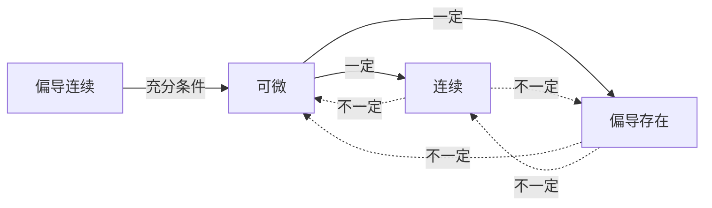
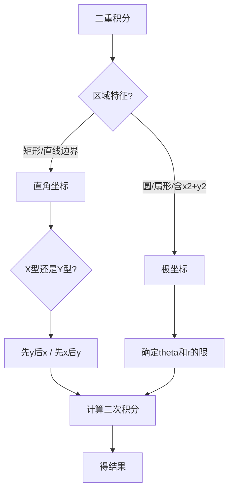
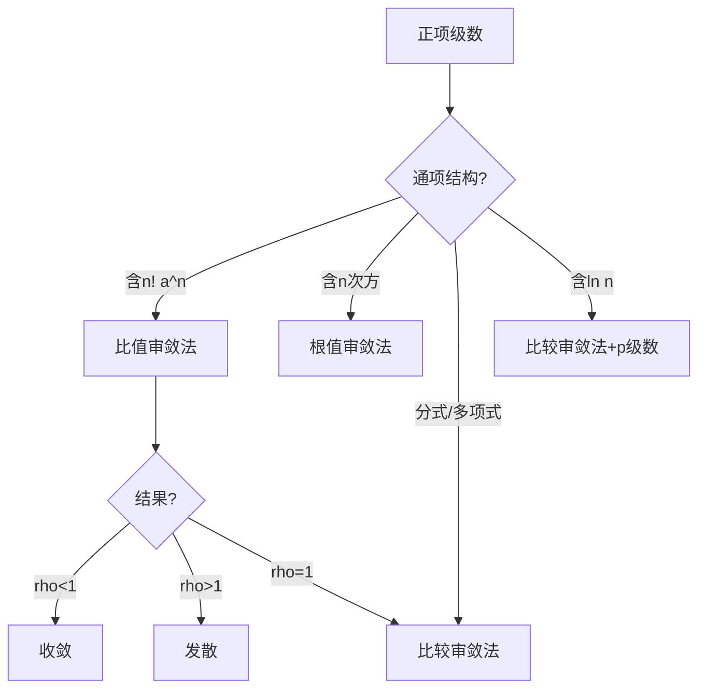

# 高等数学 · 全集

> **这是什么**：考点原文（按章）+ 讲义页（按节）+ 错题本 + 真题映射表与分值分布。
> **体量**：约 **418664 字** / 0.64 MB。
> **怎么用**：
> - 平台有**项目 / 知识库 / 文件上传** → 把这个文件上传进去，**一次就够**，之后所有对话共享，不用再贴。
> - 平台只能**对话框粘贴** → **别贴这个**（太大，会截断）。改贴 `6-考点原文-按章贴` 或 `10-讲义-按节贴` 里的单份小文件。
> **导出于**：2026-11-03

---

## 目录

**第一部分　考点原文（按章）**（12 份）

- 高数-第01章-函数极限与连续.md
- 高数-第02章-导数与微分.md
- 高数-第03章-微分中值定理与导数的应用.md
- 高数-第04章-不定积分.md
- 高数-第05章-定积分.md
- 高数-第06章-定积分的应用.md
- 高数-第07章-微分方程.md
- 高数-第08章-向量代数与空间解析几何.md
- 高数-第09章-多元函数微分法及其应用.md
- 高数-第10章-重积分.md
- 高数-第11章-曲线积分与曲面积分.md
- 高数-第12章-无穷级数.md

**第二部分　讲义（按节）**（73 份）

- 1.1a-函数的概念.md
- 1.2a-数列的极限.md
- 1.3a-函数的极限.md
- 1.4a-等价无穷小替换原理.md
- 1.5a-极限运算法则.md
- 1.6a-两个重要极限.md
- 1.7a-左右极限与极限存在判定.md
- 1.8a-极限界限之“抓大头”法则.md
- 1.9a-初等函数的连续性.md
- 1.10a-极限计算三法决策树.md
- 1.11-极限求值零基础-抓大头.md
- 1.12a-函数的连续性与间断点分类.md
- 1.13a-函数的连续性.md
- 1.14a-闭区间上连续函数的性质.md
- 1.15a-无穷小的比较.md
- 2.1-导数的定义.md
- 2.2-单侧导数以及可导与连续的关系.md
- 2.3-基本导数公式和四则运算求导法则.md
- 2.4-复合函数的求导方法（链式法则）.md
- 2.5-隐函数与参数方程求导方法.md
- 2.6-高阶导数.md
- 2.7-微分.md
- 2.8-微分中值定理（罗尔与拉格朗日）.md
- 2.9-洛必达法则.md
- 2.10-导数的几何应用（切线与单调性）.md
- 2.11-函数的极值与曲线凹凸性.md
- 2.12-函数曲线的渐近线.md
- 2.13-泰勒公式与麦克劳林公式.md
- 2.14-曲率.md
- 3.1-原函数与不定积分的概念及性质.md
- 3.2-直接积分法.md
- 3.3-第一类换元法（凑微分法）.md
- 3.4-第二类换元法之根式代换.md
- 3.5-第二类换元法之三角代换.md
- 3.6-分部积分法.md
- 3.7-定积分的概念.md
- 3.8-牛顿-莱布尼兹公式及定积分的性质.md
- 3.9-定积分的换元法.md
- 3.10-定积分的分部积分法.md
- 3.11-积分变限函数及其导数.md
- 3.12-反常积分（广义积分）.md
- 3.13-求平面图形的面积.md
- 3.14-求旋转体的体积.md
- 3.15-有理函数的积分.md
- 3.16-定积分的元素法.md
- 3.17-定积分在物理学上的应用.md
- 4.1-空间直角坐标系与向量的线性运算.md
- 4.2-向量的数量积与向量积.md
- 4.3-平面及其方程.md
- 4.4-空间直线及其方程.md
- 4.5-曲面与空间曲线.md
- 5.1-多元函数的基本概念.md
- 5.2-偏导数与全微分.md
- 5.3-多元复合函数与隐函数求导法.md
- 5.4-多元函数的极值.md
- 5.5-多元函数微分学的几何应用.md
- 5.6-方向导数与梯度.md
- 6.1-二重积分的概念与性质.md
- 6.2-二重积分的计算.md
- 6.3-三重积分.md
- 6.4-曲线积分.md
- 6.5-重积分的应用.md
- 6.6-曲面积分.md
- 7.1-微分方程的基本概念.md
- 7.2-一阶微分方程.md
- 7.3-高阶线性微分方程.md
- 8.1-常数项级数的概念与性质.md
- 8.2-正项级数审敛法.md
- 8.3-幂级数.md
- 8.4-傅里叶级数.md
- 2025-真题回忆版.md
- index.generated.md
- syllabus.md

**第三部分　错题本**（1 份）

- 高数错题本.md

**第四部分　真题考点映射表**（1 份）

- 高数-真题考点映射表-2019至2026.md

**第五部分　真题分值分布**（1 份）

- 高数-真题分值分布-2003至2026.md

---

# 第一部分　考点原文（按章）

<!-- 来源：6-考点原文-按章贴/高数/高数-第01章-函数极限与连续.md -->

## 高等数学 第01章 函数极限与连续

### G1-1-函数的概念

```
【课程】04-高数
【章节】第1章　函数、极限与连续
【节】第1章 第1考点
【考点】G1-1　函数的概念
【考频】★★★★☆
【题型】填空、单选
============================================================

函数的概念

学科系统：高等数学 → 函数与极限 → 函数的概念  
秒杀类比：函数就像一台“加工机器”——放进去一个原料（自变量 $x$），按照固定规则（对应法则）输出唯一确定的成品（因变量 $y$）。

一、核心知识解构

【是什么】：设 $x$ 和 $y$ 是两个变量，若存在一个对应法则 $f$，使得对于 $x$ 的每个取值（在某个集合 $D$ 内），$y$ 都有唯一确定的值与之对应，则称 $y$ 是 $x$ 的函数，记作 $y = f(x)$。其中 $x$ 是自变量，$y$ 是因变量。

- **定义域**：自变量 $x$ 允许取值的集合，记作 $D_f$。
- **值域**：因变量 $y$ 所有可能取值的集合，记作 $R_f$。
- **对应法则**：从 $x$ 到 $y$ 的映射规则，即 $f$。

【怎么用】：
1. 明确自变量和因变量。
2. 确定定义域（自然定义域需保证式子有意义，分母 $\neq 0$，偶次根号下 $\ge 0$，对数真数 $> 0$ 等）。
3. 根据对应法则求出因变量表达式或值域。

二、常见函数的自然定义域速记表

- $y = x$：$x \in \mathbb{R}$
- $y = \sin x,\ y = \cos x$：$x \in \mathbb{R}$
- $y = \frac{1}{x}$：$x \neq 0$
- $y = \sqrt{x}$：$x \ge 0$
- $y = \log_a x$（$a > 0$ 且 $a \neq 1$）：$x > 0$
- $y = \tan x$：$x \neq \frac{\pi}{2} + k\pi,\ k \in \mathbb{Z}$
- $y = \arcsin x,\ y = \arccos x$：$-1 \le x \le 1$

三、判断同一函数的方法

【两函数相同的充要条件】：定义域相同 **且** 对应法则相同（化简后看法则，但定义域需在化简前判定）。

【反例速记】：
- 定义域相同且值域相同 ≠ 同一函数，例如 $y = 2x$ 与 $y = x^2$（$x \in [0,2]$，值域均为 $[0,4]$，但法则不同）。
- 值域相同且法则相同 ≠ 同一函数，例如 $y = \sin x$（$x \in [0,2\pi]$）与 $y = \sin x$（$x \in [0,4\pi]$）的定义域不同。

四、闭卷真题挑战

【真题演练1】求函数 $y = \sqrt{4 - x^2} + \ln(x^2 - 1)$ 的定义域（自然定义域）。

【答案与解析】
【正确答案】：$[-2,-1) \cup (1,2]$

【核心解析】：
由 $\sqrt{4 - x^2}$ 得 $4 - x^2 \ge 0$，即 $-2 \le x \le 2$。
由 $\ln(x^2 - 1)$ 得 $x^2 - 1 > 0$，即 $x < -1$ 或 $x > 1$。
取交集，画数轴得 $x \in [-2,-1) \cup (1,2]$。

【真题演练2】判断下列各组函数是否为同一函数（选择题）  
A. $f(x) = x,\ g(x) = \frac{x^2}{x}$  
B. $f(x) = \sqrt{x},\ g(x) = |x|$  
C. $f(x) = \frac{1}{x},\ g(x) = \frac{1}{\sqrt{x}}$  
D. $f(x) = x + 1,\ g(t) = t + 1$

【答案与解析】
【正确答案】：D

【核心解析】：
A：$f(x)$ 定义域 $\mathbb{R}$，$g(x)$ 定义域 $x \neq 0$，不同。  
B：$f(x)$ 值域 $[0,+\infty)$，$g(x)$ 值域 $[0,+\infty)$，但法则不同？实际 $f(x) = \sqrt{x}$（$x \ge 0$），$g(x) = |x|$（$x \in \mathbb{R}$），定义域不同，排除。  
C：$f(x)$ 定义域 $x \neq 0$，$g(x)$ 定义域 $x > 0$，不同。  
D：$f(x)$ 与 $g(t)$ 定义域均为 $\mathbb{R}$，法则均为“自变量加1”，是同一函数。

============================================================
【原文锚点】《高等数学》精编讲义 第1章（_raw/gaoshu.txt）
【来源】原 高等数学/第一章 函数与极限/1.1 函数的概念.md
```

---

### G1-2-左右极限与极限存在判定

```
【课程】04-高数
【章节】第1章　函数、极限与连续
【节】第1章 第2考点
【考点】G1-2　左右极限与极限存在判定
【考频】★★★★★
【题型】计算、单选
============================================================

> **学科系统**：高等数学 → 函数极限 → 左右极限与极限存在判定
> **秒杀类比**：就像两辆车从左、右两边驶向同一座断桥。只有当它们在桥中间精准对接（高度一致）时，极限才算存在。如果一高一低，极限就"断裂"不存在。

### 一、 核心知识解构

* **左极限**：自变量 $x$ 从小于 $x_0$ 的方向无限趋近于 $x_0$ 时，函数 $f(x)$ 趋近于常数 $A$，记作：
  $$ \lim_{x \to x_0^-} f(x) = f(x_0^-) = A $$
* **右极限**：自变量 $x$ 从大于 $x_0$ 的方向无限趋近于 $x_0$ 时，函数 $f(x)$ 趋近于常数 $B$，记作：
  $$ \lim_{x \to x_0^+} f(x) = f(x_0^+) = B $$
* **极限存在判定定理**：
  $$ \lim_{x \to x_0} f(x) = L \iff f(x_0^-) = f(x_0^+) = L $$

### 二、 必须分左右极限讨论的三大黄金经典场景

1. **分段函数在分界点**：自变量在分界点两侧的解析式完全不一致。
2. **含有 $e^{\frac{1}{x}}$ 型在 $x \to 0$ 处**：
   * 当 $x \to 0^+$ 时，$\frac{1}{x} \to +\infty$，则 $e^{\frac{1}{x}} \to +\infty$。
   * 当 $x \to 0^-$ 时，$\frac{1}{x} \to -\infty$，则 $e^{\frac{1}{x}} \to 0$。
3. **含有 $\arctan \frac{1}{x}$ 型在 $x \to 0$ 处**：
   * 当 $x \to 0^+$ 时，$\arctan \frac{1}{x} \to \frac{\pi}{2}$。
   * 当 $x \to 0^-$ 时，$\arctan \frac{1}{x} \to -\frac{\pi}{2}$。

### 三、 考试红牌警告与秒杀秘籍

* 🚨 **易错雷区**：看到分段函数求分界点极限，千万不要无脑直接代入，必须强迫自己算两次（一次左极限，一次右极限）！
* 🔑 **秒杀秘籍**：求 $\lim_{x \to 0} e^{-\frac{1}{|x|}}$ 极限。因为有绝对值，无论从左还是右趋近，$|x| \to 0^+$，所以 $-\frac{1}{|x|} \to -\infty$，原式直接秒杀等于 $0$！

### 四、 闭卷真题挑战

> **【真题演练】**：设 $f(x) = \begin{cases} \frac{\sin x}{|x|}, & x < 0 \\ k + x, & x \ge 0 \end{cases}$，若 $\lim_{x \to 0} f(x)$ 存在，求常数 $k$ 的值。

【答案与解析】
**【正确答案】**：$k = -1$

**【核心解析】**：

1. **计算左极限**：当 $x \to 0^-$ 时，$|x| = -x$，因此：
$$ \lim_{x \to 0^-} f(x) = \lim_{x \to 0^-} \frac{\sin x}{-x} = - \lim_{x \to 0^-} \frac{\sin x}{x} = -1 $$
2. **计算右极限**：当 $x \to 0^+$ 时，$f(x) = k + x$，因此：
$$ \lim_{x \to 0^+} f(x) = \lim_{x \to 0^+} (k + x) = k $$
3. **应用存在性定理**：因为极限在 $x \to 0$ 处存在，所以左极限必须等于右极限：
$$ k = -1 $$

============================================================
【原文锚点】《高等数学》精编讲义 第1章（_raw/gaoshu.txt）
【来源】原 高等数学/第一章 函数与极限/1.1 左右极限与极限存在判定.md
```

---

### G1-3-极限计算之抓大头法则

```
【课程】04-高数
【章节】第1章　函数、极限与连续
【节】第1章 第3考点
【考点】G1-3　极限计算之抓大头法则
【考频】★★★★★
【题型】计算
============================================================

> **学科系统**：高等数学 → 函数极限 → "抓大头"求极限法则
> **秒杀类比**：在无穷大宇宙里，百万富翁跟千亿富翁在一起时，百万富翁就是尘埃。我们求无穷极限时，只需抓住增长最快、体量最大的那一项（大头），直接忽略其他小项。

### 一、 核心知识解构

#### 1. 什么是"抓大头"法则
当自变量 $x \to \infty$ 时，多项式分式极限的值完全由分子和分母中**自变量最高次数项（主导项）**决定：
$$ \lim_{x \to \infty} \frac{a_n x^n + \dots + a_0}{b_m x^m + \dots + b_0} = \lim_{x \to \infty} \frac{a_n x^n}{b_m x^m} $$

#### 2. 统考高频：各大函数增长速度"鄙视链"（当 $x \to +\infty$ 时）
$$ \ln^a x \ll x^b \ll c^x \ll x^x \quad (a>0, b>0, c>1) $$
> **速记口诀**：对数慢如蜗牛，幂函数老实赶路，指数飞上太空，阶乘和 $x^x$ 跨越宇宙！

### 二、 考试红牌警告与秒杀秘籍

* 🚨 **易错雷区**："抓大头"法则**仅限于自变量趋近于无穷大（$x \to \infty$）**的场景！如果 $x \to 0$，千万不能用这个法则，此时应该使用"等价无穷小替换"。
* 🔑 **秒杀秘籍**：看到根式下的高次幂，比如 $\sqrt{x^2 + x}$，当 $x \to +\infty$ 时，直接把低次幂 $x$ 抹掉，秒看成 $\sqrt{x^2} = x$ 参与计算！

### 三、 闭卷真题挑战

> **【真题演练】**：求极限 $\lim_{x \to +\infty} \frac{3^x + x^{100}}{3^{x+1} - \ln x}$。

【答案与解析】
**【正确答案】**：$\frac{1}{3}$

**【核心解析】**：

1. **对比分子增长速度**：分子有指数项 $3^x$ 和幂函数项 $x^{100}$。根据增长速度鄙视链：
$$ x^{100} \ll 3^x \quad (x \to +\infty) $$
因此，分子"抓大头"结果为：$3^x$。
2. **对比分母增长速度**：分母有指数项 $3^{x+1}$ 和对数项 $\ln x$。根据鄙视链：
$$ \ln x \ll 3^{x+1} \quad (x \to +\infty) $$
因此，分母"抓大头"结果为：$3^{x+1} = 3 \cdot 3^x$。
3. **计算极限**：
$$ \lim_{x \to +\infty} \frac{3^x + x^{100}}{3^{x+1} - \ln x} = \lim_{x \to +\infty} \frac{3^x}{3 \cdot 3^x} = \frac{1}{3} $$

============================================================
【原文锚点】《高等数学》精编讲义 第1章（_raw/gaoshu.txt）
【来源】原 高等数学/第一章 函数与极限/1.3 极限界限之“抓大头”法则.md
```

---

### G1-4-等价无穷小替换

```
【课程】04-高数
【章节】第1章　函数、极限与连续
【节】第1章 第4考点
【考点】G1-4　等价无穷小替换
【考频】★★★★★
【题型】计算、填空
============================================================

> **学科系统**：高等数学 → 函数极限 → 等价无穷小替换
> **秒杀类比**：就像"1元 = 10角"等值兑换，只要是在乘除乘数里，我们就可以把极复杂的无穷小函数一刀切替换成极简的 $x$，让复杂的式子瞬间清空。

### 一、 核心知识解构

#### 1. 什么是等价无穷小
若 $\lim \frac{\alpha}{\beta} = 1$，则称 $\alpha$ 与 $\beta$ 是等价无穷小，记作 $\alpha \sim \beta$。

#### 2. 常用等价无穷小公式（当 $x \to 0$ 时）
* $\sin x \sim x$
* $\tan x \sim x$
* $\arcsin x \sim x$
* $\arctan x \sim x$
* $1 - \cos x \sim \frac{1}{2}x^2$
* $\ln(1+x) \sim x$
* $e^x - 1 \sim x$
* $(1+x)^a - 1 \sim ax$

### 二、 考试红牌警告与秒杀秘籍

* 🚨 **易错雷区**：等价无穷小替换**原则上只能在乘除法中使用，加减法绝不能随意替换**！例如 $\lim_{x\to0} \frac{\tan x - \sin x}{x^3}$，若替换成 $\frac{x-x}{x^3} = 0$ 就彻底零分了！
* 🔑 **秒杀秘籍**：加减法若要用，必须满足**代换后不完全相消**。如无把握，遇到加减法老老实实上"泰勒公式"或"洛必达法则"。

### 三、 闭卷真题挑战

> **【真题演练】**：求极限 $\lim_{x \to 0} \frac{1 - \cos 2x}{x \sin x}$。

【答案与解析】
**【正确答案】**：$2$

**【核心解析】**：

1. **分子等价替换**：利用公式 $1 - \cos \square \sim \frac{1}{2}\square^2$，此处 $\square = 2x \to 0$：
$$ 1 - \cos 2x \sim \frac{1}{2}(2x)^2 = 2x^2 $$
2. **分母等价替换**：因为分母是乘法结构，且 $\sin x \sim x$：
$$ x \sin x \sim x \cdot x = x^2 $$
3. **整体替换代入**：
$$ \lim_{x \to 0} \frac{1 - \cos 2x}{x \sin x} = \lim_{x \to 0} \frac{2x^2}{x^2} = 2 $$

============================================================
【原文锚点】《高等数学》精编讲义 第1章（_raw/gaoshu.txt）
【来源】原 高等数学/第一章 函数与极限/1.4 等价无穷小替换原理.md
```

---

### G1-5-函数的连续性

```
【课程】04-高数
【章节】第1章　函数、极限与连续
【节】第1章 第5考点
【考点】G1-5　函数的连续性
【考频】★★★★☆
【题型】单选、填空
============================================================

1.3 函数的连续性

学科系统：高等数学 → 函数与极限 → 函数的连续性
秒杀类比：连续就像一条没有断点的线，而间断点就是线上不小心断开的“缺口”或“跳跃”。

一、 核心知识解构

【是什么】：
函数 $y = f(x)$ 在点 $x_0$ 的某一邻域内有定义，如果：
$$\lim_{x \to x_0} f(x) = f(x_0)$$
则称 $f(x)$ 在点 $x_0$ 处连续。

另一种等价定义：当自变量变化量 $\Delta x \to 0$ 时，函数变化量 $\Delta y \to 0$。
$$\lim_{\Delta x \to 0} \Delta y = \lim_{\Delta x \to 0} [f(x_0 + \Delta x) - f(x_0)] = 0$$

【怎么用】：
1. 判断某点是否连续 => 检查三要素：左极限、右极限、函数值，三者是否全部相等。
2. 判断间断点类型 => 只看左、右极限，不看函数值。
    - 左右极限都存在 => **第一类间断点**。
        - 左右极限相等 => 可去间断点。
        - 左右极限不相等 => 跳跃间断点。
    - 至少有一个极限不存在 => **第二类间断点**。
        - 至少有一个为无穷 => 无穷间断点。
        - 至少有一个为震荡 => 震荡间断点。

【左连续与右连续】：
- 左连续：$f(x_0^-) = \lim_{x \to x_0^-} f(x) = f(x_0)$
- 右连续：$f(x_0^+) = \lim_{x \to x_0^+} f(x) = f(x_0)$
- 函数在 $x_0$ 处连续的**充要条件**：左连续且右连续，即 $f(x_0^-) = f(x_0^+) = f(x_0)$。

二、 统考高频概念与性质汇总

1. **初等函数的连续性**：
   - 一切初等函数在其定义区间内都是连续的。
   - 连续函数经过四则运算、复合后仍然连续。
   - 连续函数的反函数也连续。

2. **闭区间上连续函数的性质**：
   - **有界性与最大值最小值定理**：在闭区间上连续的函数一定有界，且能取到最大值和最小值。
   - **零点定理**：$f(x)$ 在 $[a, b]$ 上连续，且 $f(a) \cdot f(b) < 0$（即一正一负），则至少存在一点 $\xi \in (a, b)$，使得 $f(\xi) = 0$。
   - **介值定理**：$f(x)$ 在 $[a, b]$ 上连续，且端点值不同，则对于介于 $f(a)$ 与 $f(b)$ 之间的任意数 $C$，至少存在一点 $\xi \in (a, b)$，使得 $f(\xi) = C$。

三、 考试红牌警告与秒杀秘籍

🚨 **易错雷区**：
1. 判断间断点类型时，千万不要看函数值，只看这点的左右极限。函数值会影响“是否连续”，但不影响“间断点属于哪一类”。
2. 可去间断点只看左右极限是否相等；跳跃间断点只看左右极限是否不相等；是否属于第一类，只看左右极限是否都存在。
3. 第二类间断点：只要有一个单侧极限不存在（无穷、震荡等），直接判为第二类。

🔑 **秒杀秘籍**：
- 用生活常识理解定理：零点定理就是“一根绳子从水面上一头拉到水面下一头，一定经过水面”；介值定理就是“从3楼（130斤）拉到5楼（180斤），一定经过4楼（150斤）”。
- 画图比死记硬背更有效。遇到不懂的题目，先画个函数草图，类型一目了然。

四、 闭卷真题挑战 (手脑并用，算完再看解析)

【真题演练】：设函数 $f(x) = \frac{x^2 - 1}{x - 1}$，判断 $x = 1$ 是 $f(x)$ 的什么类型的间断点？如果改为 $f(x) = \begin{cases} x, & x \neq 1 \\ \frac{1}{2}, & x = 1 \end{cases}$，$x = 1$ 又是什么类型的间断点？

【答案与解析】
【正确答案】：第一个函数：可去间断点；第二个函数：可去间断点。

【核心解析】：
**第一问**：$f(x) = \frac{x^2 - 1}{x - 1}$ 在 $x=1$ 处无定义（分母为零），因此是间断点。
计算左右极限：

$$\lim_{x \to 1} \frac{x^2 - 1}{x - 1} = \lim_{x \to 1} \frac{(x-1)(x+1)}{x-1} = \lim_{x \to 1} (x+1) = 2$$

左极限等于右极限等于 2，但函数值 $f(1)$ 无定义，所以为**可去间断点**。

**第二问**：$f(x) = \begin{cases} x, & x \neq 1 \\ \frac{1}{2}, & x = 1 \end{cases}$ 在 $x=1$ 处有定义，计算左右极限：
当 $x \to 1$ 时，无论从左或从右，表达式都为 $x$，故
$$\lim_{x \to 1} f(x) = 1$$
左极限等于右极限等于 1，但 $f(1) = \frac{1}{2} \neq 1$，因此也为**可去间断点**。

**总结**：可去间断点只需左右极限相等即可，与函数值无关。

============================================================
【原文锚点】《高等数学》精编讲义 第1章（_raw/gaoshu.txt）
【来源】原 高等数学/第一章 函数与极限/1.3 函数的连续性.md
```

---

### G1-6-间断点及其分类

```
【课程】04-高数
【章节】第1章　函数、极限与连续
【节】第1章 第6考点
【考点】G1-6　间断点及其分类
【考频】★★★★★
【题型】单选、计算
============================================================

> **学科系统**：高等数学 → 函数极限 → 连续性与间断点分类
> **秒杀类比**：连续就像一条完整的绳子；间断点就是绳子上的裂口。第一类裂口是可以修补（可去）或平整断开（跳跃）的；第二类裂口则是无限延伸的无底洞（无穷）。

### 一、 核心知识解构

#### 1. 连续的三要素 (在 $x_0$ 点连续)
1. 在 $x_0$ 点处有定义，即 $f(x_0)$ 存在。
2. 极限 $\lim_{x \to x_0} f(x)$ 存在。
3. 极限值等于函数值，即 $\lim_{x \to x_0} f(x) = f(x_0)$。

#### 2. 间断点分类表（极度重要，统考大题必考）

| 间断点类型 | 左右极限特征 | 典型名称 |
| :--- | :--- | :--- |
| **第一类间断点** | 左右极限 $f(x_0^-)$ 和 $f(x_0^+)$ **都存在** | 1. **可去间断点**：左右极限相等但 $\neq f(x_0)$<br>2. **跳跃间断点**：左右极限存在但不相等 |
| **第二类间断点** | 左右极限中**至少有一个不存在** | 1. **无穷间断点**：极限为 $\infty$<br>2. **振荡间断点**：如 $y = \sin\frac{1}{x}$ 在 $x=0$ 处 |

### 二、 考试红牌警告与秒杀秘籍

* 🚨 **易错雷区**：找间断点时，不仅要找分段函数的分界点，还要找**使无理分式无意义的点**（即分母为 $0$ 的点）！
* 🔑 **秒杀秘籍**：看到类似 $f(x) = \frac{1}{x-1}$ 且分母趋近于 $0$ 时，它的极限必然是 $\infty$，因此 $x=1$ 直接秒杀判定为 **第二类无穷间断点**！

### 三、 闭卷真题挑战

> **【真题演练】**：求函数 $f(x) = \frac{\sin x}{x(x-1)}$ 的所有间断点，并指出其类型。

【答案与解析】
**【正确答案】**：$x=0$ 是第一类可去间断点；$x=1$ 是第二类无穷间断点。

**【核心解析】**：

1. **寻找潜在间断点**：令分母为 $0$，解得 $x = 0$ 和 $x = 1$。
2. **判定 $x=0$ 的类型**：
$$ \lim_{x \to 0} \frac{\sin x}{x(x-1)} = \lim_{x \to 0} \left( \frac{\sin x}{x} \cdot \frac{1}{x-1} \right) = 1 \cdot \frac{1}{0-1} = -1 $$
左右极限存在且相等，但 $f(0)$ 无定义，故 $x=0$ 是 **可去间断点**（第一类）。
3. **判定 $x=1$ 的类型**：
当 $x \to 1$ 时，分子 $\sin 1 \neq 0$，分母 $x(x-1) \to 0$。因此：
$$ \lim_{x \to 1} f(x) = \infty $$
极限不存在且为无穷大，故 $x=1$ 是 **无穷间断点**（第二类）。

============================================================
【原文锚点】《高等数学》精编讲义 第1章（_raw/gaoshu.txt）
【来源】原 高等数学/第一章 函数与极限/1.2 函数的连续性与间断点分类.md
```

---

### G1-7-闭区间上连续函数的性质

```
【课程】04-高数
【章节】第1章　函数、极限与连续
【节】第1章 第7考点
【考点】G1-7　闭区间上连续函数的性质
【考频】★★★☆☆
【题型】证明、单选
============================================================

> **学科系统**：高等数学 → 函数极限 → 闭区间上连续函数的性质
> **秒杀类比**：零点存在定理就像你要从河的左岸（负高度）走到河的右岸（正高度），只要你中间没长翅膀飞过去（函数连续），你脚底板绝对会踩到一次河水平面（零高度，即零点）。

### 一、 核心知识解构

若函数 $f(x)$ 在闭区间 $[a, b]$ 上连续，则它必然拥有以下四大硬核定理：

1. **最值存在定理**：$f(x)$ 在 $[a, b]$ 上一定能取得最大值 $M$ 和最小值 $m$。
2. **有界性定理**：$f(x)$ 在 $[a, b]$ 上必定有界，即存在正数 $M$，使得 $|f(x)| \le M$。
3. **介值定理**：对于最值之间的任意一个数 $C$（$m < C < M$），在区间 $[a, b]$ 内至少存在一个 $\xi$，使得 $f(\xi) = C$。
4. **零点存在定理（统考大题证明必考）**：
   若 $f(a) \cdot f(b) < 0$（区间两端符号相反），则在开区间 $(a, b)$ 内至少存在一个点 $\xi$，使得：
   $$ f(\xi) = 0 $$

### 二、 证明题秒杀套路

* 🚨 **易错雷区**：使用零点定理时，区间端点必须是**闭区间**连续，而证明出来的根 $\xi$ 必须在**开区间** $(a, b)$ 内！
* 🔑 **证明题万能三步走**：
  1. **构造辅助函数**：将方程 $g(x) = h(x)$ 移项，设 $f(x) = g(x) - h(x)$。
  2. **验证连续性**：声明 $f(x)$ 在指定的闭区间 $[a, b]$ 上连续。
  3. **代入端点测号**：算出 $f(a)$ 和 $f(b)$，证明一正一负，然后骄傲地写下："由零点定理，必存在..."！

### 三、 闭卷真题挑战

> **【真题演练】**：证明方程 $x^5 - 3x - 1 = 0$ 在区间 $(1, 2)$ 内至少有一个实根。

【答案与解析】
**【核心证明步骤】**：

1. **构造函数**：设辅助函数 $f(x) = x^5 - 3x - 1$。
2. **阐述连续性**：因为 $f(x)$ 是多项式函数，所以在闭区间 $[1, 2]$ 上显然连续。
3. **计算端点值，验证异号**：
* 代入左端点 $x=1$：
$$ f(1) = 1^5 - 3(1) - 1 = -3 < 0 $$
* 代入右端点 $x=2$：
$$ f(2) = 2^5 - 3(2) - 1 = 32 - 6 - 1 = 25 > 0 $$
4. **得出结论**：
因为 $f(1) \cdot f(2) < 0$，由零点定理可知，在开区间 $(1, 2)$ 内至少存在一个点 $\xi$，使得 $f(\xi) = 0$，即方程 $x^5 - 3x - 1 = 0$ 在 $(1, 2)$ 内至少有一个实根。
证明完毕！

============================================================
【原文锚点】《高等数学》精编讲义 第1章（_raw/gaoshu.txt）
【来源】原 高等数学/第一章 函数与极限/1.5 闭区间上连续函数的性质.md
```

---

<!-- 来源：6-考点原文-按章贴/高数/高数-第02章-导数与微分.md -->

## 高等数学 第02章 导数与微分

### G2-1-导数的定义

```
【课程】04-高数
【章节】第2章　导数与微分
【节】第2章 第1考点
【考点】G2-1　导数的定义
【考频】★★★★★
【题型】计算、单选
============================================================

> **学科系统**：高等数学 → 一元函数微分学 → 导数的定义
> **秒杀类比**：导数就是函数在某一点的"瞬时变化率"——好比车速表上显示的不是过去一小时的平均速度，而是这一瞬间的实时速度。

### 一、 核心知识解构

#### 1. 导数的定义式（极限定义法）

$$ f'(x_0) = \lim_{\Delta x \to 0} \frac{\Delta y}{\Delta x} = \lim_{\Delta x \to 0} \frac{f(x_0 + \Delta x) - f(x_0)}{\Delta x} $$

#### 2. 导数的等价定义式（统考高频）

$$ f'(x_0) = \lim_{x \to x_0} \frac{f(x) - f(x_0)}{x - x_0} $$

#### 3. 左导数与右导数

* **左导数**：$f'_-(x_0) = \lim_{x \to x_0^-} \frac{f(x) - f(x_0)}{x - x_0}$
* **右导数**：$f'_+(x_0) = \lim_{x \to x_0^+} \frac{f(x) - f(x_0)}{x - x_0}$

**可导的充要条件**：$f'(x_0)$ 存在 $\iff f'_-(x_0) = f'_+(x_0)$

#### 4. 导数的几何意义

函数 $f(x)$ 在点 $x_0$ 处的导数 $f'(x_0)$ 等于该点切线的斜率 $k$。

$$ k = f'(x_0) = \tan \alpha $$

### 二、 考试红牌警告与秒杀秘籍

* 🚨 **易错雷区**：用定义求导时，$\Delta x \to 0$ 千万不能写成 $\Delta x \to \infty$！而且要注意**增量的一致性**——分子分母的增量必须完全相同。
* 🔑 **秒杀秘籍**：如果题目让你用定义求 $f'(0)$，直接写出 $\lim_{h\to 0} \frac{f(h)-f(0)}{h}$，分子分母必须是同一个 $h$！

### 三、 闭卷真题挑战

> **【真题演练】**：设 $f(x)$ 在 $x=0$ 处可导，且 $f(0)=0$，求极限 $\lim_{x\to 0} \frac{f(x)}{x}$。

【答案与解析】
**【正确答案】**：$f'(0)$

**【核心解析】**：
由导数的定义：
$$ \lim_{x\to 0} \frac{f(x)}{x} = \lim_{x\to 0} \frac{f(x) - f(0)}{x - 0} = f'(0) $$
因为 $f(0)=0$，所以满分直接代定义秒杀！

============================================================
【原文锚点】《高等数学》精编讲义 第2章（_raw/gaoshu.txt）
【来源】原 高等数学/第二章 一元函数微分学/2.1 导数的定义.md
```

---

### G2-2-单侧导数与可导连续的关系

```
【课程】04-高数
【章节】第2章　导数与微分
【节】第2章 第2考点
【考点】G2-2　单侧导数与可导连续的关系
【考频】★★★★☆
【题型】单选、判断
============================================================

> **学科系统**：高等数学 → 一元函数微分学 → 单侧导数与可导连续
> **秒杀类比**：可导一定连续（就像开车能读出瞬时速度必定经过那个点），但连续不一定可导（经过那个点但可能是个尖角拐弯，没有瞬时速度）。

### 一、 核心知识解构

#### 1. 核心定理：可导与连续的关系

$$ f(x) \text{ 在 } x_0 \text{ 处可导} \implies f(x) \text{ 在 } x_0 \text{ 处连续} $$

但 **逆命题不成立**！连续不一定可导。

#### 2. 反例说明

函数 $f(x) = |x|$ 在 $x=0$ 处连续，但由于左右导数不相等（$f'_-(0) = -1 \neq f'_+(0) = 1$），在 $x=0$ 处不可导。

#### 3. 可导的必要条件

若 $f(x)$ 在 $x_0$ 处可导，则：
1. $f(x)$ 在 $x_0$ 处连续
2. $f'_-(x_0) = f'_+(x_0)$

#### 4. 分段函数可导性判定

分段函数在分界点处必须同时满足：
1. **连续性条件**：$\lim_{x \to x_0^-} f(x) = \lim_{x \to x_0^+} f(x) = f(x_0)$
2. **可导性条件**：$f'_-(x_0) = f'_+(x_0)$

### 二、 考试红牌警告与秒杀秘籍

* 🚨 **易错雷区**：分段函数求分界点的导数，**必须先验证连续性**！因为若不连续则直接不可导，再算导数是白费功夫！
* 🔑 **秒杀秘籍**：证明可导必连续的技巧——从导数定义出发：
  $$ \lim_{\Delta x \to 0} [f(x_0+\Delta x) - f(x_0)] = \lim_{\Delta x \to 0} \frac{f(x_0+\Delta x) - f(x_0)}{\Delta x} \cdot \Delta x = f'(x_0) \cdot 0 = 0 $$

### 三、 闭卷真题挑战

> **【真题演练】**：设 $f(x) = \begin{cases} x^2 \sin \frac{1}{x}, & x \neq 0 \\ 0, & x = 0 \end{cases}$，判断 $f(x)$ 在 $x=0$ 处的连续性和可导性。

【答案与解析】
**【正确答案】**：在 $x=0$ 处连续且可导，$f'(0)=0$。

**【核心解析】**：
1. **连续性判定**：
$$ \lim_{x \to 0} x^2 \sin \frac{1}{x} = 0 = f(0) $$
因为 $|x^2 \sin \frac{1}{x}| \le x^2 \to 0$（夹逼定理），故连续。
2. **可导性判定（用定义）**：
$$ f'(0) = \lim_{h \to 0} \frac{f(h) - f(0)}{h} = \lim_{h \to 0} \frac{h^2 \sin \frac{1}{h}}{h} = \lim_{h \to 0} h \sin \frac{1}{h} = 0 $$
故在 $x=0$ 处可导，且 $f'(0)=0$。

============================================================
【原文锚点】《高等数学》精编讲义 第2章（_raw/gaoshu.txt）
【来源】原 高等数学/第二章 一元函数微分学/2.2 单侧导数以及可导与连续的关系.md
```

---

### G2-3-基本导数公式与四则运算

```
【课程】04-高数
【章节】第2章　导数与微分
【节】第2章 第3考点
【考点】G2-3　基本导数公式与四则运算
【考频】★★★★★
【题型】计算
============================================================

> **学科系统**：高等数学 → 一元函数微分学 → 基本导数公式
> **秒杀类比**：导数公式就像九九乘法表——背得滚瓜烂熟，做题才能快到飞起！

### 一、 基本求导公式表

#### 1. 常数与幂函数
| 原函数 | 导数 |
|:---|:---:|
| $C$（常数） | $0$ |
| $x^n$ | $n x^{n-1}$ |
| $\sqrt{x}$ | $\frac{1}{2\sqrt{x}}$ |
| $\frac{1}{x}$ | $-\frac{1}{x^2}$ |

#### 2. 三角函数
| 原函数 | 导数 |
|:---|:---:|
| $\sin x$ | $\cos x$ |
| $\cos x$ | $-\sin x$ |
| $\tan x$ | $\sec^2 x$ |
| $\cot x$ | $-\csc^2 x$ |
| $\sec x$ | $\sec x \tan x$ |
| $\csc x$ | $-\csc x \cot x$ |

#### 3. 反三角函数
| 原函数 | 导数 |
|:---|:---:|
| $\arcsin x$ | $\frac{1}{\sqrt{1-x^2}}$ |
| $\arccos x$ | $-\frac{1}{\sqrt{1-x^2}}$ |
| $\arctan x$ | $\frac{1}{1+x^2}$ |
| $\operatorname{arccot} x$ | $-\frac{1}{1+x^2}$ |

#### 4. 指数对数函数
| 原函数 | 导数 |
|:---|:---:|
| $e^x$ | $e^x$ |
| $a^x$ | $a^x \ln a$ |
| $\ln x$ | $\frac{1}{x}$ |
| $\log_a x$ | $\frac{1}{x \ln a}$ |

### 二、 四则运算求导法则

设 $u = u(x), v = v(x)$ 均可导，则：

1. **加减法**：$(u \pm v)' = u' \pm v'$
2. **乘法**：$(uv)' = u'v + uv'$（前导后不导 + 前不导后导）
3. **数乘**：$(Cu)' = Cu'$
4. **除法**：$\left(\frac{u}{v}\right)' = \frac{u'v - uv'}{v^2}$（$v \neq 0$）

> **记忆口诀**：乘法口诀——前导后不导加前不导后导；除法口诀——上导下不导减上不导下导，除以分母平方。

### 三、 考试红牌警告与秒杀秘籍

* 🚨 **易错雷区**：$\tan x$ 的导数是 $\sec^2 x$，不是 $\sec x$！$\ln x$ 的导数是 $\frac{1}{x}$，不是 $\frac{1}{|x|}$！
* 🔑 **秒杀秘籍**：遇到复杂分式求导，比如 $f(x) = \frac{x^2+1}{x^2-1}$，先化简为 $f(x) = 1 + \frac{2}{x^2-1}$ 再求导可以省一半计算量！

### 四、 闭卷真题挑战

> **【真题演练】**：求函数 $f(x) = x^2 \ln x$ 的导数。

【答案与解析】
**【正确答案】**：$f'(x) = 2x \ln x + x$

**【核心解析】**：
使用乘法法则（前导后不导 + 前不导后导）：
$$ f'(x) = (x^2)' \ln x + x^2 (\ln x)' = 2x \cdot \ln x + x^2 \cdot \frac{1}{x} = 2x \ln x + x $$

============================================================
【原文锚点】《高等数学》精编讲义 第2章（_raw/gaoshu.txt）
【来源】原 高等数学/第二章 一元函数微分学/2.3 基本导数公式和四则运算求导法则.md
```

---

### G2-4-复合函数求导(链式法则)

```
【课程】04-高数
【章节】第2章　导数与微分
【节】第2章 第4考点
【考点】G2-4　复合函数求导（链式法则）
【考频】★★★★★
【题型】计算
============================================================

> **学科系统**：高等数学 → 一元函数微分学 → 复合函数求导（链式法则）
> **秒杀类比**：复合函数求导就像剥洋葱——从外到内一层层剥，每剥一层就求一次导，然后把所有层的导数乘起来！

### 一、 核心知识解构

#### 1. 链式法则公式

设 $y = f(u)$，$u = g(x)$，且 $f$ 和 $g$ 均可导，则复合函数 $y = f(g(x))$ 的导数为：

$$ \frac{dy}{dx} = \frac{dy}{du} \cdot \frac{du}{dx} = f'(u) \cdot g'(x) $$

#### 2. 多层复合推广

$$ \frac{dy}{dx} = \frac{dy}{du} \cdot \frac{du}{dv} \cdot \frac{dv}{dx} $$

#### 3. 标准解题步骤

1. **拆解**：确定函数由哪些基本初等函数复合而成
2. **分层**：从外到内逐层标记 $y \to u \to v \to x$
3. **求导**：每一层分别求导
4. **相乘**：将各层的导数相乘
5. **回代**：将中间变量用 $x$ 表示

### 二、 典型复合函数求导示例

| 复合函数 | 拆解 | 导数结果 |
|:---|:---|:---:|
| $\sin(2x)$ | 外层 $\sin u$，内层 $u=2x$ | $\cos(2x) \cdot 2$ |
| $e^{x^2}$ | 外层 $e^u$，内层 $u=x^2$ | $e^{x^2} \cdot 2x$ |
| $\ln(\sin x)$ | 外层 $\ln u$，内层 $u=\sin x$ | $\frac{1}{\sin x} \cdot \cos x = \cot x$ |
| $\sqrt{1+x^2}$ | 外层 $\sqrt{u}$，内层 $u=1+x^2$ | $\frac{1}{2\sqrt{1+x^2}} \cdot 2x$ |

### 三、 考试红牌警告与秒杀秘籍

* 🚨 **易错雷区**：链式法则最容易漏掉内层导数！例如求 $\sin(2x)$ 的导数，只写 $\cos(2x)$ 而忘了乘 $2$，直接送命！
* 🔑 **秒杀秘籍**：看见"复杂函数"四个字，第一反应就是链式法则。只要是基本初等函数嵌套而成，一律从外到内逐层求导相乘。

### 四、 闭卷真题挑战

> **【真题演练】**：求 $y = \ln(1 + e^{2x})$ 的导数。

【答案与解析】
**【正确答案】**：$y' = \frac{2e^{2x}}{1 + e^{2x}}$

**【核心解析】**：
逐层拆解（剥洋葱）：
1. 外层 $\ln u$ 求导：$\frac{1}{u} = \frac{1}{1+e^{2x}}$
2. 中层 $u = 1 + e^{v}$ 求导：$e^{v} = e^{2x}$
3. 内层 $v = 2x$ 求导：$2$
4. 相乘：$y' = \frac{1}{1+e^{2x}} \cdot e^{2x} \cdot 2 = \frac{2e^{2x}}{1+e^{2x}}$

============================================================
【原文锚点】《高等数学》精编讲义 第2章（_raw/gaoshu.txt）
【来源】原 高等数学/第二章 一元函数微分学/2.4 复合函数的求导方法（链式法则）.md
```

---

### G2-5-隐函数与参数方程求导

```
【课程】04-高数
【章节】第2章　导数与微分
【节】第2章 第5考点
【考点】G2-5　隐函数与参数方程求导
【考频】★★★★★
【题型】计算
============================================================

> **学科系统**：高等数学 → 一元函数微分学 → 隐函数与参数方程求导
> **秒杀类比**：隐函数求导——方程两边同时对 $x$ 求导，把 $y$ 当成 $y(x)$，见到 $y$ 就乘一个 $y'$。参数方程求导——$\frac{dy}{dx} = \frac{dy/dt}{dx/dt}$，分子分母各求各的。

### 一、 隐函数求导法

#### 1. 标准做法

对于方程 $F(x, y) = 0$ 确定的隐函数 $y = y(x)$：
1. 方程两边同时对 $x$ 求导
2. 把 $y$ 视为 $y(x)$，见到 $y$ 就求复合导数（加 $y'$）
3. 解出 $y'$

#### 2. 统考高频题型

$$ x^2 + y^2 = 1 \quad \implies \quad 2x + 2y \cdot y' = 0 \quad \implies \quad y' = -\frac{x}{y} $$

### 二、 参数方程求导法

#### 1. 一阶导数公式

参数方程 $\begin{cases} x = \varphi(t) \\ y = \psi(t) \end{cases}$，则：

$$ \frac{dy}{dx} = \frac{dy/dt}{dx/dt} = \frac{\psi'(t)}{\varphi'(t)} \quad (\varphi'(t) \neq 0) $$

#### 2. 二阶导数公式（高频难点）

$$ \frac{d^2y}{dx^2} = \frac{d}{dx}\left(\frac{dy}{dx}\right) = \frac{\frac{d}{dt}\left(\frac{dy}{dx}\right)}{\frac{dx}{dt}} $$

### 三、 幂指函数求导法（对数求导法）

对于 $y = u(x)^{v(x)}$ 形式的函数：

1. 两边取自然对数：$\ln y = v(x) \ln u(x)$
2. 两边对 $x$ 求导：$\frac{y'}{y} = v'(x) \ln u(x) + v(x) \frac{u'(x)}{u(x)}$
3. 解出 $y'$

### 四、 考试红牌警告与秒杀秘籍

* 🚨 **易错雷区**：隐函数求导后别忘了 $y'$ 表达式里允许有 $y$！参数方程求二阶导时，**千万不能**直接对 $\frac{dy}{dx}$ 的结果再求一次关于 $t$ 的导后除以 $x'(t)$，而是先求导再除以 $x'(t)$！
* 🔑 **秒杀秘籍**：看到 $y = x^{\sin x}$ 这种幂指函数，直接取对数求导法——三步到位永不翻车。

### 五、 闭卷真题挑战

> **【真题演练】**：求由方程 $e^y + xy = e$ 所确定的隐函数 $y = y(x)$ 在 $x=0$ 处的导数。

【答案与解析】
**【正确答案】**：$y'(0) = -\frac{1}{e}$

**【核心解析】**：
1. 方程两边对 $x$ 求导：$e^y \cdot y' + y + x \cdot y' = 0$
2. 整理出 $y'$：$y'(e^y + x) = -y \implies y' = -\frac{y}{e^y + x}$
3. 代入 $x=0$：原方程 $e^y + 0 = e \implies y=1$
4. $y'(0) = -\frac{1}{e^1 + 0} = -\frac{1}{e}$

============================================================
【原文锚点】《高等数学》精编讲义 第2章（_raw/gaoshu.txt）
【来源】原 高等数学/第二章 一元函数微分学/2.5 隐函数与参数方程求导方法.md
```

---

### G2-6-高阶导数

```
【课程】04-高数
【章节】第2章　导数与微分
【节】第2章 第6考点
【考点】G2-6　高阶导数
【考频】★★★★☆
【题型】计算
============================================================

> **学科系统**：高等数学 → 一元函数微分学 → 高阶导数
> **秒杀类比**：一阶导数是速度，二阶导数是加速度。每求一次导，就描述更高一层的"变化率的变化率"。

### 一、 核心知识解构

#### 1. 高阶导数定义

$f(x)$ 的 $n$ 阶导数是 $n-1$ 阶导数的导数。

记法：$f^{(n)}(x)$ 或 $\frac{d^n y}{dx^n}$

#### 2. 常用高阶导数公式

| 原函数 | $n$ 阶导数 |
|:---|:---|
| $x^m$ | $m(m-1)\cdots(m-n+1)x^{m-n}$ |
| $e^{ax}$ | $a^n e^{ax}$ |
| $\sin(ax+b)$ | $a^n \sin(ax+b+\frac{n\pi}{2})$ |
| $\cos(ax+b)$ | $a^n \cos(ax+b+\frac{n\pi}{2})$ |
| $\ln(1+x)$ | $(-1)^{n-1}\frac{(n-1)!}{(1+x)^n}$ |
| $(ax+b)^k$ | $k(k-1)\cdots(k-n+1)a^n(ax+b)^{k-n}$ |

#### 3. 莱布尼兹公式（乘积的高阶导数）

$$ (uv)^{(n)} = \sum_{k=0}^{n} C_n^k u^{(n-k)} v^{(k)} $$

### 二、 考试红牌警告与秒杀秘籍

* 🚨 **易错雷区**：$\sin x$ 的 $n$ 阶导数是 $\sin(x + \frac{n\pi}{2})$，这是**递推规律**——每求一次导就向前平移 $\frac{\pi}{2}$，不是直接乘 $n$！
* 🔑 **秒杀秘籍**：求分式的高阶导数时，先裂项拆成简单分式之和，再用 $\left(\frac{1}{ax+b}\right)^{(n)} = \frac{(-1)^n n! a^n}{(ax+b)^{n+1}}$ 求解。

### 三、 闭卷真题挑战

> **【真题演练】**：求函数 $f(x) = \sin 2x$ 的 $10$ 阶导数。

【答案与解析】
**【正确答案】**：$f^{(10)}(x) = -2^{10} \sin 2x$

**【核心解析】**：
利用公式 $\sin(ax+b)$ 的高阶导数：
$$ f^{(n)}(x) = a^n \sin(ax+b + \frac{n\pi}{2}) = 2^{10} \sin(2x + \frac{10\pi}{2}) = 2^{10} \sin(2x + 5\pi) = -2^{10} \sin 2x $$

============================================================
【原文锚点】《高等数学》精编讲义 第2章（_raw/gaoshu.txt）
【来源】原 高等数学/第二章 一元函数微分学/2.6 高阶导数.md
```

---

### G2-7-微分

```
【课程】04-高数
【章节】第2章　导数与微分
【节】第2章 第7考点
【考点】G2-7　微分
【考频】★★★★☆
【题型】填空、单选
============================================================

> **学科系统**：高等数学 → 一元函数微分学 → 微分
> **秒杀类比**：微分就是"线性近似"——用一条直线（切线）来代替曲线在某点附近的变化。就像一个微小的放大镜，把局部的弯曲"拉直"来看。

### 一、 核心知识解构

#### 1. 微分的定义

设 $y = f(x)$ 在 $x_0$ 处可导，则：

$$ dy = f'(x_0) dx $$

其中 $dx = \Delta x$ 是自变量的微分，$dy$ 是函数的微分。

#### 2. 微分与导数的关系

$$ f'(x) = \frac{dy}{dx} $$

导数是微分的商——这就是为什么导数也叫"微商"。

#### 3. 微分的几何意义

$dy$ 表示曲线上点 $x_0$ 处的切线纵坐标的增量。

#### 4. 微分运算法则

| 运算 | 公式 |
|:---|:---|
| $d(u \pm v)$ | $du \pm dv$ |
| $d(uv)$ | $v\,du + u\,dv$ |
| $d\left(\frac{u}{v}\right)$ | $\frac{v\,du - u\,dv}{v^2}$ |
| 一阶微分形式不变性 | $dy = f'(u)\,du$（无论 $u$ 是自变量还是中间变量） |

### 二、 考试红牌警告与秒杀秘籍

* 🚨 **易错雷区**：$dy$ 是函数的微分，$\Delta y$ 是函数的增量，两者不相等！
  $$ \Delta y \approx dy $$
  当 $\Delta x \to 0$ 时，$\Delta y - dy$ 是 $\Delta x$ 的高阶无穷小。
* 🔑 **秒杀秘籍**：近似计算 $\sqrt{4.02}$，用微分法：
  设 $f(x)=\sqrt{x}$，$x_0=4$，$\Delta x=0.02$，则
  $$ \sqrt{4.02} \approx \sqrt{4} + \frac{1}{2\sqrt{4}} \times 0.02 = 2 + 0.005 = 2.005 $$

### 三、 闭卷真题挑战

> **【真题演练】**：求函数 $y = e^{2x} \sin x$ 的微分 $dy$。

【答案与解析】
**【正确答案】**：$dy = e^{2x}(2\sin x + \cos x)\,dx$

**【核心解析】**：
乘积法则：
$$ dy = d(e^{2x} \sin x) = \sin x \cdot d(e^{2x}) + e^{2x} \cdot d(\sin x) $$
$$ = \sin x \cdot e^{2x} \cdot 2\,dx + e^{2x} \cdot \cos x\,dx $$
$$ = e^{2x}(2\sin x + \cos x)\,dx $$

============================================================
【原文锚点】《高等数学》精编讲义 第2章（_raw/gaoshu.txt）
【来源】原 高等数学/第二章 一元函数微分学/2.7 微分.md
```

---

<!-- 来源：6-考点原文-按章贴/高数/高数-第03章-微分中值定理与导数的应用.md -->

## 高等数学 第03章 微分中值定理与导数的应用

### G3-1-微分中值定理(罗尔与拉格朗日)

```
【课程】04-高数
【章节】第3章　微分中值定理与导数的应用
【节】第3章 第1考点
【考点】G3-1　微分中值定理（罗尔与拉格朗日）
【考频】★★★★☆
【题型】证明、单选
============================================================

> **学科系统**：高等数学 → 一元函数微分学 → 微分中值定理
> **秒杀类比**：中值定理说——在一条平滑曲线上，总存在某个点，它的切线斜率和整个区间的平均变化率相等。好比开车跑一段路，总有一个瞬间你的瞬时车速正好等于全程平均车速。

### 一、 罗尔中值定理

#### 1. 定理条件与结论

若 $f(x)$ 满足：
1. 在闭区间 $[a, b]$ 上连续
2. 在开区间 $(a, b)$ 内可导
3. $f(a) = f(b)$（端点值相等）

则至少存在一点 $\xi \in (a, b)$，使得：

$$ f'(\xi) = 0 $$

#### 2. 罗尔定理的几何意义

两端等高 → 中间至少有某点切线水平（斜率为 0）。

#### 3. 主要用途
* 证明方程 $f'(x)=0$ 有根
* 证明函数在区间内存在极值点
* 作为拉格朗日中值定理的引理

### 二、 拉格朗日中值定理

#### 1. 定理条件与结论

若 $f(x)$ 满足：
1. 在闭区间 $[a, b]$ 上连续
2. 在开区间 $(a, b)$ 内可导

则至少存在一点 $\xi \in (a, b)$，使得：

$$ f'(\xi) = \frac{f(b) - f(a)}{b - a} $$

#### 2. 等价形式

$$ f(b) - f(a) = f'(\xi)(b - a) \quad (a < \xi < b) $$

#### 3. 三个重要推论

| 推论 | 表述 |
|:---|:---|
| 推论 1 | 若 $f'(x) \equiv 0$，则 $f(x) \equiv C$（常数） |
| 推论 2 | 若 $f'(x) = g'(x)$，则 $f(x) = g(x) + C$ |
| 推论 3 | $\lim_{x \to x_0} \frac{f(x)-f(x_0)}{x-x_0} = f'(\xi)$ |

### 三、 考试红牌警告与秒杀秘籍

* 🚨 **易错雷区**：中值定理要求 $(a,b)$ 内**可导**、$[a,b]$ 上**连续**。这两个条件缺一不可！如果函数在区间内有间断点或无定义点，定理直接失效。
* 🔑 **秒杀秘籍**：证明题中出现 $f(b)-f(a)$ 和 $b-a$ 的结构，一眼锁定拉格朗日！出现 $f(a)=f(b)$，锁定罗尔！

### 四、 闭卷真题挑战

> **【真题演练】**：证明方程 $x^3 + x - 1 = 0$ 在 $(0,1)$ 内有且仅有一个实根。

【答案与解析】
**【核心证明】**：
1. **存在性（零点定理）**：
令 $f(x)=x^3+x-1$，$f(0)=-1<0$，$f(1)=1>0$，由零点定理，至少存在一个 $\xi \in (0,1)$ 使 $f(\xi)=0$。
2. **唯一性（罗尔定理反证）**：
假设存在两个不同根 $x_1 < x_2$，则 $f(x_1)=f(x_2)=0$。由罗尔定理，存在 $\eta \in (x_1,x_2)$ 使 $f'(\eta)=0$。
但 $f'(x)=3x^2+1>0$ 恒成立，矛盾！故根唯一。

============================================================
【原文锚点】《高等数学》精编讲义 第3章（_raw/gaoshu.txt）
【来源】原 高等数学/第二章 一元函数微分学/2.8 微分中值定理（罗尔与拉格朗日）.md
```

---

### G3-2-洛必达法则

```
【课程】04-高数
【章节】第3章　微分中值定理与导数的应用
【节】第3章 第2考点
【考点】G3-2　洛必达法则
【考频】★★★★★
【题型】计算
============================================================

> **学科系统**：高等数学 → 一元函数微分学 → 洛必达法则
> **秒杀类比**：洛必达法则就像极限界的"外挂"——遇到 $\frac{0}{0}$ 或 $\frac{\infty}{\infty}$ 型极限，直接分子分母各求一次导，极限值不变。该出手时就出手！

### 一、 核心知识解构

#### 1. 洛必达法则公式

若 $\lim_{x \to x_0} f(x) = \lim_{x \to x_0} g(x) = 0$（或 $\infty$），且 $\lim_{x \to x_0} \frac{f'(x)}{g'(x)}$ 存在（或为 $\infty$），则：

$$ \lim_{x \to x_0} \frac{f(x)}{g(x)} = \lim_{x \to x_0} \frac{f'(x)}{g'(x)} $$

#### 2. 适用条件

| 条件 | 详细说明 |
|:---|:---|
| ① 基本型 | $\frac{0}{0}$ 或 $\frac{\infty}{\infty}$ |
| ② 可导性 | $f(x)$ 和 $g(x)$ 在 $x_0$ 某去心邻域内可导，且 $g'(x) \neq 0$ |
| ③ 极限存在 | $\lim \frac{f'(x)}{g'(x)}$ 存在或为 $\infty$ |

#### 3. 可转化为洛必达的七种未定式

| 未定式 | 转化方法 |
|:---|:---:|
| $\frac{0}{0},\frac{\infty}{\infty}$ | 直接洛必达 |
| $0 \cdot \infty$ | 写为 $\frac{0}{1/\infty}$ 或 $\frac{\infty}{1/0}$ |
| $\infty - \infty$ | 通分或有理化 |
| $1^\infty, 0^0, \infty^0$ | 取 $e^{\ln(\cdots)}$ 处理 |

### 二、 洛必达法则的三大限制（考场死穴）

1. **不是万能**：每次求导后必须检查是否依然是 $\frac{0}{0}$ 或 $\frac{\infty}{\infty}$，不是就不能用
2. **可能循环**：有时候越求导越复杂，陷入死循环（如 $\frac{e^x}{e^{-x}}$ 在 $x \to \infty$）
3. **失效场景**：$\lim_{x \to \infty} \frac{x+\sin x}{x}$ 用洛必达得 $\lim_{x \to \infty} \frac{1+\cos x}{1}$ 不存在，但原极限明显等于 1（应该用抓大头）

### 三、 考试红牌警告与秒杀秘籍

* 🚨 **易错雷区**：洛必达前**必须先判断极限类型**！不是 $\frac{0}{0}$ 或 $\frac{\infty}{\infty}$ 直接用洛必达，必错！
* 🔑 **秒杀秘籍**：见到 $\frac{0}{0}$ 型且含有 $\sin x$、$e^x-1$、$\ln(1+x)$ 等，可以**先用等价无穷小替换化简**，再洛必达，事半功倍。

### 四、 闭卷真题挑战

> **【真题演练】**：求极限 $\lim_{x \to 0} \frac{e^x - 1 - x}{x^2}$。

【答案与解析】
**【正确答案】**：$\frac{1}{2}$

**【核心解析】**：
验证为 $\frac{0}{0}$ 型，使用洛必达法则：
$$ \lim_{x \to 0} \frac{e^x - 1 - x}{x^2} \xlongequal{\frac{0}{0}} \lim_{x \to 0} \frac{e^x - 1}{2x} \xlongequal{\frac{0}{0}} \lim_{x \to 0} \frac{e^x}{2} = \frac{1}{2} $$

============================================================
【原文锚点】《高等数学》精编讲义 第3章（_raw/gaoshu.txt）
【来源】原 高等数学/第二章 一元函数微分学/2.9 洛必达法则.md
```

---

### G3-3-泰勒公式与麦克劳林公式

```
【课程】04-高数
【章节】第3章　微分中值定理与导数的应用
【节】第3章 第3考点
【考点】G3-3　泰勒公式与麦克劳林公式
【考频】★★★☆☆
【题型】计算、填空
============================================================

> **学科系统**：高等数学 → 一元函数微分学 → 泰勒公式
> **秒杀类比**：泰勒公式就像"用多项式来模拟任何复杂函数"——不管函数多复杂，我都可以用一堆 $x^n$ 的加减乘除来无限逼近它。好比用乐高积木拼出任意形状，多项式就是积木块，加得越多，拼得越像。

### 一、 核心知识解构

#### 1. 泰勒公式（一般形式）

若 $f(x)$ 在 $x_0$ 处有 $n$ 阶导数，则：

$$ f(x) = f(x_0) + f'(x_0)(x-x_0) + \frac{f''(x_0)}{2!}(x-x_0)^2 + \cdots + \frac{f^{(n)}(x_0)}{n!}(x-x_0)^n + R_n(x) $$

其中 $R_n(x)$ 称为**余项**（误差项）。

#### 2. 麦克劳林公式（泰勒在 $x_0=0$ 的特例）

$$ f(x) = f(0) + f'(0)x + \frac{f''(0)}{2!}x^2 + \cdots + \frac{f^{(n)}(0)}{n!}x^n + R_n(x) $$

#### 3. 两种余项形式

| 余项类型 | 表达式 | 适用场景 |
|:---|:---|:---:|
| **佩亚诺余项** | $R_n(x) = o[(x-x_0)^n]$ | 求极限（定性） |
| **拉格朗日余项** | $R_n(x) = \frac{f^{(n+1)}(\xi)}{(n+1)!}(x-x_0)^{n+1}$ | 误差估计（定量） |

> 佩亚诺余项只告诉你"误差是比 $(x-x_0)^n$ 高阶的无穷小"；拉格朗日余项能告诉你误差具体有多大。

---

### 二、 五个必背麦克劳林展开式（$x \to 0$ 时最常用）

| # | 函数 | 展开到 $n$ 阶 | 简记 |
|:---:|:---|:---|:---:|
| 1 | $e^x$ | $1 + x + \frac{x^2}{2!} + \frac{x^3}{3!} + \cdots + \frac{x^n}{n!} + o(x^n)$ | 全部正号 |
| 2 | $\sin x$ | $x - \frac{x^3}{3!} + \frac{x^5}{5!} - \cdots + (-1)^{k} \frac{x^{2k+1}}{(2k+1)!} + o(x^{2k+2})$ | 只奇次，正负交替 |
| 3 | $\cos x$ | $1 - \frac{x^2}{2!} + \frac{x^4}{4!} - \cdots + (-1)^{k} \frac{x^{2k}}{(2k)!} + o(x^{2k+1})$ | 只偶次，正负交替 |
| 4 | $\ln(1+x)$ | $x - \frac{x^2}{2} + \frac{x^3}{3} - \cdots + (-1)^{n-1} \frac{x^n}{n} + o(x^n)$ | 正负交替，无阶乘 |
| 5 | $(1+x)^a$ | $1 + ax + \frac{a(a-1)}{2!}x^2 + \cdots + \frac{a(a-1)\cdots(a-n+1)}{n!}x^n + o(x^n)$ | 二项式推广 |

#### 记忆口诀

> "**指数 $e^x$ 全正号，正弦只奇余只偶，对数是 $x$ 减半加三分，二项展开像组合**"

---

### 三、 泰勒公式的三大应用

#### 应用1：求极限（佩亚诺余项）

> **核心思想**：把分子分母中的函数展开到足够高阶，然后直接计算。

**步骤：**
1. 确定展开阶数（分子分母的最低阶决定）
2. 将各函数展开到该阶
3. 代入计算

**示例：** 求 $\lim_{x \to 0} \frac{\sin x - x}{x^3}$

$$ \sin x = x - \frac{x^3}{3!} + o(x^3) $$

$$ \frac{\sin x - x}{x^3} = \frac{(x - \frac{x^3}{6} + o(x^3)) - x}{x^3} = \frac{-\frac{x^3}{6} + o(x^3)}{x^3} = -\frac{1}{6} $$

#### 应用2：证明不等式（拉格朗日余项）

展开到足够高阶，利用余项的正负号判定整个式子的符号。

#### 应用3：近似计算

用多项式的前几项近似计算函数值，拉格朗日余项用于估计误差。

---

### 四、 考试红牌警告与秒杀秘籍

* 🚨 **易错雷区1**：展开阶数不够！例如 $\lim_{x\to0} \frac{\sin x - x}{x^3}$，若 $\sin x$ 只展开到 $x$ 阶，分子变为 $0$，无法计算。**展开阶数 = 分母阶数 + 分子最低阶**。
* 🚨 **易错雷区2**：复合函数展开时，内层函数也要展开到足够阶数。例如 $\sin(x^2)$ 展开到 $x^6$ 才能得到 $x^2 - \frac{x^6}{6} + o(x^6)$。
* 🔑 **秒杀秘籍**：看到 $\frac{0}{0}$ 型极限且分子分母出现 $\sin x$、$e^x$、$\ln(1+x)$ 等，**优先用等价无穷小替换**化简，再配合泰勒展开，比直接洛必达更快。

---

### 五、 闭卷真题挑战

> **【真题演练1】**：求极限 $\lim_{x \to 0} \frac{e^x - 1 - x - \frac{1}{2}x^2}{x^3}$。

> 【答案】
> **正确答案**：$\frac{1}{6}$
>
> **核心解析**：
> 将 $e^x$ 展开到 3 阶：
> $$ e^x = 1 + x + \frac{x^2}{2!} + \frac{x^3}{3!} + o(x^3) = 1 + x + \frac{x^2}{2} + \frac{x^3}{6} + o(x^3) $$
> 代入原式：
> $$ \frac{(1 + x + \frac{x^2}{2} + \frac{x^3}{6} + o(x^3)) - 1 - x - \frac{x^2}{2}}{x^3} = \frac{\frac{x^3}{6} + o(x^3)}{x^3} = \frac{1}{6} $$

> **【真题演练2】**：求极限 $\lim_{x \to 0} \frac{\cos x - e^{-\frac{x^2}{2}}}{x^4}$。

> 【答案】
> **正确答案**：$-\frac{1}{12}$
>
> **核心解析**：
> 将 $\cos x$ 和 $e^{-\frac{x^2}{2}}$ 都展开到 $x^4$ 阶：
> $$ \cos x = 1 - \frac{x^2}{2!} + \frac{x^4}{4!} + o(x^4) = 1 - \frac{x^2}{2} + \frac{x^4}{24} + o(x^4) $$
> $$ e^{-\frac{x^2}{2}} = 1 + (-\frac{x^2}{2}) + \frac{1}{2!}(-\frac{x^2}{2})^2 + o(x^4) = 1 - \frac{x^2}{2} + \frac{x^4}{8} + o(x^4) $$
> 代入原式：
> $$ \frac{(1 - \frac{x^2}{2} + \frac{x^4}{24}) - (1 - \frac{x^2}{2} + \frac{x^4}{8}) + o(x^4)}{x^4} = \frac{(\frac{1}{24} - \frac{1}{8})x^4 + o(x^4)}{x^4} = -\frac{1}{12} $$

============================================================
【原文锚点】《高等数学》精编讲义 第3章（_raw/gaoshu.txt）
【来源】原 高等数学/第二章 一元函数微分学/2.13 泰勒公式与麦克劳林公式.md
```

---

### G3-4-导数的几何应用(切线与单调性)

```
【课程】04-高数
【章节】第3章　微分中值定理与导数的应用
【节】第3章 第4考点
【考点】G3-4　导数的几何应用（切线与单调性）
【考频】★★★★★
【题型】计算
============================================================

> **学科系统**：高等数学 → 一元函数微分学 → 导数的几何应用
> **秒杀类比**：导数就是函数的"体检表"——正负告诉你是增是减（单调性），大小告诉你陡峭程度（切线斜率）。

### 一、 切线与法线方程

#### 1. 切线方程

曲线 $y = f(x)$ 在点 $(x_0, f(x_0))$ 处的切线方程为：

$$ y - f(x_0) = f'(x_0)(x - x_0) $$

#### 2. 法线方程

法线是与切线垂直的直线（斜率乘积为 $-1$）：

$$ y - f(x_0) = -\frac{1}{f'(x_0)}(x - x_0) \quad (f'(x_0) \neq 0) $$

### 二、 函数单调性的判别

#### 1. 判定定理

| 导数符号 | 单调性 |
|:---:|:---:|
| $f'(x) > 0$ | $f(x)$ 严格单调递增 |
| $f'(x) < 0$ | $f(x)$ 严格单调递减 |
| $f'(x) \equiv 0$ | $f(x)$ 为常数 |

#### 2. 判定步骤
1. 确定 $f(x)$ 的定义域
2. 求 $f'(x)$
3. 令 $f'(x) = 0$ 求出驻点（可能极值点）
4. 用驻点划分定义域，列表判断各区间 $f'(x)$ 符号

### 三、 考试红牌警告与秒杀秘籍

* 🚨 **易错雷区**：单调区间必须用**开区间**表示！在端点处导数为 0 不影响单调性，但闭区间端点不能写进单调区间。
* 🔑 **秒杀秘籍**：求切线方程三步走：① 求 $f'(x)$ ② 代入 $x_0$ 得斜率 $k$ ③ 点斜式写方程。永远不变！

### 四、 闭卷真题挑战

> **【真题演练】**：求曲线 $y = x^3$ 在点 $(1,1)$ 处的切线和法线方程。

【答案与解析】
**【正确答案】**：切线 $y=3x-2$，法线 $y = -\frac{1}{3}x + \frac{4}{3}$

**【核心解析】**：
1. 求导：$y' = 3x^2$，在 $x=1$ 处 $k = y'(1) = 3$
2. 切线：$y-1 = 3(x-1) \implies y=3x-2$
3. 法线斜率 $k_\perp = -\frac{1}{3}$：$y-1 = -\frac{1}{3}(x-1) \implies y = -\frac{1}{3}x + \frac{4}{3}$

============================================================
【原文锚点】《高等数学》精编讲义 第3章（_raw/gaoshu.txt）
【来源】原 高等数学/第二章 一元函数微分学/2.10 导数的几何应用（切线与单调性）.md
```

---

### G3-5-函数的极值与曲线凹凸性

```
【课程】04-高数
【章节】第3章　微分中值定理与导数的应用
【节】第3章 第5考点
【考点】G3-5　函数的极值与曲线凹凸性
【考频】★★★★★
【题型】计算
============================================================

> **学科系统**：高等数学 → 一元函数微分学 → 极值与凹凸性
> **秒杀类比**：极值就像山尖尖和谷底底——一阶导数为 0 的地方可能是极值点；二阶导数告诉你这个点是凸出来的山峰（$f''<0$）还是凹进去的谷底（$f''>0$）。

### 一、 极值的判定

#### 1. 极值的必要条件（费马定理）

若 $f(x)$ 在 $x_0$ 处可导且取得极值，则：

$$ f'(x_0) = 0 $$

**驻点**：满足 $f'(x)=0$ 的点。驻点不一定是极值点（如 $y=x^3$ 在 $x=0$ 处）。

#### 2. 极值的第一充分条件

在 $x_0$ 处 $f'(x_0)=0$，且 $f'(x)$ 在 $x_0$ 左右变号：
| 左正右负 | $x_0$ 为极大值点 |
| 左负右正 | $x_0$ 为极小值点 |
| 不变号 | $x_0$ 不是极值点 |

#### 3. 极值的第二充分条件

在 $x_0$ 处 $f'(x_0)=0$ 且 $f''(x_0)$ 存在：
| $f''(x_0) < 0$ | $x_0$ 为极大值点 |
| $f''(x_0) > 0$ | $x_0$ 为极小值点 |
| $f''(x_0)=0$ | 无法判定，用第一充分条件 |

### 二、 凹凸性与拐点

#### 1. 凹凸性判定

| 二阶导数 | 曲线形态 |
|:---:|:---:|
| $f''(x) > 0$ | 凹（向上弯曲，$\cup$ 形） |
| $f''(x) < 0$ | 凸（向下弯曲，$\cap$ 形） |

#### 2. 拐点

曲线凹凸性发生改变的点称为拐点。

必要条件：拐点处 $f''(x_0) = 0$ 或 $f''(x_0)$ 不存在。

### 三、 考试红牌警告与秒杀秘籍

* 🚨 **易错雷区**：**极值点 ≠ 最值点**！极值是局部概念，最值是全局概念。实际应用题中往往还要比较端点值和所有极值，才能确定最值。
* 🔑 **秒杀秘籍**：闭区间 $[a,b]$ 上求最值：① 求出所有驻点和不可导点 ② 计算这些点及端点的函数值 ③ 最大的就是最大值，最小的就是最小值！

### 四、 闭卷真题挑战

> **【真题演练】**：求函数 $f(x) = x^3 - 3x$ 的极值。

【答案与解析】
**【正确答案】**：极大值 $f(-1)=2$，极小值 $f(1)=-2$

**【核心解析】**：
1. 求导：$f'(x)=3x^2-3=3(x-1)(x+1)$
2. 令 $f'(x)=0$，得驻点 $x=1$ 和 $x=-1$
3. 求二阶导：$f''(x)=6x$
4. $f''(1)=6>0$，故 $x=1$ 是极小值点，$f(1)=-2$
5. $f''(-1)=-6<0$，故 $x=-1$ 是极大值点，$f(-1)=2$

============================================================
【原文锚点】《高等数学》精编讲义 第3章（_raw/gaoshu.txt）
【来源】原 高等数学/第二章 一元函数微分学/2.11 函数的极值与曲线凹凸性.md
```

---

### G3-6-曲线的渐近线

```
【课程】04-高数
【章节】第3章　微分中值定理与导数的应用
【节】第3章 第6考点
【考点】G3-6　曲线的渐近线
【考频】★★★★☆
【题型】填空、计算
============================================================

> **学科系统**：高等数学 → 一元函数微分学 → 渐近线
> **秒杀类比**：渐近线就是一条"追不到"的线——曲线无限逼近但永远碰不到，就像猫追自己的尾巴，无限靠近但就是差那么一点点。

### 一、 核心知识解构

#### 1. 三种渐近线

##### (1) 水平渐近线

若 $\lim_{x \to \infty} f(x) = A$，则 $y = A$ 是水平渐近线。

##### (2) 垂直渐近线

若 $\lim_{x \to x_0^+} f(x) = \infty$ 或 $\lim_{x \to x_0^-} f(x) = \infty$，则 $x = x_0$ 是垂直渐近线。

##### (3) 斜渐近线

若 $\lim_{x \to \infty} \frac{f(x)}{x} = a$（$a \neq 0$）且 $\lim_{x \to \infty} [f(x) - a x] = b$，则 $y = a x + b$ 是斜渐近线。

#### 2. 渐近线判定优先级

**水平渐近线** > **斜渐近线**（同一趋向只能存在一种）

* 若 $x \to +\infty$ 时有水平渐近线，则同一方向不再有斜渐近线
* 若 $x \to +\infty$ 时无水平渐近线，才考虑斜渐近线

### 二、 渐近线速查表

| 典型函数 | 渐近线 | 类型 |
|:---|:---|:---:|
| $y = \frac{1}{x}$ | $x=0$（垂直），$y=0$（水平） | 双渐近线 |
| $y = \arctan x$ | $y=\frac{\pi}{2}$（$x \to +\infty$），$y=-\frac{\pi}{2}$（$x \to -\infty$） | 双侧水平 |
| $y = \frac{x^2+1}{x}$ | $x=0$（垂直），$y=x$（斜） | 双渐近线 |

### 三、 考试红牌警告与秒杀秘籍

* 🚨 **易错雷区**：求渐近线要分 $x \to +\infty$ 和 $x \to -\infty$ 分别讨论！因为左右两侧可能有不同的渐近线。
* 🔑 **秒杀秘籍**：看到有理分式 $f(x)=\frac{P(x)}{Q(x)}$，垂直渐近线就是 $Q(x)=0$ 的解（且分子不为 0）；水平/斜渐近线看分子分母最高次关系。

### 四、 闭卷真题挑战

> **【真题演练】**：求 $f(x) = \frac{x^2}{x-1}$ 的渐近线。

【答案与解析】
**【正确答案】**：垂直渐近线 $x=1$，斜渐近线 $y=x+1$

**【核心解析】**：
1. **垂直渐近线**：分母为 0 的点 $x=1$：
$$ \lim_{x \to 1} \frac{x^2}{x-1} = \infty $$
故 $x=1$ 为垂直渐近线。
2. **斜渐近线**：由于分子次数比分母高，无水平渐近线，求斜渐近线：
$$ a = \lim_{x \to \infty} \frac{f(x)}{x} = \lim_{x \to \infty} \frac{x}{x-1} = 1 $$
$$ b = \lim_{x \to \infty} [f(x) - x] = \lim_{x \to \infty} \frac{x}{x-1} = 1 $$
故斜渐近线为 $y = x + 1$。

============================================================
【原文锚点】《高等数学》精编讲义 第3章（_raw/gaoshu.txt）
【来源】原 高等数学/第二章 一元函数微分学/2.12 函数曲线的渐近线.md
```

---

<!-- 来源：6-考点原文-按章贴/高数/高数-第04章-不定积分.md -->

## 高等数学 第04章 不定积分

### G4-1-原函数与不定积分的概念及性质

```
【课程】04-高数
【章节】第4章　不定积分
【节】第4章 第1考点
【考点】G4-1　原函数与不定积分的概念及性质
【考频】★★★★☆
【题型】单选、填空
============================================================

> **学科系统**：高等数学 → 一元函数积分学 → 原函数与不定积分
> **秒杀类比**：微分是"把东西打碎"，积分是"把碎片拼回去"。原函数就是那个拼回去的完整物件——已知碎片找原物。

### 一、 核心知识解构

#### 1. 原函数的定义
设函数 $f(x)$ 定义在区间 $I$ 上，若存在可导函数 $F(x)$，使得对任意 $x \in I$ 有：
$$ F'(x) = f(x) \quad \text{或} \quad dF(x) = f(x)dx $$
则称 $F(x)$ 为 $f(x)$ 在区间 $I$ 上的一个原函数。

#### 2. 不定积分的定义
函数 $f(x)$ 的所有原函数的集合称为 $f(x)$ 的不定积分：
$$ \int f(x)dx = F(x) + C $$
其中 $C$ 为任意常数，称为积分常数。

#### 3. 原函数存在定理
若 $f(x)$ 在区间 $I$ 上连续，则 $f(x)$ 在 $I$ 上必有原函数。

#### 4. 不定积分的几何意义
$F(x) + C$ 表示一族曲线——积分曲线族，它们在横坐标相同处的切线斜率相等（都是 $f(x)$）。

### 二、 不定积分的四条基本性质

| 性质 | 数学表达 | 记忆口诀 |
|:---|:---|:---|
| 微分在先 | $[\int f(x)dx]' = f(x)$ | 先积后微，原形毕露 |
| 积分在先 | $\int F'(x)dx = F(x) + C$ | 先微后积，尾巴加C |
| 数乘 | $\int kf(x)dx = k\int f(x)dx$ | 系数提到外面去 |
| 加减 | $\int[f \pm g]dx = \int f dx \pm \int g dx$ | 加减分开算 |

### 三、 考试红牌警告与秒杀秘籍

* 🚨 **易错雷区**：不定积分结果**必须包含常数 $C$**！考试中漏写 $C$ 直接扣分。
* 🚨 **易错雷区**：原函数存在定理只说"连续必有原函数"，但不连续也可能有原函数——不要反向否定。
* 🔑 **秒杀秘籍**：验证某个函数是否为原函数，直接对其求导——若导数等于被积函数，就是原函数！

### 四、 闭卷真题挑战

> **【真题演练】**：已知 $F(x)$ 是 $f(x)$ 的一个原函数，且 $F(x) = x\ln x$，求 $\int f(x)dx$。

【答案与解析】
**【正确答案】**：$\int f(x)dx = x\ln x + C$

**【核心解析】**：
由原函数定义可知，若 $F(x)$ 是 $f(x)$ 的一个原函数，则不定积分 $\int f(x)dx = F(x) + C$。
此处 $F(x) = x\ln x$，所以 $\int f(x)dx = x\ln x + C$。

============================================================
【原文锚点】《高等数学》精编讲义 第4章（_raw/gaoshu.txt）
【来源】原 高等数学/第三章 一元函数积分学/3.1 原函数与不定积分的概念及性质.md
```

---

### G4-2-直接积分法

```
【课程】04-高数
【章节】第4章　不定积分
【节】第4章 第2考点
【考点】G4-2　直接积分法
【考频】★★★★★
【题型】计算
============================================================

> **学科系统**：高等数学 → 一元函数积分学 → 直接积分法
> **秒杀类比**：直接积分就像炒菜的"基本刀工"——先把菜切成标准形状（利用性质和公式变形），然后直接下锅（套积分公式）。

### 一、 核心知识解构

#### 1. 什么是直接积分法
利用不定积分的**线性性质**和**基本积分公式**，对被积函数进行恒等变形（展开、拆项、化简等），然后逐项积分的方法。

#### 2. 基本积分公式（必背！）

| 公式 | 结果 |
|:---|:---|
| $\int kdx$ | $kx + C$ |
| $\int x^\alpha dx$ | $\frac{x^{\alpha+1}}{\alpha+1} + C \; (\alpha \neq -1)$ |
| $\int \frac{1}{x}dx$ | $\ln|x| + C$ |
| $\int e^x dx$ | $e^x + C$ |
| $\int a^x dx$ | $\frac{a^x}{\ln a} + C$ |
| $\int \sin x dx$ | $-\cos x + C$ |
| $\int \cos x dx$ | $\sin x + C$ |
| $\int \frac{1}{1+x^2}dx$ | $\arctan x + C$ |
| $\int \frac{1}{\sqrt{1-x^2}}dx$ | $\arcsin x + C$ |

### 二、 常用变形技巧

| 题型 | 变形方法 | 示例 |
|:---|:---|:---|
| 多项式乘开 | 展开成多项式 | $\int(x+1)^2 dx = \int(x^2+2x+1)dx$ |
| 假分式 | 多项式除法化真分式 | $\int\frac{x^2}{x+1}dx = \int(x-1+\frac{1}{x+1})dx$ |
| 三角函数平方 | 降幂公式 | $\int\sin^2 x dx = \int\frac{1-\cos2x}{2}dx$ |
| 根式 | 化为指数形式 | $\int\sqrt[3]{x^2}dx = \int x^{2/3}dx$ |

### 三、 考试红牌警告与秒杀秘籍

* 🚨 **易错雷区**：$\int \frac{1}{x}dx = \ln|x| + C$ **绝对值不能丢！**
* 🚨 **易错雷区**：$\int \frac{1}{x^2}dx = -\frac{1}{x} + C$，不是 $\ln x^2$！
* 🔑 **秒杀秘籍**：遇到 $\int \frac{x^2}{1+x^2}dx$，加减1技巧：$\frac{x^2}{1+x^2} = 1 - \frac{1}{1+x^2}$，秒出答案 $x - \arctan x + C$。

### 四、 闭卷真题挑战

> **【真题演练】**：求 $\int \frac{x^4}{1+x^2}dx$。

【答案与解析】
**【正确答案】**：$\frac{x^3}{3} - x + \arctan x + C$

**【核心解析】**：
用多项式除法：$\frac{x^4}{1+x^2} = x^2 - 1 + \frac{1}{1+x^2}$
所以：$\int\frac{x^4}{1+x^2}dx = \int(x^2 - 1 + \frac{1}{1+x^2})dx = \frac{x^3}{3} - x + \arctan x + C$

============================================================
【原文锚点】《高等数学》精编讲义 第4章（_raw/gaoshu.txt）
【来源】原 高等数学/第三章 一元函数积分学/3.2 直接积分法.md
```

---

### G4-3-第一类换元法(凑微分)

```
【课程】04-高数
【章节】第4章　不定积分
【节】第4章 第3考点
【考点】G4-3　第一类换元法（凑微分）
【考频】★★★★★
【题型】计算
============================================================

> **学科系统**：高等数学 → 一元函数积分学 → 第一类换元法
> **秒杀类比**：凑微分就像"换衣服"——你把函数的一部分"穿成"某个中间变量的微分形式，然后整个积分变得简单明了。

### 一、 核心知识解构

#### 1. 定理（第一类换元法）
设 $u = \varphi(x)$ 可导，且 $\int f(u)du = F(u) + C$，则：
$$ \int f[\varphi(x)]\varphi'(x)dx = F[\varphi(x)] + C $$

#### 2. 操作步骤
1. **凑微分**：将被积表达式中的某部分凑成 $d\varphi(x)$
2. **令 $u = \varphi(x)$**：换元简化
3. **对 $u$ 积分**：套用基本积分公式
4. **回代 $u = \varphi(x)$**：得到关于 $x$ 的结果

#### 3. 常见凑微分模式

| 凑微分形式 | $d\varphi(x)$ | 适用场景 |
|:---|:---|:---|
| $f(ax+b)$ | $d(ax+b) = adx$ | 线性内层 |
| $f(x^\alpha)x^{\alpha-1}$ | $d(x^\alpha) = \alpha x^{\alpha-1}dx$ | 幂函数内层 |
| $f(e^x)e^x$ | $d(e^x) = e^x dx$ | 指数内层 |
| $f(\ln x)\frac{1}{x}$ | $d(\ln x) = \frac{1}{x}dx$ | 对数内层 |
| $f(\sin x)\cos x$ | $d(\sin x) = \cos x dx$ | 三角内层 |

### 二、 考试红牌警告与秒杀秘籍

* 🚨 **易错雷区**：凑微分时系数要准确配平！例如 $\int \cos 2x dx$，$d(2x) = 2dx$，所以要多乘 $\frac{1}{2}$。
* 🔑 **秒杀秘籍**：看到 $\int \frac{1}{x\ln x}dx$，直接凑 $d(\ln x) = \frac{1}{x}dx$，秒杀为 $\ln|\ln x| + C$。

### 三、 闭卷真题挑战

> **【真题演练】**：求 $\int \frac{e^x}{1+e^x}dx$。

【答案与解析】
**【正确答案】**：$\ln(1+e^x) + C$

**【核心解析】**：
观察分子是分母的导数（或近似）：$(1+e^x)' = e^x$。
凑微分：$d(1+e^x) = e^x dx$
所以：$\int \frac{e^x}{1+e^x}dx = \int \frac{d(1+e^x)}{1+e^x} = \ln|1+e^x| + C = \ln(1+e^x) + C$

============================================================
【原文锚点】《高等数学》精编讲义 第4章（_raw/gaoshu.txt）
【来源】原 高等数学/第三章 一元函数积分学/3.3 第一类换元法（凑微分法）.md
```

---

### G4-4-第二类换元法之根式代换

```
【课程】04-高数
【章节】第4章　不定积分
【节】第4章 第4考点
【考点】G4-4　第二类换元法之根式代换
【考频】★★★★☆
【题型】计算
============================================================

> **学科系统**：高等数学 → 一元函数积分学 → 第二类换元法之根式代换
> **秒杀类比**：根式代换就像"脱掉根号外套"——令整个根式为 $t$，解出 $x$ 关于 $t$ 的表达式，从而去掉根号，转化为有理函数积分。

### 一、 核心知识解构

#### 1. 根式代换的适用场景
被积函数中含有形如 $\sqrt[n]{ax+b}$ 或 $\sqrt{\frac{ax+b}{cx+d}}$ 的根式。

#### 2. 代换方法
令 $t = \sqrt[n]{ax+b}$，则 $x = \frac{t^n - b}{a}$，$dx = \frac{n}{a}t^{n-1}dt$。

#### 3. 操作步骤
1. **令根式为 $t$**：设 $t = \sqrt[n]{ax+b}$
2. **反解 $x$**：$x = \frac{t^n - b}{a}$
3. **求 $dx$**：$dx = \frac{n}{a}t^{n-1}dt$
4. **代入化简**：原积分化为关于 $t$ 的有理函数积分
5. **回代**：将 $t = \sqrt[n]{ax+b}$ 代回

### 二、 考试红牌警告与秒杀秘籍

* 🚨 **易错雷区**：第二类换元后，$dx$ 也要跟着换！不要只换 $x$ 不换 $dx$。
* 🚨 **易错雷区**：回代时别忘了把积分结果中的 $t$ 全部换成 $x$ 的表达式。
* 🔑 **秒杀秘籍**：含多个不同根次根式时，取最小公倍数为 $n$。如含 $\sqrt{x}$ 和 $\sqrt[3]{x}$，令 $t = \sqrt[6]{x}$（6 是 2 和 3 的最小公倍数）。

### 三、 闭卷真题挑战

> **【真题演练】**：求 $\int \frac{dx}{1+\sqrt{x}}$。

【答案与解析】
**【正确答案】**：$2\sqrt{x} - 2\ln(1+\sqrt{x}) + C$

**【核心解析】**：
令 $t = \sqrt{x}$，则 $x = t^2$，$dx = 2tdt$。
代入：$\int \frac{dx}{1+\sqrt{x}} = \int \frac{2tdt}{1+t} = 2\int \frac{t}{1+t}dt = 2\int(1-\frac{1}{1+t})dt$
$= 2(t - \ln|1+t|) + C = 2\sqrt{x} - 2\ln(1+\sqrt{x}) + C$

============================================================
【原文锚点】《高等数学》精编讲义 第4章（_raw/gaoshu.txt）
【来源】原 高等数学/第三章 一元函数积分学/3.4 第二类换元法之根式代换.md
```

---

### G4-5-第二类换元法之三角代换

```
【课程】04-高数
【章节】第4章　不定积分
【节】第4章 第5考点
【考点】G4-5　第二类换元法之三角代换
【考频】★★★★☆
【题型】计算
============================================================

> **学科系统**：高等数学 → 一元函数积分学 → 第二类换元法之三角代换
> **秒杀类比**：看到 $\sqrt{a^2 - x^2}$ 就像看到直角三角形——用三角函数的平方关系 $1-\sin^2 = \cos^2$ 消掉根号，把代数积分变成三角积分。

### 一、 核心知识解构

#### 1. 三种标准三角代换

| 被积特征 | 代换公式 | 微分替换 |
|:---|:---|:---|
| $\sqrt{a^2 - x^2}$ | $x = a\sin t$ | $dx = a\cos t dt$ |
| $\sqrt{a^2 + x^2}$ | $x = a\tan t$ | $dx = a\sec^2 t dt$ |
| $\sqrt{x^2 - a^2}$ | $x = a\sec t$ | $dx = a\sec t\tan t dt$ |

#### 2. 三角恒等式依据
- $1 - \sin^2 t = \cos^2 t$ $\to$ 去掉 $\sqrt{a^2 - x^2}$ 的根号
- $1 + \tan^2 t = \sec^2 t$ $\to$ 去掉 $\sqrt{a^2 + x^2}$ 的根号
- $\sec^2 t - 1 = \tan^2 t$ $\to$ 去掉 $\sqrt{x^2 - a^2}$ 的根号

#### 3. 操作步骤
1. 判断特征，选择对应的三角代换
2. 换元、替换 $dx$、化简根式
3. 对三角函数积分
4. 用辅助直角三角形回代到 $x$

### 二、 考试红牌警告与秒杀秘籍

* 🚨 **易错雷区**：回代时要用**辅助直角三角形**确定三角函数值！
* 🔑 **秒杀秘籍**：记忆辅助三角形的画法——以 $x = a\sin t$ 为例，$\sin t = \frac{x}{a}$，画直角三角形，对边 $x$、斜边 $a$，邻边 $\sqrt{a^2-x^2}$。

### 三、 闭卷真题挑战

> **【真题演练】**：求 $\int \frac{dx}{\sqrt{4-x^2}}$。

【答案与解析】
**【正确答案】**：$\arcsin\frac{x}{2} + C$

**【核心解析】**：
特征 $\sqrt{4 - x^2} = \sqrt{2^2 - x^2}$，令 $x = 2\sin t$。
$dx = 2\cos t dt$，$\sqrt{4-x^2} = \sqrt{4-4\sin^2 t} = 2|\cos t|$。
在 $t \in (-\frac{\pi}{2},\frac{\pi}{2})$ 内 $\cos t > 0$，所以：
$\int \frac{dx}{\sqrt{4-x^2}} = \int \frac{2\cos t dt}{2\cos t} = \int dt = t + C = \arcsin\frac{x}{2} + C$

============================================================
【原文锚点】《高等数学》精编讲义 第4章（_raw/gaoshu.txt）
【来源】原 高等数学/第三章 一元函数积分学/3.5 第二类换元法之三角代换.md
```

---

### G4-6-分部积分法

```
【课程】04-高数
【章节】第4章　不定积分
【节】第4章 第6考点
【考点】G4-6　分部积分法
【考频】★★★★★
【题型】计算
============================================================

> **学科系统**：高等数学 → 一元函数积分学 → 分部积分法
> **秒杀类比**：分部积分就像"拆积木"——把两个函数的乘积积分问题转化为其中一个函数的导数与另一个函数的原函数的积分问题。

### 一、 核心知识解构

#### 1. 分部积分公式
$$ \int u dv = uv - \int v du $$
或写作：
$$ \int u(x)v'(x)dx = u(x)v(x) - \int u'(x)v(x)dx $$

#### 2. 分部积分法的口诀：**反对幂指三**
选择 $u$ 和 $dv$ 的优先级顺序（谁优先做 $u$，谁靠后做 $dv$）：
$$ \boxed{\text{反三角函数} \to \text{对数函数} \to \text{幂函数} \to \text{指数函数} \to \text{三角函数}} $$
- **$u$ 的选择**：排在前面的函数类型优先做 $u$
- **$dv$ 的选择**：排在后面的函数类型优先做 $dv$

#### 3. 常见题型与 $u$、$dv$ 选取

| 被积函数类型 | 选 $u$ | 选 $dv$ | 说明 |
|:---|:---|:---|:---|
| $x^n e^x$ | $x^n$ | $e^x dx$ | 降幂 |
| $x^n \ln x$ | $\ln x$ | $x^n dx$ | 消去对数 |
| $x^n \sin x$ | $x^n$ | $\sin x dx$ | 降幂 |
| $e^x \sin x$ | 任选一个 | 另一个 | 会循环回归 |

### 二、 考试红牌警告与秒杀秘籍

* 🚨 **易错雷区**：分部积分公式中的负号！$\int u dv = uv \mathbf{-} \int v du$，不要写成加号！
* 🚨 **易错雷区**：多次分部时，每次的 $u$ 和 $dv$ 选取要一致。
* 🔑 **秒杀秘籍**：$e^x$ 与 $\sin x$ 组合时，会经过两次分部后出现循环，此时将等式视作关于原积分的方程解出即可。

### 三、 闭卷真题挑战

> **【真题演练】**：求 $\int x e^x dx$。

【答案与解析】
**【正确答案】**：$(x-1)e^x + C$

**【核心解析】**：
按"反对幂指三"口诀，幂函数 $x$ 排在指数函数 $e^x$ 前面。
选 $u = x$，$dv = e^x dx$，则 $du = dx$，$v = e^x$。
$\int x e^x dx = x e^x - \int e^x dx = x e^x - e^x + C = (x-1)e^x + C$

============================================================
【原文锚点】《高等数学》精编讲义 第4章（_raw/gaoshu.txt）
【来源】原 高等数学/第三章 一元函数积分学/3.6 分部积分法.md
```

---

<!-- 来源：6-考点原文-按章贴/高数/高数-第05章-定积分.md -->

## 高等数学 第05章 定积分

### G5-1-定积分的概念

```
【课程】04-高数
【章节】第5章　定积分
【节】第5章 第1考点
【考点】G5-1　定积分的概念
【考频】★★★★☆
【题型】单选、填空
============================================================

> **学科系统**：高等数学 → 一元函数积分学 → 定积分的概念
> **秒杀类比**：定积分就是"切苹果求面积"——把曲线下的区域切成无数个细长条，加起来就是精确面积。

### 一、 核心知识解构

#### 1. 定积分的定义（黎曼积分）
设函数 $f(x)$ 在区间 $[a, b]$ 上有定义，将 $[a, b]$ 分成 $n$ 个小区间：
$$ \int_a^b f(x)dx = \lim_{\lambda \to 0} \sum_{i=1}^n f(\xi_i)\Delta x_i $$
其中 $\lambda = \max\{\Delta x_i\}$ 为最大子区间长度。

#### 2. 定积分的几何意义
- 当 $f(x) \ge 0$ 时，$\int_a^b f(x)dx$ 表示曲线 $y=f(x)$ 与 $x$ 轴在 $[a,b]$ 之间围成的曲边梯形的面积。
- 当 $f(x)$ 有正有负时，定积分表示各部分面积的"代数和"（$x$ 轴上方为正，下方为负）。

#### 3. 定积分存在的充分条件
- $f(x)$ 在 $[a,b]$ 上连续 $\to$ 可积
- $f(x)$ 在 $[a,b]$ 上有界且只有有限个间断点 $\to$ 可积

### 二、 考试红牌警告与秒杀秘籍

* 🚨 **易错雷区**：定积分的结果是一个**确定的数值**（当 $a,b$ 固定时），而不定积分是一族函数！两者本质不同！
* 🔑 **秒杀秘籍**：用定义计算定积分时，通常取等分区间 $\Delta x_i = \frac{b-a}{n}$，取右端点 $\xi_i = a + i\frac{b-a}{n}$ 简化计算。

### 三、 闭卷真题挑战

> **【真题演练】**：利用定义求 $\int_0^1 x^2 dx$。

【答案与解析】
**【正确答案】**：$\frac{1}{3}$

**【核心解析】**：
将 $[0,1]$ $n$ 等分，$\Delta x = \frac{1}{n}$，取右端点 $\xi_i = \frac{i}{n}$。
$\int_0^1 x^2 dx = \lim_{n\to\infty} \sum_{i=1}^n (\frac{i}{n})^2 \cdot \frac{1}{n} = \lim_{n\to\infty} \frac{1}{n^3}\sum_{i=1}^n i^2$
$= \lim_{n\to\infty} \frac{1}{n^3} \cdot \frac{n(n+1)(2n+1)}{6} = \frac{1}{3}$

============================================================
【原文锚点】《高等数学》精编讲义 第5章（_raw/gaoshu.txt）
【来源】原 高等数学/第三章 一元函数积分学/3.7 定积分的概念.md
```

---

### G5-2-牛顿-莱布尼兹公式及定积分的性质

```
【课程】04-高数
【章节】第5章　定积分
【节】第5章 第2考点
【考点】G5-2　牛顿-莱布尼兹公式及定积分的性质
【考频】★★★★★
【题型】计算
============================================================

> **学科系统**：高等数学 → 一元函数积分学 → 牛顿-莱布尼兹公式
> **秒杀类比**：牛顿-莱布尼兹公式是积分学的"核武器"——它告诉你不需要每次做黎曼和，只用找一个原函数，代上下限相减即可！

### 一、 核心知识解构

#### 1. 牛顿-莱布尼兹公式（微积分基本定理）
若 $f(x)$ 在 $[a,b]$ 上连续，$F(x)$ 是 $f(x)$ 的一个原函数，则：
$$ \boxed{\int_a^b f(x)dx = F(b) - F(a)} $$

#### 2. 定积分的基本性质

| 性质 | 公式 |
|:---|:---|
| 线性性 | $\int_a^b [\alpha f + \beta g]dx = \alpha\int_a^b f dx + \beta\int_a^b g dx$ |
| 区间可加性 | $\int_a^b f dx = \int_a^c f dx + \int_c^b f dx$ |
| 上下限互换 | $\int_a^b f dx = -\int_b^a f dx$ |
| 上下限相等 | $\int_a^a f dx = 0$ |
| 保号性 | $f(x) \ge 0 \Rightarrow \int_a^b f(x)dx \ge 0$ |
| 估值不等式 | $m(b-a) \le \int_a^b f dx \le M(b-a)$ |

### 二、 考试红牌警告与秒杀秘籍

* 🚨 **易错雷区**：使用牛顿-莱布尼兹公式前，必须先确认 $f(x)$ 在 $[a,b]$ 上连续！如果 $f$ 有间断点，需要分段积分。
* 🚨 **易错雷区**：代入 $F(b) - F(a)$ 时，先代上限 $b$ 再减下限 $a$，顺序不能反！
* 🔑 **秒杀秘籍**：利用奇偶性可以简化定积分——$f$ 为奇函数且在对称区间上积分为 0；$f$ 为偶函数则为 2 倍半区间积分。

### 三、 闭卷真题挑战

> **【真题演练】**：求 $\int_0^{\frac{\pi}{2}} \sin x dx$。

【答案与解析】
**【正确答案】**：$1$

**【核心解析】**：
$\sin x$ 的一个原函数是 $-\cos x$。
$\int_0^{\frac{\pi}{2}} \sin x dx = [-\cos x]_0^{\frac{\pi}{2}} = (-\cos\frac{\pi}{2}) - (-\cos 0) = 0 - (-1) = 1$

============================================================
【原文锚点】《高等数学》精编讲义 第5章（_raw/gaoshu.txt）
【来源】原 高等数学/第三章 一元函数积分学/3.8 牛顿-莱布尼兹公式及定积分的性质.md
```

---

### G5-3-定积分的换元法

```
【课程】04-高数
【章节】第5章　定积分
【节】第5章 第3考点
【考点】G5-3　定积分的换元法
【考频】★★★★★
【题型】计算
============================================================

> **学科系统**：高等数学 → 一元函数积分学 → 定积分的换元法
> **秒杀类比**：定积分换元就像"换坐标再看面积"——换了自变量的同时，积分上下限也一起换，不用最后回代！

### 一、 核心知识解构

#### 1. 定积分的换元公式
设 $x = \varphi(t)$ 在 $[\alpha, \beta]$ 上单调可导，$\varphi(\alpha) = a$，$\varphi(\beta) = b$，且 $\varphi'(t)$ 连续，则：
$$ \int_a^b f(x)dx = \int_\alpha^\beta f[\varphi(t)]\varphi'(t)dt $$

#### 2. 与不定积分换元的关键区别
- **定积分换元必须换限**：上下限跟着变量一起变
- **换元后直接计算新积分**：不用回代到 $x$

#### 3. 常用换元技巧

| 技巧 | 做法 | 说明 |
|:---|:---|:---|
| 凑微分法 | 不显式写出 $t$，直接在原积分号下操作 | 适用于简单线性内层 |
| 显式换元 | 令 $t = \varphi(x)$，同时换上下限 | 适用于复杂内层 |
| 三角代换 | 令 $x = a\sin t$ 等 | 适用于含根式 |

### 二、 考试红牌警告与秒杀秘籍

* 🚨 **易错雷区**：定积分换元时，**上下限必须跟着变量一起变**！例如令 $t = \sqrt{x}$，则 $x$ 从 $0 \to 4$ 对应 $t$ 从 $0 \to 2$。
* 🔑 **秒杀秘籍**：遇到 $\int_{-a}^a f(x)dx$，令 $t = -x$ 可以快速检验奇偶性化简。

### 三、 闭卷真题挑战

> **【真题演练】**：求 $\int_0^4 \frac{dx}{1+\sqrt{x}}$。

【答案与解析】
**【正确答案】**：$4 - 2\ln 3$

**【核心解析】**：
令 $t = \sqrt{x}$，则 $x = t^2$，$dx = 2tdt$。
换限：$x=0 \to t=0$，$x=4 \to t=2$。
$\int_0^4 \frac{dx}{1+\sqrt{x}} = \int_0^2 \frac{2tdt}{1+t} = 2\int_0^2(1-\frac{1}{1+t})dt$
$= 2[t - \ln|1+t|]_0^2 = 2[(2-\ln 3) - (0-\ln 1)] = 4 - 2\ln 3$

============================================================
【原文锚点】《高等数学》精编讲义 第5章（_raw/gaoshu.txt）
【来源】原 高等数学/第三章 一元函数积分学/3.9 定积分的换元法.md
```

---

### G5-4-定积分的分部积分法

```
【课程】04-高数
【章节】第5章　定积分
【节】第5章 第4考点
【考点】G5-4　定积分的分部积分法
【考频】★★★★☆
【题型】计算
============================================================

> **学科系统**：高等数学 → 一元函数积分学 → 定积分的分部积分法
> **秒杀类比**：定积分的分部积分和不定积分一样"拆积木"，但多了一步代上下限——先算 $[uv]$ 再减后面的积分。

### 一、 核心知识解构

#### 1. 定积分的分部积分公式
$$ \int_a^b u dv = [uv]_a^b - \int_a^b v du $$
或：
$$ \int_a^b u(x)v'(x)dx = [u(x)v(x)]_a^b - \int_a^b u'(x)v(x)dx $$

#### 2. 与不定积分分部积分的区别
- **相同**：$u$ 和 $dv$ 的选取规则一样（反对幂指三）
- **不同**：多了上下限代入——$uv$ 要先代上限减下限
- **不同**：结果是数值而不是函数 $+ C$

### 二、 考试红牌警告与秒杀秘籍

* 🚨 **易错雷区**：代 $[uv]_a^b$ 时一定要先代入上限 $b$ 再代入下限 $a$ 相减！
* 🚨 **易错雷区**：多次分部时，每次的 $u$ 和 $dv$ 选择逻辑要保持一致。
* 🔑 **秒杀秘籍**：$\int_0^1 x^n(1-x)^m dx$ 类可用 $n$ 次分部积分导出递推公式。

### 三、 闭卷真题挑战

> **【真题演练】**：求 $\int_0^1 x e^x dx$。

【答案与解析】
**【正确答案】**：$1$

**【核心解析】**：
选 $u = x$，$dv = e^x dx$，则 $du = dx$，$v = e^x$。
$\int_0^1 x e^x dx = [x e^x]_0^1 - \int_0^1 e^x dx = (1\cdot e^1 - 0\cdot e^0) - [e^x]_0^1$
$= e - (e - 1) = 1$

============================================================
【原文锚点】《高等数学》精编讲义 第5章（_raw/gaoshu.txt）
【来源】原 高等数学/第三章 一元函数积分学/3.10 定积分的分部积分法.md
```

---

### G5-5-积分变限函数及其导数

```
【课程】04-高数
【章节】第5章　定积分
【节】第5章 第5考点
【考点】G5-5　积分变限函数及其导数
【考频】★★★★★
【题型】计算、填空
============================================================

> **学科系统**：高等数学 → 一元函数积分学 → 积分变限函数
> **秒杀类比**：积分变限函数就像"带活门的积分器"——上限是变量 $x$，整个积分就成了 $x$ 的函数。对它求导，相当于把积分号直接脱掉！

### 一、 核心知识解构

#### 1. 积分变限函数的定义
设 $f(x)$ 在 $[a,b]$ 上连续，则称：
$$ \Phi(x) = \int_a^x f(t)dt \quad (a \le x \le b) $$
为积分变上限函数（或变上限积分）。

#### 2. 核心定理（原函数存在定理的延伸）
若 $f(x)$ 在 $[a,b]$ 上连续，则 $\Phi(x) = \int_a^x f(t)dt$ 在 $[a,b]$ 上可导，且：
$$ \boxed{\Phi'(x) = \frac{d}{dx}\int_a^x f(t)dt = f(x)} $$
这表明 $\Phi(x)$ 是 $f(x)$ 的一个原函数。

#### 3. 变限积分求导的三种标准形式

| 形式 | 求导结果 |
|:---|:---|
| $\frac{d}{dx}\int_a^x f(t)dt$ | $f(x)$ |
| $\frac{d}{dx}\int_a^{g(x)} f(t)dt$ | $f[g(x)] \cdot g'(x)$（链式法则） |
| $\frac{d}{dx}\int_{h(x)}^{g(x)} f(t)dt$ | $f[g(x)]g'(x) - f[h(x)]h'(x)$ |

### 二、 考试红牌警告与秒杀秘籍

* 🚨 **易错雷区**：求导时被积函数中的 $t$ 是积分变量，与上限 $x$ 无关——求导时直接把 $t$ 换成上限变量即可。
* 🚨 **易错雷区**：上限是 $x$ 的复合函数时不能忘乘以 $g'(x)$！
* 🔑 **秒杀秘籍**：求 $\frac{d}{dx}\int_x^{x^2} \sin t dt$：先用区间可加性拆成 $\int_x^0 + \int_0^{x^2}$，再各自求导。

### 三、 闭卷真题挑战

> **【真题演练】**：求 $\frac{d}{dx}\int_0^{x^2} \sqrt{1+t^2} dt$。

【答案与解析】
**【正确答案】**：$2x\sqrt{1+x^4}$

**【核心解析】**：
令 $u = x^2$，则原式 $= \frac{d}{dx}\int_0^u \sqrt{1+t^2} dt$。
由链式法则：$= \sqrt{1+u^2} \cdot \frac{du}{dx} = \sqrt{1+(x^2)^2} \cdot 2x = 2x\sqrt{1+x^4}$

============================================================
【原文锚点】《高等数学》精编讲义 第5章（_raw/gaoshu.txt）
【来源】原 高等数学/第三章 一元函数积分学/3.11 积分变限函数及其导数.md
```

---

### G5-6-反常积分(广义积分)

```
【课程】04-高数
【章节】第5章　定积分
【节】第5章 第6考点
【考点】G5-6　反常积分（广义积分）
【考频】★★★★☆
【题型】计算、判断
============================================================

> **学科系统**：高等数学 → 一元函数积分学 → 反常积分
> **秒杀类比**：反常积分就是"推到极限的定积分"——要么积分区间跑到无穷远了，要么被积函数在某点炸了。两种都是取极限算！

### 一、 核心知识解构

#### 1. 无穷限反常积分
$$ \int_a^{+\infty} f(x)dx = \lim_{b \to +\infty} \int_a^b f(x)dx $$
$$ \int_{-\infty}^b f(x)dx = \lim_{a \to -\infty} \int_a^b f(x)dx $$
$$ \int_{-\infty}^{+\infty} f(x)dx = \int_{-\infty}^c f(x)dx + \int_c^{+\infty} f(x)dx $$

**收敛判断**：极限存在 $\to$ 收敛；极限不存在（趋于无穷或振荡）$\to$ 发散。

#### 2. 无界函数反常积分（瑕积分）
若 $f(x)$ 在 $x = a$ 处无界（$a$ 为瑕点）：
$$ \int_a^b f(x)dx = \lim_{\varepsilon \to 0^+} \int_{a+\varepsilon}^b f(x)dx $$

#### 3. $p$ 积分的敛散性（记忆重点）

| 类型 | $\int_1^{+\infty} \frac{1}{x^p}dx$ | $\int_0^1 \frac{1}{x^p}dx$ |
|:---|:---|:---|
| $p > 1$ | 收敛 | 发散 |
| $p = 1$ | 发散 | 发散 |
| $p < 1$ | 发散 | 收敛 |

### 二、 考试红牌警告与秒杀秘籍

* 🚨 **易错雷区**：反常积分要先判断**敛散性再算值**！如果已经发散，计算数值没有意义。
* 🚨 **易错雷区**：无界函数的反常积分不要当成普通定积分直接代牛顿-莱布尼兹——被积函数在瑕点处无定义！
* 🔑 **秒杀秘籍**：$\int_1^{+\infty} \frac{1}{x^p}dx$，$p>1$ 才收敛；$\int_0^1 \frac{1}{x^p}dx$，$p<1$ 才收敛。两者正好相反。

### 三、 闭卷真题挑战

> **【真题演练】**：判断 $\int_1^{+\infty} \frac{1}{x^2}dx$ 的敛散性，若收敛求其值。

【答案与解析】
**【正确答案】**：收敛，值为 $1$

**【核心解析】**：
$\int_1^{+\infty} \frac{1}{x^2}dx = \lim_{b \to +\infty} \int_1^b x^{-2}dx = \lim_{b \to +\infty} [-\frac{1}{x}]_1^b$
$= \lim_{b \to +\infty} (-\frac{1}{b} + 1) = 1$
因为 $p=2 > 1$，所以收敛。极限值为 $1$。

============================================================
【原文锚点】《高等数学》精编讲义 第5章（_raw/gaoshu.txt）
【来源】原 高等数学/第三章 一元函数积分学/3.12 反常积分（广义积分）.md
```

---

<!-- 来源：6-考点原文-按章贴/高数/高数-第06章-定积分的应用.md -->

## 高等数学 第06章 定积分的应用

### G6-1-求平面图形的面积

```
【课程】04-高数
【章节】第6章　定积分的应用
【节】第6章 第1考点
【考点】G6-1　求平面图形的面积
【考频】★★★★★
【题型】计算
============================================================

> **学科系统**：高等数学 → 一元函数积分学 → 定积分求面积
> **秒杀类比**：求面积就像"用刀切蛋糕"——先确定切几刀（确定曲线交点和边界），再一片片量（定积分算面积）。

### 一、 核心知识解构

#### 1. 直角坐标系下的面积公式

**类型一：$x$ 型区域（上下型）**
由 $y = f(x)$、$y = g(x)$ 和 $x = a$、$x = b$ 围成（$f(x) \ge g(x)$）：
$$ S = \int_a^b [f(x) - g(x)]dx $$

**类型二：$y$ 型区域（左右型）**
由 $x = \varphi(y)$、$x = \psi(y)$ 和 $y = c$、$y = d$ 围成（$\varphi(y) \ge \psi(y)$）：
$$ S = \int_c^d [\varphi(y) - \psi(y)]dy $$

#### 2. 一般解题步骤
1. **画图**：画出曲线草图，确定围成区域
2. **求交点**：联立曲线方程，确定边界坐标
3. **选积分变量**：判断用 $x$ 型还是 $y$ 型更简单
4. **列式积分**：上减下或右减左
5. **计算**：套牛顿-莱布尼兹公式

### 二、 考试红牌警告与秒杀秘籍

* 🚨 **易错雷区**：求面积时，被积函数要保证 **$[f(x) - g(x)] \ge 0$**。如果上下关系不确定，加绝对值或分段。
* 🔑 **秒杀秘籍**：如果 $y$ 型区域比 $x$ 型区域更简单（例如不用分段），果断用 $y$ 型。

### 三、 闭卷真题挑战

> **【真题演练】**：求曲线 $y = x^2$ 和 $y = x$ 围成的平面图形面积。

【答案与解析】
**【正确答案】**：$\frac{1}{6}$

**【核心解析】**：
1. 求交点：$x^2 = x$，解得 $x=0$ 或 $x=1$，交点为 $(0,0)$ 和 $(1,1)$。
2. 在 $[0,1]$ 上，$y=x$ 在上方，$y=x^2$ 在下方。
3. $S = \int_0^1 (x - x^2)dx = [\frac{x^2}{2} - \frac{x^3}{3}]_0^1 = \frac{1}{2} - \frac{1}{3} = \frac{1}{6}$

============================================================
【原文锚点】《高等数学》精编讲义 第6章（_raw/gaoshu.txt）
【来源】原 高等数学/第三章 一元函数积分学/3.13 求平面图形的面积.md
```

---

### G6-2-求旋转体的体积

```
【课程】04-高数
【章节】第6章　定积分的应用
【节】第6章 第2考点
【考点】G6-2　求旋转体的体积
【考频】★★★★★
【题型】计算
============================================================

> **学科系统**：高等数学 → 一元函数积分学 → 旋转体体积
> **秒杀类比**：旋转体就像"陶艺拉胚"——一块平面图形绕着轴转一圈，就形成了一个立体。用定积分"切片"算体积！

### 一、 核心知识解构

#### 1. 绕 $x$ 轴旋转（盘切法）
曲线 $y = f(x)$ 与 $x = a$、$x = b$ 及 $x$ 轴围成的图形绕 $x$ 轴旋转：
$$ V_x = \pi \int_a^b [f(x)]^2 dx $$

#### 2. 绕 $y$ 轴旋转（壳法）
曲线 $y = f(x)$ 与 $x = a$、$x = b$ 及 $x$ 轴围成的图形绕 $y$ 轴旋转：
$$ V_y = 2\pi \int_a^b x f(x) dx $$

#### 3. 垫圈法（两曲线间旋转）
上曲线 $y=f(x)$ 和下曲线 $y=g(x)$（$f(x) \ge g(x) \ge 0$）之间区域绕 $x$ 轴旋转：
$$ V = \pi \int_a^b [f^2(x) - g^2(x)]dx $$

### 二、 考试红牌警告与秒杀秘籍

* 🚨 **易错雷区**：绕 $x$ 轴旋转用 $\pi\int y^2 dx$，被积函数是 $y^2$（不是 $y$）！
* 🚨 **易错雷区**：垫圈法中是 **大半径平方减小半径平方**，不是 $(大-小)^2$！
* 🔑 **秒杀秘籍**：绕 $y$ 轴旋转也可以写成 $x$ 型：先反解 $x = \varphi(y)$，然后用 $V = \pi\int_c^d [\varphi(y)]^2 dy$（$y$ 型盘切法）。

### 三、 闭卷真题挑战

> **【真题演练】**：求曲线 $y = \sqrt{x}$ 与 $x$ 轴及 $x = 4$ 围成的图形绕 $x$ 轴旋转所得旋转体的体积。

【答案与解析】
**【正确答案】**：$8\pi$

**【核心解析】**：
$y = \sqrt{x}$，$x \in [0,4]$，绕 $x$ 轴旋转。
$V = \pi \int_0^4 (\sqrt{x})^2 dx = \pi \int_0^4 x dx = \pi [\frac{x^2}{2}]_0^4 = \pi \cdot \frac{16}{2} = 8\pi$

============================================================
【原文锚点】《高等数学》精编讲义 第6章（_raw/gaoshu.txt）
【来源】原 高等数学/第三章 一元函数积分学/3.14 求旋转体的体积.md
```

---

<!-- 来源：6-考点原文-按章贴/高数/高数-第07章-微分方程.md -->

## 高等数学 第07章 微分方程

### G7-1-微分方程的基本概念

```
【课程】04-高数
【章节】第7章　微分方程
【节】第7章 第1考点
【考点】G7-1　微分方程的基本概念
【考频】★★★★☆
【题型】单选、填空
============================================================

> **学科系统**：高等数学 → 常微分方程 → 基本概念
> **秒杀类比**：微分方程就是"已知导数找原函数"的升级版——就像你只知道速度的变化规律，要反推出位置随时间的变化。微分方程描述的是"变化率之间的关系"，解方程就是找到满足这种关系的函数。

### 一、 核心知识解构

#### 1. 微分方程的定义

含有未知函数及其导数的方程称为**微分方程**。

- **常微分方程**：未知函数是一元函数
- **偏微分方程**：未知函数是多元函数

#### 2. 微分方程的阶

方程中出现的最高阶导数的阶数称为微分方程的**阶**。

$$y''' + 2y'' - y' + 3y = 0 \quad (\text{三阶})$$
$$y' = 2xy \quad (\text{一阶})$$

#### 3. 微分方程的解

| 类型 | 定义 | 例子（对 $y' = 2x$） |
|:---|:---|:---:|
| **通解** | 含有任意常数的解，常数个数等于阶数 | $y = x^2 + C$ |
| **特解** | 通解中常数取特定值 | $y = x^2 + 1$ |
| **初始条件** | 确定特解的条件（定常数用） | $y(0) = 1$ |

#### 4. 初值问题

微分方程 + 初始条件 = **初值问题（柯西问题）**

$$\begin{cases}
y' = f(x,y) \\
y(x_0) = y_0
\end{cases}$$

#### 5. 几何意义

微分方程 $\frac{dy}{dx} = f(x,y)$ 在每点 $(x,y)$ 给出了切线的斜率——称为**方向场**。解曲线是方向场中处处与方向相切的曲线。

### 二、 考试红牌警告与秒杀秘籍

* 🚨 **易错雷区**：通解中的任意常数个数 = 微分方程的阶数。一阶一个 $C$，二阶两个 $C_1, C_2$
* 🚨 **易错雷区**：有些方程的解不能写成显式 $y = f(x)$，只能写成隐式 $F(x,y) = 0$——这称为隐式解
* 🔑 **秒杀秘籍**：验证某函数是否为解——直接代入微分方程看是否成立
* 🔑 **秒杀秘籍**：确定通解中常数的值——利用初始条件代入解方程

### 三、 闭卷真题挑战

> **【真题演练】**：验证 $y = e^{2x}$ 是微分方程 $y'' - 3y' + 2y = 0$ 的解。

【答案与解析】
**【正确答案】**：
$y = e^{2x}$，$y' = 2e^{2x}$，$y'' = 4e^{2x}$

代入方程：
$y'' - 3y' + 2y = 4e^{2x} - 3(2e^{2x}) + 2(e^{2x})$
$= 4e^{2x} - 6e^{2x} + 2e^{2x} = 0$ ✅

所以 $y = e^{2x}$ 是方程的解。

**【核心解析】**：
验证解的标准方法：求导 → 代入 → 看等式是否成立。

### 四、 📖 教材习题全解对照

> 本讲内容对应 **同济大学《高等数学》第八版 上册 第七章 微分方程**

| 教材习题 | 对应知识点 | 难度 |
|:---|:---|:---:|
| **习题 7-1** 第1-4题 | 微分方程的基本概念 | ⭐ |
| **习题 7-1** 第5-6题 | 验证解与求特解 | ⭐ |

> 💡 **刷题建议**：本节是概念入门，习题量少，理解即可。重点在后面各种类型微分方程的解法。

============================================================
【原文锚点】《高等数学》精编讲义 第7章（_raw/gaoshu.txt）
【来源】原 高等数学/第七章 常微分方程/7.1 微分方程的基本概念.md
```

---

### G7-2-一阶微分方程

```
【课程】04-高数
【章节】第7章　微分方程
【节】第7章 第2考点
【考点】G7-2　一阶微分方程
【考频】★★★★★
【题型】计算
============================================================

> **学科系统**：高等数学 → 常微分方程 → 一阶微分方程
> **秒杀类比**：一阶微分方程就像不同的"解锁方式"——可分离变量是"直接拆锁"（两边各自积分），齐次方程是"换个钥匙开"（变量替换），一阶线性是"按标准流程开"（套公式）。

### 一、 核心知识解构

#### 1. 可分离变量的微分方程

**形式**：$\frac{dy}{dx} = g(x)h(y)$ 或 $M_1(x)N_1(y)dx + M_2(x)N_2(y)dy = 0$

**解法**：
$$\frac{dy}{dx} = g(x)h(y) \implies \frac{dy}{h(y)} = g(x)dx \implies \int \frac{dy}{h(y)} = \int g(x)dx$$

#### 2. 齐次微分方程

**形式**：$\frac{dy}{dx} = f\left(\frac{y}{x}\right)$

**解法**：令 $u = \frac{y}{x}$，则 $y = ux$，$\frac{dy}{dx} = u + x\frac{du}{dx}$，代入后化为可分离变量。

#### 3. 一阶线性微分方程

**标准形式**：$y' + P(x)y = Q(x)$

**通解公式**：
$$y = e^{-\int P(x)dx} \left[ \int Q(x) e^{\int P(x)dx} dx + C \right]$$

##### 推导记忆口诀
1. 先求齐次解：$y' + Py = 0 \implies y = Ce^{-\int P dx}$
2. 再用常数变易法：$C \to C(x)$，代入非齐次方程得 $C(x) = \int Q e^{\int P dx} dx + C$
3. 最终：$y = e^{-\int P dx}\left( \int Q e^{\int P dx} dx + C \right)$

##### 伯努利方程
**形式**：$y' + P(x)y = Q(x)y^n$（$n \neq 0, 1$）

**解法**：令 $z = y^{1-n}$，化为 $z' + (1-n)P(x)z = (1-n)Q(x)$，按一阶线性求解。

#### 4. 全微分方程

**形式**：$M(x,y)dx + N(x,y)dy = 0$，且 $\frac{\partial M}{\partial y} = \frac{\partial N}{\partial x}$

**解法**：存在 $u(x,y)$ 使 $du = Mdx + Ndy$，通解为 $u(x,y) = C$。

#### 5. 一阶微分方程解法流程图

```mermaid
graph TD
    A[一阶微分方程] --> B{可分离变量?}
    B -->|是| C[分离变量两边积分]
    B -->|否| D{齐次方程?}
    D -->|是| E[令 u=y/x 代入]
    D -->|否| F{一阶线性?}
    F -->|是| G[套通解公式]
    F -->|否| H{伯努利?}
    H -->|是| I[令 z=y^(1-n)]
    H -->|否| J{全微分?}
    J -->|是| K[求原函数 u(x,y)]
    J -->|否| L[尝试积分因子]
```

### 二、 考试红牌警告与秒杀秘籍

* 🚨 **易错雷区**：一阶线性方程的标准形式是 $y' + P(x)y = Q(x)$——如果 $y'$ 的系数不是 1，先除以系数化为标准形式
* 🚨 **易错雷区**：套公式时，$\int P(x)dx$ 和 $\int Q(x)e^{\int P(x)dx}dx$ 都要带积分常数——但最终只需一个 $C$
* 🚨 **易错雷区**：分离变量时，分母为 0 的情况可能漏解——检查 $h(y) = 0$ 是否也是解
* 🔑 **秒杀秘籍**：看到 $\frac{y}{x}$ 形式的表达式 → 齐次方程，令 $u = \frac{y}{x}$
* 🔑 **秒杀秘籍**：一阶线性方程直接用公式，不要每次重新推导常数变易法
* 🔑 **秒杀秘籍**：记住 $e^{\int P dx}$ 这个积分因子——它是一阶线性方程的核心

### 三、 闭卷真题挑战

> **【真题演练】**：求微分方程 $\frac{dy}{dx} = \frac{y}{x} + x^2$ 的通解。

【答案与解析】
**【正确答案】**：
整理为标准形式：$y' - \frac{1}{x}y = x^2$

$P(x) = -\frac{1}{x}$，$Q(x) = x^2$

$\int P(x)dx = \int -\frac{1}{x}dx = -\ln|x|$

$e^{\int P dx} = e^{-\ln|x|} = \frac{1}{|x|}$，常用 $\frac{1}{x}$（考虑 $x>0$）

$y = e^{-\int P dx} \left[ \int Q e^{\int P dx} dx + C \right]$

$= e^{\ln x} \left[ \int x^2 \cdot \frac{1}{x} dx + C \right]$

$= x \left[ \int x\, dx + C \right] = x \left( \frac{x^2}{2} + C \right) = \frac{x^3}{2} + Cx$

**【核心解析】**：
标准的一阶线性方程。先化标准形式，再套公式。注意 $e^{-\ln x} = \frac{1}{x}$，$e^{\ln x} = x$。

**【真题演练】**：求微分方程 $y' - \frac{2}{x+1}y = (x+1)^3$ 的通解。

【答案与解析】
**【正确答案】**：
$P(x) = -\frac{2}{x+1}$，$Q(x) = (x+1)^3$

$\int P dx = \int -\frac{2}{x+1}dx = -2\ln|x+1| = \ln[(x+1)^{-2}]$

$e^{\int P dx} = (x+1)^{-2} = \frac{1}{(x+1)^2}$

$e^{-\int P dx} = (x+1)^2$

$y = e^{-\int P dx} \left[ \int Q e^{\int P dx} dx + C \right]$

$= (x+1)^2 \left[ \int (x+1)^3 \cdot \frac{1}{(x+1)^2} dx + C \right]$

$= (x+1)^2 \left[ \int (x+1) dx + C \right]$

$= (x+1)^2 \left[ \frac{(x+1)^2}{2} + C \right]$

$= \frac{1}{2}(x+1)^4 + C(x+1)^2$

**【核心解析】**：
同样是套公式的典型题。关键是正确计算 $e^{\int P dx}$ 和 $e^{-\int P dx}$，然后代入公式。公式中的积分顺序不要搞反。

### 四、 📖 教材习题全解对照

> 本讲内容对应 **同济大学《高等数学》第八版 上册 第七章 微分方程**

| 教材习题 | 对应知识点 | 难度 |
|:---|:---|:---:|
| **习题 7-2** 第1-8题 | 可分离变量方程 | ⭐ |
| **习题 7-3** 第1-6题 | 齐次方程 | ⭐⭐ |
| **习题 7-4** 第1-10题 | 一阶线性方程 | ⭐⭐ |
| **习题 7-5** 第1-4题 | 可降阶的高阶方程 | ⭐⭐⭐ |
| **总习题七** 第1-8题 | 一阶方程综合 | ⭐⭐⭐ |

> 💡 **刷题建议**：一阶线性方程是考试绝对重点，习题7-4的第1-8题每题都要会做。可分离变量是基础，齐次方程了解方法即可。

============================================================
【原文锚点】《高等数学》精编讲义 第7章（_raw/gaoshu.txt）
【来源】原 高等数学/第七章 常微分方程/7.2 一阶微分方程.md
```

---

### G7-3-高阶线性微分方程

```
【课程】04-高数
【章节】第7章　微分方程
【节】第7章 第3考点
【考点】G7-3　高阶线性微分方程
【考频】★★★★★
【题型】计算
============================================================

> **学科系统**：高等数学 → 常微分方程 → 高阶线性微分方程
> **秒杀类比**：高阶线性微分方程就像解密码——先解"特征方程"这个密码锁（代数方程），钥匙就是特征根。不同特征根对应不同的解形式，就像不同的密码对应不同的解锁结果。

### 一、 核心知识解构

#### 1. 二阶线性微分方程的结构

$$y'' + P(x)y' + Q(x)y = f(x)$$

- 齐次：$y'' + Py' + Qy = 0$（$f(x) = 0$）
- 非齐次：$y'' + Py' + Qy = f(x)$（$f(x) \neq 0$）

**解的结构定理**：

| 情形 | 通解结构 |
|:---|:---|
| **齐次** | $y = C_1 y_1 + C_2 y_2$（$y_1, y_2$ 为两个线性无关的特解）|
| **非齐次** | $y = \bar{y} + y^*$（$\bar{y}$ 是对应齐次的通解，$y^*$ 是一个特解）|

#### 2. 常系数齐次线性方程的解法

$$y'' + py' + qy = 0 \quad (p,q \text{ 为常数})$$

**特征方程**：$r^2 + pr + q = 0$

| 特征根情况 | 通解形式 |
|:---|:---|
| 两个不等实根 $r_1 \neq r_2$ | $y = C_1 e^{r_1 x} + C_2 e^{r_2 x}$ |
| 重根 $r_1 = r_2 = r$ | $y = (C_1 + C_2 x)e^{rx}$ |
| 共轭复根 $r_{1,2} = \alpha \pm i\beta$ | $y = e^{\alpha x}(C_1 \cos\beta x + C_2 \sin\beta x)$ |

##### 推广到 $n$ 阶
特征方程 $r^n + a_1 r^{n-1} + \cdots + a_n = 0$：
- 每个单实根 $r$ → $e^{rx}$
- 每个 $k$ 重实根 $r$ → $e^{rx}, xe^{rx}, \cdots, x^{k-1}e^{rx}$
- 每个单重复根 $\alpha \pm i\beta$ → $e^{\alpha x}\cos\beta x, e^{\alpha x}\sin\beta x$
- 每对 $k$ 重复根 → $e^{\alpha x}\cos\beta x, xe^{\alpha x}\cos\beta x, \cdots$

#### 3. 常系数非齐次线性方程的解法

$$y'' + py' + qy = f(x)$$

**解法**：先求齐次通解 $\bar{y}$，再求非齐次特解 $y^*$。

##### 特解待定系数法——$f(x) = P_m(x)e^{\lambda x}$

$$y^* = x^k \cdot Q_m(x) \cdot e^{\lambda x}$$

其中 $Q_m(x)$ 是与 $P_m(x)$ 同次的多项式，$k$ 的取值：

| $\lambda$ 与特征根的关系 | $k$ |
|:---|:---:|
| $\lambda$ 不是特征根 | $k = 0$ |
| $\lambda$ 是单重特征根 | $k = 1$ |
| $\lambda$ 是二重特征根 | $k = 2$ |

##### $f(x) = e^{\alpha x}[P_l(x)\cos\beta x + P_n(x)\sin\beta x]$

$$y^* = x^k e^{\alpha x}[R_m(x)\cos\beta x + S_m(x)\sin\beta x]$$

其中 $m = \max(l,n)$，$k$ 由 $\alpha \pm i\beta$ 是否为特征根决定（是→1，否→0）。

#### 4. 可降阶的高阶方程

| 类型 | 形式 | 降阶方法 |
|:---|:---|:---|
| 缺 $y$ 型 | $y'' = f(x, y')$ | 令 $p = y'$，$y'' = p'$ |
| 缺 $x$ 型 | $y'' = f(y, y')$ | 令 $p = y'$，$y'' = p\frac{dp}{dy}$ |

### 二、 考试红牌警告与秒杀秘籍

* 🚨 **易错雷区**：特征方程写错符号！$y'' + py' + qy = 0$ 对应 $r^2 + pr + q = 0$——$y''$ 对应 $r^2$，$y'$ 对应 $r$，$y$ 对应 $1$
* 🚨 **易错雷区**：非齐次特解中 $x^k$ 的 $k$ 要选对——$\lambda$ 是几重特征根，$k$ 就是几。不是特征根时 $k=0$（即不乘 $x$）
* 🚨 **易错雷区**：特解 $y^*$ 中的多项式系数要用待定系数法确定——不是随便写的
* 🔑 **秒杀秘籍**：记住通解结构：齐次通解 + 非齐次特解（$\bar{y} + y^*$），两者是相加关系
* 🔑 **秒杀秘籍**：特征方程 $r^2 + pr + q = 0$ 的判别式 $\Delta = p^2 - 4q$ 决定通解类型
* 🔑 **秒杀秘籍**：看到 $f(x) = e^{\lambda x} \cdot \text{多项式}$ → 待定系数法三步走：① $\lambda$ 是几重根？② 设 $y^* = x^k Q_m(x) e^{\lambda x}$ ③ 代入原方程求系数

### 三、 闭卷真题挑战

> **【真题演练】**：求微分方程 $y'' - 3y' + 2y = 0$ 的通解。

【答案与解析】
**【正确答案】**：
特征方程：$r^2 - 3r + 2 = 0$
$(r-1)(r-2) = 0$，$r_1 = 1$，$r_2 = 2$

两个不等实根，通解为：
$$y = C_1 e^{x} + C_2 e^{2x}$$

**【核心解析】**：
常系数齐次方程的标准解法：写出特征方程 → 求特征根 → 对照表格写通解。

**【真题演练】**：求微分方程 $y'' - 2y' + y = e^x$ 的通解。

【答案与解析】
**【正确答案】**：
**① 齐次通解 $\bar{y}$**
特征方程：$r^2 - 2r + 1 = (r-1)^2 = 0$，$r = 1$（二重根）
$\bar{y} = (C_1 + C_2 x)e^x$

**② 非齐次特解 $y^*$**
$f(x) = e^x$，$\lambda = 1$ 是二重特征根 → $k = 2$
设 $y^* = A x^2 e^x$
$y^{*'} = A(2x + x^2)e^x$，$y^{*''} = A(2 + 4x + x^2)e^x$

代入原方程：
$A(2 + 4x + x^2)e^x - 2A(2x + x^2)e^x + A x^2 e^x = e^x$
$A(2 + 4x + x^2 - 4x - 2x^2 + x^2) = 1$
$A \cdot 2 = 1 \implies A = \frac{1}{2}$

$y^* = \frac{1}{2}x^2 e^x$

**③ 非齐次通解**
$$y = \bar{y} + y^* = (C_1 + C_2 x)e^x + \frac{1}{2}x^2 e^x$$

**【核心解析】**：
非齐次方程的标准解法：先求齐次通解，再设特解代入求系数，最后相加。注意 $\lambda = 1$ 是二重根所以 $k=2$，设 $y^* = Ax^2 e^x$。

### 四、 📖 教材习题全解对照

> 本讲内容对应 **同济大学《高等数学》第八版 上册 第七章 微分方程**

| 教材习题 | 对应知识点 | 难度 |
|:---|:---|:---:|
| **习题 7-6** 第1-8题 | 常系数齐次线性方程 | ⭐⭐ |
| **习题 7-7** 第1-10题 | 常系数非齐次线性方程 | ⭐⭐⭐ |
| **习题 7-8** 第1-6题 | 欧拉方程 | ⭐⭐⭐ |
| **总习题七** 第9-18题 | 综合应用 | ⭐⭐⭐⭐ |

> 💡 **刷题建议**：常系数齐次方程（习题7-6）必须熟练掌握。非齐次方程（习题7-7）的待定系数法是考试核心，建议1-8题每个类型都练一遍。

============================================================
【原文锚点】《高等数学》精编讲义 第7章（_raw/gaoshu.txt）
【来源】原 高等数学/第七章 常微分方程/7.3 高阶线性微分方程.md
```

---

<!-- 来源：6-考点原文-按章贴/高数/高数-第08章-向量代数与空间解析几何.md -->

## 高等数学 第08章 向量代数与空间解析几何

### G8-1-空间直角坐标系与向量的线性运算

```
【课程】04-高数
【章节】第8章　向量代数与空间解析几何
【节】第8章 第1考点
【考点】G8-1　空间直角坐标系与向量的线性运算
【考频】★★★☆☆
【题型】填空、单选
============================================================

> **学科系统**：高等数学 → 向量与空间几何 → 空间直角坐标系与向量
> **秒杀类比**：向量就是"带箭头有方向的线段"——向东走3步和向东北走4步，用向量加起来就是你的实际位移。就像游戏里的人物移动指令：(x, y, z)三个数值决定你在三维空间里的位置。

### 一、 核心知识解构

#### 1. 空间直角坐标系

三条互相垂直的数轴（$x$轴、$y$轴、$z$轴）按右手规则构成空间直角坐标系。

| 要素 | 说明 |
|:---|:---|
| 坐标原点 | $O(0,0,0)$ |
| 坐标轴 | $x$轴、$y$轴、$z$轴 |
| 坐标面 | $xOy$面、$yOz$面、$zOx$面 |
| 卦限 | 三个坐标面将空间分为 8 个卦限 |
| 点坐标 | $M(x,y,z)$ —— $x$为横坐标，$y$为纵坐标，$z$为竖坐标 |

#### 2. 向量的基本概念

| 概念 | 定义 |
|:---|:---|
| **向量** | 既有大小又有方向的量，记作 $\vec{a}$ 或 $\overrightarrow{AB}$ |
| **模** | 向量的大小，记作 $\|\vec{a}\|$ |
| **方向** | 由方向角 $\alpha,\beta,\gamma$ 表示（与三个坐标轴的夹角） |
| **零向量** | 模为 0 的向量，记作 $\vec{0}$ |
| **单位向量** | 模为 1 的向量，记作 $\vec{e}$ |
| **相等向量** | 大小相等、方向相同的向量 |
| **自由向量** | 只考虑大小和方向，不考虑起点位置 |

#### 3. 向量的坐标表示

点 $A(a_x,a_y,a_z)$ 到 $B(b_x,b_y,b_z)$ 的向量：
$$\overrightarrow{AB} = (b_x - a_x,\; b_y - a_y,\; b_z - a_z)$$

向量 $\vec{a} = (a_x, a_y, a_z)$ 的模：
$$\|\vec{a}\| = \sqrt{a_x^2 + a_y^2 + a_z^2}$$

#### 4. 方向角与方向余弦

方向角 $\alpha,\beta,\gamma$ 是向量与三个坐标轴正方向的夹角（$0 \leq \alpha,\beta,\gamma \leq \pi$）。

方向余弦：
$$\cos\alpha = \frac{a_x}{\|\vec{a}\|},\quad \cos\beta = \frac{a_y}{\|\vec{a}\|},\quad \cos\gamma = \frac{a_z}{\|\vec{a}\|}$$

恒等式：
$$\cos^2\alpha + \cos^2\beta + \cos^2\gamma = 1$$

#### 5. 向量的线性运算

##### 加法（平行四边形法则 / 三角形法则）
$$\vec{a} + \vec{b} = (a_x + b_x,\; a_y + b_y,\; a_z + b_z)$$

##### 减法
$$\vec{a} - \vec{b} = (a_x - b_x,\; a_y - b_y,\; a_z - b_z)$$

##### 数乘
$$\lambda\vec{a} = (\lambda a_x,\; \lambda a_y,\; \lambda a_z)$$

| 运算律 | 表达式 |
|:---|:---|
| 交换律 | $\vec{a} + \vec{b} = \vec{b} + \vec{a}$ |
| 结合律 | $(\vec{a} + \vec{b}) + \vec{c} = \vec{a} + (\vec{b} + \vec{c})$ |
| 数乘分配律 | $\lambda(\vec{a} + \vec{b}) = \lambda\vec{a} + \lambda\vec{b}$ |
| 数乘结合律 | $\lambda(\mu\vec{a}) = (\lambda\mu)\vec{a}$ |

#### 6. 向量的投影

向量 $\vec{a}$ 在向量 $\vec{b}$ 上的投影：
$$\text{Prj}_{\vec{b}}\vec{a} = \|\vec{a}\| \cos\theta = \frac{\vec{a} \cdot \vec{b}}{\|\vec{b}\|}$$

其中 $\theta$ 为 $\vec{a}$ 与 $\vec{b}$ 的夹角。

### 二、 考试红牌警告与秒杀秘籍

* 🚨 **易错雷区**：零向量的方向是任意的，不是"没有方向"——在某些证明题中这个细节很关键
* 🚨 **易错雷区**：向量的模是标量（非负实数），不是向量。$\|\vec{a}\|$ 是一个数！
* 🚨 **易错雷区**：空间点的坐标顺序是 $(x,y,z)$，不能写错顺序。$(1,2,3)$ 和 $(3,2,1)$ 是两个不同的点
* 🔑 **秒杀秘籍**：已知两点求向量 = 终点坐标减起点坐标（"终减起"）。记牢这个口诀，永远不会搞反方向
* 🔑 **秒杀秘籍**：判断三点共线 → 验证两个向量是否平行（即一个向量是另一个的倍数）
* 🔑 **秒杀秘籍**：单位向量 $\vec{e} = \frac{\vec{a}}{\|\vec{a}\|}$ ——任何非零向量除以自己的模就是同向单位向量

### 三、 闭卷真题挑战

> **【真题演练】**：已知两点 $A(4,0,5)$ 和 $B(7,1,3)$，求向量 $\overrightarrow{AB}$ 的模及方向余弦。

【答案与解析】
**【正确答案】**：
$$\overrightarrow{AB} = (7-4,\; 1-0,\; 3-5) = (3,1,-2)$$
$$\|\overrightarrow{AB}\| = \sqrt{3^2 + 1^2 + (-2)^2} = \sqrt{9+1+4} = \sqrt{14}$$
$$\cos\alpha = \frac{3}{\sqrt{14}},\quad \cos\beta = \frac{1}{\sqrt{14}},\quad \cos\gamma = \frac{-2}{\sqrt{14}}$$
验证：$\frac{9}{14} + \frac{1}{14} + \frac{4}{14} = \frac{14}{14} = 1$ ✅

**【核心解析】**：
1. 先求向量坐标：**终点减起点**（$B$ 减 $A$）
2. 再求模：三个分量平方和开根号
3. 方向余弦 = 每个分量除以模
4. 最后用 $\cos^2\alpha + \cos^2\beta + \cos^2\gamma = 1$ 验证结果

**【真题演练】**：设向量 $\vec{a} = (1,2,-2)$，求与 $\vec{a}$ 同方向的单位向量。

【答案与解析】
**【正确答案】**：
$$\|\vec{a}\| = \sqrt{1^2 + 2^2 + (-2)^2} = \sqrt{9} = 3$$
$$\vec{e} = \frac{\vec{a}}{\|\vec{a}\|} = \left(\frac{1}{3},\; \frac{2}{3},\; -\frac{2}{3}\right)$$

**【核心解析】**：
单位向量 = 原向量 ÷ 模。验证：$\left(\frac{1}{3}\right)^2 + \left(\frac{2}{3}\right)^2 + \left(-\frac{2}{3}\right)^2 = \frac{1+4+4}{9} = 1$ ✅

### 四、 📖 教材习题全解对照

> 本讲内容对应 **同济大学《高等数学》第八版 下册 第八章 空间解析几何与向量代数**

| 教材习题 | 对应知识点 | 难度 |
|:---|:---|:---:|
| **习题 8-1** 第1-5题 | 向量的坐标表示与模 | ⭐ |
| **习题 8-1** 第6-10题 | 向量的线性运算 | ⭐⭐ |
| **习题 8-1** 第11-15题 | 方向角与方向余弦 | ⭐⭐ |
| **习题 8-1** 第16-18题 | 向量在轴上的投影 | ⭐⭐⭐ |
| **总习题八** 第1-5题 | 综合应用 | ⭐⭐⭐ |

> 💡 **刷题建议**：基础薄弱的同学优先做习题8-1的第1-10题（向量坐标表示与加减法），掌握后再做方向余弦和投影的题目。

============================================================
【原文锚点】《高等数学》精编讲义 第8章（_raw/gaoshu.txt）
【来源】原 高等数学/第四章 向量与空间几何/4.1 空间直角坐标系与向量的线性运算.md
```

---

### G8-2-向量的数量积与向量积

```
【课程】04-高数
【章节】第8章　向量代数与空间解析几何
【节】第8章 第2考点
【考点】G8-2　向量的数量积与向量积
【考频】★★★★☆
【题型】计算
============================================================

> **学科系统**：高等数学 → 向量与空间几何 → 向量的乘法运算
> **秒杀类比**：数量积 = 两个向量"用力方向一致的程度"（结果是一个数）。向量积 = "围成的平行四边形面积"（结果是一个新向量，方向由右手定则决定）。简单说：数量积问你"两个方向配合吗？"，向量积问你"围出的面积多大、朝哪？"

### 一、 核心知识解构

#### 1. 数量积（点积、内积）

##### 定义
$$\vec{a} \cdot \vec{b} = \|\vec{a}\| \cdot \|\vec{b}\| \cdot \cos\theta \quad (\theta \text{ 为 } \vec{a}, \vec{b} \text{ 的夹角})$$

##### 坐标计算公式
设 $\vec{a} = (a_x, a_y, a_z)$, $\vec{b} = (b_x, b_y, b_z)$，则：
$$\vec{a} \cdot \vec{b} = a_x b_x + a_y b_y + a_z b_z$$

##### 几何意义
- $\|\vec{a}\| \cos\theta$ 是 $\vec{a}$ 在 $\vec{b}$ 上的投影
- $\vec{a} \cdot \vec{a} = \|\vec{a}\|^2$（向量的模平方）

##### 运算律
| 运算律 | 表达式 |
|:---|:---|
| 交换律 | $\vec{a} \cdot \vec{b} = \vec{b} \cdot \vec{a}$ |
| 分配律 | $(\vec{a} + \vec{b}) \cdot \vec{c} = \vec{a} \cdot \vec{c} + \vec{b} \cdot \vec{c}$ |
| 数乘结合律 | $(\lambda\vec{a}) \cdot \vec{b} = \lambda(\vec{a} \cdot \vec{b})$ |

#### 2. 两向量夹角公式

$$\cos\theta = \frac{\vec{a} \cdot \vec{b}}{\|\vec{a}\| \cdot \|\vec{b}\|} = \frac{a_x b_x + a_y b_y + a_z b_z}{\sqrt{a_x^2 + a_y^2 + a_z^2} \cdot \sqrt{b_x^2 + b_y^2 + b_z^2}}$$

#### 3. 向量垂直的充要条件

$$\vec{a} \perp \vec{b} \iff \vec{a} \cdot \vec{b} = 0 \iff a_x b_x + a_y b_y + a_z b_z = 0$$

#### 4. 向量积（叉积、外积）

##### 定义
$$\vec{a} \times \vec{b} = \vec{c}$$

其中 $\vec{c}$ 满足：
- $\|\vec{c}\| = \|\vec{a}\| \cdot \|\vec{b}\| \cdot \sin\theta$（等于 $\vec{a}, \vec{b}$ 张成的平行四边形面积）
- $\vec{c} \perp \vec{a}$ 且 $\vec{c} \perp \vec{b}$（方向由右手定则确定）

##### 坐标计算公式（行列式形式）

$$\vec{a} \times \vec{b} = \begin{vmatrix}
\vec{i} & \vec{j} & \vec{k} \\
a_x & a_y & a_z \\
b_x & b_y & b_z
\end{vmatrix} = (a_y b_z - a_z b_y,\; a_z b_x - a_x b_z,\; a_x b_y - a_y b_x)$$

#### 5. 向量平行的充要条件

$$\vec{a} \parallel \vec{b} \iff \vec{a} \times \vec{b} = \vec{0} \iff \frac{a_x}{b_x} = \frac{a_y}{b_y} = \frac{a_z}{b_z} \quad (\text{对应分量成比例})$$

#### 6. 数量积与向量积对比

| 对比项 | 数量积 $\vec{a} \cdot \vec{b}$ | 向量积 $\vec{a} \times \vec{b}$ |
|:---|:---|:---|
| 结果类型 | **标量**（一个数） | **向量**（有方向） |
| 几何意义 | 投影的乘积 | 平行四边形面积 |
| 交换律 | ✅ 可交换 | ❌ 不可交换（反交换：$\vec{a} \times \vec{b} = -\vec{b} \times \vec{a}$） |
| 为零条件 | 垂直时 $\vec{a} \perp \vec{b}$ | 平行时 $\vec{a} \parallel \vec{b}$ |
| 与夹角关系 | 依赖 $\cos\theta$ | 依赖 $\sin\theta$ |

#### 7. 混合积 $(\vec{a} \times \vec{b}) \cdot \vec{c}$

$$(\vec{a} \times \vec{b}) \cdot \vec{c} = \begin{vmatrix}
a_x & a_y & a_z \\
b_x & b_y & b_z \\
c_x & c_y & c_z
\end{vmatrix}$$

几何意义：三个向量张成的平行六面体的**体积**（取绝对值）。

### 二、 考试红牌警告与秒杀秘籍

* 🚨 **易错雷区**：数量积的结果是**数**，向量积的结果是**向量**。两者完全不同的运算，不能混淆！
* 🚨 **易错雷区**：向量积**不满足交换律**！$\vec{a} \times \vec{b} = -(\vec{b} \times \vec{a})$——交换顺序要加负号
* 🚨 **易错雷区**：两个非零向量垂直 $\iff$ 数量积为零；平行 $\iff$ 向量积为零。别搞反了！
* 🔑 **秒杀秘籍**：计算向量积用行列式，第一行写 $\vec{i},\vec{j},\vec{k}$，第二行写第一个向量，第三行写第二个向量，按第一行展开
* 🔑 **秒杀秘籍**：求平行四边形面积直接用 $\|\vec{a} \times \vec{b}\|$，三角形面积取 $\frac{1}{2}\|\vec{a} \times \vec{b}\|$
* 🔑 **秒杀秘籍**：判断三向量共面 $\iff$ 混合积为 0

### 三、 闭卷真题挑战

> **【真题演练】**：已知 $\vec{a} = (1,1,-4)$，$\vec{b} = (1,-2,2)$，求：
> 1. $\vec{a} \cdot \vec{b}$
> 2. $\vec{a} \times \vec{b}$
> 3. $\vec{a}$ 与 $\vec{b}$ 的夹角 $\theta$

【答案与解析】
**【正确答案】**：
1. $\vec{a} \cdot \vec{b} = 1 \times 1 + 1 \times (-2) + (-4) \times 2 = 1 - 2 - 8 = -9$

2. $\vec{a} \times \vec{b} = \begin{vmatrix} \vec{i} & \vec{j} & \vec{k} \\ 1 & 1 & -4 \\ 1 & -2 & 2 \end{vmatrix}$
$= \vec{i}(1 \times 2 - (-4) \times (-2)) - \vec{j}(1 \times 2 - (-4) \times 1) + \vec{k}(1 \times (-2) - 1 \times 1)$
$= \vec{i}(2 - 8) - \vec{j}(2 + 4) + \vec{k}(-2 - 1)$
$= (-6, -6, -3)$

3. $\|\vec{a}\| = \sqrt{1+1+16} = \sqrt{18} = 3\sqrt{2}$
$\|\vec{b}\| = \sqrt{1+4+4} = \sqrt{9} = 3$
$\cos\theta = \frac{-9}{3\sqrt{2} \times 3} = \frac{-9}{9\sqrt{2}} = -\frac{1}{\sqrt{2}}$
$\theta = \frac{3\pi}{4}$

**【核心解析】**：
数量积直接乘加即可；向量积用三阶行列式展开（注意 $\vec{j}$ 分量前是**负号**！）；夹角用公式 $\cos\theta = \frac{\vec{a}\cdot\vec{b}}{\|\vec{a}\|\|\vec{b}\|}$。结果是钝角，因为点积为负。

**【真题演练】**：已知 $\vec{a} = (2,1,0)$，$\vec{b} = (-1,2,1)$，求以 $\vec{a}$ 和 $\vec{b}$ 为邻边的平行四边形面积。

【答案与解析】
**【正确答案】**：
$\vec{a} \times \vec{b} = \begin{vmatrix} \vec{i} & \vec{j} & \vec{k} \\ 2 & 1 & 0 \\ -1 & 2 & 1 \end{vmatrix}$
$= \vec{i}(1 \times 1 - 0 \times 2) - \vec{j}(2 \times 1 - 0 \times (-1)) + \vec{k}(2 \times 2 - 1 \times (-1))$
$= \vec{i}(1) - \vec{j}(2) + \vec{k}(4 + 1) = (1, -2, 5)$

面积 $S = \|\vec{a} \times \vec{b}\| = \sqrt{1^2 + (-2)^2 + 5^2} = \sqrt{1 + 4 + 25} = \sqrt{30}$

**【核心解析】**：
平行四边形面积 = 两邻边向量积的模。先算叉积，再求模长即可。

### 四、 📖 教材习题全解对照

> 本讲内容对应 **同济大学《高等数学》第八版 下册 第八章 空间解析几何与向量代数**

| 教材习题 | 对应知识点 | 难度 |
|:---|:---|:---:|
| **习题 8-2** 第1-5题 | 数量积的计算与应用 | ⭐ |
| **习题 8-2** 第6-10题 | 向量积的计算 | ⭐⭐ |
| **习题 8-2** 第11-15题 | 混合积与体积 | ⭐⭐⭐ |
| **总习题八** 第6-10题 | 综合向量运算 | ⭐⭐⭐ |

> 💡 **刷题建议**：向量积的行列式计算是必考技能，建议习题8-2的第1-8题全部手算一遍，练到熟练为止。

============================================================
【原文锚点】《高等数学》精编讲义 第8章（_raw/gaoshu.txt）
【来源】原 高等数学/第四章 向量与空间几何/4.2 向量的数量积与向量积.md
```

---

### G8-3-平面及其方程

```
【课程】04-高数
【章节】第8章　向量代数与空间解析几何
【节】第8章 第3考点
【考点】G8-3　平面及其方程
【考频】★★★★☆
【题型】计算
============================================================

> **学科系统**：高等数学 → 向量与空间几何 → 平面及其方程
> **秒杀类比**：确定一个平面就像用三脚架固定相机——一个点 + 一个方向（法向量）就能锁定一个平面。或者说：平面是所有与法向量垂直的点的集合。

### 一、 核心知识解构

#### 1. 平面的点法式方程

已知平面过点 $M_0(x_0, y_0, z_0)$，法向量 $\vec{n} = (A, B, C)$：

$$A(x - x_0) + B(y - y_0) + C(z - z_0) = 0$$

**法向量** $\vec{n}$：与平面垂直的向量，是平面方程的灵魂。

#### 2. 平面的一般式方程

$$Ax + By + Cz + D = 0$$

其中 $\vec{n} = (A, B, C)$ 为法向量。

##### 特殊情况
| 方程特点 | 平面位置 |
|:---|:---|
| $D = 0$ | 过原点 |
| 缺 $x$ 项（$A = 0$） | 平行于 $x$ 轴 |
| 缺 $y$ 项（$B = 0$） | 平行于 $y$ 轴 |
| 缺 $z$ 项（$C = 0$） | 平行于 $z$ 轴（垂直于 $xOy$ 面） |
| 缺 $x,y$ 项（$A = B = 0$） | 平行于 $xOy$ 面 |
| $D = 0$ 且缺一项 | 过某条坐标轴 |

#### 3. 平面的截距式方程

$$\frac{x}{a} + \frac{y}{b} + \frac{z}{c} = 1$$

其中 $a,b,c$ 分别为平面在 $x,y,z$ 轴上的截距。

#### 4. 三点式平面方程

过三点 $M_1, M_2, M_3$ 的平面：

$$\begin{vmatrix}
x - x_1 & y - y_1 & z - z_1 \\
x_2 - x_1 & y_2 - y_1 & z_2 - z_1 \\
x_3 - x_1 & y_3 - y_1 & z_3 - z_1
\end{vmatrix} = 0$$

#### 5. 两平面的夹角

平面 $\Pi_1: A_1x + B_1y + C_1z + D_1 = 0$
平面 $\Pi_2: A_2x + B_2y + C_2z + D_2 = 0$

夹角 $\theta$（锐角）：
$$\cos\theta = \frac{|A_1A_2 + B_1B_2 + C_1C_2|}{\sqrt{A_1^2 + B_1^2 + C_1^2} \cdot \sqrt{A_2^2 + B_2^2 + C_2^2}}$$

#### 6. 两平面的位置关系

| 关系 | 条件 |
|:---|:---|
| 平行 | $\frac{A_1}{A_2} = \frac{B_1}{B_2} = \frac{C_1}{C_2} \neq \frac{D_1}{D_2}$ |
| 重合 | $\frac{A_1}{A_2} = \frac{B_1}{B_2} = \frac{C_1}{C_2} = \frac{D_1}{D_2}$ |
| 垂直 | $A_1A_2 + B_1B_2 + C_1C_2 = 0$ |

#### 7. 点到平面的距离

点 $M_0(x_0, y_0, z_0)$ 到平面 $Ax + By + Cz + D = 0$ 的距离：

$$d = \frac{|Ax_0 + By_0 + Cz_0 + D|}{\sqrt{A^2 + B^2 + C^2}}$$

### 二、 考试红牌警告与秒杀秘籍

* 🚨 **易错雷区**：平面一般式 $Ax + By + Cz + D = 0$ 中，$(A,B,C)$ **就是法向量**，不需要再变换
* 🚨 **易错雷区**：两平面夹角是**锐角**，所以公式中取**绝对值**。如果计算结果为负，取绝对值
* 🚨 **易错雷区**：平行条件中 $\frac{D_1}{D_2}$ 的比值不等——如果全部成比例包括 $D$，那就是重合而不是平行
* 🔑 **秒杀秘籍**：求平面方程的三步法：① 找法向量 ② 找已知点 ③ 代入点法式
* 🔑 **秒杀秘籍**：法向量的求法：已知两条在平面内的向量 → 叉积得法向量；已知三点 → 两个方向向量叉积
* 🔑 **秒杀秘籍**：判断点是否在平面上 → 代入平面方程看等式是否成立

### 三、 闭卷真题挑战

> **【真题演练】**：求过三点 $M_1(1,1,-1)$，$M_2(-2,-2,2)$，$M_3(1,-1,2)$ 的平面方程。

【答案与解析】
**【正确答案】**：
$\overrightarrow{M_1M_2} = (-3,-3,3)$，$\overrightarrow{M_1M_3} = (0,-2,3)$

法向量 $\vec{n} = \overrightarrow{M_1M_2} \times \overrightarrow{M_1M_3} = \begin{vmatrix} \vec{i} & \vec{j} & \vec{k} \\ -3 & -3 & 3 \\ 0 & -2 & 3 \end{vmatrix}$
$= \vec{i}(-9+6) - \vec{j}(-9-0) + \vec{k}(6-0) = (-3, 9, 6)$

取 $\vec{n} = (-1, 3, 2)$（同方向可约分），代入点 $M_1(1,1,-1)$：
$-1(x-1) + 3(y-1) + 2(z+1) = 0$
$-x + 1 + 3y - 3 + 2z + 2 = 0$
$-x + 3y + 2z = 0$

**【核心解析】**：
求平面方程的标准流程：三点取两点得两个方向向量，叉积得法向量，再代入点法式。法向量可以约去公因子简化。

**【真题演练】**：求点 $(1,2,1)$ 到平面 $x + 2y + 2z - 10 = 0$ 的距离。

【答案与解析】
**【正确答案】**：
$$d = \frac{|1 + 2 \times 2 + 2 \times 1 - 10|}{\sqrt{1^2 + 2^2 + 2^2}} = \frac{|1 + 4 + 2 - 10|}{\sqrt{9}} = \frac{|-3|}{3} = 1$$

**【核心解析】**：
直接代入点到平面距离公式。分子取绝对值保证距离非负，注意各项符号不要弄错。

### 四、 📖 教材习题全解对照

> 本讲内容对应 **同济大学《高等数学》第八版 下册 第八章 空间解析几何与向量代数**

| 教材习题 | 对应知识点 | 难度 |
|:---|:---|:---:|
| **习题 8-3** 第1-5题 | 求平面方程（点法式） | ⭐ |
| **习题 8-3** 第6-10题 | 平面位置关系与夹角 | ⭐⭐ |
| **习题 8-3** 第11-15题 | 点到平面距离 | ⭐⭐ |
| **总习题八** 第11-14题 | 平面综合应用 | ⭐⭐⭐ |

> 💡 **刷题建议**：习题8-3的1-4题涵盖了各种求平面方程的方法，建议全部做一遍，熟练掌握点法式和三点式。

============================================================
【原文锚点】《高等数学》精编讲义 第8章（_raw/gaoshu.txt）
【来源】原 高等数学/第四章 向量与空间几何/4.3 平面及其方程.md
```

---

### G8-4-空间直线及其方程

```
【课程】04-高数
【章节】第8章　向量代数与空间解析几何
【节】第8章 第4考点
【考点】G8-4　空间直线及其方程
【考频】★★★★☆
【题型】计算
============================================================

> **学科系统**：高等数学 → 向量与空间几何 → 空间直线及其方程
> **秒杀类比**：空间直线就像一束激光——由一个起点和一个方向决定。直线的四种方程形式就像同一个人的四种不同描述方式：身份证号（对称式）、简历（参数式）、合照（两点式）、投影描述（一般式）。

### 一、 核心知识解构

#### 1. 直线的方向向量

与直线平行的非零向量 $\vec{s} = (m, n, p)$ 称为直线的**方向向量**。直线的方向由方向向量决定。

#### 2. 直线的对称式方程（点向式）

过点 $M_0(x_0, y_0, z_0)$，方向向量 $\vec{s} = (m, n, p)$：

$$\frac{x - x_0}{m} = \frac{y - y_0}{n} = \frac{z - z_0}{p}$$

#### 3. 直线的参数式方程

$$\begin{cases}
x = x_0 + m t \\
y = y_0 + n t \\
z = z_0 + p t
\end{cases}$$

其中 $t$ 为参数。

#### 4. 直线的两点式方程

过两点 $M_1(x_1, y_1, z_1)$ 和 $M_2(x_2, y_2, z_2)$：

$$\frac{x - x_1}{x_2 - x_1} = \frac{y - y_1}{y_2 - y_1} = \frac{z - z_1}{z_2 - z_1}$$

#### 5. 直线的一般式方程（两平面交线）

$$\begin{cases}
A_1x + B_1y + C_1z + D_1 = 0 \\
A_2x + B_2y + C_2z + D_2 = 0
\end{cases}$$

方向向量：
$$\vec{s} = (A_1, B_1, C_1) \times (A_2, B_2, C_2)$$

#### 6. 线线关系

##### 两直线的夹角（锐角）
直线 $L_1$ 方向向量 $\vec{s}_1 = (m_1, n_1, p_1)$
直线 $L_2$ 方向向量 $\vec{s}_2 = (m_2, n_2, p_2)$

$$\cos\varphi = \frac{|m_1 m_2 + n_1 n_2 + p_1 p_2|}{\sqrt{m_1^2 + n_1^2 + p_1^2} \cdot \sqrt{m_2^2 + n_2^2 + p_2^2}}$$

##### 位置关系
| 关系 | 条件 |
|:---|:---|
| 平行 | $\frac{m_1}{m_2} = \frac{n_1}{n_2} = \frac{p_1}{p_2}$ |
| 垂直 | $m_1 m_2 + n_1 n_2 + p_1 p_2 = 0$ |
| 共面 | 两直线方向向量与连接向量的混合积为 0 |
| 异面 | 混合积不为 0 |

#### 7. 线面关系

##### 直线与平面的夹角
直线方向向量 $\vec{s} = (m, n, p)$，平面法向量 $\vec{n} = (A, B, C)$：

$$\sin\varphi = \frac{|Am + Bn + Cp|}{\sqrt{A^2 + B^2 + C^2} \cdot \sqrt{m^2 + n^2 + p^2}}$$

##### 位置关系
| 关系 | 条件 |
|:---|:---|
| 直线在平面内 | $Am + Bn + Cp = 0$ 且直线上一点满足平面方程 |
| 直线平行于平面 | $Am + Bn + Cp = 0$ 但点不满足平面方程 |
| 直线垂直于平面 | $\frac{A}{m} = \frac{B}{n} = \frac{C}{p}$（方向向量 ∥ 法向量）|

#### 8. 点到直线的距离

点 $M_0$ 到过点 $M_1$、方向 $\vec{s}$ 的直线的距离：
$$d = \frac{\|\overrightarrow{M_1M_0} \times \vec{s}\|}{\|\vec{s}\|}$$

#### 9. 平面束方程

过直线 $\begin{cases} A_1x + B_1y + C_1z + D_1 = 0 \\ A_2x + B_2y + C_2z + D_2 = 0 \end{cases}$ 的平面束：

$$(A_1x + B_1y + C_1z + D_1) + \lambda(A_2x + B_2y + C_2z + D_2) = 0$$

### 二、 考试红牌警告与秒杀秘籍

* 🚨 **易错雷区**：对称式方程中分母（方向向量的分量）可以为 0——如果 $m = 0$，则方程写作 $\frac{x - x_0}{0} = \frac{y - y_0}{n} = \frac{z - z_0}{p}$，理解为 $x = x_0$
* 🚨 **易错雷区**：线面夹角用**正弦**，线线、面面夹角用**余弦**。别搞混了！
* 🚨 **易错雷区**：直线的一般式是两个平面方程的联立——化简为对称式时，方向向量是两个法向量的**叉积**
* 🔑 **秒杀秘籍**：求直线方程三步走：① 找方向向量 ② 找直线上一点 ③ 代入对称式或参数式
* 🔑 **秒杀秘籍**：直线过点且与平面垂直 → 方向向量直接取平面的法向量
* 🔑 **秒杀秘籍**：直线过点且与两直线都垂直 → 方向向量取两直线方向向量的叉积

### 三、 闭卷真题挑战

> **【真题演练】**：求过点 $(1,0,-2)$ 且与直线 $\frac{x-1}{3} = \frac{y+2}{-4} = \frac{z}{2}$ 平行的直线方程。

【答案与解析】
**【正确答案】**：
已知直线的方向向量 $\vec{s} = (3, -4, 2)$
所求直线与之平行，故取同方向向量 $\vec{s} = (3, -4, 2)$
代入点 $(1,0,-2)$ 得对称式方程：
$$\frac{x-1}{3} = \frac{y}{-4} = \frac{z+2}{2}$$

**【核心解析】**：
两直线平行 $\iff$ 方向向量成比例。直接取相同的方向向量，换一个点即可。

**【真题演练】**：求直线 $\begin{cases} x + y + z + 1 = 0 \\ 2x - y + 3z + 4 = 0 \end{cases}$ 的对称式方程。

【答案与解析】
**【正确答案】**：
法向量 $\vec{n}_1 = (1,1,1)$，$\vec{n}_2 = (2,-1,3)$

方向向量 $\vec{s} = \vec{n}_1 \times \vec{n}_2 = \begin{vmatrix} \vec{i} & \vec{j} & \vec{k} \\ 1 & 1 & 1 \\ 2 & -1 & 3 \end{vmatrix}$
$= \vec{i}(3+1) - \vec{j}(3-2) + \vec{k}(-1-2) = (4, -1, -3)$

求直线上一点：令 $z = 0$，解 $\begin{cases} x + y + 1 = 0 \\ 2x - y + 4 = 0 \end{cases}$
相加得 $3x + 5 = 0 \implies x = -\frac{5}{3}$，代入得 $y = \frac{2}{3}$
直线上一点 $(-\frac{5}{3}, \frac{2}{3}, 0)$

对称式方程：$\frac{x + \frac{5}{3}}{4} = \frac{y - \frac{2}{3}}{-1} = \frac{z}{-3}$

**【核心解析】**：
一般式→对称式：① 方向向量=两法向量叉积 ② 令一个变量为0求直线上一点 ③ 代入对称式

### 四、 📖 教材习题全解对照

> 本讲内容对应 **同济大学《高等数学》第八版 下册 第八章 空间解析几何与向量代数**

| 教材习题 | 对应知识点 | 难度 |
|:---|:---|:---:|
| **习题 8-4** 第1-5题 | 直线方程的求法 | ⭐ |
| **习题 8-4** 第6-10题 | 直线与直线的位置关系 | ⭐⭐ |
| **习题 8-4** 第11-15题 | 直线与平面的位置关系 | ⭐⭐⭐ |
| **习题 8-4** 第16-20题 | 点到直线的距离 | ⭐⭐⭐ |
| **总习题八** 第15-20题 | 综合应用 | ⭐⭐⭐ |

> 💡 **刷题建议**：一般式求对称式的题型是考试重点，建议习题8-4的1-8题反复练习到熟练。线面关系（第11-15题）是专升本考试的热门考点。

============================================================
【原文锚点】《高等数学》精编讲义 第8章（_raw/gaoshu.txt）
【来源】原 高等数学/第四章 向量与空间几何/4.4 空间直线及其方程.md
```

---

### G8-5-曲面与空间曲线

```
【课程】04-高数
【章节】第8章　向量代数与空间解析几何
【节】第8章 第5考点
【考点】G8-5　曲面与空间曲线
【考频】★★★☆☆
【题型】填空
============================================================

> **学科系统**：高等数学 → 向量与空间几何 → 曲面与空间曲线
> **秒杀类比**：曲面方程就像一个"过滤器"——只有满足方程的 $(x,y,z)$ 才能通过。球面是到定点距离等于定长的点集，柱面是一条直线沿定曲线平行移动扫过的轨迹。旋转曲面则是曲线绕轴转一圈形成的"陶器"。

### 一、 核心知识解构

#### 1. 曲面方程的概念

曲面 $S$ 上的所有点满足 $F(x,y,z) = 0$，且不在 $S$ 上的点不满足。

#### 2. 旋转曲面

一条平面曲线绕其平面上一条定直线（旋转轴）旋转一周形成的曲面。

##### 常见旋转曲面
| 旋转方式 | 方程 | 名称 |
|:---|:---|:---|
| $yOz$ 面曲线 $f(y,z)=0$ 绕 $z$ 轴 | $f(\pm\sqrt{x^2+y^2}, z) = 0$ | — |
| $yOz$ 面曲线 $f(y,z)=0$ 绕 $y$ 轴 | $f(y, \pm\sqrt{x^2+z^2}) = 0$ | — |
| $xOz$ 面曲线 $f(x,z)=0$ 绕 $z$ 轴 | $f(\pm\sqrt{x^2+y^2}, z) = 0$ | — |

**口诀**：绕哪个轴转，哪个坐标不变；另一个坐标换成 $\pm\sqrt{\text{另两坐标平方和}}$。

#### 3. 柱面

平行于某方向且沿定曲线 $C$ 移动的直线 $L$ 形成的曲面。

| 柱面类型 | 方程（缺某个变量） | 母线方向 |
|:---|:---|:---|
| 圆柱面 | $x^2 + y^2 = R^2$ | ∥ $z$ 轴 |
| 抛物柱面 | $y = x^2$ | ∥ $z$ 轴 |
| 椭圆柱面 | $\frac{x^2}{a^2} + \frac{y^2}{b^2} = 1$ | ∥ $z$ 轴 |
| 双曲柱面 | $\frac{x^2}{a^2} - \frac{y^2}{b^2} = 1$ | ∥ $z$ 轴 |

**特征**：柱面方程中**缺少哪个变量**，母线就平行于哪个坐标轴。

#### 4. 二次曲面

##### 球面
$$(x - x_0)^2 + (y - y_0)^2 + (z - z_0)^2 = R^2$$

##### 椭球面
$$\frac{x^2}{a^2} + \frac{y^2}{b^2} + \frac{z^2}{c^2} = 1$$

##### 抛物面
| 类型 | 方程 | 特征 |
|:---|:---|:---|
| 椭圆抛物面 | $\frac{x^2}{a^2} + \frac{y^2}{b^2} = z$ | 开口向上，截面为椭圆 |
| 双曲抛物面（马鞍面） | $\frac{x^2}{a^2} - \frac{y^2}{b^2} = z$ | 马鞍形，截面为双曲线 |

##### 双曲面
| 类型 | 方程 | 特征 |
|:---|:---|:---|
| 单叶双曲面 | $\frac{x^2}{a^2} + \frac{y^2}{b^2} - \frac{z^2}{c^2} = 1$ | 一个"腰" |
| 双叶双曲面 | $\frac{x^2}{a^2} + \frac{y^2}{b^2} - \frac{z^2}{c^2} = -1$ | 两片 |

#### 5. 空间曲线的一般式（两曲面交线）

$$\begin{cases}
F(x,y,z) = 0 \\
G(x,y,z) = 0
\end{cases}$$

#### 6. 空间曲线的参数式

$$\begin{cases}
x = x(t) \\
y = y(t) \\
z = z(t)
\end{cases}$$

#### 7. 空间曲线在坐标面上的投影

消去 $z$ 得 $f(x,y) = 0$——曲线在 $xOy$ 面上的投影柱面。
再联立 $z = 0$ 得投影曲线：$\begin{cases} f(x,y) = 0 \\ z = 0 \end{cases}$

### 二、 考试红牌警告与秒杀秘籍

* 🚨 **易错雷区**：柱面方程**缺变量**是判断母线方向的关键。$x^2 + y^2 = 1$（缺 $z$）是圆柱面，母线 ∥ $z$ 轴
* 🚨 **易错雷区**：旋转曲面中，绕哪个轴转哪个坐标不变——不是"换成根号下加"这么简单
* 🚨 **易错雷区**：空间曲线的投影：消去哪个变量，就投影到对应的坐标面。消 $z$ → 投影到 $xOy$
* 🔑 **秒杀秘籍**：判断曲面类型：看方程的最高次项特征——二次齐次为锥面/球面，一次+二次为抛物面，缺变量为柱面
* 🔑 **秒杀秘籍**：球面配方：将 $x^2 + y^2 + z^2 + Dx + Ey + Fz + G = 0$ 配成完全平方形式
* 🔑 **秒杀秘籍**：求空间曲线投影四步法：① 两曲面方程 ② 消去一个变量 ③ 得投影柱面 ④ 联立对应坐标面

### 三、 闭卷真题挑战

> **【真题演练】**：方程 $x^2 + y^2 + z^2 - 2x + 4y - 6z - 2 = 0$ 表示什么曲面？

【答案与解析】
**【正确答案】**：
配方：$(x^2 - 2x + 1) + (y^2 + 4y + 4) + (z^2 - 6z + 9) = 2 + 1 + 4 + 9$
$(x-1)^2 + (y+2)^2 + (z-3)^2 = 16$

表示球心在 $(1,-2,3)$、半径 $R = 4$ 的球面。

**【核心解析】**：
球面方程的判断：先看是否 $x^2,y^2,z^2$ 系数相等，然后配方成标准形式。

**【真题演练】**：求曲线 $\begin{cases} z = x^2 + y^2 \\ z = 4 \end{cases}$ 在 $xOy$ 面上的投影。

【答案与解析】
**【正确答案】**：
消去 $z$：$x^2 + y^2 = 4$
投影柱面：$x^2 + y^2 = 4$
在 $xOy$ 面上的投影曲线：$\begin{cases} x^2 + y^2 = 4 \\ z = 0 \end{cases}$
即 $xOy$ 面上的一个圆（半径为 2）。

**【核心解析】**：
曲线是平面 $z=4$ 截抛物面 $z=x^2+y^2$ 得到的圆。消去 $z$ 得到投影柱面（圆柱面），再联立 $z=0$ 就是 $xOy$ 面上的投影曲线。

### 四、 📖 教材习题全解对照

> 本讲内容对应 **同济大学《高等数学》第八版 下册 第八章 空间解析几何与向量代数**

| 教材习题 | 对应知识点 | 难度 |
|:---|:---|:---:|
| **习题 8-5** 第1-5题 | 旋转曲面 | ⭐⭐ |
| **习题 8-5** 第6-10题 | 柱面方程 | ⭐ |
| **习题 8-6** 第1-5题 | 空间曲线及其投影 | ⭐⭐ |
| **习题 8-6** 第6-10题 | 二次曲面识别 | ⭐⭐⭐ |
| **总习题八** 第21-25题 | 综合应用 | ⭐⭐⭐ |

> 💡 **刷题建议**：二次曲面的识别主要靠熟悉标准方程的形式，建议把椭球面、抛物面、双曲面的标准方程背下来。旋转曲面和投影曲线是考试中的常客。

============================================================
【原文锚点】《高等数学》精编讲义 第8章（_raw/gaoshu.txt）
【来源】原 高等数学/第四章 向量与空间几何/4.5 曲面与空间曲线.md
```

---

<!-- 来源：6-考点原文-按章贴/高数/高数-第09章-多元函数微分法及其应用.md -->

## 高等数学 第09章 多元函数微分法及其应用

### G9-1-多元函数的基本概念

```
【课程】04-高数
【章节】第9章　多元函数微分法及其应用
【节】第9章 第1考点
【考点】G9-1　多元函数的基本概念
【考频】★★★☆☆
【题型】单选、填空
============================================================

> **学科系统**：高等数学 → 多元函数 → 基本概念
> **秒杀类比**：一元函数是"一个输入对应一个输出"（$y = f(x)$），二元函数是"两个输入对应一个输出"（$z = f(x,y)$）。就像烤面包——温度和时间两个变量共同决定面包的成品质量。三维空间中的曲面就是二元函数的图像。

### 一、 核心知识解构

#### 1. 多元函数的定义

**二元函数**：设 $D \subset \mathbb{R}^2$，若对任意 $(x,y) \in D$，按法则 $f$ 有唯一确定的 $z$ 与之对应，则称 $f$ 为 $D$ 上的二元函数，记作：
$$z = f(x,y), \quad (x,y) \in D$$

**$n$ 元函数**：$y = f(x_1, x_2, \cdots, x_n)$

#### 2. 二元函数的定义域

$$D = \{(x,y) | f(x,y) \text{ 有定义}\}$$

**常见约束**：
| 约束类型 | 条件 |
|:---|:---|
| 分母不为零 | $f(x,y) = \frac{1}{g(x,y)} \implies g(x,y) \neq 0$ |
| 偶次根号非负 | $f(x,y) = \sqrt{g(x,y)} \implies g(x,y) \geq 0$ |
| 对数真数正 | $f(x,y) = \ln[g(x,y)] \implies g(x,y) > 0$ |
| 反正弦/余弦 | $f(x,y) = \arcsin[g(x,y)] \implies |g(x,y)| \leq 1$ |

#### 3. 二元函数的几何意义

$z = f(x,y)$ 表示空间中的一张**曲面**。定义域 $D$ 是曲面在 $xOy$ 面上的投影区域。

#### 4. 二元函数的极限

$$\lim_{(x,y) \to (x_0,y_0)} f(x,y) = A$$

**定义**：当 $(x,y)$ 以任意方式趋近于 $(x_0,y_0)$ 时，$f(x,y)$ 都趋近于 $A$。

**与一元极限的关键区别**：
- 一元函数：只有左、右两个方向趋近
- 二元函数：有**无穷多个**趋近路径（沿直线、曲线、任意路径）

#### 5. 极限的存在性判定

**存在**：沿**所有可能路径**趋近时，极限值都相同。

**不存在**：找到两条不同路径，极限值不同（常用 $y = kx$ 或 $y = x^2$ 等特殊路径）。

> **例**：证明 $\lim_{(x,y)\to(0,0)} \frac{xy}{x^2 + y^2}$ 不存在。
> 沿 $y = kx$：$\frac{x(kx)}{x^2 + (kx)^2} = \frac{k}{1+k^2}$，结果随 $k$ 变化，故极限不存在。

#### 6. 二元函数的连续性

若 $\lim_{(x,y) \to (x_0,y_0)} f(x,y) = f(x_0,y_0)$，则 $f$ 在 $(x_0,y_0)$ 处连续。

**初等函数在其定义域内连续**——和一元函数一样的性质。

#### 7. 有界闭区域上连续函数的性质

| 性质 | 说明 |
|:---|:---|
| 最值定理 | 有界闭区域上连续的函数必有最大值和最小值 |
| 介值定理 | 可取到最大值和最小值之间的任何值 |

### 二、 考试红牌警告与秒杀秘籍

* 🚨 **易错雷区**：证明极限存在是**非常困难**的（需要所有路径一致），但证明极限不存在很简单——找到两条不同路径即可
* 🚨 **易错雷区**：沿 $y = kx$ 趋近时极限值与 $k$ 无关，**不能证明**极限存在（可能沿 $y = x^2$ 趋近时结果不同）
* 🚨 **易错雷区**：二元函数的极限趋近是"任意方式"，不只是沿直线——还要考虑沿曲线的情况
* 🔑 **秒杀秘籍**：判断极限不存在 → 先试 $y = kx$，如果结果依赖 $k$，则极限不存在
* 🔑 **秒杀秘籍**：如果 $y = kx$ 时极限与 $k$ 无关，再试 $y = x^2$ 或 $x = y^2$ 看结果是否一致
* 🔑 **秒杀秘籍**：求定义域 → 列出所有约束条件 → 取交集 → 用集合或图形表示

### 三、 闭卷真题挑战

> **【真题演练】**：求函数 $z = \ln(x + y - 1) + \frac{1}{\sqrt{4 - x^2 - y^2}}$ 的定义域。

【答案与解析】
**【正确答案】**：
约束条件：
1. $x + y - 1 > 0 \implies x + y > 1$
2. $4 - x^2 - y^2 > 0 \implies x^2 + y^2 < 4$

所以定义域为：
$$D = \{(x,y) | x + y > 1 \text{ 且 } x^2 + y^2 < 4\}$$

几何解释：半径 $R=2$ 的圆内部，且位于直线 $x + y = 1$ 的上方区域。

**【核心解析】**：
对数要求真数 > 0，根号在分母要求被开方数 > 0（不能等于0）。两个条件取交集。

**【真题演练】**：判断极限 $\lim_{(x,y)\to(0,0)} \frac{x^2 y}{x^4 + y^2}$ 是否存在。

【答案与解析】
**【正确答案】**：
沿 $y = kx$：$\frac{x^2 \cdot kx}{x^4 + k^2 x^2} = \frac{kx}{x^2 + k^2} \to 0$（当 $x \to 0$）

沿 $y = x^2$：$\frac{x^2 \cdot x^2}{x^4 + x^4} = \frac{x^4}{2x^4} = \frac{1}{2}$

沿两条路径结果不同（$0 \neq \frac{1}{2}$），故极限不存在。

**【核心解析】**：
沿 $y = kx$ 得 0，但沿 $y = x^2$ 得 $\frac{1}{2}$——证明了极限不存在。注意这里 $y = kx$ 不够，因为分母有 $x^4$ 项，需要用 $y = x^2$ 这种非线性路径来检验。

### 四、 📖 教材习题全解对照

> 本讲内容对应 **同济大学《高等数学》第八版 下册 第九章 多元函数微分法及其应用**

| 教材习题 | 对应知识点 | 难度 |
|:---|:---|:---:|
| **习题 9-1** 第1-5题 | 多元函数的定义域 | ⭐ |
| **习题 9-1** 第6-10题 | 二元函数的极限与连续性 | ⭐⭐⭐ |

> 💡 **刷题建议**：本章重点在于后几节的计算，基础概念部分以理解为主。定义域题必会，极限证明题理解思路即可。

============================================================
【原文锚点】《高等数学》精编讲义 第9章（_raw/gaoshu.txt）
【来源】原 高等数学/第五章 多元函数/5.1 多元函数的基本概念.md
```

---

### G9-2-偏导数与全微分

```
【课程】04-高数
【章节】第9章　多元函数微分法及其应用
【节】第9章 第2考点
【考点】G9-2　偏导数与全微分
【考频】★★★★★
【题型】计算
============================================================

> **学科系统**：高等数学 → 多元函数 → 偏导数与全微分
> **秒杀类比**：偏导数就是"固定其他变量只看一个"的导数——就像在三维曲面上沿 $x$ 方向切一刀看截面斜率。全微分则是"所有方向微小变化的线性组合"——像天气预报中，温度变化 = 经度影响 + 纬度影响 + 高度影响。

### 一、 核心知识解构

#### 1. 偏导数的定义

函数 $z = f(x,y)$ 在 $(x_0,y_0)$ 处对 $x$ 的偏导数：

$$f_x(x_0,y_0) = \frac{\partial z}{\partial x}\bigg|_{(x_0,y_0)} = \lim_{\Delta x \to 0} \frac{f(x_0 + \Delta x, y_0) - f(x_0, y_0)}{\Delta x}$$

对 $y$ 的偏导数：

$$f_y(x_0,y_0) = \frac{\partial z}{\partial y}\bigg|_{(x_0,y_0)} = \lim_{\Delta y \to 0} \frac{f(x_0, y_0 + \Delta y) - f(x_0, y_0)}{\Delta y}$$

#### 2. 偏导数的计算

**方法**：对 $x$ 求偏导时，将 $y$ 视为常数；对 $y$ 求偏导时，将 $x$ 视为常数。

> **例**：$f(x,y) = x^2 + 3xy + y^3$
> $f_x = 2x + 3y$（$y^3$ 视为常数，导数为 0）
> $f_y = 3x + 3y^2$（$x^2$ 视为常数，导数为 0）

#### 3. 高阶偏导数

$$\frac{\partial^2 z}{\partial x^2} = f_{xx},\quad \frac{\partial^2 z}{\partial y^2} = f_{yy},\quad \frac{\partial^2 z}{\partial x\partial y} = f_{xy},\quad \frac{\partial^2 z}{\partial y\partial x} = f_{yx}$$

**混合偏导与次序无关定理**：若 $f_{xy}$ 和 $f_{yx}$ 在区域内连续，则：
$$f_{xy} = f_{yx}$$

#### 4. 全微分的定义

函数 $z = f(x,y)$ 在 $(x,y)$ 处的全微分：

$$dz = f_x(x,y)dx + f_y(x,y)dy$$

**可微的充分条件**：若 $f_x$ 和 $f_y$ 在 $(x,y)$ 处连续，则 $f$ 在该点可微。

#### 5. 偏导数存在、可微、连续的关系



#### 6. 全微分的几何意义

$dz = f_x dx + f_y dy$ 表示曲面在切平面上的**线性逼近**（增量）。

#### 7. 全微分的近似计算

$$f(x + \Delta x, y + \Delta y) \approx f(x,y) + f_x(x,y)\Delta x + f_y(x,y)\Delta y$$

### 二、 考试红牌警告与秒杀秘籍

* 🚨 **易错雷区**：$f_{xy}$ 和 $f_{yx}$ 在混合偏导连续时相等——但如果不连续则可能不等。考试中通常默认连续，可直接交换求导次序
* 🚨 **易错雷区**："偏导存在" 推不出 "连续"——分段函数在分界点处常出现偏导存在但不连续的情况
* 🚨 **易错雷区**："偏导连续" → "可微" → "连续" 和 "偏导存在"，但反过来都不成立
* 🔑 **秒杀秘籍**：求偏导时，把其他变量当成"常数"，用一元函数求导法则即可
* 🔑 **秒杀秘籍**：求全微分直接对每个变量求偏导，然后 $dz = f_x dx + f_y dy$，无需额外步骤
* 🔑 **秒杀秘籍**：判断可微性 → 先确认偏导存在 → 验证 $\lim_{(\Delta x,\Delta y)\to(0,0)} \frac{\Delta z - dz}{\sqrt{(\Delta x)^2 + (\Delta y)^2}} = 0$

### 三、 闭卷真题挑战

> **【真题演练】**：求 $z = x^2 y + \sin(xy) + e^{xy}$ 的一阶偏导数和全微分。

【答案与解析】
**【正确答案】**：
$$z_x = 2xy + y\cos(xy) + ye^{xy}$$
$$z_y = x^2 + x\cos(xy) + xe^{xy}$$
$$dz = [2xy + y\cos(xy) + ye^{xy}]dx + [x^2 + x\cos(xy) + xe^{xy}]dy$$

**【核心解析】**：
对 $x$ 求偏导时 $y$ 当常数：$x^2 y$ 中 $y$ 是系数，得 $2xy$；$\sin(xy)$ 是复合函数，链式法则得 $y\cos(xy)$；$e^{xy}$ 求导得 $ye^{xy}$。对 $y$ 求偏导同理。

**【真题演练】**：求 $z = x^3 y^2 - 2xy^3$ 的所有二阶偏导数。

【答案与解析】
**【正确答案】**：
一阶：$z_x = 3x^2 y^2 - 2y^3$，$z_y = 2x^3 y - 6xy^2$

二阶：
$z_{xx} = 6xy^2$
$z_{yy} = 2x^3 - 12xy$
$z_{xy} = 6x^2 y - 6y^2$
$z_{yx} = 6x^2 y - 6y^2$

验证：$z_{xy} = z_{yx}$ ✅（混合偏导相等）

**【核心解析】**：
先求一阶偏导，再对每个偏导继续求偏导。注意 $z_{xy}$ 是先对 $x$ 再对 $y$，$z_{yx}$ 是先对 $y$ 再对 $x$——结果应相等。

### 四、 📖 教材习题全解对照

> 本讲内容对应 **同济大学《高等数学》第八版 下册 第九章 多元函数微分法及其应用**

| 教材习题 | 对应知识点 | 难度 |
|:---|:---|:---:|
| **习题 9-2** 第1-6题 | 偏导数的计算 | ⭐ |
| **习题 9-2** 第7-12题 | 高阶偏导数 | ⭐⭐ |
| **习题 9-3** 第1-5题 | 全微分 | ⭐⭐ |
| **总习题九** 第1-8题 | 偏导与可微综合 | ⭐⭐⭐ |

> 💡 **刷题建议**：偏导数的计算是基本功，建议习题9-2的全部题目练一遍。全微分部分习题9-3的1-4题覆盖了主要题型。

============================================================
【原文锚点】《高等数学》精编讲义 第9章（_raw/gaoshu.txt）
【来源】原 高等数学/第五章 多元函数/5.2 偏导数与全微分.md
```

---

### G9-3-多元复合函数与隐函数求导

```
【课程】04-高数
【章节】第9章　多元函数微分法及其应用
【节】第9章 第3考点
【考点】G9-3　多元复合函数与隐函数求导
【考频】★★★★★
【题型】计算
============================================================

> **学科系统**：高等数学 → 多元函数 → 复合函数与隐函数求导
> **秒杀类比**：复合函数求偏导就像"链式反应"——外层先导，乘以内层导数，一层层传递下去。隐函数求导就像"隔山打牛"——虽然 $y$ 没有显式写成 $x$ 的公式，但两边同时对 $x$ 求导，通过解方程找到 $\frac{dy}{dx}$。

### 一、 核心知识解构

#### 1. 多元复合函数的链式法则

##### 情形一：$z = f(u,v)$，$u = u(x,y)$，$v = v(x,y)$

$$\frac{\partial z}{\partial x} = \frac{\partial z}{\partial u}\cdot\frac{\partial u}{\partial x} + \frac{\partial z}{\partial v}\cdot\frac{\partial v}{\partial x}$$
$$\frac{\partial z}{\partial y} = \frac{\partial z}{\partial u}\cdot\frac{\partial u}{\partial y} + \frac{\partial z}{\partial v}\cdot\frac{\partial v}{\partial y}$$

**记忆口诀**："分段求导，相加——每条路径先导外层再导内层，所有路径相加。"

##### 情形二：$z = f(u,v)$，$u = u(t)$，$v = v(t)$

$$\frac{dz}{dt} = \frac{\partial z}{\partial u}\cdot\frac{du}{dt} + \frac{\partial z}{\partial v}\cdot\frac{dv}{dt}$$

**注意**：这里 $z$ 最终是一元函数 $z(t)$，所以是**全导数** $\frac{dz}{dt}$。

##### 情形三：$z = f(u,x,y)$，$u = u(x,y)$

$$\frac{\partial z}{\partial x} = \frac{\partial f}{\partial u}\cdot\frac{\partial u}{\partial x} + \frac{\partial f}{\partial x}$$
$$\frac{\partial z}{\partial y} = \frac{\partial f}{\partial u}\cdot\frac{\partial u}{\partial y} + \frac{\partial f}{\partial y}$$

#### 2. 全微分形式不变性

无论 $u,v$ 是自变量还是中间变量，都有：
$$dz = \frac{\partial z}{\partial u}du + \frac{\partial z}{\partial v}dv$$

#### 3. 隐函数求导法

##### 一元隐函数 $F(x,y) = 0$

$$\frac{dy}{dx} = -\frac{F_x}{F_y} \quad (F_y \neq 0)$$

##### 二元隐函数 $F(x,y,z) = 0$

$$\frac{\partial z}{\partial x} = -\frac{F_x}{F_z}, \quad \frac{\partial z}{\partial y} = -\frac{F_y}{F_z} \quad (F_z \neq 0)$$

##### 隐函数方程组

$$\begin{cases}
F(x,y,u,v) = 0 \\
G(x,y,u,v) = 0
\end{cases}$$

通过雅可比行列式求解偏导数：
$$J = \frac{\partial(F,G)}{\partial(u,v)} = \begin{vmatrix} F_u & F_v \\ G_u & G_v \end{vmatrix} \neq 0$$

### 二、 考试红牌警告与秒杀秘籍

* 🚨 **易错雷区**：链式法则中，中间变量有几个，求和项就有几个——不要漏项！
* 🚨 **易错雷区**：$\frac{\partial z}{\partial x}$ 和 $\frac{dz}{dx}$ 的区别：偏导数是 $z$ 作为多元函数对 $x$ 求偏导（其他变量固定），全导数是 $z$ 最终作为一元函数对 $x$ 求导
* 🚨 **易错雷区**：隐函数求导公式 $F_x$ 和 $F_y$ 是 $F$ 对 $x$ 和 $y$ 的偏导——不是原函数求导
* 🔑 **秒杀秘籍**：画树形图！复合函数关系复杂时，画出变量依赖关系树，每条从根到叶的路径对应一个乘积项
* 🔑 **秒杀秘籍**：隐函数求导三步走：① 构造函数 $F$ ② 求 $F_x, F_y$（或 $F_z$）③ 代入公式
* 🔑 **秒杀秘籍**：验证隐函数求导结果 → 将显化后的结果代入，看是否一致

### 三、 闭卷真题挑战

> **【真题演练】**：设 $z = e^{u}\sin v$，其中 $u = xy$，$v = x + y$，求 $\frac{\partial z}{\partial x}$ 和 $\frac{\partial z}{\partial y}$。

【答案与解析】
**【正确答案】**：
$\frac{\partial z}{\partial u} = e^u \sin v$，$\frac{\partial z}{\partial v} = e^u \cos v$
$\frac{\partial u}{\partial x} = y$，$\frac{\partial v}{\partial x} = 1$
$\frac{\partial u}{\partial y} = x$，$\frac{\partial v}{\partial y} = 1$

$$\frac{\partial z}{\partial x} = \frac{\partial z}{\partial u}\cdot\frac{\partial u}{\partial x} + \frac{\partial z}{\partial v}\cdot\frac{\partial v}{\partial x} = e^u\sin v \cdot y + e^u\cos v \cdot 1 = e^{xy}[y\sin(x+y) + \cos(x+y)]$$

$$\frac{\partial z}{\partial y} = \frac{\partial z}{\partial u}\cdot\frac{\partial u}{\partial y} + \frac{\partial z}{\partial v}\cdot\frac{\partial v}{\partial y} = e^u\sin v \cdot x + e^u\cos v \cdot 1 = e^{xy}[x\sin(x+y) + \cos(x+y)]$$

**【核心解析】**：
$z \to u, v \to x,y$ 的树形图：$z$ 连接 $u$ 和 $v$，$u$ 和 $v$ 分别连接 $x$ 和 $y$。$\frac{\partial z}{\partial x}$ 有两条路径：$z \to u \to x$ 和 $z \to v \to x$，两条相加。

**【真题演练】**：设 $x^2 + y^2 + z^2 - 4z = 0$，求 $\frac{\partial z}{\partial x}$ 和 $\frac{\partial z}{\partial y}$。

【答案与解析】
**【正确答案】**：
令 $F(x,y,z) = x^2 + y^2 + z^2 - 4z$
$F_x = 2x$，$F_y = 2y$，$F_z = 2z - 4$

$$\frac{\partial z}{\partial x} = -\frac{F_x}{F_z} = -\frac{2x}{2z-4} = \frac{x}{2-z}$$
$$\frac{\partial z}{\partial y} = -\frac{F_y}{F_z} = -\frac{2y}{2z-4} = \frac{y}{2-z}$$

**【核心解析】**：
隐函数求导三步走：① 移项构造 $F$ ② 求三个偏导 ③ 套公式。注意公式中的**负号**不能丢！

### 四、 📖 教材习题全解对照

> 本讲内容对应 **同济大学《高等数学》第八版 下册 第九章 多元函数微分法及其应用**

| 教材习题 | 对应知识点 | 难度 |
|:---|:---|:---:|
| **习题 9-4** 第1-8题 | 多元复合函数链式法则 | ⭐⭐ |
| **习题 9-4** 第9-14题 | 全微分形式不变性 | ⭐⭐ |
| **习题 9-5** 第1-5题 | 一元隐函数求导 | ⭐⭐ |
| **习题 9-5** 第6-10题 | 多元隐函数求偏导 | ⭐⭐⭐ |
| **总习题九** 第9-16题 | 综合应用 | ⭐⭐⭐ |

> 💡 **刷题建议**：链式法则是本章的核心技能。习题9-4的第1-8题必须熟练，建议先画树形图再写表达式。隐函数求导习题9-5的1-6题是基础题型。

============================================================
【原文锚点】《高等数学》精编讲义 第9章（_raw/gaoshu.txt）
【来源】原 高等数学/第五章 多元函数/5.3 多元复合函数与隐函数求导法.md
```

---

### G9-4-多元函数的极值

```
【课程】04-高数
【章节】第9章　多元函数微分法及其应用
【节】第9章 第4考点
【考点】G9-4　多元函数的极值
【考频】★★★★☆
【题型】计算
============================================================

> **学科系统**：高等数学 → 多元函数 → 多元函数的极值
> **秒杀类比**：多元函数极值就像找山里的最高点和最低点——山顶是极大值，山谷是极小值。鞍点则是"马鞍上的中心点"——在一个方向看是最高，在另一方向看是最低。

### 一、 核心知识解构

#### 1. 极值的定义

设 $z = f(x,y)$ 在 $(x_0,y_0)$ 的某邻域内有定义，若对任意 $(x,y) \neq (x_0,y_0)$：
- $f(x,y) \leq f(x_0,y_0)$ → 极大值
- $f(x,y) \geq f(x_0,y_0)$ → 极小值

#### 2. 极值的必要条件

若 $f(x,y)$ 在 $(x_0,y_0)$ 处取得极值且偏导存在，则：
$$f_x(x_0,y_0) = 0,\quad f_y(x_0,y_0) = 0$$

满足该条件的点称为**驻点**（或**临界点**）。

**注意**：驻点 $\nRightarrow$ 极值点（如鞍点）；偏导不存在的点也可能是极值点。

#### 3. 极值的充分条件（二元函数）

设 $(x_0,y_0)$ 是驻点，记：
$$A = f_{xx}(x_0,y_0), \quad B = f_{xy}(x_0,y_0), \quad C = f_{yy}(x_0,y_0)$$
$$\Delta = AC - B^2 \quad (\text{判别式})$$

| $\Delta$ 的符号 | 结论 |
|:---|:---|
| $\Delta > 0$ 且 $A > 0$ | **极小值** |
| $\Delta > 0$ 且 $A < 0$ | **极大值** |
| $\Delta < 0$ | **不是极值**（鞍点） |
| $\Delta = 0$ | **无法判定**（需其他方法） |

#### 4. 条件极值与拉格朗日乘数法

求 $z = f(x,y)$ 在约束条件 $\varphi(x,y) = 0$ 下的极值。

**拉格朗日函数**：
$$L(x,y,\lambda) = f(x,y) + \lambda\varphi(x,y)$$

解方程组：
$$\begin{cases}
L_x = f_x + \lambda\varphi_x = 0 \\
L_y = f_y + \lambda\varphi_y = 0 \\
L_\lambda = \varphi(x,y) = 0
\end{cases}$$

得到可能的极值点。

##### $n$ 元 $m$ 个约束的推广
$$L(x_1,\cdots,x_n,\lambda_1,\cdots,\lambda_m) = f(x_1,\cdots,x_n) + \sum_{i=1}^m \lambda_i \varphi_i(x_1,\cdots,x_n)$$

#### 5. 多元函数的最值

在有界闭区域 $D$ 上求 $f(x,y)$ 的最值：
1. 求 $D$ 内的所有驻点
2. 求 $D$ 边界上的可能极值点（化条件极值为无条件或拉格朗日法）
3. 比较所有候选点的函数值，取最大/最小

### 二、 考试红牌警告与秒杀秘籍

* 🚨 **易错雷区**：$\Delta = AC - B^2$ 是判别式——有些教材写成 $f_{xx}f_{yy} - (f_{xy})^2$，本质一样
* 🚨 **易错雷区**：$\Delta > 0$ 时还要看 $A$ 的符号才能判定是极大还是极小——光有 $\Delta > 0$ 不够
* 🚨 **易错雷区**：条件极值中，拉格朗日乘数法找到的是**候选点**，不一定真的是极值点——需根据实际情况判定
* 🔑 **秒杀秘籍**：无条件极值三步走：① 解 $f_x = f_y = 0$ 得驻点 ② 求 $A,B,C$ ③ 用 $\Delta = AC - B^2$ 判定
* 🔑 **秒杀秘籍**：条件极值：看到"在……条件下求最值"立即用拉格朗日乘数法
* 🔑 **秒杀秘籍**：实际应用题（如求最大体积、最小表面积）→ 先建目标函数和约束条件 → 拉格朗日法求解

### 三、 闭卷真题挑战

> **【真题演练】**：求 $f(x,y) = x^3 - y^3 + 3x^2 + 3y^2 - 9x$ 的极值。

【答案与解析】
**【正确答案】**：
一阶偏导：
$f_x = 3x^2 + 6x - 9 = 3(x^2 + 2x - 3) = 3(x+3)(x-1)$
$f_y = -3y^2 + 6y = -3y(y-2)$

解 $\begin{cases} f_x = 0 \\ f_y = 0 \end{cases}$ 得驻点：$(1,0), (1,2), (-3,0), (-3,2)$

二阶偏导：$f_{xx} = 6x + 6$，$f_{xy} = 0$，$f_{yy} = -6y + 6$

| 驻点 | $A = f_{xx}$ | $B = f_{xy}$ | $C = f_{yy}$ | $\Delta = AC - B^2$ | 结论 |
|:---|:---:|:---:|:---:|:---:|:---|
| $(1,0)$ | $12$ | $0$ | $6$ | $72 > 0$ | **极小值** $f(1,0) = -4$ |
| $(1,2)$ | $12$ | $0$ | $-6$ | $-72 < 0$ | 不是极值 |
| $(-3,0)$ | $-12$ | $0$ | $6$ | $-72 < 0$ | 不是极值 |
| $(-3,2)$ | $-12$ | $0$ | $-6$ | $72 > 0$ | **极大值** $f(-3,2) = 31$ |

**【核心解析】**：
四个驻点逐个判定。$\Delta > 0$ 且 $A > 0$ → 极小；$\Delta > 0$ 且 $A < 0$ → 极大；$\Delta < 0$ → 鞍点。

**【真题演练】**：求 $f(x,y) = x^2 + y^2$ 在条件 $x + y = 1$ 下的最小值。

【答案与解析】
**【正确答案】**：
**方法：拉格朗日乘数法**
令 $L(x,y,\lambda) = x^2 + y^2 + \lambda(x + y - 1)$

$\begin{cases} L_x = 2x + \lambda = 0 \\ L_y = 2y + \lambda = 0 \\ L_\lambda = x + y - 1 = 0 \end{cases}$

由前两式得 $x = y = -\frac{\lambda}{2}$，代入第三式：$-\frac{\lambda}{2} - \frac{\lambda}{2} = 1 \implies \lambda = -1$

所以 $x = y = \frac{1}{2}$，最小值为 $f(\frac{1}{2},\frac{1}{2}) = \frac{1}{4} + \frac{1}{4} = \frac{1}{2}$

**【核心解析】**：
拉格朗日乘数法标准流程：构造 $L$ → 三个方程联立 → 解出 $x,y$ 代入目标函数。

### 四、 📖 教材习题全解对照

> 本讲内容对应 **同济大学《高等数学》第八版 下册 第九章 多元函数微分法及其应用**

| 教材习题 | 对应知识点 | 难度 |
|:---|:---|:---:|
| **习题 9-8** 第1-6题 | 无条件极值 | ⭐⭐ |
| **习题 9-8** 第7-12题 | 条件极值与拉格朗日乘数法 | ⭐⭐⭐ |
| **习题 9-8** 第13-18题 | 最值应用题 | ⭐⭐⭐ |
| **总习题九** 第17-24题 | 综合应用 | ⭐⭐⭐⭐ |

> 💡 **刷题建议**：无条件极值要熟练掌握判别式法。条件极值和最值应用题是考试中的高分值题型，建议习题9-8的7-15题多练几遍。

============================================================
【原文锚点】《高等数学》精编讲义 第9章（_raw/gaoshu.txt）
【来源】原 高等数学/第五章 多元函数/5.4 多元函数的极值.md
```

---

<!-- 来源：6-考点原文-按章贴/高数/高数-第10章-重积分.md -->

## 高等数学 第10章 重积分

### G10-1-二重积分的概念与性质

```
【课程】04-高数
【章节】第10章　重积分
【节】第10章 第1考点
【考点】G10-1　二重积分的概念与性质
【考频】★★★★☆
【题型】单选、填空
============================================================

> **学科系统**：高等数学 → 重积分与曲线积分 → 二重积分
> **秒杀类比**：二重积分就是"算曲顶柱体的体积"——把底面积分成无数个小方块，量每个方块上柱体的高度，全部加起来。就像用无数根等截面的吸管填满一个不规则杯子，每根吸管的高度不一样，但总和就是杯子的容积。

### 一、 核心知识解构

#### 1. 二重积分的定义

$$\iint_D f(x,y) d\sigma = \lim_{\lambda \to 0} \sum_{i=1}^n f(\xi_i, \eta_i) \Delta\sigma_i$$

其中 $D$ 是积分区域，$f(x,y)$ 是被积函数，$d\sigma$ 是面积微元。

#### 2. 二重积分的几何意义

- 当 $f(x,y) \geq 0$ 时，$\iint_D f(x,y) d\sigma$ 表示以 $D$ 为底、以 $z = f(x,y)$ 为顶的**曲顶柱体体积**
- 当 $f(x,y) = 1$ 时，$\iint_D 1 \cdot d\sigma = \text{区域 } D \text{ 的面积}$
- 当 $f(x,y)$ 可正可负时，表示各部分体积的代数和

#### 3. 二重积分的性质

| 性质 | 公式 |
|:---|:---|
| **线性性** | $\iint_D [kf \pm lg] d\sigma = k\iint_D f d\sigma \pm l\iint_D g d\sigma$ |
| **区域可加性** | $\iint_{D_1 \cup D_2} f d\sigma = \iint_{D_1} f d\sigma + \iint_{D_2} f d\sigma$（$D_1 \cap D_2$ 无内点）|
| **保序性** | 若 $f(x,y) \leq g(x,y)$，则 $\iint_D f d\sigma \leq \iint_D g d\sigma$ |
| **估值不等式** | $m \cdot S \leq \iint_D f d\sigma \leq M \cdot S$（$m,M$ 为最值，$S$ 为面积）|
| **中值定理** | $\exists (\xi,\eta) \in D$ 使 $\iint_D f d\sigma = f(\xi,\eta) \cdot S$ |

#### 4. 对称性简化计算

##### 奇偶对称性
若 $D$ 关于 $y$ 轴对称：
- $f$ 关于 $x$ 为奇函数：$\iint_D f d\sigma = 0$
- $f$ 关于 $x$ 为偶函数：$\iint_D f d\sigma = 2\iint_{D_{x \geq 0}} f d\sigma$

##### 轮换对称性
若 $D$ 关于 $y = x$ 对称，则 $\iint_D f(x,y) d\sigma = \iint_D f(y,x) d\sigma$。

### 二、 考试红牌警告与秒杀秘籍

* 🚨 **易错雷区**：二重积分的结果是**数**（标量），不是向量。曲顶柱体的体积是正数，但被积函数为负时积分值为负
* 🚨 **易错雷区**：确定积分限时，**"后积先定限"**——先对 $y$ 积分时，上限必须 $\geq$ 下限
* 🚨 **易错雷区**：利用对称性时，必须同时满足区域对称和函数奇偶——缺一不可
* 🔑 **秒杀秘籍**：被积函数为 $1$，积分值就是区域面积——适合计算不规则图形面积
* 🔑 **秒杀秘籍**：看到对称区域先想奇偶性——如果被积函数是奇函数，整个积分为 $0$，不用算！
* 🔑 **秒杀秘籍**：估值不等式可以快速判断积分值的大致范围，适合做选择题的排除法

### 三、 闭卷真题挑战

> **【真题演练】**：利用二重积分的性质，估计 $\iint_D (x + y + 1) d\sigma$ 的值，其中 $D = \{(x,y) | 0 \leq x \leq 1, 0 \leq y \leq 2\}$。

【答案与解析】
**【正确答案】**：
区域 $D$ 的面积 $S = 1 \times 2 = 2$

在 $D$ 上：$0 \leq x \leq 1$，$0 \leq y \leq 2$
$0 + 0 + 1 = 1 \leq x + y + 1 \leq 1 + 2 + 1 = 4$

由估值不等式：$1 \times 2 \leq \iint_D (x+y+1)d\sigma \leq 4 \times 2$
即：$2 \leq I \leq 8$

**【核心解析】**：
估值不等式 $\,mS \leq \iint_D f d\sigma \leq MS$：先找 $f$ 在 $D$ 上的最小值和最大值，分别乘以区域面积。

### 四、 📖 教材习题全解对照

> 本讲内容对应 **同济大学《高等数学》第八版 下册 第十章 重积分**

| 教材习题 | 对应知识点 | 难度 |
|:---|:---|:---:|
| **习题 10-1** 第1-4题 | 二重积分的概念与性质 | ⭐ |
| **习题 10-1** 第5-6题 | 估值不等式 | ⭐⭐ |
| **总习题十** 第1-4题 | 概念综合 | ⭐⭐ |

> 💡 **刷题建议**：本节以理解概念为主，习题量不多。重点掌握对称性简化计算的方法，为下一节的计算打基础。

============================================================
【原文锚点】《高等数学》精编讲义 第10章（_raw/gaoshu.txt）
【来源】原 高等数学/第六章 重积分与曲线积分/6.1 二重积分的概念与性质.md
```

---

### G10-2-二重积分的计算

```
【课程】04-高数
【章节】第10章　重积分
【节】第10章 第2考点
【考点】G10-2　二重积分的计算
【考频】★★★★★
【题型】计算
============================================================

> **学科系统**：高等数学 → 重积分与曲线积分 → 二重积分的计算
> **秒杀类比**：二重积分计算就像"先扫地再拖地"——先沿一个方向扫（第一次积分），再沿垂直方向拖（第二次积分）。在直角坐标中是横平竖直地扫，在极坐标中是转圈扫。

### 一、 核心知识解构

#### 1. 直角坐标系下的计算

##### $X$ 型区域（先 $y$ 后 $x$）
区域 $D: a \leq x \leq b,\; \varphi_1(x) \leq y \leq \varphi_2(x)$

$$\iint_D f(x,y) d\sigma = \int_a^b \left[ \int_{\varphi_1(x)}^{\varphi_2(x)} f(x,y) dy \right] dx$$

##### $Y$ 型区域（先 $x$ 后 $y$）
区域 $D: c \leq y \leq d,\; \psi_1(y) \leq x \leq \psi_2(y)$

$$\iint_D f(x,y) d\sigma = \int_c^d \left[ \int_{\psi_1(y)}^{\psi_2(y)} f(x,y) dx \right] dy$$

**口诀**："后积先定限，限内画条线，先交为下限，后交为上限。"

#### 2. 极坐标系下的计算

##### 坐标变换
$$\begin{cases}
x = r\cos\theta \\
y = r\sin\theta
\end{cases}$$

##### 面积微元
$$d\sigma = r\, dr\, d\theta$$

##### 积分公式
$$\iint_D f(x,y) d\sigma = \iint_D f(r\cos\theta, r\sin\theta) \cdot r\, dr\, d\theta$$

##### 常见极坐标区域
| 区域类型 | 积分限 | 图示 |
|:---|:---|:---|
| 极点在区域外 | $\theta_1 \leq \theta \leq \theta_2,\; r_1(\theta) \leq r \leq r_2(\theta)$ | 扇形环 |
| 极点在边界上 | $\theta_1 \leq \theta \leq \theta_2,\; 0 \leq r \leq r(\theta)$ | 扇形 |
| 极点在区域内 | $0 \leq \theta \leq 2\pi,\; 0 \leq r \leq r(\theta)$ | 含原点的区域 |

#### 3. 何时用极坐标

被积函数或积分区域含有 $x^2 + y^2$ 时优先考虑极坐标：

| 特征 | 例子 |
|:---|:---|
| 被积函数含 $x^2+y^2$ | $f(x,y) = \sqrt{x^2 + y^2}$，$f(x,y) = \frac{1}{x^2 + y^2}$ |
| 积分区域为圆/环/扇形 | $x^2 + y^2 \leq R^2$，$r_1 \leq r \leq r_2$ |
| 被积函数含 $\frac{y}{x}$ | $f(x,y) = \arctan\frac{y}{x}$ |

#### 4. 交换积分次序

当原积分次序计算困难时，交换次序可能大大简化。

**步骤**：
1. 由原积分限画出积分区域 $D$
2. 将 $D$ 按另一种类型描述（$X$ 型 $\leftrightarrow$ $Y$ 型）
3. 写出新次序下的积分

#### 5. 二重积分计算流程



### 二、 考试红牌警告与秒杀秘籍

* 🚨 **易错雷区**：极坐标下面积微元是 $r\,dr\,d\theta$——**不要漏掉 $r$**！这是最常见的错误
* 🚨 **易错雷区**：交换积分次序时，**上下限要对换**——先积分的变量上下限可能是后积分变量的函数
* 🚨 **易错雷区**：$X$ 型区域先对 $y$ 积分时，$y$ 的上下限是关于 $x$ 的函数（常数是特例）
* 🔑 **秒杀秘籍**：积分区域画图最重要——画对了图，积分限就定对了一半
* 🔑 **秒杀秘籍**：看到 $x^2 + y^2$ 立刻想到极坐标——$x^2 + y^2 = r^2$ 会大大简化被积函数
* 🔑 **秒杀秘籍**：如果先对一个变量积分积不出来，试试交换次序

### 三、 闭卷真题挑战

> **【真题演练】**：计算 $\iint_D (x + 2y) d\sigma$，其中 $D$ 由 $y = x^2$ 和 $y = x$ 围成。

【答案与解析】
**【正确答案】**：
交点：$x^2 = x \implies x(x-1) = 0 \implies x = 0$ 或 $x = 1$

按 $X$ 型：$0 \leq x \leq 1$，$x^2 \leq y \leq x$

$$\iint_D (x + 2y) d\sigma = \int_0^1 \int_{x^2}^x (x + 2y) dy\, dx$$

先对 $y$ 积：
$$\int_{x^2}^x (x + 2y) dy = [xy + y^2]_{x^2}^x = (x^2 + x^2) - (x^3 + x^4) = 2x^2 - x^3 - x^4$$

再对 $x$ 积：
$$\int_0^1 (2x^2 - x^3 - x^4) dx = \left[\frac{2}{3}x^3 - \frac{1}{4}x^4 - \frac{1}{5}x^5\right]_0^1 = \frac{2}{3} - \frac{1}{4} - \frac{1}{5} = \frac{40 - 15 - 12}{60} = \frac{13}{60}$$

**【核心解析】**：
二重积分计算标准流程：画区域 → 定类型 → 定限 → 先内层后外层。$X$ 型区域先对 $y$ 积分，$y$ 的下限是 $x^2$，上限是 $x$。

**【真题演练】**：计算 $\iint_D e^{-(x^2 + y^2)} d\sigma$，其中 $D: x^2 + y^2 \leq 1$。

【答案与解析】
**【正确答案】**：
区域 $D$ 是单位圆，被积函数含 $x^2 + y^2$，用极坐标：

$0 \leq \theta \leq 2\pi$，$0 \leq r \leq 1$，$x^2 + y^2 = r^2$

$$\iint_D e^{-(x^2+y^2)} d\sigma = \int_0^{2\pi} \int_0^1 e^{-r^2} \cdot r\, dr\, d\theta$$

$$\int_0^1 r e^{-r^2} dr = -\frac{1}{2}\int_0^1 e^{-r^2} d(-r^2) = -\frac{1}{2}[e^{-r^2}]_0^1 = -\frac{1}{2}(e^{-1} - 1) = \frac{1}{2}(1 - e^{-1})$$

$$\int_0^{2\pi} d\theta = 2\pi$$

原积分 $= 2\pi \cdot \frac{1}{2}(1 - e^{-1}) = \pi(1 - \frac{1}{e})$

**【核心解析】**：
经典的极坐标例题。$e^{-(x^2+y^2)}$ 在直角坐标下无法积分，但转化为极坐标后用凑微分法轻松解决。注意 $r e^{-r^2}$ 的积分用 $u = r^2$ 换元。

### 四、 📖 教材习题全解对照

> 本讲内容对应 **同济大学《高等数学》第八版 下册 第十章 重积分**

| 教材习题 | 对应知识点 | 难度 |
|:---|:---|:---:|
| **习题 10-2** 第1-6题 | 直角坐标二重积分 | ⭐⭐ |
| **习题 10-2** 第7-12题 | 交换积分次序 | ⭐⭐⭐ |
| **习题 10-3** 第1-6题 | 极坐标二重积分 | ⭐⭐ |
| **习题 10-3** 第7-12题 | 极坐标综合 | ⭐⭐⭐ |
| **总习题十** 第5-12题 | 二重积分计算综合 | ⭐⭐⭐ |

> 💡 **刷题建议**：二重积分是本章的核心内容，习题10-2和10-3的全部题目都值得练习。极坐标尤其重要——很多在直角坐标下算不了的题在极坐标下轻松解决。

============================================================
【原文锚点】《高等数学》精编讲义 第10章（_raw/gaoshu.txt）
【来源】原 高等数学/第六章 重积分与曲线积分/6.2 二重积分的计算.md
```

---

### G10-3-三重积分

```
【课程】04-高数
【章节】第10章　重积分
【节】第10章 第3考点
【考点】G10-3　三重积分
【考频】★★★★☆
【题型】计算
============================================================

> **学科系统**：高等数学 → 重积分与曲线积分 → 三重积分
> **秒杀类比**：二重积分算的是"面积×高度"的体积，三重积分算的是"密度不均匀的物体的质量"——每个点 $(x,y,z)$ 的密度是 $f(x,y,z)$，积分就是把所有点的质量加起来。或者理解为"切面包"——把三维物体切成无数薄片，每片的质量加起来。

### 一、 核心知识解构

#### 1. 三重积分的定义

$$\iiint_\Omega f(x,y,z) dV = \lim_{\lambda \to 0} \sum_{i=1}^n f(\xi_i, \eta_i, \zeta_i) \Delta V_i$$

其中 $\Omega$ 是空间区域，$dV$ 是体积微元。

#### 2. 三重积分的物理意义

- 当 $f(x,y,z) \equiv 1$ 时，$\iiint_\Omega dV = \Omega$ 的体积
- 当 $f(x,y,z)$ 为密度函数时，积分值为物体的总质量

#### 3. 三重积分的计算——直角坐标

##### 投影法（先一后二 / 穿针法）
$$\iiint_\Omega f(x,y,z) dV = \iint_{D_{xy}} \left[ \int_{z_1(x,y)}^{z_2(x,y)} f(x,y,z) dz \right] dxdy$$

**步骤**：
1. 将 $\Omega$ 投影到 $xOy$ 面，得投影区域 $D_{xy}$
2. 在 $D_{xy}$ 上任取一点，确定 $z$ 的下限和上限（穿针）
3. 先对 $z$ 积分，再对 $x,y$ 做二重积分

##### 截面法（先二后一 / 切片法）
$$\iiint_\Omega f(x,y,z) dV = \int_{c}^{d} \left[ \iint_{D_z} f(x,y,z) dxdy \right] dz$$

**步骤**：
1. 将 $\Omega$ 在 $z$ 轴方向切片，$z \in [c,d]$
2. 每个截面 $D_z$ 上做二重积分
3. 最后对 $z$ 积分

#### 4. 三重积分的计算——柱坐标

##### 坐标变换
$$\begin{cases}
x = r\cos\theta \\
y = r\sin\theta \\
z = z
\end{cases}$$

##### 体积微元
$$dV = r\, dr\, d\theta\, dz$$

$$\iiint_\Omega f(x,y,z) dV = \iiint_\Omega f(r\cos\theta, r\sin\theta, z) \cdot r\, dr\, d\theta\, dz$$

**适用场景**：积分区域在 $xOy$ 面上的投影为圆域，或被积函数含 $x^2 + y^2$。

#### 5. 三重积分的计算——球坐标

##### 坐标变换
$$\begin{cases}
x = r\sin\varphi\cos\theta \\
y = r\sin\varphi\sin\theta \\
z = r\cos\varphi
\end{cases}$$

其中 $r \geq 0$，$0 \leq \varphi \leq \pi$，$0 \leq \theta \leq 2\pi$。

##### 体积微元
$$dV = r^2\sin\varphi\, dr\, d\varphi\, d\theta$$

$$\iiint_\Omega f dV = \iiint_\Omega f(r\sin\varphi\cos\theta, r\sin\varphi\sin\theta, r\cos\varphi) \cdot r^2\sin\varphi\, dr\, d\varphi\, d\theta$$

**适用场景**：球体或球体的一部分，被积函数含 $x^2 + y^2 + z^2$。

#### 6. 三种坐标系的对比

| 坐标系 | 适用场景 | 微元 | 优点 |
|:---|:---|:---|:---|
| **直角坐标** | 长方体、四面体等 | $dV = dx\,dy\,dz$ | 最直观 |
| **柱坐标** | 圆柱、圆锥、旋转体 | $dV = r\,dr\,d\theta\,dz$ | $x^2+y^2$ 秒变 $r^2$ |
| **球坐标** | 球体、球冠、锥体 | $dV = r^2\sin\varphi\,dr\,d\varphi\,d\theta$ | $x^2+y^2+z^2$ 秒变 $r^2$ |

### 二、 考试红牌警告与秒杀秘籍

* 🚨 **易错雷区**：柱坐标下 $dV = r\,dr\,d\theta\,dz$——不要漏掉 $r$！
* 🚨 **易错雷区**：球坐标下 $dV = r^2\sin\varphi\,dr\,d\varphi\,d\theta$——既有 $r^2$ 又有 $\sin\varphi$，缺一不可！
* 🚨 **易错雷区**：球坐标中 $\varphi$ 的范围是 $[0,\pi]$（从 $z$ 轴正方向到负方向），不是 $[0, 2\pi]$
* 🔑 **秒杀秘籍**：看到圆柱/圆锥 → 柱坐标；看到球体 → 球坐标；看到长方体 → 直角坐标
* 🔑 **秒杀秘籍**：截面法适合被积函数只与 $z$ 有关的情况（如 $f(z)$），此时截面上的二重积分等于截面积乘以 $f(z)$
* 🔑 **秒杀秘籍**：当积分区域为旋转体时，优先考虑柱坐标

### 三、 闭卷真题挑战

> **【真题演练】**：计算 $\iiint_\Omega z\, dV$，其中 $\Omega$ 由 $z = x^2 + y^2$ 和 $z = 4$ 围成。

【答案与解析】
**【正确答案】**：
用柱坐标：$z = r^2$，$z = 4$

$r$ 的范围：$r^2 \leq 4 \implies 0 \leq r \leq 2$
$\theta$ 的范围：$0 \leq \theta \leq 2\pi$
$z$ 的范围：$r^2 \leq z \leq 4$

$$\iiint_\Omega z\, dV = \int_0^{2\pi} \int_0^2 \int_{r^2}^4 z \cdot r\, dz\, dr\, d\theta$$

$$= \int_0^{2\pi} d\theta \int_0^2 r \left[ \frac{z^2}{2} \right]_{r^2}^4 dr$$

$$= 2\pi \int_0^2 r \left( \frac{16}{2} - \frac{r^4}{2} \right) dr = 2\pi \int_0^2 r(8 - \frac{r^4}{2}) dr$$

$$= 2\pi \int_0^2 (8r - \frac{r^5}{2}) dr = 2\pi \left[ 4r^2 - \frac{r^6}{12} \right]_0^2$$

$$= 2\pi \left( 16 - \frac{64}{12} \right) = 2\pi \left( 16 - \frac{16}{3} \right) = 2\pi \cdot \frac{32}{3} = \frac{64\pi}{3}$$

**【核心解析】**：
区域是旋转抛物面 $z = x^2 + y^2$ 被平面 $z = 4$ 截下的部分。柱坐标将 $x^2 + y^2$ 简化为 $r^2$。注意先对 $z$ 积分，$z$ 的下限是 $r^2$，上限是 $4$。

### 四、 📖 教材习题全解对照

> 本讲内容对应 **同济大学《高等数学》第八版 下册 第十章 重积分**

| 教材习题 | 对应知识点 | 难度 |
|:---|:---|:---:|
| **习题 10-4** 第1-6题 | 直角坐标三重积分 | ⭐⭐ |
| **习题 10-4** 第7-12题 | 柱坐标三重积分 | ⭐⭐⭐ |
| **习题 10-5** 第1-6题 | 球坐标三重积分 | ⭐⭐⭐ |
| **总习题十** 第13-20题 | 三重积分综合 | ⭐⭐⭐ |

> 💡 **刷题建议**：三重积分在专升本考试中通常以柱坐标为主。习题10-4的第1-8题涵盖了主要题型。球坐标考得较少，理解原理即可。

============================================================
【原文锚点】《高等数学》精编讲义 第10章（_raw/gaoshu.txt）
【来源】原 高等数学/第六章 重积分与曲线积分/6.3 三重积分.md
```

---

<!-- 来源：6-考点原文-按章贴/高数/高数-第11章-曲线积分与曲面积分.md -->

## 高等数学 第11章 曲线积分与曲面积分

### G11-1-曲线积分

```
【课程】04-高数
【章节】第11章　曲线积分与曲面积分
【节】第11章 第1考点
【考点】G11-1　曲线积分
【考频】★★★☆☆
【题型】计算
============================================================

> **学科系统**：高等数学 → 重积分与曲线积分 → 曲线积分
> **秒杀类比**：对弧长的曲线积分是"算弯曲铁丝的质量"——沿曲线逐点累加。对坐标的曲线积分是"算沿着曲线走的功"——力沿路径拉物体做的功。一个是"标量沿曲线累加"，一个是"向量沿曲线投影累加"。

### 一、 核心知识解构

#### 1. 对弧长的曲线积分（第一类曲线积分）

##### 定义
$$\int_L f(x,y) ds = \lim_{\lambda \to 0} \sum_{i=1}^n f(\xi_i, \eta_i) \Delta s_i$$

其中 $ds$ 是弧长微元。

##### 物理意义
密度为 $f(x,y)$ 的曲线 $L$ 的质量。

##### 计算方法——参数化
设曲线 $L: \begin{cases} x = \varphi(t) \\ y = \psi(t) \end{cases}$，$t \in [\alpha, \beta]$

$$ds = \sqrt{[\varphi'(t)]^2 + [\psi'(t)]^2} \, dt$$

$$\int_L f(x,y) ds = \int_\alpha^\beta f(\varphi(t), \psi(t)) \cdot \sqrt{[\varphi'(t)]^2 + [\psi'(t)]^2} \, dt$$

##### 特殊情形
| 曲线形式 | $ds$ | 公式 |
|:---|:---|:---|
| $y = y(x)$，$a \leq x \leq b$ | $ds = \sqrt{1 + (y')^2}\, dx$ | $\int_a^b f(x,y(x))\sqrt{1+(y')^2}dx$ |
| $x = x(y)$，$c \leq y \leq d$ | $ds = \sqrt{1 + (x')^2}\, dy$ | $\int_c^d f(x(y),y)\sqrt{1+(x')^2}dy$ |
| 极坐标 $r = r(\theta)$ | $ds = \sqrt{r^2 + (r')^2}\, d\theta$ | $\int_{\theta_1}^{\theta_2} f(r\cos\theta, r\sin\theta)\sqrt{r^2+(r')^2}d\theta$ |

#### 2. 对坐标的曲线积分（第二类曲线积分）

##### 定义
$$\int_L P(x,y) dx + Q(x,y) dy = \lim_{\lambda \to 0} \sum_{i=1}^n [P(\xi_i,\eta_i)\Delta x_i + Q(\xi_i,\eta_i)\Delta y_i]$$

##### 物理意义
变力 $\vec{F} = (P,Q)$ 沿曲线 $L$ 做的功。

##### 计算方法——参数化
设 $L: \begin{cases} x = \varphi(t) \\ y = \psi(t) \end{cases}$，$t$ 从 $\alpha$ 到 $\beta$（起点→终点）

$$\int_L Pdx + Qdy = \int_\alpha^\beta [P(\varphi(t),\psi(t))\varphi'(t) + Q(\varphi(t),\psi(t))\psi'(t)] dt$$

#### 3. 两类曲线积分的对比

| 对比项 | 第一类（对弧长） | 第二类（对坐标） |
|:---|:---|:---|
| **物理意义** | 曲线质量 | 变力做功 |
| **积分变量** | $ds$（弧长） | $dx, dy$（坐标差） |
| **方向性** | 与方向无关 | 与方向有关（反向变号） |
| **计算要素** | $\sqrt{\varphi'^2 + \psi'^2}$ | $\varphi'(t), \psi'(t)$ |

#### 4. 格林公式

沟通二重积分与曲线积分的桥梁：

$$\iint_D \left( \frac{\partial Q}{\partial x} - \frac{\partial P}{\partial y} \right) dxdy = \oint_L Pdx + Qdy$$

其中 $L$ 是 $D$ 的正向边界（逆时针方向）。

**用途**：将封闭曲线的曲线积分转化为二重积分，或将二重积分转化为曲线积分。

#### 5. 曲线积分与路径无关的条件

若在单连通区域 $D$ 内 $\frac{\partial Q}{\partial x} = \frac{\partial P}{\partial y}$ 恒成立，则：
- $\int_L Pdx + Qdy$ 与路径无关（只与起点、终点有关）
- 存在函数 $u(x,y)$ 使 $du = Pdx + Qdy$（$Pdx + Qdy$ 是某函数的全微分）

### 二、 考试红牌警告与秒杀秘籍

* 🚨 **易错雷区**：第二类曲线积分**与方向有关**——方向相反时积分值变号，计算时一定要明确曲线的起点和终点
* 🚨 **易错雷区**：格林公式中 $L$ 必须是**封闭曲线**且取**正向**（逆时针）。如果是顺时针，结果要加负号
* 🚨 **易错雷区**：第一类曲线积分的 $ds$ 是弧长微元 $\sqrt{\varphi'^2 + \psi'^2}dt$，不要跟第二类的 $\varphi'(t)dt$ 混淆
* 🔑 **秒杀秘籍**：封闭曲线上的曲线积分 → 优先考虑格林公式
* 🔑 **秒杀秘籍**：验证 $\frac{\partial Q}{\partial x} = \frac{\partial P}{\partial y}$ → 如果成立，积分与路径无关，可沿折线计算
* 🔑 **秒杀秘籍**：第一类曲线积分用对称性——若 $L$ 关于 $x$ 轴对称，$f$ 对 $y$ 奇函数则积分值为 0

### 三、 闭卷真题挑战

> **【真题演练】**：计算 $\int_L xy\, ds$，其中 $L$ 是抛物线 $y = x^2$ 上从 $(0,0)$ 到 $(1,1)$ 的一段弧。

【答案与解析】
**【正确答案】**：
$y = x^2$，$y' = 2x$，$x$ 从 $0$ 到 $1$
$$ds = \sqrt{1 + (y')^2}\, dx = \sqrt{1 + 4x^2}\, dx$$

$$\int_L xy\, ds = \int_0^1 x \cdot x^2 \cdot \sqrt{1 + 4x^2}\, dx = \int_0^1 x^3 \sqrt{1 + 4x^2}\, dx$$

令 $u = 1 + 4x^2$，则 $du = 8x\, dx$，$x^2 = \frac{u-1}{4}$，$x^3 dx = x^2 \cdot x dx = \frac{u-1}{4} \cdot \frac{du}{8} = \frac{u-1}{32} du$

$x=0 \to u=1$，$x=1 \to u=5$

原式 $= \int_1^5 \frac{u-1}{32} \cdot \sqrt{u}\, du = \frac{1}{32} \int_1^5 (u^{3/2} - u^{1/2}) du$

$= \frac{1}{32} \left[ \frac{2}{5}u^{5/2} - \frac{2}{3}u^{3/2} \right]_1^5$

$= \frac{1}{32} \left[ \frac{2}{5}(5^{5/2} - 1) - \frac{2}{3}(5^{3/2} - 1) \right]$

$= \frac{1}{48} \left[ \frac{6}{5}(25\sqrt{5} - 1) - 2(5\sqrt{5} - 1) \right]$

**【核心解析】**：
第一类曲线积分的基本计算：曲线方程代入 $ds$，变量替换后化为一元定积分。注意 $ds = \sqrt{1+(y')^2}dx$ 这个公式。

**【真题演练】**：利用格林公式计算 $\oint_L (xy + y^2)dx + (x^2 - xy)dy$，其中 $L$ 是顶点 $(0,0)$、$(1,0)$、$(1,1)$ 的三角形正向边界。

【答案与解析】
**【正确答案】**：
$P = xy + y^2$，$Q = x^2 - xy$

$\frac{\partial Q}{\partial x} = 2x - y$，$\frac{\partial P}{\partial y} = x + 2y$

由格林公式：
$$\oint_L Pdx + Qdy = \iint_D \left( \frac{\partial Q}{\partial x} - \frac{\partial P}{\partial y} \right) dxdy$$
$$= \iint_D [(2x - y) - (x + 2y)] dxdy = \iint_D (x - 3y) dxdy$$

区域 $D$：$0 \leq x \leq 1$，$0 \leq y \leq x$
$$= \int_0^1 \int_0^x (x - 3y) dy\, dx = \int_0^1 \left[ xy - \frac{3}{2}y^2 \right]_0^x dx$$
$$= \int_0^1 \left( x^2 - \frac{3}{2}x^2 \right) dx = \int_0^1 \left( -\frac{1}{2}x^2 \right) dx = -\frac{1}{6}$$

**【核心解析】**：
格林公式标准用法：封闭曲线 $\to$ 求偏导 $\to$ 二重积分。注意 $L$ 是正向（逆时针），三角形区域边界上的曲线积分转化为三角形内部的二重积分。

### 四、 📖 教材习题全解对照

> 本讲内容对应 **同济大学《高等数学》第八版 下册 第十一章 曲线积分与曲面积分**

| 教材习题 | 对应知识点 | 难度 |
|:---|:---|:---:|
| **习题 11-1** 第1-6题 | 第一类曲线积分 | ⭐⭐ |
| **习题 11-2** 第1-8题 | 第二类曲线积分 | ⭐⭐ |
| **习题 11-3** 第1-8题 | 格林公式 | ⭐⭐⭐ |
| **习题 11-4** 第1-6题 | 曲线积分与路径无关 | ⭐⭐⭐ |
| **总习题十一** 第1-8题 | 综合应用 | ⭐⭐⭐ |

> 💡 **刷题建议**：格林公式是考试重点，习题11-3的1-6题是经典题型。曲线积分与路径无关的条件也很重要，理解全微分条件的应用。专升本考试中曲面积分考得较少，本节暂不展开。

============================================================
【原文锚点】《高等数学》精编讲义 第11章（_raw/gaoshu.txt）
【来源】原 高等数学/第六章 重积分与曲线积分/6.4 曲线积分.md
```

---

### G11-2-曲线积分的概念与两类积分的区别

```
【课程】04-高数
【章节】第11章　曲线积分与曲面积分
【节】第11章 G11-2 曲线积分的概念与两类积分的区别
【考点】G11-2　曲线积分的概念与两类积分的区别
【考频】★★★☆☆
【题型】单选、填空、判断
============================================================

> **学科系统**：曲线积分是多元函数积分学中对定积分在曲径上的推广，研究标量或向量场沿给定曲线的累积量，是学习格林公式与曲面积分的基础。
> **秒杀类比**：把曲线积分想象成在蜿蜒山路上搬运货物，每走一小段都记下耗费的体力，最后把所有小段的体力加起来，就是沿整条路径的总功。

### 一、 核心知识解构

#### 1. 曲线积分的直观含义
沿着一条曲线 $L$ 对其上的量进行无限分割，分成一段一段再求和，得到的积分称为曲线积分。

#### 2. 物理背景：力做功
在点 $(x,y)$ 施加一个力 $\vec F$，将其正交分解为沿 $x$ 方向的分力 $P(x,y)$ 和沿 $y$ 方向的分力 $Q(x,y)$。
物体沿曲线 $L$ 移动，在微小弧段上所做的功为
$$dW = P(x,y)\,dx + Q(x,y)\,dy,$$
其中 $dx,dy$ 分别为 $x$、$y$ 方向的微小位移。
整个曲线上的总功即为对上述微元沿曲线 $L$ 积分：
$$W=\int_L P(x,y)\,dx + Q(x,y)\,dy.$$

#### 3. 曲线积分的正式定义
形如
$$\int_L P(x,y)\,dx + Q(x,y)\,dy$$
的积分称为曲线积分（第二类曲线积分）。
积分符号下方标注字母 $L$，表示积分路径为曲线 $L$（$L$ 源自单词 line 的首字母）。
被积函数 $P,Q$ 可抽象为一般的二元函数，在物理上不仅可表示力，也可表示速度等其他量。

#### 4. 曲线积分的性质
（1）方向性：曲线积分与积分方向有关，沿曲线 $L$ 与沿反向曲线 $-L$ 的积分结果互为相反数，用正负号表示。
（2）可加性：相邻曲线段上的积分可以相加，即整段功等于各分段功之和。
视频强调：上述两个性质基本不考，了解即可。

#### 5. 曲线积分的计算方向
视频指出，曲线积分的计算工具归结为定积分和二重积分，主要考虑两种化简方向：
1. 化为定积分计算；
2. 化为二重积分计算。
第三种计算方法及具体操作步骤：（视频未展开）。

#### 6. 第一类曲线积分与两类积分的区别
第一类曲线积分形如 $\int_L f(x,y)\,ds$，主要考弧长相关积分，考频很低，视频不再展开。
两类曲线积分的具体区别：（视频未展开）。

### 二、 考试红牌警告与秒杀秘籍

* 🚨 **易错雷区1**：将第二类曲线积分 $\int_L P\,dx+Q\,dy$ 与第一类曲线积分 $\int_L f\,ds$ 混淆，前者微元为 $dx,dy$，后者微元为弧长微元 $ds$。
* 🚨 **易错雷区2**：忽略曲线积分的方向性，认为沿 $A\to B$ 和 $B\to A$ 的积分值相同，实际上两者互为相反数。
* 🚨 **易错雷区3**：把曲线积分直接当作对 $x$ 或 $y$ 的普通定积分来计算，忽略了积分路径 $L$ 上 $x$ 与 $y$ 的对应关系（视频未展开具体参数化方法，但概念层面易错）。
* 🚨 **易错雷区4**：认为曲线积分的值只与端点有关，与路径无关；一般情况下曲线积分具有路径依赖性。
* 🚨 **易错雷区5**：把积分路径 $L$ 的标注忽略，不写在积号下方，导致积分对象不明确。

* 🔑 **秒杀秘籍1**：看到积分形状为 $\int_L \cdots dx + \cdots dy$，立刻判定为第二类曲线积分，路径 $L$ 必须写在积号下方。
* 🔑 **秒杀秘籍2**：遇到“力做功”“沿路径累积”等物理背景，核心套路是“分量 × 位移，再沿曲线求和”，即 $P\,dx+Q\,dy$。
* 🔑 **秒杀秘籍3**：曲线有方向，反向积分直接换正负号，这是曲线积分区别于普通定积分的最显著特征。
* 🔑 **秒杀秘籍4**：第一类曲线积分出现 $ds$ 且考频极低，考试中可降低优先级，不重点死磕。
* 🔑 **秒杀秘籍5**：本节仅建立概念，具体是“化为定积分”还是“化为二重积分”，需结合后续视频方法判断，本节不展开计算技巧。

### 三、 闭卷真题挑战

> **【真题演练】**：依据视频讲解的曲线积分概念与方向性，出两道同类型新题。

**题目1（判断题）**
曲线积分 $\displaystyle \int_L P(x,y)\,dx + Q(x,y)\,dy$ 的值只与积分路径的起点和终点有关，与路径的具体形状和方向无关。（判断对错）

【答案与解析】
**【正确答案】**：错误（×）。

**【核心解析】**：曲线积分具有方向性，沿相反方向积分结果互为相反数；一般情况下其值也与具体积分路径有关，不仅仅由端点决定。本题考查视频中强调的“方向性”概念。

---

**题目2（计算填空）**
计算曲线积分 $\displaystyle I=\int_L x\,dx + y\,dy$，其中 $L$ 为从点 $(0,0)$ 到点 $(1,1)$ 的直线段。

【答案与解析】
**【正确答案】**：$1$。

**【核心解析】**：将直线段参数化为 $x=t,\ y=t,\ t\in[0,1]$，则 $dx=dt,\ dy=dt$。代入得
$$I=\int_0^1 t\,dt + \int_0^1 t\,dt=\int_0^1 2t\,dt=\left[t^2\right]_{0}^{1}=1.$$
本题考查将曲线积分化为定积分计算的基本思路（视频指出这是曲线积分计算的三个方向之一）。

============================================================
【原文锚点】第11章 G11-2"曲线积分的概念与两类积分的区别"（BV1Up4y1Y76a 字幕 p133，网课口播）
【来源】网课字幕蒸馏，非讲义原文；讲义第11章仅53行，本节为补齐内容
```

---

### G11-3-曲线积分的计算-直接代入法

```
【课程】04-高数
【章节】第11章 曲线积分与曲面积分
【节】第11章 G11-3 曲线积分的计算——直接代入法
【考点】G11-3 曲线积分的计算——直接代入法
【考频】★★★★★
【题型】计算
============================================================

> **学科系统**：曲线积分计算的基础方法之一，适用于曲线方程简单、可直接消元的情形。
> **秒杀类比**：把曲线方程直接“扣”进积分里，像换锅炖菜，把两个变量的积分熬成一个变量的定积分。

### 一、 核心知识解构

#### 1.1 直接代入法的适用条件
当曲线积分的形式非常简单，且题干已给出曲线的显式方程（例如 $y$ 关于 $x$ 或 $x$ 关于 $y$ 的表达式）时，可以直接把曲线方程代入曲线积分进行换元计算，把原本含有 $x,y$ 两个变量的曲线积分，变成只含 $x$ 或只含 $y$ 的定积分。

#### 1.2 核心操作步骤
设曲线积分为
$$\int_L P(x,y)\,dx + Q(x,y)\,dy$$
若曲线 $L$ 满足 $x=g(y)$（或 $y=h(x)$），则：
1. 把积分式中所有的 $x$（或 $y$）用曲线方程换掉；
2. 对方程两边同时求微分，把 $dx$（或 $dy$）也换掉，做到“斩草除根”，不留原变量；
3. 将积分上下限改为换元后变量对应端点的取值；
4. 计算所得的一元定积分。

#### 1.3 视频例题详解
**题目原文**：
求曲线积分
$$\int_L xy\,dx + 2y\,dy$$
其中 $L$ 为抛物线 $y^2=x$ 从点 $(0,0)$ 到点 $(1,1)$ 的一段弧。

**解题步骤**：
1. **画图**：$y^2=x$ 是开口向右的抛物线，但只取从原点 $(0,0)$ 到点 $(1,1)$ 的那一段弧（视频中描绘为绿色线段）。
2. **直接代入换元**：由 $y^2=x$ 得 $x=y^2$，两边同时求微分得
   $$dx = 2y\,dy$$
   把原式中所有的 $x$ 和 $dx$ 全部换掉：
   $$\int_L xy\,dx + 2y\,dy = \int (y^2)(y)(2y\,dy) + 2y\,dy$$
3. **化简并合并**：
   $$= \int 2y^4\,dy + \int 2y\,dy = \int (2y^4 + 2y)\,dy$$
   把 $dy$ 提到积分号后面，变成关于 $y$ 的定积分。
4. **确定积分上下限**：曲线从 $(0,0)$ 到 $(1,1)$，对应 $y$ 的范围是 $0\sim1$，即
   $$= \int_0^1 (2y^4 + 2y)\,dy$$
5. **求定积分**：
   $$\int_0^1 (2y^4 + 2y)\,dy = \left[\frac{2}{5}y^5 + y^2\right]_0^1 = \frac{2}{5} + 1 = \frac{7}{5}$$

**最终答案**：
$$\frac{7}{5}$$

#### 1.4 方法适用的边界（视频强调）
直接代入法并非万能，其核心前提是“曲线要简单，代入后要更好算”。如果曲线复杂（例如圆 $x^2+y^2=r^2$），解出 $x=\sqrt{r^2-y^2}$ 代入后会引入根号，使积分反而更难计算，这时不应强行使用直接代入法。（视频未展开此类复杂曲线的处理方法，将在下一节介绍。）

### 二、 考试红牌警告与秒杀秘籍

* 🚨 **易错雷区**：
  1. 只换 $x$ 不换 $dx$：必须对 $x=y^2$ 两边同时求微分，得到 $dx=2y\,dy$，不能漏掉对 $dx$ 的替换。
  2. 积分上下限搞混：换元后积分变量是 $y$，上下限应取 $y$ 端点值 $0$ 和 $1$，不能代入 $x$ 的范围。
  3. 曲线范围看错：$L$ 只是抛物线从 $(0,0)$ 到 $(1,1)$ 的一段弧，不是整条抛物线，画图时要标明端点。
  4. 没有把所有 $x$ 换干净：积分式中出现的每一个 $x$ 都要用 $y^2$ 替换，做到“斩草除根”。
  5. 强行用于复杂曲线：遇到圆等引入根号的曲线时，直接代入会越算越复杂，应果断放弃。

* 🔑 **秒杀秘籍**：
  1. 看到曲线方程简单（如 $x=y^2$、$y=2x+1$）且含 $dx,dy$ 的曲线积分，优先考虑直接代入消元。
  2. 优先消去能使被积分式变成单变量幂函数的那个变量，便于直接求原函数。
  3. 换元后把 $dy$（或 $dx$）统一提到积分号后面，合并同类项再积分。
  4. 积分上下限直接对应端点在换元变量上的取值，无需反代。
  5. 算出结果后通分检查，如本例 $\frac{2}{5}+1=\frac{7}{5}$。

### 三、 闭卷真题挑战

> **【真题演练】**：依据视频讲解的直接代入法题型，以下出两道同类型新题，难度对齐真题。

**题目 1**：
求曲线积分
$$\int_L (x+y)\,dx + x\,dy$$
其中 $L$ 为直线 $y=x$ 从点 $(0,0)$ 到点 $(1,1)$ 的线段。

**题目 2**：
求曲线积分
$$\int_L y\,dx + x\,dy$$
其中 $L$ 为曲线 $x=y^2$ 从点 $(0,0)$ 到点 $(1,1)$ 的一段弧。

【答案与解析】

**题目 1 正确答案**：
$$\frac{3}{2}$$

**题目 1 完整解题过程**：
由曲线 $L$ 为直线 $y=x$，从 $(0,0)$ 到 $(1,1)$，可取 $x$ 为积分变量，则 $y=x$，$dy=dx$，$x$ 的范围为 $0\sim1$。
代入原式：
$$\int_L (x+y)\,dx + x\,dy = \int_0^1 (x+x)\,dx + \int_0^1 x\,dx = \int_0^1 2x\,dx + \int_0^1 x\,dx$$
$$= \left[x^2\right]_0^1 + \left[\frac{1}{2}x^2\right]_0^1 = 1 + \frac{1}{2} = \frac{3}{2}$$

**题目 1 核心解析**：
考察直接代入法中“把所有变量统一为一个变量”的套路，直线 $y=x$ 使得 $dy=dx$，积分立即退化为关于 $x$ 的定积分。

**题目 2 正确答案**：
$$1$$

**题目 2 完整解题过程**：
由曲线 $L$ 为 $x=y^2$，从 $(0,0)$ 到 $(1,1)$，则 $dx=2y\,dy$，$y$ 的范围为 $0\sim1$。
代入原式：
$$\int_L y\,dx + x\,dy = \int_0^1 y(2y\,dy) + \int_0^1 y^2\,dy = \int_0^1 2y^2\,dy + \int_0^1 y^2\,dy$$
$$= \int_0^1 3y^2\,dy = \left[y^3\right]_0^1 = 1$$

**题目 2 核心解析**：
与视频例题同属抛物线 $x=y^2$ 直接代入，重点在对 $dx$ 同时求微分并合并同类项。

============================================================
【原文锚点】第11章 G11-3"曲线积分的计算——直接代入法"（BV1Up4y1Y76a 字幕 p134，网课口播）
【来源】网课字幕蒸馏，非讲义原文；讲义第11章仅53行，本节为补齐内容
```

---

### G11-4-格林公式及其应用

```
【课程】04-高数
【章节】第11章 曲线积分与曲面积分
【节】第11章 G11-4 格林公式及其应用
【考点】G11-4 格林公式及其应用
【考频】★★★★★
【题型】计算、证明
============================================================

> **学科系统**：格林公式是曲线积分章节的核心定理，建立闭合曲线上的曲线积分与所围区域二重积分之间的联系，是高等数学积分计算的重要工具。
> **秒杀类比**：就像把围在花坛边上的路程（曲线积分）换算成花坛内部的面积（二重积分）来计算，绕一圈不如算里面。

### 一、 核心知识解构

#### 1. 格林公式的核心思想与使用条件
格林公式简单来讲，就是将曲线积分变成二重积分来计算的工具。

使用条件（视频强调）：
1. 曲线必须是**封闭曲线**（先决条件）；
2. 封闭区域内部不能有“动”，即不能有取不到的点（奇点/奇异点），这一条在考试中基本弱化，几乎不考；
3. 被积函数的一阶偏导在封闭区域内连续等条件，教材会有，但基本不考。

#### 2. 格林公式的表达式与方向规定
对于曲线积分
$$I=\oint_L P\,dx+Q\,dy$$
若 $L$ 是正向（逆时针）封闭曲线，由 $L$ 围成的区域为 $D$，则
$$\oint_L P\,dx+Q\,dy=\iint_D\left(\frac{\partial Q}{\partial x}-\frac{\partial P}{\partial y}\right)\,dx\,dy$$

方向规定（人为规定）：
- **逆时针方向为正**，积分号为正，直接套公式；
- **顺时针方向为负**，在二重积分前面人为加一个负号：
$$I=-\iint_D\left(\frac{\partial Q}{\partial x}-\frac{\partial P}{\partial y}\right)\,dx\,dy$$

#### 3. 使用格林公式的求解思路（视频步骤）
视频给出的求解大方向，覆盖做题80%的方向：
1. **画图**：把曲线画出来，判断是否封闭；
2. **定 $P$ 与 $Q$**：将曲线积分写成 $P\,dx+Q\,dy$ 的形式，把 $P$、$Q$ 定出来；
3. **求偏导**：计算 $\dfrac{\partial P}{\partial y}$ 和 $\dfrac{\partial Q}{\partial x}$，一定要记清楚是 $\partial P/\partial y$ 和 $\partial Q/\partial x$；
4. **套公式**：曲线封闭后，直接套用格林公式转为二重积分计算。

#### 4. 例题1（2018年，4分）
**题目原文**：
计算曲线积分
$$I=\oint_L (y-x)\,dx+(3x+y)\,dy$$
其中 $L$ 是圆 $(x-1)^2+(y-4)^2=9$，取**顺时针方向**。

**解题步骤**：
1. 画图：圆心在 $(1,4)$，半径 $r=3$，是封闭曲线，区域内无奇点，可用格林公式。
2. 定 $P,Q$：
   $$P=y-x,\qquad Q=3x+y$$
3. 求偏导：
   $$\frac{\partial P}{\partial y}=1,\qquad \frac{\partial Q}{\partial x}=3$$
4. 套公式：因为取**顺时针方向**，在二重积分前加负号：
   $$I=-\iint_D\left(\frac{\partial Q}{\partial x}-\frac{\partial P}{\partial y}\right)\,dx\,dy=-\iint_D(3-1)\,dx\,dy=-2\iint_D\,dx\,dy$$
5. 计算面积：$\iint_D\,dx\,dy$ 就是区域 $D$ 的面积，即圆的面积 $\pi r^2=9\pi$。
   $$I=-2\times 9\pi=-18\pi$$

**最终答案**：
$$\boxed{I=-18\pi}$$

#### 5. 例题2（稍难，逆时针圆周）
**题目原文**：
计算曲线积分
$$I=\oint_L y^2x\,dy-x^2y\,dx$$
其中 $L$ 是圆周 $x^2+y^2=a^2\ (a>0)$，取**逆时针方向**。

**解题步骤**：
1. 画图：以原点为圆心，半径为 $a$ 的圆，封闭曲线，逆时针方向为正，不需要人为加负号。
2. 定 $P,Q$：注意不要把项搞错，$P\,dx$ 对应 $-x^2y\,dx$，$Q\,dy$ 对应 $y^2x\,dy$，即
   $$P=-x^2y,\qquad Q=y^2x$$
3. 求偏导：
   $$\frac{\partial P}{\partial y}=-x^2,\qquad \frac{\partial Q}{\partial x}=y^2$$
4. 套公式：
   $$I=\iint_D\left(\frac{\partial Q}{\partial x}-\frac{\partial P}{\partial y}\right)\,dx\,dy=\iint_D\left(y^2-(-x^2)\right)\,dx\,dy=\iint_D(x^2+y^2)\,dx\,dy$$
5. 计算二重积分：利用极坐标 $x=r\cos\theta,\ y=r\sin\theta,\ x^2+y^2=r^2,\ dx\,dy=r\,dr\,d\theta$。视频提到可利用对称性，算第一象限的 $\frac14$ 再乘 $4$，$\theta$ 从 $0$ 到 $\frac{\pi}{2}$，$r$ 从 $0$ 到 $a$：
   $$I=4\int_{0}^{\frac{\pi}{2}}\int_{0}^{a} r^2\cdot r\,dr\,d\theta=4\int_{0}^{\frac{\pi}{2}}\int_{0}^{a} r^3\,dr\,d\theta$$
   $$=4\cdot\frac{\pi}{2}\cdot\left[\frac{r^4}{4}\right]_{0}^{a}=4\cdot\frac{\pi}{2}\cdot\frac{a^4}{4}=\frac{1}{2}\pi a^4$$

**最终答案**：
$$\boxed{I=\frac{1}{2}\pi a^4}$$

#### 6. 曲线不封闭时的处理：补直线强行封闭
若曲线 $L$ **不封闭**，又不想直接计算，可强行补一条**直线**使其封闭，再套用格林公式，最后把补上的直线积分**减掉**（有借有还）。

视频强调：
- 只补**直线**，千万不要补曲线（补曲线会导致二重积分区域难以描述，且补出来的线还要剪掉，非常麻烦）；
- 补上的直线最后必须在积分中减去对应的曲线积分。

大致关系（视频未给出严格公式，仅口头演示）：
$$\int_{L}P\,dx+Q\,dy=\iint_D\left(\frac{\partial Q}{\partial x}-\frac{\partial P}{\partial y}\right)\,dx\,dy-\int_{L_{\text{补}}}P\,dx+Q\,dy$$

#### 7. 例题3（2017年，8分）
**题目原文**：
计算曲线积分
$$I=\int_L (-e^x\cos y-y)\,dx+(e^x\sin y+2x)\,dy$$
其中 $L$ 是圆 $(x-1)^2+y^2=1$ 的**上半圆**，从点 $A(2,0)$ 到点 $B(0,0)$。

**解题步骤**：
1. 画图与读信息：圆心 $(1,0)$，半径 $1$，只有上半圆，从 $A(2,0)$ 到 $B(0,0)$，方向为逆时针，为正方向，不需要加负号。但曲线**不封闭**，不能直接用格林公式。
2. 补直线：补直线 $BA$，从 $B(0,0)$ 到 $A(2,0)$，使 $L\cup BA$ 构成逆时针封闭曲线。最后要把 $BA$ 上的积分减掉。
3. 定 $P,Q$ 并求偏导：
   $$P=-e^x\cos y-y,\qquad Q=e^x\sin y+2x$$
   $$\frac{\partial P}{\partial y}=e^x\sin y-1,\qquad \frac{\partial Q}{\partial x}=e^x\sin y+2$$
   $$\frac{\partial Q}{\partial x}-\frac{\partial P}{\partial y}=(e^x\sin y+2)-(e^x\sin y-1)=3$$
4. 套格林公式（封闭后）：
   $$\int_L+\int_{BA}=\iint_D 3\,dx\,dy=3\cdot S_D$$
   区域 $D$ 是半圆，面积 $S_D=\frac{1}{2}\pi r^2=\frac{1}{2}\pi$。
   所以 $\iint_D 3\,dx\,dy=3\times\frac{\pi}{2}=\frac{3\pi}{2}$。
5. 计算补线 $BA$ 上的积分：在直线 $BA$ 上，$y=0,\ dy=0$，$x$ 从 $0$ 到 $2$：
   $$\int_{BA}P\,dx+Q\,dy=\int_{0}^{2}(-e^x\cos 0-0)\,dx=\int_{0}^{2}-e^x\,dx=-[e^x]_{0}^{2}=1-e^2$$
6. 还原原积分：
   $$I=\frac{3\pi}{2}-(1-e^2)=\frac{3\pi}{2}+e^2-1$$

**最终答案**：
$$\boxed{I=\frac{3\pi}{2}+e^2-1}$$

**视频口诀**：补了线，最后要剪掉（有借有还），不要忘了减去相应的积分。

### 二、 考试红牌警告与秒杀秘籍

* 🚨 **易错雷区1：方向符号**。顺时针方向必须在二重积分前加负号，逆时针才为正。很多同学算完所有步骤，只因漏了这个负号就丢分。
* 🚨 **易错雷区2：P、Q定反或看错项**。曲线积分是 $P\,dx+Q\,dy$，必须把 $dx$ 前面的函数定为 $P$，$dy$ 前面的函数定为 $Q$，不要把项搞错。
* 🚨 **易错雷区3：偏导顺序搞混**。格林公式里是 $\dfrac{\partial Q}{\partial x}-\dfrac{\partial P}{\partial y}$，注意是 $Q$ 对 $x$ 求偏导减去 $P$ 对 $y$ 求偏导，不要颠倒。
* 🚨 **易错雷区4：不封闭却直接套公式**。曲线不是封闭的不能直接用格林公式，必须先补直线封闭，且补完后要减去补线积分。
* 🚨 **易错雷区5：补曲线而非直线**。视频强烈不建议补曲线，补曲线会导致二重积分区域难以描述，计算量剧增，除非头铁。

* 🔑 **秒杀秘籍1：先画图再定 PQ**。看到曲线积分，先判断封闭与否、方向顺逆，再定 $P$、$Q$ 求偏导，这是覆盖80%题目的通用思路。
* 🔑 **秒杀秘籍2：顺时针加负号**。看到顺时针封闭曲线，条件反射在二重积分前写个负号，这是送分点。
* 🔑 **秒杀秘籍3：圆形区域用极坐标**。积分区域是圆或圆部分，且被积函数含 $x^2+y^2$，优先用极坐标 $x=r\cos\theta,\ y=r\sin\theta$。
* 🔑 **秒杀秘籍4：对称性翻倍**。区域关于坐标轴对称，且被积函数为偶函数（如平方项），可算 $\frac14$ 区域再乘 $4$，节省计算时间。
* 🔑 **秒杀秘籍5：不封闭补直线**。曲线不封闭且直接算很难，立刻补一条坐标轴上的直线封闭，最后记得减去补线积分（有借有还）。

### 三、 闭卷真题挑战

> **【真题演练】**：
> 计算曲线积分
> $$I=\oint_L (x^2-y)\,dx+(y^2+x)\,dy$$
> 其中 $L$ 是圆 $x^2+y^2=4$ 的**顺时针**边界。

【答案与解析】
**【正确答案】**：
$$I=-8\pi$$

**完整解题过程**：
1. 曲线 $L$ 是圆 $x^2+y^2=4$，封闭曲线，半径 $r=2$。取**顺时针方向**，故在二重积分前加负号。
2. 定 $P=x^2-y,\ Q=y^2+x$。
3. 求偏导：
   $$\frac{\partial P}{\partial y}=-1,\qquad \frac{\partial Q}{\partial x}=1$$
4. 套格林公式：
   $$I=-\iint_D\left(\frac{\partial Q}{\partial x}-\frac{\partial P}{\partial y}\right)\,dx\,dy=-\iint_D(1-(-1))\,dx\,dy=-2\iint_D\,dx\,dy$$
5. $\iint_D\,dx\,dy$ 为圆面积 $\pi r^2=4\pi$，因此
   $$I=-2\times 4\pi=-8\pi$$

**【核心解析】**：
考点是格林公式的基本套路：封闭圆周 + 顺时针方向 + 定 $PQ$ 求偏导 + 面积几何意义。关键红牌是顺时针要补负号。

---

> **【真题演练】**：
> 计算曲线积分
> $$I=\int_L (x^2-y)\,dx+(y^2+x)\,dy$$
> 其中 $L$ 是圆 $x^2+y^2=1$ 的上半圆，从点 $(1,0)$ 到点 $(-1,0)$。

【答案与解析】
**【正确答案】**：
$$I=\pi-\frac{2}{3}$$

**完整解题过程**：
1. 曲线 $L$ 是圆上半弧，不封闭，不能直接用格林公式。补直线 $L_0$ 从 $(-1,0)$ 到 $(1,0)$，使得 $L\cup L_0$ 构成逆时针封闭曲线。
2. 定 $P=x^2-y,\ Q=y^2+x$。
3. 求偏导：
   $$\frac{\partial P}{\partial y}=-1,\qquad \frac{\partial Q}{\partial x}=1$$
   $$\frac{\partial Q}{\partial x}-\frac{\partial P}{\partial y}=1-(-1)=2$$
4. 套格林公式（封闭后）：
   $$\int_L+\int_{L_0}=\iint_D 2\,dx\,dy=2\cdot S_D$$
   $D$ 是圆上半区域，面积 $S_D=\frac{1}{2}\pi r^2=\frac{\pi}{2}$。
   所以 $\iint_D 2\,dx\,dy=2\times\frac{\pi}{2}=\pi$。
5. 计算补线 $L_0$ 上的积分：在 $L_0$ 上，$y=0,\ dy=0$，$x$ 从 $-1$ 到 $1$：
   $$\int_{L_0}(x^2-y)\,dx+(y^2+x)\,dy=\int_{-1}^{1}x^2\,dx=\left[\frac{x^3}{3}\right]_{-1}^{1}=\frac{2}{3}$$
6. 还原原积分：
   $$I=\pi-\frac{2}{3}$$

**【核心解析】**：
考点是曲线不封闭时补直线的处理：先封闭套格林公式，再减去补线积分（有借有还）。关键在于补线方向与原曲线拼接成逆时针，且补线上 $y=0, dy=0$ 简化计算。

============================================================
【原文锚点】第11章 G11-4"格林公式及其应用"（BV1Up4y1Y76a 字幕 p135，网课口播）
【来源】网课字幕蒸馏，非讲义原文；讲义第11章仅53行，本节为补齐内容
```

---

### G11-5-曲线积分与路径无关

```
【课程】04-高数
【章节】第11章　曲线积分与曲面积分
【节】第11章 G11-5 曲线积分与路径无关
【考点】G11-5　曲线积分与路径无关
【考频】★★★★☆
【题型】计算、判断
============================================================

> **学科系统**：曲线积分章节的核心计算方法，研究在偏导条件满足时，积分值仅与端点有关而与路径无关。
> **秒杀类比**：回家可以坐飞机、坐船、挖地道或走路，不管哪条路，最终都到家，条条大路通罗马。

### 一、 核心知识解构

#### 1. 积分与路径无关的含义
曲线积分的值与积分路径无关，即从起点到终点，无论选择哪条曲线，积分结果都相同。老师用生活例子说明：回家可以坐飞机、坐船、挖地道或走路，不管哪条路，最终都到家，即“条条大路通罗马”。

#### 2. 路径无关的充分条件
对于曲线积分
$$I = \int_L P(x,y)\,dx + Q(x,y)\,dy$$
若满足
$$\frac{\partial P}{\partial y} = \frac{\partial Q}{\partial x}$$
且偏导连续（老师提示偏导连续为弱化条件，考试一般直接记相等即可），则该曲线积分与路径无关。
老师口诀式表述：“偏p偏y等于偏q偏x”。

#### 3. 路径无关时的计算方法——取折线
既然与路径无关，就应选择最便于积分的路径。老师推荐取**折线**，即分段为平行于坐标轴的直线。
- 优点：一段 $y$ 为常数（则 $dy=0$），另一段 $x$ 为常数（则 $dx=0$），计算最简单。
- 直线路径也可，但需先求出两点过的直线方程，较为麻烦。（视频未展开直线路径的具体参数化方法）

#### 4. 例题：2016年八分题
**题目原文**：
证明曲线积分
$$I = \int_{(0,0)}^{(2,1)} (2xy - y^4 + 3)\,dx + (x^2 - 4xy^3)\,dy$$
与路径无关，并计算 $I$ 的值。

**解题步骤**：
1. 识别 $P$ 与 $Q$：
   $$P = 2xy - y^4 + 3, \qquad Q = x^2 - 4xy^3$$

2. 证明路径无关：
   计算偏导数：
   $$\frac{\partial P}{\partial y} = 2x - 4y^3, \qquad \frac{\partial Q}{\partial x} = 2x - 4y^3$$
   因为 $\frac{\partial P}{\partial y} = \frac{\partial Q}{\partial x}$，故该曲线积分与路径无关。

3. 选择折线路径：
   从 $(0,0)$ 到 $(2,1)$ 取折线 $l_1 + l_2$：
   - $l_1$：从 $(0,0)$ 到 $(2,0)$，$x: 0 \to 2$，$y=0$，$dy=0$；
   - $l_2$：从 $(2,0)$ 到 $(2,1)$，$x=2$，$dx=0$，$y: 0 \to 1$。

4. 分段计算：
   在 $l_1$ 上，代入 $y=0, dy=0$：
   $$\int_{l_1} (2xy - y^4 + 3)\,dx + (x^2 - 4xy^3)\,dy = \int_{0}^{2} 3\,dx = [3x]_{0}^{2} = 6$$
   
   在 $l_2$ 上，代入 $x=2, dx=0$：
   $$\int_{l_2} (2xy - y^4 + 3)\,dx + (x^2 - 4xy^3)\,dy = \int_{0}^{1} (4 - 8y^3)\,dy$$
   $$= [4y - 2y^4]_{0}^{1} = 4 - 2 = 2$$

5. 合并结果：
   $$I = \int_{l_1} + \int_{l_2} = 6 + 2 = 8$$

**最终答案**：
$$I = 8$$

### 二、 考试红牌警告与秒杀秘籍

* 🚨 **易错雷区**：
  1. 偏导对错变量：$\frac{\partial P}{\partial y}$ 是对 $y$ 求导，$x$ 视为常数；$\frac{\partial Q}{\partial x}$ 是对 $x$ 求导，$y$ 视为常数，不要搞反。
  2. 折线取向：先水平后竖直（或先竖直后水平）均可，但必须明确每段 $x$ 或 $y$ 的常数值及对应的微分 $dx=0$ 或 $dy=0$。
  3. 常数项求导：$y=0$ 时 $dy=0$，$x=2$ 时 $dx=0$，不要漏写导致多算一项。
  4. 极限代错：$l_1$ 的 $x$ 范围是 $0 \to 2$，$l_2$ 的 $y$ 范围是 $0 \to 1$，上下限不要代反。

* 🔑 **秒杀秘籍**：
  1. 看到“证明积分与路径无关”，直接验证 $\frac{\partial P}{\partial y} = \frac{\partial Q}{\partial x}$ 即可。
  2. 路径无关后计算，优先取平行于坐标轴的折线，使一段 $dy=0$、另一段 $dx=0$。
  3. 折线拆分后，常数项直接代入，变量项按对应区间积分，避免求直线方程。
  4. 先画图标出起点终点与折线拐点，明确各段变量范围再积分。

### 三、 闭卷真题挑战

> **【真题演练】**：
> 题1：计算曲线积分
> $$J = \int_{(0,0)}^{(1,1)} (2xy + 1)\,dx + (x^2 - 2y)\,dy$$
> 并判断该积分是否与路径无关。
> 题2：判断曲线积分
> $$N = \int_{(0,0)}^{(1,1)} y\,dx - x\,dy$$
> 是否与路径无关。

【答案与解析】
**【正确答案】**：
题1：与路径无关，$J=1$。
题2：与路径有关（不满足路径无关条件）。

解析：
题1：设 $P=2xy+1$，$Q=x^2-2y$，则
$$\frac{\partial P}{\partial y}=2x, \qquad \frac{\partial Q}{\partial x}=2x$$
因为 $\frac{\partial P}{\partial y}=\frac{\partial Q}{\partial x}$，故积分与路径无关。
取折线路径 $(0,0)\to(1,0)\to(1,1)$：
- $l_1$：$y=0, dy=0, x:0\to1$，得 $\displaystyle \int_{0}^{1} 1\,dx = [x]_{0}^{1} = 1$；
- $l_2$：$x=1, dx=0, y:0\to1$，得 $\displaystyle \int_{0}^{1} (1-2y)\,dy = [y-y^2]_{0}^{1} = 0$。
合并得 $J=1+0=1$。

题2：设 $P=y$，$Q=-x$，则
$$\frac{\partial P}{\partial y}=1, \qquad \frac{\partial Q}{\partial x}=-1$$
因为 $\frac{\partial P}{\partial y}\neq\frac{\partial Q}{\partial x}$，不满足路径无关条件，故该积分与路径有关。

**【核心解析】**：
题1考查路径无关条件验证后取折线计算，利用一段 $dy=0$、另一段 $dx=0$ 化简；题2考查判断，偏导不相等即可断定与路径有关。

============================================================
【原文锚点】第11章 G11-5"曲线积分与路径无关"（BV1Up4y1Y76a 字幕 p136，网课口播）
【来源】网课字幕蒸馏，非讲义原文；讲义第11章仅53行，本节为补齐内容
```

---

<!-- 来源：6-考点原文-按章贴/高数/高数-第12章-无穷级数.md -->

## 高等数学 第12章 无穷级数

### G12-1-常数项级数的概念与性质

```
【课程】04-高数
【章节】第12章　无穷级数
【节】第12章 第1考点
【考点】G12-1　常数项级数的概念与性质
【考频】★★★★☆
【题型】单选、填空
============================================================

> **学科系统**：高等数学 → 无穷级数 → 常数项级数
> **秒杀类比**：无穷级数就是"一直加下去能不能得到一个有限的数"——像往杯子里倒水，每次倒前一次的一半，永远倒不满但无限接近满杯。级数收敛就是"加无限多次结果有限"，发散就是"加无限多次结果无穷大或没有结果"。

### 一、 核心知识解构

#### 1. 级数的定义

$$\sum_{n=1}^\infty a_n = a_1 + a_2 + a_3 + \cdots + a_n + \cdots$$

#### 2. 部分和与收敛性

**部分和**：$S_n = a_1 + a_2 + \cdots + a_n = \sum_{k=1}^n a_k$

**收敛**：若 $\lim_{n\to\infty} S_n = S$（有限值），则级数收敛，$S$ 为和。

**发散**：若极限不存在或为无穷大，则级数发散。

#### 3. 重要级数的敛散性

| 级数类型 | 形式 | 条件 | 结论 |
|:---|:---|:---:|:---:|
| **等比级数** | $\sum_{n=0}^\infty ar^n$ | $\|r\| < 1$ | 收敛，和 $= \frac{a}{1-r}$ |
| | | $\|r\| \geq 1$ | 发散 |
| **$p$ 级数** | $\sum_{n=1}^\infty \frac{1}{n^p}$ | $p > 1$ | 收敛 |
| | | $p \leq 1$ | 发散 |
| **调和级数** | $\sum_{n=1}^\infty \frac{1}{n}$ | — | 发散（$p=1$ 的 $p$ 级数）|

#### 4. 级数的基本性质

| 性质 | 内容 |
|:---|:---|
| **线性** | 若 $\sum a_n = S$，$\sum b_n = T$，则 $\sum (ka_n + lb_n) = kS + lT$ |
| **添加/去掉有限项** | 不改变级数的敛散性 |
| **加括号** | 收敛级数加括号后仍收敛（逆命题不成立） |
| **必要条件** | 若 $\sum a_n$ 收敛，则 $\lim_{n\to\infty} a_n = 0$ |
| **逆否命题** | 若 $\lim_{n\to\infty} a_n \neq 0$，则级数 **发散** |

> **⚠️ 重要警告**：$\lim a_n = 0$ 是收敛的**必要非充分条件**——调和级数 $\sum \frac{1}{n}$ 满足 $a_n \to 0$ 但发散！

### 二、 考试红牌警告与秒杀秘籍

* 🚨 **易错雷区**：级数收敛的必要条件是 $\lim a_n = 0$，但反过来不成立——$a_n \to 0$ 不能推出级数收敛
* 🚨 **易错雷区**：加括号后的级数收敛不能推出原级数收敛（反例：$1-1+1-1+\cdots$）
* 🚨 **易错雷区**：不要混淆"数列的极限"和"级数的和"——前者是 $a_n$ 的极限，后者是 $S_n$ 的极限
* 🔑 **秒杀秘籍**：看到 $\sum a_n$，先看 $\lim a_n$ 是否等于 0——如果不等于 0 直接判定发散，不用再做其他审敛法
* 🔑 **秒杀秘籍**：熟记等比级数和 $p$ 级数的敛散性——很多级数的比较审敛法以它们为标准
* 🔑 **秒杀秘籍**：等比级数 $\sum ar^n$ 公比 $|r| < 1$ 时收敛，和 $= \frac{a}{1-r}$

### 三、 闭卷真题挑战

> **【真题演练】**：判断级数 $\sum_{n=1}^\infty \frac{n}{n+1}$ 的敛散性。

【答案与解析】
**【正确答案】**：
$\lim_{n\to\infty} a_n = \lim_{n\to\infty} \frac{n}{n+1} = 1 \neq 0$

不满足收敛的必要条件，故级数**发散**。

**【核心解析】**：
先看通项是否趋于 0 是最快的判断方法。这里 $a_n \to 1 \neq 0$，直接判定发散。

**【真题演练】**：求级数 $\sum_{n=1}^\infty \frac{1}{3^{n-1}}$ 的和。

【答案与解析】
**【正确答案】**：
该级数是等比级数，$a = 1$，$r = \frac{1}{3}$，$|r| = \frac{1}{3} < 1$

和 $S = \frac{a}{1-r} = \frac{1}{1-\frac{1}{3}} = \frac{1}{\frac{2}{3}} = \frac{3}{2}$

**【核心解析】**：
识别等比级数并判断公比小于 1 → 用求和公式直接算。注意首项是 $n=1$ 时 $a_1 = \frac{1}{3^{0}} = 1$。

### 四、 📖 教材习题全解对照

> 本讲内容对应 **同济大学《高等数学》第八版 下册 第十二章 无穷级数**

| 教材习题 | 对应知识点 | 难度 |
|:---|:---|:---:|
| **习题 12-1** 第1-6题 | 级数的概念与基本性质 | ⭐ |
| **习题 12-1** 第7-10题 | 级数敛散性的初步判断 | ⭐⭐ |
| **总习题十二** 第1-4题 | 概念综合 | ⭐⭐ |

> 💡 **刷题建议**：等比级数和 $p$ 级数是两大标准级数，务必牢记它们的敛散性条件。

============================================================
【原文锚点】《高等数学》精编讲义 第12章（_raw/gaoshu.txt）
【来源】原 高等数学/第八章 无穷级数/8.1 常数项级数的概念与性质.md
```

---

### G12-2-正项级数审敛法

```
【课程】04-高数
【章节】第12章　无穷级数
【节】第12章 第2考点
【考点】G12-2　正项级数审敛法
【考频】★★★★★
【题型】判断、计算
============================================================

> **学科系统**：高等数学 → 无穷级数 → 正项级数审敛法
> **秒杀类比**：正项级数审敛法就像"体检"——比较法是把患者跟健康人比（已知敛散的标准级数），比值法看增长率（后项/前项的极限），根值法看衰减速度（开 $n$ 次方）。方法选对了，一眼就能看出健康不健康。

### 一、 核心知识解构

#### 1. 正项级数的定义

若 $a_n \geq 0$（对所有 $n$），则 $\sum_{n=1}^\infty a_n$ 称为**正项级数**。

**性质**：正项级数的部分和数列单调递增，要么收敛（有上界），要么发散到 $+\infty$。

#### 2. 比较审敛法（基本形式）

**定理**：设 $0 \leq a_n \leq b_n$，则：
- 若 $\sum b_n$ 收敛，则 $\sum a_n$ 收敛
- 若 $\sum a_n$ 发散，则 $\sum b_n$ 发散

**口诀**："大收则小收，小发则大发"。

#### 3. 比较审敛法的极限形式

设 $\lim_{n\to\infty} \frac{a_n}{b_n} = l$（$0 < l < +\infty$），则 $\sum a_n$ 与 $\sum b_n$ 同敛散。

**常用比较对象**：
- $p$ 级数 $\sum \frac{1}{n^p}$（最常用）
- 等比级数 $\sum r^n$

#### 4. 比值审敛法（达朗贝尔审敛法）

$$\lim_{n\to\infty} \frac{a_{n+1}}{a_n} = \rho$$

| $\rho$ 范围 | 结论 |
|:---:|:---|
| $\rho < 1$ | 收敛 |
| $\rho > 1$ | 发散 |
| $\rho = 1$ | 无法判定，换方法 |

**适用场景**：通项含 $n!$、$a^n$ 等因子。

#### 5. 根值审敛法（柯西审敛法）

$$\lim_{n\to\infty} \sqrt[n]{a_n} = \rho$$

| $\rho$ 范围 | 结论 |
|:---:|:---|
| $\rho < 1$ | 收敛 |
| $\rho > 1$ | 发散 |
| $\rho = 1$ | 无法判定 |

**适用场景**：通项含 $n$ 次方，如 $a_n = (\frac{n}{n+1})^{n^2}$。

#### 6. 审敛法选择指南



#### 7. 常见比较对象表

| 比较对象 | 收敛条件 | 发散条件 |
|:---|:---:|:---:|
| $\sum \frac{1}{n^p}$ | $p > 1$ | $p \leq 1$ |
| $\sum \frac{1}{n\ln n}$ | — | 发散（积分判别法）|
| $\sum \frac{1}{n(\ln n)^p}$ | $p > 1$ | $p \leq 1$ |
| $\sum ar^n$ | $|r| < 1$ | $|r| \geq 1$ |

### 二、 考试红牌警告与秒杀秘籍

* 🚨 **易错雷区**：$\rho = 1$ 时比值/根值审敛法**无法判定**——需要用其他方法（如比较法）
* 🚨 **易错雷区**：比较法中，不等式方向不能搞反——"大收推小收，小发推大发"
* 🚨 **易错雷区**：比较法极限形式中 $l$ 要在 $(0, +\infty)$ 内——$l = 0$ 或 $l = +\infty$ 时需另作处理
* 🔑 **秒杀秘籍**：看到 $n!$ 立即用比值法——阶乘在比值中会大量约简
* 🔑 **秒杀秘籍**：看到多项式分式（如 $\frac{n^2+1}{n^4+3}$），用比较法，跟 $\frac{1}{n^2}$ 比
* 🔑 **秒杀秘籍**：看到 $\frac{1}{n^p}$ 形式直接 $p$ 级数判断——$p > 1$ 收敛，$p \leq 1$ 发散

### 三、 闭卷真题挑战

> **【真题演练】**：判断级数 $\sum_{n=1}^\infty \frac{n!}{n^n}$ 的敛散性。

【答案与解析】
**【正确答案】**：
用比值审敛法：

$$\frac{a_{n+1}}{a_n} = \frac{(n+1)!}{(n+1)^{n+1}} \cdot \frac{n^n}{n!} = \frac{n+1}{(n+1)^{n+1}} \cdot n^n = \frac{n^n}{(n+1)^n} = \frac{1}{(1+\frac{1}{n})^n}$$

$$\lim_{n\to\infty} \frac{a_{n+1}}{a_n} = \lim_{n\to\infty} \frac{1}{(1+\frac{1}{n})^n} = \frac{1}{e} < 1$$

由比值审敛法，级数**收敛**。

**【核心解析】**：
$n!$ 和 $n^n$ 同时在通项中，比值法最合适。注意化简时要仔细，极限 $\lim (1+\frac{1}{n})^n = e$ 是关键。

**【真题演练】**：判断级数 $\sum_{n=1}^\infty \frac{1}{n^2 + 3n + 2}$ 的敛散性。

【答案与解析】
**【正确答案】**：
通项 $a_n = \frac{1}{n^2 + 3n + 2}$

与 $b_n = \frac{1}{n^2}$ 比较（$p=2 > 1$ 的 $p$ 级数，收敛）：

$$\lim_{n\to\infty} \frac{a_n}{b_n} = \lim_{n\to\infty} \frac{n^2}{n^2 + 3n + 2} = 1 \in (0, +\infty)$$

由比较审敛法的极限形式，$\sum a_n$ 与 $\sum \frac{1}{n^2}$ 同敛散，故原级数**收敛**。

**【核心解析】**：
多项式分式优先考虑比较法。分母最高次为 $n^2$，故用 $\frac{1}{n^2}$ 作比较。极限比值有限非零，说明同阶，敛散性相同。

### 四、 📖 教材习题全解对照

> 本讲内容对应 **同济大学《高等数学》第八版 下册 第十二章 无穷级数**

| 教材习题 | 对应知识点 | 难度 |
|:---|:---|:---:|
| **习题 12-2** 第1-6题 | 比较审敛法 | ⭐⭐ |
| **习题 12-2** 第7-12题 | 比值审敛法 | ⭐⭐ |
| **习题 12-2** 第13-18题 | 根值审敛法 | ⭐⭐⭐ |
| **总习题十二** 第5-10题 | 审敛法综合 | ⭐⭐⭐ |

> 💡 **刷题建议**：比值法和比较法是最常用的两种审敛法。习题12-2的1-12题覆盖了主要题型，建议全部练习。根值法了解即可。

============================================================
【原文锚点】《高等数学》精编讲义 第12章（_raw/gaoshu.txt）
【来源】原 高等数学/第八章 无穷级数/8.2 正项级数审敛法.md
```

---

### G12-3-幂级数

```
【课程】04-高数
【章节】第12章　无穷级数
【节】第12章 第3考点
【考点】G12-3　幂级数
【考频】★★★★★
【题型】计算
============================================================

> **学科系统**：高等数学 → 无穷级数 → 幂级数
> **秒杀类比**：幂级数就是用"多项式"逼近各种函数——就像用乐高积木拼出任意形状。$e^x$、$\sin x$、$\cos x$ 这些函数都可以展开成幂级数，每一项都是 $x^n$ 的倍数。收敛半径告诉你这个"乐高模型"在什么范围内是有效的。

### 一、 核心知识解构

#### 1. 幂级数的定义

$$\sum_{n=0}^\infty a_n x^n = a_0 + a_1 x + a_2 x^2 + \cdots + a_n x^n + \cdots$$

更一般的形式：$\sum_{n=0}^\infty a_n (x - x_0)^n$

#### 2. 收敛半径与收敛域

##### 收敛半径的计算

$$R = \lim_{n\to\infty} \left| \frac{a_n}{a_{n+1}} \right| \quad \text{或} \quad R = \frac{1}{\limsup_{n\to\infty} \sqrt[n]{|a_n|}}$$

##### 收敛区间
- $|x| < R$：**绝对收敛**
- $|x| > R$：**发散**
- $|x| = R$（端点）：需**单独判定**

#### 3. 幂级数的四则运算

在收敛区间内：
- 加减法：$\sum a_n x^n \pm \sum b_n x^n = \sum (a_n \pm b_n) x^n$
- 乘法：$(\sum a_n x^n)(\sum b_n x^n) = \sum c_n x^n$（$c_n = \sum_{k=0}^n a_k b_{n-k}$）

#### 4. 幂级数的分析性质

设 $S(x) = \sum_{n=0}^\infty a_n x^n$，收敛半径为 $R$：

| 性质 | 表达式 |
|:---|:---|
| **逐项可积** | $\int_0^x S(t) dt = \sum_{n=0}^\infty \frac{a_n}{n+1} x^{n+1}$，$|x| < R$ |
| **逐项可导** | $S'(x) = \sum_{n=1}^\infty n a_n x^{n-1}$，$|x| < R$ |

> 逐项求导和逐项积分不改变收敛半径！

#### 5. 泰勒级数 / 幂级数展开

$$f(x) = \sum_{n=0}^\infty \frac{f^{(n)}(x_0)}{n!} (x - x_0)^n$$

##### 常用麦克劳林展开（$x_0 = 0$）

| 函数 | 展开式 | 成立范围 |
|:---|:---|:---:|
| $\frac{1}{1-x}$ | $\sum_{n=0}^\infty x^n$ | $\|x\| < 1$ |
| $\frac{1}{1+x}$ | $\sum_{n=0}^\infty (-1)^n x^n$ | $\|x\| < 1$ |
| $e^x$ | $\sum_{n=0}^\infty \frac{x^n}{n!}$ | $(-\infty, +\infty)$ |
| $\sin x$ | $\sum_{n=0}^\infty \frac{(-1)^n x^{2n+1}}{(2n+1)!}$ | $(-\infty, +\infty)$ |
| $\cos x$ | $\sum_{n=0}^\infty \frac{(-1)^n x^{2n}}{(2n)!}$ | $(-\infty, +\infty)$ |
| $\ln(1+x)$ | $\sum_{n=1}^\infty \frac{(-1)^{n-1} x^n}{n}$ | $(-1, 1]$ |
| $(1+x)^\alpha$ | $1 + \sum_{n=1}^\infty \frac{\alpha(\alpha-1)\cdots(\alpha-n+1)}{n!} x^n$ | $\|x\| < 1$ |

#### 6. 函数展开为幂级数的方法

1. **直接法**：计算 $f^{(n)}(0)$，代入泰勒公式
2. **间接法**：利用已知展开式，通过变量替换、四则运算、逐项求导/积分得到

> **推荐**：间接法比直接法简单得多，优先使用！

### 二、 考试红牌警告与秒杀秘籍

* 🚨 **易错雷区**：收敛半径公式是 $R = \lim |\frac{a_n}{a_{n+1}}|$，不是 $\lim |\frac{a_{n+1}}{a_n}|$——不要搞反了！
* 🚨 **易错雷区**：端点处（$x = \pm R$）必须**单独判断**——不能直接从收敛半径得出端点敛散性
* 🚨 **易错雷区**：逐项求导和逐项积分不改变收敛半径，但可能改变端点处的敛散性
* 🔑 **秒杀秘籍**：看到 $\frac{1}{ax+b}$ 形式 → 凑成 $\frac{1}{1-u}$ 形式展开
* 🔑 **秒杀秘籍**：展开函数时优先用间接法——从已知的 5 个基本展开式出发
* 🔑 **秒杀秘籍**：逐项积分常用于 $\ln(1+x)$ 的展开，逐项求导常用于 $\frac{1}{(1-x)^2}$ 的展开

### 三、 闭卷真题挑战

> **【真题演练】**：求幂级数 $\sum_{n=1}^\infty \frac{x^n}{n}$ 的收敛半径和收敛域。

【答案与解析】
**【正确答案】**：
$a_n = \frac{1}{n}$

$$R = \lim_{n\to\infty} \left| \frac{a_n}{a_{n+1}} \right| = \lim_{n\to\infty} \frac{1/n}{1/(n+1)} = \lim_{n\to\infty} \frac{n+1}{n} = 1$$

收敛半径 $R = 1$。考察端点：

当 $x = 1$ 时：$\sum \frac{1}{n}$——调和级数，**发散**
当 $x = -1$ 时：$\sum \frac{(-1)^n}{n}$——交错调和级数，**收敛**

收敛域为 $[-1, 1)$。

**【核心解析】**：
先求收敛半径（比值法），再单独判断两个端点。注意收敛域可能有开有闭，不是对称的。

**【真题演练】**：将函数 $f(x) = \frac{1}{1-2x}$ 展开为 $x$ 的幂级数。

【答案与解析】
**【正确答案】**：
利用已知展开式 $\frac{1}{1-u} = \sum_{n=0}^\infty u^n$，$|u| < 1$

令 $u = 2x$：
$$\frac{1}{1-2x} = \sum_{n=0}^\infty (2x)^n = \sum_{n=0}^\infty 2^n x^n$$

$|2x| < 1 \implies |x| < \frac{1}{2}$

所以展开式为 $\sum_{n=0}^\infty 2^n x^n$，收敛范围为 $|x| < \frac{1}{2}$。

**【核心解析】**：
间接法展开——从已知的 $\frac{1}{1-u}$ 展开式出发，通过变量替换得到。不需要求导。

### 四、 📖 教材习题全解对照

> 本讲内容对应 **同济大学《高等数学》第八版 下册 第十二章 无穷级数**

| 教材习题 | 对应知识点 | 难度 |
|:---|:---|:---:|
| **习题 12-3** 第1-6题 | 求收敛半径和收敛域 | ⭐⭐ |
| **习题 12-4** 第1-6题 | 函数展开为幂级数 | ⭐⭐⭐ |
| **习题 12-4** 第7-12题 | 幂级数的应用 | ⭐⭐⭐ |
| **总习题十二** 第11-18题 | 幂级数综合 | ⭐⭐⭐⭐ |

> 💡 **刷题建议**：收敛半径的计算是基本功，习题12-3的1-6题熟练掌握。函数展开（习题12-4）以间接法为主，熟记 5 个基本展开式。

============================================================
【原文锚点】《高等数学》精编讲义 第12章（_raw/gaoshu.txt）
【来源】原 高等数学/第八章 无穷级数/8.3 幂级数.md
```

---

### G12-4-傅里叶级数

```
【课程】04-高数
【章节】第12章　无穷级数
【节】第12章 第4考点
【考点】G12-4　傅里叶级数
【考频】★★★☆☆
【题型】计算
============================================================

> **学科系统**：高等数学 → 无穷级数 → 傅里叶级数
> **秒杀类比**：傅里叶级数就像"用音叉合成音乐"——任何一个周期声音（方波、锯齿波等）都可以分解成不同频率的正弦波和余弦波的叠加。在不同频率上分配不同音量（系数），就能"拼出"任意周期函数。

### 一、 核心知识解构

#### 1. 周期函数的傅里叶级数

周期为 $2\pi$ 的函数 $f(x)$：

$$f(x) \sim \frac{a_0}{2} + \sum_{n=1}^\infty (a_n \cos nx + b_n \sin nx)$$

##### 傅里叶系数

$$a_n = \frac{1}{\pi} \int_{-\pi}^{\pi} f(x) \cos nx \, dx, \quad n = 0,1,2,\cdots$$

$$b_n = \frac{1}{\pi} \int_{-\pi}^{\pi} f(x) \sin nx \, dx, \quad n = 1,2,3,\cdots$$

#### 2. 周期为 $2l$ 的傅里叶级数

$$f(x) \sim \frac{a_0}{2} + \sum_{n=1}^\infty \left( a_n \cos\frac{n\pi x}{l} + b_n \sin\frac{n\pi x}{l} \right)$$

$$a_n = \frac{1}{l} \int_{-l}^{l} f(x) \cos\frac{n\pi x}{l} dx, \quad b_n = \frac{1}{l} \int_{-l}^{l} f(x) \sin\frac{n\pi x}{l} dx$$

#### 3. 收敛定理（狄利克雷充分条件）

若 $f(x)$ 在一个周期内：
1. 连续或只有有限个第一类间断点
2. 只有有限个极值点

则傅里叶级数收敛，且：
- 在连续点：收敛到 $f(x)$
- 在间断点：收敛到 $\frac{f(x^-) + f(x^+)}{2}$

#### 4. 奇延拓与偶延拓

##### 正弦级数（奇延拓）
将 $[0, l]$ 上的函数奇延拓到 $[-l, l]$：

$$a_n = 0, \quad b_n = \frac{2}{l} \int_0^l f(x) \sin\frac{n\pi x}{l} dx$$

$$f(x) \sim \sum_{n=1}^\infty b_n \sin\frac{n\pi x}{l}$$

##### 余弦级数（偶延拓）
将 $[0, l]$ 上的函数偶延拓到 $[-l, l]$：

$$a_0 = \frac{2}{l} \int_0^l f(x) dx, \quad a_n = \frac{2}{l} \int_0^l f(x) \cos\frac{n\pi x}{l} dx, \quad b_n = 0$$

$$f(x) \sim \frac{a_0}{2} + \sum_{n=1}^\infty a_n \cos\frac{n\pi x}{l}$$

#### 5. 傅里叶级数的物理意义

- **基波**：$n=1$ 的项（频率最低）
- **谐波**：$n \geq 2$ 的项（高次谐波）
- **频谱**：$a_n$ 和 $b_n$ 的分布描述了信号的频率成分

### 二、 考试红牌警告与秒杀秘籍

* 🚨 **易错雷区**：傅里叶级数在**间断点处收敛到左右极限的平均值**，不是函数值本身
* 🚨 **易错雷区**：$a_0$ 的公式分母是 $l$（或 $\pi$），而且级数中 $a_0$ 要除以 $2$——这两个地方容易出错
* 🚨 **易错雷区**：奇延拓后得到的是正弦级数，偶延拓得到的是余弦级数——不要搞混
* 🔑 **秒杀秘籍**：计算傅里叶系数时，先判断 $f(x)$ 的奇偶性——奇函数 $a_n = 0$，偶函数 $b_n = 0$，可省去一半计算
* 🔑 **秒杀秘籍**：方波函数的傅里叶级数只含正弦项（奇函数），三角波只含余弦项（偶函数）
* 🔑 **秒杀秘籍**：在 $[0,l]$ 上展开时，可以根据需要选择正弦级数或余弦级数

### 三、 闭卷真题挑战

> **【真题演练】**：将函数 $f(x) = x$（$-\pi < x < \pi$）展开为傅里叶级数。

【答案与解析】
**【正确答案】**：
$f(x) = x$ 是奇函数，在 $[-\pi, \pi]$ 上：
$a_n = 0$（所有 $n$）

$$b_n = \frac{1}{\pi} \int_{-\pi}^{\pi} x \sin nx \, dx = \frac{2}{\pi} \int_0^{\pi} x \sin nx \, dx$$

$$= \frac{2}{\pi} \left[ -\frac{x\cos nx}{n} + \frac{\sin nx}{n^2} \right]_0^{\pi} = \frac{2}{\pi} \left( -\frac{\pi\cos n\pi}{n} \right) = -\frac{2\cos n\pi}{n} = \frac{2(-1)^{n+1}}{n}$$

所以：
$$x \sim \sum_{n=1}^\infty \frac{2(-1)^{n+1}}{n} \sin nx, \quad x \in (-\pi, \pi)$$

在 $x = \pm\pi$ 处，级数收敛到 $\frac{\pi + (-\pi)}{2} = 0$（跳跃间断点）。

**【核心解析】**：
奇函数 $x$ 的傅里叶级数只含正弦项，省去 $a_n$ 的计算。利用分部积分求 $b_n$，最后注意间断点处的收敛值。

### 四、 📖 教材习题全解对照

> 本讲内容对应 **同济大学《高等数学》第八版 下册 第十二章 无穷级数**

| 教材习题 | 对应知识点 | 难度 |
|:---|:---|:---:|
| **习题 12-6** 第1-6题 | 傅里叶系数计算 | ⭐⭐⭐ |
| **习题 12-6** 第7-10题 | 正弦级数与余弦级数 | ⭐⭐⭐ |
| **习题 12-7** 第1-4题 | 周期为 2l 的展开 | ⭐⭐⭐ |
| **总习题十二** 第19-22题 | 傅里叶级数综合 | ⭐⭐⭐⭐ |

> 💡 **刷题建议**：傅里叶级数在专升本考试中通常以计算傅里叶系数为主，重点是掌握奇偶性对系数的简化作用。习题12-6的第1-4题涵盖了基本题型。

============================================================
【原文锚点】《高等数学》精编讲义 第12章（_raw/gaoshu.txt）
【来源】原 高等数学/第八章 无穷级数/8.4 傅里叶级数.md
```

---

# 第二部分　讲义（按节）

<!-- 来源：10-讲义-按节贴/高数/1.1a-函数的概念.md -->

## 1.1a 函数的概念与重点梳理

## 1.1 函数的概念与重点梳理

---

### 一、这节课到底在讲啥？（大白话通俗比喻 + 几何直观）

#### 本质：不许"一脚踏两船"

函数就是一台 **自动售货机**。你投一枚硬币（自变量 $x$），它必须按固定规则吐出 **唯一确定** 的商品（因变量 $y$）。

| 场景 | 是不是函数？ | 为什么 |
|:---|:---:|:---|
| 投 5 元按 A 键，每次都出一瓶可乐 | 是函数 | 输入 $x$ 对应唯一输出 $y$ |
| 投 5 元按 A 键，有时出可乐有时出雪碧 | 不是函数 | 同一个 $x$ 对应多个 $y$，违反唯一性 |
| 把 5 元塞进去，机器不吐东西 | 不是函数 | $x$ 不在定义域内（没定义） |

#### 几何直观：垂直线扫描法

在直角坐标系中画一条 **垂直于 $x$ 轴的竖线**，从左向右平移。如果竖线与曲线永远只有 **最多 1 个交点**，那就是函数；如果有 2 个或以上交点（比如一个圆 $x^2+y^2=R^2$），就 **绝对不是 $y$ 关于 $x$ 的函数**。

> 记忆要点：竖线一扫，交点不超一，就是函数没跑。


---

### 二、专升本 7 大自然定义域速查表

在专升本考试中，**求定义域**是填空题与选择题的必考点。记住 **"法则不化简，限制取交集"**：

| 函数类型 | 限制条件 | 数学表达式 | 考场易错点 |
|:---|:---|:---|:---|
| 分式 | 分母 $\neq 0$ | $\frac{1}{g(x)} \implies g(x) \neq 0$ | 化简约分前就必须先确定条件！ |
| 偶次根式 | 被开方数 $\ge 0$ | $\sqrt[2n]{g(x)} \implies g(x) \ge 0$ | 奇次根式（如 $\sqrt[3]{x}$）对 R 无限制 |
| 对数函数 | 真数 $>0$，底数 $>0$ 且 $\neq 1$ | $\log_a{g(x)} \implies g(x)>0$ | 若底数带 $x$，底数也要列条件 |
| 反三角函数 | 动作区间限制在 $[-1,1]$ | $\arcsin(g(x)) \implies -1\le g(x)\le 1$ | 经常结合复合函数考察 |
| 正切函数 | 剔除使分母为 0 的点 | $\tan(g(x)) \implies g(x)\neq k\pi+\frac{\pi}{2}$ | 考生容易忽略定义域周期性 |
| 零次幂/负数幂 | 底数不为 0 | $[g(x)]^0 \implies g(x)\neq 0$ | $0^0$ 无意义 |
| 组合函数 | 各部分限制条件取交集 | $\begin{cases}\text{条件1}\\ \text{条件2}\end{cases}$ | 画数轴取交集时注意闭区间与开区间 |
| 分段函数 | 各分段区间取并集 | 定义域 $= D_1\cup D_2\cup\cdots$ | 求值先看 $x$ 落在哪一段，再对号入座 |

**记忆口诀**：分式分母不为零，根号里面不小于零，对数真数必须正，反三角区间要记清。

---

### 三、核心难点：抽象复合函数"括号保值律"

这是专升本考试中 **区分度最高** 的题型，也是考生最容易卡壳的地方。

#### 核心口诀

不管 $f$ 肚子里接的是 $x$、$2x+1$ 还是 $x^2$，只要在 **同一个 $f$ 的肚子里**，这个整体的取值范围就 **永远保持一致**！

#### 类型 A：由外推内（已知 $f(x)$ 定义域，求 $f(g(x))$ 的定义域）

**解题套路**：直接令 $a\le g(x)\le b$，解出 $x$ 的范围就是答案。

**示例**：已知 $f(x)$ 定义域为 $[0,2]$，求 $f(2x+1)$ 的定义域。
> 令 $0\le 2x+1\le 2$，解：$-1\le 2x\le 1$，$-\frac12\le x\le \frac12$。答案为 $[-\frac12,\frac12]$

#### 类型 B：由内推外（已知 $f(g(x))$ 定义域，求 $f(x)$ 的定义域）

**解题套路**：$[a,b]$ 是内层 $x$ 的范围。将 $x\in[a,b]$ 代入 $g(x)$，算出 $g(x)$ 的取值范围，这个范围就是 $f(x)$ 的定义域。

**示例**：已知 $f(x+1)$ 定义域为 $[0,2]$，求 $f(x)$ 的定义域。
> $x\in[0,2]$，则 $x+1\in[1,3]$，$f(x)$ 的定义域就是 $[1,3]$。

---

#### 补充考点：反函数求法"三步法"

反函数是专升本考试中低频但稳定的考点，掌握好 **三步法** 就能稳拿分。

**第一步：反解 $x$** — 由 $y=f(x)$ 解出 $x=\varphi(y)$。
**第二步：互换符号** — 把 $x,y$ 对调，得 $y=f^{-1}(x)$。
**第三步：标注定义域** — 反函数的定义域 = 原函数的值域（**这一步必须显式写出**，不写扣分！）。

**示例**：求 $y=2x+1$ 的反函数。
> 反解：$2x=y-1 \implies x=\frac{y-1}{2}$。
> 互换：$y=\frac{x-1}{2}$。
> 定义域：原函数值域为 $\mathbb{R}$，反函数定义域为 $\mathbb{R}$。
> 所以反函数为 $f^{-1}(x)=\frac{x-1}{2}$，$x\in\mathbb{R}$。

---

### 四、考场易错点（出题人最喜欢挖的 4 个坑）

#### 坑 1：先化简后求定义域（直接扣分！）

求 $y=\dfrac{x^2-1}{x-1}$ 的定义域。

> 错解：化简为 $y=x+1$，定义域为 $\mathbb{R}$。（错误！）
> 正解：原式分母 $x-1\neq0 \implies x\neq1$，定义域为 $(-\infty,1)\cup(1,+\infty)$。
> 关键一步：求定义域必须用 **化简前的原式** 来判断！

#### 坑 2：忽略对数底数也是变量

求 $y=\log_{x-1}(3-x)$ 的定义域。

> 不仅要满足真数 $3-x>0$，还必须强制 $x-1>0$ **且** $x-1\neq1$。
> 联立：$\begin{cases}3-x>0\implies x<3\\ x-1>0\implies x>1\\ x-1\neq1\implies x\neq2\end{cases}$，定义域为 $(1,2)\cup(2,3)$。

#### 坑 3：分段函数代入忘看范围

计算 $f(f(x_0))$ 时，必须 **由内而外逐步计算**，每一步都要重新核对自变量落在哪一个区间。

> 例：$f(x)=\begin{cases}x^2+1,&x\ge0\\ 2^x,&x<0\end{cases}$，求 $f(f(-1))$。
> 内层：$f(-1)=2^{-1}=\frac12$（因为 $-1<0$ 用第二段）。
> 外层：$f(\frac12)=(\frac12)^2+1=\frac54$（因为 $\frac12\ge0$ 用第一段）。
> 如果忘了重新判断范围，可能会把 $\frac12$ 又代入第二段，那就错了。

#### 坑 4：同一函数判定只看化简不看定义域

判断 $f(x)=x$ 与 $g(x)=\dfrac{x^2}{x}$ 是否为同一函数。

> 错：有人觉得化简后 $g(x)=x$，就是同一函数。
> 对：但 $g(x)=\dfrac{x^2}{x}$ 的定义域是 $x\neq0$，而 $f(x)=x$ 的定义域是 $\mathbb{R}$，定义域不同 → **不是同一函数**。

---

### 五、手把手真题演练（5 道手把手解析例题）

#### 例 1（相同函数判定）

判断 $f(x)=x$ 与 $g(x)=\sqrt{x^2}$ 是否为同一函数？

**题型定位**：一元函数 → 相同函数判定
**识别特征**：两个表达式看似不同，题目问是否"相同"
**手把手步骤**：
1. 检查定义域：$f(x)$ 定义域为 $\mathbb{R}$；$g(x)=\sqrt{x^2}$ 定义域也为 $\mathbb{R}$。定义域相同。
2. 检查对应法则：$f(x)=x$，而 $g(x)=\sqrt{x^2}=|x|=\begin{cases}x,&x\ge0\\ -x,&x<0\end{cases}$
3. 当 $x<0$ 时，$f(x)=x$ 为负数，$g(x)=|x|$ 为正数，两者对应法则不同。
**结论**：$\boxed{\text{不是同一函数}}$
**避坑反思**：$\sqrt{x^2}$ 不是 $x$，是 $|x|$！这是最常见的陷阱之一。

#### 例 2（组合函数定义域）

求 $y=\dfrac{\sqrt{4-x^2}}{\ln(x-1)}$ 的自然定义域。

**题型定位**：一元函数 → 组合函数定义域
**识别特征**：一个函数同时包含根号、分式、对数
**手把手步骤**：
1. 分子偶次根式：$4-x^2\ge0 \implies -2\le x\le 2$
2. 分母对数真数：$x-1>0 \implies x>1$
3. 分母整体不为 0：$\ln(x-1)\neq0 \implies x-1\neq1 \implies x\neq2$
4. 联立不等式组取交集：$\begin{cases}-2\le x\le2\\ x>1\\ x\neq2\end{cases} \implies x\in(1,2)$
**结论**：$\boxed{(1,2)}$
**避坑反思**：$\ln(x-1)=0$ 时 $x=2$，不仅要考虑真数正，还要考虑分母不能为 0。

#### 例 3（抽象复合函数定义域 A 型）

已知 $f(x)$ 的定义域为 $[0,3]$，求 $f(2x-1)$ 的定义域。

**题型定位**：抽象函数 → 由外推内
**识别特征**：已知 $f(x)$ 定义域，求 $f(g(x))$ 定义域
**手把手步骤**：
1. $f(x)$ 的定义域 $[0,3]$ 意味着 $f$ 括号内的整体必须在 $[0,3]$ 内
2. 令 $0\le 2x-1\le 3$
3. 解得 $1\le 2x\le 4$，即 $\frac12\le x\le 2$
**结论**：$\boxed{[\frac12,2]}$
**避坑反思**：不要忘记等号是否可取，检查端点代入是否合法。

#### 例 4（抽象复合函数定义域 B 型）

已知 $f(2x+1)$ 的定义域为 $[-1,1]$，求 $f(x)$ 的定义域。

**题型定位**：抽象函数 → 由内推外
**识别特征**：已知 $f(g(x))$ 定义域，求 $f(x)$ 定义域
**手把手步骤**：
1. $[-1,1]$ 是 $x$ 的范围，不是 $f$ 括号内的范围
2. 将 $x\in[-1,1]$ 代入 $2x+1$：最小值 $2(-1)+1=-1$，最大值 $2(1)+1=3$
3. 所以 $f$ 括号内的整体取值范围是 $[-1,3]$
**结论**：$\boxed{[-1,3]}$
**避坑反思**：由内推外的关键：把 $x$ 的范围代入内层函数求值域，得到的就是 $f(x)$ 的定义域。

#### 例 5（分段函数嵌套求值）

设 $f(x)=\begin{cases}x^2,&x\le1\\ 2x+1,&x>1\end{cases}$，求 $f(f(0))$。

**题型定位**：分段函数 → 嵌套求值
**识别特征**：$f$ 里面套 $f$，需要逐层剥开
**手把手步骤**：
1. 先算内层：$f(0)$，$0\le1$ 用第一段，$f(0)=0^2=0$
2. 再算外层：$f(f(0))=f(0)$，$0\le1$ 仍用第一段，$f(0)=0$
**结论**：$\boxed{0}$
**避坑反思**：如果 $f(0)$ 的结果落在分段点附近，外层代入时**必须重新判断区间**。

---

### 六、闭卷通关训练营（5 道独立练习 + 详细解析）

#### 选择题

**1.** 函数 $y=\arcsin(2x-3)$ 的定义域是（ ）
A. $[1,2]$  B. $[0,1]$  C. $[-1,1]$  D. $[2,3]$

**2.** 下列函数中，与 $y=x$ 是同一函数的是（ ）
A. $y=(\sqrt{x})^2$  B. $y=\sqrt[3]{x^3}$  C. $y=\dfrac{x^2}{x}$  D. $y=e^{\ln x}$

#### 填空题

**3.** 已知 $f(x+1)$ 的定义域为 $[0,2]$，则 $f(x)$ 的定义域为 \_\_\_\_\_\_。

**4.** 若 $f(x)=\begin{cases}x^2+1,&x\ge0\\ 2^x,&x<0\end{cases}$，则 $f(f(-1))=$ \_\_\_\_\_\_。

#### 解答题

**5.** 求 $y=\dfrac{1}{\sqrt{x+1}}+(x-2)^0$ 的定义域（请写出完整推导步骤）。

---

> 答案与详细解析

**1. 答案：A**  
解析：由 $-1\le 2x-3\le 1$，解得 $2\le 2x\le 4$，即 $1\le x\le 2$，选 A。

**2. 答案：B**  
解析：A 项定义域 $x\ge0$；B 项定义域 $\mathbb{R}$，且 $\sqrt[3]{x^3}=x$，对应法则相同；C 项定义域 $x\neq0$；D 项定义域 $x>0$。只有 B 满足定义域和对应法则都与 $y=x$ 相同。

**3. 答案：$[1,3]$**  
解析：$x\in[0,2] \implies x+1\in[1,3]$，即内层整体范围为 $[1,3]$，故 $f(x)$ 的定义域为 $[1,3]$。

**4. 答案：$\dfrac54$**  
解析：内层 $f(-1)=2^{-1}=\dfrac12$；外层 $f(\dfrac12)=(\dfrac12)^2+1=\dfrac54$。

**5. 答案：$(-1,2)\cup(2,+\infty)$**  
解析：联立 $\begin{cases}x+1>0 \implies x>-1\\ x-2\neq0 \implies x\neq2\end{cases}$，取交集得 $(-1,2)\cup(2,+\infty)$。

---

<!-- 来源：10-讲义-按节贴/高数/1.2a-数列的极限.md -->

## 1.2a 数列的极限

## 1.2 数列的极限

---

### 一、这节课到底在讲啥？（大白话通俗比喻）

#### 本质：无穷逼近但可以不等于

数列极限说的是：**当 $n$ 越来越大时，$a_n$ 越来越接近一个固定的数 $A$**，想多近就有多近。

好比你在远处看一棵树，越走越近，虽然永远摸不到它（极限点），但可以无限接近。极限 $A$ 就是那棵树的位置。

#### 和函数极限的区别

| | 数列极限 | 函数极限 |
|:---|:---|:---|
| 自变量 | $n$（正整数，离散） | $x$（连续） |
| 记号 | $\lim\limits_{n\to\infty} a_n$ | $\lim\limits_{x\to\infty} f(x)$ |
| 趋近方式 | 唯一方向（$n$ 增大） | 左右两个方向 |

---

### 二、考点全爆破

#### 1. 数列极限的定义（ε-N 语言，了解即可）

对任意 $\varepsilon>0$，总存在正整数 $N$，当 $n>N$ 时，有 $|a_n-A|<\varepsilon$，则称 $\lim\limits_{n\to\infty}a_n=A$。

> 专插本不考严格证明，但要能**判断极限是否存在**。

#### 2. 收敛数列的性质（必考选择题）

| 性质 | 内容 |
|:---|:---|
| 唯一性 | 收敛数列极限**唯一** |
| 有界性 | 收敛数列**必有界**（反过来不一定！） |
| 保号性 | 极限 $A>0$，则从某项起 $a_n>0$ |

> ⚠️ **有界 ≠ 收敛**：$a_n=(-1)^n$ 有界但发散。

#### 3. 常见数列极限结论（直接背）

| 数列 | 极限 |
|:---|:---|
| $\lim\limits_{n\to\infty}\frac{1}{n^k}=0$（$k>0$） | 0 |
| $\lim\limits_{n\to\infty}q^n=0$（$\|q\|<1$） | 0 |
| $\lim\limits_{n\to\infty}\sqrt[n]{a}=1$（$a>0$） | 1 |
| $\lim\limits_{n\to\infty}\frac{a_n}{n}=0$（$a_n$ 有界） | 0 |
| $\lim\limits_{n\to\infty}(1+\frac{1}{n})^n$ | $e$ |

#### 4. 夹逼准则（数列版）

若 $a_n\le c_n\le b_n$ 且 $\lim a_n=\lim b_n=A$，则 $\lim c_n=A$。

> 适用场景：**求和式**极限（如 $\frac{1}{n^2}+\frac{2}{n^2}+\cdots+\frac{n}{n^2}$）——用放缩法夹逼。

---

### 三、例题精讲

#### 例 1 判断极限是否存在

$a_n=(-1)^n$，判断 $\lim\limits_{n\to\infty}a_n$ 是否存在？

**解**：$a_n$ 在 $-1$ 和 $1$ 之间摆动，不趋近任何固定数，**极限不存在**（发散）。

#### 例 2 求 $\lim\limits_{n\to\infty}\frac{n+1}{2n+3}$

**解**：分子分母同除 $n$：
$$\lim_{n\to\infty}\frac{n+1}{2n+3}=\lim_{n\to\infty}\frac{1+\frac{1}{n}}{2+\frac{3}{n}}=\frac{1+0}{2+0}=\frac12$$

#### 例 3 求 $\lim\limits_{n\to\infty}(\sqrt{n+1}-\sqrt{n})$

**解**：有理化（分子有理化）：
$$\lim_{n\to\infty}(\sqrt{n+1}-\sqrt{n})=\lim_{n\to\infty}\frac{1}{\sqrt{n+1}+\sqrt{n}}=0$$

#### 例 4（夹逼）求 $\lim\limits_{n\to\infty}\frac{1+2+\cdots+n}{n^2}$

**解**：先化简 $1+2+\cdots+n=\frac{n(n+1)}{2}$，则
$$\lim_{n\to\infty}\frac{\frac{n(n+1)}{2}}{n^2}=\lim_{n\to\infty}\frac{n+1}{2n}=\frac12$$

#### 例 5 利用有界性

设 $\lim\limits_{n\to\infty}a_n=2$，求 $\lim\limits_{n\to\infty}\frac{a_n}{n}$

**解**：$a_n$ 收敛必有界，$\frac{a_n}{n}$ 分子有界分母无穷大，极限为 **0**。

---

### 四、易错点警示

| ❌ 易错 | ✅ 正确做法 |
|:---|:---|
| 认为有界数列必收敛 | 有界不一定收敛（$(-1)^n$ 反例） |
| 求和式极限先展开再求 | 用夹逼或先化简通项 |
| 忽略 $n$ 只能取正整数 | 数列极限不存在左右趋近 |
| $\sqrt{n+1}-\sqrt{n}$ 直接代 $\infty-\infty$ | 先有理化再求 |

---

### 五、小结

| 考点 | 要点 |
|:---|:---|
| 定义 | ε-N 语言（了解） |
| 性质 | 唯一性、有界性（收敛⇒有界）、保号性 |
| 常用极限 | $\frac1{n^k}\to0$、$q^n\to0$（\|q\|<1） |
| 夹逼准则 | 求和式极限的利器 |
| 题型 | 判断敛散、求极限（抓大头/有理化/夹逼） |

---

← [1.1 函数的概念](/posts/math/notes/1.1a-函数的概念) · [1.3 函数的极限](/posts/math/notes/1.3a-函数的极限)

---

<!-- 来源：10-讲义-按节贴/高数/1.3a-函数的极限.md -->

## 1.3a 函数的极限

## 1.3 函数的极限

---

### 一、大白话讲解

#### 两种情形

| 类型 | 记号 | 大白话 |
|:---|:---|:---|
| $x\to x_0$ | $\lim\limits_{x\to x_0}f(x)=A$ | $x$ **无限接近** $x_0$ 时，$f(x)$ 无限接近 $A$ |
| $x\to\infty$ | $\lim\limits_{x\to\infty}f(x)=A$ | $x$ 无限增大时，$f(x)$ 无限接近 $A$ |

#### 左极限与右极限

- **左极限**：$x$ 从左边（小于 $x_0$）趋近，记作 $\lim\limits_{x\to x_0^-}f(x)$
- **右极限**：$x$ 从右边（大于 $x_0$）趋近，记作 $\lim\limits_{x\to x_0^+}f(x)$

**极限存在的充要条件**：左极限 = 右极限（且都等于 $A$）

> 好比走楼梯：从左边走到第 3 级台阶 = 从右边走到第 3 级台阶 → 你确定在第 3 级。如果左边到 2 右边到 4，就不存在。


---

### 二、考点全爆破

#### 1. 极限存在的充要条件（高频考点）

$$\lim_{x\to x_0}f(x)=A \iff \lim_{x\to x_0^-}f(x)=\lim_{x\to x_0^+}f(x)=A$$

#### 2. 极限的性质

| 性质 | 内容 |
|:---|:---|
| 唯一性 | 极限存在则唯一 |
| 局部有界性 | $x\to x_0$ 时，$f(x)$ 在 $x_0$ 附近有界 |
| 局部保号性 | 极限 >0，则邻域内 $f(x)>0$ |

#### 3. 常见的极限不存在情形

- 左右极限不相等（如 $\lim\limits_{x\to0}\frac{|x|}{x}$）
- 振荡（如 $\lim\limits_{x\to0}\sin\frac{1}{x}$）
- 无穷大（如 $\lim\limits_{x\to0}\frac{1}{x^2}$）

#### 4. 四则运算（本章重点）

若 $\lim f(x)=A$, $\lim g(x)=B$，则：

$$\lim[f(x)\pm g(x)]=A\pm B$$
$$\lim[f(x)\cdot g(x)]=A\cdot B$$
$$\lim\frac{f(x)}{g(x)}=\frac{A}{B}\quad(B\neq0)$$

---

### 三、例题精讲

#### 例 1 判断极限是否存在，并求值

$f(x)=\begin{cases}x+1, & x<0\\ e^x, & x\ge0\end{cases}$，求 $\lim\limits_{x\to0}f(x)$

**解**：
$$\lim_{x\to0^-}f(x)=\lim_{x\to0^-}(x+1)=1$$
$$\lim_{x\to0^+}f(x)=\lim_{x\to0^+}e^x=1$$
左右极限相等，$\lim\limits_{x\to0}f(x)=1$

#### 例 2 不存在的情形

$\lim\limits_{x\to0}\frac{|x|}{x}$

**解**：
$$\lim_{x\to0^-}\frac{|x|}{x}=\lim_{x\to0^-}\frac{-x}{x}=-1$$
$$\lim_{x\to0^+}\frac{|x|}{x}=\lim_{x\to0^+}\frac{x}{x}=1$$
左右极限不相等，**极限不存在**。

#### 例 3 利用四则运算

$\lim\limits_{x\to2}\frac{x^2+3x-10}{x-2}$

**解**：先因式分解：
$$\lim_{x\to2}\frac{(x-2)(x+5)}{x-2}=\lim_{x\to2}(x+5)=7$$

#### 例 4 无穷大情形

$\lim\limits_{x\to0}\frac{1}{x^2}=\infty$（极限不存在，为无穷大）

---

### 四、易错点警示

| ❌ 易错 | ✅ 正确 |
|:---|:---|
| 分段函数直接代入 | 先算左右极限再判断 |
| 认为 $\vert x\vert/x$ 在 0 处极限为 0 | 左右极限不同，不存在 |
| 分母为 0 时认为极限不存在 | 可能为无穷大，也可能约分后存在 |
| 忽视 $x\to\infty$ 时正负无穷的区别 | $x\to+\infty$ 和 $x\to-\infty$ 要分别考虑 |

---

### 五、小结

| 考点 | 要点 |
|:---|:---|
| 左/右极限 | 极限存在 $\iff$ 左=右 |
| 分段函数 | 必考！先左右再判断 |
| 四则运算 | 前提是每部分极限存在 |
| 无穷大 | $\frac{1}{0}$ 型，极限不存在 |

---

← [1.2 数列的极限](/posts/math/notes/1.2a-数列的极限) · [1.4 等价无穷小替换原理](/posts/math/notes/1.4a-等价无穷小替换原理)

---

<!-- 来源：10-讲义-按节贴/高数/1.4a-等价无穷小替换原理.md -->

## 1.4a 等价无穷小替换原理

## 1.4 等价无穷小替换原理

---

### 一、这节课到底在讲啥？（大白话通俗比喻 + 几何直观）

#### 本质：等值兑换，乘除可用

当 $x\to0$ 时，一些函数会变得和 $x$ "长得一模一样"——比如 $\sin x$ 在 0 附近几乎就是 $x$。**在乘除法中**，可以直接把它们替换成最简单的 $x$，瞬间化繁为简。

好比"1 元 = 10 角"等值兑换——在乘除法里，你可以把 $\sin x$ 直接换成 $x$，就像用 1 元纸币换 10 个 1 角硬币一样，**价值不变**。

#### 红线警告：加减法不能直接换！

$\tan x-\sin x$ 不能换成 $x-x=0$（这是零分操作！）。加减法里直接换，**等于把正确答案直接换没了**。

---

### 二、考点全爆破

#### 常用等价无穷小公式（$x\to0$ 时，必背！）

| 公式 | 等价于 | 记忆口诀 |
|:---|:---:|:---|
| $\sin x$ | $x$ | 赛因是 x |
| $\tan x$ | $x$ | 摊进塔是 x |
| $\arcsin x$ | $x$ | 反赛因也是 x |
| $\arctan x$ | $x$ | 反摊进也是 x |
| $\ln(1+x)$ | $x$ | 老鹰 1+x 是 x |
| $e^x-1$ | $x$ | 亿的 x 减 1 是 x |
| $1-\cos x$ | $\frac12x^2$ | 1 减扣赛因是半 x 方 |
| $(1+x)^a-1$ | $ax$ | 1+x 的 a 次减 1 是 a x |

#### 替换原则（错这条全错！）

| 场景 | 能不能换？ | 示例 |
|:---|:---:|:---|
| 纯乘除 | ✅ 可以 | $\dfrac{\sin x}{x}\to\dfrac{x}{x}=1$ |
| 纯加减 | ❌ 不能直接换 | $\tan x-\sin x$ 不能换成 $x-x=0$ |
| 乘除+加减混合 | ⚠️ 看情况 | 确保替换后不互相抵消 |

---

### 三、核心难点：$\tan x-\sin x$ 型加法替换技巧

#### 套路：提取公因式，化成乘法

$\tan x-\sin x$ 不能直接加减换，但可以提取 $\tan x$：
$$\tan x-\sin x=\tan x(1-\cos x)\sim x\cdot\frac12x^2=\frac12x^3$$

**示例**：$\lim_{x\to0}\dfrac{\tan x-\sin x}{x^3}$
> 直接换 $x-x=0$ → 错！❌
> 提取：$\tan x-\sin x=\tan x(1-\cos x)\sim x\cdot\frac12x^2=\frac12x^3$
> 原式 $\to\dfrac{\frac12x^3}{x^3}=\dfrac12$ ✅

---

### 四、考场易错点（出题人最喜欢挖的 3 个坑）

#### 坑 1：加减法直接等价替换（零分！）

$\lim_{x\to0}\dfrac{\tan x-\sin x}{x^3}$ 若直接换成 $\dfrac{x-x}{x^3}=0$，**全错**。必须提取公因式化成乘法再换。

#### 坑 2：$x\to0$ 时才成立

等价无穷小**只在 $x\to0$ 时成立**。$x\to\infty$ 时用抓大头，不是等价无穷小。

#### 坑 3：换一部分不换另一部分

分子分母**各部分都要换**，不能只换分子不换分母。

---

### 五、手把手真题演练（5 道手把手解析例题）

#### 例 1（基础乘法替换）

求 $\lim_{x\to0}\dfrac{\sin5x}{x}$。

**题型定位**：极限计算 → 等价无穷小
**识别特征**：$\sin$ 在乘除法中
**手把手步骤**：
1. $x\to0$ 时 $\sin5x\sim5x$
2. 原式 $\to\dfrac{5x}{x}=5$
**结论**：$\boxed{5}$
**避坑反思**：$\sin5x$ 要换成 $5x$，不是 $x$。

#### 例 2（$1-\cos$ 型）

求 $\lim_{x\to0}\dfrac{1-\cos2x}{x\sin x}$。

**题型定位**：极限计算 → 等价无穷小
**识别特征**：含 $1-\cos$ 和 $\sin$
**手把手步骤**：
1. 分子 $1-\cos2x\sim\frac12(2x)^2=2x^2$
2. 分母 $x\sin x\sim x\cdot x=x^2$
3. 原式 $\to\dfrac{2x^2}{x^2}=2$
**结论**：$\boxed{2}$
**避坑反思**：$\cos2x$ 的系数 2 别忘了平方。

#### 例 3（$\ln$ 和 $e$ 型）

求 $\lim_{x\to0}\dfrac{\ln(1+2x)}{e^{3x}-1}$。

**题型定位**：极限计算 → 等价无穷小
**识别特征**：含 $\ln(1+x)$ 和 $e^x-1$
**手把手步骤**：
1. $\ln(1+2x)\sim2x$
2. $e^{3x}-1\sim3x$
3. 原式 $\to\dfrac{2x}{3x}=\dfrac23$
**结论**：$\boxed{\dfrac23}$

#### 例 4（提取公因式型）

求 $\lim_{x\to0}\dfrac{\tan x-\sin x}{x^3}$。

**题型定位**：极限计算 → 提取公因式
**识别特征**：加减法结构，不能直接换
**手把手步骤**：
1. 提取 $\tan x$：$\tan x-\sin x=\tan x(1-\cos x)$
2. $\tan x\sim x$，$1-\cos x\sim\frac12x^2$
3. 原式 $\to\dfrac{x\cdot\frac12x^2}{x^3}=\dfrac12$
**结论**：$\boxed{\dfrac12}$
**避坑反思**：加减法不能直接换，但提取公因式后变成乘法，就可以换了。

#### 例 5（$(1+x)^a-1$ 型）

求 $\lim_{x\to0}\dfrac{\sqrt{1+x}-1}{x}$。

**题型定位**：极限计算 → 等价无穷小
**识别特征**：根式减 1，$(1+x)^a-1$ 型
**手把手步骤**：
1. $\sqrt{1+x}-1=(1+x)^{1/2}-1\sim\frac12x$
2. 原式 $\to\dfrac{\frac12x}{x}=\dfrac12$
**结论**：$\boxed{\dfrac12}$

---

### 六、闭卷通关训练营（5 道独立练习 + 详细解析）

#### 选择题

**1.** $\lim_{x\to0}\dfrac{\arcsin x}{\tan x}=$（ ）
A. 0  B. 1  C. $\infty$  D. 不存在

**2.** 下列哪个**不能**在加减法中直接等价替换？（ ）
A. $\sin x$  B. $\tan x$  C. $1-\cos x$  D. 以上都不能

#### 填空题

**3.** $1-\cos x\sim$ \_\_\_\_\_\_。

**4.** $\lim_{x\to0}\dfrac{1-\cos x}{x^2}=$ \_\_\_\_\_\_。

#### 解答题

**5.** 求 $\lim_{x\to0}\dfrac{\ln(1+x^2)}{1-\cos x}$。

---

> 答案与详细解析

**1. 答案：B**（$\arcsin x\sim x$，$\tan x\sim x$，$x/x=1$）
**2. 答案：D**（加减法**原则上都不能直接换**，必须化成乘除结构）
**3. 答案：$\frac12x^2$**
**4. 答案：$\frac12$**（$\frac{\frac12x^2}{x^2}=\frac12$）
**5. 答案：$2$**（$\ln(1+x^2)\sim x^2$，$1-\cos x\sim\frac12x^2$，原式 $\to\dfrac{x^2}{\frac12x^2}=2$）

---

<!-- 来源：10-讲义-按节贴/高数/1.5a-极限运算法则.md -->

## 1.5a 极限运算法则

## 1.5 极限运算法则

### 一、大白话通俗讲解

各位同学，先问一个问题：极限是啥？说白了，极限就是"**无限逼近但不用真的到达**"的那个值。

那这节学啥呢？——**怎么把复杂的极限算出来**。

你想想，考试给你的极限式子，往往是一大坨：有加有减有乘有除，还带分式、带根号、带幂。如果一个个硬算，脑子都要炸。但数学家们发现了一个偷懒的好办法：

> **只要每一小块的极限都存在，那么"整体"的极限就等于"各部分极限先算出来，再组合起来"。**

就像做饭：先把每样菜分别做好，再拼成一桌。**极限运算就像"先算好再拼"**——加法、减法、乘法、除法，全都支持这种"先算后拼"。

这一节就三件事：

1. **四则运算法则**：加、减、乘、除怎么拆；
2. **复合函数极限**：括号里套括号怎么算；
3. **两个大 BOSS**：$\frac{0}{0}$ 型和 $\frac{\infty}{\infty}$ 型，怎么"变身"再算。

记住一句话贯穿全节：**先别急着动手，先看能不能拆；能拆就拆，拆不了就"变身"（约分 / 抓大头）**。

---

### 二、考点全爆破

#### 考点 1：极限的四则运算法则

设 $\lim f(x) = A$，$\lim g(x) = B$（都是有限数，这是前提！），则：

$$
\lim [f(x) \pm g(x)] = A \pm B
$$

$$
\lim [f(x) \cdot g(x)] = A \cdot B
$$

$$
\lim \frac{f(x)}{g(x)} = \frac{A}{B} \quad (B \ne 0)
$$

**特别重要的一条推论（常考！）：**

$$
\lim [Cf(x)] = C \lim f(x) \quad (\text{常数 } C \text{ 可以提出来})
$$

还有一条推论（证明题里常用）：如果 $\lim f(x) = A$，且 $f(x) \ge 0$，则 $A \ge 0$。

**用大白话说：**
- 和的极限 = 极限的和；
- 差的极限 = 极限的差；
- 积的极限 = 极限的积；
- 商的极限 = 极限的商（**前提：分母极限不为 0**）。

::: danger 注意
法则的前提是 **每个部分极限都存在**，而且分母极限不能为 0。缺一个条件，法则就不能直接用！
:::

#### 考点 2：多项式函数的极限（白给分）

**结论：多项式函数在一点处的极限，直接代入即可。**

若 $P(x) = a_n x^n + a_{n-1} x^{n-1} + \cdots + a_0$，则

$$
\lim_{x \to x_0} P(x) = P(x_0)
$$

有理函数（分式函数）在分母不为零时也一样：

$$
\lim_{x \to x_0} \frac{P(x)}{Q(x)} = \frac{P(x_0)}{Q(x_0)} \quad (Q(x_0) \ne 0)
$$

**这就是"直接代入法"，是所有极限题的兜底操作。** 先代入试试，能算出数就赢了。

#### 考点 3：复合函数的极限

设 $\lim_{x \to x_0} \varphi(x) = a$，且 $\lim_{u \to a} f(u) = A$（在 $x_0$ 附近 $\varphi(x) \ne a$ 等条件满足时），则

$$
\lim_{x \to x_0} f[\varphi(x)] = \lim_{u \to a} f(u) = A
$$

**考试最常用的简化版（换元法）：**

$$
\lim_{x \to x_0} f[\varphi(x)] = f\Big(\lim_{x \to x_0} \varphi(x)\Big)
$$

只要内层极限能算出数 $a$，外层函数在 $a$ 处"好算"（连续），就把 $a$ 代进去。

**大白话：从里往外算，先算里面那一层，再把结果往外带。**

#### 考点 4：$\frac{0}{0}$ 型极限 —— 核心手法：约分

什么叫 $\frac{0}{0}$ 型？就是**分子分母都趋于 0**，比如 $\lim_{x \to 2} \frac{x^2 - 4}{x - 2}$，代入 $x=2$，分子 $0$、分母 $0$，得不出结果。

**为什么会出现 0/0？** 因为分子分母在 $x_0$ 处都有"零因子"（因式 $x - x_0$），它们互相抵消了。所以：

**处理思路：先把分子分母因式分解，把公共因子 $(x - x_0)$ 约掉，再代入。**

常用变形手段：

1. **因式分解**：$x^2 - 4 = (x-2)(x+2)$，$x^3 - 1 = (x-1)(x^2+x+1)$；
2. **有理化**：见到根号，乘上共轭式 $\frac{\sqrt{a} + \sqrt{b}}{\sqrt{a} + \sqrt{b}}$；
3. **通分**：见到多个分式相减，先通分合并。

#### 考点 5：$\frac{\infty}{\infty}$ 型极限 —— 核心手法：抓大头

什么叫 $\frac{\infty}{\infty}$ 型？就是 $x \to \infty$ 时，分子分母都趋于无穷大，比如 $\lim_{x \to \infty} \frac{2x^2 + 3x + 1}{x^2 + 5}$。

**处理思路（抓大头）：分子分母同除以最高次幂，然后利用**

$$
\lim_{x \to \infty} \frac{1}{x} = 0, \quad \lim_{x \to \infty} \frac{1}{x^k} = 0 \ (k > 0)
$$

**记忆口诀：谁大听谁的。** 分子分母都是多项式时，直接看最高次项：

设 $\lim_{x \to \infty} \frac{a_n x^n + \cdots}{b_m x^m + \cdots}$，则

$$
\text{结果} =
\begin{cases}
\dfrac{a_n}{b_m}, & n = m \ (\text{次数相同，取系数之比}) \\[6pt]
\infty, & n > m \ (\text{分子次数高，趋于无穷}) \\[6pt]
0, & n < m \ (\text{分母次数高，趋于 0})
\end{cases}
$$

**所以求 $\frac{\infty}{\infty}$ 型，根本不用一步步算，直接"次数定生死，系数定大小"。**

---

### 三、例题精讲

#### 例 1：直接代入（多项式）

求 $\lim_{x \to 1} (x^3 - 2x + 5)$。

**解：** 这是多项式，直接代入 $x = 1$：

$$
\lim_{x \to 1} (x^3 - 2x + 5) = 1^3 - 2 \times 1 + 5 = 1 - 2 + 5 = 4
$$

**答案：$4$。**

> 点评：送分题，但一定要养成"先代入"的习惯，别一上来就瞎变形。

---

#### 例 2：$\frac{0}{0}$ 型 —— 因式分解约分（重点题！）

求 $\lim_{x \to 2} \frac{x^2 - 4}{x - 2}$。

**解：** 先代入试试：$x = 2$ 时分子 $= 4 - 4 = 0$，分母 $= 0$，是 $\frac{0}{0}$ 型，不能直接算。

因式分解分子：

$$
x^2 - 4 = (x - 2)(x + 2)
$$

于是

$$
\lim_{x \to 2} \frac{x^2 - 4}{x - 2}
= \lim_{x \to 2} \frac{(x - 2)(x + 2)}{x - 2}
= \lim_{x \to 2} (x + 2)
= 4
$$

**答案：$4$。**

> 点评：**约分前极限不存在，约分后极限就出来了。** 注意：$x \to 2$ 表示 $x$ 无限接近 2 但 $x \ne 2$，所以约掉 $x - 2$ 是合法的！这就是 0/0 型处理的核心逻辑。

---

#### 例 3：$\frac{0}{0}$ 型 —— 有理化（含根号）

求 $\lim_{x \to 0} \frac{\sqrt{1 + x} - 1}{x}$。

**解：** 代入 $x = 0$：分子 $= 0$，分母 $= 0$，$\frac{0}{0}$ 型。

分子含根号，用共轭式有理化：

$$
\frac{\sqrt{1+x} - 1}{x}
= \frac{(\sqrt{1+x} - 1)(\sqrt{1+x} + 1)}{x(\sqrt{1+x} + 1)}
= \frac{1 + x - 1}{x(\sqrt{1+x} + 1)}
= \frac{x}{x(\sqrt{1+x} + 1)}
$$

约去 $x$：

$$
\lim_{x \to 0} \frac{\sqrt{1+x} - 1}{x}
= \lim_{x \to 0} \frac{1}{\sqrt{1+x} + 1}
= \frac{1}{1 + 1}
= \frac{1}{2}
$$

**答案：$\dfrac{1}{2}$。**

> 点评：看到根号相减，第一反应就是"乘共轭式"。这题的结果其实是个经典结论：$\lim_{x \to 0} \frac{\sqrt{1+x} - 1}{x} = \frac{1}{2}$，后面讲等价无穷小时还会再见到它。

---

#### 例 4：$\frac{\infty}{\infty}$ 型 —— 抓大头

求 $\lim_{x \to \infty} \frac{3x^2 + 2x + 1}{2x^2 - x + 4}$。

**解法一（正规操作，同除最高次幂）：**

分子分母同除以 $x^2$：

$$
\lim_{x \to \infty} \frac{3x^2 + 2x + 1}{2x^2 - x + 4}
= \lim_{x \to \infty} \frac{3 + \dfrac{2}{x} + \dfrac{1}{x^2}}{2 - \dfrac{1}{x} + \dfrac{4}{x^2}}
$$

因为 $\lim_{x \to \infty} \dfrac{1}{x} = 0$、$\lim_{x \to \infty} \dfrac{1}{x^2} = 0$，所以

$$
= \frac{3 + 0 + 0}{2 - 0 + 0} = \frac{3}{2}
$$

**解法二（只看最高次项）：** 分子分母都是二次，次数相同，结果 = 最高次系数之比 $= \dfrac{3}{2}$。

**答案：$\dfrac{3}{2}$。**

> 点评：考场时间紧，直接用口诀。但要会写法一，因为"通分题"和"证明题"需要完整步骤。

---

#### 例 5：$\frac{\infty}{\infty}$ 型 —— 次数不同

求下列极限：

(1) $\lim_{x \to \infty} \frac{x^3 + 1}{x^2 + 2}$；　　
(2) $\lim_{x \to \infty} \frac{x^2 + 2}{x^3 + 1}$。

**解：**

(1) 分子次数 3 > 分母次数 2，**分子是"大头"**，结果为 $\infty$。

验证一下（同除以 $x^3$）：

$$
\lim_{x \to \infty} \frac{x^3 + 1}{x^2 + 2}
= \lim_{x \to \infty} \frac{1 + \dfrac{1}{x^3}}{\dfrac{1}{x} + \dfrac{2}{x^3}}
= \frac{1 + 0}{0 + 0}
= \infty
$$

(2) 分子次数 2 < 分母次数 3，**分母是"大头"**，结果为 $0$。

**答案：(1) $\infty$；(2) $0$。**

> 点评：把这两个放一起对比，就是为了让你记住口诀——**"次数定生死"**：分子次数高 → $\infty$，分母次数高 → $0$，一样高 → 系数之比。

---

### 四、易错点警示

#### 错误 1：分母极限为 0 还硬用除法法则

**错误做法：**

$$
\lim_{x \to 2} \frac{x^2 - 4}{x - 2} = \frac{\lim (x^2 - 4)}{\lim (x - 2)} = \frac{0}{0} = 1 \quad ✗
$$

**原因：** 商的法则要求分母极限 $B \ne 0$，这里 $\lim (x - 2) = 0$，条件不满足，法则失效！

**正确做法：** 先判断是不是 $\frac{0}{0}$ 型，是的话就约分（例 2 那样）。

#### 错误 2：只约分子不约分母，或者约掉"不存在的公共因子"

**错误做法：**

$$
\lim_{x \to 1} \frac{x^2 - 1}{x - 1} = \lim_{x \to 1} \frac{(x - 1)(x + 1)}{x - 1} = \lim_{x \to 1} (x+1) = 2
$$

这个其实是对的。但有人会写成：

$$
\lim_{x \to 1} \frac{x^2 - 1}{x - 1} = \frac{\lim (x^2 - 1)}{\lim (x - 1)} = \frac{0}{0} \quad ✗
$$

**记住：约分的前提是"因式分解出公共因子"，不是随便把分子分母里的项删掉。** 比如 $\frac{x^2 + 1}{x}$ 就不能"约 $x$"，因为分子没有因式 $x$。

#### 错误 3：$\frac{\infty}{\infty}$ 型不看次数，直接代入

**错误做法：**

$$
\lim_{x \to \infty} \frac{2x + 1}{3x} = \frac{\infty}{\infty} = 1 \quad ✗
$$

$\infty \div \infty$ 没有确定结果，必须用"抓大头"。正确结果：

$$
\lim_{x \to \infty} \frac{2x + 1}{3x} = \frac{2}{3}
$$

#### 错误 4：加减法拆开时，某部分极限不存在

**错误做法：**

$$
\lim_{x \to \infty} (x^2 - x^2) = \lim_{x \to \infty} x^2 - \lim_{x \to \infty} x^2 = \infty - \infty = 0 \quad ✗
$$

**原因：** $\lim_{x \to \infty} x^2$ 不存在（是无穷大，不是有限数），加法法则前提不满足，不能拆！

**正确做法：** 先合并，$x^2 - x^2 = 0$，直接得 $\lim_{x \to \infty} 0 = 0$。

**口诀：极限存在才敢拆，无穷大不是数。**

#### 错误 5：复合函数极限"外层乱代入"

**错误做法：**

$$
\lim_{x \to 0} \sqrt{1 - x^2} = \sqrt{\lim_{x \to 0} (1 - x^2)} = \sqrt{1} = 1
$$

这题碰巧对。但要注意：外层代入的前提是内层极限存在且外层在该点连续（后续章节"连续性"会详细讲）。**现阶段记住：从里往外算，先算内层极限，再看外层能不能代。**

---

### 五、小结

#### 一张表记住本节核心

| 类型 | 特征 | 处理手法 | 结果规律 |
| --- | --- | --- | --- |
| 多项式 / 分母不为 0 | 代入分母不为 0 | **直接代入** | 算出的数 |
| $\frac{0}{0}$ 型 | 分子分母都趋于 0 | **因式分解约分 / 有理化 / 通分** | 约完后代入 |
| $\frac{\infty}{\infty}$ 型 | $x \to \infty$ 分子分母都无穷 | **抓大头（同除最高次幂）** | 次数同取系数比，分子高为 $\infty$，分母高为 $0$ |

#### 三步走解题流程

1. **第一步（代入）**：把 $x_0$ 代入，能算出数就直接写答案；
2. **第二步（定型）**：代入不行的，判断是 $\frac{0}{0}$ 型还是 $\frac{\infty}{\infty}$ 型；
3. **第三步（变形）**：$\frac{0}{0}$ 型 → 约分；$\frac{\infty}{\infty}$ 型 → 抓大头。

#### 四则运算法则使用前提（背下来）

- 每个部分的极限**都存在**（是有限数）；
- 除法中分母的极限**不为 0**；
- 只有 $\frac{0}{0}$ 和 $\frac{\infty}{\infty}$ 这两种"不定型"需要变形处理，其他情况优先直接算。

#### 考前默念

> **先代入，不行就定型；0/0 约分，无穷抓大头；能拆才拆，不能拆就变形。**

这节是极限计算的"基本功"，后面学等价无穷小、两个重要极限、洛必达法则时，全都要用上这套"代入 → 定型 → 变形"的流程。把这节吃透，你就算拿到了第一章最重要的得分钥匙 🔑。加油，全勤上岸！

---

<!-- 来源：10-讲义-按节贴/高数/1.6a-两个重要极限.md -->

## 1.6a 两个重要极限

## 1.6 两个重要极限

---

### 一、大白话通俗讲解

#### 1.1 为什么要有"极限存在准则"？

想象一下，你站在一个黑乎乎的房间里，想知道墙在哪儿。你伸出左手摸到一面墙，伸出右手也摸到一面墙，左右手之间的距离越来越小——这时候你就能肯定：**两面墙之间夹着的就是你的位置**。这就是**夹逼准则**的生活版。

再想象一下，你往一个水池里持续加水，水位一直往上涨，但它永远不会漫过池沿——这个"池沿"就是**上界**。水位一直涨，说明它是**单调递增**的，那它最终一定会逼近某个稳定高度。这就是**单调有界准则**。

**一句话总结：**
- **夹逼准则**：两头夹中间，两头极限相等，中间极限就是那个值。
- **单调有界准则**：一直往上（或往下）跑，但跑不出边界，那就一定趋向于某个数。

#### 1.2 两个重要极限长什么样？

**第一个重要极限：**

$$ \lim_{x \to 0} \frac{\sin x}{x} = 1 $$

这个公式的意思是：当 $x$ 非常非常接近 0 的时候，$\sin x$ 和 $x$ 几乎是相等的。比如 $x = 0.01$，$\sin 0.01 \approx 0.0099998$，差不多就是 0.01。

**第二个重要极限：**

$$ \lim_{x \to \infty} \left(1 + \frac{1}{x}\right)^x = e $$


或者写成：

$$ \lim_{x \to 0} (1 + x)^{\frac{1}{x}} = e $$

这个公式的意思是：你存银行，年利率 100%，一年复利一次，1 块钱变 2 块；如果半年复利一次，变成 $(1 + \frac{1}{2})^2 = 2.25$；如果每天都复利……无穷多次复利，你最多能拿到 $e \approx 2.71828$ 块钱。这就是**自然常数** $e$ 的由来。

---

### 二、考点全爆破

#### 2.1 夹逼准则（Squeeze Theorem）

**标准说法：**
如果函数 $f(x)$、$g(x)$、$h(x)$ 满足：
1. 在某个去心邻域内，$g(x) \leq f(x) \leq h(x)$
2. $\lim g(x) = \lim h(x) = A$

那么 $\lim f(x) = A$。

**白话版：** 小明被夹在小胖和小瘦中间，小胖和小瘦同样高，小明也一定那么高。

**考试怎么考？**
- 给一个式子，你很难直接算极限，就找两个"夹"它的式子
- 常用于带有 $\sin \frac{1}{x}$、$\cos \frac{1}{x}$ 这类振荡函数的极限

**经典例题：**
$$ \lim_{x \to 0} x \sin \frac{1}{x} $$

因为 $|\sin \frac{1}{x}| \leq 1$，所以 $-|x| \leq x \sin \frac{1}{x} \leq |x|$，而 $\lim_{x \to 0} |x| = 0$，所以结果为 **0**。

#### 2.2 单调有界准则（Monotone Convergence Theorem）

**标准说法：**
单调递增且有上界的数列必有极限；单调递减且有下界的数列必有极限。

**白话版：** 你一直往上爬，但天花板有高度，你最终会停在某个位置。

**考试怎么考？**
- 给一个递推数列 $x_{n+1} = f(x_n)$，证明极限存在并求值
- 步骤：① 证明单调性（做差或做商） ② 证明有界（数学归纳法） ③ 设极限为 $A$，两边取极限解方程

#### 2.3 第一个重要极限：$\displaystyle \lim_{x \to 0} \frac{\sin x}{x} = 1$

**核心用法：**
只要分子是 $\sin(\text{某坨})$，分母是 $\text{某坨}$，且 $\text{某坨} \to 0$，结果就是 1。

**各种变形：**

| 形式 | 结果 | 说明 |
|------|------|------|
| $\displaystyle \lim_{x \to 0} \frac{\sin x}{x}$ | $1$ | 基本型 |
| $\displaystyle \lim_{x \to 0} \frac{\sin 3x}{3x}$ | $1$ | 把 $3x$ 看成一个整体 |
| $\displaystyle \lim_{x \to 0} \frac{\sin 3x}{x}$ | $3$ | 分子分母不匹配，$\frac{\sin 3x}{x} = 3 \cdot \frac{\sin 3x}{3x}$ |
| $\displaystyle \lim_{x \to 0} \frac{\sin 5x}{\sin 2x}$ | $\frac{5}{2}$ | 上下同除 $x$ 或直接 $\frac{\sin 5x}{5x} \cdot \frac{2x}{\sin 2x} \cdot \frac{5x}{2x}$ |
| $\displaystyle \lim_{x \to 0} \frac{1 - \cos x}{x^2}$ | $\frac{1}{2}$ | 用 $1 - \cos x = 2\sin^2\frac{x}{2}$ 转化 |
| $\displaystyle \lim_{x \to 0} \frac{\tan x}{x}$ | $1$ | $\tan x = \frac{\sin x}{\cos x}$，$\cos 0 = 1$ |
| $\displaystyle \lim_{x \to 0} \frac{\arcsin x}{x}$ | $1$ | 令 $t = \arcsin x$，$x = \sin t$ |

**万能口诀：** $\sin(\text{小东西})$ 比上 $(\text{小东西})$，小东西趋向 0，结果就是 1。

#### 2.4 第二个重要极限：$\displaystyle \lim_{x \to \infty} \left(1 + \frac{1}{x}\right)^x = e$

**三种常用形式：**

$$ \lim_{x \to \infty} \left(1 + \frac{1}{x}\right)^x = e \qquad \lim_{x \to 0} (1 + x)^{\frac{1}{x}} = e \qquad \lim_{x \to \infty} \left(1 + \frac{k}{x}\right)^x = e^k $$

**核心套路：** $1^\infty$ 型未定式，用这个极限处理。

**判断标准：**
1. 底数是 $1 + \text{无穷小}$ 的形式
2. 指数是 $\text{无穷大的数}$
3. 底数中的无穷小部分，倒过来就是指数

**快速公式：**
$$ \lim (1 + \alpha)^{\frac{1}{\alpha}} = e \quad (\alpha \to 0) $$

**更一般的公式：**
$$ \lim \left(1 + \frac{a}{x}\right)^{bx} = e^{ab} \quad (x \to \infty) $$

**注意：** 检查底数是否趋近于 1，指数是否趋近于 $\infty$，缺一不可。

#### 2.5 $1^\infty$ 型极限的通用处理法

遇到 $1^\infty$ 型，三步走：

**第一步：** 判断类型——底数 $\to 1$，指数 $\to \infty$。

**第二步：** 凑成 $\lim [1 + \varphi(x)]^{\frac{1}{\varphi(x)} \cdot \varphi(x) \cdot \psi(x)}$ 的形式。

**第三步：** 结果 = $e^{\lim \varphi(x) \cdot \psi(x)}$。

记忆口诀：**底数减 1，乘上指数，再取 e 的次方。**

即：如果 $\lim f(x) = 1$，$\lim g(x) = \infty$，则：
$$ \lim [f(x)]^{g(x)} = e^{\lim [f(x) - 1] \cdot g(x)} $$

---

### 三、例题精讲

#### 例题 1：第一个重要极限基础题

求 $\displaystyle \lim_{x \to 0} \frac{\sin 3x}{x}$。

**解：**
$$ \lim_{x \to 0} \frac{\sin 3x}{x} = \lim_{x \to 0} \frac{3\sin 3x}{3x} = 3 \cdot \lim_{x \to 0} \frac{\sin 3x}{3x} = 3 \cdot 1 = 3 $$

**技巧：** 分母少了个 3，补上去，前面乘回来。

---

#### 例题 2：第一个重要极限进阶题

求 $\displaystyle \lim_{x \to 0} \frac{\sin 5x}{\sin 2x}$。

**解法一（凑重要极限）：**
$$ \lim_{x \to 0} \frac{\sin 5x}{\sin 2x} = \lim_{x \to 0} \frac{\frac{\sin 5x}{5x} \cdot 5x}{\frac{\sin 2x}{2x} \cdot 2x} = \frac{1 \cdot 5}{1 \cdot 2} = \frac{5}{2} $$

**解法二（等价无穷小）：**
$x \to 0$ 时，$\sin 5x \sim 5x$，$\sin 2x \sim 2x$，所以原式 $= \lim_{x \to 0} \frac{5x}{2x} = \frac{5}{2}$。

**两种方法，一个答案。**

---

#### 例题 3：夹逼准则应用

求 $\displaystyle \lim_{n \to \infty} \left( \frac{1}{\sqrt{n^2 + 1}} + \frac{1}{\sqrt{n^2 + 2}} + \cdots + \frac{1}{\sqrt{n^2 + n}} \right)$。

**解：**
**第一步：找夹逼的两边。**

一共有 $n$ 项，每项的分母不同。

最大项：$\frac{1}{\sqrt{n^2 + 1}}$（分母最小）
最小项：$\frac{1}{\sqrt{n^2 + n}}$（分母最大）

所以：
$$ \frac{n}{\sqrt{n^2 + n}} \leq \text{原式} \leq \frac{n}{\sqrt{n^2 + 1}} $$

**第二步：求两边的极限。**

左边极限：$\displaystyle \lim_{n \to \infty} \frac{n}{\sqrt{n^2 + n}} = \lim_{n \to \infty} \frac{1}{\sqrt{1 + \frac{1}{n}}} = 1$

右边极限：$\displaystyle \lim_{n \to \infty} \frac{n}{\sqrt{n^2 + 1}} = \lim_{n \to \infty} \frac{1}{\sqrt{1 + \frac{1}{n^2}}} = 1$

**第三步：夹逼准则得出结论。**

两边极限都是 1，所以原式极限为 **1**。

---

#### 例题 4：第二个重要极限（$1^\infty$ 型）

求 $\displaystyle \lim_{x \to \infty} \left( \frac{x + 2}{x + 1} \right)^x$。

**解：**
**第一步：判断类型。**
$x \to \infty$ 时，$\frac{x + 2}{x + 1} = 1 + \frac{1}{x + 1} \to 1$，指数 $x \to \infty$，是 $1^\infty$ 型。

**第二步：凑标准形式。**
$$ \lim_{x \to \infty} \left(1 + \frac{1}{x + 1}\right)^x = \lim_{x \to \infty} \left(1 + \frac{1}{x + 1}\right)^{x + 1} \cdot \left(1 + \frac{1}{x + 1}\right)^{-1} $$

**第三步：求极限。**
$$ = e \cdot 1 = e $$

**快算法：**
$$ \lim_{x \to \infty} \left( \frac{x + 2}{x + 1} \right)^x = e^{\lim_{x \to \infty} \left( \frac{x + 2}{x + 1} - 1 \right) \cdot x} = e^{\lim_{x \to \infty} \frac{1}{x + 1} \cdot x} = e^1 = e $$

---

#### 例题 5：第二个重要极限综合题

求 $\displaystyle \lim_{x \to 0} (1 + 3x)^{\frac{2}{x}}$。

**解：**
**第一步：判断类型。**
$x \to 0$ 时，$1 + 3x \to 1$，指数 $\frac{2}{x} \to \infty$，是 $1^\infty$ 型。

**第二步：凑标准形式。**
$$ \lim_{x \to 0} (1 + 3x)^{\frac{2}{x}} = \lim_{x \to 0} \left[ (1 + 3x)^{\frac{1}{3x}} \right]^{3x \cdot \frac{2}{x}} = \lim_{x \to 0} \left[ (1 + 3x)^{\frac{1}{3x}} \right]^{6} $$

**第三步：求极限。**
$$ = e^6 $$

**快算法：**
$$ \lim_{x \to 0} (1 + 3x)^{\frac{2}{x}} = e^{\lim_{x \to 0} 3x \cdot \frac{2}{x}} = e^6 $$

**变形训练：** 如果改成 $\lim_{x \to 0} (1 + 3x)^{\frac{2}{\sin x}}$，结果会怎样？

**解：**
$$ = e^{\lim_{x \to 0} 3x \cdot \frac{2}{\sin x}} = e^{\lim_{x \to 0} \frac{6x}{\sin x}} = e^{6 \cdot 1} = e^6 $$

注意这里用到了第一个重要极限 $\lim_{x \to 0} \frac{\sin x}{x} = 1$，**两个重要极限联动了**！

---

### 四、易错点警示

#### ❌ 易错点 1：第一个重要极限中 $x \to 0$ 不是 $x \to \infty$

$$ \lim_{x \to \infty} \frac{\sin x}{x} = 0 \quad \text{（不是 1！）} $$

因为 $x \to \infty$ 时，$\frac{1}{x} \to 0$，$\sin x$ 有界，有界函数乘无穷小等于 0。

**记住：第一个重要极限必须是 $\to 0$ 的形式。**

#### ❌ 易错点 2：$\frac{\sin 5x}{x}$ 直接写成 1

正确做法：$\frac{\sin 5x}{x} = 5 \cdot \frac{\sin 5x}{5x} \to 5 \times 1 = 5$，不是 1！

#### ❌ 易错点 3：第二个重要极限底数必须是 $1 + \text{无穷小}$

$$ \lim_{x \to 0} (1 + x^2)^{\frac{1}{x}} \neq e $$

因为 $x \to 0$ 时 $x^2 \to 0$，但 $\frac{1}{x} \to \infty$，而 $(1 + x^2)^{\frac{1}{x}} = e^{\lim x^2 \cdot \frac{1}{x}} = e^{\lim x} = e^0 = 1$，不是 $e$。

**关键：指数和底数中的无穷小必须互为倒数，或者说底数减 1 的无穷小阶数要和指数匹配。**

#### ❌ 易错点 4：$1^\infty$ 型直接写成 1

$$ \lim_{x \to \infty} \left(1 + \frac{1}{x}\right)^x \neq 1 $$

底数 $\to 1$，指数 $\to \infty$，不能直接写 1，因为 $1^\infty$ 是未定式，结果可能是 $e$ 或其他值。

#### ❌ 易错点 5：夹逼准则使用条件忘了

夹逼准则要求两边的极限 **相等**，如果不相等，夹不出结果。

#### ❌ 易错点 6：第二个重要极限的符号

$$ \lim_{x \to 0^-} (1 + x)^{\frac{1}{x}} = e \quad \text{和} \quad \lim_{x \to 0^+} (1 + x)^{\frac{1}{x}} = e $$

左右极限相等，所以极限存在，都等于 $e$。但考试中一般不区分左右，直接写 $x \to 0$。

---

### 五、小结

#### 重要极限对照表

| 极限 | 条件 | 结果 | 口诀 |
|------|------|------|------|
| $\displaystyle \lim_{x \to 0} \frac{\sin x}{x}$ | $x \to 0$ | $1$ | 小 $\sin$ 小 $x$ 比一比，等于 1 |
| $\displaystyle \lim_{x \to 0} \frac{\sin ax}{x}$ | $x \to 0$ | $a$ | 补系数 |
| $\displaystyle \lim_{x \to 0} \frac{\sin ax}{\sin bx}$ | $x \to 0$ | $\frac{a}{b}$ | 系数比 |
| $\displaystyle \lim_{x \to \infty} \left(1 + \frac{1}{x}\right)^x$ | $x \to \infty$ | $e$ | 一加无穷小，无穷多次方 |
| $\displaystyle \lim_{x \to 0} (1 + x)^{\frac{1}{x}}$ | $x \to 0$ | $e$ | 一加小量，小量倒数次方 |
| $\displaystyle \lim_{x \to \infty} \left(1 + \frac{k}{x}\right)^x$ | $x \to \infty$ | $e^k$ | 一加 $k$ 比 $x$，结果 $e$ 的 $k$ 次方 |

#### 做题步骤口诀

**遇到 $\frac{\sin \square}{\square}$，先看 $\square \to 0$ 吗？**
- 是 → 直接 1
- 不是 → 检查是否能用夹逼或等价无穷小

**遇到 $1^\infty$ 型，三步走：**
- 一看底数是否 $\to 1$
- 二看指数是否 $\to \infty$
- 三用公式 $\lim (1 + \alpha)^\beta = e^{\lim \alpha \beta}$

**遇到夹逼题：**
- 找最大项和最小项
- 分别求极限
- 相等则出结果

#### 本章重点

1. 两个重要极限的 **标准形式** 必须背熟
2. 各种 **变形** 要会灵活凑
3. $1^\infty$ 型极限的 **通用处理法**（底数减 1 乘指数取 e）
4. 夹逼准则主要用于 **数列求和** 或 **含振荡函数** 的极限
5. 两个重要极限 **可以联动**，比如例题 5 中同时用到了两个重要极限

---

> **下节预告：** 1.7 函数的连续性——从"断"到"连"，函数光滑了会发生什么？

---

<!-- 来源：10-讲义-按节贴/高数/1.7a-左右极限与极限存在判定.md -->

## 1.7a 左右极限与极限存在判定

## 1.7 左右极限与极限存在判定

---

### 一、这节课到底在讲啥？（大白话通俗比喻 + 几何直观）

#### 本质：两辆车从左右同时驶向同一座桥

极限存不存在，就看 **从左边逼近** 和 **从右边逼近** 最终是否停在同一个高度。

好比两辆车从左右两边同时驶向同一座桥：
- 如果它们 **精准对接在同一个点** → 极限存在 ✅
- 如果一高一低、错开了 → 极限不存在 ❌
- 如果其中一辆掉下悬崖了（跑飞了）→ 极限不存在 ❌

**判定口诀**：极限在不在，先问三件事——左边到几？右边到几？一样不一样？一样→存在，不一样→不存在。

#### 几何直观：左右夹击法

在 $x_0$ 处画一条竖线，看 $x$ 从左边靠近 $x_0$ 时 $y$ 停在哪儿，再从右边靠近 $x_0$ 时 $y$ 停在哪儿。如果两个位置重合，极限存在；否则不存在。

---

### 二、考点全爆破（知识表格 + 变形口诀）

#### 左右极限定义

| 极限类型 | 定义式 | 记法 |
|:---|:---|:---:|
| 左极限 | $x$ 从小于 $x_0$ 方向趋近 | $f(x_0^-)=\lim_{x\to x_0^-}f(x)$ |
| 右极限 | $x$ 从大于 $x_0$ 方向趋近 | $f(x_0^+)=\lim_{x\to x_0^+}f(x)$ |

#### 极限存在判定定理（核心！）

$$\lim_{x\to x_0}f(x)=L \iff f(x_0^-)=f(x_0^+)=L$$

#### 三大必分左右极限的高频场景

| 场景 | 左极限 | 右极限 | 结论 |
|:---|:---|:---|:---:|
| 分段函数在分界点 | 用 $x<x_0$ 的解析式 | 用 $x>x_0$ 的解析式 | 常需相等求未知常数 |
| $e^{1/x}$ 在 $x\to0$ | $e^{1/x}\to0$ | $e^{1/x}\to+\infty$ | 不相等，极限不存在 |
| $\arctan\frac1x$ 在 $x\to0$ | $\to-\frac\pi2$ | $\to\frac\pi2$ | 不相等，极限不存在 |
| $\vert x\vert$ 在 $x\to0$ | $\vert x\vert\to0^+$ | $\vert x\vert\to0^+$ | 相等，极限存在 |

> 记忆要点：看到 $e^{1/x}$ 或 $\arctan\frac1x$ 且 $x\to0$，**必须写左右**，否则必错！

---

### 三、核心难点：含绝对值与分段函数的极限拆解

#### 难点类型 1：含 $|x|$ 的极限

当 $x\to0$ 时，$|x|$ 必须分左右。
- $x\to0^-$ 时，$|x|=-x$（因为 $x<0$）
- $x\to0^+$ 时，$|x|=x$（因为 $x>0$）

**示例**：求 $\lim_{x\to0}\dfrac{\sin x}{|x|}$。
> 左极限：$x\to0^-$，$|x|=-x$，原式 $=\frac{\sin x}{-x}\to-1$。
> 右极限：$x\to0^+$，$|x|=x$，原式 $=\frac{\sin x}{x}\to1$。
> 左右不等 → 极限不存在。

#### 难点类型 2：含 $e^{1/x}$ 的极限

$x\to0$ 时，$1/x$ 在左右两侧行为完全不同。
- $x\to0^-$：$1/x\to-\infty$，$e^{1/x}\to0$
- $x\to0^+$：$1/x\to+\infty$，$e^{1/x}\to+\infty$

**示例**：求 $\lim_{x\to0}\dfrac{e^{1/x}-1}{e^{1/x}+1}$。
> 左极限：$e^{1/x}\to0$，原式 $\to\frac{0-1}{0+1}=-1$。
> 右极限：$e^{1/x}\to+\infty$，分子分母同除 $e^{1/x}$，原式 $\to\frac{1-0}{1+0}=1$。
> 左右不等 → 极限不存在。

---

### 四、考场易错点（出题人最喜欢挖的 3 个坑）

#### 坑 1：看见 $x\to0$ 和 $\frac1x$ 不分左右（最致命！）

求 $\lim_{x\to0}e^{1/x}$。

> 有人直接写 $e^{1/x}\to\infty$，这是错的！
> 必须分左右：
> $x\to0^-$：$e^{1/x}\to0$
> $x\to0^+$：$e^{1/x}\to+\infty$
> 左右无边法统一 → 极限不存在。

#### 坑 2：分段函数在分界点不写左右

设 $f(x)=\begin{cases}x+1,&x<1\\ 3-x,&x\ge1\end{cases}$，求 $\lim_{x\to1}f(x)$。

> 左极限：$x\to1^-$ 用 $x+1$，$f(1^-)=2$。
> 右极限：$x\to1^+$ 用 $3-x$，$f(1^+)=2$。
> 左右相等 → 极限存在为 $2$。
> 如果忘了分左右，直接代入某个表达式，会算错。

#### 坑 3：$\arctan\frac1x$ 在 $x\to0$ 处忘分左右

$\arctan\frac1x$ 在 $x\to0$ 时：
- 左极限：$\arctan(-\infty)=-\frac\pi2$
- 右极限：$\arctan(+\infty)=\frac\pi2$
- 左右不等 → 极限不存在。

---

### 五、手把手真题演练（5 道手把手解析例题）

#### 例 1（分段函数含参求极限）

设 $f(x)=\begin{cases}\dfrac{\sin x}{|x|},&x<0\\ k+x,&x\ge0\end{cases}$，若 $\lim_{x\to0}f(x)$ 存在，求常数 $k$。

**题型定位**：极限存在性 → 含参分段函数
**识别特征**：分段函数在分界点，极限存在求参数
**手把手步骤**：
1. 左极限：$x\to0^-$ 时 $|x|=-x$，$\dfrac{\sin x}{|x|}=\dfrac{\sin x}{-x}\to-1$
2. 右极限：$x\to0^+$ 时 $f(x)=k+x$，$\lim_{x\to0^+}(k+x)=k$
3. 极限存在要求左右相等：$k=-1$
**结论**：$\boxed{k=-1}$
**避坑反思**：$|x|$ 在 $x<0$ 时等于 $-x$，不是 $x$！这是最容易犯的错。

#### 例 2（$e^{1/x}$ 型）

判断 $\lim_{x\to0}\dfrac{e^{1/x}}{1+e^{1/x}}$ 是否存在。

**题型定位**：极限存在性 → $e^{1/x}$ 型
**识别特征**：分母含 $e^{1/x}$，$x\to0$
**手把手步骤**：
1. 左极限 $x\to0^-$：$e^{1/x}\to0$，原式 $\to\dfrac{0}{1+0}=0$
2. 右极限 $x\to0^+$：$e^{1/x}\to+\infty$，分子分母同除 $e^{1/x}$，原式 $\to\dfrac{1}{1/e^{1/x}+1}=1$
3. 左右不等
**结论**：$\boxed{\text{极限不存在}}$
**避坑反思**：$x\to0^+$ 时用除以 $e^{1/x}$ 的技巧，把无穷大转化为可算的极限。

#### 例 3（$\arctan\frac1x$ 型）

判断 $\lim_{x\to0}\arctan\frac1x$ 是否存在。

**题型定位**：极限存在性 → $\arctan$ 型
**识别特征**：含 $\arctan\frac1x$，$x\to0$
**手把手步骤**：
1. 左极限 $x\to0^-$：$\frac1x\to-\infty$，$\arctan(-\infty)=-\frac\pi2$
2. 右极限 $x\to0^+$：$\frac1x\to+\infty$，$\arctan(+\infty)=\frac\pi2$
3. $-\frac\pi2\neq\frac\pi2$
**结论**：$\boxed{\text{极限不存在}}$
**避坑反思**：记住 $\arctan(+\infty)=\frac\pi2$，$\arctan(-\infty)=-\frac\pi2$，这是固定结论。

#### 例 4（$|x|$ 型）

求 $\lim_{x\to0}\dfrac{x}{|x|}$。

**题型定位**：极限存在性 → 绝对值型
**识别特征**：含 $|x|$，$x\to0$
**手把手步骤**：
1. 左极限 $x\to0^-$：$|x|=-x$，$\dfrac{x}{-x}=-1$
2. 右极限 $x\to0^+$：$|x|=x$，$\dfrac{x}{x}=1$
3. 左右不等
**结论**：$\boxed{\text{极限不存在}}$
**避坑反思**：$|x|$ 在 0 处是尖点，左右行为不同，几乎所有含 $|x|$ 的极限都要分左右。

#### 例 5（分段函数含绝对值综合）

设 $f(x)=\begin{cases}\dfrac{|x|}{x},&x\neq0\\ 0,&x=0\end{cases}$，求 $\lim_{x\to0}f(x)$。

**题型定位**：极限存在性 → 绝对值+分段综合
**识别特征**：分段函数在分界点 0 处，且含绝对值
**手把手步骤**：
1. 左极限 $x\to0^-$：$|x|=-x$，$\dfrac{|x|}{x}=-1$
2. 右极限 $x\to0^+$：$|x|=x$，$\dfrac{|x|}{x}=1$
3. 左右不等
**结论**：$\boxed{\text{极限不存在}}$（尽管 $f(0)=0$ 有定义，但极限不存在）
**避坑反思**：函数在某点有定义，**不等于**该点极限存在。极限存在性只看左右极限，不看函数值。

---

### 六、闭卷通关训练营（5 道独立练习 + 详细解析）

#### 选择题

**1.** $\lim_{x\to0}e^{-\frac{1}{|x|}}$ 的值为（ ）
A. 0  B. 1  C. $+\infty$  D. 不存在

**2.** 设 $f(x)=\begin{cases}x^2\sin\frac1x,&x\neq0\\ 0,&x=0\end{cases}$，则 $\lim_{x\to0}f(x)$（ ）
A. 不存在  B. 0  C. 1  D. $\infty$

#### 填空题

**3.** 若 $\lim_{x\to1}f(x)$ 存在，且 $f(1^-)=3$，则 $f(1^+)=$ \_\_\_\_\_\_。

**4.** $\lim_{x\to0}\dfrac{1}{1+e^{1/x}}$ 在 $x\to0^+$ 时的极限值为 \_\_\_\_\_\_。

#### 解答题

**5.** 设 $f(x)=\begin{cases}\dfrac{e^{1/x}-1}{e^{1/x}+1},&x\neq0\\ 0,&x=0\end{cases}$，判断 $\lim_{x\to0}f(x)$ 是否存在，并说明理由。

---

> 答案与详细解析

**1. 答案：A**  
解析：$|x|\to0^+$ 恒成立，$-\frac{1}{|x|}\to-\infty$，$e^{-\infty}=0$。左右极限相等，极限为 0。

**2. 答案：B**  
解析：$\lim_{x\to0}x^2\sin\frac1x=0$（有界量乘无穷小）。左右极限均为 0，且等于 $f(0)=0$，所以极限存在为 0。

**3. 答案：$3$**  
解析：极限存在 $\iff$ 左右极限相等，$f(1^+)=f(1^-)=3$。

**4. 答案：$0$**  
解析：$x\to0^+$ 时 $e^{1/x}\to+\infty$，$\dfrac{1}{1+\infty}=0$。

**5. 答案：不存在**  
解析：左极限 $x\to0^-$：$e^{1/x}\to0$，原式 $\to\frac{0-1}{0+1}=-1$。右极限 $x\to0^+$：$e^{1/x}\to+\infty$，分子分母同除 $e^{1/x}$，原式 $\to1$。左右不等，故极限不存在。

---

<!-- 来源：10-讲义-按节贴/高数/1.8a-极限界限之“抓大头”法则.md -->

## 1.8a 极限界限之抓大头法则

## 1.8 极限界限之抓大头法则

> 🎯 **零基础请先看**：[1.11 极限求值零基础·抓大头](/posts/math/notes/1.11-极限求值零基础-抓大头)
> —— **同一个考点**，那一篇从"怎么读 `lim`、`x→∞` 这些符号"讲起，两步分开走。
> 本篇是**课本版**，默认你已经会读符号。

---

### 一、这节课到底在讲啥？（大白话通俗比喻 + 几何直观）

#### 本质：谁最大谁说了算

当 $x\to\infty$ 时，谁"最大"谁说了算——多项式里只看最高次项，其他都是尘埃。

比如 $3x^5+100x^2$ 在无穷远处和 $3x^5$ 没区别，因为 $x^5$ 碾压 $x^2$。就像千亿富翁和百万富翁站在一起，百万富翁就是尘埃。

#### 函数增长速度鄙视链（必背！）

当 $x\to+\infty$ 时：
$$\ln^a x \ll x^b \ll c^x \ll x^x \quad (a>0,b>0,c>1)$$

**速记口诀**：对数慢如蜗牛，幂函数正常走路，指数飞上天，$x^x$ 穿越宇宙！

---

### 二、考点全爆破

#### 抓大头基本法则

$$\lim_{x\to\infty}\frac{a_nx^n+\cdots+a_0}{b_mx^m+\cdots+b_0}=\lim_{x\to\infty}\frac{a_nx^n}{b_mx^m}$$

**三种结果**：
| 阶数比较 | 结果 |
|:---|:---:|
| $n>m$（分子阶高） | 极限 $\to\infty$ |
| $n=m$（同阶） | 极限 $\to\dfrac{a_n}{b_m}$（系数比） |
| $n<m$（分母阶高） | 极限 $\to0$ |

#### 根式中的抓大头

当 $x\to+\infty$ 时：$\sqrt{x^2+x}\approx\sqrt{x^2}=x$

---

### 三、核心难点：指数函数与幂函数的"抓大头"对比

#### 难点：$3^x$ 和 $x^{100}$ 谁大？

**结论**：任何指数函数 $c^x$（$c>1$）的增长速度最终都会超过任何幂函数 $x^b$。

**示例**：$\lim_{x\to\infty}\dfrac{3^x}{x^{100}}$
> 分子指数 $3^x$，分母幂函数 $x^{100}$。指数碾压幂函数，极限 $\to\infty$。

#### 混合型抓大头

**示例**：$\lim_{x\to\infty}\dfrac{3^x+x^{100}}{3^{x+1}-\ln x}$
> 分子 $3^x$ 碾压 $x^{100}$，分母 $3^{x+1}=3\cdot3^x$ 碾压 $\ln x$。
> 原式 $\to\dfrac{3^x}{3\cdot3^x}=\dfrac13$。

---

### 四、考场易错点（出题人最喜欢挖的 3 个坑）

#### 坑 1：抓大头在 $x\to0$ 时乱用

抓大头**只适用于 $x\to\infty$**。$x\to0$ 时用**等价无穷小替换**，不是抓大头。

#### 坑 2：根号下抓大头忘取绝对值

$\sqrt{x^2+x}$ 在 $x\to+\infty$ 时 $\approx\sqrt{x^2}=x$，但 $x\to-\infty$ 时 $\approx\sqrt{x^2}=|x|=-x$。注意正负号。

#### 坑 3：鄙视链顺序记反

对数 < 幂函数 < 指数 < $x^x$，这个顺序不能记反。

---

### 五、手把手真题演练（5 道手把手解析例题）

#### 例 1（多项式抓大头）

求 $\lim_{x\to\infty}\dfrac{2x^3+3x}{5x^3-1}$。

**题型定位**：极限计算 → 抓大头
**识别特征**：$x\to\infty$，多项式分式
**手把手步骤**：
1. 分子最高次 $2x^3$，分母最高次 $5x^3$
2. 分子分母同除以 $x^3$：$\dfrac{2+3/x^2}{5-1/x^3}$
3. $x\to\infty$ 时 $3/x^2\to0$，$1/x^3\to0$
**结论**：$\boxed{\dfrac25}$

#### 例 2（指数抓大头）

求 $\lim_{x\to\infty}\dfrac{3^x+x^{100}}{3^{x+1}-\ln x}$。

**题型定位**：极限计算 → 指数型抓大头
**识别特征**：含指数函数和幂函数
**手把手步骤**：
1. 分子：$3^x$ 碾压 $x^{100}$
2. 分母：$3^{x+1}=3\cdot3^x$ 碾压 $\ln x$
3. 只看大头：$\dfrac{3^x}{3\cdot3^x}=\dfrac13$
**结论**：$\boxed{\dfrac13}$
**避坑反思**：$3^{x+1}=3\cdot3^x$，不是 $3^x+1$。

#### 例 3（根式抓大头）

求 $\lim_{x\to\infty}(\sqrt{x^2+x}-x)$。

**题型定位**：极限计算 → 根式有理化+抓大头
**识别特征**：$\infty-\infty$ 型，含根式
**手把手步骤**：
1. 分子有理化：$(\sqrt{x^2+x}-x)\cdot\dfrac{\sqrt{x^2+x}+x}{\sqrt{x^2+x}+x}$
2. 分子 $=x^2+x-x^2=x$，分母 $=\sqrt{x^2+x}+x$
3. 原式 $=\dfrac{x}{\sqrt{x^2+x}+x}$
4. 分母抓大头：$\sqrt{x^2+x}\approx x$，分母 $\approx2x$
5. 原式 $\to\dfrac{x}{2x}=\dfrac12$
**结论**：$\boxed{\dfrac12}$

#### 例 4（对数抓大头）

求 $\lim_{x\to\infty}\dfrac{\ln x}{x}$。

**题型定位**：极限计算 → 抓大头鄙视链
**识别特征**：对数比幂函数，用鄙视链
**手把手步骤**：
1. 由鄙视链：$\ln x\ll x$
2. 分母阶高，极限为 0
**结论**：$\boxed{0}$
**避坑反思**：需要用洛必达验证：$\lim_{x\to\infty}\dfrac{\ln x}{x}=\lim_{x\to\infty}\dfrac{1/x}{1}=0$。

#### 例 5（综合抓大头）

求 $\lim_{x\to\infty}\dfrac{x^2+1}{x}$。

**题型定位**：极限计算 → 抓大头
**识别特征**：分子阶高
**手把手步骤**：
1. 分子最高次 $x^2$，分母 $x$
2. $n>m$，分子阶高
**结论**：$\boxed{\infty}$

---

### 六、闭卷通关训练营（5 道独立练习 + 详细解析）

#### 选择题

**1.** $\lim_{x\to\infty}\dfrac{5x^2+2x}{3x^2-4}=$（ ）
A. $\dfrac53$  B. $\dfrac52$  C. $0$  D. $\infty$

**2.** 下列哪个增长速度最快？（ ）
A. $\ln x$  B. $x^2$  C. $2^x$  D. $x^x$

#### 填空题

**3.** 抓大头法**只适用于** $x\to$ \_\_\_\_\_\_。

**4.** $\lim_{x\to\infty}\dfrac{\ln x}{x}=$ \_\_\_\_\_\_。

#### 解答题

**5.** 求 $\lim_{x\to\infty}\dfrac{e^x+x^2}{e^{2x}+x}$。

---

> 答案与详细解析

**1. 答案：A**（分子分母同阶，系数比 $5/3$）
**2. 答案：D**（$x^x$ 在鄙视链顶端）
**3. 答案：$\infty$**（$x\to0$ 时用等价无穷小）
**4. 答案：$0$**（对数被幂函数碾压）
**5. 答案：$0$**（分母 $e^{2x}$ 碾压分子 $e^x$，原式 $\to\dfrac{e^x}{e^{2x}}=\dfrac1{e^x}\to0$）

---

<!-- 来源：10-讲义-按节贴/高数/1.9a-初等函数的连续性.md -->

## 1.9a 连续函数的运算与初等函数的连续性

## 1.9 连续函数的运算与初等函数的连续性

---

### 一、大白话讲解

**连续**就是"一笔画"：函数图像没有断点。

- 连续函数的和、差、积、商（分母不为零）**仍然连续**
- 连续函数的复合**仍然连续**
- 基本初等函数（幂、指、对、三角、反三角）在**各自定义域内**都连续

> 推论：一切初等函数在其定义区间内都是连续的。这意味着——**求初等函数的极限，直接代入定义域内的点即可**！

---

### 二、考点全爆破

#### 1. 连续函数的四则运算

若 $f(x),g(x)$ 在 $x_0$ 处连续，则：
- $f(x)\pm g(x)$ 连续
- $f(x)\cdot g(x)$ 连续
- $\frac{f(x)}{g(x)}$ 连续（$g(x_0)\neq0$）

#### 2. 复合函数的连续性

若 $u=\varphi(x)$ 在 $x_0$ 连续，$y=f(u)$ 在 $u_0=\varphi(x_0)$ 连续，则 $y=f[\varphi(x)]$ 在 $x_0$ 连续。

**重要推论**（求极限用）：
$$\lim_{x\to x_0}f[\varphi(x)]=f[\lim_{x\to x_0}\varphi(x)]$$
即**极限号可以穿过连续函数**。

#### 3. 基本初等函数的连续性

| 函数类型 | 连续范围 |
|:---|:---|
| 幂函数 $x^a$ | 定义域内 |
| 指数函数 $a^x$ | $(-\infty,+\infty)$ |
| 对数函数 $\log_a x$ | $(0,+\infty)$ |
| 三角函数 | 定义域内 |
| 反三角函数 | 定义域内 |

#### 4. 初等函数

由基本初等函数经过有限次四则运算和复合，且用一个式子表示的函数叫**初等函数**。**初等函数在其定义区间内连续**。

---

### 三、例题精讲

#### 例 1 利用连续性求极限

$\lim\limits_{x\to0}\frac{\sin x}{x}$——这是重要极限，不能直接代 0。但 $\lim\limits_{x\to\frac{\pi}{2}}\sin x=\sin\frac{\pi}{2}=1$（初等函数直接代入）。

#### 例 2 极限号穿过连续函数

$\lim\limits_{x\to0}\ln(1+x)$

**解**：$\ln$ 是连续函数：
$$\lim_{x\to0}\ln(1+x)=\ln[\lim_{x\to0}(1+x)]=\ln1=0$$

#### 例 3 复合求极限

$\lim\limits_{x\to1}\sqrt{x^2+3}$

**解**：$\sqrt{\cdot}$ 连续：
$$=\sqrt{\lim_{x\to1}(x^2+3)}=\sqrt{4}=2$$

#### 例 4 判断间断点

$f(x)=\frac{x^2-1}{x-1}$ 在 $x=1$ 处？

**解**：$x=1$ 处无定义（分母为 0），是可去间断点。补充定义 $f(1)=2$ 后连续。

---

### 四、易错点警示

| ❌ 易错 | ✅ 正确 |
|:---|:---|
| 分段函数直接代入 | 先判断该点是否在定义域内、是否连续 |
| 初等函数在"无定义点"直接代入 | 无定义点是间断点，不能代 |
| 忽视复合函数内层极限 | 先求内层极限再穿过外层 |
| $\frac{\sin x}{x}$ 在 $x=0$ 直接代入 | 0/0 型，用重要极限 |

---

### 五、小结

| 考点 | 要点 |
|:---|:---|
| 四则运算 | 连续函数的组合仍连续 |
| 复合连续性 | 极限号可穿过连续函数 |
| 初等函数 | 定义区间内必连续 |
| 求极限 | 定义域内直接代入 |

---

← [1.12 函数的连续性与间断点](/posts/math/notes/1.12a-函数的连续性与间断点分类) · [1.14 闭区间上连续函数的性质](/posts/math/notes/1.14a-闭区间上连续函数的性质)

---

<!-- 来源：10-讲义-按节贴/高数/1.10a-极限计算三法决策树.md -->

## 1.10a 极限计算三法决策树

## 1.10 极限计算三法决策树（专升本冲刺专用）

> 🎯 **一句话记住**：拿到极限题别瞎蒙——先看 **x 趋向什么**，再看**题型长什么样**，三法各管一段，按决策树走就是最快路径。

---

### 一、三法各管什么

| 方法 | 适用信号 | 一句话要点 | 详解笔记 |
|:---|:---|:---|:---|
| **① 抓大头** | $x\to\infty$ 且**多项式比多项式**（或指数式） | 只看最高次项系数比 | [1.3 抓大头](1.8a-极限界限之“抓大头”法则) · 🎯[零基础版 1.11](/posts/math/notes/1.11-极限求值零基础-抓大头) |
| **② 等价无穷小** | $x\to 0$ 且是 $\tfrac00$ 型、含 sin/tan/ln 等 | 整体乘除因子可换，**加减慎换** | [1.4 等价无穷小](1.4a-等价无穷小替换原理) |
| **③ 洛必达** | $\tfrac00$ 或 $\tfrac{\infty}{\infty}$ 型，抓大头/等价都不好使 | 分子分母**分别**求导；用前必须验型 | [2.9 洛必达法则](2.9-洛必达法则) |

辅助两件套：[1.5 极限运算法则](1.5a-极限运算法则)（拆项有条件）、[1.6 两个重要极限](1.6a-两个重要极限)（sin x/x 与 (1+1/x)ˣ）。

---

### 二、决策树（照着走）

```
拿到 lim 题
│
├─ x→∞，多项式/分式比？
│    └─ 是 → ① 抓大头：同次看系数比，异次看"谁大"
│              lim (3x²+2x)/(5x²−1) = 3/5
│              lim (2x²)/(x³) = 0 ， lim (x³)/(x²) = ∞
│
├─ x→0，0/0 型？
│    ├─ 有乘除因子 sin/tan/ln(1+x)/eˣ−1 → ② 等价无穷小替换
│    │      lim sin3x/x = lim 3x/x = 3
│    ├─ 替换后仍难算或含加减 → ③ 洛必达（先验型！）
│    └─ 结构是 sin(□)/□ 或 (1+□)^(1/□) → 重要极限
│
├─ 0·∞ / ∞−∞ 型？
│    └─ 先变形（取倒数/通分/有理化）化成 0/0 或 ∞/∞，再走上面
│
└─ 幂指型 1^∞ / 0^0 / ∞^0？
     └─ 化成 e^(lim 底×指数对数) 处理（考纲边缘，见重要极限第二形式）
```

---

### 三、易错对照表（判断题/计算题直接扣分点）

| ❌ 错误做法 | ✅ 正确做法 |
|:---|:---|
| 加减项直接等价替换：$\lim\limits_{x\to0}\dfrac{x-\sin x}{x^3}$ 把 $x-\sin x$ 换成 $x-x=0$ | **加减慎换**——此题必须洛必达/泰勒，答案 $\tfrac16\ne 0$ |
| 非未定式直接洛必达：$\lim\limits_{x\to0}\dfrac{x^2+1}{x+1}$ 求导得 0 | 洛必达**只管 0/0 和 ∞/∞**，此题直接代入 = 1 |
| 洛必达越用越繁还硬用 | 用一次后**先化简再决定**下一步（化简后常变成抓大头/等价） |
| $x\to\infty$ 时把 $\sin x$ 当无穷小"抓掉" | $\sin x$ 有界**不振荡也不趋 0**，配 $\tfrac{\sin x}{x}$ 处理（见下 R3） |

---

### 四、实战 6 道（先做再看答案）

**R1**　$\displaystyle\lim_{x\to\infty}\frac{3x^2+2x}{5x^2-1}$

> **答案**：$\tfrac35$。抓大头：最高次同为 2 次，系数比 3/5。

**R2**　$\displaystyle\lim_{x\to 0}\frac{\sin 3x}{\tan 5x}$

> **答案**：$\tfrac35$。等价替换：$\sin 3x\sim 3x$，$\tan 5x\sim 5x$（乘除位置放心换）。

**R3**　$\displaystyle\lim_{x\to\infty}\frac{x+\sin x}{x}$

> **答案**：$1$。$\dfrac{x+\sin x}{x}=1+\dfrac{\sin x}{x}$，$\left|\dfrac{\sin x}{x}\right|\le\dfrac1x\to 0$（有界×无穷小）。
> ⚠️ 此题**洛必达失效**的经典例：求导后 $\dfrac{1+\cos x}{1}$ 振荡无极限，但不代表原极限不存在——洛必达失效 ≠ 极限不存在。

**R4**　$\displaystyle\lim_{x\to 0}\frac{e^x-1}{x}$

> **答案**：$1$。等价无穷小 $e^x-1\sim x$（正是重要极限变体）。

**R5**　$\displaystyle\lim_{x\to 0}\frac{1-\cos x}{x^2}$

> **答案**：$\tfrac12$。等价 $1-\cos x\sim\tfrac{x^2}{2}$；或洛必达一次得 $\lim\dfrac{\sin x}{2x}=\tfrac12$（先验型：0/0 ✅）。

**R6**　$\displaystyle\lim_{x\to 1}\frac{x^2-1}{x^2-x}$

> **答案**：$2$。**先因式分解** $\dfrac{(x-1)(x+1)}{x(x-1)}=\dfrac{x+1}{x}$ 再代入——比洛必达快，且 $x\to1$ 不是抓大头的场（那是对 $\infty$）。

---

### 五、考前速记

1. **∞ 抓大头，0 用等价，难了洛必达**——顺序基本就是效率顺序。
2. 等价无穷小**乘除放行、加减慎行**。
3. 洛必达三查：验型了吗？分别求导了吗？用后化简了吗？
4. 洛必达失效 ≠ 极限不存在（R3 是标准反例）。
5. 常用等价 8 条（$x\to0$）：$\sin x\sim x$、$\tan x\sim x$、$\arcsin x\sim x$、$\arctan x\sim x$、$1-\cos x\sim\tfrac{x^2}2$、$\ln(1+x)\sim x$、$e^x-1\sim x$、$(1+x)^a-1\sim ax$。

**回链**：[1.3 抓大头](1.8a-极限界限之“抓大头”法则) · [1.4 等价无穷小](1.4a-等价无穷小替换原理) · [1.6 两个重要极限](1.6a-两个重要极限) · [2.9 洛必达](2.9-洛必达法则)

---

<!-- 来源：10-讲义-按节贴/高数/1.11-极限求值零基础-抓大头.md -->

## 1.11 极限求值零基础·抓大头（含 x→∞ 与 x→0 分岔口）

## 1.11 极限求值零基础·抓大头

> 🎯 **一句话记住**：`x → ∞` 时，式子里**谁长得最快，谁说了算**，加减的那些小喽啰一律无视。

这篇是零基础的入门第一阶：**先会读符号，再会算结果**。两步是分开的，很多人卡在第一步就误以为自己"不会高数"。

---

### 一、先把符号读成人话

$$\lim_{x \to \infty} \frac{5}{x}$$

| 记号 | 读法 | 人话 |
|:---|:---|:---|
| $\lim$ | limit / 极限 | "最终会靠近哪个数" |
| $x \to \infty$ | x 趋向无穷大 | $x$ 一直变大，没有尽头（不是"等于某个很大的数"） |
| $\infty$ | 无穷大 | **不是一个数，是一个"无限变大"的趋势** |

整句人话：**"$x$ 越变越大的时候，$\dfrac{5}{x}$ 最终会靠近哪个数？"**

> ⚠️ 术语书写：是「无**限**」不是「无**线**」。卷面写错别字要扣分。

---

### 二、x→∞ 时，只有两种下场

拿到一个 $x \to \infty$ 的极限，答案只能是这两类之一：

**① 靠近某个确定的数** → 答案就写那个数
**② 一路变大没有边** → 答案写 $\infty$（或说"极限不存在"）

判断方法：把式子里的 $x$ 想成一个**越来越大的数**（比如一路变成 1000、100 万、10 亿），然后看它在式子里**站在上面还是下面**：

- $x$ 在**分母**（下面）：$\dfrac{5}{x}$ → 5 被切成的份数越来越多，每份越来越小 → **靠 0**。
  验算：$\dfrac{5}{1000}=0.005$，$\dfrac{5}{10^8}=0.00000005$ → 明显在往 0 走。
- $x$ 在**分子**（上面）：$2x$ → 越乘越大，往无穷走 → **不靠 0**。

#### 例题 1、2

$$\lim_{x \to \infty} \frac{5}{x} = 0$$

$$\lim_{x \to \infty} \left( \frac{1}{x} + 3 \right) = 0 + 3 = 3$$

第二题的思路：$\dfrac{1}{x}$ 那部分自己塌成 0 了，剩下的 $+3$ 是常数，不动，所以答案是 **3**。

#### 例题 3（判断题）

> 判断：$\lim\limits_{x \to \infty} 2x = 0$ 对不对？

**错。** 理由：$x$ 越大时 $2x$ 也越大（$x=1000$ 时 $2x=2000$，$x=10^8$ 时 $2x=2\times10^8$），它在**往无穷跑**，不是在往 0 靠。所以 $\lim\limits_{x \to \infty} 2x = \infty$。

$$\lim_{x \to \infty} 2x = \infty \neq 0$$

> 💡 判断题**必须写理由**。只写"错"，考场上选择题能蒙分，但原理没建立，题一变形成就蒙不着了。

---

### 三、抓大头：分子分母都含 x 时怎么办

上面两题都是"分母有 $x$、分子没 $x$"，一眼就出来。考试会给你**上下都有 $x$** 的：

$$\lim_{x \to \infty} \frac{2x+1}{x}$$

**一招搞定：谁长得最快，谁说了算。**

- 分子里：$2x$ 是主角（乘着 $x$），$+1$ 是配角（常数，长不动）
- 分母里：$x$ 是主角
- 约掉：$\dfrac{2x}{x} = 2$ → 答案 **2**

**写法上的正规说法**：分子分母**同除以 $x$ 的最高次幂**。

$$\lim_{x \to \infty} \frac{2x+1}{x} = \lim_{x \to \infty} \frac{2 + \frac{1}{x}}{1} = \frac{2+0}{1} = 2$$

看到没——$\dfrac{1}{x}$ 又塌成 0 了，这就是第二节那个结论在干活。

> 🧠 **背这句人话，别背公式**：**"加减的都是配角，只有乘 $x$ 的才是主角。"**

#### 例题 5

$$\lim_{x \to \infty} \frac{5x-3}{x+2} = \frac{5x}{x} = 5$$

分子主角 $5x$，分母主角 $x$，$-3$ 和 $+2$ 全是配角，直接无视，约掉得 **5**。

正规写法（考试建议这么写，过程分能拿到）：

$$\lim_{x \to \infty} \frac{5x-3}{x+2} = \lim_{x \to \infty} \frac{5-\frac{3}{x}}{1+\frac{2}{x}} = \frac{5-0}{1+0} = 5$$

#### 三条速查结论（$x \to \infty$，$k$ 为非零常数）

| 长啥样 | 结果 | 记法 |
|:---|:---|:---|
| 上下 $x$ 的最高次数**一样** | 答案 = **最高次项系数之比** | $\dfrac{5x}{x} \to 5$ |
| 上**面**次数更高 | $\infty$ | 上面长得快，压不住 |
| 下**面**次数更高 | $0$ | 下面长得快，全被分掉 |

$$\lim_{x\to\infty}\frac{3x^2+x}{x^2-7}=3 \quad ; \quad \lim_{x\to\infty}\frac{x^3}{x^2+1}=\infty \quad ; \quad \lim_{x\to\infty}\frac{x+1}{x^2+3}=0$$

---

### 四、⚠️ 分岔口：$x \to \infty$ 和 $x \to 0$ 是**两套规则**

这是这一节唯一的陷阱，务必看清题目**箭头指向哪里**。

| 题目写的 | 意思是 | 该怎么想 |
|:---|:---|:---|
| $x \to \infty$ | $x$ **越来越大** | 用"抓大头"，$\frac{1}{x} \to 0$ |
| $x \to 0$ | $x$ **越来越接近 0**（但≠0） | **直接把 0 代进去算**，能算出来就是答案 |

$$\lim_{x \to \infty} \frac{1}{x} = 0 \quad \text{（}x\text{ 巨大，分数极小）}$$

$$\lim_{x \to 0} \frac{1}{x} = \infty \quad \text{（}x\text{ 极小，1 除以极小 = 巨大）}$$

**同一个 $\dfrac{1}{x}$，箭头一换，答案完全相反。** 所以做题第一动作是**先看箭头指向哪里**，再看式子。

> 🎯 口诀：**看箭头 → 定方法**。箭头指 $\infty$ 就抓大头；箭头指 $0$ 就先试着代进去。

（如果 $x \to 0$ 时代进去得到 $\frac{0}{0}$ 这种"上下都变 0"的形状，那是另一套办法，见 [1.10 极限计算三法决策树](/posts/math/notes/1.10a-极限计算三法决策树) 和 [1.4 等价无穷小替换](/posts/math/notes/1.4a-等价无穷小替换原理)，**现阶段不碰**。）

---

### 五、做题三步流程（考场照这个走）

1. **读符号**：把 $\lim\limits_{x \to \infty} \dfrac{5}{x}$ 用嘴说成一句人话。说不出来就别往下算。
2. **看箭头**：指 $\infty$ → 用"抓大头 / 谁长得快"；指 $0$ → 先代值。
3. **写出等号和一个数**：⚠️ 光把条件翻译成人话不算做完。必须落一个结果：$=0$、$=3$、$=2$、或 $=\infty$。

> 💡 第 3 步是真正的得分点。零基础最常见的失分是"看懂了、也读懂了，但没写出答案"——卷面上等于没做。

---

### 六、自检 6 题（先做再看答案）

$$
\textbf{A}.\ \lim_{x \to \infty} \frac{7}{x} \qquad
\textbf{B}.\ \lim_{x \to \infty} \left( \frac{4}{x} - 1 \right) \qquad
\textbf{C}.\ \lim_{x \to \infty} \frac{6x + 9}{x}
$$

$$
\textbf{D}.\ \lim_{x \to \infty} \frac{2x}{x+5} \qquad
\textbf{E}.\ \lim_{x \to 0} \frac{1}{x} \qquad
\textbf{F}.\ \text{判断：}\lim_{x \to \infty}(3 - x) = 3\ \text{对吗？写理由。}
$$

---

### 七、答案

- **A** $= 0$。$x$ 在分母越来越大，7 被无限分掉。
- **B** $= -1$。$\frac{4}{x}$ 塌成 0，剩下常数 $-1$。
- **C** $= 6$。分子主角 $6x$，分母主角 $x$，约掉。配角 $+9$ 无视。
- **D** $= 2$。上下都是一次，主角 $2x$ 与 $x$，系数比 $=2$。
- **E** $= \infty$。⚠️ **这题箭头指 0 不是 $\infty$**，$x$ 极小时 $1$ 除以极小得到巨大值。别被 $\frac{1}{x}$ 的形状骗了。
- **F** **错。** 理由：$x$ 越大时 $-x$ 越小（往负无穷跑），$3-x$ 整体**没有靠近任何一个固定的数**，所以不等于 3。它是发散的。

---

### 关联

- 三条方法的完整选用逻辑：[1.10 极限计算三法决策树](/posts/math/notes/1.10a-极限计算三法决策树)
- "抓大头"的原理与更多题型：[1.8 极限界限之"抓大头"法则](/posts/math/notes/1.8a-极限界限之“抓大头”法则)
- 极限的严格定义：[1.3 函数的极限](/posts/math/notes/1.3a-函数的极限) / [1.2 数列的极限](/posts/math/notes/1.2a-数列的极限)
- $\frac{0}{0}$ 型怎么处理：[1.4 等价无穷小替换原理](/posts/math/notes/1.4a-等价无穷小替换原理) / [2.9 洛必达法则](/posts/math/notes/2.9-洛必达法则)
- 公式速查：[公式速查卡](/posts/math/公式速查卡)

---

### 多源对比速览（multi-source · 4 源核对）

> 📌 本节是按 `multi-source-teach` skill 6 步走的「第二步 · 多源对比」产物。
>
> 📄 **完整对比产物**（§0 取证 / §2 全量冲突清单 / §5 确认清单 / §7 归类说明）：`备考计划/多源讲法对比-高数1.11-极限抓大头-2026-10-04.md`（仓库根目录，未随站点发布）。
> ⚠️ **本次升级**：补 frontmatter `method`/`sources`/`对比产物`（此前漏标）；§B 的「7 种未定式」补枚举。

| 源 | 角度 | 覆盖 1.11 的哪些点 |
|:--|:--|:--|
| ① 精编讲义《高等数学》第一章第二节 | 严格 + 例题 | **抓大头准则的正式公式** / 数列极限四则运算 |
| ② 黄金知识汇编《高等数学》考点 5-6 | 考试口径 | **求极限的 10 种方法全景** / **无穷小的性质** |
| ③ 石头老师 / B 站高数 | 生活化讲法 | 「谁长得快谁说了算」口语化；口诀 **「上大无穷下大零」**（= 三条速查结论） |
| ④ 笔记站 `1.8 抓大头法则` / `1.10 三法决策树` | 跨章概览 | 抓大头原理 / 方法选用逻辑 |

#### 🔴 2 个 4 源中**唯一**覆盖的点（1.11 旧版漏讲）

##### A. 「抓大头」的**正式公式**（精编讲义第一章第二节独有）

> 精编讲义原文（数列极限的抓大头准则）：

$$\lim_{n \to \infty} \frac{a_m n^m + a_{m-1} n^{m-1} + \cdots + a_0}{b_k n^k + b_{k-1} n^{k-1} + \cdots + b_0} = \begin{cases} 0, & k > m \\[4pt] \dfrac{a_m}{b_k}, & k = m \\[4pt] \infty, & k < m \end{cases}$$

**把公式和 1.11 第三节的「三条速查结论」对上**：

| 公式里的条件 | 人话 | 1.11 的说法 |
|:--|:--|:--|
| $k > m$（**分母**次数高） | 下面长得快 | 答案 $0$ |
| $k = m$（**同**次） | 一样快 | 答案 = **系数比** $a_m/b_k$ |
| $k < m$（**分子**次数高） | 上面长得快 | 答案 $\infty$ |

> 🎯 **这就是你背的「三条速查结论」的考试版写法**。考试卷面写「同次比系数、上高无穷、下高为零」，
> 阅卷老师认的就是这个；但如果你想写得更稳，可以直接把上式照抄一遍再代入。
>
> ⚠️ **公式里的 $m$、$k$ 是最高次数**，不是项数。比如 $\dfrac{3x^2+x}{x^2-7}$：$m=k=2$，答案 $a_2/b_2 = 3/1 = 3$。

##### B. 求极限的**方法全景**：抓大头只是 10 种之一（黄金汇编考点 6 独有）

> 黄金汇编考点 6 原文：计算极限有 **7 种未定式**、**10 种常用方法**。
> 零基础现在只学了其中 1 种（抓大头），知道「自己在哪」很重要。

| # | 方法 | 适用 | 1.11 现在学了吗 |
|:--:|:--|:--|:--:|
| — | **抓大头 / 除以最高次** | $x \to \infty$，$\dfrac{\infty}{\infty}$ 型 | ✅ **本篇就是** |
| ① | 约去零因式 | $x \to x_0$，$\dfrac{0}{0}$ | ⬜ 以后 |
| ② | 除以适当无穷大 | $x \to \infty$，$\dfrac{\infty}{\infty}$ | ✅ 同上 |
| ③ | 分子/分母有理化 | 带根号 | ⬜ |
| ④ | 通分、倒代换 | $\infty - \infty$ | ⬜ |
| ⑤ | 用基本极限公式 | $\dfrac{0}{0}$、$1^\infty$ | ⬜ |
| ⑥ | 等价无穷小替换 | $x \to 0$ | ⬜（1.4 讲） |
| ⑦ | 无穷小的性质 | 见 §C | ⬜ |
| ⑧ | 夹逼原理（放缩） | 数列极限 | ⬜ |
| ⑨ | 取 e 法 / 取对数法 | $1^\infty$、$0^0$、$\infty^0$ | ⬜ |
| ⑩ | 洛必达法则 | $\dfrac{0}{0}$、$\dfrac{\infty}{\infty}$ | ⬜（2.9 讲） |

> 💡 **别慌**：这张表不是要你现在全学会，是让你知道 **「抓大头」是地图上的一格，不是全部**。
> 你现在的任务只有一格：**看到 $x \to \infty$ 且上下都是多项式 → 抓大头**。其它格子等箭头指向 $0$ 或出现根号时再开。

##### C. 无穷小量的性质（黄金汇编考点 6 · ⑦ 独有）

> 黄金汇编原文：**「无穷小 × 无穷小 = 无穷小，无穷小 × 有界量 = 无穷小」**

| 性质 | 人话 | 例子 |
|:--|:--|:--|
| 无穷小 × 无穷小 = **无穷小** | 两个"趋 0"相乘，还是趋 0 | $\dfrac{1}{x} \cdot \dfrac{1}{x} = \dfrac{1}{x^2} \to 0$ |
| 无穷小 × **有界量** = **无穷小** | 趋 0 的 × 有范围的，还是趋 0 | $\dfrac{\sin x}{x} \to 0$（$x\to\infty$ 时 $\sin x$ 有界，$\frac1x \to 0$） |

> 🎯 **这条正是「$x$ 在分母就往 0 靠」的底层原因**：
> $\dfrac{1}{x}$ 是无穷小，$\sin x$ 是有界量，两者相乘 → 无穷小。
> 所以 1.11 第二节那句「$x$ 在下面 → 靠 0」，严格依据就是**这条性质**。

---

### 来源标注

**① 精编讲义 2026 广东专插本《高等数学》（第一章第二节）**
- 独有贡献：**抓大头准则的正式公式**（**1.11 旧版只给三条结论，已补 §A**）
- 共有点：数列极限四则运算

**② 黄金知识汇编 2026 广东专插本《高等数学 》（考点 5-6）**
- 独有贡献：**求极限的 10 种方法全景表**（**1.11 旧版漏讲，已补 §B**）
- 独有贡献：**无穷小量的性质**（**1.11 旧版漏讲，已补 §C**）
- 共有点：抓大头 / 无穷大趋势

**③ 石头老师 / B 站高数（口语化讲法）**
- 来源：之了专升本 `BV18CL26WEJ3`
  - **P10「【第一章】2.3 函数的极限」** → `data/bili-analyze/BV18CL26WEJ3/subtitle_p10.txt`（正讲抓大头法：line 1110 / 1194 / 1206；**line 1212 口诀「上大无穷下大零」**）
  - **P14「【第一章】2.6 极限习题课（一）」** → `data/bili-analyze/BV18CL26WEJ3/subtitle_p14.txt`（应用：line 209 方法选择 / line 663 口诀复现）
- 共有点：「谁长得快谁说了算」口语化；口诀「上大无穷下大零」与源① 公式、源④ 三条结论**三方互证**

**④ 笔记站 `1.8 抓大头法则` / `1.10 三法决策树`（跨章概览）**
- 共有点：抓大头原理 / 方法选用逻辑

---

> ⚠️ 本页所有公式均为自编并逐一验算，**未复制讲义正文**（讲义 OCR 版有断行/符号丢失）。

---

<!-- 来源：10-讲义-按节贴/高数/1.12a-函数的连续性与间断点分类.md -->

## 1.12a 函数的连续性与间断点分类

## 1.12 函数的连续性与间断点分类

---

### 一、这节课到底在讲啥？（大白话通俗比喻 + 几何直观）

#### 本质：绳子有没有断？

连续就是一条**完整的绳子，一笔画完没断**。间断点就是绳子上有裂口。

裂口分两种：
- **第一类裂口**：裂口平整，两边高度可以补平（可去），或者整整齐齐断开（跳跃）
- **第二类裂口**：裂口是深渊，一边飞到无穷远（无穷），或者疯狂抖动（振荡）

**判断口诀**：先看左右极限存不存在——都存在→第一类；至少一个不存在→第二类。第一类里再分：相等→可去，不等→跳跃。

#### 间断点分类速查表

| 类型 | 左右极限 | 图像 | 举例 |
|:---|:---:|:---|:---|
| 可去（第一类） | 相等但 $\neq f(x_0)$ 或 $f(x_0)$ 无定义 | 曲线有个洞 | $y=\frac{\sin x}{x}$ 在 $x=0$ |
| 跳跃（第一类） | 存在但不相等 | 曲线断开上下错位 | $y=\frac{\vert x\vert}{x}$ 在 $x=0$ |
| 无穷（第二类） | 至少一个为 $\infty$ | 曲线飞到天上去 | $y=\frac1{x-1}$ 在 $x=1$ |
| 振荡（第二类） | 至少一个不存在（振荡） | 疯狂抖动 | $y=\sin\frac1x$ 在 $x=0$ |

---

### 二、考点全爆破

#### 连续的三要素（在 $x_0$ 处连续）

1. $f(x_0)$ 有定义
2. $\lim_{x\to x_0}f(x)$ 存在（左右极限相等）
3. 极限值 = 函数值

**三要素缺一不可**，有一个不满足就是间断点。

#### 间断点分类终极判定表

| 步骤 | 判断内容 | 结论 |
|:---:|:---|:---:|
| 1 | 左右极限都存在吗？ | 都存→第一类；至少一个不存→第二类 |
| 2 |（第一类）左右极限相等吗？ | 相等→可去；不等→跳跃 |
| 3 |（第二类）为 $\infty$ 吗？ | 是→无穷；否→振荡 |

> 记忆要点：都存一类，缺存二类；相等可去，不等跳跃；无穷炸飞，振荡抖疯。

#### 左右连续
- 左连续：$f(x_0^-)=f(x_0)$
- 右连续：$f(x_0^+)=f(x_0)$
- 连续 $\iff$ 左连续 且 右连续

---

### 三、核心难点：含参分段函数连续求参数

**解题套路**：
1. 令左极限 = 右极限（保证极限存在）
2. 令极限值 = 函数值（保证连续）

**示例**：设 $f(x)=\begin{cases}e^{ax},&x\le0\\ b(1-x),&x>0\end{cases}$ 在 $x=0$ 处连续，求 $a,b$。
> 左极限：$x\to0^-$，$e^{ax}\to1$。右极限：$x\to0^+$，$b(1-x)\to b$。
> 极限存在要求 $b=1$。$f(0)=e^0=1$，连续要求 $1=1$ 自动成立。
> 所以 $b=1$，$a$ 任意实数。

#### 找间断点两步法
1. 找**分母零点**、**对数真数零点**——这些是潜在间断点
2. 对每个潜在间断点，按分类表判定类型

---

### 四、考场易错点（出题人最喜欢挖的 4 个坑）

#### 坑 1：判断间断点类型时看了函数值

判断 $f(x)=\dfrac{x^2-1}{x-1}$ 在 $x=1$ 处的间断点类型。

> 正确的做法是**只看左右极限**，不看函数值。可去间断点的特征是左右极限存在且相等，函数值有无定义不影响。

#### 坑 2：找间断点只找分段点，忘了分母零点

$f(x)=\dfrac{1}{x-2}$ 没有分段，但 $x=2$ 是间断点。找间断点要同时找**分母零点**。

#### 坑 3：可去和跳跃搞混

| 场景 | 可去 | 跳跃 |
|:---|:---|:---|
| 左右极限 | 相等 | 不相等 |
| 图像 | 一个洞 | 台阶 |

#### 坑 4：无穷和振荡搞混

| 场景 | 无穷 | 振荡 |
|:---|:---|:---|
| 行为 | $\to\infty$ | 有限值之间来回跳 |
| 举例 | $y=\frac1{x-1}$ | $y=\sin\frac1x$ |

---

### 五、手把手真题演练（5 道手把手解析例题）

#### 例 1（可去间断点）

判断 $f(x)=\dfrac{\sin x}{x}$ 在 $x=0$ 处的间断点类型。

**题型定位**：间断点分类 → 可去
**识别特征**：分母为零，分子 $\sin x$ 也为零
**手把手步骤**：
1. 潜在间断点：$x=0$（分母为零）
2. 计算极限：$\lim_{x\to0}\dfrac{\sin x}{x}=1$
3. 左右极限存在且相等，但 $f(0)$ 无定义
**结论**：$\boxed{\text{第一类可去间断点}}$
**避坑反思**：补充定义 $f(0)=1$ 就连续了——"可去"的含义。

#### 例 2（跳跃间断点）

判断 $f(x)=\dfrac{|x|}{x}$ 在 $x=0$ 处的间断点类型。

**题型定位**：间断点分类 → 跳跃
**识别特征**：含绝对值，分母为零
**手把手步骤**：
1. 左极限：$x\to0^-$，$|x|=-x$，$\dfrac{-x}{x}=-1$
2. 右极限：$x\to0^+$，$|x|=x$，$\dfrac{x}{x}=1$
3. 左右极限存在但不相等
**结论**：$\boxed{\text{第一类跳跃间断点}}$
**避坑反思**：左右极限 $-1$ 和 $1$，像台阶一样断开。

#### 例 3（无穷间断点）

判断 $f(x)=\dfrac{1}{(x-1)^2}$ 在 $x=1$ 处的间断点类型。

**题型定位**：间断点分类 → 无穷
**识别特征**：分母为零，分子非零常数
**手把手步骤**：
1. 左极限：$x\to1^-$，$(x-1)^2\to0^+$，$\dfrac1{0^+}\to+\infty$
2. 右极限：$x\to1^+$，$(x-1)^2\to0^+$，$\dfrac1{0^+}\to+\infty$
3. 左右极限均为 $\infty$
**结论**：$\boxed{\text{第二类无穷间断点}}$
**避坑反思**：平方保证分母始终为正，左右都是 $+\infty$。

#### 例 4（振荡间断点）

判断 $f(x)=\sin\dfrac1x$ 在 $x=0$ 处的间断点类型。

**题型定位**：间断点分类 → 振荡
**识别特征**：$\sin\frac1x$ 在 $x\to0$ 时振荡
**手把手步骤**：
1. 当 $x\to0$ 时，$\frac1x\to\infty$，$\sin\frac1x$ 在 $[-1,1]$ 振荡
2. 左右极限都不存在
**结论**：$\boxed{\text{第二类振荡间断点}}$
**避坑反思**：振荡间断点不是无穷大，是"抖"得停不下来。

#### 例 5（含参分段函数连续求参）

设 $f(x)=\begin{cases}\dfrac{\sin x}{x},&x<0\\ a,&x=0\\ x\sin\dfrac1x+b,&x>0\end{cases}$，问 $a,b$ 取何值时 $f(x)$ 在 $x=0$ 处连续？

**题型定位**：连续性 → 含参分段函数
**识别特征**：分段函数在分界点求参数
**手把手步骤**：
1. 左极限：$x\to0^-$，$\dfrac{\sin x}{x}\to1$
2. 右极限：$x\to0^+$，$x\sin\dfrac1x+b\to0+b=b$
3. 极限存在：$b=1$
4. 连续：$a=1$（极限值=函数值）
**结论**：$\boxed{a=1,\ b=1}$
**避坑反思**：$x\sin\frac1x$ 极限为 0（有界乘无穷小）。

---

### 六、闭卷通关训练营（5 道独立练习 + 详细解析）

#### 选择题

**1.** $f(x)=\dfrac{1}{x-2}$ 在 $x=2$ 处是什么间断点？（ ）
A. 可去  B. 跳跃  C. 无穷  D. 振荡

**2.** 下列哪个是第二类间断点？（ ）
A. 左右极限相等但不等于函数值  B. 左右极限存在但不相等
C. 左右极限至少一个不存在  D. 函数在该点无定义

#### 填空题

**3.** $f(x)=\dfrac{x^2-1}{x-1}$ 在 $x=1$ 处是 \_\_\_\_\_\_ 间断点。

**4.** 若 $f(x)$ 在 $x=0$ 处连续且 $f(0)=2$，则 $\lim_{x\to0}f(x)=$ \_\_\_\_\_\_。

#### 解答题

**5.** 求 $f(x)=\dfrac{\sin x}{x(x-1)}$ 的所有间断点并指出类型。

---

> 答案与详细解析

**1. 答案：C**（无穷间断点）
**2. 答案：C**（A 可去，B 跳跃，C 第二类）
**3. 答案：可去**（$\lim_{x\to1}\dfrac{x^2-1}{x-1}=2$，左右相等，$f(1)$ 无定义）
**4. 答案：$2$**（连续定义）
**5. 答案：$x=0$ 可去，$x=1$ 无穷**  
解析：$x\to0$：$\dfrac{\sin x}{x(x-1)}\to-1$，可去。$x\to1$：$\dfrac{\sin1}{0}\to\infty$，无穷。

---

<!-- 来源：10-讲义-按节贴/高数/1.13a-函数的连续性.md -->

## 1.13a 函数的连续性

## 1.13 函数的连续性

---

### 一、这节课到底在讲啥？（大白话通俗比喻 + 几何直观）

#### 本质：笔尖不抬起来

函数连续就是**画一条线笔尖不抬起来**。数学上严格讲：当自变量变化量 $\Delta x\to0$ 时，函数变化量 $\Delta y\to0$，这样才叫连续。

**等价说法**：$x$ 变一点点，$y$ 也只变一点点；如果 $x$ 变了一点点，$y$ 却跳了一大截，那就不连续。

#### 初等函数连续性（重要结论！）

一切初等函数在**定义区间内**都是连续的。

这意味着：求初等函数在其定义区间内某点的极限 = **直接代入该点函数值**。这是考试中求极限最常用的方法之一。

---

### 二、考点全爆破

#### 连续定义
$$\lim_{x\to x_0}f(x)=f(x_0) \quad\text{或}\quad \lim_{\Delta x\to0}\Delta y=0$$

#### 闭区间上连续函数的四大性质

| 定理 | 内容 | 生活类比 |
|:---|:---|:---|
| 最值定理 | 有最大值 $M$ 和最小值 $m$ | 山脉有最高峰和最低谷 |
| 有界性 | 存在 $M$ 使 $\vert f(x)\vert\le M$ | 被框在一定范围内 |
| 介值定理 | 介于 $m$ 与 $M$ 之间的值都能取到 | 从低到高经过所有中间值 |
| 零点定理 | 端点异号则区间内必有根 | 河左岸在 $-5$，右岸在 $+3$，必过河面 |

#### 零点定理（证明题必考！）
若 $f(x)$ 在 $[a,b]$ 连续，且 $f(a)\cdot f(b)<0$，则存在 $\xi\in(a,b)$ 使 $f(\xi)=0$。

**证明题万能三步走**：
1. 构造辅助函数：把所有项移到一边，$F(x)=...$
2. 证连续性：$F(x)$ 在 $[a,b]$ 连续（多项式/初等函数）
3. 算端点值：$F(a)$ 和 $F(b)$ 一正一负→由零点定理得证

---

### 三、核心难点：零点定理证明存在性 + 罗尔定理证明唯一性

这是专升本证明题的**标准组合拳**，考频极高。

**示例**：证明方程 $x^3+x-1=0$ 在 $(0,1)$ 内有且仅有一个实根。

> 第一步（存在性—零点定理）：
> 设 $f(x)=x^3+x-1$，在 $[0,1]$ 连续。$f(0)=-1<0$，$f(1)=1>0$。由零点定理，存在 $\xi\in(0,1)$ 使 $f(\xi)=0$，根存在。
>
> 第二步（唯一性—罗尔定理反证）：
> 假设有两个不同根 $x_1<x_2$，则 $f(x_1)=f(x_2)=0$。由罗尔定理，存在 $\eta\in(x_1,x_2)$ 使 $f'(\eta)=0$。但 $f'(x)=3x^2+1>0$ 恒成立，矛盾！故根唯一。

---

### 四、考场易错点（出题人最喜欢挖的 3 个坑）

#### 坑 1：零点定理结论是"至少存在"，不是"唯一存在"

零点定理只保证至少有一个根，要证明唯一性**必须额外用单调性或罗尔定理**。

#### 坑 2："定义区间"≠"定义域"

初等函数在定义区间内连续，但定义域可能不是区间（如 $\frac1x$ 的定义域是 $(-\infty,0)\cup(0,+\infty)$，不是区间，不能说在整个定义域上连续）。

#### 坑 3：证明题不写完整步骤

证明题必须写清：函数连续→端点值→异号→由零点定理→存在。

---

### 五、手把手真题演练（5 道手把手解析例题）

#### 例 1（零点定理基础）

证明 $x^5-3x-1=0$ 在 $(1,2)$ 内至少有一个实根。

**题型定位**：连续性质 → 零点定理证明
**识别特征**：证明方程在区间内有根
**手把手步骤**：
1. 设 $f(x)=x^5-3x-1$，在 $[1,2]$ 连续
2. $f(1)=1-3-1=-3<0$，$f(2)=32-6-1=25>0$
3. $f(1)\cdot f(2)<0$，由零点定理
**结论**：存在 $\xi\in(1,2)$ 使 $f(\xi)=0$，得证。

#### 例 2（零点定理+单调性证唯一）

证明 $x^3-3x+1=0$ 在 $(0,1)$ 内有且仅有一个实根。

**题型定位**：连续性质 → 存在+唯一
**识别特征**：证明"有且仅有一个"
**手把手步骤**：
1. 存在性：$f(0)=1>0$，$f(1)=-1<0$，由零点定理至少有一个根
2. 唯一性：$f'(x)=3x^2-3=3(x-1)(x+1)$，在 $(0,1)$ 上 $f'(x)<0$，$f(x)$ 严格单调递减
**结论**：单调函数至多一个根，结合零点定理，有且仅有一个实根。

#### 例 3（介值定理应用）

设 $f(x)$ 在 $[0,2]$ 上连续，$f(0)=1$，$f(2)=5$，证明存在 $\xi\in(0,2)$ 使 $f(\xi)=3$。

**题型定位**：连续性质 → 介值定理
**识别特征**：证明函数取到中间值
**手把手步骤**：
1. 最值：$f$ 在 $[0,2]$ 连续，有最小值 $m$ 和最大值 $M$
2. $1$ 和 $5$ 之间至少有一个值 $\le m$ 或 $\ge M$，但 $3$ 在 $1$ 和 $5$ 之间
3. 由介值定理，存在 $\xi\in(0,2)$ 使 $f(\xi)=3$
**结论**：得证。

#### 例 4（初等函数连续性求极限）

求 $\lim_{x\to2}\dfrac{x^2-4}{x-2}$。

**题型定位**：极限计算 → 初等函数连续性
**识别特征**：初等函数在其定义区间内
**手把手步骤**：
1. 化简：$\dfrac{x^2-4}{x-2}=x+2$（$x\neq2$）
2. 定义区间内连续，极限值=函数值：$\lim_{x\to2}(x+2)=4$
**结论**：$\boxed{4}$

#### 例 5（综合：零点定理证明奇次多项式有根）

证明任意奇次多项式 $x^{2n+1}+a_{2n}x^{2n}+\cdots+a_0=0$ 至少有一个实根。

**题型定位**：连续性质 → 零点定理推广
**识别特征**：奇次多项式，证明一定有实根
**手把手步骤**：
1. 设 $f(x)=x^{2n+1}+a_{2n}x^{2n}+\cdots+a_0$，在 $\mathbb{R}$ 上连续
2. $x\to-\infty$ 时，$f(x)\to-\infty$（最高次项 $x^{2n+1}$ 主导）
3. $x\to+\infty$ 时，$f(x)\to+\infty$
4. 取足够大 $a$ 使 $f(a)<0$，$f(b)>0$
5. 由零点定理，存在 $\xi\in(a,b)$ 使 $f(\xi)=0$
**结论**：奇次多项式至少有一个实根。

---

### 六、闭卷通关训练营（5 道独立练习 + 详细解析）

#### 选择题

**1.** 零点定理要求区间端点值满足（ ）
A. 都为正  B. 都为负  C. 一正一负  D. 相等

**2.** 闭区间上连续的函数一定有（ ）
A. 最大值  B. 最小值  C. 最大值和最小值  D. 以上都不对

#### 填空题

**3.** 介值定理是零点定理的 \_\_\_\_\_\_（推广/特例）。

**4.** 证明方程有根，第一步是 \_\_\_\_\_\_。

#### 解答题

**5.** 证明方程 $x^4-2x^2+1=0$ 在 $(0,2)$ 内至少有一个实根。

---

> 答案与详细解析

**1. 答案：C**（一正一负，乘积为负）
**2. 答案：C**（最值定理保证最大值和最小值都存在）
**3. 答案：推广**（零点定理是介值定理中 $C=0$ 的特例）
**4. 答案：构造辅助函数**（把所有项移到一边设 $F(x)=$ ...）
**5. 答案：** 设 $f(x)=x^4-2x^2+1$，$f(0)=1>0$，$f(2)=16-8+1=9>0$，端点同号，零点定理不能直接使用。但观察 $f(1)=1-2+1=0$，$x=1$ 就是根，故在 $(0,2)$ 内至少有一个实根 $x=1$。

---

<!-- 来源：10-讲义-按节贴/高数/1.14a-闭区间上连续函数的性质.md -->

## 1.14a 闭区间上连续函数的性质

## 1.14 闭区间上连续函数的性质

---

### 一、这节课到底在讲啥？（大白话通俗比喻 + 几何直观）

#### 本质：闭区间上连续的函数有四个"铁饭碗"

闭区间上连续的函数有四个铁饭碗：
1. 一定有最大值和最小值（最值定理）— 山顶和谷底
2. 一定有界（有界性）— 被框住
3. 中间值一定能取到（介值定理）— 从低到高经过所有中间值
4. 端点异号就一定过零点（零点定理）— 正负之间必有零

**考频最高的是零点定理**——证明题中至少有一道是它。

#### 几何直观：从河的左岸走到右岸

零点定理好比：从河的左岸（负高度）走到右岸（正高度），只要你中间没长翅膀飞过去（函数连续），你脚底板绝对会踩到一次河水平面（零高度）。

---

### 二、考点全爆破

#### 四大定理

| 定理 | 条件 | 结论 | 考频 |
|:---|:---|:---|:---:|
| 最值定理 | $[a,b]$ 连续 | 必有最大值 $M$ 和最小值 $m$ | 中 |
| 有界性定理 | $[a,b]$ 连续 | 存在 $M$ 使 $\vert f(x)\vert\le M$ | 低 |
| 介值定理 | $[a,b]$ 连续，$m$ 和 $M$ 之间 | 介于 $m$ 与 $M$ 之间的值都能取到 | 中 |
| **零点定理** | $[a,b]$ 连续，$f(a)f(b)<0$ | 存在 $\xi\in(a,b)$ 使 $f(\xi)=0$ | **高** |

#### 证明题万能三步走（零点定理版）

1. **构造辅助函数**：把所有项移到一边，$F(x)=$ ...
2. **证连续性**：$F(x)$ 在 $[a,b]$ 连续（多项式/初等函数）
3. **算端点值**：$F(a)\cdot F(b)<0$ → 由零点定理得证

---

### 三、核心难点：证明存在性+唯一性的"组合拳"

#### 套路：存在性用零点定理，唯一性用单调性或罗尔定理

**示例**：证明 $x^3-3x+1=0$ 在 $(0,1)$ 内有且仅有一个实根。

> 存在性：$f(0)=1>0$，$f(1)=-1<0$，零点定理→至少有一个根。
> 唯一性：$f'(x)=3x^2-3=3(x-1)(x+1)$，在 $(0,1)$ 上 $f'(x)<0$，单调递减→至多一个根。
> 结合：有且仅有一个实根。

---

### 四、考场易错点（出题人最喜欢挖的 3 个坑）

#### 坑 1：只证存在性，忘了证唯一性

题目说"有且仅有一个"，你就**必须证两部分**：存在性（零点定理）+ 唯一性（单调性/罗尔定理）。只证一半扣一半分。

#### 坑 2：区间端点用错

闭区间 $[a,b]$ 上连续，证出的根在**开区间** $(a,b)$ 内。写的时候注意区分。

#### 坑 3：证明题不写"由零点定理"

必须写清楚："由零点定理，存在 $\xi\in(a,b)$ 使 $f(\xi)=0$"。不写"由零点定理"四个字可能扣分。

---

### 五、手把手真题演练（5 道手把手解析例题）

#### 例 1（零点定理基础）

证明 $x^5-3x-1=0$ 在 $(1,2)$ 内至少有一个实根。

**题型定位**：连续性质 → 零点定理
**识别特征**：证明方程在区间内有根
**手把手步骤**：
1. 设 $f(x)=x^5-3x-1$，在 $[1,2]$ 连续
2. $f(1)=1-3-1=-3<0$，$f(2)=32-6-1=25>0$
3. $f(1)f(2)<0$，由零点定理
**结论**：存在 $\xi\in(1,2)$ 使 $f(\xi)=0$，得证。

#### 例 2（零点定理+单调性证唯一）

证明 $x^3-3x+1=0$ 在 $(0,1)$ 内有且仅有一个实根。

**题型定位**：连续性质 → 存在+唯一
**识别特征**：证明"有且仅有一个"
**手把手步骤**：
1. 存在性：$f(0)=1>0$，$f(1)=-1<0$，零点定理至少有一个根
2. 唯一性：$f'(x)=3x^2-3$，在 $(0,1)$ 上 $f'(x)<0$，单调递减
**结论**：单调函数至多一个根，有且仅有一个实根。

#### 例 3（介值定理应用）

设 $f(x)$ 在 $[0,3]$ 连续，$f(0)=2$，$f(3)=8$，证明存在 $\xi\in(0,3)$ 使 $f(\xi)=5$。

**题型定位**：连续性质 → 介值定理
**识别特征**：证明取到中间值
**手把手步骤**：
1. $f$ 在 $[0,3]$ 连续，有最小值 $m$ 和最大值 $M$
2. $5$ 介于 $2$ 和 $8$ 之间
3. 由介值定理，存在 $\xi\in(0,3)$ 使 $f(\xi)=5$
**结论**：得证。

#### 例 4（奇次多项式必有根）

证明 $x^5+2x+1=0$ 至少有一个实根。

**题型定位**：连续性质 → 零点定理推广
**识别特征**：奇次多项式
**手把手步骤**：
1. $f(x)=x^5+2x+1$，在 $\mathbb{R}$ 上连续
2. $x\to-\infty$ 时 $f(x)\to-\infty$，取 $a$ 使 $f(a)<0$
3. $x\to+\infty$ 时 $f(x)\to+\infty$，取 $b$ 使 $f(b)>0$
4. 由零点定理，存在 $\xi\in(a,b)$ 使 $f(\xi)=0$
**结论**：至少有一个实根。

#### 例 5（综合证明）

设 $f(x)$ 在 $[0,1]$ 连续，且 $f(0)=f(1)$，证明存在 $\xi\in(0,1)$ 使 $f(\xi)=f(\xi+\frac12)$。

**题型定位**：连续性质 → 辅助函数技巧
**识别特征**：端点值相等，证明存在某点使等式成立
**手把手步骤**：
1. 构造辅助函数 $F(x)=f(x)-f(x+\frac12)$，$F$ 在 $[0,\frac12]$ 连续
2. $F(0)=f(0)-f(\frac12)$，$F(\frac12)=f(\frac12)-f(1)=f(\frac12)-f(0)$
3. 则 $F(0)=-F(\frac12)$，即 $F(0)\cdot F(\frac12)=-[F(0)]^2\le0$
4. 若 $F(0)=0$，则 $\xi=0$ 即为所求；若 $F(0)\neq0$，则 $F(0)\cdot F(\frac12)<0$，由零点定理存在 $\xi\in(0,\frac12)$ 使 $F(\xi)=0$
**结论**：存在 $\xi$ 使 $f(\xi)=f(\xi+\frac12)$。

---

### 六、闭卷通关训练营（5 道独立练习 + 详细解析）

#### 选择题

**1.** 零点定理的结论是存在 $\xi$ 使 $f(\xi)=$（ ）
A. 0  B. 1  C. $f(a)$  D. $f(b)$

**2.** 闭区间上连续的函数一定有（ ）
A. 最大值  B. 最小值  C. 最大值和最小值  D. 以上都不对

#### 填空题

**3.** 零点定理要求区间端点值 \_\_\_\_\_\_。

**4.** 证明方程有根，第一步是 \_\_\_\_\_\_。

#### 解答题

**5.** 证明 $x^3-4x+1=0$ 在 $(0,1)$ 内至少有一个实根。

---

> 答案与详细解析

**1. 答案：A**（零点是 $f(\xi)=0$）
**2. 答案：C**（最值定理）
**3. 答案：一正一负（异号）**
**4. 答案：构造辅助函数**
**5. 答案：** 设 $f(x)=x^3-4x+1$，$f(0)=1>0$，$f(1)=1-4+1=-2<0$，$f(0)f(1)<0$，由零点定理，存在 $\xi\in(0,1)$ 使 $f(\xi)=0$，得证。

---

<!-- 来源：10-讲义-按节贴/高数/1.15a-无穷小的比较.md -->

## 1.15a 无穷小的比较

## 1.15 无穷小的比较

> **📌 本篇是 2026-09-26 新增**（笔记站原有 1.4 只讲了「等价替换」，缺「高阶/低阶/同阶」）
> **课本出处**：同济八版上册 **书 p51–53**（第七节 无穷小的比较）· 物理 p68–70
> **⚠️ 本篇内容已经过 gcc/node 数值实测**（见文末「数值验证」）
> **⚠️ 体例说明**：本篇沿用本笔记站既有体例（大白话开场 → 速查表 → 易错点），**但内容边界按课本 1-7 划**，不按 AI 自拟的划分

---

### 一、大白话讲解：谁跑向 0 跑得更快？

前面学过的「无穷小」= **趋于 0 的量**。

**现在的问题是**：如果**两个东西都在趋于 0**，它们「趋于 0 的快慢」一样吗？

> **答案是不一样。** 有的跑得快（先到 0），有的磨磨蹭蹭。

**👉 判据只有一条：看它们「比值的极限」。**

$$x \to 0 \text{ 时，看 } \frac{\beta}{\alpha} \text{ 趋向几}$$

---

### 二、速查表（三档 + k 阶）

| 比值 $\lim\frac{\beta}{\alpha}$ | 结论 | 记号 | 通俗说 |
|:---:|:---|:---:|:---|
| **$0$** | $\beta$ 是比 $\alpha$ **高阶**的无穷小 | $\beta = o(\alpha)$ | **分子跑得更快** |
| **$\infty$** | $\beta$ 是比 $\alpha$ **低阶**的无穷小 | —— | **分母跑得更快** |
| **非零常数 $c$** | $\beta$ 与 $\alpha$ **同阶** | —— | **两者快慢差不多** |
| **$c = 1$**（同阶的特例） | $\alpha \sim \beta$ **等价** | $\alpha \sim \beta$ | **完全一个节奏** |
| $\lim\frac{\beta}{\alpha^k} = c \ne 0$ | $\beta$ 是关于 $\alpha$ 的 **$k$ 阶**无穷小 | —— | 用 $\alpha^k$ 当尺子量 |

#### 🔴 全局前提（最容易漏）

> **以上所有规则，都要求「$\alpha$ 和 $\beta$ 都是无穷小」（都趋于 0）。**
> 若其中一个极限不为 0，比值可能趋于 $\infty$ —— **那不是「低阶」，是「分母不趋于 0」**，整条规则不适用。

---

### 三、🏃 生活类比：赛跑（终点是 0）

| | $2x$ vs $5x$ | $x$ vs $x^2$ |
|:---|:---|:---|
| **谁在前面** | $2x$ 一直在前面 | $x$ 一直在前面 |
| **差距变化** | **恒定 2.5 倍**（从没缩小） | **10 倍 → 100 倍 → 1000 倍**（越拉越大） |
| **结论** | **两人速度一样**（$2x$ 只是起跑线靠前） | **$x^2$ 真的跑得更快** |

**⇒ 所以判据换个更好用的说法：**

| 差距的变化 | 比值 | 结论 |
|:---|:---:|:---|
| **保持不变** | → 非零常数 | **同阶** |
| **越拉越大** | → 0 | 小的那个**更高阶** |
| **越缩越小** | → ∞ | 大的那个**更低阶** |

---

### 四、数值验证（node 实跑，可直接复现）

#### 验证 1：$x^2$ 比 $x$ 高阶

| $x$ | $x$ | $x^2$ | $x^2/x$ | $x$ 缩小几倍 | $x^2$ 缩小几倍 |
|:---:|:---:|:---:|:---:|:---:|:---:|
| 0.1 | 0.1 | 0.01 | 0.1 | —— | —— |
| 0.01 | 0.01 | 0.0001 | 0.01 | **10** | **100** |
| 0.001 | 0.001 | 0.000001 | 0.001 | **10** | **100** |

**⇒ 差距越拉越大 ⇒ $x^2$ 更高阶** ✅

#### 验证 2：$2x$ 与 $5x$ 同阶

| $x$ | $2x$ | $5x$ | $5x/2x$ |
|:---:|:---:|:---:|:---:|
| 0.1 | 0.2 | 0.5 | **2.50** |
| 0.01 | 0.02 | 0.05 | **2.50** |
| 0.001 | 0.002 | 0.005 | **2.50** |

**⇒ 差距恒定 ⇒ 同阶** ✅

---

### 五、🔴 易错点（3 个坑）

| # | 坑 | 正解 |
|:--:|:---|:---|
| **1** | **把「值的大小」当成「速度的大小」** | $2x$ 一直比 $5x$ 小，**但那只是起跑线靠前** —— 看的是**差距会不会变**，不是「谁现在大」 |
| **2** | **忘了「两个都是无穷小」这个前提** | 若分母不趋于 0，比值趋于 $\infty$ **不是「低阶」** |
| **3** | **只背「等价」这一档** | 等价只是**同阶里 $c=1$ 的特例** —— 还有高阶 / 低阶 / 同阶 / $k$ 阶 |

---

### 六、和 1.4 / 1.6 的关系（前后链接）

```
1.6 第一个重要极限  lim(sinx/x) = 1     ← 书 p46
        ↓ 变形
   sin x = x + o(x)                      ← 书 p52 例 2 原文
        ↓ 记作
   sin x ~ x                             ← 1.4 等价表第 1 条
        ↓ 本篇补充
   高阶 / 低阶 / 同阶 / k 阶               ← 1.15（本篇）
```

**⇒ 一句话**：**1.4 讲「怎么用等价替换」，本篇讲「等价到底是什么、还有其他几档」。**

---

### 七、配套练习（课本 书 p53 习题 1-7）

**第 5 题**：利用等价无穷小的性质，求下列极限
1. $\lim_{x\to0}\frac{\tan 3x}{2x}$
2. $\lim_{x\to0}\frac{\sin x^n}{(\sin x)^m}$
3. $\lim_{x\to0}\frac{\tan x - \sin x}{\sin^3 x}$
4. $\lim_{x\to0}\frac{\sin x - \tan x}{(\sqrt[3]{1+x^2}-1)(\sqrt{1+\sin x}-1)}$

**第 6 题**：证明无穷小的等价关系具有：**自反性 / 对称性 / 传递性**

---

### 八、⚠️ 本篇的可靠性说明（批判性标注）

| 部分 | 来源 | 可靠性 |
|:---|:---|:---:|
| 三档定义 | **课本 p51 原文** | ✅ **高** |
| 速查表 | 课本 p51–52 归纳 | ✅ 高 |
| 数值验证 | **node 实跑** | ✅ **可复现** |
| 生活类比（赛跑） | 教学类比 | 🟡 类比，非课本 |
| 配套练习 | **课本 p53 原文** | ✅ 高 |

**⚠️ 本篇是 AI 生成的 —— 请对照课本 p51–53 复核。**
**（判例：本笔记站 1.5 那篇把「0/0 型」归进了 1.5，但课本 1.5 没有这个 —— 说明 AI 自拟的「内容边界」需要校验。）**

---

<!-- 来源：10-讲义-按节贴/高数/2.1-导数的定义.md -->

## 2.1 导数的定义

---

### 一、这节课到底在讲啥？（大白话通俗比喻 + 几何直观）

#### 本质：瞬时速度

导数就是函数在某一点的**瞬时变化率**——好比车速表显示的不是过去一小时的平均速度，而是**这一瞬间的实时速度**。

数学上：求 $\dfrac{\Delta y}{\Delta x}$ 当 $\Delta x$ 缩到 0 时的极限。

#### 几何直观：切线斜率

$f'(x_0)$ 就是曲线在点 $(x_0,f(x_0))$ 处**切线的斜率**。


- 斜率 > 0：曲线往上走
- 斜率 < 0：曲线往下走
- 斜率 = 0：曲线水平（平的点）

---

### 二、考点全爆破

#### 导数定义式（两种等价形式）

$$f'(x_0)=\lim_{\Delta x\to0}\frac{f(x_0+\Delta x)-f(x_0)}{\Delta x}=\lim_{x\to x_0}\frac{f(x)-f(x_0)}{x-x_0}$$

#### 左导数与右导数

| 类型 | 定义式 |
|:---|:---|
| 左导数 | $f'_-(x_0)=\lim_{x\to x_0^-}\dfrac{f(x)-f(x_0)}{x-x_0}$ |
| 右导数 | $f'_+(x_0)=\lim_{x\to x_0^+}\dfrac{f(x)-f(x_0)}{x-x_0}$ |

**可导的充要条件**：$f'_-(x_0)=f'_+(x_0)$

#### 导数的几何意义

$k=f'(x_0)=\tan\alpha$（切线的斜率）

---

### 三、核心难点：用定义求导数的"配凑技巧"

#### 难点：分子分母增量不一致时

**示例**：设 $f(x)$ 在 $x=0$ 可导且 $f(0)=0$，求 $\lim_{x\to0}\dfrac{f(x)}{x}$。

> 直接看：$\dfrac{f(x)}{x}=\dfrac{f(x)-f(0)}{x-0}=f'(0)$。
> 因为 $f(0)=0$，分子恰好是 $f(x)-f(0)$，分母是 $x-0$，完美匹配定义式。

#### 难点 2：增量有系数时

**示例**：设 $f'(0)=2$，求 $\lim_{h\to0}\dfrac{f(3h)}{h}$。

> 配凑：$\dfrac{f(3h)}{h}=\dfrac{f(3h)-f(0)}{3h}\cdot 3=f'(0)\cdot3=6$。
> 关键：分母要配成和分子增量一致（$3h$），然后补系数。

---

### 四、考场易错点（出题人最喜欢挖的 3 个坑）

#### 坑 1：分子分母增量不一致

$\lim_{h\to0}\dfrac{f(x_0+h)-f(x_0)}{h}$ 中 $h$ 同步变化。如果分子是 $f(x_0+2h)$，分母必须是 $2h$，不是 $h$。

#### 坑 2：可导一定连续，但连续不一定可导

$y=|x|$ 在 $x=0$ 处连续但不可导（左导数 $-1$，右导数 $1$）。

#### 坑 3：分段函数可导性判断

判断分段函数在分界点可导，必须用左右导数，不能直接看连续性。

---

### 五、手把手真题演练（5 道手把手解析例题）

#### 例 1（定义直接求导）

用定义求 $f(x)=x^2$ 在 $x=1$ 处的导数。

**题型定位**：导数定义 → 直接套公式
**识别特征**：明确要求"用定义求"
**手把手步骤**：
1. $f'(1)=\lim_{h\to0}\dfrac{(1+h)^2-1^2}{h}$
2. $=\lim_{h\to0}\dfrac{1+2h+h^2-1}{h}=\lim_{h\to0}\dfrac{2h+h^2}{h}$
3. $=\lim_{h\to0}(2+h)=2$
**结论**：$\boxed{f'(1)=2}$
**避坑反思**：展开后约分，$h$ 消掉后直接代入。

#### 例 2（增量带系数）

设 $f'(0)=3$，求 $\lim_{x\to0}\dfrac{f(2x)}{x}$。

**题型定位**：导数定义 → 配凑系数
**识别特征**：分子增量有系数
**手把手步骤**：
1. 配凑：$\dfrac{f(2x)}{x}=\dfrac{f(2x)-f(0)}{2x}\cdot2$
2. $=f'(0)\cdot2=3\cdot2=6$
**结论**：$\boxed{6}$
**避坑反思**：分母是 $x$，分子增量是 $2x$，必须补系数 2。

#### 例 3（判断可导性）

判断 $f(x)=|x|$ 在 $x=0$ 处是否可导。

**题型定位**：可导性 → 左右导数
**识别特征**：绝对值函数在尖点
**手把手步骤**：
1. 左导数：$\lim_{x\to0^-}\dfrac{|x|-0}{x}=\lim_{x\to0^-}\dfrac{-x}{x}=-1$
2. 右导数：$\lim_{x\to0^+}\dfrac{|x|-0}{x}=\lim_{x\to0^+}\dfrac{x}{x}=1$
3. 左导数 $\neq$ 右导数
**结论**：$\boxed{\text{不可导}}$
**避坑反思**：$|x|$ 在 0 处是尖点，连续但不可导。

#### 例 4（分段函数含参可导）

设 $f(x)=\begin{cases}x^2,&x<1\\ ax+b,&x\ge1\end{cases}$ 在 $x=1$ 处可导，求 $a,b$。

**题型定位**：可导性 → 含参分段函数
**识别特征**：分段函数在分界点可导求参数
**手把手步骤**：
1. 左导数：$\lim_{x\to1^-}\dfrac{x^2-1}{x-1}=\lim_{x\to1^-}(x+1)=2$
2. 右导数：$\lim_{x\to1^+}\dfrac{ax+b-1}{x-1}$，由连续性 $f(1)=1$ 得 $a+b=1$
3. 右导数 $=\lim_{x\to1^+}\dfrac{ax-a}{x-1}=a$
4. 可导要求 $a=2$，再由 $a+b=1$ 得 $b=-1$
**结论**：$\boxed{a=2,\ b=-1}$
**避坑反思**：可导必连续，先用连续性求一个关系，再用左右导数相等求另一个。

#### 例 5（定义配凑综合）

设 $f(x)$ 在 $x=a$ 可导，求 $\lim_{h\to0}\dfrac{f(a+2h)-f(a-h)}{h}$。

**题型定位**：导数定义 → 双增量配凑
**识别特征**：分子有两个不同增量
**手把手步骤**：
1. 拆分：$\dfrac{f(a+2h)-f(a)}{h}+\dfrac{f(a)-f(a-h)}{h}$
2. 第一项：$\dfrac{f(a+2h)-f(a)}{2h}\cdot2\to2f'(a)$
3. 第二项：$\dfrac{f(a)-f(a-h)}{h}=\dfrac{f(a-h)-f(a)}{-h}\to f'(a)$
4. 总计 $=2f'(a)+f'(a)=3f'(a)$
**结论**：$\boxed{3f'(a)}$
**避坑反思**：$-h\to0$ 时 $f(a-h)$ 的增量是 $-h$，注意符号。

---

### 六、闭卷通关训练营（5 道独立练习 + 详细解析）

#### 选择题

**1.** 若 $f(x)$ 在 $x=0$ 可导且 $f(0)=0$，则 $\lim_{x\to0}\dfrac{f(x)}{x}=$（ ）
A. $f'(0)$  B. $0$  C. 不存在  D. $f(0)$

**2.** $f(x)=|x|$ 在 $x=0$ 处（ ）
A. 可导  B. 连续但不可导  C. 不连续  D. 无定义

#### 填空题

**3.** 可导 $\Rightarrow$ \_\_\_\_\_\_（连续/不连续）。

**4.** 导数 $f'(x_0)$ 的几何意义是曲线在 $x_0$ 处的 \_\_\_\_\_\_。

#### 解答题

**5.** 设 $f'(1)=4$，求 $\lim_{h\to0}\dfrac{f(1+3h)-f(1)}{h}$。

---

> 答案与详细解析

**1. 答案：A**（直接匹配定义式）
**2. 答案：B**（连续但不可导，左右导数不等）
**3. 答案：连续**
**4. 答案：切线斜率**
**5. 答案：$12$**（$\dfrac{f(1+3h)-f(1)}{3h}\cdot3=f'(1)\cdot3=12$）

---

<!-- 来源：10-讲义-按节贴/高数/2.2-单侧导数以及可导与连续的关系.md -->

## 2.2 单侧导数以及可导与连续的关系

---

### 一、这节课到底在讲啥？（大白话通俗比喻 + 几何直观）

#### 本质：能停住不代表能平稳滑过去

**可导一定连续，但连续不一定可导。**

好比滑雪：你能在某个点稳稳地停住（连续），但不一定能平稳地滑过去（可导）。$y=|x|$ 在 $x=0$ 处就是"能停住但滑不过去"——它是个尖角，左滑和右滑的方向不一样。

#### 几何直观：尖角 vs 平滑

| 曲线形状 | 连续？ | 可导？ |
|:---|:---:|:---:|
| 平滑曲线 | ✅ | ✅ |
| 尖角（如 $\vert x\vert$） | ✅ | ❌ |
| 断开的曲线 | ❌ | ❌ |

---

### 二、考点全爆破

#### 单侧导数
- 左导数：$f'_-(x_0)=\lim_{x\to x_0^-}\dfrac{f(x)-f(x_0)}{x-x_0}$
- 右导数：$f'_+(x_0)=\lim_{x\to x_0^+}\dfrac{f(x)-f(x_0)}{x-x_0}$

#### 可导与连续的关系（核心！）

$$\text{可导}\Rightarrow\text{连续}\quad\text{但}\quad\text{连续}\not\Rightarrow\text{可导}$$

#### 判断可导的三步走

1. **先看连续**：不连续一定不可导
2. **再看左右导数**：是否相等
3. **相等则可导**，不等则不可导

---

### 三、核心难点：含参分段函数可导求参数

#### 套路：连续性 + 左右导数相等

**示例**：设 $f(x)=\begin{cases}x^2,&x<1\\ ax+b,&x\ge1\end{cases}$ 在 $x=1$ 处可导，求 $a,b$。

> 第一步（连续性）：$f(1)=a+b$，左极限 $1^2=1$，连续要求 $a+b=1$。
> 第二步（左右导数）：左导数 $\lim_{x\to1^-}\dfrac{x^2-1}{x-1}=2$；右导数 $\lim_{x\to1^+}\dfrac{ax+b-1}{x-1}=a$。
> 第三步（相等）：$a=2$，代入 $a+b=1$ 得 $b=-1$。

---

### 四、考场易错点（出题人最喜欢挖的 3 个坑）

#### 坑 1：连续就以为可导

看到"在 $x_0$ 连续"就以为可导——**错**！连续只是可导的必要条件。$|x|$ 连续但不可导。

#### 坑 2：不连续还判断可导

如果函数在 $x_0$ 处不连续，**直接判不可导**，不用再算左右导数。

#### 坑 3：含参可导只用一个条件

含参可导题要**两个方程**：连续性方程 + 左右导数相等方程。只用一个条件求不出两个参数。

---

### 五、手把手真题演练（5 道手把手解析例题）

#### 例 1（判断可导性）

判断 $f(x)=x|x|$ 在 $x=0$ 处是否可导。

**题型定位**：可导性 → 左右导数
**识别特征**：含绝对值
**手把手步骤**：
1. 左导数：$\lim_{x\to0^-}\dfrac{x|x|-0}{x}=\lim_{x\to0^-}\dfrac{x\cdot(-x)}{x}=-x\to0$
2. 右导数：$\lim_{x\to0^+}\dfrac{x\cdot x}{x}=x\to0$
3. 左右导数相等
**结论**：$\boxed{\text{可导，}f'(0)=0}$
**避坑反思**：$x|x|$ 在 0 处是"平滑"的，虽然含绝对值但可导。

#### 例 2（连续性判断可导）

$f(x)=\begin{cases}x+1,&x\le0\\ x^2,&x>0\end{cases}$ 在 $x=0$ 处？

**题型定位**：可导性 → 先判连续
**识别特征**：分段函数分界点
**手把手步骤**：
1. 连续：左极限 $f(0^-)=1$，右极限 $f(0^+)=0$，不相等，不连续
2. 不连续 → 不可导
**结论**：$\boxed{\text{不连续，不可导}}$
**避坑反思**：先判连续，连续都没有直接判不可导。

#### 例 3（含参可导）

设 $f(x)=\begin{cases}\dfrac{\sin x}{x},&x<0\\ ax+b,&x\ge0\end{cases}$ 在 $x=0$ 可导，求 $a,b$。

**题型定位**：可导性 → 含参
**识别特征**：分界点可导求参数
**手把手步骤**：
1. 连续：左极限 $\lim_{x\to0^-}\dfrac{\sin x}{x}=1$，$f(0)=b$，得 $b=1$
2. 左导数：$\lim_{x\to0^-}\dfrac{\sin x/x-1}{x}$，用等价无穷小，$\dfrac{\sin x}{x}-1\sim-\dfrac{x^2}{6}$，除以 $x$ 得 $-\dfrac{x}{6}\to0$
3. 右导数：$\lim_{x\to0^+}\dfrac{ax+b-b}{x}=a$
4. 相等：$a=0$
**结论**：$\boxed{a=0,\ b=1}$
**避坑反思**：左导数用泰勒展开，$\dfrac{\sin x}{x}=1-\dfrac{x^2}{6}+o(x^2)$。

#### 例 4（反例：连续但不可导）

举一个在 $x=0$ 连续但不可导的例子。

**题型定位**：概念辨析 → 连续与可导
**识别特征**：要求举反例
**手把手步骤**：
1. 取 $f(x)=|x|$
2. 连续：$\lim_{x\to0}|x|=0=f(0)$ ✅
3. 左导数 $-1$，右导数 $1$，不等
**结论**：$|x|$ 是连续但不可导的标准反例。

#### 例 5（综合判断）

设 $f(x)=\begin{cases}x^2\sin\frac1x,&x\neq0\\ 0,&x=0\end{cases}$，判断 $f$ 在 $x=0$ 的可导性。

**题型定位**：可导性 → 定义判断
**识别特征**：振荡函数在 0 处
**手把手步骤**：
1. 连续：$|x^2\sin\frac1x|\le x^2\to0$，连续 ✅
2. 导数：$f'(0)=\lim_{x\to0}\dfrac{x^2\sin\frac1x-0}{x}=\lim_{x\to0}x\sin\frac1x=0$
3. 左右导数相等
**结论**：$\boxed{\text{可导，}f'(0)=0}$
**避坑反思**：$x\sin\frac1x\to0$（有界乘无穷小），尽管 $\sin\frac1x$ 振荡但整体趋 0。

---

### 六、闭卷通关训练营（5 道独立练习 + 详细解析）

#### 选择题

**1.** 可导一定（ ）连续。
A. 一定  B. 不一定  C. 一定不  D. 无法判断

**2.** $f(x)=|x|$ 在 $x=0$ 处（ ）
A. 可导  B. 连续但不可导  C. 不连续  D. 无定义

#### 填空题

**3.** 判断分段函数在分界点可导，需要看 \_\_\_\_\_\_ 和 \_\_\_\_\_\_。

**4.** 连续是可导的 \_\_\_\_\_\_（充分/必要）条件。

#### 解答题

**5.** 设 $f(x)=\begin{cases}ax^2,&x<1\\ 2x+b,&x\ge1\end{cases}$ 在 $x=1$ 处可导，求 $a,b$。

---

> 答案与详细解析

**1. 答案：A**（可导一定连续）
**2. 答案：B**
**3. 答案：左导数、右导数**
**4. 答案：必要**（可导⇒连续，所以连续是可导的必要条件）
**5. 答案：$a=1,\ b=-1$**  
解析：连续：$a=2+b$。左导数：$\lim_{x\to1^-}\dfrac{ax^2-a}{x-1}=2a$；右导数：$\lim_{x\to1^+}\dfrac{2x+b-(2+b)}{x-1}=2$。$2a=2$ 得 $a=1$，$b=-1$。

---

<!-- 来源：10-讲义-按节贴/高数/2.3-基本导数公式和四则运算求导法则.md -->

## 2.3 基本导数公式和四则运算求导法则

---

### 一、这节课到底在讲啥？（大白话通俗比喻 + 几何直观）

#### 本质：九九乘法表

导数公式就像**九九乘法表**——背得滚瓜烂熟，做题才能快到飞起。

四则运算法则记口诀：
- **乘法**：前导后不导 + 前不导后导
- **除法**：上导下不导 - 上不导下导，除以分母平方

#### 为什么除法法则分子是减号？

因为除法可以看成 $u\cdot\dfrac1v$，用乘法法则展开整理就得到那个减号——**别记反了**。

---

### 二、考点全爆破

#### 基本求导公式表（必背！）

| 函数 | 导数 | 函数 | 导数 |
|:---|:---|:---|:---|
| $C$ | $0$ | $e^x$ | $e^x$ |
| $x^n$ | $nx^{n-1}$ | $a^x$ | $a^x\ln a$ |
| $\dfrac1x$ | $-\dfrac1{x^2}$ | $\ln x$ | $\dfrac1x$ |
| $\sqrt{x}$ | $\dfrac1{2\sqrt{x}}$ | $\log_a x$ | $\dfrac1{x\ln a}$ |
| $\sin x$ | $\cos x$ | $\arcsin x$ | $\dfrac1{\sqrt{1-x^2}}$ |
| $\cos x$ | $-\sin x$ | $\arccos x$ | $-\dfrac1{\sqrt{1-x^2}}$ |
| $\tan x$ | $\sec^2 x$ | $\arctan x$ | $\dfrac1{1+x^2}$ |
| $\cot x$ | $-\csc^2 x$ | | |

#### 四则运算法则

| 法则 | 公式 | 口诀 |
|:---|:---|:---|
| 加减 | $(u\pm v)'=u'\pm v'$ | 各求各的 |
| 数乘 | $(Cu)'=Cu'$ | 常数提出去 |
| 乘法 | $(uv)'=u'v+uv'$ | 前导后不导加前不导后导 |
| 除法 | $(\dfrac uv)'=\dfrac{u'v-uv'}{v^2}$ | 上导下不导减上不导下导除以分母平方 |

---

### 三、核心难点：先化简再求导

#### 套路：分式先化简，省一半计算量

**示例**：求 $f(x)=\dfrac{x^2+1}{x^2-1}$ 的导数。
> 直接套除法法则很繁琐。先化简：$f(x)=\dfrac{x^2-1+2}{x^2-1}=1+\dfrac{2}{x^2-1}$。
> 求导：$f'(x)=0+2\cdot\dfrac{-2x}{(x^2-1)^2}=\dfrac{-4x}{(x^2-1)^2}$。
> 省了至少一半计算量！

---

### 四、考场易错点（出题人最喜欢挖的 3 个坑）

#### 坑 1：$\tan x$ 导数写错

$(\tan x)'=\sec^2 x$，不是 $\sec x$！同理 $(\cot x)'=-\csc^2 x$。

#### 坑 2：除法法则减号写反

$(\dfrac uv)'=\dfrac{u'v\color{red}{-}uv'}{v^2}$，中间是**减号**，不是加号。记成"上导下不导**减**上不导下导"。

#### 坑 3：$(\ln x)'$ 写成 $\dfrac1{|x|}$

$(\ln x)'=\dfrac1x$（定义域 $x>0$），不是 $\dfrac1{|x|}$。

---

### 五、手把手真题演练（5 道手把手解析例题）

#### 例 1（乘法法则）

求 $f(x)=x^2\ln x$ 的导数。

**题型定位**：四则运算 → 乘法法则
**识别特征**：两个函数相乘
**手把手步骤**：
1. 前导后不导：$(x^2)'\ln x=2x\ln x$
2. 前不导后导：$x^2(\ln x)'=x^2\cdot\dfrac1x=x$
3. 相加：$2x\ln x+x$
**结论**：$\boxed{f'(x)=2x\ln x+x}$

#### 例 2（除法法则）

求 $f(x)=\dfrac{x}{x+1}$ 的导数。

**题型定位**：四则运算 → 除法法则
**识别特征**：分式结构
**手把手步骤**：
1. 上导下不导：$1\cdot(x+1)=x+1$
2. 上不导下导：$x\cdot1=x$
3. 相减除以分母平方：$\dfrac{(x+1)-x}{(x+1)^2}=\dfrac1{(x+1)^2}$
**结论**：$\boxed{f'(x)=\dfrac1{(x+1)^2}}$

#### 例 3（先化简再求导）

求 $f(x)=\dfrac{x^2}{x+1}$ 的导数。

**题型定位**：四则运算 → 化简技巧
**识别特征**：假分式
**手把手步骤**：
1. 化简：$\dfrac{x^2}{x+1}=x-1+\dfrac1{x+1}$
2. 求导：$1+0-\dfrac1{(x+1)^2}$
**结论**：$\boxed{f'(x)=1-\dfrac1{(x+1)^2}=\dfrac{x^2+2x}{(x+1)^2}}$
**避坑反思**：假分式先做多项式除法，再求导更简单。

#### 例 4（三角混合）

求 $f(x)=x\sin x$ 的导数。

**题型定位**：四则运算 → 乘法法则
**识别特征**：幂函数乘三角函数
**手把手步骤**：
1. 前导后不导：$1\cdot\sin x=\sin x$
2. 前不导后导：$x\cos x$
3. 相加
**结论**：$\boxed{f'(x)=\sin x+x\cos x}$

#### 例 5（综合除法）

求 $f(x)=\dfrac{e^x}{x}$ 的导数。

**题型定位**：四则运算 → 除法法则
**识别特征**：指数除幂函数
**手把手步骤**：
1. 上导下不导：$e^x\cdot x=xe^x$
2. 上不导下导：$e^x\cdot1=e^x$
3. 相减除以分母平方：$\dfrac{xe^x-e^x}{x^2}=\dfrac{e^x(x-1)}{x^2}$
**结论**：$\boxed{f'(x)=\dfrac{e^x(x-1)}{x^2}}$

---

### 六、闭卷通关训练营（5 道独立练习 + 详细解析）

#### 选择题

**1.** $(\tan x)'=$（ ）
A. $\sec x$  B. $\sec^2 x$  C. $\csc^2 x$  D. $-\sec^2 x$

**2.** $(\dfrac uv)'=$（ ）
A. $\dfrac{u'v+uv'}{v^2}$  B. $\dfrac{u'v-uv'}{v^2}$  C. $\dfrac{uv'-u'v}{v^2}$  D. $\dfrac{u'v-uv'}{v}$

#### 填空题

**3.** $(\ln x)'=$ \_\_\_\_\_\_。

**4.** 求 $f(x)=x\ln x$ 的导数：\_\_\_\_\_\_。

#### 解答题

**5.** 求 $f(x)=\dfrac{x^2+1}{x}$ 的导数。

---

> 答案与详细解析

**1. 答案：B**（$\sec^2 x$）
**2. 答案：B**
**3. 答案：$\dfrac1x$**
**4. 答案：$\ln x+1$**（$1\cdot\ln x+x\cdot\dfrac1x=\ln x+1$）
**5. 答案：$1-\dfrac1{x^2}$**（化简：$x+\dfrac1x$，求导 $1-\dfrac1{x^2}$）

---

<!-- 来源：10-讲义-按节贴/高数/2.4-复合函数的求导方法（链式法则）.md -->

## 2.4 复合函数的求导方法（链式法则）

---

### 一、这节课到底在讲啥？（大白话通俗比喻 + 几何直观）

#### 本质：剥洋葱

复合函数求导就像**剥洋葱——从外到内，一层一层剥，每层都求导，然后乘起来**。

$y=\sin(2x)$：先剥 $\sin$（外层）得 $\cos$，再剥 $2x$（内层）得 $2$，相乘得 $\cos(2x)\cdot2$。

#### 为什么是相乘？

因为复合函数的"变化率"是**各层变化率的乘积**——外层对中间变量变多少 × 中间变量对 $x$ 变多少 = 外层对 $x$ 变多少。

---

### 二、考点全爆破

#### 链式法则（核心公式）

$$y=f[g(x)],\quad y'=f'[g(x)]\cdot g'(x)$$

#### 多层复合推广

$$y=f(g(h(x)))\Rightarrow y'=f'(g(h(x)))\cdot g'(h(x))\cdot h'(x)$$

#### 常见复合结构速查

| 外层 | 内层 | 导数结果 |
|:---|:---|:---|
| $\sin(\square)$ | $2x$ | $\cos(2x)\cdot2$ |
| $e^{\square}$ | $x^2$ | $e^{x^2}\cdot2x$ |
| $\ln(\square)$ | $\sin x$ | $\dfrac{\cos x}{\sin x}=\cot x$ |
| $(\square)^n$ | $3x+1$ | $n(3x+1)^{n-1}\cdot3$ |

---

### 三、核心难点：多层复合的"逐层剥"

#### 套路：从外到内，每层都要求导

**示例**：求 $y=\sin(e^{x^2})$ 的导数。

> 三层：外层 $\sin$，中层 $e$，内层 $x^2$。
> 一层层剥：
> 外层：$\cos(e^{x^2})$
> 中层：$\cdot e^{x^2}$
> 内层：$\cdot 2x$
> 结果：$y'=\cos(e^{x^2})\cdot e^{x^2}\cdot2x$

---

### 四、考场易错点（出题人最喜欢挖的 3 个坑）

#### 坑 1：漏掉内层导数（最常犯！）

$y=\sin(2x)$ 的导数不是 $\cos(2x)$，而是 $\cos(2x)\cdot2$。**内层 $2x$ 的导数不能丢**。

#### 坑 2：多层复合跳步

三层以上的复合，**必须一层层剥**，不能直接跳到最内层。

#### 坑 3：符号写错

$(\cos\square)'=-\sin\square\cdot\square'$，**负号别丢**。

---

### 五、手把手真题演练（5 道手把手解析例题）

#### 例 1（单层复合）

求 $y=\sin(2x)$ 的导数。

**题型定位**：复合求导 → 单层
**识别特征**：外层 $\sin$，内层 $2x$
**手把手步骤**：
1. 外层求导：$\cos(2x)$
2. 内层求导：$2$
3. 相乘
**结论**：$\boxed{y'=2\cos(2x)}$

#### 例 2（指数复合）

求 $y=e^{x^2}$ 的导数。

**题型定位**：复合求导 → 指数
**识别特征**：外层 $e$，内层 $x^2$
**手把手步骤**：
1. 外层求导：$e^{x^2}$
2. 内层求导：$2x$
3. 相乘
**结论**：$\boxed{y'=2xe^{x^2}}$

#### 例 3（对数复合）

求 $y=\ln(\sin x)$ 的导数。

**题型定位**：复合求导 → 对数
**识别特征**：外层 $\ln$，内层 $\sin x$
**手把手步骤**：
1. 外层求导：$\dfrac1{\sin x}$
2. 内层求导：$\cos x$
3. 相乘：$\dfrac{\cos x}{\sin x}$
**结论**：$\boxed{y'=\cot x}$

#### 例 4（幂复合）

求 $y=(3x+1)^5$ 的导数。

**题型定位**：复合求导 → 幂函数
**识别特征**：外层幂，内层一次函数
**手把手步骤**：
1. 外层求导：$5(3x+1)^4$
2. 内层求导：$3$
3. 相乘
**结论**：$\boxed{y'=15(3x+1)^4}$

#### 例 5（三层复合）

求 $y=\sin(e^{x^2})$ 的导数。

**题型定位**：复合求导 → 多层
**识别特征**：三层复合结构
**手把手步骤**：
1. 外层 $\sin$：$\cos(e^{x^2})$
2. 中层 $e$：$\cdot e^{x^2}$
3. 内层 $x^2$：$\cdot2x$
4. 全部相乘
**结论**：$\boxed{y'=2xe^{x^2}\cos(e^{x^2})}$
**避坑反思**：三层复合最容易漏中间层，必须逐层写出来。

---

### 六、闭卷通关训练营（5 道独立练习 + 详细解析）

#### 选择题

**1.** $y=\cos(x^2)$，则 $y'=$（ ）
A. $\sin(x^2)$  B. $-\sin(x^2)$  C. $-2x\sin(x^2)$  D. $2x\sin(x^2)$

**2.** 链式法则的本质是（ ）
A. 各层导数相加  B. 各层导数相乘  C. 只求外层  D. 只求内层

#### 填空题

**3.** $y=\ln(x^2+1)$，$y'=$ \_\_\_\_\_\_。

**4.** $y=\sqrt{\ln x}$，$y'=$ \_\_\_\_\_\_。

#### 解答题

**5.** 求 $y=\sin^3 x$（即 $(\sin x)^3$）的导数。

---

> 答案与详细解析

**1. 答案：C**（$-\sin(x^2)\cdot2x$）
**2. 答案：B**
**3. 答案：$\dfrac{2x}{x^2+1}$**
**4. 答案：$\dfrac1{2x\sqrt{\ln x}}$**（外层幂 $=\dfrac1{2\sqrt{\ln x}}$，内层 $\ln x$ 导 $\dfrac1x$）
**5. 答案：$3\sin^2 x\cos x$**（外层 $(\square)^3$ 导 $3\sin^2x$，内层 $\sin x$ 导 $\cos x$）

---

<!-- 来源：10-讲义-按节贴/高数/2.5-隐函数与参数方程求导方法.md -->

## 2.5 隐函数与参数方程求导方法

---

### 一、这节课到底在讲啥？（大白话通俗比喻 + 几何直观）

#### 本质：y 藏在方程里

隐函数就是 $y$ **没有直接写成 $f(x)$**，而是混在方程里（如 $x^2+y^2=1$）。

求导方法：**两边同时对 $x$ 求导**，遇到 $y$ 就加个 $y'$，再把 $y'$ 解出来。

参数方程就是 $x$ 和 $y$ 都通过第三个变量 $t$ 表达，求 $\dfrac{dy}{dx}$ 用 $\dfrac{dy/dt}{dx/dt}$。

---

### 二、考点全爆破

#### 隐函数求导（两边求导法）

**套路**：
1. 方程两边同时对 $x$ 求导
2. 遇到含 $y$ 的项，求导后**乘以 $y'$**（因为 $y$ 是 $x$ 的函数）
3. 解出 $y'$

**示例**：$x^2+y^2=1$，求 $y'$。
> 两边求导：$2x+2y\cdot y'=0$，解得 $y'=-\dfrac{x}{y}$。

#### 参数方程求导

$$\begin{cases}x=\varphi(t)\\ y=\psi(t)\end{cases}\Rightarrow\frac{dy}{dx}=\frac{\psi'(t)}{\varphi'(t)}$$

#### 对数求导法（取对数化乘除为加减）

遇到幂指函数 $y=x^{\sin x}$ 或多因子乘除，取对数再求导。

---

### 三、核心难点：隐函数二阶导数

#### 套路：先求一阶，再对一阶结果继续求导

**示例**：$x^2+y^2=1$，求 $y''$。
> 一阶：$y'=-\dfrac{x}{y}$。
> 二阶：$y''=-\dfrac{y-xy'}{y^2}=-\dfrac{y-x(-\frac xy)}{y^2}=-\dfrac{y+\frac{x^2}{y}}{y^2}=-\dfrac{y^2+x^2}{y^3}=-\dfrac1{y^3}$。
> （因为 $x^2+y^2=1$）

---

### 四、考场易错点（出题人最喜欢挖的 3 个坑）

#### 坑 1：隐函数求导忘乘 $y'$

$x^2+y^2=1$ 求导时，$(y^2)'=2y\cdot y'$，**这个 $y'$ 千万别丢**！

#### 坑 2：参数方程二阶导直接对 $t$ 求导

$\dfrac{d^2y}{dx^2}=\dfrac{d}{dt}\left(\dfrac{dy}{dx}\right)\cdot\dfrac{dt}{dx}$，不是直接 $\dfrac{y''(t)}{x''(t)}$！

#### 坑 3：幂指函数不会处理

$y=x^x$ 这类幂指函数，**必须取对数**再求导。

---

### 五、手把手真题演练（5 道手把手解析例题）

#### 例 1（隐函数求导）

求 $e^y+xy=e$ 所确定的隐函数 $y$ 的导数。

**题型定位**：隐函数 → 两边求导
**识别特征**：方程中 $y$ 与 $x$ 混在一起
**手把手步骤**：
1. 两边对 $x$ 求导：$e^y\cdot y'+y+xy'=0$
2. 合并：$y'(e^y+x)=-y$
3. 解出
**结论**：$\boxed{y'=-\dfrac{y}{e^y+x}}$
**避坑反思**：$(e^y)'=e^y\cdot y'$，别忘了 $y'$。

#### 例 2（参数方程一阶导）

$\begin{cases}x=t^2\\ y=t^3\end{cases}$，求 $\dfrac{dy}{dx}$。

**题型定位**：参数方程 → 一阶导
**识别特征**：$x,y$ 都用 $t$ 表达
**手把手步骤**：
1. $\dfrac{dy}{dt}=3t^2$，$\dfrac{dx}{dt}=2t$
2. $\dfrac{dy}{dx}=\dfrac{dy/dt}{dx/dt}$
**结论**：$\boxed{\dfrac{dy}{dx}=\dfrac32t}$

#### 例 3（对数求导法）

求 $y=x^{\sin x}$ 的导数。

**题型定位**：幂指函数 → 对数求导
**识别特征**：底数和指数都含 $x$
**手把手步骤**：
1. 两边取 $\ln$：$\ln y=\sin x\ln x$
2. 两边求导：$\dfrac{y'}{y}=\cos x\ln x+\dfrac{\sin x}{x}$
3. 乘以 $y$：
**结论**：$\boxed{y'=x^{\sin x}\left(\cos x\ln x+\dfrac{\sin x}{x}\right)}$

#### 例 4（隐函数求导+代入求值）

设 $x^2+y^2=25$，求在点 $(3,4)$ 处的 $y'$。

**题型定位**：隐函数 → 定点求值
**识别特征**：求某点的导数值
**手把手步骤**：
1. 两边求导：$2x+2yy'=0$，$y'=-\dfrac{x}{y}$
2. 代入 $(3,4)$
**结论**：$\boxed{y'=-\dfrac34}$

#### 例 5（参数方程二阶导）

$\begin{cases}x=t^2\\ y=t^3\end{cases}$，求 $\dfrac{d^2y}{dx^2}$。

**题型定位**：参数方程 → 二阶导
**识别特征**：求二阶导
**手把手步骤**：
1. 一阶：$\dfrac{dy}{dx}=\dfrac32t$
2. 二阶：$\dfrac{d^2y}{dx^2}=\dfrac{d}{dt}(\dfrac32t)\cdot\dfrac{dt}{dx}=\dfrac32\cdot\dfrac1{2t}=\dfrac3{4t}$
**结论**：$\boxed{\dfrac{d^2y}{dx^2}=\dfrac3{4t}}$
**避坑反思**：二阶导要除以 $\dfrac{dx}{dt}$，不是直接对 $t$ 再求导一次。

---

### 六、闭卷通关训练营（5 道独立练习 + 详细解析）

#### 选择题

**1.** 隐函数 $x^2+y^2=4$，则 $y'=$（ ）
A. $-\dfrac{x}{y}$  B. $\dfrac{x}{y}$  C. $-\dfrac{y}{x}$  D. $\dfrac{y}{x}$

**2.** 参数方程 $\dfrac{dy}{dx}=$（ ）
A. $\dfrac{\varphi'(t)}{\psi'(t)}$  B. $\dfrac{\psi'(t)}{\varphi'(t)}$  C. $\varphi'(t)\psi'(t)$  D. $\dfrac{\psi(t)}{\varphi(t)}$

#### 填空题

**3.** 幂指函数求导要先用 \_\_\_\_\_\_。

**4.** $y=x^x$，$y'=$ \_\_\_\_\_\_。

#### 解答题

**5.** 设 $\sin(xy)+y^2=x$，求 $\dfrac{dy}{dx}$。

---

> 答案与详细解析

**1. 答案：A**（$2x+2yy'=0$）
**2. 答案：B**
**3. 答案：对数求导法（两边取 ln）**
**4. 答案：$x^x(\ln x+1)$**
**5. 答案：$y'=\dfrac{1-y\cos(xy)}{x\cos(xy)+2y}$**  
解析：两边求导：$\cos(xy)(y+xy')+2yy'=1$，整理得 $y'[x\cos(xy)+2y]=1-y\cos(xy)$。

---

<!-- 来源：10-讲义-按节贴/高数/2.6-高阶导数.md -->

## 2.6 高阶导数

---

### 一、这节课到底在讲啥？（大白话通俗比喻 + 几何直观）

#### 本质：求导一次，再求导一次，再求导……

高阶导数就是对函数**反复求导**。

物理意义：位移的一阶导是**速度**，二阶导是**加速度**。

#### 几何直观：为什么二阶导重要？

$f''(x)>0$ 表示曲线**凹**（像碗），$f''(x)<0$ 表示曲线**凸**（像帽子）——这会在后面极值章节用到。

---

### 二、考点全爆破

#### 常见函数的高阶导数公式（必背！）

| 函数 | $n$ 阶导数 |
|:---|:---|
| $(e^x)^{(n)}$ | $e^x$ |
| $(\sin x)^{(n)}$ | $\sin(x+\dfrac{n\pi}{2})$ |
| $(\cos x)^{(n)}$ | $\cos(x+\dfrac{n\pi}{2})$ |
| $(x^m)^{(n)}$ | $m(m-1)\cdots(m-n+1)x^{m-n}$ |
| $(\ln x)^{(n)}$ | $(-1)^{n-1}\dfrac{(n-1)!}{x^n}$ |

#### 莱布尼茨公式（乘积的高阶导）

$$(uv)^{(n)}=\sum_{k=0}^{n}C_n^k u^{(k)}v^{(n-k)}$$

和二项式展开长得一样，只是把幂次换成求导阶数。

---

### 三、核心难点：周期性函数的高阶导

#### 套路：利用三角函数的周期性

$(\sin x)^{(n)}$ 以 4 为周期：
- $(\sin x)^{(1)}=\cos x$
- $(\sin x)^{(2)}=-\sin x$
- $(\sin x)^{(3)}=-\cos x$
- $(\sin x)^{(4)}=\sin x$（回到原样）

**示例**：求 $(\sin x)^{(100)}$。
> $100$ 是 4 的倍数，所以 $(\sin x)^{(100)}=\sin x$。

---

### 四、考场易错点（出题人最喜欢挖的 3 个坑）

#### 坑 1：硬算高阶导

求 $(\sin x)^{(100)}$ 硬算 100 次？**必须用周期规律**。

#### 坑 2：莱布尼茨公式不会用

乘积的高阶导用莱布尼茨公式，**别把 $(uv)^{(n)}$ 写成 $u^{(n)}v^{(n)}$**（那是错的）。

#### 坑 3：幂函数高阶导的阶数条件

$(x^m)^{(n)}$ 当 $n>m$ 时结果是 $0$（求到 0 了）。

---

### 五、手把手真题演练（5 道手把手解析例题）

#### 例 1（指数高阶导）

求 $f(x)=e^{2x}$ 的 $f^{(3)}(x)$。

**题型定位**：高阶导 → 指数
**识别特征**：指数函数
**手把手步骤**：
1. $f'(x)=2e^{2x}$
2. $f''(x)=4e^{2x}$
3. $f^{(3)}(x)=8e^{2x}$
**结论**：$\boxed{f^{(3)}(x)=8e^{2x}=2^3e^{2x}}$

#### 例 2（正弦高阶导）

求 $(\sin x)^{(4)}(x)$。

**题型定位**：高阶导 → 三角周期
**识别特征**：正弦高阶
**手把手步骤**：
1. $(\sin x)'=\cos x$
2. $(\sin x)''=-\sin x$
3. $(\sin x)'''=-\cos x$
4. $(\sin x)^{(4)}=\sin x$
**结论**：$\boxed{\sin x}$

#### 例 3（周期规律）

求 $(\cos x)^{(2016)}$。

**题型定位**：高阶导 → 周期规律
**识别特征**：大阶数
**手把手步骤**：
1. $\cos x$ 求导周期为 4
2. $2016=4\times504$，整除
**结论**：$\boxed{(\cos x)^{(2016)}=\cos x}$

#### 例 4（幂函数高阶导）

求 $(x^5)^{(3)}$。

**题型定位**：高阶导 → 幂函数
**识别特征**：幂函数
**手把手步骤**：
1. $(x^5)'=5x^4$
2. $(x^5)''=20x^3$
3. $(x^5)'''=60x^2$
**结论**：$\boxed{60x^2}$

#### 例 5（莱布尼茨公式）

求 $y=x^2e^x$ 的 $y^{(3)}$。

**题型定位**：高阶导 → 莱布尼茨
**识别特征**：乘积结构
**手把手步骤**：
1. 令 $u=x^2$，$v=e^x$：$u'=2x$，$u''=2$，$u'''=0$；$v^{(k)}=e^x$ 对所有 $k$
2. 莱布尼茨：$y^{(3)}=C_3^0 x^2e^x+C_3^1(2x)e^x+C_3^2(2)e^x+C_3^3(0)e^x$
3. $=x^2e^x+6xe^x+6e^x$
**结论**：$\boxed{y^{(3)}=e^x(x^2+6x+6)}$

---

### 六、闭卷通关训练营（5 道独立练习 + 详细解析）

#### 选择题

**1.** $(\sin x)^{(2016)}=$（ ）
A. $\sin x$  B. $\cos x$  C. $-\sin x$  D. $-\cos x$

**2.** $(uv)^{(n)}$ 用什么公式？（ ）
A. 乘法法则  B. 链式法则  C. 莱布尼茨公式  D. 洛必达

#### 填空题

**3.** $(e^x)^{(n)}=$ \_\_\_\_\_\_。

**4.** $(x^5)^{(6)}=$ \_\_\_\_\_\_。

#### 解答题

**5.** 求 $f(x)=\ln(1+x)$ 的 $f^{(3)}(x)$。

---

> 答案与详细解析

**1. 答案：A**（$2016$ 是 4 的倍数）
**2. 答案：C**
**3. 答案：$e^x$**
**4. 答案：$0$**（$n=6>m=5$）
**5. 答案：$\dfrac{2}{(1+x)^3}$**  
解析：$f'=\dfrac1{1+x}$，$f''=-\dfrac1{(1+x)^2}$，$f^{(3)}=\dfrac2{(1+x)^3}$。

---

<!-- 来源：10-讲义-按节贴/高数/2.7-微分.md -->

## 2.7 微分

---

### 一、这节课到底在讲啥？（大白话通俗比喻 + 几何直观）

#### 本质：微小的变化量

微分就是"微小的变化量"。已知 $y=f(x)$，当 $x$ 变了一点点 $\Delta x$ 时，$y$ 大约变多少？答案是 $dy=f'(x)dx$。

#### 几何直观：切线近似

在曲线某点附近，**切线**几乎和曲线重合。所以用切线（$dy$）近似曲线（$\Delta y$），误差是比 $\Delta x$ 更高阶的无穷小。

- $\Delta y$：真实的改变量（曲线）
- $dy$：近似的改变量（切线）
- 两者之差 $o(\Delta x)$ 小到可以忽略

---

### 二、考点全爆破

#### 微分公式
$$dy=f'(x)dx$$

#### 可微与可导的关系（核心结论！）

$$\text{可微}\iff\text{可导}$$

这是本章最重要的结论——微积分里"可微"和"可导"是一回事。

#### 近似计算公式
$$f(x_0+\Delta x)\approx f(x_0)+f'(x_0)\Delta x$$

**应用场景**：求 $\sqrt{4.01}$、$\ln(1.02)$、$e^{0.01}$ 这类"附近值"的近似。

---

### 三、核心难点：用微分做近似计算

#### 套路：三步法

1. **选好点** $x_0$：靠近目标值且好算
2. **套公式**：$f(x_0+\Delta x)\approx f(x_0)+f'(x_0)\Delta x$
3. **计算**：代入数值

**示例**：求 $\sqrt{4.01}$ 的近似值。
> 选 $f(x)=\sqrt{x}$，$x_0=4$，$\Delta x=0.01$。
> $f(4)=2$，$f'(4)=\dfrac1{2\sqrt4}=\dfrac14$。
> $\sqrt{4.01}\approx2+\dfrac14\times0.01=2.0025$。

---

### 四、考场易错点（出题人最喜欢挖的 3 个坑）

#### 坑 1：$dy$ 是近似值不是精确值

$dy$ 是线性近似，$\Delta y$ 才是精确值。误差项 $o(\Delta x)$ 被忽略。

#### 坑 2：$x_0$ 选得不好

近似计算要选**靠近目标且好算**的 $x_0$。选远了误差大，选难算了麻烦。

#### 坑 3：可微可导关系搞混

**可微 $\iff$ 可导**，一元函数中两者完全等价，别分开记。

---

### 五、手把手真题演练（5 道手把手解析例题）

#### 例 1（求微分）

求 $y=e^x$ 的微分 $dy$。

**题型定位**：微分 → 直接套公式
**识别特征**：求 $dy$
**手把手步骤**：
1. $y'=e^x$
2. $dy=y'dx$
**结论**：$\boxed{dy=e^x dx}$

#### 例 2（复合微分）

求 $y=\sin(2x)$ 的微分。

**题型定位**：微分 → 复合函数
**识别特征**：复合结构求 $dy$
**手把手步骤**：
1. $y'=2\cos(2x)$
2. $dy=y'dx$
**结论**：$\boxed{dy=2\cos(2x)dx}$

#### 例 3（近似计算根号）

求 $\sqrt{9.02}$ 的近似值。

**题型定位**：微分 → 近似计算
**识别特征**：求近似值
**手把手步骤**：
1. 选 $f(x)=\sqrt{x}$，$x_0=9$，$\Delta x=0.02$
2. $f(9)=3$，$f'(9)=\dfrac1{2\sqrt9}=\dfrac16$
3. $\sqrt{9.02}\approx3+\dfrac16\times0.02=3.0033$
**结论**：$\boxed{\approx3.0033}$

#### 例 4（近似计算对数）

求 $\ln(1.03)$ 的近似值。

**题型定位**：微分 → 近似计算
**识别特征**：对数近似
**手把手步骤**：
1. 选 $f(x)=\ln x$，$x_0=1$，$\Delta x=0.03$
2. $f(1)=0$，$f'(1)=1$
3. $\ln(1.03)\approx0+1\times0.03=0.03$
**结论**：$\boxed{\approx0.03}$

#### 例 5（近似计算指数）

求 $e^{0.01}$ 的近似值。

**题型定位**：微分 → 近似计算
**识别特征**：指数近似
**手把手步骤**：
1. 选 $f(x)=e^x$，$x_0=0$，$\Delta x=0.01$
2. $f(0)=1$，$f'(0)=1$
3. $e^{0.01}\approx1+1\times0.01=1.01$
**结论**：$\boxed{\approx1.01}$

---

### 六、闭卷通关训练营（5 道独立练习 + 详细解析）

#### 选择题

**1.** 可微与可导的关系是（ ）
A. 可微则可导  B. 可导则可微  C. 等价  D. 无关

**2.** $dy$ 与 $\Delta y$ 的关系是（ ）
A. 相等  B. $dy$ 是 $\Delta y$ 的近似  C. $\Delta y$ 是 $dy$ 的近似  D. 无关

#### 填空题

**3.** $y=\ln x$，$dy=$ \_\_\_\_\_\_。

**4.** $f(x_0+\Delta x)\approx$ \_\_\_\_\_\_。

#### 解答题

**5.** 用微分求 $\sqrt{16.04}$ 的近似值。

---

> 答案与详细解析

**1. 答案：C**（等价）
**2. 答案：B**（$dy$ 是线性近似，$\Delta y$ 是精确值）
**3. 答案：$\dfrac1x dx$**
**4. 答案：$f(x_0)+f'(x_0)\Delta x$**
**5. 答案：$\approx4.005$**（$f(x)=\sqrt x$，$x_0=16$，$f'(16)=\dfrac18$，$4+\dfrac18\times0.04=4.005$）

---

<!-- 来源：10-讲义-按节贴/高数/2.8-微分中值定理（罗尔与拉格朗日）.md -->

## 2.8 微分中值定理（罗尔与拉格朗日）

---

### 一、这节课到底在讲啥？（大白话通俗比喻 + 几何直观）

#### 本质：总有某个瞬间速度等于平均速度

**拉格朗日**：在一条平滑曲线上，总存在某个点，它的切线斜率等于整个区间的平均斜率。

好比开车跑一段路：不管你怎么开，**总有一个瞬间**你的瞬时车速正好等于全程平均车速。

**罗尔**是拉格朗日的特例——起点终点高度一样（$f(a)=f(b)$），平均速度为 0，所以中间必有一点切线水平（$f'(\xi)=0$）。


#### 为什么这两个定理是"证明题万能钥匙"？

因为证明不等式、证明存在性、证明零点，最后几乎都归结到"存在一个 $\xi$ 使某某成立"——这正是中值定理的结论。

---

### 二、考点全爆破

#### 罗尔定理

| 条件 | 结论 |
|:---|:---|
| ① $[a,b]$ 连续 ② $(a,b)$ 可导 ③ $f(a)=f(b)$ | 存在 $\xi\in(a,b)$ 使 $f'(\xi)=0$ |

#### 拉格朗日定理

| 条件 | 结论 |
|:---|:---|
| ① $[a,b]$ 连续 ② $(a,b)$ 可导 | 存在 $\xi\in(a,b)$ 使 $f'(\xi)=\dfrac{f(b)-f(a)}{b-a}$ |

**等价形式**：$f(b)-f(a)=f'(\xi)(b-a)$

#### 三个重要推论

| 推论 | 内容 | 用途 |
|:---|:---|:---|
| 推论 1 | $f'(x)\equiv0 \Rightarrow f(x)\equiv C$ | 证明常函数 |
| 推论 2 | $f'(x)=g'(x) \Rightarrow f(x)=g(x)+C$ | 证明相差常数 |
| 推论 3 | $f'(x)>0$ 单调增；$f'(x)<0$ 单调减 | 判断单调性 |

---

### 三、核心难点：中值定理证明题"组合拳"

#### 套路 1：证存在性（零点定理）

构造辅助函数 → 证连续 → 端点异号 → 由零点定理。

#### 套路 2：证唯一性（罗尔反证）

假设两个根 → 罗尔定理推出 $f'(\eta)=0$ → 与 $f'(x)>0$（或 $\ne0$）矛盾。

**示例**：证明 $x^3+x-1=0$ 在 $(0,1)$ 内有且仅有一个实根。
> 存在性：$f(0)=-1$，$f(1)=1$，零点定理有根。
> 唯一性：假设两根，中间存在 $f'(\eta)=0$。但 $f'(x)=3x^2+1>0$，矛盾。

---

### 四、考场易错点（出题人最喜欢挖的 3 个坑）

#### 坑 1：条件缺一不可

中值定理要求 $(a,b)$ 内可导、$[a,b]$ 上连续。**闭区间连续 + 开区间可导**，两个条件都要验证。

#### 坑 2：证唯一性只证存在性

题目说"有且仅有一个"，必须证**存在 + 唯一**两部分。

#### 坑 3：不知道选哪个定理

出现 $f(b)-f(a)$ 和 $b-a$ → 拉格朗日；出现 $f(a)=f(b)$ → 罗尔。

---

### 五、手把手真题演练（5 道手把手解析例题）

#### 例 1（验证拉格朗日定理）

验证 $f(x)=x^2$ 在 $[1,2]$ 上满足拉格朗日定理，并求 $\xi$。

**题型定位**：中值定理 → 验证+求 $\xi$
**识别特征**：多项式，验证定理
**手把手步骤**：
1. 条件：多项式在 $[1,2]$ 连续、$(1,2)$ 可导 ✅
2. 平均斜率：$\dfrac{f(2)-f(1)}{2-1}=4-1=3$
3. $f'(\xi)=2\xi$，令 $2\xi=3$
**结论**：$\boxed{\xi=\dfrac32\in(1,2)}$

#### 例 2（证明根的存在唯一）

证明 $x^5-3x+1=0$ 在 $(0,1)$ 内有且仅有一个实根。

**题型定位**：中值定理 → 存在+唯一
**识别特征**："有且仅有一个"
**手把手步骤**：
1. 存在性：$f(0)=1$，$f(1)=-1$，零点定理有根
2. 唯一性：$f'(x)=5x^4-3$，在 $(0,1)$ 上 $5x^4-3<0$，单调递减
**结论**：有且仅有一个实根

#### 例 3（证明不等式）

证明 $|\sin b-\sin a|\le|b-a|$。

**题型定位**：中值定理 → 证明不等式
**识别特征**：差的形式，用拉格朗日
**手把手步骤**：
1. $f(x)=\sin x$ 在 $[a,b]$ 连续可导
2. 拉格朗日：$\sin b-\sin a=\cos\xi(b-a)$
3. 取绝对值：$|\sin b-\sin a|=|\cos\xi||b-a|\le|b-a|$
**结论**：$\boxed{|\sin b-\sin a|\le|b-a|}$

#### 例 4（罗尔定理证明）

设 $f(x)$ 在 $[0,1]$ 连续、$(0,1)$ 可导，$f(0)=f(1)=0$，证明存在 $\xi$ 使 $f'(\xi)=0$。

**题型定位**：中值定理 → 罗尔
**识别特征**：端点值相等
**手把手步骤**：
1. $f(0)=f(1)=0$，满足罗尔条件
2. 由罗尔定理，存在 $\xi\in(0,1)$
**结论**：$\boxed{f'(\xi)=0}$

#### 例 5（推论应用）

设 $f'(x)=2x$ 且 $f(1)=2$，求 $f(x)$。

**题型定位**：中值定理 → 推论 2
**识别特征**：已知导数求原函数
**手把手步骤**：
1. $f(x)=x^2+C$（由 $f'(x)=2x$ 反推）
2. 代入 $f(1)=2$：$1+C=2$，$C=1$
**结论**：$\boxed{f(x)=x^2+1}$

---

### 六、闭卷通关训练营（5 道独立练习 + 详细解析）

#### 选择题

**1.** 罗尔定理比拉格朗日多了一个条件（ ）
A. 连续  B. 可导  C. $f(a)=f(b)$  D. 单调

**2.** 拉格朗日的几何意义是（ ）
A. 存在一点切线水平  B. 存在一点切线斜率等于平均斜率
C. 函数有最大值  D. 函数有零点

#### 填空题

**3.** $f'(x)>0$ 在区间上，$f(x)$ \_\_\_\_\_\_。

**4.** 拉格朗日等价形式：$f(b)-f(a)=$ \_\_\_\_\_\_。

#### 解答题

**5.** 证明 $\arctan b-\arctan a$ 的绝对值不超过 $|b-a|$。

---

> 答案与详细解析

**1. 答案：C**
**2. 答案：B**
**3. 答案：单调递增**
**4. 答案：$f'(\xi)(b-a)$**
**5. 答案：** $f(x)=\arctan x$，$f'(\xi)=\dfrac1{1+\xi^2}\le1$，$|\arctan b-\arctan a|=|f'(\xi)||b-a|\le|b-a|$。

---

<!-- 来源：10-讲义-按节贴/高数/2.9-洛必达法则.md -->

## 2.9 洛必达法则

---

### 一、这节课到底在讲啥？（大白话通俗比喻 + 几何直观）

#### 本质：分式求极限卡住了？各求各的导！

当极限是 $\dfrac00$ 或 $\dfrac{\infty}{\infty}$ 时，对分子分母**分别求导**，再求极限，往往就做出来了。

洛必达就是"分式求极限卡住了 → 分子分母各求各的导 → 再算"。

#### 为什么洛必达有效？

直觉上，$\dfrac{f(x)}{g(x)}$ 在 0/0 处的行为，主要由**两者的变化速度**（导数）决定——谁变得快谁"赢"，这正是导数之比的含义。

---

### 二、考点全爆破

#### 使用条件（必须全部满足！）

1. 极限是 $\dfrac00$ 或 $\dfrac{\infty}{\infty}$ 型
2. 分子分母都在 $x_0$ 附近可导
3. 求导后的极限存在（或为 $\infty$）

#### 公式

$$\lim_{x\to x_0}\frac{f(x)}{g(x)}=\lim_{x\to x_0}\frac{f'(x)}{g'(x)}$$

#### 其他未定式转化（必背！）

| 未定式 | 转化方法 |
|:---|:---|
| $0\cdot\infty$ | 写成 $\dfrac0{1/\infty}$ 或 $\dfrac\infty{1/0}$ |
| $\infty-\infty$ | 通分或倒代换 |
| $1^\infty,\ 0^0,\ \infty^0$ | 取 $\ln$ 转化为 $\dfrac00$ 或 $\dfrac{\infty}{\infty}$ |

---

### 三、核心难点：三种未定式的"转化套路"

#### 套路 1：$0\cdot\infty$ 型

**示例**：$\lim_{x\to0^+}x\ln x$
> 写成 $\dfrac{\ln x}{1/x}$（变成 $\dfrac{\infty}{\infty}$）。
> 洛必达：$\dfrac{1/x}{-1/x^2}=-x\to0$。

#### 套路 2：$\infty-\infty$ 型

**示例**：$\lim_{x\to\infty}(\sqrt{x^2+x}-x)$
> 分子有理化：$\dfrac{x}{\sqrt{x^2+x}+x}\to\dfrac12$。

#### 套路 3：$1^\infty$ 型

**示例**：$\lim_{x\to\infty}(1+\dfrac1x)^x=e$

---

### 四、考场易错点（出题人最喜欢挖的 3 个坑）

#### 坑 1：不是未定式就用洛必达

$\lim_{x\to0}\dfrac{1+\cos x}{1+\sin x}$ 是 $\dfrac21$，直接代入，**不能用洛必达**。

#### 坑 2：洛必达失效还用

求导后极限不存在（非 $\infty$）或循环求导，洛必达失效，换方法。

#### 坑 3：只求导一次就停

可以**多次使用**洛必达，直到算出结果或失效。

---

### 五、手把手真题演练（5 道手把手解析例题）

#### 例 1（基础 $\dfrac00$）

求 $\lim_{x\to0}\dfrac{\sin x}{x}$。

**题型定位**：洛必达 → $\dfrac00$ 基础
**识别特征**：$\dfrac00$ 型
**手把手步骤**：
1. 检查：$\dfrac{\sin0}{0}=\dfrac00$ ✅
2. 洛必达：$\dfrac{\cos x}{1}$
3. 代入：$\cos0=1$
**结论**：$\boxed{1}$

#### 例 2（$\dfrac{\infty}{\infty}$ 型）

求 $\lim_{x\to\infty}\dfrac{\ln x}{x}$。

**题型定位**：洛必达 → $\dfrac{\infty}{\infty}$
**识别特征**：对数比幂函数
**手把手步骤**：
1. 检查：$\dfrac{\infty}{\infty}$ ✅
2. 洛必达：$\dfrac{1/x}{1}$
3. 代入：$\dfrac{1/x}{1}\to0$
**结论**：$\boxed{0}$

#### 例 3（$0\cdot\infty$ 型）

求 $\lim_{x\to0^+}x^2\ln x$。

**题型定位**：洛必达 → $0\cdot\infty$
**识别特征**：幂乘对数
**手把手步骤**：
1. 转化：写成 $\dfrac{\ln x}{1/x^2}$（$\dfrac{\infty}{\infty}$）
2. 洛必达：$\dfrac{1/x}{-2/x^3}=\dfrac{1/x\cdot x^3}{-2}=-\dfrac{x^2}{2}$
3. 代入：$-\dfrac{0}{2}=0$
**结论**：$\boxed{0}$

#### 例 4（$1^\infty$ 型）

求 $\lim_{x\to0}(1+x)^{1/x}$。

**题型定位**：洛必达 → $1^\infty$
**识别特征**：$1^\infty$ 未定式
**手把手步骤**：
1. 取对数：$\ln L=\lim_{x\to0}\dfrac{\ln(1+x)}{x}$
2. 洛必达：$\dfrac{1/(1+x)}{1}\to1$
3. $\ln L=1$，$L=e$
**结论**：$\boxed{e}$

#### 例 5（$\infty-\infty$ 型）

求 $\lim_{x\to0}\left(\dfrac1x-\dfrac1{\sin x}\right)$。

**题型定位**：洛必达 → $\infty-\infty$
**识别特征**：分式相减
**手把手步骤**：
1. 通分：$\dfrac{\sin x-x}{x\sin x}$（$\dfrac00$）
2. 洛必达：$\dfrac{\cos x-1}{\sin x+x\cos x}$
3. 还是 $\dfrac00$，再洛必达：$\dfrac{-\sin x}{\cos x+\cos x-x\sin x}$
4. 代入：$\dfrac{0}{2}=0$
**结论**：$\boxed{0}$

---

### 六、闭卷通关训练营（5 道独立练习 + 详细解析）

#### 选择题

**1.** 洛必达适用于哪两种未定式？（ ）
A. $\dfrac00$ 和 $0\cdot\infty$  B. $\dfrac00$ 和 $\dfrac{\infty}{\infty}$
C. $\infty-\infty$ 和 $1^\infty$  D. 所有极限

**2.** $\lim_{x\to0}\dfrac{1-\cos x}{x^2}=$（ ）
A. 0  B. $\dfrac12$  C. 1  D. 2

#### 填空题

**3.** $0\cdot\infty$ 型要改写成 \_\_\_\_\_\_ 型。

**4.** $1^\infty$ 型要取 \_\_\_\_\_\_ 转化。

#### 解答题

**5.** 求 $\lim_{x\to0}\dfrac{x-\sin x}{x^3}$。

---

> 答案与详细解析

**1. 答案：B**
**2. 答案：B**（洛必达：$\dfrac{\sin x}{2x}=\dfrac12$）
**3. 答案：$\dfrac00$ 或 $\dfrac{\infty}{\infty}$**
**4. 答案：对数（取 $\ln$）**
**5. 答案：$\dfrac16$**  
解析：三次洛必达或泰勒：$x-\sin x\sim\dfrac{x^3}{6}$，除以 $x^3$ 得 $\dfrac16$。

---

<!-- 来源：10-讲义-按节贴/高数/2.10-导数的几何应用（切线与单调性）.md -->

## 2.10 导数的几何应用（切线与单调性）

---

### 一、这节课到底在讲啥？（大白话通俗比喻 + 几何直观）

#### 本质：导数就是切线的斜率

导数 $f'(x_0)$ 就是曲线在 $x_0$ 处的**切线斜率**。

- $f'(x)>0$ → 函数往上走（增）
- $f'(x)<0$ → 函数往下走（减）

#### 几何直观：滑滑梯

在滑滑梯上：往上爬（$f'>0$）→ 上升段；往下滑（$f'<0$）→ 下降段；平台（$f'=0$）→ 平缓点。


---

### 二、考点全爆破

#### 切线方程
$$y-f(x_0)=f'(x_0)(x-x_0)$$

#### 法线方程（与切线垂直）
$$y-f(x_0)=-\frac1{f'(x_0)}(x-x_0)$$

#### 单调性判别
| 条件 | 结论 |
|:---|:---|
| $f'(x)>0$ 在 $(a,b)$ | $f(x)$ 单调递增 |
| $f'(x)<0$ 在 $(a,b)$ | $f(x)$ 单调递减 |
| $f'(x)=0$ 恒成立 | $f(x)$ 是常数 |

#### 单调区间求法三步走
1. 求 $f'(x)$
2. 解 $f'(x)=0$ 得驻点
3. 用驻点分区间，每个区间判断 $f'$ 符号

---

### 三、核心难点：过某点作切线（切点不一定已知）

#### 套路：设切点 $(x_0,f(x_0))$，列方程求解

**示例**：求曲线 $y=x^2$ 上过点 $(0,-1)$ 的切线。
> 设切点为 $(a,a^2)$，切线方程 $y-a^2=2a(x-a)$。
> 代入 $(0,-1)$：$-1-a^2=2a(0-a)=-2a^2$，得 $a^2=1$，$a=\pm1$。
> 两条切线：$y=2x-1$ 或 $y=-2x-1$。

---

### 四、考场易错点（出题人最喜欢挖的 3 个坑）

#### 坑 1：法线斜率写错

法线斜率为 $-\dfrac1k$，不是 $-k$。

#### 坑 2：切线方程漏了 $y_0$

切线方程 $y-y_0=k(x-x_0)$，**必须带 $y_0$**，不能写 $y=k(x-x_0)$。

#### 坑 3："过某点"和"在某点"区别

"在 $(x_0,y_0)$ 的切线"→ 切点已知就是该点。
"过 $(x_0,y_0)$ 的切线"→ 切点未知，要设切点解方程。

---

### 五、手把手真题演练（5 道手把手解析例题）

#### 例 1（求切线方程）

求 $y=x^3$ 在 $x=1$ 处的切线方程。

**题型定位**：切线 → 在某点
**识别特征**：明确"在 $x=1$ 处"
**手把手步骤**：
1. $f(1)=1$，切点 $(1,1)$
2. $f'(x)=3x^2$，$f'(1)=3$
3. $y-1=3(x-1)$
**结论**：$\boxed{y=3x-2}$

#### 例 2（求法线方程）

求 $y=x^2$ 在 $(1,1)$ 处的法线方程。

**题型定位**：切线 → 法线
**识别特征**：求法线
**手把手步骤**：
1. $f'(x)=2x$，$f'(1)=2$
2. 法线斜率 $=-\dfrac12$
3. $y-1=-\dfrac12(x-1)$
**结论**：$\boxed{y=-\dfrac12x+\dfrac32}$

#### 例 3（求单调区间）

求 $f(x)=x^3-3x$ 的单调区间。

**题型定位**：单调性 → 求区间
**识别特征**：多项式
**手把手步骤**：
1. $f'(x)=3x^2-3=3(x-1)(x+1)$
2. 驻点 $x=\pm1$
3. 分区间：$(-\infty,-1)$：$f'>0$ 增；$(-1,1)$：$f'<0$ 减；$(1,\infty)$：$f'>0$ 增
**结论**：增区间 $(-\infty,-1)$ 和 $(1,\infty)$，减区间 $(-1,1)$

#### 例 4（过某点的切线）

求过点 $(1,0)$ 且与 $y=\ln x$ 相切的直线方程。

**题型定位**：切线 → 过某点
**识别特征**：切点未知
**手把手步骤**：
1. 设切点 $(a,\ln a)$，切线 $y-\ln a=\dfrac1a(x-a)$
2. 代入 $(1,0)$：$-\ln a=\dfrac1a(1-a)=\dfrac1a-1$
3. 整理：$\ln a=1-\dfrac1a$，试 $a=1$：$0=0$ ✅
4. 切点 $(1,0)$，斜率 $1$
**结论**：$\boxed{y=x-1}$

#### 例 5（单调性判断）

判断 $f(x)=x^3$ 在 $\mathbb{R}$ 上的单调性。

**题型定位**：单调性 → 整体判断
**识别特征**：整体单调性
**手把手步骤**：
1. $f'(x)=3x^2\ge0$
2. 只在 $x=0$ 处等于 0，其余大于 0
3. $f(x)$ 单调递增
**结论**：$\boxed{\text{单调递增}}$

---

### 六、闭卷通关训练营（5 道独立练习 + 详细解析）

#### 选择题

**1.** 法线斜率与切线斜率的关系（ ）
A. 相等  B. 互为相反数  C. 互为负倒数  D. 无关

**2.** $f'(x)>0$ 说明函数（ ）
A. 单调递减  B. 单调递增  C. 有极值  D. 有拐点

#### 填空题

**3.** 切线方程 $y-y_0=$ \_\_\_\_\_\_。

**4.** $f(x)=x^2$ 在 $(1,1)$ 处的切线斜率是 \_\_\_\_\_\_。

#### 解答题

**5.** 求 $f(x)=x^2-4x+3$ 的单调区间。

---

> 答案与详细解析

**1. 答案：C**（$k_{\text{法}}=-\dfrac1{k_{\text{切}}}$）
**2. 答案：B**
**3. 答案：$f'(x_0)(x-x_0)$**
**4. 答案：$2$**（$f'(x)=2x$，$f'(1)=2$）
**5. 答案：** $f'(x)=2x-4=2(x-2)$，$x<2$ 时 $f'<0$ 递减，$x>2$ 时 $f'>0$ 递增。递减区间 $(-\infty,2)$，递增区间 $(2,\infty)$。

---

<!-- 来源：10-讲义-按节贴/高数/2.11-函数的极值与曲线凹凸性.md -->

## 2.11 函数的极值与曲线凹凸性

---

### 一、这节课到底在讲啥？（大白话通俗比喻 + 几何直观）

#### 本质：找山顶和谷底

极值就是函数在某个**局部**的"山顶"（极大）或"谷底"（极小）。

凹凸性就是曲线是**凹（碗）**还是**凸（帽子）**：
- $f''(x)>0$ → 凹（像碗，向上弯）
- $f''(x)<0$ → 凸（像帽子，向下弯）

#### 为什么 $f''(x)$ 能判断凹凸？

$f''(x)>0$ 说明 $f'(x)$ 递增——斜率越来越大，曲线自然往上翘（凹）。


---

### 二、考点全爆破

#### 极值判别法

**必要条件**：极值点处 $f'(x)=0$（驻点）或 $f'(x)$ 不存在。

**第一充分条件**（看 $f'$ 符号变化）：
| $f'(x)$ 变化 | 结论 |
|:---|:---|
| 左正右负 | 极大值 |
| 左负右正 | 极小值 |
| 不变号 | 非极值 |

**第二充分条件**（看 $f''$ 符号）：
| 条件 | 结论 |
|:---|:---|
| $f'(x_0)=0$，$f''(x_0)>0$ | 极小值 |
| $f'(x_0)=0$，$f''(x_0)<0$ | 极大值 |
| $f''(x_0)=0$ | 失效，用第一充分条件 |

#### 凹凸性与拐点
| 条件 | 结论 |
|:---|:---|
| $f''(x)>0$ | 凹（向上弯） |
| $f''(x)<0$ | 凸（向下弯） |
| $f''(x)=0$ 且两侧变号 | 拐点 |

---

### 三、核心难点：极值的完整求解流程

#### 套路：求极值五步法

1. 求 $f'(x)$，解 $f'(x)=0$ 得驻点
2. 找 $f'(x)$ 不存在的点
3. 用第一或第二充分条件判断每个点
4. 计算极值
5. 列表整理

**示例**：求 $f(x)=x^3-3x$ 的极值。
> $f'(x)=3x^2-3=0$，驻点 $x=\pm1$。
> $f''(x)=6x$：$f''(1)=6>0$ → 极小值 $f(1)=-2$；$f''(-1)=-6<0$ → 极大值 $f(-1)=2$。

---

### 四、考场易错点（出题人最喜欢挖的 3 个坑）

#### 坑 1：驻点 = 极值点？

**错！** $y=x^3$ 在 $x=0$ 处 $f'(0)=0$ 但**不是极值**（$f'$ 不变号）。驻点只是极值的必要条件。

#### 坑 2：$f''(x_0)=0$ 还用第二判别法

$f''(x_0)=0$ 时第二判别法**失效**，必须用第一充分条件（看左右符号）。

#### 坑 3：把凹和凸记反

$f''>0$ 是凹（碗），$f''<0$ 是凸（帽）。**"正碗负帽"**口诀。

---

### 五、手把手真题演练（5 道手把手解析例题）

#### 例 1（第二充分条件求极值）

求 $f(x)=x^3-3x$ 的极值。

**题型定位**：极值 → 第二充分条件
**识别特征**：二阶可导
**手把手步骤**：
1. $f'(x)=3x^2-3=0$，驻点 $x=\pm1$
2. $f''(x)=6x$
3. $f''(1)=6>0$ → 极小值 $f(1)=-2$；$f''(-1)=-6<0$ → 极大值 $f(-1)=2$
**结论**：$\boxed{\text{极大值}2\text{，极小值}-2}$

#### 例 2（第一充分条件）

求 $f(x)=x^4-4x^3$ 的极值。

**题型定位**：极值 → 第一充分条件
**识别特征**：$f''$ 可能为零
**手把手步骤**：
1. $f'(x)=4x^3-12x^2=4x^2(x-3)=0$，驻点 $x=0,3$
2. $x=0$ 两侧 $f'$ 都为负（$x^2\ge0$），不变号 → 非极值
3. $x=3$ 左负右正 → 极小值 $f(3)=-27$
**结论**：$\boxed{\text{极小值}-27\text{，}x=0\text{非极值}}$
**避坑反思**：$x=0$ 是驻点但不是极值点——正是"驻点≠极值点"的经典例子。

#### 例 3（求凹凸区间和拐点）

求 $f(x)=x^3-3x$ 的凹凸区间和拐点。

**题型定位**：凹凸性 → 求区间拐点
**识别特征**：求凹/凸区间
**手把手步骤**：
1. $f''(x)=6x$
2. $x<0$：$f''<0$ 凸；$x>0$：$f''>0$ 凹
3. $x=0$ 处 $f''=0$ 且两侧变号 → 拐点
**结论**：凸区间 $(-\infty,0)$，凹区间 $(0,\infty)$，拐点 $(0,0)$

#### 例 4（极值求参数）

设 $f(x)=x^3+ax^2+bx$ 在 $x=1$ 处取得极小值 $-2$，求 $a,b$。

**题型定位**：极值 → 含参
**识别特征**：已知极值点求参数
**手把手步骤**：
1. $f'(x)=3x^2+2ax+b$，$f'(1)=0$：$3+2a+b=0$
2. $f(1)=-2$：$1+a+b=-2$
3. 联立：$\begin{cases}2a+b=-3\\ a+b=-3\end{cases}$，解得 $a=0$，$b=-3$
4. 验证：$f''(1)=6+2a=6>0$ ✅ 极小值
**结论**：$\boxed{a=0,\ b=-3}$

#### 例 5（最值问题）

求 $f(x)=x^3-3x$ 在 $[0,2]$ 上的最大值和最小值。

**题型定位**：最值 → 闭区间
**识别特征**：闭区间最值
**手把手步骤**：
1. 驻点：$x=1$（在 $[0,2]$ 内），$f(1)=-2$
2. 端点：$f(0)=0$，$f(2)=2$
3. 比较：最大 $2$，最小 $-2$
**结论**：$\boxed{\max=2,\ \min=-2}$

---

### 六、闭卷通关训练营（5 道独立练习 + 详细解析）

#### 选择题

**1.** $f''(x_0)>0$ 且 $f'(x_0)=0$，则 $x_0$ 是（ ）
A. 极大值点  B. 极小值点  C. 拐点  D. 无法判断

**2.** $y=x^3$ 在 $x=0$ 处（ ）
A. 极大值  B. 极小值  C. 驻点但非极值  D. 拐点

#### 填空题

**3.** $f''(x)>0$ 表示曲线 \_\_\_\_\_\_（凹/凸）。

**4.** 拐点处 $f''(x)$ 一般等于 \_\_\_\_\_\_。

#### 解答题

**5.** 求 $f(x)=x^2\ln x$ 的极值。

---

> 答案与详细解析

**1. 答案：B**（$f''>0$ 是极小值）
**2. 答案：C**（$f'(0)=0$ 但 $f'$ 不变号）
**3. 答案：凹**
**4. 答案：$0$**（或不存在）
**5. 答案：** 定义域 $x>0$。$f'(x)=2x\ln x+x=x(2\ln x+1)=0$，驻点 $x=e^{-1/2}$。$f''(x)=2\ln x+3$，$f''(e^{-1/2})=2$ > 0，极小值 $f(e^{-1/2})=-\dfrac1{2e}$。

---

<!-- 来源：10-讲义-按节贴/高数/2.12-函数曲线的渐近线.md -->

## 2.12 函数曲线的渐近线

---

### 一、这节课到底在讲啥？（大白话通俗比喻 + 几何直观）

#### 本质：曲线无限逼近的"大路"

渐近线就是曲线在无穷远处**无限逼近**的一条直线。

好比一条小路越走越远、越来越接近一条笔直的大道，但永远不重合。这条路就是曲线的渐近线。

#### 三种渐近线速览


| 类型 | 什么时候有 | 长什么样 |
|:---|:---|:---|
| 水平渐近线 | $x\to\infty$ 时 $y$ 趋于常数 | 水平线 |
| 铅直渐近线 | $x\to x_0$ 时 $y$ 趋于无穷 | 竖线 |
| 斜渐近线 | $x\to\infty$ 时斜率趋于常数 | 斜线 |

---

### 二、考点全爆破

#### 三种渐近线求法

| 类型 | 条件 | 方程 |
|:---|:---|:---|
| 水平渐近线 | $\lim_{x\to\infty}f(x)=C$ | $y=C$ |
| 铅直渐近线 | $\lim_{x\to x_0}f(x)=\infty$ | $x=x_0$ |
| 斜渐近线 | $\lim_{x\to\infty}\dfrac{f(x)}{x}=k\neq0$ | $y=kx+b$，其中 $b=\lim_{x\to\infty}[f(x)-kx]$ |

#### 重要规律

- 水平渐近线看 $x\to+\infty$ 和 $x\to-\infty$ 两个方向
- 铅直渐近线找**分母零点**、**无定义点**
- 一个方向 $x\to+\infty$ 上，水平渐近线和斜渐近线**不能同时存在**（只会出现一种）

---

### 三、核心难点：斜渐近线求法

#### 套路：两步求 $k$ 和 $b$

1. 先求斜率 $k=\lim_{x\to\infty}\dfrac{f(x)}{x}$
2. 再求截距 $b=\lim_{x\to\infty}[f(x)-kx]$

**示例**：求 $f(x)=\dfrac{x^2}{x-1}$ 的斜渐近线。
> $k=\lim\dfrac{x^2/x}{x-1}=\lim\dfrac{x}{x-1}=1$。
> $b=\lim(\dfrac{x^2}{x-1}-x)=\lim\dfrac{x^2-x(x-1)}{x-1}=\lim\dfrac{x}{x-1}=1$。
> 斜渐近线 $y=x+1$。

---

### 四、考场易错点（出题人最喜欢挖的 3 个坑）

#### 坑 1：水平和斜渐近线同时写

$f(x)=\dfrac{x^2}{x-1}$ 有斜渐近线 $y=x+1$，就**没有水平渐近线**（$x\to\infty$ 时 $f(x)\to\infty$）。两者同一方向只能有一个。

#### 坑 2：铅直渐近线忘了找

$f(x)=\dfrac1{x-2}$ 的铅直渐近线 $x=2$——来自分母零点，别漏。

#### 坑 3：$k=0$ 误判为斜渐近线

$k=\lim\dfrac{f(x)}{x}=0$ 时是水平渐近线，不是斜渐近线。$k\neq0$ 才是斜渐近线。

---

### 五、手把手真题演练（5 道手把手解析例题）

#### 例 1（水平+铅直）

求 $f(x)=\dfrac1{x-1}$ 的渐近线。

**题型定位**：渐近线 → 水平+铅直
**识别特征**：简单分式
**手把手步骤**：
1. 水平：$x\to\infty$，$f(x)\to0$，$y=0$
2. 铅直：$x\to1$，$f(x)\to\infty$，$x=1$
**结论**：$\boxed{y=0,\ x=1}$

#### 例 2（斜渐近线）

求 $f(x)=\dfrac{x^2}{x-1}$ 的渐近线。

**题型定位**：渐近线 → 斜渐近线
**识别特征**：分子比分母高一次
**手把手步骤**：
1. 铅直：$x=1$
2. $k=\lim\dfrac{x^2/x}{x-1}=1$
3. $b=\lim(\dfrac{x^2}{x-1}-x)=1$
4. 斜渐近线 $y=x+1$
**结论**：$\boxed{x=1,\ y=x+1}$

#### 例 3（双方向水平渐近线）

求 $f(x)=\dfrac{x}{|x|+1}$ 的渐近线。

**题型定位**：渐近线 → 双方向
**识别特征**：含绝对值
**手把手步骤**：
1. $x\to+\infty$：$f(x)\to\dfrac{x}{x+1}\to1$，$y=1$
2. $x\to-\infty$：$f(x)\to\dfrac{x}{-x+1}\to-1$，$y=-1$
**结论**：$\boxed{y=1,\ y=-1}$

#### 例 4（判断斜渐近线有无）

判断 $f(x)=\dfrac{x^2+1}{x}$ 是否有斜渐近线。

**题型定位**：渐近线 → 斜渐近线判断
**识别特征**：判断有无
**手把手步骤**：
1. $k=\lim\dfrac{f(x)}{x}=\lim\dfrac{x^2+1}{x^2}=1\neq0$
2. $b=\lim(\dfrac{x^2+1}{x}-x)=\lim\dfrac1x=0$
3. 斜渐近线 $y=x$
**结论**：$\boxed{y=x}$

#### 例 5（综合渐近线）

求 $f(x)=\dfrac{x^2+2x}{x-1}$ 的全部渐近线。

**题型定位**：渐近线 → 综合
**识别特征**：需要找全部
**手把手步骤**：
1. 铅直：$x=1$
2. 斜渐近线：$k=\lim\dfrac{x^2+2x}{x(x-1)}=1$，$b=\lim(\dfrac{x^2+2x}{x-1}-x)=\lim\dfrac{3x}{x-1}=3$
3. $y=x+3$
**结论**：$\boxed{x=1,\ y=x+3}$

---

### 六、闭卷通关训练营（5 道独立练习 + 详细解析）

#### 选择题

**1.** $f(x)=\dfrac1{x-2}$ 的铅直渐近线是（ ）
A. $y=0$  B. $x=2$  C. $y=2$  D. $x=0$

**2.** 斜渐近线的 $k$ 值满足（ ）
A. $k=0$  B. $k\neq0$  C. $k=1$  D. $k=\infty$

#### 填空题

**3.** 水平渐近线看 $\lim_{x\to\infty}$ \_\_\_\_\_\_。

**4.** 斜渐近线 $y=kx+b$，$b=$ \_\_\_\_\_\_。

#### 解答题

**5.** 求 $f(x)=\dfrac{x}{x-1}$ 的渐近线。

---

> 答案与详细解析

**1. 答案：B**（分母零点）
**2. 答案：B**（$k\neq0$ 才叫斜渐近线）
**3. 答案：$f(x)$**
**4. 答案：$\lim_{x\to\infty}[f(x)-kx]$**
**5. 答案：** 水平 $y=1$（$x\to\infty$，$\dfrac{x}{x-1}\to1$），铅直 $x=1$。

---

<!-- 来源：10-讲义-按节贴/高数/2.13-泰勒公式与麦克劳林公式.md -->

## 2.13 泰勒公式与麦克劳林公式

---

### 一、这节课到底在讲啥？（大白话通俗比喻 + 几何直观）

#### 本质：用多项式"模仿"复杂函数

泰勒公式就是用多项式去**模仿**一个复杂函数——在某个点附近，用多项式算出来的值和原函数几乎一样。

好比用"拼积木"搭出一个函数：多项式就是积木块，搭得越多越像。

#### 麦克劳林 = 泰勒在 $x=0$ 处

麦克劳林公式就是泰勒公式取 $x_0=0$ 的特例，考试中考得最多。


---

### 二、考点全爆破

#### 泰勒公式
$$f(x)=f(x_0)+f'(x_0)(x-x_0)+\frac{f''(x_0)}{2!}(x-x_0)^2+\cdots+\frac{f^{(n)}(x_0)}{n!}(x-x_0)^n+R_n(x)$$

#### 麦克劳林公式（$x_0=0$）
$$f(x)=f(0)+f'(0)x+\frac{f''(0)}{2!}x^2+\cdots+\frac{f^{(n)}(0)}{n!}x^n+R_n(x)$$

#### 常用麦克劳林展开（必背！）

| 函数 | 展开式 |
|:---|:---|
| $e^x$ | $1+x+\dfrac{x^2}{2!}+\dfrac{x^3}{3!}+\cdots$ |
| $\sin x$ | $x-\dfrac{x^3}{3!}+\dfrac{x^5}{5!}-\cdots$ |
| $\cos x$ | $1-\dfrac{x^2}{2!}+\dfrac{x^4}{4!}-\cdots$ |
| $\ln(1+x)$ | $x-\dfrac{x^2}{2}+\dfrac{x^3}{3}-\cdots$ |
| $\dfrac1{1-x}$ | $1+x+x^2+x^3+\cdots$ |
| $(1+x)^a$ | $1+ax+\dfrac{a(a-1)}{2!}x^2+\cdots$ |

---

### 三、核心难点：泰勒展开求极限

#### 套路：展开到"够用"的阶数

求 $\lim_{x\to0}\dfrac{\sin x-x}{x^3}$：
> $\sin x=x-\dfrac{x^3}{3!}+o(x^3)$。
> 代入：$\dfrac{x-\frac{x^3}{6}+o(x^3)-x}{x^3}=-\dfrac16$。

**关键**：展开的阶数要**高于分母的阶数**（分母是 $x^3$，展开到 $x^3$ 项就够）。

---

### 四、考场易错点（出题人最喜欢挖的 3 个坑）

#### 坑 1：展开阶数不够

分母是 $x^3$，分子只展开到 $x^2$ 就不够——必须展开到**比分母高一次或至少同级**。

#### 坑 2：忘记写余项

理论题要求写 $R_n(x)$ 余项，别丢。

#### 坑 3：$\sin x$ 和 $\cos x$ 展开记混

$\sin x$ 只有奇次项（$x,x^3,x^5$），$\cos x$ 只有偶次项（$1,x^2,x^4$）。

---

### 五、手把手真题演练（5 道手把手解析例题）

#### 例 1（$e^x$ 展开）

写出 $e^x$ 的 3 阶麦克劳林展开。

**题型定位**：泰勒 → 展开
**识别特征**：要求写展开式
**手把手步骤**：
1. $e^0=1$，$f'(0)=1$，$f''(0)=1$，$f'''(0)=1$
2. 展开：$1+x+\dfrac{x^2}{2!}+\dfrac{x^3}{3!}$
**结论**：$\boxed{1+x+\dfrac{x^2}{2}+\dfrac{x^3}{6}}$

#### 例 2（泰勒展开求极限）

求 $\lim_{x\to0}\dfrac{1-\cos x}{x^2}$。

**题型定位**：泰勒 → 求极限
**识别特征**：$\dfrac00$ 型
**手把手步骤**：
1. $\cos x=1-\dfrac{x^2}{2!}+o(x^2)$
2. 代入：$\dfrac{\frac{x^2}{2}+o(x^2)}{x^2}=\dfrac12$
**结论**：$\boxed{\dfrac12}$

#### 例 3（$\ln(1+x)$ 展开）

写出 $\ln(1+x)$ 的 3 阶麦克劳林展开。

**题型定位**：泰勒 → 展开
**识别特征**：对数展开
**手把手步骤**：
1. $f(0)=0$，$f'(0)=1$，$f''(0)=-1$，$f'''(0)=2$
2. $x-\dfrac{x^2}{2}+\dfrac{x^3}{3}$
**结论**：$\boxed{x-\dfrac{x^2}{2}+\dfrac{x^3}{3}}$

#### 例 4（$\sin x$ 展开求极限）

求 $\lim_{x\to0}\dfrac{\sin x-x}{x^3}$。

**题型定位**：泰勒 → 求极限
**识别特征**：$\dfrac00$ 型，分子复杂
**手把手步骤**：
1. $\sin x=x-\dfrac{x^3}{3!}+o(x^3)$
2. 代入：$\dfrac{-\frac{x^3}{6}+o(x^3)}{x^3}=-\dfrac16$
**结论**：$\boxed{-\dfrac16}$

#### 例 5（高阶展开）

写出 $(1+x)^{\frac12}$ 的 2 阶麦克劳林展开。

**题型定位**：泰勒 → 广义二项式
**识别特征**：$(1+x)^a$ 型
**手把手步骤**：
1. $a=\dfrac12$：$f(0)=1$，$f'(0)=\dfrac12$，$f''(0)=-\dfrac14$
2. $1+\dfrac12x-\dfrac18x^2$
**结论**：$\boxed{1+\dfrac12x-\dfrac18x^2}$

---

### 六、闭卷通关训练营（5 道独立练习 + 详细解析）

#### 选择题

**1.** 麦克劳林是泰勒在 $x_0=$（ ）处的特例
A. 1  B. 0  C. $\infty$  D. $e$

**2.** $\sin x$ 的展开式中含（ ）
A. 只有偶次项  B. 只有奇次项  C. 奇偶都有  D. 常数项

#### 填空题

**3.** $e^x$ 的展开式为 \_\_\_\_\_\_。

**4.** $\cos x$ 展开后 $x^2$ 项的系数是 \_\_\_\_\_\_。

#### 解答题

**5.** 用泰勒公式求 $\lim_{x\to0}\dfrac{\tan x-x}{x^3}$。

---

> 答案与详细解析

**1. 答案：B**
**2. 答案：B**（$x-\dfrac{x^3}{3!}+\dfrac{x^5}{5!}-\cdots$）
**3. 答案：$1+x+\dfrac{x^2}{2!}+\dfrac{x^3}{3!}+\cdots$**
**4. 答案：$-\dfrac12$**
**5. 答案：$\dfrac13$**  
解析：$\tan x=x+\dfrac{x^3}{3}+o(x^3)$，$\dfrac{\frac{x^3}{3}}{x^3}=\dfrac13$。

---

<!-- 来源：10-讲义-按节贴/高数/2.14-曲率.md -->

## 2.14 曲率

> 本笔记对应同济八版教材 3-7 节。

---

### 一、大白话通俗讲解（先搞清楚"曲率"到底在说啥）

#### 本质：曲率就是"弯的程度"

一句话记住：**曲率 $k$ 就是描述曲线弯曲得有多厉害的数值。**

- **直线**：笔直不弯，曲率 $k=0$。
- **圆**：处处弯得一样均匀，曲率 $k=\dfrac1r$（$r$ 是半径）。
- **一般曲线**：不同地方弯的程度不一样，比如抛物线在顶点最"弯"，越往两边越"直"。

**直觉**：半径越小的圆，转得越急，弯得越厉害，曲率就越大（$k=1/r$ 越大）；半径越大的圆越"平缓"，曲率越小。


#### 弧微分：把"微小的弧长"量出来

研究弯曲程度，先要知道曲线上一小段有多长。设 $y=f(x)$ 上一小段弧长为 $ds$，它满足勾股定理：

$$ds=\sqrt{(dx)^2+(dy)^2}$$

提取 $dx$（约定 $dx>0$），就得到弧微分公式：

$$ds=\sqrt{1+(y')^2}\,dx$$

**几何直观**：把微小的弧段 $ds$ 近似看成直角三角形斜边，直角边分别是 $dx$ 和 $dy$，勾股定理一出，公式就有了。

#### 为什么要学它

曲率是"导数之后又来一阶导数"——本质还是**求导**，只是公式比前面复杂一点。会套公式，这节就是送分题。

---

### 二、考点全爆破（公式 + 套路，直接背）

#### 考点 1：弧微分公式

$$ds=\sqrt{1+(y')^2}\,dx$$

> 记忆：$ds$ 前面永远挂着 $\sqrt{1+(y')^2}$，再乘一个 $dx$。

#### 考点 2：曲率公式（直角坐标）

$$k=\frac{|y''|}{(1+y'^2)^{3/2}}$$

> 记忆：**分子是一阶导数的导数（二阶导）加绝对值，分母是 $(1+y'^2)$ 的 $\dfrac32$ 次方**。
> 注意！分子必须加绝对值 $|y''|$，因为曲率 $k$ 是非负的。

#### 考点 3：曲率半径

$$R=\frac1k=\frac{(1+y'^2)^{3/2}}{|y''|}$$

> 记忆：曲率半径 $R$ 就是曲率的倒数，单位是长度。直线 $k=0$，所以直线 $R\to\infty$（可以理解成"半径无穷大的圆"）。

#### 考点 4：曲率公式（参数方程形式）

设曲线 $\begin{cases}x=x(t)\\ y=y(t)\end{cases}$，则

$$k=\frac{|x'y''-y'x''|}{(x'^2+y'^2)^{3/2}}$$

> 记忆：分子是交叉相乘相减（$x'$ 乘 $y''$ 减 $y'$ 乘 $x''$）再取绝对值，分母是 $(x'^2+y'^2)$ 的 $\dfrac32$ 次方。

#### 做题四步套路

1. **求一阶导** $y'$
2. **求二阶导** $y''$
3. **代入曲率公式**求 $k$（先算 $1+y'^2$ 再开 $3/2$ 次方，别跳步）
4. **要半径就取倒数** $R=1/k$

---

### 三、例题精讲（4 道手把手）

#### 例 1（抛物线在顶点处的曲率半径）

求抛物线 $y=x^2$ 在点 $(0,0)$ 处的曲率与曲率半径。

**题型定位**：曲率半径 → 直角坐标公式
**识别特征**：给具体点的抛物线
**手把手步骤**：
1. $y'=2x$，$y''=2$
2. 在 $x=0$ 处：$y'(0)=0$，$y''(0)=2$
3. 代入：$k=\dfrac{|2|}{(1+0^2)^{3/2}}=\dfrac{2}{1}=2$
4. 半径：$R=\dfrac1k=\dfrac12$
**结论**：$\boxed{k=2,\;R=\dfrac12}$

> 检验直觉：抛物线在顶点最"尖"最弯，所以曲率大、半径小，合理。

#### 例 2（抛物线上非顶点的点）

求抛物线 $y=x^2$ 在点 $(1,1)$ 处的曲率与曲率半径。

**题型定位**：曲率半径 → 直角坐标公式
**识别特征**：换了个点，重点看代入过程
**手把手步骤**：
1. $y'=2x$，$y''=2$（不变）
2. 在 $x=1$ 处：$y'(1)=2$，$y''(1)=2$
3. 先算分母：$1+y'^2=1+4=5$，再算 $5^{3/2}=5\sqrt5$
4. 代入：$k=\dfrac{|2|}{5\sqrt5}=\dfrac{2}{5\sqrt5}$
5. 半径：$R=\dfrac{5\sqrt5}{2}$
**结论**：$\boxed{k=\dfrac{2}{5\sqrt5},\;R=\dfrac{5\sqrt5}{2}}$

> 对比例 1：离顶点越远，$y'$ 越大，分母越大，$k$ 越小——越"直"，和直觉一致。

#### 例 3（圆的曲率，验证 $k=1/r$）

求圆 $x^2+y^2=r^2$ 的曲率与曲率半径。

**题型定位**：曲率 → 隐函数求导
**识别特征**：方程是圆
**手把手步骤**：
1. 隐函数求导：$2x+2yy'=0$，得 $y'=-\dfrac{x}{y}$
2. 再求导：$y''=-\dfrac{y-xy'}{y^2}$，代入 $y'$ 化简得 $y''=-\dfrac{r^2}{y^3}$
3. 代入公式，化简（利用 $x^2+y^2=r^2$）：
$$k=\frac{|y''|}{(1+y'^2)^{3/2}}=\frac{\frac{r^2}{|y|^3}}{\left(1+\frac{x^2}{y^2}\right)^{3/2}}=\frac{\frac{r^2}{|y|^3}}{\frac{r^3}{|y|^3}}=\frac1r$$
4. 半径：$R=\dfrac1k=r$
**结论**：$\boxed{k=\dfrac1r,\;R=r}$

> 完美的验证：圆上任一点曲率都是常数 $\dfrac1r$，曲率半径就是圆半径 $r$，和"大白话"部分完全对上。

#### 例 4（参数方程形式）

求椭圆 $\begin{cases}x=2\cos t\\ y=\sin t\end{cases}$ 在点 $(2,0)$（即 $t=0$）处的曲率。

**题型定位**：曲率 → 参数方程公式
**识别特征**：曲线用参数方程给出
**手把手步骤**：
1. $x'=-2\sin t$，$y'=\cos t$；$x''=-2\cos t$，$y''=-\sin t$
2. 在 $t=0$ 处：$x'(0)=0$，$y'(0)=1$，$x''(0)=-2$，$y''(0)=0$
3. 代入参数方程公式：
$$k=\frac{|x'y''-y'x''|}{(x'^2+y'^2)^{3/2}}=\frac{|0\times0-1\times(-2)|}{(0+1)^{3/2}}=\frac{2}{1}=2$$
4. 半径：$R=\dfrac1k=\dfrac12$
**结论**：$\boxed{k=2,\;R=\dfrac12}$

> 椭圆在长轴端点最"尖"，所以这里曲率大、半径小，合理。

---

### 四、考场易错点（出题人最喜欢挖的 4 个坑）

#### 坑 1：分子丢了绝对值 $|y''|$

曲率 $k$ 永远是非负的！$y''$ 可正可负，公式里必须写 $|y''|$。丢了绝对值，$y''<0$ 时答案就错了。

#### 坑 2：分母写成 $(1+y'^2)^{1/2}$ 或忘算 $y'^2$

分母是 **$(1+y'^2)$ 的 $\dfrac32$ 次方**，不是 $\sqrt{1+y'^2}$。注意 $y'^2$ 是一阶导的平方，**先平方再加 1**，别把顺序搞反（例 2 里 $1+2^2=5$ 不是 $1+4$ 之外的任何数）。

#### 坑 3：直线曲率半径想当然写成 $0$

直线 $k=0$，那么 $R=\dfrac1k$ 趋于无穷大，**直线的曲率半径是 $\infty$，不是 $0$**。

#### 坑 4：曲率半径 $R$ 不是"直径"也不是"倒数记反"

$R=\dfrac1k$，两者互为倒数：$k$ 大则 $R$ 小（弯得急），$k$ 小则 $R$ 大（弯得缓）。别把"曲率"和"曲率半径"的结论记反。

---

### 五、小结（这一节就三句话 + 公式卡片）

**一句话总结**：曲率 $k$ 衡量曲线"弯的程度"，是 $y'$、$y''$ 组合出来的数；曲率半径 $R$ 是它的倒数，直线曲率为 $0$、半径无穷大，圆的曲率恒为 $\dfrac1r$。

**公式卡片（考前 30 秒扫一眼）**：

| 内容 | 公式 |
| --- | --- |
| 弧微分 | $ds=\sqrt{1+(y')^2}\,dx$ |
| 曲率（直角坐标） | $k=\dfrac{\vert y''\vert}{(1+y'^2)^{3/2}}$ |
| 曲率半径 | $R=\dfrac1k=\dfrac{(1+y'^2)^{3/2}}{\vert y''\vert}$ |
| 曲率（参数方程） | $k=\dfrac{\vert x'y''-y'x''\vert}{(x'^2+y'^2)^{3/2}}$ |

**必背结论**：直线 $k=0$；圆 $k=\dfrac1r$、$R=r$；$k$ 与 $R$ 互为倒数。

> 记住：看到"曲率/曲率半径"四个字 = 先求 $y'$，再求 $y''$，然后**套公式**。三步走完，分就到手。

---

<!-- 来源：10-讲义-按节贴/高数/3.1-原函数与不定积分的概念及性质.md -->

## 3.1 原函数与不定积分的概念及性质

---

### 一、这节课到底在讲啥？（大白话通俗比喻 + 几何直观）

#### 本质：求导是"破坏"，积分是"修复"

求导是**破坏**，积分是**修复**。

如果 $f(x)$ 是 $F(x)$ 的导数，那么 $F(x)$ 就是 $f(x)$ 的**原函数**。不定积分就是**找所有原函数**（加上常数 $C$）。

好比：求导把积木拆成零件，积分把零件装回积木。但装回去的时候**忘了原来的样子**（差一个常数 $C$），所以答案要写 $+C$。

#### 为什么一定加 $C$？

因为 $(x^2)'=2x$，$(x^2+3)'=2x$，$(x^2-5)'=2x$——任何 $x^2+C$ 的导数都是 $2x$。所以 $\int2x\,dx=x^2+C$，**$C$ 不能丢**。

---

### 二、考点全爆破

#### 原函数定义
$F'(x)=f(x)$，则 $F(x)$ 是 $f(x)$ 的一个原函数。

#### 不定积分
$$\int f(x)\,dx=F(x)+C$$

#### 基本性质（必背！）

| 性质 | 公式 |
|:---|:---|
| 线性性质 | $\int kf(x)\,dx=k\int f(x)\,dx$ |
| 加减拆分 | $\int[f(x)\pm g(x)]dx=\int f(x)dx\pm\int g(x)dx$ |
| 先积后导 | $\left[\int f(x)dx\right]'=f(x)$ |
| 先导后积 | $\int F'(x)dx=F(x)+C$ |

#### 重要规律：原函数相差常数

$f(x)$ 的任意两个原函数之差是常数：$F_1(x)-F_2(x)=C$

---

### 三、核心难点："先导后积"与"先积后导"的区别

#### 套路：记清顺序

| 顺序 | 结果 |
|:---|:---|
| 先积后导：$[\int f(x)dx]'$ | $=f(x)$（**没有 $C$**） |
| 先导后积：$\int f'(x)dx$ | $=f(x)+C$（**有 $C$**） |

**示例**：$[\int e^x dx]'=e^x$，而 $\int(e^x)'dx=e^x+C$。

---

### 四、考场易错点（出题人最喜欢挖的 3 个坑）

#### 坑 1：不定积分忘写 $C$

$\int2x\,dx=x^2$ 是**错的**，必须写 $x^2+C$。填空题漏 $C$ 直接扣分。

#### 坑 2：先积后导 vs 先导后积搞混

先积后导**没 $C$**，先导后积**有 $C$**——选择题最爱考这个区别。

#### 坑 3：$\int\dfrac1x dx=\ln|x|+C$ 丢绝对值

绝对值别丢！$\int\dfrac1x dx=\ln|x|+C$，不是 $\ln x+C$。

---

### 五、手把手真题演练（5 道手把手解析例题）

#### 例 1（直接积分）

求 $\int3x^2\,dx$。

**题型定位**：不定积分 → 直接积分
**识别特征**：幂函数
**手把手步骤**：
1. 问：谁的导数是 $3x^2$？→ $x^3$
2. 加 $C$
**结论**：$\boxed{x^3+C}$

#### 例 2（线性性质）

求 $\int(2x+1)\,dx$。

**题型定位**：不定积分 → 拆分
**识别特征**：多项式
**手把手步骤**：
1. 拆分：$\int2x\,dx+\int1\,dx$
2. $=x^2+x$
3. 加 $C$
**结论**：$\boxed{x^2+x+C}$

#### 例 3（先积后导）

求 $[\int\sin x\,dx]'$。

**题型定位**：不定积分 → 积导互逆
**识别特征**：先积分再求导
**手把手步骤**：
1. $\int\sin x\,dx=-\cos x+C$
2. 再求导：$(-\cos x+C)'=\sin x$
**结论**：$\boxed{\sin x}$

#### 例 4（先导后积）

求 $\int(e^x)'dx$。

**题型定位**：不定积分 → 积导互逆
**识别特征**：先求导再积分
**手把手步骤**：
1. $(e^x)'=e^x$
2. $\int e^x dx=e^x+C$
**结论**：$\boxed{e^x+C}$

#### 例 5（原函数求参数）

设 $F(x)$ 是 $f(x)=3x^2$ 的一个原函数，且 $F(1)=4$，求 $F(x)$。

**题型定位**：不定积分 → 含参原函数
**识别特征**：已知条件求常数
**手把手步骤**：
1. $F(x)=\int3x^2dx=x^3+C$
2. 代入 $F(1)=4$：$1+C=4$，$C=3$
**结论**：$\boxed{F(x)=x^3+3}$

---

### 六、闭卷通关训练营（5 道独立练习 + 详细解析）

#### 选择题

**1.** $\int x^2\,dx=$（ ）
A. $\dfrac{x^3}{3}$  B. $\dfrac{x^3}{3}+C$  C. $x^3+C$  D. $2x$

**2.** $[\int\cos x\,dx]'=$（ ）
A. $\cos x$  B. $\sin x+C$  C. $\sin x$  D. $-\sin x$

#### 填空题

**3.** $\int\dfrac1x\,dx=$ \_\_\_\_\_\_。

**4.** 先导后积的结果 \_\_\_\_\_\_（有/没有）$C$。

#### 解答题

**5.** 设 $f(x)$ 的一个原函数为 $x\ln x$，求 $\int f(x)dx$。

---

> 答案与详细解析

**1. 答案：B**（$\dfrac{x^3}{3}+C$）
**2. 答案：A**（先积后导，没有 $C$）
**3. 答案：$\ln|x|+C$**
**4. 答案：有**
**5. 答案：$x\ln x+C$**（"一个原函数为 $x\ln x$"，则 $\int f(x)dx=x\ln x+C$）

---

<!-- 来源：10-讲义-按节贴/高数/3.2-直接积分法.md -->

## 3.2 直接积分法

---

### 一、这节课到底在讲啥？（大白话通俗比喻 + 几何直观）

#### 本质：基本刀工

直接积分就是"基本刀工"——先把被积函数展开、拆项、化简，变成能**直接套积分公式**的样子，然后逐项积分。

好比做饭前先切菜：把大块食材（复杂函数）切成标准小块（能套公式的项），再下锅（套公式）。

#### 直接积分的核心思路

**变形 → 套公式 → 逐项积分**

---

### 二、考点全爆破

#### 基本积分公式（必背！）

| 公式 | 结果 |
|:---|:---|
| $\int k\,dx$ | $kx+C$ |
| $\int x^\alpha dx$ | $\dfrac{x^{\alpha+1}}{\alpha+1}+C$（$\alpha\neq-1$）|
| $\int \dfrac1x dx$ | $\ln\vert x\vert+C$ |
| $\int e^x dx$ | $e^x+C$ |
| $\int a^x dx$ | $\dfrac{a^x}{\ln a}+C$ |
| $\int \sin x\,dx$ | $-\cos x+C$ |
| $\int \cos x\,dx$ | $\sin x+C$ |
| $\int \dfrac1{1+x^2}dx$ | $\arctan x+C$ |
| $\int \dfrac1{\sqrt{1-x^2}}dx$ | $\arcsin x+C$ |

#### 常用变形技巧

| 题型 | 变形方法 | 示例 |
|:---|:---|:---|
| 多项式乘开 | 展开 | $\int(x+1)^2dx=\int(x^2+2x+1)dx$ |
| 假分式 | 多项式除法 | $\int\dfrac{x^2}{x+1}dx=\int(x-1+\dfrac1{x+1})dx$ |
| 三角函数平方 | 降幂公式 | $\int\sin^2x dx=\int\dfrac{1-\cos2x}{2}dx$ |
| 根式 | 化指数 | $\int\sqrt[3]{x^2}dx=\int x^{2/3}dx$ |

---

### 三、核心难点：假分式的"加减 1"技巧

#### 套路：分子加减分母的倍数，凑出简单形式

**示例**：$\int\dfrac{x^2}{1+x^2}dx$
> 分子分母同次，加减 1：$\dfrac{x^2}{1+x^2}=1-\dfrac1{1+x^2}$。
> 积分：$\int1\,dx-\int\dfrac1{1+x^2}dx=x-\arctan x+C$。

#### 难点 2：$\dfrac{x^4}{1+x^2}$ 多项式除法

> $\dfrac{x^4}{1+x^2}=x^2-1+\dfrac1{1+x^2}$
> 积分：$\dfrac{x^3}{3}-x+\arctan x+C$

---

### 四、考场易错点（出题人最喜欢挖的 3 个坑）

#### 坑 1：$\int\dfrac1x dx=\ln x+C$ 丢绝对值

必须写 $\ln|x|+C$。

#### 坑 2：$\int\dfrac1{x^2}dx$ 写成 $\ln x^2$

$\int\dfrac1{x^2}dx=-\dfrac1x+C$，不是 $\ln x^2$！$\dfrac1{x^2}=x^{-2}$ 是幂函数。

#### 坑 3：$\alpha=-1$ 时公式失效

$\int x^\alpha dx$ 公式要求 $\alpha\neq-1$，$\alpha=-1$ 时用 $\ln|x|$。

---

### 五、手把手真题演练（5 道手把手解析例题）

#### 例 1（多项式展开）

求 $\int(x+1)^2\,dx$。

**题型定位**：直接积分 → 展开
**识别特征**：完全平方式
**手把手步骤**：
1. 展开：$(x+1)^2=x^2+2x+1$
2. 逐项积分：$\dfrac{x^3}{3}+x^2+x$
3. 加 $C$
**结论**：$\boxed{\dfrac{x^3}{3}+x^2+x+C}$

#### 例 2（假分式）

求 $\int\dfrac{x^2}{x+1}dx$。

**题型定位**：直接积分 → 假分式
**识别特征**：分子次数 ≥ 分母
**手把手步骤**：
1. 多项式除法：$\dfrac{x^2}{x+1}=x-1+\dfrac1{x+1}$
2. 积分：$\dfrac{x^2}{2}-x+\ln|x+1|$
3. 加 $C$
**结论**：$\boxed{\dfrac{x^2}{2}-x+\ln|x+1|+C}$

#### 例 3（降幂公式）

求 $\int\sin^2x\,dx$。

**题型定位**：直接积分 → 降幂
**识别特征**：三角函数平方
**手把手步骤**：
1. 降幂：$\sin^2x=\dfrac{1-\cos2x}{2}$
2. 积分：$\dfrac12x-\dfrac14\sin2x$
3. 加 $C$
**结论**：$\boxed{\dfrac{x}{2}-\dfrac{\sin2x}{4}+C}$

#### 例 4（加减 1 技巧）

求 $\int\dfrac{x^2}{1+x^2}dx$。

**题型定位**：直接积分 → 加减 1
**识别特征**：分子分母同次
**手把手步骤**：
1. 变形：$\dfrac{x^2}{1+x^2}=1-\dfrac1{1+x^2}$
2. 积分：$x-\arctan x$
3. 加 $C$
**结论**：$\boxed{x-\arctan x+C}$

#### 例 5（根式化指数）

求 $\int\sqrt[3]{x^2}\,dx$。

**题型定位**：直接积分 → 根式
**识别特征**：根式
**手把手步骤**：
1. 化指数：$\sqrt[3]{x^2}=x^{2/3}$
2. 积分：$\dfrac{x^{5/3}}{5/3}=\dfrac35x^{5/3}$
3. 加 $C$
**结论**：$\boxed{\dfrac35x^{5/3}+C}$

---

### 六、闭卷通关训练营（5 道独立练习 + 详细解析）

#### 选择题

**1.** $\int\dfrac1{x^2}dx=$（ ）
A. $\ln x^2+C$  B. $-\dfrac1x+C$  C. $\dfrac1x+C$  D. $x^{-1}+C$

**2.** $\int e^x\,dx=$（ ）
A. $e^x$  B. $e^x+C$  C. $\ln x+C$  D. $xe^x+C$

#### 填空题

**3.** $\int\dfrac1x dx=$ \_\_\_\_\_\_。

**4.** $\int\sqrt{x}\,dx=$ \_\_\_\_\_\_。

#### 解答题

**5.** 求 $\int\dfrac{x^3+1}{x}\,dx$。

---

> 答案与详细解析

**1. 答案：B**（$\int x^{-2}dx=-x^{-1}+C$）
**2. 答案：B**
**3. 答案：$\ln|x|+C$**
**4. 答案：$\dfrac23x^{3/2}+C$**
**5. 答案：$\dfrac{x^3}{3}+\ln|x|+C$**（拆分：$\int x^2dx+\int\dfrac1x dx$）

---

<!-- 来源：10-讲义-按节贴/高数/3.3-第一类换元法（凑微分法）.md -->

## 3.3 第一类换元法（凑微分法）

---

### 一、这节课到底在讲啥？（大白话通俗比喻 + 几何直观）

#### 本质：看穿复合函数

凑微分就是**看穿复合函数**——如果被积函数是 $f[\varphi(x)]\cdot\varphi'(x)$ 的形式，就令 $u=\varphi(x)$，把 $\varphi'(x)dx$ 看成 $du$，积分就简化了。

好比：你看到"复合函数的导数"的痕迹（$\varphi'(x)dx$），就把它藏进 $d$ 里变成 $du$——这就是"凑"微分。

#### 一句话理解

**把 $\varphi'(x)dx$ 塞进 $d$ 的后面**：$\int f[\varphi(x)]\varphi'(x)dx=\int f[\varphi(x)]d[\varphi(x)]$

---

### 二、考点全爆破

#### 核心公式
$$\int f[\varphi(x)]\varphi'(x)dx=\int f(u)du,\quad u=\varphi(x)$$

#### 常用凑微分形式（必背！）

| 原式 | 凑微分后 |
|:---|:---|
| $\int f(ax+b)dx$ | $\dfrac1a\int f(ax+b)d(ax+b)$ |
| $\int f(x^n)x^{n-1}dx$ | $\dfrac1n\int f(x^n)dx^n$ |
| $\int f(\sin x)\cos x\,dx$ | $\int f(\sin x)d(\sin x)$ |
| $\int f(\ln x)\dfrac1x dx$ | $\int f(\ln x)d(\ln x)$ |
| $\int f(e^x)e^x dx$ | $\int f(e^x)d(e^x)$ |

---

### 三、核心难点：凑微分的"补系数"技巧

#### 套路：凑完 $du$ 别忘了补系数

**示例**：$\int\cos(2x+1)dx$
> 令 $u=2x+1$，$du=2dx$，所以 $dx=\dfrac12du$。
> $\int\cos u\cdot\dfrac12du=\dfrac12\sin u+C=\dfrac12\sin(2x+1)+C$。
> **关键**：$dx=\dfrac12du$ 的系数 $\dfrac12$ 不能丢！

---

### 四、考场易错点（出题人最喜欢挖的 3 个坑）

#### 坑 1：补系数错误

$\int\cos(2x)dx$ 结果是 $\dfrac12\sin2x$，不是 $\sin2x$。因为 $d(2x)=2dx$，要补 $\dfrac12$。

#### 坑 2：积分变量不统一

凑微分后，**所有 $x$ 都必须换成 $u$**，不能 $x$ 和 $u$ 混着出现。

#### 坑 3：看不出复合结构

看到 $\int e^{x^2}\cdot2x\,dx$ 要认出 $2x$ 是 $x^2$ 的导数——$d(x^2)=2xdx$。

---

### 五、手把手真题演练（5 道手把手解析例题）

#### 例 1（一次函数复合）

求 $\int\cos(2x+1)\,dx$。

**题型定位**：凑微分 → 一次函数
**识别特征**：内层是 $ax+b$
**手把手步骤**：
1. 令 $u=2x+1$，$du=2dx$，$dx=\dfrac12du$
2. $\int\cos u\cdot\dfrac12du=\dfrac12\sin u$
3. 回代
**结论**：$\boxed{\dfrac12\sin(2x+1)+C}$

#### 例 2（$\dfrac1x$ 型）

求 $\int\dfrac{\ln x}{x}dx$。

**题型定位**：凑微分 → 对数
**识别特征**：$\dfrac1x$ 是 $\ln x$ 的导数
**手把手步骤**：
1. 令 $u=\ln x$，$du=\dfrac1x dx$
2. $\int u\,du=\dfrac12u^2$
3. 回代
**结论**：$\boxed{\dfrac12(\ln x)^2+C}$

#### 例 3（$\cos x$ 型）

求 $\int\sin x\cos x\,dx$。

**题型定位**：凑微分 → 三角
**识别特征**：$\cos x$ 是 $\sin x$ 的导数
**手把手步骤**：
1. 令 $u=\sin x$，$du=\cos x\,dx$
2. $\int u\,du=\dfrac12u^2$
3. 回代
**结论**：$\boxed{\dfrac12\sin^2x+C}$

#### 例 4（指数型）

求 $\int xe^{x^2}dx$。

**题型定位**：凑微分 → 指数
**识别特征**：$x$ 是 $x^2$ 的导数的一半
**手把手步骤**：
1. $d(x^2)=2xdx$，所以 $xdx=\dfrac12d(x^2)$
2. $\dfrac12\int e^{x^2}d(x^2)=\dfrac12e^{x^2}$
3. 加 $C$
**结论**：$\boxed{\dfrac12e^{x^2}+C}$

#### 例 5（$\dfrac1{1+x^2}$ 型）

求 $\int\dfrac{\arctan x}{1+x^2}dx$。

**题型定位**：凑微分 → 反三角
**识别特征**：$\dfrac1{1+x^2}$ 是 $\arctan x$ 的导数
**手把手步骤**：
1. 令 $u=\arctan x$，$du=\dfrac1{1+x^2}dx$
2. $\int u\,du=\dfrac12u^2$
3. 回代
**结论**：$\boxed{\dfrac12(\arctan x)^2+C}$

---

### 六、闭卷通关训练营（5 道独立练习 + 详细解析）

#### 选择题

**1.** $\int e^{2x}dx=$（ ）
A. $e^{2x}+C$  B. $\dfrac12e^{2x}+C$  C. $2e^{2x}+C$  D. $\ln x+C$

**2.** 凑微分的核心是把 $\varphi'(x)dx$ 看成（ ）
A. $dx$  B. $du$  C. $dy$  D. $dt$

#### 填空题

**3.** $\int(2x+1)^3dx=$ \_\_\_\_\_\_。

**4.** $\int\dfrac{\cos x}{1+\sin x}dx=$ \_\_\_\_\_\_。

#### 解答题

**5.** 求 $\int\dfrac{e^x}{1+e^x}dx$。

---

> 答案与详细解析

**1. 答案：B**（$d(2x)=2dx$，补 $\dfrac12$）
**2. 答案：B**
**3. 答案：$\dfrac18(2x+1)^4+C$**（令 $u=2x+1$，$\dfrac12\int u^3du=\dfrac18u^4$）
**4. 答案：$\ln|1+\sin x|+C$**（$d(1+\sin x)=\cos x\,dx$）
**5. 答案：$\ln(1+e^x)+C$**（$d(1+e^x)=e^xdx$）

---

<!-- 来源：10-讲义-按节贴/高数/3.4-第二类换元法之根式代换.md -->

## 3.4 第二类换元法之根式代换

---

### 一、这节课到底在讲啥？（大白话通俗比喻 + 几何直观）

#### 本质：把根号"扔掉"

遇到根号 $\sqrt[n]{ax+b}$ 很烦人，干脆令 $t=\sqrt[n]{ax+b}$，**把根号去掉**，变成有理函数再积分。

好比：你穿着雨衣（根号）不好行动，先脱掉雨衣（去根号），等办完事（积分完）再穿回去（回代）。

---

### 二、考点全爆破

#### 根式代换核心

被积函数含 $\sqrt[n]{ax+b}$ 时，令 $t=\sqrt[n]{ax+b}$，则：
$$x=\frac{t^n-b}{a},\quad dx=\frac{n}{a}t^{n-1}dt$$

#### 常见类型

| 根式 | 代换 | 目标 |
|:---|:---|:---|
| $\sqrt{ax+b}$ | $t=\sqrt{ax+b}$ | 去根号 |
| $\sqrt[n]{ax+b}$ | $t=\sqrt[n]{ax+b}$ | 去根号 |
| $\sqrt{\dfrac{ax+b}{cx+d}}$ | $t=\sqrt{\dfrac{ax+b}{cx+d}}$ | 有理化 |

---

### 三、核心难点：代换后"三件事"

#### 套路：代换必须做三件事

1. **换被积函数**：所有 $x$ 换成 $t$ 的表达式
2. **换 $dx$**：$dx=\dfrac{n}{a}t^{n-1}dt$
3. **换积分限**（定积分时）：$x$ 的上下限换成 $t$ 的上下限

**示例**：$\int\dfrac{dx}{1+\sqrt{x}}$
> 令 $t=\sqrt{x}$，$x=t^2$，$dx=2t\,dt$。
> $\int\dfrac{2t}{1+t}dt=2\int(1-\dfrac1{1+t})dt=2t-2\ln|1+t|+C$
> 回代：$2\sqrt{x}-2\ln(1+\sqrt{x})+C$

---

### 四、考场易错点（出题人最喜欢挖的 3 个坑）

#### 坑 1：忘了换 $dx$

代换后 $dx$ 也要换！$x=t^2$ 时 $dx=2t\,dt$，不是 $dx=dt$。

#### 坑 2：忘了回代

积分完成后**必须把 $t$ 换回 $x$**，答案里不能有 $t$。

#### 坑 3：定积分忘了换限

定积分换元时，**积分限必须跟着换**，否则全错。

---

### 五、手把手真题演练（5 道手把手解析例题）

#### 例 1（基本根式代换）

求 $\int\dfrac{dx}{1+\sqrt{x}}$。

**题型定位**：第二类换元 → 根式
**识别特征**：含 $\sqrt{x}$
**手把手步骤**：
1. 令 $t=\sqrt{x}$，$x=t^2$，$dx=2t\,dt$
2. $\int\dfrac{2t}{1+t}dt=2\int(1-\dfrac1{1+t})dt$
3. $=2t-2\ln|1+t|$
4. 回代
**结论**：$\boxed{2\sqrt{x}-2\ln(1+\sqrt{x})+C}$

#### 例 2（$\sqrt[3]{x}$ 型）

求 $\int\dfrac{dx}{\sqrt[3]{x}+1}$。

**题型定位**：第二类换元 → 三次根
**识别特征**：含 $\sqrt[3]{x}$
**手把手步骤**：
1. 令 $t=\sqrt[3]{x}$，$x=t^3$，$dx=3t^2dt$
2. $\int\dfrac{3t^2}{t+1}dt=3\int(t-1+\dfrac1{t+1})dt$
3. $=3(\dfrac{t^2}{2}-t+\ln|t+1|)$
4. 回代
**结论**：$\boxed{\dfrac32x^{2/3}-3x^{1/3}+3\ln(1+\sqrt[3]{x})+C}$

#### 例 3（$\sqrt{x+1}$ 型）

求 $\int x\sqrt{x+1}\,dx$。

**题型定位**：第二类换元 → 一次根式
**识别特征**：$\sqrt{x+1}$
**手把手步骤**：
1. 令 $t=\sqrt{x+1}$，$x=t^2-1$，$dx=2t\,dt$
2. $\int(t^2-1)t\cdot2t\,dt=2\int(t^4-t^2)dt$
3. $=2(\dfrac{t^5}{5}-\dfrac{t^3}{3})$
4. 回代
**结论**：$\boxed{\dfrac25(x+1)^{5/2}-\dfrac23(x+1)^{3/2}+C}$

#### 例 4（定积分换元）

求 $\int_0^4\dfrac{dx}{1+\sqrt{x}}$。

**题型定位**：第二类换元 → 定积分
**识别特征**：定积分+根式
**手把手步骤**：
1. 令 $t=\sqrt{x}$，$dx=2t\,dt$；$x=0\to t=0$，$x=4\to t=2$
2. $\int_0^2\dfrac{2t}{1+t}dt=2[t-\ln(1+t)]_0^2$
3. $=2(2-\ln3-0)=4-2\ln3$
**结论**：$\boxed{4-2\ln3}$
**避坑反思**：定积分换元**必须换限**，$x=4$ 时 $t=\sqrt4=2$。

#### 例 5（$\sqrt[4]{x}$ 型）

求 $\int\dfrac{\sqrt[4]{x}}{1+\sqrt[4]{x}}dx$。

**题型定位**：第二类换元 → 四次根
**识别特征**：含 $\sqrt[4]{x}$
**手把手步骤**：
1. 令 $t=\sqrt[4]{x}$，$x=t^4$，$dx=4t^3dt$
2. $\int\dfrac{t}{1+t}\cdot4t^3dt=4\int\dfrac{t^4}{1+t}dt$
3. 多项式除法：$=4\int(t^3-t^2+t-1+\dfrac1{1+t})dt$
4. 逐项积分+回代
**结论**：$\boxed{x^{3/4}-\dfrac43x^{3/4}\text{（展开整理）}+4\ln|1+\sqrt[4]{x}|+C}$

---

### 六、闭卷通关训练营（5 道独立练习 + 详细解析）

#### 选择题

**1.** 含 $\sqrt{x}$ 时令 $t=$（ ）
A. $x$  B. $\sqrt{x}$  C. $x^2$  D. $1/x$

**2.** $x=t^2$ 时 $dx=$（ ）
A. $dt$  B. $2t\,dt$  C. $2dt$  D. $t\,dt$

#### 填空题

**3.** 含 $\sqrt[3]{x}$ 时令 $x=$ \_\_\_\_\_\_。

**4.** 定积分换元后积分限 \_\_\_\_\_\_（换/不换）。

#### 解答题

**5.** 求 $\int\dfrac{\sqrt{x}}{1+\sqrt{x}}dx$。

---

> 答案与详细解析

**1. 答案：B**
**2. 答案：B**
**3. 答案：$t^3$**
**4. 答案：换**
**5. 答案：$x-2\sqrt{x}+2\ln(1+\sqrt{x})+C$**  
解析：令 $t=\sqrt{x}$，$dx=2tdt$，$\int\dfrac{t^2}{1+t}dt=2\int(t-1+\dfrac1{1+t})dt=2(\dfrac{t^2}{2}-t+\ln|1+t|)+C$，回代。

---

<!-- 来源：10-讲义-按节贴/高数/3.5-第二类换元法之三角代换.md -->

## 3.5 第二类换元法之三角代换

---

### 一、这节课到底在讲啥？（大白话通俗比喻 + 几何直观）

#### 本质：用三角函数化解三种根式

遇到 $\sqrt{a^2-x^2}$、$\sqrt{a^2+x^2}$、$\sqrt{x^2-a^2}$ 这三种根式，用三角函数代换把根号去掉。

#### 为什么三角函数能去根号？

因为 $\sin^2t+\cos^2t=1$：
- $\sqrt{a^2-x^2}$：令 $x=a\sin t$ → $\sqrt{a^2-a^2\sin^2t}=a\cos t$（根号消失！）

---

### 二、考点全爆破

#### 三角代换对照表（必背！）

| 根式形式 | 代换 | 化简结果 | $dx$ |
|:---|:---|:---:|:---|
| $\sqrt{a^2-x^2}$ | $x=a\sin t$ | $a\cos t$ | $a\cos t\,dt$ |
| $\sqrt{a^2+x^2}$ | $x=a\tan t$ | $a\sec t$ | $a\sec^2t\,dt$ |
| $\sqrt{x^2-a^2}$ | $x=a\sec t$ | $a\tan t$ | $a\sec t\tan t\,dt$ |

#### 回代技巧：直角三角形辅助

代换后回代时，画一个直角三角形，用 $t$ 的三角关系找出 $x$ 的表达式。

---

### 三、核心难点：回代时的"直角三角形法"

#### 套路：画直角三角形

**示例**：$\int\dfrac{dx}{\sqrt{4-x^2}}$
> 令 $x=2\sin t$，$dx=2\cos t\,dt$，$\sqrt{4-x^2}=2\cos t$。
> $\int\dfrac{2\cos t}{2\cos t}dt=\int dt=t+C$。
> 回代：$t=\arcsin\dfrac{x}{2}$，结果 $\arcsin\dfrac{x}{2}+C$。

---

### 四、考场易错点（出题人最喜欢挖的 3 个坑）

#### 坑 1：三种代换记混

$\sqrt{a^2-x^2}$ 用 $\sin$，$\sqrt{a^2+x^2}$ 用 $\tan$，$\sqrt{x^2-a^2}$ 用 $\sec$。**别搞混**！

#### 坑 2：忘换 $dx$

$x=a\sin t$ 时 $dx=a\cos t\,dt$，$dx$ 也要换。

#### 坑 3：回代不会

积分结果含 $t$，必须用 $t$ 和 $x$ 的关系回代成 $x$ 的表达式。

---

### 五、手把手真题演练（5 道手把手解析例题）

#### 例 1（$\sqrt{a^2-x^2}$ 型）

求 $\int\dfrac{dx}{\sqrt{1-x^2}}$。

**题型定位**：三角代换 → $\sin$ 型
**识别特征**：$\sqrt{1-x^2}$（$a=1$）
**手把手步骤**：
1. 令 $x=\sin t$，$dx=\cos t\,dt$，$\sqrt{1-x^2}=\cos t$
2. $\int\dfrac{\cos t}{\cos t}dt=t$
3. 回代：$t=\arcsin x$
**结论**：$\boxed{\arcsin x+C}$

#### 例 2（$\sqrt{x^2+a^2}$ 型）

求 $\int\dfrac{dx}{1+x^2}$。

**题型定位**：三角代换 → 反正切
**识别特征**：$1+x^2$ 分母
**手把手步骤**：
1. 这是基本公式：$\int\dfrac{dx}{1+x^2}=\arctan x$
**结论**：$\boxed{\arctan x+C}$
**避坑反思**：能直接套公式的不要过度代换。

#### 例 3（$\sqrt{a^2-x^2}$ 面积型）

求 $\int_0^1\sqrt{1-x^2}\,dx$。

**题型定位**：三角代换 → 定积分
**识别特征**：单位圆面积
**手把手步骤**：
1. 几何意义：$\int_0^1\sqrt{1-x^2}dx$ = 第一象限四分之一圆面积 $=\dfrac{\pi}{4}$
**结论**：$\boxed{\dfrac{\pi}{4}}$
**避坑反思**：$\sqrt{1-x^2}$ 是上半圆，$0$ 到 $1$ 是四分之一圆。

#### 例 4（$\sqrt{x^2-a^2}$ 型）

求 $\int\dfrac{dx}{\sqrt{x^2-1}}$。

**题型定位**：三角代换 → $\sec$ 型
**识别特征**：$\sqrt{x^2-1}$（$a=1$）
**手把手步骤**：
1. 令 $x=\sec t$，$dx=\sec t\tan t\,dt$，$\sqrt{x^2-1}=\tan t$
2. $\int\dfrac{\sec t\tan t}{\tan t}dt=\int\sec t\,dt$
3. $=\ln|\sec t+\tan t|$
4. 回代：$\ln|x+\sqrt{x^2-1}|$
**结论**：$\boxed{\ln|x+\sqrt{x^2-1}|+C}$

#### 例 5（$a=2$ 型）

求 $\int\dfrac{dx}{\sqrt{4-x^2}}$。

**题型定位**：三角代换 → $\sin$ 型
**识别特征**：$\sqrt{4-x^2}$（$a=2$）
**手把手步骤**：
1. 令 $x=2\sin t$，$dx=2\cos t\,dt$，$\sqrt{4-x^2}=2\cos t$
2. $\int dt=t$
3. 回代：$t=\arcsin\dfrac{x}{2}$
**结论**：$\boxed{\arcsin\dfrac{x}{2}+C}$

---

### 六、闭卷通关训练营（5 道独立练习 + 详细解析）

#### 选择题

**1.** $\sqrt{a^2-x^2}$ 用什么代换？（ ）
A. $x=a\tan t$  B. $x=a\sin t$  C. $x=a\sec t$  D. $x=t$

**2.** $x=a\sin t$ 时 $dx=$（ ）
A. $a\cos t\,dt$  B. $a\sec^2t\,dt$  C. $a\sec t\tan t\,dt$  D. $dt$

#### 填空题

**3.** $\sqrt{a^2+x^2}$ 化简为 \_\_\_\_\_\_。

**4.** $\int\dfrac{dx}{\sqrt{1-x^2}}=$ \_\_\_\_\_\_。

#### 解答题

**5.** 求 $\int\dfrac{dx}{\sqrt{9-x^2}}$。

---

> 答案与详细解析

**1. 答案：B**
**2. 答案：A**
**3. 答案：$a\sec t$**
**4. 答案：$\arcsin x+C$**
**5. 答案：$\arcsin\dfrac{x}{3}+C$**（令 $x=3\sin t$，结果 $\arcsin\dfrac{x}{3}+C$）

---

<!-- 来源：10-讲义-按节贴/高数/3.6-分部积分法.md -->

## 3.6 分部积分法

---

### 一、这节课到底在讲啥？（大白话通俗比喻 + 几何直观）

#### 本质：乘积积分靠"转移"

当两个函数乘在一起不好积分时，用分部积分法：$\int u\,dv=uv-\int v\,du$。

好比"踢皮球"：把难踢的球（$\int u\,dv$）踢给好踢的（$\int v\,du$），关键是把 $u$ 和 $dv$ 选对。

#### 选 $u$ 的顺序（核心口诀）

**反对幂指三**——从左到右选为 $u$：
- **反**三角函数（如 $\arctan x$）
- **对**数函数（如 $\ln x$）
- **幂**函数（如 $x^n$）
- **指**数函数（如 $e^x$）
- **三**角函数（如 $\sin x$）

剩下的当 $dv$。

---

### 二、考点全爆破

#### 公式
$$\int u\,dv=uv-\int v\,du$$

#### 选 $u$ 规则（反对幂指三）

| 优先级 | 函数类型 | 例子 |
|:---:|:---|:---|
| 1 | 反三角 | $\arctan x,\arcsin x$ |
| 2 | 对数 | $\ln x,\log_a x$ |
| 3 | 幂 | $x,x^2$ |
| 4 | 指数 | $e^x,a^x$ |
| 5 | 三角 | $\sin x,\cos x$ |

#### 常见组合

| 组合 | 选 $u$ | 技巧 |
|:---|:---|:---|
| $x^ne^x$ | $x^n$ | 降次 |
| $x^n\ln x$ | $\ln x$ | 消对数 |
| $e^x\sin x$ | 任意 | 循环积分 |
| $x^n\sin x$ | $x^n$ | 降次 |

---

### 三、核心难点：循环分部积分（$e^x\sin x$ 型）

#### 套路：两次分部后解方程

**示例**：$\int e^x\sin x\,dx$
> 第一次分部：令 $u=e^x$（或 $\sin x$），$dv=\sin x\,dx$。
> 算两次分部后，原积分会**再次出现**，移项解方程。

---

### 四、考场易错点（出题人最喜欢挖的 3 个坑）

#### 坑 1：$u$ 选错

$\int x\ln x\,dx$ 若选 $u=x$（幂），会越来越复杂。**必须选 $u=\ln x$**（对数优先级高）。

#### 坑 2：循环型不会处理

$\int e^x\sin x\,dx$ 出现循环后，**移项解方程**，不是放弃。

#### 坑 3：忘记 $\int v\,du$ 也要算

分部后 $\int v\,du$ 要**继续积分**，不能只写 $uv$。

---

### 五、手把手真题演练（5 道手把手解析例题）

#### 例 1（$x^n e^x$ 型）

求 $\int xe^x\,dx$。

**题型定位**：分部积分 → 幂乘指数
**识别特征**：$x\cdot e^x$，幂优先级高
**手把手步骤**：
1. 选 $u=x$，$dv=e^xdx$：$du=dx$，$v=e^x$
2. $\int u\,dv=uv-\int v\,du=xe^x-\int e^xdx$
3. $=xe^x-e^x$
4. 加 $C$
**结论**：$\boxed{xe^x-e^x+C}$

#### 例 2（$x^n\ln x$ 型）

求 $\int x\ln x\,dx$。

**题型定位**：分部积分 → 幂乘对数
**识别特征**：含 $\ln x$，选 $u=\ln x$
**手把手步骤**：
1. 选 $u=\ln x$，$dv=xdx$：$du=\dfrac1x dx$，$v=\dfrac{x^2}{2}$
2. $\dfrac{x^2}{2}\ln x-\int\dfrac{x^2}{2}\cdot\dfrac1x dx$
3. $=\dfrac{x^2}{2}\ln x-\dfrac{x^2}{4}$
4. 加 $C$
**结论**：$\boxed{\dfrac{x^2}{2}\ln x-\dfrac{x^2}{4}+C}$

#### 例 3（$x^n\sin x$ 型）

求 $\int x\sin x\,dx$。

**题型定位**：分部积分 → 幂乘三角
**识别特征**：$x\cdot\sin x$
**手把手步骤**：
1. 选 $u=x$，$dv=\sin x\,dx$：$du=dx$，$v=-\cos x$
2. $-x\cos x-\int(-\cos x)dx$
3. $=-x\cos x+\sin x$
4. 加 $C$
**结论**：$\boxed{-x\cos x+\sin x+C}$

#### 例 4（对数单独）

求 $\int\ln x\,dx$。

**题型定位**：分部积分 → 纯对数
**识别特征**：只有 $\ln x$，看成 $1\cdot\ln x$
**手把手步骤**：
1. 选 $u=\ln x$，$dv=1\cdot dx$：$du=\dfrac1x dx$，$v=x$
2. $x\ln x-\int x\cdot\dfrac1x dx$
3. $=x\ln x-x$
4. 加 $C$
**结论**：$\boxed{x\ln x-x+C}$

#### 例 5（循环型）

求 $\int e^x\sin x\,dx$。

**题型定位**：分部积分 → 循环
**识别特征**：$e^x\sin x$，两次分部循环
**手把手步骤**：
1. 第一次：$u=e^x$，$dv=\sin x\,dx$：$I=e^x(-\cos x)+\int e^x\cos x\,dx$
2. 第二次：$u=e^x$，$dv=\cos x\,dx$：$\int e^x\cos x\,dx=e^x\sin x-\int e^x\sin x\,dx$
3. 代入：$I=-e^x\cos x+e^x\sin x-I$
4. 移项：$2I=e^x(\sin x-\cos x)$
**结论**：$\boxed{I=\dfrac{e^x(\sin x-\cos x)}{2}+C}$
**避坑反思**：循环型最后**移项解方程**，别忘记除以 2。

---

### 六、闭卷通关训练营（5 道独立练习 + 详细解析）

#### 选择题

**1.** $\int x\ln x\,dx$ 中应选 $u=$（ ）
A. $x$  B. $\ln x$  C. $e^x$  D. $\sin x$

**2.** 分部积分公式是（ ）
A. $\int u\,dv=uv+\int v\,du$  B. $\int u\,dv=uv-\int v\,du$
C. $\int uv\,dx=uv$  D. $\int u\,dv=\dfrac{uv}{2}$

#### 填空题

**3.** 选 $u$ 的口诀是 \_\_\_\_\_\_。

**4.** $\int e^x dx=$ \_\_\_\_\_\_。

#### 解答题

**5.** 求 $\int x^2\ln x\,dx$。

---

> 答案与详细解析

**1. 答案：B**（对数优先级高）
**2. 答案：B**
**3. 答案：反对幂指三**
**4. 答案：$e^x+C$**
**5. 答案：$\dfrac{x^3}{3}\ln x-\dfrac{x^3}{9}+C$**（$u=\ln x$，$dv=x^2dx$，$v=\dfrac{x^3}{3}$）

---

<!-- 来源：10-讲义-按节贴/高数/3.7-定积分的概念.md -->

## 3.7 定积分的概念

---

### 一、这节课到底在讲啥？（大白话通俗比喻 + 几何直观）

#### 本质：求曲线下的面积

定积分就是求曲线下的面积——把区间切成无数小条，每条的宽度 $dx$，高度 $f(x)$，面积 $\approx f(x)dx$，**全部加起来取极限**就是定积分。

好比用无数根细面条拼出一块曲面：每根面条的宽度 $dx$ 无限细，全部拼起来就是整块面积。

#### 关键：定积分是一个"数"

$$\int_a^b f(x)dx=\lim_{\lambda\to0}\sum_{i=1}^n f(\xi_i)\Delta x_i$$


**定积分的结果是一个数**（不是函数），这是它和不定积分最本质的区别。

---

### 二、考点全爆破

#### 几何意义

| 情况 | 含义 |
|:---|:---|
| $f(x)\ge0$ | 曲线下方的面积（正值） |
| $f(x)\le0$ | 面积的相反数（负值） |
| 既有正又有负 | 正负面积抵消 |

#### 定积分 vs 不定积分

| 对比 | 定积分 | 不定积分 |
|:---|:---|:---|
| 结果 | **一个数** | 一个函数族（含 $C$） |
| 记号 | $\int_a^b f(x)dx$ | $\int f(x)dx$ |
| 几何 | 面积 | 找原函数 |

---

### 三、核心难点：定积分的"抵消"理解

#### 套路：正负面积相抵

$\int_{-1}^1 x\,dx=0$，因为 $x$ 在 $[-1,0]$ 上是负面积，在 $[0,1]$ 上是正面积，两者相抵为 0。

**示例**：$\int_{-\pi}^{\pi}\sin x\,dx=0$（奇函数在对称区间上积分为 0）。

---

### 四、考场易错点（出题人最喜欢挖的 3 个坑）

#### 坑 1：定积分结果写成函数

$\int_0^1 x^2dx$ 结果是数 $\dfrac13$，不是函数 $\dfrac{x^3}{3}$。

#### 坑 2：奇函数对称区间忘用性质

$f(x)$ 为奇函数时，$\int_{-a}^a f(x)dx=0$；偶函数时 $=2\int_0^a f(x)dx$。**直接套用奇偶性结论**。

#### 坑 3：$f(x)<0$ 时定积分是负的

$\int_0^1(-1)dx=-1$，面积是 1 但定积分是 -1。

---

### 五、手把手真题演练（5 道手把手解析例题）

#### 例 1（几何意义）

用定积分表示 $y=x^2$ 在 $[0,1]$ 上的面积。

**题型定位**：定积分 → 几何意义
**识别特征**：用积分表示面积
**手把手步骤**：
1. $f(x)=x^2\ge0$
2. 面积 $=\int_0^1 x^2dx=\dfrac13$
**结论**：$\boxed{\dfrac13}$

#### 例 2（奇函数性质）

求 $\int_{-2}^2 x^3dx$。

**题型定位**：定积分 → 奇偶性
**识别特征**：对称区间+奇函数
**手把手步骤**：
1. $x^3$ 是奇函数：$f(-x)=-f(x)$
2. 对称区间积分为 0
**结论**：$\boxed{0}$

#### 例 3（偶函数性质）

求 $\int_{-1}^1 x^2dx$。

**题型定位**：定积分 → 奇偶性
**识别特征**：对称区间+偶函数
**手把手步骤**：
1. $x^2$ 是偶函数
2. $\int_{-1}^1 x^2dx=2\int_0^1 x^2dx=2\cdot\dfrac13=\dfrac23$
**结论**：$\boxed{\dfrac23}$

#### 例 4（半圆面积）

求 $\int_{-1}^1\sqrt{1-x^2}\,dx$。

**题型定位**：定积分 → 几何意义
**识别特征**：根号圆
**手把手步骤**：
1. $y=\sqrt{1-x^2}$ 是上半圆，半径 1
2. $\int_{-1}^1\sqrt{1-x^2}dx$ = 半圆面积 $=\dfrac12\pi(1)^2=\dfrac{\pi}{2}$
**结论**：$\boxed{\dfrac{\pi}{2}}$

#### 例 5（负面积）

求 $\int_0^1(-x)dx$。

**题型定位**：定积分 → 负函数
**识别特征**：$f(x)<0$
**手把手步骤**：
1. $f(x)=-x<0$，定积分是负的
2. $\int_0^1(-x)dx=-\dfrac12$
**结论**：$\boxed{-\dfrac12}$

---

### 六、闭卷通关训练营（5 道独立练习 + 详细解析）

#### 选择题

**1.** 定积分 $\int_a^b f(x)dx$ 的结果是（ ）
A. 函数  B. 数  C. 常数 $C$  D. 导数

**2.** $\int_{-1}^1 x^5dx=$（ ）
A. 0  B. 1  C. $\dfrac16$  D. 2

#### 填空题

**3.** 奇函数在对称区间 $[-a,a]$ 上积分为 \_\_\_\_\_\_。

**4.** $\int_0^2 x\,dx=$ \_\_\_\_\_\_。

#### 解答题

**5.** 求 $\int_{-1}^1(|x|+x)dx$。

---

> 答案与详细解析

**1. 答案：B**（数）
**2. 答案：A**（$x^5$ 奇函数）
**3. 答案：$0$**
**4. 答案：$2$**（$\dfrac{x^2}{2}\Big|_0^2=2$）
**5. 答案：$1$**（$|x|$ 偶函数 $\int_{-1}^1|x|dx=2\int_0^1xdx=1$；$x$ 奇函数积分为 0；总计 $1$）

---

<!-- 来源：10-讲义-按节贴/高数/3.8-牛顿-莱布尼兹公式及定积分的性质.md -->

## 3.8 牛顿-莱布尼兹公式及定积分的性质

---

### 一、这节课到底在讲啥？（大白话通俗比喻 + 几何直观）

#### 本质：微积分核心公式

牛顿-莱布尼兹公式是微积分的核心：
$$\int_a^b f(x)dx=F(b)-F(a)$$

它把"求面积"（定积分）变成了"找原函数代入"——**先求原函数，再上限减下限**。

好比：你不用把整条路切成无数段量面积，只要知道路两端的"海拔差"（$F(b)-F(a)$）就行。

---

### 二、考点全爆破

#### 公式（N-L 公式）
$$\int_a^b f(x)dx=F(b)-F(a),\quad F'(x)=f(x)$$

#### 定积分性质（必背！）

| 性质 | 公式 |
|:---|:---|
| 上下限相同 | $\int_a^a f(x)dx=0$ |
| 上下限互换 | $\int_a^b f(x)dx=-\int_b^a f(x)dx$ |
| 数乘 | $\int_a^b kf(x)dx=k\int_a^b f(x)dx$ |
| 加减拆分 | $\int_a^b[f(x)\pm g(x)]dx=\int_a^b f(x)dx\pm\int_a^b g(x)dx$ |
| 区间拆分 | $\int_a^b f(x)dx=\int_a^c f(x)dx+\int_c^b f(x)dx$ |

---

### 三、核心难点：N-L 公式的使用流程

#### 套路：三步走

1. **找原函数**：先算 $\int f(x)dx$ 得 $F(x)$
2. **代入**：$F(b)-F(a)$
3. **计算**：上限减下限

**示例**：$\int_0^1 x^2dx$
> $F(x)=\dfrac{x^3}{3}$。
> $F(1)-F(0)=\dfrac13-0=\dfrac13$。

---

### 四、考场易错点（出题人最喜欢挖的 3 个坑）

#### 坑 1：代入顺序反了

$F(b)-F(a)$，**上限减下限**，不是下限减上限。

#### 坑 2：忘了用性质简化

$\int_{-a}^a$ 奇偶性、$\int_a^b=\int_a^c+\int_c^b$ 拆分，能用先用，省时间。

#### 坑 3：原函数求错

N-L 公式的前提是原函数求对，$f(x)$ 积分错了，代入全错。

---

### 五、手把手真题演练（5 道手把手解析例题）

#### 例 1（基础计算）

求 $\int_0^1 x^2\,dx$。

**题型定位**：N-L 公式 → 直接计算
**识别特征**：幂函数定积分
**手把手步骤**：
1. 原函数：$\dfrac{x^3}{3}$
2. 代入：$\dfrac{1^3}{3}-\dfrac{0^3}{3}=\dfrac13$
**结论**：$\boxed{\dfrac13}$

#### 例 2（三角定积分）

求 $\int_0^{\pi/2}\cos x\,dx$。

**题型定位**：N-L 公式 → 三角
**识别特征**：三角函数
**手把手步骤**：
1. 原函数：$\sin x$
2. 代入：$\sin\dfrac{\pi}{2}-\sin0=1-0=1$
**结论**：$\boxed{1}$

#### 例 3（区间拆分）

求 $\int_0^2|x-1|\,dx$。

**题型定位**：N-L 公式 → 分段函数
**识别特征**：绝对值
**手把手步骤**：
1. 拆区间：$\int_0^1(1-x)dx+\int_1^2(x-1)dx$
2. $=[x-\dfrac{x^2}{2}]_0^1+[\dfrac{x^2}{2}-x]_1^2$
3. $=\dfrac12+\dfrac12=1$
**结论**：$\boxed{1}$

#### 例 4（上下限互换）

求 $\int_2^1 x\,dx$。

**题型定位**：N-L 公式 → 性质
**识别特征**：上限 < 下限
**手把手步骤**：
1. $\int_2^1 x\,dx=-\int_1^2 x\,dx$
2. $=-(\dfrac{x^2}{2}|_1^2)=-(\dfrac42-\dfrac12)=-\dfrac32$
**结论**：$\boxed{-\dfrac32}$

#### 例 5（综合计算）

求 $\int_0^1 (e^x+2x)dx$。

**题型定位**：N-L 公式 → 拆分
**识别特征**：多项相加
**手把手步骤**：
1. 拆分：$\int_0^1 e^xdx+\int_0^1 2x\,dx$
2. $=(e-1)+(1-0)$
3. $=e$
**结论**：$\boxed{e}$

---

### 六、闭卷通关训练营（5 道独立练习 + 详细解析）

#### 选择题

**1.** $\int_a^b f(x)dx=$（ ）
A. $F(a)-F(b)$  B. $F(b)-F(a)$  C. $F(b)+F(a)$  D. $F'(x)$

**2.** $\int_a^a f(x)dx=$（ ）
A. 1  B. $f(a)$  C. 0  D. 无法确定

#### 填空题

**3.** $\int_a^b f(x)dx=-\int$\_\_\_\_\_\_ $f(x)dx$。

**4.** $\int_0^1 2x\,dx=$ \_\_\_\_\_\_。

#### 解答题

**5.** 求 $\int_0^2(x^2-1)dx$。

---

> 答案与详细解析

**1. 答案：B**
**2. 答案：C**
**3. 答案：$b^a$**（上下限互换）
**4. 答案：$1$**（$x^2|_0^1=1$）
**5. 答案：$\dfrac23$**（$\dfrac{x^3}{3}-x\Big|_0^2=\dfrac83-2=\dfrac23$）

---

<!-- 来源：10-讲义-按节贴/高数/3.9-定积分的换元法.md -->

## 3.9 定积分的换元法

---

### 一、这节课到底在讲啥？（大白话通俗比喻 + 几何直观）

#### 本质：换元三件事，积分限跟着换

定积分换元和不定的区别是——**换元的同时，积分限也要跟着换**，最后不用回代！

换元必须做三件事：
1. **换被积函数**：所有 $x$ 换成 $t$ 的表达式
2. **换 $dx$**：$dx$ 换成 $dt$ 的表达式
3. **换积分限**：$x$ 的上下限换成 $t$ 的上下限

---

### 二、考点全爆破

#### 换元公式
$$\int_a^b f[\varphi(x)]\varphi'(x)dx=\int_{\varphi(a)}^{\varphi(b)}f(u)du$$

#### 换元前后对比

| 项目 | 不定积分 | 定积分 |
|:---|:---|:---|
| 换被积函数 | ✅ | ✅ |
| 换 $dx$ | ✅ | ✅ |
| 换积分限 | ❌ 不用 | ✅ **必须** |
| 回代 | ✅ 必须 | ❌ 不用 |

---

### 三、核心难点：换元后"换限"三步

#### 套路：换限用"代入法"

**示例**：$\int_0^1\sqrt{1-x^2}dx$
> 令 $x=\sin t$，$dx=\cos t\,dt$。
> 换限：$x=0\to t=\arcsin0=0$；$x=1\to t=\arcsin1=\dfrac{\pi}{2}$。
> $\int_0^{\pi/2}\cos^2t\,dt=\int_0^{\pi/2}\dfrac{1+\cos2t}{2}dt=\dfrac{\pi}{4}$。
> **注意**：换限后用 $t$ 的限直接算，**不用回代**！

---

### 四、考场易错点（出题人最喜欢挖的 3 个坑）

#### 坑 1：忘换积分限

定积分换元**必须换限**！不换限直接算，结果必错。

#### 坑 2：换完限还回代

定积分换元后**不用回代**，直接用新限计算。回代反而容易出错。

#### 坑 3：下限上限对应反

$x=a$ 对应 $t=\varphi(a)$（下限对下限），$x=b$ 对应 $t=\varphi(b)$（上限对上限）。

---

### 五、手把手真题演练（5 道手把手解析例题）

#### 例 1（基础换元）

求 $\int_0^1 2x\sqrt{1+x^2}\,dx$。

**题型定位**：定积分换元 → 凑微分
**识别特征**：$2x$ 是 $x^2$ 的导数
**手把手步骤**：
1. 令 $u=1+x^2$，$du=2x\,dx$
2. 换限：$x=0\to u=1$，$x=1\to u=2$
3. $\int_1^2 u^{1/2}du=\dfrac23u^{3/2}|_1^2$
4. $=\dfrac23(2\sqrt2-1)$
**结论**：$\boxed{\dfrac23(2\sqrt2-1)}$

#### 例 2（三角换元）

求 $\int_0^1\sqrt{1-x^2}\,dx$。

**题型定位**：定积分换元 → 三角
**识别特征**：$\sqrt{1-x^2}$
**手把手步骤**：
1. 令 $x=\sin t$，$dx=\cos t\,dt$
2. 换限：$x=0\to t=0$，$x=1\to t=\dfrac{\pi}{2}$
3. $\int_0^{\pi/2}\cos^2t\,dt=\int_0^{\pi/2}\dfrac{1+\cos2t}{2}dt$
4. $=\dfrac{\pi}{4}$
**结论**：$\boxed{\dfrac{\pi}{4}}$

#### 例 3（一次函数换元）

求 $\int_0^1 e^{2x}dx$。

**题型定位**：定积分换元 → 一次函数
**识别特征**：$e^{2x}$，内层 $2x$
**手把手步骤**：
1. 令 $u=2x$，$du=2dx$，$dx=\dfrac12du$
2. 换限：$x=0\to u=0$，$x=1\to u=2$
3. $\dfrac12\int_0^2 e^u du=\dfrac12(e^2-1)$
**结论**：$\boxed{\dfrac12(e^2-1)}$

#### 例 4（对数换元）

求 $\int_1^e \dfrac{\ln x}{x}dx$。

**题型定位**：定积分换元 → 对数
**识别特征**：$\dfrac1x$ 是 $\ln x$ 的导数
**手把手步骤**：
1. 令 $u=\ln x$，$du=\dfrac1x dx$
2. 换限：$x=1\to u=0$，$x=e\to u=1$
3. $\int_0^1 u\,du=\dfrac12$
**结论**：$\boxed{\dfrac12}$

#### 例 5（对称区间+偶函数）

求 $\int_{-1}^1 x^2\sqrt{1-x^2}\,dx$。

**题型定位**：定积分换元 → 偶函数+三角
**识别特征**：对称区间偶函数
**手把手步骤**：
1. 偶函数：$=2\int_0^1 x^2\sqrt{1-x^2}dx$
2. 令 $x=\sin t$：$x^2\sqrt{1-x^2}dx=\sin^2t\cos t\cdot\cos t\,dt=\sin^2t\cos^2t\,dt$
3. $=2\int_0^{\pi/2}\dfrac{\sin^22t}{4}dt$
4. $=\dfrac12\int_0^{\pi/2}\dfrac{1-\cos4t}{2}dt=\dfrac{\pi}{8}$
**结论**：$\boxed{\dfrac{\pi}{8}}$

---

### 六、闭卷通关训练营（5 道独立练习 + 详细解析）

#### 选择题

**1.** 定积分换元要换哪三样？（ ）
A. 函数、$dx$、积分限  B. 函数、$dx$、$C$
C. $dx$、积分限、$C$  D. 只换函数

**2.** 定积分换元后还要回代吗？（ ）
A. 要  B. 不要  C. 看情况  D. 有时要

#### 填空题

**3.** $\int_0^1 e^{x}dx=$ \_\_\_\_\_\_。

**4.** 换限时，$x=a$ 对应 $t=$ \_\_\_\_\_\_。

#### 解答题

**5.** 求 $\int_0^{\pi/2}\cos x\cdot e^{\sin x}dx$。

---

> 答案与详细解析

**1. 答案：A**
**2. 答案：B**（用新限直接算）
**3. 答案：$e-1$**
**4. 答案：$\varphi(a)$**
**5. 答案：$e-1$**（令 $u=\sin x$，$du=\cos xdx$，限 $0\to0$、$\dfrac{\pi}{2}\to1$，$\int_0^1e^udu=e-1$）

---

<!-- 来源：10-讲义-按节贴/高数/3.10-定积分的分部积分法.md -->

## 3.10 定积分的分部积分法

---

### 一、这节课到底在讲啥？（大白话通俗比喻 + 几何直观）

#### 本质：和不定积分一样，多一步代入

定积分分部积分和不定积分分部一样，但多了一步——**代入上下限**。

$$\int_a^b u\,dv=[uv]_a^b-\int_a^b v\,du$$

选 $u$ 的规则一样：**反对幂指三**。

---

### 二、考点全爆破

#### 公式
$$\int_a^b u\,dv=[uv]_a^b-\int_a^b v\,du$$

#### 注意
- $[uv]_a^b=u(b)v(b)-u(a)v(a)$（上限减下限）
- $\int_a^b v\,du$ 也要带上下限

---

### 三、核心难点：分部后积分部分也要带限

#### 套路：三步走

1. 选 $u,dv$，算 $du,v$
2. 代入公式 $[uv]_a^b-\int_a^b v\,du$
3. 继续积分并代入上下限

**示例**：$\int_0^1 xe^xdx$
> 选 $u=x$，$dv=e^xdx$：$du=dx$，$v=e^x$。
> $[xe^x]_0^1-\int_0^1 e^xdx=(e-0)-(e-1)=1$。

---

### 四、考场易错点（出题人最喜欢挖的 3 个坑）

#### 坑 1：$[uv]_a^b$ 代入顺序

$[uv]_a^b=u(b)v(b)-u(a)v(a)$，**上限减下限**，别反。

#### 坑 2：$\int_a^b v\,du$ 忘带限

分部后的积分部分 $\int_a^b v\,du$ **也要带上下限**。

#### 坑 3：选 $u$ 选错

$\int_0^1 x\ln x\,dx$ 选 $u=\ln x$（对数优先级高），不是 $u=x$。

---

### 五、手把手真题演练（5 道手把手解析例题）

#### 例 1（$x e^x$ 型）

求 $\int_0^1 xe^x\,dx$。

**题型定位**：定积分分部 → 幂乘指数
**识别特征**：$x\cdot e^x$
**手把手步骤**：
1. 选 $u=x$，$dv=e^xdx$：$du=dx$，$v=e^x$
2. $[xe^x]_0^1-\int_0^1 e^xdx$
3. $=(e-0)-(e-1)=1$
**结论**：$\boxed{1}$

#### 例 2（$x\ln x$ 型）

求 $\int_1^e x\ln x\,dx$。

**题型定位**：定积分分部 → 幂乘对数
**识别特征**：含 $\ln x$
**手把手步骤**：
1. 选 $u=\ln x$，$dv=xdx$：$du=\dfrac1x dx$，$v=\dfrac{x^2}{2}$
2. $[\dfrac{x^2}{2}\ln x]_1^e-\int_1^e\dfrac{x^2}{2}\cdot\dfrac1x dx$
3. $=\dfrac{e^2}{2}-\dfrac{x^2}{4}|_1^e=\dfrac{e^2}{2}-(\dfrac{e^2}{4}-\dfrac14)=\dfrac{e^2}{4}+\dfrac14$
**结论**：$\boxed{\dfrac{e^2+1}{4}}$

#### 例 3（$x\sin x$ 型）

求 $\int_0^{\pi}x\sin x\,dx$。

**题型定位**：定积分分部 → 幂乘三角
**识别特征**：$x\sin x$
**手把手步骤**：
1. 选 $u=x$，$dv=\sin xdx$：$du=dx$，$v=-\cos x$
2. $[-x\cos x]_0^{\pi}-\int_0^{\pi}(-\cos x)dx$
3. $=\pi+[\sin x]_0^{\pi}=\pi$
**结论**：$\boxed{\pi}$

#### 例 4（纯对数）

求 $\int_1^e \ln x\,dx$。

**题型定位**：定积分分部 → 纯对数
**识别特征**：只有 $\ln x$
**手把手步骤**：
1. 选 $u=\ln x$，$dv=dx$：$du=\dfrac1x dx$，$v=x$
2. $[x\ln x]_1^e-\int_1^e x\cdot\dfrac1x dx$
3. $=e-0-(e-1)=1$
**结论**：$\boxed{1}$

#### 例 5（两次分部）

求 $\int_0^{\pi}x^2\sin x\,dx$。

**题型定位**：定积分分部 → 两次
**识别特征**：$x^2\sin x$ 需要两次分部
**手把手步骤**：
1. 第一次：$u=x^2$，$dv=\sin xdx$：$[-x^2\cos x]_0^{\pi}-\int_0^{\pi}2x(-\cos x)dx$
2. $=\pi^2+2\int_0^{\pi}x\cos x\,dx$
3. 第二次：$\int_0^{\pi}x\cos x\,dx=[x\sin x]_0^{\pi}-\int_0^{\pi}\sin xdx=0-2=-2$
4. 总计：$\pi^2+2(-2)=\pi^2-4$
**结论**：$\boxed{\pi^2-4}$

---

### 六、闭卷通关训练营（5 道独立练习 + 详细解析）

#### 选择题

**1.** 定积分分部公式是（ ）
A. $[uv]_a^b+\int_a^b v\,du$  B. $[uv]_a^b-\int_a^b v\,du$  C. $uv-\int du$  D. $[uv]$

**2.** $[uv]_a^b=$（ ）
A. $u(a)v(b)-u(b)v(a)$  B. $u(b)v(b)-u(a)v(a)$  C. $u(a)v(a)-u(b)v(b)$  D. $uv$

#### 填空题

**3.** $\int_0^1 xe^xdx=$ \_\_\_\_\_\_。

**4.** 选 $u$ 的口诀 \_\_\_\_\_\_。

#### 解答题

**5.** 求 $\int_0^1 x\arctan x\,dx$。

---

> 答案与详细解析

**1. 答案：B**
**2. 答案：B**（上限减下限）
**3. 答案：$1$**
**4. 答案：反对幂指三**
**5. 答案：$\dfrac{\pi}{4}-\dfrac12$**  
解析：$u=\arctan x$，$dv=xdx$，$v=\dfrac{x^2}{2}$，$du=\dfrac1{1+x^2}dx$。$[\dfrac{x^2}{2}\arctan x]_0^1-\dfrac12\int_0^1\dfrac{x^2}{1+x^2}dx=\dfrac{\pi}{8}-\dfrac12(1-\dfrac{\pi}{4})=\dfrac{\pi}{4}-\dfrac12$。

---

<!-- 来源：10-讲义-按节贴/高数/3.11-积分变限函数及其导数.md -->

## 3.11 积分变限函数及其导数

---

### 一、这节课到底在讲啥？（大白话通俗比喻 + 几何直观）

#### 本质：上限是变量，积分就是函数

积分上限是变量 $x$ 时，积分结果就是 $x$ 的**函数**。

$$\Phi(x)=\int_a^x f(t)dt$$

对这个函数求导，等于**把上限代入被积函数，再乘以上限的导数**。

#### 直观理解

$\Phi(x)$ 表示"从 $a$ 到 $x$ 的面积"，$x$ 动一点，面积就变——变化率就是 $f(x)$（把 $x$ 处的高度）。

---

### 二、考点全爆破

#### 基本求导公式
$$\frac{d}{dx}\int_a^x f(t)dt=f(x)$$

#### 推广（上限是函数）
$$\frac{d}{dx}\int_a^{\varphi(x)}f(t)dt=f[\varphi(x)]\cdot\varphi'(x)$$

#### 通用公式（上下限都是函数）
$$\frac{d}{dx}\int_{\psi(x)}^{\varphi(x)}f(t)dt=f[\varphi(x)]\varphi'(x)-f[\psi(x)]\psi'(x)$$

---

### 三、核心难点：上下限都是函数的求导

#### 套路：上限贡献正项，下限贡献负项

**示例**：求 $\dfrac{d}{dx}\int_x^{x^2}\sin t\,dt$
> 上限 $x^2$：$\sin(x^2)\cdot2x$。
> 下限 $x$：$-\sin(x)\cdot1$。
> 结果：$2x\sin(x^2)-\sin x$。

---

### 四、考场易错点（出题人最喜欢挖的 3 个坑）

#### 坑 1：上限是函数时忘乘导数

$\dfrac{d}{dx}\int_0^{x^2}f(t)dt=f(x^2)\cdot2x$，**这个 $2x$ 不能丢**。

#### 坑 2：下限是函数时忘变号

下限是 $\psi(x)$ 时，贡献 $-f[\psi(x)]\psi'(x)$，**有负号**。

#### 坑 3：被积函数里有 $x$ 不会处理

被积函数含 $x$（如 $\int_0^x xt\,dt$）时，**先把 $x$ 提出去**再求导（对 $t$ 积分时 $x$ 是常数）。

---

### 五、手把手真题演练（5 道手把手解析例题）

#### 例 1（基本公式）

求 $\dfrac{d}{dx}\int_0^x\sin(t^2)dt$。

**题型定位**：变限积分 → 基本
**识别特征**：上限就是 $x$
**手把手步骤**：
1. 直接套公式：$f(x)=\sin(x^2)$，上限导数 $1$
2. $\sin(x^2)\cdot1$
**结论**：$\boxed{\sin(x^2)}$

#### 例 2（上限是函数）

求 $\dfrac{d}{dx}\int_0^{x^2}e^{t}dt$。

**题型定位**：变限积分 → 上限函数
**识别特征**：上限 $x^2$
**手把手步骤**：
1. 代入上限：$e^{x^2}$
2. 乘上限导数：$2x$
**结论**：$\boxed{2xe^{x^2}}$

#### 例 3（上下限都是函数）

求 $\dfrac{d}{dx}\int_x^{x^2}\cos t\,dt$。

**题型定位**：变限积分 → 双函数限
**识别特征**：上下限都含 $x$
**手把手步骤**：
1. 上限：$\cos(x^2)\cdot2x$
2. 下限：$-\cos(x)\cdot1$
3. 相加
**结论**：$\boxed{2x\cos(x^2)-\cos x}$

#### 例 4（被积函数含 $x$）

求 $\dfrac{d}{dx}\int_0^x xt\,dt$。

**题型定位**：变限积分 → 提出 $x$
**识别特征**：被积函数含 $x$
**手把手步骤**：
1. 先提出：$x\int_0^x t\,dt$
2. 用乘法法则：$x\cdot x+\int_0^x t\,dt\cdot1$
3. $=x^2+\dfrac{x^2}{2}$
**结论**：$\boxed{\dfrac32x^2}$

#### 例 5（求导后求值）

设 $F(x)=\int_0^x\dfrac{\sin t}{t}dt$，求 $F''(0)$。

**题型定位**：变限积分 → 二阶导
**识别特征**：求高阶导数值
**手把手步骤**：
1. $F'(x)=\dfrac{\sin x}{x}$
2. $F''(x)$：洛必达或泰勒，$\dfrac{x\cos x-\sin x}{x^2}$
3. $x\to0$：$F''(0)=\lim\dfrac{x\cos x-\sin x}{x^2}$，泰勒 $\sin x=x-\dfrac{x^3}{6}$，$\cos x=1-\dfrac{x^2}{2}$
4. 分子 $=x(1-\dfrac{x^2}{2})-(x-\dfrac{x^3}{6})=-\dfrac{x^3}{3}$，除以 $x^2$ 得 $-\dfrac{x}{3}\to0$
**结论**：$\boxed{F''(0)=0}$

---

### 六、闭卷通关训练营（5 道独立练习 + 详细解析）

#### 选择题

**1.** $\dfrac{d}{dx}\int_a^x f(t)dt=$（ ）
A. $f(a)$  B. $f(x)$  C. $f'(x)$  D. 0

**2.** $\dfrac{d}{dx}\int_0^{x^2}f(t)dt=$（ ）
A. $f(x^2)$  B. $2xf(x^2)$  C. $f(2x)$  D. $x^2f(x)$

#### 填空题

**3.** $\dfrac{d}{dx}\int_0^x e^{t^2}dt=$ \_\_\_\_\_\_。

**4.** 下限是函数时，贡献项带 \_\_\_\_\_\_（正/负）号。

#### 解答题

**5.** 求 $\dfrac{d}{dx}\int_{\sin x}^{\cos x}t^2dt$。

---

> 答案与详细解析

**1. 答案：B**
**2. 答案：B**
**3. 答案：$e^{x^2}$**
**4. 答案：负**
**5. 答案：$\cos^2x(-\sin x)-\sin^2x(\cos x)$**（$\cos^2x\cdot(-\sin x)-\sin^2x\cdot\cos x=-\cos^2x\sin x-\sin^2x\cos x$）

---

<!-- 来源：10-讲义-按节贴/高数/3.12-反常积分（广义积分）.md -->

## 3.12 反常积分（广义积分）

---

### 一、这节课到底在讲啥？（大白话通俗比喻 + 几何直观）

#### 本质：积分区间无穷大，或函数在某点爆炸

反常积分就是**积分区间无穷大**（$\int_a^{+\infty}$），或者**被积函数在某点无界**（瑕积分）。

处理方式：把"坏点"替换成变量，取极限。

#### 两种反常积分

| 类型 | 特点 | 例子 |
|:---|:---|:---|
| 无穷限 | 积分限是 $\pm\infty$ | $\int_1^{+\infty}\dfrac1{x^2}dx$ |
| 瑕积分 | 函数在某点无界 | $\int_0^1\dfrac1{\sqrt{x}}dx$ |

---

### 二、考点全爆破

#### 无穷限反常积分
$$\int_a^{+\infty}f(x)dx=\lim_{t\to+\infty}\int_a^t f(x)dx$$

#### 瑕积分（函数在 $x=a$ 附近无界）
$$\int_a^b f(x)dx=\lim_{t\to a^+}\int_t^b f(x)dx$$

#### 收敛/发散判断

**重要结论**（必背）：
$$\int_1^{+\infty}\frac{dx}{x^p}\begin{cases}\text{收敛},&p>1\\ \text{发散},&p\le1\end{cases}$$

---

### 三、核心难点：$\dfrac1{x^p}$ 的收敛性

#### 套路：看 $p$ 的值

**示例**：判断 $\int_1^{+\infty}\dfrac1{x^2}dx$ 收敛吗？
> $p=2>1$，收敛。
> $\int_1^{+\infty}\dfrac1{x^2}dx=[-\dfrac1x]_1^{+\infty}=0-(-1)=1$。

---

### 四、考场易错点（出题人最喜欢挖的 3 个坑）

#### 坑 1：$\int_1^{+\infty}\dfrac1x dx$ 说收敛

$p=1$ 时发散！$\ln x\to\infty$，结果是 $+\infty$。**$p\le1$ 发散**。

#### 坑 2：反常积分直接代限

反常积分**必须写极限**，不能直接代入 $\infty$。

#### 坑 3：瑕点没找对

瑕积分要先找"爆炸点"（分母零点、$\ln$ 真数 0 等），在该点取极限。

---

### 五、手把手真题演练（5 道手把手解析例题）

#### 例 1（收敛的无穷限）

求 $\int_1^{+\infty}\dfrac1{x^2}dx$。

**题型定位**：反常积分 → 无穷限
**识别特征**：上限 $\infty$
**手把手步骤**：
1. 写极限：$\lim_{t\to+\infty}\int_1^t x^{-2}dx$
2. $=\lim_{t\to+\infty}[-\dfrac1x]_1^t$
3. $=\lim_{t\to+\infty}(-\dfrac1t+1)=1$
**结论**：$\boxed{1\text{（收敛）}}$

#### 例 2（发散的无穷限）

判断 $\int_1^{+\infty}\dfrac1x dx$ 的敛散性。

**题型定位**：反常积分 → 发散判断
**识别特征**：$p=1$
**手把手步骤**：
1. $\lim_{t\to+\infty}[\ln x]_1^t$
2. $=\lim_{t\to+\infty}(\ln t-0)=+\infty$
**结论**：$\boxed{\text{发散}}$

#### 例 3（瑕积分）

求 $\int_0^1\dfrac1{\sqrt{x}}dx$。

**题型定位**：反常积分 → 瑕积分
**识别特征**：$x=0$ 处无界
**手把手步骤**：
1. 瑕点 $x=0$：$\lim_{\epsilon\to0^+}\int_\epsilon^1 x^{-1/2}dx$
2. $=\lim_{\epsilon\to0^+}[2\sqrt{x}]_\epsilon^1$
3. $=\lim_{\epsilon\to0^+}(2-2\sqrt{\epsilon})=2$
**结论**：$\boxed{2\text{（收敛）}}$

#### 例 4（指数衰减）

求 $\int_0^{+\infty}e^{-x}dx$。

**题型定位**：反常积分 → 指数
**识别特征**：$e^{-x}$ 衰减
**手把手步骤**：
1. $\lim_{t\to+\infty}\int_0^t e^{-x}dx$
2. $=\lim_{t\to+\infty}[-e^{-x}]_0^t$
3. $=\lim_{t\to+\infty}(-e^{-t}+1)=1$
**结论**：$\boxed{1\text{（收敛）}}$

#### 例 5（$\dfrac1{x^p}$ 判断）

判断 $\int_1^{+\infty}\dfrac1{\sqrt{x}}dx$ 的敛散性。

**题型定位**：反常积分 → $p$ 判断
**识别特征**：$\dfrac1{\sqrt{x}}=\dfrac1{x^{1/2}}$
**手把手步骤**：
1. $p=\dfrac12$
2. $p\le1$，发散
**结论**：$\boxed{\text{发散}}$

---

### 六、闭卷通关训练营（5 道独立练习 + 详细解析）

#### 选择题

**1.** $\int_1^{+\infty}\dfrac1{x^3}dx$（ ）
A. 收敛  B. 发散  C. 不确定  D. 等于 $\ln3$

**2.** $\int_1^{+\infty}\dfrac1x dx$（ ）
A. 收敛于 1  B. 收敛于 0  C. 发散  D. 等于 $\ln2$

#### 填空题

**3.** $\int_1^{+\infty}\dfrac1{x^p}dx$ 在 $p$ \_\_\_\_\_\_ 时收敛。

**4.** $\int_0^{+\infty}e^{-2x}dx=$ \_\_\_\_\_\_。

#### 解答题

**5.** 求 $\int_0^1\dfrac1{x^2}dx$ 的敛散性。

---

> 答案与详细解析

**1. 答案：A**（$p=3>1$）
**2. 答案：C**
**3. 答案：$>1$**
**4. 答案：$\dfrac12$**（$\lim[-\dfrac12e^{-2x}]_0^t=\dfrac12$）
**5. 答案：发散**（$\lim_{\epsilon\to0^+}[-\dfrac1x]_\epsilon^1=\lim(-\dfrac1\epsilon+1)\to+\infty$，发散）

---

<!-- 来源：10-讲义-按节贴/高数/3.13-求平面图形的面积.md -->

## 3.13 求平面图形的面积

---

### 一、这节课到底在讲啥？（大白话通俗比喻 + 几何直观）

#### 本质：上减下，积分

两条曲线围成的面积 = **上减下，再积分**：
$$S=\int_a^b[f_{\text{上}}(x)-f_{\text{下}}(x)]dx$$

好比量一块夹心蛋糕的截面：上表面减去下表面，就是中间夹层的厚度，积起来就是面积。


#### 步骤口诀

**画图 → 找交点 → 上减下 → 积分**

---

### 二、考点全爆破

#### 直角坐标面积公式

$$S=\int_a^b[f(x)-g(x)]dx$$

#### 极坐标面积公式
$$S=\frac12\int_\alpha^\beta r^2(\theta)d\theta$$

#### 求面积三步走

1. **画图**：画出两条曲线
2. **找交点**：联立方程解出交点（确定积分限 $a,b$）
3. **上减下积分**：确定谁在上谁在下，积分

---

### 三、核心难点：谁在上谁在下

#### 套路：取区间中点测试

**示例**：求 $y=x^2$ 与 $y=x$ 围成的面积。
> 交点：$x^2=x$，$x=0$ 或 $x=1$。
> 中点测试：$x=\dfrac12$，$y=x=\dfrac12$，$y=x^2=\dfrac14$，所以 $x$ 在上。
> $S=\int_0^1(x-x^2)dx=\dfrac16$。

---

### 四、考场易错点（出题人最喜欢挖的 3 个坑）

#### 坑 1：忘了找交点

积分限来自交点，不找交点积分限就错。

#### 坑 2：上下搞反

$S=\int$（上减下），上减下错了就得到负面积。

#### 坑 3：分段面积

若两条曲线在区间内交叉（谁上谁下变化），要**分段积分**。

---

### 五、手把手真题演练（5 道手把手解析例题）

#### 例 1（抛物线与直线）

求 $y=x^2$ 与 $y=x$ 围成的面积。

**题型定位**：面积 → 直角坐标
**识别特征**：抛物线和直线
**手把手步骤**：
1. 交点：$x^2=x$，$x=0,1$
2. 上减下：$x-x^2$（$x\in(0,1)$ 时 $x>x^2$）
3. $\int_0^1(x-x^2)dx=[\dfrac{x^2}{2}-\dfrac{x^3}{3}]_0^1$
**结论**：$\boxed{\dfrac16}$

#### 例 2（两条抛物线）

求 $y=x^2$ 与 $y=2-x^2$ 围成的面积。

**题型定位**：面积 → 两条曲线
**识别特征**：两条抛物线开口相反
**手把手步骤**：
1. 交点：$x^2=2-x^2$，$2x^2=2$，$x=\pm1$
2. 上减下：$(2-x^2)-x^2=2-2x^2$
3. $\int_{-1}^1(2-2x^2)dx=2\int_0^1(2-2x^2)dx$（偶函数）
4. $=2[2x-\dfrac23x^3]_0^1=2\cdot\dfrac43=\dfrac83$
**结论**：$\boxed{\dfrac83}$

#### 例 3（曲线与 $x$ 轴）

求 $y=x^2$ 与 $x$ 轴、$x=1$ 围成的面积。

**题型定位**：面积 → 与轴围成
**识别特征**：单曲线+轴
**手把手步骤**：
1. 区间 $[0,1]$，上：$x^2$，下：$0$
2. $\int_0^1x^2dx=\dfrac13$
**结论**：$\boxed{\dfrac13}$

#### 例 4（分段面积）

求 $y=|x-1|$ 与 $x$ 轴在 $[0,2]$ 上围成的面积。

**题型定位**：面积 → 分段
**识别特征**：绝对值
**手把手步骤**：
1. $|x-1|=\begin{cases}1-x,&x<1\\ x-1,&x\ge1\end{cases}$
2. $S=\int_0^1(1-x)dx+\int_1^2(x-1)dx$
3. $=\dfrac12+\dfrac12=1$
**结论**：$\boxed{1}$

#### 例 5（求参数使面积相等）

设抛物线 $y=x^2$ 与直线 $y=c$ 围成的面积等于 $1$，求 $c$。

**题型定位**：面积 → 反求参数
**识别特征**：已知面积求参数
**手把手步骤**：
1. 交点：$x^2=c$，$x=\pm\sqrt{c}$
2. 面积 $=\int_{-\sqrt{c}}^{\sqrt{c}}(c-x^2)dx=2\int_0^{\sqrt{c}}(c-x^2)dx$
3. $=2[cx-\dfrac{x^3}{3}]_0^{\sqrt{c}}=2(c\sqrt{c}-\dfrac{c\sqrt{c}}{3})=\dfrac{4}{3}c\sqrt{c}$
4. 令 $=\dfrac{4}{3}c^{3/2}=1$，$c^{3/2}=\dfrac34$，$c=(\dfrac34)^{2/3}$
**结论**：$\boxed{c=(\dfrac34)^{2/3}}$

---

### 六、闭卷通关训练营（5 道独立练习 + 详细解析）

#### 选择题

**1.** 求面积的公式是（ ）
A. $\int(f+g)dx$  B. $\int(f-g)dx$  C. $\int fg\,dx$  D. $\int f/g\,dx$

**2.** 积分限来自（ ）
A. 函数值  B. 交点  C. 极值点  D. 驻点

#### 填空题

**3.** 求面积第一步是 \_\_\_\_\_\_。

**4.** 极坐标面积公式 $S=$ \_\_\_\_\_\_。

#### 解答题

**5.** 求 $y=\sqrt{x}$ 与 $y=x$ 围成的面积。

---

> 答案与详细解析

**1. 答案：B**（上减下）
**2. 答案：B**
**3. 答案：画图**
**4. 答案：$\dfrac12\int_\alpha^\beta r^2d\theta$**
**5. 答案：$\dfrac13$**（交点 $x=0,1$，$\sqrt{x}\ge x$，$\int_0^1(\sqrt{x}-x)dx=\dfrac23-\dfrac12=\dfrac16$…更正：$\int_0^1(x^{1/2}-x)dx=[\dfrac23x^{3/2}-\dfrac{x^2}{2}]_0^1=\dfrac23-\dfrac12=\dfrac16$）

---

<!-- 来源：10-讲义-按节贴/高数/3.14-求旋转体的体积.md -->

## 3.14 求旋转体的体积

---

### 一、这节课到底在讲啥？（大白话通俗比喻 + 几何直观）

#### 本质：曲线绕轴转一圈，扫出来的体积

曲线绕 $x$ 轴旋转，体积 = $\pi\int$（半径）$^2dx$。

好比：把曲线下的面积当"面片"，绕 $x$ 轴转一圈，扫出来的就是体积（像陶轮转出来的陶罐）。


#### 为什么有 $\pi$？

每一薄片是圆盘，体积 $\pi r^2 dx$（$r=f(x)$），全部加起来（积分）就是 $\pi\int[f(x)]^2dx$。

---

### 二、考点全爆破

#### 绕 $x$ 轴旋转
$$V=\pi\int_a^b[f(x)]^2dx$$

#### 绕 $y$ 轴旋转
$$V=\pi\int_c^d[\varphi(y)]^2dy$$

#### 求体积三步走

1. **确定旋转轴**：绕 $x$ 轴还是 $y$ 轴
2. **确定半径**：$f(x)$ 或 $\varphi(y)$
3. **积分**：$\pi\int(\text{半径})^2d(\text{变量})$

---

### 三、核心难点：绕 $y$ 轴旋转要反解

#### 套路：绕 $y$ 轴先把 $x$ 解出来

**示例**：$y=\sqrt{x}$ 在 $[0,4]$ 绕 $y$ 轴旋转。
> 反解：$x=y^2$（$y\in[0,2]$）。
> $V=\pi\int_0^2(y^2)^2dy=\pi\int_0^2y^4dy=\pi[\dfrac{y^5}{5}]_0^2=\dfrac{32\pi}{5}$。

---

### 四、考场易错点（出题人最喜欢挖的 3 个坑）

#### 坑 1：忘乘 $\pi$

$V=\pi\int[f(x)]^2dx$，**$\pi$ 不能丢**！

#### 坑 2：绕 $y$ 轴时没反解

绕 $y$ 轴旋转时，被积函数要是 $x=\varphi(y)$（关于 $y$），**先反解再积分**。

#### 坑 3：半径写错

半径是 $f(x)$，不是 $f'(x)$，也不是 $f^2(x)$ 之外的任何东西——是 $[f(x)]^2$。

---

### 五、手把手真题演练（5 道手把手解析例题）

#### 例 1（绕 $x$ 轴基础）

求 $y=\sqrt{x}$ 在 $[0,4]$ 上绕 $x$ 轴的旋转体体积。

**题型定位**：体积 → 绕 $x$ 轴
**识别特征**：明确绕 $x$ 轴
**手把手步骤**：
1. 半径 $=\sqrt{x}$
2. $V=\pi\int_0^4(\sqrt{x})^2dx=\pi\int_0^4x\,dx$
3. $=\pi[\dfrac{x^2}{2}]_0^4=8\pi$
**结论**：$\boxed{8\pi}$

#### 例 2（绕 $y$ 轴）

求 $y=x^2$ 在 $[0,1]$ 绕 $y$ 轴的旋转体体积。

**题型定位**：体积 → 绕 $y$ 轴
**识别特征**：绕 $y$ 轴
**手把手步骤**：
1. 反解：$x=\sqrt{y}$，$y\in[0,1]$
2. $V=\pi\int_0^1(\sqrt{y})^2dy=\pi\int_0^1 y\,dy$
3. $=\pi[\dfrac{y^2}{2}]_0^1=\dfrac{\pi}{2}$
**结论**：$\boxed{\dfrac{\pi}{2}}$

#### 例 3（圆锥体）

求直线 $y=x$ 在 $[0,1]$ 绕 $x$ 轴的旋转体体积。

**题型定位**：体积 → 圆锥
**识别特征**：直线绕轴
**手把手步骤**：
1. 半径 $=x$
2. $V=\pi\int_0^1x^2dx=\pi[\dfrac{x^3}{3}]_0^1=\dfrac{\pi}{3}$
3. 圆锥公式验证：$\dfrac13\pi r^2h=\dfrac13\pi(1)^2(1)=\dfrac{\pi}{3}$ ✅
**结论**：$\boxed{\dfrac{\pi}{3}}$

#### 例 4（两曲线围成绕轴）

求 $y=x^2$ 与 $y=x$ 围成区域绕 $x$ 轴旋转的体积。

**题型定位**：体积 → 两曲线围成
**识别特征**：围成区域绕轴
**手把手步骤**：
1. 交点：$x=0,1$，$x$ 在上
2. $V=\pi\int_0^1(x^2-x^4)dx$（外半径 $x$，内半径 $x^2$）
3. $=\pi[\dfrac{x^3}{3}-\dfrac{x^5}{5}]_0^1=\pi(\dfrac13-\dfrac15)=\dfrac{2\pi}{15}$
**结论**：$\boxed{\dfrac{2\pi}{15}}$

#### 例 5（指数曲线）

求 $y=e^x$ 在 $[0,1]$ 绕 $x$ 轴的旋转体体积。

**题型定位**：体积 → 指数
**识别特征**：指数函数
**手把手步骤**：
1. 半径 $=e^x$
2. $V=\pi\int_0^1(e^x)^2dx=\pi\int_0^1e^{2x}dx$
3. $=\pi[\dfrac12e^{2x}]_0^1=\dfrac{\pi}{2}(e^2-1)$
**结论**：$\boxed{\dfrac{\pi}{2}(e^2-1)}$

---

### 六、闭卷通关训练营（5 道独立练习 + 详细解析）

#### 选择题

**1.** 绕 $x$ 轴体积公式（ ）
A. $\pi\int f(x)dx$  B. $\pi\int[f(x)]^2dx$  C. $\int[f(x)]^2dx$  D. $\pi\int f'(x)dx$

**2.** 绕 $y$ 轴旋转时被积函数写成（ ）
A. $y=f(x)$  B. $x=\varphi(y)$  C. $y=f'(x)$  D. $x=f'(y)$

#### 填空题

**3.** $y=x$ 在 $[0,1]$ 绕 $x$ 轴体积 $V=$ \_\_\_\_\_\_。

**4.** 体积公式中的 $\pi$ 能省略吗？\_\_\_\_\_\_。

#### 解答题

**5.** 求 $y=\dfrac1x$ 在 $[1,2]$ 绕 $x$ 轴的旋转体体积。

---

> 答案与详细解析

**1. 答案：B**
**2. 答案：B**
**3. 答案：$\dfrac{\pi}{3}$**
**4. 答案：不能**
**5. 答案：$\dfrac{\pi}{2}$**（$V=\pi\int_1^2\dfrac1{x^2}dx=\pi[-\dfrac1x]_1^2=\pi(-\dfrac12+1)=\dfrac{\pi}{2}$）

---

<!-- 来源：10-讲义-按节贴/高数/3.15-有理函数的积分.md -->

## 3.15 有理函数的积分

> 对应教材：同济八版《高等数学》上册 4-4 节

---

### 一、大白话通俗讲解

#### 本质：有理函数 = 多项式除法

**有理函数**就是"两个多项式相除"：

$$\frac{P(x)}{Q(x)}$$

其中 $P(x)$、$Q(x)$ 都是多项式。例如 $\dfrac{x^2+1}{x-1}$、$\dfrac{2x+3}{x^2+3x+2}$。

好比分苹果：
- **假分式**（分子次数 ≥ 分母次数）——苹果太多，先做除法，分走整块，剩个小的；
- **真分式**（分子次数 < 分母次数）——苹果不够分，才需要拆成几小份。

所以解题就三步走：**先化假、再拆项、后积分**。

#### 第一步：假分式 → 真分式（多项式除法）

分子次数 ≥ 分母次数时，先用长除法（凑除也行），化成"整式 + 真分式"：

$$\frac{x^2}{x+1}=x-1+\frac{1}{x+1}$$

验证：$(x+1)(x-1)+1=x^2-1+1=x^2$，正确！

#### 第二步：真分式 → 部分分式（拆小份）

把分母因式分解，把真分式拆成几个"简单小分式"之和，比如：

$$\frac{2x+3}{x^2+3x+2}=\frac{1}{x+1}+\frac{1}{x+2}$$

拆好之后，每一项都变成我们**背过公式**的简单积分，逐个击破。

---

### 二、考点全爆破

#### 部分分式分解方法（三种因式）

先把分母**因式分解**，然后按因式类型拆：

| 分母的情况 | 拆法 | 例子 |
|:---|:---|:---|
| 一次因式（单根） | $\dfrac{A}{x-a}$ | $\dfrac{1}{x^2-1}=\dfrac{A}{x-1}+\dfrac{B}{x+1}$ |
| 重因式 | $\dfrac{A_1}{x-a}+\dfrac{A_2}{(x-a)^2}+\cdots+\dfrac{A_k}{(x-a)^k}$ | $\dfrac{2x+1}{(x-1)^2}=\dfrac{A}{x-1}+\dfrac{B}{(x-1)^2}$ |
| 二次因式（$\Delta<0$） | $\dfrac{Mx+N}{x^2+px+q}$ | $\dfrac{1}{x^2+2x+5}$（配方后直接用公式） |

**待定系数法**：设出含 $A,B$ 的拆法 → 通分 → 比较两边系数（或代特殊值）解出 $A,B$。

#### 三大基本公式（必须背）

$$\int\frac{dx}{x-a}=\ln|x-a|+C$$

$$\int\frac{dx}{x^2+a^2}=\frac{1}{a}\arctan\frac{x}{a}+C$$

$$\int\frac{dx}{x^2-a^2}=\frac{1}{2a}\ln\left|\frac{x-a}{x+a}\right|+C$$

> 口诀：**减号分式出 $\ln$，平方和分式出 $\arctan$**；前面系数别漏掉（$\dfrac1a$、$\dfrac{1}{2a}$）。

#### 重因式小试牛刀

$$\int\frac{dx}{(x-1)^2}=-\frac{1}{x-1}+C$$

（看成 $(x-1)^{-2}$ 幂函数积分，不用拆！只有分子还是多项式时才需要拆成 $\dfrac{A}{x-1}+\dfrac{B}{(x-1)^2}$。）

#### 可化为有理函数的积分（万能代换简述）

遇到**三角有理式** $\int R(\sin x,\cos x)\,dx$（比如 $\int\dfrac{dx}{1+\sin x}$），用**万能代换**：

令 $t=\tan\dfrac{x}{2}$，则

$$\sin x=\frac{2t}{1+t^2},\qquad \cos x=\frac{1-t^2}{1+t^2},\qquad dx=\frac{2}{1+t^2}\,dt$$

代入后，整个积分变成关于 $t$ 的**有理函数积分**，再用上面的拆项方法解决。

> 了解即可：万能代换是"保底大招"，计算量大，能避开就避开（比如用倍角/半角公式化简）。

---

### 三、例题精讲（4 道手把手解析）

#### 例 1（拆项：一次因式单根）

求 $\int\dfrac{1}{x^2-1}\,dx$。

**题型定位**：有理函数 → 拆部分分式
**识别特征**：真分式，分母可因式分解为两个不同一次因式
**手把手步骤**：
1. 分母因式分解：$x^2-1=(x-1)(x+1)$
2. 设拆法：$\dfrac{1}{x^2-1}=\dfrac{A}{x-1}+\dfrac{B}{x+1}$，通分得 $1=A(x+1)+B(x-1)$
3. 代特殊值：令 $x=1$，得 $1=2A$，$A=\dfrac12$；令 $x=-1$，得 $1=-2B$，$B=-\dfrac12$
4. 所以 $\dfrac{1}{x^2-1}=\dfrac12\left(\dfrac{1}{x-1}-\dfrac{1}{x+1}\right)$
5. 逐项积分：$\dfrac12\int\dfrac{dx}{x-1}-\dfrac12\int\dfrac{dx}{x+1}=\dfrac12\ln|x-1|-\dfrac12\ln|x+1|$
6. 加 $C$
**结论**：$\boxed{\dfrac12\ln\left|\dfrac{x-1}{x+1}\right|+C}$

#### 例 2（待定系数法：$\int\dfrac{2x+3}{x^2+3x+2}\,dx$）

求 $\int\dfrac{2x+3}{x^2+3x+2}\,dx$。

**题型定位**：有理函数 → 拆部分分式
**识别特征**：真分式，分子是一次式，分母可因式分解
**手把手步骤**：
1. 分母因式分解：$x^2+3x+2=(x+1)(x+2)$
2. 设拆法：$\dfrac{2x+3}{(x+1)(x+2)}=\dfrac{A}{x+1}+\dfrac{B}{x+2}$，通分得 $2x+3=A(x+2)+B(x+1)$
3. 代特殊值：令 $x=-1$，得 $1=A$，$A=1$；令 $x=-2$，得 $-1=-B$，$B=1$
4. 所以 $\dfrac{2x+3}{x^2+3x+2}=\dfrac{1}{x+1}+\dfrac{1}{x+2}$
5. 逐项积分：$\int\dfrac{dx}{x+1}+\int\dfrac{dx}{x+2}=\ln|x+1|+\ln|x+2|$
6. 合并对数，加 $C$
**结论**：$\boxed{\ln|(x+1)(x+2)|+C}$
**避坑反思**：分子恰好等于分母导数 $2x+3$ 时，也可以直接看出 $\int\dfrac{(x^2+3x+2)'}{x^2+3x+2}\,dx=\ln|x^2+3x+2|+C$，殊途同归，答案一致。

#### 例 3（二次因式：配方后用公式）

求 $\int\dfrac{dx}{x^2+2x+5}$。

**题型定位**：有理函数 → 二次因式配方
**识别特征**：分母 $\Delta=4-20<0$，二次因式，拆不动
**手把手步骤**：
1. 配方：$x^2+2x+5=(x+1)^2+4=(x+1)^2+2^2$
2. 令 $u=x+1$，$du=dx$：$\int\dfrac{dx}{(x+1)^2+2^2}=\int\dfrac{du}{u^2+2^2}$
3. 套公式 $\int\dfrac{du}{u^2+a^2}=\dfrac1a\arctan\dfrac{u}{a}$（此处 $a=2$）：$=\dfrac12\arctan\dfrac{u}{2}$
4. 换回 $u=x+1$，加 $C$
**结论**：$\boxed{\dfrac12\arctan\dfrac{x+1}{2}+C}$
**避坑反思**：看到"拆不动"的二次因式，先想**配方**，配方后必套 $\arctan$ 公式。

#### 例 4（假分式：长除法先化真分式）

求 $\int\dfrac{x^3}{x+1}\,dx$。

**题型定位**：有理函数 → 假分式先化
**识别特征**：分子次数（3）≥ 分母次数（1），是假分式
**手把手步骤**：
1. 长除法：$x^3=(x+1)(x^2-x+1)-1$
2. 所以 $\dfrac{x^3}{x+1}=x^2-x+1-\dfrac{1}{x+1}$（假分式化成了整式 + 真分式）
3. 逐项积分：$\int x^2\,dx-\int x\,dx+\int 1\,dx-\int\dfrac{dx}{x+1}$
4. $=\dfrac{x^3}{3}-\dfrac{x^2}{2}+x-\ln|x+1|$
5. 加 $C$
**结论**：$\boxed{\dfrac{x^3}{3}-\dfrac{x^2}{2}+x-\ln|x+1|+C}$
**避坑反思**：**假分式必须先化，不能直接拆**——直接拆必出错！

---

### 四、考场易错点（出题人最爱挖的 4 个坑）

#### 坑 1：假分式不先化，直接拆

$\int\dfrac{x^3}{x+1}\,dx$ 若直接设 $\dfrac{x^3}{x+1}=\dfrac{A}{x+1}$，分子次数不对，待定系数法必崩。
**必须先长除法化成"整式 + 真分式"**，再做拆分。

#### 坑 2：重因式拆项漏项

分母是 $(x-1)^2$ 时，要拆成 $\dfrac{A}{x-1}+\dfrac{B}{(x-1)^2}$ **两项**，不能只写 $\dfrac{A}{x-1}$（那是把它当单根处理，错了！）。三次重根就拆三项，一次不漏。

#### 坑 3：二次因式拆成常数分子

二次因式 $\dfrac{Mx+N}{x^2+px+q}$ 的分子必须是**一次式** $Mx+N$，不是常数 $A$。否则通分后次数对不上，解不出来。

#### 坑 4：基本公式系数记错、忘绝对值

- $\int\dfrac{dx}{x^2+a^2}=\dfrac1a\arctan\dfrac{x}{a}+C$，系数是 $\dfrac1a$，不是 1；
- $\int\dfrac{dx}{x^2-a^2}=\dfrac{1}{2a}\ln\left|\dfrac{x-a}{x+a}\right|+C$，系数是 $\dfrac{1}{2a}$，别把 $2$ 丢了；
- 含 $x$ 的对数结果记得加**绝对值**，最后别忘了 $+C$。

---

### 五、小结

**解题流程一条龙：**

$$\underbrace{\text{看次数}}_{\text{假分式先长除法}}\;\longrightarrow\;\underbrace{\text{因式分解分母}}_{\text{一次/重因式/二次因式}}\;\longrightarrow\;\underbrace{\text{拆部分分式}}_{\text{待定系数法}}\;\longrightarrow\;\underbrace{\text{逐项积分}}_{\text{三大基本公式}}$$

**必背三件套：**
1. 三大基本公式（$\ln$ 型两个、$\arctan$ 型一个）；
2. 重因式拆几项、二次因式分子用 $Mx+N$；
3. 假分式先化真分式，别跳步。

**一句话总结**：有理函数积分 = 除法化假 + 拆项 + 套公式，老老实实走流程，稳拿满分。

---

<!-- 来源：10-讲义-按节贴/高数/3.16-定积分的元素法.md -->

## 3.16 定积分的元素法（微元法）

> 📚 对应教材：同济八版《高等数学》上册 第六章 第 6-1 节（定积分的元素法）
>
> 这一节是整个第六章的"总钥匙"——后面求面积、求体积、求弧长、求物理量，全都靠它。

---

### 一、大白话通俗讲解（微元法 = 切土豆片）

#### 本质：切 → 近似 → 求和取极限

微元法说白了就一句话：**把一个大整体切成很多很多小片，每片当成"均匀的小块"来算，再把所有小片加起来取极限**。

打个比方——你有一根大土豆（整体 $U$），想算它的总价值：

1. **切**：把土豆切成 $n$ 片，每片薄薄一层；
2. **近似**：每一小片太薄了，里面的"粗细变化"几乎看不出来，就当成均匀的，用"该片厚度 × 该处的单位值"估算这一小片的价值 $\Delta U_i$；
3. **求和取极限**：把所有小片的价值加起来，让切片越来越薄（$n\to\infty$），极限就是整个土豆的精确价值。

$$\lim_{\max\Delta x_i\to 0}\sum_{i=1}^{n}\Delta U_i=\int_a^b dU$$

切得越细，误差越小；极限一取，误差归零——这就是微元法的灵魂：**"以直代曲，以不变代变"**。

#### 为什么叫"微元法"或"元素法"？

- 每一小片 $\Delta U_i$ 叫 **微元**（也叫元素）；
- 无限细分后写成的 $dU$ 叫 **微元表达式**；
- 把它们"捡回来"拼成定积分 $\int_a^b dU$，就是微元法。

> 💡 一句话记忆：**先切、再算单片、最后拼起来**。和 3.13 求面积"上减下再积分"其实是同一个思路——面积就是被切成的无数小竖条加起来！

---

### 二、考点全爆破

#### 考点 1：元素法三步骤（必背口诀）

**分割 → 近似 → 求和取极限**

1. **分割（切）**：把区间 $[a,b]$ 分成 $n$ 个小区间 $[x_{i-1},x_i]$，每段长 $\Delta x_i=x_i-x_{i-1}$；
2. **近似（算单片）**：取小区间内一点 $\xi_i$，把这一小段上的量近似看成"均匀"的，写成
   $$\Delta U_i \approx f(\xi_i)\Delta x_i$$
3. **求和取极限（拼起来）**：所有小段加起来，令 $\lambda=\max\Delta x_i\to0$ 取极限：
   $$\lim_{\lambda\to0}\sum_{i=1}^n f(\xi_i)\Delta x_i=\int_a^b f(x)\,dx$$

> 注意！第 2 步里的"近似"叫**局部近似**（在小区间内成立即可），不是全局近似。只要每片的误差比 $\Delta x$ 更高阶（误差趋于 0 比切片厚度更快），最后极限就是精确值。

#### 考点 2：微元 $dU$ 怎么写（两个标准）

写微元表达式 $dU=f(x)\,dx$，要同时满足两条：

1. **量纲对**：$dU$ 的量纲 = 物理量的量纲（比如面积微元是"长×宽"）；
2. **误差小**：$U$ 在 $[a,b]$ 上的总量与 $\sum dU$ 之差是 $\Delta x$ 的高阶无穷小（即近似误差不会"积累放大"）。

**写法模板**：

| 场景 | 怎么切 | 微元 $dU$ |
|---|---|---|
| 平面面积 | 竖着切小条 | $dS = [y_{\text{上}}-y_{\text{下}}]\,dx$ |
| 旋转体体积 | 切小圆片 | $dV = \pi[f(x)]^2\,dx$ |
| 平面弧长 | 切成小斜段 | $ds = \sqrt{1+[f'(x)]^2}\,dx$ |
| 变力做功 | 切小位移段 | $dW = F(x)\,dx$ |

**公式模板**：
$$U=\int_a^b dU=\int_a^b f(x)\,dx$$

#### 考点 3：应用场景总览（第六章全貌）

微元法是"万能模具"，套上不同物理量就是不同题型：

1. **求平面图形的面积**（3.13、6.1 实例）：$S=\int_a^b[f_{\text{上}}(x)-f_{\text{下}}(x)]dx$
2. **求旋转体的体积**（3.14、6.1 实例）：绕 $x$ 轴 $V=\pi\int_a^b[f(x)]^2dx$
3. **求平面曲线的弧长**（6.2）：$s=\int_a^b\sqrt{1+[f'(x)]^2}\,dx$
4. **求物理量**（6.3）：变力做功、水压力、引力等，都是 $W=\int dW$

> 出题套路：**认出"切什么"→ 写出 $dU$ → 定积分一摆**，三步走完，后面的章节全是这套路的换皮。

---

### 三、例题精讲（手把手推导）

#### 例 1：用元素法推面积公式（经典示范）

用微元法推导：曲线 $y=f(x)$（$f(x)\ge 0$）、$x$ 轴及直线 $x=a$、$x=b$ 围成的曲边梯形面积公式。

**题型定位**：元素法 → 面积微元
**手把手步骤**：

1. **分割**：把区间 $[a,b]$ 切成 $n$ 份，任取一小段 $[x,x+dx]$；
2. **近似（核心！）**：这小段上，曲线几乎平直，把曲边梯形近似成**矩形**（高取 $f(x)$，宽 $dx$）：
   $$dS = f(x)\,dx$$
3. **求和取极限**：把所有小矩形加起来，取极限：
   $$S=\int_a^b dS=\int_a^b f(x)\,dx$$

**结论**：$\boxed{S=\int_a^b f(x)\,dx}$——这就是 3.13 里"上减下"的源头：$y_{\text{上}}=f(x)$，$y_{\text{下}}=0$。

> 🔍 关键一步是第 2 步：把"弯"的边当成"直"的。正因为 $dx$ 是无穷小，矩形和曲边梯形只差一个高阶无穷小，加起来取极限后等于精确值。

#### 例 2：用元素法推旋转体体积公式（绕 $x$ 轴）

设 $y=f(x)\ge0$ 在 $[a,b]$ 上连续，求它绕 $x$ 轴旋转一周所得旋转体的体积。

**题型定位**：元素法 → 旋转体体积
**手把手步骤**：

1. **分割**：取 $[x,x+dx]$ 一小段；
2. **近似**：这一小段旋转出来的形状，近似看成**圆柱**（底面圆半径 $f(x)$，高 $dx$）：
   $$dV=\pi[f(x)]^2\,dx$$
3. **求和取极限**：
   $$V=\int_a^b dV=\pi\int_a^b[f(x)]^2\,dx$$

**结论**：$\boxed{V=\pi\int_a^b [f(x)]^2\,dx}$

> 🔍 记忆法：**圆柱体积 = 底面积 × 高**。底面积是 $\pi r^2$，半径是 $f(x)$，高是 $dx$，拼起来就是微元公式。3.14 节的"垫片法/圆盘法"就是它。

#### 例 3：用元素法求具体面积（实战演练）

用微元法求抛物线 $y=x^2$ 与直线 $y=2x$ 所围图形的面积。

**题型定位**：元素法 → 求面积
**手把手步骤**：

1. **找交点（定积分限）**：$x^2=2x$，$x=0$ 或 $x=2$，即 $x\in[0,2]$；
2. **写微元**：竖着切，上减下：
   $$dS=[2x-x^2]\,dx$$
3. **求积分**：
   $$S=\int_0^2(2x-x^2)\,dx=\left[x^2-\frac{x^3}{3}\right]_0^2=4-\frac83=\frac43$$

**结论**：$\boxed{S=\dfrac43}$

> 💡 和 3.13 的例题对比看：那节用"上减下+积分"，这节用"切小条写 $dS$"。其实**完全一样**——微元法就是给"上减下"一个更通用的理论外壳。

#### 例 4：用元素法求具体体积（绕 $x$ 轴）

求由 $y=x^2$、$x$ 轴与直线 $x=1$ 围成的图形绕 $x$ 轴旋转所得旋转体的体积。

**题型定位**：元素法 → 求旋转体体积
**手把手步骤**：

1. **定积分限**：图形在 $x\in[0,1]$ 上，$y=f(x)=x^2$；
2. **写微元**：绕 $x$ 轴旋转，切成小圆柱：
   $$dV=\pi(x^2)^2\,dx=\pi x^4\,dx$$
3. **求积分**：
   $$V=\pi\int_0^1 x^4\,dx=\pi\cdot\frac{x^5}{5}\bigg|_0^1=\frac{\pi}{5}$$

**结论**：$\boxed{V=\dfrac{\pi}{5}}$

> 💡 注意！旋转体体积公式里是 $[f(x)]^2$，千万别漏平方——漏掉平方结果就全错了（见下面的坑 2）。

---

### 四、易错点警示（出题人最爱挖的坑）

#### 坑 1：忘了"先切后近似"，直接套公式背错

微元法不是"背公式"，而是**三步骤**。每道题先问自己：切什么方向？单片近似成什么形状？
> 反例：求绕 $y$ 轴旋转的体积时，不能再横着切小竖条当圆柱，要**竖着切（或换变量）**，微元写法完全不同。死背 $dV=\pi y^2 dx$ 必错。

#### 坑 2：体积公式漏平方

旋转体体积微元是 $dV=\pi[f(x)]^{\color{red}{2}}dx$，平方不能丢！
> 例 4 若写成 $dV=\pi x^2 dx$，结果变成 $\pi/3$，错了整整一个数量级的形状。

#### 坑 3：近似时"以直代曲"用错位置

近似只允许在**小区间内部**发生（局部近似）。如果在大区间上直接取 $f(\xi)(b-a)$ 代替整个面积，那只是粗略估算，不是微元法，取极限也不会收敛到精确值。

#### 坑 4：$dU$ 的量纲/上下限写错

写微元前先检查量纲：面积微元是"长度×长度"，体积微元是"长度³"。积分上下限必须和微元变量 $x$ 的区间一致——比如例 3 里 $x$ 从 0 到 2，写成 $\int_0^1$ 就错。

---

### 五、小结（一页纸带走）

#### 微元法口诀

> **分割切小片，近似算单片，求和取极限。**

#### 解题四问

1. **切什么？** —— 沿哪个变量切（通常沿 $x$）
2. **单片像什么？** —— 矩形？圆柱？小斜段？（$dU$ 怎么写的关键）
3. **区间是多少？** —— 积分上下限 $[a,b]$
4. **拼起来没？** —— $\int_a^b dU$ 落笔

#### 核心公式卡

| 量 | 微元 $dU$ | 总量公式 |
|---|---|---|
| 面积 | $dS=[f(x)-g(x)]dx$ | $S=\int_a^b[f(x)-g(x)]dx$ |
| 旋转体体积（绕 $x$ 轴） | $dV=\pi[f(x)]^2dx$ | $V=\pi\int_a^b[f(x)]^2dx$ |
| 弧长（6.2 预告） | $ds=\sqrt{1+[f'(x)]^2}dx$ | $s=\int_a^b\sqrt{1+[f'(x)]^2}dx$ |

#### 一句话总结

**元素法（微元法）是第六章的灵魂工具：把一个连续变化的量，切成无穷多个"均匀小片"（微元 $dU$），再积分拼回整体。** 学会了它，后面面积、体积、弧长、物理量四类题，全是"切 → 近似 → 积分"的三板斧。

---

← [3.14 求旋转体的体积](/posts/math/notes/3.14-求旋转体的体积) · [教材目录基准](/posts/math/教材目录基准)

---

<!-- 来源：10-讲义-按节贴/高数/3.17-定积分在物理学上的应用.md -->

## 3.17 定积分在物理学上的应用

> 对应同济八版《高等数学》上册 6-3 节。专插本考频：**低频**，但变力做功是潜在考点。

---

### 一、大白话讲解

定积分在物理中的应用就是"微元法"的物理版：把物理量（做功、压力、引力）在微小段上近似为常数，求和取极限。

**核心公式**：$W = \int_a^b F(x)\,dx$（变力做功）

---

### 二、考点全爆破

#### 1. 变力沿直线做功

若力 $F(x)$ 是 $x$ 的函数，沿 $x$ 轴从 $a$ 到 $b$ 做功：

$$W = \int_a^b F(x)\,dx$$

**典型**：弹簧做功（胡克定律 $F=kx$）、抽水做功（重力 $F=\rho g V$）

#### 2. 水压力（了解）

静止液体中，深度 $h$ 处压强 $p=\rho g h$，平板一侧所受压力：

$$P = \int_a^b \rho g h(x) \cdot l(x)\,dx$$

其中 $l(x)$ 为平板在深度 $x$ 处的宽度。

#### 3. 引力（了解）

质点在细杆上的引力，公式复杂，专插本几乎不考，略。

---

### 三、例题精讲

#### 例 1 弹簧做功

弹簧自然长度 0.5m，每拉长 0.02m 需力 10N，求将弹簧从 0.5m 拉长到 0.6m 做的功。

**解**：

① 由胡克定律 $F=kx$，$x=0.02$ 时 $F=10$，得 $k=\frac{10}{0.02}=500$ N/m

② 功：$W = \int_{0}^{0.1} 500x\,dx = 250x^2\big|_0^{0.1} = 250 \times 0.01 = 2.5\text{ J}$

#### 例 2 抽水做功

一个圆柱形水桶，高 2m，底面半径 1m，装满水，求把桶内水全部抽出所做的功（水的密度 $\rho=1000\text{ kg/m}^3$，$g=10\text{ m/s}^2$）。

**解**：

① 距桶底 $x$ 处取一薄层水，厚度 $dx$，体积 $dV=\pi\cdot1^2\,dx=\pi\,dx$

② 质量 $dm=\rho\pi\,dx=1000\pi\,dx$，重力 $dF=1000\pi\cdot10\,dx=10000\pi\,dx$

③ 该层升到桶口需移动距离 $(2-x)$

④ 微元功：$dW = 10000\pi(2-x)\,dx$

⑤ 总功：$W = \int_0^2 10000\pi(2-x)\,dx = 10000\pi[2x-\frac{x^2}{2}]_0^2 = 10000\pi(4-2)=20000\pi\text{ J}$

#### 例 3 变力做功（直接积分）

$F(x)=x^2+1$，从 $x=0$ 到 $x=2$，求功。

**解**：$W = \int_0^2 (x^2+1)\,dx = [\frac{x^3}{3}+x]_0^2 = \frac{8}{3}+2 = \frac{14}{3}$

---

### 四、易错点警示

| ❌ 易错 | ✅ 正确 |
|:---|:---|
| 弹簧做功用 $F=kx$，但 $x$ 是伸长量不是总长 | 注意区分"自然长度"和"伸长量" |
| 抽水功忘记乘以 $g$ | $F=mg=\rho V g$ |
| 抽水位移从水面算起 | 从水面到桶口距离 |
| 变力做功直接代 $F(x)$ 不积分 | 做功是积分，不是乘法 |

---

### 五、小结

| 类型 | 公式 | 考频 |
|:---|:---|:---:|
| 变力做功 | $W = \int_a^b F(x)\,dx$ | ⭐⭐ 低频 |
| 水压力 | $P = \int_a^b \rho g h(x)l(x)\,dx$ | ⭐ 极低频 |
| 引力 | 略 | ⭐ 几乎不考 |

> 专插本高数以纯数学计算为主（极限/导数/积分/级数/微分方程），物理应用极低频，**学有余力再看**。

---

← [3.16 定积分的元素法](/posts/math/notes/3.16-定积分的元素法) · [教材目录基准](/posts/math/教材目录基准)

---

<!-- 来源：10-讲义-按节贴/高数/4.1-空间直角坐标系与向量的线性运算.md -->

## 4.1 空间直角坐标系与向量的线性运算

---

### 一、这节课到底在讲啥？（大白话通俗比喻 + 几何直观）

#### 本质：向量就是有方向的"箭头"

向量就是有方向和大小的线段。在三维空间中，每个向量用三个坐标 $(x,y,z)$ 表示。


好比 GPS 导航：从你家（原点）到学校，不仅要告诉距离（大小），还要告诉往哪个方向走（方向）——这就是向量。

#### 加减就是"对应坐标相加减"

向量加减**对应坐标相加减**，数乘就是**每个坐标都乘**。

---

### 二、考点全爆破

#### 向量的表示与模长
$$\vec{a}=(x,y,z),\quad|\vec{a}|=\sqrt{x^2+y^2+z^2}$$

#### 线性运算

| 运算 | 公式 |
|:---|:---|
| 加法 | $(x_1,y_1,z_1)+(x_2,y_2,z_2)=(x_1+x_2,y_1+y_2,z_1+z_2)$ |
| 减法 | $(x_1,y_1,z_1)-(x_2,y_2,z_2)=(x_1-x_2,y_1-y_2,z_1-z_2)$ |
| 数乘 | $k\vec{a}=(kx,ky,kz)$ |
| 两点向量 | $\overrightarrow{AB}=(x_B-x_A,y_B-y_A,z_B-z_A)$ |

#### 方向余弦
$$\cos\alpha=\frac{x}{|\vec{a}|},\quad\cos\beta=\frac{y}{|\vec{a}|},\quad\cos\gamma=\frac{z}{|\vec{a}|}$$

**重要性质**：$\cos^2\alpha+\cos^2\beta+\cos^2\gamma=1$

#### 单位向量
$$\vec{a}^0=\frac{\vec{a}}{|\vec{a}|}$$

---

### 三、核心难点：方向余弦与单位向量

#### 套路：方向余弦 = 坐标 ÷ 模长

**示例**：求 $\vec{a}=(1,2,2)$ 的方向余弦。
> $|\vec{a}|=\sqrt{1+4+4}=3$。
> $\cos\alpha=\dfrac13$，$\cos\beta=\dfrac23$，$\cos\gamma=\dfrac23$。
> 验证：$\dfrac19+\dfrac49+\dfrac49=1$ ✅

---

### 四、考场易错点（出题人最喜欢挖的 3 个坑）

#### 坑 1：方向余弦的平方和忘验证

$\cos^2\alpha+\cos^2\beta+\cos^2\gamma=1$，这是检查方向余弦算对没算对的**快速验证法**。

#### 坑 2：$\overrightarrow{AB}$ 方向搞反

$\overrightarrow{AB}=B-A$（终点减起点），不是 $A-B$。

#### 坑 3：零向量方向余弦不存在

$\vec{a}=0$ 时模长为 0，不能求方向余弦。

---

### 五、手把手真题演练（5 道手把手解析例题）

#### 例 1（向量加减）

已知 $\vec{a}=(1,2,3)$，$\vec{b}=(4,5,6)$，求 $\vec{a}+\vec{b}$ 和 $\vec{a}-\vec{b}$。

**题型定位**：线性运算 → 加减
**识别特征**：直接给坐标
**手把手步骤**：
1. $\vec{a}+\vec{b}=(1+4,2+5,3+6)=(5,7,9)$
2. $\vec{a}-\vec{b}=(1-4,2-5,3-6)=(-3,-3,-3)$
**结论**：$\boxed{(5,7,9),\ (-3,-3,-3)}$

#### 例 2（模长）

求 $\vec{a}=(3,0,4)$ 的模长。

**题型定位**：模长 → 直接算
**识别特征**：求 $|\vec{a}|$
**手把手步骤**：
1. $|\vec{a}|=\sqrt{9+0+16}=\sqrt{25}=5$
**结论**：$\boxed{5}$

#### 例 3（两点向量）

已知 $A(1,2,3)$，$B(4,6,9)$，求 $\overrightarrow{AB}$ 及其模长。

**题型定位**：线性运算 → 两点向量
**识别特征**：给两点
**手把手步骤**：
1. $\overrightarrow{AB}=(4-1,6-2,9-3)=(3,4,6)$
2. $|\overrightarrow{AB}|=\sqrt{9+16+36}=\sqrt{61}$
**结论**：$\boxed{(3,4,6),\ \sqrt{61}}$

#### 例 4（单位向量）

求 $\vec{a}=(1,2,2)$ 的单位向量。

**题型定位**：线性运算 → 单位向量
**识别特征**：求 $\vec{a}^0$
**手把手步骤**：
1. $|\vec{a}|=\sqrt{1+4+4}=3$
2. $\vec{a}^0=(\dfrac13,\dfrac23,\dfrac23)$
**结论**：$\boxed{(\dfrac13,\dfrac23,\dfrac23)}$

#### 例 5（方向余弦）

求 $\vec{a}=(2,3,6)$ 的方向余弦，并验证平方和为 1。

**题型定位**：方向余弦 → 计算+验证
**识别特征**：求方向余弦
**手把手步骤**：
1. $|\vec{a}|=\sqrt{4+9+36}=\sqrt{49}=7$
2. $\cos\alpha=\dfrac27$，$\cos\beta=\dfrac37$，$\cos\gamma=\dfrac67$
3. 验证：$\dfrac4{49}+\dfrac9{49}+\dfrac{36}{49}=\dfrac{49}{49}=1$ ✅
**结论**：$\boxed{(\dfrac27,\dfrac37,\dfrac67)}$

---

### 六、闭卷通关训练营（5 道独立练习 + 详细解析）

#### 选择题

**1.** $|\vec{a}|$ 表示（ ）
A. 方向  B. 模长  C. 坐标  D. 单位向量

**2.** $\overrightarrow{AB}$ 等于（ ）
A. $A-B$  B. $B-A$  C. $A+B$  D. $|A|-|B|$

#### 填空题

**3.** $\cos^2\alpha+\cos^2\beta+\cos^2\gamma=$ \_\_\_\_\_\_。

**4.** $\vec{a}=(1,0,0)$ 的模长 $|\vec{a}|=$ \_\_\_\_\_\_。

#### 解答题

**5.** 已知 $\vec{a}=(1,-1,2)$，求单位向量 $\vec{a}^0$。

---

> 答案与详细解析

**1. 答案：B**
**2. 答案：B**（终点减起点）
**3. 答案：$1$**
**4. 答案：$1$**
**5. 答案：$(\dfrac1{\sqrt6},-\dfrac1{\sqrt6},\dfrac2{\sqrt6})$**（$|\vec{a}|=\sqrt6$）

---

<!-- 来源：10-讲义-按节贴/高数/4.2-向量的数量积与向量积.md -->

## 4.2 向量的数量积与向量积

---

### 一、这节课到底在讲啥？（大白话通俗比喻 + 几何直观）

#### 本质：点乘判垂直，叉乘判平行

- **数量积（点乘 $\cdot$）**：结果是**数**，判断**垂直**
- **向量积（叉乘 $\times$）**：结果是**向量**，判断**平行**、求法向量

好比：
- 点乘是"投影"——$\vec{a}$ 在 $\vec{b}$ 方向上的投影长度乘 $\vec{b}$ 的长度
- 叉乘是"力矩"——结果向量垂直 $\vec{a}$ 和 $\vec{b}$，大小是平行四边形面积

---

### 二、考点全爆破

#### 数量积（点乘）
$$\vec{a}\cdot\vec{b}=|\vec{a}||\vec{b}|\cos\theta=x_1x_2+y_1y_2+z_1z_2$$

**垂直条件**：$\vec{a}\perp\vec{b}\iff\vec{a}\cdot\vec{b}=0$

#### 向量积（叉乘）
$$\vec{a}\times\vec{b}\text{ 是向量，垂直}\vec{a}\text{ 和 }\vec{b}$$

**大小**：$|\vec{a}\times\vec{b}|=|\vec{a}||\vec{b}|\sin\theta$

**平行条件**：$\vec{a}\parallel\vec{b}\iff\vec{a}\times\vec{b}=0$

#### 叉乘计算（行列式）
$$\vec{a}\times\vec{b}=\begin{vmatrix}\vec{i}&\vec{j}&\vec{k}\\ x_1&y_1&z_1\\ x_2&y_2&z_2\end{vmatrix}$$

#### 常用结论
- $\vec{a}\cdot\vec{a}=|\vec{a}|^2$
- $|\vec{a}\times\vec{b}|$ = 以 $\vec{a},\vec{b}$ 为邻边的平行四边形面积
- $\vec{a}\times\vec{b}=-\vec{b}\times\vec{a}$（**叉乘不满足交换律**）

---

### 三、核心难点：叉乘的"行列式计算"

#### 套路：三阶行列式展开

**示例**：$\vec{a}=(1,0,0)$，$\vec{b}=(0,1,0)$，求 $\vec{a}\times\vec{b}$。
> $\begin{vmatrix}\vec{i}&\vec{j}&\vec{k}\\1&0&0\\0&1&0\end{vmatrix}=(0-0)\vec{i}-(0-0)\vec{j}+(1-0)\vec{k}=\vec{k}=(0,0,1)$。
> 即 $x$ 轴叉 $y$ 轴 = $z$ 轴（右手定则）。

---

### 四、考场易错点（出题人最喜欢挖的 3 个坑）

#### 坑 1：叉乘顺序

$\vec{a}\times\vec{b}=-\vec{b}\times\vec{a}$，**顺序反了符号变**！叉乘不满足交换律。

#### 坑 2：点乘和叉乘结果类型搞混

点乘结果是**数**，叉乘结果是**向量**。

#### 坑 3：垂直和平行条件搞混

垂直 → 点乘为 0；平行 → 叉乘为 0。**别搞反**！

---

### 五、手把手真题演练（5 道手把手解析例题）

#### 例 1（点乘）

已知 $\vec{a}=(1,2,3)$，$\vec{b}=(4,5,6)$，求 $\vec{a}\cdot\vec{b}$。

**题型定位**：数量积 → 坐标计算
**识别特征**：求点乘
**手把手步骤**：
1. $\vec{a}\cdot\vec{b}=1\cdot4+2\cdot5+3\cdot6$
2. $=4+10+18=32$
**结论**：$\boxed{32}$

#### 例 2（垂直判断）

已知 $\vec{a}=(1,2,3)$，$\vec{b}=(2,-1,0)$，判断是否垂直。

**题型定位**：数量积 → 垂直
**识别特征**：判断垂直
**手把手步骤**：
1. $\vec{a}\cdot\vec{b}=1\cdot2+2\cdot(-1)+3\cdot0$
2. $=2-2+0=0$
**结论**：$\boxed{\text{垂直}}$

#### 例 3（叉乘）

$\vec{a}=(1,0,0)$，$\vec{b}=(0,1,0)$，求 $\vec{a}\times\vec{b}$。

**题型定位**：向量积 → 行列式
**识别特征**：求叉乘
**手把手步骤**：
1. $\begin{vmatrix}\vec{i}&\vec{j}&\vec{k}\\1&0&0\\0&1&0\end{vmatrix}$
2. $=\vec{k}$
**结论**：$\boxed{(0,0,1)}$

#### 例 4（平行判断）

已知 $\vec{a}=(1,2,3)$，$\vec{b}=(2,4,6)$，判断是否平行。

**题型定位**：向量积 → 平行
**识别特征**：判断平行
**手把手步骤**：
1. 观察：$\vec{b}=2\vec{a}$（坐标成比例）
2. 平行
**结论**：$\boxed{\text{平行}}$

#### 例 5（平行四边形面积）

求以 $\vec{a}=(1,0,0)$，$\vec{b}=(0,1,0)$ 为邻边的平行四边形面积。

**题型定位**：向量积 → 面积
**识别特征**：叉乘大小=面积
**手把手步骤**：
1. $\vec{a}\times\vec{b}=(0,0,1)$
2. 面积 $=|\vec{a}\times\vec{b}|=1$
**结论**：$\boxed{1}$

---

### 六、闭卷通关训练营（5 道独立练习 + 详细解析）

#### 选择题

**1.** 垂直条件 $\vec{a}\perp\vec{b}$ 是（ ）
A. $\vec{a}\times\vec{b}=0$  B. $\vec{a}\cdot\vec{b}=0$  C. $|\vec{a}|=|\vec{b}|$  D. $\vec{a}=\vec{b}$

**2.** $\vec{a}\times\vec{b}$ 的结果是（ ）
A. 数  B. 向量  C. 矩阵  D. 标量

#### 填空题

**3.** $\vec{a}\times\vec{b}=$ \_\_\_\_\_\_$\vec{b}\times\vec{a}$。

**4.** $\vec{a}\cdot\vec{a}=$ \_\_\_\_\_\_。

#### 解答题

**5.** 已知 $\vec{a}=(1,1,0)$，$\vec{b}=(0,1,1)$，求 $\vec{a}\times\vec{b}$。

---

> 答案与详细解析

**1. 答案：B**
**2. 答案：B**
**3. 答案：$-$**（叉乘反交换）
**4. 答案：$|\vec{a}|^2$**
**5. 答案：$(1,-1,1)$**（$\begin{vmatrix}\vec{i}&\vec{j}&\vec{k}\\1&1&0\\0&1&1\end{vmatrix}=(1-0)\vec{i}-(1-0)\vec{j}+(1-0)\vec{k}=(1,-1,1)$）

---

<!-- 来源：10-讲义-按节贴/高数/4.3-平面及其方程.md -->

## 4.3 平面及其方程

---

### 一、这节课到底在讲啥？（大白话通俗比喻 + 几何直观）

#### 本质：一个点 + 一个法向量 = 一个平面

平面方程就是确定一个平面在空间中的位置。给一个点 + 法向量就能写出方程。

好比：一个平面就像一张"飞毯"，法向量是"飞毯的朝向"（垂直方向），一个点是"飞毯的位置"——朝向 + 位置唯一确定一张飞毯（平面）。

#### 什么是法向量？

法向量就是**垂直于平面的向量**，记作 $\vec{n}=(A,B,C)$。它决定了平面"朝哪个方向"。

---

### 二、考点全爆破

#### 点法式
过点 $M_0(x_0,y_0,z_0)$，法向量 $\vec{n}=(A,B,C)$：
$$A(x-x_0)+B(y-y_0)+C(z-z_0)=0$$

#### 一般式
$$Ax+By+Cz+D=0$$

其中 $(A,B,C)$ 就是法向量。

#### 特殊平面

| 方程形式 | 特征 |
|:---|:---|
| $D=0$ | 过原点 |
| $C=0$ | 平行 $z$ 轴 |
| $A=0,B=0$ | 平行 $xOy$ 平面（$z=D$ 常数） |
| $z=0$ | $xOy$ 平面本身 |

#### 点到平面距离
$$d=\frac{|Ax_0+By_0+Cz_0+D|}{\sqrt{A^2+B^2+C^2}}$$

---

### 三、核心难点：由三个点求平面方程

#### 套路：两点求两个向量 → 叉乘求法向量 → 点法式

**示例**：求过 $A(1,0,0)$，$B(0,1,0)$，$C(0,0,1)$ 的平面方程。
> $\overrightarrow{AB}=(-1,1,0)$，$\overrightarrow{AC}=(-1,0,1)$。
> 法向量 $\vec{n}=\overrightarrow{AB}\times\overrightarrow{AC}=(1,1,1)$。
> 点法式：$1(x-1)+1(y-0)+1(z-0)=0$，即 $x+y+z=1$。

---

### 四、考场易错点（出题人最喜欢挖的 3 个坑）

#### 坑 1：法向量和平面平行

法向量**垂直于**平面，不是平行。写一般式时 $(A,B,C)$ 是法向量。

#### 坑 2：叉乘求法向量顺序

$\vec{n}=\overrightarrow{AB}\times\overrightarrow{AC}$，顺序反了符号反（但不影响方程本质，只是整体变号）。

#### 坑 3：点到平面距离公式记错

分子带**绝对值**，分母是 $\sqrt{A^2+B^2+C^2}$。

---

### 五、手把手真题演练（5 道手把手解析例题）

#### 例 1（点法式）

求过 $(1,0,0)$ 且法向量为 $(1,2,3)$ 的平面方程。

**题型定位**：平面 → 点法式
**识别特征**：给点+法向量
**手把手步骤**：
1. $1(x-1)+2(y-0)+3(z-0)=0$
2. $x-1+2y+3z=0$
**结论**：$\boxed{x+2y+3z=1}$

#### 例 2（由一般式看法向量）

已知平面 $2x-3y+4z-5=0$，求法向量。

**题型定位**：平面 → 一般式
**识别特征**：给一般式
**手把手步骤**：
1. 一般式 $Ax+By+Cz+D=0$
2. 法向量即系数 $(A,B,C)$
**结论**：$\boxed{(2,-3,4)}$

#### 例 3（三点求平面）

求过 $A(1,0,0)$，$B(0,1,0)$，$C(0,0,1)$ 的平面方程。

**题型定位**：平面 → 三点
**识别特征**：给三个点
**手把手步骤**：
1. $\overrightarrow{AB}=(-1,1,0)$，$\overrightarrow{AC}=(-1,0,1)$
2. $\vec{n}=\overrightarrow{AB}\times\overrightarrow{AC}=(1,1,1)$
3. $x+y+z=1$
**结论**：$\boxed{x+y+z=1}$

#### 例 4（判断位置关系）

判断平面 $2x+2y+2z=4$ 与 $x+y+z=2$ 的关系。

**题型定位**：平面 → 位置关系
**识别特征**：比较两个平面
**手把手步骤**：
1. 法向量 $\vec{n}_1=(2,2,2)$，$\vec{n}_2=(1,1,1)$
2. $\vec{n}_1=2\vec{n}_2$，平行
3. $4=2\times2$，成比例 → 同一平面
**结论**：$\boxed{\text{同一平面}}$

#### 例 5（点到平面距离）

求点 $(1,2,3)$ 到平面 $x+2y+2z-6=0$ 的距离。

**题型定位**：平面 → 点面距离
**识别特征**：求距离
**手把手步骤**：
1. $d=\dfrac{|1+4+6-6|}{\sqrt{1+4+4}}=\dfrac{5}{3}$
**结论**：$\boxed{\dfrac53}$

---

### 六、闭卷通关训练营（5 道独立练习 + 详细解析）

#### 选择题

**1.** 一般式 $Ax+By+Cz+D=0$ 中法向量是（ ）
A. $(x,y,z)$  B. $(A,B,C)$  C. $(D,A,B)$  D. $(A,D,C)$

**2.** 平面 $z=3$ 的特征是（ ）
A. 平行 $x$ 轴  B. 平行 $xOy$ 平面  C. 过原点  D. 平行 $z$ 轴

#### 填空题

**3.** 平面过原点时，一般式中的 $D=$ \_\_\_\_\_\_。

**4.** 点面距离公式分子带 \_\_\_\_\_\_（绝对值/括号）。

#### 解答题

**5.** 求过点 $(0,0,0)$ 且法向量为 $(1,1,1)$ 的平面方程。

---

> 答案与详细解析

**1. 答案：B**
**2. 答案：B**
**3. 答案：$0$**
**4. 答案：绝对值**
**5. 答案：$x+y+z=0$**（点法式直接代入，$1(x-0)+1(y-0)+1(z-0)=0$）

---

<!-- 来源：10-讲义-按节贴/高数/4.4-空间直线及其方程.md -->

## 4.4 空间直线及其方程

---

### 一、这节课到底在讲啥？（大白话通俗比喻 + 几何直观）

#### 本质：一个点 + 一个方向向量 = 一条直线

空间直线用一个点 + 方向向量来表示。方向向量决定直线的"朝向"，点决定直线的"位置"。

好比：一支箭（方向向量）穿过一个点，就确定了一条空间直线。

#### 三种方程形式

| 形式 | 表达式 | 用在哪 |
|:---|:---|:---|
| 对称式 | $\dfrac{x-x_0}{m}=\dfrac{y-y_0}{n}=\dfrac{z-z_0}{p}$ | 最常用 |
| 参数式 | $\begin{cases}x=x_0+mt\\ y=y_0+nt\\ z=z_0+pt\end{cases}$ | 求交点 |
| 一般式 | 两平面交线 | 交线表示 |

---

### 二、考点全爆破

#### 对称式
$$\frac{x-x_0}{m}=\frac{y-y_0}{n}=\frac{z-z_0}{p}$$
方向向量 $(m,n,p)$，过点 $(x_0,y_0,z_0)$

#### 参数式
$$\begin{cases}x=x_0+mt\\ y=y_0+nt\\ z=z_0+pt\end{cases}$$

#### 方向向量特殊情况

| 情况 | 处理 |
|:---|:---|
| $m=0$ | $\dfrac{y-y_0}{n}=\dfrac{z-z_0}{p}$，$x=x_0$ |
| $m=n=0$ | 平行 $z$ 轴，$x=x_0,\ y=y_0$ |

---

### 三、核心难点：由两点求直线方程

#### 套路：两点做差得方向向量 → 对称式

**示例**：求过 $A(1,0,0)$，$B(2,1,3)$ 的直线方程。
> 方向向量 $\vec{s}=\overrightarrow{AB}=(1,1,3)$。
> 对称式：$\dfrac{x-1}{1}=\dfrac{y-0}{1}=\dfrac{z-0}{3}$。

---

### 四、考场易错点（出题人最喜欢挖的 3 个坑）

#### 坑 1：方向向量分量全为 0

方向向量不能是零向量——否则直线退化成一个点。

#### 坑 2：分母为 0 处理

某分量 $m=0$ 时，对称式写成"分子=0"（如 $x=x_0$），不是除以 0。

#### 坑 3：方向向量和法向量搞混

直线的**方向向量**（在直线上），平面的**法向量**（垂直平面）。别混。

---

### 五、手把手真题演练（5 道手把手解析例题）

#### 例 1（两点求直线）

求过 $A(1,0,0)$，$B(2,1,3)$ 的直线方程。

**题型定位**：直线 → 两点
**识别特征**：给两个点
**手把手步骤**：
1. 方向向量：$\vec{s}=\overrightarrow{AB}=(1,1,3)$
2. 取 $A(1,0,0)$ 为过点
3. 对称式：$\dfrac{x-1}{1}=\dfrac{y}{1}=\dfrac{z}{3}$
**结论**：$\boxed{\dfrac{x-1}{1}=\dfrac{y}{1}=\dfrac{z}{3}}$

#### 例 2（方向向量+点）

求过 $(0,0,0)$ 且方向为 $(1,2,3)$ 的直线对称式。

**题型定位**：直线 → 点+方向
**识别特征**：给方向向量
**手把手步骤**：
1. 直接写：$\dfrac{x-0}{1}=\dfrac{y-0}{2}=\dfrac{z-0}{3}$
**结论**：$\boxed{\dfrac{x}{1}=\dfrac{y}{2}=\dfrac{z}{3}}$

#### 例 3（对称式转参数式）

将 $\dfrac{x-1}{2}=\dfrac{y}{1}=\dfrac{z+1}{3}$ 化为参数式。

**题型定位**：直线 → 形式转换
**识别特征**：对称式转参数式
**手把手步骤**：
1. 设 $\dfrac{x-1}{2}=\dfrac{y}{1}=\dfrac{z+1}{3}=t$
2. 解出：$x=1+2t$，$y=t$，$z=-1+3t$
**结论**：$\boxed{\begin{cases}x=1+2t\\ y=t\\ z=-1+3t\end{cases}}$

#### 例 4（平行判断）

判断直线 $L_1:\dfrac{x}{1}=\dfrac{y}{2}=\dfrac{z}{3}$ 与 $L_2:\dfrac{x-1}{2}=\dfrac{y}{4}=\dfrac{z}{6}$ 的关系。

**题型定位**：直线 → 位置关系
**识别特征**：两条直线
**手把手步骤**：
1. 方向向量：$\vec{s}_1=(1,2,3)$，$\vec{s}_2=(2,4,6)$
2. $\vec{s}_2=2\vec{s}_1$，方向相同
**结论**：$\boxed{\text{平行}}$

#### 例 5（参数式求点）

求直线 $\begin{cases}x=1+t\\ y=2t\\ z=3-t\end{cases}$ 上 $t=1$ 对应的点。

**题型定位**：直线 → 参数式求点
**识别特征**：给定参数求点
**手把手步骤**：
1. 代入 $t=1$：$x=2$，$y=2$，$z=2$
**结论**：$\boxed{(2,2,2)}$

---

### 六、闭卷通关训练营（5 道独立练习 + 详细解析）

#### 选择题

**1.** 对称式中分母 $(m,n,p)$ 表示（ ）
A. 法向量  B. 方向向量  C. 过点  D. 原点

**2.** 直线 $\dfrac{x}{2}=\dfrac{y}{3}=\dfrac{z}{4}$ 的方向向量是（ ）
A. $(2,3,4)$  B. $(4,3,2)$  C. $(1,1,1)$  D. $(x,y,z)$

#### 填空题

**3.** 直线方向向量分量全为 0 时，直线 \_\_\_\_\_\_（存在/不存在）。

**4.** 对称式转参数式，令比值等于 \_\_\_\_\_\_。

#### 解答题

**5.** 求过 $(1,1,1)$ 且方向为 $(0,1,0)$ 的直线方程。

---

> 答案与详细解析

**1. 答案：B**
**2. 答案：A**
**3. 答案：不存在**（退化）
**4. 答案：$t$**
**5. 答案：$\dfrac{y-1}{1}$，$x=1$，$z=1$**（方向 $(0,1,0)$ 说明 $m=p=0$，$x\equiv1$，$z\equiv1$，直线 $\begin{cases}x=1\\ z=1\end{cases}$，$y$ 自由变化）

---

<!-- 来源：10-讲义-按节贴/高数/4.5-曲面与空间曲线.md -->

## 4.5 曲面与空间曲线

---

### 一、这节课到底在讲啥？（大白话通俗比喻 + 几何直观）

#### 本质：曲面方程就是 $F(x,y,z)=0$

常见的球面、柱面、旋转曲面都有标准方程。记住方程 → 认出曲面。

好比认水果：看到红色的圆球是苹果，看到黄色的弯月是香蕉——看到 $x^2+y^2+z^2=R^2$ 就知道是球面。

---

### 二、考点全爆破

#### 常见曲面标准方程（必背！）

| 曲面 | 方程 | 特征 |
|:---|:---|:---|
| 球面 | $x^2+y^2+z^2=R^2$ | 半径 $R$，球心原点 |
| 圆柱面 | $x^2+y^2=R^2$ | 缺 $z$，母线平行 $z$ 轴 |
| 圆锥面 | $z^2=x^2+y^2$ | 顶点原点 |
| 旋转抛物面 | $z=x^2+y^2$ | 开口朝上 |
| 椭球面 | $\dfrac{x^2}{a^2}+\dfrac{y^2}{b^2}+\dfrac{z^2}{c^2}=1$ | 三轴长 $2a,2b,2c$ |

#### 判断技巧

| 方程特征 | 曲面类型 |
|:---|:---|
| 缺一个变量（如 $x^2+y^2=R^2$ 缺 $z$） | 柱面（母线平行缺的轴） |
| 两个变量平方和=第三个变量一次方 | 抛物面 |
| 三个变量平方和=常数 | 球面/椭球面 |
| 两个变量平方和=第三个变量平方 | 锥面 |

---

### 三、核心难点：识别曲面类型

#### 套路：看变量"缺谁"、"几次"

**示例**：判断 $x^2+y^2=4$ 是什么曲面。
> 缺变量 $z$ → 柱面。
> $x^2+y^2=4$ 是圆柱面，母线平行 $z$ 轴。

**示例**：判断 $z=x^2+y^2$ 是什么曲面。
> $z$ 是一次，$x^2+y^2$ 是二次 → 旋转抛物面。

---

### 四、考场易错点（出题人最喜欢挖的 3 个坑）

#### 坑 1：柱面判断错轴

$x^2+z^2=R^2$ 缺的是 $y$ → 母线平行 $y$ 轴，不是 $z$ 轴。**缺谁平行谁**。

#### 坑 2：球面半径

$x^2+y^2+z^2=4$ 半径是 $2$（$\sqrt4$），不是 $4$。

#### 坑 3：锥面 vs 抛物面

$z^2=x^2+y^2$ 是锥面（两边都二次）；$z=x^2+y^2$ 是抛物面（一边一次一边二次）。

---

### 五、手把手真题演练（5 道手把手解析例题）

#### 例 1（球面识别）

判断 $x^2+y^2+z^2=9$ 是什么曲面。

**题型定位**：曲面 → 球面
**识别特征**：三个变量平方和=常数
**手把手步骤**：
1. 三个平方和 = 常数 → 球面
2. 半径 $R=\sqrt9=3$
**结论**：$\boxed{\text{球面，半径}3}$

#### 例 2（柱面识别）

判断 $x^2+y^2=1$ 是什么曲面。

**题型定位**：曲面 → 柱面
**识别特征**：缺一个变量
**手把手步骤**：
1. 缺 $z$ → 母线平行 $z$ 轴
2. $x^2+y^2=1$ 圆柱面
**结论**：$\boxed{\text{圆柱面}}$

#### 例 3（抛物面识别）

判断 $z=x^2+y^2$ 是什么曲面。

**题型定位**：曲面 → 抛物面
**识别特征**：一次=二次
**手把手步骤**：
1. $z$ 一次，$x^2+y^2$ 二次
2. 旋转抛物面
**结论**：$\boxed{\text{旋转抛物面}}$

#### 例 4（锥面识别）

判断 $z^2=x^2+y^2$ 是什么曲面。

**题型定位**：曲面 → 锥面
**识别特征**：两边都是二次
**手把手步骤**：
1. 平方和 = 平方 → 锥面
2. 顶点在原点
**结论**：$\boxed{\text{圆锥面}}$

#### 例 5（椭球面）

判断 $\dfrac{x^2}{4}+\dfrac{y^2}{9}+\dfrac{z^2}{16}=1$ 是什么曲面。

**题型定位**：曲面 → 椭球面
**识别特征**：系数不同
**手把手步骤**：
1. 三个变量平方和 = 1，系数不同
2. 椭球面，半轴 $2,3,4$
**结论**：$\boxed{\text{椭球面}}$

---

### 六、闭卷通关训练营（5 道独立练习 + 详细解析）

#### 选择题

**1.** $x^2+y^2+z^2=16$ 的半径是（ ）
A. 16  B. 4  C. 2  D. 8

**2.** $y=x^2+z^2$ 是（ ）
A. 球面  B. 锥面  C. 旋转抛物面  D. 圆柱面

#### 填空题

**3.** $x^2+y^2=1$ 缺变量 \_\_\_\_\_\_，母线平行该轴。

**4.** $z^2=x^2+y^2$ 是 \_\_\_\_\_\_ 面。

#### 解答题

**5.** 判断 $x^2+z^2=4$ 是什么曲面，母线平行哪个轴。

---

> 答案与详细解析

**1. 答案：B**（$\sqrt{16}=4$）
**2. 答案：C**
**3. 答案：$z$**
**4. 答案：圆锥**
**5. 答案：圆柱面，母线平行 $y$ 轴**（缺 $y$）

---

<!-- 来源：10-讲义-按节贴/高数/5.1-多元函数的基本概念.md -->

## 5.1 多元函数的基本概念

---

### 一、这节课到底在讲啥？（大白话通俗比喻 + 几何直观）

#### 本质：二元函数就是一张"地形图"

二元函数 $z=f(x,y)$ 就像一张地形图——$(x,y)$ 是地图上的位置坐标，$z$ 是海拔高度。

- 定义域从一维区间变成了**二维区域**
- 图像从曲线变成了**曲面**

#### 和一元的区别

| 对比 | 一元 $y=f(x)$ | 二元 $z=f(x,y)$ |
|:---|:---|:---|
| 定义域 | 区间 | 平面区域 |
| 图像 | 曲线 | 曲面 |
| 极限路径 | 左右两个方向 | **无穷多个方向** |

---

### 二、考点全爆破

#### 二元函数定义域

$$z=f(x,y),\quad (x,y)\in D\subset\mathbb{R}^2$$

**求定义域**：和一元的规则一样（分母≠0、根号≥0、对数真数>0），但要处理**两个变量**。

#### 二元函数极限

$$\lim_{(x,y)\to(x_0,y_0)}f(x,y)=L$$

**关键区别**：一元极限只看左右两个方向，二元极限要**沿所有路径**都趋于同一个值。

#### 二元函数连续

$$\lim_{(x,y)\to(x_0,y_0)}f(x,y)=f(x_0,y_0)$$

---

### 三、核心难点：二元极限"不存在"的证明

#### 套路：找两条不同路径，极限不同

**示例**：证明 $\lim_{(x,y)\to(0,0)}\dfrac{xy}{x^2+y^2}$ 不存在。
> 沿 $y=kx$：$\dfrac{kx^2}{x^2+k^2x^2}=\dfrac{k}{1+k^2}$。
> 沿不同 $k$，极限不同（$k=0$ 时 $0$，$k=1$ 时 $\dfrac12$）。
> 路径不同极限不同 → 极限不存在。

---

### 四、考场易错点（出题人最喜欢挖的 3 个坑）

#### 坑 1：只沿 $x$ 轴和 $y$ 轴验证

只验证 $y=0$ 和 $x=0$ 两条路径不够！$y=kx$ 一族路径都要一致才行。

#### 坑 2：二元极限存在要求"所有路径"

只要找到**两条路径**极限不同，就能证明极限不存在。这是最常考的反证法。

#### 坑 3：定义域少考虑一个变量

$z=\ln(x+y-1)$ 的定义域是 $x+y>1$（平面区域），不是只限制 $x$ 或只限制 $y$。

---

### 五、手把手真题演练（5 道手把手解析例题）

#### 例 1（求定义域）

求 $z=\sqrt{4-x^2-y^2}$ 的定义域。

**题型定位**：二元函数 → 定义域
**识别特征**：根号
**手把手步骤**：
1. $4-x^2-y^2\ge0$，即 $x^2+y^2\le4$
2. 圆盘区域
**结论**：$\boxed{x^2+y^2\le4\text{（半径}2\text{的圆盘）}}$

#### 例 2（求定义域）

求 $z=\ln(x+y-1)$ 的定义域。

**题型定位**：二元函数 → 定义域
**识别特征**：对数
**手把手步骤**：
1. $x+y-1>0$，即 $x+y>1$
2. 直线 $x+y=1$ 上方的半平面
**结论**：$\boxed{x+y>1}$

#### 例 3（证明极限不存在）

证明 $\lim_{(x,y)\to(0,0)}\dfrac{xy}{x^2+y^2}$ 不存在。

**题型定位**：二元极限 → 不存在证明
**识别特征**：分母 $x^2+y^2$
**手把手步骤**：
1. 沿 $y=0$：$\dfrac{0}{x^2}=0$
2. 沿 $y=x$：$\dfrac{x^2}{2x^2}=\dfrac12$
3. 两条路径极限不同
**结论**：$\boxed{\text{极限不存在}}$

#### 例 4（计算二元极限）

求 $\lim_{(x,y)\to(0,0)}\dfrac{x^2y}{x^2+y^2}$。

**题型定位**：二元极限 → 计算
**识别特征**：分子次数比分母高
**手把手步骤**：
1. $0\le\left|\dfrac{x^2y}{x^2+y^2}\right|\le|x|$（夹逼）
2. $|x|\to0$，极限为 0
**结论**：$\boxed{0}$

#### 例 5（连续性判断）

判断 $f(x,y)=\dfrac{x^2+y^2}{x^2+y^2+1}$ 是否连续。

**题型定位**：二元函数 → 连续性
**识别特征**：分母恒大于 0
**手把手步骤**：
1. 分母 $x^2+y^2+1>0$ 恒成立
2. 初等函数在定义域内连续
**结论**：$\boxed{\text{处处连续}}$

---

### 六、闭卷通关训练营（5 道独立练习 + 详细解析）

#### 选择题

**1.** 二元极限存在的条件是（ ）
A. 沿 $x$ 轴趋于 $L$  B. 沿 $y$ 轴趋于 $L$
C. 沿所有路径趋于 $L$  D. 沿任意两条路径趋于 $L$

**2.** $z=\sqrt{x^2+y^2-1}$ 的定义域是（ ）
A. 圆  B. 圆外  C. 圆内  D. 全平面

#### 填空题

**3.** 证明二元极限不存在，找 \_\_\_\_\_\_ 条路径即可。

**4.** $z=\ln(x^2+y^2)$ 的定义域是 \_\_\_\_\_\_。

#### 解答题

**5.** 求 $\lim_{(x,y)\to(0,0)}\dfrac{xy}{x^2+y^2}$，若存在求值，否则证明不存在。

---

> 答案与详细解析

**1. 答案：C**
**2. 答案：B**（$x^2+y^2\ge1$，单位圆外部）
**3. 答案：$2$**（两条路径极限不同即可）
**4. 答案：$x^2+y^2>0$（除原点外全平面）**
**5. 答案：不存在**（沿 $y=0$ 得 $0$，沿 $y=x$ 得 $\dfrac12$，不同）

---

<!-- 来源：10-讲义-按节贴/高数/5.2-偏导数与全微分.md -->

## 5.2 偏导数与全微分

---

### 一、这节课到底在讲啥？（大白话通俗比喻 + 几何直观）

#### 本质：固定一个变量，对另一个求导

偏导数就是**固定一个变量，对另一个变量求导**。

好比看山的坡度：只看东西方向（$x$）的坡度，南北方向（$y$）先不管——这就是 $\dfrac{\partial z}{\partial x}$。

#### 几何直观

- $\dfrac{\partial z}{\partial x}$：曲面在 $x$ 方向的切线斜率
- $\dfrac{\partial z}{\partial y}$：曲面在 $y$ 方向的切线斜率


---

### 二、考点全爆破

#### 偏导数定义
$$\frac{\partial f}{\partial x}=\lim_{\Delta x\to0}\frac{f(x+\Delta x,y)-f(x,y)}{\Delta x}$$

#### 求偏导方法
**对 $x$ 求偏导**：把 $y$ 当常数，按一元求导
**对 $y$ 求偏导**：把 $x$ 当常数，按一元求导

#### 全微分
$$dz=\frac{\partial z}{\partial x}dx+\frac{\partial z}{\partial y}dy$$

#### 高阶偏导
- $f_{xx}=\dfrac{\partial^2 f}{\partial x^2}$，$f_{xy}=\dfrac{\partial^2 f}{\partial x\partial y}$
- **混合偏导相等**：$f_{xy}=f_{yx}$（连续条件下）

---

### 三、核心难点：复合函数偏导（链式法则）

#### 套路：每条路径的偏导乘积相加

**示例**：$z=e^{xy}$，求 $\dfrac{\partial z}{\partial x}$。
> 令 $u=xy$，$z=e^u$。
> $\dfrac{\partial z}{\partial x}=e^u\cdot\dfrac{\partial u}{\partial x}=e^{xy}\cdot y=ye^{xy}$。

---

### 四、考场易错点（出题人最喜欢挖的 3 个坑）

#### 坑 1：求偏导把另一个变量当"真的常数"丢掉

$z=x^2y$ 对 $x$ 求偏导：$2xy$（$y$ 当常数保留），不是 $2x$（$y$ 不能丢）也不是 $2xy'$（$y$ 不求导）。

#### 坑 2：混合偏导搞混

$f_{xy}$ 是先对 $x$ 再对 $y$；$f_{yx}$ 是先对 $y$ 再对 $x$。连续时相等。

#### 坑 3：全微分漏项

$dz=\dfrac{\partial z}{\partial x}dx+\dfrac{\partial z}{\partial y}dy$，**两个偏导都要**，缺一不可。

---

### 五、手把手真题演练（5 道手把手解析例题）

#### 例 1（基本偏导）

求 $z=x^2y+xy^2$ 的偏导数 $\dfrac{\partial z}{\partial x}$ 和 $\dfrac{\partial z}{\partial y}$。

**题型定位**：偏导 → 基本
**识别特征**：多项式
**手把手步骤**：
1. 对 $x$：$y$ 当常数，$\dfrac{\partial z}{\partial x}=2xy+y^2$
2. 对 $y$：$x$ 当常数，$\dfrac{\partial z}{\partial y}=x^2+2xy$
**结论**：$\boxed{2xy+y^2,\ x^2+2xy}$

#### 例 2（复合偏导）

求 $z=e^{xy}$ 的偏导数。

**题型定位**：偏导 → 复合
**识别特征**：指数复合
**手把手步骤**：
1. 对 $x$：$\dfrac{\partial z}{\partial x}=e^{xy}\cdot y=ye^{xy}$
2. 对 $y$：$\dfrac{\partial z}{\partial y}=e^{xy}\cdot x=xe^{xy}$
**结论**：$\boxed{ye^{xy},\ xe^{xy}}$

#### 例 3（求全微分）

求 $z=\ln(x^2+y^2)$ 的全微分。

**题型定位**：全微分 → 直接算
**识别特征**：求 $dz$
**手把手步骤**：
1. $\dfrac{\partial z}{\partial x}=\dfrac{2x}{x^2+y^2}$
2. $\dfrac{\partial z}{\partial y}=\dfrac{2y}{x^2+y^2}$
3. $dz=\dfrac{2x}{x^2+y^2}dx+\dfrac{2y}{x^2+y^2}dy$
**结论**：$\boxed{dz=\dfrac{2x\,dx+2y\,dy}{x^2+y^2}}$

#### 例 4（高阶偏导）

求 $z=x^3y^2$ 的 $f_{xy}$。

**题型定位**：偏导 → 高阶
**识别特征**：混合偏导
**手把手步骤**：
1. 先对 $x$：$f_x=3x^2y^2$
2. 再对 $y$：$f_{xy}=6x^2y$
**结论**：$\boxed{6x^2y}$

#### 例 5（验证混合偏导相等）

验证 $z=x^2y$ 满足 $f_{xy}=f_{yx}$。

**题型定位**：偏导 → 混合相等
**识别特征**：验证性质
**手把手步骤**：
1. $f_x=2xy$，$f_{xy}=2x$
2. $f_y=x^2$，$f_{yx}=2x$
3. 相等
**结论**：$\boxed{f_{xy}=f_{yx}=2x}$

---

### 六、闭卷通关训练营（5 道独立练习 + 详细解析）

#### 选择题

**1.** $z=x^2y$ 对 $x$ 求偏导（ ）
A. $2xy$  B. $x^2$  C. $2x$  D. $2y$

**2.** 全微分 $dz=$（ ）
A. $\dfrac{\partial z}{\partial x}dx$  B. $\dfrac{\partial z}{\partial y}dy$
C. $\dfrac{\partial z}{\partial x}dx+\dfrac{\partial z}{\partial y}dy$  D. $z_x+z_y$

#### 填空题

**3.** 求 $\dfrac{\partial z}{\partial x}$ 时，$y$ 当 \_\_\_\_\_\_ 处理。

**4.** 连续条件下 $f_{xy}=$ \_\_\_\_\_\_。

#### 解答题

**5.** 求 $z=\sin(xy)$ 的全微分 $dz$。

---

> 答案与详细解析

**1. 答案：A**
**2. 答案：C**
**3. 答案：常数**
**4. 答案：$f_{yx}$**
**5. 答案：$y\cos(xy)dx+x\cos(xy)dy$**（$\dfrac{\partial z}{\partial x}=y\cos(xy)$，$\dfrac{\partial z}{\partial y}=x\cos(xy)$）

---

<!-- 来源：10-讲义-按节贴/高数/5.3-多元复合函数与隐函数求导法.md -->

## 5.3 多元复合函数与隐函数求导法

---

### 一、这节课到底在讲啥？（大白话通俗比喻 + 几何直观）

#### 本质：每条路径的偏导乘积相加

多元链式法则：$z=f(u,v)$，$u=u(x,y)$，$v=v(x,y)$，则

$$\frac{\partial z}{\partial x}=\frac{\partial z}{\partial u}\frac{\partial u}{\partial x}+\frac{\partial z}{\partial v}\frac{\partial v}{\partial x}$$

好比"换乘地铁"：从 $z$ 到 $x$ 有两条路（经 $u$ 或经 $v$），每条路是"段内导数乘积"，两条路加起来。

#### 隐函数偏导

$F(x,y,z)=0$ 确定隐函数，则
$$\frac{\partial z}{\partial x}=-\frac{F_x}{F_z},\quad\frac{\partial z}{\partial y}=-\frac{F_y}{F_z}$$

---

### 二、考点全爆破

#### 链式法则（多元）
$$\frac{\partial z}{\partial x}=\frac{\partial z}{\partial u}\frac{\partial u}{\partial x}+\frac{\partial z}{\partial v}\frac{\partial v}{\partial x}$$

#### 隐函数求导（两个变量）
$F(x,y)=0$：
$$\frac{dy}{dx}=-\frac{F_x}{F_y}$$

#### 隐函数求导（三个变量）
$F(x,y,z)=0$：
$$\frac{\partial z}{\partial x}=-\frac{F_x}{F_z},\quad\frac{\partial z}{\partial y}=-\frac{F_y}{F_z}$$

> **核心记忆**：隐函数求导 = 负的"偏导之比"。对哪个变量求导，就把哪个偏导放分子。

---

### 三、核心难点：隐函数偏导的"负号"

#### 套路：$-\dfrac{F_x}{F_z}$，分子分母别反

**示例**：由 $x^2+y^2+z^2=1$ 确定 $z=z(x,y)$，求 $\dfrac{\partial z}{\partial x}$。
> 令 $F=x^2+y^2+z^2-1$。
> $F_x=2x$，$F_z=2z$。
> $\dfrac{\partial z}{\partial x}=-\dfrac{2x}{2z}=-\dfrac{x}{z}$。

---

### 四、考场易错点（出题人最喜欢挖的 3 个坑）

#### 坑 1：忘负号

隐函数求导公式**有负号**：$\dfrac{\partial z}{\partial x}=-\dfrac{F_x}{F_z}$。负号丢了全错。

#### 坑 2：分子分母搞反

求 $\dfrac{\partial z}{\partial x}$，分子是 $F_x$（对 $x$ 的偏导），分母是 $F_z$（对 $z$ 的偏导）。**求谁谁在分子**。

#### 坑 3：链式法则漏路径

多元复合有**两条路径**（经 $u$ 和经 $v$），每条都要算，缺一条就错。

---

### 五、手把手真题演练（5 道手把手解析例题）

#### 例 1（链式法则）

设 $z=e^{uv}$，$u=x^2$，$v=\sin x$，求 $\dfrac{dz}{dx}$。

**题型定位**：复合求导 → 链式
**识别特征**：一元内嵌
**手把手步骤**：
1. $\dfrac{dz}{dx}=\dfrac{\partial z}{\partial u}\dfrac{du}{dx}+\dfrac{\partial z}{\partial v}\dfrac{dv}{dx}$
2. $=ve^{uv}\cdot2x+ue^{uv}\cdot\cos x$
3. $=e^{uv}(2xv+u\cos x)$
**结论**：$\boxed{e^{uv}(2xv+u\cos x)}$

#### 例 2（隐函数二元）

由 $x^2+y^2=1$ 确定 $y=y(x)$，求 $\dfrac{dy}{dx}$。

**题型定位**：隐函数 → 二元
**识别特征**：两个变量
**手把手步骤**：
1. 令 $F=x^2+y^2-1$
2. $F_x=2x$，$F_y=2y$
3. $\dfrac{dy}{dx}=-\dfrac{2x}{2y}=-\dfrac{x}{y}$
**结论**：$\boxed{-\dfrac{x}{y}}$

#### 例 3（隐函数三元）

由 $x^2+y^2+z^2=1$ 确定 $z=z(x,y)$，求 $\dfrac{\partial z}{\partial x}$。

**题型定位**：隐函数 → 三元
**识别特征**：三个变量
**手把手步骤**：
1. 令 $F=x^2+y^2+z^2-1$
2. $F_x=2x$，$F_z=2z$
3. $\dfrac{\partial z}{\partial x}=-\dfrac{2x}{2z}=-\dfrac{x}{z}$
**结论**：$\boxed{-\dfrac{x}{z}}$

#### 例 4（链式法则多元）

设 $z=f(x^2+y^2)$，求 $\dfrac{\partial z}{\partial x}$。

**题型定位**：复合求导 → 多元链式
**识别特征**：抽象函数
**手把手步骤**：
1. 令 $u=x^2+y^2$，$z=f(u)$
2. $\dfrac{\partial z}{\partial x}=f'(u)\cdot\dfrac{\partial u}{\partial x}=f'(x^2+y^2)\cdot2x$
**结论**：$\boxed{2xf'(x^2+y^2)}$

#### 例 5（隐函数含三角函数）

由 $e^{xy}+z=\sin z$ 确定 $z=z(x,y)$，求 $\dfrac{\partial z}{\partial x}$。

**题型定位**：隐函数 → 三角
**识别特征**：含三角函数
**手把手步骤**：
1. 令 $F=e^{xy}+z-\sin z$
2. $F_x=ye^{xy}$，$F_z=1-\cos z$
3. $\dfrac{\partial z}{\partial x}=-\dfrac{ye^{xy}}{1-\cos z}$
**结论**：$\boxed{-\dfrac{ye^{xy}}{1-\cos z}}$

---

### 六、闭卷通关训练营（5 道独立练习 + 详细解析）

#### 选择题

**1.** 隐函数 $F(x,y)=0$，$\dfrac{dy}{dx}=$（ ）
A. $\dfrac{F_x}{F_y}$  B. $-\dfrac{F_x}{F_y}$  C. $\dfrac{F_y}{F_x}$  D. $-\dfrac{F_y}{F_x}$

**2.** 链式法则中 $z$ 到 $x$ 的路径数（$z=f(u,v)$，$u=u(x)$，$v=v(x)$）（ ）
A. 1  B. 2  C. 3  D. 4

#### 填空题

**3.** 隐函数求导公式中的负号 \_\_\_\_\_\_（能/不能）丢。

**4.** $\dfrac{\partial z}{\partial x}=-\dfrac{F\_}{F\_}$，分子分母分别填 \_\_\_\_\_\_。

#### 解答题

**5.** 由 $xy+yz+zx=1$ 确定 $z=z(x,y)$，求 $\dfrac{\partial z}{\partial y}$。

---

> 答案与详细解析

**1. 答案：B**
**2. 答案：B**（经 $u$ 和经 $v$ 两条路径）
**3. 答案：不能**
**4. 答案：$F_x$、$F_z$**
**5. 答案：$-\dfrac{x+z}{x+y}$**（$F=xy+yz+zx-1$，$F_y=x+z$，$F_z=y+x$，$\dfrac{\partial z}{\partial y}=-\dfrac{x+z}{x+y}$）

---

<!-- 来源：10-讲义-按节贴/高数/5.4-多元函数的极值.md -->

## 5.4 多元函数的极值

---

### 一、这节课到底在讲啥？（大白话通俗比喻 + 几何直观）

#### 本质：找地形图的山顶和谷底

二元函数极值就是找地形图的**山顶**（极大）和**谷底**（极小）。

方法：先找偏导都为 0 的点（**驻点**），再用 $AC-B^2$ 判别法判断。

#### 判别法 $AC-B^2$ 是什么？

在驻点处，$A=f_{xx}$，$B=f_{xy}$，$C=f_{yy}$：
- $AC-B^2>0$：有极值（$A>0$ 极小，$A<0$ 极大）
- $AC-B^2<0$：鞍点（非极值）
- $AC-B^2=0$：判别失效


---

### 二、考点全爆破

#### 求极值步骤（四步法）

1. **求驻点**：解 $\begin{cases}f_x=0\\ f_y=0\end{cases}$
2. **算判别量**：$A=f_{xx}$，$B=f_{xy}$，$C=f_{yy}$，$AC-B^2$
3. **判别**：
   - $AC-B^2>0$ 且 $A>0$ → 极小值
   - $AC-B^2>0$ 且 $A<0$ → 极大值
   - $AC-B^2<0$ → 非极值（鞍点）
   - $AC-B^2=0$ → 失效
4. **代回求极值**

#### 条件极值（拉格朗日乘数法）

求 $f(x,y)$ 在 $g(x,y)=0$ 条件下的极值：
$$L=f+\lambda g$$
解 $\begin{cases}L_x=0\\ L_y=0\\ L_\lambda=0\end{cases}$

---

### 三、核心难点：$AC-B^2$ 判别法的完整流程

#### 套路：代入判别，注意 $A$ 的符号

**示例**：求 $f(x,y)=x^2+y^2-2x-4y$ 的极值。
> $f_x=2x-2=0$，$f_y=2y-4=0$，驻点 $(1,2)$。
> $A=2$，$B=0$，$C=2$。
> $AC-B^2=4>0$，$A=2>0$ → 极小值。
> $f(1,2)=1+4-2-8=-5$。

---

### 四、考场易错点（出题人最喜欢挖的 3 个坑）

#### 坑 1：$AC-B^2$ 算错

$AC-B^2$ 是 $A\cdot C-B^2$，不是 $(A-C)^2$ 也不是 $AC-B$。**小心平方**。

#### 坑 2：$A$ 的符号和极值类型记反

$A>0$ 是极小，$A<0$ 是极大。**"正小负大"**。

#### 坑 3：驻点不是极值点

$AC-B^2<0$ 时是鞍点（非极值），像 $z=x^2-y^2$ 在原点。驻点不一定有极值。

---

### 五、手把手真题演练（5 道手把手解析例题）

#### 例 1（基本求极值）

求 $f(x,y)=x^2+y^2-2x-4y$ 的极值。

**题型定位**：极值 → $AC-B^2$
**识别特征**：多项式
**手把手步骤**：
1. 驻点：$f_x=2x-2=0$，$f_y=2y-4=0$，$(1,2)$
2. $A=2$，$B=0$，$C=2$，$AC-B^2=4>0$
3. $A>0$ → 极小值
4. $f(1,2)=-5$
**结论**：$\boxed{\text{极小值}-5}$

#### 例 2（鞍点）

判断 $f(x,y)=x^2-y^2$ 在 $(0,0)$ 的极值情况。

**题型定位**：极值 → 鞍点
**识别特征**：一正一负
**手把手步骤**：
1. 驻点：$f_x=2x=0$，$f_y=-2y=0$，$(0,0)$
2. $A=2$，$B=0$，$C=-2$，$AC-B^2=-4<0$
3. 非极值（鞍点）
**结论**：$\boxed{\text{鞍点，非极值}}$

#### 例 3（极大值）

求 $f(x,y)=2x^2+y^2-4x$ 的极值。

**题型定位**：极值 → $AC-B^2$
**识别特征**：二次函数
**手把手步骤**：
1. 驻点：$f_x=4x-4=0$，$f_y=2y=0$，$(1,0)$
2. $A=4$，$B=0$，$C=2$，$AC-B^2=8>0$
3. $A>0$ → 极小值
4. $f(1,0)=2-4=-2$
**结论**：$\boxed{\text{极小值}-2}$

#### 例 4（拉格朗日乘数法）

求 $f(x,y)=x+y$ 在 $x^2+y^2=1$ 条件下的最大值。

**题型定位**：极值 → 条件极值
**识别特征**：有约束条件
**手把手步骤**：
1. $L=x+y+\lambda(x^2+y^2-1)$
2. $L_x=1+2\lambda x=0$，$L_y=1+2\lambda y=0$ → $x=y$
3. 代入约束：$2x^2=1$，$x=y=\pm\dfrac1{\sqrt2}$
4. $f_{\max}=x+y=\sqrt2$
**结论**：$\boxed{\sqrt2}$

#### 例 5（判别失效）

判断 $f(x,y)=x^4+y^4$ 在 $(0,0)$ 的极值。

**题型定位**：极值 → 判别失效
**识别特征**：四次函数
**手把手步骤**：
1. 驻点：$f_x=4x^3=0$，$f_y=4y^3=0$，$(0,0)$
2. $A=0$，$B=0$，$C=0$，$AC-B^2=0$ 失效
3. 直接观察：$x^4+y^4\ge0=f(0,0)$，显然是极小值
**结论**：$\boxed{\text{极小值}0\text{（判别失效，用观察）}}$

---

### 六、闭卷通关训练营（5 道独立练习 + 详细解析）

#### 选择题

**1.** $AC-B^2>0$ 且 $A<0$ 时是（ ）
A. 极小值  B. 极大值  C. 鞍点  D. 失效

**2.** $AC-B^2<0$ 时是（ ）
A. 极小值  B. 极大值  C. 鞍点  D. 不确定

#### 填空题

**3.** 条件极值用 \_\_\_\_\_\_ 法。

**4.** $AC-B^2=0$ 时判别 \_\_\_\_\_\_。

#### 解答题

**5.** 求 $f(x,y)=x^2+xy+y^2$ 的极值。

---

> 答案与详细解析

**1. 答案：B**（$A<0$ 极大）
**2. 答案：C**
**3. 答案：拉格朗日乘数**
**4. 答案：失效**
**5. 答案：极小值 $0$**（驻点 $(0,0)$，$A=2$，$B=1$，$C=2$，$AC-B^2=3>0$，$A>0$ 极小，$f(0,0)=0$）

---

<!-- 来源：10-讲义-按节贴/高数/5.5-多元函数微分学的几何应用.md -->

## 5.5 多元函数微分学的几何应用

> 对应同济八版《高等数学》下册 9-6 节

---

### 一、大白话讲解

#### 曲线的切线：把曲线"拉直"的方向

一条空间曲线，在某点处有个"前进方向"，这个方向就是**切向量**。切线方程就是过该点沿切向量的直线。

#### 曲面的切平面：曲面在某点的"支撑面"

曲面在某点附近像一个平面，这个平面就是**切平面**。它的法向量垂直于切平面，也就是曲面的"垂线方向"——**法向量**。

> 两条主线：**曲线 → 切向量 → 切线 + 法平面**；**曲面 → 法向量 → 切平面 + 法线**。

---

### 二、考点全爆破

#### 1. 空间曲线的切线与法平面（参数方程形式）

曲线：$\begin{cases}x=x(t)\\y=y(t)\\z=z(t)\end{cases}$，在 $t=t_0$ 处：

**切向量**：$\vec\tau=(x'(t_0),\,y'(t_0),\,z'(t_0))$

**切线方程**：
$$\frac{x-x_0}{x'(t_0)}=\frac{y-y_0}{y'(t_0)}=\frac{z-z_0}{z'(t_0)}$$

**法平面方程**（过点且垂直于切向量）：
$$x'(t_0)(x-x_0)+y'(t_0)(y-y_0)+z'(t_0)(z-z_0)=0$$

#### 2. 曲面的切平面与法线（隐式形式）

曲面：$F(x,y,z)=0$，在点 $P_0(x_0,y_0,z_0)$ 处：

**法向量**：$\vec n=(F_x(P_0),\,F_y(P_0),\,F_z(P_0))$

**切平面方程**：
$$F_x(P_0)(x-x_0)+F_y(P_0)(y-y_0)+F_z(P_0)(z-z_0)=0$$

**法线方程**：
$$\frac{x-x_0}{F_x(P_0)}=\frac{y-y_0}{F_y(P_0)}=\frac{z-z_0}{F_z(P_0)}$$

> 特殊情形：曲面为 $z=f(x,y)$ 时，令 $F=f(x,y)-z$，则法向量 $=(f_x,f_y,-1)$。

---

### 三、例题精讲

#### 例 1 求曲线的切线与法平面

曲线 $x=t,\ y=t^2,\ z=t^3$，求在 $t=1$ 处的切线与法平面。

**解**：

① 切向量：$x'=1,\ y'=2t=2,\ z'=3t^2=3$，即 $(1,2,3)$

② 切点：$(1,1,1)$

③ 切线方程：$\frac{x-1}{1}=\frac{y-1}{2}=\frac{z-1}{3}$

④ 法平面：$1(x-1)+2(y-1)+3(z-1)=0$，即 $x+2y+3z-6=0$

#### 例 2 求曲面的切平面与法线

求曲面 $z=x^2+y^2$ 在点 $P(1,1,2)$ 处的切平面与法线。

**解**：

① 令 $F=x^2+y^2-z=0$

② $F_x=2x=2$，$F_y=2y=2$，$F_z=-1$，法向量 $(2,2,-1)$

③ 切平面：$2(x-1)+2(y-1)-1(z-2)=0$，即 $2x+2y-z-2=0$

④ 法线：$\frac{x-1}{2}=\frac{y-1}{2}=\frac{z-2}{-1}$

#### 例 3 特殊形式直接求

曲面 $z=f(x,y)$ 形式，法向量直接用 $(f_x,f_y,-1)$——不用设 $F$ 再求。

---

### 四、易错点警示

| ❌ 易错 | ✅ 正确 |
|:---|:---|
| 把切向量和法向量搞混 | 曲线→切向量；曲面→法向量 |
| 曲面为 $z=f(x,y)$ 时忘掉 $-1$ | 法向量 $(f_x,f_y,-1)$ |
| 法平面方程写成切线形式 | 法平面是"点法式"平面方程 |
| 切点在曲面上但没验证 | 先确认点满足曲面方程 |

---

### 五、小结

| 对象 | 关键向量 | 切线/切平面 | 法平面/法线 |
|:---|:---|:---|:---|
| 曲线 $r(t)$ | 切向量 $r'(t_0)$ | $\frac{x-x_0}{x'}=\frac{y-y_0}{y'}=\frac{z-z_0}{z'}$ | 点法式平面 |
| 曲面 $F=0$ | 法向量 $(F_x,F_y,F_z)$ | 点法式平面 | $\frac{x-x_0}{F_x}=\cdots$ |

**口诀**：曲线找切向，曲面找法向；切平面用点法式，法线用对称式。

---

← [5.3 隐函数的求导公式](/posts/math/notes/5.3-多元复合函数与隐函数求导法) · [5.6 方向导数与梯度](/posts/math/notes/5.6-方向导数与梯度)

---

<!-- 来源：10-讲义-按节贴/高数/5.6-方向导数与梯度.md -->

## 5.6 方向导数与梯度

> 对应同济八版《高等数学》下册 9-7 节

---

### 一、大白话讲解

#### 方向导数：沿某个方向爬山坡的速度

你在山坡上某个点，往**东**走一步上升多少？往**北**走一步又上升多少？——方向导数就是"往某个方向走，函数值的变化率"。

#### 梯度：最陡的爬坡方向

如果想知道"往哪个方向走，上升最快"，答案就是**梯度方向**。梯度像一个箭头，指着上升最快的方向，它的长度就是最陡的坡度。

> 一句话：**方向导数 = 梯度在某个方向上的投影**。


---

### 二、考点全爆破

#### 1. 方向导数公式（三元函数）

函数 $u=f(x,y,z)$ 在点 $P_0$ 处沿单位方向 $\vec l=(\cos\alpha,\cos\beta,\cos\gamma)$ 的方向导数：

$$\frac{\partial f}{\partial l}=\frac{\partial f}{\partial x}\cos\alpha+\frac{\partial f}{\partial y}\cos\beta+\frac{\partial f}{\partial z}\cos\gamma$$

> 注意：$\alpha,\beta,\gamma$ 是方向与坐标轴正方向的夹角，$\cos\alpha,\cos\beta,\cos\gamma$ 称为**方向余弦**，满足 $\cos^2\alpha+\cos^2\beta+\cos^2\gamma=1$。

#### 2. 梯度定义

$$\text{grad}\,f=\left(\frac{\partial f}{\partial x},\,\frac{\partial f}{\partial y},\,\frac{\partial f}{\partial z}\right)$$

梯度是一个**向量**，方向指向函数增长最快的方向。

#### 3. 方向导数与梯度的关系（核心）

$$\frac{\partial f}{\partial l}=\text{grad}\,f\cdot\vec l^0=|\text{grad}\,f|\cos\theta$$

其中 $\theta$ 是梯度方向与 $\vec l$ 的夹角。

| 情形 | 结果 |
|:---|:---|
| $\vec l$ 与梯度同向（$\theta=0$） | 方向导数最大 = $\|\text{grad}\,f\|$ |
| $\vec l$ 与梯度反向（$\theta=\pi$） | 方向导数最小 = $-\|\text{grad}\,f\|$ |
| $\vec l$ 与梯度垂直（$\theta=\frac\pi2$） | 方向导数 = 0 |

#### 4. 求方向导数的步骤

1. 求各偏导数 $\frac{\partial f}{\partial x},\frac{\partial f}{\partial y},\frac{\partial f}{\partial z}$ 在给定点的值
2. 将方向向量化为**单位向量**（若给的是普通向量，先除以模长）
3. 代入方向导数公式计算

---

### 三、例题精讲

#### 例 1 求方向导数

求 $f(x,y)=x^2+3xy$ 在点 $P(1,2)$ 处沿方向 $\vec l=(3,4)$ 的方向导数。

**解**：

① 求偏导：$\frac{\partial f}{\partial x}=2x+3y$，$\frac{\partial f}{\partial y}=3x$

② 在 $P(1,2)$ 处：$\frac{\partial f}{\partial x}=2\cdot1+3\cdot2=8$，$\frac{\partial f}{\partial y}=3\cdot1=3$

③ 单位化方向：$\vec l=(3,4)$，模长 $=5$，方向余弦 $=(\frac35,\frac45)$

④ 代入公式：
$$\frac{\partial f}{\partial l}=8\cdot\frac35+3\cdot\frac45=\frac{24+12}{5}=\frac{36}{5}$$

#### 例 2 求梯度

求 $f(x,y,z)=x^2y+ye^z$ 在点 $P(1,1,0)$ 处的梯度。

**解**：

$$\frac{\partial f}{\partial x}=2xy=2,\quad \frac{\partial f}{\partial y}=x^2+e^z=2,\quad \frac{\partial f}{\partial z}=ye^z=1$$

$$\text{grad}\,f=(2,\,2,\,1)$$

#### 例 3 最大方向导数

上例中，函数在 $P$ 点上升最快的方向是 $(2,2,1)$，最大方向导数 $=\sqrt{4+4+1}=3$。

---

### 四、易错点警示

| ❌ 易错 | ✅ 正确 |
|:---|:---|
| 方向向量没单位化直接代 | 必须先化成单位向量（方向余弦） |
| 梯度当成标量 | 梯度是**向量** |
| 求方向导数用普通向量方向余弦算错 | 方向余弦 = 分量 / 模长 |
| 忘记 $\cos^2\alpha+\cos^2\beta+\cos^2\gamma=1$ | 验证方向余弦是否正确 |

---

### 五、小结

| 概念 | 公式 | 要点 |
|:---|:---|:---|
| 方向导数 | $\frac{\partial f}{\partial l}=f_x\cos\alpha+f_y\cos\beta+f_z\cos\gamma$ | 沿某方向的变化率 |
| 梯度 | $\text{grad}\,f=(f_x,f_y,f_z)$ | 上升最快的方向 |
| 最大方向导数 | $\|\text{grad}\,f\|$ | 梯度方向 |

**口诀**：先偏导、再单位化、代入算。

---

← [5.5 多元函数微分学的几何应用](/posts/math/notes/5.5-多元函数微分学的几何应用) · [5.4 多元函数的极值](/posts/math/notes/5.4-多元函数的极值)

---

<!-- 来源：10-讲义-按节贴/高数/6.1-二重积分的概念与性质.md -->

## 6.1 二重积分的概念与性质

---

### 一、这节课到底在讲啥？（大白话通俗比喻 + 几何直观）

#### 本质：求曲顶柱体的体积

二重积分就是求**曲顶柱体的体积**——把底面区域切成小方块，每个方块的高度是 $f(x,y)$，体积加起来取极限。

$$\iint_D f(x,y)d\sigma=\lim_{\lambda\to0}\sum f(\xi_i,\eta_i)\Delta\sigma_i$$

好比：用无数根等高的细柱拼出一个曲面屋顶的"柱体"，拼起来就是体积。

#### 特殊情形

当 $f(x,y)=1$ 时，$\iint_D d\sigma$ = 区域 $D$ 的**面积**。

---

### 二、考点全爆破

#### 二重积分性质

| 性质 | 公式 |
|:---|:---|
| 线性 | $\iint(af+bg)d\sigma=a\iint f\,d\sigma+b\iint g\,d\sigma$ |
| 可加性 | $D=D_1\cup D_2$，$\iint_D=\iint_{D_1}+\iint_{D_2}$ |
| 常数 | $\iint_D k\,d\sigma=k\cdot S_D$（$S_D$ 是面积） |
| 比较 | $f\le g$ 则 $\iint f\le\iint g$ |

#### 与定积分的关系

| 对比 | 定积分 | 二重积分 |
|:---|:---|:---|
| 积分域 | 区间 | 平面区域 |
| 微元 | $dx$ | $d\sigma$（面积微元） |
| 意义 | 面积 | 体积 |

---

### 三、核心难点：对称性的利用

#### 套路：奇偶性在二重积分中的应用

若 $D$ 关于 $x$ 轴对称（$y$ 方向的对称）：
- $f(x,y)$ 关于 $y$ 为奇函数 → $\iint_D f\,d\sigma=0$
- $f(x,y)$ 关于 $y$ 为偶函数 → $\iint_D f\,d\sigma=2\iint_{D_{\text{上}}}f\,d\sigma$

**示例**：$\iint_D x\,d\sigma$（$D$ 是单位圆）：$x$ 关于 $y$ 轴为奇函数，积分为 0。

---

### 四、考场易错点（出题人最喜欢挖的 3 个坑）

#### 坑 1：$f(x,y)=1$ 时积分等于面积

$\iint_D 1\,d\sigma$ = 区域面积，不是 1。

#### 坑 2：对称性看错轴

先看清楚区域关于哪个轴对称，再决定哪个变量是"奇/偶"。

#### 坑 3：可加性漏分

区域分成几块，积分要分别算再加，**不能混在一起**。

---

### 五、手把手真题演练（5 道手把手解析例题）

#### 例 1（常数积分）

求 $\iint_D 1\,d\sigma$，$D$ 为单位圆 $x^2+y^2\le1$。

**题型定位**：二重积分 → 常数
**识别特征**：被积函数为 1
**手把手步骤**：
1. $\iint_D 1\,d\sigma$ = 区域面积
2. 单位圆面积 $=\pi$
**结论**：$\boxed{\pi}$

#### 例 2（矩形区域）

求 $\iint_D x\,d\sigma$，$D=[0,1]\times[0,1]$。

**题型定位**：二重积分 → 矩形
**识别特征**：矩形区域
**手把手步骤**：
1. $\iint_D x\,d\sigma=\int_0^1\int_0^1 x\,dxdy$
2. $=\int_0^1\dfrac12 dy=\dfrac12$
**结论**：$\boxed{\dfrac12}$

#### 例 3（对称性）

求 $\iint_D x\,d\sigma$，$D$ 为 $x^2+y^2\le1$。

**题型定位**：二重积分 → 对称性
**识别特征**：关于 $y$ 轴对称
**手把手步骤**：
1. $x$ 关于 $y$ 轴是奇函数
2. 区域对称 → 积分 0
**结论**：$\boxed{0}$

#### 例 4（可加性）

求 $\iint_D d\sigma$，$D$ 由 $y=0$，$y=x$，$x=1$ 围成。

**题型定位**：二重积分 → 面积
**识别特征**：被积函数 1，求面积
**手把手步骤**：
1. $\iint_D d\sigma$ = 三角形面积
2. 底 1 高 1，面积 $=\dfrac12$
**结论**：$\boxed{\dfrac12}$

#### 例 5（性质比较）

已知 $f\le g$ 在 $D$ 上，比较 $\iint_D f\,d\sigma$ 与 $\iint_D g\,d\sigma$。

**题型定位**：二重积分 → 比较性质
**识别特征**：比较大小
**手把手步骤**：
1. 由性质：$f\le g$ 则 $\iint f\le\iint g$
**结论**：$\boxed{\iint_D f\,d\sigma\le\iint_D g\,d\sigma}$

---

### 六、闭卷通关训练营（5 道独立练习 + 详细解析）

#### 选择题

**1.** $\iint_D 1\,d\sigma$ 等于（ ）
A. 1  B. 区域面积  C. 区域周长  D. 0

**2.** $D$ 关于 $y$ 轴对称，$f(x,y)=x$ 则积分（ ）
A. 正  B. 负  C. 0  D. 无法判断

#### 填空题

**3.** 二重积分的几何意义是 \_\_\_\_\_\_。

**4.** $\iint_D d\sigma$（$D$ 是边长为 2 的正方形）$=$ \_\_\_\_\_\_。

#### 解答题

**5.** 求 $\iint_D (x+y)d\sigma$，$D=[0,1]\times[0,1]$。

---

> 答案与详细解析

**1. 答案：B**
**2. 答案：C**（奇函数对称区域）
**3. 答案：曲顶柱体的体积**
**4. 答案：$4$**（面积 $2\times2$）
**5. 答案：$1$**（$\int_0^1\int_0^1(x+y)dxdy=\int_0^1(\dfrac12+y)dy=\dfrac12+\dfrac12=1$）

---

<!-- 来源：10-讲义-按节贴/高数/6.2-二重积分的计算.md -->

## 6.2 二重积分的计算

---

### 一、这节课到底在讲啥？（大白话通俗比喻 + 几何直观）

#### 本质：化成累次积分

二重积分化成**累次积分**——先对 $y$ 积分再对 $x$ 积分（或反过来）。关键是**画图定积分限**。

好比排队：先排一列（先积 $y$），每列内部依次处理（再积 $x$）——先内后外。


#### 两种坐标

| 坐标 | 适用场景 |
|:---|:---|
| 直角坐标 | 矩形、直线围成区域 |
| 极坐标 | 圆、扇形、环形区域 |

---

### 二、考点全爆破

#### 直角坐标：$X$ 型区域
$$D:\begin{cases}a\le x\le b\\ y_1(x)\le y\le y_2(x)\end{cases}$$
$$\iint_D f\,dxdy=\int_a^b dx\int_{y_1(x)}^{y_2(x)}f\,dy$$

#### 直角坐标：$Y$ 型区域
$$D:\begin{cases}c\le y\le d\\ x_1(y)\le x\le x_2(y)\end{cases}$$
$$\iint_D f\,dxdy=\int_c^d dy\int_{x_1(y)}^{x_2(y)}f\,dx$$

#### 极坐标
$$x=r\cos\theta,\quad y=r\sin\theta,\quad dxdy=r\,dr\,d\theta$$
$$\iint_D f\,dxdy=\int_\alpha^\beta d\theta\int_{r_1(\theta)}^{r_2(\theta)}f(r\cos\theta,r\sin\theta)\,r\,dr$$

> **关键**：极坐标积分微元多乘一个 $r$！

---

### 三、核心难点：确定积分限

#### 套路：画图 → 看"扫描方向"

**示例**：$D$ 由 $y=x$，$y=0$，$x=1$ 围成，求 $\iint_D(x+y)d\sigma$。
> 画图：三角形区域。
> $X$ 型：$0\le x\le1$，$0\le y\le x$。
> $\int_0^1dx\int_0^x(x+y)dy$。

---

### 四、考场易错点（出题人最喜欢挖的 3 个坑）

#### 坑 1：积分限上下反

$y$ 的积分下限是下边界 $y_1(x)$，上限是上边界 $y_2(x)$。**下限 < 上限**。

#### 坑 2：极坐标忘乘 $r$

极坐标 $dxdy=r\,dr\,d\theta$，**$r$ 不能丢**！

#### 坑 3：$X$ 型和 $Y$ 型搞混

先看哪个变量的范围"固定"，再决定用 $X$ 型还是 $Y$ 型。画图最直观。

---

### 五、手把手真题演练（5 道手把手解析例题）

#### 例 1（矩形区域）

求 $\iint_D xy\,d\sigma$，$D=[0,1]\times[0,2]$。

**题型定位**：二重积分 → 矩形
**识别特征**：矩形，可分离变量
**手把手步骤**：
1. $\int_0^1\int_0^2 xy\,dxdy$
2. $=(\int_0^1xdx)(\int_0^2ydy)=\dfrac12\times2=1$
**结论**：$\boxed{1}$
**避坑反思**：可分离变量时直接拆成两个定积分乘积。

#### 例 2（三角形区域）

求 $\iint_D(x+y)d\sigma$，$D$ 由 $y=x$，$y=0$，$x=1$ 围成。

**题型定位**：二重积分 → 三角形
**识别特征**：直线围成
**手把手步骤**：
1. $X$ 型：$0\le x\le1$，$0\le y\le x$
2. $\int_0^1dx\int_0^x(x+y)dy=\int_0^1(xy+\dfrac{y^2}{2})|_0^x dx$
3. $=\int_0^1(x^2+\dfrac{x^2}{2})dx=\int_0^1\dfrac32x^2dx=\dfrac12$
**结论**：$\boxed{\dfrac12}$

#### 例 3（极坐标圆域）

求 $\iint_D e^{-(x^2+y^2)}d\sigma$，$D:x^2+y^2\le1$。

**题型定位**：二重积分 → 极坐标
**识别特征**：圆域，$x^2+y^2$
**手把手步骤**：
1. 极坐标：$x^2+y^2=r^2$，$0\le r\le1$，$0\le\theta\le2\pi$
2. $\int_0^{2\pi}d\theta\int_0^1 e^{-r^2}r\,dr$
3. $=2\pi[-\dfrac12e^{-r^2}]_0^1=\pi(1-e^{-1})$
**结论**：$\boxed{\pi(1-\dfrac1e)}$

#### 例 4（交换积分次序）

计算 $\int_0^1dx\int_x^1 e^{y^2}dy$。

**题型定位**：二重积分 → 换序
**识别特征**：$e^{y^2}$ 不能先对 $y$ 积
**手把手步骤**：
1. 原区域：$0\le x\le1$，$x\le y\le1$ → $0\le y\le1$，$0\le x\le y$
2. 换序：$\int_0^1dy\int_0^y e^{y^2}dx=\int_0^1 e^{y^2}\cdot y\,dy$
3. $=\dfrac12[e^{y^2}]_0^1=\dfrac12(e-1)$
**结论**：$\boxed{\dfrac12(e-1)}$
**避坑反思**：$e^{y^2}$ 的原函数不是初等函数，必须换序。

#### 例 5（扇形区域）

求 $\iint_D d\sigma$，$D$ 是第一象限单位圆。

**题型定位**：二重积分 → 极坐标面积
**识别特征**：四分之一圆
**手把手步骤**：
1. 极坐标：$0\le\theta\le\dfrac{\pi}{2}$，$0\le r\le1$
2. $\int_0^{\pi/2}d\theta\int_0^1 r\,dr=\dfrac{\pi}{2}\times\dfrac12=\dfrac{\pi}{4}$
**结论**：$\boxed{\dfrac{\pi}{4}}$

---

### 六、闭卷通关训练营（5 道独立练习 + 详细解析）

#### 选择题

**1.** 极坐标 $dxdy=$（ ）
A. $drd\theta$  B. $r\,dr\,d\theta$  C. $r^2drd\theta$  D. $dr\,d\theta/r$

**2.** $D$ 是单位圆，$\iint_D d\sigma=$（ ）
A. $1$  B. $\pi$  C. $\pi^2$  D. $2\pi$

#### 填空题

**3.** $X$ 型区域先对 \_\_\_\_\_\_ 积分。

**4.** $\iint_D d\sigma$（$D$ 为矩形 $[0,2]\times[0,3]$）$=$ \_\_\_\_\_\_。

#### 解答题

**5.** 求 $\iint_D x\,d\sigma$，$D$ 由 $y=x^2$，$y=x$ 围成。

---

> 答案与详细解析

**1. 答案：B**
**2. 答案：B**（面积 $\pi$）
**3. 答案：$y$**（先内后外，先对 $y$）
**4. 答案：$6$**
**5. 答案：$\dfrac{1}{12}$**（$0\le x\le1$，$x^2\le y\le x$，$\int_0^1x(x-x^2)dx=\int_0^1(x^2-x^3)dx=\dfrac13-\dfrac14=\dfrac1{12}$）

---

<!-- 来源：10-讲义-按节贴/高数/6.3-三重积分.md -->

## 6.3 三重积分

---

### 一、这节课到底在讲啥？（大白话通俗比喻 + 几何直观）

#### 本质：求空间物体的质量

三重积分就是求**空间物体的质量**——体积微元 $dV$ 乘密度 $f(x,y,z)$ 再积分。

$$\iiint_\Omega f(x,y,z)dV$$

好比：把一个大面包切成无数小丁，每块小丁质量 = 密度 × 体积，全部加起来就是总质量。


#### 三种坐标系

| 坐标系 | 适用场景 | 体积微元 |
|:---|:---|:---|
| 直角坐标 | 长方体、一般区域 | $dV=dxdydz$ |
| 柱坐标 | 圆柱、旋转体 | $dV=r\,dr\,d\theta\,dz$ |
| 球坐标 | 球、半球 | $dV=\rho^2\sin\varphi\,d\rho\,d\varphi\,d\theta$ |

---

### 二、考点全爆破

#### 直角坐标
$$\iiint_\Omega f\,dV=\int dx\int dy\int f\,dz$$

#### 柱坐标
$$x=r\cos\theta,\ y=r\sin\theta,\ z=z$$
$$dV=r\,dr\,d\theta\,dz$$

#### 球坐标
$$x=\rho\sin\varphi\cos\theta,\ y=\rho\sin\varphi\sin\theta,\ z=\rho\cos\varphi$$
$$dV=\rho^2\sin\varphi\,d\rho\,d\varphi\,d\theta$$

> **记忆**：柱坐标多乘 $r$，球坐标多乘 $\rho^2\sin\varphi$。

---

### 三、核心难点：坐标系的选取

#### 套路：看区域形状选坐标

| 区域形状 | 用哪种 |
|:---|:---|
| 长方体/立方体 | 直角坐标 |
| 圆柱、圆锥 | 柱坐标 |
| 球、半球 | 球坐标 |

**示例**：$\iiint_\Omega dV$（$\Omega$ 为单位球）。
> 球坐标：$0\le\theta\le2\pi$，$0\le\varphi\le\pi$，$0\le\rho\le1$。
> $V=\int_0^{2\pi}d\theta\int_0^\pi d\varphi\int_0^1\rho^2\sin\varphi\,d\rho=\dfrac{4\pi}{3}$。

---

### 四、考场易错点（出题人最喜欢挖的 3 个坑）

#### 坑 1：柱坐标和球坐标微元搞混

柱坐标 $dV=r\,dr\,d\theta\,dz$；球坐标 $dV=\rho^2\sin\varphi\,d\rho\,d\varphi\,d\theta$。**别混**。

#### 坑 2：球坐标 $\varphi$ 范围

$\varphi$ 是 $z$ 轴夹角，范围 $[0,\pi]$（不是 $[0,2\pi]$）；$\theta$ 才是 $[0,2\pi]$。

#### 坑 3：被积函数忘换坐标

换坐标系时，**被积函数里的 $x,y,z$ 也要换成 $r,\theta,z$ 或 $\rho,\varphi,\theta$**。

---

### 五、手把手真题演练（5 道手把手解析例题）

#### 例 1（直角坐标长方体）

求 $\iiint_\Omega dV$，$\Omega=[0,1]\times[0,1]\times[0,1]$。

**题型定位**：三重积分 → 直角坐标
**识别特征**：单位立方体
**手把手步骤**：
1. $\int_0^1\int_0^1\int_0^1 dxdydz=1$
**结论**：$\boxed{1}$

#### 例 2（球坐标球体积）

求 $\iiint_\Omega dV$，$\Omega$ 为单位球。

**题型定位**：三重积分 → 球坐标
**识别特征**：球体
**手把手步骤**：
1. $\int_0^{2\pi}d\theta\int_0^\pi d\varphi\int_0^1\rho^2\sin\varphi\,d\rho$
2. $=2\pi\times2\times\dfrac13=\dfrac{4\pi}{3}$
**结论**：$\boxed{\dfrac{4\pi}{3}}$

#### 例 3（柱坐标圆柱）

求 $\iiint_\Omega dV$，$\Omega$ 是 $x^2+y^2\le1$，$0\le z\le1$ 的圆柱。

**题型定位**：三重积分 → 柱坐标
**识别特征**：圆柱
**手把手步骤**：
1. 柱坐标：$0\le r\le1$，$0\le\theta\le2\pi$，$0\le z\le1$
2. $\int_0^{2\pi}d\theta\int_0^1r\,dr\int_0^1dz=2\pi\times\dfrac12\times1=\pi$
**结论**：$\boxed{\pi}$

#### 例 4（球坐标半球的被积函数）

求 $\iiint_\Omega z\,dV$，$\Omega$ 是上半单位球。

**题型定位**：三重积分 → 球坐标带函数
**识别特征**：上半球
**手把手步骤**：
1. 球坐标：$z=\rho\cos\varphi$，$dV=\rho^2\sin\varphi\,d\rho\,d\varphi\,d\theta$
2. $\int_0^{2\pi}d\theta\int_0^{\pi/2}\cos\varphi\sin\varphi\,d\varphi\int_0^1\rho^3d\rho$
3. $=2\pi\times\dfrac12\times\dfrac14=\dfrac{\pi}{4}$
**结论**：$\boxed{\dfrac{\pi}{4}}$

#### 例 5（柱坐标圆锥）

求 $\iiint_\Omega dV$，$\Omega$ 由 $z=\sqrt{x^2+y^2}$ 与 $z=1$ 围成。

**题型定位**：三重积分 → 柱坐标
**识别特征**：圆锥
**手把手步骤**：
1. 柱坐标：$0\le\theta\le2\pi$，$0\le r\le1$，$r\le z\le1$
2. $\int_0^{2\pi}d\theta\int_0^1r\,dr\int_r^1dz$
3. $=2\pi\int_0^1r(1-r)dr=2\pi(\dfrac12-\dfrac13)=\dfrac{\pi}{3}$
**结论**：$\boxed{\dfrac{\pi}{3}}$

---

### 六、闭卷通关训练营（5 道独立练习 + 详细解析）

#### 选择题

**1.** 柱坐标 $dV=$（ ）
A. $dxdydz$  B. $r\,dr\,d\theta\,dz$  C. $\rho^2\sin\varphi\,d\rho\,d\varphi\,d\theta$  D. $drd\theta dz$

**2.** 球坐标 $\varphi$ 的范围是（ ）
A. $[0,2\pi]$  B. $[0,\pi]$  C. $[0,\pi/2]$  D. $[0,\pi/4]$

#### 填空题

**3.** 球坐标 $dV=$ \_\_\_\_\_\_。

**4.** 单位球体积 $V=$ \_\_\_\_\_\_。

#### 解答题

**5.** 求 $\iiint_\Omega dV$，$\Omega$ 是半径为 $2$ 的球。

---

> 答案与详细解析

**1. 答案：B**
**2. 答案：B**
**3. 答案：$\rho^2\sin\varphi\,d\rho\,d\varphi\,d\theta$**
**4. 答案：$\dfrac{4\pi}{3}$**
**5. 答案：$\dfrac{32\pi}{3}$**（半径 $2$ 的球，$V=\dfrac43\pi\times2^3=\dfrac{32\pi}{3}$）

---

<!-- 来源：10-讲义-按节贴/高数/6.4-曲线积分.md -->

## 6.4 曲线积分

---

### 一、这节课到底在讲啥？（大白话通俗比喻 + 几何直观）

#### 本质：两类曲线积分，两类物理意义

| 类型 | 名称 | 物理意义 | 记法 |
|:---|:---|:---|:---|
| 第一类 | 对弧长 | 求曲线的**质量**（线密度×长度） | $\int_L f(x,y)ds$ |
| 第二类 | 对坐标 | 求**变力做功** | $\int_L P\,dx+Q\,dy$ |

#### 怎么区分？

- **对弧长 $ds$**：看的是"曲线本身有多长"，物理上是质量
- **对坐标 $dx,dy$**：看的是"沿坐标方向的分量"，物理上是做功

---

### 二、考点全爆破

#### 第一类（对弧长）
$$\int_L f(x,y)ds=\int_a^b f(x(t),y(t))\sqrt{x'^2+y'^2}dt$$

**特别地**：$\int_L ds$ = 曲线长度。

#### 第二类（对坐标）
$$\int_L P\,dx+Q\,dy=\int_a^b [P(x(t),y(t))x'(t)+Q(x(t),y(t))y'(t)]dt$$

#### 格林公式（联系曲线积分与二重积分）
$$\oint_L P\,dx+Q\,dy=\iint_D\left(\frac{\partial Q}{\partial x}-\frac{\partial P}{\partial y}\right)dxdy$$

> **条件**：$L$ 是**正向闭曲线**（逆时针），$D$ 是 $L$ 围成的区域。

---

### 三、核心难点：格林公式的使用

#### 套路：闭曲线优先用格林

**示例**：$\oint_L(x+y)dx+(x-y)dy$，$L$ 为单位圆（逆时针）。
> $P=x+y$，$Q=x-y$。
> $\dfrac{\partial Q}{\partial x}=1$，$\dfrac{\partial P}{\partial y}=1$。
> 原式 $=\iint_D(1-1)dxdy=0$。

---

### 四、考场易错点（出题人最喜欢挖的 3 个坑）

#### 坑 1：格林公式要求闭曲线

格林公式只用于**闭曲线**。不是闭曲线要补线或直接参数化。

#### 坑 2：方向忘变号

格林公式要求**正向**（逆时针）。顺时针时要变号。

#### 坑 3：$P$ 和 $Q$ 的偏导搞混

$\dfrac{\partial Q}{\partial x}-\dfrac{\partial P}{\partial y}$，**$Q$ 对 $x$ 减 $P$ 对 $y$**，别搞反。

---

### 五、手把手真题演练（5 道手把手解析例题）

#### 例 1（第一类曲线积分）

求 $\int_L ds$，$L$ 是直线从 $(0,0)$ 到 $(3,4)$。

**题型定位**：曲线积分 → 第一类
**识别特征**：求曲线长度
**手把手步骤**：
1. $\int_L ds$ = 曲线长度
2. 两点距离 $=\sqrt{9+16}=5$
**结论**：$\boxed{5}$

#### 例 2（第二类曲线积分基础）

求 $\int_L x\,dx+y\,dy$，$L$ 从 $(0,0)$ 到 $(1,1)$ 的直线。

**题型定位**：曲线积分 → 第二类
**识别特征**：参数化
**手把手步骤**：
1. 参数化：$x=t$，$y=t$，$t\in[0,1]$，$dx=dy=dt$
2. $\int_0^1(t+t)dt=\int_0^12t\,dt=1$
**结论**：$\boxed{1}$

#### 例 3（格林公式基础）

用格林公式求 $\oint_L x\,dy$，$L$ 为单位圆逆时针。

**题型定位**：曲线积分 → 格林
**识别特征**：闭曲线
**手把手步骤**：
1. $P=0$，$Q=x$
2. $\dfrac{\partial Q}{\partial x}=1$，$\dfrac{\partial P}{\partial y}=0$
3. $\iint_D 1\,dxdy=\pi$
**结论**：$\boxed{\pi}$

#### 例 4（格林公式验证面积公式）

证明 $\oint_L x\,dy$ 等于 $L$ 围成区域的面积。

**题型定位**：曲线积分 → 面积公式
**识别特征**：证明
**手把手步骤**：
1. $\oint_L x\,dy=\iint_D\dfrac{\partial x}{\partial x}dxdy=\iint_D dxdy$
2. $=$ 区域面积
**结论**：$\boxed{\text{面积公式成立}}$

#### 例 5（格林公式综合）

求 $\oint_L(x^2y)dx+(y^2x)dy$，$L$ 为单位圆逆时针。

**题型定位**：曲线积分 → 格林
**识别特征**：闭曲线，复杂被积函数
**手把手步骤**：
1. $P=x^2y$，$Q=y^2x$
2. $\dfrac{\partial Q}{\partial x}=y^2$，$\dfrac{\partial P}{\partial y}=x^2$
3. $\iint_D(y^2-x^2)dxdy$
4. 对称性：$\iint_D y^2dxdy=\iint_D x^2dxdy$（单位圆对称），相减为 0
**结论**：$\boxed{0}$

---

### 六、闭卷通关训练营（5 道独立练习 + 详细解析）

#### 选择题

**1.** 第一类曲线积分的物理意义是（ ）
A. 做功  B. 质量  C. 面积  D. 体积

**2.** 格林公式要求曲线（ ）
A. 开曲线  B. 正向闭曲线  C. 任意曲线  D. 直线

#### 填空题

**3.** $\int_L ds$ = \_\_\_\_\_\_。

**4.** 格林公式：$\oint_L P\,dx+Q\,dy=\iint_D$（\_\_\_\_\_\_）$dxdy$。

#### 解答题

**5.** 用格林公式求 $\oint_L(2x-y)dx+(x+3y)dy$，$L$ 为单位圆逆时针。

---

> 答案与详细解析

**1. 答案：B**
**2. 答案：B**
**3. 答案：曲线长度**
**4. 答案：$\dfrac{\partial Q}{\partial x}-\dfrac{\partial P}{\partial y}$**
**5. 答案：$0$**（$P=2x-y$，$Q=x+3y$，$\dfrac{\partial Q}{\partial x}=1$，$\dfrac{\partial P}{\partial y}=-1$，$1-(-1)=2$，$\iint_D2dxdy=2\pi$）更正：$2\times\pi=2\pi$。答案为 $2\pi$。

---

<!-- 来源：10-讲义-按节贴/高数/6.5-重积分的应用.md -->

## 6.5 重积分的应用

> 本节对应同济大学《高等数学》第八版 **10-4 节**。

---

### 一、大白话通俗讲解

#### 学了怎么算，现在学拿来干嘛

前几节咱们学会了**怎么算**二重积分、三重积分（直角坐标、极坐标、柱面坐标……）。本节学的是：**算出来是个啥？** 也就是重积分在几何、物理上的应用。

一句话总结：**重积分就是"求总量"的工具**。

- **二重积分 $\iint_D f\,d\sigma$** 就是在区域 $D$ 上把一个个小量 $f\,d\sigma$ 加起来。$f$ 是"每小块上的高度/密度"，加起来就是**体积/质量**。
- **三重积分 $\iiint_\Omega f\,dV$** 就是在空间立体 $\Omega$ 里把 $f\,dV$ 加起来。$f$ 是"每小块的密度"，加起来就是**总质量**。

#### 二重积分的三个经典应用

| 应用 | 公式 | 一句话记忆 |
|:---|:---|:---|
| 求**体积** | $V=\iint_D f(x,y)\,d\sigma$ | 高度 × 底面积，层层叠加 |
| 求**面积** | $A=\iint_D d\sigma$ | 每个小块面积加起来就是总面积 |
| 求**质量** | $M=\iint_D \rho(x,y)\,d\sigma$ | 密度 × 面积，局部加总 |

#### 专插本重点预告

专插本考试里，本节**最常考的就是"用二重积分求体积"**——尤其旋转抛物面、球面、锥面与坐标平面围成的立体体积。三重积分考得少，但求体积/质量的公式也得会背。质心公式属于"了解"级别，会套就行。

> **记忆锚点**：看到"围成的立体体积"→ 被积函数 = 上方曲面 − 下方曲面（或 $f\ge0$ 时就是 $f$ 本身），积分区域 = 交线在 $xOy$ 面上的投影。三步走：**找投影域 → 写被积函数 → 选坐标系开算**。

---

### 二、考点全爆破

#### 考点 1：二重积分求曲顶柱体体积

曲顶柱体：底面是平面区域 $D$，顶面是曲面 $z=f(x,y)$（$f(x,y)\ge0$），侧面垂直于底面。

$$V=\iint_D f(x,y)\,d\sigma$$

如果立体是"夹在两个曲面之间"（下方是 $z=g(x,y)$，上方是 $z=f(x,y)$，$f\ge g$），则：

$$V=\iint_D\big[f(x,y)-g(x,y)\big]d\sigma$$

> **关键**：先联立两曲面方程求出**交线**，交线在 $xOy$ 面上的投影就是区域 $D$。

#### 考点 2：二重积分求平面薄片质量、质心

设平面薄片占据区域 $D$，面密度为 $\rho(x,y)$。

**质量**：$M=\iint_D\rho(x,y)\,d\sigma$

**质心**：
$$\bar{x}=\dfrac{1}{M}\iint_D x\,\rho(x,y)\,d\sigma,\qquad \bar{y}=\dfrac{1}{M}\iint_D y\,\rho(x,y)\,d\sigma$$

**均匀薄片**（$\rho$ 为常数，约掉）——质心就是**形心**，只需算两个积分：
$$\bar{x}=\dfrac{\iint_D x\,d\sigma}{\iint_D d\sigma},\qquad \bar{y}=\dfrac{\iint_D y\,d\sigma}{\iint_D d\sigma}$$

> 分母就是面积 $A=\iint_D d\sigma$，分子是"面积对坐标轴的一次矩"。专插本一般考均匀薄片（半圆、三角形）的形心，会套这个简化公式就行。

#### 考点 3：三重积分求空间立体体积、质量

设空间立体 $\Omega$，体密度为 $\rho(x,y,z)$。

**体积**：$$V=\iiint_\Omega dV$$（被积函数就是 $1$！）

**质量**：$$M=\iiint_\Omega\rho(x,y,z)\,dV$$

> **易混预警**：求**体积**时被积函数写 $1$；求**质量**时才写密度函数。千万别把"求体积"写成 $\iiint_\Omega xyz\,dV$ 之类。

#### 考点 4（专插本重点）：二重积分求体积 + 面积公式应用

**面积公式应用**：$A=\iint_D d\sigma$，极坐标下写作 $A=\int_\alpha^\beta d\theta\int_{r_1(\theta)}^{r_2(\theta)}r\,dr$。

**体积公式应用**（三种高频模型）：

1. **旋转抛物面 + 平面**：$z=x^2+y^2$ 与 $z=h$ 围成（或 $z=a-x^2-y^2$ 与 $z=0$）。
2. **球面 + 平面**：$z=\sqrt{R^2-x^2-y^2}$ 与 $z=0$ 围成半球。
3. **旋转体（壳层法）**：平面区域 $D$ 绕坐标轴旋转。

**旋转体体积的壳层公式**（二重积分形式）：
- 绕 $x$ 轴旋转（$D$ 在 $x$ 轴上方，$y\ge0$）：$$V=2\pi\iint_D y\,d\sigma$$
- 绕 $y$ 轴旋转（$D$ 在 $y$ 轴右侧，$x\ge0$）：$$V=2\pi\iint_D x\,d\sigma$$

> 直观理解：面积微元 $d\sigma$ 绕轴转一圈，扫出一个半径为 $r$、厚为 $d\sigma$ 的"甜甜圈壳"，体积微元 $dV=2\pi r\,d\sigma$。绕 $x$ 轴半径是 $y$，绕 $y$ 轴半径是 $x$。

---

### 三、例题精讲（4 道手把手解析例题）

#### 例 1（旋转抛物面与平面围成的体积）

求由曲面 $z=4-x^2-y^2$ 与平面 $z=0$ 围成的立体体积。

**题型定位**：二重积分 → 体积
**识别特征**：旋转抛物面 + 水平面，有 $x^2+y^2$，用极坐标
**手把手步骤**：
1. 找投影域：交线为 $\begin{cases}z=4-x^2-y^2\\ z=0\end{cases}$，即 $x^2+y^2=4$，投影域 $D:\,x^2+y^2\le4$（半径 $2$ 的圆）。
2. 写被积函数：上方曲面 $z=4-x^2-y^2$，下方 $z=0$，$V=\iint_D(4-x^2-y^2)d\sigma$。
3. 极坐标：$x^2+y^2=r^2$，$d\sigma=r\,dr\,d\theta$，$0\le\theta\le2\pi$，$0\le r\le2$。
4. 开算：$V=\int_0^{2\pi}d\theta\int_0^2(4-r^2)r\,dr=2\pi\int_0^2(4r-r^3)dr=2\pi\Big[2r^2-\dfrac{r^4}{4}\Big]_0^2=2\pi(8-4)=8\pi$
**结论**：$\boxed{8\pi}$
**避坑反思**：投影域由"两曲面交线投影"决定，别想当然写单位圆。

#### 例 2（两个曲面夹出的体积）

求由曲面 $z=x^2+y^2$ 与 $z=2-x^2-y^2$ 围成的立体体积。

**题型定位**：二重积分 → 两曲面之间体积
**识别特征**：上曲面 − 下曲面，交线是圆
**手把手步骤**：
1. 找交线：$x^2+y^2=2-x^2-y^2$，即 $x^2+y^2=1$。投影域 $D:\,x^2+y^2\le1$。
2. 上曲面是 $z=2-x^2-y^2$（开口朝下），下曲面是 $z=x^2+y^2$（开口朝上）。
3. $V=\iint_D\big[(2-x^2-y^2)-(x^2+y^2)\big]d\sigma=\iint_D(2-2r^2)\,r\,dr\,d\theta$
4. $V=\int_0^{2\pi}d\theta\int_0^1(2r-2r^3)dr=2\pi\Big[r^2-\dfrac{r^4}{2}\Big]_0^1=2\pi(1-\dfrac12)=\pi$
**结论**：$\boxed{\pi}$
**避坑反思**：两个曲面**都要参与**，被积函数必须是"上 − 下"，漏掉下面那个就错。

#### 例 3（球体体积，验证经典公式）

用二重积分证明半径为 $R$ 的球体体积为 $\dfrac{4}{3}\pi R^3$。

**题型定位**：二重积分 → 球体体积
**识别特征**：$\sqrt{R^2-x^2-y^2}$，极坐标换元后内层可积
**手把手步骤**：
1. 上半球面 $z=\sqrt{R^2-x^2-y^2}$ 与 $z=0$ 围成半球，体积为 $\iint_D\sqrt{R^2-x^2-y^2}\,d\sigma$，整个球体是对称的两倍。
2. $V=2\iint_{x^2+y^2\le R^2}\sqrt{R^2-x^2-y^2}\,d\sigma$
3. 极坐标：$=2\int_0^{2\pi}d\theta\int_0^R\sqrt{R^2-r^2}\,r\,dr$
4. 内层：令 $u=R^2-r^2$，$du=-2r\,dr$，$\int_0^R\sqrt{R^2-r^2}\,r\,dr=\Big[-\dfrac{1}{3}(R^2-r^2)^{3/2}\Big]_0^R=\dfrac{R^3}{3}$
5. $V=2\cdot 2\pi\cdot\dfrac{R^3}{3}=\dfrac{4}{3}\pi R^3$
**结论**：$\boxed{V=\dfrac{4}{3}\pi R^3}$
**避坑反思**：外层 $2\pi$（转一整圈）别忘了；内层换元后上下限跟着变。

#### 例 4（旋转体体积：壳层法）

求由曲线 $y=x^2$、直线 $y=x$ 围成的平面区域绕 $x$ 轴旋转一周所得旋转体的体积。

**题型定位**：二重积分 → 旋转体（壳层法）
**识别特征**：绕 $x$ 轴 → 被积函数乘 $y$，$V=2\pi\iint_D y\,d\sigma$
**手把手步骤**：
1. 找区域：$y=x^2$ 与 $y=x$ 交于 $(0,0)$、$(1,1)$，$D:\,0\le x\le1$，$x^2\le y\le x$。
2. 绕 $x$ 轴，$V=2\pi\iint_D y\,d\sigma=2\pi\int_0^1dx\int_{x^2}^{x}y\,dy$
3. $=2\pi\int_0^1\dfrac{y^2}{2}\Big|_{x^2}^{x}dx=2\pi\int_0^1\dfrac{x^2-x^4}{2}dx=\pi\Big[\dfrac{x^3}{3}-\dfrac{x^5}{5}\Big]_0^1=\pi\Big(\dfrac13-\dfrac15\Big)=\dfrac{2\pi}{15}$
**结论**：$\boxed{\dfrac{2\pi}{15}}$
**避坑反思**：绕 $x$ 轴乘的是 **$y$**（不是 $x$），且外壳的 $2\pi$ 不能丢。用"垫圈法"（$V=\pi\int_0^1\big[(x)^2-(x^2)^2\big]dx$）可交叉验证，结果一致。

---

### 四、易错点警示（出题人最爱挖的 5 个坑）

#### 坑 1：极坐标忘了乘 $r$

体积/面积题一旦用极坐标，$d\sigma=r\,dr\,d\theta$，**$r$ 绝对不能丢**！丢了结果直接错一个数量级。

#### 坑 2：投影域找错

两曲面围成的体积，$D$ 是**交线在 $xOy$ 面的投影**，不是随便画个圆。**先联立方程求交线**，再定 $D$。例如 $z=\sqrt{1-x^2-y^2}$ 与 $z=x^2+y^2$ 的交线是 $x^2+y^2=\dfrac{\sqrt5-1}{2}$ 这条圆，不是单位圆。

#### 坑 3：上下曲面写反 / 忘做减法

被积函数必须是**上方曲面 − 下方曲面**。$z$ 越大的在上面。写反了体积会变负，或者漏减导致多算。

#### 坑 4：壳层法公式记混

- 绕 $x$ 轴：$V=2\pi\iint_D y\,d\sigma$（半径是 $y$）
- 绕 $y$ 轴：$V=2\pi\iint_D x\,d\sigma$（半径是 $x$）

**记法**：绕哪根轴，半径就是**另一根坐标**。绕 $x$ 轴转，每点到轴的距离是 $|y|$。

#### 坑 5：三重积分"体积"和"质量"混为一谈

求体积 $V=\iiint_\Omega dV$，被积函数是 **$1$**；求质量才写密度 $\rho(x,y,z)$。很多同学求体积时手滑写成 $\iiint_\Omega z\,dV$，就错了。

> **兜底口诀**：体积→积 1；质量→积密度；质心→分子乘坐标、分母是总质量（或总面积）。

---

### 五、小结（一张表带走本节）

| 求什么 | 公式 | 注意 |
|:---|:---|:---|
| 曲顶柱体体积 | $V=\iint_D f\,d\sigma$ | $f\ge0$ |
| 两曲面夹体积 | $V=\iint_D(f-g)d\sigma$ | 上减下，$D$ 是交线投影 |
| 平面区域面积 | $A=\iint_D d\sigma$ | 极坐标乘 $r$ |
| 薄片质量 | $M=\iint_D\rho\,d\sigma$ | 密度函数 |
| 薄片质心 | $\bar{x}=\dfrac{\iint_D x\rho\,d\sigma}{M}$ | 均匀薄片约掉 $\rho$ |
| 立体体积 | $V=\iiint_\Omega dV$ | 被积函数是 $1$ |
| 立体质量 | $M=\iiint_\Omega\rho\,dV$ | 密度函数 |
| 旋转体体积（绕 $x$ 轴） | $V=2\pi\iint_D y\,d\sigma$ | 壳层法，半径 $y$ |
| 旋转体体积（绕 $y$ 轴） | $V=2\pi\iint_D x\,d\sigma$ | 半径 $x$ |

**万能解题三步**：
1. **画图**：看清是"柱体、两曲面之间、还是旋转体"，确定用哪条公式。
2. **定域**：找 $D$（交线投影）或 $\Omega$，选直角坐标/极坐标（有圆就用极坐标）。
3. **开算**：先内后外，极坐标不丢 $r$，算完检查结果正负。

> 本节对应同济八版教材 **10-4 节**。重点掌握：**二重积分求体积**（投影域 + 上减下）、**面积公式**、**旋转体壳层公式**；质心和三重积分应用会套公式即可。

---

← [6.3 三重积分](/posts/math/notes/6.3-三重积分) · [教材目录基准](/posts/math/教材目录基准)

---

<!-- 来源：10-讲义-按节贴/高数/6.6-曲面积分.md -->

## 6.6 曲面积分（选学）

> **教材对标**：同济八版《高等数学》下册 11-4 至 11-7 节（对面积的曲面积分、对坐标的曲面积分、高斯公式、斯托克斯公式）。
> **定位**：选学/了解型内容，低频考点，重点是**认得出、分得清、套得动公式**，不追求深算。

---

### 一、这节课到底在讲啥？（大白话通俗比喻）

#### 核心思想：把"曲面"当"弯曲的薄片"来积分

上一节的曲线积分是把东西沿着"一根线"加总；这一节的曲面积分就是把东西沿着"一张面"加总。曲面是弯的，但我们可以**把它切成很多小片，每片近似看成小平面**，逐片求和取极限——这就是曲面积分。

#### 两类曲面积分，两类物理意义

| 类型 | 名称 | 物理意义 | 记法 |
|:---|:---|:---|:---|
| 第一类 | 对面积的曲面积分 | 求曲面**质量**（面密度 × 面积） | $\iint_\Sigma f(x,y,z)\,dS$ |
| 第二类 | 对坐标的曲面积分 | 求穿过曲面的**流量**（向量场穿过曲面） | $\iint_\Sigma P\,dy\,dz+Q\,dz\,dx+R\,dx\,dy$ |

#### 怎么区分？

- **对面积 $dS$**：只关心"面本身有多大"，物理上像质量（跟第一类曲线积分求质量一脉相承）。
- **对坐标 $dydz$ 等**：关心"东西沿某个方向穿过了多少"，物理上像水流过网兜（流量）。

> 一句话记忆：**质量用 $dS$，流量用 $dydz$。**

---

### 二、考点全爆破

#### 1. 第一类曲面积分（对面积）：化二重积分

若曲面 $\Sigma$：$z=z(x,y)$，往 $xOy$ 平面投影得到区域 $D$，则

$$\iint_\Sigma f(x,y,z)\,dS=\iint_D f(x,y,z(x,y))\sqrt{1+z_x^2+z_y^2}\,dxdy$$

其中 $z_x=\dfrac{\partial z}{\partial x}$，$z_y=\dfrac{\partial z}{\partial y}$。

> **特别地**：$\iint_\Sigma dS=$ 曲面面积，公式和"曲面面积"那节完全一致，其实就是一回事。

**投影方向怎么选？** 哪个坐标面投影最方便就选哪个，比如 $\Sigma$：$x=x(y,z)$ 就投影到 $yOz$ 面：

$$\iint_\Sigma f\,dS=\iint_D f(x(y,z),y,z)\sqrt{1+x_y^2+x_z^2}\,dydz$$

#### 2. 第二类曲面积分（对坐标）：化二重积分（了解）

$$\iint_\Sigma P\,dy\,dz+Q\,dz\,dx+R\,dx\,dy$$

化成二重积分时要**注意符号**：曲面分上侧/下侧、前侧/后侧、右侧/左侧，取相反一侧要加负号。这个符号规则是本节最烦人的地方，选学阶段**认得记法、知道有正负之分即可**。

#### 3. 高斯公式（把曲面积分变三重积分）——点到为止

$$\iiint_\Omega\left(\frac{\partial P}{\partial x}+\frac{\partial Q}{\partial y}+\frac{\partial R}{\partial z}\right)dv=\oiint_{\partial\Omega}P\,dy\,dz+Q\,dz\,dx+R\,dx\,dy$$

- 左边那团 $\dfrac{\partial P}{\partial x}+\dfrac{\partial Q}{\partial y}+\dfrac{\partial R}{\partial z}$ 就叫**散度**，记作 $\mathrm{div}\,\mathbf{F}$，读作"散度=看一点往外冒多少"。
- 意思是：**封闭曲面上的流量 = 里面散度的大锅烩（三重积分）**。它跟格林公式是"亲兄弟"：格林管平面，高斯管空间。

#### 4. 斯托克斯公式（把曲面积分变曲线积分）——点到为止

$$\oint_L P\,dx+Q\,dy+R\,dz=\iint_\Sigma\left(\frac{\partial R}{\partial y}-\frac{\partial Q}{\partial z}\right)dy\,dz+\left(\frac{\partial P}{\partial z}-\frac{\partial R}{\partial x}\right)dz\,dx+\left(\frac{\partial Q}{\partial x}-\frac{\partial P}{\partial y}\right)dx\,dy$$

- 那团由偏导差组成的向量叫**旋度**，记作 $\mathrm{curl}\,\mathbf{F}$，读作"旋度=看一点转得多厉害"。
- 意思是：**空间曲线上的环流量 = 张在它上面的曲面上的旋度总和**。

> **选学要求**：高斯公式能背出"散度积分为三"的形态就行；斯托克斯公式只需知道"名字 + 用途 + 旋度这个词"，不要求背公式。

---

### 三、手把手真题演练（3 道简单题）

#### 例 1（对面积曲面积分 · 化二重积分）

求 $\iint_\Sigma dS$，$\Sigma$ 是平面 $z=2$ 上位于 $x^2+y^2\le 1$ 的部分。

**题型定位**：曲面积分 → 第一类
**识别特征**：被积函数是 1，求面积
**手把手步骤**：
1. $z=2$ 是水平面，$z_x=0$，$z_y=0$，$\sqrt{1+0+0}=1$
2. $\iint_\Sigma dS=\iint_D 1\,dxdy=$ 投影圆盘面积 $=\pi\times 1^2$
**结论**：$\boxed{\pi}$

#### 例 2（对面积曲面积分 · 斜面）

求 $\iint_\Sigma dS$，$\Sigma$ 是平面 $z=2x+3y$ 在矩形 $0\le x\le1$，$0\le y\le2$ 上的部分。

**题型定位**：曲面积分 → 第一类
**识别特征**：曲面是平面，直接代公式
**手把手步骤**：
1. $z_x=2$，$z_y=3$，$\sqrt{1+z_x^2+z_y^2}=\sqrt{1+4+9}=\sqrt{14}$
2. $\iint_\Sigma dS=\iint_D\sqrt{14}\,dxdy=\sqrt{14}\times(1\times2)$
**结论**：$\boxed{2\sqrt{14}}$

#### 例 3（对面积曲面积分 · 一般曲面）

求 $\iint_\Sigma dS$，$\Sigma$ 是 $z=x^2+y^2$ 位于 $x^2+y^2\le1$ 上方的部分。

**题型定位**：曲面积分 → 第一类
**识别特征**：曲面是抛物面，偏导好算
**手把手步骤**：
1. $z_x=2x$，$z_y=2y$，$\sqrt{1+z_x^2+z_y^2}=\sqrt{1+4x^2+4y^2}$
2. 极坐标：$x=r\cos\theta$，$y=r\sin\theta$，$x^2+y^2=r^2$，$dxdy=rdrd\theta$
3. $\iint_\Sigma dS=\int_0^{2\pi}\int_0^1\sqrt{1+4r^2}\,r\,dr\,d\theta$
4. $\int_0^1 r\sqrt{1+4r^2}\,dr=\left.\dfrac{1}{12}(1+4r^2)^{\frac32}\right|_0^1=\dfrac{1}{12}(5\sqrt5-1)$，再乘 $2\pi$
**结论**：$\boxed{\dfrac{\pi}{6}(5\sqrt5-1)}$

> 小结：对面积的曲面积分，**套路永远是"先求偏导、开根号、代投影区域"**，剩下的就是二重积分的老本行。

---

### 四、考场易错点（出题人最容易埋的 3 个坑）

#### 坑 1：$dS$ 公式里忘了根号

$\sqrt{1+z_x^2+z_y^2}$ 是"曲面弯曲程度"的修正因子，**一个都不能少**。忘了根号就是把曲面面积当平面积算。

#### 坑 2：投影区域搞错

曲面往哪个坐标面投影，公式里的 $dxdy$ 就要跟着变。投影到 $yOz$ 面时写成 $dydz$，别硬套 $dxdy$。

#### 坑 3：对坐标曲面积分的正负号

上侧为正、下侧为负；外侧为正、内侧为负。选学阶段要知道"方向不同会差个负号"，真遇到了先把方向说清楚再动手。

---

### 五、小结（记住这几条就够了）

1. **两类区分**：对面积 $dS$ = 质量（面积×面密度）；对坐标 $dydz$ 等 = 流量。
2. **核心公式**：$\iint_\Sigma f\,dS=\iint_D f\sqrt{1+z_x^2+z_y^2}\,dxdy$，三步走：求偏导 → 开根号 → 化二重积分。
3. **高斯公式**：封闭曲面流量 $=$ 三重积分（散度），是格林公式的空间版，记形态即可。
4. **斯托克斯公式**：空间曲线环流量 $=$ 曲面积分（旋度），了解名字和用途即可。

> **专插本考频提示：低频，学有余力再看。** 考纲中曲面积分属于了解层面，历年真题几乎不直接考计算；把**对面积曲面积分化二重积分**这一招练熟、其余混个脸熟，性价比就最高了。

---

← [6.4 对弧长的曲线积分](/posts/math/notes/6.4-曲线积分) · [教材目录基准](/posts/math/教材目录基准)

---

<!-- 来源：10-讲义-按节贴/高数/7.1-微分方程的基本概念.md -->

## 7.1 微分方程的基本概念

---

### 一、这节课到底在讲啥？（大白话通俗比喻 + 几何直观）

#### 本质：含有导数的方程

微分方程就是**含有导数的方程**。解微分方程就是找原函数 $y(x)$，让代进去等式成立。

好比：你只知道"速度 = 2t"（$y'=2t$），要反推出"位置 = $t^2+C$"（$y=t^2+C$）——这就是解微分方程。


#### 几个关键概念

| 概念 | 含义 | 例子 |
|:---|:---|:---|
| 阶 | 方程中最高阶导数的阶数 | $y''+y=0$ 是 2 阶 |
| 解 | 满足方程的函数 | $y=\sin x$ 是 $y''+y=0$ 的解 |
| 通解 | 含独立任意常数的解 | $y=Ce^x$（$C$ 任意） |
| 特解 | 给定初始条件的解 | $y(0)=1$ 时 $y=e^x$ |

---

### 二、考点全爆破

#### 阶数判断
方程中**最高阶导数**的阶数就是方程的阶。

#### 通解 vs 特解

| 对比 | 通解 | 特解 |
|:---|:---|:---|
| 常数 | 含独立任意常数 | 常数确定 |
| 个数 | 常数个数 = 阶数 | 无任意常数 |
| 来源 | 通解 + 初始条件 = 特解 | — |

#### 验证解的方法
**代入法**：把 $y$ 及其导数代入方程，看等式是否成立。

---

### 三、核心难点：验证 $y$ 是方程的解

#### 套路：求导代入

**示例**：验证 $y=\sin x$ 是 $y''+y=0$ 的解。
> $y'=\cos x$，$y''=-\sin x$。
> 代入：$-\sin x+\sin x=0$ ✅ 成立。

---

### 四、考场易错点（出题人最喜欢挖的 3 个坑）

#### 坑 1：阶数数错

$y''+y=0$ 是 **2 阶**（最高是 $y''$），不是 1 阶。看最高阶导数。

#### 坑 2：通解常数个数

$n$ 阶方程通解含 **$n$ 个**独立任意常数。2 阶方程通解有 2 个常数。

#### 坑 3：特解和通解搞混

给初始条件求出来的叫特解；没给初始条件的叫通解。

---

### 五、手把手真题演练（5 道手把手解析例题）

#### 例 1（判断阶数）

判断 $y''-3y'+2y=0$ 的阶数。

**题型定位**：微分方程 → 阶数
**识别特征**：看最高阶
**手把手步骤**：
1. 最高阶导数是 $y''$
**结论**：$\boxed{2\text{阶}}$

#### 例 2（验证解）

验证 $y=e^x$ 是 $y'-y=0$ 的解。

**题型定位**：微分方程 → 验证解
**识别特征**：验证
**手把手步骤**：
1. $y'=e^x$
2. 代入：$e^x-e^x=0$ ✅
**结论**：$\boxed{\text{是解}}$

#### 例 3（通解含常数个数）

$y''+y=0$ 的通解有几个任意常数？

**题型定位**：微分方程 → 通解
**识别特征**：问常数个数
**手把手步骤**：
1. 2 阶方程 → 通解含 2 个常数
2. 通解 $y=C_1\sin x+C_2\cos x$
**结论**：$\boxed{2\text{个}}$

#### 例 4（由通解求特解）

已知 $y'=2x$ 的通解为 $y=x^2+C$，求满足 $y(1)=2$ 的特解。

**题型定位**：微分方程 → 特解
**识别特征**：给初始条件
**手把手步骤**：
1. 代入 $y(1)=2$：$1+C=2$，$C=1$
**结论**：$\boxed{y=x^2+1}$

#### 例 5（验证通解）

验证 $y=Ce^{-x}$ 是 $y'+y=0$ 的通解。

**题型定位**：微分方程 → 验证通解
**识别特征**：验证通解
**手把手步骤**：
1. $y'=-Ce^{-x}$
2. 代入：$-Ce^{-x}+Ce^{-x}=0$ ✅
3. 含 1 个任意常数，1 阶方程 ✅
**结论**：$\boxed{\text{是通解}}$

---

### 六、闭卷通关训练营（5 道独立练习 + 详细解析）

#### 选择题

**1.** 方程 $y'''+y''=0$ 的阶数是（ ）
A. 1  B. 2  C. 3  D. 0

**2.** $n$ 阶方程通解含（ ）个任意常数
A. $n-1$  B. $n$  C. $n+1$  D. 1

#### 填空题

**3.** 给定初始条件的解叫 \_\_\_\_\_\_。

**4.** $y'=3x^2$ 的通解是 \_\_\_\_\_\_。

#### 解答题

**5.** 验证 $y=x^2$ 是 $xy'=2y$ 的解。

---

> 答案与详细解析

**1. 答案：C**（最高阶 $y'''$）
**2. 答案：B**
**3. 答案：特解**
**4. 答案：$y=x^3+C$**
**5. 答案：** $y'=2x$，左边 $x\cdot2x=2x^2$，右边 $2y=2x^2$，相等 ✅ 是解。

---

<!-- 来源：10-讲义-按节贴/高数/7.2-一阶微分方程.md -->

## 7.2 一阶微分方程

---

### 一、这节课到底在讲啥？（大白话通俗比喻 + 几何直观）

#### 本质：一阶方程就三种考法

能分离变量的就**分离**，不能分离的用**公式**。一阶方程就三种考法：

| 类型 | 标准形式 | 方法 |
|:---|:---|:---|
| 可分离变量 | $\dfrac{dy}{dx}=f(x)g(y)$ | 分离变量 |
| 齐次方程 | $y'=f(\dfrac yx)$ | 令 $u=\dfrac yx$ |
| 一阶线性 | $y'+P(x)y=Q(x)$ | 公式法 |

---

### 二、考点全爆破

#### 可分离变量
$$\frac{dy}{dx}=f(x)g(y)\Rightarrow\int\frac{dy}{g(y)}=\int f(x)dx$$

**步骤**：分离 → 两边积分 → 解出 $y$

#### 一阶线性（必背公式！）
$$y'+P(x)y=Q(x)$$
$$y=e^{-\int Pdx}\left(\int Qe^{\int Pdx}dx+C\right)$$

#### 齐次方程
$$y'=f(\frac yx)$$
令 $u=\dfrac yx$，$y=ux$，$y'=u+xu'$，转化为可分离。

---

### 三、核心难点：一阶线性公式的使用

#### 套路：识别 $P(x)$ 和 $Q(x)$ → 套公式

**示例**：解 $y'+y=x$。
> $P=1$，$Q=x$。
> $\int Pdx=x$，$e^{\int Pdx}=e^x$。
> $y=e^{-x}(\int xe^xdx+C)=e^{-x}(xe^x-e^x+C)=x-1+Ce^{-x}$。

---

### 四、考场易错点（出题人最喜欢挖的 3 个坑）

#### 坑 1：$e^{-\int Pdx}$ 和 $e^{\int Pdx}$ 位置搞反

公式是 $y=e^{-\int Pdx}(\int Qe^{\int Pdx}dx+C)$，**内外两个指数位置别反**。

#### 坑 2：一阶线性 $Q(x)=0$ 时直接用公式

$y'+P(x)y=0$ 是**齐次一阶线性**，结果是 $y=Ce^{-\int Pdx}$（省掉积分那步）。

#### 坑 3：分离变量时漏定义域

分离后 $\ln$ 出现要加绝对值，最后再处理。

---

### 五、手把手真题演练（5 道手把手解析例题）

#### 例 1（可分离变量）

解 $\dfrac{dy}{dx}=2xy$。

**题型定位**：一阶 → 可分离
**识别特征**：$f(x)g(y)$ 结构
**手把手步骤**：
1. 分离：$\dfrac{dy}{y}=2x\,dx$
2. 积分：$\ln|y|=x^2+C$
3. 解出：$y=Ce^{x^2}$
**结论**：$\boxed{y=Ce^{x^2}}$

#### 例 2（一阶线性）

解 $y'+y=x$。

**题型定位**：一阶 → 线性
**识别特征**：$y'+Py=Q$
**手把手步骤**：
1. $P=1$，$Q=x$
2. $e^{\int Pdx}=e^x$
3. $y=e^{-x}(\int xe^xdx+C)$
4. $=e^{-x}(xe^x-e^x+C)=x-1+Ce^{-x}$
**结论**：$\boxed{y=x-1+Ce^{-x}}$

#### 例 3（齐次线性）

解 $y'-2y=0$。

**题型定位**：一阶 → 齐次线性
**识别特征**：$Q(x)=0$
**手把手步骤**：
1. $y'=2y$，分离：$\dfrac{dy}{y}=2dx$
2. $\ln|y|=2x+C$
**结论**：$\boxed{y=Ce^{2x}}$

#### 例 4（带初始条件）

解 $y'+y=e^x$，$y(0)=1$。

**题型定位**：一阶 → 线性+初值
**识别特征**：给初始条件
**手把手步骤**：
1. $P=1$，$Q=e^x$，$e^{\int Pdx}=e^x$
2. $y=e^{-x}(\int e^x\cdot e^xdx+C)=e^{-x}(\dfrac12e^{2x}+C)=\dfrac12e^x+Ce^{-x}$
3. $y(0)=1$：$\dfrac12+C=1$，$C=\dfrac12$
**结论**：$\boxed{y=\dfrac12(e^x+e^{-x})}$

#### 例 5（初等变换型）

解 $xy'+y=x^2$。

**题型定位**：一阶 → 标准化
**识别特征**：需先化为标准形式
**手把手步骤**：
1. 除以 $x$：$y'+\dfrac1x y=x$
2. $P=\dfrac1x$，$Q=x$
3. $e^{\int Pdx}=e^{\ln x}=x$
4. $y=\dfrac1x(\int x\cdot x\,dx+C)=\dfrac1x(\dfrac{x^3}{3}+C)$
**结论**：$\boxed{y=\dfrac{x^2}{3}+\dfrac{C}{x}}$
**避坑反思**：先除以 $x$ 化成标准形式，再套公式。

---

### 六、闭卷通关训练营（5 道独立练习 + 详细解析）

#### 选择题

**1.** 一阶线性方程的标准形式（ ）
A. $y'=f(x)$  B. $y'+P(x)y=Q(x)$  C. $y'=f(y)$  D. $y''+y=0$

**2.** $y'+y=0$ 的通解（ ）
A. $y=e^{-x}$  B. $y=Ce^{-x}$  C. $y=e^x$  D. $y=Ce^x$

#### 填空题

**3.** 可分离变量：$\dfrac{dy}{dx}=f(x)g(y)$，分离后 \_\_\_\_\_\_。

**4.** 一阶线性公式 $y=$ \_\_\_\_\_\_。

#### 解答题

**5.** 解 $y'=\dfrac{y}{x}$。

---

> 答案与详细解析

**1. 答案：B**
**2. 答案：B**
**3. 答案：$\int\dfrac{dy}{g(y)}=\int f(x)dx$**
**4. 答案：$e^{-\int Pdx}(\int Qe^{\int Pdx}dx+C)$**
**5. 答案：$y=Cx$**（分离：$\dfrac{dy}{y}=\dfrac{dx}{x}$，$\ln|y|=\ln|x|+C$，$y=Cx$）

---

<!-- 来源：10-讲义-按节贴/高数/7.3-高阶线性微分方程.md -->

## 7.3 高阶线性微分方程

---

### 一、这节课到底在讲啥？（大白话通俗比喻 + 几何直观）

#### 本质：齐次解 + 特解

二阶常系数线性方程 $y''+py'+qy=f(x)$ 的解：

$$\text{通解}=\text{齐次通解}+\text{非齐次特解}$$

- **齐次解**靠**特征方程**（$r^2+pr+q=0$）
- **非齐次特解**靠**待定系数法**

#### 为什么叫"特征方程"？

特征方程是从 $y=e^{rx}$ 代入 $y''+py'+qy=0$ 推出来的——因为指数函数求导还是指数函数，正好能被"特征"出来。

---

### 二、考点全爆破

#### 齐次方程 $y''+py'+qy=0$

特征方程 $r^2+pr+q=0$，三种情况：

| 特征根 | 通解形式 |
|:---|:---|
| 两不等实根 $r_1\neq r_2$ | $y=C_1e^{r_1x}+C_2e^{r_2x}$ |
| 重根 $r_1=r_2=r$ | $y=(C_1+C_2x)e^{rx}$ |
| 共轭复根 $r=\alpha\pm\beta i$ | $y=e^{\alpha x}(C_1\cos\beta x+C_2\sin\beta x)$ |

#### 非齐次方程 $y''+py'+qy=f(x)$

**通解 = 齐次通解 + 特解**（待定系数法求特解）

---

### 三、核心难点：三种特征根对应三种通解

#### 套路：先解特征方程，再对号入座

**示例**：解 $y''-3y'+2y=0$。
> 特征方程 $r^2-3r+2=0$，$(r-1)(r-2)=0$，$r_1=1$，$r_2=2$。
> 两不等实根 → $y=C_1e^x+C_2e^{2x}$。

---

### 四、考场易错点（出题人最喜欢挖的 3 个坑）

#### 坑 1：三种通解形式记混

| 特征根 | 通解 |
|:---|:---|
| 两不等实根 | $C_1e^{r_1x}+C_2e^{r_2x}$ |
| 重根 | $(C_1+C_2x)e^{rx}$（**多乘 $x$**）|
| 复根 | $e^{\alpha x}(C_1\cos\beta x+C_2\sin\beta x)$ |

重根**别忘乘 $x$**！

#### 坑 2：复根时 $\alpha,\beta$ 找错

$r=\alpha\pm\beta i$，$\alpha$ 是实部，$\beta$ 是虚部系数。$r=1\pm2i$ → $\alpha=1$，$\beta=2$。

#### 坑 3：非齐次忘加特解

非齐次方程通解 = 齐次通解 + 特解，**只写齐次解不够**。

---

### 五、手把手真题演练（5 道手把手解析例题）

#### 例 1（两不等实根）

解 $y''-3y'+2y=0$。

**题型定位**：二阶 → 特征方程
**识别特征**：常系数齐次
**手把手步骤**：
1. 特征方程：$r^2-3r+2=0$
2. $r_1=1$，$r_2=2$
3. 两不等实根
**结论**：$\boxed{y=C_1e^x+C_2e^{2x}}$

#### 例 2（重根）

解 $y''-4y'+4y=0$。

**题型定位**：二阶 → 重根
**识别特征**：完全平方式
**手把手步骤**：
1. $r^2-4r+4=0$
2. $(r-2)^2=0$，$r=2$ 重根
3. 通解 $(C_1+C_2x)e^{2x}$
**结论**：$\boxed{y=(C_1+C_2x)e^{2x}}$
**避坑反思**：重根必须乘 $x$，$C_2e^{2x}$ 不够。

#### 例 3（共轭复根）

解 $y''+2y'+5y=0$。

**题型定位**：二阶 → 复根
**识别特征**：判别式 < 0
**手把手步骤**：
1. $r^2+2r+5=0$
2. $r=\dfrac{-2\pm\sqrt{4-20}}{2}=-1\pm2i$
3. $\alpha=-1$，$\beta=2$
**结论**：$\boxed{y=e^{-x}(C_1\cos2x+C_2\sin2x)}$

#### 例 4（非齐次基础）

求 $y''-y=x$ 的一个特解。

**题型定位**：二阶 → 待定系数
**识别特征**：非齐次，$f(x)$ 是多项式
**手把手步骤**：
1. 设特解 $y^*=ax+b$
2. $y^*''=0$，代入：$-ax-b=x$，$a=-1$，$b=0$
**结论**：$\boxed{y^*=-x}$

#### 例 5（非齐次通解）

求 $y''-y=x$ 的通解。

**题型定位**：二阶 → 非齐次通解
**识别特征**：求完整通解
**手把手步骤**：
1. 齐次：$r^2-1=0$，$r=\pm1$，$y_h=C_1e^x+C_2e^{-x}$
2. 特解：$y^*=-x$（例 4）
3. 通解 $=y_h+y^*$
**结论**：$\boxed{y=C_1e^x+C_2e^{-x}-x}$

---

### 六、闭卷通关训练营（5 道独立练习 + 详细解析）

#### 选择题

**1.** $y''-y=0$ 的特征方程是（ ）
A. $r^2-1=0$  B. $r-1=0$  C. $r^2+r=0$  D. $r^2=0$

**2.** 特征根为重根 $r$ 时，通解是（ ）
A. $C_1e^{rx}+C_2e^{rx}$  B. $(C_1+C_2x)e^{rx}$  C. $e^{rx}$  D. $C_1e^{rx}$

#### 填空题

**3.** $r=1\pm2i$ 时，$\alpha=$ \_\_\_\_\_\_，$\beta=$ \_\_\_\_\_\_。

**4.** 非齐次方程通解 = 齐次通解 + \_\_\_\_\_\_。

#### 解答题

**5.** 解 $y''+4y=0$。

---

> 答案与详细解析

**1. 答案：A**
**2. 答案：B**（重根乘 $x$）
**3. 答案：$1$，$2$**
**4. 答案：特解**
**5. 答案：$y=C_1\cos2x+C_2\sin2x$**（$r^2+4=0$，$r=\pm2i$，$\alpha=0$，$\beta=2$）

---

<!-- 来源：10-讲义-按节贴/高数/8.1-常数项级数的概念与性质.md -->

## 8.1 常数项级数的概念与性质

---

### 一、这节课到底在讲啥？（大白话通俗比喻 + 几何直观）

#### 本质：无穷多个数相加，看总和是有限还是无限

级数就是把**无穷多个数加起来**，看总和是有限数（**收敛**）还是无限大（**发散**）。

$$\sum_{n=1}^\infty a_n=a_1+a_2+a_3+\cdots$$

好比：一滴水、两滴水、三滴水……一直滴下去。如果最后能装满一桶（总和有限）→ 收敛；如果永远装不满还越来越大 → 发散。

#### 部分和

$S_n=a_1+a_2+\cdots+a_n$（前 $n$ 项和）
若 $\lim_{n\to\infty}S_n=S$ 存在 → 级数收敛于 $S$

---

### 二、考点全爆破

#### 级数收敛定义
$$\text{收敛}\iff\lim_{n\to\infty}S_n=S\text{ 存在}$$

#### 重要性质

| 性质 | 内容 |
|:---|:---|
| 线性 | 收敛级数可线性运算 |
| 加括号 | 收敛级数加括号后仍收敛 |
| **必要条件** | $\lim_{n\to\infty}a_n=0$（不满足必发散） |
| 几何级数 | $\sum_{n=0}^\infty q^n$ 在 $\|q\|<1$ 收敛于 $\dfrac1{1-q}$ |

#### 判别发散的快捷法

**如果 $\lim a_n\neq0$，级数一定发散**（必要条件不满足）。

---

### 三、核心难点：必要条件不是充分条件

#### 套路：$a_n\to0$ 不保证收敛

**示例**：$\sum\dfrac1n$（调和级数）
> $\lim_{n\to\infty}\dfrac1n=0$，但调和级数**发散**！
> $a_n\to0$ 只是收敛的必要条件，不是充分条件。

---

### 四、考场易错点（出题人最喜欢挖的 3 个坑）

#### 坑 1：$a_n\to0$ 就以为收敛

$\sum\dfrac1n$ 满足 $a_n\to0$ 但发散！**必要条件不是充分条件**。

#### 坑 2：用必要条件判收敛

必要条件只能判**发散**（$\lim a_n\neq0$ 必发散），不能判收敛。

#### 坑 3：几何级数公比忘条件

$\sum q^n$ 在 $|q|<1$ 收敛，$|q|\ge1$ 发散。别忘了 $q$ 的范围。

---

### 五、手把手真题演练（5 道手把手解析例题）

#### 例 1（等比级数）

判断 $\sum_{n=0}^\infty\left(\dfrac12\right)^n$ 的敛散性。

**题型定位**：级数 → 等比
**识别特征**：公比 $\dfrac12$
**手把手步骤**：
1. $|q|=\dfrac12<1$
2. 收敛
3. 和 $=\dfrac1{1-\frac12}=2$
**结论**：$\boxed{\text{收敛于}2}$

#### 例 2（必要条件判发散）

判断 $\sum_{n=1}^\infty\dfrac{n}{n+1}$ 的敛散性。

**题型定位**：级数 → 必要条件
**识别特征**：$\lim a_n\neq0$
**手把手步骤**：
1. $\lim_{n\to\infty}\dfrac{n}{n+1}=1\neq0$
2. 不满足必要条件
**结论**：$\boxed{\text{发散}}$

#### 例 3（调和级数）

判断 $\sum_{n=1}^\infty\dfrac1n$ 的敛散性。

**题型定位**：级数 → 调和
**识别特征**：$p=1$
**手把手步骤**：
1. $\lim\dfrac1n=0$（满足必要条件）
2. 但调和级数发散（$p$ 级数 $p\le1$ 发散）
**结论**：$\boxed{\text{发散}}$

#### 例 4（裂项求和）

求 $\sum_{n=1}^\infty\dfrac1{n(n+1)}$ 的和。

**题型定位**：级数 → 裂项
**识别特征**：分母相邻整数乘积
**手把手步骤**：
1. 裂项：$\dfrac1{n(n+1)}=\dfrac1n-\dfrac1{n+1}$
2. $S_n=1-\dfrac1{n+1}$
3. $\lim S_n=1$
**结论**：$\boxed{1}$

#### 例 5（公比 >1 发散）

判断 $\sum_{n=0}^\infty2^n$ 的敛散性。

**题型定位**：级数 → 等比发散
**识别特征**：公比 >1
**手把手步骤**：
1. $q=2>1$
2. 发散
**结论**：$\boxed{\text{发散}}$

---

### 六、闭卷通关训练营（5 道独立练习 + 详细解析）

#### 选择题

**1.** 级数收敛的必要条件是（ ）
A. $a_n>0$  B. $\lim a_n=0$  C. $\sum a_n$ 有界  D. $a_n<1$

**2.** $\sum_{n=0}^\infty\left(\dfrac13\right)^n=$（ ）
A. $\dfrac23$  B. $\dfrac32$  C. $3$  D. $\dfrac13$

#### 填空题

**3.** $|q|<1$ 时 $\sum q^n=$ \_\_\_\_\_\_。

**4.** 调和级数 $\sum\dfrac1n$ \_\_\_\_\_\_（收敛/发散）。

#### 解答题

**5.** 判断 $\sum_{n=1}^\infty\dfrac{2n+1}{3n}$ 的敛散性。

---

> 答案与详细解析

**1. 答案：B**
**2. 答案：B**（$\dfrac1{1-\frac13}=\dfrac32$）
**3. 答案：$\dfrac1{1-q}$**
**4. 答案：发散**
**5. 答案：发散**（$\lim\dfrac{2n+1}{3n}=\dfrac23\neq0$，必要条件不满足）

---

<!-- 来源：10-讲义-按节贴/高数/8.2-正项级数审敛法.md -->

## 8.2 正项级数审敛法

---

### 一、这节课到底在讲啥？（大白话通俗比喻 + 几何直观）

#### 本质：正项级数（所有项 ≥0）的收敛性判断有三种武器

| 方法 | 使用场景 |
|:---|:---|
| 比较审敛法 | 能找个参照级数比大小 |
| 比值审敛法 | 通项含阶乘、指数、幂 |
| 根值审敛法 | 通项含 $n$ 次方 |

#### $p$ 级数是"参照系"

$$\sum_{n=1}^\infty\frac1{n^p}\begin{cases}\text{收敛},&p>1\\ \text{发散},&p\le1\end{cases}$$

它是比较法的"度量衡"——所有正项级数都和它比。


---

### 二、考点全爆破

#### 比较审敛法
$0\le a_n\le b_n$：
- $\sum b_n$ 收敛 → $\sum a_n$ 收敛
- $\sum a_n$ 发散 → $\sum b_n$ 发散

#### 比值审敛法（达朗贝尔）
$$\lim_{n\to\infty}\frac{a_{n+1}}{a_n}=\rho$$
- $\rho<1$：收敛
- $\rho>1$：发散
- $\rho=1$：失效（换方法）

#### 根值审敛法（柯西）
$$\lim_{n\to\infty}\sqrt[n]{a_n}=\rho$$
- $\rho<1$：收敛；$\rho>1$：发散；$\rho=1$：失效

#### $p$ 级数结论
$$\sum\frac1{n^p}:\quad p>1\text{收敛},\ p\le1\text{发散}$$

---

### 三、核心难点：比值法算 $\rho$

#### 套路：写出 $\dfrac{a_{n+1}}{a_n}$，化简取极限

**示例**：判断 $\sum\dfrac1{n!}$ 的敛散性。
> $\dfrac{a_{n+1}}{a_n}=\dfrac{n!}{(n+1)!}=\dfrac1{n+1}\to0<1$。
> 收敛。

---

### 四、考场易错点（出题人最喜欢挖的 3 个坑）

#### 坑 1：$\rho=1$ 还下结论

比值法 $\rho=1$ 时**失效**，不能判收敛也不能判发散，换比较法或 $p$ 级数。

#### 坑 2：比较法方向搞反

$\sum b_n$ 收敛才能推出 $\sum a_n$ 收敛（$a_n\le b_n$）。方向错了结论就错。

#### 坑 3：$p$ 级数 $p$ 值算错

$\sum\dfrac1{\sqrt{n}}=\sum\dfrac1{n^{1/2}}$，$p=\dfrac12<1$ 发散。**先看 $p$ 再下结论**。

---

### 五、手把手真题演练（5 道手把手解析例题）

#### 例 1（$p$ 级数）

判断 $\sum_{n=1}^\infty\dfrac1{n^2}$ 的敛散性。

**题型定位**：正项级数 → $p$ 级数
**识别特征**：$\dfrac1{n^p}$
**手把手步骤**：
1. $p=2>1$
**结论**：$\boxed{\text{收敛}}$

#### 例 2（比值法）

判断 $\sum_{n=1}^\infty\dfrac{n}{2^n}$ 的敛散性。

**题型定位**：正项级数 → 比值法
**识别特征**：幂和指数
**手把手步骤**：
1. $\dfrac{a_{n+1}}{a_n}=\dfrac{(n+1)/2^{n+1}}{n/2^n}=\dfrac{n+1}{2n}\to\dfrac12<1$
**结论**：$\boxed{\text{收敛}}$

#### 例 3（比值法阶乘）

判断 $\sum_{n=1}^\infty\dfrac{n!}{n^n}$ 的敛散性。

**题型定位**：正项级数 → 比值法
**识别特征**：阶乘
**手把手步骤**：
1. $\dfrac{a_{n+1}}{a_n}=\dfrac{(n+1)!}{(n+1)^{n+1}}\cdot\dfrac{n^n}{n!}=\left(\dfrac{n}{n+1}\right)^n\to\dfrac1e<1$
**结论**：$\boxed{\text{收敛}}$

#### 例 4（根值法）

判断 $\sum_{n=1}^\infty\left(\dfrac{n}{2n+1}\right)^n$ 的敛散性。

**题型定位**：正项级数 → 根值法
**识别特征**：$n$ 次方
**手把手步骤**：
1. $\sqrt[n]{a_n}=\dfrac{n}{2n+1}\to\dfrac12<1$
**结论**：$\boxed{\text{收敛}}$

#### 例 5（比较法）

判断 $\sum_{n=1}^\infty\dfrac1{n^2+1}$ 的敛散性。

**题型定位**：正项级数 → 比较法
**识别特征**：可和 $p$ 级数比
**手把手步骤**：
1. $\dfrac1{n^2+1}\le\dfrac1{n^2}$
2. $\sum\dfrac1{n^2}$ 收敛（$p=2>1$）
3. 由比较法，原级数收敛
**结论**：$\boxed{\text{收敛}}$

---

### 六、闭卷通关训练营（5 道独立练习 + 详细解析）

#### 选择题

**1.** $\sum\dfrac1{n^{1/2}}$（ ）
A. 收敛  B. 发散  C. 不确定  D. 等于 1

**2.** 比值法 $\rho=1$ 时（ ）
A. 收敛  B. 发散  C. 失效  D. 等于 1

#### 填空题

**3.** $p$ 级数 $\sum\dfrac1{n^p}$ 在 $p$ \_\_\_\_\_\_ 时收敛。

**4.** 含阶乘用 \_\_\_\_\_\_ 法。

#### 解答题

**5.** 判断 $\sum_{n=1}^\infty\dfrac{1}{n\sqrt{n}}$ 的敛散性。

---

> 答案与详细解析

**1. 答案：B**（$p=\dfrac12<1$）
**2. 答案：C**
**3. 答案：$>1$**
**4. 答案：比值（达朗贝尔）**
**5. 答案：收敛**（$\dfrac1{n\sqrt n}=\dfrac1{n^{3/2}}$，$p=\dfrac32>1$）

---

<!-- 来源：10-讲义-按节贴/高数/8.3-幂级数.md -->

## 8.3 幂级数

---

### 一、这节课到底在讲啥？（大白话通俗比喻 + 几何直观）

#### 本质：像多项式但有无穷多项

幂级数就是 $\sum a_nx^n$，像多项式但有无穷多项。关键是**求收敛半径**——在半径内收敛，在半径外发散。

$$\sum_{n=0}^\infty a_nx^n=a_0+a_1x+a_2x^2+\cdots$$


#### 收敛半径的意义

| $x$ 的位置 | 级数行为 |
|:---|:---|
| $\vert x\vert<R$ | 收敛 |
| $\vert x\vert=R$ | 端点单独判断 |
| $\vert x\vert>R$ | 发散 |

---

### 二、考点全爆破

#### 收敛半径求法
$$R=\lim_{n\to\infty}\left|\frac{a_n}{a_{n+1}}\right|\quad\text{或}\quad R=\frac1{\lim_{n\to\infty}\sqrt[n]{|a_n|}}$$

#### 收敛区间

- 求出 $R$ 后，收敛区间是 $(-R,R)$
- **端点 $\pm R$ 单独判断**（可能收敛也可能发散）

#### 幂级数的性质

| 性质 | 内容 |
|:---|:---|
| 逐项求导 | 收敛半径不变 |
| 逐项积分 | 收敛半径不变 |
| 和函数 | 收敛区间内可求 |

---

### 三、核心难点：求收敛半径+收敛区间

#### 套路：比值法求 $R$，端点单独判

**示例**：求 $\sum\dfrac{x^n}{n}$ 的收敛半径和收敛区间。
> $R=\lim\dfrac{1/n}{1/(n+1)}=\lim\dfrac{n+1}{n}=1$。
> 端点 $x=1$：$\sum\dfrac1n$ 发散（调和级数）。
> 端点 $x=-1$：$\sum\dfrac{(-1)^n}{n}$ 收敛（交错级数）。
> 收敛区间 $[-1,1)$。

---

### 四、考场易错点（出题人最喜欢挖的 3 个坑）

#### 坑 1：端点忘判断

收敛半径给出 $(-R,R)$ 是**初步**的，端点 $\pm R$ 必须**单独判断**，可能收敛也可能发散。

#### 坑 2：$R=\infty$ 的情况

如 $\sum\dfrac{x^n}{n!}$，$R=\infty$，收敛区间是全体实数 $\mathbb{R}$。

#### 坑 3：$R=0$ 的情况

如 $\sum n!x^n$，$R=0$，只在 $x=0$ 收敛。

---

### 五、手把手真题演练（5 道手把手解析例题）

#### 例 1（求收敛半径）

求 $\sum\dfrac{x^n}{n}$ 的收敛半径。

**题型定位**：幂级数 → 收敛半径
**识别特征**：直接求 $R$
**手把手步骤**：
1. $R=\lim\dfrac{1/n}{1/(n+1)}=\lim\dfrac{n+1}{n}=1$
**结论**：$\boxed{R=1}$

#### 例 2（求收敛区间）

求 $\sum\dfrac{x^n}{n}$ 的收敛区间。

**题型定位**：幂级数 → 收敛区间
**识别特征**：含端点判断
**手把手步骤**：
1. $R=1$，初步 $(-1,1)$
2. $x=1$：$\sum\dfrac1n$ 发散
3. $x=-1$：$\sum\dfrac{(-1)^n}{n}$ 收敛
**结论**：$\boxed{[-1,1)}$

#### 例 3（$R=\infty$）

求 $\sum\dfrac{x^n}{n!}$ 的收敛区间。

**题型定位**：幂级数 → 全收敛
**识别特征**：阶乘分母
**手把手步骤**：
1. $R=\lim\dfrac{n!}{(n+1)!}=\lim\dfrac1{n+1}$… 这是 $a_n/a_{n+1}$
2. $R=\lim\dfrac{1/n!}{1/(n+1)!}=\lim(n+1)=\infty$
**结论**：$\boxed{\mathbb{R}\text{（收敛区间全体实数）}}$

#### 例 4（幂级数求和函数）

求 $\sum_{n=0}^\infty x^n$ 的和函数。

**题型定位**：幂级数 → 和函数
**识别特征**：几何级数
**手把手步骤**：
1. 公比 $x$，$|x|<1$
2. $\sum x^n=\dfrac1{1-x}$
**结论**：$\boxed{\dfrac1{1-x},\ |x|<1}$

#### 例 5（逐项积分求和）

利用 $\dfrac1{1-x}=\sum x^n$，求 $\sum\dfrac{x^{n+1}}{n+1}$ 的和函数。

**题型定位**：幂级数 → 逐项积分
**识别特征**：积分结构
**手把手步骤**：
1. $\int_0^x\dfrac1{1-t}dt=-\ln(1-x)$
2. 逐项积分：$\sum\dfrac{x^{n+1}}{n+1}=-\ln(1-x)$
**结论**：$\boxed{-\ln(1-x),\ |x|<1}$

---

### 六、闭卷通关训练营（5 道独立练习 + 详细解析）

#### 选择题

**1.** 收敛区间 $(-R,R)$ 的端点（ ）
A. 一定收敛  B. 一定发散  C. 单独判断  D. 不存在

**2.** $\sum x^n$（$|x|<1$）的和函数是（ ）
A. $\dfrac1{1+x}$  B. $\dfrac1{1-x}$  C. $\ln(1-x)$  D. $e^x$

#### 填空题

**3.** 求收敛半径用 \_\_\_\_\_\_ 法。

**4.** $R=\infty$ 时收敛区间是 \_\_\_\_\_\_。

#### 解答题

**5.** 求 $\sum\dfrac{x^n}{2^n}$ 的收敛区间。

---

> 答案与详细解析

**1. 答案：C**
**2. 答案：B**
**3. 答案：比值（或根值）**
**4. 答案：$\mathbb{R}$（全体实数）**
**5. 答案：$(-2,2)$**（$a_n=\dfrac1{2^n}$，$R=\lim\dfrac{2^{n+1}}{2^n}=2$，端点 $x=\pm2$ 时 $\sum(\pm1)^n$ 发散，收敛区间 $(-2,2)$）

---

<!-- 来源：10-讲义-按节贴/高数/8.4-傅里叶级数.md -->

## 8.4 傅里叶级数

---

### 一、这节课到底在讲啥？（大白话通俗比喻 + 几何直观）

#### 本质：把周期函数拆成正弦波和余弦波

傅里叶级数就是把**周期函数**拆成**一堆正弦波和余弦波的和**。

$$f(x)=\frac{a_0}{2}+\sum_{n=1}^\infty(a_n\cos nx+b_n\sin nx)$$

好比：一段复杂的音乐（周期函数）可以拆成很多个纯音（正弦波）的叠加。每个纯音有自己的音量（系数 $a_n,b_n$）。


#### 什么时候能展开？

周期函数（或定义在 $[-\pi,\pi]$ 上的函数），满足狄利克雷条件（通常考试默认满足）。

---

### 二、考点全爆破

#### 傅里叶系数公式（必背！）

$$a_0=\frac1\pi\int_{-\pi}^\pi f(x)dx$$
$$a_n=\frac1\pi\int_{-\pi}^\pi f(x)\cos nx\,dx$$
$$b_n=\frac1\pi\int_{-\pi}^\pi f(x)\sin nx\,dx$$

#### 奇偶函数简化（重要技巧！）

| 函数类型 | 消失的系数 | 展开式 |
|:---|:---|:---|
| 奇函数（$f(-x)=-f(x)$） | $a_0=0$，$a_n=0$ | 只有正弦项 |
| 偶函数（$f(-x)=f(x)$） | $b_n=0$ | 只有余弦项 |

#### 收敛定理（狄利克雷）

在**连续点**处，傅里叶级数收敛于 $f(x)$；
在**间断点**处，收敛于 $\dfrac{f(x^-)+f(x^+)}{2}$（左右极限平均值）。

---

### 三、核心难点：奇偶函数的系数计算

#### 套路：先看奇偶，只算需要的系数

**示例**：$f(x)=x$（$x\in[-\pi,\pi]$），求其傅里叶系数。
> $f(x)=x$ 是奇函数。
> $a_0=0$，$a_n=0$（奇函数在对称区间积分为 0）。
> $b_n=\dfrac1\pi\int_{-\pi}^\pi x\sin nx\,dx=\dfrac{2(-1)^{n+1}}{n}$。
> $f(x)=2\left(\sin x-\dfrac{\sin2x}{2}+\dfrac{\sin3x}{3}-\cdots\right)$。

---

### 四、考场易错点（出题人最喜欢挖的 3 个坑）

#### 坑 1：奇偶函数不看直接用公式硬算

奇函数 → $a_n=0$（只算 $b_n$）；偶函数 → $b_n=0$（只算 $a_n$）。**先看奇偶，省一半计算**。

#### 坑 2：间断点收敛值

间断点处傅里叶级数收敛到**左右极限平均值**，不是函数值本身。

#### 坑 3：$a_0$ 的系数

展开式中 $a_0$ 前面是 $\dfrac12$（$\dfrac{a_0}{2}$），系数公式里没有 $\dfrac12$。**注意区别**。

---

### 五、手把手真题演练（5 道手把手解析例题）

#### 例 1（奇函数展开）

求 $f(x)=x$（$x\in[-\pi,\pi]$）的傅里叶展开式。

**题型定位**：傅里叶 → 奇函数
**识别特征**：奇函数
**手把手步骤**：
1. $f(x)=x$ 奇函数 → $a_0=a_n=0$
2. $b_n=\dfrac1\pi\int_{-\pi}^\pi x\sin nx\,dx=\dfrac{2(-1)^{n+1}}{n}$
3. $f(x)=\sum\dfrac{2(-1)^{n+1}}{n}\sin nx$
**结论**：$\boxed{2(\sin x-\dfrac{\sin2x}{2}+\dfrac{\sin3x}{3}-\cdots)}$

#### 例 2（偶函数展开）

求 $f(x)=x^2$（$x\in[-\pi,\pi]$）的傅里叶展开式。

**题型定位**：傅里叶 → 偶函数
**识别特征**：偶函数
**手把手步骤**：
1. $b_n=0$（偶函数）
2. $a_0=\dfrac1\pi\int_{-\pi}^\pi x^2dx=\dfrac{2\pi^2}{3}$
3. $a_n=\dfrac1\pi\int_{-\pi}^\pi x^2\cos nx\,dx=\dfrac{4(-1)^n}{n^2}$
**结论**：$\boxed{\dfrac{\pi^2}{3}+4\sum\dfrac{(-1)^n}{n^2}\cos nx}$

#### 例 3（间断点收敛值）

$f(x)=\begin{cases}1,&0<x<\pi\\ -1,&-\pi<x<0\end{cases}$，求 $x=0$ 处傅里叶级数的收敛值。

**题型定位**：傅里叶 → 收敛值
**识别特征**：间断点
**手把手步骤**：
1. $x=0$ 是间断点
2. 左极限 $f(0^-)=-1$，右极限 $f(0^+)=1$
3. 收敛于 $\dfrac{-1+1}{2}=0$
**结论**：$\boxed{0}$

#### 例 4（奇函数系数）

求 $f(x)=x$ 在 $[-\pi,\pi]$ 上的 $b_1$。

**题型定位**：傅里叶 → 系数计算
**识别特征**：求单个系数
**手把手步骤**：
1. $b_1=\dfrac1\pi\int_{-\pi}^\pi x\sin x\,dx$
2. $=\dfrac1\pi[-x\cos x+\sin x]_{-\pi}^{\pi}=\dfrac1\pi(2\pi)=2$
**结论**：$\boxed{2}$

#### 例 5（$a_0$ 计算）

求 $f(x)=x^2$ 在 $[-\pi,\pi]$ 上的 $a_0$。

**题型定位**：傅里叶 → $a_0$
**识别特征**：求 $a_0$
**手把手步骤**：
1. $a_0=\dfrac1\pi\int_{-\pi}^\pi x^2dx$
2. $=\dfrac1\pi\cdot\dfrac{2\pi^3}{3}=\dfrac{2\pi^2}{3}$
**结论**：$\boxed{\dfrac{2\pi^2}{3}}$

---

### 六、闭卷通关训练营（5 道独立练习 + 详细解析）

#### 选择题

**1.** 奇函数的傅里叶级数只含（ ）
A. 正弦项  B. 余弦项  C. 常数项  D. 全部

**2.** 偶函数 $b_n=$（ ）
A. 0  B. 1  C. $\pi$  D. 不能确定

#### 填空题

**3.** $a_0=\dfrac1\pi\int_{-\pi}^\pi$ \_\_\_\_\_\_ $dx$。

**4.** 间断点处傅里叶级数收敛于 \_\_\_\_\_\_。

#### 解答题

**5.** 求 $f(x)=x$ 在 $[-\pi,\pi]$ 上的傅里叶展开式。

---

> 答案与详细解析

**1. 答案：A**
**2. 答案：A**
**3. 答案：$f(x)$**
**4. 答案：$\dfrac{f(x^-)+f(x^+)}{2}$（左右极限平均值）**
**5. 答案：$2(\sin x-\dfrac{\sin2x}{2}+\dfrac{\sin3x}{3}-\cdots)$**（奇函数，$a_n=0$，$b_n=\dfrac{2(-1)^{n+1}}{n}$）

---

<!-- 来源：10-讲义-按节贴/高数/2025-真题回忆版.md -->

## 2025 高等数学 · 真题回忆版

> 📌 **本页只是「试卷图片」存档。**
> 本站已有**完整文字版 + 逐题详解**（20 题完整题面 + 解析）→ **[2025 高等数学真题与逐题详解](/posts/math/2025)**
> 要刷题、要对答案，请走上面那条；本页仅在需要核对原始卷面图片时看。

> 📥 来源：公开真题资料库（ForestDeerDev/guangdong-zhuanshengben-resources）
>
> ⚠️ 此版本为回忆版，图片来源于考生拍照整理，非官方原卷。题型和难度可作参考。

---

### 试卷图片


---

> 返回：[高等数学](/posts/math/notes/) · [真题总览](/posts/math/) · [2025 完整详解](/posts/math/2025)

---

<!-- 来源：10-讲义-按节贴/高数/index.generated.md -->

## 高等数学 · 章节笔记

> 从 Obsidian 源库 `高等数学/` 同步。含核心知识、速记表与闭卷挑战答案块。

| 章节 | 篇数 |
|:---|:---:|
| 第一章 函数与极限 | 7 |
| 第二章 一元函数微分学 | 13 |
| 第三章 一元函数积分学 | 14 |
| 第四章 向量与空间几何 | 5 |
| 第五章 多元函数 | 4 |
| 第六章 重积分与曲线积分 | 4 |
| 第七章 常微分方程 | 3 |
| 第八章 无穷级数 | 4 |


### 第一章 函数与极限

- [1.1 函数的概念](/posts/math/notes/1.1a-函数的概念)
- [1.1 左右极限与极限存在判定](/posts/math/notes/1.7a-左右极限与极限存在判定)
- [1.2 函数的连续性与间断点分类](/posts/math/notes/1.12a-函数的连续性与间断点分类)
- [1.3 函数的连续性](/posts/math/notes/1.13a-函数的连续性)
- [1.3 极限界限之“抓大头”法则](/posts/math/notes/1.8a-极限界限之“抓大头”法则)
- [1.4 等价无穷小替换原理](/posts/math/notes/1.4a-等价无穷小替换原理)
- [1.5 闭区间上连续函数的性质](/posts/math/notes/1.14a-闭区间上连续函数的性质)

### 第二章 一元函数微分学

- [2.1 导数的定义](/posts/math/notes/2.1-导数的定义)
- [2.2 单侧导数以及可导与连续的关系](/posts/math/notes/2.2-单侧导数以及可导与连续的关系)
- [2.3 基本导数公式和四则运算求导法则](/posts/math/notes/2.3-基本导数公式和四则运算求导法则)
- [2.4 复合函数的求导方法（链式法则）](/posts/math/notes/2.4-复合函数的求导方法（链式法则）)
- [2.5 隐函数与参数方程求导方法](/posts/math/notes/2.5-隐函数与参数方程求导方法)
- [2.6 高阶导数](/posts/math/notes/2.6-高阶导数)
- [2.7 微分](/posts/math/notes/2.7-微分)
- [2.8 微分中值定理（罗尔与拉格朗日）](/posts/math/notes/2.8-微分中值定理（罗尔与拉格朗日）)
- [2.9 洛必达法则](/posts/math/notes/2.9-洛必达法则)
- [2.10 导数的几何应用（切线与单调性）](/posts/math/notes/2.10-导数的几何应用（切线与单调性）)
- [2.11 函数的极值与曲线凹凸性](/posts/math/notes/2.11-函数的极值与曲线凹凸性)
- [2.12 函数曲线的渐近线](/posts/math/notes/2.12-函数曲线的渐近线)
- [2.13 泰勒公式与麦克劳林公式](/posts/math/notes/2.13-泰勒公式与麦克劳林公式)

### 第三章 一元函数积分学

- [3.1 原函数与不定积分的概念及性质](/posts/math/notes/3.1-原函数与不定积分的概念及性质)
- [3.2 直接积分法](/posts/math/notes/3.2-直接积分法)
- [3.3 第一类换元法（凑微分法）](/posts/math/notes/3.3-第一类换元法（凑微分法）)
- [3.4 第二类换元法之根式代换](/posts/math/notes/3.4-第二类换元法之根式代换)
- [3.5 第二类换元法之三角代换](/posts/math/notes/3.5-第二类换元法之三角代换)
- [3.6 分部积分法](/posts/math/notes/3.6-分部积分法)
- [3.7 定积分的概念](/posts/math/notes/3.7-定积分的概念)
- [3.8 牛顿-莱布尼兹公式及定积分的性质](/posts/math/notes/3.8-牛顿-莱布尼兹公式及定积分的性质)
- [3.9 定积分的换元法](/posts/math/notes/3.9-定积分的换元法)
- [3.10 定积分的分部积分法](/posts/math/notes/3.10-定积分的分部积分法)
- [3.11 积分变限函数及其导数](/posts/math/notes/3.11-积分变限函数及其导数)
- [3.12 反常积分（广义积分）](/posts/math/notes/3.12-反常积分（广义积分）)
- [3.13 求平面图形的面积](/posts/math/notes/3.13-求平面图形的面积)
- [3.14 求旋转体的体积](/posts/math/notes/3.14-求旋转体的体积)

### 第四章 向量与空间几何

- [4.1 空间直角坐标系与向量的线性运算](/posts/math/notes/4.1-空间直角坐标系与向量的线性运算)
- [4.2 向量的数量积与向量积](/posts/math/notes/4.2-向量的数量积与向量积)
- [4.3 平面及其方程](/posts/math/notes/4.3-平面及其方程)
- [4.4 空间直线及其方程](/posts/math/notes/4.4-空间直线及其方程)
- [4.5 曲面与空间曲线](/posts/math/notes/4.5-曲面与空间曲线)

### 第五章 多元函数

- [5.1 多元函数的基本概念](/posts/math/notes/5.1-多元函数的基本概念)
- [5.2 偏导数与全微分](/posts/math/notes/5.2-偏导数与全微分)
- [5.3 多元复合函数与隐函数求导法](/posts/math/notes/5.3-多元复合函数与隐函数求导法)
- [5.4 多元函数的极值](/posts/math/notes/5.4-多元函数的极值)

### 第六章 重积分与曲线积分

- [6.1 二重积分的概念与性质](/posts/math/notes/6.1-二重积分的概念与性质)
- [6.2 二重积分的计算](/posts/math/notes/6.2-二重积分的计算)
- [6.3 三重积分](/posts/math/notes/6.3-三重积分)
- [6.4 曲线积分](/posts/math/notes/6.4-曲线积分)

### 第七章 常微分方程

- [7.1 微分方程的基本概念](/posts/math/notes/7.1-微分方程的基本概念)
- [7.2 一阶微分方程](/posts/math/notes/7.2-一阶微分方程)
- [7.3 高阶线性微分方程](/posts/math/notes/7.3-高阶线性微分方程)

### 第八章 无穷级数

- [8.1 常数项级数的概念与性质](/posts/math/notes/8.1-常数项级数的概念与性质)
- [8.2 正项级数审敛法](/posts/math/notes/8.2-正项级数审敛法)
- [8.3 幂级数](/posts/math/notes/8.3-幂级数)
- [8.4 傅里叶级数](/posts/math/notes/8.4-傅里叶级数)

← [真题总览](/posts/math/) · [回首页](/)

---

<!-- 来源：10-讲义-按节贴/高数/syllabus.md -->

## 高等数学 · 考试大纲与考情

> 参考书：同济大学数学科学学院《高等数学》（第八版），高等教育出版社 2023
> ⚠️ **口径分层（2026-09-17 官方核实）**：官方考纲**只到章节级**（12 个标题），**不列任何子考点**。
> 本页把三件事分开写 —— ① 官方原文 ② 教材目录（子考点的真实出处） ③ 真题实测。

---

### 一、试卷结构（官方口径 · 100 分 / 120 分钟）

| 题型 | 题量 | 每题分值 | 合计 |
|:---|:---:|:---:|:---:|
| 单项选择题 | 5 | 3 分 | 15 分 |
| 填空题 | 5 | 3 分 | 15 分 |
| 计算题 | 8 | 6 分 | 48 分 |
| 综合题 | 2 | 10/12 分 | 22 分 |
| **合计** | **20 题** | | **100 分** |

> 📅 考试时间 **120 分钟**，满分 **100 分**。

---

### 二、官方考纲范围（原文照录 · 12 章，无子考点）

**Ⅰ. 考试范围**

一、函数与极限

二、导数与微分

三、微分中值定理与导数的应用

四、不定积分

五、定积分

六、定积分的应用

七、微分方程

八、向量代数与空间解析几何

九、多元函数微分法及其应用

十、重积分

十一、曲线积分与曲面积分

十二、无穷级数

**Ⅱ. 参考书目**

同济大学数学科学学院编：《高等数学》(第八版)(上册、下册)，北京：高等教育出版社，2023 年。

> **来源与交叉验证（2026-09-17）**
> - 广东省教育考试院 2026 统考科目考纲《高等数学》（湛江雅托 2026-01-04 转载全文）
> - 新东方 [zsb.xdf.cn/202602/15096254.html](https://zsb.xdf.cn/202602/15096254.html)（2026-02-03）
> - **两份来源逐字一致**：都只有 12 个章节标题，**没有子考点、没有「掌握/理解/了解」分级**。
>
> 🔴 **结论**：**不存在「官方子考点清单」**。任何声称「考纲要求掌握 XXX」的细目，
> 出处都不是考纲，而是**教材目录**或考研大纲。本站此前把教材目录当考纲写，已于 2026-09-17 更正。

---

### 三、教材目录（同济八版）—— 子考点的真实出处

> ⚠️ **以下不是考纲。** 这是教材章节，用途只有一个：**给笔记定位**。
> 完整节级对照（含逐节笔记映射 + 覆盖统计）见 → [教材目录基准](/posts/math/教材目录基准)

| 官方章 | 教材内容（同济八版目录摘要） |
|:--|:--|
| 1 函数与极限 | 映射与函数 · 数列/函数极限 · 无穷小大 · 极限运算法则 · 极限存在准则与两个重要极限 · 无穷小比较 · 连续与间断 · 闭区间上连续函数性质 |
| 2 导数与微分 | 导数概念 · 求导法则 · 高阶导数 · 隐函数及参数方程求导 · **相关变化率** · 微分 |
| 3 中值定理与导数应用 | 罗尔/拉格朗日/柯西中值定理 · 洛必达 · 泰勒 · 单调性与凹凸性 · 极值最值 · **函数图形的描绘** · **曲率** · 方程近似解 |
| 4 不定积分 | 概念性质 · 换元 · 分部 · 有理函数 · 积分表 |
| 5 定积分 | 概念性质 · 微积分基本公式 · 换元与分部 · 反常积分 |
| 6 定积分应用 | 元素法 · 几何应用（面积/体积/弧长） · 物理应用 |
| 7 微分方程 | 基本概念 · 可分离 · 齐次 · 一阶线性 · **可降阶的高阶** · 高阶线性 · 常系数齐次/非齐次 · 欧拉方程 |
| 8 向量与空间解析几何 | 向量运算 · 数量积/向量积/混合积 · 平面与直线 · 曲面与空间曲线 |
| 9 多元函数微分 | 基本概念 · 偏导 · 全微分 · 复合与隐函数求导 · 几何应用 · 方向导数与梯度 · 极值（拉格朗日乘数法） |
| 10 重积分 | 二重概念性质 · 二重计算（直角/极坐标） · 三重积分 · 应用 |
| 11 曲线曲面积分 | 对弧长/对坐标曲线积分 · 格林公式 · 对面积/对坐标曲面积分 · 高斯公式 · 斯托克斯公式 |
| 12 无穷级数 | 常数项级数概念性质 · 审敛法 · 幂级数 · 函数展开成幂级数 · 傅里叶级数 |

---

### 四、真题实测（2003–2026 · 24 年全卷）

> **方法**：把 2003–2019 合集 + 2024 + 2026 全卷文本**去掉全部空白后**做关键词计数
> （合集是 OCR 碎片化文本，一个字符一行，不扁平化就搜不到任何多字词）。
> **局限**：真题不会写「相关变化率」这类术语，应用题可能考到但不出现术语 ——
> 所以 **0 次只能读作「24 年未以该术语出现」，不能读作「绝对不考」**。

| 教材内容 | 24 年出现 | 判断 |
|:--|:--:|:--|
| 隐函数求导 | 16 | 🔥 高频 |
| 极坐标（二重积分） | 13 | 🔥 高频 |
| 渐近线 | 12 | ⭐ 常考 |
| 参数方程求导 | 9 | ⭐ 常考 |
| 洛必达法则 | 8 | ⭐ 常考 |
| 反常积分 | 4 | 常规 |
| 可降阶的高阶微分方程 | **0** | 未出现 |
| 相关变化率 | **0** | 未出现 |
| 函数图形的描绘 | **0** | 未出现 |
| 曲率 / 弧微分 | **0** | 未出现 |
| 一致连续 / 柯西中值 | **0** | 未出现 |
| 格林 / 高斯 / 斯托克斯公式 | **0** | 未出现 |
| 三重积分 | **0** | 未出现 |
| 傅里叶级数 | **0** | 未出现 |

---

### 五、3 个「疑似缺口」的处理定案（2026-09-17）

| 子考点 | 教材位置 | 笔记现状 | 24 年真题 | 处理 |
|:--|:--|:--|:--:|:--|
| 相关变化率 | 2-4（后半节） | ❌ 未展开（笔记 [2.5 隐函数与参数方程求导方法](/posts/math/notes/2.5-隐函数与参数方程求导方法) 只讲隐函数 + 参数方程） | 0 | **不补正文** |
| 函数图形的描绘 | 3-6 | ⚠️ 部分（[2.10 导数的几何应用（切线与单调性）](/posts/math/notes/2.10-导数的几何应用（切线与单调性）) + [2.11 函数的极值与曲线凹凸性](/posts/math/notes/2.11-函数的极值与曲线凹凸性) + [2.12 函数曲线的渐近线](/posts/math/notes/2.12-函数曲线的渐近线) 合起来就是作图技能，但没有一篇专讲「作图」） | 0 | **不补正文** |
| 可降阶的高阶微分方程 | 7-5 | ❌ 未覆盖 | 0 | **不补正文** |

**三条理由**：

1. **它们不是考纲考点** —— 官方考纲只到章节级（见第二节），这三项出自**教材目录**。
2. **24 年真题 0 次** —— 都是考研常规内容，专升本没考过。
3. **补了是低价值产出** —— 写了不考，反而挤占时间。

**但也不从教材目录里删掉**：它们是教材真实章节，官方参考书就是这本教材。删掉会丢掉「教材有、考纲没明说」这个事实。**正确的做法是分层标注 —— 本页就是。**

---

### 六、2027 届考纲变动监控

- 2027 考纲预计 **2026 年 12 月**发布（历年规律）
- 发布后要重做三件事：① 12 章标题是否变动 ② 试卷结构是否变动 ③ 参考书版本是否变动
- 当前备考基准 = 2026 考纲（本页）

---

### 与本库章节笔记对照

| 大纲模块 | 本库目录 |
|:---|:---|
| 1 函数与极限 | 第一章 函数与极限（笔记见 /posts/math/notes/） |
| 2–3 导数 | 第二章 一元函数微分学（笔记见 /posts/math/notes/） |
| 4–6 积分 | 第三章 一元函数积分学（笔记见 /posts/math/notes/） |
| 8 向量几何 | 第四章 向量与空间几何（笔记见 /posts/math/notes/） |
| 9 多元微分 | 第五章 多元函数（笔记见 /posts/math/notes/） |
| 10–11 重积分曲线积分 | 第六章 重积分与曲线积分（笔记见 /posts/math/notes/） |
| 7 微分方程 | 第七章 常微分方程（笔记见 /posts/math/notes/） |
| 12 级数 | 第八章 无穷级数（笔记见 /posts/math/notes/） |

---

### 备考权重经验（非官方）

- **高频高分**：极限、导数、积分计算
- **稳定得分**：微分方程一阶、多元偏导、二重积分
- **看大纲深度**：曲面积分、傅里叶等以当年要求为准

← [数学总览](/posts/math/) · [教材目录基准](/posts/math/教材目录基准) · [真题章节对照表](/posts/math/真题章节对照表)

---

# 第三部分　错题本

<!-- 来源：7-错题本-按科贴/高数错题本.md -->

## 高数错题本

章 | 题号 | 题型 | 考点编号 | 错因类别 | 一句话错因 | 复盘次数 | 复盘日期
G3 | 13 | 计算 | G3-2 | A | 不是 0/0 型就用洛必达，结果发散 | 0 |
G5 | 8 | 填空 | G5-5 | B | 变限积分求导忘乘上限的导数 | 0 |
G1 | 3 | 单选 | G1-4 | C | 等价无穷小替换用在加减法里 | 0 |


二、错因分类（高数专用六类）
------------------------------------------------------------
A 方法选错（该用等价无穷小却用洛必达、该分部却换元）
B 公式记错（求导/积分公式、通解形式、级数展开式记串）
C 条件漏用（用定理没验条件：连续性、可导性、$g'(x)\neq 0$）
D 计算失误（符号、系数、上下限代入算错）
E 审题失误（求"极大值"答成"最大值"、求"面积"答成"体积"）
F 表述不规范（证明题缺"由…定理"、缺结论、缺等号传递）


三、已建账（示例，做题后自行替换）
------------------------------------------------------------
（空）


四、按章统计（做完每章题后填）
------------------------------------------------------------
章 | 总题数 | 错题数 | 错误率 | 错题集中的考点
第01章 | 20 |  |  |
第02章 | 20 |  |  |
第03章 | 20 |  |  |
第04章 | 20 |  |  |
第05章 | 20 |  |  |
第06章 | 20 |  |  |
第07章 | 20 |  |  |
第08章 | 20 |  |  |
第09章 | 20 |  |  |
第10章 | 20 |  |  |
第11章 | 20 |  |  |
第12章 | 20 |  |  |


五、六类错因的处理办法
------------------------------------------------------------
A 方法选错 → 建立"题型 → 方法"反射表，写在公式速查卡背面。
             最常见的三组错选：
             · 极限：先判型 → 0/0 才洛必达；加减项先用泰勒或通分
             · 积分：有理式先拆、根式先换元、乘积先分部
             · 微分方程：先判阶数与线性，再套通解形式

B 公式记错 → 只背公式速查里的核心表，每天默写 10 个。
             特别注意：$\int \frac{1}{x}dx=\ln|x|+C$ 的绝对值、
             $\arcsin$ 与 $\arctan$ 的导数、二阶常系数通解的三种情形。

C 条件漏用 → 用定理前先在草稿上写条件清单，逐条打勾。
             洛必达三条件、中值定理两条件、级数审敛法适用范围。

D 计算失误 → 每题算完回代验算（积分求导回去、极限代入检验）。
             符号错误单独统计，超过 3 次说明草稿太乱。

E 审题失误 → 圈出题干要求的量（极大值/最大值/面积/体积/
             收敛/发散），答完回头对一遍。

F 表述不规范 → 证明题按"由〈定理名〉，因为〈条件〉，所以〈结论〉"
             三段式写，最后必须有"证毕"。


六、二刷规则
------------------------------------------------------------
1. 第一次做错 → 当天回查考点笔记，记为复盘次数 1。
2. 隔 3 天重做 → 仍错，复盘次数 +1，并**只看题干重算一遍**，
   不许看解析。
3. 隔 7 天再重做 → 仍错，说明该题型整块没通，回去重读该章精要的
   "题型与解法索引"。
4. 同类方法错 3 次以上，把该题型的标准步骤抄成模板，考前只背模板。

============================================================
【配套】考点笔记目录：04-高数/考点笔记/
【配套】题目目录：04-高数/配套题/
【配套】解析目录：04-高数/答案解析/
【配套】公式速查：04-高数/公式速查.txt
```

---

# 第四部分　真题考点映射表

<!-- 来源：9-真题映射/高数-真题考点映射表-2019至2026.md -->

## 高数 · 真题映射表

## 高等数学真题考点映射表（2019–2026）

> 建立日期：2026-10-24
> 数据源：历年真题/高等数学/ 7 套卷（2019 真卷+答案；2020–2023 回忆版 B 级；2025 OCR C 级；2026 回忆版 B 级）
> 目的：58 篇考点笔记，到底该先学哪几篇

> **配套的另一份表：`00-真题分值分布-2003至2026.md`**
> 本表管「**先学哪一篇**」（129 题逐题 → G 编号 → 笔记文件）；
> 分值表管「**每章值多少分 + 时间怎么分**」（2003–2026 长周期扫描 + 三年精确分值 + P0–P4 优先级）。
> 两张表的分工与用法在分值表开头有说明，**先看那张定章，再看这张定篇**。

### 一、逐题映射表

#### 2019 年（真卷+官方答案，共 20 题）

| 题号 | 题型 | 分值 | 考什么（≤20字） | G 编号 | 笔记文件 |
|:---:|:---|:---:|:---|:---|:---|
| 1 | 选择 | 3 | 分段函数间断点分类 | G1-6 | G1-6-间断点及其分类.txt |
| 2 | 选择 | 3 | 分段函数极限存在性 | G1-6 | G1-6-间断点及其分类.txt |
| 3 | 选择 | 3 | tan 函数原函数与线性性质 | G4-1 | G4-1-原函数与不定积分的概念及性质.txt |
| 4 | 选择 | 3 | 正项级数敛散性判断 | G12-2 | G12-2-正项级数审敛法.txt |
| 5 | 选择 | 3 | 函数极大值条件 | G3-5 | G3-5-函数的极值与曲线凹凸性.txt |
| 6 | 填空 | 3 | 参数方程切线方程 | G2-5 | G2-5-隐函数与参数方程求导.txt |
| 7 | 填空 | 3 | 一阶微分方程特解 | G7-2 | G7-2-一阶微分方程.txt |
| 8 | 填空 | 3 | 二元函数全微分 | G9-2 | G9-2-偏导数与全微分.txt |
| 9 | 填空 | 3 | 二重积分区域面积 | G10-2 | G10-2-二重积分的计算.txt |
| 10 | 填空 | 3 | 变上限积分求值 | G5-5 | G5-5-积分变限函数及其导数.txt |
| 11 | 计算 | 6 | 极限等价无穷小替换 | G1-4 | G1-4-等价无穷小替换.txt |
| 12 | 计算 | 6 | 分段函数导数定义 | G2-1 | G2-1-导数的定义.txt |
| 13 | 计算 | 6 | 不定积分分部积分/换元 | G4-6 | G4-6-分部积分法.txt |
| 14 | 计算 | 6 | 定积分第一类换元 | G4-3 | G4-3-第一类换元法(凑微分).txt |
| 15 | 计算 | 6 | 二重积分极坐标计算 | G10-2 | G10-2-二重积分的计算.txt |
| 16 | 计算 | 6 | 二重积分极坐标计算 | G10-2 | G10-2-二重积分的计算.txt |
| 17 | 计算 | 6 | 正项级数比较判别 | G12-2 | G12-2-正项级数审敛法.txt |
| 18 | 计算 | 6 | 二阶导数凹凸区间 | G3-5 | G3-5-函数的极值与曲线凹凸性.txt |
| 19 | 综合 | 12 | 变上限积分方程+旋转体积 | G5-5 + G6-2 | G5-5-积分变限函数及其导数.txt + G6-2-求旋转体的体积.txt |
| 20 | 综合 | 10 | 函数单调性+数值比较（拉格朗日） | G3-1 | G3-1-微分中值定理(罗尔与拉格朗日).txt |

#### 2020 年（回忆版 B 级，共 20 题）

| 题号 | 题型 | 分值 | 考什么（≤20字） | G 编号 | 笔记文件 |
|:---:|:---|:---:|:---|:---|:---|
| 1 | 选择 | 3 | 极限运算与函数极限 | G1-2 | G1-2-左右极限与极限存在判定.txt |
| 2 | 选择 | 3 | 函数极小值点 | G3-5 | G3-5-函数的极值与曲线凹凸性.txt |
| 3 | 选择 | 3 | 原函数与基本导数公式 | G4-1 | G4-1-原函数与不定积分的概念及性质.txt |
| 4 | 选择 | 3 | 半圆域二重积分极坐标 | G10-2 | G10-2-二重积分的计算.txt |
| 5 | 选择 | 3 | 正项级数发散性 | G12-2 | G12-2-正项级数审敛法.txt |
| 6 | 填空 | 3 | 分段函数连续性条件 | G1-5 | G1-5-函数的连续性.txt |
| 7 | 填空 | 3 | 曲线切线方程 | G3-4 | G3-4-导数的几何应用(切线与单调性).txt |
| 8 | 填空 | 3 | 二阶线齐次微分方程通解 | G7-3 | G7-3-高阶线性微分方程.txt |
| 9 | 填空 | 3 | 偏导数定义求值 | G9-2 | G9-2-偏导数与全微分.txt |
| 10 | 填空 | 3 | 微分方程 f'=f 与定积分 | G7-2 | G7-2-一阶微分方程.txt |
| 11 | 计算 | 6 | 变上限积分极限（洛必达） | G5-5 | G5-5-积分变限函数及其导数.txt |
| 12 | 计算 | 6 | 二阶导数求值 | G2-6 | G2-6-高阶导数.txt |
| 13 | 计算 | 6 | 不定积分分部积分+换元 | G4-6 | G4-6-分部积分法.txt |
| 14 | 计算 | 6 | 分段函数定积分 | G5-2 | G5-2-牛顿-莱布尼兹公式及定积分的性质.txt |
| 15 | 计算 | 6 | 二元函数全微分与高阶偏导 | G9-2 | G9-2-偏导数与全微分.txt |
| 16 | 计算 | 6 | 二重积分计算 | G10-2 | G10-2-二重积分的计算.txt |
| 17 | 计算 | 6 | 一阶微分方程分离变量 | G7-2 | G7-2-一阶微分方程.txt |
| 18 | 计算 | 6 | 正项级数比值判别 | G12-2 | G12-2-正项级数审敛法.txt |
| 19 | 综合 | 12 | 围成曲面积+绕 y 轴体积 | G6-1 + G6-2 | G6-1-求平面图形的面积.txt + G6-2-求旋转体的体积.txt |
| 20 | 综合 | 10 | 单调性+拐点+渐近线 | G3-5 + G3-6 | G3-5-函数的极值与曲线凹凸性.txt + G3-6-曲线的渐近线.txt |

#### 2021 年（回忆版 B 级，共 20 题）

| 题号 | 题型 | 分值 | 考什么（≤20字） | G 编号 | 笔记文件 |
|:---:|:---|:---:|:---|:---|:---|
| 1 | 选择 | 3 | 等价无穷小 tan6x/2x | G1-4 | G1-4-等价无穷小替换.txt |
| 2 | 选择 | 3 | 可去间断点分类 | G1-6 | G1-6-间断点及其分类.txt |
| 3 | 选择 | 3 | 原函数与不定积分关系 | G4-1 | G4-1-原函数与不定积分的概念及性质.txt |
| 4 | 选择 | 3 | 级数敛散性叠加性质 | G12-1 | G12-1-常数项级数的概念与性质.txt |
| 5 | 选择 | 3 | 高阶无穷小等价比较 | G1-3 | G1-3-极限计算之抓大头法则.txt |
| 6 | 填空 | 3 | 参数方程切线斜率 | G2-5 | G2-5-隐函数与参数方程求导.txt |
| 7 | 填空 | 3 | 二元函数全微分 | G9-2 | G9-2-偏导数与全微分.txt |
| 8 | 填空 | 3 | 一阶微分方程特解 | G7-2 | G7-2-一阶微分方程.txt |
| 9 | 填空 | 3 | 二重积分计算 | G10-2 | G10-2-二重积分的计算.txt |
| 10 | 填空 | 3 | 变上限积分求函数值 | G5-5 | G5-5-积分变限函数及其导数.txt |
| 11 | 计算 | 6 | 无穷小抓大头极限 | G1-3 | G1-3-极限计算之抓大头法则.txt |
| 12 | 计算 | 6 | 复合函数求导 x^x | G2-4 | G2-4-复合函数求导(链式法则).txt |
| 13 | 计算 | 6 | 分部积分 (x+5)cos3x | G4-6 | G4-6-分部积分法.txt |
| 14 | 计算 | 6 | 定积分奇偶性 | G5-2 | G5-2-牛顿-莱布尼兹公式及定积分的性质.txt |
| 15 | 计算 | 6 | 隐函数偏导数 | G9-3 | G9-3-多元复合函数与隐函数求导.txt |
| 16 | 计算 | 6 | 二重积分极坐标 | G10-2 | G10-2-二重积分的计算.txt |
| 17 | 计算 | 6 | 正项级数根值判别 | G12-2 | G12-2-正项级数审敛法.txt |
| 18 | 计算 | 6 | 分段函数定积分连续性 | G5-2 | G5-2-牛顿-莱布尼兹公式及定积分的性质.txt |
| 19 | 综合 | 10 | 无盖圆柱材料最省（极值+体积） | G3-5 + G6-2 | G3-5-函数的极值与曲线凹凸性.txt + G6-2-求旋转体的体积.txt |
| 20 | 综合 | 12 | ln x 过原点切线+围成面积 | G3-4 + G6-1 | G3-4-导数的几何应用(切线与单调性).txt + G6-1-求平面图形的面积.txt |

#### 2022 年（回忆版 B 级，共 20 题）

| 题号 | 题型 | 分值 | 考什么（≤20字） | G 编号 | 笔记文件 |
|:---:|:---|:---:|:---|:---|:---|
| 1 | 选择 | 3 | 分段函数连续性 a=2 | G1-5 | G1-5-函数的连续性.txt |
| 2 | 选择 | 3 | 重要极限 (1-3x)^{1/x} | G1-4 | G1-4-等价无穷小替换.txt |
| 3 | 选择 | 3 | 级数收敛必要条件 | G12-1 | G12-1-常数项级数的概念与性质.txt |
| 4 | 选择 | 3 | 原函数与反常积分 | G5-6 | G5-6-反常积分(广义积分).txt |
| 5 | 选择 | 3 | 二重积分极坐标换序 | G10-2 | G10-2-二重积分的计算.txt |
| 6 | 填空 | 3 | 等价无穷小求参数 | G1-4 | G1-4-等价无穷小替换.txt |
| 7 | 填空 | 3 | 参数方程 dy/dx | G2-5 | G2-5-隐函数与参数方程求导.txt |
| 8 | 填空 | 3 | 椭圆绕 x 轴旋转体积 | G6-2 | G6-2-求旋转体的体积.txt |
| 9 | 填空 | 3 | 一阶微分方程通解 | G7-2 | G7-2-一阶微分方程.txt |
| 10 | 填空 | 3 | 二元函数全微分 | G9-2 | G9-2-偏导数与全微分.txt |
| 11 | 计算 | 6 | 分式极限 x→1 | G1-4 | G1-4-等价无穷小替换.txt |
| 12 | 计算 | 6 | 二阶导数 arctan x² | G2-6 | G2-6-高阶导数.txt |
| 13 | 计算 | 6 | 导数定义 f'(0) | G2-1 | G2-1-导数的定义.txt |
| 14 | 计算 | 6 | 含根号不定积分三角代换 | G4-5 | G4-5-第二类换元法之三角代换.txt |
| 15 | 计算 | 6 | 定积分分部积分 | G5-4 | G5-4-定积分的分部积分法.txt |
| 16 | 计算 | 6 | 隐函数偏导 z_x-yz_y | G9-3 | G9-3-多元复合函数与隐函数求导.txt |
| 17 | 计算 | 6 | 二重积分计算 | G10-2 | G10-2-二重积分的计算.txt |
| 18 | 计算 | 6 | 正项级数敛散 | G12-2 | G12-2-正项级数审敛法.txt |
| 19 | 综合 | 12 | 拐点+过原点切线 | G3-5 + G3-4 | G3-5-函数的极值与曲线凹凸性.txt + G3-4-导数的几何应用(切线与单调性).txt |
| 20 | 综合 | 10 | 积分方程与变上限积分 | G5-5 | G5-5-积分变限函数及其导数.txt |

#### 2023 年（回忆版 B 级，共 20 题）

| 题号 | 题型 | 分值 | 考什么（≤20字） | G 编号 | 笔记文件 |
|:---:|:---|:---:|:---|:---|:---|
| 1 | 选择 | 3 | 极限 lim(2^x+1) | G1-2 | G1-2-左右极限与极限存在判定.txt |
| 2 | 选择 | 3 | 指数型分段函数连续 | G1-5 | G1-5-函数的连续性.txt |
| 3 | 选择 | 3 | 曲线切线斜率 | G3-4 | G3-4-导数的几何应用(切线与单调性).txt |
| 4 | 选择 | 3 | 原函数与定积分线性性质 | G4-1 | G4-1-原函数与不定积分的概念及性质.txt |
| 5 | 选择 | 3 | 级数收敛性叠加与发散 | G12-1 | G12-1-常数项级数的概念与性质.txt |
| 6 | 填空 | 3 | 函数水平渐近线 | G3-6 | G3-6-曲线的渐近线.txt |
| 7 | 填空 | 3 | 反常积分求上限 | G5-6 | G5-6-反常积分(广义积分).txt |
| 8 | 填空 | 3 | 二阶偏导数 | G9-2 | G9-2-偏导数与全微分.txt |
| 9 | 填空 | 3 | 二重积分换序 | G10-2 | G10-2-二重积分的计算.txt |
| 10 | 填空 | 3 | 二阶线齐次微分方程通解 | G7-3 | G7-3-高阶线性微分方程.txt |
| 11 | 计算 | 6 | 分式极限等价无穷小 | G1-4 | G1-4-等价无穷小替换.txt |
| 12 | 计算 | 6 | 函数微分 dy | G2-7 | G2-7-微分.txt |
| 13 | 计算 | 6 | 一阶导数凹凸性 | G3-5 | G3-5-函数的极值与曲线凹凸性.txt |
| 14 | 计算 | 6 | 分部积分 (2x-1)e^x | G4-6 | G4-6-分部积分法.txt |
| 15 | 计算 | 6 | 分段函数定积分 | G5-2 | G5-2-牛顿-莱布尼兹公式及定积分的性质.txt |
| 16 | 计算 | 6 | 二元函数偏导（题面残缺） | 判不准 | G9-2-偏导数与全微分.txt（疑似） |
| 17 | 计算 | 6 | 二重积分极坐标 | G10-2 | G10-2-二重积分的计算.txt |
| 18 | 计算 | 6 | 正项级数夹逼判敛 | G12-2 | G12-2-正项级数审敛法.txt |
| 19 | 综合 | 12 | arctan 性质与不等式证明 | G3-1 | G3-1-微分中值定理(罗尔与拉格朗日).txt |
| 20 | 综合 | 10 | 夹逼定理+一阶微分方程 | G7-2 | G7-2-一阶微分方程.txt |

#### 2025 年（OCR C 级，内容不全，仅映射可辨认部分，共约 18 题可辨认）

| 题号 | 题型 | 分值 | 考什么（≤20字） | G 编号 | 笔记文件 |
|:---:|:---|:---:|:---|:---|:---|
| 1 | 选择 | 3 | 极限 lim(e^x+2) | G1-2 | G1-2-左右极限与极限存在判定.txt |
| 2 | 选择 | 3 | 导数 f'(1) | G2-1 | G2-1-导数的定义.txt |
| 3 | 选择 | 3 | 分段函数可导性 | G2-2 | G2-2-单侧导数与可导连续的关系.txt |
| 4 | 选择 | 3 | 定积分（被积函数残缺） | 判不准 | G5-2-牛顿-莱布尼兹公式及定积分的性质.txt（疑似） |
| 5 | 选择 | 3 | 交换二重积分次序（上下限残缺） | 判不准 | G10-2-二重积分的计算.txt（疑似） |
| 6 | 填空 | 3 | 微分 dy=2x dx | G2-7 | G2-7-微分.txt |
| 7 | 填空 | 3 | 高阶导数 n! | G2-6 | G2-6-高阶导数.txt |
| 8 | 填空 | 3 | 级数收敛必要条件 lim a_n=0 | G12-1 | G12-1-常数项级数的概念与性质.txt |
| 9 | 填空 | 3 | 曲线弧长积分（被积函数残缺） | 判不准 | G11-1-曲线积分.txt（疑似） |
| 10 | 填空 | 3 | 变限积分复合（题面残缺） | 判不准 | G5-5-积分变限函数及其导数.txt（疑似） |
| 11 | 计算 | 6 | 极限 1/x-1/(x-1)（过程残缺） | 判不准 | G1-2-左右极限与极限存在判定.txt（疑似） |
| 12 | 计算 | 6 | f(x)=x-e^x 极大值 | G3-5 | G3-5-函数的极值与曲线凹凸性.txt |
| 13 | 计算 | - | 题面残缺，无法映射 | - | - |
| 14 | 计算 | - | OCR 未识别，无法映射 | - | - |
| 15 | 计算 | 6 | 定积分 ∫₀^π sin x cos x dx | G5-2 | G5-2-牛顿-莱布尼兹公式及定积分的性质.txt |
| 16 | 计算 | 6 | 级数敛散性（通项残缺） | 判不准 | G12-2-正项级数审敛法.txt（疑似） |
| 17 | 计算 | 6 | 微分方程特解（系数残缺） | 判不准 | G7-2-一阶微分方程.txt（疑似） |
| 18 | 计算 | 6 | 二重积分极坐标 ∬√(1+3x²+3y²) | G10-2 | G10-2-二重积分的计算.txt |
| 19 | 综合 | 12 | 全微分 z=x ln(xy)+混合偏导 | G9-2 | G9-2-偏导数与全微分.txt |
| 20 | 综合 | 10 | 连续性综合（细节残缺） | 判不准 | G1-5-函数的连续性.txt（疑似） |

> 该卷内容不全，仅映射可辨认部分。标注「判不准」者因 OCR 题面残缺，无法确定精确考点。

#### 2026 年（回忆版 B 级，20 题全卷）

| 题号 | 题型 | 分值 | 考什么（≤20字） | G 编号 | 笔记文件 |
|:---:|:---|:---:|:---|:---|:---|
| 1 | 选择 | 3 | 数列极限 2+1/n | G1-2 | G1-2-左右极限与极限存在判定.txt |
| 2 | 选择 | 3 | 微分 dy=3x²dx | G2-7 | G2-7-微分.txt |
| 3 | 选择 | 3 | 定积分 ∫(3x²+2x) | G5-2 | G5-2-牛顿-莱布尼兹公式及定积分的性质.txt |
| 4 | 选择 | 3 | 含绝对值 5x 的单侧导数 | G2-2 | G2-2-单侧导数与可导连续的关系.txt |
| 5 | 选择 | 3 | 圆域二重积分极坐标 | G10-2 | G10-2-二重积分的计算.txt |
| 6 | 填空 | 3 | 重要极限 sin4x/x | G1-4 | G1-4-等价无穷小替换.txt |
| 7 | 填空 | 3 | 复合函数求导 f'(0) | G2-4 | G2-4-复合函数求导(链式法则).txt |
| 8 | 填空 | 3 | 等比级数求和 | G12-1 | G12-1-常数项级数的概念与性质.txt |
| 9 | 填空 | 3 | 曲线积分 ∫y²dx | G11-1 | G11-1-曲线积分.txt |
| 10 | 填空 | 3 | 反常积分求参数 a | G5-6 | G5-6-反常积分(广义积分).txt |
| 11 | 计算 | 6 | 极限 ln x/(x²-x) | G1-4 | G1-4-等价无穷小替换.txt |
| 12 | 计算 | 6 | 高阶导数 f'''(4) | G2-6 | G2-6-高阶导数.txt |
| 13 | 计算 | 6 | 参数方程 dy/dx | G2-5 | G2-5-隐函数与参数方程求导.txt |
| 14 | 计算 | 6 | 二重积分 ∬(x+y) | G10-2 | G10-2-二重积分的计算.txt |
| 15 | 计算 | 6 | 正项级数比值判别 | G12-2 | G12-2-正项级数审敛法.txt |
| 16 | 计算 | 6 | 隐函数求导切线方程 | G2-5 | G2-5-隐函数与参数方程求导.txt |
| 17 | 计算 | 6 | 一阶微分方程分离变量 | G7-2 | G7-2-一阶微分方程.txt |
| 18 | 计算 | 6 | 二阶偏导 z_xx+z_yy=1/z | G9-2 | G9-2-偏导数与全微分.txt |
| 19 | 综合 | 10 | 含参区域面积+面积最小值 | G6-1 + G3-5 | G6-1-求平面图形的面积.txt + G3-5-函数的极值与曲线凹凸性.txt |
| 20 | 综合 | 12 | 变上限积分+洛必达极限 | G5-5 + G3-2 | G5-5-积分变限函数及其导数.txt + G3-2-洛必达法则.txt |

### 二、考点频次排行

> 本节的数字**由脚本从上面逐题表重算**，不是人工加总。
> 「涉及分值」对一题考多个考点的情况按均分计入（例如 12 分综合题考 G5-5 + G6-2，各记 6 分）。

7 套卷共 129 题（2025 卷 OCR 残缺，仅 18 题可辨认）。命中考点 34 个，从未出现 24 个。

| G 编号 | 笔记文件 | 出现年数 | 题数 | 涉及分值 |
|:---|:---|:---:|:---:|:---:|
| G10-2 | G10-2-二重积分的计算.txt | 7 | 14 | 66 |
| G3-5 | G3-5-函数的极值与曲线凹凸性.txt | 7 | 9 | 45 |
| G9-2 | G9-2-偏导数与全微分.txt | 7 | 8 | 39 |
| G12-2 | G12-2-正项级数审敛法.txt | 6 | 8 | 42 |
| G7-2 | G7-2-一阶微分方程.txt | 6 | 7 | 34 |
| G1-4 | G1-4-等价无穷小替换.txt | 5 | 8 | 36 |
| G5-5 | G5-5-积分变限函数及其导数.txt | 5 | 6 | 34 |
| G5-2 | G5-2-牛顿-莱布尼兹公式及定积分的性质.txt | 5 | 6 | 33 |
| G12-1 | G12-1-常数项级数的概念与性质.txt | 5 | 5 | 15 |
| G2-5 | G2-5-隐函数与参数方程求导.txt | 4 | 5 | 21 |
| G4-6 | G4-6-分部积分法.txt | 4 | 4 | 24 |
| G2-6 | G2-6-高阶导数.txt | 4 | 4 | 21 |
| G6-2 | G6-2-求旋转体的体积.txt | 4 | 4 | 20 |
| G3-4 | G3-4-导数的几何应用(切线与单调性).txt | 4 | 4 | 18 |
| G4-1 | G4-1-原函数与不定积分的概念及性质.txt | 4 | 4 | 12 |
| G1-2 | G1-2-左右极限与极限存在判定.txt | 4 | 4 | 12 |
| G6-1 | G6-1-求平面图形的面积.txt | 3 | 3 | 17 |
| G2-1 | G2-1-导数的定义.txt | 3 | 3 | 15 |
| G2-7 | G2-7-微分.txt | 3 | 3 | 12 |
| G1-5 | G1-5-函数的连续性.txt | 3 | 3 | 9 |
| G5-6 | G5-6-反常积分(广义积分).txt | 3 | 3 | 9 |
| G1-6 | G1-6-间断点及其分类.txt | 2 | 3 | 9 |
| G3-1 | G3-1-微分中值定理(罗尔与拉格朗日).txt | 2 | 2 | 22 |
| G9-3 | G9-3-多元复合函数与隐函数求导.txt | 2 | 2 | 12 |
| G2-4 | G2-4-复合函数求导(链式法则).txt | 2 | 2 | 9 |
| G3-6 | G3-6-曲线的渐近线.txt | 2 | 2 | 8 |
| G7-3 | G7-3-高阶线性微分方程.txt | 2 | 2 | 6 |
| G2-2 | G2-2-单侧导数与可导连续的关系.txt | 2 | 2 | 6 |
| G1-3 | G1-3-极限计算之抓大头法则.txt | 1 | 2 | 9 |
| G4-3 | G4-3-第一类换元法(凑微分).txt | 1 | 1 | 6 |
| G4-5 | G4-5-第二类换元法之三角代换.txt | 1 | 1 | 6 |
| G5-4 | G5-4-定积分的分部积分法.txt | 1 | 1 | 6 |
| G3-2 | G3-2-洛必达法则.txt | 1 | 1 | 6 |
| G11-1 | G11-1-曲线积分.txt | 1 | 1 | 3 |

### 三、该先学哪几节（核心结论）

按「出现年数 → 题数 → 分值」排序，前 20 条：

1. **G10-2-二重积分的计算.txt** —— 7 年出现（2019、2020、2021、2022、2023、2025、2026），共 14 题，66 分
2. **G3-5-函数的极值与曲线凹凸性.txt** —— 7 年出现（2019、2020、2021、2022、2023、2025、2026），共 9 题，45 分
3. **G9-2-偏导数与全微分.txt** —— 7 年出现（2019、2020、2021、2022、2023、2025、2026），共 8 题，39 分
4. **G12-2-正项级数审敛法.txt** —— 6 年出现（2019、2020、2021、2022、2023、2026），共 8 题，42 分
5. **G7-2-一阶微分方程.txt** —— 6 年出现（2019、2020、2021、2022、2023、2026），共 7 题，34 分
6. **G1-4-等价无穷小替换.txt** —— 5 年出现（2019、2021、2022、2023、2026），共 8 题，36 分
7. **G5-5-积分变限函数及其导数.txt** —— 5 年出现（2019、2020、2021、2022、2026），共 6 题，34 分
8. **G5-2-牛顿-莱布尼兹公式及定积分的性质.txt** —— 5 年出现（2020、2021、2023、2025、2026），共 6 题，33 分
9. **G12-1-常数项级数的概念与性质.txt** —— 5 年出现（2021、2022、2023、2025、2026），共 5 题，15 分
10. **G2-5-隐函数与参数方程求导.txt** —— 4 年出现（2019、2021、2022、2026），共 5 题，21 分
11. **G4-6-分部积分法.txt** —— 4 年出现（2019、2020、2021、2023），共 4 题，24 分
12. **G2-6-高阶导数.txt** —— 4 年出现（2020、2022、2025、2026），共 4 题，21 分
13. **G6-2-求旋转体的体积.txt** —— 4 年出现（2019、2020、2021、2022），共 4 题，20 分
14. **G3-4-导数的几何应用(切线与单调性).txt** —— 4 年出现（2020、2021、2022、2023），共 4 题，18 分
15. **G4-1-原函数与不定积分的概念及性质.txt** —— 4 年出现（2019、2020、2021、2023），共 4 题，12 分
16. **G1-2-左右极限与极限存在判定.txt** —— 4 年出现（2020、2023、2025、2026），共 4 题，12 分
17. **G6-1-求平面图形的面积.txt** —— 3 年出现（2020、2021、2026），共 3 题，17 分
18. **G2-1-导数的定义.txt** —— 3 年出现（2019、2022、2025），共 3 题，15 分
19. **G2-7-微分.txt** —— 3 年出现（2023、2025、2026），共 3 题，12 分
20. **G1-5-函数的连续性.txt** —— 3 年出现（2020、2022、2023），共 3 题，9 分

#### 24 篇 7 年一次都没考过（可后学）

以下考点在 2019–2026 七套卷中**均未出现**，学有余力再看：

1. G1-1-函数的概念.txt
2. G1-7-闭区间上连续函数的性质.txt
3. G2-3-基本导数公式与四则运算.txt
4. G3-3-泰勒公式与麦克劳林公式.txt
5. G4-2-直接积分法.txt
6. G4-4-第二类换元法之根式代换.txt
7. G5-1-定积分的概念.txt
8. G5-3-定积分的换元法.txt
9. G7-1-微分方程的基本概念.txt
10. G8-1-空间直角坐标系与向量的线性运算.txt
11. G8-2-向量的数量积与向量积.txt
12. G8-3-平面及其方程.txt
13. G8-4-空间直线及其方程.txt
14. G8-5-曲面与空间曲线.txt
15. G9-1-多元函数的基本概念.txt
16. G9-4-多元函数的极值.txt
17. G10-1-二重积分的概念与性质.txt
18. G10-3-三重积分.txt
19. G11-2-曲线积分的概念与两类积分的区别.txt
20. G11-3-曲线积分的计算-直接代入法.txt
21. G11-4-格林公式及其应用.txt
22. G11-5-曲线积分与路径无关.txt
23. G12-3-幂级数.txt
24. G12-4-傅里叶级数.txt

> ⚠️ 「没考过」只代表这 7 套卷没出现，不等于永远不考。
> 其中 G8 空间解析几何（5 篇全空）、G10-3 三重积分、G12-4 傅里叶级数，
> 与总体规划里已明确「战略放弃」的部分高度重合，可以放心跳过。
>
> ⚠️ **G11 曲线积分不能整块跳过**：上表里 `G11-1-曲线积分.txt` 已命中（2026 填空 9，3 分），
> 且 2025 填空 9 也是曲线积分。**只需学 `G11-1` + `G11-3`（直接代入法），约 40 分钟**；
> `G11-2`/`G11-4`/`G11-5` 确实没考过。判断依据见分值表 §五。

### 四、缺口清单

真题考了但 58 篇里找不到对应考点的情况：

- 无完全缺口：所有可辨认的真题考点均可映射到上述 58 篇中的某一篇。
- 2025 卷为 OCR C 级，内容不全，以下题目因题面残缺无法确定精确考点，暂标「判不准」：
  - 2025-4 选择：定积分（被积函数残缺），疑似 G5-2。
  - 2025-5 选择：交换二重积分次序（上下限残缺），疑似 G10-2。
  - 2025-9 填空：曲线弧长积分（被积函数残缺），疑似 G11-1。
  - 2025-10 填空：变限积分复合（题面残缺），疑似 G5-5。
  - 2025-11 计算：极限 1/x − 1/(x−1)（过程残缺），疑似 G1-2。
  - 2025-16 计算：级数敛散性（通项残缺），疑似 G12-2。
  - 2025-17 计算：微分方程特解（系数残缺），疑似 G7-2。
  - 2025-20 综合：连续性综合（细节残缺），疑似 G1-5。
  - 2023-16 计算：二元函数偏导（题面残缺），疑似 G9-2。

建议：2025 卷仅作为题型参考，不作为考点频次的决定性依据。

---

# 第五部分　真题分值分布

<!-- 来源：9-真题映射/高数-真题分值分布-2003至2026.md -->

## 高数 · 真题映射表

## 00 高数真题分值分布（2003–2026）

> 用途：回答「**哪些章必须拿满分、哪些章可以少花时间**」——不是逐题详解，是**章级分值 + 时间分配**依据。
> 建立：2026-10-25

### 与 `00-真题考点映射表-2019至2026.md` 的分工（先看这里）

高数有**两份**真题分析表，**不是重复，是两层**：

| 文件 | 管什么 | 粒度 |
|:--|:--|:--|
| `00-真题考点映射表-2019至2026.md` | **先学哪个考点** | 129 题逐题映射（2019–2026 七套卷）→ G 编号 + 笔记文件 |
| **本表** | **每章值多少分、时间怎么分** | 2003–2026 长周期扫描 + 三年精确分值 + P0–P4 优先级 |

**用法**：先用本表定「哪几章必须拿分」（§六），再用映射表定「那几章里先背哪几篇」。

> ⚠️ **本表初稿写错过一句**：「高数只能做到每章分值，因为 OCR 不允许逐题解析」——
> 这句是**错的**，映射表早已完成 129 题逐题。真实限制只针对 **2003–2019 那 17 年**
> （公式被 OCR 拆散），**2019–2026 完全可以逐题**。

配套：逐题原卷看 `历年真题/高等数学/2019.md`~`2026.md`；章节骨架看 `04-高数/章节/`。

---

### 〇 先说结论（六条，可直接执行）

1. **题型 2007 年定型，20 年零变化**：单选 5×3 + 填空 5×3 + 计算 8×6 + 综合 2×11 = 100 分。
   2003–2004 有「计算及证明题」，2005–2006 计算题是 10 题×5 分，**2007 起固定至今**。
2. **G1/G2/G3/G4/G5（极限·导数·导数应用·不定积分·定积分）是绝对主力，三年合计 60–65 分。**
   这五章不通，全卷直接崩。
3. **G9/G10/G12（多元微分·重积分·无穷级数）三年各精确 9 分**，合计 27 分。
   每章一道单选/填空 + 一道计算，**套路固定，性价比极高**。
4. **G8 向量代数与空间解析几何：23 年（2003–2023 全查 + 2025 + 2026）零命中。**
   考纲列了，但从未考过。**优先级最低，但不建议完全裸奔**（见 §五）。
5. **G11 曲线积分与曲面积分：2003–2023 二十二年零命中，但 2025、2026 连续两年各考 3 分。**
   ⚠️ **这是考情变化，不能按老规律放弃。** 但它只考「直接代入」，不考格林公式（见 §五）。
6. **G6 定积分的应用逐年走低**：2021 约 8 分 → 2022 约 3 分 → 2023 为 0。
   近两年被并入「一元积分学」大题，**不再单独出应用题**。

---

### 一、资料可靠性分级（用之前必须先看）

本表的数据来自六种不同质量的资料，**可靠性差别极大**：

| 年份 | 资料 | 等级 | 可靠性说明 |
|:--|:--|:--:|:--|
| 2003–2019 | `真题txt/高等数学/广东专插本…(2003-2019年).pdf.txt` | **B** | PDF 文字层，**公式全散**（`y=x²/(1-x)` 被拆成 5 行），题目意图可辨认但**无法逐题精确解析**。17 年齐全，含答案。 |
| 2020 | `历年真题/高等数学/2020.md` | **B** | 公开回忆卷交叉整理，20 题齐全 + 答案。⚠️ 同年的 `真题txt/…2020….pdf.txt` 是**空壳**（只有页眉广告，PDF 纯扫描无文字层），**但回忆版可用**。 |
| 2021–2023 | `真题txt/高等数学/2021~2023….doc.txt` | **A−** | 格式规整、题目分行、**含完整答案与解析**。本表的分值统计**只用这三年**。 |
| 2024 | `历年真题/高等数学/2024.md` | **D** | **不是真题**，标题自述「同型演练（B/C 级）」，是按近年热点编的模拟卷。**不计入统计。** |
| 2025 | `历年真题/高等数学/2025.md` | **C** | 考生拍照 GIF 经 OCR，**大量残缺**（第 13、14 题未识别）。只能确认题型结构和个别题。 |
| 2026 | `历年真题/高等数学/2026.md` | **B−** | 考生回忆版，20 题齐全、带详解，但自述「未经官方或第二独立来源核对」，**个别数字可能记错**。 |

> ⚠️ **所以「精确分值表」只有 2021、2022、2023 三年**（§三）。
> 其余年份只能提供「考了/没考」的定性判断，不提供分值。
> **不要把 2025/2026 的分值当精确数据用**——它们是回忆版。

---

### 二、题型结构演变（硬数据，从试卷标题直接读出）

| 年份 | 单选 | 填空 | 计算 | 综合 | 合计 |
|:--|:--|:--|:--|:--|--:|
| 2003 | — | 10×2=20 | 计算 5×6=30 + 计算及证明 5×6=30 | 20 | 100 |
| 2004 | 5×4=20 | 5×4=20 | 简单计算 4×9=36 | 24 | 100 |
| 2005–2006 | 5×3=15 | 5×3=15 | **10×5=50** | 3 题共 20 | 100 |
| **2007–2026** | **5×3=15** | **5×3=15** | **8×6=48** | **2 题共 22** | **100** |

**关键**：2007 年起题型完全定型，**已连续 20 年不变**。
综合题内部两个小题的分值在 **10+12** 与 **14+8** 之间切换，其余全固定。

> 含义：**不用为「题型变化」做准备**。练熟 2007 年之后的卷子，题型就是考试题型。

---

### 三、三年精确分值（2021 / 2022 / 2023，唯一可靠的分值数据）

每年都逐题人工归章，**三年合计均精确等于 100 分**（可自查）。

> ⚠️ **一处口径说明**：有 3 道题跨两章，拆分是我按「主要考查意图」估的，不是官方分值：
> - 2021 单选 5（变上限积分 + 无穷小阶比较）→ G5 1.5 / G1 1.5
> - 2021 综合 20（求切线方程 + 求平面图形面积）→ G2 约 4 / G6 约 8
> - 2021 综合 19、2022 综合 19 等单章题不涉及拆分
>
> 这三处拆分最多影响 ±3 分，不影响「哪章是主力」的结论。

| 章 | 名称 | 2021 | 2022 | 2023 | 三年均值 | 占比 |
|:--:|:--|--:|--:|--:|--:|--:|
| **G1** | 函数极限与连续 | 13.5 | 15 | 15 | **14.5** | 14.5% |
| **G2** | 导数与微分 | 13 | 15 | 9 | **12.3** | 12.3% |
| **G3** | 微分中值定理与导数应用 | 10 | 10 | 16 | **12.0** | 12.0% |
| **G4** | 不定积分 | 15 | 9 | 9 | **11.0** | 11.0% |
| **G5** | 定积分 | 10.5 | 12 | 15 | **12.5** | 12.5% |
| G6 | 定积分的应用 | 8 | 3 | 0 | 3.7 | 3.7% |
| G7 | 微分方程 | 3 | 9 | 9 | 7.0 | 7.0% |
| **G8** | 向量代数与空间解析几何 | **0** | **0** | **0** | **0** | **0%** |
| **G9** | 多元函数微分法 | 9 | 9 | 9 | **9.0** | 9.0% |
| **G10** | 重积分 | 9 | 9 | 9 | **9.0** | 9.0% |
| G11 | 曲线积分与曲面积分 | **0** | **0** | **0** | **0** | 0% |
| **G12** | 无穷级数 | 9 | 9 | 9 | **9.0** | 9.0% |
| | **合计** | 100 | 100 | 100 | 100 | 100% |

#### 三年逐题归章（可复核）

**2021**
- 单选：1 极限(G1) · 2 间断点(G1) · 3 原函数定义(G4) · 4 级数性质(G12) · 5 变上限积分+无穷小阶(G5/G1)
- 填空：6 参数方程切线(G2) · 7 全微分(G9) · 8 微分方程特解(G7) · 9 二重积分(G10) · 10 变上限积分求导(G5)
- 计算：11 极限有理化(G1) · 12 幂指函数求导(G2) · 13 分部积分(G4) · 14 不定积分(G4) · 15 隐函数偏导(G9) · 16 极坐标二重积分(G10) · 17 级数判敛(G12) · 18 变上限积分函数连续性(G5)
- 综合：19 最值应用题(G3) · 20 切线方程(G2) + 平面图形面积(G6)

**2022**
- 单选：1 分段函数连续(G1) · 2 重要极限(G1) · 3 级数收敛必要条件(G12) · 4 原函数(G4) · 5 二重积分化极坐标(G10)
- 填空：6 等价无穷小(G1) · 7 参数方程求导(G2) · 8 **旋转体体积(G6)** · 9 微分方程通解(G7) · 10 全微分(G9)
- 计算：11 洛必达(G1) · 12 二阶导数(G2) · 13 导数定义(G2) · 14 不定积分(G4) · 15 定积分分部(G5) · 16 隐函数偏导(G9) · 17 二重积分(G10) · 18 级数判敛(G12)
- 综合：19 拐点+切线(G3) · 20 变上限积分(G5) + 微分方程(G7)

**2023**
- 单选：1 极限(G1) · 2 分段函数连续(G1) · 3 切线斜率(G2) · 4 原函数+积分(G4) · 5 级数判敛(G12)
- 填空：6 水平渐近线(G1) · 7 定积分求 k(G5) · 8 二阶偏导(G9) · 9 交换积分次序(G10) · 10 微分方程通解(G7)
- 计算：11 极限(G1) · 12 微分(G2) · 13 凹凸区间(G3) · 14 分部积分(G4) · 15 分段函数定积分(G5) · 16 隐函数偏导(G9) · 17 极坐标二重积分(G10) · 18 级数判敛(G12)
- 综合：19 不等式证明(G3) · 20 变上限积分(G5) + 微分方程(G7)

#### 三年最稳的四个 9 分

**G9 / G10 / G12 三年各精确 9 分**，形态完全一致：

| 章 | 固定形态 | 分值 |
|:--|:--|:--|
| G9 多元微分 | 1 道单选或填空（全微分/二阶偏导）+ 1 道计算（隐函数偏导） | 3 + 6 |
| G10 重积分 | 1 道单选或填空（极坐标/交换次序）+ 1 道计算（二重积分） | 3 + 6 |
| G12 无穷级数 | 1 道单选或填空（级数性质）+ 1 道计算（判敛散） | 3 + 6 |

> **这三章合计 27 分，是全卷「最可预测」的分数。** 套路三年零变化，
> 把 `G9-*`、`G10-*`、`G12-*` 三个目录的笔记 + 三年真题各刷一遍，27 分基本能拿满。

---

### 四、长周期证据：G8 与 G11

#### 方法

对 `2003-2019 合集` 按年切分（每年只取「试题起点 → 答案起点」之间的正文），
去掉所有空白后做**高特异关键词**匹配。关键词只选**不可能出现在其他章**的词：

- G8：向量、平面方程、直线方程、空间解析、法向量、曲面方程、空间直线、点积、叉积、空间直角坐标、数量积、向量积、投影
- G11：曲线积分、曲面积分、格林公式、高斯公式、斯托克斯、对弧长、对坐标的曲线、对面积的、路径无关、积分与路径、第二类曲线、第一类曲线

#### 结果

| 章 | 2003–2019（17 年扫描） | 2020（逐题核） | 2021–2023 | 2025 | 2026 | 结论 |
|:--|:--|:--|:--|:--|:--|:--|
| **G8** | **0 命中** | 0 | 0 | 未考 | 未考 | **23 年零分** |
| **G11** | **0 命中** | 0 | 0 | **3 分** | **3 分** | 前 22 年零分，**近两年开始考** |

#### 这个结果做过反证

「17 年 0 命中」太符合预期，所以做了三重验证，排除「扫描本身坏了」：

1. **对照组**：同一套切分下，「积分」「函数」「求」「设」「计算」等必然词在每年都大量命中
   （如 2019 年：函数 7 次、求 8 次、设 10 次）。**说明切分和扫描都是好的。**
2. **抽样验证**：打印 2019 年切分出的正文开头，确实是「1．函数 f(x)=…的间断点是」这类题目，
   不是页眉或答案。
3. **换词重扫**：把 G8 从 9 个词扩到 17 个词（含「数量积」「向量积」「投影」），
   把 G11 从 8 个词扩到 14 个词（含「路径无关」「第一类曲线」），**仍然 0 命中**。

> 所以「2003–2019 未考 G8/G11」是**可采信的事实**，不是数据缺陷。
> 2020 年另有回忆版 `历年真题/高等数学/2020.md`（20 题齐全），逐题看下来同样无 G8、无 G11，
> 已在 §三/§五 的分值统计与结论中计入。

---

### 五、G8 / G11 到底怎么办（本节最重要）

考纲十二章里**明确列了**「八、向量代数与空间解析几何」和「十一、曲线积分与曲面积分」。
所以**不能按「没考过就不用学」来处理**——2025 年 G11 的突然出现就是教训。

#### G11 曲线积分与曲面积分：**必须准备，但只准备一小块**

**证据**：
- 2025 填空 9：「曲线弧长积分 ∫√y ds」→ **第一类曲线积分**
- 2026 填空 9：「L 是从 (a,0) 到 (−a,0) 的直线段，求 ∫_L y² dx」→ **第二类曲线积分**，
  答案 0（线段在 x 轴上，y≡0）

**共同点**：都是 3 分填空，都是「**把曲线方程直接代进去，化成定积分**」，一步出结果。
2026 那道甚至不用算——被积函数恒为 0。

**结论**：
- ✅ **要学**：`G11-1` 曲线积分概念、`G11-3` **直接代入法**（这两篇足够应付）
- ❌ **不用学**：`G11-4` 格林公式、`G11-5` 路径无关（22 年没考，近两年也没考）
- ❌ **完全不用看**：曲面积分（库里本来也只有曲线积分 5 篇，没有曲面积分笔记）

**投入**：约 40 分钟，换 3 分。**这是全卷性价比最高的一小块。**

#### G8 向量代数与空间解析几何：**优先级最低，但花 30 分钟兜底**

**证据**：23 年零命中，包括 2025、2026 这两年 G11 已经恢复考查的年份。

**风险判断**：考纲列了 5 个考点（空间直角坐标系、数量积与向量积、平面方程、空间直线、曲面与空间曲线），
但 23 年一次没考。2025 年 G11「复活」说明考纲在执行层面有调整，
**G8 存在小概率跟着复活**。

**结论**：
- ❌ **不做题**：`04-高数/配套题/` 里 G8 的题全部跳过
- ✅ **只背三个公式**（30 分钟）：数量积定义、向量积定义、平面的点法式方程
- ⚠️ **如果考前还剩时间**，再补空间直线方程和曲面方程

---

### 六、复习时间怎么分（按分值排序，不按章节顺序）

| 优先级 | 章 | 分值依据 | 建议投入 |
|:--:|:--|:--|:--|
| **P0** | G1 函数极限与连续 | 三年均值 14.5，且是「一切的地基」 | 最重。极限算不快，后面全废 |
| **P0** | G5 定积分 | 三年均值 12.5，且常与综合题挂钩 | 变上限积分求导必须练到条件反射 |
| **P0** | G2 导数与微分 | 三年均值 12.3 | 复合/隐函数/参数方程求导三件套 |
| **P0** | G3 导数应用 | 三年均值 12.0，**综合题常客** | 单调性/极值/凹凸/拐点/不等式证明 |
| **P0** | G4 不定积分 | 三年均值 11.0 | 凑微分、分部、换元 |
| **P1** | G9 多元微分 | **三年精确 9** | 全微分 + 隐函数偏导，套路固定 |
| **P1** | G10 重积分 | **三年精确 9** | 极坐标 + 交换次序 |
| **P1** | G12 无穷级数 | **三年精确 9** | 比值/根值/比较判敛 |
| **P2** | G7 微分方程 | 3–9 分 | 特征方程法（二阶常系数齐次）必会 |
| **P2** | G11 曲线积分 | 近两年 3 分 | **只学直接代入法**（40 分钟） |
| **P3** | G6 定积分应用 | 8→3→0，正在退场 | 只会旋转体体积即可 |
| **P4** | G8 向量与空间解析 | **23 年 0 分** | **只背 3 个公式**（30 分钟） |

> 换算：P0 五章 = 62 分；P1 三章 = 27 分；P0+P1 = **89 分**。
> 也就是说，**把 P0 和 P1 吃透，理论上就能到 89 分**，P2 及以下全是加分项。
> 当前进度 26/70 节，剩下的精力应该优先砸在 P0 五章上。

---

### 七、数据缺陷（用之前必须知道）

1. **2003–2019 只有定性结论，没有分值**。公式被 OCR 拆散，无法逐题精确归章。
   §四的「0 命中」结论可靠（高特异词 + 三重验证），但**不能反推「其他章每年考多少分」**。
2. **`真题txt/…2020….pdf.txt` 是空壳**（PDF 纯扫描、OCR 未出文字）。
   ⚠️ 但 **2020 年真题本身没丢**——`历年真题/高等数学/2020.md` 是 20 题齐全的回忆版，本表已用。
3. **2025 年 OCR 残缺**：第 13、14 题未识别，第 4、16、17 题题面残缺。只有题型结构和第 9 题可用。
4. **2026 年是考生回忆版**，非官方原卷，个别数字/选项可能有误。
   §五里引用的第 9 题是「送分题」难度，回忆出错的可能性低，但仍以教材推导为准。
5. **2024 年不是真题**（同型演练模拟卷），**未计入任何统计**。
6. **无 2027 届官方考纲**（2026 年 12 月才发布）。若新考纲对 G8/G11 有明确「掌握」要求，
   本表 §五的判断需要重估。

---

### 附：与其他文件的关系

| 文件 | 管什么 |
|:--|:--|
| **本表** | 「**章值多少分 + 时间怎么分**」——哪些章必拿分、哪些章少花时间 |
| `04-高数/00-真题考点映射表-2019至2026.md` | 「**先学哪一篇**」——129 题逐题 → G 编号 + 笔记文件 |
| `04-高数/章节/第01~12章` | 「知识本体」——12 章完整内容 |
| `04-高数/考点笔记/G1-*~G12-*`（58 篇） | 「**单个考点怎么记**」 |
| `04-高数/公式速查.txt` | 「**考前翻**」 |
| `历年真题/高等数学/2019~2026.md` | 「**逐题原卷 + 详解**」 |
| `00-政治真题考点映射表-2015至2025.md` | 同方法论，政治版（249 篇→64 篇） |
| `03-计算机/00-真题考点映射表-2021至2026.md` | 同方法论，计算机版（215 题逐题） |
| `05-英语/00-真题考点分布-2008至2025.md` | 同方法论，英语版（题型内部考点比例） |

> **四科映射表的粒度**：政治到「每道主观题→笔记文件」，计算机到「每道题→考点编号」，
> 英语到「每个题型内部的考点比例」，高数**两层**（逐题映射 + 章级分值）。
>
> ⚠️ 本表初稿曾写「高数 OCR 不允许逐题解析」——**这句是错的**。
> 逐题映射早已由 `00-真题考点映射表-2019至2026.md` 完成（129 题）。
> 真实限制只针对 **2003–2019 那 17 年**（公式被 OCR 拆散），本表补的正是这 17 年的长周期结论。
