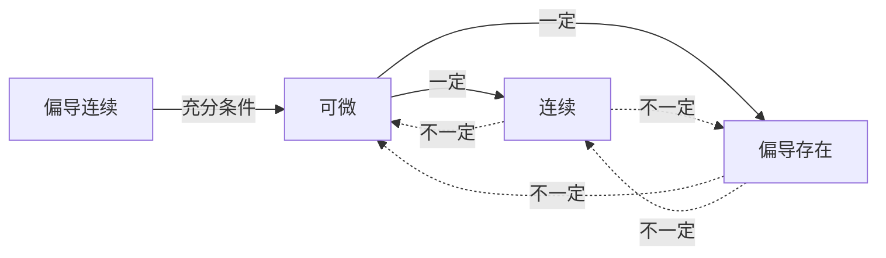

# 高等数学 第09章 多元函数微分法及其应用

> **这是什么**：第09章「多元函数微分法及其应用」的考点笔记原文，本份含 **4 个考点**、约 **14746 字**。
> **怎么用**：先贴 `0-教练规则` + 对应科目 `状态卡`，再把本文件**全文**贴上去，然后说「开始讲本章第 X 节」。
> **来源**：`资料/电子书蒸馏/04-高数/考点笔记` · 导出于 2026-11-03

---

## G9-1-多元函数的基本概念

```
【课程】04-高数
【章节】第9章　多元函数微分法及其应用
【节】第9章 第1考点
【考点】G9-1　多元函数的基本概念
【考频】★★★☆☆
【题型】单选、填空
============================================================

> **学科系统**：高等数学 → 多元函数 → 基本概念
> **秒杀类比**：一元函数是"一个输入对应一个输出"（$y = f(x)$），二元函数是"两个输入对应一个输出"（$z = f(x,y)$）。就像烤面包——温度和时间两个变量共同决定面包的成品质量。三维空间中的曲面就是二元函数的图像。

## 一、 核心知识解构

### 1. 多元函数的定义

**二元函数**：设 $D \subset \mathbb{R}^2$，若对任意 $(x,y) \in D$，按法则 $f$ 有唯一确定的 $z$ 与之对应，则称 $f$ 为 $D$ 上的二元函数，记作：
$$z = f(x,y), \quad (x,y) \in D$$

**$n$ 元函数**：$y = f(x_1, x_2, \cdots, x_n)$

### 2. 二元函数的定义域

$$D = \{(x,y) | f(x,y) \text{ 有定义}\}$$

**常见约束**：
| 约束类型 | 条件 |
|:---|:---|
| 分母不为零 | $f(x,y) = \frac{1}{g(x,y)} \implies g(x,y) \neq 0$ |
| 偶次根号非负 | $f(x,y) = \sqrt{g(x,y)} \implies g(x,y) \geq 0$ |
| 对数真数正 | $f(x,y) = \ln[g(x,y)] \implies g(x,y) > 0$ |
| 反正弦/余弦 | $f(x,y) = \arcsin[g(x,y)] \implies |g(x,y)| \leq 1$ |

### 3. 二元函数的几何意义

$z = f(x,y)$ 表示空间中的一张**曲面**。定义域 $D$ 是曲面在 $xOy$ 面上的投影区域。

### 4. 二元函数的极限

$$\lim_{(x,y) \to (x_0,y_0)} f(x,y) = A$$

**定义**：当 $(x,y)$ 以任意方式趋近于 $(x_0,y_0)$ 时，$f(x,y)$ 都趋近于 $A$。

**与一元极限的关键区别**：
- 一元函数：只有左、右两个方向趋近
- 二元函数：有**无穷多个**趋近路径（沿直线、曲线、任意路径）

### 5. 极限的存在性判定

**存在**：沿**所有可能路径**趋近时，极限值都相同。

**不存在**：找到两条不同路径，极限值不同（常用 $y = kx$ 或 $y = x^2$ 等特殊路径）。

> **例**：证明 $\lim_{(x,y)\to(0,0)} \frac{xy}{x^2 + y^2}$ 不存在。
> 沿 $y = kx$：$\frac{x(kx)}{x^2 + (kx)^2} = \frac{k}{1+k^2}$，结果随 $k$ 变化，故极限不存在。

### 6. 二元函数的连续性

若 $\lim_{(x,y) \to (x_0,y_0)} f(x,y) = f(x_0,y_0)$，则 $f$ 在 $(x_0,y_0)$ 处连续。

**初等函数在其定义域内连续**——和一元函数一样的性质。

### 7. 有界闭区域上连续函数的性质

| 性质 | 说明 |
|:---|:---|
| 最值定理 | 有界闭区域上连续的函数必有最大值和最小值 |
| 介值定理 | 可取到最大值和最小值之间的任何值 |

## 二、 考试红牌警告与秒杀秘籍

* 🚨 **易错雷区**：证明极限存在是**非常困难**的（需要所有路径一致），但证明极限不存在很简单——找到两条不同路径即可
* 🚨 **易错雷区**：沿 $y = kx$ 趋近时极限值与 $k$ 无关，**不能证明**极限存在（可能沿 $y = x^2$ 趋近时结果不同）
* 🚨 **易错雷区**：二元函数的极限趋近是"任意方式"，不只是沿直线——还要考虑沿曲线的情况
* 🔑 **秒杀秘籍**：判断极限不存在 → 先试 $y = kx$，如果结果依赖 $k$，则极限不存在
* 🔑 **秒杀秘籍**：如果 $y = kx$ 时极限与 $k$ 无关，再试 $y = x^2$ 或 $x = y^2$ 看结果是否一致
* 🔑 **秒杀秘籍**：求定义域 → 列出所有约束条件 → 取交集 → 用集合或图形表示

## 三、 闭卷真题挑战

> **【真题演练】**：求函数 $z = \ln(x + y - 1) + \frac{1}{\sqrt{4 - x^2 - y^2}}$ 的定义域。

【答案与解析】
**【正确答案】**：
约束条件：
1. $x + y - 1 > 0 \implies x + y > 1$
2. $4 - x^2 - y^2 > 0 \implies x^2 + y^2 < 4$

所以定义域为：
$$D = \{(x,y) | x + y > 1 \text{ 且 } x^2 + y^2 < 4\}$$

几何解释：半径 $R=2$ 的圆内部，且位于直线 $x + y = 1$ 的上方区域。

**【核心解析】**：
对数要求真数 > 0，根号在分母要求被开方数 > 0（不能等于0）。两个条件取交集。

**【真题演练】**：判断极限 $\lim_{(x,y)\to(0,0)} \frac{x^2 y}{x^4 + y^2}$ 是否存在。

【答案与解析】
**【正确答案】**：
沿 $y = kx$：$\frac{x^2 \cdot kx}{x^4 + k^2 x^2} = \frac{kx}{x^2 + k^2} \to 0$（当 $x \to 0$）

沿 $y = x^2$：$\frac{x^2 \cdot x^2}{x^4 + x^4} = \frac{x^4}{2x^4} = \frac{1}{2}$

沿两条路径结果不同（$0 \neq \frac{1}{2}$），故极限不存在。

**【核心解析】**：
沿 $y = kx$ 得 0，但沿 $y = x^2$ 得 $\frac{1}{2}$——证明了极限不存在。注意这里 $y = kx$ 不够，因为分母有 $x^4$ 项，需要用 $y = x^2$ 这种非线性路径来检验。

## 四、 📖 教材习题全解对照

> 本讲内容对应 **同济大学《高等数学》第八版 下册 第九章 多元函数微分法及其应用**

| 教材习题 | 对应知识点 | 难度 |
|:---|:---|:---:|
| **习题 9-1** 第1-5题 | 多元函数的定义域 | ⭐ |
| **习题 9-1** 第6-10题 | 二元函数的极限与连续性 | ⭐⭐⭐ |

> 💡 **刷题建议**：本章重点在于后几节的计算，基础概念部分以理解为主。定义域题必会，极限证明题理解思路即可。

============================================================
【原文锚点】《高等数学》精编讲义 第9章（_raw/gaoshu.txt）
【来源】原 高等数学/第五章 多元函数/5.1 多元函数的基本概念.md
```

---

## G9-2-偏导数与全微分

```
【课程】04-高数
【章节】第9章　多元函数微分法及其应用
【节】第9章 第2考点
【考点】G9-2　偏导数与全微分
【考频】★★★★★
【题型】计算
============================================================

> **学科系统**：高等数学 → 多元函数 → 偏导数与全微分
> **秒杀类比**：偏导数就是"固定其他变量只看一个"的导数——就像在三维曲面上沿 $x$ 方向切一刀看截面斜率。全微分则是"所有方向微小变化的线性组合"——像天气预报中，温度变化 = 经度影响 + 纬度影响 + 高度影响。

## 一、 核心知识解构

### 1. 偏导数的定义

函数 $z = f(x,y)$ 在 $(x_0,y_0)$ 处对 $x$ 的偏导数：

$$f_x(x_0,y_0) = \frac{\partial z}{\partial x}\bigg|_{(x_0,y_0)} = \lim_{\Delta x \to 0} \frac{f(x_0 + \Delta x, y_0) - f(x_0, y_0)}{\Delta x}$$

对 $y$ 的偏导数：

$$f_y(x_0,y_0) = \frac{\partial z}{\partial y}\bigg|_{(x_0,y_0)} = \lim_{\Delta y \to 0} \frac{f(x_0, y_0 + \Delta y) - f(x_0, y_0)}{\Delta y}$$

### 2. 偏导数的计算

**方法**：对 $x$ 求偏导时，将 $y$ 视为常数；对 $y$ 求偏导时，将 $x$ 视为常数。

> **例**：$f(x,y) = x^2 + 3xy + y^3$
> $f_x = 2x + 3y$（$y^3$ 视为常数，导数为 0）
> $f_y = 3x + 3y^2$（$x^2$ 视为常数，导数为 0）

### 3. 高阶偏导数

$$\frac{\partial^2 z}{\partial x^2} = f_{xx},\quad \frac{\partial^2 z}{\partial y^2} = f_{yy},\quad \frac{\partial^2 z}{\partial x\partial y} = f_{xy},\quad \frac{\partial^2 z}{\partial y\partial x} = f_{yx}$$

**混合偏导与次序无关定理**：若 $f_{xy}$ 和 $f_{yx}$ 在区域内连续，则：
$$f_{xy} = f_{yx}$$

### 4. 全微分的定义

函数 $z = f(x,y)$ 在 $(x,y)$ 处的全微分：

$$dz = f_x(x,y)dx + f_y(x,y)dy$$

**可微的充分条件**：若 $f_x$ 和 $f_y$ 在 $(x,y)$ 处连续，则 $f$ 在该点可微。

### 5. 偏导数存在、可微、连续的关系



### 6. 全微分的几何意义

$dz = f_x dx + f_y dy$ 表示曲面在切平面上的**线性逼近**（增量）。

### 7. 全微分的近似计算

$$f(x + \Delta x, y + \Delta y) \approx f(x,y) + f_x(x,y)\Delta x + f_y(x,y)\Delta y$$

## 二、 考试红牌警告与秒杀秘籍

* 🚨 **易错雷区**：$f_{xy}$ 和 $f_{yx}$ 在混合偏导连续时相等——但如果不连续则可能不等。考试中通常默认连续，可直接交换求导次序
* 🚨 **易错雷区**："偏导存在" 推不出 "连续"——分段函数在分界点处常出现偏导存在但不连续的情况
* 🚨 **易错雷区**："偏导连续" → "可微" → "连续" 和 "偏导存在"，但反过来都不成立
* 🔑 **秒杀秘籍**：求偏导时，把其他变量当成"常数"，用一元函数求导法则即可
* 🔑 **秒杀秘籍**：求全微分直接对每个变量求偏导，然后 $dz = f_x dx + f_y dy$，无需额外步骤
* 🔑 **秒杀秘籍**：判断可微性 → 先确认偏导存在 → 验证 $\lim_{(\Delta x,\Delta y)\to(0,0)} \frac{\Delta z - dz}{\sqrt{(\Delta x)^2 + (\Delta y)^2}} = 0$

## 三、 闭卷真题挑战

> **【真题演练】**：求 $z = x^2 y + \sin(xy) + e^{xy}$ 的一阶偏导数和全微分。

【答案与解析】
**【正确答案】**：
$$z_x = 2xy + y\cos(xy) + ye^{xy}$$
$$z_y = x^2 + x\cos(xy) + xe^{xy}$$
$$dz = [2xy + y\cos(xy) + ye^{xy}]dx + [x^2 + x\cos(xy) + xe^{xy}]dy$$

**【核心解析】**：
对 $x$ 求偏导时 $y$ 当常数：$x^2 y$ 中 $y$ 是系数，得 $2xy$；$\sin(xy)$ 是复合函数，链式法则得 $y\cos(xy)$；$e^{xy}$ 求导得 $ye^{xy}$。对 $y$ 求偏导同理。

**【真题演练】**：求 $z = x^3 y^2 - 2xy^3$ 的所有二阶偏导数。

【答案与解析】
**【正确答案】**：
一阶：$z_x = 3x^2 y^2 - 2y^3$，$z_y = 2x^3 y - 6xy^2$

二阶：
$z_{xx} = 6xy^2$
$z_{yy} = 2x^3 - 12xy$
$z_{xy} = 6x^2 y - 6y^2$
$z_{yx} = 6x^2 y - 6y^2$

验证：$z_{xy} = z_{yx}$ ✅（混合偏导相等）

**【核心解析】**：
先求一阶偏导，再对每个偏导继续求偏导。注意 $z_{xy}$ 是先对 $x$ 再对 $y$，$z_{yx}$ 是先对 $y$ 再对 $x$——结果应相等。

## 四、 📖 教材习题全解对照

> 本讲内容对应 **同济大学《高等数学》第八版 下册 第九章 多元函数微分法及其应用**

| 教材习题 | 对应知识点 | 难度 |
|:---|:---|:---:|
| **习题 9-2** 第1-6题 | 偏导数的计算 | ⭐ |
| **习题 9-2** 第7-12题 | 高阶偏导数 | ⭐⭐ |
| **习题 9-3** 第1-5题 | 全微分 | ⭐⭐ |
| **总习题九** 第1-8题 | 偏导与可微综合 | ⭐⭐⭐ |

> 💡 **刷题建议**：偏导数的计算是基本功，建议习题9-2的全部题目练一遍。全微分部分习题9-3的1-4题覆盖了主要题型。

============================================================
【原文锚点】《高等数学》精编讲义 第9章（_raw/gaoshu.txt）
【来源】原 高等数学/第五章 多元函数/5.2 偏导数与全微分.md
```

---

## G9-3-多元复合函数与隐函数求导

```
【课程】04-高数
【章节】第9章　多元函数微分法及其应用
【节】第9章 第3考点
【考点】G9-3　多元复合函数与隐函数求导
【考频】★★★★★
【题型】计算
============================================================

> **学科系统**：高等数学 → 多元函数 → 复合函数与隐函数求导
> **秒杀类比**：复合函数求偏导就像"链式反应"——外层先导，乘以内层导数，一层层传递下去。隐函数求导就像"隔山打牛"——虽然 $y$ 没有显式写成 $x$ 的公式，但两边同时对 $x$ 求导，通过解方程找到 $\frac{dy}{dx}$。

## 一、 核心知识解构

### 1. 多元复合函数的链式法则

#### 情形一：$z = f(u,v)$，$u = u(x,y)$，$v = v(x,y)$

$$\frac{\partial z}{\partial x} = \frac{\partial z}{\partial u}\cdot\frac{\partial u}{\partial x} + \frac{\partial z}{\partial v}\cdot\frac{\partial v}{\partial x}$$
$$\frac{\partial z}{\partial y} = \frac{\partial z}{\partial u}\cdot\frac{\partial u}{\partial y} + \frac{\partial z}{\partial v}\cdot\frac{\partial v}{\partial y}$$

**记忆口诀**："分段求导，相加——每条路径先导外层再导内层，所有路径相加。"

#### 情形二：$z = f(u,v)$，$u = u(t)$，$v = v(t)$

$$\frac{dz}{dt} = \frac{\partial z}{\partial u}\cdot\frac{du}{dt} + \frac{\partial z}{\partial v}\cdot\frac{dv}{dt}$$

**注意**：这里 $z$ 最终是一元函数 $z(t)$，所以是**全导数** $\frac{dz}{dt}$。

#### 情形三：$z = f(u,x,y)$，$u = u(x,y)$

$$\frac{\partial z}{\partial x} = \frac{\partial f}{\partial u}\cdot\frac{\partial u}{\partial x} + \frac{\partial f}{\partial x}$$
$$\frac{\partial z}{\partial y} = \frac{\partial f}{\partial u}\cdot\frac{\partial u}{\partial y} + \frac{\partial f}{\partial y}$$

### 2. 全微分形式不变性

无论 $u,v$ 是自变量还是中间变量，都有：
$$dz = \frac{\partial z}{\partial u}du + \frac{\partial z}{\partial v}dv$$

### 3. 隐函数求导法

#### 一元隐函数 $F(x,y) = 0$

$$\frac{dy}{dx} = -\frac{F_x}{F_y} \quad (F_y \neq 0)$$

#### 二元隐函数 $F(x,y,z) = 0$

$$\frac{\partial z}{\partial x} = -\frac{F_x}{F_z}, \quad \frac{\partial z}{\partial y} = -\frac{F_y}{F_z} \quad (F_z \neq 0)$$

#### 隐函数方程组

$$\begin{cases}
F(x,y,u,v) = 0 \\
G(x,y,u,v) = 0
\end{cases}$$

通过雅可比行列式求解偏导数：
$$J = \frac{\partial(F,G)}{\partial(u,v)} = \begin{vmatrix} F_u & F_v \\ G_u & G_v \end{vmatrix} \neq 0$$

## 二、 考试红牌警告与秒杀秘籍

* 🚨 **易错雷区**：链式法则中，中间变量有几个，求和项就有几个——不要漏项！
* 🚨 **易错雷区**：$\frac{\partial z}{\partial x}$ 和 $\frac{dz}{dx}$ 的区别：偏导数是 $z$ 作为多元函数对 $x$ 求偏导（其他变量固定），全导数是 $z$ 最终作为一元函数对 $x$ 求导
* 🚨 **易错雷区**：隐函数求导公式 $F_x$ 和 $F_y$ 是 $F$ 对 $x$ 和 $y$ 的偏导——不是原函数求导
* 🔑 **秒杀秘籍**：画树形图！复合函数关系复杂时，画出变量依赖关系树，每条从根到叶的路径对应一个乘积项
* 🔑 **秒杀秘籍**：隐函数求导三步走：① 构造函数 $F$ ② 求 $F_x, F_y$（或 $F_z$）③ 代入公式
* 🔑 **秒杀秘籍**：验证隐函数求导结果 → 将显化后的结果代入，看是否一致

## 三、 闭卷真题挑战

> **【真题演练】**：设 $z = e^{u}\sin v$，其中 $u = xy$，$v = x + y$，求 $\frac{\partial z}{\partial x}$ 和 $\frac{\partial z}{\partial y}$。

【答案与解析】
**【正确答案】**：
$\frac{\partial z}{\partial u} = e^u \sin v$，$\frac{\partial z}{\partial v} = e^u \cos v$
$\frac{\partial u}{\partial x} = y$，$\frac{\partial v}{\partial x} = 1$
$\frac{\partial u}{\partial y} = x$，$\frac{\partial v}{\partial y} = 1$

$$\frac{\partial z}{\partial x} = \frac{\partial z}{\partial u}\cdot\frac{\partial u}{\partial x} + \frac{\partial z}{\partial v}\cdot\frac{\partial v}{\partial x} = e^u\sin v \cdot y + e^u\cos v \cdot 1 = e^{xy}[y\sin(x+y) + \cos(x+y)]$$

$$\frac{\partial z}{\partial y} = \frac{\partial z}{\partial u}\cdot\frac{\partial u}{\partial y} + \frac{\partial z}{\partial v}\cdot\frac{\partial v}{\partial y} = e^u\sin v \cdot x + e^u\cos v \cdot 1 = e^{xy}[x\sin(x+y) + \cos(x+y)]$$

**【核心解析】**：
$z \to u, v \to x,y$ 的树形图：$z$ 连接 $u$ 和 $v$，$u$ 和 $v$ 分别连接 $x$ 和 $y$。$\frac{\partial z}{\partial x}$ 有两条路径：$z \to u \to x$ 和 $z \to v \to x$，两条相加。

**【真题演练】**：设 $x^2 + y^2 + z^2 - 4z = 0$，求 $\frac{\partial z}{\partial x}$ 和 $\frac{\partial z}{\partial y}$。

【答案与解析】
**【正确答案】**：
令 $F(x,y,z) = x^2 + y^2 + z^2 - 4z$
$F_x = 2x$，$F_y = 2y$，$F_z = 2z - 4$

$$\frac{\partial z}{\partial x} = -\frac{F_x}{F_z} = -\frac{2x}{2z-4} = \frac{x}{2-z}$$
$$\frac{\partial z}{\partial y} = -\frac{F_y}{F_z} = -\frac{2y}{2z-4} = \frac{y}{2-z}$$

**【核心解析】**：
隐函数求导三步走：① 移项构造 $F$ ② 求三个偏导 ③ 套公式。注意公式中的**负号**不能丢！

## 四、 📖 教材习题全解对照

> 本讲内容对应 **同济大学《高等数学》第八版 下册 第九章 多元函数微分法及其应用**

| 教材习题 | 对应知识点 | 难度 |
|:---|:---|:---:|
| **习题 9-4** 第1-8题 | 多元复合函数链式法则 | ⭐⭐ |
| **习题 9-4** 第9-14题 | 全微分形式不变性 | ⭐⭐ |
| **习题 9-5** 第1-5题 | 一元隐函数求导 | ⭐⭐ |
| **习题 9-5** 第6-10题 | 多元隐函数求偏导 | ⭐⭐⭐ |
| **总习题九** 第9-16题 | 综合应用 | ⭐⭐⭐ |

> 💡 **刷题建议**：链式法则是本章的核心技能。习题9-4的第1-8题必须熟练，建议先画树形图再写表达式。隐函数求导习题9-5的1-6题是基础题型。

============================================================
【原文锚点】《高等数学》精编讲义 第9章（_raw/gaoshu.txt）
【来源】原 高等数学/第五章 多元函数/5.3 多元复合函数与隐函数求导法.md
```

---

## G9-4-多元函数的极值

```
【课程】04-高数
【章节】第9章　多元函数微分法及其应用
【节】第9章 第4考点
【考点】G9-4　多元函数的极值
【考频】★★★★☆
【题型】计算
============================================================

> **学科系统**：高等数学 → 多元函数 → 多元函数的极值
> **秒杀类比**：多元函数极值就像找山里的最高点和最低点——山顶是极大值，山谷是极小值。鞍点则是"马鞍上的中心点"——在一个方向看是最高，在另一方向看是最低。

## 一、 核心知识解构

### 1. 极值的定义

设 $z = f(x,y)$ 在 $(x_0,y_0)$ 的某邻域内有定义，若对任意 $(x,y) \neq (x_0,y_0)$：
- $f(x,y) \leq f(x_0,y_0)$ → 极大值
- $f(x,y) \geq f(x_0,y_0)$ → 极小值

### 2. 极值的必要条件

若 $f(x,y)$ 在 $(x_0,y_0)$ 处取得极值且偏导存在，则：
$$f_x(x_0,y_0) = 0,\quad f_y(x_0,y_0) = 0$$

满足该条件的点称为**驻点**（或**临界点**）。

**注意**：驻点 $\nRightarrow$ 极值点（如鞍点）；偏导不存在的点也可能是极值点。

### 3. 极值的充分条件（二元函数）

设 $(x_0,y_0)$ 是驻点，记：
$$A = f_{xx}(x_0,y_0), \quad B = f_{xy}(x_0,y_0), \quad C = f_{yy}(x_0,y_0)$$
$$\Delta = AC - B^2 \quad (\text{判别式})$$

| $\Delta$ 的符号 | 结论 |
|:---|:---|
| $\Delta > 0$ 且 $A > 0$ | **极小值** |
| $\Delta > 0$ 且 $A < 0$ | **极大值** |
| $\Delta < 0$ | **不是极值**（鞍点） |
| $\Delta = 0$ | **无法判定**（需其他方法） |

### 4. 条件极值与拉格朗日乘数法

求 $z = f(x,y)$ 在约束条件 $\varphi(x,y) = 0$ 下的极值。

**拉格朗日函数**：
$$L(x,y,\lambda) = f(x,y) + \lambda\varphi(x,y)$$

解方程组：
$$\begin{cases}
L_x = f_x + \lambda\varphi_x = 0 \\
L_y = f_y + \lambda\varphi_y = 0 \\
L_\lambda = \varphi(x,y) = 0
\end{cases}$$

得到可能的极值点。

#### $n$ 元 $m$ 个约束的推广
$$L(x_1,\cdots,x_n,\lambda_1,\cdots,\lambda_m) = f(x_1,\cdots,x_n) + \sum_{i=1}^m \lambda_i \varphi_i(x_1,\cdots,x_n)$$

### 5. 多元函数的最值

在有界闭区域 $D$ 上求 $f(x,y)$ 的最值：
1. 求 $D$ 内的所有驻点
2. 求 $D$ 边界上的可能极值点（化条件极值为无条件或拉格朗日法）
3. 比较所有候选点的函数值，取最大/最小

## 二、 考试红牌警告与秒杀秘籍

* 🚨 **易错雷区**：$\Delta = AC - B^2$ 是判别式——有些教材写成 $f_{xx}f_{yy} - (f_{xy})^2$，本质一样
* 🚨 **易错雷区**：$\Delta > 0$ 时还要看 $A$ 的符号才能判定是极大还是极小——光有 $\Delta > 0$ 不够
* 🚨 **易错雷区**：条件极值中，拉格朗日乘数法找到的是**候选点**，不一定真的是极值点——需根据实际情况判定
* 🔑 **秒杀秘籍**：无条件极值三步走：① 解 $f_x = f_y = 0$ 得驻点 ② 求 $A,B,C$ ③ 用 $\Delta = AC - B^2$ 判定
* 🔑 **秒杀秘籍**：条件极值：看到"在……条件下求最值"立即用拉格朗日乘数法
* 🔑 **秒杀秘籍**：实际应用题（如求最大体积、最小表面积）→ 先建目标函数和约束条件 → 拉格朗日法求解

## 三、 闭卷真题挑战

> **【真题演练】**：求 $f(x,y) = x^3 - y^3 + 3x^2 + 3y^2 - 9x$ 的极值。

【答案与解析】
**【正确答案】**：
一阶偏导：
$f_x = 3x^2 + 6x - 9 = 3(x^2 + 2x - 3) = 3(x+3)(x-1)$
$f_y = -3y^2 + 6y = -3y(y-2)$

解 $\begin{cases} f_x = 0 \\ f_y = 0 \end{cases}$ 得驻点：$(1,0), (1,2), (-3,0), (-3,2)$

二阶偏导：$f_{xx} = 6x + 6$，$f_{xy} = 0$，$f_{yy} = -6y + 6$

| 驻点 | $A = f_{xx}$ | $B = f_{xy}$ | $C = f_{yy}$ | $\Delta = AC - B^2$ | 结论 |
|:---|:---:|:---:|:---:|:---:|:---|
| $(1,0)$ | $12$ | $0$ | $6$ | $72 > 0$ | **极小值** $f(1,0) = -4$ |
| $(1,2)$ | $12$ | $0$ | $-6$ | $-72 < 0$ | 不是极值 |
| $(-3,0)$ | $-12$ | $0$ | $6$ | $-72 < 0$ | 不是极值 |
| $(-3,2)$ | $-12$ | $0$ | $-6$ | $72 > 0$ | **极大值** $f(-3,2) = 31$ |

**【核心解析】**：
四个驻点逐个判定。$\Delta > 0$ 且 $A > 0$ → 极小；$\Delta > 0$ 且 $A < 0$ → 极大；$\Delta < 0$ → 鞍点。

**【真题演练】**：求 $f(x,y) = x^2 + y^2$ 在条件 $x + y = 1$ 下的最小值。

【答案与解析】
**【正确答案】**：
**方法：拉格朗日乘数法**
令 $L(x,y,\lambda) = x^2 + y^2 + \lambda(x + y - 1)$

$\begin{cases} L_x = 2x + \lambda = 0 \\ L_y = 2y + \lambda = 0 \\ L_\lambda = x + y - 1 = 0 \end{cases}$

由前两式得 $x = y = -\frac{\lambda}{2}$，代入第三式：$-\frac{\lambda}{2} - \frac{\lambda}{2} = 1 \implies \lambda = -1$

所以 $x = y = \frac{1}{2}$，最小值为 $f(\frac{1}{2},\frac{1}{2}) = \frac{1}{4} + \frac{1}{4} = \frac{1}{2}$

**【核心解析】**：
拉格朗日乘数法标准流程：构造 $L$ → 三个方程联立 → 解出 $x,y$ 代入目标函数。

## 四、 📖 教材习题全解对照

> 本讲内容对应 **同济大学《高等数学》第八版 下册 第九章 多元函数微分法及其应用**

| 教材习题 | 对应知识点 | 难度 |
|:---|:---|:---:|
| **习题 9-8** 第1-6题 | 无条件极值 | ⭐⭐ |
| **习题 9-8** 第7-12题 | 条件极值与拉格朗日乘数法 | ⭐⭐⭐ |
| **习题 9-8** 第13-18题 | 最值应用题 | ⭐⭐⭐ |
| **总习题九** 第17-24题 | 综合应用 | ⭐⭐⭐⭐ |

> 💡 **刷题建议**：无条件极值要熟练掌握判别式法。条件极值和最值应用题是考试中的高分值题型，建议习题9-8的7-15题多练几遍。

============================================================
【原文锚点】《高等数学》精编讲义 第9章（_raw/gaoshu.txt）
【来源】原 高等数学/第五章 多元函数/5.4 多元函数的极值.md
```
