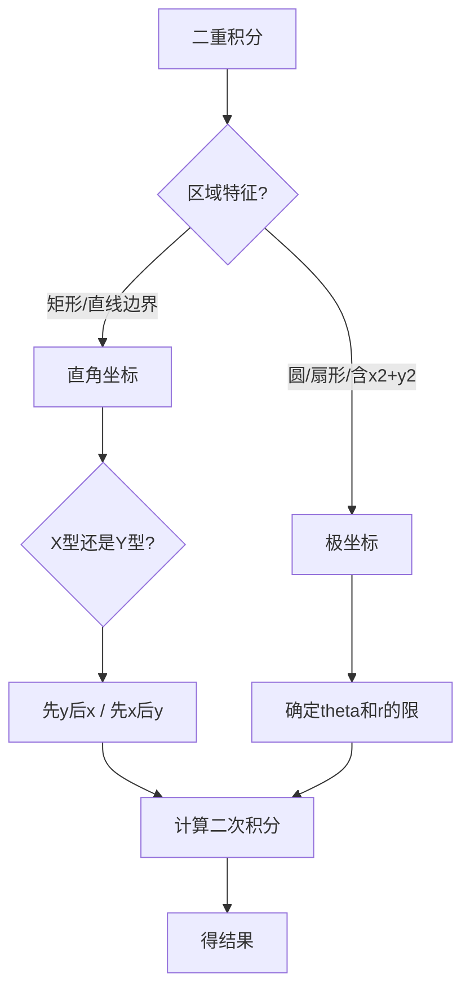

# 高等数学 第10章 重积分

> **这是什么**：第10章「重积分」的考点笔记原文，本份含 **3 个考点**、约 **10814 字**。
> **怎么用**：先贴 `0-教练规则` + 对应科目 `状态卡`，再把本文件**全文**贴上去，然后说「开始讲本章第 X 节」。
> **来源**：`资料/电子书蒸馏/04-高数/考点笔记` · 导出于 2026-11-03

---

## G10-1-二重积分的概念与性质

```
【课程】04-高数
【章节】第10章　重积分
【节】第10章 第1考点
【考点】G10-1　二重积分的概念与性质
【考频】★★★★☆
【题型】单选、填空
============================================================

> **学科系统**：高等数学 → 重积分与曲线积分 → 二重积分
> **秒杀类比**：二重积分就是"算曲顶柱体的体积"——把底面积分成无数个小方块，量每个方块上柱体的高度，全部加起来。就像用无数根等截面的吸管填满一个不规则杯子，每根吸管的高度不一样，但总和就是杯子的容积。

## 一、 核心知识解构

### 1. 二重积分的定义

$$\iint_D f(x,y) d\sigma = \lim_{\lambda \to 0} \sum_{i=1}^n f(\xi_i, \eta_i) \Delta\sigma_i$$

其中 $D$ 是积分区域，$f(x,y)$ 是被积函数，$d\sigma$ 是面积微元。

### 2. 二重积分的几何意义

- 当 $f(x,y) \geq 0$ 时，$\iint_D f(x,y) d\sigma$ 表示以 $D$ 为底、以 $z = f(x,y)$ 为顶的**曲顶柱体体积**
- 当 $f(x,y) = 1$ 时，$\iint_D 1 \cdot d\sigma = \text{区域 } D \text{ 的面积}$
- 当 $f(x,y)$ 可正可负时，表示各部分体积的代数和

### 3. 二重积分的性质

| 性质 | 公式 |
|:---|:---|
| **线性性** | $\iint_D [kf \pm lg] d\sigma = k\iint_D f d\sigma \pm l\iint_D g d\sigma$ |
| **区域可加性** | $\iint_{D_1 \cup D_2} f d\sigma = \iint_{D_1} f d\sigma + \iint_{D_2} f d\sigma$（$D_1 \cap D_2$ 无内点）|
| **保序性** | 若 $f(x,y) \leq g(x,y)$，则 $\iint_D f d\sigma \leq \iint_D g d\sigma$ |
| **估值不等式** | $m \cdot S \leq \iint_D f d\sigma \leq M \cdot S$（$m,M$ 为最值，$S$ 为面积）|
| **中值定理** | $\exists (\xi,\eta) \in D$ 使 $\iint_D f d\sigma = f(\xi,\eta) \cdot S$ |

### 4. 对称性简化计算

#### 奇偶对称性
若 $D$ 关于 $y$ 轴对称：
- $f$ 关于 $x$ 为奇函数：$\iint_D f d\sigma = 0$
- $f$ 关于 $x$ 为偶函数：$\iint_D f d\sigma = 2\iint_{D_{x \geq 0}} f d\sigma$

#### 轮换对称性
若 $D$ 关于 $y = x$ 对称，则 $\iint_D f(x,y) d\sigma = \iint_D f(y,x) d\sigma$。

## 二、 考试红牌警告与秒杀秘籍

* 🚨 **易错雷区**：二重积分的结果是**数**（标量），不是向量。曲顶柱体的体积是正数，但被积函数为负时积分值为负
* 🚨 **易错雷区**：确定积分限时，**"后积先定限"**——先对 $y$ 积分时，上限必须 $\geq$ 下限
* 🚨 **易错雷区**：利用对称性时，必须同时满足区域对称和函数奇偶——缺一不可
* 🔑 **秒杀秘籍**：被积函数为 $1$，积分值就是区域面积——适合计算不规则图形面积
* 🔑 **秒杀秘籍**：看到对称区域先想奇偶性——如果被积函数是奇函数，整个积分为 $0$，不用算！
* 🔑 **秒杀秘籍**：估值不等式可以快速判断积分值的大致范围，适合做选择题的排除法

## 三、 闭卷真题挑战

> **【真题演练】**：利用二重积分的性质，估计 $\iint_D (x + y + 1) d\sigma$ 的值，其中 $D = \{(x,y) | 0 \leq x \leq 1, 0 \leq y \leq 2\}$。

【答案与解析】
**【正确答案】**：
区域 $D$ 的面积 $S = 1 \times 2 = 2$

在 $D$ 上：$0 \leq x \leq 1$，$0 \leq y \leq 2$
$0 + 0 + 1 = 1 \leq x + y + 1 \leq 1 + 2 + 1 = 4$

由估值不等式：$1 \times 2 \leq \iint_D (x+y+1)d\sigma \leq 4 \times 2$
即：$2 \leq I \leq 8$

**【核心解析】**：
估值不等式 $\,mS \leq \iint_D f d\sigma \leq MS$：先找 $f$ 在 $D$ 上的最小值和最大值，分别乘以区域面积。

## 四、 📖 教材习题全解对照

> 本讲内容对应 **同济大学《高等数学》第八版 下册 第十章 重积分**

| 教材习题 | 对应知识点 | 难度 |
|:---|:---|:---:|
| **习题 10-1** 第1-4题 | 二重积分的概念与性质 | ⭐ |
| **习题 10-1** 第5-6题 | 估值不等式 | ⭐⭐ |
| **总习题十** 第1-4题 | 概念综合 | ⭐⭐ |

> 💡 **刷题建议**：本节以理解概念为主，习题量不多。重点掌握对称性简化计算的方法，为下一节的计算打基础。

============================================================
【原文锚点】《高等数学》精编讲义 第10章（_raw/gaoshu.txt）
【来源】原 高等数学/第六章 重积分与曲线积分/6.1 二重积分的概念与性质.md
```

---

## G10-2-二重积分的计算

```
【课程】04-高数
【章节】第10章　重积分
【节】第10章 第2考点
【考点】G10-2　二重积分的计算
【考频】★★★★★
【题型】计算
============================================================

> **学科系统**：高等数学 → 重积分与曲线积分 → 二重积分的计算
> **秒杀类比**：二重积分计算就像"先扫地再拖地"——先沿一个方向扫（第一次积分），再沿垂直方向拖（第二次积分）。在直角坐标中是横平竖直地扫，在极坐标中是转圈扫。

## 一、 核心知识解构

### 1. 直角坐标系下的计算

#### $X$ 型区域（先 $y$ 后 $x$）
区域 $D: a \leq x \leq b,\; \varphi_1(x) \leq y \leq \varphi_2(x)$

$$\iint_D f(x,y) d\sigma = \int_a^b \left[ \int_{\varphi_1(x)}^{\varphi_2(x)} f(x,y) dy \right] dx$$

#### $Y$ 型区域（先 $x$ 后 $y$）
区域 $D: c \leq y \leq d,\; \psi_1(y) \leq x \leq \psi_2(y)$

$$\iint_D f(x,y) d\sigma = \int_c^d \left[ \int_{\psi_1(y)}^{\psi_2(y)} f(x,y) dx \right] dy$$

**口诀**："后积先定限，限内画条线，先交为下限，后交为上限。"

### 2. 极坐标系下的计算

#### 坐标变换
$$\begin{cases}
x = r\cos\theta \\
y = r\sin\theta
\end{cases}$$

#### 面积微元
$$d\sigma = r\, dr\, d\theta$$

#### 积分公式
$$\iint_D f(x,y) d\sigma = \iint_D f(r\cos\theta, r\sin\theta) \cdot r\, dr\, d\theta$$

#### 常见极坐标区域
| 区域类型 | 积分限 | 图示 |
|:---|:---|:---|
| 极点在区域外 | $\theta_1 \leq \theta \leq \theta_2,\; r_1(\theta) \leq r \leq r_2(\theta)$ | 扇形环 |
| 极点在边界上 | $\theta_1 \leq \theta \leq \theta_2,\; 0 \leq r \leq r(\theta)$ | 扇形 |
| 极点在区域内 | $0 \leq \theta \leq 2\pi,\; 0 \leq r \leq r(\theta)$ | 含原点的区域 |

### 3. 何时用极坐标

被积函数或积分区域含有 $x^2 + y^2$ 时优先考虑极坐标：

| 特征 | 例子 |
|:---|:---|
| 被积函数含 $x^2+y^2$ | $f(x,y) = \sqrt{x^2 + y^2}$，$f(x,y) = \frac{1}{x^2 + y^2}$ |
| 积分区域为圆/环/扇形 | $x^2 + y^2 \leq R^2$，$r_1 \leq r \leq r_2$ |
| 被积函数含 $\frac{y}{x}$ | $f(x,y) = \arctan\frac{y}{x}$ |

### 4. 交换积分次序

当原积分次序计算困难时，交换次序可能大大简化。

**步骤**：
1. 由原积分限画出积分区域 $D$
2. 将 $D$ 按另一种类型描述（$X$ 型 $\leftrightarrow$ $Y$ 型）
3. 写出新次序下的积分

### 5. 二重积分计算流程



## 二、 考试红牌警告与秒杀秘籍

* 🚨 **易错雷区**：极坐标下面积微元是 $r\,dr\,d\theta$——**不要漏掉 $r$**！这是最常见的错误
* 🚨 **易错雷区**：交换积分次序时，**上下限要对换**——先积分的变量上下限可能是后积分变量的函数
* 🚨 **易错雷区**：$X$ 型区域先对 $y$ 积分时，$y$ 的上下限是关于 $x$ 的函数（常数是特例）
* 🔑 **秒杀秘籍**：积分区域画图最重要——画对了图，积分限就定对了一半
* 🔑 **秒杀秘籍**：看到 $x^2 + y^2$ 立刻想到极坐标——$x^2 + y^2 = r^2$ 会大大简化被积函数
* 🔑 **秒杀秘籍**：如果先对一个变量积分积不出来，试试交换次序

## 三、 闭卷真题挑战

> **【真题演练】**：计算 $\iint_D (x + 2y) d\sigma$，其中 $D$ 由 $y = x^2$ 和 $y = x$ 围成。

【答案与解析】
**【正确答案】**：
交点：$x^2 = x \implies x(x-1) = 0 \implies x = 0$ 或 $x = 1$

按 $X$ 型：$0 \leq x \leq 1$，$x^2 \leq y \leq x$

$$\iint_D (x + 2y) d\sigma = \int_0^1 \int_{x^2}^x (x + 2y) dy\, dx$$

先对 $y$ 积：
$$\int_{x^2}^x (x + 2y) dy = [xy + y^2]_{x^2}^x = (x^2 + x^2) - (x^3 + x^4) = 2x^2 - x^3 - x^4$$

再对 $x$ 积：
$$\int_0^1 (2x^2 - x^3 - x^4) dx = \left[\frac{2}{3}x^3 - \frac{1}{4}x^4 - \frac{1}{5}x^5\right]_0^1 = \frac{2}{3} - \frac{1}{4} - \frac{1}{5} = \frac{40 - 15 - 12}{60} = \frac{13}{60}$$

**【核心解析】**：
二重积分计算标准流程：画区域 → 定类型 → 定限 → 先内层后外层。$X$ 型区域先对 $y$ 积分，$y$ 的下限是 $x^2$，上限是 $x$。

**【真题演练】**：计算 $\iint_D e^{-(x^2 + y^2)} d\sigma$，其中 $D: x^2 + y^2 \leq 1$。

【答案与解析】
**【正确答案】**：
区域 $D$ 是单位圆，被积函数含 $x^2 + y^2$，用极坐标：

$0 \leq \theta \leq 2\pi$，$0 \leq r \leq 1$，$x^2 + y^2 = r^2$

$$\iint_D e^{-(x^2+y^2)} d\sigma = \int_0^{2\pi} \int_0^1 e^{-r^2} \cdot r\, dr\, d\theta$$

$$\int_0^1 r e^{-r^2} dr = -\frac{1}{2}\int_0^1 e^{-r^2} d(-r^2) = -\frac{1}{2}[e^{-r^2}]_0^1 = -\frac{1}{2}(e^{-1} - 1) = \frac{1}{2}(1 - e^{-1})$$

$$\int_0^{2\pi} d\theta = 2\pi$$

原积分 $= 2\pi \cdot \frac{1}{2}(1 - e^{-1}) = \pi(1 - \frac{1}{e})$

**【核心解析】**：
经典的极坐标例题。$e^{-(x^2+y^2)}$ 在直角坐标下无法积分，但转化为极坐标后用凑微分法轻松解决。注意 $r e^{-r^2}$ 的积分用 $u = r^2$ 换元。

## 四、 📖 教材习题全解对照

> 本讲内容对应 **同济大学《高等数学》第八版 下册 第十章 重积分**

| 教材习题 | 对应知识点 | 难度 |
|:---|:---|:---:|
| **习题 10-2** 第1-6题 | 直角坐标二重积分 | ⭐⭐ |
| **习题 10-2** 第7-12题 | 交换积分次序 | ⭐⭐⭐ |
| **习题 10-3** 第1-6题 | 极坐标二重积分 | ⭐⭐ |
| **习题 10-3** 第7-12题 | 极坐标综合 | ⭐⭐⭐ |
| **总习题十** 第5-12题 | 二重积分计算综合 | ⭐⭐⭐ |

> 💡 **刷题建议**：二重积分是本章的核心内容，习题10-2和10-3的全部题目都值得练习。极坐标尤其重要——很多在直角坐标下算不了的题在极坐标下轻松解决。

============================================================
【原文锚点】《高等数学》精编讲义 第10章（_raw/gaoshu.txt）
【来源】原 高等数学/第六章 重积分与曲线积分/6.2 二重积分的计算.md
```

---

## G10-3-三重积分

```
【课程】04-高数
【章节】第10章　重积分
【节】第10章 第3考点
【考点】G10-3　三重积分
【考频】★★★★☆
【题型】计算
============================================================

> **学科系统**：高等数学 → 重积分与曲线积分 → 三重积分
> **秒杀类比**：二重积分算的是"面积×高度"的体积，三重积分算的是"密度不均匀的物体的质量"——每个点 $(x,y,z)$ 的密度是 $f(x,y,z)$，积分就是把所有点的质量加起来。或者理解为"切面包"——把三维物体切成无数薄片，每片的质量加起来。

## 一、 核心知识解构

### 1. 三重积分的定义

$$\iiint_\Omega f(x,y,z) dV = \lim_{\lambda \to 0} \sum_{i=1}^n f(\xi_i, \eta_i, \zeta_i) \Delta V_i$$

其中 $\Omega$ 是空间区域，$dV$ 是体积微元。

### 2. 三重积分的物理意义

- 当 $f(x,y,z) \equiv 1$ 时，$\iiint_\Omega dV = \Omega$ 的体积
- 当 $f(x,y,z)$ 为密度函数时，积分值为物体的总质量

### 3. 三重积分的计算——直角坐标

#### 投影法（先一后二 / 穿针法）
$$\iiint_\Omega f(x,y,z) dV = \iint_{D_{xy}} \left[ \int_{z_1(x,y)}^{z_2(x,y)} f(x,y,z) dz \right] dxdy$$

**步骤**：
1. 将 $\Omega$ 投影到 $xOy$ 面，得投影区域 $D_{xy}$
2. 在 $D_{xy}$ 上任取一点，确定 $z$ 的下限和上限（穿针）
3. 先对 $z$ 积分，再对 $x,y$ 做二重积分

#### 截面法（先二后一 / 切片法）
$$\iiint_\Omega f(x,y,z) dV = \int_{c}^{d} \left[ \iint_{D_z} f(x,y,z) dxdy \right] dz$$

**步骤**：
1. 将 $\Omega$ 在 $z$ 轴方向切片，$z \in [c,d]$
2. 每个截面 $D_z$ 上做二重积分
3. 最后对 $z$ 积分

### 4. 三重积分的计算——柱坐标

#### 坐标变换
$$\begin{cases}
x = r\cos\theta \\
y = r\sin\theta \\
z = z
\end{cases}$$

#### 体积微元
$$dV = r\, dr\, d\theta\, dz$$

$$\iiint_\Omega f(x,y,z) dV = \iiint_\Omega f(r\cos\theta, r\sin\theta, z) \cdot r\, dr\, d\theta\, dz$$

**适用场景**：积分区域在 $xOy$ 面上的投影为圆域，或被积函数含 $x^2 + y^2$。

### 5. 三重积分的计算——球坐标

#### 坐标变换
$$\begin{cases}
x = r\sin\varphi\cos\theta \\
y = r\sin\varphi\sin\theta \\
z = r\cos\varphi
\end{cases}$$

其中 $r \geq 0$，$0 \leq \varphi \leq \pi$，$0 \leq \theta \leq 2\pi$。

#### 体积微元
$$dV = r^2\sin\varphi\, dr\, d\varphi\, d\theta$$

$$\iiint_\Omega f dV = \iiint_\Omega f(r\sin\varphi\cos\theta, r\sin\varphi\sin\theta, r\cos\varphi) \cdot r^2\sin\varphi\, dr\, d\varphi\, d\theta$$

**适用场景**：球体或球体的一部分，被积函数含 $x^2 + y^2 + z^2$。

### 6. 三种坐标系的对比

| 坐标系 | 适用场景 | 微元 | 优点 |
|:---|:---|:---|:---|
| **直角坐标** | 长方体、四面体等 | $dV = dx\,dy\,dz$ | 最直观 |
| **柱坐标** | 圆柱、圆锥、旋转体 | $dV = r\,dr\,d\theta\,dz$ | $x^2+y^2$ 秒变 $r^2$ |
| **球坐标** | 球体、球冠、锥体 | $dV = r^2\sin\varphi\,dr\,d\varphi\,d\theta$ | $x^2+y^2+z^2$ 秒变 $r^2$ |

## 二、 考试红牌警告与秒杀秘籍

* 🚨 **易错雷区**：柱坐标下 $dV = r\,dr\,d\theta\,dz$——不要漏掉 $r$！
* 🚨 **易错雷区**：球坐标下 $dV = r^2\sin\varphi\,dr\,d\varphi\,d\theta$——既有 $r^2$ 又有 $\sin\varphi$，缺一不可！
* 🚨 **易错雷区**：球坐标中 $\varphi$ 的范围是 $[0,\pi]$（从 $z$ 轴正方向到负方向），不是 $[0, 2\pi]$
* 🔑 **秒杀秘籍**：看到圆柱/圆锥 → 柱坐标；看到球体 → 球坐标；看到长方体 → 直角坐标
* 🔑 **秒杀秘籍**：截面法适合被积函数只与 $z$ 有关的情况（如 $f(z)$），此时截面上的二重积分等于截面积乘以 $f(z)$
* 🔑 **秒杀秘籍**：当积分区域为旋转体时，优先考虑柱坐标

## 三、 闭卷真题挑战

> **【真题演练】**：计算 $\iiint_\Omega z\, dV$，其中 $\Omega$ 由 $z = x^2 + y^2$ 和 $z = 4$ 围成。

【答案与解析】
**【正确答案】**：
用柱坐标：$z = r^2$，$z = 4$

$r$ 的范围：$r^2 \leq 4 \implies 0 \leq r \leq 2$
$\theta$ 的范围：$0 \leq \theta \leq 2\pi$
$z$ 的范围：$r^2 \leq z \leq 4$

$$\iiint_\Omega z\, dV = \int_0^{2\pi} \int_0^2 \int_{r^2}^4 z \cdot r\, dz\, dr\, d\theta$$

$$= \int_0^{2\pi} d\theta \int_0^2 r \left[ \frac{z^2}{2} \right]_{r^2}^4 dr$$

$$= 2\pi \int_0^2 r \left( \frac{16}{2} - \frac{r^4}{2} \right) dr = 2\pi \int_0^2 r(8 - \frac{r^4}{2}) dr$$

$$= 2\pi \int_0^2 (8r - \frac{r^5}{2}) dr = 2\pi \left[ 4r^2 - \frac{r^6}{12} \right]_0^2$$

$$= 2\pi \left( 16 - \frac{64}{12} \right) = 2\pi \left( 16 - \frac{16}{3} \right) = 2\pi \cdot \frac{32}{3} = \frac{64\pi}{3}$$

**【核心解析】**：
区域是旋转抛物面 $z = x^2 + y^2$ 被平面 $z = 4$ 截下的部分。柱坐标将 $x^2 + y^2$ 简化为 $r^2$。注意先对 $z$ 积分，$z$ 的下限是 $r^2$，上限是 $4$。

## 四、 📖 教材习题全解对照

> 本讲内容对应 **同济大学《高等数学》第八版 下册 第十章 重积分**

| 教材习题 | 对应知识点 | 难度 |
|:---|:---|:---:|
| **习题 10-4** 第1-6题 | 直角坐标三重积分 | ⭐⭐ |
| **习题 10-4** 第7-12题 | 柱坐标三重积分 | ⭐⭐⭐ |
| **习题 10-5** 第1-6题 | 球坐标三重积分 | ⭐⭐⭐ |
| **总习题十** 第13-20题 | 三重积分综合 | ⭐⭐⭐ |

> 💡 **刷题建议**：三重积分在专升本考试中通常以柱坐标为主。习题10-4的第1-8题涵盖了主要题型。球坐标考得较少，理解原理即可。

============================================================
【原文锚点】《高等数学》精编讲义 第10章（_raw/gaoshu.txt）
【来源】原 高等数学/第六章 重积分与曲线积分/6.3 三重积分.md
```
