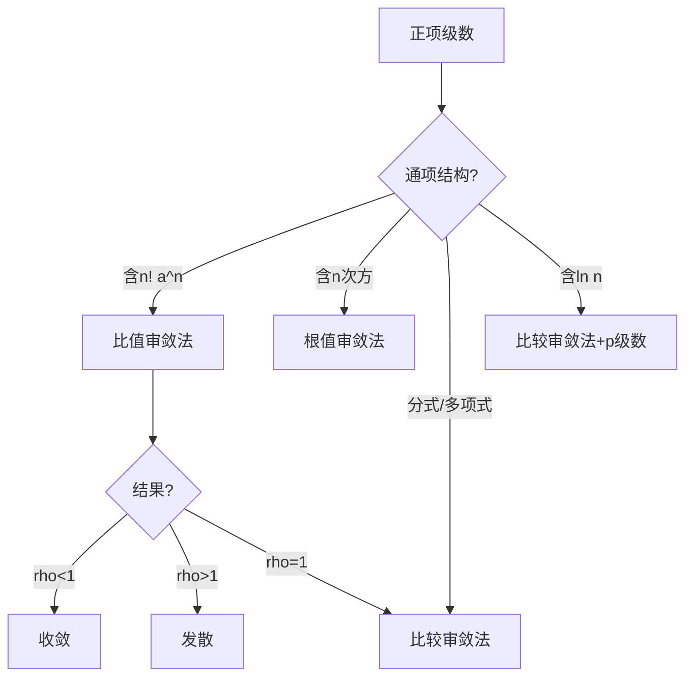

# 高等数学 第12章 无穷级数

> **这是什么**：第12章「无穷级数」的考点笔记原文，本份含 **4 个考点**、约 **13146 字**。
> **怎么用**：先贴 `0-教练规则` + 对应科目 `状态卡`，再把本文件**全文**贴上去，然后说「开始讲本章第 X 节」。
> **来源**：`资料/电子书蒸馏/04-高数/考点笔记` · 导出于 2026-11-03

---

## G12-1-常数项级数的概念与性质

```
【课程】04-高数
【章节】第12章　无穷级数
【节】第12章 第1考点
【考点】G12-1　常数项级数的概念与性质
【考频】★★★★☆
【题型】单选、填空
============================================================

> **学科系统**：高等数学 → 无穷级数 → 常数项级数
> **秒杀类比**：无穷级数就是"一直加下去能不能得到一个有限的数"——像往杯子里倒水，每次倒前一次的一半，永远倒不满但无限接近满杯。级数收敛就是"加无限多次结果有限"，发散就是"加无限多次结果无穷大或没有结果"。

## 一、 核心知识解构

### 1. 级数的定义

$$\sum_{n=1}^\infty a_n = a_1 + a_2 + a_3 + \cdots + a_n + \cdots$$

### 2. 部分和与收敛性

**部分和**：$S_n = a_1 + a_2 + \cdots + a_n = \sum_{k=1}^n a_k$

**收敛**：若 $\lim_{n\to\infty} S_n = S$（有限值），则级数收敛，$S$ 为和。

**发散**：若极限不存在或为无穷大，则级数发散。

### 3. 重要级数的敛散性

| 级数类型 | 形式 | 条件 | 结论 |
|:---|:---|:---:|:---:|
| **等比级数** | $\sum_{n=0}^\infty ar^n$ | $\|r\| < 1$ | 收敛，和 $= \frac{a}{1-r}$ |
| | | $\|r\| \geq 1$ | 发散 |
| **$p$ 级数** | $\sum_{n=1}^\infty \frac{1}{n^p}$ | $p > 1$ | 收敛 |
| | | $p \leq 1$ | 发散 |
| **调和级数** | $\sum_{n=1}^\infty \frac{1}{n}$ | — | 发散（$p=1$ 的 $p$ 级数）|

### 4. 级数的基本性质

| 性质 | 内容 |
|:---|:---|
| **线性** | 若 $\sum a_n = S$，$\sum b_n = T$，则 $\sum (ka_n + lb_n) = kS + lT$ |
| **添加/去掉有限项** | 不改变级数的敛散性 |
| **加括号** | 收敛级数加括号后仍收敛（逆命题不成立） |
| **必要条件** | 若 $\sum a_n$ 收敛，则 $\lim_{n\to\infty} a_n = 0$ |
| **逆否命题** | 若 $\lim_{n\to\infty} a_n \neq 0$，则级数 **发散** |

> **⚠️ 重要警告**：$\lim a_n = 0$ 是收敛的**必要非充分条件**——调和级数 $\sum \frac{1}{n}$ 满足 $a_n \to 0$ 但发散！

## 二、 考试红牌警告与秒杀秘籍

* 🚨 **易错雷区**：级数收敛的必要条件是 $\lim a_n = 0$，但反过来不成立——$a_n \to 0$ 不能推出级数收敛
* 🚨 **易错雷区**：加括号后的级数收敛不能推出原级数收敛（反例：$1-1+1-1+\cdots$）
* 🚨 **易错雷区**：不要混淆"数列的极限"和"级数的和"——前者是 $a_n$ 的极限，后者是 $S_n$ 的极限
* 🔑 **秒杀秘籍**：看到 $\sum a_n$，先看 $\lim a_n$ 是否等于 0——如果不等于 0 直接判定发散，不用再做其他审敛法
* 🔑 **秒杀秘籍**：熟记等比级数和 $p$ 级数的敛散性——很多级数的比较审敛法以它们为标准
* 🔑 **秒杀秘籍**：等比级数 $\sum ar^n$ 公比 $|r| < 1$ 时收敛，和 $= \frac{a}{1-r}$

## 三、 闭卷真题挑战

> **【真题演练】**：判断级数 $\sum_{n=1}^\infty \frac{n}{n+1}$ 的敛散性。

【答案与解析】
**【正确答案】**：
$\lim_{n\to\infty} a_n = \lim_{n\to\infty} \frac{n}{n+1} = 1 \neq 0$

不满足收敛的必要条件，故级数**发散**。

**【核心解析】**：
先看通项是否趋于 0 是最快的判断方法。这里 $a_n \to 1 \neq 0$，直接判定发散。

**【真题演练】**：求级数 $\sum_{n=1}^\infty \frac{1}{3^{n-1}}$ 的和。

【答案与解析】
**【正确答案】**：
该级数是等比级数，$a = 1$，$r = \frac{1}{3}$，$|r| = \frac{1}{3} < 1$

和 $S = \frac{a}{1-r} = \frac{1}{1-\frac{1}{3}} = \frac{1}{\frac{2}{3}} = \frac{3}{2}$

**【核心解析】**：
识别等比级数并判断公比小于 1 → 用求和公式直接算。注意首项是 $n=1$ 时 $a_1 = \frac{1}{3^{0}} = 1$。

## 四、 📖 教材习题全解对照

> 本讲内容对应 **同济大学《高等数学》第八版 下册 第十二章 无穷级数**

| 教材习题 | 对应知识点 | 难度 |
|:---|:---|:---:|
| **习题 12-1** 第1-6题 | 级数的概念与基本性质 | ⭐ |
| **习题 12-1** 第7-10题 | 级数敛散性的初步判断 | ⭐⭐ |
| **总习题十二** 第1-4题 | 概念综合 | ⭐⭐ |

> 💡 **刷题建议**：等比级数和 $p$ 级数是两大标准级数，务必牢记它们的敛散性条件。

============================================================
【原文锚点】《高等数学》精编讲义 第12章（_raw/gaoshu.txt）
【来源】原 高等数学/第八章 无穷级数/8.1 常数项级数的概念与性质.md
```

---

## G12-2-正项级数审敛法

```
【课程】04-高数
【章节】第12章　无穷级数
【节】第12章 第2考点
【考点】G12-2　正项级数审敛法
【考频】★★★★★
【题型】判断、计算
============================================================

> **学科系统**：高等数学 → 无穷级数 → 正项级数审敛法
> **秒杀类比**：正项级数审敛法就像"体检"——比较法是把患者跟健康人比（已知敛散的标准级数），比值法看增长率（后项/前项的极限），根值法看衰减速度（开 $n$ 次方）。方法选对了，一眼就能看出健康不健康。

## 一、 核心知识解构

### 1. 正项级数的定义

若 $a_n \geq 0$（对所有 $n$），则 $\sum_{n=1}^\infty a_n$ 称为**正项级数**。

**性质**：正项级数的部分和数列单调递增，要么收敛（有上界），要么发散到 $+\infty$。

### 2. 比较审敛法（基本形式）

**定理**：设 $0 \leq a_n \leq b_n$，则：
- 若 $\sum b_n$ 收敛，则 $\sum a_n$ 收敛
- 若 $\sum a_n$ 发散，则 $\sum b_n$ 发散

**口诀**："大收则小收，小发则大发"。

### 3. 比较审敛法的极限形式

设 $\lim_{n\to\infty} \frac{a_n}{b_n} = l$（$0 < l < +\infty$），则 $\sum a_n$ 与 $\sum b_n$ 同敛散。

**常用比较对象**：
- $p$ 级数 $\sum \frac{1}{n^p}$（最常用）
- 等比级数 $\sum r^n$

### 4. 比值审敛法（达朗贝尔审敛法）

$$\lim_{n\to\infty} \frac{a_{n+1}}{a_n} = \rho$$

| $\rho$ 范围 | 结论 |
|:---:|:---|
| $\rho < 1$ | 收敛 |
| $\rho > 1$ | 发散 |
| $\rho = 1$ | 无法判定，换方法 |

**适用场景**：通项含 $n!$、$a^n$ 等因子。

### 5. 根值审敛法（柯西审敛法）

$$\lim_{n\to\infty} \sqrt[n]{a_n} = \rho$$

| $\rho$ 范围 | 结论 |
|:---:|:---|
| $\rho < 1$ | 收敛 |
| $\rho > 1$ | 发散 |
| $\rho = 1$ | 无法判定 |

**适用场景**：通项含 $n$ 次方，如 $a_n = (\frac{n}{n+1})^{n^2}$。

### 6. 审敛法选择指南



### 7. 常见比较对象表

| 比较对象 | 收敛条件 | 发散条件 |
|:---|:---:|:---:|
| $\sum \frac{1}{n^p}$ | $p > 1$ | $p \leq 1$ |
| $\sum \frac{1}{n\ln n}$ | — | 发散（积分判别法）|
| $\sum \frac{1}{n(\ln n)^p}$ | $p > 1$ | $p \leq 1$ |
| $\sum ar^n$ | $|r| < 1$ | $|r| \geq 1$ |

## 二、 考试红牌警告与秒杀秘籍

* 🚨 **易错雷区**：$\rho = 1$ 时比值/根值审敛法**无法判定**——需要用其他方法（如比较法）
* 🚨 **易错雷区**：比较法中，不等式方向不能搞反——"大收推小收，小发推大发"
* 🚨 **易错雷区**：比较法极限形式中 $l$ 要在 $(0, +\infty)$ 内——$l = 0$ 或 $l = +\infty$ 时需另作处理
* 🔑 **秒杀秘籍**：看到 $n!$ 立即用比值法——阶乘在比值中会大量约简
* 🔑 **秒杀秘籍**：看到多项式分式（如 $\frac{n^2+1}{n^4+3}$），用比较法，跟 $\frac{1}{n^2}$ 比
* 🔑 **秒杀秘籍**：看到 $\frac{1}{n^p}$ 形式直接 $p$ 级数判断——$p > 1$ 收敛，$p \leq 1$ 发散

## 三、 闭卷真题挑战

> **【真题演练】**：判断级数 $\sum_{n=1}^\infty \frac{n!}{n^n}$ 的敛散性。

【答案与解析】
**【正确答案】**：
用比值审敛法：

$$\frac{a_{n+1}}{a_n} = \frac{(n+1)!}{(n+1)^{n+1}} \cdot \frac{n^n}{n!} = \frac{n+1}{(n+1)^{n+1}} \cdot n^n = \frac{n^n}{(n+1)^n} = \frac{1}{(1+\frac{1}{n})^n}$$

$$\lim_{n\to\infty} \frac{a_{n+1}}{a_n} = \lim_{n\to\infty} \frac{1}{(1+\frac{1}{n})^n} = \frac{1}{e} < 1$$

由比值审敛法，级数**收敛**。

**【核心解析】**：
$n!$ 和 $n^n$ 同时在通项中，比值法最合适。注意化简时要仔细，极限 $\lim (1+\frac{1}{n})^n = e$ 是关键。

**【真题演练】**：判断级数 $\sum_{n=1}^\infty \frac{1}{n^2 + 3n + 2}$ 的敛散性。

【答案与解析】
**【正确答案】**：
通项 $a_n = \frac{1}{n^2 + 3n + 2}$

与 $b_n = \frac{1}{n^2}$ 比较（$p=2 > 1$ 的 $p$ 级数，收敛）：

$$\lim_{n\to\infty} \frac{a_n}{b_n} = \lim_{n\to\infty} \frac{n^2}{n^2 + 3n + 2} = 1 \in (0, +\infty)$$

由比较审敛法的极限形式，$\sum a_n$ 与 $\sum \frac{1}{n^2}$ 同敛散，故原级数**收敛**。

**【核心解析】**：
多项式分式优先考虑比较法。分母最高次为 $n^2$，故用 $\frac{1}{n^2}$ 作比较。极限比值有限非零，说明同阶，敛散性相同。

## 四、 📖 教材习题全解对照

> 本讲内容对应 **同济大学《高等数学》第八版 下册 第十二章 无穷级数**

| 教材习题 | 对应知识点 | 难度 |
|:---|:---|:---:|
| **习题 12-2** 第1-6题 | 比较审敛法 | ⭐⭐ |
| **习题 12-2** 第7-12题 | 比值审敛法 | ⭐⭐ |
| **习题 12-2** 第13-18题 | 根值审敛法 | ⭐⭐⭐ |
| **总习题十二** 第5-10题 | 审敛法综合 | ⭐⭐⭐ |

> 💡 **刷题建议**：比值法和比较法是最常用的两种审敛法。习题12-2的1-12题覆盖了主要题型，建议全部练习。根值法了解即可。

============================================================
【原文锚点】《高等数学》精编讲义 第12章（_raw/gaoshu.txt）
【来源】原 高等数学/第八章 无穷级数/8.2 正项级数审敛法.md
```

---

## G12-3-幂级数

```
【课程】04-高数
【章节】第12章　无穷级数
【节】第12章 第3考点
【考点】G12-3　幂级数
【考频】★★★★★
【题型】计算
============================================================

> **学科系统**：高等数学 → 无穷级数 → 幂级数
> **秒杀类比**：幂级数就是用"多项式"逼近各种函数——就像用乐高积木拼出任意形状。$e^x$、$\sin x$、$\cos x$ 这些函数都可以展开成幂级数，每一项都是 $x^n$ 的倍数。收敛半径告诉你这个"乐高模型"在什么范围内是有效的。

## 一、 核心知识解构

### 1. 幂级数的定义

$$\sum_{n=0}^\infty a_n x^n = a_0 + a_1 x + a_2 x^2 + \cdots + a_n x^n + \cdots$$

更一般的形式：$\sum_{n=0}^\infty a_n (x - x_0)^n$

### 2. 收敛半径与收敛域

#### 收敛半径的计算

$$R = \lim_{n\to\infty} \left| \frac{a_n}{a_{n+1}} \right| \quad \text{或} \quad R = \frac{1}{\limsup_{n\to\infty} \sqrt[n]{|a_n|}}$$

#### 收敛区间
- $|x| < R$：**绝对收敛**
- $|x| > R$：**发散**
- $|x| = R$（端点）：需**单独判定**

### 3. 幂级数的四则运算

在收敛区间内：
- 加减法：$\sum a_n x^n \pm \sum b_n x^n = \sum (a_n \pm b_n) x^n$
- 乘法：$(\sum a_n x^n)(\sum b_n x^n) = \sum c_n x^n$（$c_n = \sum_{k=0}^n a_k b_{n-k}$）

### 4. 幂级数的分析性质

设 $S(x) = \sum_{n=0}^\infty a_n x^n$，收敛半径为 $R$：

| 性质 | 表达式 |
|:---|:---|
| **逐项可积** | $\int_0^x S(t) dt = \sum_{n=0}^\infty \frac{a_n}{n+1} x^{n+1}$，$|x| < R$ |
| **逐项可导** | $S'(x) = \sum_{n=1}^\infty n a_n x^{n-1}$，$|x| < R$ |

> 逐项求导和逐项积分不改变收敛半径！

### 5. 泰勒级数 / 幂级数展开

$$f(x) = \sum_{n=0}^\infty \frac{f^{(n)}(x_0)}{n!} (x - x_0)^n$$

#### 常用麦克劳林展开（$x_0 = 0$）

| 函数 | 展开式 | 成立范围 |
|:---|:---|:---:|
| $\frac{1}{1-x}$ | $\sum_{n=0}^\infty x^n$ | $\|x\| < 1$ |
| $\frac{1}{1+x}$ | $\sum_{n=0}^\infty (-1)^n x^n$ | $\|x\| < 1$ |
| $e^x$ | $\sum_{n=0}^\infty \frac{x^n}{n!}$ | $(-\infty, +\infty)$ |
| $\sin x$ | $\sum_{n=0}^\infty \frac{(-1)^n x^{2n+1}}{(2n+1)!}$ | $(-\infty, +\infty)$ |
| $\cos x$ | $\sum_{n=0}^\infty \frac{(-1)^n x^{2n}}{(2n)!}$ | $(-\infty, +\infty)$ |
| $\ln(1+x)$ | $\sum_{n=1}^\infty \frac{(-1)^{n-1} x^n}{n}$ | $(-1, 1]$ |
| $(1+x)^\alpha$ | $1 + \sum_{n=1}^\infty \frac{\alpha(\alpha-1)\cdots(\alpha-n+1)}{n!} x^n$ | $\|x\| < 1$ |

### 6. 函数展开为幂级数的方法

1. **直接法**：计算 $f^{(n)}(0)$，代入泰勒公式
2. **间接法**：利用已知展开式，通过变量替换、四则运算、逐项求导/积分得到

> **推荐**：间接法比直接法简单得多，优先使用！

## 二、 考试红牌警告与秒杀秘籍

* 🚨 **易错雷区**：收敛半径公式是 $R = \lim |\frac{a_n}{a_{n+1}}|$，不是 $\lim |\frac{a_{n+1}}{a_n}|$——不要搞反了！
* 🚨 **易错雷区**：端点处（$x = \pm R$）必须**单独判断**——不能直接从收敛半径得出端点敛散性
* 🚨 **易错雷区**：逐项求导和逐项积分不改变收敛半径，但可能改变端点处的敛散性
* 🔑 **秒杀秘籍**：看到 $\frac{1}{ax+b}$ 形式 → 凑成 $\frac{1}{1-u}$ 形式展开
* 🔑 **秒杀秘籍**：展开函数时优先用间接法——从已知的 5 个基本展开式出发
* 🔑 **秒杀秘籍**：逐项积分常用于 $\ln(1+x)$ 的展开，逐项求导常用于 $\frac{1}{(1-x)^2}$ 的展开

## 三、 闭卷真题挑战

> **【真题演练】**：求幂级数 $\sum_{n=1}^\infty \frac{x^n}{n}$ 的收敛半径和收敛域。

【答案与解析】
**【正确答案】**：
$a_n = \frac{1}{n}$

$$R = \lim_{n\to\infty} \left| \frac{a_n}{a_{n+1}} \right| = \lim_{n\to\infty} \frac{1/n}{1/(n+1)} = \lim_{n\to\infty} \frac{n+1}{n} = 1$$

收敛半径 $R = 1$。考察端点：

当 $x = 1$ 时：$\sum \frac{1}{n}$——调和级数，**发散**
当 $x = -1$ 时：$\sum \frac{(-1)^n}{n}$——交错调和级数，**收敛**

收敛域为 $[-1, 1)$。

**【核心解析】**：
先求收敛半径（比值法），再单独判断两个端点。注意收敛域可能有开有闭，不是对称的。

**【真题演练】**：将函数 $f(x) = \frac{1}{1-2x}$ 展开为 $x$ 的幂级数。

【答案与解析】
**【正确答案】**：
利用已知展开式 $\frac{1}{1-u} = \sum_{n=0}^\infty u^n$，$|u| < 1$

令 $u = 2x$：
$$\frac{1}{1-2x} = \sum_{n=0}^\infty (2x)^n = \sum_{n=0}^\infty 2^n x^n$$

$|2x| < 1 \implies |x| < \frac{1}{2}$

所以展开式为 $\sum_{n=0}^\infty 2^n x^n$，收敛范围为 $|x| < \frac{1}{2}$。

**【核心解析】**：
间接法展开——从已知的 $\frac{1}{1-u}$ 展开式出发，通过变量替换得到。不需要求导。

## 四、 📖 教材习题全解对照

> 本讲内容对应 **同济大学《高等数学》第八版 下册 第十二章 无穷级数**

| 教材习题 | 对应知识点 | 难度 |
|:---|:---|:---:|
| **习题 12-3** 第1-6题 | 求收敛半径和收敛域 | ⭐⭐ |
| **习题 12-4** 第1-6题 | 函数展开为幂级数 | ⭐⭐⭐ |
| **习题 12-4** 第7-12题 | 幂级数的应用 | ⭐⭐⭐ |
| **总习题十二** 第11-18题 | 幂级数综合 | ⭐⭐⭐⭐ |

> 💡 **刷题建议**：收敛半径的计算是基本功，习题12-3的1-6题熟练掌握。函数展开（习题12-4）以间接法为主，熟记 5 个基本展开式。

============================================================
【原文锚点】《高等数学》精编讲义 第12章（_raw/gaoshu.txt）
【来源】原 高等数学/第八章 无穷级数/8.3 幂级数.md
```

---

## G12-4-傅里叶级数

```
【课程】04-高数
【章节】第12章　无穷级数
【节】第12章 第4考点
【考点】G12-4　傅里叶级数
【考频】★★★☆☆
【题型】计算
============================================================

> **学科系统**：高等数学 → 无穷级数 → 傅里叶级数
> **秒杀类比**：傅里叶级数就像"用音叉合成音乐"——任何一个周期声音（方波、锯齿波等）都可以分解成不同频率的正弦波和余弦波的叠加。在不同频率上分配不同音量（系数），就能"拼出"任意周期函数。

## 一、 核心知识解构

### 1. 周期函数的傅里叶级数

周期为 $2\pi$ 的函数 $f(x)$：

$$f(x) \sim \frac{a_0}{2} + \sum_{n=1}^\infty (a_n \cos nx + b_n \sin nx)$$

#### 傅里叶系数

$$a_n = \frac{1}{\pi} \int_{-\pi}^{\pi} f(x) \cos nx \, dx, \quad n = 0,1,2,\cdots$$

$$b_n = \frac{1}{\pi} \int_{-\pi}^{\pi} f(x) \sin nx \, dx, \quad n = 1,2,3,\cdots$$

### 2. 周期为 $2l$ 的傅里叶级数

$$f(x) \sim \frac{a_0}{2} + \sum_{n=1}^\infty \left( a_n \cos\frac{n\pi x}{l} + b_n \sin\frac{n\pi x}{l} \right)$$

$$a_n = \frac{1}{l} \int_{-l}^{l} f(x) \cos\frac{n\pi x}{l} dx, \quad b_n = \frac{1}{l} \int_{-l}^{l} f(x) \sin\frac{n\pi x}{l} dx$$

### 3. 收敛定理（狄利克雷充分条件）

若 $f(x)$ 在一个周期内：
1. 连续或只有有限个第一类间断点
2. 只有有限个极值点

则傅里叶级数收敛，且：
- 在连续点：收敛到 $f(x)$
- 在间断点：收敛到 $\frac{f(x^-) + f(x^+)}{2}$

### 4. 奇延拓与偶延拓

#### 正弦级数（奇延拓）
将 $[0, l]$ 上的函数奇延拓到 $[-l, l]$：

$$a_n = 0, \quad b_n = \frac{2}{l} \int_0^l f(x) \sin\frac{n\pi x}{l} dx$$

$$f(x) \sim \sum_{n=1}^\infty b_n \sin\frac{n\pi x}{l}$$

#### 余弦级数（偶延拓）
将 $[0, l]$ 上的函数偶延拓到 $[-l, l]$：

$$a_0 = \frac{2}{l} \int_0^l f(x) dx, \quad a_n = \frac{2}{l} \int_0^l f(x) \cos\frac{n\pi x}{l} dx, \quad b_n = 0$$

$$f(x) \sim \frac{a_0}{2} + \sum_{n=1}^\infty a_n \cos\frac{n\pi x}{l}$$

### 5. 傅里叶级数的物理意义

- **基波**：$n=1$ 的项（频率最低）
- **谐波**：$n \geq 2$ 的项（高次谐波）
- **频谱**：$a_n$ 和 $b_n$ 的分布描述了信号的频率成分

## 二、 考试红牌警告与秒杀秘籍

* 🚨 **易错雷区**：傅里叶级数在**间断点处收敛到左右极限的平均值**，不是函数值本身
* 🚨 **易错雷区**：$a_0$ 的公式分母是 $l$（或 $\pi$），而且级数中 $a_0$ 要除以 $2$——这两个地方容易出错
* 🚨 **易错雷区**：奇延拓后得到的是正弦级数，偶延拓得到的是余弦级数——不要搞混
* 🔑 **秒杀秘籍**：计算傅里叶系数时，先判断 $f(x)$ 的奇偶性——奇函数 $a_n = 0$，偶函数 $b_n = 0$，可省去一半计算
* 🔑 **秒杀秘籍**：方波函数的傅里叶级数只含正弦项（奇函数），三角波只含余弦项（偶函数）
* 🔑 **秒杀秘籍**：在 $[0,l]$ 上展开时，可以根据需要选择正弦级数或余弦级数

## 三、 闭卷真题挑战

> **【真题演练】**：将函数 $f(x) = x$（$-\pi < x < \pi$）展开为傅里叶级数。

【答案与解析】
**【正确答案】**：
$f(x) = x$ 是奇函数，在 $[-\pi, \pi]$ 上：
$a_n = 0$（所有 $n$）

$$b_n = \frac{1}{\pi} \int_{-\pi}^{\pi} x \sin nx \, dx = \frac{2}{\pi} \int_0^{\pi} x \sin nx \, dx$$

$$= \frac{2}{\pi} \left[ -\frac{x\cos nx}{n} + \frac{\sin nx}{n^2} \right]_0^{\pi} = \frac{2}{\pi} \left( -\frac{\pi\cos n\pi}{n} \right) = -\frac{2\cos n\pi}{n} = \frac{2(-1)^{n+1}}{n}$$

所以：
$$x \sim \sum_{n=1}^\infty \frac{2(-1)^{n+1}}{n} \sin nx, \quad x \in (-\pi, \pi)$$

在 $x = \pm\pi$ 处，级数收敛到 $\frac{\pi + (-\pi)}{2} = 0$（跳跃间断点）。

**【核心解析】**：
奇函数 $x$ 的傅里叶级数只含正弦项，省去 $a_n$ 的计算。利用分部积分求 $b_n$，最后注意间断点处的收敛值。

## 四、 📖 教材习题全解对照

> 本讲内容对应 **同济大学《高等数学》第八版 下册 第十二章 无穷级数**

| 教材习题 | 对应知识点 | 难度 |
|:---|:---|:---:|
| **习题 12-6** 第1-6题 | 傅里叶系数计算 | ⭐⭐⭐ |
| **习题 12-6** 第7-10题 | 正弦级数与余弦级数 | ⭐⭐⭐ |
| **习题 12-7** 第1-4题 | 周期为 2l 的展开 | ⭐⭐⭐ |
| **总习题十二** 第19-22题 | 傅里叶级数综合 | ⭐⭐⭐⭐ |

> 💡 **刷题建议**：傅里叶级数在专升本考试中通常以计算傅里叶系数为主，重点是掌握奇偶性对系数的简化作用。习题12-6的第1-4题涵盖了基本题型。

============================================================
【原文锚点】《高等数学》精编讲义 第12章（_raw/gaoshu.txt）
【来源】原 高等数学/第八章 无穷级数/8.4 傅里叶级数.md
```
